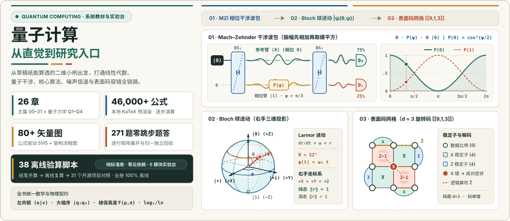

<p align="center">
  <picture>
    <source media="(prefers-reduced-motion: reduce)" srcset="handbook/assets/cover-banner-static.svg">
    
  </picture>
</p>

# 量子计算：从直觉到研究入口

一套面向零基础自学者、工程研发人员与入门研究生的中文量子计算系统教材。全书以二维和四维草稿纸手算为起点，贯通数学语言、量子物理、算法原语、硬件控制、容错纠错、密码网络、精密传感与经典模拟边界，全部公式、图表、题答、合成音频与验证脚本均可完全离线核对。

**[在线进入旗舰课程网站 →](https://nanless.github.io/quantum-computing-handbook/)** · **[▶ 零安装 6 模块量子互动实验台](https://nanless.github.io/quantum-computing-handbook/lab/quantum-lab.html)** · **[🔊 量子干涉与 Ramsey 声化对比](https://nanless.github.io/quantum-computing-handbook/#course-cases)** · **[出版级 A4 合订本 PDF](dist/quantum-computing-handbook.pdf)** · **[原生 MathML 3 EPUB 3](dist/quantum-computing-handbook.epub)** · **[全书导读](handbook/README.md)**

**26 章正文 · 7 份附录 · 7 份实验册 · 271 道自检题 + 67 道精练 · 50,937 条公式 · 92 张科学矢量图 + 30 幅流程图 · 38 个纯标准库脚本 · 31 个开源项目对照**

最新版本同时发布 A4 合订本 PDF、原生 MathML 3 EPUB 3、完整可双击运行的离线网站包、自编离线复算代码套件与 `SHA256SUMS.txt`。[查看发布说明与全产物下载（GitHub Releases） →](https://github.com/nanless/quantum-computing-handbook/releases/latest)

---

## 核心阅读与多格式直达

| 交付形态 | 入口路径 | 内容与适用场景 |
| :--- | :--- | :--- |
| **在线旗舰课程网站（GitHub Pages）** | [nanless.github.io/quantum-computing-handbook](https://nanless.github.io/quantum-computing-handbook/) | 无需克隆即可直接打开阅读：含首页 4 模式量子干涉互动工作台、Bell/CHSH 与表面码预览、同步声化试听、`Cmd/Ctrl+K` 离线全书检索、初学主线一键折叠进阶选读与亮/暗双主题 |
| **零安装 6 模块量子互动实验台** | [在线打开](https://nanless.github.io/quantum-computing-handbook/lab/quantum-lab.html) · [本地文件](reader/lab/quantum-lab.html) | 零外网依赖纯浏览器实验台（源码 [`tools/reader/quantum-lab.html`](tools/reader/quantum-lab.html)）：01 MZI 干涉仪、02 3D Bloch 球面真弧门沙箱、03 Ramsey 音频对比、04 Bell/CHSH 千局非局域博弈、05 Grover 半拍振幅放大与过冲、06 $d=3$ 旋转表面码症状解码 |
| **离线完整网站包（本地 / Release ZIP）** | [`reader/index.html`](reader/index.html) · [Releases 下载](https://github.com/nanless/quantum-computing-handbook/releases/latest) | 克隆仓库或从 Releases 下载 `*-web.zip` 解压后双击 `index.html` 即可全功能离线运行（请保留完整 `reader/` 目录，勿只下载单个 HTML） |
| **出版级 A4 合订本 PDF（1,045 页 / 27.6 MiB）** | [`dist/quantum-computing-handbook.pdf`](dist/quantum-computing-handbook.pdf) | 适合打印精读与平板批注：含封面、带精确印刷页码与点线引导的目录、527 条三级书签、0 偏移页码、中文避头点保护与全矢量插图 |
| **原生 MathML 3 EPUB 3 电子书（3.35 MiB）** | [`dist/quantum-computing-handbook.epub`](dist/quantum-computing-handbook.epub) | 适合电纸书、平板与手机流式阅读及无障碍屏幕朗读：50,920 个原生 MathML 3 公式、暗色安全矢量图、横向可滚宽表、五篇拆分题库与 EPUB 2 `toc.ncx` 回退 |
| **Markdown 原稿与 271+ 题答汇编** | [`handbook/README.md`](handbook/README.md) · [`exercises.md`](handbook/appendices/exercises.md) | 全书 26 章均配“本章一页速记卡”；271 道自检题全量分级并配防剧透“核心提示 → 完整四步解答”与 14 道附录盲区精练 |

---

## 规模与可信度一览

| 维度 | 量化指标 | 核验口径与约束 |
| :--- | :--- | :--- |
| **课程体量** | **26 章**（22 主章 `00`–`21` + 4 篇物理基础 `Q1`–`Q4`） | 覆盖“计算—通信—传感”量子科技三大支柱及经典模拟边界，配套 7 份附录、7 份实验册与 26 张章末一页速记卡 |
| **数学公式** | **50,937 条** 构建期预渲染公式 | 统一 `$...$` / `$$...$$` 定界符、左共轭内积、大端序基序、$\log_2/\ln$ 底数与根保真度契约；Web 用轻量 HTML+`data-tex`，EPUB 保留原生 MathML 3 |
| **科学插图** | **92 张** 亮暗双主题公式生成矢量图 + **30 幅** Mermaid 流程图 | 由脚本按公式或精确数据生成，轴标与单位与正文一致；Web 构建期自动产出亮/暗双变体，经 Chrome 真机像素亮度门禁核验 |
| **习题体系** | **271 道** 分级两级折叠自检题 + **53 道**章内练 + **14 道**盲区精练 | 覆盖全部 26 章 `## 自检题`，题号连续稳定并经自动化门禁对账；全量配套核心提示与零跳步四步演算 |
| **本地验算** | **38 个** 零外网纯 Python 标准库验证脚本 + **5 段**确定性合成 WAV | `python3 codes/run_all.py` 一键执行并核验断言、源码哈希与音频 PCM 元数据（含 LCHS/Carleman、显式 $4\times 4$ QSVT、BCa Bootstrap、ZNE 最优预算等），不消耗云额度 |
| **开源对照** | **31 个** 代表性开源项目 / **122 份** 第三方源码摘录 | 40 位 Git 提交哈希与 SHA-256 锁定于 [`codes/vendor/manifest.json`](codes/vendor/manifest.json)，另附隔离环境实跑记录 |
| **离线交付** | **100% 离线**，零外部网络请求、零本机路径泄露 | 精简本地 KaTeX `woff2` 字体、检索索引、亮暗 SVG、合成音频与 6 模块交互实验台全部打包在本地，由 Playwright 浏览器自动门禁核验 |

---

## 问题驱动选读矩阵

如果你带着具体困惑翻开本书，可以直接按问题直达对应章节与实验：

| 你最想弄清的问题 | 直达正文章节 | 配套手算与本地实验 |
| :--- | :--- | :--- |
| 复振幅凭什么能“相消”？几何相位与测量仪器怎么定义？ | [第 00 章](handbook/00-overview.md) → [第 01 章](handbook/01-math.md) → [Q1](handbook/quantum-mechanics/01-experiments-states.md) → [第 02 章](handbook/02-single-qubit.md) | [先修自测](handbook/appendices/prerequisites.md) · [基础实验册](handbook/labs/foundations.md) · 实验台 01 MZI / 02 Bloch 沙箱 |
| 纠缠比经典相关强在哪儿？为什么 Clifford 群有限阶且缺 $T$ 门不通用？ | [第 03 章](handbook/03-multiple-qubits.md) → [第 04 章](handbook/04-circuits-protocols.md) → [第 05 章](handbook/05-noise-channels.md) | CHSH 博弈 $75\%$ vs $85.36\%$ · 实验台 04 Bell/CHSH 千局模拟 |
| Grover、QPE、Shor、LCHS 微分方程与化学 THC 压缩到底怎么算？ | [第 06 章](handbook/06-algorithmic-primitives.md) → [第 07 章](handbook/07-algorithms.md) → [第 08 章](handbook/08-applications.md) | [算法实验册](handbook/labs/algorithms.md) · [`v4_algorithms_lab.py`](codes/algorithms/v4_algorithms_lab.py) · 实验台 05 Grover 半拍沙盒 |
| 如何手写模拟器、算准 Wilson/BCa 置信区间、做 QCEC 验证并避开 SDK 坑？ | [第 15 章](handbook/15-practice-research.md) | [统计实践实验册](handbook/labs/practice.md) · [`v4_practice_lab.py`](codes/practice/v4_practice_lab.py) · [开源对照](handbook/appendices/software-practice.md) |
| 真实芯片为什么放进 20 mK 冰箱？颜色码、XZZX、中性原子 AFT 与制冷怎样成机？ | [Q3](handbook/quantum-mechanics/03-levels-control.md) → [第 09 章](handbook/09-hardware.md) → [第 14 章](handbook/14-compilation-control.md) → [第 10 章](handbook/10-error-correction.md) → [第 11 章](handbook/11-resources-benchmarks.md) → [第 19 章](handbook/19-engineering-architecture.md) | [系统与传感实验册](handbook/labs/systems.md) · 实验台 06 $d=3$ 表面码解码沙箱 |
| 后量子密码（PQC）、QKD、可认证量子随机性与盲量子计算是什么关系？ | [第 12 章](handbook/12-security-network-frontiers.md) | 双链等待与存储截止实验 · NIST FIPS 203–205 / HQC / IR 8547 对照 |
| 量子传感器怎样突破散粒噪声？核钟、冷原子重力仪与量子照明边界在哪？ | [第 20 章](handbook/20-quantum-sensing-metrology.md) | [`codes/systems/sensing_lab.py`](codes/systems/sensing_lab.py)（SQL / HL / Huelga 1997 / 压缩态 / HNLS） |
| 存不下 $2^n$ 振幅为何仍能被经典算穿？稳定子、PEPS 与 Pauli 传播边界在哪？ | [第 21 章](handbook/21-stabilizer-classical-simulation.md) → [第 16 章](handbook/16-advanced-algorithms-verification.md) | [`codes/algorithms/simulation_engines_lab.py`](codes/algorithms/simulation_engines_lab.py) · 显式 $4\times 4$ QSVT 双约定核验 |
| 信道容量、CV-MBQC、GKP 网格码、多体疤痕与连续波函数怎么严格入门？ | [第 13 章](handbook/13-quantum-information.md) → [第 17 章](handbook/17-computation-models.md) → [Q4](handbook/quantum-mechanics/04-wavefunctions-models.md) → [第 18 章](handbook/18-channels-capacities-complexity.md) | 擦除信道四容量手算 · 量子热力学资源论 · GKP $4\pi$ 晶胞与 Wigner 负性 |

---

## 五篇 26 章全书路线图

离线阅读版与在线官网的侧栏和上下章翻页统一按下列五篇教学顺序编排（全部源文件保留稳定的 `00`–`21` 与 `Q1`–`Q4` 编号）：

### 第一篇｜入门、数学与量子态基础

| 序号 | 章节标题 | 核心问题与收获 |
| :---: | :--- | :--- |
| `00` | [00｜全景：量子计算是什么，又不是什么](handbook/00-overview.md) | 量子科技三大支柱、复振幅相消、最小随机比特实验与 2025–2026 现实边界 |
| `01` | [01｜零基础数学工具：看懂量子计算的最小数学语言](handbook/01-math.md) | 复数旋转、左共轭内积、酉阵与厄米阵、谱分解、绝对误差与条件数、张量积印章分块 |
| `Q1` | [Q1｜从实验认识量子态](handbook/quantum-mechanics/01-experiments-states.md) | 双缝干涉、MZI、Elitzur–Vaidman 炸弹测试、Stern–Gerlach 级联、马吕斯定律与量子擦除 |
| `02` | [02｜单量子比特：状态、相位、旋转与测量](handbook/02-single-qubit.md) | 相对相位、几何（Berry/Pancharatnam）相位、Bloch 球、欧拉旋转、Cholesky-MLE 层析与测量三层模型 |
| `Q2` | [Q2｜可观测量与量子态的时间演化](handbook/quantum-mechanics/02-observables-dynamics.md) | 谱分解与 CSCO、Robertson/Schrödinger 界、量子速度极限、三绘景、Magnus 展开与 Lindblad 主方程 |
| `03` | [03｜多量子比特、量子纠缠与非局域性](handbook/03-multiple-qubits.md) | Bell 态、偏迹、Schmidt 分解、PPT 判据、CHSH 合作博弈与纠缠单配性 |
| `04` | [04｜量子门、电路与基础协议](handbook/04-circuits-protocols.md) | 电路矩阵翻译、Toffoli 分解与反计算、Clifford 群有限阶数 $24/11{,}520$、不可克隆/不可删除与隐形传态 |
| `05` | [05｜混态、噪声与量子信道](handbook/05-noise-channels.md) | 密度矩阵、CPTP 信道五种表示、Kraus 酉自由度、五大噪声、广义振幅阻尼与 Landauer 擦除下限 |

### 第二篇｜核心算法、应用与实验实践

| 序号 | 章节标题 | 核心问题与收获 |
| :---: | :--- | :--- |
| `06` | [06｜量子算法的共同骨架](handbook/06-algorithmic-primitives.md) | 预言机、相位回踢、振幅放大、QFT、QPE、Trotter、显式 6 门 `PREPARE/SELECT` 与一元迭代 QROM |
| `07` | [07｜代表性量子算法：从隐藏周期到量子模拟](handbook/07-algorithms.md) | Simon、Grover、Shor、哈密顿量模拟、HHL、量子微分方程（LCHS/Schrödingerization/Carleman）与去量子化 |
| `08` | [08｜应用、变分算法与证据边界](handbook/08-applications.md) | 量子化学 DF/RC-DF/THC 压缩、VQE、DQI 与 WS-QAOA、参数移位、贫瘠高原、ZNE 固定总 shots 预算与期权 VaR/CVaR |
| `15` | [15｜实践路线：从手算、模拟到真机实验与论文复核](handbook/15-practice-research.md) | $O(2^n)$ 态矢量引擎、Wilson/BCa/Cluster Bootstrap 与少聚类 $t$ 分布、QCEC 线路等价验证与四大 SDK 对照 |

### 第三篇｜物理硬件、编译、纠错与系统工程

| 序号 | 章节标题 | 核心问题与收获 |
| :---: | :--- | :--- |
| `Q3` | [Q3｜从能级到物理量子比特](handbook/quantum-mechanics/03-levels-control.md) | 热占据与制冷、约瑟夫森结非谐性、Rabi/Ramsey/Hahn 回波、失谐符号等价表与 cQED 色散读出 |
| `09` | [09｜主流硬件平台与物理噪声特性](handbook/09-hardware.md) | 六大硬件平台机制、玻色猫态比特、中性原子四区架构与 AOD 约束、SPAM 不确定度传播与最新进展 |
| `14` | [14｜从算法电路到物理执行：编译、调度与控制](handbook/14-compilation-control.md) | OpenQASM 3/QIR/MLIR、Weyl 室、ZX 演算、`gridsynth`、Virtual-Z、SABRE、DRAG/DD/GRAPE、Pauli RC、M3、线路切割与 Litinski 编译 |
| `10` | [10｜量子纠错与容错计算](handbook/10-error-correction.md) | Knill–Laflamme、二维颜色码（Google *Nature* 2025）、旋转表面码、横向门跨块关联解码 AFT、偏置 XZZX/擦除解码、qLDPC 与魔法态培育 |
| `11` | [11｜基准测试与容错资源估算](handbook/11-resources-benchmarks.md) | RB/IRB/GST、EPLG、2024–2026 逻辑基准总表、实时解码尾延迟、九步容错资源流水线与 RSA-2048 估算演进 |
| `19` | [19｜可维护量子系统工程](handbook/19-engineering-architecture.md) | 稀释制冷热预算、FDM Purcell/TWPA 复用上限、Cryo-CMOS 与光学低温互连、3D 封装盒模基频、校准 DAG 与整机可用率 |

### 第四篇｜密码、网络与精密测量

| 序号 | 章节标题 | 核心问题与收获 |
| :---: | :--- | :--- |
| `12` | [12｜量子密码、后量子安全与量子网络](handbook/12-security-network-frontiers.md) | 格密码与 NIST PQC 标准（FIPS 203–205、HQC、IR 8547）、BB84/TF-QKD/百公里 DI-QKD、可认证随机性、盲量子计算与量子货币 |
| `20` | [20｜量子传感与量子精密测量：从 Fisher 信息到海森堡极限](handbook/20-quantum-sensing-metrology.md) | CFI/QFI 与 QCRB、SQL vs HL、Huelga 退相位坍塌、原子钟阿兰偏差与 $^{229}\mathrm{Th}$ 核钟、冷原子重力仪、量子照明、压缩态与 HNLS |

### 第五篇｜信息理论、高级算法、模拟边界与计算模型

| 序号 | 章节标题 | 核心问题与收获 |
| :---: | :--- | :--- |
| `13` | [13｜量子信息量度：熵、距离与可提取信息](handbook/13-quantum-information.md) | 熵与负条件熵、数据处理不等式、量子热力学资源论、迹距离、Helstrom/USD 判别、Holevo 界与剩余哈希引理 |
| `16` | [16｜高级算法与验证：从查询下界、统一框架到可信输出](handbook/16-advanced-algorithms-verification.md) | 查询下界、量子行走、LCU→显式 $4\times 4$ QSVT 双约定→GQSP、经典阴影与验证/模拟分叉边界 |
| `21` | [21｜稳定子形式、经典模拟引擎与量子优势边界](handbook/21-stabilizer-classical-simulation.md) | 稳定子辛表、魔术度与稳定子秩、匹配门、MPS 与 2D PEPS/BP-TN 树宽环路机制、含噪 Pauli 传播与工具选型 |
| `17` | [17｜量子计算模型：门、测量、绝热、退火、拓扑与模拟](handbook/17-computation-models.md) | 门模型、MBQC/FBQC、绝热计算、退火 TTS、拓扑任意子编织与非平衡多体动力学（ETH/MBL/PXP 多体疤痕/DQPT） |
| `Q4` | [Q4｜波函数、势阱、谐振子、隧穿与原子能级](handbook/quantum-mechanics/04-wavefunctions-models.md) | 支持硬件/CV 双入口跳读：高斯波包、方势阱、谐振子、WKB 双势阱劈裂、含 $^{87}\mathrm{Sr}$ 原子超精细钟态与 Fock 截断边界 |
| `18` | [18｜量子信道、通信容量、复杂度与连续变量](handbook/18-channels-capacities-complexity.md) | Choi 同构、钻石范数、四类通信容量、纠缠负性、`QIP`/`MIP*=RE`、CV-MBQC 光量子集群态（Xanadu Aurora）与 GKP 网格码 |

**附录与实验入口**：[先修自测](handbook/appendices/prerequisites.md) · [符号表与速查](handbook/appendices/notation.md) · [术语表](handbook/appendices/glossary.md) · [练习答案](handbook/appendices/exercises.md) · [开源实践对照](handbook/appendices/software-practice.md) · [参考资料](handbook/appendices/references.md) · [版本演进与公开勘误](handbook/appendices/audit-log.md) · [逐章实验总览](handbook/labs/README.md) · [声音实验](handbook/labs/audio.md) · [完整 SDK 实验册](handbook/labs/sdk-validation.md)

---

## 本地零付费复现与一键构建

所有自编验证脚本仅依赖 Python 3 标准库，默认不联网、不调用云量子设备；阅读版与电子书构建依赖 Node.js 与 Playwright/Chromium，阅读已生成的 `reader/` 或 `dist/` 无需安装构建依赖。仓库根目录提供统一 [`Makefile`](Makefile)：

```sh
# 1. 运行全部 38 个纯 Python 标准库教学与核验脚本（含 vendor SHA-256 与 5 段 WAV 校验）
make test          # 等价于 python3 codes/run_all.py

# 2. 运行全套源码质检门禁（LaTeX 定界符、术语、题答对账、隐私路径、算例复核）
make lint          # 涵盖 check-v3-quality / check-qm-* / check-network-examples

# 3. 安装构建依赖并重建旗舰 HTML 网站 + 运行双宽度/亮暗像素/检索/6模块实验台验收
make install
make build && make verify

# 4. 生成出版级 A4 PDF、原生 MathML 3 EPUB 3 与全产物 Release 压缩包（输出至 dist/release/）
make install-pdf
make pdf && make epub && make release
```

详细依赖说明、环境变量（`HANDBOOK_CHROMIUM`、`HANDBOOK_NODE_MODULES`）与脚本边界见 [`tools/reader/README.md`](tools/reader/README.md) 与 [`codes/README.md`](codes/README.md)。

---

## 仓库目录与许可边界

- `handbook/`：全书 26 章、7 份附录、7 份实验册与 92 张双主题矢量图的 Markdown 原稿；
- `reader/`：由 `tools/reader/build.mjs` 编译生成的完整离线旗舰网站（含官网首页、预渲染公式、`Cmd/Ctrl+K` 检索索引、亮暗 SVG 双变体、精简 `woff2` 字体、合成音频、6 模块交互实验台与代码副本）；
- `dist/`：出版级 A4 PDF 与原生 MathML 3 EPUB 3 电子书发布产物（`dist/release/` 归档压缩包由 `.gitignore` 忽略，统一经 GitHub Releases 分发）；
- `codes/`：38 个自编标准库教学/验算程序与 [`codes/vendor/`](codes/vendor/README.md) 第三方固定提交源码摘录；
- `tools/reader/`：旗舰网站构建、PDF/EPUB 导出、Release 打包与全量浏览器自动验收工具；
- `work/research/`：与正文相互引用的固定核验数据、历史审校归档与构建验证报告。

**时效性与许可声明**：文中涉及的硬件指标、纠错里程碑、后量子标准与开源软件版本均标明了核验日期与证据层级，对外引用前建议对照所列一手论文或官方页面复核。本仓库目前未对原创教材正文、插图与自编教学代码附带开放许可证；公开可读不代表授予转载、改编、商用或再授权许可。`codes/vendor/` 中的第三方源码摘录各自保留原版权头、许可证与 `NOTICE` 文件，遵循其原有许可证条款，不因归档于同一仓库而改变，亦不套用于全书原创内容；第三方摘录仅用于源码对照学习，不自动执行。
