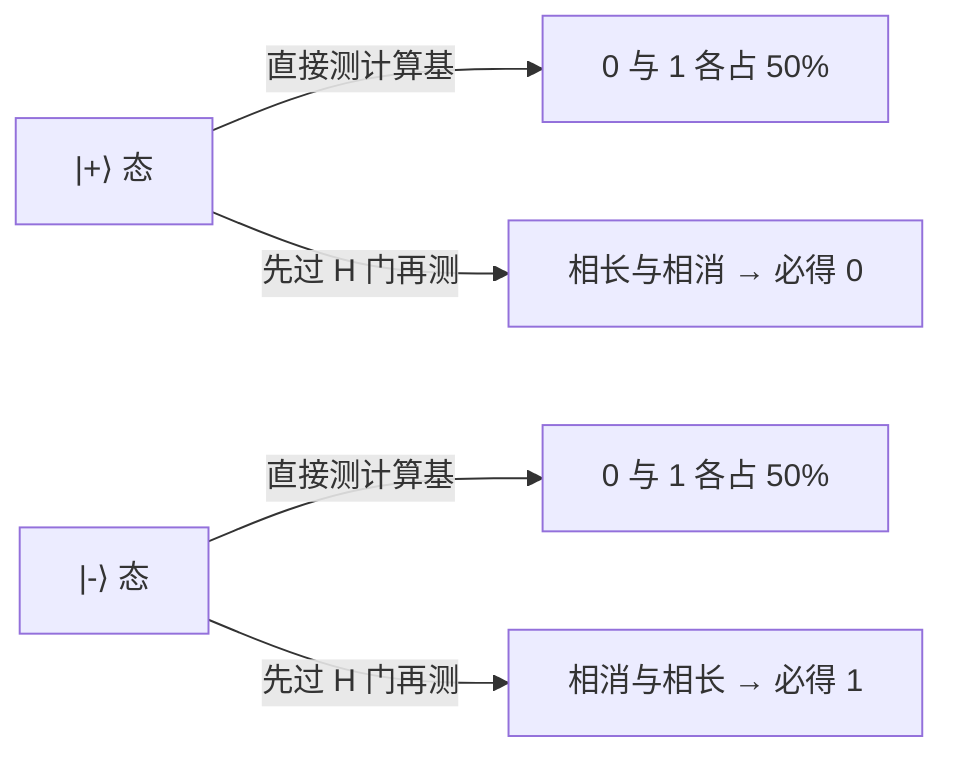
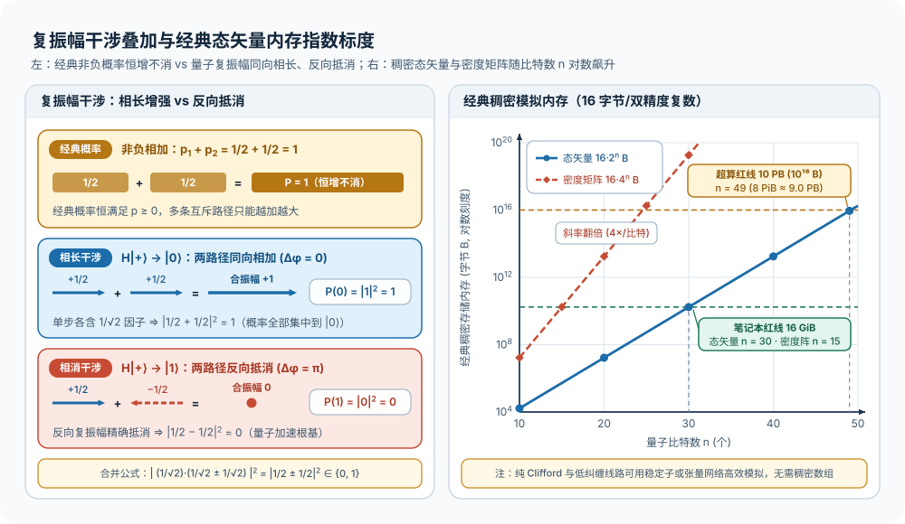

# 00｜全景：量子计算是什么，又不是什么

翻开一本讲量子计算的书，最容易让人打退堂鼓的，往往不是公式本身，而是满天飞的夸张说法——一会儿说它“能同时试遍宇宙里所有答案”，一会儿又说它“很快就会把全世界的密码一键清空”。这一章先把这些迷雾吹散，给你画一张全书的真实地图。

你不需要任何量子力学背景。如果线性代数和概率论也已经生疏，第一遍可以先专心读第 1–4 节，弄懂“量子计算在量子科技中占什么位置、量子比特究竟靠什么工作、一次实验怎样从头跑到尾”；第 5–7 节的表格先混个眼熟，后面学到算法、硬件和密码章节时再随时回头对照；第 8 节则汇总了三大常见误区与全书 26 章五篇学习地图。动笔前也可以花十分钟做一遍[七道先修自测](appendices/prerequisites.md)，遇到复数、矩阵乘法或概率计算时随时翻到[第 01 章：数学工具](01-math.md)补齐。

---

## 1. 一次量子计算到底长什么样，它在量子科技中占什么位置

一句话说清：**量子计算是以量子态承载信息、以物理规律允许的量子演化处理信息、再通过测量读出经典结果的一类计算模型。**

它并非把你桌上的电脑芯片简单“提频做快”，其核心在于换了一套运算法则。面对某些带有特定数学结构的问题（比如寻找大数周期或模拟微观分子），这套法则能走出经典电脑走不通的捷径；而面对写文档、刷网页、查数据库这类日常工作，截至 2026 年，学术界还没有发现量子计算比普通电脑更有优势的地方。

在深入细节之前，先把镜头拉远，看看一台量子设备完成一项完整任务必须走过的五个环节：

箭头表示前一环节的输出交给下一环节继续处理。请留意起点和终点：**我们手里拿的是经典数据，最后要的也是经典答案**，而不是实验台上看不见摸不着的“量子态”。如果只盯着中间的量子线路看，很容易漏掉前面把数据装进去、中间做编译与纠错、后面反复采样再做经典验证的全部账单。第 4 节会把这条五环节链条缩成一道拿笔就能算完的单比特实验。

### 1.1 量子科技的“三大支柱”全景：计算、通信与传感

2025 年是联合国确立的“国际量子科学与技术年（IYQ 2025）”，纪念现代量子力学诞生百年（1925–2025）。很多新闻把所有带“量子”二字的新技术统统混作一谈，其实整个量子科技领域由**三大支柱**并立构成：

1. **量子计算（算力支柱）**：利用可控多比特的叠加、纠缠与干涉求解特定数学与物理难题，目标是从近期含噪原型逐步迈向容错量子计算机；
2. **量子通信与量子密码（安全与网络支柱）**：利用量子态不可克隆与纠缠分发特性，在光纤或卫星链路上建立量子密钥分发（QKD）与量子网络，并与运行在普通经典设备上的后量子密码（PQC）形成互补；
3. **量子传感与精密测量（灵敏探测支柱）**：反其道而行之——量子比特对外界电磁场、引力与时间变化极其敏感，在计算里是棘手的噪声，在测量里却成了天然的高精度探针。

请特别记住一条常被科普漏掉的事实：**在三大支柱中，量子传感与精密测量是目前商业与工程成熟度最高的一支。** 原子钟早已是全球卫星导航与通信授时的心脏，冷原子重力仪、金刚石氮空位（NV）色心纳米磁力计、无 GPS 惯性导航、脑磁成像以及引力波天文台（如 LIGO）使用的光学压缩态降噪，都已经从实验室走向真实工程应用。把三者一次分清，就不会把原子钟、QKD 专线和通用容错量子计算机混为一谈：

| 支柱方向 | 核心物理资源 | 解决的关键任务 | 当前工程成熟度 | 代表系统与应用 | 本书对应章节 |
| :--- | :--- | :--- | :--- | :--- | :--- |
| **量子计算** | 可控多比特干涉、纠缠与量子纠错 | 特定结构算法、量子多体模拟、密码分析 | 早期纠错演示与超算异构协同阶段 | 超导、离子阱、中性原子、光子、硅自旋处理器 | 第 02–11、14–19 章与[第 21 章](21-stabilizer-classical-simulation.md) |
| **量子通信与密码** | 单光子态不可克隆性、纠缠分发与中继 | 物理层密钥分发（QKD）、分布式量子互连 | 城域光纤与星地骨干链路已演示，长程中继在研 | BB84/E91 链路、星地量子网络（经典防御见 PQC） | [第 12 章](12-security-network-frontiers.md)、[第 18 章](18-channels-capacities-complexity.md) |
| **量子传感与精密测量** | 相干相位累积、自旋压缩与光学压缩态 | 时间频率基准、微弱磁场/重力/位移精密探测 | **三者中商业成熟度最高**，多类器件已进入实用 | 光学晶格钟、NV 色心磁力计、原子重力仪、压缩光干涉仪 | [第 20 章](20-quantum-sensing-metrology.md) |

（注：上表仅按三大应用支柱归类；支撑全部方向的公共数学、物理与信息论基石——即本章 `00`、[第 01 章](01-math.md)、[物理篇 Q1–Q4](quantum-mechanics/README.md)与[第 13 章：量子信息量度](13-quantum-information.md)——贯穿三条主线，详见第 8.1 节的 26 章学习地图。）

---

## 2. 比特、随机比特与量子比特：差距藏在“能相消”里

要真正看懂量子计算为什么与众不同，最好不要直接跳进玄妙的物理名词，而是走三步台阶：**确定比特 → 经典随机比特 → 量子比特**。

### 2.1 从非负概率到复数振幅

**第一级：确定经典比特。** 它只有 `0` 和 `1` 两种状态，像一盏要么关、要么开的台灯。

**第二级：经典随机比特。** 假设我们抛出一枚硬币，落地后用手盖住。它处于 `0` 的概率是 $p_0$，处于 `1` 的概率是 $p_1$，可以排成一个二维列向量：

$$
p = \begin{bmatrix}p_0 \\ p_1\end{bmatrix}, \qquad p_0, p_1 \in \mathbb{R}, \qquad p_0 \ge 0,\; p_1 \ge 0, \qquad p_0 + p_1 = 1.
$$

例如一枚公平硬币就是 $\begin{bmatrix}1/2 \\ 1/2\end{bmatrix}$。请记住经典概率的一条死规矩：**每一项都是非负实数**。如果通往结果 `0` 有两条路，总概率只能越加越大，永远不会出现“两条路互相抵消变成零”的事。

**第三级：量子比特（qubit）。** 自然界在微观尺度上改写了一条规则——描述状态的不再是非负概率，而是可以带正负号、甚至可以是复数的**概率振幅**（probability amplitude）。单个量子比特的纯态是二维复向量空间 $\mathbb{C}^2$ 中的单位列向量，记为

$$
|\psi\rangle = \alpha|0\rangle + \beta|1\rangle = \begin{bmatrix}\alpha \\ \beta\end{bmatrix},
\qquad \alpha, \beta \in \mathbb{C},
\qquad |\alpha|^2 + |\beta|^2 = 1.
$$

先认识里面的每一个符号：

- $|0\rangle = \begin{bmatrix}1 \\ 0\end{bmatrix}$ 与 $|1\rangle = \begin{bmatrix}0 \\ 1\end{bmatrix}$ 是两个最基本的参考状态，合称**计算基（computational basis）**，可以类比经典里的 `0` 和 `1`。
- 竖线和尖括号 $|\psi\rangle$ 是物理学里给列向量起名字的记法（狄拉克记号），里面的 $\psi$ 只是状态的名字。
- $|\alpha|^2$ 表示复数的**模平方**（实部的平方加上虚部的平方），**不是**直接把复数平方。例如取复数 $\alpha = \frac{1+i}{2}$（其中虚数单位 $i$ 满足 $i^2 = -1$，详见[第 01 章第 1 节](01-math.md#1-复数把旋转和缩放装进一个数)），实部与虚部都是 $\frac{1}{2}$，所以它的模平方为

$$
\left|\frac{1+i}{2}\right|^2 = \left(\frac{1}{2}\right)^2 + \left(\frac{1}{2}\right)^2 = \frac{1}{4} + \frac{1}{4} = \frac{1}{2},
$$

而误把复数直接平方会算出 $\left(\frac{1+i}{2}\right)^2 = \frac{1 + 2i + i^2}{4} = \frac{i}{2}$，连实数都不是，绝不能充当概率。
- **测量规则（Born 规则）**：在计算基下测量 $|\psi\rangle$，读出 `0` 的概率是 $|\alpha|^2$，读出 `1` 的概率是 $|\beta|^2$。约束条件 $|\alpha|^2 + |\beta|^2 = 1$ 称为**归一化条件**，保证两种结果的概率加起来恰好等于 $1$。

把第二级和第三级放在一起对照，整个量子计算的数学门槛其实就差这一个范数台阶：

- **经典随机演化（$\ell_1$ 范数）**：状态由非负概率向量 $p$ 描述，每一步靠**列随机矩阵**（元素全非负、每列之和为 $1$）演化，守恒概率之和 $\sum_j p_j = 1$（即 1-范数）。因为所有转移权重都非负，可逆操作只剩下干巴巴的置换（例如 `0` 与 `1` 互换），不可能先可逆地拆成五五开、再可逆地合回确定的 `0`。
- **量子封闭演化（$\ell_2$ 范数）**：状态由复振幅向量 $|\psi\rangle$ 描述，每一步靠**酉矩阵**（保持向量长度不变的可逆复矩阵，见[第 01 章第 4 节](01-math.md#4-矩阵与量子算符从线性变换到酉门厄米算符)）演化，守恒模平方之和 $\sum_j |\alpha_j|^2 = 1$（即 2-范数平方）。正因为允许负号与复相位，**多条路径汇合时先加减复振幅、最后测量才取模平方**，两条同样强劲的路径就能一正一负抵消为零——这就是**量子干涉**的源头。

### 2.2 常见生活类比与失效边界

刚接触量子比特时，科普文章里常有几种流传很广的比方。它们能帮你在三十秒内抓住一点轮廓，但只要稍微往前多走一步，大部分比方就会露馅。下面这张表把它们的好用之处和失效边界一次标清：

| 常见类比 | 能帮你秒懂什么（有效区） | 走到哪一步会失效（误区边界） | 更靠谱的心智图像 |
| :--- | :--- | :--- | :--- |
| **盖住的硬币 / 旋转中的硬币** | 测量前结果不确定，读出来只能是 `0` 或 `1` | 盖住的硬币只是人不知道结果，状态早已确定；旋转硬币依然服从经典力学，没有负号或相位相消，永远无法把两个“50/50”的态区分开 | 改用下面“费曼小箭头”理解可相消的振幅 |
| **水波或声波干涉** | 波峰遇波峰增强（相长）、波峰遇波谷抵消（相消） | 量子振幅不是三维空间里晃动的液体；测量也不会读出“半个 `0` 加半个 `1`”，而是按模平方概率抽中一个离散结果 | 定义在抽象复向量空间里的波状加减法 |
| **“量子并行 / 同时试遍所有答案”** | 勉强提示 $n$ 个量子比特包含 $2^n$ 个基态分量 | **最容易误导人**：测量只能吐出一个经典串；把所有候选答案均匀叠加后直接去测，只会随机抽中一个，不比盲猜强 | 利用问题结构编排干涉：抵消错路、抬高对路 |
| **“有心灵感应的一对纠缠骰子”** | 两个粒子分开后，联合测量仍存在强关联 | **不能超光速传信**：任一端单独看自己都只是完全随机的 `0/1`；也不同于提前装盒的一双左右手套，因为换角度测量会展现出经典预配对解释不了的关联 | 整体不可拆分的联合态，须靠经典通信比对才能看见关联 |
| **费曼“小箭头 / 跑表指针”** | **最接近数学真相的画面**：箭头长度代表模 $r$，指向角度代表相位 $\theta$；多条路径首尾相接相加，反向抵消，总长度的平方就是概率 | 粒子内部并没有装一块物理小机械表；平面小箭头只是复数 $r e^{i\theta}$ 的几何画法，不能直接拿它替代三维 Bloch 球 | 无缝衔接[第 01 章：数学工具](01-math.md)的复平面几何 |

如果你打算只记住一个直觉画面，就记住**费曼小箭头**（来自物理学家 Richard Feynman 的科普名著 *QED*）：给每条路径画一根带长度和方向的小箭头，汇合时把箭头首尾相连拼起来，反向的两个等长箭头就会拼回原点、彻底消失；最后量一下总箭头有多长，把长度平方就是概率。

### 2.3 亲手摸到相对相位：$|+\rangle$ 与 $|-\rangle$ 经 $H$ 门干涉

口说无凭，现在拿草稿纸一步步算全书第一个关键算例。

先看两个单量子比特纯态：

$$
|+\rangle = \frac{|0\rangle + |1\rangle}{\sqrt{2}} = \frac{1}{\sqrt{2}}\begin{bmatrix}1 \\ 1\end{bmatrix},
\qquad
|-\rangle = \frac{|0\rangle - |1\rangle}{\sqrt{2}} = \frac{1}{\sqrt{2}}\begin{bmatrix}1 \\ -1\end{bmatrix}.
$$

如果直接对它们在计算基下测量，各自的振幅与概率是多少？逐项算一遍：

- 对 $|+\rangle$：结果 `0` 的振幅是 $\frac{1}{\sqrt{2}}$，概率为 $\left|\frac{1}{\sqrt{2}}\right|^2 = \frac{1}{2}$；结果 `1` 的振幅是 $\frac{1}{\sqrt{2}}$，概率为 $\left|\frac{1}{\sqrt{2}}\right|^2 = \frac{1}{2}$。两者相加：$\frac{1}{2} + \frac{1}{2} = 1$。
- 对 $|-\rangle$：结果 `0` 的振幅是 $\frac{1}{\sqrt{2}}$，概率为 $\left|\frac{1}{\sqrt{2}}\right|^2 = \frac{1}{2}$；结果 `1` 的振幅是 $-\frac{1}{\sqrt{2}}$，概率为 $\left|-\frac{1}{\sqrt{2}}\right|^2 = \frac{1}{2}$。两者相加：$\frac{1}{2} + \frac{1}{2} = 1$。

从计算基直接测，$|+\rangle$ 和 $|-\rangle$ 看起来都像“正反各一半的公平硬币”。它们唯一的差别，在于 $|1\rangle$ 前面一个是正号、一个是负号——这两个分量之间的符号（或角度）差别，叫做**相对相位（relative phase）**。

如果这是两枚经典公平硬币，哪怕再把它们各自抛一次（相当于用列随机转移矩阵 $\begin{bmatrix}1/2 & 1/2 \\ 1/2 & 1/2\end{bmatrix}$ 乘以 $\begin{bmatrix}1/2 \\ 1/2\end{bmatrix}$），得到的仍然是 $\begin{bmatrix}1/2 \\ 1/2\end{bmatrix}$，随机性绝不会自己变回确定结果。

现在换成量子操作：让 $|+\rangle$ 和 $|-\rangle$ 各自穿过同一个 **Hadamard 门（简称 $H$ 门）**。$H$ 门是一个 $2\times 2$ 矩阵：

$$
H = \frac{1}{\sqrt{2}}\begin{bmatrix}1 & 1 \\ 1 & -1\end{bmatrix}.
$$

如果暂时还不熟悉矩阵乘法，可以先把它当成一条两行规则：输入列向量 $\begin{bmatrix}a \\ b\end{bmatrix}$ 后，输出的上分量等于 $\frac{1}{\sqrt{2}}(1\cdot a + 1\cdot b)$，下分量等于 $\frac{1}{\sqrt{2}}(1\cdot a + (-1)\cdot b)$。完整的矩阵乘法法则会在[第 01 章：数学工具](01-math.md)从头讲起。

**先算 $H|+\rangle$**（注意先把前面的两个常数相乘：$\frac{1}{\sqrt{2}} \times \frac{1}{\sqrt{2}} = \frac{1}{2}$）：

$$
\begin{aligned}
H|+\rangle
&= \left(\frac{1}{\sqrt{2}}\begin{bmatrix}1 & 1 \\ 1 & -1\end{bmatrix}\right)
   \left(\frac{1}{\sqrt{2}}\begin{bmatrix}1 \\ 1\end{bmatrix}\right) \\
&= \frac{1}{2}\begin{bmatrix}1\cdot 1 + 1\cdot 1 \\ 1\cdot 1 + (-1)\cdot 1\end{bmatrix} \\
&= \frac{1}{2}\begin{bmatrix}1 + 1 \\ 1 - 1\end{bmatrix}
= \frac{1}{2}\begin{bmatrix}2 \\ 0\end{bmatrix}
= \begin{bmatrix}1 \\ 0\end{bmatrix}
= |0\rangle.
\end{aligned}
$$

核验输出概率：$P(0) = |1|^2 = 1$，$P(1) = |0|^2 = 0$，概率和为 $1 + 0 = 1$。用费曼小箭头看，通往 `0` 的两条路径各贡献 $+\frac{1}{2}$（同向相加成 $1$，**相长干涉**），通往 `1` 的两条路径贡献 $+\frac{1}{2}$ 和 $-\frac{1}{2}$（反向抵消成 $0$，**相消干涉**）。

**再算 $H|-\rangle$**：

$$
\begin{aligned}
H|-\rangle
&= \left(\frac{1}{\sqrt{2}}\begin{bmatrix}1 & 1 \\ 1 & -1\end{bmatrix}\right)
   \left(\frac{1}{\sqrt{2}}\begin{bmatrix}1 \\ -1\end{bmatrix}\right) \\
&= \frac{1}{2}\begin{bmatrix}1\cdot 1 + 1\cdot(-1) \\ 1\cdot 1 + (-1)\cdot(-1)\end{bmatrix} \\
&= \frac{1}{2}\begin{bmatrix}1 - 1 \\ 1 + 1\end{bmatrix}
= \frac{1}{2}\begin{bmatrix}0 \\ 2\end{bmatrix}
= \begin{bmatrix}0 \\ 1\end{bmatrix}
= |1\rangle.
\end{aligned}
$$

核验输出概率：$P(0) = |0|^2 = 0$，$P(1) = |1|^2 = 1$，概率和为 $0 + 1 = 1$。这一次正好反过来：通往 `0` 的两条路径一正一负抵消成 $0$，通往 `1` 的两条路径同号相加成 $1$！

请停下来回味这两行算式。刚才还完全分不清的“两个 50/50 态”，经过同一道门后，一个百分之百变成 `0`，另一个百分之百变成 `1`。这就彻底说明：**只给出一组固定测量基下的概率表，根本不足以完整描述一个量子态；隐藏在振幅里的相对相位，是实实在在能改变实验结果的物理信息。**

---

## 3. 叠加、纠缠、干涉与“指数空间”的真相

搞懂单比特里的振幅和相位之后，把多个量子比特放在一起，量子计算的三大核心结构就齐了。

### 3.1 叠加（Superposition）

叠加指的是像 $\alpha|0\rangle + \beta|1\rangle$ 这样的复线性组合。它与经典概率混合的根本区别就在上面算过的例子里：经典混合只是“其实已经落在 `0` 或 `1` 上了，只不过我们不知道”，而量子叠加保留着各分量之间的相对相位，只要换一道后续门操作，就能发生相长和相消干涉。

### 3.2 纠缠（Entanglement）

如果有两个量子比特，全书统一采用**高位在左**的写法（大端序），四个联合计算基依次是 $|00\rangle, |01\rangle, |10\rangle, |11\rangle$，分别对应四维列向量 $[1,0,0,0]^T$ 到 $[0,0,0,1]^T$（右上角 $T$ 表示把横排数字立起来写成列向量；左侧数字表示第一个比特，右侧数字表示第二个比特）。

当联合纯态能写成“第一个比特的状态 $\otimes$ 第二个比特的状态”，也就是 $(a_0|0\rangle + a_1|1\rangle) \otimes (b_0|0\rangle + b_1|1\rangle)$ 时，两个比特彼此独立（符号 $\otimes$ 表示组合子系统的**张量积**，详见[第 01 章第 7 节](01-math.md#7-张量积多比特系统的印章分块法则)）。展开后四个系数 $a_0 b_0,\; a_0 b_1,\; a_1 b_0,\; a_1 b_1$ 必定互相牵制。

然而最著名的双比特 **Bell 态**

$$
|\Phi^+\rangle = \frac{|00\rangle + |11\rangle}{\sqrt{2}} = \frac{1}{\sqrt{2}}\begin{bmatrix}1 \\ 0 \\ 0 \\ 1\end{bmatrix}
$$

却无法拆成任何一对单比特态的乘积（首尾两项非零迫使四个单比特振幅 $a_0, a_1, b_0, b_1$ 全不为零，从而中间两项 $a_0 b_1, a_1 b_0$ 必非零，与中间两项为零矛盾；完整代数反证见[第 01 章第 7.3 节](01-math.md)与[第 03 章](03-multiple-qubits.md)）。这种无法拆分为独立单比特乘积的联合量子态，就叫做**纠缠态**。

纠缠态在合适设计的测量角度下，能展现出任何局域经典随机共享都无法复现的强关联（[第 03 章：多量子比特与纠缠](03-multiple-qubits.md)会用一场双人合作游戏把约 $85.4\%$（精确约 $85.36\%$）对 $75\%$ 的量子胜率一步步算出来）。但请放心，纠缠并不破坏相对论的因果律：如果你和朋友各拿 $|\Phi^+\rangle$ 中的一个比特，不论朋友那边测不测、怎么测，你单独测自己手里的比特，看到 `0` 和 `1` 的概率始终各占一半；只有事后通过电话或网络把两边记录合在一起比对，才会惊叹“居然次次对得上”。

### 3.3 干涉（Interference）

把 $n$ 个量子比特连在一起，计算基标签共有 $2^n$ 种——比如 $3$ 个比特有 $2^3 = 8$ 种组合（`000` 到 `111`），联合纯态就有 $2^n$ 个复振幅。

可是前面已经看到：**一次计算基测量，只能按模平方概率交出一个 $n$ 位的经典 `0/1` 字符串**，绝不会把全部 $2^n$ 个振幅打印给你——这正是科普里常说的“量子并行”最容易漏讲的一半。所以量子算法设计的真功夫，在于利用具体问题背后的对称性、周期性或矩阵结构，精心编排门序列，让通往错误答案的大量路径彼此相消、通往正确答案的路径彼此相长，把正确结果的测量概率抬高到一眼就能采出来的程度，而绝非“先构造均匀叠加把所有答案算一遍再读出来”。

### 3.4 指数级振幅意味着什么：一张经典模拟内存账单

常听人说“$n$ 个量子比特的状态空间是指数级的，普通电脑模拟不动”。这笔账到底有多大？让我们用具体字节数算清楚。

假设普通电脑用最直接的办法——把全部振幅逐个放进数组里（称为**稠密表示**）。每个双精度复数由实部和虚部两个 8 字节（byte）浮点数构成，共占 **16 字节**。

- 对于 $n$ 比特的纯态矢量，共有 $2^n$ 个复数，仅保存振幅数组就需要

$$
M_{\mathrm{ket}} = 16 \times 2^n\ \mathrm{byte}.
$$

- 如果还要在[第 05 章：噪声与量子信道](05-noise-channels.md)里直接保存含噪声的通用密度矩阵（一个 $2^n \times 2^n$ 的方阵，共有 $4^n = 2^{2n}$ 个复数），则仅矩阵本身就需要

$$
M_{\rho} = 16 \times 4^n\ \mathrm{byte}.
$$

把具体的比特数代进去看看（这里使用二进制单位：$1\ \mathrm{KiB} = 2^{10}\ \mathrm{byte}$、$1\ \mathrm{MiB} = 2^{20}\ \mathrm{byte}$、$1\ \mathrm{GiB} = 2^{30}\ \mathrm{byte}$、$1\ \mathrm{TiB} = 2^{40}\ \mathrm{byte}$、$1\ \mathrm{EiB} = 2^{60}\ \mathrm{byte}$，与硬盘标称的十进制 MB/GB 不同）：

| 量子比特数 $n$ | 计算基总数 $2^n$ | 稠密态矢量内存 $M_{\mathrm{ket}}$ | 稠密密度矩阵内存 $M_{\rho}$ |
|---:|---:|---:|---:|
| 10 | $1{,}024$ | $16 \times 2^{10}\ \mathrm{byte} = 16\ \mathrm{KiB}$ | $16 \times 2^{20}\ \mathrm{byte} = 16\ \mathrm{MiB}$ |
| 20 | $1{,}048{,}576$ | $16 \times 2^{20}\ \mathrm{byte} = 16\ \mathrm{MiB}$ | $16 \times 2^{40}\ \mathrm{byte} = 16\ \mathrm{TiB}$ |
| 30 | $1{,}073{,}741{,}824$ | $16 \times 2^{30}\ \mathrm{byte} = 16\ \mathrm{GiB}$ | $16 \times 2^{60}\ \mathrm{byte} = 16\ \mathrm{EiB}$ |

> **随手算一笔**：从 $20$ 比特只多加 $2$ 个比特变成 $22$ 比特，内存会涨多少倍？
>
> - 稠密态矢量：$\frac{2^{22}}{2^{20}} = 2^2 = 4$ 倍，从 $16\ \mathrm{MiB}$ 变成 $64\ \mathrm{MiB}$；
> - 稠密密度矩阵：$\frac{4^{22}}{4^{20}} = 4^2 = 16$ 倍，从 $16\ \mathrm{TiB}$ 猛涨到 $256\ \mathrm{TiB}$。
>
> 到了 $40$ 比特，光是存一条稠密态矢量就需要 $16 \times 2^{40}\ \mathrm{byte} = 16\ \mathrm{TiB}$，这还没算门运算时的临时缓冲区。

上面这张双联图把本章最核心的两条物理与算力边界放在同一张纸上：左联对照经典非负概率的“恒增不消”与量子复振幅小箭头的“相长增强、反向抵消”；右联按对数纵轴绘出稠密态矢量 $M_{\mathrm{ket}} = 16\times 2^n$ 与稠密密度矩阵 $M_{\rho} = 16\times 4^n$ 随比特数 $n$ 飙升的直线斜率，直观标出桌面内存（二进制 $\mathrm{GiB}$）与超算内存红线（换算参考：$16\times 2^{49}\ \mathrm{byte} = 8\ \mathrm{PiB} \approx 9.01\ \mathrm{PB}$，其中 $1\ \mathrm{PB} = 10^{15}\ \mathrm{byte}$ 为十进制标称单位）。（可打开[原尺寸复振幅干涉与内存标度对比图](assets/v3-00-amplitude-vs-memory.svg)清晰查看坐标刻度与标注。）

看着这张惊人的内存账单，一定要同时记住两件冷静的事实：

1. **这是经典逐格存储的开销，不是量子机向你交付的数据量。** 30 个量子比特的态矢量在普通电脑里要占 $16\ \mathrm{GiB}$，不代表一台 30 比特量子计算机运行一次就能吐出 $16\ \mathrm{GiB}$ 的信息；测完一次，你拿到的依然只是一个 30 位的经典比特串。
2. **不是所有多比特线路都需要硬存整张稠密表。** 举个直观例子：从初态 $|00\rangle$ 出发，先对左比特做 $H$ 门得到 $\frac{|00\rangle+|10\rangle}{\sqrt{2}}$，再以左比特控制右比特做受控非门（$\mathrm{CNOT}$，左位为 `1` 时翻转右位），就得到 Bell 态 $\frac{|00\rangle+|11\rangle}{\sqrt{2}}$。如果一条线路**从计算基初态（或一般稳定子态）出发、仅由 $H$、相位门 $S$（只给 $|1\rangle$ 分量乘上虚数 $i$）和 $\mathrm{CNOT}$ 这类 Clifford 门组成，且只在计算基（或 Pauli 基）测量（允许经典前馈）**，即便扩展到几千个量子比特，经典电脑也能改用紧凑的“稳定子表示”在毫秒内精确模拟，根本不需要申请 $2^n$ 大小的数组（这就是 Gottesman–Knill 定理；若输入换成了非 Clifford 魔法态 $|T\rangle$，纯 Clifford 线路也能实现通用量子计算，上述高效模拟便不再成立）。同样，纠缠度受限的线路也能用张量网络高效压缩，强噪声线路还可被 Pauli 传播大幅剪枝（详见[第 04 章](04-circuits-protocols.md)与[第 21 章：稳定子形式与经典模拟引擎](21-stabilizer-classical-simulation.md)）。因此，“稠密态矢量塞不进内存”本身，并不能直接当成量子加速的证明。

---

## 4. 一个从头到尾的最小实验：产生随机比特

回到第 1 节画出的五环节流程图，趁热打铁走完一次最迷你的端到端量子实验：用 1 个量子比特生成随机比特，把刚才学到的振幅、门变换与真实有限采样连成闭环。

### 第 1 步：制备初态 $|0\rangle$

把单个量子比特初始化到计算基态 $|0\rangle = \begin{bmatrix}1 \\ 0\end{bmatrix}$。在真实硬件上，这一步远非在纸上写一个记号，必须通过冷却或主动复位把物理系统尽量拉回基态；如果复位不彻底，起点就会带入偏差。

### 第 2 步：施加 Hadamard 门 $H$

用 $2\times 2$ 矩阵 $H$ 乘以初态列向量 $|0\rangle$，逐行展开：

$$
H|0\rangle
= \frac{1}{\sqrt{2}}\begin{bmatrix}1 & 1 \\ 1 & -1\end{bmatrix}\begin{bmatrix}1 \\ 0\end{bmatrix}
= \frac{1}{\sqrt{2}}\begin{bmatrix}1\cdot 1 + 1\cdot 0 \\ 1\cdot 1 + (-1)\cdot 0\end{bmatrix}
= \frac{1}{\sqrt{2}}\begin{bmatrix}1 \\ 1\end{bmatrix}
= |+\rangle.
$$

### 第 3 步：在计算基下测量

输出列向量的上、下两个分量分别对应结果 `0` 和 `1` 的振幅，均为 $\frac{1}{\sqrt{2}}$。按 Born 规则逐项取模平方：

$$
P(0) = \left|\frac{1}{\sqrt{2}}\right|^2 = \frac{1}{2},
\qquad
P(1) = \left|\frac{1}{\sqrt{2}}\right|^2 = \frac{1}{2}.
$$

检查总概率：$P(0) + P(1) = \frac{1}{2} + \frac{1}{2} = 1$，完全自洽。

### 第 4 步：重复采样 1000 次——理想概率与有限样本波动

很多初学者会自然地想：“既然理论概率是各一半，那独立重复跑 $N = 1000$ 次，是不是应该刚好得到 $500$ 个 `0` 和 $500$ 个 `1`？要是跑出来 `520:480`，是不是设备出毛病了？”

我们直接算清楚。设 $K$ 是 $1000$ 次独立实验中测得 `1` 的总次数（服从二项分布 $B(1000,\, 1/2)$；本书在一般事件概率处亦记作 $\Pr(\cdot)$）：

1. **期望次数**：$\mathbb{E}[K] = Np = 1000 \times \frac{1}{2} = 500$ 次。
2. **恰好命中 500 对 500 的精确概率**：从 $1000$ 轮里挑出 $500$ 轮为 `1` 有 $\binom{1000}{500}$ 种排法，每一种具体的千位序列出现概率都是 $(1/2)^{1000} = 2^{-1000}$，因此

$$
\Pr(K = 500) = \binom{1000}{500} 2^{-1000} \approx 0.025225 \quad (\text{约 } 2.52\%).
$$

原来哪怕是一台理想无噪的完美量子比特，每做 $100$ 批千次实验，也平均只有两三批刚好落在 `500:500`！“最可能出现的单个数字是 500”和“几乎每次都会恰好等于 500”，完全是两回事。

3. **正常的统计波动范围**：计数的标准差为

$$
\sigma_K = \sqrt{Np(1-p)} = \sqrt{1000 \times \frac{1}{2} \times \frac{1}{2}} = \sqrt{250} \approx 15.81\ \text{次}.
$$

换算成经验频率 $\hat{p} = K / 1000$，频率标准差为 $\sigma_{\hat{p}} = \sigma_K / 1000 \approx 0.01581$（约 $1.58$ 个百分点）。精确累加二项分布概率可知，$K$ 落在 $[469,\, 531]$（约 $500 \pm 2\sigma_K$）内的概率约为 $95.37\%$。因此，测出 `520:480`（偏离期望 $20$ 次，约 $1.26\sigma_K$）属于再正常不过的随机涨落，单凭这组数字不能断定硬件出了问题。

若不借助正态近似，改用有限样本的 Hoeffding 不等式，可解出 $N = 1000$ 时更保守的 $95\%$ 频率误差半径约 $0.043$，且该半径按 $1/\sqrt{N}$ 衰减——也就是说，**想把统计误差压低一个数量级，采样次数必须暴涨一百倍**（完整推导与可运行数值核验见[基础实验册 F00](labs/foundations.md#f001000-次测量为何很少恰好对半)）。

### 第 5 步：真实实验里容易忽略的两件事

走到最后一步，记住两条经常让实验报告踩坑的现实提醒：

1. **“500:500”的总数表，证明不了独立随机性**。机械交替的确定序列 `010101…` 有完美的 `500:500` 比例，却毫无不可预测性；而一个只独立抽取 $10$ 个随机比特、再把每个比特各复制 $100$ 遍拼成千行日志的故障程序，不仅同样可能凑出 `500:500`，其真实频率标准差还比真正独立 $1000$ 次大出整整 **10 倍**。因此这个单比特示例是教学实验，不能直接充当密码级随机数发生器；安全熵源检验（如 NIST SP 800-90B）必须保留时间顺序并排查前后相关性与漂移（块相关反例推导与验证脚本见[基础实验册](labs/foundations.md)与[第 15 章](15-practice-research.md)）。
2. **校准与留出验证也要算进总账**。如果物理探测器把真 $|1\rangle$ 错读成 `0` 的概率高于把真 $|0\rangle$ 错读成 `1`，即使量子态本身很准确，采样比例也会出现系统偏移。此时必须额外投入采样预算标定读出混淆矩阵，并用独立的留出批次检验修正效果（矩阵求逆与误差放大机制见[第 01 章第 6.4 节](01-math.md)与[第 15 章](15-practice-research.md)）。

---

## 5. 量子计算能在哪些地方加速，又靠什么衡量“更快”

既然必须利用问题结构来编排干涉，那么哪些结构真的能带来量子优势？下面这张**问题地图**先把全书后面会学到的主要算法家族排好队。表中 $N$ 表示候选项个数或矩阵维数；$O(\sqrt{N})$ 表示规模变大时，抽象步骤数至多按常数倍的 $\sqrt{N}$ 增长。

| 问题结构 | 代表方法 | 已知理论优势 | 现实中的关键门槛 |
| :--- | :--- | :--- | :--- |
| 整数分解、离散对数 | Shor 算法 | 在理想容错模型下将亚指数难度降为关于位数 $n$ 的多项式时间 | 需要大量高质量逻辑比特与极低逻辑错误率 |
| 无结构搜索 | Grover / 振幅放大 | 黑箱（预言机）查询模型下，寻找唯一目标的查询次数从 $O(N)$ 降到 $O(\sqrt{N})$ | 仅为平方加速而非指数加速；每次查询内部电路的成本也必须算上 |
| 量子系统动力学 | 哈密顿量模拟 | 对稀疏或局域相互作用体系，资源随系统规模与精度多项式增长 | 复杂初态制备与目标物理量读出可能成为瓶颈 |
| 线性代数子程序 | HHL 类与 QSVT | 在严格条件下，对矩阵维数 $N$ 的依赖可降为关于 $\log_2 N$ 的多项式级别 | 要求矩阵稀疏或可高效装载、条件数受控；只输出解态或其统计量，不打印整个解向量 |
| 组合优化 | QAOA、量子退火 | 活跃的算法与硬件研究方向，通用实际优势尚未确立 | 需要与高度成熟的经典启发式求解器在同一预算下公平对比 |
| 量子化学基态能量 | 相位估计（QPE）、VQE、基于采样的量子对角化（SQD） | 容错 QPE 路径清晰；近期设备侧重小规模变分或混合采样探索 | 化学精度要求高，基组映射、纠错深度与测量次数开销巨大 |

### 一次查询不等于一纳秒：算一笔交叉点账

上表“无结构搜索”一行提到的**预言机**（oracle，即黑箱查询），是算法理论里把“检查某个候选答案合不合格”打包成一次抽象调用的记账方式。比如在 $N = 10^6$（一百万）个无序编号中找唯一目标：经典逐个排查最坏要查 $10^6$ 次，而 Grover 算法只需要约 $\sqrt{10^6} = 1000$ 次查询。

听起来快了一千倍，对吗？别急，拿真实时间算一笔小学生都能看懂的账：

- 假设普通电脑每秒能做十亿次检查，单次检查耗时 $1\ \mathrm{ns} = 10^{-9}\ \mathrm{s}$，最坏耗时为 $T_{\mathrm{cl}}(N) = 10^{-9} N\ \mathrm{s}$。
- 假设一台容错量子计算机每次预言机调用内部需要编译成成千上万个逻辑门，加上纠错循环，单次调用耗时 $1\ \mathrm{ms} = 10^{-3}\ \mathrm{s}$（比经典慢 $10^6$ 倍），总耗时约 $T_{\mathrm{q}}(N) = 10^{-3}\sqrt{N}\ \mathrm{s}$。

把 $N = 10^6$ 代进去看看：经典计算机只需 $10^{-9} \times 10^6 = 10^{-3}\ \mathrm{s} = 1\ \mathrm{ms}$，而这台量子计算机要花 $10^{-3} \times 10^3 = 1\ \mathrm{s}$——**反而慢了一千倍！**

那规模 $N$ 要大到多少，量子才真正追平经典？解一个简单的不等式：

$$
10^{-3}\sqrt{N} \le 10^{-9}N
\implies 10^6 \le \sqrt{N}
\implies N \ge 10^{12}.
$$

在交叉点 $N = 10^{12}$ 处，两边耗时都是 $1000\ \mathrm{s}$；只有当问题规模超过一万亿，平方加速才开始在墙钟时间上跑赢经典。为看清数量级，上式略去了 Grover 精确查询系数 $\frac{\pi}{4}\approx 0.785$（$N=10^6$ 时精确约 $785$ 次，见[第 07 章](07-algorithms.md)）与经典平均排查系数 $1/2$。更现实的是，经典无结构搜索可以轻松按多核线性并行（$P$ 个核加速 $P$ 倍），而把 Grover 并行到 $P$ 台量子处理器上只能获得 $\sqrt{P}$ 倍加速（Zalka, 1999），实际交叉点还会被进一步推远。这道算术题清楚地说明了：**理论上的查询次数更少，不直接等于现实运行时间更短**；这也是为什么人们更看重在量子模拟、大数分解这类拥有指数级或高次多项式级分离的问题上寻找实用突破。

### 读懂一条“量子更快”的新闻前，先对齐四件事

| 需要先问清的量 | 核心问题 | 宣传中最常见的偷换 |
| :--- | :--- | :--- |
| **任务本身** | 是判定真假、搜出目标、采一个样本，还是估一个期望值？ | 把“按分布采到一个样本”说成“算出了完整概率分布” |
| **输入规模** | $n$ 指的是量子比特数、变量数，还是输入数据条数？ | 悄悄换掉规模定义，再拿大 $O$ 符号硬比 |
| **访问模型** | 经典数据怎样装进量子态？预言机线路内部需要多少门？ | 把数据装载和预言机实现当作零成本 |
| **成功标准** | 要求精确解、允许误差 $\varepsilon$，还是只看平均情形？ | 隐去误差上限、失败概率或所需重复采样次数 |

2026 年，Huang、Choi、McClean 与 Preskill 在 *Physical Review X* 的综述中进一步提出了评估实用量子优势的五条科学标尺：**可预测性、典型性、鲁棒性、可验证性与实用性**，并专门提醒学界警惕“伪优势（pseudo-advantage）”——许多看似超过暴力态矢量模拟的含噪实验，很快就被张量网络或海森堡绘景 Pauli 传播等新经典算法追平（详见[第 11 章：资源估算与基准评测](11-resources-benchmarks.md)与[第 21 章：稳定子形式与经典模拟引擎](21-stabilizer-classical-simulation.md)）。

---

## 6. 量子计算不会做什么

把能力边界画清楚，反而更能看清量子计算真正的魅力所在。以下六件事，量子计算都做不到，或者并不是它的主场：

1. **不会自动攻克所有难题（包括 NP 完全问题）**。截至 2026 年，学术界还没有找到能用多项式时间通用求解 NP 完全问题的量子算法。“多项式时间”指步骤数随输入位数 $n$ 像 $n^2, n^3$ 这样温和增长。对缺乏隐藏结构的黑箱搜索，Grover 的 $\sqrt{N}$ 平方加速已被证明达到量子极限，无法把指数级搜索压成多项式（详见[第 07 章：核心量子算法](07-algorithms.md)与[第 18 章：信道、容量与复杂度](18-channels-capacities-complexity.md)）。
2. **不会一次测量就交出全部 $2^n$ 个振幅**。单次测量只返回一个 $n$ 位经典串；要想把完整态矢量全部重建出来，所需测量次数本身就会随 $n$ 指数暴涨。
3. **不能精准复制任意未知量子态**。物理规律禁止存在一台“万能量子复印机”把任意未知的 $|\psi\rangle$ 复制成 $|\psi\rangle|\psi\rangle$（即**不可克隆定理**，[第 04 章：量子线路与基础协议](04-circuits-protocols.md)会用三行线性代数证明它）。这也让量子纠错比经典“多存几份备份”精巧得多。
4. **不能利用纠缠传递超光速消息**。远端一方如果只看自己手里的测量结果，看到的永远是与另一端操作无关的随机分布，因此无法借纠缠绕开光速限制。
5. **不会取代普通电脑、手机或数据库**。文字处理、网页服务、常规商业数据库和绝大多数日常算力任务，在经典 CPU 与 GPU 上更便宜、更快、也更可靠。量子处理器（QPU）的现实定位，是像 GPU 那样作为专用协处理器嵌入经典超算集群，只接管极少数适合量子干涉的核心子任务。
6. **不会让全世界的所有密码一夜失效**。Shor 算法主要威胁 RSA、椭圆曲线（ECC）和 Diffie–Hellman 这类基于因数分解或离散对数的传统公钥体制；对于 AES 等对称加密算法，Grover 算法只提供平方级加速，把密钥长度加倍（例如从 128 位升到 256 位）就能恢复同等安全余量。用来抵御量子攻击的**后量子密码（PQC）本身运行在普通经典电脑上**——美国国家标准与技术研究院（NIST）已于 2024 年 8 月正式发布 FIPS 203（ML-KEM）、FIPS 204（ML-DSA）与 FIPS 205（SLH-DSA）三项经典后量子标准，2025 年 3 月增选 HQC 作为备份密钥封装算法，并在 2026 年 10 月定稿的迁移路线（NIST IR 8547）中规划 2030 年底后弃用、2035 年底后停用易受量子威胁的传统公钥。各国和企业现在就启动迁移，主要是因为全球金融与通信基础设施升级通常需要十年，且必须防范“先窃取密文、等未来解密”的长期威胁，并不意味着今天已有能破解 RSA 的量子机（详见[第 12 章：密码安全与量子网络](12-security-network-frontiers.md)）。

---

## 7. 2025–2026 年走到哪一步了：从物理比特迈向早期纠错

如果把量子计算机的工程成长大致排成四个阶段，你能一眼看清今天站在哪里：

1. **单器件物理控制**：在超导电路、囚禁离子、中性原子、光子或半导体硅自旋等真实物理体系中选出两个能级充当 $|0\rangle$ 与 $|1\rangle$，实现初始化、门操控与读出（真实器件通常不止两个能级，误跃迁到更高能级会造成**泄漏**）。
2. **含噪声中等规模器件（NISQ）**：物理比特扩展到数十至上百个，但尚未启用完整纠错，线路稍深就会被噪声淹没（这一概念由 John Preskill 于 2018 年提出）。
3. **早期纠错与逻辑比特演示**：把一个逻辑量子比特的信息分散编码到多个物理比特上，反复测量提示出错位置的**纠错症状**（syndrome）并实时解码修复。跨过**纠错阈值**的关键标志是：增加冗余规模后，编码后的逻辑错误率真的随之下降，而不是因为多出了更多物理器件反而越纠越错。
4. **大规模容错量子计算（FTQC）**：把逻辑错误率压低到 $10^{-10}\sim 10^{-12}$ 量级，支持成千上万乃至上亿次包含非 Clifford 门的通用逻辑运算，从而执行实用规模的化学、材料或密码分析任务。

评估一台机器的真实水平，绝不能只盯着“物理比特数量”一个数字。一台物理比特更多、但双比特门错误率偏高、连接又稀疏的芯片，实际能跑通的有效线路反而可能不如规模更小但保真度更高的系统。

> **2025 年诺贝尔物理学奖：把量子力学搬进宏观电路**
>
> 2025 年诺贝尔物理学奖授予 John Clarke、Michel H. Devoret 与 John M. Martinis，表彰他们“发现电路中的宏观量子力学隧穿和能量量子化”。20 世纪 80 年代，三位物理学家在低温约瑟夫森结超导电路中证明：由亿万电子集体构成的宏观电流，依然可以像单个原子一样拥有离散能级并发生量子隧穿。这颗物理种子直接长出了今天主流的**超导人造巨原子（transmon 等超导量子比特）**，具体物理机制会在[物理篇 Q3](quantum-mechanics/03-levels-control.md)与[第 09 章](09-hardware.md)中一步步拆解。

### 2024–2026 代表性硬件路线与纠错进展

2025–2026 年最贴切的行业定位是：**从纯粹比拼物理比特数量的 NISQ 时代，跨入“早期纠错与逻辑比特演示”的过渡期，同时开始作为异构协处理器对接经典超算。** 下表概览六条主流硬件路线的代表性进展，并严格区分**同行评审论文**、**预印本**与**厂商公开规划**（各平台完整 $T_1/T_2$ 参数、误差条与容错账本详见[第 09 章](09-hardware.md)、[第 10 章](10-error-correction.md)与[第 11 章](11-resources-benchmarks.md)）：

| 硬件路线 | 代表系统 / 研究 | 核心进展要点（含口径） | 证据类型与时间 | 主要工程瓶颈 |
| :--- | :--- | :--- | :--- | :--- |
| **超导**（Google） | **Willow**（105 物理比特） | 表面码 $d=3\to 5\to 7$ 扩展实现低于阈值抑制（每增一档错误率约降半，$\Lambda\approx 2.14$）；另在 $\mathrm{OTOC}^{(2)}$（Quantum Echoes）上完成可验证干涉演示 | 同行评审 *Nature*（2024-12 在线 / 2025-02；Echoes 2025-10） | 目前为逻辑存储保持与特定动力学任务，尚未运行深层通用逻辑电路 |
| **超导**（中国科大） | **祖冲之三号**（105 物理比特） | 182 个可调耦合器，平均双比特门保真度约 $99.62\%$；完成 83 比特 32 周期随机线路采样基准 | 同行评审 *Phys. Rev. Lett.*（2025-03） | 属于随机采样基准，不能直接等同于实用应用优势 |
| **超导 + qLDPC**（IBM） | 二元双循环 qLDPC 码与 *Loon* / *Nighthawk* | 理论证明 qLDPC 码可将逻辑存储物理开销较表面码降低约一个量级；验证长程耦合器等硬件积木 | 理论：同行评审 *Nature*（2024-03）；硬件：官方公告（2025–2026） | 2029 年 200 逻辑比特的 *Starling* 属厂商公开规划，尚未交付 |
| **中性原子**（Harvard / MIT / Caltech / QuEra） | 可重构光镊阵列（最高 448 物理原子） | 结合原子丢失探测与机器学习解码，4 轮表面码实现低于阈值抑制；演示横向逻辑门、晶格手术与线路中复位复用 | 同行评审 *Nature*（2026-01） | 属架构级原型，循环速率与大规模连续补原子仍待工程攻关 |
| **离子阱**（Quantinuum） | **Helios**（98 个 $^{137}\mathrm{Ba}^+$ 物理比特） | **系统与门指标**（*Nature* 2026-06）：全连接移动离子，双比特门错误率约 $7.9\times 10^{-4}$；**逻辑比特演示**（预印本 `arXiv:2602.22211`）：用高码率级联 iceberg 码构造 48 个纠错逻辑比特 | 系统与门指标：同行评审 *Nature*（2026-06，原 `arXiv:2511.05465`）；48 逻辑比特：预印本 `arXiv:2602.22211`（2026-02） | 离子搬运与冷却使门时钟比超导慢约 2–3 个量级；二维交叉口扩展仍在验证 |
| **光子**（PsiQuantum / Xanadu 等） | 硅光集成芯片与融合型架构 | 室温光路、光纤原生模块化互连与晶圆级光刻制造潜力，支持以光子丢失作为已知位置擦除信号 | 同行评审论文与厂商工程原型（2024–2026） | 光学损耗带来指数级惩罚，确定性单光子源、低损延迟线与高速开关门槛高 |
| **半导体硅自旋**（学术界与产业界） | 硅量子点自旋比特阵列 | 器件纳米级尺寸、与成熟 CMOS 半导体产线高度兼容，已有超 $99\%$ 双比特门保真度与小规模阵列演示 | 同行评审论文（2022–2026） | 低温布线扇出、电荷噪声与跨芯片器件均匀性仍是规模化核心难关 |

### 与经典超算协同，以及距离实用容错还差多远

另一条非常务实的趋势，是量子处理器正在直接接入经典超算中心。例如 2025 年 6 月，IBM 与日本理化学研究所（RIKEN）在 *Science Advances*（**11**, eadu9991）上发表了**基于采样的量子对角化**（SQD）工作流：由 77 比特 *Heron* 超导处理器负责采样关键电子组态，再交给日本“富岳”（Fugaku）超算在筛选出的子空间中做对角化与误差缓解，探索 $\mathrm{N}_2$ 分子与铁硫簇体系。软件与基础设施侧，Slurm 超算作业调度对接以及用 GPU 实时加速纠错解码，也已在 2025–2026 年进入部署阶段。这类混合路径是有价值的科学前沿探索，不过在理论精度保证上仍不同于未来的容错量子相位估计，且同样需要与迅速进步的经典张量网络和 Pauli 传播方法在同一预算下持续对照。

放眼更长远的大规模容错应用，数字同样一目了然：

- **错误率鸿沟**：2025–2026 年最前沿的逻辑存储与短电路实验，逻辑错误率主要在 $10^{-3}\sim 10^{-5}$ 量级；而大规模实用容错算法通常要求把逻辑错误率压到 $10^{-10}\sim 10^{-12}$ 量级。
- **物理规模鸿沟**：算法与编译优化一直在帮硬件减负——例如 Craig Gidney 在 2025 年 5 月的预印本（`arXiv:2505.15917`）中，在假设 $10^{-3}$ 物理门错误率与微秒级纠错周期的前提下，借助近似余数算术、yoked 表面码与魔法态培育，将分解 RSA-2048 所需的估算规模从 Gidney 与 Ekerå（2019 年预印本 / 2021 年发表于 *Quantum* 5, 433）的约 2000 万物理比特（约 8 小时）压到了 **100 万个物理比特以内**，代价是运行时间相应拉长至**约 1 周以内**（典型的“时间换空间”权衡，详见[第 11 章](11-resources-benchmarks.md)）。即便如此，这与当前百比特级的纠错实验之间仍有 **3 到 4 个数量级**的工程距离。

---

## 8. 常见误区与全书 26 章学习地图

先记牢初学者最常踩的三个误区：

> **误区：** $n$ 个量子比特里存了 $2^n$ 个经典数字，算完就能一起读出来。
>
> **纠正：** 数学描述里确实有 $2^n$ 个复振幅，但单次计算基测量只交出一个 $n$ 位经典串。真正决定算力的，在于能否在可行步数内制备初态、编排干涉，并把目标全局性质集中到可测出的结果里，而不仅仅是“存得多”。

> **误区：** 量子纠缠意味着在这边测一下，就能把消息瞬间传给远方的同伴。
>
> **纠正：** 同伴单独观察自己的比特时，看到的始终是完全随机的分布，什么消息也读不出来；只有通过普通经典通信把两地记录拿来比对，才会发现超出经典的强关联。

> **误区：** 看到新闻里宣布“量子优越性”或“突破百比特”，说明量子计算机很快就能替代普通电脑做商业计算了。
>
> **纠正：** 随机线路采样等演示任务是精心挑选的科学基准，距离通用商业优势之间，还隔着数据装载、纠错开销、逻辑错误率门槛以及与最强经典算法公平对比的重重关口。

### 8.1 全书 26 章五篇学习地图与按背景选读指南

全书共 26 章（主篇 `00`–`21` 共 22 章 + 量子力学基础篇 `Q1`–`Q4` 共 4 章），按“先建数学与物理直觉、早练动手工具、再攻硬件全栈与前沿理论”排成五篇。出发前可以先做[七道先修自测](appendices/prerequisites.md)定位薄弱环节：

| 篇目分组 | 推荐阅读顺序 | 核心主题与能力闭环 |
| :--- | :--- | :--- |
| **第一篇｜基础语言与量子态** | `00 → 01 → Q1 → 02 → Q2 → 03 → 04 → 05` | 数学前置、物理实验穿插，一气打通复振幅、Bloch 球、纠缠、基础电路、密度矩阵与 CPTP 噪声信道 |
| **第二篇｜核心算法与动手实践** | `06 → 07 → 08 → 15` | 掌握预言机、QFT/QPE、Grover/Shor、变分应用，并趁早学通[第 15 章](15-practice-research.md)手写模拟器、有限采样统计与论文红旗复核 |
| **第三篇｜硬件、控制、纠错与系统工程** | `Q3 → 09 → 14 → 10 → 11 → 19` | 打通能级驱动（[Q3](quantum-mechanics/03-levels-control.md)）→ 六大物理平台（[09](09-hardware.md)）→ 编译路由与脉冲控制（[14](14-compilation-control.md)）→ 纠错与容错（[10](10-error-correction.md)）→ 基准与资源账本（[11](11-resources-benchmarks.md)）→ 制冷封装与整机运维（[19](19-engineering-architecture.md)） |
| **第四篇｜量子通信与量子传感** | `12 → 20` | 补齐量子科技另外两大支柱：[第 12 章](12-security-network-frontiers.md)（PQC、QKD 与量子网络）与[第 20 章](20-quantum-sensing-metrology.md)（量子传感与精密测量） |
| **第五篇｜进阶算法、经典模拟与信息论** | `13 → 16 → 21 → 17 → Q4（选读）→ 18` | 深入[第 13 章](13-quantum-information.md)信息量度、[第 16 章](16-advanced-algorithms-verification.md) QSVT 与验证、[第 21 章](21-stabilizer-classical-simulation.md)稳定子表与经典模拟引擎、[第 17 章](17-computation-models.md)六大计算模型，以及 [Q4](quantum-mechanics/04-wavefunctions-models.md) 与[第 18 章](18-channels-capacities-complexity.md)信道容量与连续变量 |

不同背景的读者，可以直接挑一条最顺手的切入路径：

| 读者背景 | 推荐起步路线 | 重点留意 |
| :--- | :--- | :--- |
| **零基础自学** | 按第一篇顺序读完 `00 → 01 → Q1 → 02 → Q2 → 03–05`，再进入第二篇 | 第一遍遇到“进阶回看”先跳过，每章亲手拿草稿纸算通 2–3 道二维/四维小例 |
| **计算机 / 软件背景** | 快读 `01` 复数运算，精读 `01` 张量积/谱分解/条件数 → `02–08` → `15` → `21` | 留心大端序/小端序、左共轭内积、查询复杂度与墙钟时间及稳定子/张量网络经典基线 |
| **物理背景** | 快速浏览 `01–02`、`Q1–Q2`，直奔 `04`、`06–07`、`10–11`、`20–21` | 重点打通可逆计算、预言机模型、表面码/qLDPC 解码、容错资源账本与经典模拟边界 |
| **硬件与系统工程师** | 完成 `01–02` 与 `05` 后，直入第三篇 `Q3 → 09 → 14 → 10 → 11 → 19` | 关注失谐符号统一（$\Delta=\omega_d-\omega_0$）、读出校准、DRAG 脉冲、实时解码与热预算 |

---

## 自检题

先做第 1–3 题，确认能把文字直觉落到具体算式与实验步骤上；再做第 4–6 题，练习一眼看穿关于量子计算的常见夸大宣传。

1. 对 $|+\rangle = (|0\rangle + |1\rangle)/\sqrt{2}$，分别写出结果 `0` 与 `1` 的振幅和概率，并说明为什么两项概率之和等于 $1$。
2. 为什么 $|+\rangle$ 和 $|-\rangle$ 在计算基下给出同样的测量概率，却不是同一个量子态？写出它们各自经过 $H$ 门后的确定结果。
3. 按先后顺序说出第 4 节的单比特随机实验从初态到报告结果至少经历哪四步（第 4、5 步可合称为重复采样与统计报告）。若独立重复 $1000$ 次，为什么结果不一定恰好是 $500$ 对 $500$？
4. 说出“量子并行”解释的一个关键缺口：一次计算基测量能交出全部 $2^n$ 个振幅吗？
5. 面对一条“量子算法更快”的声明，至少还要追问哪三项成本或比较条件？以“约 $1000$ 次预言机（oracle）查询”为例，解释它为什么不等于 $1000$ 个物理门。
6. 后量子密码（PQC）为什么不是量子密码？

完整参考答案见[练习与答案（第 0 章）](appendices/exercises.md#第-0-章)。

### 就地进阶练习（独立标签，附简明验算）

- **练 00-A｜稠密内存倍率与硬件红线**：若将模拟规模从 $n = 20$ 比特增加到 $n = 25$ 比特，稠密态矢量内存 $M_{\mathrm{ket}}$ 与稠密密度矩阵内存 $M_{\rho}$ 分别扩大多少倍、变为多少字节？一台配备 $64\ \mathrm{GiB}$ 内存的工作站，能否装下 $n = 35$ 比特的稠密态矢量？
  - **简明验算**：比特数增加 $5$ 位，态矢量扩大到 $2^5 = 32$ 倍，由 $16\ \mathrm{MiB}$ 增至 $512\ \mathrm{MiB}$；密度矩阵扩大 $4^5 = 1024$ 倍，由 $16\ \mathrm{TiB}$ 增至 $16\ \mathrm{PiB}$（$1\ \mathrm{PiB} = 2^{50}\ \mathrm{byte}$）。当 $n = 35$ 时，$M_{\mathrm{ket}} = 16 \times 2^{35}\ \mathrm{byte} = 512\ \mathrm{GiB} > 64\ \mathrm{GiB}$，单机内存装不下；但这只反映暴力稠密表示的开销，对 Clifford 或低纠缠线路依然可以借助[第 21 章](21-stabilizer-classical-simulation.md)的紧凑算法高效模拟。
- **练 00-B｜交叉点敏感度与经典多核并行**：沿用第 5 节的理想时间账（经典单核单步 $10^{-9}\ \mathrm{s}$），如果工程优化把量子单次预言机查询耗时压低 $10$ 倍到 $10^{-4}\ \mathrm{s}$（仍比经典单核慢 $10^5$ 倍），Grover 平方加速追平经典单核的交叉点 $N$ 在哪里？若经典端再启用 $100$ 个核心无开销线性并行（等效单步 $10^{-11}\ \mathrm{s}$），交叉点会向远端移动多少倍？
  - **简明验算**：单核对照解 $10^{-4}\sqrt{N} \le 10^{-9}N \implies \sqrt{N} \ge 10^5 \implies N \ge 10^{10}$（两边各耗时约 $10\ \mathrm{s}$）。若经典 $100$ 核线性并行，单步时钟倍率由 $10^5$ 扩大至 $10^7$ 倍，解 $10^{-4}\sqrt{N} \le 10^{-11}N \implies N \ge 10^{14}$，交叉点被推远了 $100^2 = 10^4$ 倍！

---

## 延伸阅读与动手实验

- **下一章**：[第 01 章：数学工具](01-math.md)——不依赖微积分，一步步打通复数几何、狄拉克记号、矩阵乘法、特征值、Pauli 代数、奇异值分解、张量积、贝叶斯概率与复杂度记号。
- **动手实验与可运行脚本**：
  - [基础实验册](labs/foundations.md#f001000-次测量为何很少恰好对半)的 `F00` 组给出了 $1000$ 次随机采样、`2.52%` 精确概率、Hoeffding 误差界与块相关方差反例的完整数值核验；
  - [基础章可复现代码说明](../codes/foundations/README.md)提供零云依赖的纯 Python 3 标准库脚本：运行 `python3 codes/foundations/foundations_lab.py --case 00` 复算千次采样与误差界，运行 `python3 codes/foundations/diagnostic_lab.py --case 00` 穷举验证“10 块各复制 100 次”的块相关反例，并可在同目录说明中找到稠密内存字节表的本地核验入口。
- **权威参考起点**：
  - Andy Matuschak & Michael Nielsen, [Quantum Computing for the Very Curious](https://quantum.country/qcvc) (*Quantum Country*, 2019)：拒绝含糊比喻、从零直达量子门与干涉的经典导论。
  - John Watrous, [Basics of Quantum Information](https://quantum.cloud.ibm.com/learning/en/courses/basics-of-quantum-information)（IBM Quantum Learning 课程）及完整讲义预印本 *Understanding Quantum Information and Computation*（`arXiv:2507.11536`, 2025-07）。
  - Scott Aaronson, *The Limits of Quantum Computers*, *Scientific American* 298(3), 62–69 (2008)：从 $\ell_1/\ell_2$ 演化、干涉编排与复杂度边界拆解量子计算的强项与极限。
  - The Royal Swedish Academy of Sciences, *The Nobel Prize in Physics 2025*（John Clarke, Michel H. Devoret & John M. Martinis，宏观超导电路量子隧穿与能量量子化，2025-10）。
  - John Preskill, [Quantum Computing in the NISQ era and beyond](https://doi.org/10.22331/q-2018-08-06-79), *Quantum* 2, 79 (2018)；以及 Hsin-Yuan Huang, Soonwon Choi, Jarrod R. McClean & John Preskill, [Vast World of Quantum Advantage](https://doi.org/10.1103/tn89-g1xz), *Physical Review X* 16, 030501 (2026-07)。
  - 代表性实验与资源研究：Google Quantum AI, [Quantum error correction below the surface code threshold](https://doi.org/10.1038/s41586-024-08449-y), *Nature* 638, 920–926 (2024-12 在线 / 2025-02 刊出) 与 *Nature* 646, 825–830 (2025-10)；Gao et al.（祖冲之三号）, *Phys. Rev. Lett.* 134, 090601 (2025-03)；J. Robledo-Moreno et al.（IBM + RIKEN SQD）, *Science Advances* 11, eadu9991 (2025-06)；Dolev Bluvstein et al., [A fault-tolerant neutral-atom architecture for universal quantum computation](https://doi.org/10.1038/s41586-025-09848-5), *Nature* 649, 39–46 (2026-01)；A. Ransford et al.（Quantinuum Helios）, [A 98-qubit trapped-ion quantum computer with all-to-all connectivity](https://doi.org/10.1038/s41586-026-10676-4), *Nature* (2026-06-17)；Craig Gidney, *How to factor 2048 bit RSA integers with less than a million noisy qubits*, `arXiv:2505.15917` (2025-05)。
  - NIST, [What Is Post-Quantum Cryptography?](https://www.nist.gov/cybersecurity-and-privacy/what-post-quantum-cryptography)（FIPS 203/204/205 标准，2024-08；NIST IR 8547 迁移路线，2026-10）及 [SP 800-90B 熵源规范](https://csrc.nist.gov/pubs/sp/800/90/b/final)。
