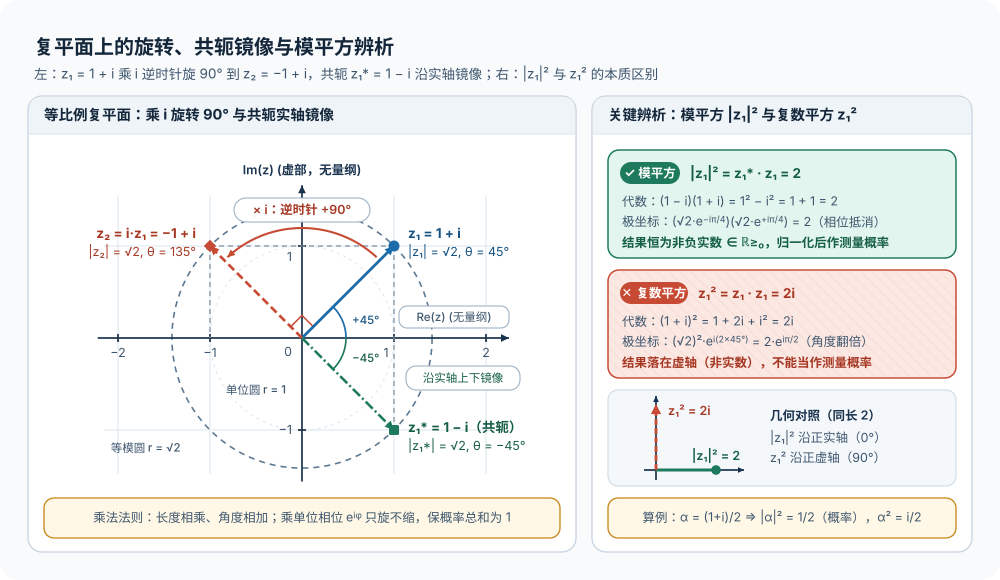
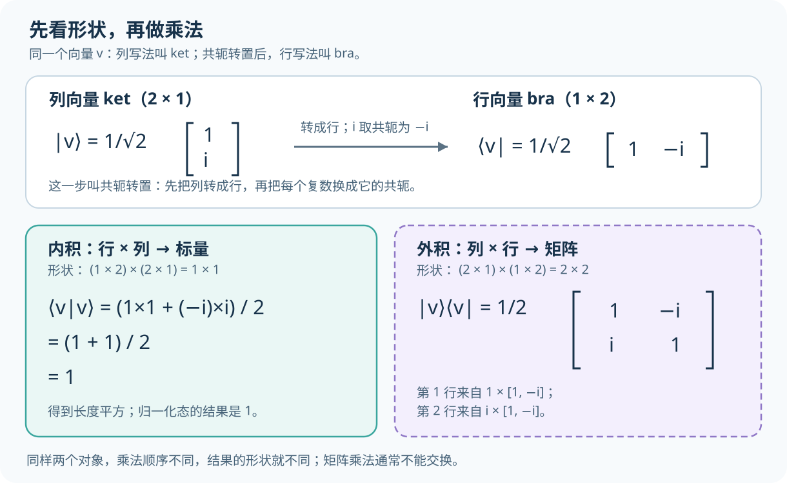
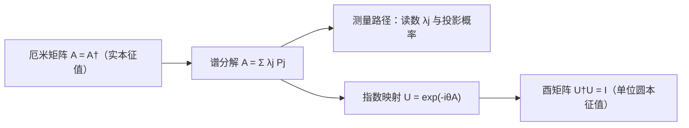
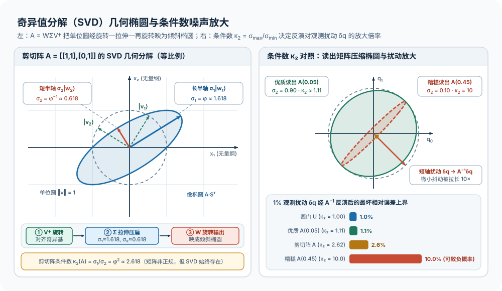
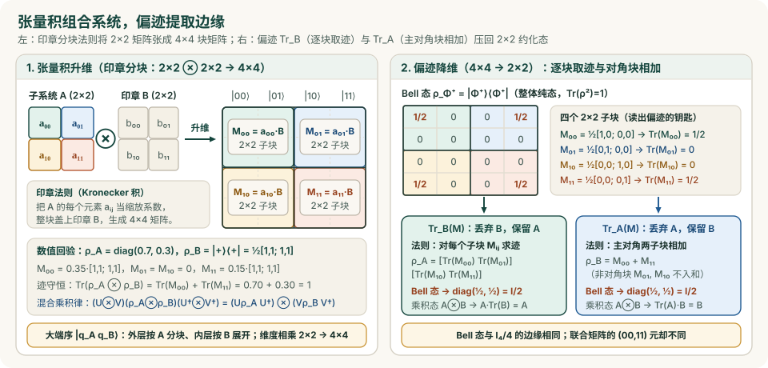

# 01｜零基础数学工具：看懂量子计算的最小数学语言

很多人打开量子计算教材，第一页就被一串陌生的括号、复数和矩阵拦在门外。其实，读懂绝大部分量子电路、纠缠与基础算法，并不需要微积分，也不需要背诵厚厚的线性代数定理；真正天天上场的，只是高中代数加一点有限维向量、矩阵和基础概率。

这一章专门把这些工具拆开、摆在草稿纸上一步步算给你看。每遇到一个新符号，养成一个习惯：先问它是一个**数**、一条**向量**，还是一张**矩阵**；再看它有几个分量、怎么算、算完怎么检查有没有出错。

如果已经几年没碰数学，不必一口气啃完本章，可按“必读 ★ / 进阶按需 ☆”节奏推进：

- **进入 [物理篇 Q1：从实验认识量子态](quantum-mechanics/01-experiments-states.md) 和 [第 02 章单量子比特](02-single-qubit.md) 前（★ 核心必读）**：先读第 1–4 节、第 5 节的 Pauli 矩阵与对易子，再看第 8 节的条件概率与期望。
- **读到谱分解、密度矩阵、量子演化与读出校准时（★ 核心进阶）**：回来看第 5–6 节的正规阵条件、Sylvester 正半定判据、矩阵指数与 SVD 条件数。
- **进入 [第 03 章多量子比特与纠缠](03-multiple-qubits.md) 前（★ 多比特必读）**：补上第 7 节的张量积、混合乘积律与部分迹分块直觉。
- **进入算法篇 [第 06 章](06-algorithmic-primitives.md)、[第 07 章](07-algorithms.md) 与信息论篇章时（☆ 按需回看）**：再读第 7.4 节（克罗内克和与 $\operatorname{vec}$）、第 8.5 节（二元信息熵）与第 9 节（渐近复杂度）。

标有“进阶回看”“进阶预览”或“进阶选读”的小节第一遍可以先跳过，留到后面需要时再翻回来核对。全章不依赖微积分（仅在矩阵指数处直接借用三个熟知幂级数作为已知代数恒等式）。

---

## 1. 复数：把旋转和缩放装进一个数

在经典概率论里，每种可能结果只配一个非负实数概率，两条路径汇到一起只能越加越大，永远无法互相抵消。量子计算最关键的转折，是把“非负概率”升级为允许正负与方向旋转的**复数振幅**——两条路径汇合时，方向相同就增强，方向相反就抵消。

### 1.1 从虚数单位 $i$ 到复数四则运算

实数里没有任何数平方后等于 $-1$。为了处理这种方程，数学引入虚数单位 $i$，规定

$$
i^2 = -1.
$$

由两个实数 $a, b \in \mathbb{R}$ 拼成的数

$$
z = a + bi
$$

叫作**复数**，所有复数的集合记为 $\mathbb{C}$。其中实数 $a$ 叫**实部**（记作 $\operatorname{Re} z$），实数 $b$ 叫**虚部**（记作 $\operatorname{Im} z$）。留意一个常见细节：虚部是实数 $b$，不带那个 $i$。例如 $3 - 2i$ 的实部是 $3$，虚部是 $-2$；当 $b = 0$ 时，普通实数就是复数的特例。

加减法就是实部对实部、虚部对虚部各自相加减：

$$
(1 + 2i) + (3 - i) = (1 + 3) + (2 - 1)i = 4 + i,
$$

$$
(1 + 2i) - (3 - i) = 1 + 2i - 3 + i = -2 + 3i.
$$

乘法按中学的分配律逐项展开，只要看到 $i^2$ 就立刻换成 $-1$：

$$
\begin{aligned}
(1 + 2i)(3 - i)
&= 1\cdot 3 + 1\cdot(-i) + (2i)\cdot 3 + (2i)\cdot(-i) \\
&= 3 - i + 6i - 2i^2 \\
&= 3 + 5i - 2(-1) = 5 + 5i.
\end{aligned}
$$

复数最重要的搭档是**复共轭**（简称共轭）：把虚部变号，记作 $z^* = a - bi$。把一个复数和它的共轭相乘，带 $i$ 的交叉项恰好一正一负抵消掉：

$$
z^* z = (a - bi)(a + bi) = a^2 + abi - abi - b^2 i^2 = a^2 + b^2.
$$

因为 $a, b$ 都是实数，$a^2 + b^2$ 永远是非负实数。复数除法正是利用这一招，通过分子分母同乘分母的共轭，把分母变成实数（前提是分母不为 $0$）：

$$
\frac{1}{1 + i}
= \frac{1 - i}{(1 + i)(1 - i)}
= \frac{1 - i}{1^2 - i^2}
= \frac{1 - i}{2}.
$$

### 1.2 模是长度，相位是方向

把复数 $z = a + bi$ 画在一张二维平面上：横轴放实部 $a$，纵轴放虚部 $b$，原点指向点 $(a, b)$ 的箭头就代表复数 $z$。这张平面叫作**复平面**。

箭头有两个一眼能看清的几何量：

- **模（长度）**：原点到 $(a, b)$ 的距离，由勾股定理给出

  $$
  |z| = \sqrt{a^2 + b^2}, \qquad |z|^2 = a^2 + b^2 = z^* z.
  $$

  例如 $z = 1 + i$ 落在点 $(1, 1)$，长度 $|1 + i| = \sqrt{1^2 + 1^2} = \sqrt{2}$，模平方 $|1 + i|^2 = 2$。写题时不要把长度 $\sqrt{2}$ 和模平方 $2$ 混成一个数。
- **相位（方向角）**：从正实轴逆时针转到箭头方向所经过的角度 $\theta$。量子计算习惯用弧度：整圈 $360^\circ$ 是 $2\pi$，半圈 $180^\circ$ 是 $\pi$，直角 $90^\circ$ 是 $\pi/2$，$45^\circ$ 是 $\pi/4$。当 $r = |z| > 0$ 时，由直角三角形的边角关系立刻有

  $$
  a = r\cos\theta, \qquad b = r\sin\theta, \qquad z = r(\cos\theta + i\sin\theta).
  $$

在复平面上，$z = 1 + i$ 与共轭 $z^* = 1 - i$ 关于实轴上下镜像对称，长度都是 $\sqrt{2}$，相位互为相反数（$+\pi/4$ 与 $-\pi/4$）；这一几何画面和乘 $i$ 旋转将在 1.4 节的双联图中一次看清。请顺手记清一点：复平面画的是**单个复数**，不是第 02 章用来表示整个单量子比特态的三维 Bloch 球。

找相位时要看象限，不能只算 $b/a$。比如 $-1 + i$ 的 $b/a = -1$，但它在实部负、虚部正的第二象限，相位是 $3\pi/4$（$135^\circ$），而不是第四象限的 $-\pi/4$。绕整圈会回到同一点，所以 $\theta$ 与 $\theta + 2\pi k$（$k$ 为整数）指向同一个方向；而零复数 $z = 0$ 缩在原点，没有定义相位。

### 1.3 复数乘法的几何直觉：旋转加缩放

只会背分配律，很容易把复数乘法看成一堆冰冷的括号展开。换到复平面上看，它的几何画面其实非常干脆。

先拿最简单的数试一试——反复乘以 $i$：

$$
1 \xrightarrow{\times i} i \xrightarrow{\times i} -1 \xrightarrow{\times i} -i \xrightarrow{\times i} 1.
$$

在复平面上，这四个点依次在东、北、西、南四个方向上，每乘一次 $i$ 就把箭头**逆时针旋转 $90^\circ$（$\pi/2$），长度分毫不改**。随便挑一个不在坐标轴上的点 $1 + i$ 验一下：$i(1 + i) = i + i^2 = -1 + i$，点 $(1, 1)$ 变成了 $(-1, 1)$，果然也是原地逆时针转了 $90^\circ$！

为了把“任意角度的单位旋转”写得紧凑，我们引入 **Euler 公式**：

$$
e^{i\theta} = \cos\theta + i\sin\theta, \qquad z = r e^{i\theta}.
$$

这里 $e \approx 2.71828$ 是自然常数。零微积分阶段，你完全可以把 $e^{i\theta}$ 直接当成“**长度为 1、方向角为 $\theta$ 的单位复数旋钮**”的简记，因为 $|\cos\theta + i\sin\theta|^2 = \cos^2\theta + \sin^2\theta = 1$。

把两个非零复数 $z_1 = r_1(\cos\theta_1 + i\sin\theta_1)$ 和 $z_2 = r_2(\cos\theta_2 + i\sin\theta_2)$ 直接相乘，再用中学的三角和角公式整理：

$$
\begin{aligned}
z_1 z_2
&= r_1 r_2 \big[(\cos\theta_1\cos\theta_2 - \sin\theta_1\sin\theta_2)
  + i(\sin\theta_1\cos\theta_2 + \cos\theta_1\sin\theta_2)\big] \\
&= r_1 r_2 \big[\cos(\theta_1 + \theta_2) + i\sin(\theta_1 + \theta_2)\big]
= r_1 r_2\, e^{i(\theta_1 + \theta_2)}.
\end{aligned}
$$

这一行不用任何微积分，却给出了复数乘法最直观的法则：**长度相乘，角度相加**。乘以 $r e^{i\theta}$，在几何上就是把原来的箭头先拉长（或缩短）到 $r$ 倍，再逆时针旋转 $\theta$。特别地，当 $r = 1$ 时，乘以 $e^{i\phi}$ **只旋转方向，完全不改变长度**；正是这个几何事实，让量子力学里的纯相位因子 $e^{i\phi}$ 既能调控干涉方向，又不破坏总概率守恒。

| 复数运算 | 代数公式（设 $z=a+bi=re^{i\theta}$） | 复平面几何含义 | 量子计算中的常见角色 |
| :--- | :--- | :--- | :--- |
| 加减法 $z_1 \pm z_2$ | $(a_1 \pm a_2) + (b_1 \pm b_2)i$ | 箭头首尾相接合成 | 多条路径振幅的相长与相消干涉 |
| 共轭 $z^*$ | $a - bi = r e^{-i\theta}$ | 关于实轴上下镜像翻转 | 构造 bra 向量与计算内积 |
| 模平方 $\lvert z\rvert^2$ | $z^* z = a^2 + b^2 = r^2$ | 箭头长度的平方（非负实数） | 由归一化振幅算出测量概率 |
| 乘单位相位 $z e^{i\phi}$ | $r e^{i(\theta + \phi)}$ | 逆时针旋转 $\phi$，长度不变 | 施加相位门与调整相对相位 |
| 一般乘法 $z_1 z_2$ | $r_1 r_2 e^{i(\theta_1 + \theta_2)}$ | 长度相乘、角度相加 | 串联门变换中的复系数运算 |

### 1.4 算例：双路径验算复数乘法与从振幅求概率

**算例 A（旋转加缩放的双路径对照）**：计算 $w_1 = 1 + i$ 与 $w_2 = \sqrt{3} + i$ 的乘积。

- **路径 1（代数分配律）**：

  $$
  w_1 w_2 = (1 + i)(\sqrt{3} + i) = \sqrt{3} + i + \sqrt{3}i + i^2 = (\sqrt{3} - 1) + (\sqrt{3} + 1)i.
  $$

  核对结果的模平方：

  $$
  |w_1 w_2|^2 = (\sqrt{3} - 1)^2 + (\sqrt{3} + 1)^2 = (4 - 2\sqrt{3}) + (4 + 2\sqrt{3}) = 8,
  $$

  所以长度是 $\sqrt{8} = 2\sqrt{2}$。
- **路径 2（极坐标旋转缩放）**：$w_1$ 长度为 $\sqrt{2}$、角度 $\pi/4$（$45^\circ$）；$w_2$ 长度为 $\sqrt{3 + 1} = 2$、角度 $\pi/6$（$30^\circ$，因 $\cos\frac{\pi}{6}=\frac{\sqrt{3}}{2}, \sin\frac{\pi}{6}=\frac{1}{2}$）。于是乘积长度为 $\sqrt{2}\times 2 = 2\sqrt{2}$，角度为 $\frac{\pi}{4} + \frac{\pi}{6} = \frac{5\pi}{12}$（$75^\circ$）。两条路径给出的长度分毫不差。

再看一个纯旋转的极简检验：把 $w_1 = 1 + i$ 乘以单位复数 $e^{i\pi/4} = \frac{1 + i}{\sqrt{2}}$。代数展开得 $\frac{(1 + i)^2}{\sqrt{2}} = \frac{1 + 2i - 1}{\sqrt{2}} = \sqrt{2}\,i$；几何上则是把原本在 $45^\circ$、长度为 $\sqrt{2}$ 的箭头再逆时针转 $45^\circ$，稳稳落到正虚轴 $90^\circ$ 上，长度依旧是 $\sqrt{2}$。

**算例 B（从振幅到测量概率）**：设某个单比特纯态的两个计算基振幅分别是 $\alpha = \frac{1 + 2i}{\sqrt{10}}$ 和 $\beta = \frac{2 - i}{\sqrt{10}}$。按量子测量的 Born 规则，概率是振幅的**模平方**，而不是直接平方：

$$
|\alpha|^2 = \alpha^* \alpha = \frac{1 - 2i}{\sqrt{10}}\cdot\frac{1 + 2i}{\sqrt{10}} = \frac{1^2 + 2^2}{10} = \frac{5}{10} = \frac{1}{2}.
$$

同样算出 $|\beta|^2 = \frac{2^2 + (-1)^2}{10} = \frac{5}{10} = \frac{1}{2}$，两者之和 $\frac{1}{2} + \frac{1}{2} = 1$，满足归一化。如果误把 $\alpha$ 直接平方，会得到 $\alpha^2 = \frac{1 + 4i + 4i^2}{10} = \frac{-3 + 4i}{10}$，连实数都不是，根本不能当概率。请记住：振幅的模平方给出概率，这是物理实验确立的规则，不是光靠复数四则推出来的代数恒等式。

上面这张双联图把第 1 节最关键的两组几何画面合在了一起（可打开[原尺寸复平面旋转与模平方辨析图](assets/v2-01-complex-rotation.svg)清晰查看全部角度与标注）：

- **左图（等比例复平面）**：$z_1 = 1 + i$ 乘以单位复数 $i$ 后，沿等模圆 $r = \sqrt{2}$ 逆时针纯旋转 $90^\circ$ 到 $z_2 = i z_1 = -1 + i$，与实轴镜像共轭 $z_1^* = 1 - i$ 并排对照（若乘数的模 $r \neq 1$，则旋转同时按 $r$ 倍伸缩，如算例 A 中的 $w_1 w_2$）。
- **右图（两种“平方”的本质区别）**：模平方 $|z_1|^2 = z_1^* z_1 = 2$ 因相位抵消稳落正实轴，而复数直接平方 $z_1^2 = 2i$ 把角度翻倍转到正虚轴，不能充当概率（图底同时呼应第 00 章的 $\alpha = \frac{1+i}{2}$：模平方给出合法概率 $1/2$，直接平方落到虚数 $i/2$）。

**马上核对。** $(2 - i)(2 + i)$ 和 $|3 - 4i|^2$ 分别是多少？前者是共轭相乘，得 $2^2 - i^2 = 5$；后者是实部虚部平方和，得 $3^2 + (-4)^2 = 25$。

---

## 2. 列向量、Dirac 记号与左共轭内积

单个复数只能记录一个结果的振幅；要同时记录一个量子比特的两种可能（0 和 1），或者 $n$ 个量子比特的 $2^n$ 种可能，就需要把一排复数按固定顺序装进一个容器——这就是**列向量**。

### 2.1 从经典概率向量到量子态矢量

在经典随机系统里，一枚不均匀硬币有 $p_0 = 0.7$ 的概率正面、$p_1 = 0.3$ 的概率反面，可以竖着写成二维列向量 $p = \begin{bmatrix}0.7\\0.3\end{bmatrix}$，要求分量非负且之和为 $1$。

量子比特的纯态用同样的方式竖排，只是把非负概率换成复数振幅 $\alpha, \beta \in \mathbb{C}$，并把“分量之和为 $1$”升级为“模平方之和为 $1$”（即 $|\alpha|^2 + |\beta|^2 = 1$）。用 $\mathbb{C}^d$ 表示所有含 $d$ 个复数分量的列向量组成的空间。

列向量的加法和数乘都按位置逐项进行。为避免与经典概率向量 $p, q$ 混名，一般复列向量我们用 $|a\rangle, |b\rangle$ 等字母记号表示。例如对 $|a\rangle = [1, i]^T$、$|b\rangle = [2, -i]^T$（右上角 $T$ 表示把横排简写立起来变成列向量）：

$$
|a\rangle + |b\rangle = \begin{bmatrix}1 + 2 \\ i + (-i)\end{bmatrix} = \begin{bmatrix}3 \\ 0\end{bmatrix},
\qquad
2|a\rangle = \begin{bmatrix}2 \\ 2i\end{bmatrix}.
$$

### 2.2 ket、bra 与对象形状体检表

量子计算通行的 **Dirac 记号**非常实用：

- 把 $d \times 1$ 的列向量写成右尖括号 $|\psi\rangle$，读作 **ket**（右矢），用来表示一个量子态：

  $$
  |\psi\rangle = \begin{bmatrix}\alpha \\ \beta\end{bmatrix} \in \mathbb{C}^2.
  $$

- 把它的每个分量先取复共轭，再从列翻成行，得到的 $1 \times d$ 行向量写成左尖括号 $\langle\psi|$，读作 **bra**（左矢）：

  $$
  \langle\psi| = (|\psi\rangle)^\dagger = \begin{bmatrix}\alpha^* & \beta^*\end{bmatrix}.
  $$

右上角的剑号 $\dagger$ 读作“共轭转置”（dagger）：**先取共轭、再转置**。不要把它和普通转置 $T$ 混为一谈——对 $|a\rangle = \begin{bmatrix}1\\i\end{bmatrix}$，普通转置是 $[1,\; i]$，而共轭转置是 $\langle a| = [1,\; -i]$，那个 $i$ 必须变号。

很多初学者在 Dirac 记号里迷路，是因为没先看清表达式的“形状”。其实只要瞄一眼尖括号的朝向，就能立刻判断对象类型：

| 记号 | 名字 | 矩阵维度（在 $\mathbb{C}^d$ 中） | 结果类型 | 直观角色 |
| :--- | :--- | :--- | :--- | :--- |
| $\lvert\psi\rangle$ | ket（右矢） | $d \times 1$ | 列向量 | 被制备或被变换的量子态 |
| $\langle\phi\rvert$ | bra（左矢） | $1 \times d$ | 行向量 | “吃进一个 ket、吐出一个复数”的投影探针 |
| $\langle\phi\vert\psi\rangle$ | 内积（bracket） | $(1 \times d)(d \times 1) = 1 \times 1$ | 单个复数（标量） | 两个态的重叠程度；模平方即转换/测量概率 |
| $\lvert\psi\rangle\langle\phi\rvert$ | 外积 | $(d \times 1)(1 \times d) = d \times d$ | 方阵（线性算符） | 把输入态映射到 $\lvert\psi\rangle$ 方向的算符或投影机 |

对照上图记忆最省力（可打开[原尺寸 ket/bra 形状对照图](assets/math-object-shapes.svg)放大查看）：嘴对嘴拼成 $\langle v|v\rangle$，内侧的维度相互吞并，结果塌缩成一个**数**；背靠背拼成 $|v\rangle\langle v|$，结果张开成一张 $2\times 2$ 的**矩阵**。两种顺序得到的连对象类型都不一样，不能随意互换。

### 2.3 为什么复数内积必须左共轭？

对任意两个 $d$ 维复列向量 $|\phi\rangle = [\phi_1, \dots, \phi_d]^T$ 和 $|\psi\rangle = [\psi_1, \dots, \psi_d]^T$，全书统一采用物理与量子计算标准的**左共轭内积**（与 Python NumPy 中的 `np.vdot(phi, psi)` 一致）：

$$
\langle\phi|\psi\rangle
= \begin{bmatrix}\phi_1^* & \cdots & \phi_d^*\end{bmatrix}
  \begin{bmatrix}\psi_1 \\ \vdots \\ \psi_d\end{bmatrix}
= \sum_{j=1}^{d} \phi_j^* \psi_j.
$$

初学者常问：“为什么要多此一举给左边取共轭，直接照搬实数点积 $\sum_j \phi_j \psi_j$ 不行吗？”看两个一秒就能算出的反例：

1. 取非零向量 $|u\rangle = \frac{1}{\sqrt{2}}\begin{bmatrix}1\\i\end{bmatrix}$。如果不取共轭，自己乘自己竟得到

   $$
   u^T u = \frac{1}{2}(1^2 + i^2) = \frac{1 - 1}{2} = 0.
   $$

   一个实实在在的非零向量，算出来的“长度平方”竟然是零！
2. 再取 $|r\rangle = \begin{bmatrix}i\\0\end{bmatrix}$，不取共轭算 $r^T r = i^2 = -1$，“长度平方”竟然是负数！

只有对其中一侧取复共轭，向量和自己的内积 $\langle\psi|\psi\rangle = \sum_j \psi_j^* \psi_j = \sum_j |\psi_j|^2$ 才必然是非负实数，且仅当 $|\psi\rangle$ 是零向量时才等于 $0$。因此我们定义向量的**范数**（长度）为

$$
\|\psi\| = \sqrt{\langle\psi|\psi\rangle} = \sqrt{\sum_j |\psi_j|^2}.
$$

如果一个非零向量长度不是 $1$，把它整体除以 $\|\psi\|$ 就能得到长度为 $1$ 的**归一化**向量。例如对 $|s\rangle = [1,\; 1 + i]^T$，先算

$$
\langle s|s\rangle = |1|^2 + |1 + i|^2 = 1 + (1^2 + 1^2) = 3,
$$

故 $\|s\| = \sqrt{3}$，归一化态为

$$
|\psi\rangle = \frac{1}{\sqrt{3}}\begin{bmatrix}1 \\ 1 + i\end{bmatrix}.
$$

回验两项模平方之和：$\frac{1}{3} + \frac{2}{3} = 1$，完全合格。

### 2.4 左共轭带来的两个关键运算规则

因为 bra 自带共轭，内积有两条必须刻进肌肉记忆的性质（对任意复数 $c \in \mathbb{C}$ 与向量 $|\phi\rangle, |\psi\rangle \in \mathbb{C}^d$）：

1. **共轭对称性**：调换左右顺序，结果取共轭，即 $\langle\psi|\phi\rangle = (\langle\phi|\psi\rangle)^*$。
2. **右线性、左反线性**：

   $$
   \langle\phi\,|\,c\psi\rangle = c\,\langle\phi|\psi\rangle,
   \qquad
   \langle c\phi\,|\,\psi\rangle = c^*\,\langle\phi|\psi\rangle.
   $$

   可以记一句顺口溜：“**数从右边 ket 往外提，原样出来；数从左边 bra 往外提，过墙变共轭**。”

**算例（双路径核验正交与反线性）**：取

$$
|u\rangle = \frac{1}{\sqrt{2}}\begin{bmatrix}1\\i\end{bmatrix},
\qquad
|v\rangle = \frac{1}{\sqrt{2}}\begin{bmatrix}1\\-i\end{bmatrix},
\qquad
|w\rangle = i|u\rangle.
$$

- 先查 $|u\rangle$ 的归一化与正交性：$\langle u| = \frac{1}{\sqrt{2}}[1,\; -i]$，于是

  $$
  \langle u|u\rangle = \frac{1\cdot 1 + (-i)(i)}{2} = \frac{1 + 1}{2} = 1,
  $$

  $$
  \langle u|v\rangle = \frac{1\cdot 1 + (-i)(-i)}{2} = \frac{1 - 1}{2} = 0.
  $$

  内积为零，说明 $|u\rangle$ 和 $|v\rangle$ 互相**正交**。
- 再算 $\langle w|u\rangle$：
  - **按反线性口诀**：因为 $|w\rangle = i|u\rangle$，从左边把 $i$ 提出来要取共轭变成 $-i$，于是 $\langle w|u\rangle = (-i)\langle u|u\rangle = -i$。
  - **展开分量独立复算**：$|w\rangle = \frac{1}{\sqrt{2}}\begin{bmatrix}i\\i^2\end{bmatrix} = \frac{1}{\sqrt{2}}\begin{bmatrix}i\\-1\end{bmatrix}$，共轭转置得 $\langle w| = \frac{1}{\sqrt{2}}[-i,\; -1]$，行乘列得

    $$
    \langle w|u\rangle = \frac{(-i)\cdot 1 + (-1)\cdot i}{2} = \frac{-2i}{2} = -i.
    $$

  两条路径结果完全一致。再算反过来的 $\langle u|w\rangle = i\langle u|u\rangle = +i$，恰好等于 $(-i)^*$，验证了共轭对称性。

### 2.5 全局相位与相对相位：明确区分两类相位

如果给整个量子态乘上一个单位复数 $e^{i\theta_{\mathrm{g}}}$（$\theta_{\mathrm{g}} \in \mathbb{R}$），得到 $e^{i\theta_{\mathrm{g}}}|\psi\rangle$，它和 $|\psi\rangle$ 描述的是**同一个物理态**。原因用刚学的模平方一行就能看清：在任何测量基下，无论哪个结果原本的振幅是 $c$，整体乘相位后都变成 $e^{i\theta_{\mathrm{g}}} c$，其概率为

$$
|e^{i\theta_{\mathrm{g}}} c|^2 = (e^{i\theta_{\mathrm{g}}} c)^*(e^{i\theta_{\mathrm{g}}} c) = e^{-i\theta_{\mathrm{g}}} e^{i\theta_{\mathrm{g}}} c^* c = |c|^2.
$$

这种乘在**整个态最外面**的共同相位因子叫**全局相位**，不会改变任何实验统计。但只改两个分量之间的相位差就完全不同：例如下一节的 $|+\rangle = \frac{|0\rangle + |1\rangle}{\sqrt{2}}$ 和 $|-\rangle = \frac{|0\rangle - |1\rangle}{\sqrt{2}}$，后者的 $|1\rangle$ 分量相对 $|0\rangle$ 多了一个负号（即相位因子 $e^{i\pi} = -1$）。这种分量之间的相位差叫**相对相位**，它可以在后续门操作中触发截然不同的干涉结果。所以后文说“忽略全局相位”时，只允许去掉整个态的公因子，绝不能随手擦掉某个分量上的符号或 $i$。

### 2.6 进阶回看：Cauchy–Schwarz 不等式

这一小节先记住结论即可：**任意两个向量的内积大小，不会超过它们各自长度的乘积**，即

$$
|\langle u|v\rangle| \le \|u\|\,\|v\|.
$$

想看证明时，不需要微积分，只用展开长度平方即可。当 $|u\rangle = 0$ 时两边均为 $0$，不等式自动成立。当 $|u\rangle \neq 0$ 时，令复数 $c = \frac{\langle u|v\rangle}{\langle u|u\rangle}$，把 $|v\rangle$ 沿 $|u\rangle$ 方向的部分减掉，构造残差向量

$$
|w\rangle = |v\rangle - c|u\rangle.
$$

用左反线性与右线性逐项展开非负的范数平方 $\langle w|w\rangle$（注意左边提 $c$ 变 $c^*$，以及 $\langle v|u\rangle = \langle u|v\rangle^*$）：

$$
\begin{aligned}
0 \le \langle w|w\rangle
&= \langle v - c u \mid v - c u\rangle \\
&= \langle v|v\rangle - c\langle v|u\rangle - c^*\langle u|v\rangle + |c|^2 \langle u|u\rangle \\
&= \langle v|v\rangle - \frac{|\langle u|v\rangle|^2}{\langle u|u\rangle}
  - \frac{|\langle u|v\rangle|^2}{\langle u|u\rangle}
  + \frac{|\langle u|v\rangle|^2}{\langle u|u\rangle} \\
&= \langle v|v\rangle - \frac{|\langle u|v\rangle|^2}{\langle u|u\rangle}.
\end{aligned}
$$

移项并两边同乘正数 $\langle u|u\rangle$，立即得到 $|\langle u|v\rangle|^2 \le \langle u|u\rangle\langle v|v\rangle$，开平方即得上式。[物理篇 Q2：可观测量与动力学](quantum-mechanics/02-observables-dynamics.md)里的不确定关系正是从这条不等式出发的。

---

## 3. 正交归一基与正交投影：用“影子”看懂量子测量

同一个物理态，换一把尺子去量，读出来的坐标数字就会变，但物理对象本身没有变。线性代数里这把“尺子”就是一组**正交归一基**。

### 3.1 正交归一基与坐标展开

在二维复空间 $\mathbb{C}^2$ 中，任意向量 $[a, b]^T$ 都可以拆成

$$
\begin{bmatrix}a\\b\end{bmatrix}
= a\begin{bmatrix}1\\0\end{bmatrix} + b\begin{bmatrix}0\\1\end{bmatrix}
= a|0\rangle + b|1\rangle.
$$

这两个标准方向 $|0\rangle = [1, 0]^T$ 和 $|1\rangle = [0, 1]^T$ 叫作**计算基**（computational basis）。如果 $d$ 维空间里的一组向量 $\{|e_1\rangle, \dots, |e_d\rangle\}$ 满足

$$
\langle e_j | e_k \rangle = \delta_{jk}
= \begin{cases} 1, & j = k, \\ 0, & j \neq k, \end{cases}
$$

也就是每个方向长度都是 $1$（归一）、不同方向两两垂直（正交），并且数量足够张成整个 $d$ 维空间（完备），它就是一组**正交归一基**。比如三维空间里只有两个互相垂直的单位向量，缺了第三个方向，就不能叫整个三维空间的基。

在任意一组正交归一基下，任何向量 $|\psi\rangle$ 都能唯一展开为

$$
|\psi\rangle = \sum_{j=1}^{d} c_j |e_j\rangle, \qquad c_j = \langle e_j | \psi\rangle.
$$

为什么坐标 $c_j$ 恰好等于内积 $\langle e_j|\psi\rangle$？把展开式左边同乘 $\langle e_k|$，利用线性与正交归一条件一步就推出来：

$$
\langle e_k|\psi\rangle
= \sum_{j=1}^{d} c_j \langle e_k|e_j\rangle
= \sum_{j=1}^{d} c_j \delta_{kj}
= c_k.
$$

另一组贯穿全书的二维正交归一基是 **$X$ 基**（又称 Hadamard 基）：

$$
|+\rangle = \frac{|0\rangle + |1\rangle}{\sqrt{2}} = \frac{1}{\sqrt{2}}\begin{bmatrix}1\\1\end{bmatrix},
\qquad
|-\rangle = \frac{|0\rangle - |1\rangle}{\sqrt{2}} = \frac{1}{\sqrt{2}}\begin{bmatrix}1\\-1\end{bmatrix}.
$$

检查一下：$\langle+|+\rangle = \frac{1+1}{2} = 1$，$\langle-|-\rangle = \frac{1+1}{2} = 1$，$\langle+|-\rangle = \frac{1-1}{2} = 0$，两向量正交归一，且共有 $2$ 个方向，足以拼出 $\mathbb{C}^2$ 里任何向量。

**算例（复数态换基与回代检验）**：把态 $|\psi\rangle = \frac{|0\rangle + i|1\rangle}{\sqrt{2}}$ 换到 $\{|+\rangle, |-\rangle\}$ 基下写出坐标。

- 逐项算内积：

  $$
  c_+ = \langle+|\psi\rangle
  = \frac{1}{\sqrt{2}}\begin{bmatrix}1 & 1\end{bmatrix}
    \frac{1}{\sqrt{2}}\begin{bmatrix}1 \\ i\end{bmatrix}
  = \frac{1 + i}{2},
  $$

  $$
  c_- = \langle-|\psi\rangle
  = \frac{1}{\sqrt{2}}\begin{bmatrix}1 & -1\end{bmatrix}
    \frac{1}{\sqrt{2}}\begin{bmatrix}1 \\ i\end{bmatrix}
  = \frac{1 - i}{2}.
  $$

- 核对归一化：$|c_+|^2 + |c_-|^2 = \frac{1^2+1^2}{4} + \frac{1^2+(-1)^2}{4} = \frac{1}{2} + \frac{1}{2} = 1$。
- 回代还原原态：

  $$
  c_+|+\rangle + c_-|-\rangle
  = \frac{c_+ + c_-}{\sqrt{2}}|0\rangle + \frac{c_+ - c_-}{\sqrt{2}}|1\rangle
  = \frac{1}{\sqrt{2}}|0\rangle + \frac{i}{\sqrt{2}}|1\rangle
  = |\psi\rangle.
  $$

**暂停算一格。** $|1\rangle$ 在 $\{|+\rangle, |-\rangle\}$ 基中的两个坐标是多少？核对：$\langle+|1\rangle = \frac{1}{\sqrt{2}}$，$\langle-|1\rangle = -\frac{1}{\sqrt{2}}$，模平方之和仍是 $\frac{1}{2} + \frac{1}{2} = 1$。

### 3.2 正交投影：把“手电筒的影子”写成外积矩阵

现在回头看坐标展开里的每一项 $c_j |e_j\rangle = |e_j\rangle \langle e_j | \psi\rangle$。如果只把括号的位置换一下——从 $|e_j\rangle(\langle e_j|\psi\rangle)$ 改括成 $(|e_j\rangle\langle e_j|)|\psi\rangle$，你就凭空造出了一台**正交投影机**

$$
P_j = |e_j\rangle\langle e_j|.
$$

在几何上，这就像拿一束垂直于直线 $L_j$（方向为单位向量 $|e_j\rangle$）的手电筒照向向量 $|\psi\rangle$：

- 内积 $\langle e_j|\psi\rangle$ 告诉我们“影子有多长（含正负或复相位）”；
- 外积算符 $P_j = |e_j\rangle\langle e_j|$ 作用在 $|\psi\rangle$ 上，直接吐出这条**影子向量本身**，把垂直于 $|e_j\rangle$ 的那部分一刀裁掉。

这立刻解释了正交投影算符的三条核心性质，一条都不用死记：

1. **照两次还是同一个影子（幂等性）**：$P_j^2 = |e_j\rangle\underbrace{\langle e_j|e_j\rangle}_{1}\langle e_j| = P_j$，且 $P_j^\dagger = P_j$。
2. **残差与影子垂直（勾股定理）**：剩下的部分 $|r\rangle = |\psi\rangle - P_j|\psi\rangle$ 满足 $\langle e_j|r\rangle = \langle e_j|\psi\rangle - \langle e_j|\psi\rangle = 0$，所以长度平方满足 $\|P_j|\psi\rangle\|^2 + \||r\rangle\|^2 = \||\psi\rangle\|^2$。
3. **所有垂直方向的影子拼回原向量（完备性关系）**：因为对任意 $|\psi\rangle$ 都有 $|\psi\rangle = \sum_j (|e_j\rangle\langle e_j|)|\psi\rangle$，所以

   $$
   \sum_{j=1}^{d} |e_j\rangle\langle e_j| = I.
   $$

**算例（把 $|0\rangle$ 投影到 $\{|+\rangle, |-\rangle\}$ 轴）**：先按外积“列乘行”写出两个投影矩阵：

$$
P_+ = |+\rangle\langle+|
= \frac{1}{\sqrt{2}}\begin{bmatrix}1\\1\end{bmatrix}
  \frac{1}{\sqrt{2}}\begin{bmatrix}1 & 1\end{bmatrix}
= \frac{1}{2}\begin{bmatrix}1 & 1 \\ 1 & 1\end{bmatrix},
\qquad
P_- = |-\rangle\langle-|
= \frac{1}{2}\begin{bmatrix}1 & -1 \\ -1 & 1\end{bmatrix}.
$$

把 $P_+$ 照在 $|\psi\rangle = |0\rangle = \begin{bmatrix}1\\0\end{bmatrix}$ 上，得到影子向量与残差向量：

$$
P_+|0\rangle = \frac{1}{2}\begin{bmatrix}1 & 1 \\ 1 & 1\end{bmatrix}\begin{bmatrix}1\\0\end{bmatrix}
= \frac{1}{2}\begin{bmatrix}1\\1\end{bmatrix} = \frac{1}{\sqrt{2}}|+\rangle,
$$

$$
|r\rangle = |0\rangle - P_+|0\rangle = \frac{1}{2}\begin{bmatrix}1\\-1\end{bmatrix}
= \frac{1}{\sqrt{2}}|-\rangle = P_-|0\rangle.
$$

顺手验算四件事，直接接通 [第 02 章单量子比特](02-single-qubit.md) 的投影测量规则：

- 垂直性：$\langle +|r\rangle = \frac{1}{2\sqrt{2}}(1 - 1) = 0$；
- 幂等性：$P_+(P_+|0\rangle) = \frac{1}{2}\begin{bmatrix}1&1\\1&1\end{bmatrix}\begin{bmatrix}1/2\\1/2\end{bmatrix} = \begin{bmatrix}1/2\\1/2\end{bmatrix} = P_+|0\rangle$；
- 勾股定理与概率和：影子长度平方 $\|P_+|0\rangle\|^2 = \left(\frac{1}{2}\right)^2 + \left(\frac{1}{2}\right)^2 = \frac{1}{2}$，残差长度平方 $\|P_-|0\rangle\|^2 = \frac{1}{2}$，相加正好为 $1$——它们正是对 $|0\rangle$ 测 $X$ 基时得到 $+$ 和 $-$ 的概率；
- 测量后态：把影子 $P_+|0\rangle = \frac{1}{\sqrt{2}}|+\rangle$ 除以自身长度 $\frac{1}{\sqrt{2}}$ 重新拉回单位长，正好得到测出 $+$ 后的条件后态 $|+\rangle$。

---

## 4. 矩阵与量子算符：从线性变换到酉门、厄米算符

如果说向量记录“量子比特此刻在哪里”，矩阵就是“把量子比特送到下一个位置的机器”。读矩阵时，最好同时掌握两套视角：**计算时用“行乘列”，理解几何意义时看“每一列”**。

### 4.1 矩阵乘法、列视角与从右向左的次序

一个 $m \times n$ 矩阵有 $m$ 行、$n$ 列。它乘以一个 $n \times 1$ 列向量时，中间维度 $n$ 必须相等，输出是 $m \times 1$ 列向量。第 $j$ 个输出分量就是矩阵第 $j$ 行与输入列“同位置相乘再相加”：

$$
\begin{bmatrix}a & b \\ c & d\end{bmatrix}
\begin{bmatrix}x \\ y\end{bmatrix}
= \begin{bmatrix}ax + by \\ cx + dy\end{bmatrix}
= x\begin{bmatrix}a\\c\end{bmatrix} + y\begin{bmatrix}b\\d\end{bmatrix}.
$$

请仔细看最右边那个等号！它揭示了线性代数里极有用的**列视角**：

- 把 $|0\rangle = [1, 0]^T$ 送进矩阵，输出正好是矩阵的**第一列** $\begin{bmatrix}a\\c\end{bmatrix}$；
- 把 $|1\rangle = [0, 1]^T$ 送进矩阵，输出正好是矩阵的**第二列** $\begin{bmatrix}b\\d\end{bmatrix}$。

也就是说，**一个矩阵的第 $k$ 列，就是它把第 $k$ 个基向量送去的新落点**。以后看到任何量子门矩阵，瞄一眼它的各列，就能立刻读出它对每个基态做了什么。

两个矩阵 $A, B$ 相乘，同样按“左矩阵的一行逐项乘右矩阵的一列”算出每个格子。取

$$
A = \begin{bmatrix}1 & 2 \\ 0 & 1\end{bmatrix},
\qquad
B = \begin{bmatrix}0 & 1 \\ 1 & 0\end{bmatrix}.
$$

算 $AB$ 的左上格是 $1\cdot 0 + 2\cdot 1 = 2$，其余三格逐一展开得

$$
AB = \begin{bmatrix}2 & 1 \\ 1 & 0\end{bmatrix},
\qquad
BA = \begin{bmatrix}0 & 1 \\ 1 & 2\end{bmatrix}.
$$

逐格对比立刻可见 $AB \neq BA$，矩阵乘法一般**不可交换**。把先后两次操作作用在态 $|\psi\rangle$ 上时，括号按 $BA|\psi\rangle = B(A|\psi\rangle)$ 结合：**公式里右边的算符先作用，左边的算符后作用**。请记住全书统一约定：量子线路图按时间**从左到右**画门，而对应的矩阵连乘是**从右到左**写（先做 $A$ 再做 $B$，矩阵写为 $BA$）。

另外，矩阵上的三个上标绝不能混写：$M^T$ 只行列互换，$M^*$ 只逐格取复共轭，$M^\dagger = (M^*)^T$ 两步都做。以 $M = \begin{bmatrix}1 & i \\ 0 & 2\end{bmatrix}$ 为例：

$$
M^T = \begin{bmatrix}1 & 0 \\ i & 2\end{bmatrix},
\qquad
M^* = \begin{bmatrix}1 & -i \\ 0 & 2\end{bmatrix},
\qquad
M^\dagger = \begin{bmatrix}1 & 0 \\ -i & 2\end{bmatrix}.
$$

单位矩阵 $I = \begin{bmatrix}1 & 0 \\ 0 & 1\end{bmatrix}$ 相当于数字 $1$，对任意向量和同尺寸矩阵都有 $I|v\rangle = |v\rangle$、$AI = IA = A$。

### 4.2 算例：手算 Hadamard 门与四类核心矩阵速查

量子计算里最常用的单比特门之一是 **Hadamard 门**：

$$
H = \frac{1}{\sqrt{2}}\begin{bmatrix}1 & 1 \\ 1 & -1\end{bmatrix}.
$$

用列视角一眼就能读出它对计算基的作用：第一列就是 $H|0\rangle = \frac{1}{\sqrt{2}}\begin{bmatrix}1\\1\end{bmatrix} = |+\rangle$，第二列就是 $H|1\rangle = \frac{1}{\sqrt{2}}\begin{bmatrix}1\\-1\end{bmatrix} = |-\rangle$。再算 $H^\dagger H$：因为 $H$ 全是实数且对称，所以 $H^\dagger = H$，逐格相乘得

$$
H^\dagger H = H^2
= \frac{1}{2}\begin{bmatrix}1 & 1 \\ 1 & -1\end{bmatrix}\begin{bmatrix}1 & 1 \\ 1 & -1\end{bmatrix}
= \frac{1}{2}\begin{bmatrix}1+1 & 1-1 \\ 1-1 & 1+1\end{bmatrix}
= \begin{bmatrix}1 & 0 \\ 0 & 1\end{bmatrix} = I.
$$

连做两次 Hadamard 门正好回到原态。全书反复出场的特殊方阵主要有下面四类：

| 矩阵类型 | 可逐格核查的定义 | 几何直觉 | 在量子计算中的核心用途 |
| :--- | :--- | :--- | :--- |
| **厄米矩阵（Hermitian）** | $A = A^\dagger$ | 沿一组互相垂直的轴做纯实数拉伸，不掰斜轴线 | 物理可观测量（测量读数为实数）、哈密顿量 |
| **酉矩阵（Unitary）** | $U^\dagger U = UU^\dagger = I$（即 $U^{-1}=U^\dagger$） | 复空间里的刚体旋转或镜像，不改长度也不改夹角 | 理想封闭系统中的可逆量子门与时间演化 |
| **正交投影矩阵（Projector）** | $P = P^\dagger = P^2$ | 保留某个子空间里的影子，裁掉垂直分量 | 投影测量、谱分解的基本积木 |
| **正半定矩阵（PSD）** | $A = A^\dagger$，且任意 $\lvert v\rangle$ 均有 $\langle v\vert A\vert v\rangle \ge 0$ | 在所有方向上的实数伸缩倍数都非负（$\ge 0$） | 密度矩阵 $\rho$、广义测量 POVM 算符 $E_m$（见第 02 章） |

### 4.3 为什么酉矩阵保概率？以及“列归一不等于酉”的反例

封闭量子系统的理想门必须把任意合法纯态映成合法纯态，也就是保持向量长度为 $1$。若 $U$ 是酉矩阵（$U^\dagger U = I$），对任意输入态 $|\psi\rangle$ 和 $|\phi\rangle$，令 $|\psi'\rangle = U|\psi\rangle$、$|\phi'\rangle = U|\phi\rangle$，由于 $(U|\phi\rangle)^\dagger = \langle\phi|U^\dagger$，立即可算得

$$
\langle\phi'|\psi'\rangle = \langle\phi|U^\dagger U|\psi\rangle = \langle\phi|I|\psi\rangle = \langle\phi|\psi\rangle.
$$

取 $|\phi\rangle = |\psi\rangle$ 就得到 $\langle\psi'|\psi'\rangle = \langle\psi|\psi\rangle$：**总概率恒为 $1$，且任意两态之间的内积（正交性）也完全保持**。注意总概率不变不代表单个结果的概率不变——$H$ 把 $|0\rangle$ 变成 $|+\rangle$ 时，计算基概率从 $(1, 0)$ 变成 $(1/2, 1/2)$，变的是分配，守恒的是总和。

因为 $U^\dagger U$ 的第 $(j, k)$ 格正是 $U$ 的第 $j$ 列和第 $k$ 列的内积，所以 $U^\dagger U = I$ 等价于：**$U$ 的各列向量构成一组正交归一基**。这里藏着一个初学者极易掉进去的坑——只检查了“每个基态输出的长度都是 1”，就以为它是合法的酉门。

**反例（列归一但非正交的矩阵不是酉门）**：考察二维矩阵

$$
A = \begin{bmatrix}1 & 1 \\ 0 & 0\end{bmatrix}.
$$

它把 $|0\rangle$ 送到 $|0\rangle$，也把 $|1\rangle$ 送到 $|0\rangle$，两列的长度都是 $1$。但它是不是一个合法的“重置量子门”？算一下 $A^\dagger A$ 和它对叠加态的作用就立刻现形：

$$
A^\dagger A = \begin{bmatrix}1 & 0 \\ 1 & 0\end{bmatrix}\begin{bmatrix}1 & 1 \\ 0 & 0\end{bmatrix} = \begin{bmatrix}1 & 1 \\ 1 & 1\end{bmatrix} \neq I,
$$

$$
A|+\rangle = \frac{1}{\sqrt{2}}\begin{bmatrix}1 & 1 \\ 0 & 0\end{bmatrix}\begin{bmatrix}1 \\ 1\end{bmatrix} = \sqrt{2}|0\rangle,
\qquad
A|-\rangle = \frac{1}{\sqrt{2}}\begin{bmatrix}1 & 1 \\ 0 & 0\end{bmatrix}\begin{bmatrix}1 \\ -1\end{bmatrix} = \begin{bmatrix}0 \\ 0\end{bmatrix}.
$$

两列相等，交叉内积是 $1$ 而不是 $0$，导致它把 $|+\rangle$ 拉成了模平方为 $2$ 的非法态，更把 $|-\rangle$ 直接压成无法归一化的零向量！这也顺便预告了 [第 05 章噪声与量子信道](05-noise-channels.md) 的一条重要事实：物理上的“复位到 $|0\rangle$”不是单个酉门，而是借助环境实现的不可逆量子信道（由两个 Kraus 算符 $|0\rangle\langle 0|$ 与 $|0\rangle\langle 1|$ 按概率分支相加，而不是把它们相干地加成一个矩阵 $A$）。

### 4.4 换坐标还是动了态？被动换基与主动施门

学完基变换和酉矩阵后，一个绕不开的困惑浮出了水面：第 3 节说“换基不改变物理态”，本节又说“酉门把态改变了”，可两件事写出来都是“拿一个酉矩阵去乘列向量”，到底差在哪里？

答案藏在一句大白话里：**被动换基是“态和测量尺子一起换坐标系”，预测不变；主动施门是“真正改变物理态，但还用原来那把固定尺子去量”，实验结果就会变。**

用一个带复数的具体例子把两者彻底拆开。选一组新基 $|{+i}\rangle = \frac{|0\rangle + i|1\rangle}{\sqrt{2}}$ 与 $|{-i}\rangle = \frac{|0\rangle - i|1\rangle}{\sqrt{2}}$，把它们在计算基下的列向量并排拼成酉矩阵

$$
W = \frac{1}{\sqrt{2}}\begin{bmatrix}1 & 1 \\ i & -i\end{bmatrix},
\qquad
W^\dagger = \frac{1}{\sqrt{2}}\begin{bmatrix}1 & -i \\ 1 & i\end{bmatrix}.
$$

直接验证 $W^\dagger W = \frac{1}{2}\begin{bmatrix}1+(-i)i & 1+(-i)(-i) \\ 1+i\cdot i & 1+i(-i)\end{bmatrix} = \begin{bmatrix}1&0\\0&1\end{bmatrix} = I$。若一个态在旧基（计算基）下坐标为 $|\psi\rangle$，在新基下坐标为 $c$，展开关系就是 $|\psi\rangle = Wc$，两边左乘 $W^\dagger$ 得新坐标 $c = W^\dagger|\psi\rangle$。

现在拿初态 $|\psi\rangle = |0\rangle = [1, 0]^T$ 和旧基下的 $Z = \begin{bmatrix}1 & 0 \\ 0 & -1\end{bmatrix}$ 测量做对比：

1. **情景一（被动换基，只换账本写法）**：
   $|0\rangle$ 在新基下的坐标是 $c = W^\dagger|0\rangle = \frac{1}{\sqrt{2}}\begin{bmatrix}1\\1\end{bmatrix}$。表示同一个物理测量 $Z$ 的矩阵也必须同步换到新基下：

   $$
   Z_{\mathrm{new}} = W^\dagger Z W
   = \frac{1}{2}\begin{bmatrix}1 & -i \\ 1 & i\end{bmatrix}
     \begin{bmatrix}1 & 0 \\ 0 & -1\end{bmatrix}
     \begin{bmatrix}1 & 1 \\ i & -i\end{bmatrix}
   = \frac{1}{2}\begin{bmatrix}1 & -i \\ 1 & i\end{bmatrix}
     \begin{bmatrix}1 & 1 \\ -i & i\end{bmatrix}
   = \begin{bmatrix}0 & 1 \\ 1 & 0\end{bmatrix} = X.
   $$

   （这个把上下分量互换的矩阵就是下一节正式介绍的 Pauli $X$ 矩阵。）于是旧写法算出的期望值是 $\langle 0|Z|0\rangle = 1$；新写法算出的期望值是 $c^\dagger Z_{\mathrm{new}} c = \frac{1}{2}[1, 1]\begin{bmatrix}0&1\\1&0\end{bmatrix}\begin{bmatrix}1\\1\end{bmatrix} = 1$。两者完全相同（一般地，$c^\dagger(W^\dagger A W)c = \langle\psi|A|\psi\rangle$）。数字变成了 $\frac{1}{\sqrt{2}}[1,1]^T$，只是在 $\{|+i\rangle,|-i\rangle\}$ 尺子下的读法，并没有把粒子变成计算基里的 $|+\rangle$。
2. **情景二（主动施门，真实操作粒子）**：
   把物理设备调成对初态 $|0\rangle$ 施加酉门 $U = W^\dagger$，输出态在**保持不变的计算基**下变成 $|\psi'\rangle = W^\dagger|0\rangle = \frac{1}{\sqrt{2}}[1, 1]^T = |+\rangle$。随后仍用原来固定的计算基装置 $Z$ 去测，期望值变成 $\langle+|Z|+\rangle = \frac{1}{2}(1 - 1) = 0$，0 和 1 各出半数！

**小排查。** 如果计算 $|{+i}\rangle$ 在新基下的坐标，正确算法是 $W^\dagger|{+i}\rangle = \frac{1}{2}\begin{bmatrix}1&-i\\1&i\end{bmatrix}\begin{bmatrix}1\\i\end{bmatrix} = \begin{bmatrix}1\\0\end{bmatrix}$——它在自己的第一个基方向上坐标正好是 $1$。如果不小心漏掉共轭，错用了普通转置 $W^T|{+i}\rangle = \frac{1}{2}\begin{bmatrix}1&i\\1&-i\end{bmatrix}\begin{bmatrix}1\\i\end{bmatrix} = \begin{bmatrix}0\\1\end{bmatrix}$，竟然把 $|{+i}\rangle$ 错认成了第二个基向量 $|{-i}\rangle$！

---

## 5. 本征值、本征向量与谱分解：2×2 逐步配方

矩阵作用在空间里，绝大多数向量都会被掰歪方向。但总有极少数“倔强”的非零方向，经过矩阵作用后依然留在原来的直线上，只是被拉长、缩短，或者翻了个方向。找到这些方向，就抓住了矩阵的核心结构。

### 5.1 定义与热身：Pauli $X$ 与 $Z$

对一个 $d \times d$ 方阵 $A$，如果存在**非零**列向量 $|v\rangle \in \mathbb{C}^d$ 和复数 $\lambda \in \mathbb{C}$ 满足

$$
A|v\rangle = \lambda|v\rangle,
$$

那么 $|v\rangle$ 叫作 $A$ 的**本征向量**（特征向量），$\lambda$ 叫作对应的**本征值**（特征值）。必须排除零向量 $|v\rangle = 0$，因为 $A\cdot 0 = \lambda\cdot 0$ 对任何 $\lambda$ 都成立，毫无信息量；但本征值 $\lambda$ 本身完全可以为 $0$ 或负数（$\lambda = -1$ 表示向量长度不变、方向反转）。

先拿最简单的两个 Pauli 矩阵热身：

- **Pauli $Z = \begin{bmatrix}1 & 0 \\ 0 & -1\end{bmatrix}$**：对角矩阵直接把两个坐标各自乘对角元，所以 $Z|0\rangle = (+1)|0\rangle$、$Z|1\rangle = (-1)|1\rangle$，本征值是 $+1, -1$，本征向量就是 $|0\rangle, |1\rangle$。
- **Pauli $X = \begin{bmatrix}0 & 1 \\ 1 & 0\end{bmatrix}$**：它把上下两格互换。设非零 $|v\rangle = [x, y]^T$，方程 $X|v\rangle = \lambda|v\rangle$ 就是 $y = \lambda x$ 且 $x = \lambda y$。若 $x = 0$ 会迫使 $y = 0$（违背非零），所以 $x \neq 0$；把第一式代入第二式得 $x = \lambda^2 x \implies \lambda^2 = 1 \implies \lambda = \pm 1$。
  - $\lambda = +1$ 时 $y = x$，归一化得 $|+\rangle = \frac{1}{\sqrt{2}}[1, 1]^T$；
  - $\lambda = -1$ 时 $y = -x$，归一化得 $|-\rangle = \frac{1}{\sqrt{2}}[1, -1]^T$。

### 5.2 一般 2×2 矩阵的特征方程与三步配方

遇到带复数、对角元又不全为零的一般 $2\times 2$ 矩阵 $A = \begin{bmatrix}a & b \\ c & d\end{bmatrix}$ 时，先把本征值方程 $A|v\rangle = \lambda|v\rangle$ 移项改写成齐次线性方程组：

$$
(A - \lambda I)|v\rangle = \begin{bmatrix}a - \lambda & b \\ c & d - \lambda\end{bmatrix}\begin{bmatrix}x \\ y\end{bmatrix} = \begin{bmatrix}0 \\ 0\end{bmatrix}.
$$

这个齐次方程组要存在**非零解** $[x, y]^T \neq [0, 0]^T$，矩阵 $A - \lambda I$ 就不能可逆，也就是说它的**行列式必须等于零**（称为**特征方程**）：

$$
\det(A - \lambda I)
= (a - \lambda)(d - \lambda) - bc
= \lambda^2 - (a + d)\lambda + (ad - bc)
= 0.
$$

把上式与两根展开式 $(\lambda - \lambda_1)(\lambda - \lambda_2) = \lambda^2 - (\lambda_1 + \lambda_2)\lambda + \lambda_1\lambda_2 = 0$ 逐项对照，立刻看出：**两个本征值的和恰好等于主对角线之和（即迹 $T = a + d$），乘积恰好等于行列式 $D = ad - bc$**。由此得到一个几乎不会算错的三步配方：

**第 1 步：读出“和”与“积”，算出中点。**
从矩阵直接读出迹 $T = a + d$ 与行列式 $D = ad - bc$，算出两本征值的中点（均值）：

$$
m = \frac{T}{2} = \frac{a + d}{2}.
$$

**第 2 步：中点加减偏移量，直接写出本征值。**
既然两数关于中点 $m$ 对称，必可写成 $m + s$ 和 $m - s$。它们的乘积是 $(m + s)(m - s) = m^2 - s^2 = D$，移项得 $s^2 = m^2 - D$，因此无需死背求根公式，立刻写出

$$
\lambda_{1,2} = m \pm \sqrt{m^2 - D}.
$$

算完顺手核对 $\lambda_1 + \lambda_2 = T$ 且 $\lambda_1\lambda_2 = D$，几乎不可能算错。

**第 3 步：“单行交叉法”读出本征向量并归一化。**
把求出的某个 $\lambda$ 代入 $A - \lambda I$。因为存在非零解，这个矩阵的两行必然成比例（或者至少有一行全零）。若整个 $A - \lambda I$ 全为零矩阵（即标量阵 $A = \lambda I$），则任意非零向量都是本征向量，直接取计算基 $|0\rangle, |1\rangle$ 即可；否则任选其中任意一个**非零行** $[u,\; v]$：向量 $\begin{bmatrix}-v\\u\end{bmatrix}$ 与它相乘必然得到 $u(-v) + vu = 0$！立刻写出非零本征向量，除以自身长度归一化，最后乘回原矩阵 $A|v\rangle$ 验算。

### 5.3 两道完整复数手算：Pauli $Y$ 与非零迹复厄米矩阵

**算例 A：Pauli $Y = \begin{bmatrix}0 & -i \\ i & 0\end{bmatrix}$**

- **第 1 步**：迹 $T = 0 + 0 = 0 \implies m = 0$；行列式 $D = 0\cdot 0 - (-i)(i) = -1$。
- **第 2 步**：$\lambda_{1,2} = 0 \pm \sqrt{0 - (-1)} = \pm 1$。
- **第 3 步**：
  - 取 $\lambda_1 = +1$：$Y - I = \begin{bmatrix}-1 & -i \\ i & -1\end{bmatrix}$。取第一行 $[-1,\; -i]$，交叉写出 $\begin{bmatrix}i\\-1\end{bmatrix}$。为让第一个分量为正实数，同乘 $-i$ 得 $\begin{bmatrix}1\\i\end{bmatrix}$（本征向量乘非零常数仍是本征向量），除以长度 $\sqrt{2}$ 得 $|{+i}\rangle = \frac{1}{\sqrt{2}}\begin{bmatrix}1\\i\end{bmatrix}$。
  - 取 $\lambda_2 = -1$：$Y + I = \begin{bmatrix}1 & -i \\ i & 1\end{bmatrix}$。取第一行 $[1,\; -i]$，交叉写出 $\begin{bmatrix}i\\1\end{bmatrix}$，同乘 $-i$ 得 $\begin{bmatrix}1\\-i\end{bmatrix}$，归一化得 $|{-i}\rangle = \frac{1}{\sqrt{2}}\begin{bmatrix}1\\-i\end{bmatrix}$。
- **回验**：$Y|{+i}\rangle = \frac{1}{\sqrt{2}}\begin{bmatrix}(-i)(i)\\i\cdot 1\end{bmatrix} = \frac{1}{\sqrt{2}}\begin{bmatrix}1\\i\end{bmatrix} = +|{+i}\rangle$；$Y|{-i}\rangle = \frac{1}{\sqrt{2}}\begin{bmatrix}(-i)(-i)\\i\cdot 1\end{bmatrix} = \frac{1}{\sqrt{2}}\begin{bmatrix}-1\\i\end{bmatrix} = -|{-i}\rangle$。

**算例 B：一般复厄米矩阵 $M = \begin{bmatrix}2 & 1 - i \\ 1 + i & 3\end{bmatrix}$**

先检查 $M^\dagger = \begin{bmatrix}2 & (1+i)^* \\ (1-i)^* & 3\end{bmatrix} = \begin{bmatrix}2 & 1-i \\ 1+i & 3\end{bmatrix} = M$，确实是厄米矩阵。

- **第 1 步**：迹 $T = 2 + 3 = 5 \implies m = \frac{5}{2}$；行列式 $D = 2\cdot 3 - (1 - i)(1 + i) = 6 - 2 = 4$。
- **第 2 步**：偏移量 $s = \sqrt{\left(\frac{5}{2}\right)^2 - 4} = \sqrt{\frac{25}{4} - \frac{16}{4}} = \sqrt{\frac{9}{4}} = \frac{3}{2}$，故

  $$
  \lambda_1 = \frac{5}{2} + \frac{3}{2} = 4,
  \qquad
  \lambda_2 = \frac{5}{2} - \frac{3}{2} = 1.
  $$

  核对：和 $4 + 1 = 5 = T$，积 $4 \times 1 = 4 = D$，且两者全是实数！
- **第 3 步**：
  - 对 $\lambda_1 = 4$：$M - 4I = \begin{bmatrix}-2 & 1 - i \\ 1 + i & -1\end{bmatrix}$。挑第二行 $[1 + i,\; -1]$，交叉写出 $\begin{bmatrix}1 \\ 1 + i\end{bmatrix}$。算长度平方 $1^2 + |1 + i|^2 = 3$，归一化得

    $$
    |v_1\rangle = \frac{1}{\sqrt{3}}\begin{bmatrix}1 \\ 1 + i\end{bmatrix}.
    $$

  - 对 $\lambda_2 = 1$：$M - I = \begin{bmatrix}1 & 1 - i \\ 1 + i & 2\end{bmatrix}$。挑第一行 $[1,\; 1 - i]$，交叉写出 $\begin{bmatrix}-1 + i \\ 1\end{bmatrix}$。算长度平方 $|-1 + i|^2 + 1^2 = 3$，归一化得

    $$
    |v_2\rangle = \frac{1}{\sqrt{3}}\begin{bmatrix}-1 + i \\ 1\end{bmatrix}.
    $$

- **三重独立验算**：
  1. 乘回原矩阵：$M|v_1\rangle = \frac{1}{\sqrt{3}}\begin{bmatrix}2 + (1-i)(1+i) \\ (1+i) + 3(1+i)\end{bmatrix} = \frac{1}{\sqrt{3}}\begin{bmatrix}4 \\ 4(1+i)\end{bmatrix} = 4|v_1\rangle$；同理 $M|v_2\rangle = \frac{1}{\sqrt{3}}\begin{bmatrix}2(-1+i)+(1-i) \\ (1+i)(-1+i)+3\end{bmatrix} = \frac{1}{\sqrt{3}}\begin{bmatrix}-1+i \\ 1\end{bmatrix} = 1|v_2\rangle$。
  2. 检查正交：$\langle v_1|v_2\rangle = \frac{1}{3}\big(1\cdot(-1 + i) + (1 - i)\cdot 1\big) = \frac{0}{3} = 0$。
  3. 检查谱分解还原（见 5.5 节）。

### 5.4 厄米矩阵与酉矩阵的谱性质（三行自证）

刚才算出来的两个厄米矩阵 $Y$ 和 $M$，本征值全在实轴上，不同本征值的本征向量又刚好互相垂直。这不是巧合，用左共轭内积只要三行就能对**任意有限维**证明：

1. **厄米矩阵（$A = A^\dagger$）的本征值必为实数**：设 $A|v\rangle = \lambda|v\rangle$（$|v\rangle \neq 0$）。左乘 $\langle v|$ 得 $\langle v|A|v\rangle = \lambda\langle v|v\rangle$。另一方面，把 $A = A^\dagger$ 往左作用到 bra 上：$\langle v|A^\dagger = (A|v\rangle)^\dagger = (\lambda|v\rangle)^\dagger = \lambda^*\langle v|$，所以 $\langle v|A|v\rangle = \lambda^*\langle v|v\rangle$。两式相等，消去正数 $\langle v|v\rangle$ 即得 $\lambda = \lambda^*$，故 $\lambda \in \mathbb{R}$。
2. **厄米矩阵对应不同本征值的本征向量必正交**：设 $A|v_1\rangle = \lambda_1|v_1\rangle$、$A|v_2\rangle = \lambda_2|v_2\rangle$ 且 $\lambda_1 \neq \lambda_2$。把 $A$ 分别往右、往左作用（已证 $\lambda_1$ 为实数）：

   $$
   \lambda_2\langle v_1|v_2\rangle = \langle v_1|A|v_2\rangle = \langle v_1|A^\dagger|v_2\rangle = \lambda_1\langle v_1|v_2\rangle
   \implies (\lambda_1 - \lambda_2)\langle v_1|v_2\rangle = 0.
   $$

   因为 $\lambda_1 \neq \lambda_2$，只能有 $\langle v_1|v_2\rangle = 0$。
3. **酉矩阵（$U^\dagger U = I$）的本征值必在复平面单位圆上**：设 $U|v\rangle = \mu|v\rangle$（$|v\rangle \neq 0$）。由酉矩阵保长性：

   $$
   \langle v|v\rangle = \langle v|U^\dagger U|v\rangle = (\mu|v\rangle)^\dagger(\mu|v\rangle) = |\mu|^2\langle v|v\rangle
   \implies |\mu| = 1.
   $$

   也就是说，酉矩阵的本征值全长成 $\mu = e^{i\phi}$ 的模样——只旋转相位，不缩放长度。

来看一个很妙的对照：Hadamard 门 $H$ **既是厄米又是酉矩阵**（$H^\dagger = H$ 且 $H^2 = I$）。所以它的本征值必须同时落在实轴和单位圆的交点上——连特征方程都不用算，就知道只可能是 $+1$ 和 $-1$（核对：$T = 0, D = -1 \implies \lambda = \pm 1$）！而相位门 $S = \begin{bmatrix}1 & 0 \\ 0 & i\end{bmatrix}$ 是酉矩阵（$S^\dagger S = I$，本征值 $1, i$ 都在单位圆上），却不是厄米矩阵（$S^\dagger \neq S$，本征值 $i$ 不在实轴上）。

### 5.5 谱分解：把矩阵拆成“本征值 × 投影机”

把外积投影和本征值合起来，就得到全书最核心的定理之一——**谱分解**（spectral decomposition）：一个有限维方阵 $A$ 存在一组正交归一的本征向量基 $\{|v_j\rangle\}$，**当且仅当它是正规矩阵（normal matrix）**，即满足 $A^\dagger A = A A^\dagger$。此时可以把 $A$ 写成

$$
A = \sum_{j=1}^{d} \lambda_j |v_j\rangle\langle v_j| = \sum_{j=1}^{d} \lambda_j P_j.
$$

厄米矩阵（$A^\dagger = A \implies A^\dagger A = A^2 = A A^\dagger$）与酉矩阵（$U^\dagger U = I = U U^\dagger$）都是正规矩阵最重要的两类特例，所以全书遇到的可观测量、密度矩阵和量子门全部可以做正交归一谱分解。

直白地读这条公式：**$A$ 的全部动作，就是把输入向量拆到各个互相垂直的本征方向上，在每个方向上各自乘以对应的本征值 $\lambda_j$（对厄米矩阵是实数拉伸倍数，对酉矩阵是单位圆上的复相位旋转 $e^{i\phi_j}$），再拼回来。**

同时要记清两条严谨边界，避免把谱定理当成无条件定律：

1. **非正规矩阵未必能正交对角化**：看一行反例 $N = \begin{bmatrix}0 & 1 \\ 0 & 0\end{bmatrix}$。直接算得 $N^\dagger N = \begin{bmatrix}0&0\\0&1\end{bmatrix} \neq \begin{bmatrix}1&0\\0&0\end{bmatrix} = N N^\dagger$，它不是正规矩阵。解特征方程 $\lambda^2 = 0$ 得唯一本征值 $\lambda = 0$，代回 $N|v\rangle = 0$ 只解出一维本征方向 $|0\rangle = [1, 0]^T$，根本凑不出张成 $\mathbb{C}^2$ 的两个正交本征向量。
2. **简并本征子空间需要手动正交化**：如果多个线性无关的本征向量共享同一个本征值（称为**简并**，例如 $2\times 2$ 单位阵 $I$ 的所有非零向量都是 $\lambda = 1$ 的本征向量），它们之间并不自动垂直；需要在这个简并子空间内部用 Gram–Schmidt 正交化（按 2.6 节的减投影做法，依次扣掉向量在已选正交方向上的投影分量再归一化）挑出一组正交归一基。物理测量落入该简并本征值时，对应的投影算符必须把该子空间里全部正交基的外积加起来，不能只取其中一条。

动手逐格核对两个例子：

- **Pauli $X$**：用 3.2 节算好的 $P_+ = \frac{1}{2}\begin{bmatrix}1&1\\1&1\end{bmatrix}$ 和 $P_- = \frac{1}{2}\begin{bmatrix}1&-1\\-1&1\end{bmatrix}$，得

  $$
  (+1)P_+ + (-1)P_-
  = \frac{1}{2}\begin{bmatrix}1-1 & 1-(-1) \\ 1-(-1) & 1-1\end{bmatrix}
  = \begin{bmatrix}0 & 1 \\ 1 & 0\end{bmatrix} = X.
  $$

- **复厄米矩阵 $M = \begin{bmatrix}2 & 1-i \\ 1+i & 3\end{bmatrix}$**：由 5.3 节的 $|v_1\rangle, |v_2\rangle$ 分别算外积：

  $$
  P_1 = |v_1\rangle\langle v_1| = \frac{1}{3}\begin{bmatrix}1 \\ 1+i\end{bmatrix}\begin{bmatrix}1 & 1-i\end{bmatrix} = \frac{1}{3}\begin{bmatrix}1 & 1-i \\ 1+i & 2\end{bmatrix},
  $$

  $$
  P_2 = |v_2\rangle\langle v_2| = \frac{1}{3}\begin{bmatrix}-1+i \\ 1\end{bmatrix}\begin{bmatrix}-1-i & 1\end{bmatrix} = \frac{1}{3}\begin{bmatrix}2 & -1+i \\ -1-i & 1\end{bmatrix}.
  $$

  加权合成 $4P_1 + 1P_2 = \frac{1}{3}\begin{bmatrix}4+2 & 4(1-i)+(-1+i) \\ 4(1+i)+(-1-i) & 8+1\end{bmatrix} = \begin{bmatrix}2 & 1-i \\ 1+i & 3\end{bmatrix} = M$，四格严丝合缝！顺便核对 $P_1 + P_2 = I$。

测量一个物理可观测量（厄米矩阵 $A$）时，可能的测量读数就是它的本征值 $\lambda_j$，测得该结果的概率是态投到对应本征子空间的长度平方 $\|P_j|\psi\rangle\|^2$。

### 5.6 对易子、反对易子与 Pauli 矩阵乘法表

第 4.1 节已经看到矩阵乘法一般满足 $AB \neq BA$。在紧接其后的[物理篇 Q1](quantum-mechanics/01-experiments-states.md)与[Q2](quantum-mechanics/02-observables-dynamics.md)中，我们需要一把专门度量“交换两个算符先后顺序会差多少”的尺子——对任意两个同尺寸方阵 $A, B$，正式定义它们的**对易子**（commutator）与**反对易子**（anticommutator）：

$$
[A, B] = AB - BA,
\qquad
\{A, B\} = AB + BA.
$$

- 当 $[A, B] = 0$（即 $AB = BA$）时，称 $A$ 与 $B$ **对易**（顺序可互换；若同为厄米算符，它们共享同一组正交本征基，物理上代表可以同时精确测量的相容观测量）；
- 当 $\{A, B\} = 0$（即 $AB = -BA$）时，称 $A$ 与 $B$ **反对易**（交换顺序会多出一个负号）。

立刻拿单比特最核心的三张 Pauli 矩阵 $X = \begin{bmatrix}0&1\\1&0\end{bmatrix}$、$Y = \begin{bmatrix}0&-i\\i&0\end{bmatrix}$、$Z = \begin{bmatrix}1&0\\0&-1\end{bmatrix}$ 逐格手算一遍：

$$
XY = \begin{bmatrix}0 & 1 \\ 1 & 0\end{bmatrix}\begin{bmatrix}0 & -i \\ i & 0\end{bmatrix} = \begin{bmatrix}i & 0 \\ 0 & -i\end{bmatrix} = iZ,
\qquad
YX = \begin{bmatrix}0 & -i \\ i & 0\end{bmatrix}\begin{bmatrix}0 & 1 \\ 1 & 0\end{bmatrix} = \begin{bmatrix}-i & 0 \\ 0 & i\end{bmatrix} = -iZ.
$$

两式相减与相加立得 $[X, Y] = XY - YX = 2iZ$、$\{X, Y\} = XY + YX = 0$！按完全相同的逐格乘法，可把全部 Pauli 代数闭式收进下面这张速查表（表中行乘列表示“左侧矩阵 × 顶行矩阵”）：

| 左 × 右 | $I$ | $X$ | $Y$ | $Z$ | 核心代数性质汇总 |
| :---: | :---: | :---: | :---: | :---: | :--- |
| **$I$** | $I$ | $X$ | $Y$ | $Z$ | 单位元与一切矩阵对易：$[I, A] = 0$ |
| **$X$** | $X$ | $I$ | $iZ$ | $-iY$ | 平方归单位阵：$X^2 = Y^2 = Z^2 = I$ |
| **$Y$** | $Y$ | $-iZ$ | $I$ | $iX$ | 循环对易：$[X,Y]=2iZ,\; [Y,Z]=2iX,\; [Z,X]=2iY$ |
| **$Z$** | $Z$ | $iY$ | $-iX$ | $I$ | 异名反对易：$\{X,Y\} = \{Y,Z\} = \{Z,X\} = 0$ |

此外，$X, Y, Z$ 主对角线之和全部为零（$\operatorname{Tr}(X) = \operatorname{Tr}(Y) = \operatorname{Tr}(Z) = 0$），且满足迹正交关系 $\operatorname{Tr}(\sigma_j \sigma_k) = 2\delta_{jk}$（其中 $\sigma_x=X,\;\sigma_y=Y,\;\sigma_z=Z$）。正因这四张矩阵 $\{I, X, Y, Z\}$ 彼此线性无关且正好有 $4$ 个独立维度，**任意一张 $2\times 2$ 复矩阵 $M$ 都能唯一展开为**

$$
M = c_0 I + c_x X + c_y Y + c_z Z,
\qquad
c_0 = \frac{1}{2}\operatorname{Tr}(M),
\qquad
c_j = \frac{1}{2}\operatorname{Tr}(\sigma_j M).
$$

顺手拿 5.3 节算例 B 的 $M = \begin{bmatrix}2 & 1-i \\ 1+i & 3\end{bmatrix}$ 验一次：$\operatorname{Tr}(M)=5 \implies c_0=\frac{5}{2}$；$\operatorname{Tr}(XM)=(1+i)+(1-i)=2 \implies c_x=1$；$\operatorname{Tr}(YM)=-i(1+i)+i(1-i)=2 \implies c_y=1$；$\operatorname{Tr}(ZM)=2-3=-1 \implies c_z=-\frac{1}{2}$。合回去验算：$\frac{5}{2}I + X + Y - \frac{1}{2}Z = \begin{bmatrix}2 & 1-i \\ 1+i & 3\end{bmatrix} = M$，严丝合缝！这套展开也是下一章单比特密度矩阵与 Bloch 球坐标的直接代数地基。

---

## 6. 迹、正半定、矩阵指数与求逆条件数

这一节补齐后面进入密度矩阵、旋转门、哈密顿量演化和硬件读出校准时最常遇到的四把工具。每一把都先看直觉，再给完整逐步手算。

### 6.1 迹与纯态密度矩阵

方阵的**迹**（trace）只做一件事：把主对角线上的元素加起来，记作

$$
\operatorname{Tr}(A) = \sum_{i=1}^{d} A_{ii}.
$$

它是一个数，不是矩阵。以第 3 节的 $|\psi\rangle = \frac{|0\rangle + i|1\rangle}{\sqrt{2}}$ 为例，共轭转置是 $\langle\psi| = \frac{1}{\sqrt{2}}[1,\; -i]$，列乘行得到这个纯态对应的**密度矩阵**：

$$
\rho = |\psi\rangle\langle\psi|
= \frac{1}{2}\begin{bmatrix}1\\i\end{bmatrix}\begin{bmatrix}1 & -i\end{bmatrix}
= \frac{1}{2}\begin{bmatrix}1 & -i \\ i & 1\end{bmatrix}.
$$

这里 $\rho$ 不是另造了一个新态，而是同一个纯态的矩阵写法——它的好处是自动消除了全局相位（把 $|\psi\rangle$ 换成 $e^{i\theta_{\mathrm{g}}}|\psi\rangle$ 后，$e^{i\theta_{\mathrm{g}}}e^{-i\theta_{\mathrm{g}}} = 1$，$\rho$ 分毫不改），而且到 [第 05 章噪声与量子信道](05-noise-channels.md) 还能自然推广到有噪声的混合态。逐格检查它的三条性质：$\rho^\dagger = \rho$、$\operatorname{Tr}(\rho) = \frac{1}{2} + \frac{1}{2} = 1$、$\rho^2 = |\psi\rangle\underbrace{\langle\psi|\psi\rangle}_{1}\langle\psi| = \rho$。

用投影算符 $P_0 = |0\rangle\langle 0| = \begin{bmatrix}1 & 0 \\ 0 & 0\end{bmatrix}$ 左乘 $\rho$：

$$
P_0 \rho = \begin{bmatrix}1 & 0 \\ 0 & 0\end{bmatrix}\frac{1}{2}\begin{bmatrix}1 & -i \\ i & 1\end{bmatrix} = \frac{1}{2}\begin{bmatrix}1 & -i \\ 0 & 0\end{bmatrix},
$$

取迹得 $\operatorname{Tr}(P_0\rho) = \frac{1}{2} + 0 = \frac{1}{2}$，正好等于 $|\langle 0|\psi\rangle|^2$。迹之所以在全书反复出现，是因为它同时具备四条极好用的性质：

1. **线性性**：对任意复数 $\alpha, \beta$ 与同尺寸方阵 $A, B$，有 $\operatorname{Tr}(\alpha A + \beta B) = \alpha\operatorname{Tr}(A) + \beta\operatorname{Tr}(B)$。
2. **循环不变性**：对尺寸相容的矩阵 $A, B$，

   $$
   \operatorname{Tr}(AB) = \sum_i (AB)_{ii} = \sum_{i,j} A_{ij} B_{ji} = \sum_{j,i} B_{ji} A_{ij} = \operatorname{Tr}(BA).
   $$

   注意循环换位不意味着 $AB = BA$，只是两者主对角线之和相等。
3. **酉相似不变性（与正交基选择无关）**：对任意酉矩阵 $U$（$U U^\dagger = I$），由循环不变性立刻推出

   $$
   \operatorname{Tr}(U^\dagger A U) = \operatorname{Tr}(A U U^\dagger) = \operatorname{Tr}(A).
   $$

   特别地，若 $A$ 可谱分解为 $A = \sum_j \lambda_j |v_j\rangle\langle v_j|$，则 $\operatorname{Tr}(A) = \sum_j \lambda_j$，换哪一组正交归一基都不会改变它的迹。
4. **外积取迹化内积**：对外积 $|a\rangle\langle b|$，第 $i$ 个对角元是 $a_i b_i^*$，求和立刻得到

   $$
   \operatorname{Tr}(|a\rangle\langle b|) = \sum_i b_i^* a_i = \langle b|a\rangle.
   $$

**暂停算一格。** $|0\rangle\langle 1|$ 的四个格子是什么？迹是多少？核对：$\begin{bmatrix}0 & 1 \\ 0 & 0\end{bmatrix}$，迹是 $0$（也符合 $\langle 1|0\rangle = 0$）。

### 6.2 正半定与 $2\times 2$ Sylvester 准则：为什么不能只看对角线非负？

一个厄米矩阵 $A = A^\dagger$ 如果对所有列向量 $|v\rangle \in \mathbb{C}^d$ 都满足 $\langle v|A|v\rangle \ge 0$，就称为**正半定**（PSD），记作 $A \succeq 0$；若对一切非零向量都严格满足 $\langle v|A|v\rangle > 0$，则称为**严格正定**（PD），记作 $A \succ 0$。对有限维厄米矩阵，这完全等价于“所有本征值都 $\ge 0$”（正半定）或“所有本征值都 $> 0$”（严格正定），因为把 $|v\rangle$ 按本征基展开后有 $\langle v|A|v\rangle = \sum_j \lambda_j |c_j|^2$。

对单比特最常碰到的 $2\times 2$ 厄米矩阵 $A = \begin{bmatrix}a & c \\ c^* & d\end{bmatrix}$（$a, d \in \mathbb{R},\; c \in \mathbb{C}$），利用 $\lambda_1 + \lambda_2 = a + d = \operatorname{Tr}(A)$ 与 $\lambda_1\lambda_2 = ad - |c|^2 = \det(A)$，不需要先算本征值，就能直接用 **$2\times 2$ Sylvester 准则**判断：

- **严格正定（$A \succ 0$）** $\iff a > 0$ 且 $\det(A) = ad - |c|^2 > 0$（两个顺序主子式全正；此时由 $ad > |c|^2 \ge 0$ 与 $a > 0$ 自动保证 $d > 0$，故两本征值必同为正）。
- **正半定（$A \succeq 0$）** $\iff a \ge 0,\; d \ge 0$ 且 $\det(A) = ad - |c|^2 \ge 0$（等价于 $\operatorname{Tr}(A) \ge 0$ 且 $\det(A) \ge 0$，保证两本征值之和与乘积均非负）。

动手检验三个典型算例，顺便避开两个高频陷阱：

- **正例（含复数外积）**：取 $|w\rangle = [1, -i]^T$，外积 $A = |w\rangle\langle w| = \begin{bmatrix}1 & i \\ -i & 1\end{bmatrix}$ 满足 $a = 1 \ge 0,\; d = 1 \ge 0$ 且 $\det(A) = 1\cdot 1 - |i|^2 = 0 \ge 0$，故 $A \succeq 0$（但非严格正定）。直接核对本征值：$A|w\rangle = 2|w\rangle$、$A[-i, 1]^T = 0$，谱为 $\{2, 0\}$，与准则完全吻合。
- **反例 1（对角全正却不是正半定）**：看实对称矩阵 $B = \begin{bmatrix}1 & 2 \\ 2 & 1\end{bmatrix}$。它的两个对角元都是 $+1 > 0$，但 $\det(B) = 1\cdot 1 - 2^2 = -3 < 0$，立刻判出非正半定！用测试向量 $|v\rangle = [1, -1]^T$ 复算：$B|v\rangle = [-1, 1]^T = -|v\rangle$，出现负本征值 $-1$，于是 $\langle v|B|v\rangle = -2 < 0$。如果把这个矩阵当密度矩阵，就会在 $|-\rangle$ 方向算出负数概率。
- **反例 2（判 PSD 不能只查顺序主子式 $\ge 0$）**：考察对角矩阵 $C = \begin{bmatrix}0 & 0 \\ 0 & -1\end{bmatrix}$。它的两个顺序主子式分别是左上角 $a = 0 \ge 0$ 和整阵行列式 $\det(C) = 0 \ge 0$，看起来全非负，可右下角 $d = -1 < 0$（$\langle 1|C|1\rangle = -1 < 0$），直接违背正半定定义，因此不是正半定矩阵！因此检验正半定必须查齐**所有主子式非负**（二维即 $a \ge 0,\; d \ge 0,\; \det(A) \ge 0$），绝不能把严格正定的“只看顺序主子式 $>0$”直接改成 $\ge 0$ 套用。

### 6.3 矩阵指数：从厄米算符生出酉门

在 [第 02 章旋转门](02-single-qubit.md) 和 [物理篇 Q2](quantum-mechanics/02-observables-dynamics.md) 中，时间演化和连续旋转门都写成 $U = e^{-i\theta A}$（或 $e^{-i\mathcal{H}t/\hbar}$）。别被指数上顶着一个矩阵吓住，也完全不需要先学微分方程。

回想普通数的幂级数展开 $e^x = 1 + x + \frac{x^2}{2!} + \frac{x^3}{3!} + \cdots$（其中 $m! = 1\times 2\times \cdots \times m$，规定 $0! = 1$）。把 $1$ 换成单位矩阵 $I$、把普通乘法换成矩阵连乘，就得到有限维方阵 $A$ 的**矩阵指数**：

$$
e^A = I + A + \frac{A^2}{2!} + \frac{A^3}{3!} + \cdots.
$$

把厄米矩阵、谱分解和矩阵指数连在一起看，会出现全书最漂亮的一座桥：厄米算符 $A$ 的本征值 $\lambda_j$ 全在**实轴**上；乘上 $-i\theta$ 后全部转到**虚轴**上变成 $-i\theta\lambda_j$；放进矩阵指数 $e^{-i\theta A}$ 里，经由 Euler 公式全部弯到复平面**单位圆**上成为 $e^{-i\theta\lambda_j}$——于是**每个厄米算符都自然生成一族保长的酉旋转门**！

实际手算矩阵指数时，有两条极省力的实用捷径（此处直接借用 $e^x, \cos\theta, \sin\theta$ 三个熟知的幂级数展开式——它们源自微积分中的泰勒级数，现阶段当作已知代数恒等式使用即可）：

- **捷径 1（谱分解法，通用）**：若 $A = \sum_j \lambda_j P_j$，由于正交投影满足 $P_j^2 = P_j$ 且 $P_j P_k = 0$（$j \neq k$），交叉项全部消失，高次幂直接坍缩成 $A^m = \sum_j \lambda_j^m P_j$。代回级数，每一项只作用在本征值上：

  $$
  e^A = \sum_j e^{\lambda_j} P_j.
  $$

  一句话记牢：**算矩阵指数，就是只给本征值取指数，不动投影方向**。
- **捷径 2（$A^2 = I$ 偶奇拆分法，Pauli 门专享）**：$X, Y, Z$ 和 $H$ 都满足 $A^2 = I$，因此 $A^3 = A, A^4 = I, \dots$。把 $e^{\pm i\theta A}$ 的偶次幂和奇次幂分开，对照 $\cos\theta = 1 - \frac{\theta^2}{2!} + \frac{\theta^4}{4!} - \cdots$ 与 $\sin\theta = \theta - \frac{\theta^3}{3!} + \frac{\theta^5}{5!} - \cdots$，立刻收拢成

  $$
  e^{\pm i\theta A} = (\cos\theta)\,I \pm i(\sin\theta)\,A \qquad (\text{当 } A^2 = I).
  $$

**算例 A（双路径计算 $e^{-i\frac{\pi}{4}X}$，并戳破逐格取指数误区）**：

- **用捷径 1（谱分解）**：由 3.2 节逐格核对可知 $\frac{I+X}{2} = \frac{1}{2}\begin{bmatrix}1&1\\1&1\end{bmatrix} = P_+$、$\frac{I-X}{2} = \frac{1}{2}\begin{bmatrix}1&-1\\-1&1\end{bmatrix} = P_-$，且 $X = P_+ - P_-$。只对两个本征值 $+1, -1$ 取指数：

  $$
  \begin{aligned}
  e^{-i\frac{\pi}{4}X}
  &= e^{-i\pi/4} P_+ + e^{i\pi/4} P_- \\
  &= \frac{1 - i}{\sqrt{2}}\cdot\frac{I + X}{2} + \frac{1 + i}{\sqrt{2}}\cdot\frac{I - X}{2} \\
  &= \frac{I - iX}{\sqrt{2}}
  = \frac{1}{\sqrt{2}}\begin{bmatrix}1 & -i \\ -i & 1\end{bmatrix}.
  \end{aligned}
  $$

- **用捷径 2（$X^2 = I$）**：$\cos(\pi/4) I - i\sin(\pi/4) X = \frac{1}{\sqrt{2}}I - \frac{i}{\sqrt{2}}X = \frac{1}{\sqrt{2}}\begin{bmatrix}1 & -i \\ -i & 1\end{bmatrix}$，一步出结果且两条路径完全吻合！核对第一列（输入 $|0\rangle$ 的输出）：$\frac{1}{\sqrt{2}}(|0\rangle - i|1\rangle)$，两项模平方各为 $1/2$，总和为 $1$。
- **易错点 1（不要逐格取指数）**：如果错误地把 $-i\frac{\pi}{4}X = \begin{bmatrix}0 & -i\pi/4 \\ -i\pi/4 & 0\end{bmatrix}$ 的每一格单独取指数，零格会变成 $e^0 = 1$，算出 $\begin{bmatrix}1 & e^{-i\pi/4} \\ e^{-i\pi/4} & 1\end{bmatrix}$——它的每一列长度平方都是 $1^2 + |e^{-i\pi/4}|^2 = 2 \neq 1$，破坏了酉性。

**算例 B（易错点 2：不对易矩阵不能直接把指数相加）**：对普通数总有 $e^a e^b = e^{a+b}$，但对矩阵一般**不成立**，因为 $(A + B)^2 = A^2 + AB + BA + B^2$；除非 $[A, B] = 0$（$AB = BA$），否则 $AB + BA \neq 2AB$。拿 $A = i\frac{\pi}{2}X$ 和 $B = i\frac{\pi}{2}Z$ 实算一次就明白：

- 分别对正号情形应用捷径 2（把上式中的矩阵依次取为 $X$、$Z$，角度取 $\theta = \frac{\pi}{2}$）：$e^A = e^{i\frac{\pi}{2}X} = \cos(\frac{\pi}{2})I + i\sin(\frac{\pi}{2})X = iX$，同理 $e^B = e^{i\frac{\pi}{2}Z} = iZ$。相乘得

  $$
  e^A e^B = (iX)(iZ) = -XZ = -\begin{bmatrix}0 & 1 \\ 1 & 0\end{bmatrix}\begin{bmatrix}1 & 0 \\ 0 & -1\end{bmatrix}
  = \begin{bmatrix}0 & 1 \\ -1 & 0\end{bmatrix} = iY.
  $$

  注意它的两个主对角元**全为 $0$**。
- 再算 $e^{A+B}$：逐格相加 $X + Z = \begin{bmatrix}1 & 1 \\ 1 & -1\end{bmatrix}$，除以 $\sqrt{2}$ 正好得到 $\frac{X+Z}{\sqrt{2}} = H$，因此 $A + B = i\frac{\pi}{2}(X + Z) = i\frac{\pi}{\sqrt{2}}H$。因为 $H^2 = I$，再次对正号情形应用捷径 2 得

  $$
  e^{A+B} = \cos\!\left(\frac{\pi}{\sqrt{2}}\right)I + i\sin\!\left(\frac{\pi}{\sqrt{2}}\right)H.
  $$

  算具体数值：$\frac{\pi}{\sqrt{2}} \approx 2.2214$ 弧度（约 $127.3^\circ$），左上角主对角元为 $\cos(\frac{\pi}{\sqrt{2}}) + \frac{i}{\sqrt{2}}\sin(\frac{\pi}{\sqrt{2}}) \approx -0.6057 + 0.5626i \neq 0$！与 $e^A e^B$ 的零对角元截然不同。正是这个非对易差异，催生了 [第 06 章](06-algorithmic-primitives.md) 与 [第 07 章](07-algorithms.md) 的 Trotter 拆分模拟技术。

### 6.4 进阶选读：奇异值分解（SVD）、三大矩阵范数与读出条件数

5.5 节说非正规矩阵（甚至非方阵）没有正交归一的本征基。那遇到一般 $m\times n$ 复矩阵 $A$（例如多比特纠缠的 Schmidt 系数阵、硬件读出混淆矩阵，或第 16 章 QSVT 要处理的非厄米矩阵）时，怎么看清它在各个方向上的拉伸倍数？

答案是线性代数里最强大的普适分解——**奇异值分解（SVD）**。与全书[符号表](appendices/notation.md)保持一致（为避免与第 16 章的块编码酉阵 $U$ 撞名，左奇异酉阵记作 $W$），任意 $m\times n$ 复矩阵 $A$ 都能分解为

$$
A = W \Sigma V^\dagger = \sum_{j=1}^{r} \sigma_j |w_j\rangle\langle v_j|.
$$

这里 $W$（$m\times m$，各列为**左奇异向量** $|w_j\rangle$）和 $V$（$n\times n$，各列为**右奇异向量** $|v_j\rangle$）都是酉矩阵，$\Sigma$ 是 $m\times n$ 的矩形对角阵，主对角线上依次排列着 $r = \min(m, n)$ 个非负实数 $\sigma_1 \ge \sigma_2 \ge \cdots \ge \sigma_r \ge 0$（称为**奇异值**），其余位置全为零。在几何上，**$A$ 把输入空间的单位圆（球）先用 $V^\dagger$ 旋转对齐坐标轴，再沿各轴按 $\sigma_j$ 拉伸压扁成椭圆，最后用 $W$ 旋转到输出方向**；因此最大奇异值 $\sigma_{\max}$ 是椭圆最长半轴，最小奇异值 $\sigma_{\min}$ 是最短半轴。

怎么不用黑箱软件、靠手算求 SVD？核心只有一句话：对任意矩阵 $A$，乘积 $A^\dagger A$ 一定是**厄米且正半定**的方阵（因为 $\langle x|A^\dagger A|x\rangle = \|A|x\rangle\|^2 \ge 0$），且 $A^\dagger A = V\Sigma^\dagger\Sigma V^\dagger$——所以 **$A$ 的奇异值正是 $A^\dagger A$ 本征值的非负平方根 $\sigma_j = \sqrt{\mu_j}$，右奇异向量 $|v_j\rangle$ 就是 $A^\dagger A$ 的正交归一特征向量，而当 $\sigma_j > 0$ 时左奇异向量一步给出 $|w_j\rangle = \frac{1}{\sigma_j}A|v_j\rangle$**。

**算例 A（非对称 $2\times 2$ 矩阵的完整逐步 SVD 手算）**：考察实剪切矩阵 $A = \begin{bmatrix}1 & 1 \\ 0 & 1\end{bmatrix}$。它不对称且非正规，无法做正交谱分解，但 SVD 可以按步算清：

1. **构造 $A^\dagger A$**：

   $$
   A^\dagger A = A^T A = \begin{bmatrix}1 & 0 \\ 1 & 1\end{bmatrix}\begin{bmatrix}1 & 1 \\ 0 & 1\end{bmatrix} = \begin{bmatrix}1 & 1 \\ 1 & 2\end{bmatrix}.
   $$

2. **用 5.2 节配方求 $A^T A$ 的本征值与奇异值**：迹 $T = 1 + 2 = 3 \implies m = \frac{3}{2}$，行列式 $D = 1\cdot 2 - 1\cdot 1 = 1$，偏移量 $s = \sqrt{\frac{9}{4} - 1} = \frac{\sqrt{5}}{2}$，故本征值为 $\mu_1 = \frac{3 + \sqrt{5}}{2}$、$\mu_2 = \frac{3 - \sqrt{5}}{2}$。注意黄金分割比 $\varphi = \frac{1 + \sqrt{5}}{2} \approx 1.6180$ 恰好满足 $\varphi^2 = \frac{3 + \sqrt{5}}{2}$ 与 $\varphi^{-2} = \left(\frac{\sqrt{5} - 1}{2}\right)^2 = \frac{3 - \sqrt{5}}{2}$，于是开平方立刻得到精确奇异值：

   $$
   \sigma_1 = \sqrt{\mu_1} = \frac{1 + \sqrt{5}}{2} = \varphi \approx 1.6180,
   \qquad
   \sigma_2 = \sqrt{\mu_2} = \frac{\sqrt{5} - 1}{2} = \varphi^{-1} \approx 0.6180.
   $$

3. **求右奇异向量 $|v_1\rangle, |v_2\rangle$**：对 $\mu_1 = 1 + \varphi$，矩阵 $A^T A - \mu_1 I$ 第一行是 $[-\varphi,\; 1]$，按单行交叉法立得方向 $[1,\; \varphi]^T$；与它正交的第二方向为 $[-\varphi,\; 1]^T$。归一因子为 $L = \sqrt{1 + \varphi^2} = \sqrt{\frac{5 + \sqrt{5}}{2}} \approx 1.9021$，于是

   $$
   |v_1\rangle = \frac{1}{\sqrt{1 + \varphi^2}}\begin{bmatrix}1 \\ \varphi\end{bmatrix} \approx \begin{bmatrix}0.5257 \\ 0.8507\end{bmatrix},
   \qquad
   |v_2\rangle = \frac{1}{\sqrt{1 + \varphi^2}}\begin{bmatrix}-\varphi \\ 1\end{bmatrix} \approx \begin{bmatrix}-0.8507 \\ 0.5257\end{bmatrix}.
   $$

4. **求左奇异向量 $|w_j\rangle = \frac{1}{\sigma_j} A |v_j\rangle$**：利用 $1 + \varphi = \varphi^2$ 与 $1 - \varphi = -\varphi^{-1}$，逐行乘出：

   $$
   |w_1\rangle = \frac{1}{\varphi\sqrt{1 + \varphi^2}}\begin{bmatrix}1 + \varphi \\ \varphi\end{bmatrix}
   = \frac{1}{\sqrt{1 + \varphi^2}}\begin{bmatrix}\varphi \\ 1\end{bmatrix},
   \qquad
   |w_2\rangle = \frac{1}{\varphi^{-1}\sqrt{1 + \varphi^2}}\begin{bmatrix}1 - \varphi \\ 1\end{bmatrix}
   = \frac{1}{\sqrt{1 + \varphi^2}}\begin{bmatrix}-1 \\ \varphi\end{bmatrix}.
   $$

5. **逐格乘回验算 $W\Sigma V^\dagger = A$**：利用恒等式 $\varphi^3 - \varphi^{-1} = (\varphi^2 + \varphi) - (\varphi - 1) = \varphi^2 + 1$，得

   $$
   W\Sigma V^\dagger
   = \sigma_1 |w_1\rangle\langle v_1| + \sigma_2 |w_2\rangle\langle v_2|
   = \frac{1}{1 + \varphi^2}\left(\varphi\begin{bmatrix}\varphi & \varphi^2 \\ 1 & \varphi\end{bmatrix} + \varphi^{-1}\begin{bmatrix}\varphi & -1 \\ -\varphi^2 & \varphi\end{bmatrix}\right)
   = \frac{1}{1 + \varphi^2}\begin{bmatrix}\varphi^2 + 1 & \varphi^3 - \varphi^{-1} \\ 0 & \varphi^2 + 1\end{bmatrix}
   = \begin{bmatrix}1 & 1 \\ 0 & 1\end{bmatrix} = A.
   $$

有了奇异值 $\sigma_1, \dots, \sigma_r$，全书后面量子信息与算法章节最常用的**三大矩阵范数**就能一次收入囊中：

| 矩阵范数名称 | 记号与奇异值定义 | 等价计算公式 | 对剪切阵 $A = \bigl[\begin{smallmatrix}1&1\\0&1\end{smallmatrix}\bigr]$ 的精确值 | 本书主要出场位置 |
| :--- | :--- | :--- | :--- | :--- |
| **谱范数（算符范数）** | $\lVert A\rVert_\infty = \sigma_{\max}$ | $\max_{\lVert v\rVert=1}\lVert A\lvert v\rangle\rVert$ | $\varphi \approx 1.618$ | 误差界、块编码归一化（第 13、16 章） |
| **迹范数** | $\lVert A\rVert_1 = \sum_j \sigma_j$ | $\operatorname{Tr}\sqrt{A^\dagger A}$ | $\varphi + \varphi^{-1} = \sqrt{5} \approx 2.236$ | 迹距离 $T(\rho,\sigma)=\frac{1}{2}\lVert\rho-\sigma\rVert_1$（Q1、第 13 章） |
| **Frobenius 范数** | $\lVert A\rVert_F = \sqrt{\sum_j \sigma_j^2}$ | $\sqrt{\sum_{i,j}\lvert A_{ij}\rvert^2} = \sqrt{\operatorname{Tr}(A^\dagger A)}$ | $\sqrt{1^2+1^2+0^2+1^2} = \sqrt{3} \approx 1.732$ | 矩阵近似与数值残差检验（第 15、21 章） |

现在把 SVD 几何直接接到一个极接地气的工程问题上——**读出校准与条件数噪声放大**。真实量子硬件读取 0 和 1 时总会偶尔报反。全书统一采用**列随机**约定（**列是真实态，行是仪器报告结果**；部分软件库按行存储真值，相差一次转置，读代码前务必核对）：

$$
q = Ap,
\qquad
A = \begin{bmatrix}1 - \alpha & \beta \\ \alpha & 1 - \beta\end{bmatrix},
\qquad
\det A = 1 - \alpha - \beta.
$$

这里 $p = (p_0, p_1)^T$ 是理想真实概率，$q = (q_0, q_1)^T$ 是仪器报告的概率，$\alpha$ 是“真 0 错报 1”的概率，$\beta$ 是“真 1 错报 0”的概率。当 $\det A \neq 0$ 时，逆矩阵为 $A^{-1} = \frac{1}{1 - \alpha - \beta}\begin{bmatrix}1 - \beta & -\beta \\ -\alpha & 1 - \alpha\end{bmatrix}$。

**什么时候求逆安全，什么时候求逆会把采样噪声吹成灾难？** 用刚才的 SVD 椭圆一看便知：最大与最小奇异值之比定义为**二范数条件数**：

$$
\kappa_2(A) = \frac{\sigma_{\max}}{\sigma_{\min}} \ge 1.
$$

正演 $q = Ap$ 把单位圆压扁成椭圆，反演 $p = A^{-1}q$ 时需要严格区分两把不同的误差放大尺子（记输入扰动为 $\delta q$、反演误差为 $\delta p = A^{-1}\delta q$）：

- **绝对误差放大上界由 $1/\sigma_{\min}$ 决定**：因为 $\|A^{-1}\|_\infty = 1/\sigma_{\min}$，对任意扰动都有 $\|\delta p\|_2 \le \frac{1}{\sigma_{\min}}\|\delta q\|_2$，沿最短奇异轴方向取等号；
- **相对误差放大上界由条件数 $\kappa_2(A) = \sigma_{\max}/\sigma_{\min}$ 决定**：结合 $\|q\|_2 = \|Ap\|_2 \le \sigma_{\max}\|p\|_2$，两式相除即得

$$
\frac{\|\delta p\|_2}{\|p\|_2} \le \kappa_2(A)\,\frac{\|\delta q\|_2}{\|q\|_2}.
$$

酉矩阵保持单位圆不变（$\sigma_{\max} = \sigma_{\min} = 1$），所以绝对与相对放大倍数均为 $1$——**酉门绝不放大噪声**；上面剪切矩阵的 $1/\sigma_{\min} = \varphi \approx 1.618$、$\kappa_2 = \varphi / \varphi^{-1} = \varphi^2 \approx 2.618$；而当读出矩阵两列趋于平行时，$\sigma_{\min} \to 0$，两把尺子都会趋于无穷大。

观察上图就能把奇异值与条件数的几何含义印在脑海里：优质读出 $A(0.05)$ 近乎把单位圆保持为圆（$\kappa_2 \approx 1.11$）；剪切阵 $A = \bigl[\begin{smallmatrix}1&1\\0&1\end{smallmatrix}\bigr]$ 将单位圆拉成长短半轴为黄金分割 $\varphi$ 与 $\varphi^{-1}$ 的倾斜椭圆（$\kappa_2 \approx 2.62$）；而糟糕读出 $A(0.45)$ 把单位圆压成极扁的细长椭圆（$\kappa_2 = 10$），逆算时沿短轴方向的微小采样抖动立刻被放大 10 倍。（可打开[原尺寸奇异值分解几何椭圆与条件数图](assets/v3-01-svd-condition-ellipse.svg)清晰查看奇异轴与放大倍数标注。）

**算例 B（对称读出矩阵 $A(e)$ 的条件数对照）**：设 $\alpha = \beta = e$（$0 \le e < 1/2$），于是 $A(e) = \begin{bmatrix}1 - e & e \\ e & 1 - e\end{bmatrix}$。因它是实对称矩阵且 $e < 1/2$ 保证两个本征值 $\lambda_1 = 1$（方向 $[1,1]^T$）与 $\lambda_2 = 1 - 2e > 0$（方向 $[1,-1]^T$）全为正，故奇异值直接等于本征值（提醒：一般厄米矩阵的奇异值是本征值的**绝对值** $|\lambda_j|$；若 $e > 1/2$ 则 $\lambda_2 = 1 - 2e < 0$，最小奇异值须取 $|1 - 2e| = 2e - 1$）。由于此处 $\sigma_{\max} = 1$，绝对误差放大 $1/\sigma_{\min}$ 与相对误差条件数 $\kappa_2$ 恰好重合：

$$
\frac{1}{\sigma_{\min}} = \kappa_2\big(A(e)\big) = \frac{1}{|1 - 2e|}.
$$

- **优质读出（$e = 0.05$）**：$\kappa_2 = \frac{1}{0.9} \approx 1.11$，$1\%$ 采样抖动 $\delta q = (0.01, -0.01)^T$ 反演后仅为 $(0.0111, -0.0111)^T$。
- **糟糕读出（$e = 0.45$）**：$\kappa_2 = \frac{1}{0.1} = 10$，同样 $1\%$ 抖动反演后放大 10 倍成 $(0.10, -0.10)^T$；若某批样本碰巧测出 $q = (0.58, 0.42)^T$，直接乘 $A(0.45)^{-1} = \frac{1}{0.1}\begin{bmatrix}0.55 & -0.45 \\ -0.45 & 0.55\end{bmatrix}$ 会算出 $p = (1.30, -0.30)^T$——出现了落在 $[0, 1]$ 之外的负值！

**算例 C（不对称读出矩阵的三把尺子辨析）**：一旦 $\alpha \neq \beta$，最大奇异值不再等于 $1$，三把放大尺子便各不相同。以[第 02 章第 8.3 节](02-single-qubit.md#83-不对称读出校准方差传播与-spam-边界)将完整演练的 $\alpha = 0.12,\; \beta = 0.23$ 为例（$\det A = 0.65$），由 $A^T A$ 配方求得 $\sigma_{\max}\approx 1.0103$、$\sigma_{\min}\approx 0.6434$，于是沿差值方向的倍率 $1/\det A \approx 1.538$、全方向绝对放大上界 $1/\sigma_{\min} \approx 1.554$ 与相对条件数 $\kappa_2(A) \approx 1.570$ 彼此分离；当 $\alpha + \beta = 1$ 时 $\det A = 0$，矩阵不可逆。完整的读出方差传播与校准流程见[第 02 章第 8.3 节](02-single-qubit.md#83-不对称读出校准方差传播与-spam-边界)、[第 09 章第 5.3 节](09-hardware.md)与[第 14 章第 9 节](14-compilation-control.md)。

---

## 7. 张量积：多比特系统的印章分块法则

一个量子比特活在 $2$ 维复空间里。把两个、三个乃至 $n$ 个量子比特放进同一台计算机，新空间的维度为什么不是相加（$2 + 2 + 2 = 6$），而是相乘（$2 \times 2 \times 2 = 8$）？

想一想经典比特就明白了：描述 $3$ 个比特的完整联合状态，需要列出所有可能的三位二进制串 `000, 001, 010, 011, 100, 101, 110, 111`，共 $2^3 = 8$ 种组合。量子力学允许给**每一种联合组合**各配一个独立的复振幅，因此每多加一个量子比特，态矢量的分量数就翻一倍——这就是用符号 $\otimes$ 表示的**张量积**（tensor product），它专门负责组合子系统，与把两个向量乘成单个数的内积完全不是一回事。

### 7.1 全书基序与向量的张量积

写多比特态时，最先要锁定基的排列顺序。全书统一采用**高位在左（大端序）**，即第一个比特写在左边，第二个比特写在右边：$|01\rangle = |0\rangle \otimes |1\rangle$。两比特的四个计算基按二进制递增排列：

$$
|00\rangle = \begin{bmatrix}1\\0\\0\\0\end{bmatrix}, \quad
|01\rangle = \begin{bmatrix}0\\1\\0\\0\end{bmatrix}, \quad
|10\rangle = \begin{bmatrix}0\\0\\1\\0\end{bmatrix}, \quad
|11\rangle = \begin{bmatrix}0\\0\\0\\1\end{bmatrix}.
$$

> **跨软件位序提示**：部分量子编程框架采用**小端序**（如 Qiskit 默认）：将线路第 0 位 $q_0$ 置于最右低位，记作 $|q_{n-1}\cdots q_1 q_0\rangle$，这与本手册将第一个比特写在最左侧（大端序 $|q_0 q_1\cdots q_{n-1}\rangle$）左右顺序相反。因此看到软件输出 `10` 时，务必先查清线路编号约定，再对应到本手册的列向量分量。

对任意两个单比特态 $|a\rangle = a_0|0\rangle + a_1|1\rangle$ 与 $|b\rangle = b_0|0\rangle + b_1|1\rangle$，张量积按分配律逐项配对：

$$
\begin{aligned}
|a\rangle \otimes |b\rangle
&= (a_0|0\rangle + a_1|1\rangle) \otimes (b_0|0\rangle + b_1|1\rangle) \\
&= a_0 b_0|00\rangle + a_0 b_1|01\rangle + a_1 b_0|10\rangle + a_1 b_1|11\rangle
= \begin{bmatrix}a_0 b_0 \\ a_0 b_1 \\ a_1 b_0 \\ a_1 b_1\end{bmatrix}.
\end{aligned}
$$

一般地，$m$ 维向量与 $n$ 维向量的张量积是 $mn$ 维向量。

**算例（实数与复数向量张量积，检查顺序不可换）**：

- 取 $|a\rangle = |+\rangle$、$|b\rangle = |1\rangle$：

  $$
  |+\rangle \otimes |1\rangle
  = \frac{|0\rangle + |1\rangle}{\sqrt{2}} \otimes |1\rangle
  = \frac{|01\rangle + |11\rangle}{\sqrt{2}}
  = \frac{1}{\sqrt{2}}\begin{bmatrix}0\\1\\0\\1\end{bmatrix}.
  $$

  反过来算 $|1\rangle \otimes |+\rangle = \frac{|10\rangle + |11\rangle}{\sqrt{2}} = \frac{1}{\sqrt{2}}[0, 0, 1, 1]^T$，明显不同于前者——两个子系统的位置**不能交换**。
- 取含复数的 $|a\rangle = \frac{|0\rangle + i|1\rangle}{\sqrt{2}}$、$|b\rangle = \frac{|0\rangle + |1\rangle}{\sqrt{2}}$：

  $$
  |a\rangle \otimes |b\rangle
  = \frac{1}{2}(|00\rangle + |01\rangle + i|10\rangle + i|11\rangle)
  = \frac{1}{2}\begin{bmatrix}1\\1\\i\\i\end{bmatrix}.
  $$

  四项模平方均为 $1/4$，总和仍为 $1$：两个归一化态的张量积自动归一化。

### 7.2 矩阵张量积的“印章分块法则”与通用混合乘积律

当我们要同时在第一个比特做门 $A$、在第二个比特做门 $B$ 时，整体操作写成 $4 \times 4$ 矩阵 $A \otimes B$。排这个 $4 \times 4$ 矩阵最不容易错的方法，叫作**印章分块法则**（Kronecker 分块）：

> **把左矩阵 $A$ 当作外框，把右矩阵 $B$ 当作一枚整块印章**：把 $A$ 里的每一个数字 $a_{jk}$，直接替换成“$a_{jk}$ 乘以整枚印章 $B$”。

$$
\begin{bmatrix}a_{00} & a_{01} \\ a_{10} & a_{11}\end{bmatrix} \otimes B
= \begin{bmatrix}a_{00} B & a_{01} B \\ a_{10} B & a_{11} B\end{bmatrix}.
$$

有了印章分块法则，只需一行分块矩阵乘法，就能直接证出多比特运算最常用的**通用混合乘积律**（对任意尺寸相容的矩阵 $A, B, C, D$）：

$$
\begin{aligned}
(A \otimes B)(C \otimes D)
&= \begin{bmatrix}a_{00} B & a_{01} B \\ a_{10} B & a_{11} B\end{bmatrix}
   \begin{bmatrix}c_{00} D & c_{01} D \\ c_{10} D & c_{11} D\end{bmatrix} \\
&= \begin{bmatrix}(a_{00}c_{00} + a_{01}c_{10})\,BD & (a_{00}c_{01} + a_{01}c_{11})\,BD \\ (a_{10}c_{00} + a_{11}c_{10})\,BD & (a_{10}c_{01} + a_{11}c_{11})\,BD\end{bmatrix}
= (AC) \otimes (BD).
\end{aligned}
$$

（对一般 $m\times n$ 矩阵同样按分块求和逐格成立。）通俗地说，**左边和左边相乘、右边和右边相乘，各算各的**。由此立刻推得全书高频使用的四条法则：

| 运算律 | 公式 | 一步由来与用处 |
| :--- | :--- | :--- |
| **向量混合乘积** | $(A \otimes B)(\lvert u\rangle \otimes \lvert v\rangle) = (A\lvert u\rangle) \otimes (B\lvert v\rangle)$ | 把 $C, D$ 取为列向量特例；快速心算门对乘积态的作用 |
| **共轭转置分配** | $(A \otimes B)^\dagger = A^\dagger \otimes B^\dagger$ | 外框和印章分别取共轭转置（注意**顺序不反**） |
| **张量积保酉性** | 若 $U, V$ 酉，则 $(U\otimes V)^\dagger(U\otimes V) = (U^\dagger U)\otimes(V^\dagger V) = I\otimes I$ | 两个合法单比特门并行施加，整体必然是合法双比特酉门 |
| **迹的乘积律** | $\operatorname{Tr}(A \otimes B) = \sum_i a_{ii}\operatorname{Tr}(B) = \operatorname{Tr}(A)\operatorname{Tr}(B)$ | 对角块主对角线之和等于各子系统迹相乘 |

举一个立刻能用手验证的例子：结合 5.6 节的 Pauli 乘法表（$XZ = -iY$、$ZX = +iY$），不必把两张 $4\times 4$ 矩阵硬乘 64 次，一步算出

$$
(X \otimes Z)(Z \otimes X) = (XZ) \otimes (ZX) = (-iY) \otimes (iY) = (-i)(i)(Y \otimes Y) = Y \otimes Y.
$$

**算例 A（单比特作用对比：$H \otimes I$ 与 $I \otimes H$）**：

只对第一个比特做 $H$、第二个比特保持不动（$I$），以 $I$ 为印章盖进 $H$ 的四格：

$$
H \otimes I
= \frac{1}{\sqrt{2}}\begin{bmatrix}I & I \\ I & -I\end{bmatrix}
= \frac{1}{\sqrt{2}}\begin{bmatrix}
1 & 0 & 1 & 0 \\
0 & 1 & 0 & 1 \\
1 & 0 & -1 & 0 \\
0 & 1 & 0 & -1
\end{bmatrix}.
$$

只对第二个比特做 $H$、第一个比特不动，以 $H$ 为印章盖进 $I$ 的四格（注意其中的 $0$ 是 $2\times 2$ 全零子块，不是一个单格零）：

$$
I \otimes H
= \begin{bmatrix}H & 0 \\ 0 & H\end{bmatrix}
= \frac{1}{\sqrt{2}}\begin{bmatrix}
1 & 1 & 0 & 0 \\
1 & -1 & 0 & 0 \\
0 & 0 & 1 & 1 \\
0 & 0 & 1 & -1
\end{bmatrix}.
$$

拿输入 $|01\rangle = [0, 1, 0, 0]^T$（对应矩阵第 2 列）做双路径检验：

- 对 $H \otimes I$：读第 2 列得 $\frac{1}{\sqrt{2}}[0, 1, 0, 1]^T = \frac{|01\rangle + |11\rangle}{\sqrt{2}}$；按混合乘积法则算 $(H|0\rangle)\otimes(I|1\rangle) = |+\rangle\otimes|1\rangle = \frac{|01\rangle + |11\rangle}{\sqrt{2}}$，完全一致。
- 对 $I \otimes H$：读第 2 列得 $\frac{1}{\sqrt{2}}[1, -1, 0, 0]^T = \frac{|00\rangle - |01\rangle}{\sqrt{2}}$；按混合乘积法则算 $(I|0\rangle)\otimes(H|1\rangle) = |0\rangle\otimes|-\rangle = \frac{|00\rangle - |01\rangle}{\sqrt{2}}$，完全一致。

**算例 B（非对易张量积对照：$X \otimes Z$ 与 $Z \otimes X$）**：

用印章法则把 $Z = \begin{bmatrix}1&0\\0&-1\end{bmatrix}$ 盖进 $X = \begin{bmatrix}0&1\\1&0\end{bmatrix}$，再反过来把 $X$ 盖进 $Z$：

$$
X \otimes Z
= \begin{bmatrix}0 & Z \\ Z & 0\end{bmatrix}
= \begin{bmatrix}
0 & 0 & 1 & 0 \\
0 & 0 & 0 & -1 \\
1 & 0 & 0 & 0 \\
0 & -1 & 0 & 0
\end{bmatrix},
\qquad
Z \otimes X
= \begin{bmatrix}X & 0 \\ 0 & -X\end{bmatrix}
= \begin{bmatrix}
0 & 1 & 0 & 0 \\
1 & 0 & 0 & 0 \\
0 & 0 & 0 & -1 \\
0 & 0 & -1 & 0
\end{bmatrix}.
$$

把四个基态输入后的结果并排对照，一眼看清 $A \otimes B \neq B \otimes A$：

| 基态输入 | 列号 | $(X \otimes Z)$ 输出 | $(X \otimes Z)$ 对应列 | $(Z \otimes X)$ 输出 | $(Z \otimes X)$ 对应列 |
| :--- | :---: | :--- | :--- | :--- | :--- |
| $\lvert 00\rangle$ | 第 1 列 | $(X\lvert 0\rangle)\otimes(Z\lvert 0\rangle) = \lvert 10\rangle$ | $[0, 0, 1, 0]^T$ | $(Z\lvert 0\rangle)\otimes(X\lvert 0\rangle) = \lvert 01\rangle$ | $[0, 1, 0, 0]^T$ |
| $\lvert 01\rangle$ | 第 2 列 | $(X\lvert 0\rangle)\otimes(Z\lvert 1\rangle) = -\lvert 11\rangle$ | $[0, 0, 0, -1]^T$ | $(Z\lvert 0\rangle)\otimes(X\lvert 1\rangle) = \lvert 00\rangle$ | $[1, 0, 0, 0]^T$ |
| $\lvert 10\rangle$ | 第 3 列 | $(X\lvert 1\rangle)\otimes(Z\lvert 0\rangle) = \lvert 00\rangle$ | $[1, 0, 0, 0]^T$ | $(Z\lvert 1\rangle)\otimes(X\lvert 0\rangle) = -\lvert 11\rangle$ | $[0, 0, 0, -1]^T$ |
| $\lvert 11\rangle$ | 第 4 列 | $(X\lvert 1\rangle)\otimes(Z\lvert 1\rangle) = -\lvert 01\rangle$ | $[0, -1, 0, 0]^T$ | $(Z\lvert 1\rangle)\otimes(X\lvert 1\rangle) = -\lvert 10\rangle$ | $[0, 0, -1, 0]^T$ |

**随手核对。** 对输入 $|10\rangle$，$(H \otimes I)|10\rangle$ 和 $(I \otimes H)|10\rangle$ 分别是什么？查第 3 列（或左右分算）：前者是 $\frac{|00\rangle - |10\rangle}{\sqrt{2}}$，后者是 $\frac{|10\rangle + |11\rangle}{\sqrt{2}}$。

### 7.3 预告纠缠：不是每个四维态都能拆成乘积

一定要分清两句话：“一个两比特态住在张量积空间里”是说它可以写成 $|00\rangle, |01\rangle, |10\rangle, |11\rangle$ 的线性组合；这**不保证**它自己能拆成单个 $|a\rangle \otimes |b\rangle$。

拿归一化态 $|\Phi^+\rangle = \frac{|00\rangle + |11\rangle}{\sqrt{2}}$ 试着反证：假设它能写成 $|a\rangle \otimes |b\rangle$，那么四个分量必依次为 $c_{00} = a_0 b_0$、$c_{01} = a_0 b_1$、$c_{10} = a_1 b_0$、$c_{11} = a_1 b_1$，必然满足交叉乘积相等：

$$
c_{00} c_{11} = (a_0 b_0)(a_1 b_1) = (a_0 b_1)(a_1 b_0) = c_{01} c_{10}.
$$

代入 $|\Phi^+\rangle$ 的四个振幅 $\left(\frac{1}{\sqrt{2}}, 0, 0, \frac{1}{\sqrt{2}}\right)$：左边 $c_{00} c_{11} = \frac{1}{2}$，右边 $c_{01} c_{10} = 0$，矛盾！因此 $|\Phi^+\rangle$ 无法拆成两个独立单比特态的乘积。[第 03 章多量子比特与纠缠](03-multiple-qubits.md) 会把这类不可分解的纯态正式定义为**纠缠态**。

### 7.4 进阶预览：部分迹的分块直觉、克罗内克和与矩阵拉直

这一小节为后续的[物理篇 Q1](quantum-mechanics/01-experiments-states.md)（路径探测器约化态）、[第 03 章](03-multiple-qubits.md)（偏迹）、[第 05 章](05-noise-channels.md)（信道超算符）与[第 18 章](18-channels-capacities-complexity.md)（Choi 矩阵）提前搭好三块纯矩阵垫脚石。第一遍可以先扫过直觉，遇到对应章节时再回头核对。

**1. 从印章分块一眼看懂部分迹（偏迹 $\operatorname{Tr}_B$ 与 $\operatorname{Tr}_A$）**

已知一个两比特联合系统的 $4\times 4$ 矩阵 $M$，按子系统 $A$ 的大端序标签把它切成四个 $2\times 2$ 子块：

$$
M = \begin{bmatrix}M_{00} & M_{01} \\ M_{10} & M_{11}\end{bmatrix}.
$$

想只保留 $A$ 而把 $B$ 忽略掉（即对 $B$ 求**部分迹** $\operatorname{Tr}_B$），规则只有四个字——**逐块取迹**；想只保留 $B$ 而把 $A$ 忽略掉（对 $A$ 求部分迹 $\operatorname{Tr}_A$），规则是六个字——**主对角块相加**：

$$
\operatorname{Tr}_B(M)
= \begin{bmatrix}\operatorname{Tr}(M_{00}) & \operatorname{Tr}(M_{01}) \\ \operatorname{Tr}(M_{10}) & \operatorname{Tr}(M_{11})\end{bmatrix},
\qquad
\operatorname{Tr}_A(M) = M_{00} + M_{11}.
$$

立刻用两个对象核对这套分块规则：

- **乘积算符 $A \otimes B = \begin{bmatrix}a_{00}B & a_{01}B \\ a_{10}B & a_{11}B\end{bmatrix}$**：逐块取迹得 $\operatorname{Tr}_B(A\otimes B) = A\,\operatorname{Tr}(B)$；主对角块相加得 $\operatorname{Tr}_A(A\otimes B) = (a_{00} + a_{11})B = \operatorname{Tr}(A)\,B$。
- **Bell 态密度矩阵 $\rho_{\Phi^+} = |\Phi^+\rangle\langle\Phi^+| = \frac{1}{2}\begin{bmatrix}1&0&0&1 \\ 0&0&0&0 \\ 0&0&0&0 \\ 1&0&0&1\end{bmatrix}$**：它的四个 $2\times 2$ 子块依次为 $M_{00}=\frac{1}{2}\begin{bmatrix}1&0\\0&0\end{bmatrix}$、$M_{01}=\frac{1}{2}\begin{bmatrix}0&1\\0&0\end{bmatrix}$、$M_{10}=\frac{1}{2}\begin{bmatrix}0&0\\1&0\end{bmatrix}$、$M_{11}=\frac{1}{2}\begin{bmatrix}0&0\\0&1\end{bmatrix}$。逐块取迹得 $\operatorname{Tr}_B(\rho_{\Phi^+}) = \frac{1}{2}\begin{bmatrix}1&0\\0&1\end{bmatrix} = \frac{I}{2}$，主对角块相加同样得 $\operatorname{Tr}_A(\rho_{\Phi^+}) = M_{00} + M_{11} = \frac{1}{2}\begin{bmatrix}1&0\\0&1\end{bmatrix} = \frac{I}{2}$——整体是纯态，但单独看其中任意一端都是完全随机的 $\frac{I}{2}$！

上图把第 7.2 节的印章分块升维（$2\times 2 \to 4\times 4$）与本节的逐块取迹 / 主对角块相加降维（$4\times 4 \to 2\times 2$）并列对照，方便在[第 03 章](03-multiple-qubits.md)与[第 05 章](05-noise-channels.md)反复回查（可打开[原尺寸张量积与偏迹结构图](assets/v4-01-tensor-partial-trace.svg)查看细节）。

**2. 克罗内克和（Kronecker sum）与无耦合多体演化**

当两个互不相互作用的量子比特各自按哈密顿量 $A$ 与 $B$ 演化时，总算符写成**克罗内克和** $A \oplus_{\mathrm{K}} B = A \otimes I + I \otimes B$。用 7.2 节的混合乘积律检查对易性：$(A \otimes I)(I \otimes B) = A \otimes B = (I \otimes B)(A \otimes I)$，两项完全对易！因此避开了 6.3 节算例 B 的非对易障碍，直接有

$$
e^{A \otimes I + I \otimes B} = e^{A \otimes I}\,e^{I \otimes B} = e^A \otimes e^B.
$$

**3. 矩阵拉直（向量化 $\operatorname{vec}$）的两种约定**

在量子信道与超算符章节，常把 $d\times d$ 矩阵 $X$ 拉直成 $d^2$ 维列向量 $\operatorname{vec}(X)$，从而把双边夹心乘法 $AXB$ 写成单边矩阵乘向量。不同教材存在**行优先**与**列优先**两套约定，切忌混用（以 $2\times 2$ 矩阵 $X = \begin{bmatrix}x_{00} & x_{01} \\ x_{10} & x_{11}\end{bmatrix}$ 为例）：

- **行优先拉直**（物理与 Choi 矩阵常用）：按行依次堆叠 $\operatorname{vec}_r(X) = [x_{00}, x_{01}, x_{10}, x_{11}]^T$，满足 $\operatorname{vec}_r(AXB) = (A \otimes B^T)\,\operatorname{vec}_r(X)$；
- **列优先拉直**（线性代数与控制论常用）：按列依次堆叠 $\operatorname{vec}_c(X) = [x_{00}, x_{10}, x_{01}, x_{11}]^T$，满足 $\operatorname{vec}_c(AXB) = (B^T \otimes A)\,\operatorname{vec}_c(X)$。

---

## 8. 概率、贝叶斯推理与期望方差

每次量子测量最终吐出来的都是一个经典比特串。读懂实验报告里的成功率、误判率、置信区间和平均值，需要几条扎实的有限概率工具（全节不需要积分）。

### 8.1 事件与条件概率：先数清分母

一次试验所有可能结果组成**样本空间**，其中的一部分结果组成一个**事件**。互斥且穷尽所有结果的事件，概率总和必为 $1$。注意只有在所有基本结果确实等可能时，才能直接用“有利个数除以总个数”；不等可能时，要按各结果自己的概率相加。

记 $A \cap B$ 表示“$A$ 与 $B$ 同时发生”，$A^c$ 表示“$A$ 未发生”。当我们**已经得知事件 $B$ 发生**（且 $\Pr(B) > 0$），重新评估 $A$ 发生的机会，称为**条件概率**：

$$
\Pr(A \mid B) = \frac{\Pr(A \cap B)}{\Pr(B)}.
$$

竖线读作“在……条件下”。算条件概率最容易犯的错有两个：一是忘了把分母缩小到事件 $B$ 的范围；二是把 $\Pr(A \mid B)$ 和反方向的 $\Pr(B \mid A)$ 当成同一个数。

### 8.2 贝叶斯公式：1000 次自然频率表与面积直觉

实验中常遇到一个“倒推方向”的问题：校准时我们测出的是“真态为 $|1\rangle$ 时探测器报 `1` 的概率”，可真正跑算法时，手里看到的却是“探测器报了 `1`，比特到底有多大可能是真 $|1\rangle$？”

把条件概率定义对两个方向各写一遍：$\Pr(A \cap B) = \Pr(B \mid A)\Pr(A) = \Pr(A \mid B)\Pr(B)$，两边除以 $\Pr(B) > 0$ 就得到 **Bayes 公式**：

$$
\Pr(A \mid B) = \frac{\Pr(B \mid A)\Pr(A)}{\Pr(B)},
\qquad
\Pr(B) = \Pr(B \mid A)\Pr(A) + \Pr(B \mid A^c)\Pr(A^c).
$$

单看公式很容易头晕，也极易忽略“先验比例”（即基准率忽略）。最不容易算错的办法，是直接画一张 **1000 次采样的自然频率表**，把小数概率变成直观的整数计数。

**算例（稀有 $|1\rangle$ 信号下的量子读出反推）**：设某个弱激发量子态只有 $10\%$ 的概率处于真 $|1\rangle$（$90\%$ 为真 $|0\rangle$）。读出仪器不算太差：真 $|1\rangle$ 有 $90\%$ 正确报 `1`（$10\%$ 漏报 `0`），真 $|0\rangle$ 有 $95\%$ 正确报 `0`（仅 $5\%$ 误报 `1`）。现在某次测量屏幕跳出了 `1`，它真的是 $|1\rangle$ 的概率有多大？

直接拿 $1000$ 次独立采样把结果分流进四格表：

| 真实状态（共 1000 次） | 仪器报告 `1` | 仪器报告 `0` | 行合计 |
| :--- | ---: | ---: | ---: |
| **真 $\lvert 1\rangle$**（占 $10\%$） | $100 \times 90\% = \mathbf{90}$ | $100 \times 10\% = 10$ | $100$ |
| **真 $\lvert 0\rangle$**（占 $90\%$） | $900 \times 5\% = \mathbf{45}$ | $900 \times 95\% = 855$ | $900$ |
| **列合计** | $\mathbf{135}$ | $865$ | $1000$ |

既然已经知道仪器报了 `1`，视线就只锁定在“报告 `1`”那一列共 $90 + 45 = 135$ 次里。其中真正来自 $|1\rangle$ 的占 $90$ 次，因此

$$
\Pr(\text{真 }1 \mid \text{报 }1) = \frac{90}{90 + 45} = \frac{90}{135} = \frac{2}{3} \approx 66.7\%.
$$

同样可以把整件事画成一块 $1 \times 1$ 的单位正方形面积：先竖切一刀分成宽 $0.10$ 的左栏（真 $|1\rangle$）和宽 $0.90$ 的右栏（真 $|0\rangle$）；再把左栏涂高 $0.90$（面积 $0.090$），把右栏涂高 $0.05$（面积 $0.045$）。得知报了 `1`，相当于把没涂色的空白全部裁掉，只看左阴影占总阴影的比例 $\frac{0.090}{0.090 + 0.045} = \frac{2}{3}$。明明仪器对两种态的准确率分别高达 $90\%$ 和 $95\%$，可因为真 $|1\rangle$ 本身稀少，报出来的 `1` 里竟然仍有整整 $1/3$ 是假阳性！

这里顺便划清一条重要边界：贝叶斯公式描述的是**得知经典信息后更新我们的知识概率**；而物理上的量子测量除了产生经典读数，还可能改变被测量子系统本身的状态（见 [第 02 章单量子比特](02-single-qubit.md)）。

### 8.3 期望、方差与重复测量的 $1/\sqrt{N}$ 波动

**随机变量** $X$ 是给每种试验结果贴上一个数字标签的规则。以一次成功概率为 $p$ 的 $0/1$ 试验（**Bernoulli 试验**，成功记 $X = 1$、失败记 $X = 0$）为例，取 $p = 1/4$：

| 取值 $x$ | $0$ | $1$ |
| :--- | ---: | ---: |
| 概率 $p(x)$ | $3/4$ | $1/4$ |

- **期望值（长期均值）**：把每个取值乘上它的概率再相加，

  $$
  \mathbb{E}[X] = \sum_x x\, p(x) = 0 \cdot \frac{3}{4} + 1 \cdot \frac{1}{4} = \frac{1}{4}.
  $$

  对任意函数 $f(X)$，同理有 $\mathbb{E}[f(X)] = \sum_x f(x)\, p(x)$。例如 $\mathbb{E}[X^2] = 0^2\cdot\frac{3}{4} + 1^2\cdot\frac{1}{4} = \frac{1}{4}$。
- **方差与标准差（衡量离散程度）**：设 $\mu = \mathbb{E}[X]$，直接把偏差 $X - \mu$ 求平均会正负抵消，所以先平方再取期望，称为**方差**；再开平方使单位回到和 $X$ 一致，称为**标准差**（$\operatorname{sd}$，后文与第 00、02 章中也常简记为 $\sigma_X$ 或 $\sigma_{\hat{p}}$）：

  $$
  \operatorname{Var}(X) = \mathbb{E}\big[(X - \mu)^2\big],
  \qquad
  \operatorname{sd}(X) = \sqrt{\operatorname{Var}(X)}.
  $$

  把平方展开并利用期望的线性（常数 $\mu$ 可提出求和号、$\mathbb{E}[1] = 1$），得到更好算的等价公式：

  $$
  \operatorname{Var}(X)
  = \mathbb{E}[X^2 - 2\mu X + \mu^2]
  = \mathbb{E}[X^2] - 2\mu\mathbb{E}[X] + \mu^2
  = \mathbb{E}[X^2] - (\mathbb{E}[X])^2.
  $$

  代入 $p = 1/4$，立得 $\operatorname{Var}(X) = \frac{1}{4} - \left(\frac{1}{4}\right)^2 = \frac{3}{16}$，$\operatorname{sd}(X) = \frac{\sqrt{3}}{4} \approx 0.433$。对一般成功率 $p$ 的 $0/1$ 试验，同样算出 $\operatorname{Var}(X) = p - p^2 = p(1 - p)$。

现在把同一个实验**独立重复 $N$ 次**（独立是指前几次结果不改变下一次的概率 $p$），第 $j$ 次结果记为 $X_j$，成功总次数 $S = X_1 + \cdots + X_N$，观察频率 $\hat{p} = S / N$。

期望可直接相加，故 $\mathbb{E}[S] = Np$、$\mathbb{E}[\hat{p}] = p$。独立性则让不同轮次偏差的交叉项 $2(X_j - p)(X_k - p)$ 平均为零，于是方差也能直接相加：$\operatorname{Var}(S) = Np(1 - p)$。把 $S$ 除以 $N$ 时，平方后的偏差缩小 $N^2$ 倍，故频率的方差与标准差为

$$
\operatorname{Var}(\hat{p}) = \frac{Np(1 - p)}{N^2} = \frac{p(1 - p)}{N},
\qquad
\operatorname{sd}(\hat{p}) = \sqrt{\frac{p(1 - p)}{N}}.
$$

拿 $p = 1/4, N = 100$ 算一笔账：成功次数的期望是 $25$，但这绝不承诺这批实验恰好出现 $25$ 次——次数的标准差约为 $\sqrt{100 \times \frac{1}{4} \times \frac{3}{4}} = \frac{5\sqrt{3}}{2} \approx 4.33$ 次，频率标准差为 $\frac{\sqrt{3}}{40} \approx 0.0433$（约 $4.33$ 个百分点）。看分母上的 $\sqrt{N}$：**想把统计误差条缩小到原来的 $1/10$，必须把采样次数扩大到原来的 $100$ 倍**。此外，如果芯片随时间漂移、各轮不独立或人为挑拣批次，这套独立同分布公式就不能直接套用。

### 8.4 量子测量的期望值

回到量子态：在态 $|\psi\rangle$ 上测量厄米可观测量 $A$，大量重复读数的理论平均值可以写成“夹心内积”

$$
\langle A \rangle_\psi = \langle\psi|A|\psi\rangle.
$$

如果把 $A$ 写成谱分解 $A = \sum_j \lambda_j |v_j\rangle\langle v_j|$，夹进去立刻变成 $\sum_j \lambda_j |\langle v_j|\psi\rangle|^2$——正好是“每个可能读数 $\lambda_j$ 乘以它的测量概率再相加”，和刚学的经典期望定义严丝合缝！

**算例（双路径核验 $\langle Z \rangle$）**：对归一化态 $|\psi\rangle = \frac{\sqrt{3}}{2}|0\rangle + \frac{1}{2}|1\rangle$ 测 $Z = \begin{bmatrix}1&0\\0&-1\end{bmatrix}$。

- **按概率加权**：测得 $+1$（$|0\rangle$）的概率为 $\left(\frac{\sqrt{3}}{2}\right)^2 = \frac{3}{4}$，测得 $-1$（$|1\rangle$）的概率为 $\left(\frac{1}{2}\right)^2 = \frac{1}{4}$，故 $\langle Z \rangle = (+1)\cdot\frac{3}{4} + (-1)\cdot\frac{1}{4} = \frac{1}{2}$。
- **按矩阵夹心**：$Z|\psi\rangle = \frac{\sqrt{3}}{2}|0\rangle - \frac{1}{2}|1\rangle$，左乘 $\langle\psi|$ 得 $\langle\psi|Z|\psi\rangle = \frac{3}{4} - \frac{1}{4} = \frac{1}{2}$。

单次测量 $Z$ 永远只会读出 $+1$ 或 $-1$，绝不会在屏幕上看到 $1/2$；$1/2$ 是大量重复实验后的平均值。

**马上核对。** 若 $100$ 人中有 $30$ 人属于 $A$，其中 $12$ 人同时属于 $B$，那么 $\Pr(B \mid A) = 12/30 = 0.4$（分母是 $30$，不是 $100$）。若 $p = 1/2$ 的试验独立做 $100$ 次，频率标准差为 $\sqrt{\frac{(1/2)(1/2)}{100}} = 0.05$，不是 $0.5$。

### 8.5 进阶回看：对数运算律与二元信息熵 $h_2(p)$

进入[第 03 章](03-multiple-qubits.md)纠缠熵、[第 12 章](12-security-network-frontiers.md)密钥率与[第 13 章](13-quantum-information.md)香农/冯·诺依曼熵之前，这里把最常用的三条对数运算法则与二元熵公式提前备齐（全书一律显式标出底数 $\log_2$ 或 $\ln$，绝不写不标底数的裸对数）：

$$
\log_2(ab) = \log_2 a + \log_2 b,
\qquad
\log_2(a^k) = k\log_2 a,
\qquad
\log_2 x = \frac{\ln x}{\ln 2} \quad (a, b, x > 0,\;\ln 2 \approx 0.6931).
$$

对一枚正面概率为 $p \in [0, 1]$、反面概率为 $1 - p$ 的随机硬币，它的平均不确定度由**二元熵**（binary entropy）度量（单位：$\mathrm{bit}$）：

$$
h_2(p) = -p\log_2 p - (1 - p)\log_2(1 - p),
$$

并按连续极限规定端点处 $0\log_2 0 = 0$。手算三个最关键的锚点：

- $p = 0$（或 $p = 1$，结果完全确定）：$h_2(0) = 0 - 1\cdot\log_2 1 = 0\ \mathrm{bit}$；
- $p = \frac{1}{4}$：利用 $\log_2\frac{1}{4} = -2$ 与 $\log_2\frac{3}{4} = \log_2 3 - 2$，得

  $$
  h_2\!\left(\frac{1}{4}\right)
  = -\frac{1}{4}(-2) - \frac{3}{4}(\log_2 3 - 2)
  = \frac{1}{2} + \frac{3}{2} - \frac{3}{4}\log_2 3
  = 2 - \frac{3}{4}\log_2 3 \approx 0.8113\ \mathrm{bit};
  $$

- $p = \frac{1}{2}$（完全五五开，不确定度达到顶峰）：$h_2\!\left(\frac{1}{2}\right) = -\frac{1}{2}(-1) - \frac{1}{2}(-1) = 1\ \mathrm{bit}$。

---

## 9. 进阶选读：渐近复杂度、口径与常数交叉点

到了算法篇，我们会反复比较“经典算法要多少步、量子算法要多少步”。渐近复杂度记号 $O, \Omega, \Theta$ 比较的是**问题规模变大时的增长趋势**，不是跑表测出来的秒数。

### 9.1 先分清两把尺子：位数 $n$、状态数 $N = 2^n$ 与对数底数

谈复杂度之前，第一件事是盯住自变量到底是谁：

- $n$ 通常表示输入的**二进制位数**（或量子比特数）；
- $N = 2^n$ 表示所有可能比特串的**总数**（搜索空间或态矢量维度）。

比如 $n = 20$ 时，$N = 2^{20} = 1\,048\,576$，两者差了五万倍，绝不能在公式里混用。

全书在涉及对数时一律显式标出底数：信息论、比特数和二进制树高用 $\log_2$（如 $\log_2 8 = 3$），指数衰减与概率不等式用自然对数 $\ln$。当 $n$ 越来越大时，常见函数的增长阶从慢到快排成一列：

$$
1 \prec \log_2 n \prec n \prec n\log_2 n \prec n^2 \prec 2^n \prec n!.
$$

记号 $f \prec g$ 表示当 $n$ 趋于无穷大时比值 $f(n)/g(n)$ 趋于 $0$（也记作 $f = o(g)$）。不同底数的对数（如 $\log_2 n$ 与 $\ln n$）只差一个固定倍数 $\ln 2 \approx 0.693$，在大 $O$ 意义下属于同一增长阶，但写具体数值和熵时必须写清底数。

### 9.2 渐近符号三兄弟：$O$、$\Omega$、$\Theta$

初学者最常见的一个误解，是把 $O$ 背成“最坏情形”、把 $\Omega$ 背成“最好情形”、把 $\Theta$ 背成“平均情形”。这是不正确的。

“最坏 / 平均 / 最好情形”选的是**哪一类输入**；而 $O, \Omega, \Theta$ 描述的是**一个给定增长函数的上界、下界还是紧界**，两者是完全正交的两个维度。比如线性查找的**最坏情形**要查 $n$ 次，所以最坏情形是 $\Theta(n)$（同时也是 $O(n)$ 和 $\Omega(n)$）；它的**最好情形**（第一格就命中）是 $\Theta(1)$（同样既有上界 $O(1)$ 也有下界 $\Omega(1)$）。

| 符号 | 不等号直觉 | 形象比喻 | 零微积分严格定义（对非负步数函数 $T(n), g(n) \ge 0$，存在正常数 $c, c_1, c_2 > 0$ 与起点 $n_0$） | 对 $T(n)=3n^2+7n+2$ 的正确写法 |
| :--- | :---: | :--- | :--- | :--- |
| $O(g(n))$ | $\lesssim$（至多这么快） | **天花板（上界）** | 对所有 $n \ge n_0$，有 $0 \le T(n) \le c\,g(n)$ | $O(n^2)$（紧）；**$O(n^3)$ 也对**（只是偏松） |
| $\Omega(g(n))$ | $\gtrsim$（至少这么快） | **地板（下界）** | 对所有 $n \ge n_0$，有 $0 \le c\,g(n) \le T(n)$ | $\Omega(n^2)$（紧）；**$\Omega(n)$ 也对**（只是偏松） |
| $\Theta(g(n))$ | $\asymp$（夹在同阶） | **上下夹紧（紧界）** | 对所有 $n \ge n_0$，同时满足 $0 \le c_1 g(n) \le T(n) \le c_2 g(n)$ | **只有** $\Theta(n^2)$ |

**算例 A（上下夹逼证 $\Theta$）**：考察步数函数 $T(n) = 3n^2 + 7n + 2$。对所有整数 $n \ge 1$，有 $7n \le 7n^2$ 和 $2 \le 2n^2$，而且低阶项均为正，于是

$$
3n^2 \le 3n^2 + 7n + 2 \le 3n^2 + 7n^2 + 2n^2 = 12n^2.
$$

下界常数 $c_1 = 3$、上界常数 $c_2 = 12$，起点 $n_0 = 1$，上下牢牢夹住 $n^2$，所以 $T(n) = \Theta(n^2)$。顺便检查：说 $T(n) = O(n^3)$ 或 $T(n) = \Omega(n)$ 在数学上都没错，只是天花板盖得太高、地板垫得太低，没有给出最紧凑的增速信息。

### 9.3 常数因子与有限规模交叉点

渐近符号把常数因子藏了起来，但在有限的实际问题规模下，常数因子往往决定谁先跑完。比较两个算法：$T_A(n) = 1000\,n$（$\Theta(n)$）与 $T_B(n) = n^2$（$\Theta(n^2)$）：

| 问题规模 $n$ | 线性算法 $T_A(n)=1000n$ | 平方算法 $T_B(n)=n^2$ | 实际更快的算法 |
| ---: | ---: | ---: | :--- |
| $10$ | $10\,000$ | $100$ | $T_B$ 快 $100$ 倍 |
| $100$ | $100\,000$ | $10\,000$ | $T_B$ 快 $10$ 倍 |
| $1\,000$ | $1\,000\,000$ | $1\,000\,000$ | **交叉点（打平）** |
| $10\,000$ | $10\,000\,000$ | $100\,000\,000$ | $T_A$ 反超快 $10$ 倍 |

**算例 B（量子—经典交叉点的倍率平方律）**：回呼[第 00 章第 5 节](00-overview.md#一次查询不等于一纳秒算一笔交叉点账)的平方加速交叉点模型：若经典单步耗时 $t_{\mathrm{cl}}$、量子单次查询耗时 $t_{\mathrm{q}} = C\,t_{\mathrm{cl}}$（慢 $C$ 倍），则 $C\,t_{\mathrm{cl}}\sqrt{N} \le t_{\mathrm{cl}}N$ 立即给出通用交叉点公式 $\sqrt{N} \ge C \implies N \ge C^2$。可见交叉点随单步时钟倍率 $C$ 的**平方**推移（例如 $t_{\mathrm{q}}$ 放慢 $10$ 倍，实用门槛便推远 $100$ 倍；具体毫秒级数值对照表见第 00 章第 5 节），因此评估量子加速必须将时钟倍率与纠错开销一并计入账本。

### 9.4 统一问题口径：任务类型与“查询复杂度 $\neq$ 时间复杂度”

比较两个算法前，还得确认它们解的是同一个任务、用的是同一种成功标准：

| 问题类型 | 输出形态 | 典型例子 |
| :--- | :--- | :--- |
| **判定问题** | 是 / 否（1 比特） | “这个整数是不是素数？” |
| **搜索问题** | 一个满足条件的解 | “找出一个非平凡因子” |
| **采样问题** | 按目标分布抽出的随机样本 | “从某量子线路输出分布抽样” |
| **估计问题** | 误差不超过 $\varepsilon$ 的数值估计 | “估计分子基态能量期望值” |

此外，复杂度分析里常出现三个术语：**承诺问题**只保证输入满足某种预先条件（例如 Deutsch–Jozsa 承诺函数要么常值、要么平衡）；**一致电路族**要求存在一个多项式时间的经典算法按输入长度 $n$ 自动生成对应电路，避免把每个长度的答案硬编码塞进电路；**有界错误**在判定问题中常允许单次至多 $1/3$ 的错误率，因为独立重复并多数表决可以把错误压得极低（但搜索、采样和数值估计的输出不止两类，需要改用验证候选解、取中位数或分布距离检验）。

最后盯紧最容易被宣传话术混淆的一点：**查询复杂度（query complexity）不等于端到端墙钟时间**。查询模型把检查数据封装成一个“预言机（oracle）”黑箱，只数调用了几次黑箱。例如 Grover 搜索在 $N = 2^{20}$ 个候选项里找到目标，查询次数从经典 $O(N)$ 降到量子 $O(\sqrt{N})$，这里 $\sqrt{N} = 2^{10} = 1024$。但是：

1. “大约一千次查询”不等于“大约一千个物理门”——如果每次黑箱内部要拆成 $100$ 个基本门，光黑箱本身就超过 $10^5$ 门，还没计入状态制备、路由、纠错、读出和重复采样；
2. 对输入位数 $n$ 而言，$N = 2^n$ 降到 $\sqrt{N} = 2^{n/2}$，增速仍然是指数级的，这叫**平方根（二次）查询加速**，不能因为式子里出现了 $2^n$ 就误称为“指数加速”。

---

## 10. 本章高频易错点速查

- **漏掉复共轭**：把普通转置 $M^T$ 当成共轭转置 $M^\dagger$；算复向量内积和长度时忘了给左边取共轭，把长度算成 $0$ 或负数。
- **直接平方算概率**：把振幅 $\alpha$ 直接平方得到 $\alpha^2$，而不是取模平方 $|\alpha|^2 = \alpha^*\alpha$。
- **混用被动换基与主动施门**：只把态改写到新基下，却忘了把测量算符也同步换成 $W^\dagger A W$。
- **只看列归一就当酉门**：两列长度都为 $1$ 却不正交（如 $\begin{bmatrix}1&1\\0&0\end{bmatrix}$），在叠加态上立刻破坏归一化。
- **只看对角线或顺序主子式就判正半定**：对角元全正的厄米矩阵（如 $\begin{bmatrix}1&2\\2&1\end{bmatrix}$）或顺序主子式均 $\ge 0$ 的矩阵（如 $\begin{bmatrix}0&0\\0&-1\end{bmatrix}$）仍可能有负本征值；同时非正规矩阵（如 $\begin{bmatrix}0&1\\0&0\end{bmatrix}$）不存在正交归一特征基，须改用 SVD。
- **逐格取矩阵指数或把不对易指数硬相加**：$e^A$ 必须通过谱分解或级数算，不能把矩阵每个格子分别套一次 $e^x$；当 $[A, B] \neq 0$ 时，$e^A e^B \neq e^{A+B}$。
- **混淆张量积顺序与软件位序**：一般 $A \otimes B \neq B \otimes A$；跨教材和软件框架读多比特位串时必须核对是大端序（本手册将 $q_0$ 放在最左）还是小端序（如 Qiskit 将 $q_0$ 放在最右低位）。
- **把大 $O$ 当秒表或把查询当物理门**：混淆渐近界（$O/\Omega/\Theta$）与输入情形（最坏/最好）；忽略常数交叉点、读出条件数噪声放大以及预言机的真实电路实现成本。

---

## 本章一页速记卡

**概念主链**：复数振幅（模平方与相位）$\to$ 左共轭内积与正交投影 $\to$ 酉门、厄米算符与谱分解 $\to$ 矩阵指数、SVD 与张量积/偏迹 $\to$ 条件概率、二项抽样与渐近界。

| 核心对象 / 公式 | 关键条件与常见边界 |
| :--- | :--- |
| 左共轭内积 $\langle\phi\vert\psi\rangle = \sum_j \phi_j^*\psi_j$ | 右线性、左反线性；概率取模平方 $\lvert z\rvert^2 = z^*z$，绝不取 $z^2$ |
| 酉门 $U^\dagger U = I$；厄米阵 $A = A^\dagger$ | 酉阵要求各列正交且归一（仅列归一不足够）；正规阵 $A^\dagger A = AA^\dagger$ 方有正交谱分解 |
| 矩阵指数 $e^{\pm i\theta A} = (\cos\theta)I \pm i(\sin\theta)A$ | 仅当 $A^2 = I$ 成立；$[A,B]\neq 0$ 时 $e^A e^B \neq e^{A+B}$ |
| SVD $A = W\Sigma V^\dagger$ 与求逆误差界 | 绝对误差放大上界为 $1/\sigma_{\min}$，相对误差放大上界为 $\kappa_2 = \sigma_{\max}/\sigma_{\min}$ |
| 张量积 $(A\otimes B)(C\otimes D) = (AC)\otimes(BD)$ | 全书大端序（$q_0$ 在最左）；偏迹 $\operatorname{Tr}_B$ 逐块取迹，$\operatorname{Tr}_A$ 主对角块相加 |
| 有限采样 $\operatorname{sd}(\hat p) = \sqrt{p(1-p)/N}$ 与 $O/\Omega/\Theta$ | 误差缩至 $1/10$ 需 $100\times$ 采样；$O/\Omega/\Theta$ 描述增速界，不等同最坏/最好情形 |

**三句自检要点**：① 看到 Dirac 表达式先辨对象形状（标量、列向量还是方阵）；② 区分被动换基（态与算符同步变）与主动施门（只变态）；③ 判 $2\times 2$ 正半定须查齐 $a\ge 0,\;d\ge 0,\;\det A\ge 0$，不能只看对角线。

---

## 自检题

先做 1–8 题把复数、向量、矩阵和张量积算稳，再做 9–14 题把概率和复杂度串起来。卡住时直接回翻对应小节的算例。

1. 计算 $(1+2i)(3-i)$、$|1+i|^2$ 和 $1/(1+i)$；为什么 $|1+i|^2$ 虽然非负，却不能直接当作归一化态某结果的概率？
2. 对 $|p\rangle=[1,i]^T$，写出 $\langle p|$、$\langle p|p\rangle$ 和归一化后的列向量。
3. 把 $[1,1+i]^T$ 归一化，并检查两个分量的模平方之和。
4. $|1\rangle$ 在 $\{|+\rangle,|-\rangle\}$ 基中的两个坐标是什么？用这两个坐标还原 $|1\rangle$。
5. 对 $M=\bigl[\begin{smallmatrix}1&i\\0&2\end{smallmatrix}\bigr]$ 和 $|p\rangle=[1,i]^T$，计算 $M|p\rangle$ 与 $M^\dagger$。每个结果是数、列向量还是矩阵？
6. 对 $|u\rangle=(|0\rangle+i|1\rangle)/\sqrt2$，逐格计算 $|u\rangle\langle u|$、它的迹，以及 $\operatorname{Tr}(|0\rangle\langle0|\,|u\rangle\langle u|)$。
7. 验证 $X|+\rangle=|+\rangle$、$X|-\rangle=-|-\rangle$；两个本征值分别是多少？
8. 按 $00,01,10,11$ 的顺序写出 $|1\rangle\otimes|+\rangle$，再用 $H\otimes I$ 作用于 $|01\rangle$。
9. 某筛查中，1% 的样本有性质 $A$；若有 $A$，测试阳性的概率为 90%；若无 $A$，测试仍有 5% 的概率阳性。观察到阳性后，求 $\Pr(A\mid +)$。先算总阳性率。
10. 独立做 100 次成功概率为 $1/4$ 的 $0/1$ 试验。成功次数的期望、频率的期望和频率的标准差分别是多少？是否保证恰好成功 25 次？
11. 若 $|\psi\rangle=(|0\rangle+i|1\rangle)/\sqrt2$，求计算基测量概率与 $\langle X\rangle$。后者要实际算矩阵乘法。
12. 对 $T(n)=3n^2+7n+2$，在 $n\ge1$ 时找两个常数倍的 $n^2$ 作上、下界，并说出 $T(n)$ 的 $\Theta$ 记号。
13. 归一化 $[1,i,1-i]^T$；三维向量也用“先算各分量的模平方之和”这条规则。
14. 为什么“量子算法只调用预言机（oracle）$O(\sqrt N)$ 次”还不能单独推出墙钟时间加速？

完整逐步解答见 [练习与答案：第 1 章](appendices/exercises.md#第-1-章)。

### 就地进阶练习（独立标签，附简明验算）

- **练 01-A｜Sylvester 准则、Pauli 代数与混合乘积律**：① 用 6.2 节的 $2\times 2$ Sylvester 准则判断复厄米矩阵 $M_1 = \begin{bmatrix}2 & 1+i \\ 1-i & 1\end{bmatrix}$ 与 $M_2 = \begin{bmatrix}1 & 2i \\ -2i & 1\end{bmatrix}$ 是否正半定，并对非正半定者找出一个满足 $\langle v|M|v\rangle < 0$ 的列向量 $|v\rangle$；② 利用混合乘积律与 Pauli 乘法表计算 $(X \otimes Y)(Y \otimes Z)$。
  - **简明验算**：① 对 $M_1$，$a = 2 > 0$、$d = 1 > 0$、$\det M_1 = 2\cdot 1 - |1+i|^2 = 2 - 2 = 0$，故 $M_1$ **正半定但非严格正定**（本征值为 $3, 0$）；对 $M_2$，$\det M_2 = 1 - |2i|^2 = -3 < 0$，故**非正半定**（本征值为 $3, -1$），取测试向量 $|v\rangle = [1, i]^T$ 得 $M_2|v\rangle = [1 - 2,\; -2i + i]^T = [-1, -i]^T$，从而 $\langle v|M_2|v\rangle = [1, -i]\begin{bmatrix}-1 \\ -i\end{bmatrix} = -1 - 1 = -2 < 0$。② $(X\otimes Y)(Y\otimes Z) = (XY)\otimes(YZ) = (iZ)\otimes(iX) = -(Z\otimes X)$。
- **练 01-B｜$2\times 2$ 矩阵的奇异值、三大范数与部分迹分块**：① 求矩阵 $K = \begin{bmatrix}0 & 2 \\ -3 & 0\end{bmatrix}$ 的奇异值 $\sigma_1, \sigma_2$、条件数 $\kappa_2(K)$ 以及三大矩阵范数 $\|K\|_\infty, \|K\|_1, \|K\|_F$；② 对四维对角矩阵 $\rho = \operatorname{diag}(0.4,\; 0.1,\; 0.2,\; 0.3)$，用 7.4 节分块法则写出 $\operatorname{Tr}_B(\rho)$ 与 $\operatorname{Tr}_A(\rho)$，并核对两者的迹是否为 $1$。
  - **简明验算**：① 算得 $K^T K = \begin{bmatrix}0 & -3 \\ 2 & 0\end{bmatrix}\begin{bmatrix}0 & 2 \\ -3 & 0\end{bmatrix} = \begin{bmatrix}9 & 0 \\ 0 & 4\end{bmatrix}$，本征值 $9, 4$ 开方得 $\sigma_1 = 3,\;\sigma_2 = 2$，于是 $\kappa_2(K) = \frac{3}{2} = 1.5$，$\|K\|_\infty = 3$、$\|K\|_1 = 3 + 2 = 5$、$\|K\|_F = \sqrt{3^2 + 2^2} = \sqrt{13} \approx 3.6056$。② 切块得 $M_{00}=\operatorname{diag}(0.4, 0.1)$、$M_{11}=\operatorname{diag}(0.2, 0.3)$（非对角块全零），逐块取迹得 $\operatorname{Tr}_B(\rho) = \operatorname{diag}(0.4+0.1,\; 0.2+0.3) = \operatorname{diag}(0.5, 0.5)$，主对角块相加得 $\operatorname{Tr}_A(\rho) = \operatorname{diag}(0.4+0.2,\; 0.1+0.3) = \operatorname{diag}(0.6, 0.4)$，两者迹均为 $1$。

---

## 延伸阅读与动手实验

- **配套数值练习与本地脚本**：
  - [基础实验册](labs/foundations.md#f01不取复共轭会把长度算成复数)的 `F01` 组提供复共轭归一化、外积矩阵与 Hadamard 概率的完整手算与核验任务；
  - [基础代码说明](../codes/foundations/README.md)汇总了本章全部本地可运行验证脚本（涵盖复内积与外积、列归一非正交反例、被动换基与主动施门对照，以及矩阵指数复算与不对称读出求逆核验任务）；所有核心数学核验脚本均只依赖 Python 3 标准库、使用本地合成数据、不联网也不调用付费云服务；完整多框架 SDK 对照实验见[完整 SDK 实验册](labs/sdk-validation.md)。
- **推荐公开参考资料**：
  - OpenStax, [《Precalculus 2e》复数与极坐标形式](https://openstax.org/books/precalculus-2e/pages/3-1-complex-numbers) 与 [《Introductory Statistics 2e》概率与期望方差](https://openstax.org/books/introductory-statistics-2e/pages/3-formula-review)，适合补练复数运算和基础统计；
  - Grant Sanderson (3Blue1Brown), [《线性代数的本质》](https://www.3blue1brown.com/topics/linear-algebra) 与 [《贝叶斯定理的几何直觉》](https://www.3blue1brown.com/lessons/bayes-theorem)，用动画强化矩阵列视角、特征值与面积直觉；
  - John Watrous, [《Basics of Quantum Information》](https://quantum.cloud.ibm.com/learning/en/courses/basics-of-quantum-information) 与 [《The Theory of Quantum Information》数学预备章](https://cs.uwaterloo.ca/~watrous/TQI/TQI.double.1.pdf)，从经典概率向量到酉算符、谱分解与正半定算符的系统论述；
  - Michael A. Nielsen & Isaac L. Chuang, *Quantum Computation and Quantum Information*（10th Anniversary Ed., Cambridge University Press, 2010）第 2 章，有限维复内积空间与量子力学公理的标准参考。
