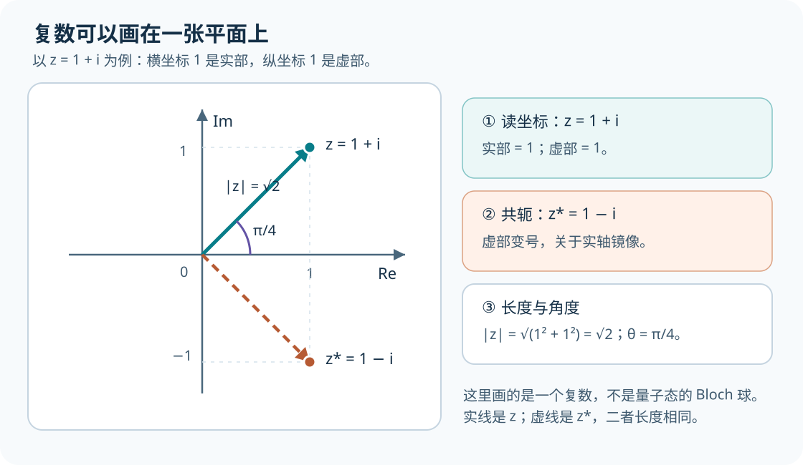

# 01｜够用而不跳步的数学工具

本章只引入后续会直接使用的数学。每遇到一个新符号，先问它是数、向量还是矩阵，再看它有几个分量、怎样计算、结果又是什么。目标不是背公式，而是能自己检查维度、归一化与每一步变换。

如果已有几年没碰数学，不必一次读完。要进入[第 02 章的单比特态与门](02-single-qubit.md)，先读本章第 1–4 节和第 8 节的普通概率部分，边读边做小核对。读到第 02 章后面使用本征值、外积和迹的段落时，再回本章读第 5–6 节；进入[第 03 章的双比特与纠缠](03-multiple-qubits.md)前，再补第 7 节的张量积。第 9 节的复杂度术语可留给算法篇。标着“进阶回看”的证明不是单比特入门的门槛；读本章不需要微积分。

先记住三件熟悉的事：概率在 $0$ 到 $1$ 之间，互斥且穷尽的结果概率加起来是 $1$；向量可以按位置逐项相加；一个复数的模平方总是非负实数。例如四种等可能结果中有一种算成功，单次成功概率是 $1/4$。独立做 $100$ 次，**理论上的平均成功次数**为 $100\times(1/4)=25$；某一批实际次数可能不是 25。第 8 节会从这个区别讲到条件概率和统计波动。

## 1. 复数：相位从这里进入

量子态的振幅可以是复数。先不要急着记指数形式：会把复数相加、相乘、求长度，才看得清后来为什么要取“模平方”。

### 从 $i$ 到两个实数分量

实数中没有哪个数平方后等于 $-1$。为处理这样的平方根，我们引入 $i$，规定 $i^2=-1$。复数写成

$$z=a+bi,$$

其中 $a,b$ 都是实数。$a$ 称为实部，$b$ 称为虚部；“虚部”是实数 $b$，不是整个 $bi$。例如 $3-2i$ 的实部为 $3$、虚部为 $-2$。当 $b=0$ 时，普通实数也包含在复数中。

加减法分别处理两个分量：

$$
(1+2i)+(3-i)=(1+3)+(2-1)i=4+i.
$$

减法也逐项做，但要把后一个括号整体减去：$(1+2i)-(3-i)=1+2i-3+i=-2+3i$。

乘法仍用分配律，遇到 $i^2$ 就换成 $-1$：

$$
\begin{aligned}
(1+2i)(3-i)
&=3-i+6i-2i^2\\
&=3+5i+2=5+5i.
\end{aligned}
$$

一个很有用的搭档是**共轭**。把虚部的符号翻转，便得到 $z=a+bi$ 的共轭 $z^*=a-bi$。两者相乘时，带 $i$ 的交叉项正好抵消：

$$
z^*z=(a-bi)(a+bi)=a^2-b^2i^2=a^2+b^2.
$$

结果是非负实数。这也解释了为何复数除法常要用共轭把分母变成实数。例如

$$
\frac1{1+i}
=\frac{1-i}{(1+i)(1-i)}
=\frac{1-i}{1-i^2}
=\frac{1-i}{2}.
$$

第二步是在分子、分母同乘 $1-i$，分数的值没有改变；分母不能是零。

### 模是长度，相位是方向

把 $a+bi$ 画成平面上的点 $(a,b)$：横轴记实部，纵轴记虚部。点到原点的距离称为复数的**模**，记作 $|z|$。由直角三角形的勾股关系，

$$
|z|=\sqrt{a^2+b^2},\qquad |z|^2=a^2+b^2=z^*z.
$$

例如 $z=1+i$ 对应点 $(1,1)$，所以 $|1+i|=\sqrt{1^2+1^2}=\sqrt2$。别把模 $\sqrt2$ 与模平方 $2$ 混成一个数。

从正实轴逆时针转到点 $(a,b)$ 的方向，所转的角叫**相位**，记作 $\theta$。角度常用弧度：$\pi$ 弧度是半圈，即 $180^\circ$；$\pi/2$ 是直角，$\pi/4$ 是 $45^\circ$。若模 $r=|z|>0$，横坐标与 $r$ 的比值是 $\cos\theta$，纵坐标与 $r$ 的比值是 $\sin\theta$，所以

$$a=r\cos\theta,\qquad b=r\sin\theta.$$

图中上方的 $1+i$ 与下方的 $1-i$ 关于实轴对称：共轭翻转方向，却不改变长度。图上的箭头代表一个**复数**，并非后文表示单量子比特态的 Bloch 球。

因此同一个复数也可写成

$$z=r(\cos\theta+i\sin\theta).$$

还是用 $1+i$ 核对：它在第一象限，两坐标相等，故 $\theta=\pi/4$；代入 $r=\sqrt2$ 后，$\sqrt2\cos(\pi/4)=1$，$\sqrt2\sin(\pi/4)=1$，确实回到 $1+i$。不能只由 $\tan\theta=b/a$ 选角而不看象限：例如 $-1+i$ 在第二象限，相位可取 $3\pi/4$，不是 $-\pi/4$。

绕一整圈回到同一点，所以 $\theta$ 与 $\theta+2\pi k$（$k$ 为任意整数）代表相同方向。零复数 $z=0$ 的模是零，却没有唯一的方向；讨论它的相位没有意义。

**Euler 公式**给上述括号一个紧凑写法：

$$e^{i\theta}=\cos\theta+i\sin\theta,\qquad z=re^{i\theta}.$$

这里 $e$ 是约为 $2.718$ 的数学常数；先把 $e^{i\theta}$ 当作“单位长度、方向为 $\theta$ 的复数”的记号即可，不必先会微积分。例子 $1+i=\sqrt2e^{i\pi/4}$。两个非零复数相乘时，长度相乘、相位相加：

$$
(r_1e^{i\theta_1})(r_2e^{i\theta_2})
=r_1r_2e^{i(\theta_1+\theta_2)}.
$$

拿 $(1+i)(1-i)=2$ 核对：两个因子的长度都是 $\sqrt2$，乘积长度为 $2$；两个方向分别是 $\pi/4$ 和 $-\pi/4$，相加为 $0$，正是正实轴的方向。特别地，乘 $e^{i\phi}$ 只转动方向，不改长度，因为 $|e^{i\phi}|=1$。后文会区分“整个量子态一起乘一个相位”与“只改变各分量之间的相对相位”；二者的实验后果不同。

### 算例：从振幅到概率

设两个测量结果的振幅分别为 $\alpha=(1+i)/2$ 与 $\beta=(1-i)/2$。先算第一个的模平方：

$$
|\alpha|^2=\alpha^*\alpha
=\frac{1-i}{2}\frac{1+i}{2}
=\frac{1-i^2}{4}=\frac12.
$$

同样，$|\beta|^2=((1+i)(1-i))/4=1/2$，两项相加为 $1$。第一个振幅直接平方会得到 $\alpha^2=i/2$，它不是非负实数，不能当作概率。**“概率等于对应振幅的模平方”是量子测量的物理规则**，不是单靠复数运算推出来的定理；这里先练习按规则计算。两个不同相位的振幅可以有相同的模平方，但相位在后续干涉中仍可能起作用。

**马上核对。** $(2-i)(2+i)$ 等于多少？$|3-4i|^2$ 等于多少？前者用共轭相乘得 $4-i^2=5$；后者按两坐标的平方相加得 $3^2+(-4)^2=25$。

## 2. 向量、bra 与 ket

两个数竖着排成一列就是二维**列向量**。先不用量子术语：如果 $p=[1,i]^T$、$q=[2,-i]^T$，上标 $T$ 只是把横排的简写转成列，按位置相加与乘一个数得到

$$
p+q=\begin{bmatrix}1+2\\i-i\end{bmatrix}
=\begin{bmatrix}3\\0\end{bmatrix},\qquad
2p=\begin{bmatrix}2\\2i\end{bmatrix}.
$$

结果仍是两分量列向量，不能把不同位置随意合并。下面的 $\alpha,\beta$ 都可以是复数；用 $\mathbb C^2$ 表示“所有两分量复列向量”的集合。

列向量

$$|\psi\rangle=\begin{bmatrix}\alpha\\\beta\end{bmatrix}$$

在量子计算里称为 **ket**，用来写态 $\psi$。它是 $2\times1$：两行、一列。先把它逐项共轭，再把列转为行，得到它的**共轭转置**

$$\langle\psi|=\begin{bmatrix}\alpha^*&\beta^*\end{bmatrix}$$

这个行向量称为 **bra**，尺寸是 $1\times2$。记号 $\dagger$ 表示“共轭后转置”，所以 $\langle\psi|=(|\psi\rangle)^\dagger$；单独的 $T$ 只转置，不会把 $i$ 改成 $-i$。例如 $|p\rangle=[1,i]^T$ 时，$\langle p|=[1,-i]$，而非 $[1,i]$。

行乘列得到一个数：把对应位置相乘再相加。若 $|\phi\rangle=[\gamma,\delta]^T$，则

$$
\langle\psi|\phi\rangle
=\begin{bmatrix}\alpha^*&\beta^*\end{bmatrix}
\begin{bmatrix}\gamma\\\delta\end{bmatrix}
=\alpha^*\gamma+\beta^*\delta.
$$

这个数称为**内积**；对于更多分量，规则仍是“左边共轭、同位置相乘、最后相加”：

$$\langle\phi|\psi\rangle=\sum_j\phi_j^*\psi_j.$$

求和符号 $\sum_j$ 表示把所有分量位置 $j$ 的结果加起来。

先看图左半：$1\times2$ 的 bra 与 $2\times1$ 的 ket 相乘，内层的两个 2 配得上，所以结果只占 $1\times1$，是一个数。图右半把顺序倒过来，结果占 $2\times2$，是矩阵；第 5 节会把这种乘积正式称为**外积**。两种次序不能互换。

向量与自身的内积是各分量的模平方之和；它的平方根叫**范数**或长度：

$$\|\psi\|=\sqrt{\langle\psi|\psi\rangle}.$$

例如 $\langle p|p\rangle=1\cdot1+(-i)i=2$，所以 $\|p\|=\sqrt2$。把整个向量除以 $\sqrt2$，得到长度为 1 的 $[1,i]^T/\sqrt2$。合法纯态要求范数为 1；这使各计算基振幅的模平方相加为 1。

复数内积为什么要把左边的分量共轭？取两个归一化列向量

$$
|u\rangle=\frac1{\sqrt2}\begin{bmatrix}1\\i\end{bmatrix},
\qquad
|w\rangle=\frac1{\sqrt2}\begin{bmatrix}1\\-i\end{bmatrix}.
$$

因为 $i^*=-i$，

$$
\langle u|w\rangle
=\frac{1+(-i)(-i)}2=0,
\qquad
\langle u|u\rangle
=\frac{1+(-i)i}2=1.
$$

若省掉共轭，向量与自身相乘便不再保证得到非负实数，不能用来表示长度平方。

### 算例：归一化

给定 $|s\rangle=[1,1+i]^T$，先求

$$\langle s|s\rangle=1+|1+i|^2=1+2=3.$$

因此归一化态是

$$|\psi\rangle=\frac1{\sqrt3}\begin{bmatrix}1\\1+i\end{bmatrix}.$$

### 进阶回看：后文用到的一个内积不等式

第一次阅读可以先记住结论 $|\langle u|v\rangle|\le\|u\|\|v\|$，学完基和投影再回来看证明。它说两个向量的内积模不可能超过各自长度之积。

对非零向量 $|u\rangle$ 和任意向量 $|v\rangle$，把 $|v\rangle$ 沿 $|u\rangle$ 的部分减去：

$$
|w\rangle=|v\rangle-
\frac{\langle u|v\rangle}{\langle u|u\rangle}|u\rangle.
$$

直接计算 $\langle u|w\rangle=\langle u|v\rangle-\langle u|v\rangle=0$，所以 $|w\rangle$ 与 $|u\rangle$ 正交。若设 $c=\langle u|v\rangle/\langle u|u\rangle$，把 $|w\rangle=|v\rangle-c|u\rangle$ 的范数平方逐项展开：

$$
\begin{aligned}
\langle w|w\rangle
&=\langle v|v\rangle-c\langle v|u\rangle
-c^*\langle u|v\rangle+|c|^2\langle u|u\rangle\\
&=\langle v|v\rangle-
\frac{|\langle u|v\rangle|^2}{\langle u|u\rangle}.
\end{aligned}
$$

第二行用到了 $\langle v|u\rangle=\langle u|v\rangle^*$。范数平方非负，故

$$
0\le\langle w|w\rangle
=\langle v|v\rangle-
\frac{|\langle u|v\rangle|^2}{\langle u|u\rangle}.
$$

移项后得到 Cauchy–Schwarz 不等式

$$
|\langle u|v\rangle|^2
\le\langle u|u\rangle\langle v|v\rangle.
$$

它说内积的模不可能大于两个向量的长度乘积；[Q2 的不确定关系](quantum-mechanics/02-observables-dynamics.md)正从这一式出发。若 $|u\rangle=0$，两边都是零，不必做上面的除法。

### 全局相位不改变物理态

对任意实数 $\theta_{\rm g}$，$|\psi\rangle$ 与 $e^{i\theta_{\rm g}}|\psi\rangle$ 表示同一个纯态。先用已出现的“振幅取模平方得到概率”检查：若某一测量结果的振幅为 $c$，给整个态乘相位后，它变成 $e^{i\theta_{\rm g}}c$，而

$$
|e^{i\theta_{\rm g}}c|^2
=(e^{i\theta_{\rm g}}c)^*(e^{i\theta_{\rm g}}c)
=e^{-i\theta_{\rm g}}e^{i\theta_{\rm g}}c^*c=|c|^2.
$$

这个结论不依赖选哪一组测量基，因为整个态的共同因子会同样乘到每个结果的振幅上。下一节会定义 $|+\rangle,|-\rangle$：$|+\rangle$ 与 $i|+\rangle$ 只相差全局相位，而 $|+\rangle$ 与 $|-\rangle$ 的两个分量之间有不同的**相对相位**，可由第 02 章的 Hadamard 门实验区分。后文说“忽略全局相位”时，忽略的是整个态共同乘上的因子，不是随意删掉某个分量的相位。

## 3. 正交归一基与展开

“基”是一套足以拼出空间中任意向量的基本方向。二维向量 $[a,b]^T$ 总能写成

$$
\begin{bmatrix}a\\b\end{bmatrix}
=a\begin{bmatrix}1\\0\end{bmatrix}
+b\begin{bmatrix}0\\1\end{bmatrix}.
$$

因此 $|0\rangle=[1,0]^T$、$|1\rangle=[0,1]^T$ 是一组二维**计算基**；数 $a,b$ 是它的坐标。两个方向若内积为零，叫**正交**；每个方向长度为 1，叫**归一**。一组基同时具备这两点，就叫正交归一基。还须确认方向足够多，能拼出**任意**向量：三维空间里只有两个正交单位向量，仍不是整个三维空间的一组基。

一组基 $\{|e_j\rangle\}$ 若满足

$$\langle e_j|e_k\rangle=\delta_{jk},$$

就称为正交归一基。这里 $\delta_{jk}$ 在 $j=k$ 时为 1，在 $j\ne k$ 时为 0。任何向量都可展开为

$$|\psi\rangle=\sum_j c_j|e_j\rangle,\qquad c_j=\langle e_j|\psi\rangle.$$

后一式可自己推出：从展开式左边乘 $\langle e_k|$，得到 $\langle e_k|\psi\rangle=\sum_j c_j\langle e_k|e_j\rangle$。由于不同方向的内积为 0，只剩 $j=k$ 那项，其值是 $c_k$。求和符号只是把每个方向的贡献相加，并非要先会一套新的运算法则。

另一组常用的二维基为

$$|+\rangle=\frac{|0\rangle+|1\rangle}{\sqrt2},\qquad
|-\rangle=\frac{|0\rangle-|1\rangle}{\sqrt2}.$$

两者范数都是 1，而且 $\langle+|-\rangle=(1-1)/2=0$。相加与相减能还原 $|0\rangle$ 和 $|1\rangle$，所以它们足以拼出任意二维向量。拿同一个 $|0\rangle$ 作对照：在计算基中坐标是 $(1,0)$；在新基中，逐项求内积给出

$$
\langle+|0\rangle=\frac1{\sqrt2},\qquad
\langle-|0\rangle=\frac1{\sqrt2}.
$$

由此还原

$$|0\rangle=\frac{|+\rangle+|-\rangle}{\sqrt2}$$

可见“状态是什么”不等于“某个固定基里的坐标是什么”；改变基会改变坐标表示，不改变物理态。若按计算基测量 $|0\rangle$，结果概率是 $(1,0)$；按 $|+\rangle,|-\rangle$ 基测量同一个态，结果概率是 $(1/2,1/2)$。这是测量方向变了，不是态忽然变了。

再用一个含复数的态检查换基。对 $|\psi\rangle=(|0\rangle+i|1\rangle)/\sqrt2$，两个新坐标是

$$
c_+=\langle+|\psi\rangle=\frac{1+i}{2},\qquad
c_-=\langle-|\psi\rangle=\frac{1-i}{2}.
$$

它们的模平方各为 $1/2$。反过来展开 $c_+|+\rangle+c_-|-\rangle$，$|0\rangle$ 前的系数是 $(c_++c_-)/\sqrt2=1/\sqrt2$，$|1\rangle$ 前的是 $(c_+-c_-)/\sqrt2=i/\sqrt2$，正好回到原态。**暂停算一格：** $|1\rangle$ 在 $|+\rangle,|-\rangle$ 基中的坐标是多少？核对：$1/\sqrt2,-1/\sqrt2$，两个模平方相加仍是 1。

### F71-01｜换坐标与真正做门，怎样分开

本节说“换基不改变物理态”，下一节却会说“$H$ 门把态变了”。区别在于下面两种情况。

**只改写坐标时，表示同一测量的矩阵也必须一起改写；真的施加门时，通常仍用原先固定的测量装置。**

学过下一节的矩阵乘法后，回来算这个含复数的例子。

把新基取为 $|{+i}\rangle=(|0\rangle+i|1\rangle)/\sqrt2$ 与 $|{-i}\rangle=(|0\rangle-i|1\rangle)/\sqrt2$。将它们在旧基中的列向量依次排为一个 $2\times2$ 矩阵：

$$
W=\frac1{\sqrt2}\begin{bmatrix}1&1\\i&-i\end{bmatrix},
\qquad W^\dagger W=I.
$$

若旧坐标是 $\psi$，新坐标 $c$ 要满足 $\psi=Wc$，所以 $c=W^\dagger\psi$。对同一个 $|0\rangle$，$c=(1,1)^T/\sqrt2$；这两个数说的是“在 $\pm i$ 基中的展开”，没有把粒子制备成旧基里的 $|+\rangle$。

以旧基里的 $Z=\operatorname{diag}(1,-1)$ 测量为例。同一测量在新基中表示为

$$
Z_{\rm new}=W^\dagger ZW
=\frac12\begin{bmatrix}1&-i\\1&i\end{bmatrix}
\begin{bmatrix}1&1\\-i&i\end{bmatrix}
=\begin{bmatrix}0&1\\1&0\end{bmatrix}=X.
$$

因此旧表示给 $\psi^\dagger Z\psi=1$，新表示给 $c^\dagger Z_{\rm new}c=c^\dagger Xc=1$，预测相同。一般地，$c^\dagger(W^\dagger AW)c=\psi^\dagger A\psi$，因为 $WW^\dagger=I$。

若实际对初态 $|0\rangle$ **施加**酉门 $W^\dagger$，输出在仍固定的计算基中是 $|+\rangle$；随后仍测旧装置 $Z$，结果就各半、期望为 0。这里 $W^\dagger$ 数值相同，但描述的实验不同。报告门与测量时应分别写“状态怎样变”“测量方向是什么”。

**练习与答案。** 对输入 $|{+i}\rangle$，正确的新坐标是什么？$W^\dagger|{+i}\rangle=(1,0)^T$。若错用 $W^T$，第二个坐标反而成为 1，因为 $(i)(i)=-1$；普通转置遗漏共轭，把两个方向认反。运行 `python3 codes/foundations/round71_checks.py --case 01`；[代码与固定样本](../codes/foundations/round71-README.md)同时核验坐标、算符和两种实验。换基公式是有限维线性代数；一般表示可对照 [Watrous 数学预备](https://cs.uwaterloo.ca/~watrous/TQI/TQI.double.1.pdf)（访问 2026-10-13）。

## 4. 矩阵与线性算符

矩阵可以看作一张按行列排列的数字表。一个 $2\times2$ 矩阵有两行、两列；它乘一个 $2\times1$ 列向量，结果是 $2\times1$。通用规则是每一行分别与输入列“同位置相乘，再相加”：

$$
\begin{bmatrix}a&b\\c&d\end{bmatrix}
\begin{bmatrix}x\\y\end{bmatrix}
=\begin{bmatrix}ax+by\\cx+dy\end{bmatrix}.
$$

中间尺寸必须相同：$m\times n$ 的矩阵只能乘 $n$ 分量的列向量，输出有 $m$ 分量。稍后遇到两个矩阵相乘时也用同一规则：左矩阵的一行逐项乘右矩阵的一列。比如

$$
A=\begin{bmatrix}1&2\\0&1\end{bmatrix},\qquad
B=\begin{bmatrix}0&1\\1&0\end{bmatrix},
$$

则 $AB$ 左上角是 $1\cdot0+2\cdot1=2$，其余三格依次给出

$$
AB=\begin{bmatrix}2&1\\1&0\end{bmatrix},\qquad
BA=\begin{bmatrix}0&1\\1&2\end{bmatrix}.
$$

两者不相同，所以矩阵一般不能交换顺序。对列向量，$AB|v\rangle=A(B|v\rangle)$：**右边的 $B$ 先作用**。

还要分清三个容易混淆的符号。$M^T$ 只把行列互换，$M^*$ 只把每个复数换成其共轭，$M^\dagger=(M^*)^T$ 两步都做。以

$$
M=\begin{bmatrix}1&i\\0&2\end{bmatrix}
$$

为例，三种结果分别是

$$
M^T=\begin{bmatrix}1&0\\i&2\end{bmatrix},\quad
M^*=\begin{bmatrix}1&-i\\0&2\end{bmatrix},\quad
M^\dagger=\begin{bmatrix}1&0\\-i&2\end{bmatrix}.
$$

单位矩阵 $I=\bigl[\begin{smallmatrix}1&0\\0&1\end{smallmatrix}\bigr]$ 的作用像数字 1：$I|v\rangle=|v\rangle$、$AI=IA=A$。有了行乘列、共轭转置和单位矩阵，再看下面的量子门性质便有了具体运算依据。

### 先手算一次矩阵乘向量

第 02 章的 Hadamard 门是一个 $2\times2$ 矩阵：

$$
H=\frac1{\sqrt2}
\begin{bmatrix}1&1\\1&-1\end{bmatrix}.
$$

对 $|0\rangle=[1,0]^T$，第一行给 $(1\cdot1+1\cdot0)/\sqrt2=1/\sqrt2$，第二行给 $(1\cdot1-1\cdot0)/\sqrt2=1/\sqrt2$，于是

$$
H|0\rangle
=\frac1{\sqrt2}\begin{bmatrix}1\\1\end{bmatrix}
=|+\rangle.
$$

矩阵有两行，输出便有两个分量；每个输出分量都是对应行与输入列逐项相乘后相加。

两矩阵相乘时也逐格这样做。$H$ 是实对称矩阵，故 $H^\dagger=H$；乘一次看看：

$$
\begin{aligned}
H^\dagger H=H^2
&=\frac12
\begin{bmatrix}1&1\\1&-1\end{bmatrix}
\begin{bmatrix}1&1\\1&-1\end{bmatrix}\\
&=\frac12
\begin{bmatrix}1+1&1-1\\1-1&1+1\end{bmatrix}
=\begin{bmatrix}1&0\\0&1\end{bmatrix}=I.
\end{aligned}
$$

下面四种性质会在后文反复出现。第一次阅读先抓住前两行的作用；正半定与谱分解可在第 05 章需要密度矩阵时回看。

| 性质 | 可检查的定义 | 直观作用 |
|---|---|---|
| 厄米（Hermitian） | $A=A^\dagger$ | 测量可观察量由这类矩阵表示；测得的数是实数 |
| 酉（unitary） | $U^\dagger U=UU^\dagger=I$ | 可逆且保持向量长度，例如上面的 $H$ |
| 投影（projector） | $P=P^\dagger=P^2$ | 保留某个方向的分量，去掉垂直方向的分量 |
| 正半定（positive semidefinite） | $A=A^\dagger$，且任意 $|v\rangle$ 都有 $\langle v|A|v\rangle\ge0$ | 后文的密度矩阵与测量效果算符会用到 |

例如 $P=\bigl[\begin{smallmatrix}1&0\\0&0\end{smallmatrix}\bigr]$ 作用于 $[a,b]^T$ 得 $[a,0]^T$，再次作用结果不变，故 $P^2=P$。它是“投到第一个坐标方向”在二维中的精确含义；不是把一个概率任意设成零。正半定定义里的不等号比较实数，厄米条件保证 $\langle v|A|v\rangle$ 为实数；用本征值作进一步判断等学完第 5 节再说。

**暂停算一格。** 求 $H|1\rangle$。核对：输入是 $[0,1]^T$，所以直接取 $H$ 的第二列，得到 $(|0\rangle-|1\rangle)/\sqrt2=|-\rangle$。

### 为什么酉矩阵保持概率

若 $|\psi'\rangle=U|\psi\rangle$ 且 $U^\dagger U=I$，则

$$
\langle\psi'|\psi'\rangle
=\langle\psi|U^\dagger U|\psi\rangle
=\langle\psi|I|\psi\rangle
=\langle\psi|\psi\rangle.
$$

所以原来归一化的态（$\langle\psi|\psi\rangle=1$）经过酉矩阵后仍归一化，总概率仍为 1；即使输入并未归一化，它的长度也保持不变。

更一般地，两态的内积也不变：$\langle U\phi|U\psi\rangle=\langle\phi|U^\dagger U|\psi\rangle=\langle\phi|\psi\rangle$。在这里 $U^{-1}=U^\dagger$，意思是做完 $U$ 后还存在能撤销它的矩阵。**总概率不变不等于每个结果概率不变**：$H$ 把 $|0\rangle$ 变成 $|+\rangle$，计算基概率从 $(1,0)$ 变成 $(1/2,1/2)$，但两次总和都是 1。

## 5. 本征值、本征向量与谱分解

某些向量经过矩阵作用后，结果仍是原向量的数倍（也可能反向）。若存在一个**非零**向量 $|v\rangle$ 满足

$$A|v\rangle=\lambda|v\rangle,$$

则 $|v\rangle$ 叫**本征向量**，$\lambda$ 叫**本征值**；线性代数教材也叫“特征向量”和“特征值”。必须排除零向量，因为 $A0=\lambda0$ 对任何 $\lambda$ 都成立，不能用它判定本征值。这里的“方向不变”允许向量反向，例如本征值 $-1$。

### 算例：Pauli $X$

$$X=\begin{bmatrix}0&1\\1&0\end{bmatrix}.$$

设非零 $|v\rangle=[x,y]^T$。左边 $X|v\rangle=[y,x]^T$，右边是 $[\lambda x,\lambda y]^T$，因此必须同时满足 $y=\lambda x$ 与 $x=\lambda y$。若 $x=0$，第一式也使 $y=0$，违背“非零”，所以 $x\ne0$。把第一式代入第二式，得 $x=\lambda^2x$，于是 $\lambda^2=1$，即 $\lambda=+1$ 或 $-1$。

取 $\lambda=+1$ 时 $y=x$，归一化后是 $|+\rangle=[1,1]^T/\sqrt2$；取 $\lambda=-1$ 时 $y=-x$，归一化后是 $|-\rangle=[1,-1]^T/\sqrt2$。可以直接乘回去检查 $X|+\rangle=|+\rangle$、$X|-\rangle=-|-\rangle$。

### 先认识外积，再写谱分解

上面已经会算 bra 乘 ket：$1\times2$ 行乘 $2\times1$ 列，得到一个数。反过来，ket 乘 bra 得 $2\times2$ 矩阵，叫**外积**。逐格规则是

$$
\begin{bmatrix}a\\b\end{bmatrix}
\begin{bmatrix}c^*&d^*\end{bmatrix}
=\begin{bmatrix}ac^*&ad^*\\bc^*&bd^*\end{bmatrix}.
$$

例如 $|+\rangle\langle+|$ 和 $|-\rangle\langle-|$ 是

$$
P_+=\frac12\begin{bmatrix}1&1\\1&1\end{bmatrix},\qquad
P_-=\frac12\begin{bmatrix}1&-1\\-1&1\end{bmatrix}.
$$

$P_+$ 把向量在 $|+\rangle$ 方向上的部分保留：$P_+|\psi\rangle=|+\rangle\langle+|\psi\rangle$；再作用一次结果不变，所以 $P_+^2=P_+$。这与上一节的投影矩阵定义相接。逐格相减可核对

$$X=|+\rangle\langle+|-|-\rangle\langle-|.$$

确实是 $\tfrac12\bigl[\begin{smallmatrix}0&2\\2&0\end{smallmatrix}\bigr]=\bigl[\begin{smallmatrix}0&1\\1&0\end{smallmatrix}\bigr]$。这个式子把 $X$ 分成“在 $|+\rangle$ 方向乘 $+1$”与“在 $|-\rangle$ 方向乘 $-1$”两部分。

有限维厄米矩阵都可以选一组正交归一的本征向量 $|v_j\rangle$，于是一般写成

$$A=\sum_j\lambda_j|v_j\rangle\langle v_j|.$$

这叫**谱分解**；$X=P_+-P_-$ 就是可逐格核对的二阶例子。测量可观察量 $A$ 时，可能结果是本征值；得到某个本征值的概率由态投到对应本征空间的长度平方决定。若多个本征向量具有同一本征值，要把它们的投影加起来，不能只取其中一个。对 $|0\rangle$ 测量 $X$，$|\langle+|0\rangle|^2=|\langle-|0\rangle|^2=1/2$，所以 $+1,-1$ 各占一半。

**暂停算一格。** $Z=\bigl[\begin{smallmatrix}1&0\\0&-1\end{smallmatrix}\bigr]$ 的两个本征向量与本征值是什么？核对：$Z|0\rangle=+|0\rangle$，$Z|1\rangle=-|1\rangle$；它们已正交归一。

## 6. 迹、密度矩阵与正半定：用到时回看

上一节已经把外积算成矩阵。**迹**只做一件事：把方阵主对角线上的数相加。例如 $\bigl[\begin{smallmatrix}a&b\\c&d\end{smallmatrix}\bigr]$ 的迹是 $a+d$，一般记作 $\operatorname{Tr}(A)=\sum_iA_{ii}$。它是一个数，不是一条新的向量。

以第 3 节的 $|\psi\rangle=(|0\rangle+i|1\rangle)/\sqrt2$ 为例，先共轭转置得到 $\langle\psi|=[1,-i]/\sqrt2$，再列乘行，得到**纯态密度矩阵**

$$
\rho=|\psi\rangle\langle\psi|
=\frac12\begin{bmatrix}1\\i\end{bmatrix}
\begin{bmatrix}1&-i\end{bmatrix}
=\frac12\begin{bmatrix}1&-i\\i&1\end{bmatrix}.
$$

这里的 $\rho$ 不是另造的量子态，而是同一个纯态 $|\psi\rangle$ 的矩阵表示。逐格检查：$\rho^\dagger=\rho$；对角线给 $\operatorname{Tr}(\rho)=1/2+1/2=1$；因为 $\langle\psi|\psi\rangle=1$，再作用一次有 $\rho^2=|\psi\rangle\langle\psi|\psi\rangle\langle\psi|=\rho$。这些性质以后会用来检查状态表示，当前只需能重算这个 $2\times2$ 例子。

投到 $|0\rangle$ 的矩阵为 $P_0=|0\rangle\langle0|=\bigl[\begin{smallmatrix}1&0\\0&0\end{smallmatrix}\bigr]$。把它放在左边逐行乘 $\rho$：

$$
P_0\rho=
\begin{bmatrix}1&0\\0&0\end{bmatrix}
\frac12\begin{bmatrix}1&-i\\i&1\end{bmatrix}
=\frac12\begin{bmatrix}1&-i\\0&0\end{bmatrix}.
$$

于是 $\operatorname{Tr}(P_0\rho)=1/2+0=1/2$，与直接算振幅 $|\langle0|\psi\rangle|^2=|1/\sqrt2|^2=1/2$ 一致。这样，“迹”不是孤立的缩写，而是另一种写概率的办法。

对尺寸相容的矩阵，交换**迹里面的循环顺序**不改变结果：

$$
\operatorname{Tr}(AB)
=\sum_{i,j}A_{ij}B_{ji}
=\operatorname{Tr}(BA).
$$

其中第一步是先写出 $AB$ 的第 $i$ 个对角元，再把所有 $i$ 相加；第二步把 $i,j$ 的名字互换，并用单个复数相乘可以交换顺序，便得到 $\operatorname{Tr}(BA)$。循环换位不等于矩阵本身可交换，上一节已算出 $AB\ne BA$。同理，$|a\rangle\langle b|$ 的对角元为 $a_i b_i^*$，故 $\operatorname{Tr}(|a\rangle\langle b|)=\sum_i b_i^*a_i=\langle b|a\rangle$。

### 进阶回看：正半定为什么不能只看对角线

矩阵 $A$ **正半定**，记作 $A\succeq0$，是说 $A=A^\dagger$，且任何列向量 $|v\rangle$ 都满足 $\langle v|A|v\rangle\ge0$。例如 $\rho=|\psi\rangle\langle\psi|$ 自动满足，因为 $\langle v|\rho|v\rangle=|\langle\psi|v\rangle|^2\ge0$。厄米条件使这里比较的是实数。有限维厄米矩阵的正半定条件也等价于“本征值全都非负”。

含复数的例子同样可以检查。取 $|w\rangle=[1,-i]^T$，则

$$
A=|w\rangle\langle w|
=\begin{bmatrix}1&i\\-i&1\end{bmatrix}.
$$

由于它是外积，任意 $|v\rangle$ 都有 $\langle v|A|v\rangle=|\langle w|v\rangle|^2\ge0$。此外 $A|w\rangle=2|w\rangle$、$A[-i,1]^T=0$，所以两个本征值是 2 和 0。反过来，对角元非负**不足以**保证正半定：$\bigl[\begin{smallmatrix}1&2\\2&1\end{smallmatrix}\bigr][1,-1]^T=-[1,-1]^T$，已经有负本征值。不能对任意非厄米矩阵只看其本征值来判断正半定。

**暂停算一格。** $|0\rangle\langle1|$ 的四格是什么、迹是多少？核对：$\bigl[\begin{smallmatrix}0&1\\0&0\end{smallmatrix}\bigr]$，迹为 0。

## 7. 张量积：组合系统的语言

两个量子比特合在一起时，需要同时说明“第一个是什么、第二个是什么”。本书把第一个比特写在左边：$|01\rangle=|0\rangle\otimes|1\rangle$。符号 $\otimes$ 读作“张量积”，在这里是把两个单比特状态组成一个双比特状态，**不是**求两个向量的内积。

先看一般情形。若

$$|a\rangle=\begin{bmatrix}a_0\\a_1\end{bmatrix},\qquad
|b\rangle=\begin{bmatrix}b_0\\b_1\end{bmatrix},$$

则 $|a\rangle=a_0|0\rangle+a_1|1\rangle$，$|b\rangle=b_0|0\rangle+b_1|1\rangle$。像普通乘法分配律那样，每一项都要与另一边的每一项相乘：

$$
\begin{aligned}
|a\rangle\otimes|b\rangle
&=(a_0|0\rangle+a_1|1\rangle)\otimes(b_0|0\rangle+b_1|1\rangle)\\
&=a_0b_0|00\rangle+a_0b_1|01\rangle
  +a_1b_0|10\rangle+a_1b_1|11\rangle.
\end{aligned}
$$

按 $|00\rangle,|01\rangle,|10\rangle,|11\rangle$ 排列，这四个系数成为一个列向量：

$$
|a\rangle\otimes|b\rangle
=\begin{bmatrix}a_0b_0\\a_0b_1\\a_1b_0\\a_1b_1\end{bmatrix}.
$$

两个输入各有 2 个位置，联合状态有 $2\times2=4$ 个位置；一般地，$m$ 维向量与 $n$ 维向量的张量积是 $mn$ 维向量。先固定基的排列顺序，才能知道四维列向量中每一格的含义。

这个顺序也固定了矩阵行列的含义。例如四维列向量

$$
\begin{bmatrix}0\\0\\1\\0\end{bmatrix}
$$

在本书中表示 $|10\rangle$。某些软件把编号较小的量子比特放在显示字符串的右边；看到输出 `10` 时，必须先查看软件说明和线路编号，不能仅凭字符串猜它对应哪条线路为 1。

### 完整算例

取 $|a\rangle=|+\rangle=(|0\rangle+|1\rangle)/\sqrt2$，$|b\rangle=|1\rangle$：

$$
|+\rangle\otimes|1\rangle
=\frac1{\sqrt2}(|0\rangle+|1\rangle)\otimes|1\rangle
=\frac1{\sqrt2}(|01\rangle+|11\rangle)
=\frac1{\sqrt2}\begin{bmatrix}0\\1\\0\\1\end{bmatrix}.
$$

再算一个带复数的例子。取 $|a\rangle=(|0\rangle+i|1\rangle)/\sqrt2$、$|b\rangle=(|0\rangle+|1\rangle)/\sqrt2$。每个分量都有一个 $1/\sqrt2$，所以联合态的四个分量各带 $1/2$：

$$
|a\rangle\otimes|b\rangle
=\frac12(|00\rangle+|01\rangle+i|10\rangle+i|11\rangle)
=\frac12\begin{bmatrix}1\\1\\i\\i\end{bmatrix}.
$$

检查归一化：四个振幅的模平方都是 $1/4$，相加为 $1$。把两个归一化态合在一起，仍得到归一化态。

**随手核对。** $|1\rangle\otimes|+\rangle$ 的四维列向量是什么？先写成 $(|10\rangle+|11\rangle)/\sqrt2$，就得到 $[0,0,1,1]^T/\sqrt2$。它与上面的 $|+\rangle\otimes|1\rangle$ 不同，两个系统的先后次序不能随意交换。

### 算例：只对第一个比特作用

$I=\left[\begin{smallmatrix}1&0\\0&1\end{smallmatrix}\right]$ 是 $2\times2$ 单位矩阵，$I|0\rangle=|0\rangle$、$I|1\rangle=|1\rangle$。运算 $(H\otimes I)|01\rangle$ 中，$H$ 作用在左边的第一个比特，$I$ 让右边的第二个比特保持原样。先沿用单比特规则计算：

$$
\begin{aligned}
(H\otimes I)|01\rangle
&=(H|0\rangle)\otimes(I|1\rangle)\\
&=\frac{|0\rangle+|1\rangle}{\sqrt2}\otimes|1\rangle\\
&=\frac{|01\rangle+|11\rangle}{\sqrt2}
=\frac1{\sqrt2}\begin{bmatrix}0\\1\\0\\1\end{bmatrix}.
\end{aligned}
$$

现在把同一运算写成 $4\times4$ 矩阵。矩阵的张量积按“每一个数都乘上整个右侧矩阵”来排块；$H$ 的四个数是 $1,1,1,-1$，所以

$$
H\otimes I
=\frac1{\sqrt2}\begin{bmatrix}I&I\\I&-I\end{bmatrix}
=\frac1{\sqrt2}\begin{bmatrix}
1&0&1&0\\
0&1&0&1\\
1&0&-1&0\\
0&1&0&-1
\end{bmatrix}.
$$

这里第一、第二个大行块各占两行；每个 $I$ 也各占两列。因此 $2\times2$ 的算符与 $2\times2$ 的算符组合后，尺寸是 $4\times4$，能作用在四维的双比特态上。矩阵的**第几列**，就是它作用在对应的第几个基向量上的输出。按 $00,01,10,11$ 的顺序逐列看：

| 输入 | 输出 | 输出的四个分量（均除以 $\sqrt2$） |
|---|---|---|
| $|00\rangle$ | $(|00\rangle+|10\rangle)/\sqrt2$ | $(1,0,1,0)^T$ |
| $|01\rangle$ | $(|01\rangle+|11\rangle)/\sqrt2$ | $(0,1,0,1)^T$ |
| $|10\rangle$ | $(|00\rangle-|10\rangle)/\sqrt2$ | $(1,0,-1,0)^T$ |
| $|11\rangle$ | $(|01\rangle-|11\rangle)/\sqrt2$ | $(0,1,0,-1)^T$ |

例如 $|01\rangle=[0,1,0,0]^T$ 只选中了矩阵的第二列，所以得到 $[0,1,0,1]^T/\sqrt2$，与上面的分步计算完全相同。

如果改为“第一个不动，只对第二个用 $H$”，矩阵的块位置便不同：

$$
I\otimes H
=\begin{bmatrix}H&0\\0&H\end{bmatrix}
=\frac1{\sqrt2}\begin{bmatrix}
1&1&0&0\\1&-1&0&0\\0&0&1&1\\0&0&1&-1
\end{bmatrix}.
$$

它作用于同一个 $|01\rangle$，得到第一组块中的第二列：$(|00\rangle-|01\rangle)/\sqrt2$。这里的 $0$ 是 $2\times2$ 零矩阵，不是一个数值为零的单格。由此也能看出 $H\otimes I$ 与 $I\otimes H$ 不可混写。

**随手核对。** 对输入 $|10\rangle$，分别计算两个矩阵的输出。$H\otimes I$ 的第三列给 $(|00\rangle-|10\rangle)/\sqrt2$；$I\otimes H$ 的第三列给 $(|10\rangle+|11\rangle)/\sqrt2$。

最后区分两个相近的说法：“双比特态属于张量积空间”是说它能写成 $|00\rangle,|01\rangle,|10\rangle,|11\rangle$ 的线性组合；这**不保证**它本身能写成一个 $|a\rangle\otimes|b\rangle$。例如归一化态

$$|\Phi^+\rangle=\frac{|00\rangle+|11\rangle}{\sqrt2}$$

就不能拆成一个乘积。若能拆开，四个系数须依次是 $a_0b_0,a_0b_1,a_1b_0,a_1b_1$；因此必有 $(a_0b_0)(a_1b_1)=(a_0b_1)(a_1b_0)$。但此态左边是 $(1/\sqrt2)^2=1/2$，右边是 $0\cdot0=0$，矛盾。第 03 章会把这类不能拆开的双比特纯态称为**纠缠态**。

## 8. 概率、条件概率与期望值

量子测量给出一个经典结果。要谈“测到某结果的概率”或“平均读数”，仍需会用普通概率。这里所有例子先用有限个可能结果，不需要积分。

### 事件：先数清分母

一次试验所有可能结果组成**样本空间**。例如抛一枚硬币，样本空间是“正面、反面”；“出现正面”是一个**事件**。若有四个等可能结果，而其中一个满足事件 $A$，则 $\Pr(A)=1/4$。只有结果确实等可能时，才能直接用“有利个数除以总个数”；不等可能时，要把各结果的概率相加。互不重叠且覆盖所有结果的事件，概率总和为 $1$。

记号 $A\cap B$ 意为“$A$ 与 $B$ 同时发生”，$A^c$ 意为“$A$ 没发生”。假设一个便于算数的 100 人例子：20 人有性质 $A$，其中 16 人测试阳性；其余 80 人没有 $A$，其中 8 人阳性。把所有人数写在同一张表中：

|  | 阳性 $+$ | 阴性 $-$ | 合计 |
|---|---:|---:|---:|
| 有 $A$ | 16 | 4 | 20 |
| 无 $A$ | 8 | 72 | 80 |
| 合计 | 24 | 76 | 100 |

在全体 100 人中，既有 $A$ 又阳性的有 16 人，所以 $\Pr(A\cap +)=16/100$。若问题改为“**已经知道是阳性**，此人有 $A$ 的概率多少”，候选人只剩 24 位阳性者；其中 16 人有 $A$，答案是 $16/24=2/3$。这个“先限定一部分结果，再在其中计算”的概率叫**条件概率**：

$$
\Pr(A\mid B)=\frac{\Pr(A\cap B)}{\Pr(B)},
\qquad \Pr(B)>0.
$$

竖线读作“在 $B$ 已发生的条件下”。分母是限定后的 $B$，不能仍用全体人数。方向也不能反过来：本例 $\Pr(A\mid +)=16/24=2/3$，而 $\Pr(+\mid A)=16/20=4/5$。

### Bayes 公式：把已知方向倒过来

有时我们知道“有 $A$ 时阳性的概率”，却想知道“阳性后有 $A$ 的概率”。由上面的条件概率定义，同一件“$A$ 且阳性”可写成

$$
\Pr(A\cap +)
=\Pr(+\mid A)\Pr(A)
=\Pr(A\mid +)\Pr(+).
$$

把等式右边两种写法相等，并除以 $\Pr(+)>0$，就得到 **Bayes 公式**：

$$
\Pr(A\mid +)=\frac{\Pr(+\mid A)\Pr(A)}{\Pr(+)}.
$$

分母不是凭空给出的。阳性者由“有 $A$ 且阳性”和“无 $A$ 且阳性”两组互不重叠的人组成，所以

$$
\begin{aligned}
\Pr(+)
&=\Pr(+\mid A)\Pr(A)
 +\Pr(+\mid A^c)\Pr(A^c)\\
&=\frac45\frac15+\frac1{10}\frac45
=\frac{24}{100}.
\end{aligned}
$$

代回去，$\Pr(A\mid +)=(4/5)(1/5)/(24/100)=16/24=2/3$，与直接数阳性者吻合。上面的 100 人只是一组教学数字，不是实际筛查数据。对任意事件 $B$，只要相关条件概率有定义，同理有 $\Pr(A\mid B)=\Pr(B\mid A)\Pr(A)/\Pr(B)$。

这里要区分两种“更新”：得知一条经典记录后，我们用条件概率更新对可能分支的描述；实际进行量子测量，还可能改变被测系统的状态。第 02 章会在同一个量子例子中说明后者。

### 期望：按概率加权的平均

**随机变量**是给每种可能结果指定一个数字的规则。比如一次试验成功记作 $X=1$，失败记作 $X=0$。若成功概率为 $1/4$、失败概率为 $3/4$，可列成一张概率表：

| $X$ 的取值 $x$ | $0$ | $1$ |
|---|---:|---:|
| 概率 $p(x)$ | $3/4$ | $1/4$ |

概率应先核对：$3/4+1/4=1$。$X$ 的**期望值**是每个取值乘其概率再相加，表示大量同样试验的长期平均，不保证任何一次恰好取到这个数：

$$
\mathbb E[X]=0\cdot\frac34+1\cdot\frac14=\frac14.
$$

若关心取值的某个函数 $f(X)$，只须先对各取值算 $f(x)$，再照样加权：

$$\mathbb E[f(X)]=\sum_xp(x)f(x).$$

求和号 $\sum_x$ 就是“把所有可能的 $x$ 对应的项加起来”。例如令 $f(x)=x^2$，上表给 $\mathbb E[X^2]=0^2(3/4)+1^2(1/4)=1/4$。这里 $x$ 是某个具体取值，$X$ 是每次试验前尚未确定的随机变量。

### 方差：平均偏离有多大

期望相同的两种试验，结果可能一个很集中、一个很分散。设均值为 $\mu=\mathbb E[X]$。每个结果与均值的差是 $X-\mu$；差可能一正一负，直接平均会抵消，因此先平方，再取期望，得到**方差**。**标准差**是方差的平方根，记作 $\operatorname{sd}$，它与 $X$ 有相同单位：

$$
\operatorname{Var}(X)
=\mathbb E[(X-\mu)^2],\qquad
\operatorname{sd}(X)=\sqrt{\operatorname{Var}(X)}.
$$

将平方展开，并把每个结果的三项分别按概率加权再相加——这与先把三项相加再加权是同一回事；常数 $\mu$ 可以提出求和号。使用 $\mathbb E[X]=\mu$、$\mathbb E[1]=1$，可得到计算时常用的另一种写法：

$$
\begin{aligned}
\operatorname{Var}(X)
&=\mathbb E[X^2-2\mu X+\mu^2]\\
&=\mathbb E[X^2]-2\mu\mathbb E[X]+\mu^2\\
&=\mathbb E[X^2]-(\mathbb E[X])^2.
\end{aligned}
$$

仍用上面成功率 $p=1/4$ 的 $0/1$ 试验：$\mathbb E[X]=1/4$，又因 $0^2=0,1^2=1$，有 $\mathbb E[X^2]=1/4$。所以 $\operatorname{Var}(X)=1/4-(1/4)^2=3/16$，标准差为 $\sqrt3/4$。一般地，成功概率为 $p$ 的一次 $0/1$ 试验称为 **Bernoulli 试验**；同样的计算给 $\operatorname{Var}(X)=p(1-p)$。

### 重复测量时，频率为何还会浮动

设这样的试验独立重复 $N$ 次，每次成功概率都保持同一个 $p$。“独立”在这里是说：知道前面各次的结果后，下一次成功概率仍是 $p$；不能只因两次实验隔了一段时间就断定独立。第 $j$ 次的 $0/1$ 结果记作 $X_j$，成功总次数为 $S=X_1+\cdots+X_N$，观察到的成功频率为

$$\hat p=\frac{S}{N}=\frac{X_1+\cdots+X_N}{N}.$$

每个 $X_j$ 的期望是 $p$、方差是 $p(1-p)$。期望能直接相加，故 $\mathbb E[\hat p]=(Np)/N=p$。独立性还使不同轮的波动不会互相配合：将 $S-Np=\sum_j(X_j-p)$ 平方后，任意两个不同轮次的交叉项平均为零。以两次为例，交叉项是 $2(X_1-p)(X_2-p)$；独立时其期望为 $2\mathbb E[X_1-p]\mathbb E[X_2-p]=0$。因此 $\operatorname{Var}(S)=Np(1-p)$；把 $S$ 除以 $N$ 时，方差除以 $N^2$：

$$
\operatorname{Var}(\hat p)
=\frac{Np(1-p)}{N^2}
=\frac{p(1-p)}N,
\qquad
\operatorname{sd}(\hat p)=\sqrt{\frac{p(1-p)}N}.
$$

例如 $p=1/4,N=100$ 时，成功次数的期望是 $25$，但一次实验不保证恰好得到 $25$。次数的标准差为 $\sqrt{100(1/4)(3/4)}=\sqrt{75}/2\approx4.33$ 次；频率的标准差为 $4.33/100\approx0.0433$，即约 4.33 个百分点。这些数描述模型下的波动尺度，不是“结果一定落在期望加减一个标准差内”的保证。若 $p$ 不变，把样本数扩大 100 倍，频率标准差只缩小 10 倍；若各轮相关、成功率漂移或只挑选部分结果，公式不能原样套用。

### 读完第 5 节再回看：量子测量的期望值

在态 $|\psi\rangle$ 上测量厄米算符 $A$，量子规则把期望值写为 $\langle A\rangle_\psi=\langle\psi|A|\psi\rangle$。它也等于各可能测量读数乘其概率后的总和。

设 $|\psi\rangle=\sqrt{3/4}|0\rangle+(1/2)|1\rangle$，并取

$$Z=\begin{bmatrix}1&0\\0&-1\end{bmatrix}=|0\rangle\langle0|-|1\rangle\langle1|.$$

$Z$ 对 $|0\rangle$ 的读数是 $+1$、对 $|1\rangle$ 的读数是 $-1$。两项概率分别为 $3/4$、$1/4$，所以

$$\langle Z\rangle=(+1)\frac34+(-1)\frac14=\frac12.$$

$1/2$ 是大量重复测量的平均值，不是一次测量可能读到的第三个结果。若用矩阵再核一次，$Z|\psi\rangle=\sqrt{3/4}|0\rangle-(1/2)|1\rangle$，于是 $\langle\psi|Z|\psi\rangle=3/4-1/4=1/2$。

**马上核对。** 若 100 人中有 30 人属于 $A$，其中 12 人还属于 $B$，那么 $\Pr(B\mid A)=12/30=0.4$；条件已经限定在 30 人，分母不是 100。若一次 $0/1$ 试验成功率为 $1/2$，独立做 100 次，频率的标准差是 $\sqrt{(1/2)(1/2)/100}=0.05$，不是 0.5，也不保证频率恰好在 $0.45$ 到 $0.55$ 之间。

## 9. 指数与复杂度：先说清“解什么问题”

如果当前只想读单比特和电路，可以把这一节留到算法篇。它比较的是**输入变大时**工作量怎样增长，不是某台机器跑一次要多少秒。先分清两个大小：$n$ 常表示输入的二进制位数；若有 $n$ 个二值位置，可能的字符串共有 $N=2^n$ 个。例如 $n=20$ 时，$N=1\,048\,576$，不能把式中的 $n$ 与 $N$ 随意互换。

用 $T(n)=3n^2+7n+2$ 练一次“只看增长主项”。当 $n\ge1$ 时，$7n\le7n^2$、$2\le2n^2$，因此

$$
3n^2\le T(n)\le12n^2.
$$

上、下两边都只差固定倍数，所以称 $T(n)$ 与 $n^2$ **同阶**，写成 $T(n)=\Theta(n^2)$。更一般地，$O(f(n))$ 表示从某个规模起有常数倍的**上界**，$\Omega(f(n))$ 表示常数倍的**下界**，两者同时成立才写 $\Theta(f(n))$。具体小规模下，常数和低阶项仍可能很重要；渐近符号不是计时器。

这些记号也不隐藏输入模型的差别：一次 oracle（把某个检查步骤封装成可调用黑箱）查询可能本身需要大量门；把经典数据制备成振幅编码态也可能很贵。

当 $n\to\infty$ 时，常见函数的渐近增长率由慢到快为

$$1\prec\log n\prec n\prec n\log n\prec n^2\prec2^n\prec n!.$$

本书未注明底数的 $\log$ 默认是以 2 为底，例如 $\log_2 8=3$。上式中的 $f\prec g$ 是更严格的“前者相对后者越来越小”：$f(n)/g(n)\to0$，也记作 $f=o(g)$。这是算法篇才要反复用到的精细比较；第一遍只需知道 $n^2$ 最终会比 $n\log n$ 增长得快。这里说的是充分大输入下的趋势，不表示每个有限 $n$ 都满足逐点严格不等式。

“指数加速”必须说明相对于哪个经典算法、在什么计算模型和误差目标下。

复杂度结论还依赖问题的输出形式：

| 类型 | 输出 | 例子 |
|---|---|---|
| 判定问题 | 是/否 | “这个整数是否为素数？” |
| 搜索问题 | 一个满足条件的对象 | “找出一个因子” |
| 采样问题 | 从目标分布取得样本 | “生成某个量子线路的输出样本” |
| 估计问题 | 在误差 $\varepsilon$ 内估计一个数 | “估计能量期望值” |

**承诺问题**只要求算法处理满足预先条件的输入。例如 Deutsch–Jozsa 问题承诺函数要么常值、要么平衡；不满足承诺的函数不在任务范围内。比较算法前必须先统一任务，不能拿“输出一个样本”与“写出完整概率表”当成同一个问题。

复杂度类通常围绕输入长度 $n$ 的一族问题定义，而不是围绕某一个固定电路。所谓**一致电路族**，直观上是存在一个经典算法，能由 $1^n$ 在多项式时间内生成处理长度 $n$ 输入的电路；否则，即使每个长度只需回答一个是/否问题，也可以把那个长度的答案作为常数写入对应电路。这样的电路族不代表存在高效算法能从 $n$ 算出答案。

最后还要说明错误标准。判定问题中的量子算法常允许每个合规输入至多 $1/3$ 的有界错误；常数 $1/3$ 不是神奇阈值，独立重复并多数表决可把判定错误降到更小。搜索、采样和数值估计的输出不只有两个标签，不能直接把任意输出做多数表决：搜索常需验证候选解，估计常用中位数等方法，采样则要按目标分布的误差另行分析。若算法只保证在某些输入分布上平均正确，也不能直接改写成最坏情形保证。

### 查询复杂度与时间复杂度不是一回事

查询模型把数据访问封装成 oracle，并数调用次数；时间或门复杂度还要计算一次 oracle 的实现、其余门、状态制备和读出。Grover 算法的 $O(\sqrt N)$ 是查询次数结论；若一次 oracle 本身很昂贵，端到端运行时间未必相应占优。

例如 $N=2^{20}$ 个候选项时，$\sqrt N=2^{10}=1024$。说“约千次查询”不等于“只做千个物理门”：若每次检查需要 100 个基本门，仅检查黑箱内部已有约 $1024\times100=102400$ 门，还没算制备、扩散、路由、纠错和重复。对这个搜索问题，从 $N$ 次到 $\sqrt N$ 次称为**平方根或二次查询加速**；由于 $N=2^n$，它们分别是 $2^n$ 与 $2^{n/2}$，对位数 $n$ 而言仍是指数增长。不要只因式子里出现 $2^n$ 就改称“指数加速”。

## 10. 常见错误

- 把转置 $A^T$ 当成复共轭转置 $A^\dagger$。
- 忘记概率是振幅的模平方。
- 改变基顺序，却不相应重排矩阵。
- 认为 $A\otimes B=B\otimes A$；通常不成立。
- 认为矩阵乘法可交换；通常 $AB\ne BA$。
- 只看大 $O$，忽略精度、成功概率、查询模型与常数。

## 11. 自检

先做 1–8 题，把符号和每一步乘法算稳；9–14 题用于串起概率和算法成本。卡住时回到相应小节，不必一次做完。

1. 计算 $(1+2i)(3-i)$、$|1+i|^2$ 和 $1/(1+i)$；为什么 $|1+i|^2$ 虽然非负，却不能直接当作归一化态某结果的概率？
2. 对 $|p\rangle=[1,i]^T$，写出 $\langle p|$、$\langle p|p\rangle$ 和归一化后的列向量。
3. 把 $[1,1+i]^T$ 归一化，并检查两个分量的模平方之和。
4. $|1\rangle$ 在 $\{|+\rangle,|-\rangle\}$ 基中的两个坐标是什么？用这两个坐标还原 $|1\rangle$。
5. 对 $M=\bigl[\begin{smallmatrix}1&i\\0&2\end{smallmatrix}\bigr]$ 和 $|p\rangle=[1,i]^T$，计算 $M|p\rangle$ 与 $M^\dagger$。每个结果是数、列向量还是矩阵？
6. 对 $|u\rangle=(|0\rangle+i|1\rangle)/\sqrt2$，逐格计算 $|u\rangle\langle u|$、它的迹，以及 $\operatorname{Tr}(|0\rangle\langle0|\,|u\rangle\langle u|)$。
7. 验证 $X|+\rangle=|+\rangle$、$X|-\rangle=-|-\rangle$；两个本征值分别是多少？
8. 按 $00,01,10,11$ 的顺序写出 $|1\rangle\otimes|+\rangle$，再用 $H\otimes I$ 作用于 $|01\rangle$。
9. 某筛查中，1% 的样本有性质 $A$；若有 $A$，测试阳性的概率为 90%；若无 $A$，测试仍有 5% 的概率阳性。观察到阳性后，求 $\Pr(A\mid +)$。先算总阳性率。
10. 独立做 100 次成功概率为 $1/4$ 的 $0/1$ 试验。成功次数的期望、频率的期望和频率的标准差分别是多少？是否保证恰好成功 25 次？
11. 若 $|\psi\rangle=(|0\rangle+i|1\rangle)/\sqrt2$，求计算基测量概率与 $\langle X\rangle$。后者要实际算矩阵乘法。
12. 对 $T(n)=3n^2+7n+2$，在 $n\ge1$ 时找两个常数倍的 $n^2$ 作上、下界，并说出 $T(n)$ 的 $\Theta$ 记号。
13. 归一化 $[1,i,1-i]^T$；三维向量也用“先算各分量的模平方之和”这条规则。
14. 为什么“量子算法只调用 oracle $O(\sqrt N)$ 次”还不能单独推出墙钟时间加速？

答案见[练习与答案：第 1 章](appendices/exercises.md#第-1-章)。

## 新增诊断练习：两个基态都归一化，还不能证明是量子门

**题目。** 取二维线性矩阵

$$
A=\begin{bmatrix}1&1\\0&0\end{bmatrix}.
$$

它把 $|0\rangle$ 和 $|1\rangle$ 都送到 $|0\rangle$，两个输出的长度都是 1。是否可以据此说 $A$ 是酉门？请检查 $|+\rangle$、$|-\rangle$ 和 $A^\dagger A$。

**逐步解答。** 矩阵两列长度为 1，只验证了 $A^\dagger A$ 的对角格；酉性还要求不同列的内积为零。这里两列相同，其内积为 1，所以

$$
A^\dagger A=\begin{bmatrix}1&1\\1&1\end{bmatrix}\ne I.
$$

按线性计算叠加输入，得到

$$
A|+\rangle=\sqrt2|0\rangle,\qquad A|-\rangle=0.
$$

前者长度平方为 2，后者为 0，均不能作为归一化输出态。不能在每个输出后偷偷归一化并继续称作同一个确定性酉门：零向量根本无法归一化；对其他输入，按输入依赖的长度相除也不是原来的线性变换。

这个反例不否认物理复位。第 05 章的复位由两个 Kraus 算子 $|0\rangle\langle0|$、$|0\rangle\langle1|$ 分支相加描述，而不是把它们先相加成上面的 $A$ 再作用在 ket 上。**概率合并分支**与**相干合并振幅**在这里会给不同结果。

运行 `python3 codes/foundations/diagnostic_lab.py --case 01`，核对两列的长度、交叉内积和两个叠加输入。程序及[固定结果](../codes/foundations/diagnostic-results.json)都使用基序 $0,1$；可把 $A$ 换为 $H$ 对照，后者的两列既归一化又正交。

## 配套数值实验与展开答案

用含复数的输入检查内积、外积和门后的概率。遗漏共轭会把长度算成复数；只检查两个结果加起来是 1，也不能替代对计算过程的核查。

题目和逐步解答见[基础实验册](labs/foundations.md)，本章程序编号为 `01`。可从[代码说明](../codes/foundations/README.md)进入独立脚本与保存的运行结果。所有模拟样本均明确标作合成数据，不是硬件实验。

## 参考起点

- OpenStax, [《Precalculus 2e》§3.1 Complex Numbers](https://openstax.org/books/precalculus-2e/pages/3-1-complex-numbers) 与 [§8.5 Polar Form](https://openstax.org/books/precalculus-2e/pages/8-5-polar-form-of-complex-numbers)，可在复数四则和复平面处对照练习。
- OpenStax, [《Introductory Statistics 2e》概率公式回顾](https://openstax.org/books/introductory-statistics-2e/pages/3-formula-review) 与 [期望、标准差](https://openstax.org/books/introductory-statistics-2e/pages/4-2-mean-or-expected-value-and-standard-deviation)，用于核对第 8 节的普通概率前提。
- John Watrous, [The Theory of Quantum Information：Mathematical preliminaries](https://cs.uwaterloo.ca/~watrous/TQI/TQI.double.1.pdf)，正半定算符、酉算符与谱分解的等价刻画。
- John Preskill, [Quantum Computation lecture notes](https://www.preskill.caltech.edu/ph229/)，第 2 章“States and Ensembles”及后续测量章节。
- MIT OpenCourseWare, [8.05 Quantum Physics II，第 8 讲：双系统的张量积](https://ocw.mit.edu/courses/8-05-quantum-physics-ii-fall-2013/ffe665c0cba2eae19a83e88dec42925c_MIT8_05F13_Chap_08.pdf)，用于核对 $|a\rangle\otimes|b\rangle$ 的线性和基顺序。
