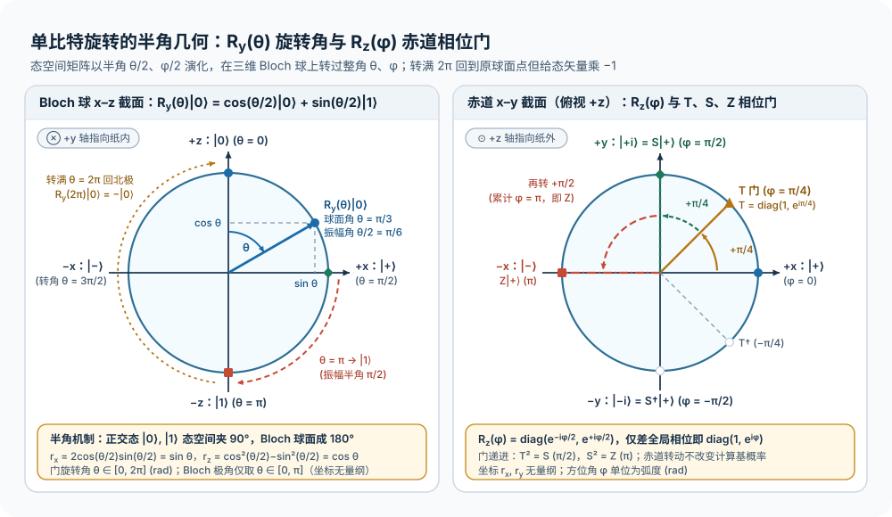
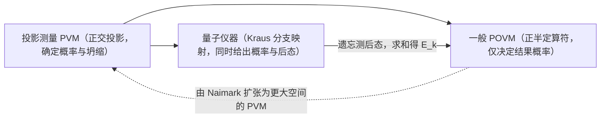

# 02｜单量子比特：状态、相位、旋转与测量

一个经典比特只有两个离散取值：$0$ 或 $1$。而一个理想单量子比特的状态，需要用两个复数来记。看起来只是多了几个数字，可真正把它们摆到草稿纸上算一遍，你会看到量子计算里最核心的几件事几乎全部从这里长出来：为什么“同样 50% 得 $0$、50% 得 $1$”未必是同一个状态？为什么全局相位看不见、相对相位却能决定成败？为什么旋转门矩阵里藏着半角 $\theta/2$，转满一整圈 $2\pi$ 反倒会冒出一个负号？一次测量除了给出概率，还会怎样改写量子态？当真实的测量次数有限、探测器还会读错标签时，我们又怎么把状态稳妥地还原出来？

为了让你一路算下来有“摸得着”的手感，本章选定一个贯穿始终的**标杆态**：

$$
|\psi\rangle = \frac{\sqrt{3}}{2}|0\rangle + \frac{i}{2}|1\rangle.
$$

它既有不相等的振幅大小，又带着虚数单位 $i$ 引入的相对相位。后面从复数模平方、Bloch 球坐标、$X/Y/Z$ 三轴测量、前置换基门次序，到单比特态层析与读出校准，我们都会反复拿它亲手算一遍，让每一个抽象概念都能对照到同一组具体数字。

读本章只需先掌握[第 01 章：零基础数学工具](01-math.md)里的复数模平方、二维列向量和 $2\times 2$ 矩阵乘法。如果你想先从双缝干涉、分束器、Stern–Gerlach 与光子偏振建立物理直觉，可以先看[量子力学 Q1：从实验认识量子态](quantum-mechanics/01-experiments-states.md)；读完本章后，[量子力学 Q2](quantum-mechanics/02-observables-dynamics.md)会把这里的门矩阵与物理可观测量、哈密顿量和时间演化接通，[第 03 章](03-multiple-qubits.md)再迈向多比特与纠缠。文中标有“进阶回看”或“进阶选读”的小节，第一遍阅读时可以先跳过，等你熟悉了主干再回来细算。

---

## 1. 量子态不是一枚藏起来的经典硬币

### 1.1 计算基、复振幅与归一化

先在二维复向量空间 $\mathbb{C}^2$ 里固定两个正交归一的标准列向量：

$$
|0\rangle = \begin{bmatrix} 1 \\ 0 \end{bmatrix},
\qquad
|1\rangle = \begin{bmatrix} 0 \\ 1 \end{bmatrix}.
$$

它们叫作**计算基**（computational basis）。这里的 $0$ 和 $1$ 首先是两个可以完全区分的基准状态标签——比如超导芯片里的最低能级与第一激发态，或者光子偏振的水平与竖直方向——**并不是**说量子比特在被测量之前，心里已经偷偷选好了 $0$ 或 $1$ 藏在盒子里。

把这两个基态分别乘上复数 $\alpha, \beta \in \mathbb{C}$ 再相加，就得到一个单量子比特的**纯态**（pure state）：

$$
|\psi\rangle = \alpha|0\rangle + \beta|1\rangle = \begin{bmatrix} \alpha \\ \beta \end{bmatrix},
\qquad
|\alpha|^2 + |\beta|^2 = 1.
$$

这里的复数 $\alpha$ 和 $\beta$ 称为**振幅**（amplitude）。它们满足的约束 $|\alpha|^2 + |\beta|^2 = 1$ 叫**归一化条件**，其中 $|z|^2 = z^* z$ 是复数 $z$ 的模平方。纯态描述的是理想制备下、拥有完整相干信息的单量子比特状态；至于“按经典概率随机挑一个态制备”或者“做完测量却丢了记录”的情况，后面会引入密度矩阵来描述**混态**（mixed state）。

怎样把这两个复数和实验计数联系起来？量子力学给出了一条独立的物理输入——**Born 规则**（它无法仅从列向量加法推导出来，而是由实验确立的测量规律）：

> 当单量子比特处于归一化纯态 $|\psi\rangle = \alpha|0\rangle + \beta|1\rangle$ 时，在计算基 $\{|0\rangle, |1\rangle\}$ 上做一次理想测量，报告结果 $0$ 的概率为
>
> $$p(0) = |\alpha|^2 = \alpha^*\alpha,$$
>
> 报告结果 $1$ 的概率为
>
> $$p(1) = |\beta|^2 = \beta^*\beta.$$

归一化条件 $|\alpha|^2 + |\beta|^2 = 1$ 恰好保证了两个互斥结果的概率之和 $p(0) + p(1) = 1$。

拿我们的标杆态 $|\psi\rangle = \frac{\sqrt{3}}{2}|0\rangle + \frac{i}{2}|1\rangle$ 亲手算一次：

- $\alpha = \frac{\sqrt{3}}{2}$ 是实数，共轭仍是 $\frac{\sqrt{3}}{2}$，所以

  $$
  p(0) = \left|\frac{\sqrt{3}}{2}\right|^2 = \frac{\sqrt{3}}{2}\cdot\frac{\sqrt{3}}{2} = \frac{3}{4}.
  $$

- $\beta = \frac{i}{2}$ 是纯虚数，共轭为 $\beta^* = -\frac{i}{2}$，所以

  $$
  p(1) = \left|\frac{i}{2}\right|^2 = \left(-\frac{i}{2}\right)\!\left(\frac{i}{2}\right) = \frac{-i^2}{4} = \frac{1}{4}.
  $$

检验总概率：$\frac{3}{4} + \frac{1}{4} = 1$，完全合法。注意初学者常犯的计算失误：算概率必须先取复共轭再相乘，不要直接把复数平方，否则会误算出 $(i/2)^2 = -1/4$ 这种非物理结果。

**顺手小检验**：给定 $|\chi\rangle = \frac{3}{5}|0\rangle + \frac{4}{5}|1\rangle$，它归一化了吗？算一下：$(3/5)^2 + (4/5)^2 = 9/25 + 16/25 = 1$，已经归一化；在计算基测量，得到 $0$ 的概率是 $9/25$，得到 $1$ 的概率是 $16/25$。

### 1.2 同样的计算基概率，为什么不是同一个状态？

很多人刚学到叠加态时，会问一个自然的问题：标杆态 $|\psi\rangle = \frac{\sqrt{3}}{2}|0\rangle + \frac{i}{2}|1\rangle$ 在计算基下得到 $0$ 和 $1$ 的概率是 $3/4$ 与 $1/4$，那它和“实验员暗中按 $3/4$ 概率送出 $|0\rangle$、$1/4$ 概率送出 $|1\rangle$ 的不均匀硬币”有什么区别？

如果**只允许**在计算基 $\{|0\rangle, |1\rangle\}$ 测量，两者的统计分布完全一样；但量子力学允许我们换一套正交归一基去检验。引入 **$Y$ 基**的两个正交归一态 $|{+i}\rangle = \frac{|0\rangle + i|1\rangle}{\sqrt{2}}$、$|{-i}\rangle = \frac{|0\rangle - i|1\rangle}{\sqrt{2}}$，比较两种制备在 $Y$ 基测得 $+i$ 的概率：

1. **纯态叠加 $|\psi\rangle$**：取左矢 $\langle{+i}| = \frac{1}{\sqrt{2}}[1, -i]$（注意复共轭），算得

   $$
   \langle{+i}|\psi\rangle
   = \frac{1}{\sqrt{2}}\left(\frac{\sqrt{3}}{2} + (-i)\frac{i}{2}\right)
   = \frac{\sqrt{3} + 1}{2\sqrt{2}},
   \qquad
   p_{\text{纯}}(+i) = \left|\frac{\sqrt{3}+1}{2\sqrt{2}}\right|^2 = \frac{2+\sqrt{3}}{4} \approx 93.3\%.
   $$

2. **经典偏置混合（$3/4$ 送 $|0\rangle$、$1/4$ 送 $|1\rangle$）**：因为 $|\langle{+i}|0\rangle|^2 = |\langle{+i}|1\rangle|^2 = 1/2$，按经典先验加权平均得

   $$
   p_{\text{混}}(+i) = \frac{3}{4}\cdot\frac{1}{2} + \frac{1}{4}\cdot\frac{1}{2} = \frac{1}{2} = 50\%.
   $$

同样地，对[量子力学 Q1 第 5 节](quantum-mechanics/01-experiments-states.md)对照过的等权情形——纯态 $|+\rangle = \frac{|0\rangle+|1\rangle}{\sqrt{2}}$ 与“抛均匀硬币等概率制备 $|0\rangle$ 或 $|1\rangle$”——两者在计算基均为 $(1/2, 1/2)$，换到 **$X$ 基** $\{|+\rangle, |-\rangle\}$（其中 $|-\rangle = \frac{|0\rangle-|1\rangle}{\sqrt{2}}$）测量时，前者因 $\langle+|+\rangle = 1$ 必得 $+$（概率 $1$），后者因 $|\langle+|0\rangle|^2 = |\langle+|1\rangle|^2 = 1/2$ 仍为 $1/2$。

| 制备方式 | 计算基测得 $0$ 的概率 | 特征换基测量概率 | 状态类型 |
| :--- | :---: | :---: | :--- |
| 标杆纯态 $\frac{\sqrt{3}}{2}\lvert0\rangle + \frac{i}{2}\lvert1\rangle$ | $3/4$ | $Y$ 基得 $+i$：$(2+\sqrt{3})/4 \approx 93.3\%$ | 纯态（保留相对相位 $i$） |
| $3/4 : 1/4$ 经典偏置混合 | $3/4$ | $Y$ 基得 $+i$：$1/2 = 50\%$ | 经典混合态（无相干相位） |
| 均匀叠加态 $\lvert+\rangle$ | $1/2$ | $X$ 基得 $+$：$1$ | 纯态（相对相位 $0$） |
| 均匀硬币等概率混合 $\lvert0\rangle/\lvert1\rangle$ | $1/2$ | $X$ 基得 $+$：$1/2$ | 经典混合态（无相干相位） |

这张表清楚划开了**量子叠加**与**经典无知**的边界：纯态的分量之间保留着确定的相对相位，换基时两路振幅会相干干涉；当然，实验上需要重复测量许多份同源样本才能从统计上区分两者，单次测量无法百分之百识别未知来源。

---

## 2. 全局相位与相对相位：哪种相位能被看见？

一个非零复数可以写成极坐标 $r e^{i\gamma}$，其中 $r > 0$ 是长度，$\gamma \in \mathbb{R}$ 是辐角（相位）。既然概率只取振幅的模平方 $|r e^{i\gamma}|^2 = r^2$，那相位角是不是根本没用？答案正好切在正中间：**整体共有的相位看不见，分量之间的相位差看得见。**

### 2.1 全局相位：整体乘上 $e^{i\gamma}$ 不改变任何物理预测

把整个态矢量的**每一个分量**同时乘上同一个单位复数 $e^{i\gamma}$（$\gamma \in \mathbb{R}$，$|e^{i\gamma}| = 1$）：

$$
|\phi\rangle = e^{i\gamma}|\psi\rangle = (e^{i\gamma}\alpha)|0\rangle + (e^{i\gamma}\beta)|1\rangle.
$$

这个共同因子 $e^{i\gamma}$ 称为**全局相位**（global phase）。现在检验它对**任意**测量方向 $|x\rangle \in \mathbb{C}^2$（$\| |x\rangle \| = 1$）的概率会产生什么影响：

$$
|\langle x | \phi \rangle|^2
= |\langle x | (e^{i\gamma}|\psi\rangle) \rangle|^2
= |e^{i\gamma}\langle x | \psi \rangle|^2
= |e^{i\gamma}|^2 \, |\langle x | \psi \rangle|^2
= 1 \cdot |\langle x | \psi \rangle|^2
= |\langle x | \psi \rangle|^2.
$$

拿具体数字试一下：令 $|\phi\rangle = i|\psi\rangle$（即 $\gamma = \pi/2$）。不论你用什么线性门 $U$ 继续演化，线性性都会把共同因子 $i$ 原封不动带到输出 $U|\phi\rangle = i(U|\psi\rangle)$，最后取模平方时 $|i|^2 = 1$ 依然彻底消掉它。因此，对一个孤立的单量子比特而言，$|\psi\rangle$ 与 $e^{i\gamma}|\psi\rangle$ 代表**同一个物理纯态**。

这里顺手埋一个重要伏笔：上面的结论要求 $e^{i\gamma}$ 乘在**整个系统的所有分支**上。如果某个相位因子只乘在多比特受控操作或干涉仪的**其中一条分支**上，它相对于另一条分支就变成了可观测的相位差——第 5.3 节里，我们会用受控 $2\pi$ 旋转亲手把这个现象算出来。

### 2.2 相对相位与干涉：怎样把看不见的符号变成确定的 $0$ 或 $1$

回看 $|+\rangle = \frac{|0\rangle + |1\rangle}{\sqrt{2}}$ 与 $|-\rangle = \frac{|0\rangle - |1\rangle}{\sqrt{2}}$。两个态在计算基下的概率都是 $(1/2, 1/2)$，区别只在 $|1\rangle$ 前面多了一个因子 $-1 = e^{i\pi}$，而 $|0\rangle$ 前面没有乘它。这种只存在于分量之间的相位差，称为**相对相位**（relative phase）。

要让相对相位在计算基里显形，最经典的做法是施加 **Hadamard 门** $H$（[第 00 章第 2.3 节](00-overview.md)与[第 01 章第 4.2 节](01-math.md)已验证 $H|0\rangle=|+\rangle,\; H|1\rangle=|-\rangle$ 且 $H^2=I$）。因此 $H|+\rangle = H^2|0\rangle = |0\rangle$（两路 $|0\rangle$ 振幅同号相长、$|1\rangle$ 振幅异号相消），而 $H|-\rangle = H^2|1\rangle = |1\rangle$（相长与相消的角色恰好互换）：原本在计算基下看不出的符号差别，经一次 $H$ 门即转为确定的 $0$ 或 $1$。

推广到一般相对相位 $\phi \in [0, 2\pi)$：从 $|0\rangle$ 出发，先做一次 $H$ 得到 $\frac{|0\rangle+|1\rangle}{\sqrt{2}}$，再给 $|1\rangle$ 分支乘上相位 $e^{i\phi}$ 得到 $\frac{|0\rangle + e^{i\phi}|1\rangle}{\sqrt{2}}$，最后再做一次 $H$。展开两项：

$$
H\!\left(\frac{|0\rangle + e^{i\phi}|1\rangle}{\sqrt{2}}\right)
= \frac{1 + e^{i\phi}}{2}|0\rangle + \frac{1 - e^{i\phi}}{2}|1\rangle.
$$

用欧拉公式 $e^{i\phi} = \cos\phi + i\sin\phi$ 计算测得 $0$ 的概率：

$$
p(0) = \left|\frac{1 + e^{i\phi}}{2}\right|^2
= \frac{(1 + \cos\phi)^2 + \sin^2\phi}{4}
= \frac{1 + 2\cos\phi + \cos^2\phi + \sin^2\phi}{4}
= \frac{1 + \cos\phi}{2}
= \cos^2\!\left(\frac{\phi}{2}\right).
$$

随着相对相位 $\phi$ 从 $0$ 转到 $\pi$，测得 $0$ 的概率沿着余弦平方曲线从 $1$ 平滑跌到 $0$（当 $\phi = 2\pi/3$ 时，$\cos^2(\pi/3) = 1/4$）。如果你想用耳朵直观感受“先相加振幅再平方”带来的增强、衰减与完全抵消，可以打开本书的[合成音频体验](labs/audio.md)听一听相位差为 $0$、$2\pi/3$ 和 $\pi$ 的三段波形对照——那些 WAV 文件是用经典正弦波按相同数学规律合成的教学听觉映射，帮你建立干涉的直觉，并不是量子芯片的真实录音。

---

## 3. Bloch 球：把单量子比特画成三维球面

计算基概率 $p(0)=|\alpha|^2$ 和 $p(1)=|\beta|^2$ 只记录了两个振幅的**大小**，却丢掉了它们之间的**相对相位**。有没有办法用一张立体几何图，把任意单量子比特纯态的大小和相对相位同时画出来？这就是量子计算里最常用的几何地图——**Bloch 球**（Bloch sphere）。

### 3.1 从四个实数到两个球面角：半角 $\theta/2$ 从何而来

先数一数一个一般纯态 $|\psi\rangle = \alpha|0\rangle + \beta|1\rangle \in \mathbb{C}^2$ 到底有多少个独立自由度。把两个复数各自写成极坐标：

$$
\alpha = r_0 e^{i\gamma_0}, \qquad \beta = r_1 e^{i\gamma_1},
\qquad r_0, r_1 \ge 0,\quad \gamma_0, \gamma_1 \in [0, 2\pi).
$$

最初这里有 **4 个实数** $(r_0, r_1, \gamma_0, \gamma_1)$。两条物理约束会逐一消掉其中两个：

1. **归一化消去 1 维**：$r_0^2 + r_1^2 = 1$ 且 $r_0, r_1 \ge 0$。满足平方和为 $1$ 的一对非负实数，可以唯一写成某个锐角（或直角、零角）的余弦和正弦。我们特意把这个角记为 $\theta/2$，令

   $$
   r_0 = \cos\frac{\theta}{2}, \qquad r_1 = \sin\frac{\theta}{2}, \qquad \theta \in [0, \pi].
   $$

   因为 $\theta/2 \in [0, \pi/2]$，所以 $\cos(\theta/2) \ge 0$ 且 $\sin(\theta/2) \ge 0$ 自动满足。
2. **去掉全局相位再消去 1 维**：当 $\alpha \ne 0$ 时，把整体因子 $e^{i\gamma_0}$ 提出来并舍去（它不改变任何测量统计），令相对相位 $\varphi = (\gamma_1 - \gamma_0) \bmod 2\pi \in [0, 2\pi)$，就得到单量子比特纯态的标准球面参数化：

$$
|\psi(\theta, \varphi)\rangle = \cos\frac{\theta}{2}|0\rangle + e^{i\varphi}\sin\frac{\theta}{2}|1\rangle,
\qquad
\theta \in [0, \pi],\quad \varphi \in [0, 2\pi).
$$

检查两个极点的边界情形：若 $\beta = 0$，则 $\theta = 0$，态就是 $|0\rangle$；若 $\alpha = 0$，则 $\theta = \pi$，态就是 $e^{i\varphi}|1\rangle$，去掉全局相位后仍只是同一个物理态 $|1\rangle$。就像地球的北极和南极没有唯一经度一样，在 $\theta = 0$ 与 $\theta = \pi$ 处，$\varphi$ 可以任取，并不代表无穷多个不同的态。

剩下的两个角 $(\theta, \varphi)$ 恰好是一个三维单位球面 $S^2$ 上的极角（从北极往下量的余纬度）与方位角（经度），对应三维实单位向量——**Bloch 向量**：

$$
\vec{r} = (r_x, r_y, r_z) = (\sin\theta\cos\varphi,\; \sin\theta\sin\varphi,\; \cos\theta) \in \mathbb{R}^3,
\qquad |\vec{r}| = 1.
$$

**为什么公式里偏偏要写半角 $\theta/2$，而不是直接写 $\theta$？** 答案藏在“正交态的对跖几何”里（也正好接上 [Q1 第 4.3 节](quantum-mechanics/01-experiments-states.md)自旋-$1/2$ 正交态差 $180^\circ$ 的伏笔）。在二维复向量空间 $\mathbb{C}^2$ 里，$|0\rangle$ 和 $|1\rangle$ 彼此正交，向量夹角是 $\pi/2$（$90^\circ$）；可是画到 Bloch 球上时，$|0\rangle$ 占领北极 $(0,0,+1)$，$|1\rangle$ 占领南极 $(0,0,-1)$，它们成了**穿过球心的一对对跖点**，三维夹角拉大成了整整 $\pi$（$180^\circ$）！

这种“夹角翻倍”对**任意一对正交态**都成立：$|+\rangle$ 在 $+x$、$|-\rangle$ 在 $-x$；$|{+i}\rangle$ 在 $+y$、$|{-i}\rangle$ 在 $-y$。更一般地，记任意两个纯态 $|\psi_1\rangle$、$|\psi_2\rangle$ 对应的两个三维单位 Bloch 向量 $\vec{r}_1$ 与 $\vec{r}_2$ 之间的**三维空间夹角**为 $\gamma \in [0, \pi]$（注意 $\gamma$ 是三维夹角 $\arccos(\vec{r}_1\cdot\vec{r}_2)$，**并不是**极角之差 $\theta_1 - \theta_2$——例如赤道上的 $|+\rangle$ 与 $|{+i}\rangle$ 极角差为 $0$，但三维夹角为 $\gamma = \pi/2$），它们的态重叠概率满足精确恒等式（我们将在第 4.2 节给出完整的三行推导并代入数字验算）：

$$
|\langle \psi_1 | \psi_2 \rangle|^2 = \frac{1 + \vec{r}_1 \cdot \vec{r}_2}{2} = \frac{1 + \cos\gamma}{2} = \cos^2\!\left(\frac{\gamma}{2}\right).
$$

检验两个极端情形：当两态重合时 $\gamma = 0$，重叠概率为 $\cos^2(0) = 1$；当两态正交时重叠概率为 $0$，必有 $\gamma/2 = \pi/2$，即球面夹角 $\gamma = \pi$（对跖点）。这正是半角 $\theta/2$ 出现的最本质几何原因。

### 3.2 六个轴点、图示与布居/相干的几何含义

把坐标轴的六个端点整理成速查表。这里引入 $Y$ 基的两个态：

$$
|{+i}\rangle := \frac{|0\rangle + i|1\rangle}{\sqrt{2}},
\qquad
|{-i}\rangle := \frac{|0\rangle - i|1\rangle}{\sqrt{2}}.
$$

| 球面位置 | 极角与方位角 $(\theta, \varphi)$ | Bloch 坐标 $(r_x, r_y, r_z)$ | 对应纯态 | 沿该轴测量的确定读数 |
| :--- | :---: | :---: | :---: | :---: |
| 北极 $+z$ | $(0, \text{任意})$ | $(0, 0, +1)$ | $\lvert0\rangle$ | $Z = +1$ |
| 南极 $-z$ | $(\pi, \text{任意})$ | $(0, 0, -1)$ | $\lvert1\rangle$ | $Z = -1$ |
| 赤道 $+x$ | $(\pi/2, 0)$ | $(+1, 0, 0)$ | $\lvert+\rangle = (\lvert0\rangle + \lvert1\rangle)/\sqrt{2}$ | $X = +1$ |
| 赤道 $-x$ | $(\pi/2, \pi)$ | $(-1, 0, 0)$ | $\lvert-\rangle = (\lvert0\rangle - \lvert1\rangle)/\sqrt{2}$ | $X = -1$ |
| 赤道 $+y$ | $(\pi/2, \pi/2)$ | $(0, +1, 0)$ | $\lvert{+i}\rangle = (\lvert0\rangle + i\lvert1\rangle)/\sqrt{2}$ | $Y = +1$ |
| 赤道 $-y$ | $(\pi/2, 3\pi/2)$ | $(0, -1, 0)$ | $\lvert{-i}\rangle = (\lvert0\rangle - i\lvert1\rangle)/\sqrt{2}$ | $Y = -1$ |

对照下图把这六个轴点记牢。需要记住一条直觉边界：**Bloch 球的三个坐标 $(r_x, r_y, r_z)$ 是无量纲的统计期望值，不是粒子在三维物理空间里的 $(x, y, z)$ 位置**，球上的箭头也不是一颗在实验室里旋转的小钢珠。

（可打开[原尺寸 Bloch 球图](assets/bloch-sphere.svg)清晰查看全部标签。）

用 $|+\rangle$ 和 $|-\rangle$ 对照验证一次：在 $|+\rangle$ 里两个振幅都是正实数 $1/\sqrt{2}$，对应 $\theta = \pi/2$、$\varphi = 0$，代入坐标公式得 $(1, 0, 0)$；换成 $|-\rangle$ 时，$|1\rangle$ 前多出一个负号 $-1 = e^{i\pi}$，所以 $\theta$ 仍是 $\pi/2$（仍在赤道上，意味着计算基概率依然各占一半），但经度 $\varphi$ 转了 $\pi$ 到达对跖点 $(-1, 0, 0)$。

细心的读者会问：既然球面 $|\vec{r}| = 1$ 已经装下了所有单比特**纯态**，那空心球体**里面**（$|\vec{r}| < 1$）装的是什么？答案是单比特**混态**！如果用 $2\times 2$ 密度矩阵 $\rho$ 描述一般单比特状态，把三个 Pauli 矩阵合写为 $\vec{\sigma} = (X, Y, Z)$（Pauli 矩阵 $X, Y, Z$ 将在紧接着的第 4.1 节正式写出并验证其正交分解性质），任意合法单比特态都可以写成

$$
\rho = \frac{1}{2}(I + \vec{r}\cdot\vec{\sigma})
= \frac{1}{2}\begin{bmatrix} 1 + r_z & r_x - i r_y \\ r_x + i r_y & 1 - r_z \end{bmatrix},
\qquad |\vec{r}| \le 1.
$$

把一般纯态 $|\psi\rangle = \alpha|0\rangle + \beta|1\rangle$ 的外积密度矩阵 $|\psi\rangle\langle\psi|$ 逐格展开，并与上式并排对照，密度矩阵的四个元素立刻拥有了清晰的几何画面：

$$
|\psi\rangle\langle\psi|
= \begin{bmatrix} \alpha \\ \beta \end{bmatrix}\begin{bmatrix} \alpha^* & \beta^* \end{bmatrix}
= \begin{bmatrix} |\alpha|^2 & \alpha\beta^* \\ \alpha^*\beta & |\beta|^2 \end{bmatrix}
= \frac{1}{2}\begin{bmatrix} 1 + r_z & r_x - i r_y \\ r_x + i r_y & 1 - r_z \end{bmatrix}.
$$

| 密度矩阵元素 | 物理名称 | 用 Bloch 坐标与球面角表示 | Bloch 球几何意义 |
| :--- | :--- | :---: | :--- |
| 对角元 $\rho_{00}, \rho_{11}$ | **布居**（population） | $\frac{1 \pm r_z}{2}$（纯态为 $\cos^2\frac{\theta}{2},\; \sin^2\frac{\theta}{2}$） | 由**纬度** $r_z = \rho_{00}-\rho_{11}$ 控制，决定计算基测量概率 |
| 非对角元 $\rho_{10} = \rho_{01}^*$ | **相干项**（coherence） | $\frac{r_x + i r_y}{2}$（纯态为 $\frac{1}{2}\sin\theta\,e^{i\varphi}$） | 模长 $\lvert\rho_{10}\rvert = \frac{1}{2}\sqrt{r_x^2+r_y^2}$ 是**赤道投影半径的一半**；辐角即**经度** $\varphi$ |

这张对照表能直接对应全书后面反复出现的噪声几何：

- **球面 $|\vec{r}| = 1$**：纯态（相干项模长达到给定纬度下的最大值 $\sqrt{\rho_{00}\rho_{11}}$，如 $|+\rangle$ 在 $(1,0,0)$）。
- **球内 $0 < |\vec{r}| < 1$**：部分混合态（例如纯退相位噪声只把非对角相干元按比例压小，几何上就是把 Bloch 向量水平拉向 $z$ 轴，保持纬度 $r_z$ 不变而缩短赤道投影）。
- **球心 $\vec{r} = (0,0,0)$**：最大混合态 $\rho = I/2$——这正是第 1.2 节里“抛均匀硬币随机制备 $|0\rangle$ 或 $|1\rangle$”的状态！虽然它和球面上的 $|+\rangle$ 在 $z$ 轴投影高度相同（$r_z = 0$，即计算基概率都是 50/50），但一个躺在球心（非对角相干元为 $0$），一个站在赤道表面（非对角相干元为 $1/2$），几何位置泾渭分明。

为什么合法单比特密度矩阵恰好填满整个实心单位球、而一旦跑到球外 $|\vec{r}| > 1$ 就必然出现非物理的负本征值？我们将在[第 05 章：混态、噪声与量子信道](05-noise-channels.md)给出 $\rho = \frac{1}{2}(I + \vec{r}\cdot\vec{\sigma})$ 与 $|\vec{r}| \le 1 \iff \rho \succeq 0$ 的完整充要推导。

最后交代 Bloch 球的适用范围：它只能完整表示**单个**量子比特。当两个量子比特处于可分乘积态时，可以各自画一颗小球；可一旦进入[第 03 章](03-multiple-qubits.md)的纠缠态（如 Bell 态），两个单比特各自的局部 Bloch 向量都会缩回球心 $\vec{0}$，真正关键的联合关联并不住在这两颗独立小球里。

---

## 4. Pauli 门、Hadamard 门与从振幅计算 Bloch 坐标

如果说列向量 $|\psi\rangle \in \mathbb{C}^2$ 是单量子比特的状态，那么**单量子比特门**就是作用在列向量上的 $2\times 2$ 复矩阵 $U$。为了保证任何归一化输入态经过门之后总概率依然等于 $1$，理想量子门必须是**酉矩阵**（unitary matrix），满足

$$
U^\dagger U = U U^\dagger = I,
$$

其中 $U^\dagger$ 表示对 $U$ 取共轭转置。全书统一采用以下时间顺序约定：**画量子线路图时，时间从左向右流逝；写矩阵乘法时，最靠右的矩阵最先作用在列向量上。** 也就是说，先施加门 $A$、再施加门 $B$，写成矩阵乘积是

$$
B(A|\psi\rangle) = (BA)|\psi\rangle.
$$

### 4.1 四个最基本的单比特门：$X, Y, Z, H$ 与 Pauli 基分解

在计算基 $\{|0\rangle, |1\rangle\}$ 下，三个 **Pauli 矩阵** $X, Y, Z$（也常写作 $\sigma_x, \sigma_y, \sigma_z$，并约定 $\sigma_0 = I$）与 **Hadamard 门** $H$ 定义为：

$$
X = \begin{bmatrix} 0 & 1 \\ 1 & 0 \end{bmatrix},
\qquad
Y = \begin{bmatrix} 0 & -i \\ i & 0 \end{bmatrix},
\qquad
Z = \begin{bmatrix} 1 & 0 \\ 0 & -1 \end{bmatrix},
\qquad
H = \frac{1}{\sqrt{2}}\begin{bmatrix} 1 & 1 \\ 1 & -1 \end{bmatrix}.
$$

这四个矩阵有一个共同的好性质：它们既是酉矩阵（$U^\dagger U = I$），又是厄米矩阵（$U^\dagger = U$），因此各自平方都等于单位矩阵：$X^2 = Y^2 = Z^2 = H^2 = I$（连续施加两次等于什么都没做）。它们各自扮演的角色十分鲜明：

- **$X$ 门（比特翻转门）**：把 $|0\rangle$ 翻成 $|1\rangle$、把 $|1\rangle$ 翻成 $|0\rangle$，相当于经典计算里的“非门（NOT）”。在 Bloch 球上，它绕 $x$ 轴旋转 $\pi$（上下颠倒南北极）。
- **$Z$ 门（相位翻转门）**：保持 $|0\rangle$ 不变，给 $|1\rangle$ 添一个负号（$Z|1\rangle = -|1\rangle$），所以 $Z|+\rangle = |-\rangle$、$Z|-\rangle = |+\rangle$。在 Bloch 球上，它绕 $z$ 轴旋转 $\pi$。
- **$Y$ 门（比特加相位翻转）**：把 $|0\rangle$ 映到 $i|1\rangle$、把 $|1\rangle$ 映到 $-i|0\rangle$。用矩阵乘法逐格核对 $XZ$ 与 $ZX$，并乘上 $i$ 验证 $Y = iXZ = -iZX$（注意循环顺序，不要误记成 $Y = iZX$）：

  $$
  XZ = \begin{bmatrix} 0 & -1 \\ 1 & 0 \end{bmatrix},
  \qquad
  ZX = \begin{bmatrix} 0 & 1 \\ -1 & 0 \end{bmatrix} = -XZ,
  \qquad
  iXZ = i\begin{bmatrix} 0 & -1 \\ 1 & 0 \end{bmatrix} = \begin{bmatrix} 0 & -i \\ i & 0 \end{bmatrix} = Y.
  $$

  三个 Pauli 矩阵遵循整洁的**循环乘法律**与**反对易律**：

  $$
  XY = iZ,\quad YZ = iX,\quad ZX = iY,
  \qquad
  XY + YX = YZ + ZY = ZX + XZ = 0.
  $$

- **$H$ 门（换基门）**：把 $Z$ 基与 $X$ 基互换（[第 01 章第 4.2 节](01-math.md)已由列视角直接读出 $H|0\rangle = |+\rangle$、$H|1\rangle = |-\rangle$，且 $H^\dagger H = H^2 = I$）。

再算一个在量子电路里反复出现的恒等式：$HZH$ 等于什么？从右向左先乘 $ZH$：

$$
ZH = \frac{1}{\sqrt{2}}\begin{bmatrix} 1 & 0 \\ 0 & -1 \end{bmatrix}\begin{bmatrix} 1 & 1 \\ 1 & -1 \end{bmatrix}
= \frac{1}{\sqrt{2}}\begin{bmatrix} 1 & 1 \\ -1 & 1 \end{bmatrix},
$$

再左乘 $H$：

$$
HZH = \frac{1}{2}\begin{bmatrix} 1 & 1 \\ 1 & -1 \end{bmatrix}\begin{bmatrix} 1 & 1 \\ -1 & 1 \end{bmatrix}
= \frac{1}{2}\begin{bmatrix} 1\cdot 1 + 1\cdot(-1) & 1\cdot 1 + 1\cdot 1 \\ 1\cdot 1 + (-1)\cdot(-1) & 1\cdot 1 + (-1)\cdot 1 \end{bmatrix}
= \frac{1}{2}\begin{bmatrix} 0 & 2 \\ 2 & 0 \end{bmatrix}
= \begin{bmatrix} 0 & 1 \\ 1 & 0 \end{bmatrix} = X.
$$

用它作用在 $|0\rangle$ 上：$|0\rangle \xrightarrow{H} |+\rangle \xrightarrow{Z} |-\rangle \xrightarrow{H} |1\rangle$。中间的 $Z$ 门只翻了一下相对相位（计算基概率始终是 50/50），可被前后两个 $H$ 夹住后，整体效果就等价于一个实打实的比特翻转门 $X$！在 Bloch 球上，$H$ 对应绕 $x$ 轴与 $z$ 轴平分线 $\frac{\hat{x}+\hat{z}}{\sqrt{2}}$ 旋转 $\pi$，它把 $Z$ 轴和 $X$ 轴互换（$HZH = X$、$HXH = Z$），同时把 $Y$ 轴反向（$HYH = -Y$）。

**Pauli 正交基与单比特密度矩阵展开**：由[第 01 章第 5.6 节](01-math.md)已验算的迹正交关系 $\operatorname{Tr}(\sigma_\mu \sigma_\nu) = 2\delta_{\mu\nu}$（$\sigma_0=I,\;\sigma_1=X,\;\sigma_2=Y,\;\sigma_3=Z$），任意 $2\times 2$ 厄米矩阵都可唯一展开为 $A = \sum_{\mu=0}^{3} c_\mu \sigma_\mu$，其中 $c_\mu = \frac{1}{2}\operatorname{Tr}(A\sigma_\mu) \in \mathbb{R}$。将其用于满足 $\operatorname{Tr}(\rho) = 1$ 的单比特密度矩阵 $\rho$，立得 $c_0 = \frac{1}{2}$、$c_j = \frac{1}{2}\operatorname{Tr}(\rho\sigma_j) = \frac{1}{2}r_j$——这正是第 3.2 节 $\rho = \frac{1}{2}(I + \vec{r}\cdot\vec{\sigma})$ 的代数根源。

### 4.2 完整算例：从振幅算 Bloch 坐标、兑现态重叠公式与各轴概率

第 3 节提到，Bloch 坐标 $(r_x, r_y, r_z)$ 其实是 $X, Y, Z$ 三种测量的**期望值**（expectation value）$\langle X\rangle, \langle Y\rangle, \langle Z\rangle$。因为每次沿 $X, Y$ 或 $Z$ 测量只可能读出 $+1$ 或 $-1$，多次重复的平均读数就是 $p(+1) - p(-1)$；在矩阵语言里，纯态 $|\psi\rangle$ 对厄米矩阵 $M$ 的期望值由夹心乘积 $\langle\psi|M|\psi\rangle = \operatorname{Tr}(M|\psi\rangle\langle\psi|)$ 给出。

对一般纯态 $|\psi\rangle = [\alpha, \beta]^T$，它的共轭转置行向量（bra）是 $\langle\psi| = [\alpha^*, \beta^*]$。先把三个 Pauli 矩阵分别作用在列向量上：

$$
X|\psi\rangle = \begin{bmatrix} 0 & 1 \\ 1 & 0 \end{bmatrix}\begin{bmatrix} \alpha \\ \beta \end{bmatrix} = \begin{bmatrix} \beta \\ \alpha \end{bmatrix},
\qquad
Y|\psi\rangle = \begin{bmatrix} 0 & -i \\ i & 0 \end{bmatrix}\begin{bmatrix} \alpha \\ \beta \end{bmatrix} = \begin{bmatrix} -i\beta \\ i\alpha \end{bmatrix},
\qquad
Z|\psi\rangle = \begin{bmatrix} 1 & 0 \\ 0 & -1 \end{bmatrix}\begin{bmatrix} \alpha \\ \beta \end{bmatrix} = \begin{bmatrix} \alpha \\ -\beta \end{bmatrix}.
$$

再用 $1\times 2$ 行向量 $\langle\psi| = [\alpha^*, \beta^*]$ 从左边逐项相乘：

$$
\begin{aligned}
r_x = \langle\psi|X|\psi\rangle &= \alpha^*\beta + \beta^*\alpha = \alpha^*\beta + (\alpha^*\beta)^* = 2\operatorname{Re}(\alpha^*\beta), \\
r_y = \langle\psi|Y|\psi\rangle &= -i\alpha^*\beta + i\beta^*\alpha = \frac{\alpha^*\beta - (\alpha^*\beta)^*}{i} = 2\operatorname{Im}(\alpha^*\beta), \\
r_z = \langle\psi|Z|\psi\rangle &= \alpha^*\alpha - \beta^*\beta = |\alpha|^2 - |\beta|^2.
\end{aligned}
$$

顺手验算第 3.1 节的球面公式：把 $\alpha = \cos(\theta/2)$、$\beta = e^{i\varphi}\sin(\theta/2) = (\cos\varphi + i\sin\varphi)\sin(\theta/2)$ 代进去，立刻得到

$$
\alpha^*\beta = \cos\frac{\theta}{2}\sin\frac{\theta}{2}(\cos\varphi + i\sin\varphi) = \frac{1}{2}\sin\theta\,(\cos\varphi + i\sin\varphi),
$$

于是 $r_x = \sin\theta\cos\varphi$、$r_y = \sin\theta\sin\varphi$，而由二倍角公式 $r_z = \cos^2(\theta/2) - \sin^2(\theta/2) = \cos\theta$——与第 3.1 节的球面坐标完全吻合！

**兑现第 3.1 节的承诺：态重叠公式的三行推导**

现在手握 Pauli 迹正交关系，我们可以直接证明第 3.1 节写出的态重叠公式。设任意两个归一化纯态 $|\psi_1\rangle, |\psi_2\rangle$ 的密度矩阵为 $\rho_k = |\psi_k\rangle\langle\psi_k| = \frac{1}{2}(I + \vec{r}_k\cdot\vec{\sigma})$（$k=1,2$）。一方面，由外积与迹的循环性：

$$
\operatorname{Tr}(\rho_1\rho_2)
= \operatorname{Tr}\bigl(|\psi_1\rangle\langle\psi_1|\psi_2\rangle\langle\psi_2|\bigr)
= \langle\psi_1|\psi_2\rangle\operatorname{Tr}\bigl(|\psi_1\rangle\langle\psi_2|\bigr)
= \langle\psi_1|\psi_2\rangle\langle\psi_2|\psi_1\rangle
= |\langle\psi_1|\psi_2\rangle|^2.
$$

另一方面，把两个 Pauli 展开相乘并代入 $\operatorname{Tr}(I)=2$、$\operatorname{Tr}(\sigma_j)=0$、$\operatorname{Tr}(\sigma_j\sigma_k)=2\delta_{jk}$：

$$
\begin{aligned}
\operatorname{Tr}(\rho_1\rho_2)
&= \frac{1}{4}\operatorname{Tr}\!\left[(I + \vec{r}_1\cdot\vec{\sigma})(I + \vec{r}_2\cdot\vec{\sigma})\right] \\
&= \frac{1}{4}\left[\operatorname{Tr}(I) + \sum_{j\in\{x,y,z\}}(r_{1j}+r_{2j})\operatorname{Tr}(\sigma_j) + \sum_{j,k\in\{x,y,z\}} r_{1j}r_{2k}\operatorname{Tr}(\sigma_j\sigma_k)\right] \\
&= \frac{1}{4}\left(2 + 0 + 2\sum_{j\in\{x,y,z\}} r_{1j}r_{2j}\right)
= \frac{1 + \vec{r}_1\cdot\vec{r}_2}{2}
= \frac{1 + \cos\gamma}{2}
= \cos^2\!\left(\frac{\gamma}{2}\right),
\end{aligned}
$$

其中 $\gamma \in [0,\pi]$ 是单位向量 $\vec{r}_1$ 与 $\vec{r}_2$ 之间的三维空间夹角。立拿赤道上的 $|+\rangle$（$\vec{r}_1=(1,0,0)$）与 $|{+i}\rangle$（$\vec{r}_2=(0,1,0)$）做个快检：两者极角都是 $\theta=\pi/2$（$\theta_1-\theta_2=0$），但点积 $\vec{r}_1\cdot\vec{r}_2 = 0$（三维夹角 $\gamma=\pi/2$），所以重叠概率为 $\frac{1+0}{2} = \frac{1}{2}$。

**标杆态三路径交叉核验**

现在代入我们的标杆态 $|\psi\rangle = \frac{\sqrt{3}}{2}|0\rangle + \frac{i}{2}|1\rangle$，一步步算全：

1. **求交叉项**：$\alpha^* = \frac{\sqrt{3}}{2}$，$\beta = \frac{i}{2}$，所以

   $$
   \alpha^*\beta = \frac{\sqrt{3}}{2}\cdot\frac{i}{2} = 0 + i\frac{\sqrt{3}}{4}.
   $$

2. **读出三个 Bloch 坐标**：

   $$
   r_x = 2\cdot 0 = 0,
   \qquad
   r_y = 2\cdot\frac{\sqrt{3}}{4} = \frac{\sqrt{3}}{2},
   \qquad
   r_z = \frac{3}{4} - \frac{1}{4} = \frac{1}{2}.
   $$

   所以标杆态的 Bloch 向量是 $\vec{r} = \left(0, \frac{\sqrt{3}}{2}, \frac{1}{2}\right)$。检验长度：$|\vec{r}|^2 = 0^2 + \left(\frac{\sqrt{3}}{2}\right)^2 + \left(\frac{1}{2}\right)^2 = \frac{3}{4} + \frac{1}{4} = 1$，稳稳落在单位球面上（对应 $\theta = \pi/3, \varphi = \pi/2$）。

3. **用独立路径交叉核对 $Y$ 测量概率**：
   - **路径一（从 Bloch 坐标与重叠公式直读）**：记 $Y$ 测量得 $+1$、$-1$ 的概率为 $p_+, p_-$。由 $p_+ + p_- = 1$ 与 $r_y = p_+ - p_- = 2p_+ - 1$，或者直接把 $\vec{r}_\psi = (0, \frac{\sqrt{3}}{2}, \frac{1}{2})$ 与 $\vec{r}_{+i} = (0, 1, 0)$ 代入刚刚证出的重叠公式（点积 $\vec{r}_\psi\cdot\vec{r}_{+i} = \frac{\sqrt{3}}{2}$，三维夹角 $\gamma = \pi/6$），立即得

     $$
     p_+ = \frac{1 + r_y}{2} = \frac{1 + \sqrt{3}/2}{2} = \frac{2 + \sqrt{3}}{4} = \cos^2\!\left(\frac{\pi}{12}\right) \approx 0.933013.
     $$

   - **路径二（直接算内积模平方）**：$Y = +1$ 的本征态是 $|{+i}\rangle = \frac{|0\rangle + i|1\rangle}{\sqrt{2}}$。写它的共轭行向量（左矢）时，务必把 $i$ 共轭成 $-i$，得 $\langle{+i}| = \frac{1}{\sqrt{2}}[1, -i]$。于是

     $$
     \langle{+i}|\psi\rangle
     = \frac{1}{\sqrt{2}}\begin{bmatrix} 1 & -i \end{bmatrix}\begin{bmatrix} \sqrt{3}/2 \\ i/2 \end{bmatrix}
     = \frac{\sqrt{3} + (-i)(i)}{2\sqrt{2}}
     = \frac{\sqrt{3} + 1}{2\sqrt{2}},
     $$

     取模平方：

     $$
     p_+ = |\langle{+i}|\psi\rangle|^2 = \frac{(\sqrt{3} + 1)^2}{8} = \frac{3 + 2\sqrt{3} + 1}{8} = \frac{2 + \sqrt{3}}{4} \approx 0.933013.
     $$

两条独立路径算出的精确根式一模一样。假如在路径二里忘了给左矢分量取复共轭，误写成 $\frac{1}{\sqrt{2}}[1, i]$，就会把分子算成 $\sqrt{3} - 1$，概率错成 $\frac{2-\sqrt{3}}{4} \approx 0.067$——这正好提醒我们，复内积里的共轭一步都不能省。

---

## 5. 旋转门、相位门 $S, T$ 与任意单比特门分解

前面介绍的 $X, Y, Z, H$ 都是固定角度的“整步翻转”门（在 Bloch 球上各转 $\pi$）。如果想把状态平滑地转过任意角度——比如从 $|0\rangle$ 转出标杆态 $|\psi\rangle = \frac{\sqrt{3}}{2}|0\rangle + \frac{i}{2}|1\rangle$——就需要连续参数的**旋转门**（rotation gate）。

### 5.1 绕坐标轴旋转：$R_x(\theta)$、$R_y(\theta)$、$R_z(\varphi)$ 与半角几何

绕 Bloch 球 $x, y, z$ 三个坐标轴逆时针旋转角度 $\theta$（单位：弧度，遵循右手定则）的标准单比特旋转门，在计算基 $\{|0\rangle, |1\rangle\}$ 下的 $2\times 2$ 矩阵依次为：

$$
R_x(\theta) = \begin{bmatrix} \cos\frac{\theta}{2} & -i\sin\frac{\theta}{2} \\ -i\sin\frac{\theta}{2} & \cos\frac{\theta}{2} \end{bmatrix},
\qquad
R_y(\theta) = \begin{bmatrix} \cos\frac{\theta}{2} & -\sin\frac{\theta}{2} \\ \sin\frac{\theta}{2} & \cos\frac{\theta}{2} \end{bmatrix},
\qquad
R_z(\varphi) = \begin{bmatrix} e^{-i\varphi/2} & 0 \\ 0 & e^{i\varphi/2} \end{bmatrix}.
$$

三个矩阵各自都可以按行手算，立刻看到它们在 Bloch 球上做了什么：

1. **绕 $y$ 轴旋转 $R_y(\theta)$**（实矩阵，负责改变极角 $\theta$）：
   作用在 $|0\rangle = [1, 0]^T$ 上，就是取出矩阵第一列：

   $$
   R_y(\theta)|0\rangle
   = \begin{bmatrix} \cos(\theta/2) & -\sin(\theta/2) \\ \sin(\theta/2) & \cos(\theta/2) \end{bmatrix}\begin{bmatrix} 1 \\ 0 \end{bmatrix}
   = \cos\frac{\theta}{2}|0\rangle + \sin\frac{\theta}{2}|1\rangle.
   $$

   取 $\theta = \pi/2$ 时，两振幅均为 $\cos(\pi/4) = \sin(\pi/4) = 1/\sqrt{2}$，输出正好是 $|+\rangle$；取 $\theta = \pi$ 时，$\cos(\pi/2) = 0, \sin(\pi/2) = 1$，输出是 $|1\rangle$。把 $\alpha = \cos(\theta/2), \beta = \sin(\theta/2)$ 代回第 4.2 节的坐标公式，得

   $$
   r_x = 2\cos\frac{\theta}{2}\sin\frac{\theta}{2} = \sin\theta,
   \qquad
   r_y = 0,
   \qquad
   r_z = \cos^2\frac{\theta}{2} - \sin^2\frac{\theta}{2} = \cos\theta.
   $$

   虽然矩阵里写的是半角 $\theta/2$，但 Bloch 向量确实从北极 $(0,0,1)$ 绕 $+y$ 轴严格转过了整角 $\theta$！

2. **绕 $x$ 轴旋转 $R_x(\theta)$**：
   取 $\theta = \pi/2$ 作用在 $|0\rangle$ 上：

   $$
   R_x\!\left(\frac{\pi}{2}\right)|0\rangle
   = \begin{bmatrix} 1/\sqrt{2} & -i/\sqrt{2} \\ -i/\sqrt{2} & 1/\sqrt{2} \end{bmatrix}\begin{bmatrix} 1 \\ 0 \end{bmatrix}
   = \frac{|0\rangle - i|1\rangle}{\sqrt{2}}
   = |{-i}\rangle.
   $$

   它的 Bloch 坐标是 $(0, -1, 0)$——右手大拇指指向 $+x$ 轴，四指弯曲方向正好把 $+z$ 轴推向 $-y$ 轴，方向完全吻合。

3. **绕 $z$ 轴旋转 $R_z(\varphi)$**（对角矩阵，只改方位角 $\varphi$，不改计算基概率）：
   对 $|+\rangle = \frac{1}{\sqrt{2}}[1, 1]^T$ 逐行相乘：

   $$
   R_z(\varphi)|+\rangle
   = \begin{bmatrix} e^{-i\varphi/2} & 0 \\ 0 & e^{i\varphi/2} \end{bmatrix}\frac{1}{\sqrt{2}}\begin{bmatrix} 1 \\ 1 \end{bmatrix}
   = \frac{e^{-i\varphi/2}|0\rangle + e^{i\varphi/2}|1\rangle}{\sqrt{2}}
   = e^{-i\varphi/2}\,\frac{|0\rangle + e^{i\varphi}|1\rangle}{\sqrt{2}}.
   $$

   提出来的 $e^{-i\varphi/2}$ 是不改变测量统计的全局相位；括号里 $|1\rangle$ 相对 $|0\rangle$ 多出来的 $e^{i\varphi}$ 把 Bloch 向量沿着赤道绕 $+z$ 轴逆时针转过角度 $\varphi$。特别地，$R_z(\pi/2)|+\rangle$ 与 $|{+i}\rangle$ 是同一物理态，$R_z(\pi)|+\rangle$ 与 $|-\rangle$ 是同一物理态。因为两个对角元模长都是 $1$，$R_z(\varphi)$ 永远不改变计算基下的测量概率。

**简记预告**：借助第 01 章的矩阵指数，上面三个旋转门还可以统一简写为 $R_x(\theta) = e^{-i\theta X/2}$、$R_y(\theta) = e^{-i\theta Y/2}$、$R_z(\varphi) = e^{-i\varphi Z/2}$，一般地绕任意三维单位轴 $\hat{n}$ 旋转角度 $\theta$ 记作 $R_{\hat{n}}(\theta) = e^{-i\theta(\hat{n}\cdot\vec{\sigma})/2}$。这套记号的严格展开和几何证明，我们在紧接着的 §5.3 一步步推导。

### 5.2 相位门 $S$ 与 $T$，以及常用单比特门速查表

在量子电路和容错纠错里，有两个绕 $z$ 轴旋转的特殊固定角度门出场频率极高，它们被称为 **相位门 $S$**（phase gate，转 $\pi/2$）与 **$T$ 门**（$\pi/8$ 门，转 $\pi/4$）。在计算基 $\{|0\rangle, |1\rangle\}$ 下，它们的正式定义是：

$$
S = \begin{bmatrix} 1 & 0 \\ 0 & i \end{bmatrix} = e^{i\pi/4} R_z\!\left(\frac{\pi}{2}\right),
\qquad
T = \begin{bmatrix} 1 & 0 \\ 0 & e^{i\pi/4} \end{bmatrix} = e^{i\pi/8} R_z\!\left(\frac{\pi}{4}\right).
$$

核对全局相位换算只需把指数乘进对角线：

$$
e^{i\pi/4} R_z\!\left(\frac{\pi}{2}\right)
= e^{i\pi/4}\begin{bmatrix} e^{-i\pi/4} & 0 \\ 0 & e^{i\pi/4} \end{bmatrix}
= \begin{bmatrix} 1 & 0 \\ 0 & e^{i\pi/2} \end{bmatrix}
= \begin{bmatrix} 1 & 0 \\ 0 & i \end{bmatrix} = S,
$$

$$
e^{i\pi/8} R_z\!\left(\frac{\pi}{4}\right)
= e^{i\pi/8}\begin{bmatrix} e^{-i\pi/8} & 0 \\ 0 & e^{i\pi/8} \end{bmatrix}
= \begin{bmatrix} 1 & 0 \\ 0 & e^{i\pi/4} \end{bmatrix} = T.
$$

它们的逆门（共轭转置）同样是对角矩阵：$S^\dagger = \mathrm{diag}(1, -i)$、$T^\dagger = \mathrm{diag}(1, e^{-i\pi/4})$。逐项相乘即可验证递进关系：

$$
T^2 = \begin{bmatrix} 1 & 0 \\ 0 & e^{i\pi/2} \end{bmatrix} = S,
\qquad
S^2 = \begin{bmatrix} 1 & 0 \\ 0 & i^2 \end{bmatrix} = \begin{bmatrix} 1 & 0 \\ 0 & -1 \end{bmatrix} = Z.
$$

下面这张对照图把第 5.1 节的“态空间半角 $\theta/2$ 对比 Bloch 球面整角 $\theta$”旋转几何（含转满 $2\pi$ 时冒出负号），以及刚刚定义的 $T, S, Z$ 赤道相位门递进关系定格在同一画面里：

（可打开[原尺寸旋转半角几何图](assets/v2-02-rotation-half-angle.svg)细看角度标注与轨迹。）

有了 $R_y$ 和 $S$，我们立刻就能写出制备本章标杆态 $|\psi\rangle = \frac{\sqrt{3}}{2}|0\rangle + \frac{i}{2}|1\rangle$ 的两步线路——从 $|0\rangle$ 出发，先做 $R_y(\pi/3)$，再做 $S$：

$$
|0\rangle
\xrightarrow{\;R_y(\pi/3)\;}
\cos\frac{\pi}{6}|0\rangle + \sin\frac{\pi}{6}|1\rangle
= \frac{\sqrt{3}}{2}|0\rangle + \frac{1}{2}|1\rangle
\xrightarrow{\;S\;}
\frac{\sqrt{3}}{2}|0\rangle + \frac{i}{2}|1\rangle
= |\psi\rangle.
$$

第 8 节做态层析时，实验电路制备目标态用的正是这条 $S R_y(\pi/3)|0\rangle$ 线路。

把全书最常用的 9 个单量子比特门汇总到一张速查表里，方便随时翻阅（表中第三列的矩阵指数与任意轴记号 $R_{\hat{n}}(\theta)$ 紧接在 §5.3 推导；到了[第 04 章](04-circuits-protocols.md)，我们还会进一步说明为什么 $\{H, S\}$ 属于可用经典计算机高效模拟的 Clifford 门，而加上非 Clifford 的 $T$ 门就能逼近任意量子计算）：

| 门 | 矩阵（计算基 $\{\lvert0\rangle, \lvert1\rangle\}$） | 与旋转门的关系（至多差全局相位） | Bloch 球几何作用 | 常用代数性质 |
| :--- | :---: | :---: | :--- | :--- |
| $X$ | $\begin{bmatrix}0 & 1 \\ 1 & 0\end{bmatrix}$ | $i R_x(\pi)$ | 绕 $x$ 轴转 $\pi$ | 比特翻转，$X^2 = I$ |
| $Y$ | $\begin{bmatrix}0 & -i \\ i & 0\end{bmatrix}$ | $i R_y(\pi)$ | 绕 $y$ 轴转 $\pi$ | $Y = iXZ$，$Y^2 = I$ |
| $Z$ | $\begin{bmatrix}1 & 0 \\ 0 & -1\end{bmatrix}$ | $i R_z(\pi)$ | 绕 $z$ 轴转 $\pi$ | 相位翻转，$Z^2 = I$ |
| $H$ | $\frac{1}{\sqrt{2}}\begin{bmatrix}1 & 1 \\ 1 & -1\end{bmatrix}$ | $i R_{(\hat{x}+\hat{z})/\sqrt{2}}(\pi)$ | 绕 $x+z$ 平分轴转 $\pi$ | 互换 $X \leftrightarrow Z$，$HYH = -Y$ |
| $S$ | $\begin{bmatrix}1 & 0 \\ 0 & i\end{bmatrix}$ | $e^{i\pi/4} R_z(\pi/2)$ | 绕 $z$ 轴转 $\pi/2$ | Clifford 相位门，$S^2 = Z$ |
| $T$ | $\begin{bmatrix}1 & 0 \\ 0 & e^{i\pi/4}\end{bmatrix}$ | $e^{i\pi/8} R_z(\pi/4)$ | 绕 $z$ 轴转 $\pi/4$ | 非 Clifford 门，$T^2 = S$ |
| $R_x(\theta)$ | $\begin{bmatrix}\cos(\theta/2) & -i\sin(\theta/2) \\ -i\sin(\theta/2) & \cos(\theta/2)\end{bmatrix}$ | $e^{-i\theta X/2}$ | 绕 $x$ 轴转 $\theta$ | $R_x(\theta)R_x(\phi) = R_x(\theta+\phi)$ |
| $R_y(\theta)$ | $\begin{bmatrix}\cos(\theta/2) & -\sin(\theta/2) \\ \sin(\theta/2) & \cos(\theta/2)\end{bmatrix}$ | $e^{-i\theta Y/2}$ | 绕 $y$ 轴转 $\theta$ | 实矩阵，改变极角 $\theta$ |
| $R_z(\varphi)$ | $\begin{bmatrix}e^{-i\varphi/2} & 0 \\ 0 & e^{i\varphi/2}\end{bmatrix}$ | $e^{-i\varphi Z/2}$ | 绕 $z$ 轴转 $\varphi$ | 改方位角，不改 $Z$ 基概率 |

### 5.3 进阶回看：矩阵指数、$\mathrm{SU}(2)\to\mathrm{SO}(3)$ 双重覆盖与 $2\pi$ 负号

**1. 绕任意单位轴 $\hat{n}$ 的统一旋转公式**

取三维实单位向量 $\hat{n} = (n_x, n_y, n_z) \in \mathbb{R}^3$（$n_x^2 + n_y^2 + n_z^2 = 1$），定义厄米矩阵 $A := \hat{n}\cdot\vec{\sigma} = n_x X + n_y Y + n_z Z$。利用 Pauli 矩阵的乘法规则 $X^2=Y^2=Z^2=I$ 以及反对易关系 $XY+YX = YZ+ZY = ZX+XZ = 0$，把 $A^2$ 乘开，所有交叉项两两抵消：

$$
A^2 = (n_x X + n_y Y + n_z Z)^2 = (n_x^2 + n_y^2 + n_z^2)I = I.
$$

绕轴 $\hat{n}$ 旋转角度 $\theta$ 的旋转门由矩阵指数定义为 $R_{\hat{n}}(\theta) := e^{-i(\theta/2)A}$。注意矩阵指数不是把矩阵里每个元素分别取普通指数，而是按幂级数定义 $\sum_{n=0}^{\infty} \frac{(-i\theta/2)^n}{n!} A^n$。因为 $A^2 = I$，所有偶数次幂都是 $I$、所有奇数次幂都是 $A$，把级数拆成偶项和奇项立刻得到闭合公式：

$$
\begin{aligned}
R_{\hat{n}}(\theta) = e^{-i\frac{\theta}{2}(\hat{n}\cdot\vec{\sigma})}
&= I\sum_{m=0}^{\infty}\frac{(-1)^m (\theta/2)^{2m}}{(2m)!}
   - i(\hat{n}\cdot\vec{\sigma})\sum_{m=0}^{\infty}\frac{(-1)^m (\theta/2)^{2m+1}}{(2m+1)!} \\
&= \cos\frac{\theta}{2}\,I - i\sin\frac{\theta}{2}\,(\hat{n}\cdot\vec{\sigma}).
\end{aligned}
$$

顺手拿 $y$ 轴（$\hat{n}=(0,1,0)$）验算一次：令 $c = \cos(\theta/2),\; s = \sin(\theta/2)$，

$$
R_y(\theta) = cI - isY
= \begin{bmatrix} c & 0 \\ 0 & c \end{bmatrix} - is\begin{bmatrix} 0 & -i \\ i & 0 \end{bmatrix}
= \begin{bmatrix} c & 0 \\ 0 & c \end{bmatrix} + \begin{bmatrix} 0 & -s \\ s & 0 \end{bmatrix}
= \begin{bmatrix} c & -s \\ s & c \end{bmatrix},
$$

与第 5.1 节的矩阵逐格相同。

**2. 共轭推导：$\mathrm{SU}(2) \to \mathrm{SO}(3)$ 的 2 对 1 双重覆盖**

当旋转门 $U = R_{\hat{n}}(\theta)$ 作用在单比特态 $\rho = \frac{1}{2}(I + \vec{r}\cdot\vec{\sigma})$ 上时，密度矩阵变为 $U\rho U^\dagger = \frac{1}{2}\bigl(I + U(\vec{r}\cdot\vec{\sigma})U^\dagger\bigr)$。为什么矩阵里的**半角** $\theta/2$ 经过左右夹心共轭，会严丝合缝地变成 Bloch 球上的**整角** $\theta$ 三维旋转？下面分三步一格不跳地算出来：

**第一步：先拿最具体的 $R_z(\phi)$ 亲手共轭 $X, Y, Z$。**
记 $c = \cos(\phi/2),\; s = \sin(\phi/2)$，则 $R_z(\phi) = cI - isZ$、$R_z(\phi)^\dagger = cI + isZ$。由反对易 $XZ = -ZX$ 可知，把 $X$ 从左侧推过 $Z$ 时 $Z$ 会翻号，即 $X(cI + isZ) = (cI - isZ)X$。代入共轭夹心：

$$
\begin{aligned}
R_z(\phi)\, X\, R_z(\phi)^\dagger
&= (cI - isZ)\, X\, (cI + isZ) \\
&= (cI - isZ)^2 X \\
&= \bigl[(c^2 - s^2)I - 2ics\,Z\bigr] X \\
&= (\cos\phi\, I - i\sin\phi\, Z) X \\
&= \cos\phi\, X - i\sin\phi\,(iY) \\
&= \cos\phi\, X + \sin\phi\, Y,
\end{aligned}
$$

其中倒数第二步用到了 $ZX = iY$ 与二倍角恒等式 $c^2 - s^2 = \cos\phi,\; 2cs = \sin\phi$！完全同理，由 $YZ = -ZY$ 与 $ZY = -iX$：

$$
\begin{aligned}
R_z(\phi)\, Y\, R_z(\phi)^\dagger
&= (\cos\phi\, I - i\sin\phi\, Z) Y \\
&= \cos\phi\, Y - i\sin\phi\,(-iX) \\
&= -\sin\phi\, X + \cos\phi\, Y,
\end{aligned}
$$

而 $Z$ 与 $R_z(\phi)$ 对易，故 $R_z(\phi)\, Z\, R_z(\phi)^\dagger = Z$。把三条结果合并代入 $\vec{r}\cdot\vec{\sigma} = r_x X + r_y Y + r_z Z$：

$$
\begin{aligned}
R_z(\phi)\,(\vec{r}\cdot\vec{\sigma})\,R_z(\phi)^\dagger
&= r_x(\cos\phi\, X + \sin\phi\, Y) + r_y(-\sin\phi\, X + \cos\phi\, Y) + r_z Z \\
&= (r_x\cos\phi - r_y\sin\phi)X + (r_x\sin\phi + r_y\cos\phi)Y + r_z Z \\
&= \bigl(R_{\mathrm{SO}(3),z}(\phi)\,\vec{r}\bigr)\cdot\vec{\sigma},
\end{aligned}
$$

这里 $R_{\mathrm{SO}(3),z}(\phi) = \begin{bmatrix}\cos\phi & -\sin\phi & 0 \\ \sin\phi & \cos\phi & 0 \\ 0 & 0 & 1\end{bmatrix}$ 恰好就是三维欧氏空间绕 $+z$ 轴逆时针旋转**整角** $\phi$ 的标准正交矩阵！半角 $\phi/2$ 之所以变成整角 $\phi$，正是因为左乘一次 $R_z(\phi)$、右乘一次 $R_z(\phi)^\dagger$ 后，对反对易分量合出了平方项 $(cI - isZ)^2 = \cos\phi\, I - i\sin\phi\, Z$。

**第二步：四行推广到任意轴 $\hat{n}$ 的 Rodrigues 旋转公式。**
把 Pauli 乘法 $X^2=Y^2=Z^2=I$ 与 $XY=iZ=-YX$（循环）写进统一指标恒等式 $\sigma_j\sigma_k = \delta_{jk}I + i\sum_l \varepsilon_{jkl}\sigma_l$（其中 $j,k,l \in \{x,y,z\}$，$\delta_{jk}$ 为 Kronecker 符号；$\varepsilon_{jkl}$ 是三维 Levi-Civita 完全反对称符号：当 $(j,k,l)$ 为 $(x,y,z)$ 的偶置换 $(x,y,z),(y,z,x),(z,x,y)$ 时取 $+1$，为奇置换 $(x,z,y),(z,y,x),(y,x,z)$ 时取 $-1$，有任意两个指标重复时取 $0$）。对任意两个三维实向量 $\vec{a}, \vec{b} \in \mathbb{R}^3$ 展开逐项相乘，按点积 $\vec{a}\cdot\vec{b}=\sum_j a_j b_j$ 与叉积分量 $(\vec{a}\times\vec{b})_l = \sum_{j,k}\varepsilon_{jkl}a_j b_k$ 归并，得到 **Pauli 矢量积恒等式**：

$$
\begin{aligned}
(\vec{a}\cdot\vec{\sigma})(\vec{b}\cdot\vec{\sigma})
&= \sum_{j,k} a_j b_k\,\sigma_j\sigma_k
 = \sum_{j,k} a_j b_k\!\left(\delta_{jk}I + i\sum_l \varepsilon_{jkl}\sigma_l\right) \\
&= (\vec{a}\cdot\vec{b})I + i(\vec{a}\times\vec{b})\cdot\vec{\sigma}.
\end{aligned}
$$

把 Bloch 向量 $\vec{r}$ 拆成平行于转轴 $\hat{n}$ 与垂直于 $\hat{n}$ 的两部分：$\vec{r} = \vec{r}_\parallel + \vec{r}_\perp$，其中 $\vec{r}_\parallel = (\hat{n}\cdot\vec{r})\hat{n}$、$\vec{r}_\perp = \vec{r} - (\hat{n}\cdot\vec{r})\hat{n}$ 且 $\hat{n}\cdot\vec{r}_\perp = 0$。

- **平行分量**：$\vec{r}_\parallel\cdot\vec{\sigma}$ 是 $\hat{n}\cdot\vec{\sigma}$ 的实数倍，与 $R_{\hat{n}}(\theta)$ 对易，共轭后原封不动保留 $\vec{r}_\parallel\cdot\vec{\sigma}$；
- **垂直分量**：因为 $\hat{n}\cdot\vec{r}_\perp = 0$，由 Pauli 矢量积恒等式有 $(\hat{n}\cdot\vec{\sigma})(\vec{r}_\perp\cdot\vec{\sigma}) = i(\hat{n}\times\vec{r}_\perp)\cdot\vec{\sigma} = -(\vec{r}_\perp\cdot\vec{\sigma})(\hat{n}\cdot\vec{\sigma})$，两者严格反对易！照搬第一步的平方二倍角展开（并利用 $\hat{n}\times\vec{r}_\perp = \hat{n}\times\vec{r}$）：

$$
\begin{aligned}
R_{\hat{n}}(\theta)\,(\vec{r}_\perp\cdot\vec{\sigma})\,R_{\hat{n}}(\theta)^\dagger
&= \bigl[\cos\theta\,I - i\sin\theta\,(\hat{n}\cdot\vec{\sigma})\bigr](\vec{r}_\perp\cdot\vec{\sigma}) \\
&= \cos\theta\,(\vec{r}_\perp\cdot\vec{\sigma}) - i\sin\theta\,\bigl[i(\hat{n}\times\vec{r}_\perp)\cdot\vec{\sigma}\bigr] \\
&= \bigl[\cos\theta\,\vec{r}_\perp + \sin\theta\,(\hat{n}\times\vec{r})\bigr]\cdot\vec{\sigma}.
\end{aligned}
$$

把平行与垂直两支加回一起，读出系数即精确导出三维几何里的 **Rodrigues 旋转公式**：

$$
\vec{r}' = (\hat{n}\cdot\vec{r})\hat{n} + \cos\theta\,[\vec{r} - (\hat{n}\cdot\vec{r})\hat{n}] + \sin\theta\,(\hat{n}\times\vec{r}).
$$

**第三步：核验 2 对 1 映射核 $\{+I, -I\}$。**
特殊酉群 $\mathrm{SU}(2)$ 由所有满足 $U^\dagger U = I$ 且 $\det U = 1$ 的 $2\times 2$ 复矩阵组成（每个 $R_{\hat{n}}(\theta)$ 的行列式都是 $\cos^2\frac{\theta}{2} + \sin^2\frac{\theta}{2} = 1$）。对任意 $U \in \mathrm{SU}(2)$，把 $U$ 换成 $-U$ 代入共轭夹心：

$$
(-U)(\vec{r}\cdot\vec{\sigma})(-U)^\dagger = (-1)^2\, U(\vec{r}\cdot\vec{\sigma})U^\dagger = U(\vec{r}\cdot\vec{\sigma})U^\dagger.
$$

反之，若某个 $U\in\mathrm{SU}(2)$ 令所有三维向量 $\vec{r}$ 保持不变（即 $U\sigma_j U^\dagger = \sigma_j$ 对 $j=x,y,z$ 均成立），则 $U$ 与全部 Pauli 矩阵对易，只能是单位阵的标量倍 $U = cI$；再由 $\det U = c^2 = 1$，唯一解就是 $c = \pm 1$。因此，映射到三维旋转群 $\mathrm{SO}(3)$ 时，恒等旋转的原像（映射核）精确为 $\{+I, -I\}$：$\mathrm{SU}(2)$ 中互为相反数的一对矩阵 $+U$ 与 $-U$（例如 $R_{\hat{n}}(\theta)$ 与 $R_{\hat{n}}(\theta + 2\pi) = -R_{\hat{n}}(\theta)$）精确对应同一个三维旋转，数学上称为 **2 对 1 双重覆盖**（double cover）。

**3. 算例：转满 $2\pi$ 得到的负号 $-I$，真的永远不可测吗？**

把 $\theta = 2\pi$ 代入 $R_{\hat{n}}(\theta)$：$\cos\pi = -1$、$\sin\pi = 0$，于是

$$
R_{\hat{n}}(2\pi) = -I, \qquad R_{\hat{n}}(4\pi) = +I.
$$

Bloch 球上的箭头转了一整圈 $2\pi$ 已经回到原位，可矩阵却翻出了一个负号 $-I$，必须转满 $4\pi$ 才回到 $+I$！对于一个孤立单量子比特，$-I|\psi\rangle = -|\psi\rangle$ 只是一个看不见的全局相位。**但不要因此以为“$R_z(2\pi) = -I$ 在任何线路里都等同于什么都不做”。**

考虑一个最简单的两比特实验（沿用全书高位在左的大端序 $|q_C q_T\rangle$）：控制比特 $C$ 制备在 $|+\rangle_C = \frac{|0\rangle_C + |1\rangle_C}{\sqrt{2}}$，目标比特 $T$ 处在任意归一化纯态 $|\psi\rangle_T$。现在施加一个**受控 $R_z(2\pi)$ 门**：当控制位为 $|0\rangle_C$ 时目标位什么都不做（施 $I$）；当控制位为 $|1\rangle_C$ 时对目标位施加 $R_z(2\pi) = -I$。逐支展开：

$$
\begin{aligned}
|+\rangle_C |\psi\rangle_T
&= \frac{|0\rangle_C |\psi\rangle_T + |1\rangle_C |\psi\rangle_T}{\sqrt{2}} \\
&\xrightarrow{\;\mathrm{c}\text{-}R_z(2\pi)\;}
\frac{|0\rangle_C (I|\psi\rangle_T) + |1\rangle_C (R_z(2\pi)|\psi\rangle_T)}{\sqrt{2}} \\
&= \frac{|0\rangle_C |\psi\rangle_T + |1\rangle_C (-|\psi\rangle_T)}{\sqrt{2}}
= \frac{|0\rangle_C - |1\rangle_C}{\sqrt{2}} |\psi\rangle_T
= |-\rangle_C |\psi\rangle_T.
\end{aligned}
$$

目标比特 $T$ 依然原封不动，可控制比特 $C$ 却从 $|+\rangle_C$ 变成了正交的 $|-\rangle_C$！再对控制比特做一次 $H$ 门：

- 如果目标上挂的是受控 $I$（真正什么都不做），$H|+\rangle_C = |0\rangle_C$，测控制位以 **100% 概率得 $0$**；
- 如果目标上挂的是受控 $R_z(2\pi)$，$H|-\rangle_C = |1\rangle_C$，测控制位以 **100% 概率得 $1$**！

一条受控分支上的 $-I$ 变成了跨分支的**相对相位**，进而转化成确定性的实验差异。这一现象正是[第 04 章](04-circuits-protocols.md)里**相位回踢**（phase kickback）的原型，也在硬件编译中提醒我们：把两个只差全局相位的单比特门（例如 $R_x(\pi/2)$ 与 $\mathrm{SX} = e^{i\pi/4}R_x(\pi/2)$）放进受控门里时，绝不能随意互换。

**4. 几何相位（Berry / Pancharatnam 相位）：Bloch 球立体角 $-\Omega/2$**

上面的 $2\pi$ 负号并不是偶然。设想让单量子比特的纯态沿着 Bloch 球面走完一条**闭合回路** $C$ 再回到出发点：从物理上看，Bloch 向量回到了原点，但态矢量除了随时间演化积累的**动力学相位**之外，还会额外带回一个只取决于回路在球面上所围面积（立体角 $\Omega$）的相位因子——这就是**几何相位**（连续绝热情形称 **Berry 相位**，Berry 1984；离散测地折线情形称 **Pancharatnam 相位**，Pancharatnam 1956）：

$$
\gamma_{\mathrm{geom}}(C) = -\frac{\Omega}{2} \pmod{2\pi}.
$$

这里的 $\Omega \in [0, 4\pi]$ 是闭合回路 $C$ 在单位 Bloch 球面上所围的定向立体角（沿回路逆时针绕行、使所围区域在左侧时取正号；反向绕行则反号）。立刻拿刚才的赤道一圈检验：一条沿赤道逆时针绕满 $2\pi$ 的大圆恰好围住整个北半球，立体角 $\Omega = 2\pi$，代入公式得 $\gamma_{\mathrm{geom}} = -\pi$，相位因子 $e^{-i\pi} = -1$——这正好从几何角度解释了 $R_z(2\pi) = -I$！

不用微积分，也能用**离散 Bargmann 不变量**把任意测地多边形回路的几何相位一格不跳地算出来。对球面上依次连接的 $m$ 个纯态 $|v_1\rangle \to |v_2\rangle \to \cdots \to |v_m\rangle \to |v_1\rangle$（相邻两态非正交，用大圆弧连接），定义循环内积
$\Delta_m := \langle v_1 | v_m \rangle \langle v_m | v_{m-1} \rangle \cdots \langle v_2 | v_1 \rangle$，其辐角 $\arg(\Delta_m)$ 就是这条闭合测地折线的几何相位（注意若把任一顶点态改乘任意相位 $|v_k\rangle \mapsto e^{i\alpha_k}|v_k\rangle$，由于 $|v_k\rangle$ 与 $\langle v_k|$ 成对出现，因子 $e^{i\alpha_k}e^{-i\alpha_k}=1$ 自动抵消，因此 $\Delta_m$ 与各顶点的全局相位选取无关）。

**手算一例（八分之一球面三角形）**：让纯态沿三条大圆弧走过北极 $+z$、赤道 $+x$ 与赤道 $+y$ 再回到北极：$|v_1\rangle = |0\rangle \to |v_2\rangle = |+\rangle \to |v_3\rangle = |{+i}\rangle \to |0\rangle$。这条三角形恰好围住单位球第一卦限（总球面积 $4\pi$ 的 $1/8$），立体角为 $\Omega = \frac{4\pi}{8} = \frac{\pi}{2}$，理论预言几何相位为 $-\frac{\Omega}{2} = -\frac{\pi}{4}$。现在直接按左共轭内积逐项计算 Bargmann 不变量：

- $\langle + | 0 \rangle = \frac{1}{\sqrt{2}}\begin{bmatrix}1 & 1\end{bmatrix}\begin{bmatrix}1 \\ 0\end{bmatrix} = \frac{1}{\sqrt{2}}$；
- $\langle {+i} | + \rangle = \frac{1}{\sqrt{2}}\begin{bmatrix}1 & -i\end{bmatrix}\frac{1}{\sqrt{2}}\begin{bmatrix}1 \\ 1\end{bmatrix} = \frac{1 - i}{2}$；
- $\langle 0 | {+i} \rangle = \begin{bmatrix}1 & 0\end{bmatrix}\frac{1}{\sqrt{2}}\begin{bmatrix}1 \\ i\end{bmatrix} = \frac{1}{\sqrt{2}}$。

三项相乘：

$$
\Delta_3 = \langle 0 | {+i} \rangle \langle {+i} | + \rangle \langle + | 0 \rangle
= \frac{1}{\sqrt{2}} \cdot \frac{1 - i}{2} \cdot \frac{1}{\sqrt{2}}
= \frac{1 - i}{4}
= \frac{\sqrt{2}}{4} e^{-i\pi/4}.
$$

直接读出辐角 $\arg(\Delta_3) = -\frac{\pi}{4} = -\frac{\Omega}{2}$，与立体角公式精确一致！（若将绕行方向反过来走 $|0\rangle \to |{+i}\rangle \to |+\rangle \to |0\rangle$，内积取复共轭，几何相位立即翻号为 $+\frac{\pi}{4}$。）

最后划清三类相位的边界：**孤立全局相位**是静态整体因子，不可观测；**动力学相位**取决于哈密顿量能级与演化时长（见[量子力学 Q2 第 5.4 节](quantum-mechanics/02-observables-dynamics.md)）；**几何相位**只取决于态空间回路的几何立体角，对沿途速率的轻微抖动天然不敏感，只要把回路放进干涉臂或受控分支就能直接测出——这一特性也是[第 09 章](09-hardware.md)几何量子门与[第 17 章](17-computation-models.md)绝热量子计算的物理基础之一。

### 5.4 进阶回看：单比特通用欧拉分解（ZYZ 证明与 XYX/ZXZ 对照）

面对无穷多种可能的 $2\times 2$ 酉矩阵，量子芯片不可能为每一种门都单独设计硬件脉冲。好在有一条极为实用的结构定理——**ZYZ 欧拉分解定理**（Nielsen & Chuang §4.2）：

> 对任意单比特酉矩阵 $U \in \mathrm{U}(2)$，总存在四个实角 $\delta, \alpha, \gamma \in \mathbb{R}$ 与 $\beta \in [0, \pi]$，使得
>
> $$U = e^{i\delta} R_z(\alpha)\, R_y(\beta)\, R_z(\gamma).$$

（记号说明：本章与[第 14 章 §2.1](14-compilation-control.md)统一采用“全局相位记作 $\delta$、三次转角依次记作 $\alpha, \beta, \gamma$”的字母顺序；Nielsen & Chuang 原书将这四个字母循环改写为 $e^{i\alpha} R_z(\beta) R_y(\gamma) R_z(\delta)$，含义完全相同。）

几何直觉就像拨动地球仪：无论你想把地球仪转到哪个朝向，都只需先绕南北极转一下经度（$R_z(\gamma)$），再绕东西水平轴把目标点仰起或压低到合适纬度（$R_y(\beta)$），最后再绕南北极微调一次方位（$R_z(\alpha)$）。

**6 行构造性证明**

1. **先展开右端目标形态**：直接把三个 $2\times 2$ 矩阵从右向左乘开，得

   $$
   e^{i\delta} R_z(\alpha) R_y(\beta) R_z(\gamma)
   = e^{i\delta}\begin{bmatrix}
   e^{-i(\alpha+\gamma)/2}\cos\frac{\beta}{2} & -e^{-i(\alpha-\gamma)/2}\sin\frac{\beta}{2} \\
   e^{i(\alpha-\gamma)/2}\sin\frac{\beta}{2} & e^{i(\alpha+\gamma)/2}\cos\frac{\beta}{2}
   \end{bmatrix}.
   $$

2. **用酉性参数化第一列**：任取 $U = \begin{bmatrix} u_{00} & u_{01} \\ u_{10} & u_{11} \end{bmatrix} \in \mathrm{U}(2)$。由 $U^\dagger U = I$，第一列满足 $|u_{00}|^2 + |u_{10}|^2 = 1$，故存在唯一 $\beta \in [0, \pi]$（保证 $\cos(\beta/2) \ge 0,\; \sin(\beta/2) \ge 0$）以及实相位 $\phi_{00}, \phi_{10}$，使 $u_{00} = e^{i\phi_{00}}\cos\frac{\beta}{2}$、$u_{10} = e^{i\phi_{10}}\sin\frac{\beta}{2}$。
3. **用两列正交与第二列归一锁定后两格**：由 $|u_{01}|^2 + |u_{11}|^2 = 1$ 与正交条件 $u_{00}^* u_{01} + u_{10}^* u_{11} = 0$，两格模长必满足 $|u_{01}| = \sin\frac{\beta}{2}$、$|u_{11}| = \cos\frac{\beta}{2}$；当 $0 < \beta < \pi$ 时写成 $u_{01} = -e^{i\phi_{01}}\sin\frac{\beta}{2}$、$u_{11} = e^{i\phi_{11}}\cos\frac{\beta}{2}$，代入正交条件得 $-e^{i(\phi_{01}-\phi_{00})} + e^{i(\phi_{11}-\phi_{10})} = 0$，即相位必满足

   $$
   \phi_{00} + \phi_{11} \equiv \phi_{01} + \phi_{10} \pmod{2\pi}.
   $$

4. **直接解出四个实角并逐格回验**：令

   $$
   \delta = \frac{\phi_{00} + \phi_{11}}{2},
   \qquad
   \alpha = \phi_{10} - \phi_{00},
   \qquad
   \gamma = \phi_{11} - \phi_{10}.
   $$

5. **核对全部四格相位**：
   - $(0,0)$ 格：$\delta - \frac{\alpha+\gamma}{2} = \frac{\phi_{00}+\phi_{11}}{2} - \frac{\phi_{11}-\phi_{00}}{2} = \phi_{00}$；
   - $(1,1)$ 格：$\delta + \frac{\alpha+\gamma}{2} = \frac{\phi_{00}+\phi_{11}}{2} + \frac{\phi_{11}-\phi_{00}}{2} = \phi_{11}$；
   - $(1,0)$ 格：$\delta + \frac{\alpha-\gamma}{2} = \frac{\phi_{00}+\phi_{11}}{2} + \frac{2\phi_{10}-\phi_{00}-\phi_{11}}{2} = \phi_{10}$；
   - $(0,1)$ 格：$\delta - \frac{\alpha-\gamma}{2} = \phi_{00} + \phi_{11} - \phi_{10} \equiv \phi_{01} \pmod{2\pi}$。四格全部精确还原！
6. **检查两个万向节退化边界**：当 $\beta = 0$ 时，$U = \mathrm{diag}(e^{i\phi_{00}}, e^{i\phi_{11}}) = e^{i(\phi_{00}+\phi_{11})/2} R_z(\phi_{11}-\phi_{00}) R_y(0) R_z(0)$（只需固定 $\alpha+\gamma$，可设 $\gamma=0$）；当 $\beta = \pi$ 时，$U = \begin{bmatrix}0 & -e^{i\phi_{01}}\\ e^{i\phi_{10}} & 0\end{bmatrix} = e^{i(\phi_{01}+\phi_{10})/2} R_z(\phi_{10}-\phi_{01}) R_y(\pi) R_z(0)$（只需固定 $\alpha-\gamma$，同样可设 $\gamma=0$）。证毕！

拿 Hadamard 门 $H$ 亲手验算一次：取 $\delta = \pi/2$、$\alpha = 0$、$\beta = \pi/2$、$\gamma = \pi$。逐步乘开：

$$
R_y\!\left(\frac{\pi}{2}\right) R_z(\pi)
= \frac{1}{\sqrt{2}}\begin{bmatrix} 1 & -1 \\ 1 & 1 \end{bmatrix}
  \begin{bmatrix} -i & 0 \\ 0 & i \end{bmatrix}
= \frac{1}{\sqrt{2}}\begin{bmatrix} -i & -i \\ -i & i \end{bmatrix}
= -i \cdot \frac{1}{\sqrt{2}}\begin{bmatrix} 1 & 1 \\ 1 & -1 \end{bmatrix}
= -i H.
$$

再乘上全局相位 $e^{i\pi/2} = i$，因为 $i(-i) = 1$，立刻精确还原出 $H = e^{i\pi/2} R_z(0) R_y(\pi/2) R_z(\pi)$！

**XYX 与 ZXZ 欧拉分解对照**

只要给 ZYZ 分解两边套一层固定单比特共轭，两行就能派生出另外两种硬件极常用的欧拉分解：

- **XYX 分解**：把任意 $U\in\mathrm{U}(2)$ 先共轭成 $U' = H U H$ 并对 $U'$ 做 ZYZ 分解：$H U H = e^{i\delta'} R_z(\alpha') R_y(\beta') R_z(\gamma')$。两边再共轭乘 $H$，利用 $H^2 = I$、$H R_z(\theta) H = R_x(\theta)$（由 $HZH=X$）以及 $H R_y(\theta) H = R_y(-\theta)$（由 $HYH=-Y$），立刻得

  $$
  U = e^{i\delta'} R_x(\alpha')\, R_y(-\beta')\, R_x(\gamma'),
  $$

  重记 $\delta=\delta',\;\alpha=\alpha',\;\beta=-\beta',\;\gamma=\gamma'$ 即得统一的 $e^{i\delta} R_x(\alpha) R_y(\beta) R_x(\gamma)$ 形式。

- **ZXZ 分解**：由 $S^\dagger Y S = X$（可逐格核对 $\mathrm{diag}(1,-i)\cdot Y\cdot\mathrm{diag}(1,i) = X$）可得 $S^\dagger R_y(\beta) S = R_x(\beta)$ 且 $S^\dagger R_z(\theta) S = R_z(\theta)$。对 $S U S^\dagger$ 做 ZYZ 分解再两边共轭 $S^\dagger(\cdot)S$，立即得

  $$
  U = e^{i\delta} R_z(\alpha)\, R_x(\beta)\, R_z(\gamma).
  $$

  例如 Hadamard 门在 ZXZ 下写成对称的 $H = e^{i\pi/2} R_z(\pi/2)\, R_x(\pi/2)\, R_z(\pi/2)$。

把三种通用单比特分解收进一张对照表：

| 分解形式 | 通用表达式 | 由 ZYZ 推出的共轭桥梁 | 硬件编译典型偏好 |
| :--- | :---: | :---: | :--- |
| **ZYZ** | $e^{i\delta} R_z(\alpha) R_y(\beta) R_z(\gamma)$ | 本节 6 行构造直接证明 | 超导虚拟 $Z$ 相位帧（$R_z$ 近零耗时，配合 $R_y$ 或双 $\pi/2$ 脉冲，见第 14 章） |
| **ZXZ** | $e^{i\delta} R_z(\alpha) R_x(\beta) R_z(\gamma)$ | $S^\dagger R_y(\beta) S = R_x(\beta)$ | 超导/硅自旋常见原生门集（$R_x$ 微波脉冲 + 虚拟 $Z$） |
| **XYX** | $e^{i\delta} R_x(\alpha) R_y(\beta) R_x(\gamma)$ | $H R_z(\theta) H = R_x(\theta),\; H R_y(\theta) H = R_y(-\theta)$ | 离子阱、中性原子双正交相位微波/拉曼直驱 |

在真实超导硬件上，[第 14 章 §2.1](14-compilation-control.md)会进一步展示怎样用几乎零耗时的“虚拟 $Z$ 相位帧更新”配合至多两个固定角度的 $R_x(\pi/2)$ 微波脉冲，把任意单比特门编译成高效物理波形。

---

## 6. 投影测量（PVM）、Born 规则与测量后状态

第 1 节我们只说了计算基测量的结果概率。实际实验里，测量至少同时涉及两个彼此独立的问题：**得到某个结果的概率有多大？** 以及 **测完之后，这个量子比特变成了什么状态？** 在理想**投影测量**（projective measurement，常缩写为 **PVM**）模型里，我们把这两种问题拆开，拿标杆态 $|\psi\rangle = \frac{\sqrt{3}}{2}|0\rangle + \frac{i}{2}|1\rangle$ 完整演练一遍。

### 6.1 已知结果：概率与条件后态

计算基对应的两个**投影算符**（projector）是外积矩阵：

$$
P_0 = |0\rangle\langle 0| = \begin{bmatrix} 1 & 0 \\ 0 & 0 \end{bmatrix},
\qquad
P_1 = |1\rangle\langle 1| = \begin{bmatrix} 0 & 0 \\ 0 & 1 \end{bmatrix}.
$$

它们的作用非常直观：$P_0$ 保留列向量的第一行、把第二行清零；$P_1$ 保留第二行、把第一行清零。把它们分别乘到标杆态 $|\psi\rangle = [\sqrt{3}/2,\, i/2]^T$ 上：

$$
P_0|\psi\rangle = \begin{bmatrix} \sqrt{3}/2 \\ 0 \end{bmatrix},
\qquad
P_1|\psi\rangle = \begin{bmatrix} 0 \\ i/2 \end{bmatrix}.
$$

请注意这两个输出列向量此时**尚未归一化**，而它们各自的长度平方恰好就是对应结果的出现概率：

$$
p(0) = \| P_0|\psi\rangle \|^2 = \left|\frac{\sqrt{3}}{2}\right|^2 + 0^2 = \frac{3}{4},
\qquad
p(1) = \| P_1|\psi\rangle \|^2 = 0^2 + \left|\frac{i}{2}\right|^2 = \frac{1}{4}.
$$

如果你**亲眼看到了测量记录**，那么对应结果的**条件后态**（post-measurement conditional state）就是把该未归一化向量除以它自己的长度 $\sqrt{p(k)}$：

- 若测得结果 $0$：

  $$
  |\psi_0\rangle = \frac{P_0|\psi\rangle}{\sqrt{p(0)}} = \frac{[\sqrt{3}/2,\, 0]^T}{\sqrt{3}/2} = \begin{bmatrix} 1 \\ 0 \end{bmatrix} = |0\rangle.
  $$

- 若测得结果 $1$：

  $$
  |\psi_1\rangle = \frac{P_1|\psi\rangle}{\sqrt{p(1)}} = \frac{[0,\, i/2]^T}{1/2} = \begin{bmatrix} 0 \\ i \end{bmatrix} = i|1\rangle.
  $$

  由于 $i$ 只是全局相位，它与 $|1\rangle$ 表示同一个物理纯态。

初学者容易把“概率 $1/4$”和“条件后态 $|1\rangle$”混成一团，甚至写出 $\frac{1}{4}|1\rangle$ 当作测后态。要牢记：概率回答“这一分支发生有多频繁”，条件后态回答“**既然已经知道它发生了**，接下来继续操作时系统处在什么归一化态”。

### 6.2 丢弃或未记录结果：为什么不能随便挑一个分支

现在换一种信息情境：测量仪器确实工作了，但显示屏坏了，或者实验脚本忘了把测量结果存盘。这时我们不能凭空假装结果是 $0$，也不能把 $|0\rangle$ 和 $|1\rangle$ 像纯态一样加回列向量，而必须用 $2\times 2$ **密度矩阵**（density matrix）按各自发生概率做经典混合。

先写出测量前输入纯态 $|\psi\rangle$ 的密度矩阵 $\rho = |\psi\rangle\langle\psi|$（列向量乘共轭行向量，结果是 $2\times 2$ 矩阵）：

$$
\rho = |\psi\rangle\langle\psi|
= \begin{bmatrix} \sqrt{3}/2 \\ i/2 \end{bmatrix}
  \begin{bmatrix} \sqrt{3}/2 & -i/2 \end{bmatrix}
= \begin{bmatrix} 3/4 & -i\sqrt{3}/4 \\ i\sqrt{3}/4 & 1/4 \end{bmatrix}.
$$

做完计算基投影测量并丢弃结果后，系统以概率 $3/4$ 处于 $|0\rangle\langle 0|$、以概率 $1/4$ 处于 $|1\rangle\langle 1|$，因此**非选择后态**（non-selective post-measurement state）是

$$
\rho' = \frac{3}{4}|0\rangle\langle 0| + \frac{1}{4}|1\rangle\langle 1|
= \begin{bmatrix} 3/4 & 0 \\ 0 & 1/4 \end{bmatrix}.
$$

把 $\rho$ 和 $\rho'$ 摆在一起对比：两个对角元完全相同（$3/4$ 和 $1/4$），说明再次做计算基测量时统计分布不变；但原来藏在非对角线上的相干项 $\mp i\sqrt{3}/4$ 被彻底抹成了 $0$！这就清楚地区分了两件完全不同的物理事实：**做了测量却不看结果**（相干性已被破坏，变为 $\rho'$），与**根本没有测量**（相干性完好保留，仍是 $\rho$）。

### 6.3 换基测量：$X$ 基与 $Y$ 基（为什么前置门次序绝不能写反）

**1. 在 $X$ 基测量**

问一个量子比特在 $X$ 基 $\{|+\rangle, |-\rangle\}$ 下的结果，不是把计算基里的“$0, 1$”随手改名成“$+, -$”，而是真正换一套投影方向 $P_+ = |+\rangle\langle +|$、$P_- = |-\rangle\langle -$。继续用标杆态 $|\psi\rangle = \frac{\sqrt{3}}{2}|0\rangle + \frac{i}{2}|1\rangle$ 逐项展开：

$$
\langle + | \psi \rangle
= \frac{1}{\sqrt{2}}\begin{bmatrix} 1 & 1 \end{bmatrix}\begin{bmatrix} \sqrt{3}/2 \\ i/2 \end{bmatrix}
= \frac{\sqrt{3} + i}{2\sqrt{2}},
\qquad
p(+) = \left|\frac{\sqrt{3} + i}{2\sqrt{2}}\right|^2 = \frac{(\sqrt{3})^2 + 1^2}{8} = \frac{4}{8} = \frac{1}{2},
$$

$$
\langle - | \psi \rangle
= \frac{1}{\sqrt{2}}\begin{bmatrix} 1 & -1 \end{bmatrix}\begin{bmatrix} \sqrt{3}/2 \\ i/2 \end{bmatrix}
= \frac{\sqrt{3} - i}{2\sqrt{2}},
\qquad
p(-) = \left|\frac{\sqrt{3} - i}{2\sqrt{2}}\right|^2 = \frac{(\sqrt{3})^2 + (-1)^2}{8} = \frac{4}{8} = \frac{1}{2}.
$$

检查总概率：$1/2 + 1/2 = 1$，而且与第 4.2 节算出的 $r_x = 0$ 一致。若记下结果 $+$，理想 $X$ 投影测量后的条件态是 $|+\rangle$；若记下 $-$，条件态是 $|-\rangle$；若丢弃记录，非选择后态为

$$
\rho'_X = \frac{1}{2}|+\rangle\langle +| + \frac{1}{2}|-\rangle\langle -|
= \frac{1}{2}\cdot\frac{1}{2}\begin{bmatrix} 1 & 1 \\ 1 & 1 \end{bmatrix}
+ \frac{1}{2}\cdot\frac{1}{2}\begin{bmatrix} 1 & -1 \\ -1 & 1 \end{bmatrix}
= \begin{bmatrix} 1/2 & 0 \\ 0 & 1/2 \end{bmatrix}
= \frac{I}{2}.
$$

在真实量子处理器上，硬件探测器通常只原生支持计算基（$Z$ 基）读出。要想测 $X$ 基，工程上会在计算基读出前先施加一个 $H$ 门：因为 $H|+\rangle = |0\rangle$、$H|-\rangle = |1\rangle$，读出 `0` 就对应原本的 $+$，读出 `1` 就对应原本的 $-$。不过要留意测后态的区别：只做“$H$ 后接计算基测量”留下的物理后态是 $|0\rangle$ 或 $|1\rangle$；若后续电路还需要真正停在 $|\pm\rangle$ 的理想 $X$ 投影后态，读出之后必须再补做一次 $H$ 把坐标系换回来。

**2. 在 $Y$ 基测量：前置门必须先 $S^\dagger$ 后 $H$，写反就会静默算错**

同理，如果硬件只支持计算基读出，怎么把 $Y$ 基 $\{|{+i}\rangle, |{-i}\rangle\}$ 映射到 $\{|0\rangle, |1\rangle\}$？我们需要一个酉变换 $U_Y$，满足 $U_Y |{+i}\rangle = |0\rangle$ 且 $U_Y |{-i}\rangle = |1\rangle$。分两步看最清楚：

1. **第一步先用 $S^\dagger = \mathrm{diag}(1, -i)$ 消除虚数单位 $i$**：

   $$
   S^\dagger |{+i}\rangle
   = \begin{bmatrix} 1 & 0 \\ 0 & -i \end{bmatrix}\frac{1}{\sqrt{2}}\begin{bmatrix} 1 \\ i \end{bmatrix}
   = \frac{1}{\sqrt{2}}\begin{bmatrix} 1 \\ (-i)(i) \end{bmatrix}
   = \frac{1}{\sqrt{2}}\begin{bmatrix} 1 \\ 1 \end{bmatrix}
   = |+\rangle,
   $$

   同理 $S^\dagger |{-i}\rangle = |-\rangle$。

2. **第二步再施加 $H$ 把 $\{|+\rangle, |-\rangle\}$ 映到 $\{|0\rangle, |1\rangle\}$**：

   $$
   H(S^\dagger |{+i}\rangle) = H|+\rangle = |0\rangle,
   \qquad
   H(S^\dagger |{-i}\rangle) = H|-\rangle = |1\rangle.
   $$

按“电路从左向右、矩阵从右向左”的规则，线路顺序是**先 $S^\dagger$、再 $H$、最后测计算基**，总前置矩阵是 $U_Y = H S^\dagger$。现在拿标杆态 $|\psi\rangle = \frac{\sqrt{3}}{2}|0\rangle + \frac{i}{2}|1\rangle$ 对比正确次序与反序的结果：

- **正确次序（先 $S^\dagger$，再 $H$）**：
  先算 $S^\dagger |\psi\rangle = \begin{bmatrix} 1 & 0 \\ 0 & -i \end{bmatrix}\begin{bmatrix} \sqrt{3}/2 \\ i/2 \end{bmatrix} = \begin{bmatrix} \sqrt{3}/2 \\ 1/2 \end{bmatrix}$；再乘 $H$：

  $$
  H S^\dagger |\psi\rangle
  = \frac{1}{\sqrt{2}}\begin{bmatrix} 1 & 1 \\ 1 & -1 \end{bmatrix}\begin{bmatrix} \sqrt{3}/2 \\ 1/2 \end{bmatrix}
  = \frac{1}{2\sqrt{2}}\begin{bmatrix} \sqrt{3} + 1 \\ \sqrt{3} - 1 \end{bmatrix}.
  $$

  计算基测得 `0`（即 $Y=+1$）的概率为

  $$
  p_{\text{正确}}(0) = \frac{(\sqrt{3} + 1)^2}{8} = \frac{2 + \sqrt{3}}{4} \approx 0.933013,
  $$

  与第 4.2 节两种独立方法算出的结果分毫不差！

- **常见写反错误（先 $H$，再 $S^\dagger$，矩阵写成 $S^\dagger H$）**：
  先算 $H|\psi\rangle = \frac{1}{2\sqrt{2}}\begin{bmatrix} \sqrt{3} + i \\ \sqrt{3} - i \end{bmatrix}$；再乘对角矩阵 $S^\dagger = \mathrm{diag}(1, -i)$：

  $$
  S^\dagger H |\psi\rangle
  = \frac{1}{2\sqrt{2}}\begin{bmatrix} \sqrt{3} + i \\ -i(\sqrt{3} - i) \end{bmatrix}
  = \frac{1}{2\sqrt{2}}\begin{bmatrix} \sqrt{3} + i \\ -1 - i\sqrt{3} \end{bmatrix}.
  $$

  因为 $S^\dagger$ 放在测量前的最后一步只改相位不改振幅模长，所以测得 `0` 和 `1` 的概率变成了

  $$
  p_{\text{反序}}(0) = \frac{(\sqrt{3})^2 + 1^2}{8} = \frac{1}{2} = 0.5,
  \qquad
  p_{\text{反序}}(1) = \frac{(-1)^2 + (-\sqrt{3})^2}{8} = \frac{1}{2} = 0.5.
  $$

这个反例极具教学警示意义：把 $S^\dagger$ 和 $H$ 写反以后，程序照样不报错，输出的两个概率之和也稳稳等于 $1$，却把真正的 $0.933013$ 静默算成了 $0.5$！编写量子电路测试时，检查“概率归一化”远远不够，必须拿带复相位的标杆态对着解析概率逐项核验。

### 6.4 投影测量通式与理想模型的现实边界

把上面的例子写成一般投影测量的统一公式。若一组 $2\times 2$ 投影矩阵 $\{P_k\}$ 满足厄米性 $P_k^\dagger = P_k$、正交幂等性 $P_k P_l = \delta_{kl} P_k$ 以及完备性 $\sum_k P_k = I$，则对纯态 $|\psi\rangle$：

$$
p(k) = \langle\psi| P_k |\psi\rangle = \| P_k |\psi\rangle \|^2,
\qquad
|\psi_k\rangle = \frac{P_k |\psi\rangle}{\sqrt{p(k)}} \quad (p(k) > 0).
$$

其中第一个等号用到了 $P_k^\dagger P_k = P_k^2 = P_k$。若测量已执行但结果未被记录，对一般输入密度矩阵 $\rho$，非选择后态统一写作

$$
\rho' = \sum_k P_k \rho P_k.
$$

这套理想投影模型在纸面上干净利落，但走入真实实验室后需要留心三点差距：第一，物理探测器直接输出的是微弱电压、光子计数或电荷脉冲，再经阈值判决报出 `0` 或 `1`，有限信噪比会造成标签误判；第二，物理读出过程本身可能诱发能级跃迁、向高能级泄漏，或者像单光子探测器那样直接把光子吸收销毁；第三，只有近似满足**量子非破坏**（quantum non-demolition，简称 **QND**）条件的读出，立即重测才会高概率重复原结果，并非所有硬件读出都自带 QND 性质。为了精确刻画这些更广泛的真实测量，我们来看下一节的广义测量框架。

---

## 7. 进阶回看：一般测量（POVM）、Naimark 扩张与量子仪器

在理想投影测量里，一个 $d=2$ 维的单量子比特最多只有 2 个互斥的正交投影结果，而且结果概率和测后态绑定在同一组投影矩阵 $\{P_k\}$ 里。可现实里常常出现两类需求：一是读出过程存在模糊与误判，或者我们干脆想设计超过 2 个结果的测量；二是我们想知道“同一种统计读出，背后究竟可能带来哪些截然不同的测后状态”。这就把测量模型自然拆成了三层：

### 7.1 一般 POVM：从模糊读出、三态对称测量（Trine）到无错判别（USD）

如果我们**只关心**每种测量结果 $k$ 出现的概率 $p(k)$（比如算法最后一步测完就丢弃量子比特），可以把正交投影放宽为一族**正算符值测量**（positive operator-valued measure，缩写 **POVM**）。具体定义：在 $d$ 维空间上，只要一组矩阵 $\{E_k\}$（称为 POVM 元素或效果算符，结果个数**可以大于**维度 $d$）满足

$$
E_k = E_k^\dagger, \qquad E_k \succeq 0\text{（正半定，所有本征值非负）}, \qquad \sum_k E_k = I,
$$

那么对任意输入密度矩阵 $\rho$（纯态时 $\rho = |\psi\rangle\langle\psi|$），获得结果 $k$ 的概率为

$$
p(k) = \operatorname{Tr}(E_k \rho) \quad \bigl(\text{纯态时等于 }\langle\psi| E_k |\psi\rangle\bigr).
$$

正半定性保证每个 $p(k) \ge 0$，完备性 $\sum_k E_k = I$ 保证总概率 $\sum_k p(k) = \operatorname{Tr}\!\bigl((\sum_k E_k)\rho\bigr) = \operatorname{Tr}(\rho) = 1$。

**例 1：带错判的二元非投影 POVM**

看一对最简单的对角 POVM 元素：

$$
E_0 = \begin{bmatrix} 3/4 & 0 \\ 0 & 1/4 \end{bmatrix},
\qquad
E_1 = \begin{bmatrix} 1/4 & 0 \\ 0 & 3/4 \end{bmatrix}.
$$

核对条件：两个矩阵的对角本征值都是 $3/4, 1/4 > 0$（正半定），且 $E_0 + E_1 = I$。但 $E_0^2 = \mathrm{diag}(9/16, 1/16) \ne E_0$，说明它们**不是**投影矩阵。输入 $|0\rangle$ 时，报告 `0` 的概率是 $\langle 0 | E_0 | 0 \rangle = 3/4$，报告 `1` 的概率是 $\langle 0 | E_1 | 0 \rangle = 1/4$——这恰如一台有 $25\%$ 对称误判率的探测器。只看这两个 $E_k$，我们完全能算出任意输入的读出概率，却**还无法判断**测完后量子比特处于什么状态。

**例 2：实系数三态对称 Trine POVM——二维空间里严格击败任意投影测量**

**先看困惑**：假设 Alice 等概率（各 $1/3$）地从下面三个对称分布于 Bloch 球 $x\text{-}z$ 平面内的实系数纯态中挑一个发给 Bob：

$$
|\psi_0\rangle = |0\rangle = \begin{bmatrix} 1 \\ 0 \end{bmatrix},
\qquad
|\psi_1\rangle = -\frac{1}{2}|0\rangle + \frac{\sqrt{3}}{2}|1\rangle,
\qquad
|\psi_2\rangle = -\frac{1}{2}|0\rangle - \frac{\sqrt{3}}{2}|1\rangle.
$$

先算清它们的几何位置与两两重叠。代入第 4.2 节坐标公式 $r_x = 2\operatorname{Re}(\alpha^*\beta),\; r_y = 0,\; r_z = |\alpha|^2 - |\beta|^2$，三个 Bloch 向量分别是

$$
\vec{r}_0 = (0,\; 0,\; 1),
\qquad
\vec{r}_1 = \left(-\frac{\sqrt{3}}{2},\; 0,\; -\frac{1}{2}\right),
\qquad
\vec{r}_2 = \left(+\frac{\sqrt{3}}{2},\; 0,\; -\frac{1}{2}\right).
$$

三支单位向量在 $x\text{-}z$ 大圆上两两互成 $120^\circ$（$2\pi/3$），矢量和严格归零：$\vec{r}_0 + \vec{r}_1 + \vec{r}_2 = \vec{0}$；任意两个不同态之间的重叠概率均为 $|\langle\psi_j|\psi_k\rangle|^2 = \frac{1 + (-1/2)}{2} = \frac{1}{4}$（直接算内积 $\langle\psi_0|\psi_1\rangle = \langle\psi_0|\psi_2\rangle = \langle\psi_1|\psi_2\rangle = -1/2$ 同样立得 $1/4$）。

现在，Bob 想靠单次测量尽量猜中 Alice 到底发了哪一个态。如果用 **3 元对称 Trine POVM**，令

$$
E_k = \frac{2}{3}|\psi_k\rangle\langle\psi_k|
= \frac{1}{3}\bigl(I + \vec{r}_k\cdot\vec{\sigma}\bigr)
\qquad (k = 0, 1, 2).
$$

把三个 $2\times 2$ 矩阵逐格写出来核验正半定性与完备性：

$$
E_0 = \frac{2}{3}\begin{bmatrix} 1 & 0 \\ 0 & 0 \end{bmatrix},
\qquad
E_1 = \frac{2}{3}\begin{bmatrix} 1/4 & -\sqrt{3}/4 \\ -\sqrt{3}/4 & 3/4 \end{bmatrix},
\qquad
E_2 = \frac{2}{3}\begin{bmatrix} 1/4 & \sqrt{3}/4 \\ \sqrt{3}/4 & 3/4 \end{bmatrix}.
$$

- **正半定性**：每个 $E_k$ 都是正数 $2/3$ 乘以秩一投影，本征值为 $2/3$ 与 $0$，全部非负。
- **完备性**：逐格把三张矩阵相加——左上格 $\frac{2}{3}(1 + \frac{1}{4} + \frac{1}{4}) = 1$，反对角格 $\frac{2}{3}(0 - \frac{\sqrt{3}}{4} + \frac{\sqrt{3}}{4}) = 0$，右下格 $\frac{2}{3}(0 + \frac{3}{4} + \frac{3}{4}) = 1$，严格得到 $E_0 + E_1 + E_2 = I$（用 Bloch 展开更是一眼看出：$\sum_k \frac{1}{3}(I + \vec{r}_k\cdot\vec{\sigma}) = I + \frac{1}{3}(\vec{r}_0+\vec{r}_1+\vec{r}_2)\cdot\vec{\sigma} = I$）！
- **平均猜对概率**：无论 Alice 发送哪个 $|\psi_k\rangle$，报出正确标签 $k$ 的概率为 $p(k\mid\psi_k) = \frac{2}{3}|\langle\psi_k|\psi_k\rangle|^2 = \frac{2}{3}$，报出另外两个错误标签的概率各为 $\frac{2}{3}\cdot\frac{1}{4} = \frac{1}{6}$（和为 $\frac{2}{3}+\frac{1}{6}+\frac{1}{6}=1$）。因此 Trine POVM 的总成功率为

  $$
  p_{\text{succ}}^{\text{Trine}} = \frac{1}{3}\left(\frac{2}{3} + \frac{2}{3} + \frac{2}{3}\right) = \frac{2}{3} \approx 66.67\%.
  $$

**为什么二维空间里任何 2 结果投影测量（PVM）都打不过它？** 逐步算清上限：二维空间里的任意非平凡投影测量只有两个对跖投影方向 $P_\pm = \frac{1}{2}(I \pm \hat{m}\cdot\vec{\sigma})$（$|\hat{m}|=1$），因此最多只能把两个输出指派给三个候选标签中的两个（不妨设为输出 $+$ 猜 `0`、输出 $-$ 猜 `1`、永不猜 `2`；由三态对称性，任选两个标签上限完全相同）。于是平均猜对概率为

$$
\begin{aligned}
p_{\text{succ}}^{\text{PVM}}(\hat{m})
&= \frac{1}{3}\langle\psi_0|P_+|\psi_0\rangle + \frac{1}{3}\langle\psi_1|P_-|\psi_1\rangle + 0 \\
&= \frac{1}{3}\cdot\frac{1 + \hat{m}\cdot\vec{r}_0}{2} + \frac{1}{3}\cdot\frac{1 - \hat{m}\cdot\vec{r}_1}{2} \\
&= \frac{1}{3} + \frac{1}{6}\,\hat{m}\cdot(\vec{r}_0 - \vec{r}_1).
\end{aligned}
$$

算出差向量的长度：$\vec{r}_0 - \vec{r}_1 = \left(\frac{\sqrt{3}}{2},\; 0,\; \frac{3}{2}\right)$，模长为 $|\vec{r}_0 - \vec{r}_1| = \sqrt{\frac{3}{4} + \frac{9}{4}} = \sqrt{3}$。由 Cauchy–Schwarz 不等式 $\hat{m}\cdot(\vec{r}_0 - \vec{r}_1) \le |\hat{m}|\,|\vec{r}_0 - \vec{r}_1| = \sqrt{3}$，任何 2 结果投影测量（以及它们的任意经典随机混合）的成功率都严格封顶在

$$
p_{\text{succ}}^{\text{PVM, max}} = \frac{1}{3} + \frac{\sqrt{3}}{6} = \frac{2 + \sqrt{3}}{6} \approx 62.20\% < \frac{2}{3} \approx 66.67\%!
$$

哪怕只在单比特的二维空间里，3 元对称 POVM 也以 $66.67\%$ 实打实地击败了全部 2 结果投影测量的理论天花板 $62.20\%$！如果把效果算符换成指向对跖方向的“反三态” $E_k^\perp = \frac{1}{3}(I - \vec{r}_k\cdot\vec{\sigma})$，更能做到输入 $|\psi_k\rangle$ 时结果 $k$ 的概率严格为 $0$——单次测量就能以 100% 把握排除三态中的一个错误标签（留作章末 `练 02-B` 亲手核验）。

**例 3：非正交态的三元无错判别（USD-POVM）**

**先看困惑**：现在假设 Alice 等概率地从两个**非正交**纯态 $|0\rangle$ 和 $|+\rangle$ 中二选一发给 Bob（它们的内积是 $\langle 0 | + \rangle = 1/\sqrt{2} \ne 0$）。如果 Bob 只能用二维空间里的普通二元投影测量（PVM），无论怎么旋转测量轴，只要想在一次测量里猜出是哪一个态，就**必然**存在把 $|0\rangle$ 错认成 $|+\rangle$ 或者把 $|+\rangle$ 错认成 $|0\rangle$ 的风险。有没有办法设计一种测量，保证**只要给出结论就百分之百零误判**，代价仅仅是有时坦诚报告“这次无法判定（`?`）”？

用 **3 结果 POVM**可以优雅地解决这个问题，这就是著名的**无歧义态判别**（unambiguous state discrimination，简称 **USD**）：

1. **构造两个“零误报”结果**：
   - 结果 1 代表“必为 $|+\rangle$”。为了保证输入 $|0\rangle$ 时绝不触发结果 1，必须让 $\langle 0 | E_1 | 0 \rangle = 0$，因此取与 $|0\rangle$ 正交的投影方向的倍数：$E_1 = c\,|1\rangle\langle 1|$（$c > 0$）。
   - 结果 2 代表“必为 $|0\rangle$”。同理，为了保证输入 $|+\rangle$ 时绝不触发结果 2，取与 $|+\rangle$ 正交的 $|-\rangle\langle -|$ 的倍数：$E_2 = c\,|-\rangle\langle -|$。
   - 结果 `?` 代表“无法判定”，由完备性强制决定：$E_? = I - E_1 - E_2$。

2. **求最大合法系数 $c$（确保 $E_? \succeq 0$）**：
   先把 $E_1 + E_2$ 写成显式 $2\times 2$ 矩阵：

   $$
   E_1 + E_2
   = c\begin{bmatrix} 0 & 0 \\ 0 & 1 \end{bmatrix}
   + \frac{c}{2}\begin{bmatrix} 1 & -1 \\ -1 & 1 \end{bmatrix}
   = \frac{c}{2}\begin{bmatrix} 1 & -1 \\ -1 & 3 \end{bmatrix}.
   $$

   算矩阵 $M = \begin{bmatrix} 1 & -1 \\ -1 & 3 \end{bmatrix}$ 的特征多项式：

   $$
   \det(M - \mu I) = (1 - \mu)(3 - \mu) - (-1)(-1) = \mu^2 - 4\mu + 2 = 0,
   $$

   用求根公式得两个本征值 $\mu_\pm = \frac{4 \pm \sqrt{16 - 8}}{2} = 2 \pm \sqrt{2}$。因此 $E_1 + E_2$ 的最大本征值是 $\frac{c}{2}(2 + \sqrt{2})$。要让 $E_? = I - (E_1 + E_2)$ 正半定，就必须让 $E_1 + E_2$ 的最大本征值不超过 $1$：

   $$
   \frac{c}{2}(2 + \sqrt{2}) \le 1
   \implies
   c \le \frac{2}{2 + \sqrt{2}} = \frac{\sqrt{2}}{1 + \sqrt{2}} = 2 - \sqrt{2} \approx 0.5858.
   $$

   为了把成功判别率拉到最高，就取临界最大值 $c = 2 - \sqrt{2}$。此时 $E_?$ 的两个本征值分别是 $1 - 1 = 0$ 与 $1 - \frac{2-\sqrt{2}}{2}(2-\sqrt{2}) = 2\sqrt{2} - 2 \approx 0.8284 > 0$，确实合法正半定！

3. **逐项核算三种结果的概率**：
   - 当输入是 $|0\rangle$ 时：

     $$
     p(1 \mid 0) = c|\langle 1 | 0 \rangle|^2 = 0,
     \quad
     p(2 \mid 0) = c|\langle - | 0 \rangle|^2 = \frac{2-\sqrt{2}}{2} = 1 - \frac{1}{\sqrt{2}} \approx 29.29\%,
     \quad
     p(? \mid 0) = 1 - p(2\mid 0) = \frac{1}{\sqrt{2}} \approx 70.71\%.
     $$

   - 当输入是 $|+\rangle$ 时：

     $$
     p(2 \mid +) = c|\langle - | + \rangle|^2 = 0,
     \quad
     p(1 \mid +) = c|\langle 1 | + \rangle|^2 = \frac{2-\sqrt{2}}{2} = 1 - \frac{1}{\sqrt{2}} \approx 29.29\%,
     \quad
     p(? \mid +) = 1 - p(1\mid +) = \frac{1}{\sqrt{2}} \approx 70.71\%.
     $$

结果一目了然：只要仪器亮起 `1` 或 `2`（总成功率约 $29.29\%$），Bob 就敢百分之百断定对方发来的是哪一个态，**零误判**；其余 $p_? = 1/\sqrt{2} = |\langle 0 | + \rangle|$ 的时候，仪器输出 `?` 表示弃权。这个 $p_? = |\langle 0 | + \rangle|$ 恰好触及了等先验二态无歧义判别的理论极限——Ivanovic–Dieks–Peres 界（我们会在[第 13 章：量子信息量度](13-quantum-information.md)把它和允许误判的 Helstrom 界系统比较）。

**Naimark 扩张定理：如何用两能级比特实现 3 个结果？**

听完三元 POVM，很多人会好奇：一个单量子比特明明只有两个正交状态，实验台怎样才能测出 3 种结果？**Naimark 扩张定理**（Naimark's dilation theorem）给出了一句非常清透的回答：**主系统 $S$ 上的任何一般 POVM，都可以先给它配上一个处于固定初态 $|0\rangle_A$ 的辅助量子系统 $A$，在更大的联合空间 $\mathcal{H}_S \otimes \mathcal{H}_A$ 上施加一个联合酉门 $U_{SA}$，再对联合系统做一次普通的正交投影测量（PVM）来实现！** 比如要实现 3 结果 POVM，只需把单比特和一个三能级（或两比特）辅助系统耦合，再对更大的联合空间做普通投影测量即可。所以 POVM 并不是脱离投影测量之外的神秘新法则，而是把更大系统上的标准投影测量“只盯着子系统 $S$ 看”的自然结果。

### 7.2 量子仪器：为什么仅有 POVM 还不足以决定测后态

要把“结果概率”和“测后状态更新”同时写全，需要第三层工具——**量子仪器**（quantum instrument）：由一组分支映射 $\mathcal{I}_k(\rho) = \sum_\alpha M_{k\alpha}\,\rho\, M_{k\alpha}^\dagger$（满足 $\sum_{k,\alpha} M_{k\alpha}^\dagger M_{k\alpha} = I$）刻画，其诱导出 POVM 元素 $E_k = \sum_\alpha M_{k\alpha}^\dagger M_{k\alpha}$ 与概率 $p(k) = \operatorname{Tr}[\mathcal{I}_k(\rho)] = \operatorname{Tr}(E_k\rho)$。已知结果 $k$ 时的条件后态为 $\rho_k = \mathcal{I}_k(\rho)/p(k)$，丢弃记录后的非选择后态为 $\rho' = \sum_k \mathcal{I}_k(\rho)$。（三层测量模型的完整对照表以及“同一计算基 POVM 下保留态 vs 测后复位态”的详细手算反例，统一安排在[第 05 章第 3.3 节](05-noise-channels.md)结合噪声信道精讲。）

这里先拿例 1 的非投影 POVM $E_0 = \mathrm{diag}(3/4, 1/4),\; E_1 = \mathrm{diag}(1/4, 3/4)$ 看一个最直接的弱测量反例：取最温和的平方根实现 $M_0 = \sqrt{E_0} = \mathrm{diag}(\sqrt{3}/2, 1/2)$、$M_1 = \sqrt{E_1} = \mathrm{diag}(1/2, \sqrt{3}/2)$（注意给 $M_0$ 左乘任意酉阵 $U$ 不改 $E_0 = M_0^\dagger U^\dagger U M_0$，却会翻转后态，可见同一 POVM 对应无穷多种仪器）。将 $|+\rangle$ 送入该仪器：

1. **条件后态与非选择残余相干**：$M_0|+\rangle = \frac{1}{2\sqrt{2}}[\sqrt{3}, 1]^T \implies p(0) = 1/2$，条件后态 $|\psi_0\rangle = \frac{\sqrt{3}|0\rangle+|1\rangle}{2}$；对称地 $p(1)=1/2$、$|\psi_1\rangle = \frac{|0\rangle+\sqrt{3}|1\rangle}{2}$。丢弃记录后的非选择态为

   $$
   \rho' = \frac{1}{2}|\psi_0\rangle\langle\psi_0| + \frac{1}{2}|\psi_1\rangle\langle\psi_1|
   = \begin{bmatrix} 1/2 & \sqrt{3}/4 \\ \sqrt{3}/4 & 1/2 \end{bmatrix},
   \qquad
   \operatorname{Tr}(\rho'^2) = \frac{7}{8}.
   $$

   它只部分削弱了相干性（此时测 $X=+1$ 的概率仍高达 $\frac{1+\sqrt{3}/2}{2}\approx 0.933$）。
2. **重测不一定重复原标签**：若第一次测得 `0` 后立即用同一仪器重测，第二次仍报 `0` 的概率仅为

   $$
   p(\text{第 2 次报 }0 \mid \text{第 1 次报 }0)
   = \langle\psi_0| E_0 |\psi_0\rangle
   = \frac{3}{4}\cdot\frac{3}{4} + \frac{1}{4}\cdot\frac{1}{4}
   = \frac{10}{16} = \frac{5}{8} = 62.5\%.
   $$

因此，“刚测出某标签、立刻重测必得同一标签”只适用于理想正交投影测量，不能直接推广到一般 POVM 或带噪声的弱测量仪器。

---

## 8. 有限采样、单比特态层析与读出校准

前面七节里，我们每次算出的概率都是纸面上的精确值。可真正坐到控制台前运行实验时，设备并不会直接打印出 $\alpha$ 和 $\beta$，它只会吐出一串由 `0` 和 `1` 组成的原始计数，而且真实探测器还会犯错。这一节讲清从“原始计数”回到“可信量子态”必须跨过的三道关：**有限采样波动**、**态层析的物理约束估计**，以及**不对称读出校准的仿射偏差与 SPAM 边界**。

### 8.1 采样统计波动不是设备噪声

独立重复测量 $N$ 次（英文习称 **shots**）时，样本频率 $\hat{p} = K/N$ 的统计标准差已由[第 01 章第 8.3 节](01-math.md)导出为 $\sigma_{\hat{p}} = \sqrt{p(1-p)/N}$，最坏情形（$p=1/2$）下 $\sigma_{\hat{p}} = \frac{1}{2\sqrt{N}}$：取 $N=1000$ 时约为 $1.58\%$，取 $N=10000$ 时降至 $0.5\%$——统计误差缩至 $1/10$ 必须将采样数增至 $100$ 倍。即便硬件完全无噪，有限采样波动也必然存在；反之，系统读出偏差或参数漂移无法靠单纯增加 $N$ 消除，而且 $\sigma_{\hat{p}}$ 只是典型涨落尺度，并非对每一批误差的绝对硬上限。

### 8.2 进阶选读：单比特态层析（QST）与物理约束估计

如果我们手里有一个未知的单比特制备装置，想把它的状态完整测出来，就需要做**单比特量子态层析**（quantum state tomography，缩写 **QST**）：把大量独立重新制备的相同副本分成三批，分别沿 $X, Y, Z$ 三轴测量（注意是分三批测不同副本，绝不是对同一个量子比特连续测三次）。用每轴的二值计数估计三个 Bloch 坐标：

$$
\hat{r}_j = \frac{n_{j,+} - n_{j,-}}{N_j} \qquad (j \in \{x, y, z\}),
$$

再代回线性逆公式重构密度矩阵：

$$
\hat{\rho} = \frac{1}{2}(I + \hat{r}_x X + \hat{r}_y Y + \hat{r}_z Z)
= \frac{1}{2}\begin{bmatrix} 1 + \hat{r}_z & \hat{r}_x - i\hat{r}_y \\ \hat{r}_x + i\hat{r}_y & 1 - \hat{r}_z \end{bmatrix}.
$$

看起来顺理成章，可只要样本数有限，就会撞上一个经典的几何陷阱。

**小样本手算例：三组合法计数怎样跑到 Bloch 球外**

假设三批各只测 $N = 10$ 次，某次小样本测试得到三组完全合法的计数：$X$ 轴得 $+/-$ 为 $9/1$，$Y$ 轴得 $9/1$，$Z$ 轴得 $5/5$。

1. **算经验 Bloch 向量**：

   $$
   \hat{r}_x = \frac{9 - 1}{10} = 0.8,
   \qquad
   \hat{r}_y = \frac{9 - 1}{10} = 0.8,
   \qquad
   \hat{r}_z = \frac{5 - 5}{10} = 0.
   $$

   单独看每一维，$0.8$、$0.8$、$0$ 都老老实实落在 $[-1, 1]$ 里面；可合起来算模长：

   $$
   |\hat{\vec{r}}| = \sqrt{0.8^2 + 0.8^2 + 0^2} = \sqrt{1.28} \approx 1.13137 > 1.
   $$

   这个估计点已经戳出单位球面之外了！

2. **亲眼看见负本征值**：
   把 $\hat{\vec{r}} = (0.8, 0.8, 0)$ 代入线性重构公式：

   $$
   \hat{\rho} = \frac{I + 0.8 X + 0.8 Y}{2}
   = \begin{bmatrix} 0.5 & 0.4 - 0.4i \\ 0.4 + 0.4i & 0.5 \end{bmatrix}.
   $$

   求它的特征方程：

   $$
   \det(\hat{\rho} - \lambda I)
   = (0.5 - \lambda)^2 - |0.4 - 0.4i|^2
   = (0.5 - \lambda)^2 - (0.16 + 0.16)
   = (0.5 - \lambda)^2 - 0.32 = 0.
   $$

   解得两个本征值：

   $$
   \lambda_\pm = 0.5 \pm \sqrt{0.32} \approx 1.06569 \quad \text{与} \quad -0.06569.
   $$

   这个矩阵虽然厄米、迹也为 $1$，却冒出了一个负本征值 $-0.06569$，意味着沿某个方向预测出“负概率”，不再是合法的物理密度矩阵。

上图展示了 $r_z = 0$ 的等比例赤道截面（横纵轴均为无量纲 Bloch 坐标）：方形标记是落在单位圆外的原始线性估计 $(0.8, 0.8)$，圆形标记是拉回圆周后的物理估计。[原尺寸图](assets/round70-foundations-tomography.svg)与[绘图脚本](../codes/foundations/generate_diagnostic_figure.py)均可在本地查看。

3. **径向正半定（PSD）投影与大样本边界**：
   对单比特、迹为 $1$ 且三轴方差各向同性的情形，把球外向量直接沿径向缩回球面，就能得到闭单位球内**欧氏距离最近**——等价于密度矩阵 **Frobenius 距离**（又称 **Hilbert–Schmidt 距离**，$\|\hat{\rho}-\rho\|_F = \sqrt{\sum_{j,k}|\hat{\rho}_{jk}-\rho_{jk}|^2}$，对单比特恰好等于 Bloch 向量欧氏距离除以 $\sqrt{2}$）最近——的合法状态：

   $$
   \vec{r}_* = \frac{\hat{\vec{r}}}{|\hat{\vec{r}}|}
   = \left(\frac{1}{\sqrt{2}}, \frac{1}{\sqrt{2}}, 0\right),
   \qquad
   \rho_* = \frac{I}{2} + \frac{\hat{\rho} - I/2}{|\hat{\vec{r}}|}.
   $$

   投影后的矩阵本征值恢复为合法的 $1$ 和 $0$。请注意，即便把每轴采样次数提高到数千次（例如每轴 $N=8192$ 次对本章标杆态做层析），因为纯态本来就紧贴在球面边界 $|\vec{r}|=1$ 上，任何轻微的正向统计涨落依然可能把线性估计推出球外（例如 $|\hat{\vec{r}}|\approx 1.016$，出现约 $-0.008$ 的微小负本征值）。所以球外负本征值绝不是“自然界出现负概率”的证据，而径向投影只适合三轴采样次数与方差各向同性的简单情形。

**不等采样反例与 Cholesky 最大似然估计（Cholesky-MLE）**

一旦三轴采样次数悬殊（或存在不对称噪声），径向投影就会把高精度轴拉偏。看一个最小反例：设 $X$ 轴测了 $N_x = 100$ 次（得 $+/-$ 为 $80/20$，经验值 $\hat{r}_x = 0.60$，采样标准误仅 $2\sqrt{0.8\times 0.2/100} = 0.08$），而 $Y$ 轴仅测 $N_y = 10$ 次（$10/0$，$\hat{r}_y = 1.00$），$Z$ 轴测 $N_z = 10$ 次（$5/5$，$\hat{r}_z = 0$）。此时线性估计模长为 $|\hat{\vec{r}}| = \sqrt{0.6^2 + 1^2} = \sqrt{1.36} \approx 1.1662 > 1$：

- **直接径向投影**：把三轴等比例缩小得 $\vec{r}_{\mathrm{rad}} = \hat{\vec{r}}/\sqrt{1.36} \approx (0.5145,\; 0.8575,\; 0)$——把经过 100 次采样的高可信 $\hat{r}_x = 0.60$ 硬生生拉偏了 $0.0855$（超过一个标准误），却对仅测 10 次的 $\hat{r}_y$ 让步太少；
- **物理约束最大似然估计（MLE）**：在合法 Bloch 球 $|\vec{r}| \le 1$ 内直接最大化观测计数的对数似然函数

  $$
  \ell(\vec{r}) = \sum_{j\in\{x,y,z\}} \left[n_{j,+}\ln\frac{1+r_j}{2} + n_{j,-}\ln\frac{1-r_j}{2}\right],
  $$

  数值最优化给出 $\vec{r}_{\mathrm{MLE}} \approx (0.5742,\; 0.8187,\; 0)$——自动按各轴样本量加权，更好地保留高精度 $X$ 轴信息，主要修正噪声大的 $Y$ 轴。

推广到任意 $d$ 维多比特层析时，为了在优化过程中**自动保证**重构矩阵厄米、正半定且迹为 $1$，工程上通行 **Cholesky 参数化**（James et al. 2001）：引入下三角矩阵 $T$（单比特含 $4$ 个实参数，$d$ 维含 $d^2$ 个实参数），令

$$
\rho(T) = \frac{T^\dagger T}{\operatorname{Tr}(T^\dagger T)},
\qquad
T = \begin{bmatrix} t_1 & 0 \\ t_3 + it_4 & t_2 \end{bmatrix} \quad (t_1,t_2,t_3,t_4 \in \mathbb{R}),
$$

则对任何非零 $T$，都有 $\rho(T)^\dagger = \rho(T)$、$\langle v|\rho(T)|v\rangle = \|T|v\rangle\|^2/\operatorname{Tr}(T^\dagger T) \ge 0$ 与 $\operatorname{Tr}\rho(T) = 1$ 自动成立，将有约束优化转化为无约束参数搜索。

| 层析估计方法 | 保证物理合法性 | 处理不等采样 / 高维 | 局限与注意边界 |
| :--- | :---: | :--- | :--- |
| **线性逆重构** | 否（可出现负本征值） | 闭式极快，无偏 | 靠近纯态边界时频繁落到球外 |
| **径向 PSD 投影** | 是（单比特） | 仅适合各向同性等权采样 | 忽略各轴样本量差异，易拉偏高精度轴 |
| **Cholesky-MLE** | 是（任意维度） | 按似然自动加权，工程标准 | 对真纯态常落到零本征值边界，需用自助法或惩罚似然构造置信区间 |

完整的 8192 次采样标杆态计数表与开源 SDK 实跑比对收录在[基础实验册](labs/foundations.md)与[完整 SDK 实验册](labs/sdk-validation.md)。

### 8.3 不对称读出校准、方差传播与 SPAM 边界

> **进阶选读提示**：本节面向硬件读出校准与误差传播分析；首遍学习单比特电路主干时可先浏览结论，待接触实验数据或第 09、14 章时再精读。

真实的超导量子比特在读出脉冲持续期间，激发态 $|1\rangle$ 会因能量弛豫（$T_1$ 衰减）悄悄掉回基态 $|0\rangle$，因此“把真 `1` 错报成 `0`”的概率常常明显大于“把真 `0` 错报成 `1`”的概率。记

$$
\alpha := P(\text{报 }1 \mid \text{真 }0),
\qquad
\beta := P(\text{报 }0 \mid \text{真 }1).
$$

沿用全书统一的**列随机读出混淆矩阵**约定（列表示真实状态，行表示报告结果；部分软件库如 Qiskit Aer 按行存储，输入前需取转置）：

$$
A = \begin{bmatrix} 1 - \alpha & \beta \\ \alpha & 1 - \beta \end{bmatrix},
\qquad
\begin{bmatrix} q_0 \\ q_1 \end{bmatrix}
= A \begin{bmatrix} p_0 \\ p_1 \end{bmatrix}.
$$

**1. 不对称读出对 Pauli 期望的仿射畸变与反演**

对任意 Pauli 轴（换基门视为理想时，最终都落回计算基读出），记真实期望为 $r = p_0 - p_1$，报告期望为 $m = q_0 - q_1$。把 $p_0 = \frac{1 + r}{2}$、$p_1 = \frac{1 - r}{2}$ 代入 $q_0 = (1 - \alpha)p_0 + \beta p_1$：

$$
\begin{aligned}
q_0
&= (1 - \alpha)\frac{1 + r}{2} + \beta\frac{1 - r}{2} \\
&= \frac{1 - \alpha + \beta}{2} + \frac{1 - \alpha - \beta}{2}r.
\end{aligned}
$$

再利用 $m = q_0 - q_1 = q_0 - (1 - q_0) = 2q_0 - 1$，立刻得到简洁的仿射关系与反演公式（设对比度缩放因子 $d := 1 - \alpha - \beta > 0$）：

$$
m = (\beta - \alpha) + (1 - \alpha - \beta)r
\qquad\Longleftrightarrow\qquad
\hat{r} = \frac{\hat{m} - (\hat{\beta} - \hat{\alpha})}{1 - \hat{\alpha} - \hat{\beta}}.
$$

请盯住分子里多出来的偏置项 $(\beta - \alpha)$：**不对称读出不仅把 Bloch 坐标按比例 $d = 1 - \alpha - \beta$ 缩短，还会把整体中心平移 $(\beta - \alpha)$！** 拿典型参数 $\alpha = 0.12$、$\beta = 0.23$（中心偏置 $\beta - \alpha = +0.11$，缩放因子 $d = 0.65$）代入本章标杆态 $\vec{r} = (0, \sqrt{3}/2, 1/2)$ 立刻一目了然：原本严格为零的 $X$ 轴期望会漂移到 $m_x = +0.11$，原本为 $0.50$ 的 $Z$ 轴期望会畸变成 $m_z = 0.11 + 0.65 \times 0.50 = 0.435$。如果图省事只除以一个平均“读出保真度”，就会漏掉 $(\beta - \alpha)$ 偏置，导致校正后的状态依然系统偏斜。

**2. 校准方差放大与三变量误差传播入口**

做完反演之后，不要把校准过的 $\hat{r}$ 当成零误差真值：

- **分母 $d < 1$ 的方差放大**：反演时把原始估计除以 $d = 1 - \alpha - \beta$，会直接把来自目标测量的采样标准误放大 $1/d$ 倍（方差放大 $1/d^2$ 倍；上面 $d=0.65$ 时标准误放大约 $1.54\times$，方差放大约 $2.37\times$）。读出越差，$d$ 越小，反演后的统计噪声就越剧烈。
- **有限标定不确定度与跨轴协方差**：标定矩阵里的 $\hat{\alpha}, \hat{\beta}$ 本身也是靠有限次参考测量估计出来的，它们的不确定度会经由一阶误差传播（Delta 方法）并入总方差；当 $X, Y, Z$ 三轴共用同一份标定矩阵时，三轴误差之间还会产生正协方差。而且直接矩阵求逆遇涨落可能算出负准概率，多比特系统还会面临 $2^n \times 2^n$ 矩阵指数膨胀。

关于三变量偏导数方差传播的完整推导、标定与目标样本的最优预算分配，本书统一安排在[第 09 章 §5.3](09-hardware.md)精讲；关于单比特与多比特读出缓解（单纯形投影、张量积/马尔可夫模型、无矩阵子空间缓解 **M3** 与 **TREX**）的工程实现，见[第 14 章 §9](14-compilation-control.md)；本章标杆态的 16384 次采样标定复算数据与偏导核验收录在[基础代码说明](../codes/foundations/README.md)与[完整 SDK 实验册](labs/sdk-validation.md)（[基础实验册](labs/foundations.md)亦提供勘误摘要与复核指引）。

**3. 制备与读出同时出错怎么办？SPAM 不可辨识性与表征入口**

**状态制备与测量误差**合称 **SPAM**（state preparation and measurement）。前面两列标定实际测到的是“下达制备 `0` 或 `1` 的指令后，探测器报告什么”。假如真实的态制备本身也存在混合误差矩阵 $B_{\text{prep}}$，那标定实验观测到的只是乘积 $A_{\text{read}} B_{\text{prep}}$。于是，“完美制备配上有错读出”与“有错制备配上完美读出”会吐出完全相同的两列计数——单靠制备 $|0\rangle, |1\rangle$ 并直接读出，数学上不可能把 $A_{\text{read}}$ 与 $B_{\text{prep}}$ 唯一拆开。

因此，上面的读出校准建立在“参考制备与换基门相对可信、读出误差平稳独立”的前提之下。要想在制备、门操作和读出三者同时存在未知误差时做自洽的联合表征，需要借助**门集层析**（gate set tomography，缩写 **GST**）或对 SPAM 稳健的**随机基准测试**（RB）：这两套协议的原理与规范自由度将在[第 11 章：资源估算与基准](11-resources-benchmarks.md)与[第 14 章：编译、调度与控制](14-compilation-control.md)中展开，对应的可运行开源实验流程记录在[完整 SDK 实验册](labs/sdk-validation.md)。

---

## 9. 常见误区

- **把 Bloch 球当成“经典概率球”**：纬度（$\theta$）决定计算基概率，经度（$\varphi$）记录相对相位；赤道上的 $|+\rangle$、$|-\rangle$、$|{+i}\rangle$ 计算基概率都是 50/50，却是完全不同的量子态。
- **把计算基测量当成查看隐藏的经典比特**：$|+\rangle$ 并不是“它已经偷偷选了 $0$ 或 $1$ 只是我们没看见”，换到 $X$ 基测量它会产生确定的 $+1$，而经典抛硬币混态在任何基下都只是 50/50。
- **混淆全局相位与相对相位**：孤立单比特整体乘上 $e^{i\gamma}$ 不改变任何测量统计；但如果同一相位因子只施加在受控门或干涉仪的一条分支上（如受控 $R_z(2\pi)$），就会转化为可观测的相对相位。
- **混淆条件后态与非选择后态**：它们不是两种互相打架的物理哲学解释，而是分别对应“记录了具体结果 $k$”与“测了但丢弃记录”两种不同信息条件。
- **以为“先做 $H$ 再测 $Z$”和“理想 $X$ 投影测量”完全等价**：两者给出的经典结果概率一模一样，但如果不把 $H$ 门反做回来，前者留下的物理测后态是 $|0\rangle$ 或 $|1\rangle$，而非 $|\pm\rangle$。
- **以为给了 POVM 元素就能推出测后态**：POVM 元素 $E_k$ 只决定结果概率；没有补充对应的量子仪器（Kraus 算符），无法确定测后状态，也不能默认重复测量必然重现原标签。
- **以为一次测量随机就代表态本身杂乱无章**：纯态 $|+\rangle$ 的制备可以极其精确，在计算基测量出现随机结果，只是因为测量基与态的确定方向不重合。
- **把层析中出现的负本征值当成物理奇观或忽视校准误差**：有限采样波动本身就可能把线性估计推出 Bloch 球外；而读出校准矩阵求逆在消除偏置的同时也会放大采样方差，并引入标定误差与跨轴协方差。

---

## 本章一页速记卡

**概念主链**：单比特复振幅与相对相位 $\to$ Bloch 球半角几何与密度矩阵 $\to$ Pauli / $H$ / 旋转门、几何相位与 ZYZ 分解 $\to$ PVM / 换基测量 / POVM 与弱测量 $\to$ Cholesky-MLE 态层析与不对称读出校准。

| 核心公式 / 结构 | 关键条件与常见边界 |
| :--- | :--- |
| Bloch 球与态重叠 | $\lvert\psi\rangle = \cos\frac{\theta}{2}\lvert0\rangle + e^{i\varphi}\sin\frac{\theta}{2}\lvert1\rangle$，$\lvert\langle\psi_1\vert\psi_2\rangle\rvert^2 = \frac{1+\vec r_1\cdot\vec r_2}{2} = \cos^2(\gamma/2)$ |
| 旋转门与几何相位 | $R_{\hat n}(\theta)=e^{-i\frac{\theta}{2}(\hat n\cdot\vec\sigma)}$；$R_{\hat n}(2\pi)=-I$；闭合回路几何相位 $\gamma_{\mathrm{geom}}=-\Omega/2$ |
| ZYZ 通用分解 | $U = e^{i\delta} R_z(\alpha) R_y(\beta) R_z(\gamma)$；$H$ 共轭得 XYX，$S$ 共轭得 ZXZ |
| $Y$ 基换基读出 | 电路先 $S^\dagger$ 再 $H$（矩阵 $HS^\dagger$），写反成 $S^\dagger H$ 会静默算错复相位概率 |
| POVM 与量子仪器 | $E_k\succeq 0,\;\sum_k E_k=I$ 仅定概率；测后态须由仪器 Kraus 算符 $M_{k\alpha}$ 指定 |
| 层析与不对称读出 | 不等采样下 Cholesky-MLE 优于径向投影；读出校准 $\hat r = \frac{\hat m-(\hat\beta-\hat\alpha)}{1-\hat\alpha-\hat\beta}$ 放大标准误 $1/d$ 倍 |

**三句自检要点**：① 孤立全局相位不可测，但放进受控门分支（如受控 $R_z(2\pi)$）会变为可观测相对相位；② 球外负本征值来自有限采样涨落而非“负概率”；③ 读出标定受 SPAM 耦合限制，不能单靠测 `0`/`1` 拆开制备与读出误差。

---

## 自检题

1. 把 $(|0\rangle - i|1\rangle)/\sqrt{2}$ 定位到 Bloch 球六个轴点之一。
2. 计算 $HZH$ 的矩阵并识别它。
3. 对 $|\psi\rangle = (3|0\rangle + 4|1\rangle)/5$ 做计算基测量，写出概率和两个条件后态。
4. 为什么把测量次数扩大 100 倍，频率误差通常只缩小 10 倍？
5. $|+\rangle$ 与随机等概率制备 $|0\rangle$、$|1\rangle$，为何计算基统计相同，却能在 $X$ 基区分？写出 $+$ 概率。
6. 先对 $|0\rangle$ 施加 $H$，再施加 $Z$，最后施加 $H$。逐步写出三次状态及最终测量 1 的概率。
7. 对 $|\psi\rangle = (\sqrt{3}|0\rangle + i|1\rangle)/2$，算 $X$ 基的 $+$ 振幅、概率及记录丢弃后的密度矩阵。
8. 对 $R_y(\pi/2)|0\rangle$，给出输出态、计算基概率与 Bloch 坐标。
9. 若第 7 节的 $E_0 = \operatorname{diag}(3/4, 1/4)$，输入 $|0\rangle$ 时报告 0 的概率是多少？仅凭 $E_0$ 能否知道后态？
10. 理想独立试验中 $p = 1/2$、$N = 400$，频率标准差是多少？它是否保证每批误差小于这个数？
11. 计算 $R_z(\pi/2)|+\rangle$ 的两个振幅。去掉全局相位后，它对应 Bloch 球哪个轴点？计算基概率是否改变？

全部逐题解析与步骤核对见[练习与答案：第 2 章](appendices/exercises.md#第-2-章)。

### 补充就地练习（独立标签，附参考核对）

#### 练 02-A｜$\mathrm{SU}(2)$ 共轭旋转与欧拉 ZYZ / XYX 互换验证

**题目**：(a) 模仿 §5.3 的共轭推导，用 Pauli 反对易关系计算 $R_y(\theta)\, Z\, R_y(\theta)^\dagger$，核对它是否把北极 $\hat{z}$ 绕 $+y$ 轴转过整角 $\theta$；(b) 分别验证 Hadamard 门 $H$ 的 XYX 分解 $H = e^{i\pi/2} R_x(0) R_y(-\pi/2) R_x(\pi)$ 与相位门 $S$ 的 ZYZ 分解（含万向节边界说明）。

**参考核对**：

- 令 $c = \cos(\theta/2),\; s = \sin(\theta/2)$，则 $R_y(\theta) = cI - isY$。由于 $ZY = -YZ = -iX$（从而 $YZ = +iX$），把 $Z$ 推到右侧使 $Y$ 翻号：

  $$
  \begin{aligned}
  R_y(\theta)\, Z\, R_y(\theta)^\dagger
  &= (cI - isY)\, Z\, (cI + isY)
  = (cI - isY)^2 Z \\
  &= (\cos\theta\, I - i\sin\theta\, Y) Z
  = \cos\theta\, Z - i\sin\theta\,(iX)
  = \sin\theta\, X + \cos\theta\, Z.
  \end{aligned}
  $$

  北极向量 $(0,0,1)$ 精确旋转到 $(\sin\theta, 0, \cos\theta)$，整角 $\theta$ 成立。
- 对 $H$ 的 XYX 逐格乘开：$R_y(-\pi/2) = \frac{1}{\sqrt{2}}\begin{bmatrix} 1 & 1 \\ -1 & 1 \end{bmatrix}$、$R_x(\pi) = \begin{bmatrix} 0 & -i \\ -i & 0 \end{bmatrix}$，两者相乘得 $\frac{1}{\sqrt{2}}\begin{bmatrix} -i & -i \\ -i & i \end{bmatrix} = -iH$，再乘全局相位 $e^{i\pi/2} = i$ 精确还原 $H$。对相位门 $S = \mathrm{diag}(1, i) = e^{i\pi/4} R_z(\pi/2)$，因 $\beta = 0$ 处于万向节边界，可取 $\delta = \pi/4,\; \alpha = \pi/2,\; \beta = 0,\; \gamma = 0$（任意满足 $\alpha+\gamma = \pi/2$ 的组合均等价）。

#### 练 02-B｜反三态排除 POVM 与不对称读出仿射还原

**题目**：(a) 对 §7.1 例 2 的三态 $|\psi_0\rangle, |\psi_1\rangle, |\psi_2\rangle$，定义反三态 POVM 元素 $E_k^\perp = \frac{1}{3}(I - \vec{r}_k\cdot\vec{\sigma})$（$k=0,1,2$）。核验 $E_k^\perp \succeq 0$ 与 $\sum_{k=0}^2 E_k^\perp = I$，并计算输入 $|\psi_0\rangle = |0\rangle$ 时三个结果的概率，解释它如何做到单次测量 100% 排除一个错误候选态；(b) 若某单比特的读出错判率为 $\alpha = 0.05,\; \beta = 0.15$，实测未校准期望为 $\hat{m}_z = 0.50$，求校准后的 $\hat{r}_z$ 及反演对目标采样标准误的放大倍数。

**参考核对**：

- 因为 $|\vec{r}_k| = 1$，矩阵 $I - \vec{r}_k\cdot\vec{\sigma}$ 的两个本征值为 $1 \pm 1 = 2, 0 \ge 0$，故 $E_k^\perp \succeq 0$；又因 $\vec{r}_0 + \vec{r}_1 + \vec{r}_2 = \vec{0}$，立即有 $\sum_{k=0}^2 E_k^\perp = I - \frac{1}{3}(\vec{r}_0+\vec{r}_1+\vec{r}_2)\cdot\vec{\sigma} = I$。
- 输入 $|0\rangle$（$\vec{r}_0 = (0,0,1)$）时，由 $\operatorname{Tr}(E_k^\perp \rho_0) = \frac{1 - \vec{r}_k\cdot\vec{r}_0}{3}$ 得：

  $$
  p(0) = \frac{1 - 1}{3} = 0,
  \qquad
  p(1) = \frac{1 - (-1/2)}{3} = \frac{1}{2},
  \qquad
  p(2) = \frac{1 - (-1/2)}{3} = \frac{1}{2}.
  $$

  总概率 $0 + \frac{1}{2} + \frac{1}{2} = 1$。只要观测到结果 $k$，输入绝不可能是 $|\psi_k\rangle$，单次即可无错排除一个标签。
- 读出校准：偏置 $\beta - \alpha = 0.15 - 0.05 = 0.10$，缩放因子 $d = 1 - 0.05 - 0.15 = 0.80$，代入反演公式得

  $$
  \hat{r}_z = \frac{0.50 - 0.10}{0.80} = \frac{0.40}{0.80} = 0.50.
  $$

  （对比：若忽略偏置只除以 $0.80$，会错算出 $0.625$！）反演把目标采样标准误放大 $1/d = 1/0.80 = 1.25$ 倍（方差放大 $1.5625$ 倍）。

---

## 动手实验与延伸阅读

想亲手把本章的关键算例跑通并验证数字，可以按需运行以下本地脚本（均在仓库根目录执行，不联网、不调用云端付费接口；详细题意、固定输入与完整复算归档见[基础实验册](labs/foundations.md)、[完整 SDK 实验册](labs/sdk-validation.md)与[代码说明](../codes/foundations/README.md)）：

- **$Y$ 基测量前置门次序对照（先 $S^\dagger$ 后 $H$ 对比反序）**：运行 `python3 codes/foundations/foundations_lab.py --case 02`，验证标杆态的精确概率 $0.933013$ 与写反次序时的静默偏差 $0.5$。
- **10 次采样球外层析与径向 PSD 投影**：运行 `python3 codes/foundations/diagnostic_lab.py --case 02`，核对负本征值 $-0.06569$ 与投影还原过程。
- **非投影弱测量、8192 次采样单比特层析与不对称读出校准**：对应的离线标准库校验程序、16384 次采样标定数据与开源 SDK 实跑记录统一收录在[基础实验册](labs/foundations.md)、[基础代码说明](../codes/foundations/README.md)与[完整 SDK 实验册](labs/sdk-validation.md)。
- **相位干涉听觉直觉**：打开[合成音频体验](labs/audio.md)，对照聆听相位差 $0$、$2\pi/3$ 与 $\pi$ 的波形合成效果。

## 参考起点

- Michael A. Nielsen & Isaac L. Chuang, *Quantum Computation and Quantum Information* (10th Anniv. Ed., Cambridge University Press, 2010), §1.2, §2.2, §4.2：单量子比特、Bloch 球、旋转门与 ZYZ 欧拉分解的标准教材推导。
- M. V. Berry, "Quantal phase factors accompanying adiabatic changes", *Proc. R. Soc. Lond. A* **392**, 45–57 (1984); S. Pancharatnam, "Generalized theory of interference, and its applications", *Proc. Indian Acad. Sci. A* **44**, 247–262 (1956)：连续绝热几何相位与离散测地回路几何相位的原始奠基文献。
- John Watrous, [*The Theory of Quantum Information*](https://cs.uwaterloo.ca/~watrous/TQI/TQI.pdf) (Cambridge University Press, 2018), Ch. 2：POVM、Naimark 扩张与量子仪器的严格表述。
- John Preskill, [*Lecture Notes for Ph219/CS219: Quantum Computation*](https://www.preskill.caltech.edu/ph219/chap3_15.pdf), Ch. 2–3 (§3.1.2)：广义测量、三态对称 POVM、无歧义态判别与同一 POVM 对应不同测后态的经典讲义。
- IBM Quantum Learning, [Bloch sphere](https://quantum.cloud.ibm.com/learning/en/courses/general-formulation-of-quantum-information/density-matrices/bloch-sphere) 与 [Formulations of measurements](https://quantum.cloud.ibm.com/learning/en/courses/general-formulation-of-quantum-information/general-measurements/formulations-of-measurements)：交互式入门教程。
- D. F. V. James et al., "Measurement of qubits", *Phys. Rev. A* 64, 052312 (2001); F. B. Maciejewski et al., "Mitigation of readout noise in near-term quantum devices by classical post-processing based on detector tomography", *Quantum* 4, 257 (2020); S. Bravyi et al., *Phys. Rev. A* 103, 042605 (2021); P. D. Nation et al., "Scalable mitigation of measurement errors on quantum computers", *PRX Quantum* 2, 040326 (2021).
- Qiskit Experiments 官方文档：[State Tomography](https://qiskit-community.github.io/qiskit-experiments/manuals/verification/state_tomography.html) 与 [Readout Mitigation](https://qiskit-community.github.io/qiskit-experiments/manuals/measurement/readout_mitigation.html)。
