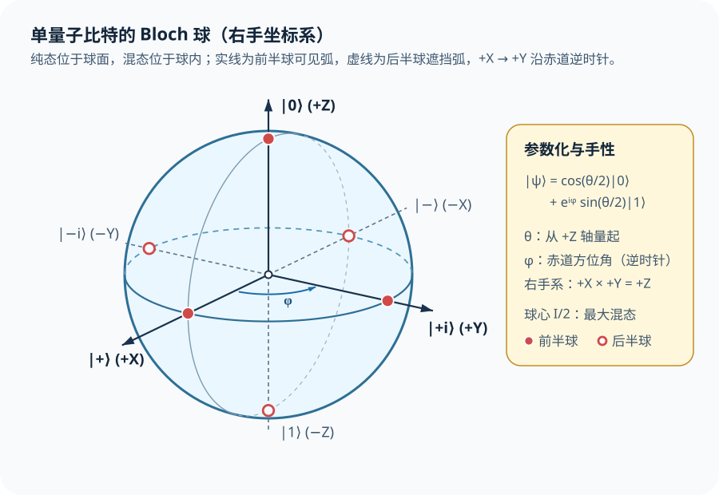
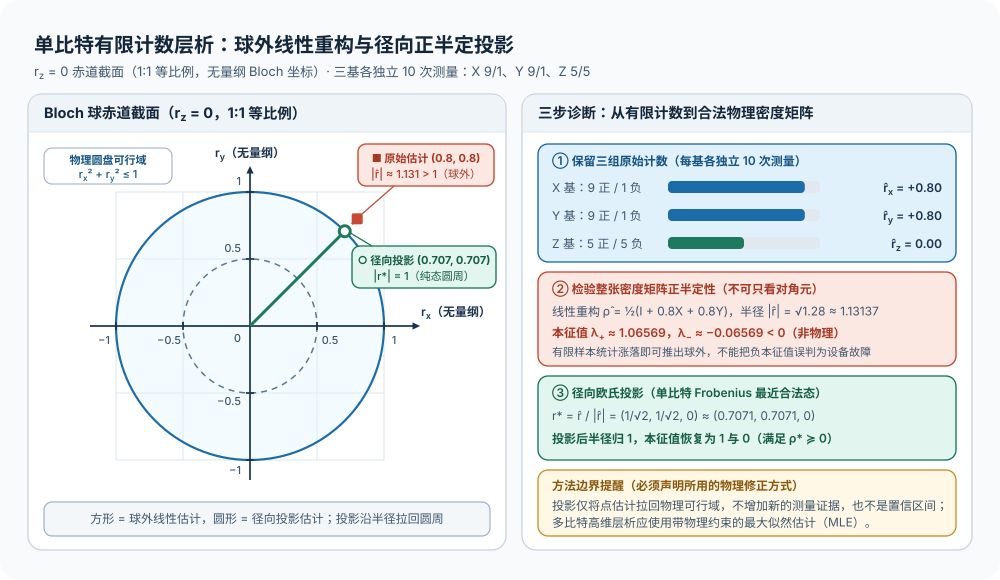

# 02｜单量子比特：状态、相位与测量

一个量子比特的状态可以用两个复数记下来。本章从这两个数出发，逐步计算它经过门后怎样改变、测量会得到什么、为什么相同的计算基概率不一定表示相同的状态。只需先会[第 01 章](01-math.md)的复数模平方、二维列向量与矩阵乘法；读到“进阶回看”可以暂时跳过。

如果更想先看实验现象，可以先读[量子力学 Q1](quantum-mechanics/01-experiments-states.md)；读完本章，[Q2](quantum-mechanics/02-observables-dynamics.md)再把这些门与物理量、能量和时间演化联系起来。

## 1. 量子态不是一个隐藏的经典位

先选两个标准列向量：

$$|0\rangle=\begin{bmatrix}1\\0\end{bmatrix},\qquad
|1\rangle=\begin{bmatrix}0\\1\end{bmatrix}.$$

它们称为**计算基**。这里的 $0$ 和 $1$ 首先是两个可区分的基态标签，不是说尚未测量时有一个藏起来的经典比特。把它们分别乘上复数 $\alpha$、$\beta$ 再相加，得到一个二维列向量：

$$
|\psi\rangle=\alpha|0\rangle+\beta|1\rangle
=\begin{bmatrix}\alpha\\\beta\end{bmatrix}.
$$

$\alpha$、$\beta$ 称为**振幅**。它们必须满足归一化条件 $|\alpha|^2+|\beta|^2=1$，其中竖线表示复数的模。量子计算通常用这种归一化的列向量描述**纯态**：它给出了在理想制备条件下，预测各种可能测量所需的状态信息。本章后面会遇到另一种情况——每次从几种制备中随机选一种，或做测量后丢弃结果；这时需要“混态”，不能总用一个态矢量代替。

**测量规则是物理输入，不是由列向量加法推出的。** 在计算基测量，报告 $0$ 的概率是 $p(0)=|\alpha|^2$，报告 $1$ 的概率是 $p(1)=|\beta|^2$。结果只有这两种，所以归一化正好保证 $p(0)+p(1)=1$。例如

$$
|\psi\rangle=\frac{\sqrt3}{2}|0\rangle+\frac{i}{2}|1\rangle
=\begin{bmatrix}\sqrt3/2\\i/2\end{bmatrix}
$$

的两个概率分别是 $|\sqrt3/2|^2=3/4$ 和 $|i/2|^2=1/4$。注意第二项不是 $(i/2)^2=-1/4$。若读到结果 $0$，理想的计算基投影测量后，系统处于 $|0\rangle$；读到 $1$，后态为 $|1\rangle$。这既涉及概率，也涉及测量怎样改变状态，稍后第 6 节会拆开计算。

### 同样的掷币概率，不一定是同一个态

令 $|+\rangle=(|0\rangle+|1\rangle)/\sqrt2$。每次都制备 $|+\rangle$，计算基测量仍然得到 0、1 各半。另一种做法是事先掷一枚公平的经典硬币：正面制备 $|0\rangle$，反面制备 $|1\rangle$，却不告诉测量者掷币结果。计算基统计也是各半。这两种制备不能仅凭这一组统计区分。

换成 $\{|+\rangle,|-\rangle\}$ 基，区别就出现了，其中 $|-\rangle=(|0\rangle-|1\rangle)/\sqrt2$。第一种制备的 $+$ 振幅是 $\langle+|+\rangle=1$，所以每次都得到 $+$。第二种制备若实际是 $|0\rangle$，则 $|\langle+|0\rangle|^2=1/2$；若实际是 $|1\rangle$，也有 $|\langle+|1\rangle|^2=1/2$。按两种制备各占一半加权，总概率仍为 $(1/2)(1/2)+(1/2)(1/2)=1/2$。因此“叠加”和“不知道到底制备了哪一个”不是同一回事。这里说的是许多次同样制备并比较频率，**不是**靠单次测量无误认出未知制备。

| 制备方式 | 计算基得 0 的概率 | $X$ 基得 $+$ 的概率 |
|---|---:|---:|
| 每次都制备纯态 $\lvert+\rangle$ | $1/2$ | $1$ |
| 随机各半制备 $\lvert0\rangle$、$\lvert1\rangle$ | $1/2$ | $1/2$ |

表中第二列相同，第三列不同；“只测一种基就认定两种制备一样”正是此处要避免的错误。

**马上核对。** $|\chi\rangle=(3|0\rangle+4|1\rangle)/5$ 是否归一化？是，因为 $9/25+16/25=1$；计算基结果 1 的概率是 $16/25$。

## 2. 全局相位和相对相位

一个非零复数有长度与方向。若把整个态的每个振幅同时乘以 $e^{i\gamma}$，其长度为 1，只改变共同方向：

$$
e^{i\gamma}|\psi\rangle
=(e^{i\gamma}\alpha)|0\rangle+(e^{i\gamma}\beta)|1\rangle.
$$

这个共同因子称为**全局相位**；它不改变任何测量统计，因此 $|\psi\rangle$ 与 $e^{i\gamma}|\psi\rangle$ 代表同一物理纯态。不要把它误认为一次随意的“相位误差”：关键是**所有分量**都乘了同一个因子。

但

$$\frac{|0\rangle+|1\rangle}{\sqrt2}
\quad\text{和}\quad
\frac{|0\rangle-|1\rangle}{\sqrt2}$$

的两个计算基概率都是 $1/2$，但 $|1\rangle$ 前的负号只出现在第二个态里；两个分量之间的这种区别叫**相对相位**。它能在适当的门作用后改变测量概率。

具体地，$H$ 门的矩阵稍后会给出。先用它的作用 $H|0\rangle=|+\rangle$、$H|1\rangle=|-\rangle$：

$$
H|+\rangle
=\frac{H|0\rangle+H|1\rangle}{\sqrt2}
=\frac{|+\rangle+|-\rangle}{\sqrt2}
=|0\rangle,
$$

因为 $|+\rangle+|-\rangle=\sqrt2|0\rangle$。同样，$H|-\rangle=(|+\rangle-|-\rangle)/\sqrt2=|1\rangle$。所以先施加 $H$ 再测计算基，可以把原本看不见的正负号变成确定的 0 或 1。这个相加、相消的过程叫**干涉**；没有从一次测量中读出两个振幅。

### 检验全局相位

比较

$$|\phi\rangle=i|\psi\rangle.$$

任意归一化测量方向 $|x\rangle$ 的对应概率为

$$|\langle x|\phi\rangle|^2
=|i\langle x|\psi\rangle|^2
=|i|^2|\langle x|\psi\rangle|^2
=|\langle x|\psi\rangle|^2.$$

这里先用概率做了检验；对整个实验过程也成立，因为后续线性门会把共同因子原封不动带到输出态，最终的模平方仍消去它。若仅某一受控分支获得该因子，它与其他分支相比就不再是整个系统的共同相位，第 5 节会再提醒这一点。

## 3. Bloch 球

计算基概率只告诉我们两个振幅的**长度**。要把相对相位也画出来，可以把纯态对应到一个球面点。先看为什么只需要两个角。

一般的 $\alpha,\beta$ 各有长度和相位，一共四个实数信息。归一化 $|\alpha|^2+|\beta|^2=1$ 给出一个限制；整个态乘同一个全局相位又不产生新物理态。除去这两项后，剩下两个可变的实数。对于 $\alpha\ne0$，选择全局相位使 $\alpha$ 成为非负实数，再令 $|\alpha|=\cos(\theta/2)$、$|\beta|=\sin(\theta/2)$，把 $\beta$ 相对 $\alpha$ 的角度记作 $\varphi$，就得到

$$
|\psi\rangle=\cos\frac\theta2|0\rangle
+e^{i\varphi}\sin\frac\theta2|1\rangle,
$$

其中 $0\le\theta\le\pi$，$0\le\varphi<2\pi$；$\theta/2$ 落在 $0$ 到 $\pi/2$ 之间，使正弦、余弦都非负。若 $\alpha=0$，态就是 $|1\rangle$ 乘一个全局相位，可以取 $\theta=\pi$；若 $\beta=0$，取 $\theta=0$。这两个极点处 $\varphi$ 可任取，不代表许多不同状态。

参数 $(\theta,\varphi)$ 对应 **Bloch 球**上的单位向量

$$\vec r=(\sin\theta\cos\varphi,\sin\theta\sin\varphi,\cos\theta).$$

这三个数不是粒子在三维空间的位置。它们分别是同一个状态对 $X$、$Y$、$Z$ 三种测量的平均读数：每一种测量只可能给 $+1$ 或 $-1$，平均值可以在二者之间。第 4 节会从二维矩阵算出坐标。球面上的箭头是表示态的**示意坐标**，不是一根实体指针。

| 位置 | 状态 | 沿相应轴测量时的确定读数 |
|---|---|---|
| 北极 | $\lvert0\rangle$ | $Z=+1$ |
| 南极 | $\lvert1\rangle$ | $Z=-1$ |
| $+x$ | $\lvert+\rangle$ | $X=+1$ |
| $-x$ | $\lvert-\rangle$ | $X=-1$ |
| $+y$ | $\lvert{+i}\rangle:=(\lvert0\rangle+i\lvert1\rangle)/\sqrt2$ | $Y=+1$ |
| $-y$ | $\lvert{-i}\rangle:=(\lvert0\rangle-i\lvert1\rangle)/\sqrt2$ | $Y=-1$ |

Bloch 球只直接表示单量子比特。若两比特是乘积态，可分别画出两个单比特球；但一般两比特纯态，尤其纠缠态，不能仅由两个局部小球完整表示，因为还要描述两者之间的关联。

以 $|+\rangle$ 为例，两个振幅都是正实数 $1/\sqrt2$，所以 $\theta=\pi/2$、$\varphi=0$，得 $(r_x,r_y,r_z)=(1,0,0)$。换为 $|-\rangle$ 时第二个振幅多一个负号，即相对相位 $\varphi=\pi$，得到 $(-1,0,0)$。这正是球上赤道两端，而非“概率从一半变成了另一半”。

这里的单位球面只表示纯态。第 05 章会把一般单比特密度矩阵写成

$$
\rho=\frac12(I+\vec r\cdot\vec\sigma),\qquad |\vec r|\le1.
$$

$|\vec r|=1$ 是纯态，$|\vec r|<1$ 是混态，球心 $\vec r=0$ 是最大混态 $I/2$。这里 $\rho$ 是 $2\times2$ 的密度矩阵，$I$ 是单位矩阵，$\vec\sigma=(X,Y,Z)$。读者此时只需记住：球心对应刚才那种各占一半的 $|0\rangle/|1\rangle$ **随机制备**，它与球面上的 $|+\rangle$ 有相同的计算基概率，却不是同一个态。第 05 章会推导整个球内表示。

## 4. 三个 Pauli 门与 Hadamard 门

**门**是作用在状态列向量上的矩阵。单比特门在这里都是 $2\times2$，右边输入 $2\times1$，输出仍是 $2\times1$。其中 $X,Y,Z$ 三个常用矩阵称为 **Pauli 矩阵**；它们一方面是门，另一方面的正负本征方向也定义了上一节的三种测量基。下面四个门都满足 $U^\dagger U=I$，称为**酉矩阵**：它们保持状态长度，因此保持总概率为 1。若先做 $A$、后做 $B$，写成 $BA|\psi\rangle$，最靠右的 $A$ 先作用。

$$
X=\begin{bmatrix}0&1\\1&0\end{bmatrix},\quad
Y=\begin{bmatrix}0&-i\\i&0\end{bmatrix},\quad
Z=\begin{bmatrix}1&0\\0&-1\end{bmatrix},\quad
H=\frac1{\sqrt2}\begin{bmatrix}1&1\\1&-1\end{bmatrix}.
$$

- $X$ 交换 $|0\rangle$ 与 $|1\rangle$。
- $Z$ 保持 $|0\rangle$，给 $|1\rangle$ 加负号。
- $Y=iXZ$，同时包含翻转与相位；次序重要，因为 $XZ=-ZX$。
- $H$ 在 $Z$ 基与 $X$ 基之间换基：$H|0\rangle=|+\rangle$，$H|1\rangle=|-\rangle$。

先逐行算一次 $H$：

$$
H|0\rangle
=\frac1{\sqrt2}
\begin{bmatrix}1&1\\1&-1\end{bmatrix}
\begin{bmatrix}1\\0\end{bmatrix}
=\frac1{\sqrt2}
\begin{bmatrix}1\cdot1+1\cdot0\\1\cdot1+(-1)\cdot0\end{bmatrix}
=\frac1{\sqrt2}\begin{bmatrix}1\\1\end{bmatrix}
=|+\rangle.
$$

$H|1\rangle=(|0\rangle-|1\rangle)/\sqrt2$ 可同样检查。再算 $H|+\rangle$ 时，两行分别是 $(1+1)/2=1$ 与 $(1-1)/2=0$，所以返回 $|0\rangle$。这就是上一节“相位变为结果”的矩阵版本。

### 算例：从振幅算 Bloch 坐标

写 $|\psi\rangle=[\alpha,\beta]^T$，它的 bra 是 $\langle\psi|=[\alpha^*,\beta^*]$。先让每个矩阵作用在列向量上：

$$
X|\psi\rangle=\begin{bmatrix}\beta\\\alpha\end{bmatrix},\qquad
Y|\psi\rangle=\begin{bmatrix}-i\beta\\i\alpha\end{bmatrix},\qquad
Z|\psi\rangle=\begin{bmatrix}\alpha\\-\beta\end{bmatrix}.
$$

再用 $1\times2$ 的 bra 从左边乘，结果是一个实数，叫这种测量的**期望值**。如果读数只有 $+1$ 和 $-1$，期望值就是多次重复时的平均读数 $p(+1)-p(-1)$，不是某次实验可能显示的第三种读数。逐项相乘得

$$
\begin{aligned}
r_x=\langle X\rangle&=\alpha^*\beta+\beta^*\alpha=2\operatorname{Re}(\alpha^*\beta),\\
r_y=\langle Y\rangle&=-i\alpha^*\beta+i\beta^*\alpha=2\operatorname{Im}(\alpha^*\beta),\\
r_z=\langle Z\rangle&=|\alpha|^2-|\beta|^2.
\end{aligned}
$$

取 $\alpha=\cos(\theta/2)$、$\beta=e^{i\varphi}\sin(\theta/2)$，前两式用 $2\sin(\theta/2)\cos(\theta/2)=\sin\theta$，第三式用 $\cos^2(\theta/2)-\sin^2(\theta/2)=\cos\theta$，便得到第 3 节的球面坐标。以 $|\psi\rangle=(\sqrt3|0\rangle+i|1\rangle)/2$ 为例，$\alpha^*\beta=i\sqrt3/4$，所以

$$
\vec r=\left(0,\frac{\sqrt3}{2},\frac12\right),
\qquad
|\vec r|^2=0+\frac34+\frac14=1.
$$

计算基测量中 $p(0)=3/4$、$p(1)=1/4$，故 $\langle Z\rangle=(+1)p(0)+(-1)p(1)=1/2$，与 $r_z$ 一致。对 $Y$ 测量，若 $p_+$、$p_-$ 分别为 $\pm1$ 的概率，则 $p_++p_-=1$ 且 $r_y=p_+-p_-=2p_+-1$；解得 $p_+=(1+r_y)/2=(2+\sqrt3)/4$。这让图上的坐标与实验频率可以互相核对。

也能直接按振幅检验这个不太直观的概率：$|{+i}\rangle=(|0\rangle+i|1\rangle)/\sqrt2$，其 bra 中的 $i$ 要共轭为 $-i$。于是

$$
\langle{+i}|\psi\rangle
=\frac{\sqrt3+(-i)i}{2\sqrt2}
=\frac{\sqrt3+1}{2\sqrt2},\qquad
|\langle{+i}|\psi\rangle|^2
=\frac{(\sqrt3+1)^2}{8}
=\frac{2+\sqrt3}{4}.
$$

这与从期望值反推的结果相同。若把 bra 误写成 $[1,i]/\sqrt2$，就会得到错误的符号。

### 算例：相位如何变成确定结果

$$
H Z H|0\rangle
=HZ|+\rangle
=H|-\rangle
=|1\rangle.
$$

若只看中间态在计算基的概率，$|+\rangle$ 和 $|-\rangle$ 都是各半；最后一个 $H$ 把相位差变成可测的比特差。

## 5. 旋转门

若想沿 Bloch 球上的某条轴转动状态，可以使用**旋转门**。最容易手算的是绕 $y$ 轴转 $\theta$ 弧度：

$$
R_y(\theta)=
\begin{bmatrix}
\cos(\theta/2)&-\sin(\theta/2)\\
\sin(\theta/2)&\cos(\theta/2)
\end{bmatrix}.
$$

它作用于 $|0\rangle=[1,0]^T$ 时，第一行得到 $\cos(\theta/2)$，第二行得到 $\sin(\theta/2)$：

$$
R_y(\theta)|0\rangle
=\cos(\theta/2)|0\rangle+\sin(\theta/2)|1\rangle.
$$

若 $\theta=\pi/2$，两振幅都是 $1/\sqrt2$，输出是 $|+\rangle$；在计算基的两个概率也各是 $1/2$。但“概率各半”仍不能描述全部结果，因为输出有确定的相对相位 $0$。若 $\theta=\pi$，输出是 $|1\rangle$。

为什么矩阵里出现半角？把上述振幅代入第 4 节的坐标公式：$r_x=2\cos(\theta/2)\sin(\theta/2)=\sin\theta$、$r_y=0$、$r_z=\cos^2(\theta/2)-\sin^2(\theta/2)=\cos\theta$。从北极 $(0,0,1)$ 出发，球面箭头确实转了 $\theta$，只是振幅使用 $\theta/2$。这里说的“转”是状态表示的变化，不要求量子比特真是一个在空间中旋转的小球。

另一种常用操作是绕 $z$ 轴转动：

$$
R_z(\varphi)=\begin{bmatrix}e^{-i\varphi/2}&0\\0&e^{i\varphi/2}\end{bmatrix}.
$$

它分别给两个计算基分量乘一个长度为 1 的复数。对 $|+\rangle$ 逐行作用，得

$$
R_z(\varphi)|+\rangle
=\frac{e^{-i\varphi/2}|0\rangle+e^{i\varphi/2}|1\rangle}{\sqrt2}
=e^{-i\varphi/2}\frac{|0\rangle+e^{i\varphi}|1\rangle}{\sqrt2}.
$$

末式最前面的因子是全局相位；括号内 $|1\rangle$ 相对于 $|0\rangle$ 多出的 $e^{i\varphi}$ 才改变 Bloch 球的方位角。特别地，$R_z(\pi/2)|+\rangle$ 与 $|{+i}\rangle$ 是同一物理态；$R_z(\pi)|+\rangle$ 与 $|-\rangle$ 相同。$R_z$ 不改这两个分量的模，所以单独做计算基测量时仍各半。

### 进阶回看：旋转门的统一写法

把 $X,Y,Z$ 统称为 $\sigma_x,\sigma_y,\sigma_z$，于是围绕第 $j$ 条 Bloch 坐标轴的旋转记为

$$R_j(\theta)=e^{-i\theta\sigma_j/2}
=\cos\frac\theta2 I-i\sin\frac\theta2\sigma_j,$$

其中 $j$ 取 $x,y,z$，$\sigma_j$ 相应地是 $X,Y,Z$。指数里的矩阵不是把每个元素分别取普通指数，而是用矩阵幂级数定义。第二个等号不是额外假设：每个 Pauli 矩阵都满足 $\sigma_j^2=I$，所以偶数次幂给 $I$，奇数次幂给 $\sigma_j$。按奇偶项拆开：

$$
\begin{aligned}
e^{-i\theta\sigma_j/2}
&=\sum_{n=0}^{\infty}\frac{(-i\theta/2)^n\sigma_j^n}{n!}\\
&=I\sum_{m=0}^{\infty}\frac{(-1)^m(\theta/2)^{2m}}{(2m)!}
-i\sigma_j\sum_{m=0}^{\infty}\frac{(-1)^m(\theta/2)^{2m+1}}{(2m+1)!}\\
&=\cos\frac\theta2 I-i\sin\frac\theta2\sigma_j.
\end{aligned}
$$

以 $y$ 轴为例，设 $c=\cos(\theta/2)$、$s=\sin(\theta/2)$，代入 $Y$ 并逐项算 $-isY$：

$$
R_y(\theta)=cI-isY
=\begin{bmatrix}c&0\\0&c\end{bmatrix}
+\begin{bmatrix}0&-s\\s&0\end{bmatrix}
=\begin{bmatrix}c&-s\\s&c\end{bmatrix}.
$$

由统一式令 $\theta=2\pi$，有 $\cos\pi=-1$、$\sin\pi=0$，故 $R_j(2\pi)=-I$。无条件对某个比特施加它时，即使该比特与别的系统纠缠，整体联合态也仅乘一个共同的 $-1$；若这个门只发生在受控或干涉的一条分支，负号相对于其他分支可能可观测。这与第 2 节的全局/相对相位区别相同。更一般的语言称这是自旋-$1/2$ 的 SU(2) 表示；理解本章的算例不需要先学群论，也不要求物理载体是真实自旋。

## 6. Born 规则与测量后状态

**Born 规则**把量子态变成可检验的结果概率；对理想投影测量，得到某个结果后还有一条状态更新规则。两条都是测量模型的物理规则，下面的矩阵运算只是说明怎样使用它们。先按熟悉的计算基完整算一遍。

### 已知结果：概率与条件后态

取 $|\psi\rangle=(\sqrt3|0\rangle+i|1\rangle)/2$。计算基的两个**投影算符**是

$$
P_0=|0\rangle\langle0|=\begin{bmatrix}1&0\\0&0\end{bmatrix},
\qquad
P_1=|1\rangle\langle1|=\begin{bmatrix}0&0\\0&1\end{bmatrix}.
$$

投影的作用很直观：$P_0$ 留下第一个分量并把第二个置零，$P_1$ 相反。依次相乘：

$$
P_0|\psi\rangle=\begin{bmatrix}\sqrt3/2\\0\end{bmatrix},
\qquad
P_1|\psi\rangle=\begin{bmatrix}0\\i/2\end{bmatrix}.
$$

两个结果的概率分别是这些**未归一化**向量的长度平方，$p(0)=3/4$、$p(1)=1/4$。若**已经知道**结果是 0，便把第一列除以其长度 $\sqrt{3/4}=\sqrt3/2$，得到 $|0\rangle$。若知道结果是 1，第二列除以 $\sqrt{1/4}=1/2$，得到 $i|1\rangle$；它与 $|1\rangle$ 只差全局相位 $i$，所以是同一物理纯态。概率 $1/4$ 与条件后态 $|1\rangle$ 回答的是不同问题，不能把后态再乘上 $1/4$ 当作 ket。

### 未记录结果：不能挑一个分支

若测量已经发生，但记录丢失，我们不知道是哪一个条件后态。用 $\rho=|\psi\rangle\langle\psi|$ 记输入的**密度矩阵**；它是 $2\times2$ 矩阵，不是新的列向量。对本例逐项外积：

$$
\rho=
\begin{bmatrix}\sqrt3/2\\i/2\end{bmatrix}
\begin{bmatrix}\sqrt3/2&-i/2\end{bmatrix}
=\frac14\begin{bmatrix}3&-i\sqrt3\\i\sqrt3&1\end{bmatrix}.
$$

矩阵右上角是 $-i\sqrt3/4$，左下角是它的共轭 $i\sqrt3/4$。测量后丢弃记录，就按发生概率混合两个条件态：

$$
\rho'=\frac34|0\rangle\langle0|+\frac14|1\rangle\langle1|
=\begin{bmatrix}3/4&0\\0&1/4\end{bmatrix}.
$$

如果不是做了测量，而是从一开始便以 $3/4$ 概率制备 $|0\rangle$、以 $1/4$ 概率制备 $|1\rangle$，对不知道制备记录的人也是这个矩阵。它与原先纯态的计算基概率相同，却少了非对角的相位信息。**做了测量并丢弃记录**与**根本没有测量**不是一回事。

### 在 $X$ 基测量

实验问的是“沿哪个测量基分辨结果”。$X$ 基是 $\{|+\rangle,|-\rangle\}$，不是把原来的 0/1 标签改个名字。仍取上述 $|\psi\rangle$，先算 $+$ 的振幅：

$$
\langle+|\psi\rangle
=\frac1{\sqrt2}(\langle0|+\langle1|)
\left(\frac{\sqrt3}{2}|0\rangle+\frac i2|1\rangle\right)
=\frac{\sqrt3+i}{2\sqrt2}.
$$

因此

$$p(+)=\left|\frac{\sqrt3+i}{2\sqrt2}\right|^2
=\frac{3+1}{8}=\frac12,$$

另一结果也要核对：$\langle-|\psi\rangle=(\sqrt3-i)/(2\sqrt2)$，所以 $p(-)=|\sqrt3-i|^2/8=1/2$。若读到 $+$，条件后态为 $|+\rangle$；若读到 $-$，是 $|-\rangle$。用硬件上常见的做法理解：先施加 $H$，再做计算基测量，记录 0 对应原来的 $+$，记录 1 对应原来的 $-$。**注意**若要说原系统在 $X$ 测量后的状态是 $|\pm\rangle$，还需把换基门 $H$ 反做回来；只做“$H$ 后接计算基测量”的电路，在门后的物理后态是 $|0\rangle$ 或 $|1\rangle$。

如果不记录 $+$ 或 $-$，则

$$
\rho'
=\frac12|+\rangle\langle+|+\frac12|-\rangle\langle-|
=\frac I2.
$$

把两个外积展开可核对：$|+\rangle\langle+|=\frac12\bigl[\begin{smallmatrix}1&1\\1&1\end{smallmatrix}\bigr]$，$|-\rangle\langle-|=\frac12\bigl[\begin{smallmatrix}1&-1\\-1&1\end{smallmatrix}\bigr]$；各乘 $1/2$ 后相加，非对角项抵消，留下 $I/2$。每次运行仍有一个实际记录；$I/2$ 描述的是我们不再持有记录时可预测的统计。

### 把例子写成通式

若投影测量有结果 $k$，对应 $2\times2$ 投影矩阵 $P_k$，它们满足 $P_k^\dagger=P_k$、$P_k^2=P_k$ 且 $\sum_kP_k=I$。第一式表示矩阵等于共轭转置，第二式表示投影两次与投影一次相同，最后一式表示所有结果穷尽可能性。对纯态：

$$
p(k)=\langle\psi|P_k|\psi\rangle
=\|P_k|\psi\rangle\|^2,
\qquad
|\psi_k\rangle=\frac{P_k|\psi\rangle}{\sqrt{p(k)}}\quad(p(k)>0).
$$

第一个等号用 $P_k^\dagger P_k=P_k^2=P_k$ 可验算。分母只做归一化；若 $p(k)=0$，结果不会出现，相应条件后态无需定义。对“测了但没记下结果”，若输入是密度矩阵 $\rho$，则

$$
\rho'=\sum_kP_k\rho P_k.
$$

输入若是按经典概率 $q_j$ 制备的几种纯态，密度矩阵写为 $\rho=\sum_jq_j|\psi_j\rangle\langle\psi_j|$，其中 $q_j\ge0$ 且 $\sum_jq_j=1$。这套语言会在第 05 章详细建立；本节只用它避免把“已知哪个结果”与“没记录结果”混写。

### 理想规则和真实读出

上述投影是理想模型。真实探测器可能产生电压、光子计数或电荷信号，电子学再据此报告 0 或 1。有限信噪比会把两种状态误判，测量也可能引起跃迁、泄漏或损失；“读错标签”与“测量改变系统”不是同一种误差。许多平台原生读出计算基，测 $X$ 基时常先施加 $H$ 再读出，因此前置门误差也会进入结果。若某种读出近似**量子非破坏**（QND），重复测同一量可大概率得到相同结果；不能把这一点当成所有硬件的保证。

## 7. 进阶回看：一般测量为何还要说明后态

第 6 节的投影测量只是理想模型的一种。若探测器并不把 0、1 完美分开，可以先用两个矩阵描述它报告结果的概率。例如

$$
E_0=\begin{bmatrix}3/4&0\\0&1/4\end{bmatrix},\qquad
E_1=\begin{bmatrix}1/4&0\\0&3/4\end{bmatrix}.
$$

它们各有非负本征值，故是**正半定**矩阵，且 $E_0+E_1=I$。输入 $|0\rangle$ 时，报告 0 的概率是 $\langle0|E_0|0\rangle=3/4$，报告 1 的概率是 $1/4$。与 $P_0$ 不同，$E_0^2\ne E_0$：它不是把态投到一个确定方向的投影矩阵。这一组 $E_k$ 叫**正算符值测量**，通常缩写 POVM。它先回答“记录有多大可能是 $k$”，尚未回答“记录之后系统变成什么”。

一般地，对 $2\times2$ 密度矩阵 $\rho$，若 $E_k\succeq0$ 且 $\sum_kE_k=I$，则

$$p(k)=\operatorname{Tr}(E_k\rho).$$

这里 $\operatorname{Tr}$ 是取对角线元素之和；若输入是纯态 $\rho=|\psi\rangle\langle\psi|$，它等于 $\langle\psi|E_k|\psi\rangle$。例如上面的 $|0\rangle$ 案例，$\rho=\bigl[\begin{smallmatrix}1&0\\0&0\end{smallmatrix}\bigr]$，$E_0\rho=\bigl[\begin{smallmatrix}3/4&0\\0&0\end{smallmatrix}\bigr]$，迹就是 $3/4$。由于 $\sum_kE_k=I$，概率之和为 $\operatorname{Tr}(I\rho)=1$。

**同一组结果概率，不一定带来同一种测量后状态。** 要说明后态，必须补充每个结果对应的状态变换，统称为**量子测量工具**（quantum instrument）。这里先限定测后仍有同一个单比特可研究，因此下列 $M_{k\alpha}$ 是 $2\times2$ 矩阵，输入、输出 $\rho$ 都是 $2\times2$；一般模型也允许测后输出系统与输入维度不同。

$$
\mathcal I_k(\rho)=\sum_\alpha
M_{k\alpha}\rho M_{k\alpha}^\dagger,
$$

并满足

$$
\sum_{k,\alpha}M_{k\alpha}^\dagger M_{k\alpha}=I.
$$

$M_{k\alpha}$ 是描述各物理分支怎样改变状态的线性算子，称为 Kraus 算子；指标 $\alpha$ 表示“同一个记录 $k$ 背后，实验装置还可能有我们没有分辨的不同分支”。$\mathcal I_k(\rho)$ **尚未归一化**，其迹就是结果 $k$ 的概率。对应的 POVM 元素是

$$
E_k=\sum_\alpha M_{k\alpha}^\dagger M_{k\alpha}.
$$

用迹的循环性质可核对 Born 概率：

$$
\operatorname{Tr}[\mathcal I_k(\rho)]
=\sum_\alpha\operatorname{Tr}
\left(M_{k\alpha}^\dagger M_{k\alpha}\rho\right)
=\operatorname{Tr}(E_k\rho)=p(k).
$$

只有在 $p(k)>0$ 时，知道结果 $k$ 的条件后态才定义为

$$
\rho_k=\frac{\mathcal I_k(\rho)}{p(k)}.
$$

忽略结果时，不能任选一个条件态，而要把所有未记录的分支相加：

$$
\rho'=\sum_k\mathcal I_k(\rho)
=\sum_{k,\alpha}M_{k\alpha}\rho M_{k\alpha}^\dagger.
$$

“每个结果只有一个 $M_k$”只是 $\alpha$ 只有一个取值的特殊情形；投影测量又是其中 $M_k=P_k$ 的特殊情形。第 05 章会解释为什么这些变换还要满足完全正性。

### 算例：同一个 POVM，不同的测量后状态

现在换回计算基 POVM：$E_0=|0\rangle\langle0|$、$E_1=|1\rangle\langle1|$。第一种实现是通常的投影测量：

$$M_0=|0\rangle\langle0|,
\qquad M_1=|1\rangle\langle1|.$$

第二种实现读出同一个结果，却在读出后把系统复位到 $|0\rangle$：

$$N_0=|0\rangle\langle0|,
\qquad N_1=|0\rangle\langle1|.$$

第二种实现里 $N_1=\bigl[\begin{smallmatrix}0&1\\0&0\end{smallmatrix}\bigr]$：它把输入的 $|1\rangle$ 分量送到输出的 $|0\rangle$。两者确实有同一组 POVM 元素，因为

$$
M_k^\dagger M_k=N_k^\dagger N_k=E_k.
$$

输入 $|+\rangle=(|0\rangle+|1\rangle)/\sqrt2$ 时，$M_0|+\rangle=|0\rangle/\sqrt2$、$M_1|+\rangle=|1\rangle/\sqrt2$，两列长度都为 $1/\sqrt2$，故两种结果各有 $1/2$ 概率；而 $N_0|+\rangle=N_1|+\rangle=|0\rangle/\sqrt2$，结果概率仍各半。第一种实现的两个条件后态分别为 $|0\rangle$、$|1\rangle$，忽略结果后得到 $I/2$；第二种实现无论报告什么，条件后态都是 $|0\rangle$，忽略结果后也得到 $|0\rangle\langle0|$。因此只给 POVM 元素，确实不足以决定测量反作用。

### F71-02｜把前面的非投影概率模型补成一次完整测量

回到本节开头的 $E_0=\operatorname{diag}(3/4,1/4)$、$E_1=\operatorname{diag}(1/4,3/4)$。仅给这两个矩阵没有后态；现在**另外指定**一种实现 $M_k=\sqrt{E_k}$。正矩阵的平方根是把本征值开非负平方根，这里矩阵已是对角形式，所以

$$
M_0=\operatorname{diag}(\sqrt3/2,1/2),
\qquad M_1=\operatorname{diag}(1/2,\sqrt3/2).
$$

两者都不是投影。它们满足 $M_0^\dagger M_0+M_1^\dagger M_1=E_0+E_1=I$；这只是同一 POVM 的一种工具，不是由概率唯一推得的装置。[Preskill 的广义测量讲义 §3.1.2](https://www.preskill.caltech.edu/ph219/chap3_15.pdf)说明还可在每个平方根后接不同酉门（访问 2026-10-13）。

**练习。** 输入 $|+\rangle$，求两条结果概率、条件态、丢弃结果后的态。随后再次做同一工具，第一次已报 0 时，第二次还报 0 是否必然？

**第一步：先保留分支长度。** $M_0|+\rangle=(\sqrt3,1)^T/(2\sqrt2)$，长度平方为 $(3+1)/8=1/2$；另一分支交换上下分量，概率也为 $1/2$。分别除以 $\sqrt{1/2}$ 后，条件 ket 是

$$
|\psi_0\rangle=\frac{\sqrt3|0\rangle+|1\rangle}{2},
\qquad |\psi_1\rangle=\frac{|0\rangle+\sqrt3|1\rangle}{2}.
$$

**第二步：丢弃记录时合并矩阵。** 两条条件外积的对角元分别为 $(3/4,1/4)$、$(1/4,3/4)$；非对角元均为 $\sqrt3/4$。各乘概率 $1/2$，得

$$
\rho'=\begin{bmatrix}1/2&\sqrt3/4\\\sqrt3/4&1/2\end{bmatrix},
\qquad \operatorname{Tr}(\rho'^2)=2(1/4)+2(3/16)=7/8.
$$

仍留有相干，但已经不是输入纯态。随后测 $X$，其平均值是两非对角元相加 $\sqrt3/2$，故 $p(X=+1)=(1+\sqrt3/2)/2\approx0.933013$；不是对同一输入做计算基投影测量并丢弃结果后的 $1/2$，也不是输入的 1。

**第三步：重测并不保证重现标签。** 已知第一次为 0 时，第二次报 0 的概率为 $\langle\psi_0|E_0|\psi_0\rangle=(3/4)(3/4)+(1/4)(1/4)=5/8$。所以“刚测到某标签，立即重测必同标签”只适合相应的理想可重复测量条件，不能推广到所有 POVM。

运行 `python3 codes/foundations/round71_checks.py --case 02`，逐分支复算矩阵与 $5/8$；[固定输入、结果和边界](../codes/foundations/round71-README.md)不包含真实硬件读出。拓展题：在 $M_0$ 后额外接 $X$，$E_0$ 会改变吗？不会，因为 $M_0^\dagger X^\dagger XM_0=E_0$；后态却被翻转，再次说明统计与反作用应分别给出。

## 8. 采样误差不是设备噪声

反复从相同制备开始，做同一种测量。假设每次独立、真实成功概率不漂移，$N$ 次中有 $K$ 次成功，记录的频率为 $\hat p=K/N$。**真实概率** $p$ 是模型中的固定数；**样本频率** $\hat p$ 随这一批实验的随机结果波动。第 01 章的二项模型给出频率的标准差

$$\sigma_{\hat p}=\sqrt{\frac{p(1-p)}N}.$$

因为 $p(1-p)$ 在 $p=1/2$ 时最大，代入 $N=1000$ 得 $\sqrt{(1/2)(1/2)/1000}=\sqrt{1/4000}\approx0.0158$，即约 1.58 个百分点；代入 $N=10000$ 得 $\sqrt{1/40000}=0.005$，即 0.5 个百分点。样本数增加 10 倍，标准差缩为 $1/\sqrt{10}$；增加 100 倍，才缩为 $1/10$。这个标准差不是对每次实际误差的硬上限，也不能自动推出某一批实验“必在 $p\pm0.005$ 内”。

即使设备完全理想，有限采样仍有波动。若读出把真实 0 误判为 1，或实验期间概率漂移，$\hat p$ 还可能围绕**有偏或变化中的概率**波动；单纯增加测量次数不会自动消除这种偏差，也可能破坏独立假设。

### F72-02｜完整层析运行：怎样从计数追到拟合后的态

前面的三批小计数说明线性估计可能落到球外；现在用完整 Qiskit Experiments 0.14.2 生成测量电路、交给 Aer、收集原计数并运行拟合。制备 $R_y(\pi/3)$ 后做 $S$，目标态为 $(\sqrt3|0\rangle+i|1\rangle)/2$，精确 Bloch 向量是 $(0,\sqrt3/2,1/2)$。三种基分别使用重新制备的 8192 份样本；本轮种子 72 的原计数如下。

| 基 | $+1$ 次数 | $-1$ 次数 | 差除以 8192 |
|---|---:|---:|---:|
| $X$ | 4111 | 4081 | $0.003662109375$ |
| $Y$ | 7681 | 511 | $0.875244140625$ |
| $Z$ | 6210 | 1982 | $0.51611328125$ |

**练习。** 先不看 SDK 的 `positive` 字段，自己重构矩阵、求谱，再说明正性修正改变了什么。

**细算答案。** 对每一轴 $\hat r=(n_+-n_-)/8192$，代回

$$
\hat\rho=\frac12\begin{bmatrix}1+\hat r_z&\hat r_x-i\hat r_y\\\hat r_x+i\hat r_y&1-\hat r_z\end{bmatrix}.
$$

本次 $|\hat{\vec r}|=1.0160898759$，本征值 $(1\pm|\hat{\vec r}|)/2$ 为 $1.0080449379,-0.0080449379$。单比特、迹为 1 的本例，线性拟合器的正性修正等价于把球外向量改成 $\vec r_* =\hat{\vec r}/|\hat{\vec r}|$，故 $\rho_*=I/2+(\hat\rho-I/2)/|\hat{\vec r}|$。独立重算与 SDK 拟合矩阵最大逐格差为 $6.12\times10^{-16}$；拟合态距精确目标的最大逐格差约 $0.0039703$。

这验证的是本次两维修正规则和实现对应，不能把径向公式推广到高维，也不能把合法拟合态当作“误差已经消失”。[官方层析示例](https://qiskit-community.github.io/qiskit-experiments/manuals/verification/state_tomography.html)区分原始本征值与正性修正（访问 2026-10-13）。[F72-02 的完整计数、矩阵及代码](../codes/foundations/round72-README.md)实际执行了测量生成、模拟、拟合和独立复算；仍假设测量基可信，没有真实器件的制备及读出偏差。

### F73-02｜读出补偿：把偏差和校准的不确定度一起带回来

上一轮理想层析没有读出错判。本例实际使用Aer的经典读出噪声和Experiments的 `LocalReadoutError` 完成两设置校准，再以校准后的Pauli测量模型拟合三设置QST。仍制备 $(\sqrt3|0\rangle+i|1\rangle)/2$，理想Bloch坐标为 $(0,\sqrt3/2,1/2)$；模型中基变换门与制备可信，读出错误独立、稳定。

令 $\alpha=P(\mathrm{report} 1\mid0)$、$\beta=P(\mathrm{report} 0\mid1)$，生成值为 $.12,.23$。对任一Pauli轴，理想均值 $r=p_0-p_1$、报告均值 $m=q_0-q_1$。将 $p_0=(1+r)/2,p_1=(1-r)/2$ 代入 $q_0=(1-\alpha)p_0+\beta p_1$，得到

$$
m=(\beta-\alpha)+(1-\alpha-\beta)r,\qquad
\hat r=\frac{\hat m-(\hat\beta-\hat\alpha)}{1-\hat\alpha-\hat\beta}.
$$

不对称读出既把坐标缩短，又整体偏移；只除以一个“读出保真度”会漏掉偏置。

**实际计数到实际校准。** 真0/真1校准各16384次，校准矩阵为

$$
\hat A=\begin{bmatrix}
.8802490234375&.23077392578125\\
.1197509765625&.76922607421875
\end{bmatrix}.
$$

三基各8192次的报告坐标为 $(.10986328125,.660888671875,.4306640625)$。逐轴代入上式得到 $(-.00178555,.84663096,.49215299)$；与完整SDK带噪测量基拟合的矩阵最大逐格差小于 $5\times10^{-16}$。对精确目标的Frobenius误差从未补偿的 $.1716952$ 降到 $.0148477$，补偿结果的谱为 $.01035683,.98964317$。全部校准/层析原计数和完整拟合矩阵见[F73记录](../codes/foundations/sdk73/all-results.json)。这里报告的是固定种子的一次合成样本；尚有误差，不能写成已经还原了真实态。

**练习：校准用了很多shots，能否忽略它的误差？** 即使只看Z轴，答案也要算。记 $d=1-\alpha-\beta$，补偿函数对三输入的导数为

$$
\frac{\partial r}{\partial m}=\frac1d,\qquad
\frac{\partial r}{\partial\alpha}=\frac{r-1}{d},\qquad
\frac{\partial r}{\partial\beta}=\frac{r+1}{d}.
$$

在目标样本和两份校准样本相互独立时，一阶误差传播给

$$
\operatorname{Var}(\hat r)\approx
\frac{1-m^2}{N d^2}
+\frac{(r-1)^2\alpha(1-\alpha)}{N_0d^2}
+\frac{(r+1)^2\beta(1-\beta)}{N_1d^2}.
$$

取 $r=.5,m=.435,N=8192,N_0=N_1=16384$，前项约 $.0002342522$，两校准项合计 $.0000613783$，总标准误约 $.01719391$。这是以生成参数做的一阶近似，不是精确置信区间。若三轴复用同一校准，校准导数乘积还产生轴间协方差；代码保存完整 $3\times3$ 近似协方差，不把三轴所有误差误当独立。

**制备与测量同时未知怎么办？** SPAM是state preparation and measurement，即制备及测量误差。两列校准所测的是“按0/1指令制备后仪器报告什么”。若实际制备也由矩阵B混合，观测到的是AB；完美制备配有错读出，与完美读出配同样错制备，都可给同一计数。只靠这两列不能唯一拆开A和B。因此本例只在可信参考制备的假设下补偿读出，没有声称完整识别SPAM；联合门集层析见第19章。

[官方读出说明](https://qiskit-community.github.io/qiskit-experiments/manuals/measurement/readout_mitigation.html)与[带读出模型的层析接口](https://qiskit-community.github.io/qiskit-experiments/stubs/qiskit_experiments.library.tomography.MitigatedStateTomography.html)说明这条工作流（0.14.2，访问2026-10-13）。`sdk73/validate_sdks.py --case readout` 实际执行完整安装包；`round73_checks.py --case 02` 不依赖SDK，独立复算导数和方差。真实器件的基变换误差、相关读出和校准漂移仍需另验。

## 9. 常见误区

- Bloch 球表面不是“经典概率球”；经度代表相位信息。
- 测量不是被动查看预先存在的计算基数值。
- “坍缩”是条件于测量记录的状态更新规则，不应被随意解释成可控的超光速作用。
- 条件态和非选择态不是两种相互竞争的“坍缩解释”，而是分别对应“保留结果”和“丢弃结果”的两种信息条件。
- 一次测量的随机结果不等于态本身完全随机；制备过程可非常精确。
- 全局相位不可测，不表示所有相位都不可测。
- “先施加 $H$ 再测 $Z$”和“对原状态做理想 $X$ 投影测量”给出相同结果概率，但若不把 $H$ 反做回来，两套操作留下的物理后态不同。
- POVM 元素只规定各结果概率；没有额外的状态变换信息，就不能推断测量后态。

## 10. 自检

1. 把 $(|0\rangle-i|1\rangle)/\sqrt2$ 定位到 Bloch 球六个轴点之一。
2. 计算 $HZH$ 的矩阵并识别它。
3. 对 $|\psi\rangle=(3|0\rangle+4|1\rangle)/5$ 做计算基测量，写出概率和两个条件后态。
4. 为什么把测量次数扩大 100 倍，频率误差通常只缩小 10 倍？
5. $|+\rangle$ 与随机等概率制备 $|0\rangle$、$|1\rangle$，为何计算基统计相同，却能在 $X$ 基区分？写出 $+$ 概率。
6. 先对 $|0\rangle$ 施加 $H$，再施加 $Z$，最后施加 $H$。逐步写出三次状态及最终测量 1 的概率。
7. 对 $|\psi\rangle=(\sqrt3|0\rangle+i|1\rangle)/2$，算 $X$ 基的 $+$ 振幅、概率及记录丢弃后的密度矩阵。
8. 对 $R_y(\pi/2)|0\rangle$，给出输出态、计算基概率与 Bloch 坐标。
9. 若第 7 节的 $E_0=\operatorname{diag}(3/4,1/4)$，输入 $|0\rangle$ 时报告 0 的概率是多少？仅凭 $E_0$ 能否知道后态？
10. 理想独立试验中 $p=1/2$、$N=400$，频率标准差是多少？它是否保证每批误差小于这个数？
11. 计算 $R_z(\pi/2)|+\rangle$ 的两个振幅。去掉全局相位后，它对应 Bloch 球哪个轴点？计算基概率是否改变？

答案见[练习与答案：第 2 章](appendices/exercises.md#第-2-章)。

## 新增诊断练习：三组合法计数为何拼出一个不合法的态

**题目。** 对同一种制备分三批分别测 $X,Y,Z$，每批 10 次。固定的合成计数为：$X$ 得 $+/-$ 各 9/1，$Y$ 得 9/1，$Z$ 得 5/5。先用频率估计 Bloch 向量，再检查密度矩阵是否物理。这里的不同基使用不同样本，不对同一个量子比特连续测三次。

**第一步：由计数算坐标。** 二值读数的平均值是 $(n_+-n_-)/N$，所以 $\hat{\vec r}=(0.8,0.8,0)$。每个坐标单独都在 $[-1,1]$ 内，但整体还须满足 $|\vec r|\le1$。本例 $|\hat{\vec r}|=\sqrt{1.28}\approx1.13137$，已经在球外。

**第二步：看见负本征值。** 线性重构给

$$
\hat\rho=\frac{I+0.8X+0.8Y}{2}
=\begin{bmatrix}0.5&0.4-0.4i\\0.4+0.4i&0.5\end{bmatrix}.
$$

特征方程是 $(0.5-\lambda)^2-|0.4-0.4i|^2=0$；后项为 $0.32$，故 $\lambda_\pm=0.5\pm\sqrt{0.32}$，约为 $1.06569,-0.06569$。它虽然厄米、迹为 1，却不是合法密度矩阵。有限样本涨落本身就可能造成这种情况；不能把这一个负值解释成“自然界出现负概率”，也不能只凭它证明装置失效。

图示是 $r_z=0$ 的等比例截面：方形标记为原始估计，圆形为投影估计，横纵轴均无量纲；两种标记不只依赖颜色区分。[原尺寸图](assets/round70-foundations-tomography.svg)与[生成程序](../codes/foundations/generate_diagnostic_figure.py)均可离线查看。

**第三步：区分修正估计与新增证据。** 一个容易手算的修正是把球外向量沿径向投到球面：$\vec r_*=(1/\sqrt2,1/\sqrt2,0)$。这是到闭单位球的**欧氏距离最近点**，此处等价于密度矩阵的 Hilbert–Schmidt 距离投影。它恢复本征值 $1,0$，但没有制造新测量，也没有自动给出置信区间；更不能把这条规则统称为所有数据模型的最大似然法。

[Qiskit Experiments 的官方层析示例](https://qiskit-community.github.io/qiskit-experiments/manuals/verification/state_tomography)展示了原始本征值、正性修正和拟合器信息（核查 2026-09-26）。工程报告应同时保存原计数与拟合方法。运行 `python3 codes/foundations/diagnostic_lab.py --case 02`，重现[本题固定输入与结果](../codes/foundations/diagnostic-results.json)；真实设备还需单独检查制备、读出和测量基校准误差。

## 配套数值实验与展开答案

把 Y 基测量拆成先 S†、再 H、最后计算基读出。交换前置门顺序仍产生归一化概率，却会从正确的约 0.9330 变为错误的 0.5；这是比“代码能运行”更严格的检查。

题目和逐步解答见[基础实验册](labs/foundations.md)，本章程序编号为 `02`。可从[代码说明](../codes/foundations/README.md)进入独立脚本与保存的运行结果。所有模拟样本均明确标作合成数据，不是硬件实验。

## 参考起点

- IBM Quantum Learning, [Bloch sphere](https://quantum.cloud.ibm.com/learning/en/courses/general-formulation-of-quantum-information/density-matrices/bloch-sphere)：单比特密度矩阵的 Pauli 展开与球面、球内态的区分。
- IBM Quantum Learning, [量子位、门与电路](https://quantum.cloud.ibm.com/learning/en/courses/utility-scale-quantum-computing/bits-gates-and-circuits)：单比特列向量、常用门与测量基。
- IBM Quantum Learning, [测量的数学形式](https://quantum.cloud.ibm.com/learning/en/courses/general-formulation-of-quantum-information/general-measurements/formulations-of-measurements)：投影与一般测量的区别。
- John Watrous, [*The Theory of Quantum Information*，第 2 章](https://cs.uwaterloo.ca/~watrous/TQI/TQI.pdf)：量子测量工具、概率与条件后态的正式表述。
