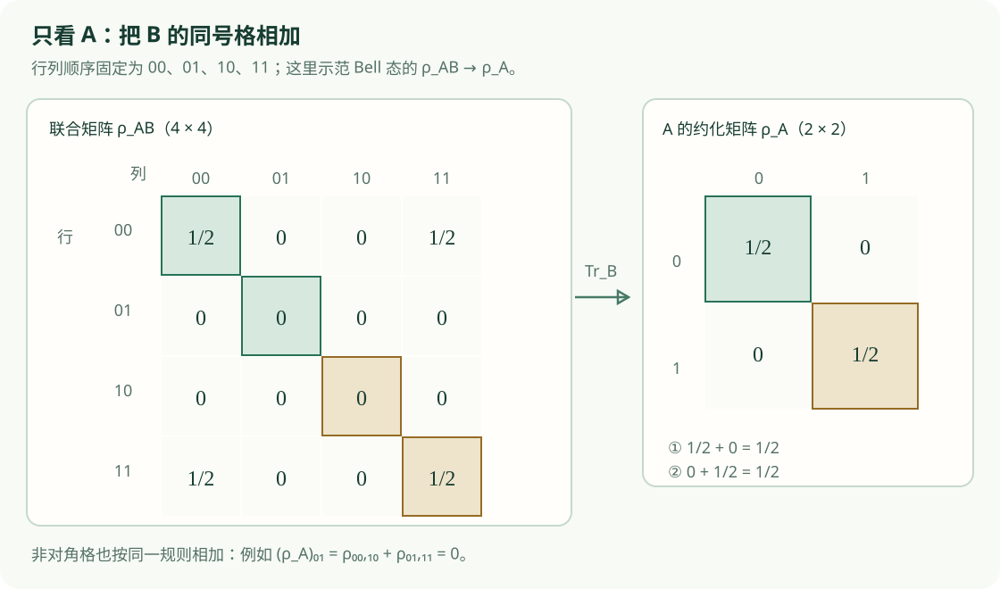
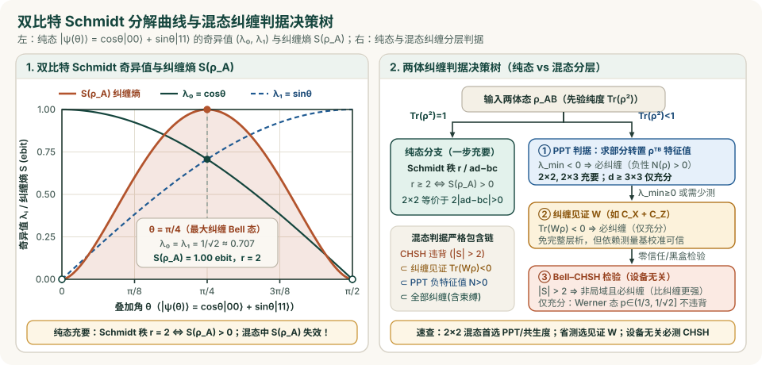
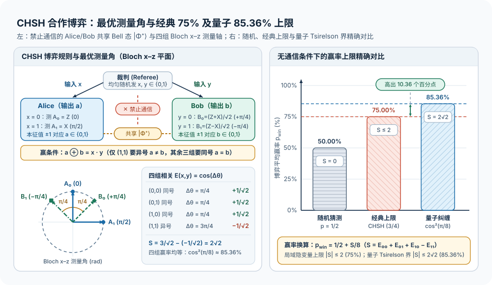

# 03｜多量子比特、量子纠缠与非局域性

[第 02 章](02-single-qubit.md)用复振幅解释了单比特的相位与干涉。把两个比特放在一起以后，只记录每个比特各自的状态会丢失关联信息。例如，两个各自看起来都像公平硬币的测量结果，却可能每次都相同。本章从联合态写起，弄清哪些关联可由经典随机变量解释，哪些需要用**量子纠缠**（quantum entanglement）或**非局域关联**（nonlocality）描述。

读完这一章，你应该能拿一张草稿纸独立算清楚五件事：

1. 按统一基序写出多比特联合态，并用分块表格手算并行门矩阵 $A \otimes B$；
2. 用四格判据 $ad - bc = 0$ 判断任意两比特纯态是否纠缠，并写出四个 Bell 态在不同测量基下的关联；
3. 对联合密度矩阵做**偏迹**，求出只观察其中一方时的约化态，并看懂为什么纠缠不能用来超光速传信；
4. 用**奇异值分解**（SVD）桥接 **Schmidt 分解**、**纯化唯一性**与**纠缠熵**，再用**纠缠见证**、**Peres–Horodecki PPT 判据**（及负性 $\mathcal{N}$）与 **LOCC 单调性**分辨经典关联混态与真正的量子纠缠；
5. 通过 **CHSH 合作博弈**逐行算出经典 $75\%$ 与量子 $85.36\%$ 的最高赢率，用 **Mermin–GHZ 悖论**理解四组理想预测为何不能同时由局域模型给出，并理解三比特纠缠的**单配性**。

读本章前，建议先熟悉[第 01 章：数学工具](01-math.md)的列向量、矩阵乘法与张量积，以及[第 02 章：单量子比特](02-single-qubit.md)的 Bloch 球和投影测量。初次阅读可按两轨推进：**★ 首遍主线**聚焦 §1–§4、§5.1、§5.3、§6.1 与 §7.1–§7.3、§7.5；**☆ 进阶选读**（文中已标明）涵盖复系数 SVD 手算、纯化、PPT/LOCC、Tsirelson 界、Mermin–GHZ 悖论与三比特单配性。全章严格沿用本书**高位在左（大端序）** 约定（$|00\rangle, |01\rangle, |10\rangle, |11\rangle$，左 $A$ 右 $B$；与小端序软件如 Qiskit 的位序对照见[符号表](appendices/notation.md)）。

---

## 1. 多量子比特与张量积：空间为何指数膨胀

### 1.1 两比特的计算基态与复数乘积态

两个经典比特有 $2\times 2 = 4$ 种联合结果；量子力学将其升级为四维复空间 $\mathbb{C}^4 = \mathbb{C}^2 \otimes \mathbb{C}^2$ 里的四个正交归一计算基态 $|00\rangle, |01\rangle, |10\rangle, |11\rangle$（列向量与印章分块规则已在[第 01 章第 7 节](01-math.md#7-张量积多比特系统的印章分块法则)完整列出，其中 $|01\rangle = [0,1,0,0]^T$ 与 $|10\rangle = [0,0,1,0]^T$ 互相正交，顺序不可交换）。

把两个一般单比特纯态 $|u\rangle_A = u|0\rangle + v|1\rangle$ 与 $|w\rangle_B = s|0\rangle + t|1\rangle$（$|u|^2+|v|^2 = |s|^2+|t|^2 = 1$）按分配律展开，得乘积态

$$
|u\rangle_A \otimes |w\rangle_B
= us\,|00\rangle + ut\,|01\rangle + vs\,|10\rangle + vt\,|11\rangle
= \begin{bmatrix} us \\ ut \\ vs \\ vt \end{bmatrix},
$$

其模平方和为 $(|u|^2+|v|^2)(|s|^2+|t|^2) = 1$，自动归一化。

拿一道含虚数的乘积态练手：计算 $|{+i}\rangle_A \otimes |-\rangle_B$（其中 $|{+i}\rangle = \frac{|0\rangle + i|1\rangle}{\sqrt{2}}$、$|-\rangle = \frac{|0\rangle - |1\rangle}{\sqrt{2}}$）。这里 $u = \frac{1}{\sqrt{2}},\; v = \frac{i}{\sqrt{2}},\; s = \frac{1}{\sqrt{2}},\; t = -\frac{1}{\sqrt{2}}$，逐格代入得

$$
|{+i}\rangle_A \otimes |-\rangle_B
= \frac{1}{2}\bigl(|00\rangle - |01\rangle + i|10\rangle - i|11\rangle\bigr)
= \frac{1}{2}\begin{bmatrix} 1 \\ -1 \\ i \\ -i \end{bmatrix}.
$$

如果在计算基上同时测量两个比特，四种结果的概率都是模平方 $|1/2|^2 = |-1/2|^2 = |\pm i/2|^2 = 1/4$，总和为 $1$。单次测量只会以等概率吐出 `00, 01, 10, 11` 中的**一个**两位串，而不是同时读出四个振幅。

### 1.2 并行操作怎么算：张量积矩阵的分块手算表

同一拍里 Alice 施加单比特门 $A$、Bob 施加单比特门 $B$，联合操作是按[第 01 章第 7.2 节](01-math.md)印章分块规则构造的 $4\times 4$ 矩阵 $A\otimes B = \begin{bmatrix} a_{00}B & a_{01}B \\ a_{10}B & a_{11}B \end{bmatrix}$。下面亲手算一张常用的并行门 $H \otimes X$（$H = \frac{1}{\sqrt{2}}\begin{bmatrix}1 & 1 \\ 1 & -1\end{bmatrix},\; X = \begin{bmatrix}0 & 1 \\ 1 & 0\end{bmatrix}$）：

| $H$ 的位置 $(j, k)$ | 对应元素 $H_{jk}$ | 生成的 $2 \times 2$ 子块 $H_{jk} X$ | 落入 $4 \times 4$ 矩阵的行列范围 |
| :--- | :---: | :---: | :--- |
| 左上 $(0, 0)$ | $+\frac{1}{\sqrt{2}}$ | $\frac{1}{\sqrt{2}}\begin{bmatrix}0 & 1 \\ 1 & 0\end{bmatrix}$ | 第 $00, 01$ 行；第 $00, 01$ 列 |
| 右上 $(0, 1)$ | $+\frac{1}{\sqrt{2}}$ | $\frac{1}{\sqrt{2}}\begin{bmatrix}0 & 1 \\ 1 & 0\end{bmatrix}$ | 第 $00, 01$ 行；第 $10, 11$ 列 |
| 左下 $(1, 0)$ | $+\frac{1}{\sqrt{2}}$ | $\frac{1}{\sqrt{2}}\begin{bmatrix}0 & 1 \\ 1 & 0\end{bmatrix}$ | 第 $10, 11$ 行；第 $00, 01$ 列 |
| 右下 $(1, 1)$ | $-\frac{1}{\sqrt{2}}$ | $\frac{1}{\sqrt{2}}\begin{bmatrix}0 & -1 \\ -1 & 0\end{bmatrix}$ | 第 $10, 11$ 行；第 $10, 11$ 列 |

把四块原封不动拼起来，立刻得到完整的 $4 \times 4$ 矩阵：

$$
H \otimes X = \frac{1}{\sqrt{2}}
\begin{bmatrix}
0 & 1 & 0 & 1 \\
1 & 0 & 1 & 0 \\
0 & 1 & 0 & -1 \\
1 & 0 & -1 & 0
\end{bmatrix}.
$$

现在用**两条独立路径**计算 $(H \otimes X)|01\rangle$ 来回验：

- **路径一**（直接做 $4 \times 4$ 矩阵乘列向量）：$|01\rangle = [0, 1, 0, 0]^T$，取出矩阵的第二列即可，逐行检查：

  $$
  (H \otimes X)|01\rangle
  = \frac{1}{\sqrt{2}}
  \begin{bmatrix}
  0\cdot 0 + 1\cdot 1 + 0\cdot 0 + 1\cdot 0 \\
  1\cdot 0 + 0\cdot 1 + 1\cdot 0 + 0\cdot 0 \\
  0\cdot 0 + 1\cdot 1 + 0\cdot 0 + (-1)\cdot 0 \\
  1\cdot 0 + 0\cdot 1 + (-1)\cdot 0 + 0\cdot 0
  \end{bmatrix}
  = \frac{1}{\sqrt{2}} \begin{bmatrix} 1 \\ 0 \\ 1 \\ 0 \end{bmatrix}
  = \frac{|00\rangle + |10\rangle}{\sqrt{2}}.
  $$

- **路径二**（利用混合积法则 $(A \otimes B)(|u\rangle \otimes |w\rangle) = (A|u\rangle) \otimes (B|w\rangle)$）：分别算两位再合体：

  $$
  (H \otimes X)(|0\rangle \otimes |1\rangle)
  = (H|0\rangle) \otimes (X|1\rangle)
  = \frac{|0\rangle + |1\rangle}{\sqrt{2}} \otimes |0\rangle
  = \frac{|00\rangle + |10\rangle}{\sqrt{2}}.
  $$

两条路的结果一格不差！这也顺便透露了一个省力窍门：面对可分态上的并行门，永远优先走路径二；但面对稍后出场的纠缠态或双比特门（如[第 04 章](04-circuits-protocols.md)的 CNOT），就不能拆开各自算，必须老老实实回到联合空间。

### 1.3 推广到 $n$ 个量子比特：指数维数意味着什么

每多加一个量子比特，原来的每一个基态字符串都能在末尾接出 $0$ 或 $1$，基态数量直接翻倍。因此 $n$ 个量子比特的纯态生活在 $2^n$ 维复向量空间 $(\mathbb{C}^2)^{\otimes n} \cong \mathbb{C}^{2^n}$ 中：

$$
|\psi\rangle = \sum_{x \in \{0, 1\}^n} \alpha_x |x\rangle,
\qquad
\sum_{x \in \{0, 1\}^n} |\alpha_x|^2 = 1,
$$

其中 $x \in \{0, 1\}^n$ 是长度为 $n$ 的二进制串，$\alpha_x \in \mathbb{C}$ 是它的复振幅，计算基测量得到位串 $x$ 的概率为 $|\alpha_x|^2$。

为什么多比特世界会突然变得如此辽阔？拿“彼此独立的 $n$ 个单比特”和“允许相互关联的一般 $n$ 比特纯态”比一比实数自由度就一目了然：

- $n$ 个互相独立的单比特，每个纯态由 Bloch 球上的 $2$ 个实角 $(\theta_k, \varphi_k)$ 决定，合起来只需要 **$2n$ 个实数**；
- 一个一般 $n$ 比特纯态有 $2^n$ 个复振幅（共 $2 \cdot 2^n = 2^{n+1}$ 个实数），扣除归一化条件（$-1$）和不可观测的整体全局相位（$-1$），一共需要 **$2^{n+1} - 2$ 个独立实数**。

| 量子比特数 $n$ | 态空间维数 $2^n$ | 独立乘积态实参数 $2n$ | 一般纯态实参数 $2^{n+1}-2$ |
| :---: | :---: | :---: | :---: |
| $1$ | $2$ | $2$ | $2$ |
| $2$ | $4$ | $4$ | $6$ |
| $3$ | $8$ | $6$ | $14$ |
| $10$ | $1024$ | $20$ | $2046$ |
| $50$ | $1.13 \times 10^{15}$ | $100$ | $2.25 \times 10^{15}$ |

仅仅 $2$ 个量子比特，一般纯态的 $6$ 个实参数就比乘积态的 $4$ 个多出了 $2$ 个自由度——多出来的那部分空间，正是纠缠居住的地方。到了 $50$ 个量子比特，记录一个一般态矢量就需要超过 $10^{15}$ 个复数，经典内存瞬间被撑爆。但务必保持冷静：巨大的态空间不等于免费算力——一次测量依然只能读出一个 $n$ 位经典串，只有经过精心设计的量子干涉线路，才能让目标信息浮出水面。

---

## 2. 可分纯态与纠缠纯态：$ad - bc = 0$ 四格判据

### 2.1 什么时候联合态拆不开

刚刚看到，两比特一般纯态有 $6$ 个实自由度，而乘积态 $|u\rangle_A \otimes |w\rangle_B$ 只有 $4$ 个。这就自然引出一个核心问题：**随便给你一个四分量的两比特纯态，怎么一眼判断它能不能拆成两个各自独立的单比特态？**

先把定义立稳：

- 如果一个两比特纯态 $|\psi\rangle_{AB} \in \mathbb{C}^2 \otimes \mathbb{C}^2$ 能够写成单个张量积 $|u\rangle_A \otimes |w\rangle_B$ 的形式，就称它为**可分纯态**（separable pure state），也叫**乘积态**（product state）。此时 Alice 和 Bob 各自都拥有明确的单比特纯态。
- 如果**不存在**任何一对单比特态 $|u\rangle_A, |w\rangle_B$ 让 $|\psi\rangle_{AB} = |u\rangle_A \otimes |w\rangle_B$ 成立，就称它为**纠缠纯态**（entangled pure state）。

把任意两比特归一化纯态按本章基序写成

$$
|\psi\rangle = a|00\rangle + b|01\rangle + c|10\rangle + d|11\rangle,
\qquad |a|^2 + |b|^2 + |c|^2 + |d|^2 = 1,
$$

并把四个复系数排成一张 $2 \times 2$ **系数矩阵**（行标属于 $A$，列标属于 $B$）：

$$
C = \begin{bmatrix} a & b \\ c & d \end{bmatrix}.
$$

判断这个**两比特纯态**是否可分，有一条极其干净的四格判据：

$$
\boxed{|\psi\rangle \text{ 是可分纯态} \iff \det(C) = ad - bc = 0.}
$$

只要 $ad - bc \ne 0$，它就是纠缠纯态。这里的 $a, b, c, d$ 可以是任意复数，按标准复数乘法计算即可。

### 2.2 充要性完整证明（含 $a = 0$ 边界）

别把 $ad - bc = 0$ 当成黑箱口诀，我们花两分钟把它正反两个方向全部证透。

**方向一**（可分 $\Longrightarrow ad - bc = 0$）：若 $|\psi\rangle = (u|0\rangle + v|1\rangle) \otimes (s|0\rangle + t|1\rangle)$，对照第 1.1 节的展开式有 $a = us, b = ut, c = vs, d = vt$。直接算：

$$
ad - bc = (us)(vt) - (ut)(vs) = uvst - uvst = 0.
$$

**方向二**（$ad - bc = 0 \Longrightarrow$ 可分）：分 $a \ne 0$ 和 $a = 0$ 两种情况讨论，确保零边界也不漏掉。

- **情况 1**（$a \ne 0$）：由 $ad = bc$ 解出 $d = \frac{bc}{a}$。直接尝试因式分解，乘开右边检查全部四格：

  $$
  (a|0\rangle + c|1\rangle) \otimes \left(|0\rangle + \frac{b}{a}|1\rangle\right)
  = a|00\rangle + a\cdot\frac{b}{a}|01\rangle + c|10\rangle + c\cdot\frac{b}{a}|11\rangle
  = a|00\rangle + b|01\rangle + c|10\rangle + d|11\rangle = |\psi\rangle.
  $$

  再把两个因子各自归一化。记左因子长度 $N_A = \sqrt{|a|^2 + |c|^2} > 0$，右因子长度的平方为

  $$
  1 + \frac{|b|^2}{|a|^2}
  = \frac{|a|^2 + |b|^2}{|a|^2}
  = \frac{(|a|^2 + |c|^2)(|a|^2 + |b|^2)}{|a|^2 (|a|^2 + |c|^2)}
  = \frac{|a|^2 + |b|^2 + |c|^2 + |bc/a|^2}{|a|^2 + |c|^2}
  = \frac{1}{N_A^2}.
  $$

  最后一步用到 $|bc/a| = |d|$ 和归一化条件 $|a|^2+|b|^2+|c|^2+|d|^2 = 1$。因此令 $|u\rangle_A = \frac{a|0\rangle + c|1\rangle}{N_A}$、$|w\rangle_B = N_A\left(|0\rangle + \frac{b}{a}|1\rangle\right)$，两者长度严格为 $1$，且 $|u\rangle_A \otimes |w\rangle_B = |\psi\rangle$。

- **情况 2**（$a = 0$）：由 $ad - bc = 0$ 得 $bc = 0$，因此 $b$ 和 $c$ 至少有一个为零。
  - 若 $b \ne 0$，则必有 $c = 0$，此时 $|\psi\rangle = b|01\rangle + d|11\rangle = (b|0\rangle + d|1\rangle) \otimes |1\rangle$，两因子天然归一化（$|b|^2 + |d|^2 = 1$）；
  - 若 $b = 0$，则 $|\psi\rangle = c|10\rangle + d|11\rangle = |1\rangle \otimes (c|0\rangle + d|1\rangle)$，同样天然归一化（$|c|^2 + |d|^2 = 1$）。

从线性代数视角看，非零 $2 \times 2$ 矩阵 $C$ 满足 $\det(C) = 0$ 等价于 $\operatorname{rank}(C) = 1$，也就是可以写成一列乘一行 $C = \vec{u}\vec{w}^T$——这正是第 5 节 Schmidt 分解的特例。

### 2.3 四组对照算例：项数多不等于纠缠

拿四个具体态来练手，顺便避开初学者最常掉进去的“数项数”误区：

1. **两项可分态**：$|\psi_1\rangle = \frac{|00\rangle + |01\rangle}{\sqrt{2}}$。四系数 $(a,b,c,d) = (\frac{1}{\sqrt{2}}, \frac{1}{\sqrt{2}}, 0, 0)$，算得 $ad - bc = 0 - 0 = 0$。确实可拆成 $|0\rangle_A \otimes |+\rangle_B$。

2. **四项全非零，依然可分**：$|\psi_2\rangle = \frac{|00\rangle + |01\rangle + |10\rangle + |11\rangle}{2}$。四系数全是 $\frac{1}{2}$，算得

   $$
   ad - bc = \frac{1}{2}\cdot\frac{1}{2} - \frac{1}{2}\cdot\frac{1}{2} = \frac{1}{4} - \frac{1}{4} = 0.
   $$

   它就是 $|+\rangle_A \otimes |+\rangle_B$！请记住：**不要看到式子里有四项就误以为它纠缠**。

3. **带复数的四项可分态**：$|\psi_3\rangle = \frac{|00\rangle + i|01\rangle + i|10\rangle - |11\rangle}{2}$。系数为 $(a,b,c,d) = (\frac{1}{2}, \frac{i}{2}, \frac{i}{2}, -\frac{1}{2})$，按复数乘法算：

   $$
   ad - bc = \left(\frac{1}{2}\right)\left(-\frac{1}{2}\right) - \left(\frac{i}{2}\right)\left(\frac{i}{2}\right)
   = -\frac{1}{4} - \left(-\frac{1}{4}\right) = 0.
   $$

   它正好等于 $|{+i}\rangle_A \otimes |{+i}\rangle_B$，其中 $|{+i}\rangle = \frac{|0\rangle + i|1\rangle}{\sqrt{2}}$。

4. **只有两项，却是最大纠缠态**：$|\Phi^+\rangle = \frac{|00\rangle + |11\rangle}{\sqrt{2}}$。系数为 $(\frac{1}{\sqrt{2}}, 0, 0, \frac{1}{\sqrt{2}})$，算得

   $$
   ad - bc = \frac{1}{\sqrt{2}}\cdot\frac{1}{\sqrt{2}} - 0\cdot 0 = \frac{1}{2} \ne 0.
   $$

   它无论如何都拆不成 $|u\rangle_A \otimes |w\rangle_B$。类似地，把 $|11\rangle$ 前的系数换成 $i$ 得到 $|\psi_i\rangle = \frac{|00\rangle + i|11\rangle}{\sqrt{2}}$，算得 $ad - bc = \frac{i}{2} \ne 0$，同样是纠缠纯态。

**边界提醒**：$ad - bc = 0$ 只适用于**两比特纯态**。如果状态是混态（例如第 6 节的经典硬币混合），或者超过两个比特，就不能拿行列式直接一刀切了。

---

## 3. 四个 Bell 态：两比特纠缠的标准坐标轴

### 3.1 四 Bell 态的定义、正交归一性与基的角色

在所有两比特纠缠态里，下面四个地位最特殊，统称 **Bell 态**（Bell states）或 **Bell 基**（Bell basis）：

$$
|\Phi^+\rangle = \frac{|00\rangle + |11\rangle}{\sqrt{2}},\qquad
|\Phi^-\rangle = \frac{|00\rangle - |11\rangle}{\sqrt{2}},
$$

$$
|\Psi^+\rangle = \frac{|01\rangle + |10\rangle}{\sqrt{2}},\qquad
|\Psi^-\rangle = \frac{|01\rangle - |10\rangle}{\sqrt{2}}.
$$

记名字时不用死背符号，抓住两条规律就一辈子忘不掉：

- 字母 **$\Phi$ 表示同号**（只包含 $00$ 和 $11$，计算基测量时两人总得到相同结果）；字母 **$\Psi$ 表示异号**（只包含 $01$ 和 $10$，计算基测量时两人总得到相反结果）；
- 右上角的 **$+$ 或 $-$ 表示两项之间的相对相位**。

每个 Bell 态都有两项振幅，模平方各为 $\left|\pm\frac{1}{\sqrt{2}}\right|^2 = \frac{1}{2}$，相加等于 $1$，并且 $|ad - bc| = \frac{1}{2} \ne 0$，全是纠缠态。更重要的是，这四个态**两两正交**。以最容易让人误以为“差不多”的 $|\Phi^+\rangle$ 和 $|\Phi^-\rangle$ 为例，直接做左共轭内积：

$$
\langle\Phi^+|\Phi^-\rangle
= \frac{1}{\sqrt{2}}(\langle 00| + \langle 11|) \cdot \frac{1}{\sqrt{2}}(|00\rangle - |11\rangle)
= \frac{1}{2}(\underbrace{\langle 00|00\rangle}_{1} - \underbrace{\langle 00|11\rangle}_{0} + \underbrace{\langle 11|00\rangle}_{0} - \underbrace{\langle 11|11\rangle}_{1})
= \frac{1 - 1}{2} = 0.
$$

同理 $\langle\Psi^+|\Psi^-\rangle = \frac{1-1}{2} = 0$，而任何 $\Phi$ 态与 $\Psi$ 态之间因为计算基标签毫无重叠（$\{00,11\}$ 与 $\{01,10\}$ 互斥），内积也全为零。在四维空间 $\mathbb{C}^4$ 里找到四个正交归一向量，它们就构成了一组完整的正交归一基——这就是后面[第 04 章](04-circuits-protocols.md)量子隐形传态与超密编码里“Bell 基测量”的舞台。

把四个 Bell 态在三个 Pauli 关联算符 $Z \otimes Z$、$X \otimes X$、$Y \otimes Y$ 下的本征值（同时也是期望值）一起列成速查表。不妨亲手核对一行 $|\Phi^+\rangle$ 在 $Y \otimes Y$ 下的作用：因为 $Y|0\rangle = i|1\rangle$、$Y|1\rangle = -i|0\rangle$，所以

$$
(Y \otimes Y)|00\rangle = (i|1\rangle)\otimes(i|1\rangle) = i^2|11\rangle = -|11\rangle,
\qquad
(Y \otimes Y)|11\rangle = (-i|0\rangle)\otimes(-i|0\rangle) = (-i)^2|00\rangle = -|00\rangle,
$$

于是 $(Y \otimes Y)|\Phi^+\rangle = \frac{-|11\rangle - |00\rangle}{\sqrt{2}} = -|\Phi^+\rangle$，本征值竟然是 **$-1$**，不是 $+1$！把其余三个态按同样步骤逐一展开，就得到下面这张极有用的对照表：

| Bell 态 | 四分量列向量 | $ad - bc$ | $Z \otimes Z$ 本征值 | $X \otimes X$ 本征值 | $Y \otimes Y$ 本征值 |
| :---: | :---: | :---: | :---: | :---: | :---: |
| $\lvert\Phi^+\rangle$ | $\frac{1}{\sqrt{2}}[1, 0, 0, 1]^T$ | $+1/2$ | $+1$ | $+1$ | $-1$ |
| $\lvert\Phi^-\rangle$ | $\frac{1}{\sqrt{2}}[1, 0, 0, -1]^T$ | $-1/2$ | $+1$ | $-1$ | $+1$ |
| $\lvert\Psi^+\rangle$ | $\frac{1}{\sqrt{2}}[0, 1, 1, 0]^T$ | $-1/2$ | $-1$ | $+1$ | $+1$ |
| $\lvert\Psi^-\rangle$ | $\frac{1}{\sqrt{2}}[0, 1, -1, 0]^T$ | $+1/2$ | $-1$ | $-1$ | $-1$ |

盯着最后一行 **$|\Psi^-\rangle$**（单态，singlet state）多看两秒：它在 $Z$、$X$、$Y$ 三个相互垂直的轴上本征值**全是 $-1$**！事实上，无论 Alice 和 Bob 共同沿着三维空间里哪一个方向测量，$|\Psi^-\rangle$ 永远给出完全相反的结果。

### 3.2 换到 $X$ 基：相对负号如何现形

看一眼 $|\Phi^+\rangle$ 和 $|\Phi^-\rangle$ 的计算基展开：两者测计算基时，都是 `00` 占 $1/2$、`11` 占 $1/2$。那中间那个负号是不是和全局相位一样看不见？**完全不是！** 只要 Alice 和 Bob 一起换成 $X$ 基 $\{|+\rangle, |-\rangle\}$ 测量，相对负号立刻显出原形。

回顾[第 02 章](02-single-qubit.md)：$|0\rangle = \frac{|+\rangle + |-\rangle}{\sqrt{2}}$，$|1\rangle = \frac{|+\rangle - |-\rangle}{\sqrt{2}}$。把它一步不跳地代进 $|00\rangle$ 和 $|11\rangle$：

$$
\begin{aligned}
|00\rangle &= \frac{|+\rangle + |-\rangle}{\sqrt{2}} \otimes \frac{|+\rangle + |-\rangle}{\sqrt{2}}
= \frac{1}{2}\bigl(|++\rangle + |+-\rangle + |-+\rangle + |--\rangle\bigr), \\
|11\rangle &= \frac{|+\rangle - |-\rangle}{\sqrt{2}} \otimes \frac{|+\rangle - |-\rangle}{\sqrt{2}}
= \frac{1}{2}\bigl(|++\rangle - |+-\rangle - |-+\rangle + |--\rangle\bigr).
\end{aligned}
$$

现在分别相加和相减，再除以 $\sqrt{2}$：

- **相加得 $|\Phi^+\rangle$**：异号项 $|+-\rangle$ 与 $|-+\rangle$ 一正一负正好抵消，同号项翻倍，得

  $$
  |\Phi^+\rangle = \frac{|00\rangle + |11\rangle}{\sqrt{2}}
  = \frac{1}{2\sqrt{2}}\bigl(2|++\rangle + 2|--\rangle\bigr)
  = \frac{|++\rangle + |--\rangle}{\sqrt{2}}.
  $$

- **相减得 $|\Phi^-\rangle$**：同号项 $|++\rangle$ 与 $|--\rangle$ 抵消，异号项翻倍，得

  $$
  |\Phi^-\rangle = \frac{|00\rangle - |11\rangle}{\sqrt{2}}
  = \frac{1}{2\sqrt{2}}\bigl(2|+-\rangle + 2|-+\rangle\bigr)
  = \frac{|+-\rangle + |-+\rangle}{\sqrt{2}}.
  $$

结果截然相反！在 $X$ 基下同时测量两端时，$|\Phi^+\rangle$ 只会给出同号结果 $++$ 或 $--$（各 $1/2$），而 $|\Phi^-\rangle$ 只会给出异号结果 $+-$ 或 $-+$（各 $1/2$）。顺手也可按同样方法验证单态 $|\Psi^-\rangle$：把 $|01\rangle$ 和 $|10\rangle$ 展开相减，得

$$
|\Psi^-\rangle = \frac{|01\rangle - |10\rangle}{\sqrt{2}}
= \frac{|-+\rangle - |+-\rangle}{\sqrt{2}},
$$

无论在 $Z$ 基还是 $X$ 基，它都严格反相关。

这也提醒我们一条很实用的实验原则：**在计算基里看到 `00` 和 `11` 各占一半，远不足以证明实验室制备出了 $|\Phi^+\rangle$**——不仅分不清它是 $|\Phi^+\rangle$ 还是 $|\Phi^-\rangle$，甚至连它是不是一堆“毫无纠缠的经典硬币结果”都分不清（第 6 节会亲手验算这件事）。

---

## 4. 局部操作不能单独揭示整个纠缠态

现在碰到一个很耐人寻味的物理问题：假设 Alice 和 Bob 共享最大纠缠态 $|\Phi^+\rangle_{AB}$，两人各自带着自己的那颗比特坐高铁去了不同的城市。Alice 在自己的实验室里，**只能接触到比特 $A$**——她该用什么数学对象来预测自己手里所有测量的结果？

答案不是任何一个单比特纯态 $|\psi\rangle_A$，而是一张 $2 \times 2$ 的**密度矩阵**（density matrix）。在正式展开[第 05 章](05-noise-channels.md)之前，这里先记住最核心的一条区分：

- 一个纯态 $|\psi\rangle$ 写成密度矩阵是外积 $\rho = |\psi\rangle\langle\psi|$；
- 如果系统以经典概率 $p_j$ 处于不同纯态 $|\psi_j\rangle$（$\sum_j p_j = 1, p_j \ge 0$），联合描述是按概率加权的**矩阵之和** $\rho = \sum_j p_j |\psi_j\rangle\langle\psi_j|$，绝不能把各个右矢直接相加。

合法的密度矩阵满足三条性质：厄米（$\rho^\dagger = \rho$）、正半定（$\rho \succeq 0$，所有本征值非负）和单位迹（$\operatorname{Tr}(\rho) = 1$）。对任意可观测量 $O$，期望值统一写作 $\langle O \rangle = \operatorname{Tr}(O\rho)$。

### 4.1 先把联合态写成 $4 \times 4$ 密度矩阵

把 $|\Phi^+\rangle = \frac{|00\rangle + |11\rangle}{\sqrt{2}} = \frac{1}{\sqrt{2}}[1, 0, 0, 1]^T$ 写成密度矩阵 $\rho_{AB} = |\Phi^+\rangle\langle\Phi^+|$。展开外积：

$$
\rho_{AB} = |\Phi^+\rangle\langle\Phi^+|
= \frac{1}{2}\bigl(|00\rangle\langle 00| + |00\rangle\langle 11| + |11\rangle\langle 00| + |11\rangle\langle 11|\bigr).
$$

按 $00, 01, 10, 11$ 的行列顺序把列向量乘共轭行向量，逐格展开成 $4 \times 4$ 矩阵：

$$
\rho_{AB}
= \frac{1}{\sqrt{2}}\begin{bmatrix} 1 \\ 0 \\ 0 \\ 1 \end{bmatrix}
  \frac{1}{\sqrt{2}}\begin{bmatrix} 1 & 0 & 0 & 1 \end{bmatrix}
= \frac{1}{2}
\begin{bmatrix}
1 & 0 & 0 & 1 \\
0 & 0 & 0 & 0 \\
0 & 0 & 0 & 0 \\
1 & 0 & 0 & 1
\end{bmatrix}.
$$

先读懂这四个非零格子的含义：

- 左上角 $\rho_{00, 00} = 1/2$ 和右下角 $\rho_{11, 11} = 1/2$ 在主对角线上，代表计算基测出 $00$ 和 $11$ 的概率；
- 右上角 $\rho_{00, 11} = 1/2$ 和左下角 $\rho_{11, 00} = 1/2$ 是连接 $00$ 与 $11$ 的**非对角相干项**（coherence）。它们不是额外结果的概率，而是量子叠加与纠缠留下的“干涉桥梁”——第 6 节马上会看到，经典硬币混合态恰恰缺少这两格。

### 4.2 偏迹 $\operatorname{Tr}_B$：只看 $A$ 时怎样消去 $B$

Alice 只观察 $A$ 时看到的局部状态叫**约化密度矩阵**（reduced density matrix），记作 $\rho_A$。从联合态 $\rho_{AB}$ 算出 $\rho_A$ 的运算叫对子系统 $B$ 取**偏迹**（partial trace），记作 $\rho_A = \operatorname{Tr}_B(\rho_{AB})$。

偏迹的一般定义是在 $B$ 的任意一组正交归一基 $\{|j\rangle_B\}$ 上做夹心求和：

$$
\rho_A = \operatorname{Tr}_B(\rho_{AB})
= \sum_j (I_A \otimes \langle j|_B)\,\rho_{AB}\,(I_A \otimes |j\rangle_B).
$$

拆到每一项外积上，规则非常清爽——**对 $B$ 的外积取迹，把 $A$ 的外积原封不动留下来**：

$$
\operatorname{Tr}_B\bigl(|a\rangle\langle c|_A \otimes |b\rangle\langle d|_B\bigr)
= \operatorname{Tr}\bigl(|b\rangle\langle d|_B\bigr)\,|a\rangle\langle c|_A
= \langle d|b\rangle\,|a\rangle\langle c|_A,
$$

其中 $a, c \in \{0, 1\}$ 属于 $A$，$b, d \in \{0, 1\}$ 属于 $B$。在计算基下，$\langle d|b\rangle$ 只有在 $b = d$ 时等于 $1$，否则等于 $0$。翻译成矩阵格子的操作口诀就是：**固定 $A$ 的行标 $a$ 与列标 $c$，把联合矩阵里 $B$ 的行标与列标相同（$0,0$ 和 $1,1$）的那两格加起来！**

$$
(\rho_A)_{a, c} = \rho_{a0, c0} + \rho_{a1, c1},
\qquad a, c \in \{0, 1\}.
$$

我们把 $|\Phi^+\rangle$ 的四个格子一步不跳地全部算出来：

$$
\begin{aligned}
(\rho_A)_{0, 0} &= \rho_{00, 00} + \rho_{01, 01} = \frac{1}{2} + 0 = \frac{1}{2}, \\
(\rho_A)_{0, 1} &= \rho_{00, 10} + \rho_{01, 11} = 0 + 0 = 0, \\
(\rho_A)_{1, 0} &= \rho_{10, 00} + \rho_{11, 01} = 0 + 0 = 0, \\
(\rho_A)_{1, 1} &= \rho_{10, 10} + \rho_{11, 11} = 0 + \frac{1}{2} = \frac{1}{2}.
\end{aligned}
$$

拼成 $2 \times 2$ 矩阵，就得到

$$
\rho_A = \operatorname{Tr}_B\bigl(|\Phi^+\rangle\langle\Phi^+|\bigr)
= \begin{bmatrix} 1/2 & 0 \\ 0 & 1/2 \end{bmatrix}
= \frac{I}{2}.
$$

用外积偏迹规则验算一遍：$|00\rangle\langle 11|$ 的 $B$ 部分给出 $\langle 1|0\rangle = 0$，$|11\rangle\langle 00|$ 给出 $\langle 0|1\rangle = 0$，两个交叉相干项全部消掉，只剩 $\frac{1}{2}|0\rangle\langle 0| + \frac{1}{2}|1\rangle\langle 1| = I/2$。

这一结果非常值得留意：**$|\Phi^+\rangle$ 在整体上是一个信息完备、毫无不确定性的纯态，可单独看 Alice 手里的那颗比特，却是完全随机的最大混态 $I/2$**——无论她沿 Bloch 球上哪一个方向测量，两个结果的概率永远严格各占 $1/2$！纠缠态的信息并不藏在 $A$ 里，也不藏在 $B$ 里，而是完全藏在两人之间的**联合关系**里。

为什么说偏迹不是随便凑出来的算法，而是预测 $A$ 端所有局域测量的**唯一正确**工具？因为对任意只作用在 $A$ 上的可观测量 $O_A$（在联合空间中写成 $O_A \otimes I_B$），我们按迹的定义展开：

$$
\begin{aligned}
\operatorname{Tr}\bigl[(O_A \otimes I_B)\,\rho_{AB}\bigr]
&= \sum_{a, b} \langle a|_A \langle b|_B \,(O_A \otimes I_B)\,\rho_{AB}\, |a\rangle_A |b\rangle_B \\
&= \sum_a \langle a|_A \, O_A \left[\sum_b (I_A \otimes \langle b|_B)\,\rho_{AB}\,(I_A \otimes |b\rangle_B)\right] |a\rangle_A \\
&= \sum_a \langle a|_A \, O_A \rho_A \, |a\rangle_A
= \operatorname{Tr}(O_A \rho_A).
\end{aligned}
$$

等式左边用完整的四维联合态预测 Alice 的局部实验，等式右边只用二维约化矩阵 $\rho_A$ 预测，两者对**所有**局域可观测量 $O_A$ 恒等。这意味着，凡是 Alice 在本地能测出来的一切统计分布，全都已经分毫不差地装在 $\rho_A$ 里了。

### 4.3 算例：部分纠缠态的约化态不必是最大混态

初学者常有一个错觉：“只要是纠缠纯态，局部约化态一定等于 $I/2$。”不对——只有最大纠缠态的约化态才是 $I/2$。我们手算一个**部分纠缠纯态**看看：

$$
|\psi\rangle_{AB} = \frac{\sqrt{3}}{2}|00\rangle + \frac{1}{2}|11\rangle.
$$

第一步，核对归一化与纠缠：$\left(\frac{\sqrt{3}}{2}\right)^2 + \left(\frac{1}{2}\right)^2 = \frac{3}{4} + \frac{1}{4} = 1$；四格判据 $ad - bc = \frac{\sqrt{3}}{4} \ne 0$，确实纠缠。

第二步，写出 $4 \times 4$ 联合密度矩阵：

$$
\rho_{AB} = |\psi\rangle\langle\psi|
= \begin{bmatrix} \sqrt{3}/2 \\ 0 \\ 0 \\ 1/2 \end{bmatrix}
  \begin{bmatrix} \sqrt{3}/2 & 0 & 0 & 1/2 \end{bmatrix}
= \begin{bmatrix}
3/4 & 0 & 0 & \sqrt{3}/4 \\
0 & 0 & 0 & 0 \\
0 & 0 & 0 & 0 \\
\sqrt{3}/4 & 0 & 0 & 1/4
\end{bmatrix}.
$$

第三步，按四格规则逐一求 $\rho_A = \operatorname{Tr}_B(\rho_{AB})$：

$$
\begin{aligned}
(\rho_A)_{0, 0} &= \rho_{00, 00} + \rho_{01, 01} = \frac{3}{4} + 0 = \frac{3}{4}, \\
(\rho_A)_{0, 1} &= \rho_{00, 10} + \rho_{01, 11} = 0 + 0 = 0, \\
(\rho_A)_{1, 0} &= \rho_{10, 00} + \rho_{11, 01} = 0 + 0 = 0, \\
(\rho_A)_{1, 1} &= \rho_{10, 10} + \rho_{11, 11} = 0 + \frac{1}{4} = \frac{1}{4}.
\end{aligned}
$$

所以 $\rho_A = \begin{bmatrix} 3/4 & 0 \\ 0 & 1/4 \end{bmatrix}$。用两条路核对 Alice 的 $Z$ 期望值：

- 联合态直接算：$\langle\psi|(Z \otimes I)|\psi\rangle = \frac{3}{4}\langle 00|00\rangle - \frac{1}{4}\langle 11|11\rangle = \frac{3}{4} - \frac{1}{4} = \frac{1}{2}$；
- 约化态直接算：$\operatorname{Tr}(Z\rho_A) = (+1)\cdot\frac{3}{4} + (-1)\cdot\frac{1}{4} = \frac{1}{2}$。

再算一下 $\rho_A$ 的纯度：$\operatorname{Tr}(\rho_A^2) = \left(\frac{3}{4}\right)^2 + \left(\frac{1}{4}\right)^2 = \frac{9}{16} + \frac{1}{16} = \frac{10}{16} = \frac{5}{8}$。因为 $\frac{1}{2} < \frac{5}{8} < 1$，它既不是纯态（纯度 $1$），也不是最大混态（纯度 $1/2$），而是介于两者之间的偏置混态。

### 4.4 局部测量、条件后态与无信号定理

现在把“测量其中一方”写清楚，顺手粉碎科幻作品里最泛滥的误解——“**利用量子纠缠能超光速发消息**”。

先看 Alice 在计算基上测量 $|\Phi^+\rangle_{AB}$。结果 $0$ 对应的联合投影算符是 $P_0 = |0\rangle\langle 0|_A \otimes I_B$，结果 $1$ 对应 $P_1 = |1\rangle\langle 1|_A \otimes I_B$：

- 结果 $0$：未归一化分支 $P_0|\Phi^+\rangle = \frac{1}{\sqrt{2}}|00\rangle$，长度平方给出概率 $p_0 = \frac{1}{2}$，除以 $\sqrt{p_0}$ 归一化得**条件联合后态** $|00\rangle$（Bob 手里此时对应 $|0\rangle$）；
- 结果 $1$：未归一化分支 $P_1|\Phi^+\rangle = \frac{1}{\sqrt{2}}|11\rangle$，概率 $p_1 = \frac{1}{2}$，**条件联合后态**为 $|11\rangle$（Bob 手里此时对应 $|1\rangle$）。

对部分纠缠态 $|\psi\rangle = \frac{\sqrt{3}}{2}|00\rangle + \frac{1}{2}|11\rangle$ 做同样的计算：结果 $0$ 的概率 $p_0 = \frac{3}{4}$、条件后态 $|00\rangle$；结果 $1$ 的概率 $p_1 = \frac{1}{4}$、条件后态 $|11\rangle$。

关键分水岭来了：**Alice 有没有把她的测量结果用电话或无线电告诉 Bob？**

- 如果**没有告诉 Bob**（或者干脆丢弃了记录），Bob 根本不知道宇宙落进了哪一个分支，只能把所有分支按各自概率加权混合，得到**非选择后态**（non-selective state）：

  $$
  \rho'_{AB} = \sum_{k=0}^{1} p_k \, |\psi_{AB|k}\rangle\langle\psi_{AB|k}|
  = \frac{1}{2}|00\rangle\langle 00| + \frac{1}{2}|11\rangle\langle 11|
  \qquad (\text{部分纠缠态则为 } \tfrac{3}{4}|00\rangle\langle 00| + \tfrac{1}{4}|11\rangle\langle 11|).
  $$

  对 $A$ 取偏迹，算出 Bob 此刻的无条件局部态：

  $$
  \rho'_B = \operatorname{Tr}_A(\rho'_{AB})
  = \frac{1}{2}|0\rangle\langle 0| + \frac{1}{2}|1\rangle\langle 1| = \frac{I}{2}.
  $$

  和 Alice 动手之前**分毫不差**！哪怕 Alice 临时改主意换成 $X$ 基测量，Bob 的两个条件态变成 $|+\rangle$（概率 $1/2$）与 $|-\rangle$（概率 $1/2$），混合起来依然是 $\frac{1}{2}|+\rangle\langle +| + \frac{1}{2}|-\rangle\langle -| = \frac{I}{2}$！Bob 埋头盯着自己实验室里的仪表盘测上一万次，**根本分辨不出远方的 Alice 到底有没有测、沿什么方向测、或者施了什么门**。

这一结论不仅对 Bell 态成立，而且对**任意联合态 $\rho_{AB}$** 都严格成立，称为**无信号定理**（no-signaling theorem）。我们来一步不跳地证明最核心的两种局域操作（完整的一般噪声信道证明将在[第 05 章](05-noise-channels.md)用 Kraus 完备关系给出）：

1. **Bob 在远方施加任意局域酉门 $U_B$**（$U_B^\dagger U_B = I_B$）：新联合态为 $\rho'_{AB} = (I_A \otimes U_B)\rho_{AB}(I_A \otimes U_B^\dagger)$。对 $B$ 求偏迹：

   $$
   \rho'_A = \sum_j (I_A \otimes \langle j|_B U_B)\,\rho_{AB}\,(I_A \otimes U_B^\dagger |j\rangle_B).
   $$

   令 $|e_j\rangle_B = U_B^\dagger |j\rangle_B$。因为 $U_B^\dagger$ 是酉算符，$\{|e_j\rangle_B\}$ 仍是 $B$ 的一组正交归一基（$\langle e_j|e_k\rangle = \langle j|U_B U_B^\dagger|k\rangle = \delta_{jk}$）。而偏迹与 $B$ 侧选取哪一组正交归一基无关（就像矩阵的迹与换基无关），所以

   $$
   \rho'_A = \sum_j (I_A \otimes \langle e_j|_B)\,\rho_{AB}\,(I_A \otimes |e_j\rangle_B) = \operatorname{Tr}_B(\rho_{AB}) = \rho_A.
   $$

2. **Bob 在远方做任意局域投影测量 $\{P_k\}$**（$P_k^\dagger = P_k, P_k^2 = P_k, \sum_k P_k = I_B$）且不向 Alice 公布结果：非选择联合后态为 $\rho'_{AB} = \sum_k (I_A \otimes P_k)\rho_{AB}(I_A \otimes P_k)$。对任意 $A$ 端可观测量 $O_A$，利用迹的循环性 $\operatorname{Tr}(XY) = \operatorname{Tr}(YX)$ 以及 $(O_A \otimes I_B)$ 与 $(I_A \otimes P_k)$ 的对易性，算得

   $$
   \begin{aligned}
   \operatorname{Tr}\bigl[(O_A \otimes I_B)\rho'_{AB}\bigr]
   &= \sum_k \operatorname{Tr}\bigl[(O_A \otimes I_B)(I_A \otimes P_k)\rho_{AB}(I_A \otimes P_k)\bigr] \\
   &= \sum_k \operatorname{Tr}\bigl[(I_A \otimes P_k)(O_A \otimes I_B)(I_A \otimes P_k)\rho_{AB}\bigr] \\
   &= \sum_k \operatorname{Tr}\bigl[(O_A \otimes P_k^2)\rho_{AB}\bigr] \\
   &= \operatorname{Tr}\!\left[\left(O_A \otimes \sum_k P_k\right)\rho_{AB}\right]
   = \operatorname{Tr}\bigl[(O_A \otimes I_B)\rho_{AB}\bigr]
   = \operatorname{Tr}(O_A \rho_A).
   \end{aligned}
   $$

   因为这对所有 $O_A$ 均成立，所以 $\rho'_A = \rho_A$ 丝毫未变！

已约定双方都测 $Z$，并已知 Alice 确实执行了测量时，Bob 可以从自己的同轮结果推断 Alice 的随机标签，因为 $P(a=b\mid Z,Z)=1$。这种推断依赖事先知道的实验方案。单看 Bob 的数据，无法判断 Alice 选择了测 $Z$、测 $X$，还是完全没有测。实际验证两边的关联时，两人要通过经典通信交换设置和记录，再按轮次对齐。

**马上核对**：对单态 $|\Psi^-\rangle = \frac{|01\rangle - |10\rangle}{\sqrt{2}}$，Alice 在计算基测得 $0$ 时，Bob 的条件态是什么？只保留 $A = 0$ 的项得未归一化向量 $\frac{1}{\sqrt{2}}|01\rangle$，概率 $p_0 = 1/2$，归一化条件联合后态为 $|01\rangle$，因此 Bob 确定处于 $|1\rangle$。

---

## 5. Schmidt 分解与二分纯态的纠缠熵

### 5.1 把任意二分纯态配对成一对一正交基：SVD 到 Schmidt 的显式桥接

回头看看我们最喜欢的两个纠缠态：$|\Phi^+\rangle = \frac{1}{\sqrt{2}}|00\rangle + \frac{1}{\sqrt{2}}|11\rangle$ 和 $|\psi\rangle = \frac{\sqrt{3}}{2}|00\rangle + \frac{1}{2}|11\rangle$。它们写起来特别清爽，因为 $A$ 的 $|0\rangle, |1\rangle$ 和 $B$ 的 $|0\rangle, |1\rangle$ 刚好**一一配对、各自正交**，不存在交叉项。

如果随手写一个四项全满、还带着复数的二分纯态，是不是只能乱糟糟地挂着四项？线性代数给了我们一把非常趁手的工具——**Schmidt 分解定理**（Schmidt decomposition）：对任意有限维二分纯态 $|\psi\rangle_{AB} \in \mathcal{H}_A \otimes \mathcal{H}_B$（维度分别为 $d_A, d_B$），一定存在 $A$ 的一组正交归一基 $\{|u_j\rangle_A\}$ 和 $B$ 的一组正交归一基 $\{|v_j\rangle_B\}$，使联合态坍缩成**单重求和的一一配对形式**：

$$
|\psi\rangle_{AB} = \sum_{j=1}^{r} \sqrt{\lambda_j}\,|u_j\rangle_A \otimes |v_j\rangle_B,
$$

其中所有 **Schmidt 权重** $\lambda_j > 0$ 且 $\sum_{j=1}^r \lambda_j = 1$；非负实数 $s_j = \sqrt{\lambda_j}$ 称为 **Schmidt 系数**（振幅）；非零项的个数 $r \le \min(d_A, d_B)$ 称为 **Schmidt 秩**（Schmidt rank）。

这个定理直接长在矩阵**奇异值分解**（SVD）上。把态展开在计算基下写成 $|\psi\rangle_{AB} = \sum_{a, b} C_{ab}|a\rangle_A|b\rangle_B$，沿用[第 01 章第 6.4 节](01-math.md)与全书[符号表](appendices/notation.md)的 SVD 符号，对 $d_A \times d_B$ 的系数矩阵 $C$ 做 SVD：$C = W \Sigma V^\dagger$，其中 $W, V$ 是酉矩阵，$\Sigma$ 的非零对角元是非负奇异值 $s_j = \sqrt{\lambda_j}$。按矩阵乘法逐元素写出 $C_{ab} = \sum_{j=1}^r s_j W_{aj} (V^\dagger)_{jb} = \sum_{j=1}^r s_j W_{aj} V^*_{bj}$，放回态矢量里：

$$
|\psi\rangle_{AB}
= \sum_{j=1}^{r} \sqrt{\lambda_j}
  \underbrace{\left(\sum_a W_{aj}|a\rangle_A\right)}_{|u_j\rangle_A}
  \otimes
  \underbrace{\left(\sum_b (V^\dagger)_{jb}|b\rangle_B\right)}_{|v_j\rangle_B}
= \sum_{j=1}^{r} \sqrt{\lambda_j}
  \left(\sum_a W_{aj}|a\rangle_A\right)
  \otimes
  \left(\sum_b V^*_{bj}|b\rangle_B\right).
$$

**盯紧这一步最容易写错的“转置 vs 共轭”陷阱！** 拿一个非对称复系数两比特纯态亲手验算一遍：

$$
|\psi_{\mathrm{svd}}\rangle = \frac{2|00\rangle + 2i|01\rangle + |10\rangle - i|11\rangle}{\sqrt{10}},
\qquad
C = \frac{1}{\sqrt{10}}\begin{bmatrix} 2 & 2i \\ 1 & -i \end{bmatrix}.
$$

核对归一化：$(4+4+1+1)/10 = 1$；四格判据 $ad - bc = \frac{1}{10}(-2i - 2i) = -\frac{2i}{5} \ne 0$，确定纠缠。现在显式写出它的三因子 SVD 矩阵：

$$
W = \begin{bmatrix} 1 & 0 \\ 0 & 1 \end{bmatrix},
\qquad
\Sigma = \begin{bmatrix} 2/\sqrt{5} & 0 \\ 0 & 1/\sqrt{5} \end{bmatrix},
\qquad
V^\dagger = \frac{1}{\sqrt{2}}\begin{bmatrix} 1 & i \\ 1 & -i \end{bmatrix}.
$$

逐格乘开验算 $W\Sigma V^\dagger$：

$$
W\Sigma V^\dagger
= \begin{bmatrix} 2/\sqrt{5} & 0 \\ 0 & 1/\sqrt{5} \end{bmatrix}
  \frac{1}{\sqrt{2}}\begin{bmatrix} 1 & i \\ 1 & -i \end{bmatrix}
= \frac{1}{\sqrt{10}}\begin{bmatrix} 2 & 2i \\ 1 & -i \end{bmatrix} = C!
$$

现在从矩阵里直接读出两边的 Schmidt 向量：
- $A$ 侧取 $W$ 的两列：$|u_0\rangle_A = |0\rangle$、$|u_1\rangle_A = |1\rangle$；
- $B$ 侧直接把 **$V^\dagger$ 的第 $j$ 行不取共轭、原封不动立成列向量**：$|v_0\rangle_B = \frac{|0\rangle + i|1\rangle}{\sqrt{2}} = |{+i}\rangle$、$|v_1\rangle_B = \frac{|0\rangle - i|1\rangle}{\sqrt{2}} = |{-i}\rangle$！验证重组：

  $$
  \frac{2}{\sqrt{5}}|0\rangle_A|{+i}\rangle_B + \frac{1}{\sqrt{5}}|1\rangle_A|{-i}\rangle_B
  = \frac{2|00\rangle + 2i|01\rangle + |10\rangle - i|11\rangle}{\sqrt{10}}
  = |\psi_{\mathrm{svd}}\rangle.
  $$

- **反面警示**：如果你先算出 $V = (V^\dagger)^\dagger = \frac{1}{\sqrt{2}}\begin{bmatrix}1 & 1 \\ -i & i\end{bmatrix}$，却忘了对 $V$ 的列取复共轭，就会把 $|v_0\rangle_B$ 误读成 $|{-i}\rangle$、$|v_1\rangle_B$ 误读成 $|{+i}\rangle$，还原出 $\frac{2|00\rangle - 2i|01\rangle + |10\rangle + i|11\rangle}{\sqrt{10}} \ne |\psi_{\mathrm{svd}}\rangle$——所有虚数符号全反了！

把这套矩阵—代码对应关系收进一张对照速查表（注：NumPy 函数文档常把左奇异酉阵记作 `U`，对应本手册的 $W$）：

| 对象 | 矩阵表达（$C = W\Sigma V^\dagger$） | Python/NumPy (`W, s, Vh = np.linalg.svd(C)`) | 常见错误 |
| :--- | :--- | :--- | :--- |
| Schmidt 系数与权重 | $s_j = \Sigma_{jj}$，$\lambda_j = s_j^2$ | `s[j]`，`s[j]**2` | 把振幅 $s_j$ 当成概率权重 $\lambda_j$ |
| $A$ 侧 Schmidt 向量 | $W$ 的第 $j$ 列 | `W[:, j]` | 误取 $W$ 的行向量 |
| $B$ 侧 Schmidt 向量 | $V^\dagger$ 的第 $j$ 行直接转置（即 $V$ 的第 $j$ 列取复共轭） | `Vh[j, :]`（**不要再取共轭**） | 误用 `Vh[j, :].conj()` 或直接拿 $V$ 的列不共轭 |

对 Schmidt 形式做一次偏迹，威力立刻全部显现。把 $|\psi\rangle\langle\psi| = \sum_{j, k=1}^r \sqrt{\lambda_j\lambda_k}\,|u_j\rangle\langle u_k|_A \otimes |v_j\rangle\langle v_k|_B$ 对 $B$ 取偏迹，利用 $\langle v_k|v_j\rangle = \delta_{jk}$，所有 $j \ne k$ 的交叉项瞬间归零，只留下对角和：

$$
\rho_A = \operatorname{Tr}_B(|\psi\rangle\langle\psi|)
= \sum_{j=1}^{r} \lambda_j |u_j\rangle\langle u_j|_A,
\qquad
\rho_B = \operatorname{Tr}_A(|\psi\rangle\langle\psi|)
= \sum_{j=1}^{r} \lambda_j |v_j\rangle\langle v_j|_B.
$$

三条极其锋利的推论立刻落袋：

1. **可分与纠缠的统一判据**：二分纯态可分 $\iff$ Schmidt 秩 $r = 1$；纠缠 $\iff r \ge 2$。
2. **两端非零本征值谱完全相同**：即使 $A$ 是 2 维、$B$ 是 100 维，$\rho_A$ 和 $\rho_B$ 的非零本征值集合也**一模一样**，恰好都是 $\{\lambda_1, \dots, \lambda_r\}$（多出的维度只能补零本征值）。
3. **振幅与权重别混写**：$|\psi\rangle = \frac{\sqrt{3}}{2}|00\rangle + \frac{1}{2}|11\rangle$ 已经是 Schmidt 形式，它的 Schmidt 系数是 $\frac{\sqrt{3}}{2}, \frac{1}{2}$，而 Schmidt 权重（即约化态本征值）是它们的平方 $\lambda_1 = \frac{3}{4}, \lambda_2 = \frac{1}{4}$。

### 5.2 进阶选读：复系数完整手算——$\rho_B = C^T C^* \ne C^\dagger C$ 的陷阱与 $W\Sigma V^\dagger$ 回验

光算完现成的 SVD 还不够踏实，现在我们挑一个**带着虚数单位 $i$、三项非零且 $W, V^\dagger$ 都非对角**的两比特纯态，从头到尾亲手算出它的 Schmidt 分解，再拼回 $W\Sigma V^\dagger = C$，顺便抓出复系数偏迹里最容易出现的共轭错误。

取基序 $|00\rangle, |01\rangle, |10\rangle, |11\rangle$ 下的纯态

$$
|\chi\rangle = \frac{|00\rangle + i|01\rangle + |11\rangle}{\sqrt{3}},
\qquad
C = \frac{1}{\sqrt{3}}\begin{bmatrix} 1 & i \\ 0 & 1 \end{bmatrix}.
$$

先检查归一化：$\frac{|1|^2 + |i|^2 + |0|^2 + |1|^2}{3} = \frac{1 + 1 + 0 + 1}{3} = 1$；再检查可分判据：$ad - bc = \frac{1}{\sqrt{3}}\cdot\frac{1}{\sqrt{3}} - \frac{i}{\sqrt{3}}\cdot 0 = \frac{1}{3} \ne 0$，确定是纠缠态。记住：$C$ 的行标是 $A$、列标是 $B$，它是一张**系数表**，不是量子门。

**第一步：用系数矩阵 $C$ 写出 $\rho_A$ 和 $\rho_B$，抓住共轭陷阱。**

因为联合密度矩阵元素是 $\rho_{ab, cd} = C_{ab} C^*_{cd}$，按偏迹规则逐格求和：

$$
(\rho_A)_{a, c} = \sum_b C_{ab} C^*_{cb} = \sum_b C_{ab}(C^\dagger)_{bc} = (CC^\dagger)_{a, c},
$$

$$
(\rho_B)_{b, d} = \sum_a C_{ab} C^*_{ad} = \sum_a (C^T)_{ba} (C^*)_{ad} = (C^T C^*)_{b, d}.
$$

请把目光死死钉在第二条式子上：**$\rho_B$ 是 $C^T C^*$，不是 $C^\dagger C$！** 我们把两个矩阵都按行乘列算出来做对比：

$$
C^\dagger = \frac{1}{\sqrt{3}}\begin{bmatrix} 1 & 0 \\ -i & 1 \end{bmatrix},
\qquad
C^T = \frac{1}{\sqrt{3}}\begin{bmatrix} 1 & 0 \\ i & 1 \end{bmatrix},
\qquad
C^* = \frac{1}{\sqrt{3}}\begin{bmatrix} 1 & -i \\ 0 & 1 \end{bmatrix}.
$$

逐格相乘得到真正的两侧约化密度矩阵：

$$
\rho_A = CC^\dagger
= \frac{1}{3}\begin{bmatrix} 1 & i \\ 0 & 1 \end{bmatrix}\begin{bmatrix} 1 & 0 \\ -i & 1 \end{bmatrix}
= \frac{1}{3}\begin{bmatrix} 1\cdot 1 + i(-i) & 1\cdot 0 + i\cdot 1 \\ 0\cdot 1 + 1(-i) & 0\cdot 0 + 1\cdot 1 \end{bmatrix}
= \frac{1}{3}\begin{bmatrix} 2 & i \\ -i & 1 \end{bmatrix},
$$

$$
\rho_B = C^T C^*
= \frac{1}{3}\begin{bmatrix} 1 & 0 \\ i & 1 \end{bmatrix}\begin{bmatrix} 1 & -i \\ 0 & 1 \end{bmatrix}
= \frac{1}{3}\begin{bmatrix} 1\cdot 1 + 0\cdot 0 & 1(-i) + 0\cdot 1 \\ i\cdot 1 + 1\cdot 0 & i(-i) + 1\cdot 1 \end{bmatrix}
= \frac{1}{3}\begin{bmatrix} 1 & -i \\ i & 2 \end{bmatrix}.
$$

对照一下如果顺手误写成 $C^\dagger C$ 会算成什么：

$$
C^\dagger C
= \frac{1}{3}\begin{bmatrix} 1 & 0 \\ -i & 1 \end{bmatrix}\begin{bmatrix} 1 & i \\ 0 & 1 \end{bmatrix}
= \frac{1}{3}\begin{bmatrix} 1 & i \\ -i & 2 \end{bmatrix} = \rho_B^* \ne \rho_B!
$$

$C^\dagger C$ 与真正的 $\rho_B = C^T C^*$ 互为复共轭：两者本征值恰好相同，但非对角元的虚部正好反号（直接把 Bob 的 $\langle Y \rangle$ 期望值算反了符号）！如果只核对本征值，这个致命错误会被完全掩盖。

**第二步：解 $\rho_A$ 的本征值（即 Schmidt 权重 $\lambda_\pm$）。**

矩阵 $\rho_A = \frac{1}{3}\begin{bmatrix}2 & i \\ -i & 1\end{bmatrix}$ 的迹为 $\operatorname{Tr}(\rho_A) = \frac{2+1}{3} = 1$，行列式为

$$
\det(\rho_A) = \frac{1}{9}\bigl(2\cdot 1 - i(-i)\bigr) = \frac{2 - 1}{9} = \frac{1}{9}.
$$

特征方程为 $\lambda^2 - \lambda + \frac{1}{9} = 0$，套用二次求根公式得

$$
\lambda_\pm = \frac{1 \pm \sqrt{1 - 4/9}}{2}
= \frac{1 \pm \sqrt{5}/3}{2}
= \frac{3 \pm \sqrt{5}}{6}
\approx 0.872678,\; 0.127322.
$$

两权重均为正数且 $\lambda_+ + \lambda_- = 1$，所以 Schmidt 秩 $r = 2$。对应的 Schmidt 振幅是 $\sqrt{\lambda_+} \approx 0.934172$ 与 $\sqrt{\lambda_-} \approx 0.356822$。

**第三步：求 $A$ 侧的正交归一基 $|u_\pm\rangle$。**

解 $(\rho_A - \lambda_\pm I)|u_\pm\rangle = 0$，看第一行方程：$\frac{2 - 3\lambda_\pm}{3} u_0 + \frac{i}{3} u_1 = 0$。令 $t_\pm = 3\lambda_\pm - 2 = \frac{-1 \pm \sqrt{5}}{2}$，方程化为 $-t_\pm u_0 + i u_1 = 0 \implies u_1 = -i t_\pm u_0$。取 $u_0 = i$，则 $u_1 = (-i)(i)t_\pm = t_\pm$，归一化后得

$$
|u_\pm\rangle = \frac{1}{\sqrt{1 + t_\pm^2}}\begin{bmatrix} i \\ t_\pm \end{bmatrix}.
$$

代入 $\rho_A$ 逐行验算本征方程（留意 $t_\pm$ 满足 $t_\pm^2 + t_\pm - 1 = 0$，故 $1 + t_\pm = t_\pm^2 + 2t_\pm = (t_\pm + 2)t_\pm = 3\lambda_\pm t_\pm$）：

$$
\rho_A \begin{bmatrix} i \\ t_\pm \end{bmatrix}
= \frac{1}{3}\begin{bmatrix} 2i + i t_\pm \\ (-i)(i) + t_\pm \end{bmatrix}
= \frac{1}{3}\begin{bmatrix} i(2 + t_\pm) \\ 1 + t_\pm \end{bmatrix}
= \frac{1}{3}\begin{bmatrix} i(3\lambda_\pm) \\ 3\lambda_\pm t_\pm \end{bmatrix}
= \lambda_\pm \begin{bmatrix} i \\ t_\pm \end{bmatrix}.
$$

再检查两向量正交性：由韦达定理 $t_+ t_- = -1$，左共轭内积分子为 $(-i)(i) + t_+ t_- = 1 + (-1) = 0$，故 $\langle u_+|u_-\rangle = 0$。

**第四步：求与 $|u_\pm\rangle$ 配对的 $B$ 侧向量 $|v_\pm\rangle$，并拼回 $W\Sigma V^\dagger = C$ 做完整回验。**

在 Schmidt 展开 $|\chi\rangle = \sum_j \sqrt{\lambda_j}|u_j\rangle_A|v_j\rangle_B$ 两边左乘 $\langle u_j|_A \otimes I_B$，因为 $\langle u_j|u_k\rangle = \delta_{jk}$，直接抽出配对向量：

$$
\sqrt{\lambda_j}|v_j\rangle_B = (\langle u_j|_A \otimes I_B)|\chi\rangle
= \sum_{a, b} (u_j)^*_a C_{ab}|b\rangle_B
= C^T u_j^*.
$$

再次提醒：这里的共轭星号 $u_j^*$ 来自左矢 $\langle u_j|$，绝不能漏掉！把 $u_\pm^* = \frac{1}{\sqrt{1+t_\pm^2}}\begin{bmatrix}-i \\ t_\pm\end{bmatrix}$ 乘进 $C^T = \frac{1}{\sqrt{3}}\begin{bmatrix}1 & 0 \\ i & 1\end{bmatrix}$，再除以 $\sqrt{\lambda_\pm}$：

$$
|v_\pm\rangle
= \frac{1}{\sqrt{3\lambda_\pm(1 + t_\pm^2)}}
\begin{bmatrix} 1 & 0 \\ i & 1 \end{bmatrix}
\begin{bmatrix} -i \\ t_\pm \end{bmatrix}
= \frac{1}{\sqrt{3\lambda_\pm(1 + t_\pm^2)}}
\begin{bmatrix} -i \\ i(-i) + t_\pm \end{bmatrix}
= \frac{1}{\sqrt{3\lambda_\pm(1 + t_\pm^2)}}
\begin{bmatrix} -i \\ 1 + t_\pm \end{bmatrix}.
$$

先验算 $|v_\pm\rangle$ 的归一化：由 $t_\pm^2 = 1 - t_\pm$ 与 $3\lambda_\pm = 2 + t_\pm$，分子的模平方为 $|-i|^2 + (1 + t_\pm)^2 = 1 + (1 + 2t_\pm + t_\pm^2) = 3 + t_\pm$，而分母平方恰为 $3\lambda_\pm(1 + t_\pm^2) = (2 + t_\pm)(2 - t_\pm) = 4 - t_\pm^2 = 3 + t_\pm$，故 $\langle v_\pm|v_\pm\rangle = 1$ 严格成立。

现在把刚刚算出的列向量按第 5.1 节的 SVD 规则显式拼成三张 $2\times 2$ 矩阵——$W = \bigl[|u_+\rangle,\ |u_-\rangle\bigr]$、$\Sigma = \operatorname{diag}(\sqrt{\lambda_+},\ \sqrt{\lambda_-})$，以及把 $|v_\pm\rangle$ **不取共轭直接横放成行**拼出 $V^\dagger = \begin{bmatrix}|v_+\rangle^T \\ |v_-\rangle^T\end{bmatrix}$：

$$
W\Sigma V^\dagger
= \sqrt{\lambda_+}\,|u_+\rangle |v_+\rangle^T + \sqrt{\lambda_-}\,|u_-\rangle |v_-\rangle^T
= \frac{1}{\sqrt{3}(1+t_+^2)}\begin{bmatrix} 1 & i(1+t_+) \\ -it_+ & t_+(1+t_+) \end{bmatrix}
+ \frac{1}{\sqrt{3}(1+t_-^2)}\begin{bmatrix} 1 & i(1+t_-) \\ -it_- & t_-(1+t_-) \end{bmatrix}.
$$

利用 $t_\pm^2 = 1 - t_\pm$（故 $1 + t_\pm^2 = 2 - t_\pm$）与韦达定理 $t_+ + t_- = -1$、$t_+ t_- = -1$，先算出公共分母 $(1 + t_+^2)(1 + t_-^2) = (2 - t_+)(2 - t_-) = 4 - 2(t_+ + t_-) + t_+ t_- = 4 + 2 - 1 = 5$，再逐格核对全部四格：

- $(0,0)$ 格：$\frac{1}{\sqrt{3}}\cdot\frac{(2 - t_-) + (2 - t_+)}{5} = \frac{1}{\sqrt{3}}\cdot\frac{4 - (-1)}{5} = \frac{1}{\sqrt{3}}$；
- $(1,0)$ 格：分子中 $-it_+(1+t_-^2) - it_-(1+t_+^2) = -i\bigl[(t_+ + t_-) + t_+ t_-(t_- + t_+)\bigr] = -i\bigl[-1 + (-1)(-1)\bigr] = 0$；
- $(0,1)$ 格：提取公因子 $\frac{i}{\sqrt{3}}$ 后通分，分子为 $(1 + t_+)(2 - t_-) + (1 + t_-)(2 - t_+) = 4 + (t_+ + t_-) - 2t_+ t_- = 4 - 1 + 2 = 5$，除以分母 $5$ 精确得 $\frac{i}{\sqrt{3}}$；
- $(1,1)$ 格：因 $t_\pm(1 + t_\pm) = t_\pm + t_\pm^2 = 1$，分子与 $(0,0)$ 格完全一致，故同样为 $\frac{1}{\sqrt{3}}$。

因此 $W\Sigma V^\dagger = \frac{1}{\sqrt{3}}\begin{bmatrix}1 & i \\ 0 & 1\end{bmatrix} = C$，连每一个虚数符号都不差。

### 5.3 二分纯态的纠缠熵：用 bit 度量纠缠强弱

有了 Schmidt 权重 $\{\lambda_j\}$，我们就可以给任意二分纯态打一个定量分数，叫做**纠缠熵**（entanglement entropy），定义为一侧约化密度矩阵的 von Neumann 熵（全书信息熵统一取以 $2$ 为底的对数 $\log_2$，单位为 **bit**，常也称 **ebit**）：

$$
S(\rho_A) = -\operatorname{Tr}(\rho_A \log_2 \rho_A)
= -\sum_{j=1}^{r} \lambda_j \log_2 \lambda_j
\in \bigl[0,\; \log_2 \min(d_A, d_B)\bigr].
$$

物理直觉非常直接：它衡量 Schmidt 权重分布得有多均匀——分布越均匀，只看单侧时越“一无所知”，说明两端牵连得越紧。把我们算过的四个纯态排成一排比比看：

1. **任意乘积纯态**（如 $|+\rangle|1\rangle$）：只有一个权重 $\lambda_1 = 1$，约定 $0\log_2 0 = 0$，且 $\log_2 1 = 0$，故

   $$
   S = -1 \cdot \log_2 1 = 0\ \mathrm{bit}.
   $$

2. **四个 Bell 态**（如 $|\Phi^+\rangle$）：权重 $\lambda_1 = \lambda_2 = \frac{1}{2}$，因 $\log_2(1/2) = -1$，故

   $$
   S = -\frac{1}{2}(-1) - \frac{1}{2}(-1) = 1\ \mathrm{bit}.
   $$

   这是两比特系统能达到的最大纠缠熵，称为 $1\ \mathrm{ebit}$。

3. **部分纠缠态** $\frac{\sqrt{3}}{2}|00\rangle + \frac{1}{2}|11\rangle$：权重 $\lambda_1 = \frac{3}{4}, \lambda_2 = \frac{1}{4}$。先把 $\log_2(1/4) = -2$ 和 $\log_2(3/4) = \log_2 3 - 2$ 拆开算：

   $$
   S = -\frac{3}{4}(\log_2 3 - 2) - \frac{1}{4}(-2)
   = \frac{3}{2} + \frac{1}{2} - \frac{3}{4}\log_2 3
   = 2 - \frac{3}{4}\log_2 3
   \approx 2 - 0.75 \times 1.584963
   \approx 0.811\ \mathrm{bit}.
   $$

4. **复系数态** $|\chi\rangle = \frac{|00\rangle + i|01\rangle + |11\rangle}{\sqrt{3}}$：权重 $\lambda_\pm = \frac{3 \pm \sqrt{5}}{6} \approx 0.872678,\; 0.127322$，逐项计算：

   $$
   S = -\lambda_+ \log_2 \lambda_+ - \lambda_- \log_2 \lambda_-
   \approx 0.171463 + 0.378585
   \approx 0.550048\ \mathrm{bit}.
   $$

一条必须用红笔圈出来的红线：**$S(\rho_A) > 0$ 等价于纠缠，这一结论只适用于整体是纯态的二分系统！** 只要联合态本身是混态，局部熵立刻失效——下一节马上就看一个局部熵高达 $1\ \mathrm{bit}$、纠缠却严格为零的经典混态。

### 5.4 进阶选读：纯化构造、唯一性与 Uhlmann 定理直觉

刚刚我们是从一个两体纯态 $|\psi\rangle_{AR}$ 出发，对 $R$ 求偏迹得到混态 $\rho_A$。现在反过来问一个极有威力的逆问题：**随便给你一个混态密度矩阵 $\rho_A$，能不能总给它找一个“隐身参考系统” $R$，把 $\rho_A$ 看成更大空间上某个纯态 $|\psi\rangle_{AR}$ 的约化态？**

答案是肯定的，这个把混态还原成更大纯态的操作叫**纯化**（purification）。借着 Schmidt 分解，三步就能把它的存在性、唯一性和几何威力全部看透：

1. **存在性构造**（直接复用第 4.3 节算过的混态）：设任意混态 $\rho_A$ 的谱分解为 $\rho_A = \sum_{j=1}^{r} \lambda_j |u_j\rangle\langle u_j|_A$（$\lambda_j > 0,\ \sum_j \lambda_j = 1$）。引入一个维数至少为 $r$ 的参考系统 $R$ 及其一组正交归一基 $\{|j\rangle_R\}$，写下纯态

   $$
   |\psi_1\rangle_{AR} = \sum_{j=1}^{r} \sqrt{\lambda_j}\,|u_j\rangle_A \otimes |j\rangle_R.
   $$

   这本身就是一套合法的 Schmidt 形式，对 $R$ 求偏迹立即还原 $\operatorname{Tr}_R(|\psi_1\rangle\langle\psi_1|) = \sum_j \lambda_j |u_j\rangle\langle u_j|_A = \rho_A$！例如对 $\rho_A = \frac{3}{4}|0\rangle\langle 0| + \frac{1}{4}|1\rangle\langle 1|$，立刻构造出 $|\psi_1\rangle_{AR} = \frac{\sqrt{3}}{2}|00\rangle + \frac{1}{2}|11\rangle$，第 4.3 节已经逐格算过它的偏迹正是 $\rho_A$。

2. **纯化的唯一性小例**（仅差 $R$ 侧的局域酉变换）：同一个 $\rho_A$ 可以有无数个不同的纯化，但它们之间绝非毫无关系。拿同一个 $\rho_A = \operatorname{diag}(3/4, 1/4)$，把 $R$ 侧的正交基从 $\{|0\rangle,|1\rangle\}$ 换成 $\{|+\rangle,|-\rangle\}$，构造第二个纯态：

   $$
   |\psi_2\rangle_{AR} = \frac{\sqrt{3}}{2}|0\rangle_A|+\rangle_R + \frac{1}{2}|1\rangle_A|-\rangle_R.
   $$

   直接对 $R$ 求偏迹验证：展开 $|\psi_2\rangle\langle\psi_2|$ 的四项，因 $\langle +|+\rangle = \langle -|-\rangle = 1$ 而 $\langle +|-\rangle = \langle -|+\rangle = 0$，交叉项彻底归零，同样得到

   $$
   \operatorname{Tr}_R\bigl(|\psi_2\rangle\langle\psi_2|\bigr)
   = \frac{3}{4}|0\rangle\langle 0|_A + \frac{1}{4}|1\rangle\langle 1|_A = \rho_A!
   $$

   而比对 $|\psi_1\rangle_{AR}$ 与 $|\psi_2\rangle_{AR}$ 会发现，因为 $H|0\rangle = |+\rangle$、$H|1\rangle = |-\rangle$，两者之间精准满足

   $$
   |\psi_2\rangle_{AR} = (I_A \otimes H_R)\,|\psi_1\rangle_{AR}.
   $$

   一般情形先为 $\rho_A$ 选定同一套本征基，再分别在两个纯化中从该基取偏内积。除以对应的 $\sqrt{\lambda_j}$ 后得到两组 $R$ 侧正交向量。将一组向量逐一映到另一组，即得到参考支撑上的等距映射。参考空间同维时，可把该映射扩展成酉门。维数不同时，可从较小的参考空间等距嵌入较大的空间，或只在对应的支撑上比较。第 8.1 节只用到 Schmidt 秩为 $1$ 的结论。

3. **Uhlmann 定理的几何直觉**：在[第 13 章](13-quantum-information.md)与[第 18 章](18-channels-capacities-complexity.md)里，两张混态密度矩阵 $\rho, \sigma$ 的**根保真度**定义为 $F(\rho, \sigma) = \operatorname{Tr}\sqrt{\sqrt{\rho}\sigma\sqrt{\rho}}$。为什么它会写成这么一个带着双层根号的公式？**Uhlmann 定理**（1976）给出了极其干净的几何解释：把 $\rho$ 和 $\sigma$ 各自纯化成 $|\psi_\rho\rangle_{AR}$ 和 $|\psi_\sigma\rangle_{AR}$，然后不动 $A$、只旋转隐身参考系统 $R$ 上的局域酉门 $U_R$，所能对齐到的**最大纯态重叠**恰好就是根保真度：

   $$
   F(\rho, \sigma) = \max_{U_R} \left|\langle\psi_\rho|\,(I_A \otimes U_R)\,|\psi_\sigma\rangle\right|.
   $$

   一眼手算个特例验证：取 $\rho = \operatorname{diag}(3/4, 1/4)$（纯化 $|\psi_\rho\rangle = \frac{\sqrt{3}}{2}|00\rangle + \frac{1}{2}|11\rangle$）与纯态 $\sigma = |0\rangle\langle 0|$（纯化 $|\psi_\sigma\rangle = |00\rangle$）。任意 $U_R$ 作用在 $|0\rangle_R$ 上得到归一化态 $|w\rangle_R = U_R|0\rangle_R$，重叠模长为 $\frac{\sqrt{3}}{2}|\langle 0|w\rangle_R|$，当 $|w\rangle_R = |0\rangle_R$ 时取最大值 $\frac{\sqrt{3}}{2}$——正好等于 $\sqrt{\langle 0|\rho|0\rangle} = \sqrt{3/4} = \frac{\sqrt{3}}{2}$！（完整混态证明见[第 13 章](13-quantum-information.md)与[第 18 章](18-channels-capacities-complexity.md)。）

> **练 03-A（SVD 共轭陷阱与纯化唯一性）**：对第 5.1 节的非对称纯态 $|\psi_{\mathrm{svd}}\rangle = \frac{2|00\rangle + 2i|01\rangle + |10\rangle - i|11\rangle}{\sqrt{10}}$，(1) 分别按公式 $\rho_A = CC^\dagger$ 与 $\rho_B = C^T C^*$ 算出两侧约化密度矩阵，并与错误矩阵 $C^\dagger C$ 对比；(2) 求它的纠缠熵 $S(\rho_A)$；(3) 写出一个把 $R$ 侧基取为 $\{|{+i}\rangle, |{-i}\rangle\}$ 的 $\rho_A$ 纯化态，并给出从标准纯化 $\frac{2}{\sqrt{5}}|00\rangle + \frac{1}{\sqrt{5}}|11\rangle$ 变过去所用的局域酉门 $I_A \otimes U_R$。
>
> **自检核对**：(1) $\rho_A = CC^\dagger = \operatorname{diag}(4/5,\ 1/5)$；$\rho_B = C^T C^* = \frac{1}{10}\begin{bmatrix}5 & -3i \\ 3i & 5\end{bmatrix} = \begin{bmatrix}0.5 & -0.3i \\ 0.3i & 0.5\end{bmatrix}$，而错误矩阵 $C^\dagger C = \begin{bmatrix}0.5 & +0.3i \\ -0.3i & 0.5\end{bmatrix}$ 恰好把非对角虚部算反了号；(2) $S(\rho_A) = -0.8\log_2(0.8) - 0.2\log_2(0.2) \approx 0.7219\ \mathrm{bit}$；(3) 所求纯化恰好就是 $|\psi_{\mathrm{svd}}\rangle$ 本身！因 $(SH)|0\rangle = |{+i}\rangle$、$(SH)|1\rangle = |{-i}\rangle$，所以局域酉门为 $U_R = SH = \frac{1}{\sqrt{2}}\begin{bmatrix}1 & 1 \\ i & -i\end{bmatrix}$。

---

## 6. 经典相关与量子纠缠：见证、PPT 判据与 LOCC 直觉

### 6.1 可分混态与纠缠态：为什么只测计算基会看走眼

想象桌上摆着两套制备装置，每次都往外吐出一对量子比特：

- **装置一**（真纠缠）：每次都确定制备 Bell 纯态 $|\Phi^+\rangle = \frac{|00\rangle + |11\rangle}{\sqrt{2}}$，密度矩阵为 $\rho_{\mathrm{ent}} = |\Phi^+\rangle\langle\Phi^+|$；
- **装置二**（纯经典硬币相关）：先在幕后抛一枚公平经典硬币——正面就制备乘积态 $|00\rangle$，反面就制备乘积态 $|11\rangle$，但不告诉你硬币是哪一面。它的联合状态是两种乘积态的经典概率混合：

$$
\rho_{\mathrm{mix}} = \frac{1}{2}|00\rangle\langle 00| + \frac{1}{2}|11\rangle\langle 11|.
$$

把两张 $4 \times 4$ 矩阵并排摊在草稿纸上，差别一眼可见：

$$
\rho_{\mathrm{ent}} = \frac{1}{2}
\begin{bmatrix}
1 & 0 & 0 & 1 \\
0 & 0 & 0 & 0 \\
0 & 0 & 0 & 0 \\
1 & 0 & 0 & 1
\end{bmatrix},
\qquad
\rho_{\mathrm{mix}} = \frac{1}{2}
\begin{bmatrix}
1 & 0 & 0 & 0 \\
0 & 0 & 0 & 0 \\
0 & 0 & 0 & 0 \\
0 & 0 & 0 & 1
\end{bmatrix}.
$$

先立清混态情形下“可分”的正式定义：如果一个两体密度矩阵 $\rho_{AB}$ 能写成若干乘积态密度矩阵的凸组合（概率加权平均），

$$
\rho_{AB} = \sum_j p_j\,\rho_A^{(j)} \otimes \rho_B^{(j)},
\qquad p_j \ge 0,\quad \sum_j p_j = 1,
$$

就称它为**可分混态**（separable mixed state）；否则才称为**纠缠混态**（entangled mixed state）。可分混态完全可以通过“双方用电话商量一个经典随机数 $j$，然后各自在本地制备 $\rho_A^{(j)}$ 和 $\rho_B^{(j)}$”造出来，里面只包含经典相关，不含任何量子纠缠。请留心：$\rho_{\mathrm{mix}}$ **不能写成单个乘积态 $\rho_A \otimes \rho_B$**，但它写成两项乘积态的概率混合，所以它完全是可分态！此外，对 $\rho_{\mathrm{mix}}$ 做偏迹同样得到 $\rho_A = I/2$，局部熵也是 $1\ \mathrm{bit}$——那 $1\ \mathrm{bit}$ 的不确定性来自我们不知道幕后硬币的正反，而不是来自量子纠缠。

两套装置在计算基（$Z \otimes Z$）里测出来的统计**一模一样**：`00` 和 `11` 各占 $1/2$，`01` 和 `10` 为 $0$，相关值都是 $\langle Z \otimes Z \rangle = +1$。怎么把它们抓出来？**把两端同时换到 $X$ 基 $\{|+\rangle, |-\rangle\}$ 去测！**

- 对 $\rho_{\mathrm{ent}} = |\Phi^+\rangle\langle\Phi^+|$：第 3.2 节已经算出 $|\Phi^+\rangle = \frac{|++\rangle + |--\rangle}{\sqrt{2}}$，故 $++$ 和 $--$ 各占 $1/2$，$+-$ 与 $-+$ 概率严格为 $0$，相关值 $\langle X \otimes X \rangle = +1$。
- 对 $\rho_{\mathrm{mix}}$：必须按两支硬币分支分别计算再加权。如果硬币是正面（态为 $|00\rangle$），因为 $|0\rangle = \frac{|+\rangle + |-\rangle}{\sqrt{2}}$，Alice 测出 $+, -$ 各半、Bob 独立测出 $+, -$ 各半，四种组合 $++, +-, -+, --$ 概率各为 $\frac{1}{2}\cdot\frac{1}{2} = \frac{1}{4}$；如果硬币是反面（态为 $|11\rangle$），由于 $|1\rangle = \frac{|+\rangle - |-\rangle}{\sqrt{2}}$，每种组合的模平方仍是 $\frac{1}{4}$。两支各按 $1/2$ 加权，四种结果依然全是 $1/4$，相关值 $\langle X \otimes X \rangle = (\frac{1}{4} + \frac{1}{4}) - (\frac{1}{4} + \frac{1}{4}) = 0$！

| $X$ 基联合结果 | 真纠缠态 $\rho_{\mathrm{ent}}$ | 经典相关混态 $\rho_{\mathrm{mix}}$ |
| :---: | :---: | :---: |
| $++$ | $1/2$ | $1/4$ |
| $+-$ | $0$ | $1/4$ |
| $-+$ | $0$ | $1/4$ |
| $--$ | $1/2$ | $1/4$ |

所有差别都源于 $\rho_{\mathrm{ent}}$ 右上角和左下角那两格非对角相干项 $\frac{1}{2}|00\rangle\langle 11| + \frac{1}{2}|11\rangle\langle 00|$：在 $X$ 基下，正是它们让异号分支 $+-$ 与 $-+$ 发生了相消干涉。

### 6.2 纠缠见证：用少量局域测量排除所有可分态

> **进阶选读提示**：6.2–6.4 节系统展开混态纠缠判据与 LOCC 框架；首遍阅读可先记清核心结论，再直接进入第 7 节 CHSH 博弈。

刚才只测了 $Z \otimes Z$ 和 $X \otimes X$ 两组局域关联，就能直接排除 $\rho_{\mathrm{mix}}$。一个很自然的念头冒出来：**有没有可能不去做费时费力的全态层析，只测这两组关联，就能以数学铁证排除全天下所有的可分态？**

答案是肯定的，这种工具叫**纠缠见证**（entanglement witness）。从几何上看，所有可分态的集合 $\mathrm{SEP}$ 构成一个封闭的凸体（任意两个可分态的混合仍可分）。根据凸分析的分离超平面定理，对任意落在 $\mathrm{SEP}$ 外面的纠缠态 $\rho$，总存在一个厄米算符 $W$（像一堵平直的墙）把它们隔开：

$$
\operatorname{Tr}(W\sigma) \ge 0 \quad (\forall \sigma \in \mathrm{SEP}),
\qquad\text{且}\qquad
\operatorname{Tr}(W\rho) < 0.
$$

最顺手的一把两比特见证，就是把同号概率减异号概率得到的两组关联加起来：

$$
\begin{aligned}
C_Z &= \langle Z \otimes Z \rangle = P_Z(00) + P_Z(11) - P_Z(01) - P_Z(10), \\
C_X &= \langle X \otimes X \rangle = P_X(++) + P_X(--) - P_X(+-) - P_X(-+).
\end{aligned}
$$

**同一对比特能否同时读出两个关联？** 在每一端，$X$ 和 $Z$ 反对易。只用两地各自的单比特读出时，可以将同一制备的样本分成两组，分别测 $Z$ 与 $X$ 后汇总两端的结果。两个联合算符本身却对易：

$$
(X\otimes X)(Z\otimes Z)=(XZ)\otimes(XZ)=(-iY)\otimes(-iY)=-Y\otimes Y,
$$

$$
(Z\otimes Z)(X\otimes X)=(ZX)\otimes(ZX)=(iY)\otimes(iY)=-Y\otimes Y.
$$

第 3.1 节的四个 Bell 态正是共同本征基。按 $\Phi^+,\Phi^-,\Psi^+,\Psi^-$ 顺序，$(X\otimes X,Z\otimes Z)$ 的本征标签是 $(+,+),(-,+),(+,-),(-,-)$。若可把两个比特送入可信的联合测量电路，就能一次 Bell 基测量同时读出两个标签。第 04 章会用 CNOT、Hadamard 门与计算基读出实现它。两种方案需要的物理操作不同。

我们来证明：**对一切可分两比特态，必然满足 $C_X + C_Z \le 1$！**

1. 先看任意单个乘积态 $\rho_A \otimes \rho_B$。记 $A$ 的 Bloch 坐标为 $x_A = \operatorname{Tr}(X\rho_A)$、$z_A = \operatorname{Tr}(Z\rho_A)$，$B$ 同理。因为任何单比特合法态都在 Bloch 球内或球面上，必满足 $x_A^2 + z_A^2 \le x_A^2 + y_A^2 + z_A^2 \le 1$，且 $x_B^2 + z_B^2 \le 1$。乘积态的期望值直接分解相乘，再应用二维实向量的 Cauchy–Schwarz 不等式：

   $$
   C_X + C_Z = x_A x_B + z_A z_B
   \le \sqrt{x_A^2 + z_A^2}\,\sqrt{x_B^2 + z_B^2}
   \le 1 \cdot 1 = 1.
   $$

2. 再看任意可分混态 $\sigma = \sum_j p_j \rho_A^{(j)} \otimes \rho_B^{(j)}$。因为期望值是线性的，有

   $$
   (C_X + C_Z)(\sigma)
   = \sum_j p_j\,(C_X + C_Z)\bigl(\rho_A^{(j)} \otimes \rho_B^{(j)}\bigr)
   \le \sum_j p_j \cdot 1 = 1.
   $$

写成等价的见证算符就是 $W = I - X \otimes X - Z \otimes Z$（在所有可分态上 $\operatorname{Tr}(W\sigma) \ge 0$），于是得到一条简洁的充分判据：

$$
\boxed{C_X + C_Z > 1 \quad\Longrightarrow\quad \text{该两比特态必然纠缠}.}
$$

拿三个态来试一试威力：

- $|\Phi^+\rangle$：$(C_Z, C_X) = (1, 1)$，总和 $2 > 1$，一举证出纠缠；
- $\rho_{\mathrm{mix}}$：$(C_Z, C_X) = (1, 0)$，总和恰好卡在可分天花板 $1$；
- 掺入白噪声的混态 $\rho_q = q|\Phi^+\rangle\langle\Phi^+| + (1 - q)\frac{I_4}{4}$（$0 \le q \le 1$）：因为完全随机的白噪声 $I_4/4$ 对任何 Pauli 关联贡献皆为 $0$，所以 $C_Z = C_X = q$，总和 $2q$。取 $q = 0.8$ 时，$C_Z = C_X = 0.8$，总和 $1.6 > 1$。此时每组测量的同号概率合计为 $\frac{1 + 0.8}{2} = 0.9$、异号合计为 $0.1$；若 $Z$ 组与 $X$ 组各测 $1000$ 对，期望计数分别为 $(450, 450, 50, 50)$，重算关联 $(450 + 450 - 50 - 50)/1000 = 0.8$（实际有限采样计数会有统计起伏，处理置信区间见[第 15 章](15-practice-research.md)）。

不过，每一把纠缠见证都只是**充分条件而非必要条件**：总和不超过 $1$，绝不能反推出“不纠缠”。漏检不一定是因为关联落在别的轴上。请看两个风格迥异的经典漏检反例：

- **反例一**（轴选对了，但正负号取反了）：取 $|\Phi^-\rangle = \frac{|00\rangle - |11\rangle}{\sqrt{2}}$。它和 $|\Phi^+\rangle$ 一样是最大纠缠态，但第 3.1 节算过它的 $(C_Z, C_X) = (+1, -1)$，直接相加得 $C_Z + C_X = 0 \le 1$！这里漏检纯粹是因为我们把两个关联相加时符号取向不对。如果事先改用绝对值判据 $|C_X| + |C_Z| > 1$（乘积态上 $|x_A x_B| + |z_A z_B| \le \sqrt{x_A^2 + z_A^2}\sqrt{x_B^2 + z_B^2} \le 1$，对混态再用三角不等式仍不超过 $1$），$|\Phi^-\rangle$ 立刻给出 $|1| + |-1| = 2 > 1$。
- **反例二**（相对相位转了四分之一圈，关联真的转到了别的轴）：取最大纠缠态

  $$
  |\psi_i\rangle = \frac{|00\rangle + i|11\rangle}{\sqrt{2}}.
  $$

  它的系数为 $(1, 0, 0, i)/\sqrt{2}$，$ad - bc = i/2 \ne 0$，Schmidt 权重仍是 $\frac{1}{2}, \frac{1}{2}$。先算 $C_Z$：$Z \otimes Z$ 作用在 $|00\rangle$ 和 $|11\rangle$ 上皆得 $+1$，故 $C_Z = 1$。再一步不跳地算 $C_X$：因为 $X \otimes X$ 把 $|00\rangle$ 和 $|11\rangle$ 互换，所以

  $$
  (X \otimes X)|\psi_i\rangle = \frac{|11\rangle + i|00\rangle}{\sqrt{2}} = \frac{i|00\rangle + |11\rangle}{\sqrt{2}},
  $$

  左乘共轭行向量 $\langle\psi_i| = \frac{1}{\sqrt{2}}(\langle 00| - i\langle 11|)$（记住取复共轭！）：

  $$
  C_X = \langle\psi_i|(X \otimes X)|\psi_i\rangle
  = \frac{1}{2}\bigl(1\cdot i + (-i)\cdot 1\bigr)
  = \frac{i - i}{2} = 0.
  $$

  结果 $C_Z + C_X = 1$，连绝对值版 $|C_Z| + |C_X| = 1$ 也照样漏检了！原因在于，那个 $i$ 相位把原本的 $X \otimes X$ 关联旋转了 $90^\circ$，转到了 **$X \otimes Y$** 轴上！直接验算（用 $Y|0\rangle = i|1\rangle, Y|1\rangle = -i|0\rangle$）：

  $$
  (X \otimes Y)|\psi_i\rangle
  = \frac{(X|0\rangle)\otimes(Y|0\rangle) + i\,(X|1\rangle)\otimes(Y|1\rangle)}{\sqrt{2}}
  = \frac{|1\rangle\otimes(i|1\rangle) + i\,|0\rangle\otimes(-i|0\rangle)}{\sqrt{2}}
  = \frac{|00\rangle + i|11\rangle}{\sqrt{2}} = |\psi_i\rangle.
  $$

  因此 $C_{XY} = \langle X \otimes Y \rangle = 1$，改用见证 $C_Z + C_{XY} > 1$（可分上界由二维向量 $(z_A, x_A)$ 与 $(z_B, y_B)$ 的 Cauchy–Schwarz 不等式同样证明为 $1$），立刻测出 $1 + 1 = 2 > 1$！从线路角度看，让 Bob 在测 $X$ 之前先施加一个 $S^\dagger = \operatorname{diag}(1, -i)$ 门，就能把 $|\psi_i\rangle$ 变回 $|\Phi^+\rangle$，等效于把 Bob 的测量方向从 $X$ 转向 $Y$。另外要注意统计纪律：不能先偷看一批数据，事后专挑数值最大的轴来宣告“显著超过 $1$”，那会引入多重检验偏差，正确做法是事先定好见证或用独立验证样本复测。

> **实验校准提醒：双端读出失真可造成见证“假漏检”**
>
> 纠缠见证高度依赖探测器校准。沿用[第 02 章第 8.3 节](02-single-qubit.md#83-不对称读出校准方差传播与-spam-边界)的不对称读出基准参数（偏置 $o = \beta - \alpha = 0.11$、缩放 $d = 1 - \alpha - \beta = 0.65$），独立双端探测器的报告关联为 $\widetilde{C} = o^2 + od(\langle a\rangle + \langle b\rangle) + d^2 C$。将完美 Bell 态 $|\Phi^+\rangle$ 送入该探测器，报告值跌至 $\widetilde{C}_Z = \widetilde{C}_X = 0.11^2 + 0.65^2 = 0.4346$，使见证总和降至 $\widetilde{C}_X + \widetilde{C}_Z = 0.8692 < 1$（假漏检）；反之，若忽略偏置 $o$ 直接算 $\widetilde{C}/d^2$，又会得出 $0.4346/0.4225 \approx 1.0286 > 1$ 的非物理超界估计（完整校准与复算入口见[基础代码说明](../codes/foundations/README.md)与[第 14 章](14-compilation-control.md)）。正因见证信任设备校准，它不可与第 7 节的**设备无关 Bell 检验**混为一谈。

### 6.3 进阶选读：Peres–Horodecki PPT 判据、负性与 Werner 态分层

如果手头已经拿到了完整的两比特密度矩阵 $\rho_{AB}$（比如理论分析或态层析重构之后），有没有一把**不需要猜轴、在两比特世界里百发百中**的通用判据？有——这就是量子信息里最常用的 **Peres–Horodecki 部分转置正性判据**（PPT criterion，Peres 1996；M., P. & R. Horodecki 1996）。

什么是**部分转置**（partial transpose）？对两体矩阵 $\rho_{AB}$，我们保持 $A$ 的行列标签不动，**只把 $B$ 的行标和列标互换**，记作 $\rho_{AB}^{T_B} = (I_A \otimes T_B)(\rho_{AB})$：

$$
\bigl(\rho_{AB}^{T_B}\bigr)_{ab, cd} = \rho_{ad, cb}.
$$

在分块视角下极其好记：把 $4 \times 4$ 矩阵 $\rho_{AB}$ 切成田字形的四个 $2 \times 2$ 子块，**把每一个 $2 \times 2$ 子块原地各自转置**，大块的位置不动！

**热身对比：Bell 态变成 $\frac{1}{2}\mathrm{SWAP}$，经典混态纹丝不动**

先亲手算两张最简单的 $4\times 4$ 矩阵建立直觉：
- 对纯 Bell 态 $\rho_{\mathrm{ent}} = |\Phi^+\rangle\langle\Phi^+|$，把右上角的 $\begin{bmatrix}0 & 1/2 \\ 0 & 0\end{bmatrix}$ 和左下角的 $\begin{bmatrix}0 & 0 \\ 1/2 & 0\end{bmatrix}$ 原地转置，两个 $1/2$ 立刻跳进中间的 $01/10$ 子块：

  $$
  \rho_{\mathrm{ent}}^{T_B}
  = \frac{1}{2}
  \begin{bmatrix}
  1 & 0 & 0 & 0 \\
  0 & 0 & 1 & 0 \\
  0 & 1 & 0 & 0 \\
  0 & 0 & 0 & 1
  \end{bmatrix}
  = \frac{1}{2}\,\mathrm{SWAP}.
  $$

  交换算符 $\mathrm{SWAP}$ 在对称子空间 $\{|00\rangle,|11\rangle,|\Psi^+\rangle\}$ 上本征值为 $+1$、在反对称单态 $|\Psi^-\rangle$ 上本征值为 $-1$，故 $\rho_{\mathrm{ent}}^{T_B}$ 的四个本征值是 $+\frac{1}{2},+\frac{1}{2},+\frac{1}{2},-\frac{1}{2}$——冒出了清晰的负本征值 $-\frac{1}{2}$！
- 反观经典硬币混态 $\rho_{\mathrm{mix}} = \frac{1}{2}\operatorname{diag}(1,0,0,1)$，四个子块全是对角阵，原地转置后 $\rho_{\mathrm{mix}}^{T_B} = \rho_{\mathrm{mix}}$，本征值仍为 $\frac{1}{2},\frac{1}{2},0,0 \ge 0$，没有负本征值！

为什么这一个简单动作能抓出所有可分态？三行证明清澈见底：

1. 假设 $\rho_{AB}$ 是可分混态，写成 $\rho_{AB} = \sum_j p_j\,\rho_A^{(j)} \otimes \rho_B^{(j)}$；
2. 逐项对 $B$ 做部分转置，得 $\rho_{AB}^{T_B} = \sum_j p_j\,\rho_A^{(j)} \otimes \bigl(\rho_B^{(j)}\bigr)^T$；
3. 因为单个矩阵转置不改变特征多项式，每个 $\bigl(\rho_B^{(j)}\bigr)^T$ 依然是正半定密度矩阵；正半定矩阵的张量积与非负加权和仍为正半定，所以**任何可分态必满足 $\rho_{AB}^{T_B} \succeq 0$**（即所有本征值非负，称为 PPT 态）。

而且部分转置的本征值谱**与 $B$ 侧选哪一组正交基无关**：若对 $B$ 换基施加酉门 $U_B$，利用矩阵乘法转置反序规则 $(XY)^T = Y^T X^T$ 与 $(U_B^\dagger)^T = U_B^*$，立刻验算得

$$
\Bigl[(I_A\otimes U_B)\,\rho_{AB}\,(I_A\otimes U_B^\dagger)\Bigr]^{T_B}
= (I_A\otimes U_B^*)\,\rho_{AB}^{T_B}\,(I_A\otimes U_B^T)
= (I_A\otimes U_B^*)\,\rho_{AB}^{T_B}\,(I_A\otimes U_B^*)^\dagger.
$$

因为 $U_B^*$ 仍是酉矩阵，酉相似变换保持全部本征值纹丝不动！取逆否命题即得 **Peres 判据**：

$$
\boxed{\rho_{AB}^{T_B} \text{ 只要出现哪怕一个负本征值} \quad\Longrightarrow\quad \rho_{AB} \text{ 必然纠缠}.}
$$

Horodecki 三父子在同年（1996）进一步证明了一个重要定理：**在 $2 \times 2$（两比特）和 $2 \times 3$ 系统中，PPT 不仅是可分的必要条件，也是充分条件！** 也就是说，对任意两比特态，$\rho_{AB}$ 可分当且仅当 $\rho_{AB}^{T_B} \succeq 0$。为了把“负本征值有多负”量化成一个顺手的纠缠度量，定义**负性**（negativity，详见[符号表](appendices/notation.md)与[第 18 章](18-channels-capacities-complexity.md)）：

$$
\mathcal{N}(\rho_{AB}) \equiv \frac{\lVert\rho_{AB}^{T_B}\rVert_1 - 1}{2} = \sum_{\lambda_i < 0} |\lambda_i|,
$$

即 $\rho_{AB}^{T_B}$ 所有负本征值的绝对值之和（因为所有本征值之和 $\operatorname{Tr}(\rho_{AB}^{T_B})=1$，故正本征值之和减负本征值之和等于 $1 + 2\sum_{\lambda_i<0}|\lambda_i|$）。例如纯 Bell 态 $|\Phi^+\rangle$ 的负性恰好为 $\mathcal{N}(|\Phi^+\rangle) = \frac{1}{2}$。不过请记牢维度边界：一旦进入更高维系统（如 $2 \times 4$ 或 $3 \times 3$），就存在满足 $\rho^{T_B} \succeq 0$（$\mathcal{N}=0$）却依然纠缠的奇异状态，称为**束缚纠缠态**（bound entanglement，见[第 18 章](18-channels-capacities-complexity.md)），它们无法用 PPT 检出，也无法通过局域操作与经典通信蒸馏出纯 Bell 态。

#### 核心算例：Werner 态（两比特各向同性态）的精确分层

考察前面出现过的带白噪声混合态（混合权重 $0 \le q \le 1$）：

$$
\rho_q = q|\Phi^+\rangle\langle\Phi^+| + (1 - q)\frac{I_4}{4}
= \frac{1}{4}
\begin{bmatrix}
1+q & 0 & 0 & 2q \\
0 & 1-q & 0 & 0 \\
0 & 0 & 1-q & 0 \\
2q & 0 & 0 & 1+q
\end{bmatrix}.
$$

（术语注记：严格来说以 $|\Phi^+\rangle$ 构造的 $\rho_q$ 称为**各向同性态**（isotropic state）；在两比特 $d=2$ 维下，因为 $(I\otimes Y)|\Phi^+\rangle = i|\Psi^-\rangle$，它与用单态 $|\Psi^-\rangle$ 构造的标准 **Werner 态**仅差一个局域酉门，所有纠缠、导引与非局域阈值完全相同，文献中常直接统称两比特 Werner 态。）

把田字形四个 $2 \times 2$ 子块各自原地转置，角上的两个 $2q$ 干净利落地跳进了中间的 $01/10$ 子块：

$$
\rho_q^{T_B}
= \frac{1}{4}
\begin{bmatrix}
1+q & 0 & 0 & 0 \\
0 & 1-q & 2q & 0 \\
0 & 2q & 1-q & 0 \\
0 & 0 & 0 & 1+q
\end{bmatrix}.
$$

直接读出四个本征值：第 $00$、$11$ 行给出两个 $\frac{1+q}{4}$；中间 $2 \times 2$ 实对称块 $\frac{1}{4}\begin{bmatrix}1-q & 2q \\ 2q & 1-q\end{bmatrix}$ 的两个本征值是主对角元加减非对角元，即

$$
\lambda_+ = \frac{(1 - q) + 2q}{4} = \frac{1 + q}{4},
\qquad
\lambda_{\min} = \frac{(1 - q) - 2q}{4} = \frac{1 - 3q}{4}.
$$

四个本征值总和为 $\frac{3(1+q) + (1-3q)}{4} = 1$（迹守恒验算通过！）。于是唯一的负本征值门槛来自 $\lambda_{\min} < 0 \iff q > \frac{1}{3}$，对应的精确负性为

$$
\mathcal{N}(\rho_q) = \max\!\left(0,\; \frac{3q - 1}{4}\right).
$$

下表对照同一态族的几种检验。纠缠由 PPT 判据确定。EPR 导引中，被导引一侧的测量设备可信，另一侧可选任意单比特 POVM。门槛 $q>1/2$ 对这一测量范围也成立。第 7 节的 CHSH 列给出指定 Pauli 测量设置下的值，不能用它替代任意 Bell 检验。[Zhang 与 Chitambar](https://doi.org/10.1103/PhysRevLett.132.250201) · [Renner](https://doi.org/10.1103/PhysRevLett.132.250202)

| 权重 $q$ | 最小本征值 $\frac{1-3q}{4}$ | 负性 $\mathcal{N}(\rho_q)$ | 双轴见证 $2q$ | 三轴见证 $3q$ | CHSH 值 $2\sqrt{2}\,q$ | 物理归类 |
| :---: | :---: | :---: | :---: | :---: | :---: | :--- |
| $0$ | $+0.2500$ | $0$ | $0$ | $0$ | $0$ | 完全白噪声（可分） |
| $1/3 \approx 0.3333$ | $0$ | $0$ | $0.6667$ | $1$ | $0.9428$ | 可分与纠缠的精确边界 |
| $1/2 = 0.5000$ | $-0.1250$ | $0.1250$ | $1$ | $1.5000$ | $1.4142$ | 纠缠，在任意单比特 POVM 下仍不可导引，不违背 CHSH |
| $1/\sqrt{2} \approx 0.7071$ | $-0.2803$ | $0.2803$ | $1.4142$ | $2.1213$ | $2.0000$ | **CHSH 专项**违背门槛 |
| $1$ | $-0.5000$ | $0.5000$ | $2$ | $3$ | $2.8284$ | 纯 Bell 态 $\lvert\Phi^+\rangle$ |

$q=1/2$ 的负性为 $1/8$，但这个点仍有能解释导引统计的局域隐态模型。对于 CHSH，只有 $q>1/\sqrt{2}$ 才会违背，等号恰到经典界。对于任意设置数的二值投影测量，Designolle 等的工作构造了覆盖到约 $q=0.6875$ 的局域模型，并给出约 $q=0.6961$ 的多设置 Bell 违背上界。两数是对阈值的夹逼，适用对象是两比特 Werner 态及局域投影测量。该文修订版更新了多体边缘项的处理，现有 GHZ 和 W 的界未证明两者的临界值严格分离。[Designolle 等修订版，2026-10-05，表 1 及附录 E](https://arxiv.org/html/2302.04721v4)

在各自允许所述全部局域测量的标准定义下，这三个概念的关系是：

$$
\text{Bell 非局域（能违背某个 Bell 不等式）} \;\subsetneq\; \text{EPR 可导引（steering）} \;\subsetneq\; \text{量子纠缠（不可分）}.
$$

顺带衔接[第 05 章](05-noise-channels.md)：如果把 $|\Phi^+\rangle$ 的 $B$ 比特送进真实的有限温度热阻尼信道（例如阻尼强度 $\gamma = 0.36$、热平衡激发占据记作 $p_{\mathrm{eq}} = 0.10$，与第 05 章及符号表统一；四条 Kraus 算符将在第 05 章完整展开），对输出联合态求偏迹会验出 $\rho'_A = I/2$ 严格满足无信号定理，而部分转置最小本征值仍约为 $-0.3164 < 0$（负性 $0.3164$），说明强局部耗散下纠缠仍可大比例存活，具体数值验证见[基础代码说明](../codes/foundations/README.md)与[全书实验总图谱](labs/README.md)。

### 6.4 进阶选读：LOCC 框架与纠缠单调性直觉

前面的偏迹、无信号定理和可分混态，共同指向量子信息论里一个贯穿全书的操作框架——**LOCC**（Local Operations and Classical Communication，**局域操作与经典通信**）。想象 Alice 和 Bob 住在相隔千里的两座实验室，他们之间没有量子光纤，只允许做两件事：各自在本地对自己的比特施加量子门或测量，然后用普通电话/互联网交换经典测量结果，再根据对方报来的数字决定下一步的本地操作。

在 LOCC 框架下，量子纠缠像一种不可凭空印制的“硬通货”，服从两条铁律：

1. **局域酉门不改变纠缠**：对任意二分纯态的 Schmidt 形式 $|\psi\rangle_{AB} = \sum_j \sqrt{\lambda_j}|u_j\rangle_A|v_j\rangle_B$ 施加局域酉门 $U_A \otimes U_B$，结果只是把两边正交基换成 $U_A|u_j\rangle_A$ 和 $U_B|v_j\rangle_B$，Schmidt 权重 $\{\lambda_j\}$、纠缠熵 $S(\rho_A)$ 与负性 $\mathcal{N}$ 纹丝不动。
2. **LOCC 不能凭空造纠缠，也不能平均增加纠缠（纠缠单调性）**：任何可分态 $\sum_k p_k \rho_A^{(k)}\otimes\rho_B^{(k)}$ 经由局域操作与经典通信后，输出态仍然落在可分集合 $\mathrm{SEP}$ 之内；进一步地，对任何合法的纠缠度量 $E$（如纯态纠缠熵 $S(\rho_A)$ 或一般态负性 $\mathcal{N}(\rho)$），若某轮 LOCC 以概率 $p_m$ 把 $\rho$ 变成条件后态 $\rho_m$，则平均纠缠永不上升：

   $$
   E(\rho) \ge \sum_m p_m\,E(\rho_m).
   $$

**手算直觉：用单向 LOCC 把 $1\ \mathrm{ebit}$ 确定性降成 $0.811\ \mathrm{ebit}$**

手握最大纠缠 $|\Phi^+\rangle_{AB} = \frac{|00\rangle + |11\rangle}{\sqrt{2}}$，Alice 在自己本地实施一个二结果弱测量（对应[第 02 章](02-single-qubit.md)介绍的广义测量算符）：

$$
M_0 = \begin{bmatrix} \sqrt{3}/2 & 0 \\ 0 & 1/2 \end{bmatrix},
\qquad
M_1 = \begin{bmatrix} 1/2 & 0 \\ 0 & \sqrt{3}/2 \end{bmatrix}.
$$

先检查完备性：$M_0^\dagger M_0 + M_1^\dagger M_1 = \operatorname{diag}\bigl(\frac{3}{4}+\frac{1}{4},\ \frac{1}{4}+\frac{3}{4}\bigr) = I$，完全合法！作用在 $|\Phi^+\rangle_{AB}$ 上算出两条分支：

- **结果 $0$**：未归一化分支 $(M_0\otimes I_B)|\Phi^+\rangle = \frac{1}{\sqrt{2}}\bigl(\frac{\sqrt{3}}{2}|00\rangle + \frac{1}{2}|11\rangle\bigr)$，长度平方给出概率 $p_0 = \frac{1}{2}(\frac{3}{4}+\frac{1}{4}) = \frac{1}{2}$，归一化条件态直接就是

  $$
  |\psi_{AB|0}\rangle = \frac{\sqrt{3}}{2}|00\rangle + \frac{1}{2}|11\rangle.
  $$

- **结果 $1$**：未归一化分支 $(M_1\otimes I_B)|\Phi^+\rangle = \frac{1}{\sqrt{2}}\bigl(\frac{1}{2}|00\rangle + \frac{\sqrt{3}}{2}|11\rangle\bigr)$，概率 $p_1 = \frac{1}{2}$，归一化条件态为 $\frac{1}{2}|00\rangle + \frac{\sqrt{3}}{2}|11\rangle$。此时 Alice 打电话把“结果 $1$”告诉 Bob，**两人各自在本地补一个 $X$ 门**（$X\otimes X$ 互换 $|00\rangle$ 与 $|11\rangle$），立刻同样变出

  $$
  (X\otimes X)\left(\frac{1}{2}|00\rangle + \frac{\sqrt{3}}{2}|11\rangle\right)
  = \frac{\sqrt{3}}{2}|00\rangle + \frac{1}{2}|11\rangle!
  $$

两条分支经过条件修正，都得到 $\sqrt{3}\lvert00\rangle/2+\lvert11\rangle/2$，所以这是从 $1$ 到约 $0.811\ \mathrm{ebit}$ 的确定性转换。逆向的单份确定转换被纠缠单调性排除，但可以牺牲成功率。Alice 施加两分支局部滤波，成功算符为 $K_{\mathrm{s}}=\operatorname{diag}(1/\sqrt3,1)$，失败算符为 $K_{\mathrm{f}}=\operatorname{diag}(\sqrt{2/3},0)$。逐格核对 $K_{\mathrm{s}}^\dagger K_{\mathrm{s}}+K_{\mathrm{f}}^\dagger K_{\mathrm{f}}=I$。成功时未归一化联合态是 $(\lvert00\rangle+\lvert11\rangle)/2$，概率 $1/2$，归一化后为 $\lvert\Phi^+\rangle$。失败时得到乘积态 $\lvert00\rangle$。平均纠缠为 $1/2\ \mathrm{ebit}$，仍低于输入的 $0.811\ \mathrm{ebit}$。[Vidal 的单份随机转换](https://arxiv.org/abs/quant-ph/9902033)

把本章前半段学过的全部两体纠缠判据与度量收入一张总表，随时查准适用范围：

| 工具 / 度量 | 适用对象 | 充要性 | 核心公式或判据 |
| :--- | :--- | :--- | :--- |
| 四格行列式 $ad - bc$ | 两比特**纯态** | 充要 | $ad - bc \ne 0 \iff$ 纠缠 |
| Schmidt 秩 $r$ 与纠缠熵 $S(\rho_A)$ | 任意维二分**纯态** | 充要 | $r \ge 2 \iff S(\rho_A) > 0 \iff$ 纠缠（混态失效！） |
| 纠缠见证 $W$（如 $C_X + C_Z$） | 任意维纯态与混态 | 仅充分 | $\operatorname{Tr}(W\rho) < 0 \implies$ 纠缠（依赖设备校准） |
| PPT 判据与负性 $\mathcal{N}(\rho)$ | 任意维纯态与混态 | $2\times 2,\ 2\times 3$ 充要；高维仅充分 | $\mathcal{N}(\rho) = \sum_{\lambda_i<0}\lvert\lambda_i\rvert > 0 \implies$ 纠缠 |
| 共生度 $C_{\mathrm{conc}}(\rho)$ | 两比特纯态与混态 | 充要 | 见第 8.2 节；两比特纯态简化为 $2\lvert ad - bc\rvert$ |
| CHSH 违背 $\lvert S\rvert > 2$ | 任意维（设备无关） | 仅充分（比纠缠更强） | $\lvert S\rvert > 2 \implies$ 非局域且必纠缠 |

上图将第 5–6 节的两体纠缠判定流程整合为一张决策树：纯态走 Schmidt / $ad-bc$ 快速分支，混态走 PPT（$2\times 2, 2\times 3$ 充要）、纠缠见证与设备无关 Bell 检验三层判据（可打开[原尺寸双比特纠缠判据决策树](assets/v4-03-schmidt-entanglement-tree.svg)放大查阅）。

---

## 7. CHSH 合作博弈、Bell 不等式与 2022 诺贝尔物理学奖

第 6 节的纠缠见证虽然方便，却有一个硬伤：你必须信任实验室的测量仪器真的在测 $X$ 和 $Z$，并且校准无误。那有没有一种完全不看仪器内部构造、只盯着输入按钮和输出红绿灯的测试，就能直接证明：**自然界里的关联，根本不可能用任何“事先藏好的经典剧本”来解释？**

1964 年，物理学家 John S. Bell 把爱因斯坦等人（EPR）关于“局域实在论”的哲学争论，改写成了一条可以用实验证伪的数学不等式；1969 年，Clauser、Horne、Shimony 与 Holt（CHSH）把它推演成最便于光学实验检验的形式。如今理解 CHSH 最直观的入口，是一道看似简单、实则深刻的**双人合作博弈**。

### 7.1 Alice 与 Bob 的合作博弈：经典世界永远超不过 $75\%$

想象一场规则极其干净的电视闯关游戏：

- **准备阶段**：比赛开始前，Alice 和 Bob 可以在后台尽情商量策略，甚至共享一大摞写满随机数的笔记本（经典共享随机性），或者共享一对提前制备好的纠缠量子比特。
- **隔离答题**：比赛开始后，两人被关进相隔遥远、彻底屏蔽通信的房间里。裁判独立、均匀随机地抛两枚硬币，把比特 $x \in \{0, 1\}$ 递给 Alice，把比特 $y \in \{0, 1\}$ 递给 Bob（四种输入组合 $(0,0), (0,1), (1,0), (1,1)$ 各自出现概率为 $1/4$）。
- **获胜条件**：Alice 必须立刻给出一个输出比特 $a \in \{0, 1\}$，Bob 必须立刻给出一个输出比特 $b \in \{0, 1\}$。只要两人的输出满足

$$
a \oplus b = x \cdot y
$$

（$\oplus$ 为模 $2$ 加法，即异或），两人就一起赢得这一轮！

把四组输入的赢条件展开成大白话，一看就懂：

- 当 $(x, y) = (0, 0), (0, 1), (1, 0)$ 时，$x \cdot y = 0$，要求 $a \oplus b = 0$，即两人必须**给出相同答案**（同出 $0$ 或同出 $1$）；
- 只有当 $(x, y) = (1, 1)$ 时，$x \cdot y = 1$，要求 $a \oplus b = 1$，即两人必须**给出相反答案**（一个 $0$、一个 $1$）。

看起来很简单对吧？先试试经典世界里最好的策略。最省心的策略是两人约定“不管看到什么都输出 $0$”：前三种情况都满足 $0 \oplus 0 = 0$，只有 $(1, 1)$ 输掉，赢率是 $3/4 = 75\%$。

能不能靠更精巧的经典暗号超过 $75\%$？**绝对不可能！** 我们花三行证明这个铁天花板：

1. 任何确定性经典策略，都是由四个提前定死的比特 $a_0, a_1, b_0, b_1 \in \{0, 1\}$ 决定的（$a_x$ 表示 Alice 收到 $x$ 时的回答，$b_y$ 表示 Bob 收到 $y$ 时的回答）。

2. 如果想四组输入**全赢**，必须同时满足四条方程：

   $$
   a_0 \oplus b_0 = 0,\qquad
   a_0 \oplus b_1 = 0,\qquad
   a_1 \oplus b_0 = 0,\qquad
   a_1 \oplus b_1 = 1.
   $$

3. 把四条方程左右两边分别按模 $2$ 全部加起来：左边每个变量恰好出现两次，而模 $2$ 加法里任何比特加自己都等于 $0$（$z \oplus z = 0$），所以左边总和恒为 $0$；可右边总和是 $0 \oplus 0 \oplus 0 \oplus 1 = 1$！出现 $0 = 1$ 的死矛盾！

因此任何确定性策略至多只能同时满足 $3$ 条方程，赢率严格不超过 $\frac{3}{4} = 75\%$。那如果两人在后台共享了一大本随机策略表（经典共享随机性），每轮按概率 $p_\lambda$ 挑一套确定性策略 $\lambda$ 来用呢？总赢率只是各个确定性策略赢率的加权平均：

$$
p_{\mathrm{win}}^{\mathrm{cl}} = \sum_\lambda p_\lambda\,p_{\mathrm{win}}(\lambda)
\le \sum_\lambda p_\lambda \cdot \frac{3}{4} = \frac{3}{4} = 75\%.
$$

在只能靠经典信息（包括任意隐变量与共享随机数）协作的世界里，$75\%$ 就是一道无法逾越的上界。

### 7.2 翻译成 $\pm 1$ 关联与 CHSH 不等式 $|S| \le 2$

把博弈语言直接翻译成物理学标准的 **CHSH 不等式**，只需做一个符号变换：把输出比特 $a, b \in \{0, 1\}$ 映成自旋读数 $A = (-1)^a \in \{+1, -1\}$、$B = (-1)^b \in \{+1, -1\}$。于是

- 两人答案相同（$a \oplus b = 0$）等价于乘积 $AB = +1$；
- 两人答案相反（$a \oplus b = 1$）等价于乘积 $AB = -1$；
- 赢条件 $a \oplus b = x \cdot y$ 精准等价于 $AB = (-1)^{xy}$！

固定输入组合 $(x, y)$，定义两端乘积的期望值（相关量）为

$$
E(x, y) = \mathbb{E}[AB \mid x, y] = P(AB = +1 \mid x, y) - P(AB = -1 \mid x, y).
$$

利用 $P(AB = +1) + P(AB = -1) = 1$，立即可把单组输入 $(x, y)$ 下的赢率写成 $E(x, y)$ 的线性函数：

- 当 $xy = 0$ 时，赢率 $P(AB = +1) = \frac{1 + E(x, y)}{2}$；
- 当 $xy = 1$ 时，赢率 $P(AB = -1) = \frac{1 - E(x, y)}{2}$。

合写为 $p_{\mathrm{win}}(x, y) = \frac{1 + (-1)^{xy} E(x, y)}{2}$。把四种等概率输入取平均，就得到博弈总赢率与 **CHSH 组合量 $S$** 之间的精确换算关系：

$$
p_{\mathrm{win}} = \frac{1}{4}\sum_{x, y \in \{0, 1\}} \frac{1 + (-1)^{xy} E(x, y)}{2}
= \frac{1}{2} + \frac{S}{8},
$$

其中

$$
S = E(0, 0) + E(0, 1) + E(1, 0) - E(1, 1).
$$

在物理学里，上面那套“事先商量好剧本 $\lambda$、隔离后不许通信”的框架，正式名称叫**局域隐变量模型**（local hidden variable model, LHV）。它依赖两条清晰前提：

1. **测量设置独立性**：共享隐变量 $\lambda$ 的分布 $p(\lambda)$ 不受裁判本轮随机挑选 $(x, y)$ 的影响；
2. **Bell 局域性**：给定 $\lambda$ 后，两端的输出条件分布完全因子化，

$$
p(A, B \mid x, y, \lambda) = p(A \mid x, \lambda)\,p(B \mid y, \lambda).
$$

在这个模型下，对任何给定 $\lambda$ 下的确定性赋值 $a_0, a_1, b_0, b_1 \in \{+1, -1\}$，直接因式分解 CHSH 组合：

$$
s(\lambda) = a_0 b_0 + a_0 b_1 + a_1 b_0 - a_1 b_1
= a_0(b_0 + b_1) + a_1(b_0 - b_1).
$$

因为 $b_0, b_1 \in \{+1, -1\}$，如果 $b_0 = b_1$，那么第一个括号是 $\pm 2$、第二个括号是 $0$；如果 $b_0 = -b_1$，第一个括号是 $0$、第二个括号是 $\pm 2$。无论如何，每一轮都有 $s(\lambda) \in \{+2, -2\}$！对所有 $\lambda$ 按概率 $p(\lambda)$ 加权平均（包括把局部额外随机性并入 $\lambda$），由三角不等式立刻得到 **CHSH 不等式**：

$$
\boxed{|S|\leq2 \quad\Longleftrightarrow\quad \frac14\leq p_{\mathrm{win}}=\frac12+\frac{S}{8}\leq\frac34.}
$$

固定游戏规则时，超过 $75\%$ 对应 $S>2$，低于 $25\%$ 对应 $S<-2$，两侧都违背 CHSH 局域界。给 Alice 的两个输出同时换标签会反转所有关联的符号，也会交换胜率的上下侧。

### 7.3 共享 Bell 态的量子策略：赢率突破至 $85.36\%$（$S = 2\sqrt{2}$）

现在轮到量子纠缠登场了！依然严格禁止比赛途中任何通信，唯一的区别是：**Alice 和 Bob 提前共享了一对 Bell 态 $|\Phi^+\rangle = \frac{|00\rangle + |11\rangle}{\sqrt{2}}$。**

两人约定的测量方案非常简单：收到裁判输入后，只在自己本地选好测量基并读出 $\pm 1$ 结果（对应输出比特 $0$ 或 $1$）：

- **Alice 的测量算符**：收到 $x = 0$ 测 $A_0 = Z$；收到 $x = 1$ 测 $A_1 = X$。
- **Bob 的测量算符**：收到 $y = 0$ 测 $B_0 = \frac{Z + X}{\sqrt{2}}$；收到 $y = 1$ 测 $B_1 = \frac{Z - X}{\sqrt{2}}$。（在 Bloch 球的 $x\text{-}z$ 平面里，Bob 的两条测量轴分别相对 Alice 的 $z$ 轴偏转了 $+45^\circ$ 和 $-45^\circ$，实际线路只需先做对应的 $R_y$ 旋转再测计算基。）

先核对 $B_0, B_1$ 是不是合法的 $\pm 1$ 二值可观测量。因为 $Z, X$ 都是厄米矩阵且组合系数为实数，所以 $B_0, B_1$ 也是厄米矩阵；再算平方，利用 $Z^2 = X^2 = I$ 以及反对易关系 $ZX + XZ = 0$：

$$
B_0^2 = \frac{1}{2}(Z + X)(Z + X)
= \frac{1}{2}\bigl(Z^2 + ZX + XZ + X^2\bigr)
= \frac{1}{2}(I + 0 + I) = I,
$$

$$
B_1^2 = \frac{1}{2}(Z - X)(Z - X)
= \frac{1}{2}\bigl(Z^2 - ZX - XZ + X^2\bigr)
= \frac{1}{2}(I - 0 + I) = I.
$$

平方等于 $I$ 且厄米，说明它们的本征值严格只能是 $+1$ 和 $-1$，完全合法！

接下来计算四个基础期望值。第 3.1 节已经算过 $\langle\Phi^+|Z \otimes Z|\Phi^+\rangle = +1$ 与 $\langle\Phi^+|X \otimes X|\Phi^+\rangle = +1$。那交叉项 $\langle\Phi^+|Z \otimes X|\Phi^+\rangle$ 呢？一步不跳地算：

$$
(Z \otimes X)|\Phi^+\rangle
= \frac{(Z|0\rangle)\otimes(X|0\rangle) + (Z|1\rangle)\otimes(X|1\rangle)}{\sqrt{2}}
= \frac{|01\rangle - |10\rangle}{\sqrt{2}} = |\Psi^-\rangle.
$$

因为 $|\Psi^-\rangle$ 与 $|\Phi^+\rangle$ 正交，所以 $\langle\Phi^+|Z \otimes X|\Phi^+\rangle = \langle\Phi^+|\Psi^-\rangle = 0$！同理 $(X \otimes Z)|\Phi^+\rangle = \frac{|10\rangle - |01\rangle}{\sqrt{2}} = -|\Psi^-\rangle$，故 $\langle\Phi^+|X \otimes Z|\Phi^+\rangle = 0$。

现在把四个相关量 $E(x, y) = \langle\Phi^+|A_x \otimes B_y|\Phi^+\rangle$ 逐行展开：

- $E(0, 0) = \langle Z \otimes \frac{Z+X}{\sqrt{2}} \rangle = \frac{1}{\sqrt{2}}(\langle ZZ\rangle + \langle ZX\rangle) = \frac{1 + 0}{\sqrt{2}} = +\frac{1}{\sqrt{2}}$；
- $E(0, 1) = \langle Z \otimes \frac{Z-X}{\sqrt{2}} \rangle = \frac{1}{\sqrt{2}}(\langle ZZ\rangle - \langle ZX\rangle) = \frac{1 - 0}{\sqrt{2}} = +\frac{1}{\sqrt{2}}$；
- $E(1, 0) = \langle X \otimes \frac{Z+X}{\sqrt{2}} \rangle = \frac{1}{\sqrt{2}}(\langle XZ\rangle + \langle XX\rangle) = \frac{0 + 1}{\sqrt{2}} = +\frac{1}{\sqrt{2}}$；
- $E(1, 1) = \langle X \otimes \frac{Z-X}{\sqrt{2}} \rangle = \frac{1}{\sqrt{2}}(\langle XZ\rangle - \langle XX\rangle) = \frac{0 - 1}{\sqrt{2}} = -\frac{1}{\sqrt{2}}$。

把四组设置、博弈赢条件、相关值、符号和赢率浓缩进一张完整速查表：

| 输入 $(x, y)$ | 赢条件 $a \oplus b = xy$ | 测量算符 $(A_x, B_y)$ | 相关值 $E(x, y)$ | 代入 $S$ 的符号 | 该组量子赢率 |
| :---: | :---: | :---: | :---: | :---: | :---: |
| $(0, 0)$ | $a = b$（同号） | $(Z,\; \frac{Z+X}{\sqrt{2}})$ | $+\frac{1}{\sqrt{2}}$ | $+$ | $\frac{2+\sqrt{2}}{4} \approx 85.36\%$ |
| $(0, 1)$ | $a = b$（同号） | $(Z,\; \frac{Z-X}{\sqrt{2}})$ | $+\frac{1}{\sqrt{2}}$ | $+$ | $\frac{2+\sqrt{2}}{4} \approx 85.36\%$ |
| $(1, 0)$ | $a = b$（同号） | $(X,\; \frac{Z+X}{\sqrt{2}})$ | $+\frac{1}{\sqrt{2}}$ | $+$ | $\frac{2+\sqrt{2}}{4} \approx 85.36\%$ |
| $(1, 1)$ | $a \ne b$（异号） | $(X,\; \frac{Z-X}{\sqrt{2}})$ | $-\frac{1}{\sqrt{2}}$ | $-$ | $\frac{2+\sqrt{2}}{4} \approx 85.36\%$ |

把四项按表中的 $+, +, +, -$ 符号相加，CHSH 组合直接冲破经典上限 $2$：

$$
S = \frac{1}{\sqrt{2}} + \frac{1}{\sqrt{2}} + \frac{1}{\sqrt{2}} - \left(-\frac{1}{\sqrt{2}}\right)
= \frac{4}{\sqrt{2}} = 2\sqrt{2} \approx 2.8284 > 2!
$$

换成博弈总赢率，不仅平均高达 $85.36\%$，而且**无论裁判给出哪一组输入，赢率全都整整齐齐等于**

$$
p_{\mathrm{win}}^{\mathrm{q}} = \frac{1}{2} + \frac{2\sqrt{2}}{8}
= \frac{2 + \sqrt{2}}{4}
= \cos^2\!\left(\frac{\pi}{8}\right)
\approx 0.853553 \approx 85.36\% > 75\%!
$$

顺手回接第 6.3 节的 Werner 态 $\rho_q = q|\Phi^+\rangle\langle\Phi^+| + (1 - q)\frac{I_4}{4}$：因为白噪声 $I_4/4$ 对四个 $E(x, y)$ 贡献皆为零，沿用同一套测量算符直接算得 $S(\rho_q) = 2\sqrt{2}\,q$。要打破 $|S| \le 2$，必须满足 $2\sqrt{2}\,q > 2 \iff q > \frac{1}{\sqrt{2}} \approx 0.7071$，正好印证了此前表格里那道高于纠缠门槛 $q > 1/3$ 与投影导引门槛 $q > 1/2$ 的分界线！

### 7.4 进阶选读：量子力学也有天花板——Tsirelson 界 $2\sqrt{2}$

刚才的例子证明了量子力学能把 $S$ 做到 $2\sqrt{2}$。一个自然的问题随之而来：**能不能再换一对更复杂的纠缠态或更高维度的测量，把 $S$ 推到 $3$ 甚至 $4$（$100\%$ 必赢）？**

答案是**不行**。1980 年，Boris Tsirelson（早期译作 Cirel'son）严格证明：$2\sqrt{2}$ 就是量子力学框架下的绝对天花板，称为 **Tsirelson 界**（Tsirelson's bound）。

只需几行代数，我们就能亲手证完它。设 Alice 和 Bob 各自使用任意维度的二值投影测量，对应 $\pm 1$ 厄米算符 $A_0, A_1$ 与 $B_0, B_1$。先澄清一个细节点：若某次测量的两个正交投影是 $P_+, P_-$（满足 $P_\pm^2 = P_\pm,\; P_+ P_- = 0,\; P_+ + P_- = I$），则对应的 $\pm 1$ 可观测量定义为 $A = P_+ - P_-$，所以

$$
A^2 = (P_+ - P_-)^2 = P_+^2 - P_+ P_- - P_- P_+ + P_-^2 = P_+ + P_- = I.
$$

**平方等于 $I$ 的是 $\pm 1$ 可观测量 $A$，不是单个投影 $P_\pm$！** 因为 Alice 和 Bob 作用在不同子系统上，所有 $A_i \otimes I$ 与 $I \otimes B_j$ 都互相交换。把 CHSH 算符写成

$$
\mathcal{B} = A_0 \otimes (B_0 + B_1) + A_1 \otimes (B_0 - B_1).
$$

现在一步不跳地计算 $\mathcal{B}^2$。利用 $A_0^2 = A_1^2 = I$、$B_0^2 = B_1^2 = I$，展开全部四项乘积：

1. 第一项平方：$A_0^2 \otimes (B_0 + B_1)^2 = I \otimes (B_0^2 + B_0 B_1 + B_1 B_0 + B_1^2) = I \otimes (2I + B_0 B_1 + B_1 B_0)$；
2. 第二项平方：$A_1^2 \otimes (B_0 - B_1)^2 = I \otimes (B_0^2 - B_0 B_1 - B_1 B_0 + B_1^2) = I \otimes (2I - B_0 B_1 - B_1 B_0)$；
   两项相加，中间的 $B_0 B_1 + B_1 B_0$ 一正一负彻底抵消，只剩 **$4I$**！
3. 第一个交叉项：$(A_0 A_1) \otimes (B_0 + B_1)(B_0 - B_1) = (A_0 A_1) \otimes (B_0^2 - B_0 B_1 + B_1 B_0 - B_1^2) = -(A_0 A_1) \otimes [B_0, B_1]$；
4. 第二个交叉项：$(A_1 A_0) \otimes (B_0 - B_1)(B_0 + B_1) = (A_1 A_0) \otimes (B_0^2 + B_0 B_1 - B_1 B_0 - B_1^2) = +(A_1 A_0) \otimes [B_0, B_1]$。
   两个交叉项合起来正好是 $-(A_0 A_1 - A_1 A_0) \otimes [B_0, B_1] = -[A_0, A_1] \otimes [B_0, B_1]$！

把这四项拼在一起，就得到著名的 **Landau 恒等式**：

$$
\mathcal{B}^2 = 4I - [A_0, A_1] \otimes [B_0, B_1].
$$

接下来用算符范数 $\|M\|$（算符把单位向量拉长的最大倍数）估算大小。因为 $A_i, B_j$ 本征值均为 $\pm 1$，所以 $\|A_i\| = \|B_j\| = 1$。由三角不等式与次乘性 $\|MN\| \le \|M\|\|N\|$，每个对易子的范数至多为

$$
\|[A_0, A_1]\| = \|A_0 A_1 - A_1 A_0\| \le \|A_0\|\|A_1\| + \|A_1\|\|A_0\| = 1 + 1 = 2,
$$

同理 $\|[B_0, B_1]\| \le 2$。再结合张量积的谱范数性质 $\|M \otimes N\| = \|M\|\,\|N\|$，得到

$$
\|\mathcal{B}^2\| \le 4\|I\| + \|[A_0, A_1]\|\cdot\|[B_0, B_1]\| \le 4 + 2 \times 2 = 8.
$$

因为 $\mathcal{B}$ 是厄米算符，其谱范数等于最大本征值绝对值，故 $\|\mathcal{B}^2\| = \|\mathcal{B}\|^2$，开平方即得 $\|\mathcal{B}\| = \sqrt{\|\mathcal{B}^2\|} \le \sqrt{8} = 2\sqrt{2}$。如果把投影测量换成更一般的二值 POVM 测量呢？可以为 Alice 的 $A_0, A_1$ 分别配置独立局域辅助系统 $A'_0, A'_1$、为 Bob 的 $B_0, B_1$ 配置独立局域辅助系统 $B'_0, B'_1$ 做局域 Naimark 扩张——扩张后的算符依然跨 $A|B$ 严格对易，Landau 恒等式与 $2\sqrt{2}$ 上界丝毫不变！于是对任意量子态与任意局域测量，必有

$$
|\langle \mathcal{B} \rangle| \le 2\sqrt{2},
\qquad
p_{\mathrm{win}}^{\mathrm{q}} \le \frac{1}{2} + \frac{2\sqrt{2}}{8} = \cos^2\!\left(\frac{\pi}{8}\right) \approx 85.36\%.
$$

一个意味深长的注脚：单纯要求“不能超光速传信（无信号原则）”，数学上允许一种假想的 **Popescu–Rohrlich 盒**（PR-box），它能以 $100\%$ 概率赢下 CHSH 博弈（达到 $S = 4$）且两端边缘分布仍是完全随机的 $1/2$。量子力学并没有停在经典的 $2$，却也没有一路狂奔到无信号的上限 $4$，而是精准停在了 $2\sqrt{2}$——为什么自然界偏偏选了 $2\sqrt{2}$，至今仍是量子基础理论里最迷人的追问之一。

### 7.5 从 EPR 争论到 2022 诺贝尔物理学奖：Bell 实验史与三大漏洞

2022 年 10 月 4 日，瑞典皇家科学院将 **2022 年诺贝尔物理学奖**授予 **Alain Aspect、John F. Clauser 和 Anton Zeilinger**，表彰他们“用纠缠光子实验确立 Bell 不等式违背并开创量子信息科学”。这场跨越半个多世纪的实验长跑，核心就是一步步堵死局域隐变量可能藏身的漏洞：

| 年份 | 里程碑人物 / 团队 | 突破性进展 | 留下的主要实验漏洞 |
| :---: | :--- | :--- | :--- |
| $1964$ | John S. Bell | 提出 Bell 不等式，把 EPR 哲学争议转化为可证伪判据 | 理论奠基（尚无实验） |
| $1969$ | Clauser–Horne–Shimony–Holt | 推导适合真实光学实验的四相关量不等式 $\lvert S\rvert \le 2$ | 理论方案 |
| $1972$ | Freedman & Clauser | 用钙原子级联辐射纠缠光子首次观测到明显违背（$> 6\sigma$） | 偏振片固定（局域性漏洞）、探测效率低（探测漏洞） |
| $1982$ | Aspect, Dalibard & Roger | 在光子飞行途中用高频声光开关切换测量方向 | 切换是周期性的，且探测效率仍不足 |
| $1998$ | Weihs & Zeilinger 等 | $400\,\mathrm{m}$ 间距 + 物理量子随机数发生器 + 高速电光调制器，严格类空间隔下违背 $> 30\sigma$ | 探测效率偏低（需额外假设“公平采样”） |
| $2015$ | Hensen 等（Delft，*Nature*）；Giustina 等（维也纳，*PRL*）；Shalm 等（NIST，*PRL*） | 三组独立实验**首次同时关闭局域性漏洞与探测漏洞**（Delft 用 $1.3\,\mathrm{km}$ 金刚石 NV 色心纠缠交换；维也纳用超高效率超导转变边缘传感器 TES，NIST 用超导纳米线单光子探测器 SNSPD） | 仅余逻辑上无法彻底排除的自由选择漏洞 |

初学者只需记住这**三大经典漏洞**到底在防什么，就能看懂几乎所有 Bell 实验新闻：

1. **局域性漏洞**（locality loophole）：如果 Alice 选定测量设置 $x$ 的时刻太早，慢于光速的经典信号就有足够时间溜到 Bob 那边提前通风报信。堵法是拉远距离，并在粒子飞行途中极快地随机选定设置，保证“Alice 选设置”和“Bob 出结果”处于相对论**类空间隔**内。
2. **探测 / 公平采样漏洞**（detection / fair-sampling loophole）：如果探测器大量漏掉光子，一个狡猾的局域隐变量模型可以让粒子在“答不上来时干脆装死不被探测”，只把碰巧凑出高关联的样本送进统计，从而伪造出 $S > 2$。堵法是把全链路探测效率抬到临界阈值以上（或像 Delft 2015 实验用事件就绪方案），不再把丢失样本剔除出分母。
3. **自由选择 / 设置独立性漏洞**（freedom-of-choice loophole）。若设定选择与隐变量共享因果来源，可能有 $p(\lambda\mid x,y)\ne p(\lambda)$。类星体实验以遥远天体的光控制设置。在假定探测样本公平、用于选设置的波长未被选择性改变或预知时，Rauch 等把能利用该漏洞解释观测违背的局域影响推到至少约 $78$ 亿年前。Delft 事件就绪实验采用不同设计。以就绪信号定义的 $245$ 次试验给出 $S=2.42\pm0.20$、$p=0.039$，统计检验允许装置有记忆。两种实验分别限制不同的替代解释。[Rauch 等](https://arxiv.org/abs/1808.05966) · [Hensen 等](https://arxiv.org/abs/1508.05949)

最后牢记两句冷静的科学边界：Bell 不等式的实验违背，排除了满足局域性与设置独立性的经典隐变量理论；它**绝不意味着可以超光速通信**（第 4.4 节无信号定理依然严格成立），也**与“人类意识决定物理现实”毫无关系**——探测器只是冷冰冰的物理器件，有没有人盯着屏幕看结果，统计分布丝毫不差。

### 7.6 进阶选读：Mermin–GHZ 三比特悖论——超越统计不等式的决定性矛盾

CHSH 不等式的结论虽然鲜明，但它的矛盾依然是**统计型**的——$75\%$ 对比 $85.36\%$，必须重复测成百上千次才能以统计显著性判别。到了 1989–1990 年，Greenberger、Horne、Zeilinger 以及 N. David Mermin 提出了一个更直接的理论构造：**只要把参与人数从 $2$ 人增加到 $3$ 人（Alice、Bob、Charlie），量子力学与局域隐变量理论的冲突就不再只是概率高低的偏差，而是直接表现为“$+1 = -1$”的决定性逻辑矛盾。**

让三人共享三比特 **GHZ 态**（Greenberger–Horne–Zeilinger 态）：

$$
|\mathrm{GHZ}\rangle = \frac{|000\rangle + |111\rangle}{\sqrt{2}}.
$$

每人只做两种二值 Pauli 测量之一：$X$ 或 $Y$（读数均为 $+1$ 或 $-1$）。现在一步不跳地手算四个三体联合算符作用在 $|\mathrm{GHZ}\rangle$ 上的结果（牢记 $X|0\rangle = |1\rangle,\ X|1\rangle = |0\rangle,\ Y|0\rangle = i|1\rangle,\ Y|1\rangle = -i|0\rangle$）：

1. **三人都测 $X$**（$X\otimes X\otimes X$）：

   $$
   (X\otimes X\otimes X)|\mathrm{GHZ}\rangle
   = \frac{(X|0\rangle)(X|0\rangle)(X|0\rangle) + (X|1\rangle)(X|1\rangle)(X|1\rangle)}{\sqrt{2}}
   = \frac{|111\rangle + |000\rangle}{\sqrt{2}}
   = +1\,|\mathrm{GHZ}\rangle.
   $$

2. **一人测 $X$、两人测 $Y$**（先算 $X\otimes Y\otimes Y$）：

   $$
   \begin{aligned}
   (X\otimes Y\otimes Y)|\mathrm{GHZ}\rangle
   &= \frac{(X|0\rangle)(Y|0\rangle)(Y|0\rangle) + (X|1\rangle)(Y|1\rangle)(Y|1\rangle)}{\sqrt{2}} \\
   &= \frac{|1\rangle(i|1\rangle)(i|1\rangle) + |0\rangle(-i|0\rangle)(-i|0\rangle)}{\sqrt{2}} \\
   &= \frac{i^2|111\rangle + (-i)^2|000\rangle}{\sqrt{2}}
   = \frac{-|111\rangle - |000\rangle}{\sqrt{2}}
   = -1\,|\mathrm{GHZ}\rangle.
   \end{aligned}
   $$

3. 由三方完全对称性，把 $X$ 轮换到第二位和第三位，立刻同样得到

   $$
   (Y\otimes X\otimes Y)|\mathrm{GHZ}\rangle = -1\,|\mathrm{GHZ}\rangle,
   \qquad
   (Y\otimes Y\otimes X)|\mathrm{GHZ}\rangle = -1\,|\mathrm{GHZ}\rangle.
   $$

这四条方程说明 $\lvert\mathrm{GHZ}\rangle$ 是四个两两对易的三体算符的共同本征态。每轮选定一组局域设置后，三人的乘积必为对应的 $+1,-1,-1,-1$ 之一。单人输出仍可随机，各方也无法在同一轮用局域设备分别测完自己的 $X$ 和 $Y$。

现在把任何**局域隐变量理论**请上被告席。如果每个粒子离开源头时，早就预先揣好了一张写着“被测 $X$ 就报 $A_X$、被测 $Y$ 就报 $A_Y$”的确定剧本，即存在六个事先定好的数字

$$
A_X,\ A_Y,\ B_X,\ B_Y,\ C_X,\ C_Y \in \{+1,\ -1\},
$$

要想完美复现后三条百分之百成立的量子预测，这六个数就必须同时满足三条代数方程：

$$
A_X B_Y C_Y = -1,
\qquad
A_Y B_X C_Y = -1,
\qquad
A_Y B_Y C_X = -1.
$$

现在把这三条方程的**左边全部乘起来、右边全部乘起来**：

$$
(A_X B_Y C_Y)(A_Y B_X C_Y)(A_Y B_Y C_X) = (-1)(-1)(-1) = -1.
$$

盯住左边：$A_Y, B_Y, C_Y$ 各自恰好出现了两次！因为它们只能取 $+1$ 或 $-1$，平方恒等于 $1$（$A_Y^2 = B_Y^2 = C_Y^2 = 1$），全部消得干干净净，左边只剩下

$$
A_X B_X C_X = -1!
$$

任何能精确复现前三条 $Y$ 设置预测的局域模型，都被迫在 $XXX$ 设置下给出乘积 $-1$。而量子力学在这个设置下给出乘积 $+1$。

$$
\text{局域隐变量预测：} A_X B_X C_X = -1
\qquad\text{vs}\qquad
\text{量子力学预测：} \langle X\otimes X\otimes X\rangle = +1.
$$

矛盾来自需要同时复现四组设置的理想预测。一轮 $XXX$ 比如读到三个 $+1$，本身也能由某个局域模型给出。实验需要从四类设置收集多轮数据，检验同一个局域模型还能否解释它们。

**现实实验的统计边界**：真实光学或超导芯片总存在制备误差和探测器噪声，不可能测出绝对 $100\%$ 无误差的单个事件。因此在真实实验检验中（如潘建伟、Bouwmeester、Daniell、Weinfurter 与 Zeilinger 于 *Nature* 2000 报道的首次三光子 GHZ 检验，也是 2022 诺奖奠基工作之一），物理学家把上述四组设置写成 **Mermin 不等式**：

$$
\bigl|\langle XXX\rangle - \langle XYY\rangle - \langle YXY\rangle - \langle YYX\rangle\bigr| \le 2 \quad (\text{局域隐变量上限}),
$$

而理想 $|\mathrm{GHZ}\rangle$ 态给出的量子值是 $1 - (-1) - (-1) - (-1) = 4$（经典上限的整整两倍！），留出了比 CHSH（$2\sqrt{2}/2 \approx 1.414$ 倍）更宽阔的抗噪窗口。

| 对比维度 | CHSH 检验（2 比特） | Mermin–GHZ 悖论（3 比特） |
| :--- | :--- | :--- |
| **典型量子态** | Bell 态 $\lvert\Phi^+\rangle = \frac{\lvert 00\rangle+\lvert 11\rangle}{\sqrt{2}}$ | GHZ 态 $\lvert\mathrm{GHZ}\rangle = \frac{\lvert 000\rangle+\lvert 111\rangle}{\sqrt{2}}$ |
| **理想矛盾类型** | 统计型矛盾（赢率 $75\%$ vs $85.36\%$） | 决定性逻辑矛盾（$A_X B_X C_X = -1$ vs $+1$） |
| **不等式经典上限 / 量子极限** | $2$ / $2\sqrt{2}$（$1.414\times$） | $2$ / $4$（$2.000\times$） |
| **含噪实验处理** | 大样本估计 $S$ 并关闭三大漏洞 | 大样本估计 Mermin 组合量并检验是否显著超过 $2$ |

> **练 03-B（Mermin–GHZ 负相位变体与 Werner 负性核对）**：(1) 把三比特态换成 $|\mathrm{GHZ}^-\rangle = \frac{|000\rangle - |111\rangle}{\sqrt{2}}$，逐项手算 $XXX, XYY, YXY, YYX$ 在该态上的本征值，并推导出局域隐变量理论给出的决定性矛盾；(2) 对第 6.3 节的 Werner 态 $\rho_q$ 取 $q = \frac{1}{2}$，直接由 $\rho_{1/2}^{T_B}$ 的本征值算出负性 $\mathcal{N}(\rho_{1/2})$，说明为何此时它既纠缠又不违背 CHSH。
>
> **自检核对**：(1) $(X\otimes X\otimes X)|\mathrm{GHZ}^-\rangle = \frac{|111\rangle - |000\rangle}{\sqrt{2}} = -1|\mathrm{GHZ}^-\rangle$；$(X\otimes Y\otimes Y)|\mathrm{GHZ}^-\rangle = \frac{-|111\rangle - (-|000\rangle)}{\sqrt{2}} = +1|\mathrm{GHZ}^-\rangle$，同理 $YXY, YYX$ 均为 $+1$。局域隐变量满足 $A_X B_Y C_Y = A_Y B_X C_Y = A_Y B_Y C_X = +1$，三式相乘消去平方项得 $A_X B_X C_X = (+1)^3 = +1$，与量子力学必得 $-1$ 再次爆发 $+1 = -1$ 死矛盾！(2) $q = 1/2$ 时 $\rho_{1/2}^{T_B}$ 四个本征值为 $\frac{3}{8}, \frac{3}{8}, \frac{3}{8}, -\frac{1}{8}$，故负性 $\mathcal{N}(\rho_{1/2}) = \frac{1}{8} > 0$，证明它严格纠缠；而在非平凡二值投影测量下，其 CHSH 最大值为 $2\sqrt{2}\cdot\frac{1}{2}=\sqrt{2}\approx1.4142$。若允许一律报告同一个结果的平凡测量，则可达到 $2$。两种情况都没有违背 CHSH。

---

## 8. 进阶选读：纠缠单配性与三比特对照（GHZ 态 vs W 态）

日常的经典关联可以无限复制分享：如果张三、李四、王五手里各自拿着一张印着同一期彩票头奖号码的纸条，张三和李四完全相关，张三和王五也完全相关，互不妨碍。

量子纠缠却截然不同——它带有一种极其强烈的“排他性”，物理学家给它起了个很形象的名字：**纠缠单配性**（monogamy of entanglement）。简单说，**$A$ 和 $B$ 纠缠得越深，$A$ 能分给第三方 $C$ 的纠缠就越少；一旦 $A$ 和 $B$ 达到最大纠缠，$C$ 就彻底插不进一丁点儿脚。**

### 8.1 极端单配性：最大纠缠态容不下第三者

先来看最极端、也最容易一步证完的情形：假设三方系统 $ABC$ 处于某个联合态 $\rho_{ABC}$，并且单独看 $A, B$ 两方时，它们的约化态已经是纯 Bell 态 $\rho_{AB} = |\Phi^+\rangle\langle\Phi^+|_{AB}$。那么整个三方态**唯一可能的形式**就是乘积态：

$$
\rho_{ABC} = |\Phi^+\rangle\langle\Phi^+|_{AB} \otimes \rho_C.
$$

用第 5.4 节学过的**纯化**（purification）与 Schmidt 分解，三步就能把这一结论严格证完。把三方混态 $\rho_{ABC}$ 纯化成更大系统的纯态 $|\Psi\rangle_{ABCE}$，再把 $CE$ 合并记作 $E'$：

1. 对二分纯态 $|\Psi\rangle_{(AB)E'}$ 做 $AB$ 与 $E'$ 之间的 Schmidt 分解。我们已知左边的约化态是纯态 $\rho_{AB} = |\Phi^+\rangle\langle\Phi^+|$, 它只有一个非零本征值 $\lambda_1 = 1$！
2. Schmidt 秩 $r = 1$ 意味着 $|\Psi\rangle_{(AB)E'}$ 必定是可分乘积态 $|\Phi^+\rangle_{AB} \otimes |\phi\rangle_{E'}$！再对附加系统 $E$ 取偏迹，立刻得到 $\rho_{ABC} = |\Phi^+\rangle\langle\Phi^+|_{AB} \otimes \rho_C$。
3. **关键收尾一步**（单看乘积态 $\rho_{ABC} = \rho_{AB}\otimes\rho_C$ 其实对任何纯态如无纠缠的 $|00\rangle_{AB}$ 也成立，最大纠缠真正的排他约束体现在这一步）：对上式再对 $B$ 取偏迹，因为 $\operatorname{Tr}_B\bigl(|\Phi^+\rangle\langle\Phi^+|_{AB}\bigr) = \frac{I_A}{2}$，立刻算出 $A$ 与 $C$ 之间的两体约化态：

   $$
   \rho_{AC} = \operatorname{Tr}_B(\rho_{ABC})
   = \operatorname{Tr}_B\bigl(|\Phi^+\rangle\langle\Phi^+|_{AB}\bigr) \otimes \rho_C
   = \frac{I_A}{2} \otimes \rho_C!
   $$

   $\rho_{AC}$ 是混合乘积态。其纯度为 $\operatorname{Tr}[(I_A/2)^2]\operatorname{Tr}(\rho_C^2)=\operatorname{Tr}(\rho_C^2)/2\leq1/2$，即使 $\rho_C$ 是纯态也一样。乘积形式说明 $A$ 与 $C$ 没有相关性，对 $B,C$ 同理。相比之下，经典混态 $\rho_{\mathrm{mix}}$ 可扩展成三方共享态 $\bigl(\lvert000\rangle\langle000\rvert+\lvert111\rangle\langle111\rvert\bigr)/2$，此时 $A,B$ 与 $A,C$ 都保持计算基下的完全相关。

在[第 12 章](12-security-network-frontiers.md)的纠缠型量子密钥分发中，纯 Bell 对与外部系统无关联提供了理想模型。实际观测到有限大小的 Bell 违背后，还需按所用协议、探测与设备假设推导 Eve 的信息界，并纳入有限样本和公开记录。

### 8.2 CKW 定量不等式与三体纠缠残余

如果 $A$ 和 $B$ 没有达到最大纠缠，那 $A$ 到底能同时跟 $B$ 和 $C$ 各分多少纠缠？2000 年，Coffman、Kundu 与 Wootters 给出了三比特纯态的精确“总预算上限”，称为 **CKW 不等式**（Coffman–Kundu–Wootters inequality）：

$$
C_{\mathrm{conc},AB}^2 + C_{\mathrm{conc},AC}^2 \le C_{\mathrm{conc},A(BC)}^2 = 4\det(\rho_A).
$$

公式里的主角 $C_{\mathrm{conc}}(\rho)$ 是 Wootters 提出的**共生度**（concurrence，部分文献也译作“并发度”；为避免与[符号表](appendices/notation.md)和[第 18 章](18-channels-capacities-complexity.md)中的经典容量 $C$ 混淆，全书统一加下标写作 $C_{\mathrm{conc}}$），用来定量衡量任意两比特态（纯态或混态）的纠缠强弱，取值范围在 $[0, 1]$（$0$ 表示可分，$1$ 表示最大纠缠）：

- 对两比特态 $\rho$，先定义它的“自旋翻转态” $\tilde{\rho} = (Y \otimes Y)\,\rho^*\,(Y \otimes Y)$（$\rho^*$ 是逐格取复共轭）；
- 算出矩阵乘积 $\rho\tilde{\rho}$ 的四个本征值。虽然 $\rho\tilde{\rho}$ 一般不是厄米矩阵，但因为 $\rho \succeq 0$ 且 $\tilde{\rho} \succeq 0$，它与正半定厄米矩阵 $\sqrt{\rho}\,\tilde{\rho}\,\sqrt{\rho}$ 具有完全相同的非负实本征值（记为 $\mu_1 \ge \mu_2 \ge \mu_3 \ge \mu_4 \ge 0$，开平方后即[第 18 章](18-channels-capacities-complexity.md)所写的 $\lambda_i = \sqrt{\mu_i}$），则

$$
C_{\mathrm{conc}}(\rho) = \max\bigl\{0,\; \sqrt{\mu_1} - \sqrt{\mu_2} - \sqrt{\mu_3} - \sqrt{\mu_4}\bigr\}.
$$

- 而当把 $BC$ 捆在一起看成大系统时，$A$ 与 $(BC)$ 构成二分纯态，此时共生度平方有一个极好算的闭式公式：$C_{\mathrm{conc},A(BC)}^2 = 4\det(\rho_A) = 4\lambda_1 \lambda_2$（其中 $\lambda_1, \lambda_2$ 是 $\rho_A$ 的两个本征值）。验证一下两端极限：乘积态 $\lambda = (1, 0)$ 给 $4 \cdot 1 \cdot 0 = 0$；最大纠缠态 $\lambda = (\frac{1}{2}, \frac{1}{2})$ 给 $4 \cdot \frac{1}{2} \cdot \frac{1}{2} = 1$！

**全章大一统桥梁**：把这条公式放回任意两比特纯态 $|\psi\rangle = a|00\rangle + b|01\rangle + c|10\rangle + d|11\rangle$（系数矩阵 $C = \begin{bmatrix}a & b \\ c & d\end{bmatrix}$），因为 $\rho_A = CC^\dagger$ 且矩阵行列式满足 $\det(CC^\dagger) = \det(C)\det(C^\dagger) = |\det C|^2 = |ad - bc|^2$，立刻得到

$$
\boxed{C_{\mathrm{conc}}(|\psi\rangle) = 2\sqrt{\det(\rho_A)} = 2\sqrt{\lambda_1 \lambda_2} = 2|ad - bc|!}
$$

第 2 节的四格判据 $|ad-bc|$、第 5 节的 Schmidt 权重 $\lambda_1\lambda_2$，以及本节的共生度 $C_{\mathrm{conc}}$，在两比特纯态世界里原来是同一条绳子上的三个刻度（例如第 5.2 节的复系数态 $|\chi\rangle$ 有 $ad - bc = \frac{1}{3}$，立即读出 $C_{\mathrm{conc}}(|\chi\rangle) = \frac{2}{3}$）！

CKW 不等式两边之差

$$
\tau_{ABC} = C_{\mathrm{conc},A(BC)}^2 - C_{\mathrm{conc},AB}^2 - C_{\mathrm{conc},AC}^2 \ge 0
$$

称为**三体纠缠残余**（3-tangle），它衡量的是“既不属于 $AB$ 两体、也不属于 $AC$ 两体，而是纯粹锁在三方整体里的三体纠缠”。

### 8.3 经典手算对照：$|\mathrm{GHZ}\rangle$ 态与 $|W\rangle$ 态

很多人一听“纠缠单配性”，容易误以为“三比特纠缠态里，任意挑出两颗比特肯定不能再纠缠”。下面用三比特世界里最著名的两座地标——**GHZ 态**与 **W 态**——亲手算一遍 CKW 不等式，彻底破除这个误区！

#### 对照一：GHZ 态（所有纠缠全压在三体整体上）

取第 7.6 节刚算过的三比特 **GHZ 态**：

$$
|\mathrm{GHZ}\rangle = \frac{|000\rangle + |111\rangle}{\sqrt{2}}.
$$

1. **求两体约化态 $\rho_{AB}$**：把 $C$ 剥离出来，因 $\langle 0|1\rangle_C = 0$，对 $C$ 偏迹后交叉项 $|000\rangle\langle 111|$ 直接归零，只剩

   $$
   \rho_{AB} = \operatorname{Tr}_C\bigl(|\mathrm{GHZ}\rangle\langle\mathrm{GHZ}|\bigr)
   = \frac{1}{2}|00\rangle\langle 00| + \frac{1}{2}|11\rangle\langle 11|.
   $$

   这正是第 6.1 节的经典硬币混态 $\rho_{\mathrm{mix}}$！它是完全可分态，所以两体共生度 $C_{\mathrm{conc},AB} = 0$。由三比特完全对称性，$C_{\mathrm{conc},AC} = 0$。
2. **求单比特约化态 $\rho_A$ 与总预算**：继续对 $B$ 偏迹得 $\rho_A = \frac{1}{2}I$，行列式 $\det(\rho_A) = \frac{1}{2}\cdot\frac{1}{2} = \frac{1}{4}$，因此总预算 $C_{\mathrm{conc},A(BC)}^2 = 4 \cdot \frac{1}{4} = 1$。
3. **核对 CKW 与三体纠缠残余 $\tau_{ABC}$**：

   $$
   C_{\mathrm{conc},AB}^2 + C_{\mathrm{conc},AC}^2 = 0 + 0 = 0 \le 1,
   \qquad
   \tau_{\mathrm{GHZ}} = 1 - 0 - 0 = 1.
   $$

GHZ 态把 $100\%$ 的纠缠全押在了“三方缺一不可”的纯三体纠缠上；只要丢掉其中任何一颗比特，剩下两颗立刻跌成毫无纠缠的经典相关混态！

#### 对照二：W 态（两体纠缠均匀分摊，正好顶满 CKW 上限）

现在换三比特 **W 态**（只有一个比特处于 $|1\rangle$ 的等权叠加）：

$$
|W\rangle = \frac{|100\rangle + |010\rangle + |001\rangle}{\sqrt{3}}.
$$

1. **按 $C$ 的状态分组，一步求出 $\rho_{AB}$ 并用 PPT 判据验纠缠**：把末尾 $C$ 为 $0$ 和 $1$ 的项分开整理：

   $$
   |W\rangle = \frac{|10\rangle + |01\rangle}{\sqrt{3}}\,|0\rangle_C + \frac{1}{\sqrt{3}}|00\rangle\,|1\rangle_C
   = \sqrt{\frac{2}{3}}\,|\Psi^+\rangle_{AB}\,|0\rangle_C + \sqrt{\frac{1}{3}}\,|00\rangle_{AB}\,|1\rangle_C.
   $$

   因为 $|0\rangle_C$ 与 $|1\rangle_C$ 正交，对 $C$ 偏迹时交叉项直接消失，立刻得到

   $$
   \rho_{AB} = \frac{1}{3}|00\rangle\langle 00| + \frac{2}{3}|\Psi^+\rangle\langle\Psi^+|
   = \frac{1}{3}
   \begin{bmatrix}
   1 & 0 & 0 & 0 \\
   0 & 1 & 1 & 0 \\
   0 & 1 & 1 & 0 \\
   0 & 0 & 0 & 0
   \end{bmatrix}.
   $$

   把田字形四个 $2\times 2$ 子块原地转置，中间的 $01/10$ 非对角元 $1$ 跳到右上和左下角：

   $$
   \rho_{AB}^{T_B}
   = \frac{1}{3}
   \begin{bmatrix}
   1 & 0 & 0 & 1 \\
   0 & 1 & 0 & 0 \\
   0 & 0 & 1 & 0 \\
   1 & 0 & 0 & 0
   \end{bmatrix}.
   $$

   中间两行给出两个本征值 $\frac{1}{3}$，而 $\{00, 11\}$ 子块 $\frac{1}{3}\begin{bmatrix}1 & 1 \\ 1 & 0\end{bmatrix}$ 的特征方程为 $(3\lambda)^2 - (3\lambda) - 1 = 0$，较小本征值为 $\lambda_{\min} = \frac{1 - \sqrt{5}}{6} \approx -0.2060 < 0$（负性 $\mathcal{N}(\rho_{AB}) = \frac{\sqrt{5}-1}{6} \approx 0.2060$）——**丢掉 $C$ 之后，$A$ 和 $B$ 竟然依然纠缠！**

2. **两行手算共生度 $C_{\mathrm{conc},AB}$**：因为 $\rho_{AB}$ 全是实数，$\rho_{AB}^* = \rho_{AB}$。回顾 $Y|0\rangle = i|1\rangle$、$Y|1\rangle = -i|0\rangle$，所以 $(Y \otimes Y)|00\rangle = i^2|11\rangle = -|11\rangle$，而 $(Y \otimes Y)|01\rangle = i(-i)|10\rangle = +|10\rangle$、$(Y \otimes Y)|10\rangle = +|01\rangle$，故 $(Y \otimes Y)|\Psi^+\rangle = |\Psi^+\rangle$。于是自旋翻转态瞬间写出：

   $$
   \tilde{\rho}_{AB} = (Y \otimes Y)\,\rho_{AB}\,(Y \otimes Y)
   = \frac{1}{3}|11\rangle\langle 11| + \frac{2}{3}|\Psi^+\rangle\langle\Psi^+|.
   $$

   现在把 $\rho_{AB}$ 和 $\tilde{\rho}_{AB}$ 相乘！由于 $|00\rangle, |11\rangle, |\Psi^+\rangle$ 三个向量两两正交，所有交叉项全为零，只留下一项：

   $$
   \rho_{AB}\tilde{\rho}_{AB}
   = \left(\frac{2}{3}\right)^2 |\Psi^+\rangle\langle\Psi^+|
   = \frac{4}{9}|\Psi^+\rangle\langle\Psi^+|.
   $$

   这是一个秩为 $1$ 的算符，唯一非零本征值是 $\mu_1 = \frac{4}{9}$，其余 $\mu_2 = \mu_3 = \mu_4 = 0$！因此

   $$
   C_{\mathrm{conc},AB} = \sqrt{\frac{4}{9}} - 0 - 0 - 0 = \frac{2}{3}.
   $$

   由三比特对称性，$C_{\mathrm{conc},AC} = C_{\mathrm{conc},BC} = \frac{2}{3}$。

3. **求 $\rho_A$ 与总预算，核对 CKW**：对 $\rho_{AB}$ 的 $B$ 取偏迹，$(\rho_A)_{0,0} = \frac{1}{3} + \frac{1}{3} = \frac{2}{3}$，$(\rho_A)_{1,1} = \frac{1}{3} + 0 = \frac{1}{3}$，故 $\rho_A = \operatorname{diag}\!\left(\frac{2}{3}, \frac{1}{3}\right)$。行列式 $\det(\rho_A) = \frac{2}{3}\cdot\frac{1}{3} = \frac{2}{9}$，于是

   $$
   C_{\mathrm{conc},A(BC)}^2 = 4\det(\rho_A) = \frac{8}{9}.
   $$

   把两体共生度的平方加起来比一比：

   $$
   C_{\mathrm{conc},AB}^2 + C_{\mathrm{conc},AC}^2
   = \left(\frac{2}{3}\right)^2 + \left(\frac{2}{3}\right)^2
   = \frac{4}{9} + \frac{4}{9}
   = \frac{8}{9}
   = C_{\mathrm{conc},A(BC)}^2,
   \qquad
   \tau_W = \frac{8}{9} - \frac{8}{9} = 0!
   $$

把这两个典型三比特纯态放进同一张对照表，它们在纠缠分配结构上的差异一目了然：

| 三比特纯态 | 丢掉 $C$ 后的 $\rho_{AB}$ | 两体共生度 $C_{\mathrm{conc},AB} = C_{\mathrm{conc},AC}$ | 总预算 $C_{\mathrm{conc},A(BC)}^2 = 4\det\rho_A$ | 三体纠缠残余 $\tau_{ABC}$ | 物理特征 |
| :---: | :---: | :---: | :---: | :---: | :--- |
| $\lvert\mathrm{GHZ}\rangle$ | $\frac{1}{2}\lvert 00\rangle\langle 00\rvert + \frac{1}{2}\lvert 11\rangle\langle 11\rvert$（可分） | $0$ | $1$ | $1$ | 全部为纯三体纠缠，丢失任一比特即彻底退纠缠 |
| $\lvert W\rangle$ | $\frac{1}{3}\lvert 00\rangle\langle 00\rvert + \frac{2}{3}\lvert\Psi^+\rangle\langle\Psi^+\rvert$（纠缠） | $\frac{2}{3}$ | $\frac{8}{9}$ | $0$ | 纠缠稳健地分摊给两两配对，恰取 CKW 等号，抗单比特丢失 |

纠缠单配性允许三方同时存在两体纠缠。$|W\rangle$ 中每一对的共生度都等于 $2/3$。换一种三比特态，某一对的共生度可以更高，但 CKW 界排除了两对共享一方的比特同时各有共生度 $1$。

---

## 9. 常见误区速查

- **误区 1：测量结果强相关，就说明两个比特纠缠。** 经典共享随机数 $\rho_{\mathrm{mix}}=(\lvert00\rangle\langle00\rvert+\lvert11\rangle\langle11\rvert)/2$ 在计算基下也总给同号结果。只区分这一混态和 $\lvert\Phi^+\rangle$ 时，可比较 $X\otimes X$ 的统计。要排除全部可分态，可用第 6.2 节的双轴见证或可信 Bell 基测量。
- **误区 2：展开式里非零项越多，就越纠缠。** 错。$\frac{|00\rangle + |01\rangle + |10\rangle + |11\rangle}{2} = |+\rangle \otimes |+\rangle$ 四项全满却完全可分，而只有两项的 $|\Phi^+\rangle = \frac{|00\rangle + |11\rangle}{\sqrt{2}}$ 反而是最大纠缠态。
- **误区 3：可分混态等于“能写成一个单乘积 $\rho_A \otimes \rho_B$”。** 错。可分混态允许写成若干乘积态的概率混合 $\sum_j p_j \rho_A^{(j)} \otimes \rho_B^{(j)}$；$\rho_{\mathrm{mix}}$ 写不成单个乘积，却仍是可分态。
- **误区 4：约化态的熵 $S(\rho_A) = 1\ \mathrm{bit}$，就代表联合态有 $1\ \mathrm{bit}$ 纠缠。** 错。这一公式只对**二分纯态**成立；对混态（如 $\rho_{\mathrm{mix}}$），局部熵里混杂了经典无知，不能直接当纠缠度量。
- **误区 5：Alice 测量纠缠对的一半，远方的 Bob 立刻就能察觉变化。** 错。无信号定理保证 Bob 收到经典消息之前，他的无条件约化态不会发生任何变化，无法借纠缠超光速通信。
- **误区 6：算复系数纯态的 $\rho_B$ 时顺手写成 $C^\dagger C$，或用 SVD 时忘了取 $V$ 的共轭。** 错。当 $C_{ab} = \langle ab|\psi\rangle$ 时，$\rho_A = CC^\dagger$ 而 $\rho_B = C^T C^*$；做 SVD $C = W\Sigma V^\dagger$ 时，$B$ 侧向量是 $V^\dagger$ 的行向量直接立成列（即 $V$ 的列取共轭）。
- **误区 7：纠缠见证没过阈值就等于不纠缠，或者见证过线就等价于 Bell 非局域。** 两头都错。见证只是充分条件，可能因符号取向不对、相位旋转到别的轴或读出偏差而漏检；同时见证依赖测量基校准，而设备无关 Bell 违背条件更严（例如 $q = 1/2$ 的 Werner 态纠缠却不违背 CHSH）。
- **误区 8：纠缠越多，量子算法就一定越快。** 错。如[第 04 章](04-circuits-protocols.md)的 Gottesman–Knill 定理将展示的，纯 Clifford 电路能造出高度纠缠的 Bell 态与 GHZ 态，却照样能在经典电脑上高效模拟；算法加速还需要恰当的干涉结构与非 Clifford 资源。

---

## 本章一页速记卡

**概念主链**：张量积指数空间 $\to$ 纯态可分四格判据 $ad-bc=0$ 与四 Bell 基 $\to$ 偏迹与无信号定理 $\to$ SVD / Schmidt 分解与纠缠熵 $\to$ 混态见证、PPT 判据与 LOCC $\to$ CHSH / Tsirelson / GHZ 非局域性与纠缠单配性。

| 核心工具 / 定理 | 表达式与关键边界 |
| :--- | :--- |
| 两比特纯态判据与 Bell 基 | 可分 $\iff ad-bc = 0$；四 Bell 态两两正交，局部约化态皆为 $I/2$ |
| 偏迹与无信号定理 | $(\rho_A)_{a,c}=\rho_{a0,c0}+\rho_{a1,c1}$；远端局域酉门或非选择测量不改 $\rho_A$ |
| SVD 与 Schmidt 分解 | $C = W\Sigma V^\dagger$，$\rho_A = CC^\dagger$、$\rho_B = C^T C^* \ne C^\dagger C$；纯态熵 $S(\rho_A)=-\sum\lambda_j\log_2\lambda_j$（混态失效） |
| 联合关联的读出 | $X\otimes X$ 与 $Z\otimes Z$ 对易，Bell 基同时读出两个本征标签。两地单比特协议分别用同一制备的两组样本测 $X$ 与 $Z$ |
| 两比特 Werner 态 | $q>1/3$ 才纠缠，$q>1/2$ 才可导引，$q>1/\sqrt{2}$ 才违反 CHSH。任意设置数的投影 Bell 检验另有阈值夹逼 |
| CHSH 与 Tsirelson 界 | 经典 $\lvert S\rvert\leq2$，量子 $\lvert S\rvert\leq2\sqrt{2}$。固定游戏用有符号的 $p_{\mathrm{win}}=1/2+S/8$。Mermin–GHZ 的矛盾牵涉四组理想设置 |
| 纠缠单配性（CKW） | $C_{\mathrm{conc},AB}^2 + C_{\mathrm{conc},AC}^2 \le 4\det\rho_A$；GHZ $\tau=1$（丢一退纠缠），W $\tau=0$（两体分摊 $C_{\mathrm{conc}}=2/3$） |

**三句自检要点**：① 四项全非零也可分（如 $\lvert +\rangle\lvert +\rangle$），仅测计算基无法区分 $\lvert\Phi^+\rangle$ 与经典硬币混态；② 偏迹单比特熵仅在整体为纯态时才等于纠缠度量；③ 纠缠见证依赖仪器校准，设备无关检验须看 Bell 违背并堵住实验漏洞。

[第 04 章](04-circuits-protocols.md)会用这里的 Bell 态搭出隐形传态与超密编码线路。届时可以逐项核对哪条线传的是普通比特，哪一步消耗了共享纠缠。

---

## 自检题

请先合上正文、拿草稿纸一步步独立算完，再去对照答案。第 1、5、6 题练张量积与 $ad - bc$；第 2、4、8、9 题练偏迹、局部测量与无信号；第 3、7、10、11 题练 $X$ 基相干性与经典混态辨别。

1. 用 $ad - bc$ 判断 $(|00\rangle + |10\rangle)/\sqrt{2}$ 是否纠缠，并给出分解。 <!-- exercise-id: 03-01 -->
2. 求 $|\Psi^-\rangle$ 的任一单比特约化态。 <!-- exercise-id: 03-02 -->
3. 为什么只在计算基测量，无法区分 $\rho_{\mathrm{ent}}$ 与 $\rho_{\mathrm{mix}}$？ <!-- exercise-id: 03-03 -->
4. 共享 $\lvert\Phi^+\rangle$ 时，Bob 能只凭本地统计区分 Alice 选择测 $Z$、测 $X$ 或完全不测吗？若双方已约定都测 $Z$，Bob 又能推断什么？ <!-- exercise-id: 03-04 -->
5. 按本章的基顺序，把 $|+\rangle_A|1\rangle_B$ 写成四维列向量；列出计算基测量的四个概率。 <!-- exercise-id: 03-05 -->
6. 判断 $(|00\rangle + |01\rangle + |10\rangle + |11\rangle)/2$ 是否纠缠。不要只凭“有四项”猜测。 <!-- exercise-id: 03-06 -->
7. 在 $X$ 基测两边：分别列出 $|\Phi^+\rangle$ 与 $\rho_{\mathrm{mix}}$ 的 $++, +-, -+, --$ 概率，并核对每组和为 $1$。 <!-- exercise-id: 03-07 -->
8. 对 $|\psi\rangle = (\sqrt{3}|00\rangle + |11\rangle)/2$，把 $\rho_A$ 的四格都从 $\rho_{AB}$ 的对应两格相加算出来。 <!-- exercise-id: 03-08 -->
9. 对第 8 题的态，在 $A$ 的计算基测量：写出两个结果概率、各自的条件联合后态，以及丢弃记录后的联合态。 <!-- exercise-id: 03-09 -->
10. 若 $|\Phi^-\rangle = (|00\rangle - |11\rangle)/\sqrt{2}$，两边在 $X$ 基测量，哪些联合结果有可能出现？各是多少概率？ <!-- exercise-id: 03-10 -->
11. 为什么 $\rho_{\mathrm{mix}}$ 的单比特约化态也有 $1\ \mathrm{bit}$ 熵，却不能据此断言联合态有 $1\ \mathrm{bit}$ 纠缠？ <!-- exercise-id: 03-11 -->

完整答案与分步解析见[练习与答案：第 3 章](appendices/exercises.md#第-3-章)。

---

## 动手实验与延伸阅读

想用代码把本章所有复系数偏迹、Schmidt 分解、纠缠见证与局部热噪声算例逐格验算一遍，可以直接进入[基础实验册](labs/foundations.md)与[基础代码说明](../codes/foundations/README.md)（以下教学脚本仅使用 Python 3 标准库在本地运行，不联网也不消耗付费额度）：

- **非均匀纠缠态偏迹与远端旋转无信号检验**：运行 `python3 codes/foundations/foundations_lab.py --case 03`（验证对 $B$ 施加局域旋转 $R_y(0.731)$ 后 $\rho_A$ 保持不变而 $\rho_B$ 改变，专门抓出取错偏迹方向的程序错误）；
- **复相位旋转导致的见证漏检与 $S^\dagger$ 轴修正**：运行 `python3 codes/foundations/diagnostic_lab.py --case 03`（核对 $|\psi_i\rangle = (|00\rangle + i|11\rangle)/\sqrt{2}$ 的 $C_Z = 1, C_X = 0, C_{XY} = 1$）；
- **共同 Bell 基、无信号与局部滤波**。运行[测量口径核验程序](../codes/foundations/measurement_validation.py)检查联合测量的两位标签、远端设置改变时的边缘概率，以及滤波成功率 $1/2$。这些是理想矩阵算例。
- **复系数 Schmidt 分解、双端读出偏差与单侧热噪声 PPT 检验**：完整复现脚本与固定数值核验记录见[全书实验总图谱](labs/README.md)、[基础代码说明](../codes/foundations/README.md)与[完整 SDK 实验册](labs/sdk-validation.md)。

### 延伸阅读起点

- **标准教材与公开课**：
  - M. A. Nielsen & I. L. Chuang, *Quantum Computation and Quantum Information* (10th Anniv. Ed., Cambridge University Press, 2010), §2.4–2.6（偏迹、Schmidt 分解、纯化与 EPR/Bell 不等式）；
  - J. Watrous, *The Theory of Quantum Information* (Cambridge University Press, 2018), §1.1–1.2（[作者主页教材 PDF](https://cs.uwaterloo.ca/~watrous/TQI/TQI.pdf)），及 IBM Quantum Learning 公开课 [Multiple Systems](https://quantum.cloud.ibm.com/learning/en/courses/basics-of-quantum-information/multiple-systems/quantum-information) 与 [CHSH Game / Entanglement in Action](https://quantum.cloud.ibm.com/learning/en/courses/basics-of-quantum-information/entanglement-in-action/introduction)；
  - J. Preskill, [*Lecture Notes for Ph219/CS219: Quantum Information and Computation, Chapter 4 — Quantum Entanglement*](https://www.preskill.caltech.edu/ph219/chap4_15.pdf)（纠缠、Bell 不等式与量子非局域性）。
- **核心原始论文与官方资料**：
  - J. S. Bell (1964), [On the Einstein Podolsky Rosen paradox](https://cds.cern.ch/record/111654/files/vol1p195-200_001.pdf), *Physics Physique Fizika* 1(3), 195–200；
  - J. F. Clauser, M. A. Horne, A. Shimony & R. A. Holt (1969), [Proposed experiment to test local hidden-variable theories](https://doi.org/10.1103/PhysRevLett.23.880), *Phys. Rev. Lett.* 23(15), 880–884；
  - S. J. Freedman & J. F. Clauser (1972), *Phys. Rev. Lett.* 28(14), 938–941；A. Aspect, J. Dalibard & G. Roger (1982), *Phys. Rev. Lett.* 49(25), 1804–1807；G. Weihs et al. (1998), *Phys. Rev. Lett.* 81(23), 5039–5043；
  - B. S. Cirel'son [Tsirelson] (1980), [Quantum generalizations of Bell's inequality](https://doi.org/10.1007/BF00417500), *Lett. Math. Phys.* 4(2), 93–100；
  - D. M. Greenberger, M. A. Horne & A. Zeilinger (1989), in *Bell's Theorem, Quantum Theory, and Conceptions of the Universe*; N. D. Mermin (1990), ["Quantum mysteries revisited," *Am. J. Phys.* **58**, 731–734](https://doi.org/10.1119/1.16503)；J.-W. Pan, D. Bouwmeester, M. Daniell, H. Weinfurter & A. Zeilinger (2000), ["Experimental test of quantum nonlocality in three-photon Greenberger–Horne–Zeilinger entanglement," *Nature* **403**, 515–519](https://doi.org/10.1038/35000514)；
  - A. Peres (1996), [Separability criterion for density matrices](https://arxiv.org/abs/quant-ph/9604005), *Phys. Rev. Lett.* 77(8), 1413–1415；M., P. & R. Horodecki (1996), *Phys. Lett. A* 223, 1–8；H. M. Wiseman, S. J. Jones & A. C. Doherty (2007), ["Steering, entanglement, nonlocality, and the Einstein–Podolsky–Rosen paradox," *Phys. Rev. Lett.* **98**, 140402](https://doi.org/10.1103/PhysRevLett.98.140402)；
  - V. Coffman, J. Kundu & W. K. Wootters (2000), [Distributed entanglement](https://doi.org/10.1103/PhysRevA.61.052306), *Phys. Rev. A* 61(5), 052306；
  - R. Cleve, P. Høyer, B. Toner & J. Watrous (2004), *Consequences and limits of nonlocal strategies*, *Proc. 19th IEEE CCC*, 236–249；K. M. R. Audenaert & M. B. Plenio (2006), [When are correlations quantum? — Verification and quantification of entanglement by simple measurements](https://arxiv.org/abs/quant-ph/0608067), *New J. Phys.* 8, 266；
  - 2015 年三组无漏洞 Bell 实验与 2022 诺贝尔物理学奖：B. Hensen et al. (2015), *Nature* 526, 682–686；M. Giustina et al. (2015), *Phys. Rev. Lett.* 115, 250401；L. K. Shalm et al. (2015), *Phys. Rev. Lett.* 115, 250402；The Nobel Prize in Physics 2022 [Press Release](https://www.nobelprize.org/prizes/physics/2022/press-release/)（2022-10-04）。
