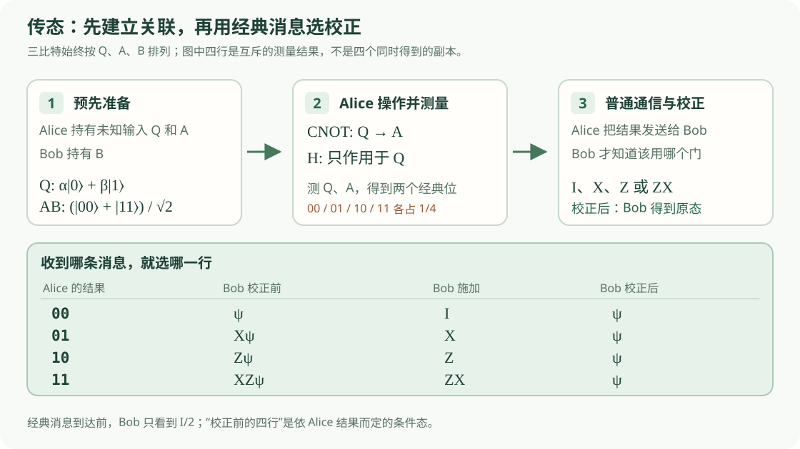
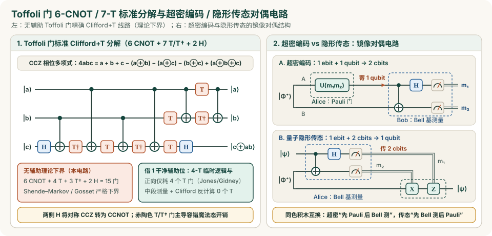
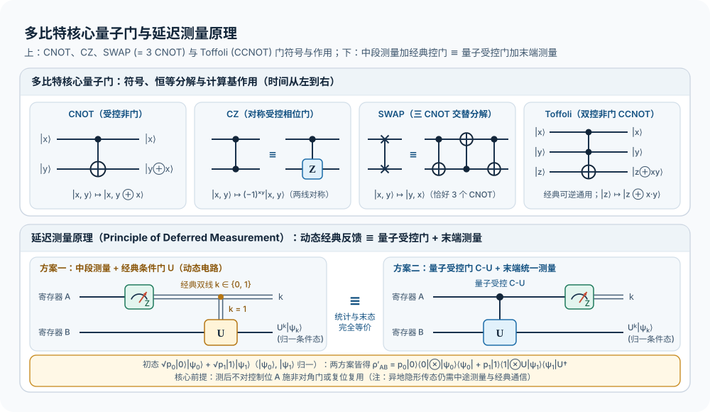

# 04｜量子门、电路与基础协议

前两章里，我们把单个量子比特写成两分量列向量，把两个量子比特写成四分量列向量，也看到了纠缠如何超越经典关联。这一章把视角往前推一步：**怎样把多个量子门排成量子电路（亦称量子线路），把复杂的多控门拆成芯片能跑的基本积木，并用它们搭出经典世界做不到的通信与计算协议？**

这一章分三幕展开：第一幕先打通“读图—算矩阵—拆门”的基本功，涵盖单双比特门、受控-$U$ 门的 ABC 分解定理、Toffoli 两级分解与多控制门 $C^n\text{-}U$ 的逆计算级联，再由 Bell 态制备引出不可克隆与不可删除两条禁令；第二幕串联量子隐形传态、与其镜像对偶的超密编码、延迟测量原理与相位回踢；第三幕收束到通用门集、双比特 KAK 上界、Solovay–Kitaev 近似直觉，以及 Clifford 群与稳定子表的入门手算。

读本章只需先熟悉[第 01 章](01-math.md)的矩阵乘法与张量积、[第 02 章](02-single-qubit.md)的单比特旋转门与 ZYZ 分解，以及[第 03 章](03-multiple-qubits.md)的 Bell 态与偏迹。初次阅读建议按两轨推进：**★ 首遍主线**聚焦 §1–§2、§4–§8（读图、核心门、两条禁令、隐形传态、超密编码、延迟测量与相位回踢）；**☆ 进阶选读**（文中已标明）涵盖 §3（ABC / Toffoli / $C^n\text{-}U$ 门分解）、§9（KAK 与 Solovay–Kitaev）与 §10（Clifford 群阶数与稳定子模拟）。全章沿用本书统一约定：**高位在左（大端序）**，两比特基态依次排为 $|00\rangle, |01\rangle, |10\rangle, |11\rangle$，三比特基态依次排为 $|000\rangle, |001\rangle, \dots, |111\rangle$。

---

## 1. 怎么读懂一张量子电路图

### 1.1 线路图从左到右，矩阵乘法从右到左

刚接触量子电路时，最容易让人绊脚的不是门本身，而是**看图的方向和写公式的方向正好相反**。

你可以把一张量子电路图想象成一份乐谱：

- 每一条横线代表一个量子比特，从最上面的线往下依次对应张量积里从左到右的位置；
- 沿着横线**从左往右**走，就是时间向前推进；
- 横线上的方框代表单比特量子门；跨在两条或三条横线之间、用竖线连起来的符号代表多比特门，它让这些比特一起演化，不能拆成各自独立的单比特操作；
- 末端的仪表符号代表测量，它会把量子态的随机结果读成经典比特（通常用双线画出，表示经典信号）。

但写成矩阵乘法作用在列向量 $|\psi\rangle$ 上时，离列向量最近的矩阵必须先算，因此数学式是**从右往左执行**的。如果电路图上从左到右依次摆着 $U_1$、$U_2$、$U_3$ 三个门，整体算符就写作 $U_3 U_2 U_1$：

$$
|\psi_{\mathrm{out}}\rangle = U_3 \bigl(U_2 (U_1 |\psi\rangle)\bigr) = U_3 U_2 U_1 |\psi\rangle.
$$

用一道具体的两维手算来体会顺序有多重要。输入为 $|0\rangle = [1, 0]^T$，线路先做 $H$ 门，再做 $Z$ 门，写作 $ZH|0\rangle$。按行展开每一步矩阵乘向量：

$$
H|0\rangle
= \frac{1}{\sqrt{2}}
\begin{bmatrix} 1 & 1 \\ 1 & -1 \end{bmatrix}
\begin{bmatrix} 1 \\ 0 \end{bmatrix}
= \frac{1}{\sqrt{2}}
\begin{bmatrix} 1\cdot 1 + 1\cdot 0 \\ 1\cdot 1 + (-1)\cdot 0 \end{bmatrix}
= \frac{1}{\sqrt{2}}
\begin{bmatrix} 1 \\ 1 \end{bmatrix}
= |+\rangle,
$$

接着左乘 $Z$：

$$
ZH|0\rangle
= \begin{bmatrix} 1 & 0 \\ 0 & -1 \end{bmatrix}
\left(\frac{1}{\sqrt{2}}\begin{bmatrix} 1 \\ 1 \end{bmatrix}\right)
= \frac{1}{\sqrt{2}}
\begin{bmatrix} 1\cdot 1 + 0\cdot 1 \\ 0\cdot 1 + (-1)\cdot 1 \end{bmatrix}
= \frac{1}{\sqrt{2}}
\begin{bmatrix} 1 \\ -1 \end{bmatrix}
= |-\rangle.
$$

如果把顺序反过来，先做 $Z$ 再做 $H$（写作 $HZ|0\rangle$）：先算 $Z|0\rangle = [1\cdot 1 + 0\cdot 0,\; 0\cdot 1 + (-1)\cdot 0]^T = |0\rangle$，再算 $H|0\rangle = |+\rangle$。输出是 $|+\rangle$ 而不是 $|-\rangle$！这两者不仅符号不同，而且彼此正交（$\langle +|-\rangle = \frac{1-1}{2} = 0$）：如果在后面再接一个 $H$ 门并在计算基测量，$ZH|0\rangle$ 会变成 $H|-\rangle = |1\rangle$（必测得 $1$），而 $HZ|0\rangle$ 会变成 $H|+\rangle = |0\rangle$（必测得 $0$）。

理想的封闭系统量子门都是**酉矩阵** $U$，满足 $U^\dagger U = U U^\dagger = I$。酉性带来两条非常实用的性质：

1. **长度与内积不变**：无论串联多少个酉门，归一化态的长度始终保持为 $1$，两态间的内积也分毫不改。
2. **每一步都可以倒着撤回**：因为 $U^{-1} = U^\dagger$，只要对 $U$ 接着施加 $U^\dagger$ 就能精确回到原态（例如 $H^\dagger = H$，连做两次 $H$ 回到原点）。如果一段线路先做 $U$ 后做 $V$（总矩阵 $VU$），撤回时就像“先穿袜再穿鞋，脱的时候必须先脱鞋再脱袜”，必须先做 $V^\dagger$ 再做 $U^\dagger$：

$$
(U^\dagger V^\dagger)(VU) = U^\dagger (V^\dagger V) U = U^\dagger I U = U^\dagger U = I.
$$

而测量、复位或丢弃某个比特会把信息送入经典记录或外部环境，只盯着留下的量子比特看，演化就不再能用一个封闭酉矩阵倒回去——这类开放演化将在[第 05 章](05-noise-channels.md)统一处理。

### 1.2 基序、列视角与并行门

两比特四个计算基态 $|00\rangle, |01\rangle, |10\rangle, |11\rangle$ 沿用[第 01 章第 7.1 节](01-math.md)的大端序标准列向量：左边第一位对应电路最上方横线（与 Qiskit 等小端序软件的位序映射见[符号表](appendices/notation.md)）。

读一个 $2^n \times 2^n$ 的门矩阵，最省力的是**列视角**：**矩阵的第 $j$ 列，就是把第 $j$ 个计算基态送进这个门后的输出列向量。** 同一拍里上下并排的单比特门用张量积 $A \otimes B$ 表示（空闲线补单位阵 $I$）；例如对 $|00\rangle$ 仅在第一比特施 $H$，由混合乘积律直接得 $(H\otimes I)|00\rangle = (H|0\rangle)\otimes(I|0\rangle) = |+\rangle|0\rangle = \frac{1}{\sqrt{2}}[1, 0, 1, 0]^T$。

这里顺手区分两个常被混用的指标：**门数**（gate count）是电路里所有门的总个数，**电路深度**（circuit depth）是把可同时并行的门压在同一拍后，总共需要多少个时间步。把 $H$ 同时作用在 10 个比特上，门数是 10，但深度只有 1。

---

## 2. 核心量子门：共轭化简、双比特门与三比特 Toffoli 门

### 2.1 单比特基础门复习与电路化简恒等式

[第 02 章第 5.2 节](02-single-qubit.md#52-相位门-s-与-t以及常用单比特门速查表)已经完整列出 $I, X, Y, Z, H, S, T$ 与旋转门 $R_x, R_y, R_z$ 的 $2 \times 2$ 矩阵和 Bloch 球几何。读电路时只要牢记两点相位直觉：第一，$S = \operatorname{diag}(1, i)$ 绕 $z$ 轴转 $\pi/2$、$T = \operatorname{diag}(1, e^{i\pi/4})$ 绕 $z$ 轴转 $\pi/4$（因 $T = e^{i\pi/8}\operatorname{diag}(e^{-i\pi/8}, e^{i\pi/8})$，传统教材常称 $T$ 门为“$\pi/8$ 门”，不要把历史别名与 $\pi/4$ 旋转角混为一谈），且满足 $T^2 = S,\; S^2 = Z$；第二，给 $|1\rangle$ 乘相对相位虽不改计算基概率，但一旦后面接 $H$ 门干涉，相位差就会立刻变成实打实的概率差。

在多门线路里，比背单门矩阵更有用的是**共轭换基与线路化简恒等式**。下面这张速查表把本章反复用到的单双比特恒等式收在一起（每一条都可用 $2\times 2$ 或 $4\times 4$ 矩阵直接验算）：

| 电路恒等式 | 直观含义与用途 |
| :--- | :--- |
| $H X H = Z,\quad H Z H = X,\quad H Y H = -Y$ | $H$ 门互换 $X$ 轴与 $Z$ 轴，并翻转 $Y$ 轴方向 |
| $S X S^\dagger = Y,\quad S Y S^\dagger = -X,\quad S Z S^\dagger = Z$ | $S$ 门绕 $z$ 轴逆时针转 $\pi/2$，把 $X$ 轴旋到 $Y$ 轴 |
| $X R_y(\theta) X = R_y(-\theta),\quad X R_z(\theta) X = R_z(-\theta)$ | 用 $X$ 门夹住 $y$ 或 $z$ 旋转可反转转角（第 3.1 节 ABC 分解的核心） |
| $(I \otimes H)\,\mathrm{CNOT}_{1\to 2}\,(I \otimes H) = \mathrm{CZ}$ | 在目标位前后夹 $H$，把 CNOT 变成对称的受控 $Z$ 门 |
| $(H \otimes H)\,\mathrm{CNOT}_{1\to 2}\,(H \otimes H) = \mathrm{CNOT}_{2\to 1}$ | 两线同夹 $H$ 门即可反转 CNOT 的控制位与目标位方向 |

### 2.2 双比特门：CNOT、CZ、方向翻转与 SWAP 的三步分解

单比特门再怎么组合，也只能让每个比特各自打转，永远造不出纠缠。把两个比特联系起来的最小积木，是**受控非门（CNOT，Controlled-NOT）**。

约定第一位（上面那条线）是**控制位（control）**，第二位（下面那条线）是**目标位（target）**。对四个计算基态，规则一句话就能记住：控制位是 $0$ 时目标位不动，控制位是 $1$ 时翻转目标位，写作 $\mathrm{CNOT}|a, b\rangle = |a,\, b \oplus a\rangle$（$\oplus$ 是模 2 加法，即异或 XOR）：

| 输入基态 | 控制位 $a$ | 目标位是否翻转 | 输出基态 | 对应输出列向量 |
| :--- | :---: | :--- | :--- | :--- |
| $\lvert 00\rangle$ | $0$ | 不翻转 | $\lvert 00\rangle$ | $[1, 0, 0, 0]^T$ |
| $\lvert 01\rangle$ | $0$ | 不翻转 | $\lvert 01\rangle$ | $[0, 1, 0, 0]^T$ |
| $\lvert 10\rangle$ | $1$ | 翻转 $0 \to 1$ | $\lvert 11\rangle$ | $[0, 0, 0, 1]^T$ |
| $\lvert 11\rangle$ | $1$ | 翻转 $1 \to 0$ | $\lvert 10\rangle$ | $[0, 0, 1, 0]^T$ |

用 1.2 节的列视角，把最后一列的四个输出向量竖着排在一起，马上得到 $\mathrm{CNOT}_{1\to 2}$ 的 $4 \times 4$ 矩阵：

$$
\mathrm{CNOT}_{1\to 2} =
\begin{bmatrix}
1 & 0 & 0 & 0 \\
0 & 1 & 0 & 0 \\
0 & 0 & 0 & 1 \\
0 & 0 & 1 & 0
\end{bmatrix}.
$$

如果输入是任意四分量叠加态 $|v\rangle = a|00\rangle + b|01\rangle + c|10\rangle + d|11\rangle = [a, b, c, d]^T$，按线性逐项送过门，只把后两个振幅互换位置：

$$
\mathrm{CNOT}_{1\to 2}
\begin{bmatrix} a \\ b \\ c \\ d \end{bmatrix}
= \begin{bmatrix}
1\cdot a + 0\cdot b + 0\cdot c + 0\cdot d \\
0\cdot a + 1\cdot b + 0\cdot c + 0\cdot d \\
0\cdot a + 0\cdot b + 0\cdot c + 1\cdot d \\
0\cdot a + 0\cdot b + 1\cdot c + 0\cdot d
\end{bmatrix}
= \begin{bmatrix} a \\ b \\ d \\ c \end{bmatrix}.
$$

顺手验一个带数字的例子：把归一化态 $(|00\rangle + 2|01\rangle + 3|10\rangle + 4|11\rangle)/\sqrt{30}$ 送进 $\mathrm{CNOT}_{1\to 2}$，输出立刻是 $(|00\rangle + 2|01\rangle + 4|10\rangle + 3|11\rangle)/\sqrt{30}$。检查归一化：$(1^2 + 2^2 + 4^2 + 3^2)/30 = 30/30 = 1$；再施加一次 $\mathrm{CNOT}_{1\to 2}$，后两个振幅换回原位，正好验证 $\mathrm{CNOT}^2 = I_4$。

这里要提防一个初学者最高频的误解：**“控制位为 1 时翻转目标位”是在描述门对每个计算基分量的作用规则，绝不是门先偷偷测量了一下控制位，看到 1 才去翻目标位！** 当控制位处于叠加态时，CNOT 会按线性同时作用于控制位为 $0$ 和为 $1$ 的两支振幅，并把它们的相对相位完整保留下来。

与 CNOT 并肩登场的还有两个常用双比特门和一条方向翻转技巧：

1. **受控 $Z$ 门（CZ）**：只给 $|11\rangle$ 乘一个负号，其余三个基态保持不变，写作 $\mathrm{CZ}|a, b\rangle = (-1)^{ab}|a, b\rangle$：

$$
\mathrm{CZ} =
\begin{bmatrix}
1 & 0 & 0 & 0 \\
0 & 1 & 0 & 0 \\
0 & 0 & 1 & 0 \\
0 & 0 & 0 & -1
\end{bmatrix}.
$$

因为 $(-1)^{ab} = (-1)^{ba}$，**CZ 对两个比特完全对称**——谁当控制端、谁当目标端，矩阵一模一样。只需在 CNOT 的目标位前后各夹一个 $H$ 门，就能把 CNOT 变成 CZ：

$$
(I \otimes H)\,\mathrm{CNOT}_{1\to 2}\,(I \otimes H) = \mathrm{CZ}.
$$

逐个基态亲手验证（矩阵从右往左算）：

- 输入 $|00\rangle$：$|00\rangle \xrightarrow{I\otimes H} |0\rangle|+\rangle \xrightarrow{\mathrm{CNOT}} |0\rangle|+\rangle \xrightarrow{I\otimes H} |00\rangle$；
- 输入 $|01\rangle$：$|01\rangle \xrightarrow{I\otimes H} |0\rangle|-\rangle \xrightarrow{\mathrm{CNOT}} |0\rangle|-\rangle \xrightarrow{I\otimes H} |01\rangle$；
- 输入 $|10\rangle$：$|10\rangle \xrightarrow{I\otimes H} |1\rangle|+\rangle \xrightarrow{\mathrm{CNOT}} |1\rangle(X|+\rangle) = |1\rangle|+\rangle \xrightarrow{I\otimes H} |10\rangle$；
- 输入 $|11\rangle$：$|11\rangle \xrightarrow{I\otimes H} |1\rangle|-\rangle \xrightarrow{\mathrm{CNOT}} |1\rangle(X|-\rangle) = -|1\rangle|-\rangle \xrightarrow{I\otimes H} -|11\rangle$。

四个基态的输出与 $\mathrm{CZ} = \operatorname{diag}(1, 1, 1, -1)$ 逐格吻合！

2. **用四个 $H$ 门翻转 CNOT 方向**：许多真实芯片（如固定频率超导耦合器）只原生校准了单向的 $\mathrm{CNOT}_{1\to 2}$，怎样得到反向的 $\mathrm{CNOT}_{2\to 1}$（第二位控制、第一位目标）？利用刚才证完的 CZ 对称性，一步就能推出来：把 $\mathrm{CZ} = (I\otimes H)\,\mathrm{CNOT}_{1\to 2}\,(I\otimes H)$ 也写成第一位夹 $H$ 的对称形式 $\mathrm{CZ} = (H\otimes I)\,\mathrm{CNOT}_{2\to 1}\,(H\otimes I)$，两边同时左右乘 $(H\otimes I)$（因 $H^2 = I$），立刻得

$$
(H \otimes H)\,\mathrm{CNOT}_{1\to 2}\,(H \otimes H) = \mathrm{CNOT}_{2\to 1}.
$$

也可以拿 $|01\rangle$ 现场复核：$|01\rangle \xrightarrow{H\otimes H} |+\rangle|-\rangle \xrightarrow{\mathrm{CNOT}_{1\to 2}} \frac{|0\rangle|-\rangle + |1\rangle(X|-\rangle)}{\sqrt{2}} = |-\rangle|-\rangle \xrightarrow{H\otimes H} |11\rangle$，确实把第一位从 $0$ 翻成了 $1$！

3. **交换门（SWAP）与三个 CNOT 的等价分解**：把两个比特的状态对调，$\mathrm{SWAP}|a, b\rangle = |b, a\rangle$，矩阵为

$$
\mathrm{SWAP} =
\begin{bmatrix}
1 & 0 & 0 & 0 \\
0 & 0 & 1 & 0 \\
0 & 1 & 0 & 0 \\
0 & 0 & 0 & 1
\end{bmatrix}.
$$

物理芯片里往往没有单独的物理 SWAP 门，而是**把方向交替的三个 CNOT 串联起来**（先 $1\to 2$，再 $2\to 1$，再 $1\to 2$；若硬件只支持单向 $\mathrm{CNOT}_{1\to 2}$，只需把中间那个反向门用四个 $H$ 门包起来即可）：

$$
\mathrm{SWAP} = \mathrm{CNOT}_{1\to 2}\,\mathrm{CNOT}_{2\to 1}\,\mathrm{CNOT}_{1\to 2}.
$$

其中反向门 $\mathrm{CNOT}_{2\to 1}$ 把 $|01\rangle \leftrightarrow |11\rangle$ 互换，保持 $|00\rangle, |10\rangle$ 不动，矩阵为

$$
\mathrm{CNOT}_{2\to 1} =
\begin{bmatrix}
1 & 0 & 0 & 0 \\
0 & 0 & 0 & 1 \\
0 & 0 & 1 & 0 \\
0 & 1 & 0 & 0
\end{bmatrix}.
$$

用代数推导和四基态逐行核对两条路径验算。对任意计算基态 $|a, b\rangle$（$a, b \in \{0, 1\}$），利用模 2 加法满足 $x \oplus x = 0$ 与 $x \oplus 0 = x$：

$$
|a, b\rangle
\xrightarrow{\mathrm{CNOT}_{1\to 2}} |a,\; b \oplus a\rangle
\xrightarrow{\mathrm{CNOT}_{2\to 1}} |a \oplus (b \oplus a),\; b \oplus a\rangle = |b,\; b \oplus a\rangle
\xrightarrow{\mathrm{CNOT}_{1\to 2}} |b,\; (b \oplus a) \oplus b\rangle = |b, a\rangle.
$$

再把四个具体基态逐个走一遍，看表核对：

| 初始态 | 第一步 $\mathrm{CNOT}_{1\to 2}$ 后 | 第二步 $\mathrm{CNOT}_{2\to 1}$ 后 | 第三步 $\mathrm{CNOT}_{1\to 2}$ 后 | 与 $\mathrm{SWAP}$ 对照 |
| :--- | :--- | :--- | :--- | :--- |
| $\lvert 00\rangle$ | $\lvert 00\rangle$ | $\lvert 00\rangle$ | $\lvert 00\rangle$ | 吻合 |
| $\lvert 01\rangle$ | $\lvert 01\rangle$ | $\lvert 11\rangle$ | $\lvert 10\rangle$ | 吻合 |
| $\lvert 10\rangle$ | $\lvert 11\rangle$ | $\lvert 01\rangle$ | $\lvert 01\rangle$ | 吻合 |
| $\lvert 11\rangle$ | $\lvert 10\rangle$ | $\lvert 10\rangle$ | $\lvert 11\rangle$ | 吻合 |

这也顺便解释了为什么在硬件连线稀疏的处理器上，两个不相邻的比特想做一次远程交互，每挪动一步就得付出 3 个 CNOT 的代价（详见[第 14 章](14-compilation-control.md)的布局与路由）。另外留意电路图画法：两条线画成单纯交叉并不自动表示 SWAP，只有标出交换符号（两端带 $\times$ 的竖线）才表示交换门。

上述矩阵写的都是**理想逻辑门**。真实量子芯片上的门由有限时长的微波脉冲、激光或电压波形驱动实现，校准只能把控制过程调到尽量接近目标酉矩阵；噪声与硬件误差会在[第 05 章](05-noise-channels.md)与[第 09 章](09-hardware.md)展开。

### 2.3 三比特 Toffoli 门（CCNOT）、经典可逆计算与逆计算

读到这里，一个很自然的问题会冒出来：普通计算机里最基本的逻辑门是与门（AND）和与非门（NAND），量子计算机能不能直接把它们搬进来做算术？

先检查一下 AND 门是不是酉的。AND 门吃进两位 $(a, b) \in \{00, 01, 10, 11\}$，吐出一位 $a \cdot b \in \{0, 1\}$。如果输出是 $0$，你完全没法反推输入究竟是 $00$、$01$ 还是 $10$——它是多对一的、**不可逆**（irreversible）的。而量子门是酉矩阵，必然一一对应、**可逆**（reversible），信息在封闭演化中绝不能被多对一地压扁。

解决方法既巧妙又干脆：不要把输入覆盖掉，而是**保留原来的输入比特，再额外借一个目标比特来记录异或结果**。这就是三比特的 **Toffoli 门（双控非门，CCNOT）**，它在八维计算基 $\{|000\rangle, |001\rangle, \dots, |111\rangle\}$ 上的规则是：只有当**前两个控制位同时为 $1$** 时，才翻转第三个目标位：

$$
\mathrm{CCNOT}|a, b, c\rangle = |a,\; b,\; c \oplus (a \cdot b)\rangle, \qquad a, b, c \in \{0, 1\}.
$$

它的完整真值表只有最后两行发生互换：

| 输入 $\lvert a, b, c\rangle$ | $a \cdot b$ | 输出 $\lvert a, b, c \oplus ab\rangle$ | 说明 |
| :--- | :---: | :--- | :--- |
| $\lvert 000\rangle$ | $0$ | $\lvert 000\rangle$ | 不变 |
| $\lvert 001\rangle$ | $0$ | $\lvert 001\rangle$ | 不变 |
| $\lvert 010\rangle$ | $0$ | $\lvert 010\rangle$ | 不变 |
| $\lvert 011\rangle$ | $0$ | $\lvert 011\rangle$ | 不变 |
| $\lvert 100\rangle$ | $0$ | $\lvert 100\rangle$ | 不变 |
| $\lvert 101\rangle$ | $0$ | $\lvert 101\rangle$ | 不变 |
| $\lvert 110\rangle$ | $1$ | $\lvert 111\rangle$ | 翻转第三位 |
| $\lvert 111\rangle$ | $1$ | $\lvert 110\rangle$ | 翻转第三位 |

写成 $8 \times 8$ 矩阵时，前六行六列是单位矩阵 $I_6$，只有右下角对应 $|110\rangle, |111\rangle$ 的 $2 \times 2$ 子块是 $X$：

$$
\mathrm{CCNOT} =
\begin{bmatrix}
I_6 & 0 \\
0 & X
\end{bmatrix} =
\begin{bmatrix}
1 & 0 & 0 & 0 & 0 & 0 & 0 & 0 \\
0 & 1 & 0 & 0 & 0 & 0 & 0 & 0 \\
0 & 0 & 1 & 0 & 0 & 0 & 0 & 0 \\
0 & 0 & 0 & 1 & 0 & 0 & 0 & 0 \\
0 & 0 & 0 & 0 & 1 & 0 & 0 & 0 \\
0 & 0 & 0 & 0 & 0 & 1 & 0 & 0 \\
0 & 0 & 0 & 0 & 0 & 0 & 0 & 1 \\
0 & 0 & 0 & 0 & 0 & 0 & 1 & 0
\end{bmatrix}.
$$

它是一个实对称置换矩阵，满足 $\mathrm{CCNOT}^\dagger \mathrm{CCNOT} = \mathrm{CCNOT}^2 = I_8$，因此完全合法、严格可逆。

Toffoli（1980）证明，**仅靠这一个 CCNOT 门加上常数辅助位，就能实现经典计算机里的任意布尔电路**！动手算两组特例就能亲眼确认：

1. **造出经典与非门（NAND）**：把第三位固定为 $c = 1$，则输出第三位为 $1 \oplus (a \cdot b) = \mathrm{NAND}(a, b)$。逐项代入四组输入：
   - $|0, 0, 1\rangle \mapsto |0, 0, 1\rangle$（$\mathrm{NAND}(0,0)=1$）；
   - $|0, 1, 1\rangle \mapsto |0, 1, 1\rangle$（$\mathrm{NAND}(0,1)=1$）；
   - $|1, 0, 1\rangle \mapsto |1, 0, 1\rangle$（$\mathrm{NAND}(1,0)=1$）；
   - $|1, 1, 1\rangle \mapsto |1, 1, 0\rangle$（$\mathrm{NAND}(1,1)=0$）。
2. **造出经典扇出（FANOUT，仅复制经典 0/1 位）**：把第一位固定为 $a = 1$、第三位固定为 $c = 0$，则 $\mathrm{CCNOT}|1, b, 0\rangle = |1, b, 0 \oplus (1 \cdot b)\rangle = |1, b, b\rangle$，把经典比特 $b \in \{0, 1\}$ 抄到了第三条线上（注意：一旦 $b$ 是叠加态，它同样不会复制出两份叠加态，而是产生纠缠——第 4 节会严格说明）。

因为 NAND 门配合扇出在经典数字电路里已经是通用的，所以**任何经典算法都能改写成可逆量子线路，在量子计算机上模拟出来**。

但改写时藏着一个让量子算法立刻失效的陷阱——**中间垃圾位（garbage bits）**。

计算复杂函数 $f(x)$ 时，可逆子电路 $U_f$ 往往需要许多辅助比特暂存中间结果，记为 $g(x)$：

$$
|x\rangle |0\rangle_{\mathrm{work}} |0\rangle_{\mathrm{garb}}
\xrightarrow{U_f}
|x\rangle |f(x)\rangle |g(x)\rangle.
$$

对经典单个输入 $x$ 来说，把垃圾位扔在一边不管没关系。但在量子叠加态上，不同分支的垃圾位各不相同，它会把输入寄存器和垃圾位死死**纠缠**在一起！举一个最小的例子看清后果：假设输入处于 $\frac{|0\rangle + |1\rangle}{\sqrt{2}}$，算完后垃圾位恰好记录了分支信息 $g(0)=0, g(1)=1$，整体态变成

$$
\frac{|0\rangle |f(0)\rangle |0\rangle_{\mathrm{garb}} + |1\rangle |f(1)\rangle |1\rangle_{\mathrm{garb}}}{\sqrt{2}}.
$$

即便 $f(0) = f(1) = 0$，如果你把垃圾位丢在一边，只对第一比特做 $H$ 门想看干涉，因为 $|0\rangle_{\mathrm{garb}}$ 与 $|1\rangle_{\mathrm{garb}}$ 彼此正交，两条路径**彻底失去了干涉能力**（对垃圾位求偏迹后，第一比特的约化态直接塌成 $\frac{1}{2}|0\rangle\langle 0| + \frac{1}{2}|1\rangle\langle 1| = I/2$，和物理篇 [Q1](quantum-mechanics/01-experiments-states.md) 的路径标记一模一样）。

怎么把垃圾位干净地清回 $|0\rangle$？Bennett（1973）给出了优雅的三步**逆计算**（uncomputation）技巧：准备一个处于任意计算基态 $|y\rangle_{\mathrm{out}}$（常见特例是 $|0\rangle_{\mathrm{out}}$，而在相位预言机里则会设为叠加态 $|-\rangle_{\mathrm{out}}$）的输出寄存器，按“**正向计算 $\to$ 异或复制结果 $\to$ 倒着擦除**”执行（若 $f(x)$ 有多位输出，则中间一步对每一位并行施加按位 CNOT）：

$$
\begin{aligned}
|x\rangle |y\rangle_{\mathrm{out}} |0\rangle_{\mathrm{work}} |0\rangle_{\mathrm{garb}}
&\xrightarrow{U_f}
|x\rangle |y\rangle_{\mathrm{out}} |f(x)\rangle |g(x)\rangle \\
&\xrightarrow{\mathrm{CNOT}_{\mathrm{work}\to\mathrm{out}}}
|x\rangle |y \oplus f(x)\rangle_{\mathrm{out}} |f(x)\rangle |g(x)\rangle \\
&\xrightarrow{U_f^\dagger}
|x\rangle |y \oplus f(x)\rangle_{\mathrm{out}} |0\rangle_{\mathrm{work}} |0\rangle_{\mathrm{garb}}.
\end{aligned}
$$

最后一步把正向子电路 $U_f$ 的每个门按反顺序取共轭转置 $U_f^\dagger$ 倒着跑一遍，工作位与垃圾位**统统退回 $|0\rangle$**，和主寄存器彻底解耦！于是输入与输出保持纯净的相干演化 $|x\rangle|y\rangle \mapsto |x\rangle|y \oplus f(x)\rangle$，后面的量子干涉得以正常展开。这个三步模式既马上在第 3.3 节构造多控制门 $C^n\text{-}U$ 时大显身手，也会在[第 06 章](06-algorithmic-primitives.md)构造相位预言机时反复出场。

---

## 3. 进阶选读：核心门分解——受控-$U$ 的 ABC 定理、Toffoli 与多控制门 $C^n\text{-}U$

真实量子硬件只提供寥寥几种单比特门加上一种双比特门（如 CNOT 或 CZ）。那么面对算法里随处可见的受控旋转门 $C\text{-}R_y(\theta)$、受控 Hadamard 门 $C\text{-}H$、三比特 Toffoli 门，乃至 Grover 扩散算子和 Shor 模算术必需的多控制门 $C^n\text{-}U$，编译器究竟是怎么把它们一步步拆解落地的？本节用逐步手算打通这条核心构造链。

### 3.1 受控全局相位与受控-$U$ 门的 ABC 分解定理

先回收[第 02 章第 5.3 节](02-single-qubit.md#53-进阶回看矩阵指数mathrmsu2tomathrmso3-双重覆盖与-2pi-负号)埋下的伏笔：单个门乘上全局相位 $e^{i\delta}$ 在单比特上不可测，但一旦给它加上控制线变成受控门

$$
C(U) = |0\rangle\langle 0| \otimes I + |1\rangle\langle 1| \otimes U =
\begin{bmatrix} I & 0 \\ 0 & U \end{bmatrix},
$$

情况就会彻底反转。因为 $e^{i\delta}$ 只挂在控制位等于 $1$ 的后两行上，所以给目标门乘上全局相位 $e^{i\delta}$ 再加控制，**严格等价于在控制线上多加一个单比特相位门 $P(\delta) = \operatorname{diag}(1, e^{i\delta})$**：

$$
C(e^{i\delta} U)
= |0\rangle\langle 0| \otimes I + |1\rangle\langle 1| \otimes (e^{i\delta} U)
= \bigl(P(\delta) \otimes I\bigr)\, C(U),
\qquad
P(\delta) = \begin{bmatrix} 1 & 0 \\ 0 & e^{i\delta} \end{bmatrix}.
$$

例如在[第 02 章](02-single-qubit.md)已验算过 $C(-I) = Z \otimes I$（$\delta = \pi$）：把 $|+\rangle_C|0\rangle_T$ 送入 $C(e^{i\delta}I)$ 后控制位变成 $\frac{|0\rangle + e^{i\delta}|1\rangle}{\sqrt{2}}$，再对控制位做 $H$ 门，得到 $\frac{1+e^{i\delta}}{2}|0\rangle + \frac{1-e^{i\delta}}{2}|1\rangle$，测得 $1$ 的概率为

$$
p(1) = \left|\frac{1 - e^{i\delta}}{2}\right|^2
= \frac{(1-\cos\delta)^2 + \sin^2\delta}{4}
= \frac{2 - 2\cos\delta}{4}
= \sin^2\!\left(\frac{\delta}{2}\right).
$$

当 $\delta = 0$ 时必得 $0$，当 $\delta = \pi/2$ 时概率为 $1/2$，当 $\delta = \pi$ 时必得 $1$。写量子编译器时绝不能先抹掉单比特门的全局相位，再把该门变成受控门。

更重要的是，这条公式正是 **受控-$U$ 门 ABC 分解定理**（Barenco et al., 1995；Nielsen & Chuang, Corollary 4.2 & Lemma 4.3）的最后一块拼图：**任意单比特酉门 $U \in \mathrm{U}(2)$ 对应的受控门 $C(U)$，只需 2 个 CNOT 门和至多 4 个单比特门就能精确实现。**

下面一步不跳地证明它：

**第一步：引用 ZYZ 分解。** 严格沿用[第 02 章第 5.4 节](02-single-qubit.md#54-进阶回看单比特通用欧拉分解zyz-证明与-xyxzxz-对照)统一宣示的参数符号，任意 $U \in \mathrm{U}(2)$ 都可写成

$$
U = e^{i\delta} R_z(\alpha)\,R_y(\beta)\,R_z(\gamma),
$$

其中 $\delta, \alpha, \gamma \in \mathbb{R}$ 且 $\beta \in [0, \pi]$。

**第二步：证两条 $X$ 共轭翻号引理。** 回忆 $R_y(\theta) = \cos(\theta/2)\,I - i\sin(\theta/2)\,Y$ 与 $R_z(\theta) = \cos(\theta/2)\,I - i\sin(\theta/2)\,Z$。因为 $X^2 = I$、$XYX = -Y$（由 $XY=iZ,\; iZX = i(iY) = -Y$）且 $XZX = -Z$（由 $XZ = -iY,\; -iYX = -i(-iZ) = -Z$），用 $X$ 夹住旋转门立刻翻转转角符号：

$$
\begin{aligned}
X R_y(\theta) X &= \cos\frac{\theta}{2}\,X I X - i\sin\frac{\theta}{2}\,X Y X = \cos\frac{\theta}{2}\,I + i\sin\frac{\theta}{2}\,Y = R_y(-\theta), \\
X R_z(\theta) X &= \cos\frac{\theta}{2}\,X I X - i\sin\frac{\theta}{2}\,X Z X = \cos\frac{\theta}{2}\,I + i\sin\frac{\theta}{2}\,Z = R_z(-\theta).
\end{aligned}
$$

**第三步：构造三个 $\mathrm{SU}(2)$ 门 $A, B, C$。** 令

$$
A := R_z(\alpha)\,R_y\!\left(\frac{\beta}{2}\right), \qquad
B := R_y\!\left(-\frac{\beta}{2}\right)\,R_z\!\left(-\frac{\gamma+\alpha}{2}\right), \qquad
C := R_z\!\left(\frac{\gamma-\alpha}{2}\right).
$$

**第四步：逐行双重验算。**

- 验 $ABC = I$（连续抵消中间的 $y$ 旋转，再合并两段 $z$ 旋转）：

$$
\begin{aligned}
ABC
&= R_z(\alpha)\,\underbrace{R_y\!\left(\frac{\beta}{2}\right) R_y\!\left(-\frac{\beta}{2}\right)}_{I}\,R_z\!\left(-\frac{\gamma+\alpha}{2}\right) R_z\!\left(\frac{\gamma-\alpha}{2}\right) \\
&= R_z(\alpha)\,R_z\!\left(\frac{-\gamma-\alpha+\gamma-\alpha}{2}\right)
 = R_z(\alpha)\,R_z(-\alpha) = I.
\end{aligned}
$$

- 验 $e^{i\delta} A X B X C = U$：先插入 $X^2 = I$ 把 $X B X$ 拆开并用翻号引理：

$$
X B X
= \bigl(X R_y(-\beta/2) X\bigr)\,\bigl(X R_z(-(\gamma+\alpha)/2) X\bigr)
= R_y\!\left(\frac{\beta}{2}\right)\,R_z\!\left(\frac{\gamma+\alpha}{2}\right).
$$

再左乘 $e^{i\delta} A$、右乘 $C$，同轴旋转角直接相加：

$$
\begin{aligned}
e^{i\delta} A (X B X) C
&= e^{i\delta} R_z(\alpha)\,\underbrace{R_y\!\left(\frac{\beta}{2}\right) R_y\!\left(\frac{\beta}{2}\right)}_{R_y(\beta)}\,\underbrace{R_z\!\left(\frac{\gamma+\alpha}{2}\right) R_z\!\left(\frac{\gamma-\alpha}{2}\right)}_{R_z(\gamma)} \\
&= e^{i\delta} R_z(\alpha)\,R_y(\beta)\,R_z(\gamma) = U.
\end{aligned}
$$

**第五步：拼出 2-CNOT 电路。** 在目标线上从左到右依次执行 $C \to \mathrm{CNOT}_{1\to 2} \to B \to \mathrm{CNOT}_{1\to 2} \to A$，同时在控制线上施加单比特相位门 $P(\delta) = \operatorname{diag}(1, e^{i\delta})$（总矩阵写作 $(P(\delta)\otimes I)(I\otimes A)\mathrm{CNOT}(I\otimes B)\mathrm{CNOT}(I\otimes C)$）：

- **若控制位为 $|0\rangle$**：两个 CNOT 都不翻转目标位，控制位相位门乘 $1$，目标位净演化为 $A B C = I$；
- **若控制位为 $|1\rangle$**：两个 CNOT 都在目标位施加 $X$，控制位相位门乘 $e^{i\delta}$，目标位净演化为 $e^{i\delta} A X B X C = U$。

**具体数字手算：用 2 个 CNOT 拼出受控 Hadamard 门 $C(H)$。**
由[第 02 章](02-single-qubit.md)已知 $H = e^{i\pi/2} R_z(0)\,R_y(\pi/2)\,R_z(\pi)$（核对：$\delta = \frac{\pi}{2},\; \alpha = 0,\; \beta = \frac{\pi}{2},\; \gamma = \pi$，乘开得 $i \cdot \frac{1}{\sqrt{2}}\begin{bmatrix}1&-1\\1&1\end{bmatrix}\begin{bmatrix}-i&0\\0&i\end{bmatrix} = \frac{1}{\sqrt{2}}\begin{bmatrix}1&1\\1&-1\end{bmatrix} = H$）。直接代入公式：

$$
A = R_y\!\left(\frac{\pi}{4}\right), \qquad
B = R_y\!\left(-\frac{\pi}{4}\right) R_z\!\left(-\frac{\pi}{2}\right), \qquad
C = R_z\!\left(\frac{\pi}{2}\right), \qquad
P\!\left(\frac{\pi}{2}\right) = S.
$$

立刻复核两条等式：$ABC = R_y(\frac{\pi}{4})R_y(-\frac{\pi}{4})R_z(-\frac{\pi}{2})R_z(\frac{\pi}{2}) = I$；而 $i A X B X C = i R_y(\frac{\pi}{4}) R_y(\frac{\pi}{4}) R_z(\frac{\pi}{2}) R_z(\frac{\pi}{2}) = i R_y(\frac{\pi}{2}) R_z(\pi) = H$。只要控制线放一个 $S$ 门、目标线放 $C, B, A$ 和 2 个 CNOT，就零误差造出了受控 $H$ 门。

### 3.2 Toffoli 门的两级精确分解：5 个双比特门与 6-CNOT / 7-$T$

接下来攻克三比特 Toffoli 门（CCNOT）：硬件上没有原生三比特门，怎样把它彻底拆成单比特门和 CNOT？分两级拆解，每一级都能一眼看透背后的巧思。

#### 第一级：5 个双比特门拼出 Toffoli（Barenco et al. 1995）

引入“$X$ 门的平方根”单比特酉门 $V = \sqrt{X}$：

$$
V := \frac{1 + i}{2}(I - iX) = e^{i\pi/4} R_x\!\left(\frac{\pi}{2}\right) = H S H
= \frac{1}{2}\begin{bmatrix} 1+i & 1-i \\ 1-i & 1+i \end{bmatrix}.
$$

亲手检验它的两条核心性质：第一，$V^\dagger V = H S^\dagger H H S H = H S^\dagger S H = I$（严格酉）；第二，计算平方：

$$
V^2 = (H S H)(H S H) = H S^2 H = H Z H = X.
$$

现在把 5 个双比特受控门从左到右按如下次序排在三条线上（第 1、2 线是控制位 $a, b$，第 3 线是目标位 $c$）：

$$
\text{线路（从左到右）}:\quad
C\text{-}V_{2\to 3} \;\longrightarrow\;
\mathrm{CNOT}_{1\to 2} \;\longrightarrow\;
C\text{-}V^\dagger_{2\to 3} \;\longrightarrow\;
\mathrm{CNOT}_{1\to 2} \;\longrightarrow\;
C\text{-}V_{1\to 3}.
$$

注意：第 1、2 线上的两次 $\mathrm{CNOT}_{1\to 2}$ 会在线路结束时把第 2 位恢复原值（$(b \oplus a) \oplus a = b$），因此前两位永远不变；我们只需列出 4 组控制输入 $ab \in \{00, 01, 10, 11\}$，追踪第 3 线依次吃到哪些门（记住算符乘积从右往左合并）：

| 控制输入 $ab$ | 第 1 步 $C\text{-}V_{2\to 3}$ | 第 2 步后第 2 位 $b \oplus a$ | 第 3 步 $C\text{-}V^\dagger_{2\to 3}$ | 第 5 步 $C\text{-}V_{1\to 3}$ | 目标位总算符（右向左乘） |
| :---: | :---: | :---: | :---: | :---: | :--- |
| $00$ | 不动 ($I$) | $0$ | 不动 ($I$) | 不动 ($I$) | $I$ |
| $01$ | 施 $V$ | $1$ | 施 $V^\dagger$ | 不动 ($I$) | $V^\dagger V = I$ |
| $10$ | 不动 ($I$) | $1$ | 施 $V^\dagger$ | 施 $V$ | $V V^\dagger = I$ |
| $11$ | 施 $V$ | $0$ | 不动 ($I$) | 施 $V$ | $V \cdot V = V^2 = X$ |

四行真值表滴水不漏！这个构造用“中间把 $b$ 异或成 $b\oplus a$，跳过或触发 $V^\dagger$”的巧妙抵消，仅靠 5 个双比特门就造出了三比特非线性与门。

#### 第二级：标准 Clifford+$T$ 分解（6 个 CNOT + 7 个 $T/T^\dagger$）

若把上面的 3 个受控 $V / V^\dagger$ 直接套 ABC 定理展开，需要 $3\times 2 + 2 = 8$ 个 CNOT。容错计算里更关心的标准门集是 **Clifford+$T$**（$\{H, S, T, \mathrm{CNOT}\}$），有没有更省的拆法？

有的！把第三条目标线前后各夹一个 $H$ 门，因为 $H X H = Z$，Toffoli 门就变成了对三个比特**完全对称的双控 $Z$ 门（CCZ）**：

$$
(I \otimes I \otimes H)\,\mathrm{CCNOT}\,(I \otimes I \otimes H) = \mathrm{CCZ},
\qquad
\mathrm{CCZ}|a, b, c\rangle = (-1)^{a\cdot b\cdot c}|a, b, c\rangle.
$$

关键来自一条简洁的布尔代数恒等式（对任意 $a, b, c \in \{0, 1\}$ 逐个代入 8 组取值立即可验）：

$$
4\,a\cdot b\cdot c = a + b + c - (a\oplus b) - (a\oplus c) - (b\oplus c) + (a\oplus b\oplus c).
$$

（例如 $a=b=c=1$ 时右边为 $1+1+1-0-0-0+1 = 4 = 4\cdot 1$；当 $a=b=1, c=0$ 时右边为 $1+1+0-0-1-1+0 = 0 = 4\cdot 0$；其余对称情形全为 $0$。）给等式两边同乘 $i\pi/4$ 再取指数，因为 $e^{i\pi a\cdot b\cdot c} = (-1)^{a\cdot b\cdot c}$，就得到

$$
(-1)^{a\cdot b\cdot c}
= \exp\!\left(i\frac{\pi}{4}\bigl[a + b + c - (a\oplus b) - (a\oplus c) - (b\oplus c) + (a\oplus b\oplus c)\bigr]\right).
$$

看清括号里的 7 个线性异或项了吗？每算出一个异或项 $s \in \{0, 1\}$，给对应导线施加一个 $T$ 门（乘 $e^{+i\pi s/4}$）或 $T^\dagger$ 门（乘 $e^{-i\pi s/4}$），而全部 7 个线性异或项恰好只需要 **6 个 CNOT** 就能在线路上依次拼出并恢复原比特！按时间从左到右，标准分解（Nielsen & Chuang, Fig. 4.9）正好是 15 个门（2 个 $H$ + 6 个 CNOT + 4 个 $T$ + 3 个 $T^\dagger$）：

$$
\begin{aligned}
\mathrm{CCNOT}:\quad
&H_3 \to \mathrm{CNOT}_{2\to 3} \to T_3^\dagger \to \mathrm{CNOT}_{1\to 3} \to T_3 \to \mathrm{CNOT}_{2\to 3} \to T_3^\dagger \\
&\to \mathrm{CNOT}_{1\to 3} \to T_2 \to T_3 \to H_3 \to \mathrm{CNOT}_{1\to 2} \to T_1 \to T_2^\dagger \to \mathrm{CNOT}_{1\to 2}.
\end{aligned}
$$

这条相位多项式解释直接揭示了“为何不借辅助比特时精确实现 Toffoli 恰好需要 7 个 $T/T^\dagger$ 门与 6 个 CNOT 门”的数学奥秘：Shende & Markov（2009）证明了无辅助情况下 6 个 CNOT 已是理论下界，Gosset 等人（2014）证明了无辅助情况下 7 个 $T$ 门也是理论下界。只有当允许借用 1 个干净辅助比特 $|0\rangle$ 并配合中段测量与经典 Clifford 反馈时，才能将 Toffoli 的 $T$ 门代价降到 **4 个 $T$ 门**（Jones, 2013；Gidney, 2018）——这正是容错算法资源估算中常见“每个 Toffoli 按 4 个 $T$ 门计价”的由来。

### 3.3 多控制门 $C^n\text{-}U$：V 形辅助级联与逆计算

如果算法需要 $n$ 个控制位同时为 $1$ 时才在目标位施加单比特酉门 $U$（记作 $C^n\text{-}U$，例如 Grover 搜索的反射算子就需要 $n$ 控 $Z$ 门），该怎么拆？

把第 2.3 节刚学的**逆计算**拿来直接当构造武器（Nielsen & Chuang, Fig. 4.10）！以 $n = 4$（四个控制位 $c_1, c_2, c_3, c_4$、一个目标位 $t$）为例，额外借用 $n - 1 = 3$ 个初始化为 $|0\rangle$ 的干净工作比特 $w_1, w_2, w_3$，走一个漂亮的 **V 形三段路线**：

1. **左半段（正向阶梯与运算）**：用 $n - 1 = 3$ 个 Toffoli 门逐级计算前缀乘积：
   - $\mathrm{CCNOT}(c_1, c_2 \to w_1)$：把 $w_1$ 变为 $|c_1 c_2\rangle$；
   - $\mathrm{CCNOT}(c_3, w_1 \to w_2)$：把 $w_2$ 变为 $|c_1 c_2 c_3\rangle$；
   - $\mathrm{CCNOT}(c_4, w_2 \to w_3)$：把 $w_3$ 变为 $|c_1 c_2 c_3 c_4\rangle$。
2. **中段（单控门触发）**：以最后一个工作比特 $w_3$ 为控制位、$t$ 为目标位，施加 1 次普通受控门 $C(U)_{w_3 \to t}$（用第 3.1 节的 ABC 定理仅需 2 个 CNOT）。当且仅当 $c_1 = c_2 = c_3 = c_4 = 1$ 时 $w_3 = 1$，目标位才执行 $U$。
3. **右半段（镜像逆计算清零）**：把左半段的 3 个 Toffoli 门**严格按相反次序倒跑一遍**：
   - $\mathrm{CCNOT}(c_4, w_2 \to w_3)$：$w_3$ 变回 $|c_1 c_2 c_3 c_4 \oplus c_1 c_2 c_3 c_4\rangle = |0\rangle$；
   - $\mathrm{CCNOT}(c_3, w_1 \to w_2)$：$w_2$ 变回 $|0\rangle$；
   - $\mathrm{CCNOT}(c_1, c_2 \to w_1)$：$w_1$ 变回 $|0\rangle$！

算一下总账：对于任意 $n \ge 2$，借用 $n - 1$ 个干净辅助比特，总共只需 **$2(n - 1)$ 个 Toffoli 门和 1 个 $C(U)$ 门**——门数随控制位数 $n$ **线性增长 $O(n)$**，而且工作比特用完后一干二净地回到 $|0\rangle$，既不留纠缠，还能立即借给下一段电路复用！如果把线性阶梯改成两两配对的**二叉树**，电路深度甚至可以进一步压到对数级 $O(\log_2 n)$。相反，如果不允许借用任何辅助比特，Barenco 等人（1995）的经典递归无辅助构造需要 $O(n^2)$ 个基础门——注意 $O(n^2)$ 是该经典构造的上界而非理论下界，近代无辅助分解已可将门数进一步压至 $O(n)$（如 Vale et al., *IEEE TQE* 2024；Claudon et al., *Nat. Commun.* 2024；另若借用 1 个处于任意未知状态的“脏辅助比特”，也能在反计算下回到线性 $O(n)$ 门数）。

---

## 4. 制备 Bell 态与两条基本禁令

### 4.1 从乘积态两步制备 Bell 态与 Bell 基测量

现在把读图与矩阵技能合起来，亲手走通量子计算里最著名的小电路：**用 1 个 $H$ 门和 1 个 CNOT 门，从最平淡的 $|00\rangle$ 造出最大纠缠态 $|\Phi^+\rangle$**。

对照上图，从左到右把三个阶段的四维向量一步不跳地算完（上方 $A$ 为第一位，下方 $B$ 为第二位）：

1. **阶段 ①（初态）**：两比特各自处于 $|0\rangle$，联合态是乘积态

$$
|\psi_0\rangle = |00\rangle = \begin{bmatrix} 1 \\ 0 \\ 0 \\ 0 \end{bmatrix}.
$$

2. **阶段 ②（对 $A$ 施加 $H$）**：矩阵为 $H \otimes I$，作用在 $|00\rangle$ 上：

$$
|\psi_1\rangle = (H \otimes I)|00\rangle = \frac{|00\rangle + |10\rangle}{\sqrt{2}} = \frac{1}{\sqrt{2}} \begin{bmatrix} 1 \\ 0 \\ 1 \\ 0 \end{bmatrix}.
$$

   检查它有没有纠缠：写成系数 $a = \frac{1}{\sqrt{2}}, b = 0, c = \frac{1}{\sqrt{2}}, d = 0$，按[第 03 章](03-multiple-qubits.md)的可分判据算 $ad - bc = \frac{1}{\sqrt{2}}\cdot 0 - 0\cdot \frac{1}{\sqrt{2}} = 0$。它其实还能因式分解成 $|+\rangle_A \otimes |0\rangle_B$，**此刻完全没有纠缠**。

3. **阶段 ③（施加 $\mathrm{CNOT}_{A\to B}$）**：把后两分量互换，$|00\rangle$ 留原地，$|10\rangle$ 翻成 $|11\rangle$：

$$
|\psi_2\rangle = \mathrm{CNOT}_{A\to B}\left(\frac{|00\rangle + |10\rangle}{\sqrt{2}}\right) = \frac{|00\rangle + |11\rangle}{\sqrt{2}} = \frac{1}{\sqrt{2}} \begin{bmatrix} 1 \\ 0 \\ 0 \\ 1 \end{bmatrix} = |\Phi^+\rangle.
$$

   再算判据：$a = \frac{1}{\sqrt{2}}, b = 0, c = 0, d = \frac{1}{\sqrt{2}}$，于是 $ad - bc = \frac{1}{2} \neq 0$。它再也拆不成两个单比特态的张量积——**纠缠在这一步正式诞生**。

如果保持这套“先 $H_A$、后 $\mathrm{CNOT}_{A\to B}$”的线路一字不动，只是把输入换遍全部四个计算基态，会发生什么？逐个算出来：

- $|00\rangle \xrightarrow{H_A} \frac{|00\rangle+|10\rangle}{\sqrt{2}} \xrightarrow{\mathrm{CNOT}} \frac{|00\rangle+|11\rangle}{\sqrt{2}} = |\Phi^+\rangle$；
- $|01\rangle \xrightarrow{H_A} \frac{|01\rangle+|11\rangle}{\sqrt{2}} \xrightarrow{\mathrm{CNOT}} \frac{|01\rangle+|10\rangle}{\sqrt{2}} = |\Psi^+\rangle$；
- $|10\rangle \xrightarrow{H_A} \frac{|00\rangle-|10\rangle}{\sqrt{2}} \xrightarrow{\mathrm{CNOT}} \frac{|00\rangle-|11\rangle}{\sqrt{2}} = |\Phi^-\rangle$；
- $|11\rangle \xrightarrow{H_A} \frac{|01\rangle-|11\rangle}{\sqrt{2}} \xrightarrow{\mathrm{CNOT}} \frac{|01\rangle-|10\rangle}{\sqrt{2}} = |\Psi^-\rangle$。

这四行算式非常有用：它说明两步线路 $B_{\mathrm{prep}} = \mathrm{CNOT}_{A\to B}(H \otimes I)$ 正好把四个计算基态一一映成四个正交 Bell 态！按 1.1 节的逆序法则，把这套线路倒过来执行——**先 $\mathrm{CNOT}_{A\to B}$，再 $H_A$**，即 $B_{\mathrm{prep}}^\dagger = (H \otimes I)\mathrm{CNOT}_{A\to B}$——就能把四个 Bell 态精准还原回 $|00\rangle, |01\rangle, |10\rangle, |11\rangle$，再测计算基就实现了**Bell 基测量**。紧接着第 5 节的隐形传态和第 6 节的超密编码，用的正是这把现成的“解码钥匙”。

顺带破除一个小误区：CNOT **有能力**制造纠缠，但不是碰到任何输入都会造出纠缠。比如 $\mathrm{CNOT}|00\rangle = |00\rangle$，$\mathrm{CNOT}(|+\rangle|+\rangle) = |+\rangle|+\rangle$（因为 $X|+\rangle = |+\rangle$），输出依然是乘积态。纠缠是否产生，取决于门和输入态的配合。

### 4.2 不可克隆定理（No-Cloning Theorem）

在经典电脑里，复制一份文件或删掉一份冗余副本再平常不过。量子世界为什么偏偏不让这两件事“无条件、无痕迹”地发生？单靠量子门的线性性与保内积，三行代数就把这两道门焊死了。

刚才我们看到 $\mathrm{CNOT}|0\rangle|0\rangle = |00\rangle$、$\mathrm{CNOT}|1\rangle|0\rangle = |11\rangle$。如果只盯着这两个计算基输入，很容易以为 CNOT 是一台“把第一位复印到第二位”的量子复印机。

马上拿叠加态 $|+\rangle = \frac{|0\rangle + |1\rangle}{\sqrt{2}}$ 来试一试。按线性，CNOT 给出的输出是

$$
\mathrm{CNOT}(|+\rangle|0\rangle) = \frac{|00\rangle + |11\rangle}{\sqrt{2}},
$$

而真正两份独立的 $|+\rangle$ 应该是

$$
|+\rangle \otimes |+\rangle
= \frac{|0\rangle + |1\rangle}{\sqrt{2}} \otimes \frac{|0\rangle + |1\rangle}{\sqrt{2}}
= \frac{|00\rangle + |01\rangle + |10\rangle + |11\rangle}{2}.
$$

左边只有 2 个非零分量，右边有 4 个非零分量——完全不是同一个态！CNOT 只是把“事先选好的正交基态 $|0\rangle, |1\rangle$”抄给了第二位，根本没有复制叠加态。

那换一台更复杂的理想机器呢？**不可克隆定理**（Wootters & Zurek, 1982；Dieks, 1982）断言：**不存在任何固定的酉操作 $U$，能够把任意未知纯态 $|\psi\rangle$ 完美复制到空白态 $|0\rangle$ 上，使 $U|\psi\rangle|0\rangle = |\psi\rangle|\psi\rangle$ 对所有 $|\psi\rangle$ 成立。**

先用线性性给出直观反证（设无额外随态相位）：

1. 假设存在这样的酉门 $U$，那么它对 $|0\rangle$ 和 $|1\rangle$ 必须分别满足 $U|0\rangle|0\rangle = |00\rangle$ 与 $U|1\rangle|0\rangle = |11\rangle$。
2. 对任意叠加态 $|\psi\rangle = \alpha|0\rangle + \beta|1\rangle$，由矩阵乘法的**线性性**，机器的输出必然是

$$
U(|\psi\rangle|0\rangle)
= U(\alpha|00\rangle + \beta|10\rangle)
= \alpha\,U|00\rangle + \beta\,U|10\rangle
= \alpha|00\rangle + \beta|11\rangle.
$$

3. 但如果机器真的成功复制了 $|\psi\rangle$，目标输出应当是

$$
|\psi\rangle|\psi\rangle
= (\alpha|0\rangle + \beta|1\rangle) \otimes (\alpha|0\rangle + \beta|1\rangle)
= \alpha^2|00\rangle + \alpha\beta|01\rangle + \beta\alpha|10\rangle + \beta^2|11\rangle.
$$

拿第 2 行和第 3 行逐项比对：$|01\rangle$ 的系数一边是 $0$、一边是 $\alpha\beta$，因此必须 $\alpha\beta = 0$，即要么 $\alpha = 0$、要么 $\beta = 0$！这说明**任何真正的叠加态（$\alpha \neq 0$ 且 $\beta \neq 0$）都不可能和 $|0\rangle, |1\rangle$ 一起被同一台机器完美复制**。

万一机器自带一个额外的辅助工作间 $|A\rangle$，允许复制完后辅助间停在随输入变化的态 $|A_\psi\rangle$，甚至还允许输出带上随输入态变化的全局相位 $e^{i\theta_\psi}$，即 $U|\psi\rangle|0\rangle|A\rangle = e^{i\theta_\psi}|\psi\rangle|\psi\rangle|A_\psi\rangle$，能绕开禁令吗？**照样不行！** 拿两个候选态 $|\psi\rangle, |\phi\rangle$ 取内积（记 $c = \langle\phi|\psi\rangle$）：

- 输入端的内积是 $\langle\phi|\psi\rangle\langle 0|0\rangle\langle A|A\rangle = c$；
- 输出端的内积是 $e^{i(\theta_\psi - \theta_\phi)} \langle\phi|\psi\rangle\langle\phi|\psi\rangle\langle A_\phi|A_\psi\rangle = e^{i(\theta_\psi - \theta_\phi)} c^2 \langle A_\phi|A_\psi\rangle$。

因为酉变换保持内积，两端**取模**后全局相位因子 $|e^{i(\theta_\psi - \theta_\phi)}| = 1$ 自动消掉。又因为两个归一化辅助态的内积模不超过 $1$（$|\langle A_\phi|A_\psi\rangle| \le 1$），于是

$$
|c| = |c|^2 |\langle A_\phi|A_\psi\rangle| \le |c|^2.
$$

对任意既不重合也不正交的两态（$0 < |c| < 1$），$|c| \le |c|^2$ 直接矛盾！举具体数字：取 $|\phi\rangle = |0\rangle$、$|\psi\rangle = |+\rangle$，内积 $c = 1/\sqrt{2} \approx 0.707$，而 $|c|^2 = 1/2 = 0.5$，$0.707 \le 0.5$ 绝无可能。唯有 $|c| = 0$（两态正交）或 $|c| = 1$（两态只差全局相位）时才不矛盾。可见内积取模证法连随输入变化的全局相位与任意辅助系统都一并排除。

同时把边界划清，免得把定理神化：

- 不可克隆**不禁止**根据已知的经典制备说明书再造一份一模一样的态（那是按图纸重新生产，不是拿一个未知样本去复印）；
- 它也**不禁止**只复制彼此正交的态集合（如经典 $\{|0\rangle, |1\rangle\}$），或做保真度严格小于 $1$ 的近似克隆，或以小于 $1$ 的成功率做概率克隆。它禁止的是对任意未知态做确定、完美的通用克隆。
- **混态推广预告（不可广播定理）**：在[第 05 章](05-noise-channels.md)引入一般混态密度矩阵与量子信道后，即使把严格复制 $\rho \mapsto \rho \otimes \rho$ 放宽为只要求两端局部约化态均还原为 $\rho$（$\operatorname{Tr}_B(\sigma_{AB}) = \rho$ 且 $\operatorname{Tr}_A(\sigma_{AB}) = \rho$，称为“广播”），Barnum 等人（1996）证明：**一组候选混态 $\{\rho_j\}$ 可被同一量子信道广播，当且仅当它们两两对易**（即共享同一组正交本征基，退化为经典概率分布；完整讨论见[第 13 章](13-quantum-information.md)）。

### 4.3 不可删除定理（No-Deleting Theorem）与合法复位

不可克隆的“时间反演孪生兄弟”叫**不可删除定理**（Pati & Braunstein, 2000）。初学者一听名字常纳闷：“量子芯片不是每次跑完都能把比特复位回 $|0\rangle$ 吗？怎么叫不可删除？”

关键在于定义里的“**无痕**”二字。不可删除定理问的是：如果手里有两份完全相同的未知态 $|\psi\rangle|\psi\rangle$ 和一个初始辅助态 $|A\rangle$，能不能用一个封闭酉操作保留第一份，把第二份清成固定态 $|0\rangle$，同时让辅助系统停在某个（可能依赖输入的）末态 $|A_\psi\rangle$？即使允许随输入变化的全局相位 $e^{i\theta_\psi}$，将其吸收进归一化态 $|A'_\psi\rangle := e^{i\theta_\psi}|A_\psi\rangle$ 后，一般变换写作

$$
U|\psi\rangle|\psi\rangle|A\rangle = |\psi\rangle|0\rangle|A'_\psi\rangle.
$$

用 $U$ 的**线性性**直接证明（不需要借助任何连续性假设，对任意正交与非正交态同步成立）：

1. **展开一般叠加态**：对正交基 $|0\rangle, |1\rangle$，有 $U|00\rangle|A\rangle = |00\rangle|A'_0\rangle$ 与 $U|11\rangle|A\rangle = |10\rangle|A'_1\rangle$；另记对称交叉项的像为 $|\Phi\rangle := U(|01\rangle + |10\rangle)|A\rangle$。对任意叠加态 $|\psi\rangle = \alpha|0\rangle + \beta|1\rangle$（$\alpha, \beta \neq 0$），按线性把左右两端展开对比：

   $$
   \alpha^2|00\rangle|A'_0\rangle + \beta^2|10\rangle|A'_1\rangle + \alpha\beta|\Phi\rangle
   = \alpha|00\rangle|A'_\psi\rangle + \beta|10\rangle|A'_\psi\rangle.
   $$

2. **按前两比特的正交基逐项匹配**：把 $|\Phi\rangle$ 按前两比特计算基展开为 $|00\rangle|\phi_{00}\rangle + |10\rangle|\phi_{10}\rangle + |01\rangle|\phi_{01}\rangle + |11\rangle|\phi_{11}\rangle$。右端在 $|01\rangle, |11\rangle$ 分量上恒为零，故 $|\phi_{01}\rangle = |\phi_{11}\rangle = 0$；比较 $|00\rangle$ 与 $|10\rangle$ 系数并分别除以非零的 $\alpha$ 与 $\beta$，得

   $$
   |A'_\psi\rangle = \alpha|A'_0\rangle + \beta|\phi_{00}\rangle
   = \alpha|\phi_{10}\rangle + \beta|A'_1\rangle.
   $$

   由于上式对一切非零 $(\alpha, \beta)$ 恒成立，必有 $|\phi_{00}\rangle = |A'_1\rangle$、$|\phi_{10}\rangle = |A'_0\rangle$，于是映射必然严格线性：

   $$
   |A'_\psi\rangle = \alpha|A'_0\rangle + \beta|A'_1\rangle.
   $$

3. **由归一化锁定正交性与等距性**：对 $|\psi\rangle = \frac{|0\rangle + |1\rangle}{\sqrt{2}}$ 和 $|\psi\rangle = \frac{|0\rangle + i|1\rangle}{\sqrt{2}}$，条件 $\||A'_\psi\rangle\|^2 = 1$ 分别强制 $\operatorname{Re}\langle A'_0|A'_1\rangle = 0$ 与 $\operatorname{Im}\langle A'_0|A'_1\rangle = 0$，即 $\langle A'_0|A'_1\rangle = 0$。从而对任意两个输入态 $|\phi\rangle = \phi_0|0\rangle + \phi_1|1\rangle$ 与 $|\psi\rangle = \psi_0|0\rangle + \psi_1|1\rangle$，辅助末态的内积恒等于原态内积：

   $$
   \langle A'_\phi|A'_\psi\rangle
   = \phi_0^*\psi_0\langle A'_0|A'_0\rangle + \phi_1^*\psi_1\langle A'_1|A'_1\rangle
   = \phi_0^*\psi_0 + \phi_1^*\psi_1
   = \langle\phi|\psi\rangle.
   $$

盯紧这条等式：映射 $|\psi\rangle \mapsto |A'_\psi\rangle$ 是一个严格的线性**等距映射**（isometry）——第二份未知量子态不但不可能被无痕销毁（若停在固定态 $|A_{\mathrm{fixed}}\rangle$，左边恒为 $1$ 而右边可取 $0$，直接矛盾），**连部分删减或压缩都做不到，只能把整份未知态的完整信息原封不动地搬移到辅助系统里**。

把这和量子硬件里合法的**复位**（reset）对比一下，一切豁然开朗。拿系统 $S$ 和一个初态为 $|0\rangle_E$ 的环境比特 $E$ 做一次 SWAP：

$$
|\psi\rangle_S |0\rangle_E \xrightarrow{\mathrm{SWAP}} |0\rangle_S |\psi\rangle_E.
$$

只看系统 $S$，它确确实实被干干净净地复位成了 $|0\rangle$；可放眼封闭的整体 $S + E$，原本的未知态 $|\psi\rangle$ 恰如刚才的等距搬移结论所预言，原封不动地搬进了环境 $E$。现实芯片做复位时，正是把比特里的能量与相位信息排进低温谐振腔或外部环境，然后丢弃环境不再追踪——既能合法复位，也丝毫不违反不可删除定理。

---

## 5. 量子隐形传态（Quantum Teleportation）

现在来解决一个听上去像科幻的问题：Alice 手里有一个处于未知纯态 $|\psi\rangle_Q = \alpha|0\rangle + \beta|1\rangle$（$|\alpha|^2 + |\beta|^2 = 1$）的量子比特 $Q$。她自己都不知道 $\alpha$ 和 $\beta$ 是多少，也没法测量复制它，更没有能直接寄送量子比特的量子通道，手头只有普通的电话线（经典信道）。但此前她和远方的 Bob 已经各自分到了一半 Bell 态 $|\Phi^+\rangle_{AB} = \frac{|00\rangle + |11\rangle}{\sqrt{2}}$。**Alice 能否把 $|\psi\rangle$ 原封不动地转移到 Bob 的比特 $B$ 上？**

Bennett 等人（1993）给出的**量子隐形传态**协议证明：只要消耗 **1 对预共享纠缠（1 ebit）** 和 **2 个经典比特（2 cbits）**，答案是肯定的！而且整个过程既不传送物理粒子，也不违反不可克隆，更不能超光速通信。

### 5.1 三比特张量积逐步展开与四分支校正表

全节严格固定三比特排列顺序为 **$Q, A, B$**（Alice 持有前两位 $Q, A$，Bob 持有第三位 $B$，共 $2^3 = 8$ 个计算基态）。不要背结论，拿草稿纸一步步把三比特张量积乘开！

**初始态**：把 $|\psi\rangle_Q$ 和 $|\Phi^+\rangle_{AB}$ 按分配律展开成 4 项：

$$
\begin{aligned}
|\Psi_0\rangle_{QAB}
&= |\psi\rangle_Q \otimes |\Phi^+\rangle_{AB}
= (\alpha|0\rangle + \beta|1\rangle)_Q \otimes \left(\frac{|00\rangle + |11\rangle}{\sqrt{2}}\right)_{AB} \\
&= \frac{1}{\sqrt{2}}\bigl(\alpha|000\rangle + \alpha|011\rangle + \beta|100\rangle + \beta|111\rangle\bigr).
\end{aligned}
$$

**第一步：Alice 施加 $\mathrm{CNOT}_{Q\to A} \otimes I_B$**。检查每一项的第一位 $Q$：前两项 $Q=0$，第二位 $A$ 不动；后两项 $Q=1$，把第二位 $A$ 翻转（$|100\rangle \mapsto |110\rangle$，$|111\rangle \mapsto |101\rangle$），第三位 $B$ 始终不动：

$$
|\Psi_1\rangle_{QAB}
= \frac{1}{\sqrt{2}}\bigl(\alpha|000\rangle + \alpha|011\rangle + \beta|110\rangle + \beta|101\rangle\bigr).
$$

**第二步：Alice 只对第一位 $Q$ 施加 $H_Q \otimes I_A \otimes I_B$**。把 $|0\rangle_Q \mapsto \frac{|0\rangle+|1\rangle}{\sqrt{2}}$、$|1\rangle_Q \mapsto \frac{|0\rangle-|1\rangle}{\sqrt{2}}$ 逐项代入，前系数 $\frac{1}{\sqrt{2}} \times \frac{1}{\sqrt{2}} = \frac{1}{2}$，四项展开成八项：

- $\frac{\alpha}{\sqrt{2}}|000\rangle \longmapsto \frac{\alpha}{2}(|000\rangle + |100\rangle)$；
- $\frac{\alpha}{\sqrt{2}}|011\rangle \longmapsto \frac{\alpha}{2}(|011\rangle + |111\rangle)$；
- $\frac{\beta}{\sqrt{2}}|110\rangle \longmapsto \frac{\beta}{2}(|010\rangle - |110\rangle)$；
- $\frac{\beta}{\sqrt{2}}|101\rangle \longmapsto \frac{\beta}{2}(|001\rangle - |101\rangle)$。

把这八项按前两位 $QA$ 的四种可能值 `00`、`01`、`10`、`11` 合并同类项，立刻得到传态的核心恒等式：

$$
\begin{aligned}
|\Omega\rangle_{QAB}
= \frac{1}{2}\Bigl[\;&
|00\rangle_{QA}(\alpha|0\rangle + \beta|1\rangle)_B \\
&+ |01\rangle_{QA}(\beta|0\rangle + \alpha|1\rangle)_B \\
&+ |10\rangle_{QA}(\alpha|0\rangle - \beta|1\rangle)_B \\
&+ |11\rangle_{QA}(-\beta|0\rangle + \alpha|1\rangle)_B
\Bigr].
\end{aligned}
$$

**第三步：Alice 在计算基测量 $Q, A$**（回顾第 4.1 节，$\mathrm{CNOT}_{Q\to A}$ 接 $H_Q$ 再测计算基，正是对 $Q, A$ 做 Bell 基测量）。注意图中和公式里的 `00` 到 `11` 是**互斥的四种可能结果**，一次实验只会发生其中之一，不是 Bob 同时拿到了四份态。

先算每种结果的概率。以 $QA = 01$ 为例，测量前该分支对应的未归一化 Bob 向量是 $\frac{1}{2}(\beta|0\rangle + \alpha|1\rangle)_B$，其模平方和就是发生概率：

$$
p(01) = \left|\frac{\beta}{2}\right|^2 + \left|\frac{\alpha}{2}\right|^2 = \frac{|\alpha|^2 + |\beta|^2}{4} = \frac{1}{4}.
$$

其他三支同理全都是 $\frac{1}{4}$——**Alice 测得任何结果的概率与 $\alpha, \beta$ 完全无关**，因此测量不会偷看任何关于 $|\psi\rangle$ 的信息。得知结果确实是 `01` 后，要把该分支除以 $\sqrt{p(01)} = \frac{1}{2}$ 归一化，Bob 才得到长度为 $1$ 的**条件态** $\beta|0\rangle + \alpha|1\rangle = X|\psi\rangle$。不要把“测量前分支带系数 $1/2$”和“测量后已归一化的条件态”混在一起。

**第四步：Alice 通过经典信道发送两位结果 $(m, n)$（$m$ 是 $Q$ 的结果，$n$ 是 $A$ 的结果），Bob 按表施加本地门校正**：

| Alice 测得 $QA$ | Bob 的归一化条件态 | Bob 收到消息后施加 | 校正后的态 |
| :--- | :--- | :--- | :--- |
| `00` | $\alpha\lvert 0\rangle + \beta\lvert 1\rangle = \lvert\psi\rangle$ | $I$ | $\lvert\psi\rangle$ |
| `01` | $\beta\lvert 0\rangle + \alpha\lvert 1\rangle = X\lvert\psi\rangle$ | $X$ | $X^2\lvert\psi\rangle = \lvert\psi\rangle$ |
| `10` | $\alpha\lvert 0\rangle - \beta\lvert 1\rangle = Z\lvert\psi\rangle$ | $Z$ | $Z^2\lvert\psi\rangle = \lvert\psi\rangle$ |
| `11` | $-\beta\lvert 0\rangle + \alpha\lvert 1\rangle = XZ\lvert\psi\rangle$ | $ZX$（先 $X$ 后 $Z$） | $ZX(XZ\lvert\psi\rangle) = Z(X^2)Z\lvert\psi\rangle = \lvert\psi\rangle$ |

核对最后一行的小细节：$Z|\psi\rangle = \alpha|0\rangle - \beta|1\rangle$，再左乘 $X$ 把两分量对调，正好是 $-\beta|0\rangle + \alpha|1\rangle = XZ|\psi\rangle$。撤回时按逆序写 $ZX$（即电路上先做 $X$ 后做 $Z$），刚好精确消回 $+|\psi\rangle$；如果 Bob 把顺序写成 $XZ$，由于 $XZ = -ZX$，会得到 $-|\psi\rangle$（多一个全局负号，虽不改单比特测量统计，但固定表中的 $Z^m X^n$ 次序能让后续推导保持整洁无负号）。

拿具体数字验算一遍：设未知输入 $|\psi\rangle = \frac{\sqrt{3}|0\rangle + |1\rangle}{2}$（检查归一化：$\frac{3}{4} + \frac{1}{4} = 1$）。若 Alice 测得 `10`（概率为 $\frac{1}{4}$），Bob 此时手里的归一化条件态是 $Z|\psi\rangle = \frac{\sqrt{3}|0\rangle - |1\rangle}{2}$；收到消息 `10` 后他对自己施加 $Z$ 门，把第二项负号翻回正号，精准还原 $\frac{\sqrt{3}|0\rangle + |1\rangle}{2}$。

**为什么绝对无法超光速通信？** 假设 Alice 已经测完，但她的两位经典消息还在路上（受光速限制）。Bob 不知道该用表里的哪一行，他手里只能按四种等概率分支的平均混合态来描述。记输入态矩阵 $\rho = |\psi\rangle\langle\psi| = \begin{bmatrix} |\alpha|^2 & \alpha\beta^* \\ \alpha^*\beta & |\beta|^2 \end{bmatrix}$，把四个分支的 $2 \times 2$ 矩阵逐格写出来相加：

$$
\begin{aligned}
\rho &= \begin{bmatrix} |\alpha|^2 & \alpha\beta^* \\ \alpha^*\beta & |\beta|^2 \end{bmatrix}, &
X\rho X &= \begin{bmatrix} |\beta|^2 & \alpha^*\beta \\ \alpha\beta^* & |\alpha|^2 \end{bmatrix}, \\
Z\rho Z &= \begin{bmatrix} |\alpha|^2 & -\alpha\beta^* \\ -\alpha^*\beta & |\beta|^2 \end{bmatrix}, &
XZ\rho ZX &= \begin{bmatrix} |\beta|^2 & -\alpha^*\beta \\ -\alpha\beta^* & |\alpha|^2 \end{bmatrix}.
\end{aligned}
$$

把四张矩阵对应位置相加再除以 $4$：

- 左上角：$\frac{2(|\alpha|^2 + |\beta|^2)}{4} = \frac{1}{2}$；
- 右下角：$\frac{2(|\alpha|^2 + |\beta|^2)}{4} = \frac{1}{2}$；
- 右上角：$\frac{\alpha\beta^* + \alpha^*\beta - \alpha\beta^* - \alpha^*\beta}{4} = 0$；
- 左下角：同理抵消为 $0$。

结果干净利落：

$$
\rho_B = \frac{1}{4}\bigl(\rho + X\rho X + Z\rho Z + XZ\rho ZX\bigr) = \frac{I}{2}.
$$

**无论 Alice 输入什么 $|\psi\rangle$，只要两位经典消息还没到达，Bob 无论怎么测自己的比特，看到的永远是毫无信息量的最大混合态 $I/2$**。同时，Alice 测量后手里的 $Q, A$ 已经坍缩为经典基态 $|m, n\rangle$，原来的 $|\psi\rangle$ 在她这边彻底消失了，因此场上从未同时存在两份副本，与不可克隆定理严丝合缝。

### 5.2 传态不仅传单比特纯态，还完整转移纠缠——与纠缠交换的同构

如果 Alice 的待传比特 $Q$ 本身并没有独立的纯态，而是早就和远处的另一个参考比特 $R$ 处在最大纠缠态 $|\Phi^+\rangle_{RQ} = \frac{|00\rangle + |11\rangle}{\sqrt{2}}$ 里呢？这时 $Q$ 的局部约化态本来就是 $I/2$。如果只是检查 Bob 收到后局部态是不是 $I/2$，那甚至随便抛硬币重造一个比特都能蒙混过关。真正合格的传态协议，必须**把 $Q$ 与 $R$ 之间的纠缠原样转嫁到 $B$ 与 $R$ 之间**。

我们来手算这个四比特系统！固定四比特基序为 **$R, Q, A, B$**（共 $2^4 = 16$ 个计算基态），$R$ 从头到尾静止不动，Alice 持有 $Q, A$，Bob 持有 $B$。初始态为两对独立的 Bell 态：

$$
|\Xi\rangle_{RQAB}
= |\Phi^+\rangle_{RQ} \otimes |\Phi^+\rangle_{AB}
= \frac{|0\rangle_R |0\rangle_Q + |1\rangle_R |1\rangle_Q}{\sqrt{2}} \otimes |\Phi^+\rangle_{AB}.
$$

把 5.1 节已经算好的三比特传态恒等式，按线性分别代入 $Q = |0\rangle$（即 $\alpha=1, \beta=0$）和 $Q = |1\rangle$（即 $\alpha=0, \beta=1$）两支！

- 对 $|0\rangle_Q |\Phi^+\rangle_{AB}$，Alice 做完 $\mathrm{CNOT}_{Q\to A}$ 与 $H_Q$ 后得到 $\frac{1}{2}\bigl(|00\rangle|0\rangle + |01\rangle|1\rangle + |10\rangle|0\rangle + |11\rangle|1\rangle\bigr)_{QAB}$；
- 对 $|1\rangle_Q |\Phi^+\rangle_{AB}$，得到 $\frac{1}{2}\bigl(|00\rangle|1\rangle + |01\rangle|0\rangle - |10\rangle|1\rangle - |11\rangle|0\rangle\bigr)_{QAB}$。

把这两支分别乘上 $|0\rangle_R$ 和 $|1\rangle_R$、除以 $\sqrt{2}$ 再按 $QA$ 的四种取值整理（下面按子系统下标把 $QA$ 写在前、$RB$ 写在后）：

$$
\begin{aligned}
|\Xi'\rangle_{RQAB}
= \frac{1}{2}\Bigl[\;&
|00\rangle_{QA} \left(\frac{|00\rangle + |11\rangle}{\sqrt{2}}\right)_{RB}
+ |01\rangle_{QA} \left(\frac{|01\rangle + |10\rangle}{\sqrt{2}}\right)_{RB} \\
&+ |10\rangle_{QA} \left(\frac{|00\rangle - |11\rangle}{\sqrt{2}}\right)_{RB}
+ |11\rangle_{QA} \left(\frac{|01\rangle - |10\rangle}{\sqrt{2}}\right)_{RB}
\Bigr] \\
= \frac{1}{2}\bigl(&
|00\rangle_{QA}|\Phi^+\rangle_{RB}
+ |01\rangle_{QA}|\Psi^+\rangle_{RB}
+ |10\rangle_{QA}|\Phi^-\rangle_{RB}
+ |11\rangle_{QA}|\Psi^-\rangle_{RB}
\bigr).
\end{aligned}
$$

看看这个清晰的结构结果：

1. Alice 测得 $QA = (m, n)$ 时，四种结果的概率仍各为 $\frac{1}{4}$；条件态恰好是 $(I_R \otimes X_B^n Z_B^m)|\Phi^+\rangle_{RB}$。
2. Bob 收到 $(m, n)$ 后按同一张表施加 $Z_B^m X_B^n$（对 `11` 支，$Z_B X_B |\Psi^-\rangle_{RB} = \frac{|0\rangle(Z X|1\rangle) - |1\rangle(Z X|0\rangle)}{\sqrt{2}} = \frac{|00\rangle - |1\rangle(-|1\rangle)}{\sqrt{2}} = |\Phi^+\rangle_{RB}$），**四支无一例外地还原为同一个 $|\Phi^+\rangle_{RB}$！**
3. 参考比特 $R$ 一根手指头都没碰，却从“和 $Q$ 纠缠”无缝变成了“和 $B$ 纠缠”。而如果 Alice 在消息送达前不做校正，把四个 Bell 态等权混合，得到 $\rho_{RB}^{\text{未校正}} = \frac{1}{4}(|\Phi^+\rangle\langle\Phi^+| + |\Psi^+\rangle\langle\Psi^+| + |\Phi^-\rangle\langle\Phi^-| + |\Psi^-\rangle\langle\Psi^-|) = I_4/4$——此时 $R$ 和 $B$ 连半点关联都没有！
4. 拿它对照一个错误方案：如果 Alice 改为在计算基测 $Q$，再让 Bob 按结果重制备 $|0\rangle$ 或 $|1\rangle$，最终 $RB$ 处于经典混合态 $\rho_{RB}^{\text{错}} = \frac{1}{2}(|00\rangle\langle 00| + |11\rangle\langle 11|)$。它与正确传态的两端局部态都是 $I/2$，$ZZ$ 关联也都是 $+1$，可一测 $XX$ 关联立刻露馅：正确的 $|\Phi^+\rangle_{RB}$ 给出 $\langle X_R X_B\rangle = +1$，错误方案只有 $\langle X_R X_B\rangle = 0$，因为非对角相干项被彻底抹掉了。

把视角拉远一点，如果 $R$ 和 $B$ 位于相隔百公里的两座城市，中继站同时持有 $Q$ 和 $A$ 并做一次 Bell 基测量，就能让从未谋面、从未直接相互作用的 $R$ 和 $B$ 建立最大纠缠——**这个四比特传态电路，在数学上与量子网络的核心技术“纠缠交换（entanglement swapping）”完全同构**（详见[第 12 章](12-security-network-frontiers.md)）。

### 5.3 当经典反馈出问题：漏发一位与读出错判

现实中的传态线路（也叫动态电路）离不开经典消息传输与实时反馈。取输入态

$$
|\psi\rangle = \frac{\sqrt{3}|0\rangle + i|1\rangle}{2}, \qquad
\rho = |\psi\rangle\langle\psi| =
\begin{bmatrix} 3/4 & -i\sqrt{3}/4 \\ i\sqrt{3}/4 & 1/4 \end{bmatrix},
$$

它的标尺期望是 $\langle Z\rangle = 3/4 - 1/4 = 0.5$、$\langle Y\rangle = \operatorname{Tr}(\rho Y) = \frac{\sqrt{3}}{2} \approx 0.8660$（对应 $Y$ 基测得 $+1$ 的概率为 $\frac{2+\sqrt{3}}{4} \approx 0.9330$）。

**情形 A：少发了 $Z^m$ 这一位经典消息。**
假设 Bob 只收到 $n$ 并正确执行了 $X^n$，却始终没收到 $m$（漏做了 $Z^m$）。从条件态 $X^n Z^m |\psi\rangle$ 出发，做完 $X^n$ 后剩下 $Z^m|\psi\rangle$：一半机会（$m=0$，概率 $1/2$）Bob 得到原态 $|\psi\rangle$，另一半机会（$m=1$，概率 $1/2$）Bob 得到 $Z|\psi\rangle$。把两种可能按概率平均混合：

$$
\rho_B^{\text{漏}} = \frac{1}{2}\rho + \frac{1}{2}Z\rho Z
= \frac{1}{2}\begin{bmatrix} 3/4 & -i\sqrt{3}/4 \\ i\sqrt{3}/4 & 1/4 \end{bmatrix}
+ \frac{1}{2}\begin{bmatrix} 3/4 & i\sqrt{3}/4 \\ -i\sqrt{3}/4 & 1/4 \end{bmatrix}
= \begin{bmatrix} 3/4 & 0 \\ 0 & 1/4 \end{bmatrix}.
$$

看这个矩阵：对角线还是 $3/4$ 和 $1/4$，**如果只拿计算基（$Z$ 基）验收，你会误以为传态完美成功！** 可非对角相干项已经彻底归零，转去测 $Y$ 基立刻露馅：$\langle Y\rangle$ 从 $\frac{\sqrt{3}}{2}$ 跌到 $0$，$Y$ 基测得 $+1$ 的概率从 $0.9330$ 跌到 $0.5$。漏掉一位相位校正消息，相当于对 Bob 的量子比特施加了一次彻底的**纯退相位**。

> **情形 B 要点（实时反馈中的读出错判残差）**：若 Alice 的读出器存在[第 02 章第 8.3 节](02-single-qubit.md#83-不对称读出校准方差传播与-spam-边界)的不对称错判（$\alpha=0.12,\; \beta=0.23$，两位独立），因真值 $(m,n)$ 等概率均匀分布，不对称性在系综中平均为有效错判率 $e = \frac{\alpha+\beta}{2} = 0.175$，导致 Bob 额外吃到权重为 $(1-e)^2,\; e(1-e),\; e(1-e),\; e^2$ 的随机残差门 $(I, X, Z, ZX)$：$\langle Z\rangle$ 缩至 $1-2e = 0.65$ 倍（$0.325$），$\langle Y\rangle$ 缩至 $(1-2e)^2 = 0.4225$ 倍（$0.3659$）。关键教训是：**在实时反馈电路里，事后用逆混淆矩阵修经典报表，无法撤回已经在 Bob 量子比特上执行过的错误物理门**（随机 Pauli 信道框架见[第 05 章](05-noise-channels.md)，本地脚本核验入口见[基础代码说明](../codes/foundations/README.md)与[完整 SDK 实验册](labs/sdk-validation.md)）。

---

## 6. 超密编码：与隐形传态的资源对偶

隐形传态消耗“1 对纠缠 + 2 个经典位”，送出“1 个未知量子比特”。紧接着把问题倒过来问：**如果 Alice 和 Bob 同样预先共享 1 对 Bell 态 $|\Phi^+\rangle_{AB}$，Alice 能不能只发 1 个物理量子比特给 Bob，却让他精确读出 2 个经典比特的信息？**

如果没有预共享纠缠，单个量子比特本身至多可靠传递 1 个经典比特（这是[第 13 章](13-quantum-information.md) Holevo 界的直接结论）。但借上预先共享的纠缠，Bennett 与 Wiesner（1992）发明的**超密编码**（Superdense Coding）确实做到了用 1 个量子比特承载 2 个经典位。

### 6.1 四分支编码与解码逐步手算

初始时，Alice 持有 $A$，Bob 持有 $B$，联合态为 $|\Phi^+\rangle_{AB} = \frac{|00\rangle + |11\rangle}{\sqrt{2}}$。Alice 想发送两位经典消息 $(b_1, b_0) \in \{00, 01, 10, 11\}$。

**第一步：Alice 只在自己的比特 $A$ 上施加一个本地单比特门**，把 $|\Phi^+\rangle_{AB}$ 映到四个两两正交的 Bell 态之一（固定 `11` 为先 $X$ 后 $Z$，即 $Z_A X_A$）：

- `00`：$(I_A \otimes I_B)|\Phi^+\rangle = \frac{|00\rangle + |11\rangle}{\sqrt{2}} = |\Phi^+\rangle$；
- `01`：$(X_A \otimes I_B)|\Phi^+\rangle = \frac{|10\rangle + |01\rangle}{\sqrt{2}} = |\Psi^+\rangle$；
- `10`：$(Z_A \otimes I_B)|\Phi^+\rangle = \frac{|00\rangle - |11\rangle}{\sqrt{2}} = |\Phi^-\rangle$；
- `11`：$(Z_A X_A \otimes I_B)|\Phi^+\rangle = \frac{-|10\rangle + |01\rangle}{\sqrt{2}} = \frac{|01\rangle - |10\rangle}{\sqrt{2}} = |\Psi^-\rangle$。

四个目标态两两正交，因此只要能同时拿到两个比特，原则上就能以概率 $1$ 区分它们。

**第二步：Alice 把自己的那个量子比特 $A$ 通过量子信道送给 Bob。** 现在 Bob 手里同时握着 $A$ 和 $B$。

**第三步：Bob 用第 4.1 节的逆制备线路解码**——先做 $\mathrm{CNOT}_{A\to B}$，再做 $H_A \otimes I_B$，最后在计算基测量两位。把四条分支全部亲手算通：

| 发送消息 | Alice 对 $A$ 施加 | 形成的 Bell 态 | Bob 做 $\mathrm{CNOT}_{A\to B}$ 后 | 再做 $H_A \otimes I_B$ 后 | 必然测得 $AB$ |
| :--- | :--- | :--- | :--- | :--- | :--- |
| `00` | $I_A$ | $\lvert\Phi^+\rangle = \frac{\lvert 00\rangle+\lvert 11\rangle}{\sqrt{2}}$ | $\frac{\lvert 00\rangle+\lvert 10\rangle}{\sqrt{2}} = \lvert +\rangle_A \lvert 0\rangle_B$ | $\lvert 00\rangle$ | `00` |
| `01` | $X_A$ | $\lvert\Psi^+\rangle = \frac{\lvert 01\rangle+\lvert 10\rangle}{\sqrt{2}}$ | $\frac{\lvert 01\rangle+\lvert 11\rangle}{\sqrt{2}} = \lvert +\rangle_A \lvert 1\rangle_B$ | $\lvert 01\rangle$ | `01` |
| `10` | $Z_A$ | $\lvert\Phi^-\rangle = \frac{\lvert 00\rangle-\lvert 11\rangle}{\sqrt{2}}$ | $\frac{\lvert 00\rangle-\lvert 10\rangle}{\sqrt{2}} = \lvert -\rangle_A \lvert 0\rangle_B$ | $\lvert 10\rangle$ | `10` |
| `11` | $Z_A X_A$ | $\lvert\Psi^-\rangle = \frac{\lvert 01\rangle-\lvert 10\rangle}{\sqrt{2}}$ | $\frac{\lvert 01\rangle-\lvert 11\rangle}{\sqrt{2}} = \lvert -\rangle_A \lvert 1\rangle_B$ | $\lvert 11\rangle$ | `11` |

顺手复核最易错的 `11` 支：$|\Psi^-\rangle = \frac{|01\rangle - |10\rangle}{\sqrt{2}}$ 经过 $\mathrm{CNOT}_{A\to B}$ 时，$|01\rangle$ 第一位是 $0$ 保持不变，$|10\rangle$ 第一位是 $1$ 将第二位翻成 $|11\rangle$，于是变成 $\frac{|01\rangle - |11\rangle}{\sqrt{2}} = \frac{|0\rangle - |1\rangle}{\sqrt{2}} \otimes |1\rangle = |-\rangle_A |1\rangle_B$；再对第一位施加 $H_A$，因为 $H|-\rangle = |1\rangle$，最终变成纯态 $|11\rangle$，测量以 100% 概率读出 `11`！

### 6.2 隐形传态与超密编码的资源对偶表

把刚学完的两项协议并排放在一张资源账本上，就能一眼看清它们像镜像一样的对偶关系：

| 对比维度 | 量子隐形传态（Teleportation） | 超密编码（Superdense Coding） |
| :--- | :--- | :--- |
| **要传送的目标** | 1 个未知量子比特态（1 qubit） | 2 位经典消息（2 cbits） |
| **消耗的预共享纠缠** | 1 对最大纠缠 Bell 态（1 ebit） | 1 对最大纠缠 Bell 态（1 ebit） |
| **实际发送的信道资源** | 2 个经典比特（2 cbits） | 1 个物理量子比特（1 qubit） |
| **资源换算不等式** | $\text{1 ebit} + \text{2 cbits} \ge \text{1 qubit}$ | $\text{1 ebit} + \text{1 qubit} \ge \text{2 cbits}$ |
| **发送端（Alice）操作** | $\mathrm{CNOT}_{Q\to A}$、$H_Q$ 后做计算基测量（Bell 测量） | 仅做局域单比特门 $I, X, Z, ZX$ 后寄出 $A$ |
| **接收端（Bob）操作** | 按经典消息做单比特门 $I, X, Z, ZX$ | 收到 $A$ 后做 $\mathrm{CNOT}_{A\to B}$、$H_A$ 再测计算基（Bell 测量） |
| **容易误解的边界** | 经典消息未到前本地恒为 $I/2$，无超光速传讯 | 若无预共享 ebit，单发 1 个量子比特不能可靠传 2 位经典消息 |

仔细看表里的第 5、6 行：两个协议连用的积木都是完全对称的——一个是“发送端做 Bell 测量、接收端做 Pauli 门”，另一个正好反过来，是“发送端做 Pauli 门、接收端做 Bell 测量”。

上图将第 3.2 节的 Toffoli 门标准 Clifford+$T$（6-CNOT / 7-$T$）电路与第 5–6 节隐形传态 / 超密编码的镜像对偶结构并排对照，便于总览本章的核心线路骨架（可打开[原尺寸 Toffoli 分解与超密编码对偶图](assets/v4-04-toffoli-superdense.svg)清晰查看每一步门序）。

---

## 7. 延迟测量原理与隐式测量原理

刚算完隐形传态里的中途测量、经典通信和读出错判，你很可能会产生一个尖锐的疑问：**电路中途“先测再按经典结果选门”，是不是非做不可？如果把所有测量都往后挪，统一拖到电路最末尾再测，能不能做到完全一样的效果？**

答案在明确前提下是肯定的，这就是量子电路理论里极有用的两条等价原理。

### 7.1 延迟测量原理（Principle of Deferred Measurement）与初等证明

**原理表述**：在电路中，若寄存器 $A$ 在某次计算基中段测量之后**不再接受其他非对角量子门或复位复用**（仅作为后续经典条件门的控制信号，或此后保持闲置），那么“先在计算基中段测量 $A$，再根据经典读数 $k$ 对寄存器 $B$ 施加条件酉门 $U_k$”的操作，与“**直接施加量子受控门 $V = \sum_k |k\rangle\langle k|_A \otimes U_k$，并把对 $A$ 的测量推迟到整条线路最末尾**”给出完全相同的联合测量统计与寄存器 $B$ 的状态。

先点明那个绝不能漏掉的前提：如果中段测完 $A$ 之后，你又在 $A$ 上施加了非对角门（比如一个 $H$ 门），两条路线就**不再等价**！举一个最简反例：令单比特 $A$ 处于 $|+\rangle$，先测计算基再做 $H$ 会把 $A$ 变成完全混态 $I/2$（随后测计算基 $0/1$ 各半）；而若把测量推迟到 $H$ 之后，$H|+\rangle = |0\rangle$ 会以概率 $1$ 测得 $0$。只有在 $A$ 测后仅做计算基控制或不再操作时，测量才能无损后移。

在满足前提时，拿任意两体纯态直接证明！把测量前的联合纯态按寄存器 $A$ 的计算基拆成两支：

$$
|\Psi\rangle_{AB} = |0\rangle_A |\alpha\rangle_B + |1\rangle_A |\beta\rangle_B,
$$

其中 $|\alpha\rangle_B, |\beta\rangle_B$ 是寄存器 $B$ 上尚未归一化的向量，满足模平方之和 $\||\alpha\rangle\|^2 + \||\beta\rangle\|^2 = 1$（分别记作 $p_0 = \||\alpha\rangle\|^2$ 与 $p_1 = \||\beta\rangle\|^2$）。逐项对比两条路径：

- **路径一（中段测量 + 经典条件门）**：
  1. 先在计算基测 $A$：以概率 $p_0$ 得结果 $0$，态变为 $|0\rangle_A \otimes \frac{|\alpha\rangle_B}{\sqrt{p_0}}$；以概率 $p_1$ 得结果 $1$，态变为 $|1\rangle_A \otimes \frac{|\beta\rangle_B}{\sqrt{p_1}}$。
  2. 再按经典结果对 $B$ 施加 $U_0$ 或 $U_1$：结果 $0$ 时条件态变为 $|0\rangle_A \otimes \frac{U_0|\alpha\rangle_B}{\sqrt{p_0}}$，结果 $1$ 时变为 $|1\rangle_A \otimes \frac{U_1|\beta\rangle_B}{\sqrt{p_1}}$。
  3. 综合两种可能（非选择混合态），按各自概率加权相加，分母里的 $\sqrt{p_0}^2 = p_0$ 与前面乘上的概率 $p_0$ 恰好抵消：

$$
\rho'_{AB}
= |0\rangle\langle 0|_A \otimes U_0|\alpha\rangle\langle\alpha|U_0^\dagger
+ |1\rangle\langle 1|_A \otimes U_1|\beta\rangle\langle\beta|U_1^\dagger.
$$

- **路径二（先做量子受控门 $V = |0\rangle\langle 0|_A \otimes U_0 + |1\rangle\langle 1|_A \otimes U_1$，末尾再测 $A$）**：
  1. 先施加 $V$，按线性分别作用在两支上：

$$
V|\Psi\rangle_{AB}
= |0\rangle_A \otimes \bigl(U_0|\alpha\rangle_B\bigr)
+ |1\rangle_A \otimes \bigl(U_1|\beta\rangle_B\bigr).
$$

  2. 再在计算基测 $A$：因为 $U_0, U_1$ 是酉门，不改变向量长度，所以得到 $0$ 的概率仍是 $\|U_0|\alpha\rangle\|^2 = \||\alpha\rangle\|^2 = p_0$，得到 $1$ 的概率仍是 $\|U_1|\beta\rangle\|^2 = \||\beta\rangle\|^2 = p_1$！
  3. 对应条件态分别是 $|0\rangle_A \otimes \frac{U_0|\alpha\rangle_B}{\sqrt{p_0}}$ 与 $|1\rangle_A \otimes \frac{U_1|\beta\rangle_B}{\sqrt{p_1}}$——**无论每支的概率、条件态，还是综合的混合态 $\rho'_{AB}$，都和路径一逐项完全一致！**

（若初态本身是混态 $\rho_{AB}$，借助投影算符 $P_k = |k\rangle\langle k|_A$ 的恒等式 $(P_k \otimes I_B)V = P_k \otimes U_k$，同样一步推出 $\sum_k (P_k \otimes U_k)\rho_{AB}(P_k \otimes U_k^\dagger) = \sum_k (P_k \otimes I_B)\,V\rho_{AB}V^\dagger\,(P_k \otimes I_B)$，推广对任意混态与多比特同样成立。）

再往前迈半步，顺手收获**隐式测量原理（Principle of Implicit Measurement）**：如果电路跑完后，你压根不关心寄存器 $A$，既不想读它、以后也不用它，那只看 $B$ 的局部约化态 $\rho_B = \operatorname{Tr}_A(\rho'_{AB})$。把上面两条路径的末态对 $A$ 求偏迹：

- 测了 $A$ 但扔掉结果：$\operatorname{Tr}_A(\rho'_{AB}) = U_0|\alpha\rangle\langle\alpha|U_0^\dagger + U_1|\beta\rangle\langle\beta|U_1^\dagger$；
- 干脆不测 $A$，直接对纯态 $V|\Psi\rangle_{AB}$ 偏迹掉 $A$：因为 $\langle 0|1\rangle_A = 0$，偏迹自动消掉交叉项，留下的依然是 $U_0|\alpha\rangle\langle\alpha|U_0^\dagger + U_1|\beta\rangle\langle\beta|U_1^\dagger$！

用大白话说：**电路最末尾任何没画测量符号、之后也不再使用的线路，数学上就等价于已经被测量并丢弃了结果。**

### 7.2 手算演示：把隐形传态改成“全程无中途测量”

现在立刻用延迟测量原理，回头重算第 5 节的量子隐形传态！

在原版隐形传态里，Alice 对 $Q, A$ 施加完 $\mathrm{CNOT}_{Q\to A}$ 和 $H_Q$ 后，三比特处于

$$
|\Omega\rangle_{QAB}
= \frac{1}{2}\bigl(
|00\rangle_{QA}|\psi\rangle_B
+ |01\rangle_{QA}X|\psi\rangle_B
+ |10\rangle_{QA}Z|\psi\rangle_B
+ |11\rangle_{QA}XZ|\psi\rangle_B
\bigr).
$$

原版接下来是“中途测 $Q, A$，若 $A=1$ 则对 $B$ 做 $X$，再若 $Q=1$ 则对 $B$ 做 $Z$”（此后不再对 $Q, A$ 施加任何门，完全满足延迟测量前提）。把这两个经典条件门原封不动换成两个**量子受控门**：先施加 $\mathrm{CNOT}_{A\to B}$，再施加 $\mathrm{CZ}_{Q\to B}$，把对 $Q, A$ 的测量推迟到末尾！

把四条分支逐一送过这两个门，看四支如何化简：

1. **先做 $\mathrm{CNOT}_{A\to B}$**（只对第二位 $A=1$ 的分支给 $B$ 左乘 $X$，用 $X^2 = I$）：
   - $|00\rangle_{QA}|\psi\rangle_B \longmapsto |00\rangle_{QA}|\psi\rangle_B$；
   - $|01\rangle_{QA}X|\psi\rangle_B \longmapsto |01\rangle_{QA}X^2|\psi\rangle_B = |01\rangle_{QA}|\psi\rangle_B$；
   - $|10\rangle_{QA}Z|\psi\rangle_B \longmapsto |10\rangle_{QA}Z|\psi\rangle_B$；
   - $|11\rangle_{QA}XZ|\psi\rangle_B \longmapsto |11\rangle_{QA}X^2 Z|\psi\rangle_B = |11\rangle_{QA}Z|\psi\rangle_B$。

2. **再做 $\mathrm{CZ}_{Q\to B}$**（只对第一位 $Q=1$ 的分支给 $B$ 左乘 $Z$，用 $Z^2 = I$）：
   - $|00\rangle_{QA}|\psi\rangle_B \longmapsto |00\rangle_{QA}|\psi\rangle_B$；
   - $|01\rangle_{QA}|\psi\rangle_B \longmapsto |01\rangle_{QA}|\psi\rangle_B$；
   - $|10\rangle_{QA}Z|\psi\rangle_B \longmapsto |10\rangle_{QA}Z^2|\psi\rangle_B = |10\rangle_{QA}|\psi\rangle_B$；
   - $|11\rangle_{QA}Z|\psi\rangle_B \longmapsto |11\rangle_{QA}Z^2|\psi\rangle_B = |11\rangle_{QA}|\psi\rangle_B$。

把四支重新加起来，每支后面的 Bob 态全是同一个 $|\psi\rangle_B$，直接提出公因式：

$$
\mathrm{CZ}_{Q\to B}\,\mathrm{CNOT}_{A\to B}\,|\Omega\rangle_{QAB}
= \left(\frac{|00\rangle + |01\rangle + |10\rangle + |11\rangle}{2}\right)_{QA} \otimes |\psi\rangle_B
= |+\rangle_Q |+\rangle_A \otimes |\psi\rangle_B.
$$

甚至都不用真去测 $Q$ 和 $A$——$|\psi\rangle$ 已经干干净净地分离到了 Bob 的比特 $B$ 上！顺手查一下：如果不小心把后面两步的顺序颠倒，先做 $\mathrm{CZ}_{Q\to B}$ 再做 $\mathrm{CNOT}_{A\to B}$，在 $|11\rangle_{QA}$ 分支上会算出 $XZ(XZ|\psi\rangle) = -|\psi\rangle$，于是整体态变成 $\left(\frac{|00\rangle + |01\rangle + |10\rangle - |11\rangle}{2}\right)_{QA} \otimes |\psi\rangle_B$——负号只是跑到了 $QA$ 的 $|11\rangle$ 系数上，Bob 的 $|\psi\rangle_B$ 依然丝毫不差地还原了出来。

### 7.3 理论等价，不等于硬件代价等价

既然数学上完全等价，为什么真实实验和量子网络还要费劲做中途测量和实时经典反馈呢？原因全在物理与工程权衡里：

- **远程传态不能用延迟测量**：如果 Alice 和 Bob 相隔 100 公里，他们根本无法在 $A$ 与 $B$ 之间直接施加一个本地双比特门 $\mathrm{CNOT}_{A\to B}$；必须靠中途测量把控制逻辑转成普通经典通信。
- **动态电路（中段测量 + 复位 + 实时反馈）可以省比特**：在一块芯片内部，中途测完一个辅助比特并立刻复位，就能把它重复借给后面的步骤用，大幅缩小所需物理比特数（例如用 1 个循环复用的控制比特跑迭代相位估计，或量子纠错里反复提取纠错症状）。它的代价是引入了中段读出延迟、串扰，以及 5.3 节算过的反馈错判风险。
- **延迟测量免去了实时经典反馈延迟**：省掉了超低延迟的经典控制电子学，也不会出现“读错一位打错一个物理门”的反馈故障；但代价是辅助比特必须一直活着占着位置，直到电路结束，增加了比特总数与退相干时间。

---

## 8. 相位回踢（Phase Kickback）：为量子算法搭桥

在前面几节里，受控门似乎总是“控制位发号施令、目标位挨打改变”。可只要目标位恰好处于受控门的**本征态**，就会出现一种极其反直觉的现象：**目标位纹丝不动，控制位反而悄悄发生了变化！** 这就是贯穿几乎所有经典量子算法（Deutsch–Jozsa、Grover、相位估计、Shor 算法）的发动机——**相位回踢（Phase Kickback）**。

### 8.1 逐行推导：相位怎样从目标“踢”回控制位

设 $U$ 是作用在目标寄存器上的酉门，$|u\rangle$ 是它的一个归一化本征态，本征值为单位复数 $e^{i\theta}$：

$$
U|u\rangle = e^{i\theta}|u\rangle.
$$

现在把控制位准备好为叠加态 $|+\rangle_C = \frac{|0\rangle_C + |1\rangle_C}{\sqrt{2}}$，目标寄存器放上 $|u\rangle_T$，施加受控门 $C(U)$。按线性逐行展开：

$$
\begin{aligned}
C(U)\bigl(|+\rangle_C \otimes |u\rangle_T\bigr)
&= C(U)\left(\frac{|0\rangle_C |u\rangle_T + |1\rangle_C |u\rangle_T}{\sqrt{2}}\right) \\
&= \frac{|0\rangle_C |u\rangle_T + |1\rangle_C (U|u\rangle_T)}{\sqrt{2}} \\
&= \frac{|0\rangle_C |u\rangle_T + |1\rangle_C \bigl(e^{i\theta}|u\rangle_T\bigr)}{\sqrt{2}} \\
&= \frac{|0\rangle_C + e^{i\theta}|1\rangle_C}{\sqrt{2}} \otimes |u\rangle_T.
\end{aligned}
$$

盯住最后一行，两个关键事实跃然纸上：

1. **目标位和以前一模一样，而且两寄存器完全没有纠缠！** 因为两条分支里的目标态都是同一个 $|u\rangle_T$，可以直接提出来做公因式，目标位丝毫没有泄露“控制位是 $0$ 还是 $1$”的信息。
2. **原本只属于目标本征值的因子 $e^{i\theta}$，变成了控制位 $|0\rangle$ 与 $|1\rangle$ 之间的相对相位！** 所谓“回踢”，并不是真有什么物理粒子从目标飞回控制，而是由于目标态提了公因式，两分支之间的相位差只能留在控制位上。

### 8.2 两个必练手算例与非本征态反例

**手算例 1：受控 $Z$ 门与 Hadamard 干涉读出。**
取 $U = Z$，目标位取它的 $-1$ 本征态 $|u\rangle = |1\rangle$（因为 $Z|1\rangle = -|1\rangle$，这里 $e^{i\theta} = -1$）。输入 $|+\rangle_C |1\rangle_T$：

$$
\mathrm{CZ}\bigl(|+\rangle_C |1\rangle_T\bigr)
= \frac{|0\rangle_C |1\rangle_T + |1\rangle_C (Z|1\rangle_T)}{\sqrt{2}}
= \frac{|0\rangle_C |1\rangle_T - |1\rangle_C |1\rangle_T}{\sqrt{2}}
= |-\rangle_C |1\rangle_T.
$$

如果此时直接拿计算基测控制位，$|-\rangle_C$ 测出 $0$ 和 $1$ 的概率依然是 $\frac{1}{2}$ 和 $\frac{1}{2}$，你什么都看不出来！**必须再对控制位施加一个 $H$ 门**，把相位差转成概率差：

- 目标是 $|1\rangle$（本征值 $-1$）时：$H|-\rangle_C = |1\rangle_C$，测量必得 $1$；
- 目标是 $|0\rangle$（本征值 $+1$）时：受控 $Z$ 后控制位仍是 $|+\rangle_C$，再做 $H|+\rangle_C = |0\rangle_C$，测量必得 $0$。

**手算例 2：把 CNOT 的目标位换成 $|-\rangle$——通往第 06 章算法预言机的桥梁。**
回忆一下，$X|-\rangle = X\frac{|0\rangle - |1\rangle}{\sqrt{2}} = \frac{|1\rangle - |0\rangle}{\sqrt{2}} = -|-\rangle$，所以 $|-\rangle$ 是 $X$ 门的 $-1$ 本征态！现在把 $|+\rangle_C |-\rangle_T$ 送进一个普通的 CNOT（即 $C(X)$）：

$$
\mathrm{CNOT}\bigl(|+\rangle_C |-\rangle_T\bigr)
= \frac{|0\rangle_C |-\rangle_T + |1\rangle_C (X|-\rangle_T)}{\sqrt{2}}
= \frac{|0\rangle_C - |1\rangle_C}{\sqrt{2}} \otimes |-\rangle_T
= |-\rangle_C |-\rangle_T.
$$

看看发生了什么：原本只会翻转目标位的 CNOT，只要把目标位提前准备成 $|-\rangle$，就自动变成了**给控制位施加相位翻转 $Z$**！在[第 06 章](06-algorithmic-primitives.md)里，Deutsch–Jozsa、Bernstein–Vazirani 和 Grover 搜索的预言机 $U_f|x\rangle|y\rangle = |x\rangle|y \oplus f(x)\rangle$，就是把辅助位设成 $|-\rangle$，借这一招把函数值 $f(x) \in \{0, 1\}$ 精准踢成输入分支的相位因子 $(-1)^{f(x)}$！

**不要漏掉“本征态”前提！** 看看反例：仍取 $U = Z$，把目标位换成 $|+\rangle$（它不是 $Z$ 的本征态，因为 $Z|+\rangle = |-\rangle$）。这时

$$
\mathrm{CZ}\bigl(|+\rangle_C |+\rangle_T\bigr)
= \frac{|0\rangle_C |+\rangle_T + |1\rangle_C |-\rangle_T}{\sqrt{2}}.
$$

两支的目标态分别是 $|+\rangle$ 和 $|-\rangle$，根本提不出公共因子，结果变成了一个纠缠态，简单的单比特回踢图像就不再适用了。

---

## 9. 进阶选读：通用门集、KAK 双比特上界与 Solovay–Kitaev 直觉

经典数字电路里，只要有 NAND 门就能搭出任何逻辑电路。量子计算里，单比特门的旋转角度是连续的，多比特酉矩阵更是无穷无尽——我们能不能只挑**区区几种固定基础门**，像搭积木一样拼出任何想要的量子算法？这就叫**门集的通用性（universality）**。

### 9.1 连续精确通用、KAK 双比特门 3-CNOT 上界与资源阶梯

先分清两种通用，并把双比特门的分解上限一次讲透：

- **连续精确通用**：Barenco 等人（1995）证明，**全部单比特酉门加上 CNOT 门**就能**精确**拼出任意 $n$ 比特酉矩阵 $U \in \mathrm{SU}(2^n)$。更进一步，Bremner 等人（2002）证明，配合全部单比特酉门时，**任何一种**能制造纠缠的双比特门（而不是“几乎任何一种”）都构成精确通用门集；只有在**不提供**任意单比特门时，才需要说“几乎任何单个双比特门本身就能近似通用”（Deutsch, Barenco & Ekert, 1995；Lloyd, 1995）。不过，一般随机的 $n$ 比特酉矩阵有指数多个自由参数，最坏情况下至少需要 $\Omega(4^n)$（已知最优分解达到紧界 $\Theta(4^n)$）个基础门，这也是为什么真正有用的量子算法必须找到只需多项式个门的特殊结构。
- **双比特门 KAK / Cartan 分解直觉（任意双比特门至多 3 个 CNOT）**：前面我们看到，乘积门用 $0$ 个 CNOT，任意受控单比特门 $C(U)$ 按第 3.1 节的 ABC 定理至多用 $2$ 个 CNOT，SWAP 门恰好用 $3$ 个 CNOT。那随便写一个 $4\times 4$ 酉矩阵 $U \in \mathrm{SU}(4)$，最多需要多少个 CNOT？会不会要几十个？**不会——3 个 CNOT 就已经彻底封顶了整个 $\mathrm{SU}(4)$！**

  背后的秘密是李群里的 **KAK（Cartan）分解**（Khaneja & Glaser, 2001；Vidal & Dawson, 2004；Vatan & Williams, 2004）：任何两比特酉矩阵 $U \in \mathrm{SU}(4)$ 都能写成

$$
U = (A_1 \otimes A_2)\,\exp\!\bigl[i(c_x\, X \otimes X + c_y\, Y \otimes Y + c_z\, Z \otimes Z)\bigr]\,(B_1 \otimes B_2),
$$

  其中 $A_1, A_2, B_1, B_2 \in \mathrm{SU}(2)$ 是四个单比特门，$(c_x, c_y, c_z) \in \mathbb{R}^3$ 是刻画非局域纠缠核心的三个实坐标（称为 Weyl 室坐标）。数一下自由度就能形成直观认识：$\mathrm{SU}(4)$ 总共只有 $4^2 - 1 = 15$ 个独立实参数；前后 4 个单比特门各占 $3$ 个参数，一共拿走 $12$ 个局域自由度，剩下真正制造纠缠的“核心引擎”只剩 $(c_x, c_y, c_z)$ 三个实数！而中间的相互作用项 $\exp[i(c_x X\otimes X + c_y Y\otimes Y + c_z Z\otimes Z)]$ 可以用至多 **3 个 CNOT** 和单比特旋转门精确合成（总计至多 3 个 CNOT + 15 个单比特基础旋转）。于是乘积门（$0$ CNOT）、受控-$U$ 门（$\le 2$ CNOT）和 SWAP（$3$ CNOT，刚好触及上界）全部被装进了同一张图景里，硬件编译器里的双比特门最优综合算法将在[第 14 章](14-compilation-control.md)详细展开。

- **离散近似通用**：现实容错硬件不可能对连续无穷多种旋转角度逐一保护，我们希望门集只有**有限个离散门**。有限长度序列只有可数多个，而单比特连续酉矩阵有不可数多个，因此离散门集追求的是**近似通用**：给定任意小的误差 $\epsilon > 0$，总能用有限个门拼出线路，使它与目标门的距离小于 $\epsilon$。最标准的离散通用门集是 **$\{H, T, \mathrm{CNOT}\}$**。

把本章见过的门分解与资源标度收进一张速查阶梯表：

| 目标操作 | 核心分解定理 / 构造 | 关键门资源开销 |
| :--- | :--- | :--- |
| 任意单比特门 $U \in \mathrm{U}(2)$ | 欧拉 ZYZ 分解（[第 02 章](02-single-qubit.md)） | 3 个单轴旋转 + 全局相位 $e^{i\delta}$ |
| 任意受控单比特门 $C(U)$ | ABC 分解定理（第 3.1 节） | 至多 **2 个 CNOT** + 4 个单比特门 |
| 任意两比特门 $U \in \mathrm{SU}(4)$ | KAK / Cartan 分解（本节） | 至多 **3 个 CNOT** + 至多 15 个单比特旋转 |
| 三比特 Toffoli 门（CCNOT） | 相位多项式分解（第 3.2 节） | 无辅助：**6 CNOT + 7 $T/T^\dagger$**（均最优）；1 辅助 + 测量：**4 $T$** |
| 多控制门 $C^n\text{-}U$ | V 形辅助级联 + 逆计算（第 3.3 节） | $n-1$ 个干净辅助：$2(n-1)$ Toffoli（$O(n)$ 门）；无辅助：经典 Barenco 构造上界 $O(n^2)$（近代无辅助分解可达 $O(n)$） |
| 任意 $n$ 比特酉门 $U \in \mathrm{SU}(2^n)$ | 通用两级 / 余弦-正弦分解 | 最坏情形紧界 $\Theta(4^n)$ 个基础门 |
| 单比特离散近似到误差 $\epsilon$ | Solovay–Kitaev / 数论合成（第 9.2 节） | 通用有限门集 $O\bigl(\log_2^c(1/\epsilon)\bigr)$；$\{H, T\}$ 约 $3\log_2(1/\epsilon)$ 个 $T$ 门 |

### 9.2 $T$ 门怎样造出无理旋转角，以及 Solovay–Kitaev 近似直觉

为什么把 $S$ 门换成角度小一半的 $T = \operatorname{diag}(1, e^{i\pi/4})$，仅靠离散的 $\{H, T\}$ 就能逼近 Bloch 球上**所有**连续旋转？把 $T$ 和 $H$ 拼在一起手算一步，奥秘立刻揭晓！

回顾[第 02 章](02-single-qubit.md)，除去无观测影响的全局相位 $e^{i\pi/8}$ 后，$T = e^{i\pi/8} R_z(\pi/4)$ 表示绕 $z$ 轴转 $\pi/4$，而 $H T H = e^{i\pi/8} R_x(\pi/4)$ 表示绕 $x$ 轴转 $\pi/4$。写出两者的旋转矩阵展开式：

$$
R_z\!\left(\frac{\pi}{4}\right) = \cos\frac{\pi}{8}\,I - i\sin\frac{\pi}{8}\,Z, \qquad
R_x\!\left(\frac{\pi}{4}\right) = \cos\frac{\pi}{8}\,I - i\sin\frac{\pi}{8}\,X.
$$

把它们相乘，逐项展开并利用 $ZX = +iY$（故 $(-i)^2 ZX = -ZX = -iY$）：

$$
\begin{aligned}
R_z\!\left(\frac{\pi}{4}\right) R_x\!\left(\frac{\pi}{4}\right)
&= \cos^2\!\left(\frac{\pi}{8}\right) I
- i\sin\frac{\pi}{8}\cos\frac{\pi}{8}\,(X + Z)
- \sin^2\!\left(\frac{\pi}{8}\right) (iY) \\
&= \cos^2\!\left(\frac{\pi}{8}\right) I
- i\sin\frac{\pi}{8}\left[\cos\frac{\pi}{8}\,(X + Z) + \sin\frac{\pi}{8}\,Y\right].
\end{aligned}
$$

对照绕单位轴 $\hat{n}$ 旋转角度 $\theta$ 的通用公式 $R_{\hat{n}}(\theta) = \cos(\theta/2)\,I - i\sin(\theta/2)(\hat{n}\cdot\vec{\sigma})$，直接读出这个复合旋转的角度 $\theta$ 满足

$$
\cos\frac{\theta}{2}
= \cos^2\!\left(\frac{\pi}{8}\right)
= \frac{1 + \cos(\pi/4)}{2}
= \frac{2 + \sqrt{2}}{4} \approx 0.853553,
$$

算得 $\theta \approx 1.0961\,\mathrm{rad} \approx 62.80^\circ$，旋转轴方向为 $\hat{n} \propto \bigl(\cos\frac{\pi}{8},\; \sin\frac{\pi}{8},\; \cos\frac{\pi}{8}\bigr)$。数论可以严格证明，**$\theta / \pi$ 是一个无理数**！想象在一个圆周上每次往前跨出“无理数倍整圈”的步子：你永远不会精准踩回起点，只要多走几步，落脚点就会把整条圆周铺得密密麻麻，离圆上任何目标角度都可以任意接近。

接下来怎么从绕单条轴 $\hat{n}$ 的任意旋转，覆盖到整个 $\mathrm{SU}(2)$？这里要特别避开一处经典教材（Nielsen & Chuang §4.5.3 官方勘误）曾踩过的细微陷阱：用 $H$ 门共轭得到第二条旋转轴 $\hat{m}$（严格定义为 $H(\hat{n}\cdot\vec{\sigma})H^\dagger = \hat{m}\cdot\vec{\sigma}$，由 $HXH=Z,\; HZH=X,\; HYH=-Y$ 得 $\hat{m} \propto \bigl(\cos\frac{\pi}{8},\; -\sin\frac{\pi}{8},\; \cos\frac{\pi}{8}\bigr)$）时，两条轴的锐夹角是

$$
\psi = \arccos|\hat{n}\cdot\hat{m}|
= \arccos\!\frac{2\cos^2(\pi/8) - \sin^2(\pi/8)}{2\cos^2(\pi/8) + \sin^2(\pi/8)}
\approx 32.65^\circ \neq 90^\circ!
$$

因为 $\hat{n}$ 与 $\hat{m}$ **并不正交**，三因子欧拉分解 $R_{\hat{n}}(\beta)R_{\hat{m}}(\gamma)R_{\hat{n}}(\delta)$ 最多只能把 $\hat{n}$ 轴掰偏 $2\psi \approx 65.30^\circ < 180^\circ$，覆盖不了整颗球面！正确的推广是 **Lowenthal 定理（广义非正交轴欧拉分解）**：只要两轴 $\hat{n}, \hat{m}$ 不平行，取两轴所在直线的**锐夹角** $\psi = \arccos|\hat{n}\cdot\hat{m}| \in (0, \pi/2]$（若两单位向量的夹角为钝角，因 $R_{\hat{m}}(\gamma) = R_{-\hat{m}}(-\gamma)$ 生成同一单参数旋转子群，须改取补角 $\pi - \arccos(\hat{n}\cdot\hat{m})$），任意单比特门都可以写成绕这两条轴的**有限次交替旋转**，交替因子数至多为 $\lceil \pi/\psi \rceil + 1$（本例 $\psi \approx 32.65^\circ$ 为锐角，故上界恰好为 $7$，而非仅三次的 ZYZ 正交分解）。配合 CNOT，就严格确立了 $\{H, T, \mathrm{CNOT}\}$ 的全局近似通用性。

那逼近到精度 $\epsilon$（例如 $\epsilon = 10^{-10}$）会不会需要 $O(1/\epsilon)$ 那样天文数字般的门数？**不会！** **Solovay–Kitaev 定理**（Kitaev, 1997；Dawson & Nielsen, 2006）保证：用任意包含逆元的有限通用单比特门集逼近目标门到误差 $\epsilon$，所需门数仅按**多对数**增长，为 $O\bigl(\log_2^c(1/\epsilon)\bigr)$（经典递归算法给出 $c \approx 3.97$，信息论下界为 $\Omega(\log_2(1/\epsilon))$）。

为什么门数增长这么慢？背后的核心几何直觉是“**群对易子把误差按幂次缩水**”：假设第 $k-1$ 级近似门 $U_{k-1}$ 离目标 $U$ 只差一个很小的残余旋转 $\Delta = U U_{k-1}^\dagger = e^{-i\varepsilon K} \approx I - i\varepsilon K$（其中 $K$ 为无迹厄米生成元，满足 $\|K\| = O(1)$，既避免与 Hadamard 门 $H$ 撞名，也保证一阶酉性 $\Delta^\dagger\Delta = I + O(\varepsilon^2)$；误差量级 $\varepsilon$）。在 $\mathrm{SU}(2)$ 里，我们可以把小旋转 $\Delta$ 拆成两个旋转角大约只有 $O(\sqrt{\varepsilon})$ 的门的**群对易子** $\Delta = V W V^\dagger W^\dagger$。现在只用精度为 $O(\varepsilon)$ 的上一级逼近器去分别近似 $V$ 和 $W$（记作 $\tilde{V}, \tilde{W}$）：由于 $\tilde{V}, \tilde{W}$ 的旋转角本身只有 $O(\sqrt{\varepsilon})$，它们在乘积 $\tilde{V}\tilde{W}\tilde{V}^\dagger\tilde{W}^\dagger$ 中的一阶误差项彼此精准抵消，留下的余项自动被压成 $O(\varepsilon^{3/2})$！每递归加深一层，门数只乘以固定常数 $5$（$U_k = \tilde{V}\tilde{W}\tilde{V}^\dagger\tilde{W}^\dagger U_{k-1}$），而误差却按超指数级 $\varepsilon \mapsto \varepsilon^{3/2}$ 飞速坍缩，因此总门数仅随 $\log_2(1/\epsilon)$ 多项式增长（四步递归推导细节见[第 14 章](14-compilation-control.md)）。对于 $\{H, T\}$ 门集，现代数论合成算法（Ross & Selinger, 2016）已将任意 $R_z(\theta)$ 的成本压到约 $3\log_2(1/\epsilon) + O(\log_2\log_2(1/\epsilon))$ 个 $T$ 门——达到 $10^{-10}$ 精度只需约一百个 $T$ 门。

不过，在容错量子计算里（[第 10 章](10-error-correction.md)与[第 11 章](11-resources-benchmarks.md)），Clifford 门通常可以较廉价地容错执行，而每一个 $T$ 门往往要动用庞大的**魔法态蒸馏**（magic state distillation）或**魔法态培育**（magic state cultivation）开销。因此容错资源评估最紧盯的核心指标往往不是总门数，而是 **$T$ 门数量**（$T$-count）与 **$T$ 门深度**（$T$-depth）。

---

## 10. Clifford 群、稳定子表与 Gottesman–Knill 定理手算

> **进阶选读提示**：本节介绍 Clifford 群的有限群结构与稳定子经典模拟直觉，为第 10 章量子纠错和第 21 章经典模拟引擎铺路；首遍学习电路协议时可先读核心结论。

既然 $\{H, T, \mathrm{CNOT}\}$ 已经通用，读者马上会追问：如果把 $T$ 门拿掉，只留 $\{H, S, \mathrm{CNOT}\}$，这套门集明明能制造高度纠缠的 Bell 态与 GHZ 态，为什么偏偏不通用，甚至连普通笔记本电脑都能轻松模拟几千个比特？

这就触及量子计算最深刻的一道分水岭：**Clifford 群（Clifford group）** 与 **稳定子形式（stabilizer formalism）**。

### 10.1 Clifford 共轭规则：为什么厄米 Pauli 串只可能带 $\pm 1$ 相位？

由 $\{H, S, \mathrm{CNOT}\}$ 生成的有限酉门集合叫作 **$n$ 比特 Clifford 群**。它的核心定义性质是：**把任意 $n$ 比特厄米 Pauli 串 $P \in \{I, X, Y, Z\}^{\otimes n}$ 拿 Clifford 门 $U$ 做共轭变换 $U P U^\dagger$，结果永远还是另一个厄米 Pauli 串 $Q \in \{I, X, Y, Z\}^{\otimes n}$ 乘以实符号 $\pm 1$，绝不可能出现虚相位 $\pm i$！**

用一行代数就能看清为什么绝无 $\pm i$：任意 $P \in \{I, X, Y, Z\}^{\otimes n}$ 都是厄米矩阵（$P^\dagger = P$），酉共轭严格保持厄米性：

$$
(U P U^\dagger)^\dagger = (U^\dagger)^\dagger P^\dagger U^\dagger = U P U^\dagger.
$$

而 $\pm i Q$ 满足 $(\pm i Q)^\dagger = \mp i Q = -(\pm i Q)$，是**反厄米矩阵**，永远不可能等于厄米矩阵 $U P U^\dagger$！（整个 $n$ 比特 Pauli 群 $\mathcal{P}_n = \{\pm 1, \pm i\}\{I, X, Y, Z\}^{\otimes n}$ 确实包含 $\pm i$，但 Clifford 共轭分别保持其中的厄米子集与反厄米子集。）这正是下面稳定子表每行只需要 **1 个二进制符号位** 的根本原因。

挑两道 $2\times 2$ 矩阵亲手验算 $H, S$ 的共轭作用：

$$
H X H^\dagger
= \frac{1}{2}\begin{bmatrix} 1 & 1 \\ 1 & -1 \end{bmatrix}
\begin{bmatrix} 0 & 1 \\ 1 & 0 \end{bmatrix}
\begin{bmatrix} 1 & 1 \\ 1 & -1 \end{bmatrix}
= \frac{1}{2}\begin{bmatrix} 1 & 1 \\ -1 & 1 \end{bmatrix}
\begin{bmatrix} 1 & 1 \\ 1 & -1 \end{bmatrix}
= \begin{bmatrix} 1 & 0 \\ 0 & -1 \end{bmatrix} = +Z,
$$

$$
S X S^\dagger
= \begin{bmatrix} 1 & 0 \\ 0 & i \end{bmatrix}
\begin{bmatrix} 0 & 1 \\ 1 & 0 \end{bmatrix}
\begin{bmatrix} 1 & 0 \\ 0 & -i \end{bmatrix}
= \begin{bmatrix} 0 & -i \\ i & 0 \end{bmatrix} = +Y.
$$

再把 CNOT 的共轭规则也列进下面这张完整的 **Clifford 生成元共轭速查表**（表中只列出单比特生成元 $X, Z$ 的像，因 $Y = iXZ$，其余 Pauli 串由乘积自动决定）：

| Clifford 门 $U$ | 输入 Pauli 串 $P$ | 共轭结果 $U P U^\dagger$ | 记忆口诀 |
| :--- | :--- | :--- | :--- |
| $H$ | $X,\; Z$ | $+Z,\; +X$ | 互换 $X$ 与 $Z$（且 $HYH = -Y$） |
| $S$ | $X,\; Z$ | $+Y,\; +Z$ | $X$ 变 $Y$，$Z$ 不动（且 $SYS^\dagger = -X$） |
| $\mathrm{CNOT}_{c\to t}$ | $X_c I_t,\; I_c X_t$ | $+X_c X_t,\; +I_c X_t$ | **$X$ 从控制位向目标位复制** |
| $\mathrm{CNOT}_{c\to t}$ | $Z_c I_t,\; I_c Z_t$ | $+Z_c I_t,\; +Z_c Z_t$ | **$Z$ 从目标位向控制位反传** |

记住 CNOT 的两条核心传播规则（“$X$ 顺传、$Z$ 逆传”）——它不仅驱动稳定子表，也是[第 10 章](10-error-correction.md)量子纠错里分析错误传播的第一工具。

**Clifford 群的有限阶数：为什么缺了 $T$ 门永远不通用？**

只用三行计数，就能算出单比特 Clifford 群（除去无观测影响的全局相位 $\mathrm{U}(1)$）一共有多少个元素：任何单比特 Clifford 门 $U$ 都被它对两个生成元 $(X, Z)$ 的共轭像完全决定（因 $Y = -iZX$ 的像随之唯一确定，而两个矩阵对 $X, Z$ 的共轭作用相同当且仅当它们只差一个全局相位）：

1. $U X U^\dagger$ 可以任选 $6$ 个带符号 Pauli 轴之一：$\pm X,\; \pm Y,\; \pm Z$（**$6$ 种**选择）；
2. 因为 $X$ 与 $Z$ 反对易，酉共轭必保持反对易性，所以 $U Z U^\dagger$ 只能选与 $U X U^\dagger$ 垂直的其余 $4$ 个带符号轴之一（**$4$ 种**选择）；
3. 乘法原理立得单比特商群阶数：

$$
\left|\mathcal{C}_1 / \mathrm{U}(1)\right| = 6 \times 4 = 24 \;\cong\; S_4.
$$

几何上，这 24 个操作恰好是 Bloch 球内接**正八面体**（顶点位于六根 Pauli 轴 $\pm x, \pm y, \pm z$，等价于外切正方体）的全部 24 个三维刚体旋转对称，与置换正方体四条体对角线的对称群 $S_4$ 同构！直接核对两个生成元 $H, S$ 的核心群关系：除了 $H^2 = I$ 与 $S^4 = I$ 之外，组合门 $H S^\dagger$ 满足 $(H S^\dagger)^3 = e^{-i\pi/4}I$，其共轭作用恰好把三根坐标轴循环轮换（即绕体对角线 $(+1, +1, +1)/\sqrt{3}$ 逆时针转 $120^\circ$）：

$$
(H S^\dagger) X (H S^\dagger)^\dagger = +Y,
\qquad
(H S^\dagger) Y (H S^\dagger)^\dagger = +Z,
\qquad
(H S^\dagger) Z (H S^\dagger)^\dagger = +X.
$$

（若改取 $SH$，同样满足 $(SH)^3 = e^{i\pi/4}I$，则反向循环 $X \mapsto +Z \mapsto +Y \mapsto +X$。）推广到 $n$ 个量子比特，用同样“逐对选取独立反对易 Pauli 生成元”的辛计数法，可得 $n$ 比特 Clifford 商群的精确有限阶数：

$$
\left|\mathcal{C}_n / \mathrm{U}(1)\right| = 2^{n^2 + 2n}\prod_{j=1}^{n}(4^j - 1)
\quad\Longrightarrow\quad
n=1:\; 24,\quad
n=2:\; 11{,}520,\quad
n=3:\; 92{,}897{,}280.
$$

现在答案一目了然：**对任意固定比特数 $n$，Clifford 群都是一个封闭的有限群**——在单比特 Bloch 球上无论怎样串联 $H$ 和 $S$，永远只能在这 24 个离散朝向里打转，既无法精确实现、也无法任意逼近 $R_z(\pi/4)$ 等连续旋转，因此绝不通用。直到引入一个跳出正八面体对称的 $T$ 门（见 §9.2 与 §10.3），才把 24 个离散点打散并稠密铺满整个 $\mathrm{SU}(2)$。

### 10.2 进阶选读：用稳定子生成元手算 3 比特 GHZ 态制备与测量坍缩

如果算符 $g$ 满足 $g|\psi\rangle = +|\psi\rangle$（即 $|\psi\rangle$ 是 $g$ 的 $+1$ 本征态），就称 $g$ **稳定**了 $|\psi\rangle$。$n$ 比特初态 $|0\rangle^{\otimes n}$ 被 $n$ 个两两对易的独立生成元 $\langle +Z_1, +Z_2, \dots, +Z_n\rangle$ 唯一确定（除去全局相位）。经酉门 $U$ 演化后，由 $(U g U^\dagger)(U|\psi\rangle) = U g |\psi\rangle = U|\psi\rangle$ 可知：**新态 $U|\psi\rangle$ 的稳定子生成元，就是把原生成元逐个做共轭 $g \mapsto U g U^\dagger$**。

因为每条 $n$ 比特 Pauli 串只需 $2n$ 个二进制位加 $1$ 个符号位即可编码，追踪 $n$ 个稳定子（及用于加速测量的 $n$ 个去稳定子）只需 $2n(2n+1)$ 比特——当 $n = 1000$ 时仅占约 $500\,\mathrm{KB}$ 内存，而不是存储 $2^{1000}$ 个复振幅！（完整的二元辛矩阵编码与 0-based CHP 算法实现见[第 21 章](21-stabilizer-classical-simulation.md)。）

**逐步手算：3 比特 GHZ 态制备（$|000\rangle \xrightarrow{H_1} \xrightarrow{\mathrm{CNOT}_{1\to 2}} \xrightarrow{\mathrm{CNOT}_{2\to 3}} \frac{|000\rangle+|111\rangle}{\sqrt{2}}$）与测量坍缩。**

- **初态 $|000\rangle$**：三个生成元为 $\langle +ZII,\; +IZI,\; +IIZ\rangle$。
- **第 1 步（施加 $H_1$）**：按共轭表把第 1 位 $Z \mapsto X$，得 $\langle +XII,\; +IZI,\; +IIZ\rangle$。
- **第 2 步（施加 $\mathrm{CNOT}_{1\to 2}$）**：按“$X$ 顺传（$X_1 \mapsto X_1 X_2$）、$Z$ 逆传（$Z_2 \mapsto Z_1 Z_2$）”更新三行，得 $\langle +XXI,\; +ZZI,\; +IIZ\rangle$。
- **第 3 步（施加 $\mathrm{CNOT}_{2\to 3}$）**：同理 $X_2 \mapsto X_2 X_3$、$Z_3 \mapsto Z_2 Z_3$，最终 3 比特 GHZ 态的稳定子生成元定格为

  $$
  \langle +XXX,\; +ZZI,\; +IZZ\rangle.
  $$

  **独立回验**：把三个算符直接作用在 $|\mathrm{GHZ}\rangle = \frac{|000\rangle + |111\rangle}{\sqrt{2}}$ 上，$XXX|\mathrm{GHZ}\rangle = +|\mathrm{GHZ}\rangle$、$ZZI|\mathrm{GHZ}\rangle = +|\mathrm{GHZ}\rangle$、$IZZ|\mathrm{GHZ}\rangle = +|\mathrm{GHZ}\rangle$，全部精确得 $+1$。

- **第 4 步（纯靠生成元更新完成测量坍缩）**：在计算基测量第 1 个比特（算符 $Z_1 = ZII$）：
  1. 检查对易性：$ZII$ 与 $+ZZI, +IZZ$ 对易，但与 $+XXX$ 在第 1 位反对易（$ZX = -XZ$）。
  2. 只要被测算符与至少一个生成元反对易，测量结果必以 **$50\% / 50\%$ 均匀随机**出现 $+1$（比特 `0`）或 $-1$（比特 `1`）。（若有多行反对易，先把第一行乘到其余反对易行上消至仅剩一行反对易。）
  3. 假设测得比特 `1`（本征值 $-1$），只需**把唯一的反对易生成元 $+XXX$ 替换成 $-ZII$**，新生成元集变为 $\langle -ZII,\; +ZZI,\; +IZZ\rangle$。
  4. 紧接着测第 2 比特（$IZI$）：它与全部三个生成元对易，结果确定性锁定；把前两行相乘得 $(-ZII)(+ZZI) = -IZI$，说明 $-IZI$ 就在稳定子群里，因此**第 2 比特必然以 100% 概率测得 `1`**（同理 $(-IZI)(+IZZ) = -IIZ$，第 3 比特也必然测得 `1`，态精确坍缩成 $|111\rangle$）。

这就是 **Gottesman–Knill 定理**（Gottesman, 1998）的核心结论：

> 任何只包含计算基初态制备、Clifford 门 $\{H, S, \mathrm{CNOT}\}$、Pauli 测量与经典条件反馈的量子电路，哪怕规模达到几千个比特、生成了高度纠缠的 Bell 态或 GHZ 态，**都可以在普通经典计算机上用多项式时间高效精确模拟**——仅凭算符共轭与群生成元更新，就精确重现了纠缠关联与非局域坍缩！

这条定理划出了一道清晰的边界：**仅仅拥有叠加和纠缠，并不足以带来超越经典计算的指数加速。** 本章学过的 Bell 态制备、隐形传态和超密编码全都是 Clifford 电路。

### 10.3 为什么加一个 $T$ 门稳定子表就裂开了？

马上算一下 $T X T^\dagger$ 看看非 Clifford 门如何击穿这张紧凑的表格：

$$
T X T^\dagger
= \begin{bmatrix} 1 & 0 \\ 0 & e^{i\pi/4} \end{bmatrix}
\begin{bmatrix} 0 & 1 \\ 1 & 0 \end{bmatrix}
\begin{bmatrix} 1 & 0 \\ 0 & e^{-i\pi/4} \end{bmatrix}
= \begin{bmatrix} 0 & e^{-i\pi/4} \\ e^{i\pi/4} & 0 \end{bmatrix}
= \frac{1}{\sqrt{2}}\begin{bmatrix} 0 & 1-i \\ 1+i & 0 \end{bmatrix}
= \frac{X + Y}{\sqrt{2}}.
$$

它不再是单个 Pauli 串，而是裂成了 $X$ 与 $Y$ 两条串的叠加！原本稳定子表里的 1 行被劈成了 2 行；电路里每经过 $t$ 个 $T$ 门，稳定子展开项数最坏按 $O(2^t)$ 指数分裂。关于完整的 Aaronson–Gottesman 去稳定子算法、50 行可运行稳定子表模拟器代码、魔术度（magic）与稳定子秩，以及经典模拟与量子优势的完整四维边界，请继续阅读[第 21 章：稳定子形式、经典模拟引擎与量子优势边界](21-stabilizer-classical-simulation.md)（同时[第 10 章](10-error-correction.md)将把稳定子群直接用于构造量子纠错码）。

---

## 11. 常见误区速查

- **误区 1：电路图和矩阵按同一方向读。** 电路图从左到右表示时间，矩阵乘法必须从右到左作用在态矢量上；先 $H$ 后 $Z$ 写成 $ZH$，不是 $HZ$。
- **误区 2：CNOT 是量子复印机，或者它先“偷看”了控制位。** CNOT 只在计算基输入时呈现抄写效果；面对叠加态，它严格按线性同时演化各分支并制造纠缠，绝非先测量控制位。
- **误区 3：单比特门可忽略的全局相位，变成受控门后照样可以删。** 错。$C(e^{i\delta}U) = (\operatorname{diag}(1, e^{i\delta})\otimes I)C(U)$，全局相位加控制后会转成控制线上的可测相位门（也是 ABC 分解中控制线 $P(\delta)$ 的来源）。
- **误区 4：经典可逆计算里的垃圾位丢掉就好，或者不可删除定理禁止合法复位。** 在量子叠加输入下，不经逆计算清零的垃圾位会纠缠主寄存器并摧毁干涉；而合法复位通过把原态信息等距搬入环境（如 SWAP 后丢弃环境）实现，并未在封闭系统内无痕销毁。
- **误区 5：隐形传态可以超光速通信，或超密编码无需预共享纠缠。** 两位经典消息未到前 Bob 局部态恒为 $I/2$，无超光速传讯；超密编码的 1 qubit 传 2 cbits 严格消耗预先共享的 1 ebit。
- **误区 6：延迟测量不需要前提，且硬件上永远比动态电路好。** 延迟测量要求寄存器 $A$ 在中段测量后不再施加非对角门或复位复用；且远距离传态无法改做跨城双比特门，芯片内动态电路也有复用辅助比特的优势。
- **误区 7：Clifford 共轭厄米 Pauli 串可能出 $\pm i$，或任意两条不平行轴也能用三因子欧拉分解。** 厄米性保证 $UPU^\dagger$ 只带实符号 $\pm 1$；非正交双轴（如 $T$ 与 $HTH$ 生成的夹角 $32.65^\circ$ 两轴）需有限次交替旋转（Lowenthal 广义分解），三因子 ZYZ 仅对正交轴普遍成立。
- **误区 8：只要有叠加和纠缠就能指数加速。** Clifford 电路能制备大规模高度纠缠态（如 $n$ 比特 GHZ 态），但仍可由多项式规模稳定子表在经典计算机上高效精确模拟。

---

## 本章一页速记卡

**概念主链**：线路左到右 vs 矩阵右到左 $\to$ CNOT / CZ / SWAP / Toffoli 与逆计算 $\to$ ABC / Toffoli / $C^n\text{-}U$ 门分解 $\to$ 不可克隆 / 不可删除禁令 $\to$ 隐形传态与超密编码对偶 $\to$ 延迟测量、相位回踢、通用门集与 Clifford 群。

| 核心结构 / 定理 | 关键公式与资源 / 条件边界 |
| :--- | :--- |
| 核心双三比特门 | $\mathrm{CZ}=(I\otimes H)\mathrm{CNOT}(I\otimes H)$；$\mathrm{SWAP}=3\;\mathrm{CNOT}$；Toffoli 无辅助最少 $6\;\mathrm{CNOT}+7\;T/T^\dagger$ |
| 受控-$U$ 的 ABC 分解 | $U=e^{i\delta}R_z(\alpha)R_y(\beta)R_z(\gamma) \implies C(U)$ 需 $2\;\mathrm{CNOT}$ + 控制线 $P(\delta)$ |
| 不可克隆 / 不可删除 | 未知非正交态不可复制，混态仅两两对易可广播；封闭演化下副本只能等距搬入辅助态，不能无痕删除 |
| 传态 vs 超密编码 | 传态：$1\;\mathrm{ebit}+2\;\mathrm{cbits}\ge 1\;\mathrm{qubit}$；超密编码：$1\;\mathrm{ebit}+1\;\mathrm{qubit}\ge 2\;\mathrm{cbits}$ |
| 延迟测量与相位回踢 | 测后仅做经典控制方可延迟测量；$C(U)\lvert+\rangle\lvert u\rangle = \frac{\lvert0\rangle+e^{i\theta}\lvert1\rangle}{\sqrt{2}}\lvert u\rangle$ 须目标为本征态 |
| 通用门集与 Clifford 群 | $\lvert\mathcal C_1/\mathrm{U}(1)\rvert = 24\cong S_4$，$\lvert\mathcal C_2/\mathrm{U}(1)\rvert = 11{,}520$（可经典多项式模拟）；加 $T$ 门方通用 |

**三句自检要点**：① 逆计算必须在复制结果后按反序倒跑 $U_f^\dagger$ 清除垃圾位，否则破坏干涉；② 单比特门的全局相位变成受控门后会成为可测控制线相位；③ 实时反馈读出错判会在目标位留下真实物理残差门，事后经典求逆无法撤回。

---

## 自检题

先按正文方法拿纸笔独立算一遍，再去对答案。第 1–3 题练读电路与 CNOT，第 4–6 题练隐形传态与超密编码，第 7 题练相位回踢，第 8–9 题练定理边界与门序。

1. 写出第一位控制、第二位为目标的 CNOT 的 $4 \times 4$ 矩阵，明确基顺序，并说明矩阵第 3 列为何那样写。
2. 从 $|01\rangle$ 出发，先对第一比特做 $H$，再做 CNOT。写出每一步的态与测量 `01`、`10` 的概率。
3. 把 $(|00\rangle + 2|01\rangle + 3|10\rangle + 4|11\rangle)/\sqrt{30}$ 输入 CNOT。写出四分量输出，检查归一化，再做一次 CNOT 会怎样？
4. 传态输入 $|\psi\rangle = (\sqrt{3}|0\rangle + |1\rangle)/2$；Alice 测得 `10`。Bob 在校正前后的归一化态分别是什么？该结果概率是多少？
5. 不假定输入态系数的具体数值，解释 Bob 在没收到 Alice 消息时为何不能判断输入是 $|0\rangle$ 还是 $|1\rangle$。
6. 超密编码中 Alice 想发送 `11`。从 $|\Phi^+\rangle$ 开始，依次算出她施加 $X_A$、$Z_A$ 后的态，以及 Bob 经 CNOT、$H_A$ 后必得的测量结果。
7. 取受控 $Z$ 的控制位为 $|+\rangle$，目标位为 $|1\rangle$。写出受控门后的态；为什么此时直接测控制位仍各半，而再做 $H$ 后必得 1？
8. 为什么隐形传态不违反不可克隆与不能超光速传讯？再用 SWAP 例子说明合法复位为何不违反不可删除。
9. 先做 $H$ 后做 $Z$ 的整体矩阵写成 $ZH$ 还是 $HZ$？计算它作用于 $|0\rangle$ 的结果，并说明若交换门序会怎样。

完整答案见[练习与答案：第 4 章](appendices/exercises.md#第-4-章)。

### 进阶就地练习（独立标签，附自检回验）

- **练 04-A（受控-$R_y(\theta)$ 的 ABC 分解与单向 CNOT 造 SWAP）**：
  (a) 给定单比特门 $U = R_y(\theta)$（即 $\delta = \alpha = \gamma = 0,\; \beta = \theta$），按第 3.1 节 ABC 分解定理写出 $A, B, C$ 与控制线相位门 $P(\delta)$，并逐行验算 $ABC = I$ 以及 $A X B X C = R_y(\theta)$；
  (b) 若硬件仅提供单向 $\mathrm{CNOT}_{1\to 2}$ 与单比特 $H$ 门，结合第 2.2 节的方向翻转恒等式，写出仅用 $\mathrm{CNOT}_{1\to 2}$ 和 $H$ 门实现 $\mathrm{SWAP}$ 的完整线路，并用 $|01\rangle$ 逐拍回验。
  *自检要点*：(a) $A = R_y(\theta/2),\; B = R_y(-\theta/2),\; C = I,\; P(0) = I$，因 $X R_y(-\theta/2) X = R_y(+\theta/2)$，两段合并得 $R_y(\theta)$；(b) $\mathrm{SWAP} = \mathrm{CNOT}_{1\to 2}(H\otimes H)\mathrm{CNOT}_{1\to 2}(H\otimes H)\mathrm{CNOT}_{1\to 2}$，对 $|01\rangle$ 经全部 5 步依次演变为 $|01\rangle \xrightarrow{\mathrm{CNOT}_{1\to 2}} |01\rangle \xrightarrow{H\otimes H} |+\rangle|-\rangle \xrightarrow{\mathrm{CNOT}_{1\to 2}} |-\rangle|-\rangle \xrightarrow{H\otimes H} |11\rangle \xrightarrow{\mathrm{CNOT}_{1\to 2}} |10\rangle$。

- **练 04-B（3 比特 GHZ 稳定子表测量与 $C^3\text{-}X$ 逆计算）**：
  (a) 在第 10.2 节的 3 比特 GHZ 稳定子表 $\langle +XXX, +ZZI, +IZZ\rangle$ 上，若第 1 比特测 $Z_1 = ZII$ 时随机得到结果 $0$（本征值 $+1$），写出更新后的稳定子表，并由生成元乘积证明随后测 $Z_2$ 与 $Z_3$ 必然分别以概率 $1$ 得到 $0$；
  (b) 借用 2 个干净辅助比特 $w_1, w_2$（初态 $|00\rangle$），按第 3.3 节写出 $C^3\text{-}X$ 的 V 形 Toffoli 级联 + 逆计算线路，并核对控制位为 $|110\rangle$ 时 $w_1, w_2$ 均精确清回 $|0\rangle$。
  *自检要点*：(a) 用 $+ZII$ 替换反对易的 $+XXX$ 得 $\langle +ZII, +ZZI, +IZZ\rangle$，乘积 $(+ZII)(+ZZI) = +IZI$ 且 $(+IZI)(+IZZ) = +IIZ$，故 $Z_2, Z_3$ 确定性输出 $+1$（即 $0$）；(b) 正向 $\mathrm{CCNOT}(c_1, c_2 \to w_1) \to \mathrm{CCNOT}(c_3, w_1 \to w_2)$，中段 $\mathrm{CNOT}(w_2 \to t)$，逆向依次倒跑两个 Toffoli；对 $|110\rangle$，$w_1$ 经 $0\to 1\to 0$，$w_2$ 始终为 $0$，目标位不变且无残留纠缠。

---

## 动手实验与延伸阅读

想用代码把本章核心电路亲手跑一遍，可进入[基础实验册](labs/foundations.md)与[基础代码说明](../codes/foundations/README.md)（纯 Python 3 标准库即可运行，不联网也不调用付费云端服务）：

- **三比特传态 8 振幅全流程检验**：`python3 codes/foundations/foundations_lab.py --case 04`（核对四分支各占 $1/4$、四组校正精确还原输入，以及未收消息时 Bob 局部态为 $I/2$）；
- **受控全局相位反例验证**：`python3 codes/foundations/diagnostic_lab.py --case 04`（对比 $C(I)$ 与 $C(-I) = Z \otimes I$ 的确定性区分）；
- **四比特纠缠交换、动态反馈读出错判与本地 SDK 动态电路模拟**：完整核验脚本、16 振幅逐分支检验及 Qiskit Aer 中段测量与实时条件门对照（注意软件打印端序 `c1c0` 与本书 `QA` 相反）统一收录在[基础实验册](labs/foundations.md)、[基础代码说明](../codes/foundations/README.md)与[完整 SDK 实验册](labs/sdk-validation.md)。

### 延伸阅读起点

- **标准教材**：M. A. Nielsen & I. L. Chuang, *Quantum Computation and Quantum Information* (10th Anniv. Ed., Cambridge University Press, 2010), §4.2–4.5（受控-$U$ ABC 分解、Toffoli、延迟测量原理与 Solovay–Kitaev 近似，及官方勘误表对 §4.5.3 非正交轴的修正）；J. Watrous, IBM Quantum Learning 公开课 [Quantum Circuits](https://quantum.cloud.ibm.com/learning/en/courses/basics-of-quantum-information/quantum-circuits/circuits)、[Quantum Teleportation](https://quantum.cloud.ibm.com/learning/en/courses/basics-of-quantum-information/entanglement-in-action/quantum-teleportation) 与 [Superdense Coding](https://quantum.cloud.ibm.com/learning/en/courses/basics-of-quantum-information/entanglement-in-action/superdense-coding)。
- **经典原始论文**：
  - C. H. Bennett (1973), *Logical Reversibility of Computation*, *IBM J. Res. Dev.* 17(6), 525–532（经典可逆计算与逆计算）；
  - T. Toffoli (1980), *Reversible Computing*, LNCS 85, 632–644（Toffoli 门与经典可逆通用性）；
  - W. K. Wootters & W. H. Zurek (1982), [A single quantum cannot be cloned](https://doi.org/10.1038/299802a0), *Nature* 299, 802–803；D. Dieks (1982), *Communication by EPR devices*, *Phys. Lett. A* 92(6), 271–272；H. Barnum et al. (1996), *Noncommuting mixed states cannot be broadcast*, *Phys. Rev. Lett.* 76, 2818–2821（不可克隆与不可广播定理）；
  - A. K. Pati & S. L. Braunstein (2000), [Impossibility of deleting an unknown quantum state](https://doi.org/10.1038/35004532), *Nature* 404, 164–165；
  - C. H. Bennett & S. J. Wiesner (1992), *Communication via one- and two-particle operators on Einstein-Podolsky-Rosen states*, *Phys. Rev. Lett.* 69, 2881（超密编码）；
  - C. H. Bennett et al. (1993), [Teleporting an unknown quantum state via dual classical and Einstein-Podolsky-Rosen channels](https://doi.org/10.1103/PhysRevLett.70.1895), *Phys. Rev. Lett.* 70, 1895（量子隐形传态）；
  - A. Barenco et al. (1995), *Elementary gates for quantum computation*, *Phys. Rev. A* 52, 3457；M. J. Bremner et al. (2002), *Practical scheme for quantum computation with any two-qubit entangling gate*, *Phys. Rev. Lett.* 89, 247902；
  - G. Vidal & C. M. Dawson (2004), *Universal quantum circuit for two-qubit transformations with three controlled-NOT gates*, *Phys. Rev. A* 69, 010301；F. Vatan & C. Williams (2004), *Optimal quantum circuits for general two-qubit gates*, *Phys. Rev. A* 69, 032315（双比特门 KAK 3-CNOT 上界）；
  - V. V. Shende & I. L. Markov (2009), *On the CNOT-cost of TOFFOLI gates*, *QIC* 9(5–6), 461–486；D. Gosset et al. (2014), *An algorithm for the T-count*, *QIC* 14(15–16), 1261–1276；C. Gidney (2018), *Halving the cost of quantum addition*, *Quantum* 2, 74（Toffoli 门 6 CNOT / 7 $T$ 最优性与 4 $T$ 辅助构造）；
  - D. Gottesman (1998), *The Heisenberg Representation of Quantum Computers*, arXiv:quant-ph/9807006；S. Aaronson & D. Gottesman (2004), *Improved simulation of stabilizer circuits*, *Phys. Rev. A* 70, 052328（稳定子表与 Gottesman–Knill 定理）；
  - A. Yu. Kitaev (1997), *Quantum computations: algorithms and error correction*, *Russ. Math. Surv.* 52(6), 1191–1249；C. M. Dawson & M. A. Nielsen (2006), *The Solovay–Kitaev algorithm*, *QIC* 6(1), 81–95；N. J. Ross & P. Selinger (2016), *Optimal ancilla-free Clifford+T approximation of z-rotations*, *QIC* 16(11–12), 901–953。
