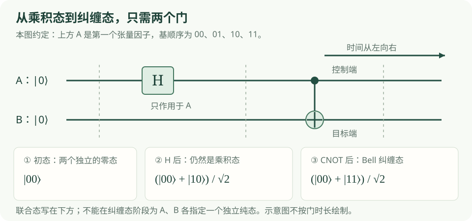

# 04｜量子门、电路与三种基础协议

前两章把一个量子比特写成两分量列向量，把两个量子比特写成四分量列向量。本章用这些向量读电路，再看三个用途：制备纠缠、把未知态传给远处的人，以及借共享纠缠传两位经典消息。若矩阵乘法已经生疏，可以先回看[第 01 章的矩阵部分](01-math.md#4-矩阵与线性算符)；本章所有关键电路都会给出可逐项核对的算例。

## 1. 电路怎样读

把电路想成一份操作顺序表：一条横线代表一个量子比特，沿线从左到右走就是时间向前。方框里的字母表示门；两个量子比特之间的竖线表示一个双比特门，不能把它当作两条线各自独立的门。测量符号给出经典结果，测量以后的线路通常不能再用“同一个封闭系统的酉矩阵”概括。

数学式却按矩阵乘法的习惯**从右往左执行**。例如先做 $H$、再做 $Z$，输入为 $|0\rangle$ 时，写作

$$
|0\rangle=\begin{bmatrix}1\\0\end{bmatrix}
\xrightarrow{H}
\frac1{\sqrt2}\begin{bmatrix}1\\1\end{bmatrix}=|+\rangle
\xrightarrow{Z}
\frac1{\sqrt2}\begin{bmatrix}1\\-1\end{bmatrix}=|-\rangle.
$$

整个过程写为 $ZH|0\rangle$，不是 $HZ|0\rangle$。检验顺序是否真的重要：若先 $Z$ 后 $H$，$Z|0\rangle=|0\rangle$，最后得到 $H|0\rangle=|+\rangle$，与 $|-\rangle$ 不同。一般的三步式 $U_3U_2U_1|\psi\rangle$ 同理：先 $U_1$，最后 $U_3$。

本章两比特列向量固定按

$$
|00\rangle=\begin{bmatrix}1\\0\\0\\0\end{bmatrix},\quad
|01\rangle=\begin{bmatrix}0\\1\\0\\0\end{bmatrix},\quad
|10\rangle=\begin{bmatrix}0\\0\\1\\0\end{bmatrix},\quad
|11\rangle=\begin{bmatrix}0\\0\\0\\1\end{bmatrix}
$$

排列。位串左边是第一个张量因子和高位。例如 $|10\rangle$ 是“第一位为 1、第二位为 0”，不是测量软件恰好显示字符串 `10` 的保证。线路图若把第一条线标成 $q_0$，也不能据此猜测软件输出字符串的左右顺序；使用软件时另查并注明端序。

理想的封闭系统量子门由**酉矩阵** $U$ 表示，满足 $U^\dagger U=I$。这条式子有两个直接后果：长度与内积不变，且 $U^{-1}=U^\dagger$，所以理想门可以倒着做。例如 $H^2=I$，连续做两次 $H$ 就回到原态。若电路先 $U$ 后 $V$，整体是 $VU$，撤销时先做 $V^\dagger$、再做 $U^\dagger$，即 $(VU)^{-1}=U^\dagger V^\dagger$。测量、复位或丢弃系统会把结果写入记录或环境，单看留下的系统通常不能如此逆转；第 05 章用量子信道描述它们。

## 2. 常用门

先看门对什么态做了什么，再记名称。单比特的 $X,Y,Z,H,S,T$ 都是 $2\times2$ 矩阵；CNOT、CZ、SWAP 作用于两比特，是 $4\times4$ 矩阵。第二章给出单比特门矩阵，这里挑与电路读法直接有关的作用。

| 门 | 一个可直接核对的作用 | 作用概念 |
|---|---|---|
| $X$ | $X|0\rangle=|1\rangle,\ X|1\rangle=|0\rangle$ | 对调两个基态 |
| $Z$ | $Z|0\rangle=|0\rangle,\ Z|1\rangle=-|1\rangle$ | 改变两分量的相对符号 |
| $Y$ | $Y|0\rangle=i|1\rangle,\ Y|1\rangle=-i|0\rangle$ | 同时交换分量并改变相位 |
| $H$ | $H|0\rangle=|+\rangle,\ H|1\rangle=|-\rangle$ | 在计算基和 $\{|+\rangle,|-\rangle\}$ 基之间换写 |
| $S=\mathrm{diag}(1,i)$ | $S|+\rangle=(|0\rangle+i|1\rangle)/\sqrt2$ | 给 $|1\rangle$ 分量加 $\pi/2$ 相位；$S^2=Z$ |
| $T=\mathrm{diag}(1,e^{i\pi/4})$ | $T|+\rangle=(|0\rangle+e^{i\pi/4}|1\rangle)/\sqrt2$ | 给 $|1\rangle$ 分量加 $\pi/4$ 相位 |
| CNOT | $|10\rangle\mapsto|11\rangle$ | 第一位为控制、第二位为目标时翻转目标；完整表见下节 |
| CZ | $|11\rangle\mapsto-|11\rangle$，另三基态不变 | 只改 $|11\rangle$ 的符号 |
| SWAP | $|01\rangle\leftrightarrow|10\rangle$ | 交换两位 |

表中“加相位”并非一定让计算基测量概率立即改变。例如 $S|+\rangle=(|0\rangle+i|1\rangle)/\sqrt2$，直接量 $0$、$1$ 仍各为 $1/2$；再接别的门让两条振幅相遇时，相位才可能变成可见的概率差。

**受控门**的名称也可以直译：控制位为 $0$ 时不对目标做事；为 $1$ 时执行指定门。CNOT 是“受控 $X$”。这一说法描述的是对计算基分量的作用；控制位若处于叠加态，必须把整个输入按线性拆开分别计算，不可想成门先偷偷测量控制位。

表中矩阵描述的是**理想逻辑作用**。实验里的门是有限时长的微波、激光、电压或光学控制过程；校准把控制波形调到尽量接近目标酉矩阵。弛豫、退相位、串扰和泄漏会使实际过程不再是一个完美酉门，而应由第 05 章的量子信道描述。因此，“线路上画了 CNOT”说明编译目标，不等于物理器件无误地执行了 CNOT。

## 3. 从乘积态制备 Bell 态

读图时先跟随上方线路：$H$ 只作用于 $A$，随后实心点是 CNOT 的控制端，下方带十字的圆圈是目标端。虚线只标记观察状态的时刻。图中第二阶段仍可写成 $|+\rangle_A|0\rangle_B$，第三阶段才产生纠缠。先弄懂 CNOT 对任意两比特输入做什么，再回来看图。

以第一位为控制、第二位为目标，CNOT 的完整规则是

| 输入 | 控制位 | 是否翻转第二位 | 输出 |
|---|---:|---|---|
| $|00\rangle$ | 0 | 不翻转 | $|00\rangle$ |
| $|01\rangle$ | 0 | 不翻转 | $|01\rangle$ |
| $|10\rangle$ | 1 | 翻转 $0\to1$ | $|11\rangle$ |
| $|11\rangle$ | 1 | 翻转 $1\to0$ | $|10\rangle$ |

如果输入是任意四分量

$$|v\rangle=a|00\rangle+b|01\rangle+c|10\rangle+d|11\rangle
=\begin{bmatrix}a\\b\\c\\d\end{bmatrix},$$

按线性把四项分别送过 CNOT：$a|00\rangle\mapsto a|00\rangle$，$b|01\rangle\mapsto b|01\rangle$，$c|10\rangle\mapsto c|11\rangle$，$d|11\rangle\mapsto d|10\rangle$。所以

$$
\mathrm{CNOT}\begin{bmatrix}a\\b\\c\\d\end{bmatrix}
=\begin{bmatrix}a\\b\\d\\c\end{bmatrix}.
$$

例如把归一化态 $(|00\rangle+2|01\rangle+3|10\rangle+4|11\rangle)/\sqrt{30}$ 送入，输出为 $(|00\rangle+2|01\rangle+4|10\rangle+3|11\rangle)/\sqrt{30}$；只交换了后两个振幅，平方和仍是 $(1+4+16+9)/30=1$。别把“控制位为 1 时翻转”误读为“测量控制位，若看到 1 才翻转”。

初态 $|00\rangle$。先对第一个比特施加 $H$：

$$
(H\otimes I)|00\rangle
=\frac{|00\rangle+|10\rangle}{\sqrt2}.
$$

再以第一比特为控制、第二比特为目标施加 CNOT：

$$
\mathrm{CNOT}\frac{|00\rangle+|10\rangle}{\sqrt2}
=\frac{|00\rangle+|11\rangle}{\sqrt2}
=|\Phi^+\rangle.
$$

线性很关键：CNOT 分别作用于两个分量，然后结果相加。

为什么第一步还不是纠缠？因为 $(|00\rangle+|10\rangle)/\sqrt2=(|0\rangle+|1\rangle)|0\rangle/\sqrt2$，仍拆得成两个单比特态的乘积。第二步后 $(|00\rangle+|11\rangle)/\sqrt2$ 则拆不开。CNOT **可以**产生纠缠，不是碰到任何输入都会产生：$\mathrm{CNOT}|00\rangle=|00\rangle$ 仍是乘积态；$\mathrm{CNOT}(|+\rangle|+\rangle)=|+\rangle|+\rangle$ 也不变。产生纠缠取决于输入。

在上述基顺序和控制—目标约定下，

$$
\mathrm{CNOT}
=\begin{bmatrix}
1&0&0&0\\
0&1&0&0\\
0&0&0&1\\
0&0&1&0
\end{bmatrix}.
$$

矩阵第 1 至第 4 列分别是输入 $|00\rangle,|01\rangle,|10\rangle,|11\rangle$ 的输出列向量，也就是 $|00\rangle,|01\rangle,|11\rangle,|10\rangle$。写两比特门矩阵时，先写清输入基序和哪一位是控制位，才能判断矩阵是否正确。

**马上核对。** $\mathrm{CNOT}(|01\rangle+|11\rangle)/\sqrt2$ 是什么？前一项不变，后一项变成 $|10\rangle$，故结果为 $(|01\rangle+|10\rangle)/\sqrt2$。若对同一对比特再施加一次 CNOT，又回到输入，这也验证 $\mathrm{CNOT}^2=I$。

## 4. 不可克隆定理

看到 CNOT 的 $|0\rangle|0\rangle\mapsto|00\rangle$ 和 $|1\rangle|0\rangle\mapsto|11\rangle$，很容易以为第二个量子比特成了第一个的“复印件”。但把控制位换成 $|+\rangle=(|0\rangle+|1\rangle)/\sqrt2$，线性要求

$$
\mathrm{CNOT}(|+\rangle|0\rangle)
=\frac{|00\rangle+|11\rangle}{\sqrt2},
$$

而真正的两份 $|+\rangle$ 应是

$$
|+\rangle|+\rangle
=\frac{|00\rangle+|01\rangle+|10\rangle+|11\rangle}{2}.
$$

两个输出的**非零分量个数**都不同。因此 CNOT 能复制这两个**已选定且正交的计算基态**，却不是复制任意未知态的机器。

下面说明为何换一台更复杂的理想机器也不行。假设存在一个固定酉操作 $U$，能把任意未知态复制到同一个空白态 $|0\rangle$：

$$U|\psi\rangle|0\rangle=|\psi\rangle|\psi\rangle.$$

对另一个候选态 $|\phi\rangle$ 也成立。先比较两种输入的内积：第二个比特都是 $|0\rangle$，所以是 $\langle\phi|\psi\rangle\langle0|0\rangle=\langle\phi|\psi\rangle$。输出是两份态，内积变成 $\langle\phi|\psi\rangle^2$。酉变换保持内积；为避免同一物理态的整体相位写法干扰，至少必须保持其模，于是

$$
|\langle\phi|\psi\rangle|
=|\langle\phi|\psi\rangle|^2.
$$

令 $c=\langle\phi|\psi\rangle$，便有 $|c|(1-|c|)=0$，即 $|c|$ 只能是 0 或 1。前者表示两态正交；后者表示两个 ket 只差全局相位，代表同一物理纯态。可是 $|0\rangle$ 与 $|+\rangle$ 的重叠为 $1/\sqrt2$，既非 0 也非 1；固定的完美复制机不可能同时复制它们。这个具体反例已足以否定“复制**任意**未知态”。

如果复制机还有一份固定输入的辅助系统，且允许输出辅助态随输入变成 $|A_\psi\rangle$，两种输出的内积模会是 $|c|^2|\langle A_\phi|A_\psi\rangle|$。两个归一化辅助态的重叠模至多为 1，于是它至多是 $|c|^2$；但输入内积模为 $|c|$。对 $0<|c|<1$ 仍不可能相等，辅助系统也不能绕过结论。

不可克隆不禁止根据已知制备说明重新制备同样的态：那是从说明制造另一个样本，而非拿未知样本做通用复制。近似克隆、成功率小于 1 的概率克隆和受限态集合的克隆也需要另行分析；定理禁止的是对任意未知态做确定、完美的通用复制。

## 5. 不可删除与复位不是一回事

“删除”在这里不是按一个按钮把系统清成 $|0\rangle$。不可删除讨论更严格的特定任务：给定两份相同的任意未知态，想保留一份，同时把另一份**连同所有辅助系统**无痕变成与输入无关的固定状态。若只写系统的目标形式，可以表示为

$$
|\psi\rangle|\psi\rangle|A\rangle
\longrightarrow
|\psi\rangle|0\rangle|A_\psi\rangle.
$$

其中 $|A\rangle$ 是固定的初始辅助态，$|A_\psi\rangle$ 是操作后的辅助态。允许 $A_\psi$ 随输入改变，就只是把信息移到别处；真正“无痕删除”还要求它不携带输入信息。封闭系统演化保持内积，不能令这些信息凭空消失。因此“不可删除”不等于“量子比特不能复位”。

可以用两种不同且不正交的候选态 $|\psi\rangle,|\phi\rangle$ 核对。记 $c=\langle\phi|\psi\rangle$，并假设初始辅助态相同且归一化。两份输入的内积是 $c^2$；若上面的变换由封闭系统的酉操作实现，两份输出的内积必须相同，所以

$$
c^2=c\,\langle A_\phi|A_\psi\rangle.
$$

当 $0<|c|<1$ 时，可约去 $c$，得到 $\langle A_\phi|A_\psi\rangle=c$。辅助态至少保留了区分这两种输入的内积关系；若硬要它对所有输入都是同一个固定态，两辅助态的内积便为 1，与 $0<|c|<1$ 矛盾。例如 $|0\rangle$ 与 $|+\rangle$ 的 $c=1/\sqrt2$，辅助态也必须有相同的重叠。这个两态核对说明“固定辅助态”不可能；完整不可删除定理把要求推广到任意未知态集合。

例如 SWAP 可实现

$$
|\psi\rangle_S|0\rangle_E\longmapsto|0\rangle_S|\psi\rangle_E.
$$

只观察系统 $S$，它确实被复位到 $|0\rangle$；观察整体，原信息仍在环境 $E$。若直接丢弃 $E$，就无法仅凭 $S$ 把原态找回，但不能因此说封闭的 $S+E$ 整体把信息抹掉了。第 05 章会把这种“只看一部分”的复位写成合法量子信道。

## 6. 量子隐形传态

**问题与资源。** Alice 手里有一个量子比特 $Q$，态为

$$|\psi\rangle_Q=\alpha|0\rangle+\beta|1\rangle,\qquad |\alpha|^2+|\beta|^2=1.$$

她不知道 $\alpha,\beta$，希望让 Bob 手里的量子比特具有这个态；传送的是态，不是构成器件的粒子。事前 Alice 与 Bob 各持有一半 Bell 态 $|\Phi^+\rangle_{AB}=(|00\rangle+|11\rangle)/\sqrt2$。Alice 持有 $Q,A$，Bob 持有 $B$。全文三比特位串按 **$Q,A,B$** 排列。

图先给路线，下面把四种分支逐项推出来。图中的 `00` 至 `11` 是一次实验中**只会出现其中一个**的 Alice 测量结果，不能理解为 Bob 同时收到四份态。

**第一步：Alice 做两个门。** 她先做 $\mathrm{CNOT}_{Q\to A}$，再只对 $Q$ 做 $H$。矩阵式从右往左写，恰与此顺序一致：

$$
|\Omega\rangle_{QAB}
=(H_Q\otimes I_A\otimes I_B)
(\mathrm{CNOT}_{Q\to A}\otimes I_B)
\bigl(|\psi\rangle_Q|\Phi^+\rangle_{AB}\bigr).
$$

不用背最后的传态恒等式，可以逐项展开。初态先有四个三比特分量：

$$
|\psi\rangle_Q|\Phi^+\rangle_{AB}
=\frac1{\sqrt2}\bigl(
\alpha|000\rangle+\alpha|011\rangle
+\beta|100\rangle+\beta|111\rangle\bigr).
$$

其中 $|100\rangle$ 的 $Q=1,A=0$，CNOT 会把 $A$ 改成 1，即 $|110\rangle$；$|111\rangle$ 则变成 $|101\rangle$。$Q=0$ 的两项不变，因此门后是

$$
\frac1{\sqrt2}\bigl(
\alpha|000\rangle+\alpha|011\rangle
+\beta|110\rangle+\beta|101\rangle\bigr).
$$

再对第一位做 $H$。例如 $\alpha|000\rangle/\sqrt2$ 变成 $\alpha(|000\rangle+|100\rangle)/2$；而 $\beta|110\rangle/\sqrt2$ 变成 $\beta(|010\rangle-|110\rangle)/2$。剩下两项同法处理，并按前两位 $QA$ 分组，得到

$$
\begin{aligned}
|\Omega\rangle_{QAB}=\frac12\bigl[&
|00\rangle_{QA}(\alpha|0\rangle+\beta|1\rangle)_B\\
&+|01\rangle_{QA}(\beta|0\rangle+\alpha|1\rangle)_B\\
&+|10\rangle_{QA}(\alpha|0\rangle-\beta|1\rangle)_B\\
&+|11\rangle_{QA}(-\beta|0\rangle+\alpha|1\rangle)_B\bigr].
\end{aligned}
$$

**第二步：Alice 测量，得到两位经典数。** 她在计算基分别测 $Q,A$；这也可描述为对门操作以前的 $Q,A$ 做 Bell 基测量。某一行尚未归一化的 Bob 向量前面有 $1/2$。例如 $QA=01$ 的结果概率是

$$
p(01)=\left|\frac{\beta}{2}\right|^2+\left|\frac{\alpha}{2}\right|^2
=\frac{|\alpha|^2+|\beta|^2}{4}=\frac14.
$$

其他三行同样都是 $1/4$。知道结果为 $01$ 后，要用 $\sqrt{p(01)}=1/2$ 去除该分支，Bob 的**条件态**才成为归一化的 $\beta|0\rangle+\alpha|1\rangle=X|\psi\rangle$。这里“测量前分支带 $1/2$”与“测量后条件态长度为 1”是两个不同阶段，不能混写。

| Alice 测得 $QA$ | Bob 的归一化条件态 | Bob 收到消息后施加 | 校正后的态 |
|---|---|---|---|
| $00$ | $\alpha|0\rangle+\beta|1\rangle=|\psi\rangle$ | $I$ | $|\psi\rangle$ |
| $01$ | $\beta|0\rangle+\alpha|1\rangle=X|\psi\rangle$ | $X$ | $X^2|\psi\rangle=|\psi\rangle$ |
| $10$ | $\alpha|0\rangle-\beta|1\rangle=Z|\psi\rangle$ | $Z$ | $Z^2|\psi\rangle=|\psi\rangle$ |
| $11$ | $-\beta|0\rangle+\alpha|1\rangle=XZ|\psi\rangle$ | $ZX$ | $ZX(XZ|\psi\rangle)=|\psi\rangle$ |

最后一行的 $XZ$ 表示**先 $Z$ 后 $X$**；校正用 $ZX$ 表示先 $X$ 后 $Z$。若把 $ZX$ 写成 $XZ$，会多一个整体负号，测量统计相同，但教学计算最好固定表中的门序。

**第三步：Alice 发送消息，Bob 校正。** Alice 只需用普通通信发送自己测到的 `00`、`01`、`10` 或 `11`。这两位数没有记录 $\alpha,\beta$；它们仅告诉 Bob 该执行表中哪一行。比如取可手算的未知输入 $|\psi\rangle=(\sqrt3|0\rangle+|1\rangle)/2$。若 Alice 测得 `01`，Bob 此时是 $(|0\rangle+\sqrt3|1\rangle)/2$；他施加 $X$，两系数换回去，得到原态 $(\sqrt3|0\rangle+|1\rangle)/2$。这次 `01` 的概率仍为 $1/4$，与输入系数无关。

Bob 如果**尚未收到**结果，不能挑一行来校正。他手中是四种条件态各占 $1/4$ 的非选择混合态。记 $\rho=|\psi\rangle\langle\psi|$，则

$$
\rho_B=\frac14\bigl(\rho+X\rho X+Z\rho Z+XZ\rho ZX\bigr)=\frac I2.
$$

可以核对等号：$\rho$ 与 $Z\rho Z$ 的非对角项一正一负，$X\rho X$ 与 $XZ\rho ZX$ 也相互抵消；每个对角位置最后都是 $2(|\alpha|^2+|\beta|^2)/4=1/2$。所以不管输入 $|\psi\rangle$ 是什么，Bob 只测自己的比特都只见到相同的 $I/2$，不可能在经典消息到达前读出态或超光速收到信息。

一次成功传态消耗 1 对预共享纠缠，并发送 2 个经典位；Alice 的测量后不再留下原来那份未知态，因此也不违反不可克隆。若 $Q$ 原先还与别的系统纠缠，协议的线性性质同样能转移相应关联，但那一情形可留到理解完第 05 章的密度矩阵再细看。

## 7. 超密编码

传态用“共享纠缠 + 两个经典位”转移一个未知量子态。超密编码换一个目标：用“共享纠缠 + 发送一个量子比特”传递两个**经典**位。两种协议的通信方向相同，所送的东西不同，不能把资源口径省掉。

Alice 与 Bob 先各持有 $|\Phi^+\rangle_{AB}=(|00\rangle+|11\rangle)/\sqrt2$ 的一半。Alice 想送的位串是 $(b_1,b_0)$，她只操作自己的第一位 $A$。先定义另外三个 Bell 态：

$$
|\Phi^-\rangle=\frac{|00\rangle-|11\rangle}{\sqrt2},\qquad
|\Psi^+\rangle=\frac{|01\rangle+|10\rangle}{\sqrt2},\qquad
|\Psi^-\rangle=\frac{|01\rangle-|10\rangle}{\sqrt2}.
$$

四个态彼此正交。例如 $\langle\Phi^+|\Phi^-\rangle=(1-1)/2=0$；$\Phi$ 态与 $\Psi$ 态占据的计算基项不重合，内积也为 0。Bob 收到 Alice 的比特后，便有可能用联合测量把它们分开。编码表中的算符全都只作用在 $A$ 上：

| 位串 | Alice 的操作 | 形成的 Bell 态 |
|---|---|---|
| 00 | $I$ | $|\Phi^+\rangle$ |
| 01 | $X$ | $|\Psi^+\rangle$ |
| 10 | $Z$ | $|\Phi^-\rangle$ |
| 11 | $ZX$（先 $X$ 后 $Z$） | $|\Psi^-\rangle$ |

以 `11` 为例，Alice 先把第一位翻转：

$$
(X_A\otimes I_B)|\Phi^+\rangle
=\frac{|10\rangle+|01\rangle}{\sqrt2}.
$$

随后 $Z_A$ 给第一位为 1 的 $|10\rangle$ 加负号，得 $(-|10\rangle+|01\rangle)/\sqrt2=|\Psi^-\rangle$。如果操作次序颠倒，得到的是 $-|\Psi^-\rangle$，只差全局相位；这里固定为“先 $X$ 后 $Z$”，免得后续算式出现无缘由的负号。

Alice 接着把自己的**一个量子比特**送到 Bob 处。Bob 现在同时持有 $A,B$，可做一个具体的 Bell 测量：先做 $\mathrm{CNOT}_{A\to B}$，再做 $H_A$，最后分别按计算基测两位。把每行逐个算过，可见

| 收到的 Bell 态 | CNOT 后 | 再做 $H_A$ 后 | 测得的 $AB$ |
|---|---|---|---|
| $|\Phi^+\rangle$ | $|+\rangle_A|0\rangle_B$ | $|00\rangle$ | `00` |
| $|\Psi^+\rangle$ | $|+\rangle_A|1\rangle_B$ | $|01\rangle$ | `01` |
| $|\Phi^-\rangle$ | $|-\rangle_A|0\rangle_B$ | $|10\rangle$ | `10` |
| $|\Psi^-\rangle$ | $|-\rangle_A|1\rangle_B$ | $|11\rangle$ | `11` |

例如 $|\Psi^-\rangle=(|01\rangle-|10\rangle)/\sqrt2$ 经 CNOT 后成为 $(|01\rangle-|11\rangle)/\sqrt2=|-\rangle_A|1\rangle_B$；因为 $H|-\rangle=|1\rangle$，最后必然测得 `11`。其余三行同法，不需要记住一台神秘的“Bell 测量仪”。

资源账本必须完整：预共享 1 ebit（1 对最大纠缠量子比特），再发送 1 个量子比特，传递 2 个经典位。没有预共享纠缠，就不能把表格解释成“任意单个量子比特天然装两个可无误读出的经典位”。

## 8. 相位回踢

“相位回踢”听起来像有东西从目标位飞回控制位。实际发生的是：控制位的两个分支经历不同操作，而目标位碰巧是 $U$ 的本征态，于是差异表现为**控制位两分量之间的相对相位**。

设 $U$ 是作用在目标寄存器上的酉门，$|u\rangle$ 是它的归一化本征态，满足 $U|u\rangle=e^{i\theta}|u\rangle$。控制位先准备为 $|+\rangle$。受控-$U$ 作用于

$$\frac{|0\rangle+|1\rangle}{\sqrt2}\otimes|u\rangle$$

得到

$$
\frac{|0\rangle|u\rangle+|1\rangle U|u\rangle}{\sqrt2}
=\frac{|0\rangle+e^{i\theta}|1\rangle}{\sqrt2}\otimes|u\rangle.
$$

看等式右边：两条控制分支的目标寄存器都为同一个 $|u\rangle$，所以能够提取公共因子；目标没有携带“控制位是 0 还是 1”的区别。与此同时，控制位的 $|1\rangle$ 分量相对 $|0\rangle$ 多了 $e^{i\theta}$。这是相对相位，而不是整个联合态一起乘的、不可见的全局相位。

**先用只有正负号的例子核对。** 令 $U=Z$、目标位 $|u\rangle=|1\rangle$；因为 $Z|1\rangle=-|1\rangle$，这里 $e^{i\theta}=-1$，可取 $\theta=\pi$。受控 $Z$ 后

$$
|+\rangle_C|1\rangle_T
=\frac{|0\rangle_C|1\rangle_T+|1\rangle_C|1\rangle_T}{\sqrt2}
\longmapsto
\frac{|0\rangle_C|1\rangle_T-|1\rangle_C|1\rangle_T}{\sqrt2}
=|-\rangle_C|1\rangle_T.
$$

若立即在计算基测控制位，前后都是 0、1 各半，还看不到那个负号。再做一次 $H_C$，由于 $H|-\rangle=|1\rangle$，控制位必得 1；如果目标本征值原为 $+1$，回踢后仍是 $|+\rangle_C$，再做 $H_C$ 必得 0。这里第二个 $H$ 把相位差变成了可测的概率差。

本征态前提不能漏掉。若目标改为 $|+\rangle$，而 $U=Z$，则 $Z|+\rangle=|-\rangle$，受控 $Z$ 后是 $(|0\rangle|+\rangle+|1\rangle|-\rangle)/\sqrt2$；两个分支的目标态不同，不能像上面那样提出一个共同的 $|u\rangle$。相位估计使用本征态结构；Deutsch–Jozsa 和某些相位 oracle 则把函数值变成分支相位，具体电路要分别检查。

## 9. 通用性与近似

像搭积木一样，只挑少数几种门，能否拼出需要的任意计算？这叫**门集的通用性**。它不意味着“一种门一步完成所有计算”，也不意味着每个目标门都必须完全精确地拼出来。

一个原因是“有限个离散门”形成的有限长度序列只有可数多个，而单比特酉矩阵可随连续角度改变，目标有不可数多个。因此固定的离散门集不可能用有限序列**精确**写出所有单比特酉矩阵；我们追求的是给定容许误差后尽量逼近。任意单比特酉门配合一种能产生纠缠的两比特门，可对多比特酉运算构成通用资源；固定门集 $\{H,T,\mathrm{CNOT}\}$ 也可用于近似通用计算。

为什么表里还列 $S$？由 $H,S,\mathrm{CNOT}$ 等组成的一类门称为 **Clifford 门**；它们在稳定子电路中有较高效的经典模拟方法，单靠它们不是通用的。$T$ 是一种 **非 Clifford 门**；把它加入门集，才有近似通用的能力。此处只需把“Clifford / 非 Clifford”理解为“仅前一类不够，后一类补足能力”的分类，不必先学稳定子形式。

**进阶回看：物理成本。** 实际硬件选择易于控制的原生门，再将目标电路拆成这些门。纠错后的某些容错方案中，$T$ 门常依赖“魔法态蒸馏”：先制备许多有噪声的特殊辅助态，再经检测和筛选获得质量更高的辅助态。这可能很昂贵；只比较逻辑电路的总门数，并不足以比较实际运行成本。第 10–11 章进一步讨论容错与资源估计。

## 10. 常见误区

- CNOT 不是经典“复制门”：它只在目标为 $|0\rangle$、控制为计算基态时呈现复制经典位的效果。
- CNOT 的“控制”不是先测量控制位；对叠加态应按线性逐项计算。
- 不可删除不禁止复位；复位把关于输入的信息转移到环境，而不是无痕消灭信息。
- 隐形传态传的是量子态，不是物体；两位经典消息不到，Bob 没有可用的输入态信息。
- 超密编码的“两位”是经典位，且依赖预共享纠缠。
- 相位回踢产生相对相位，但直接测计算基未必能看出；还需适当的干涉或换基步骤。
- 量子门图上的交叉线不总是 SWAP；应看是否有交换符号。
- 线路深度与门数不同：可并行门增加门数，却不一定增加深度。

## 11. 自检

先按正文公式独立试算，再对答案。第 1–3 题练读电路，第 4–6 题练传态与超密编码，第 7 题练相位回踢，第 8–9 题练概念边界。

1. 写出第一位控制、第二位为目标的 CNOT 的 $4\times4$ 矩阵，明确基顺序，并说明矩阵第 3 列为何那样写。
2. 从 $|01\rangle$ 出发，先对第一比特做 $H$，再做 CNOT。写出每一步的态与测量 `01`、`10` 的概率。
3. 把 $(|00\rangle+2|01\rangle+3|10\rangle+4|11\rangle)/\sqrt{30}$ 输入 CNOT。写出四分量输出，检查归一化，再做一次 CNOT 会怎样？
4. 传态输入 $|\psi\rangle=(\sqrt3|0\rangle+|1\rangle)/2$；Alice 测得 `10`。Bob 在校正前后的归一化态分别是什么？该结果概率是多少？
5. 不假定输入态系数的具体数值，解释 Bob 在没收到 Alice 消息时为何不能判断输入是 $|0\rangle$ 还是 $|1\rangle$。
6. 超密编码中 Alice 想发送 `11`。从 $|\Phi^+\rangle$ 开始，依次算出她施加 $X_A$、$Z_A$ 后的态，以及 Bob 经 CNOT、$H_A$ 后必得的测量结果。
7. 取受控 $Z$ 的控制位为 $|+\rangle$，目标位为 $|1\rangle$。写出受控门后的态；为什么此时直接测控制位仍各半，而再做 $H$ 后必得 1？
8. 为什么隐形传态不违反不可克隆与不能超光速传讯？再用 SWAP 例子说明合法复位为何不违反不可删除。
9. 先做 $H$ 后做 $Z$ 的整体矩阵写成 $ZH$ 还是 $HZ$？计算它作用于 $|0\rangle$ 的结果，并说明若交换门序会怎样。

答案见[练习与答案：第 4 章](appendices/exercises.md#第-4-章)。

## 配套数值实验与展开答案

用八个复振幅直接执行传态线路，检查四个测量结果各占 1/4、四种校正全部还原输入，以及不知道结果时 Bob 仍为最大混态。

题目和逐步解答见[基础实验册](labs/foundations.md)，本章程序编号为 `04`。可从[代码说明](../codes/foundations/README.md)进入独立脚本与保存的运行结果。所有模拟样本均明确标作合成数据，不是硬件实验。

## 参考起点

- IBM Quantum Learning, [Circuits](https://quantum.cloud.ibm.com/learning/en/courses/basics-of-quantum-information/quantum-circuits/circuits)：电路从左到右的读法和门序。
- W. K. Wootters and W. H. Zurek, [A single quantum cannot be cloned](https://doi.org/10.1038/299802a0), *Nature* 299, 802–803 (1982)。
- A. K. Pati and S. L. Braunstein, [Impossibility of deleting an unknown quantum state](https://doi.org/10.1038/35004532), *Nature* 404, 164–165 (2000)。
- C. H. Bennett et al., [Teleporting an unknown quantum state via dual classical and EPR channels](https://doi.org/10.1103/PhysRevLett.70.1895), *Physical Review Letters* 70, 1895 (1993)。
- IBM Quantum Learning, [Quantum teleportation](https://quantum.cloud.ibm.com/learning/en/courses/basics-of-quantum-information/entanglement-in-action/quantum-teleportation)：电路约定、四种条件态与经典通信。
- IBM Quantum Learning, [Superdense coding](https://quantum.cloud.ibm.com/learning/en/courses/basics-of-quantum-information/entanglement-in-action/superdense-coding)。
- IBM Quantum Learning, [The phase-estimation procedure](https://quantum.cloud.ibm.com/learning/en/courses/fundamentals-of-quantum-algorithms/phase-estimation-and-factoring/phase-estimation-procedure)：相位回踢与 Hadamard 读出。
- J.-L. Brylinski and R. Brylinski, [Universal quantum gates](https://arxiv.org/abs/quant-ph/0108062)：任意单比特门与纠缠两比特门的通用性条件。
