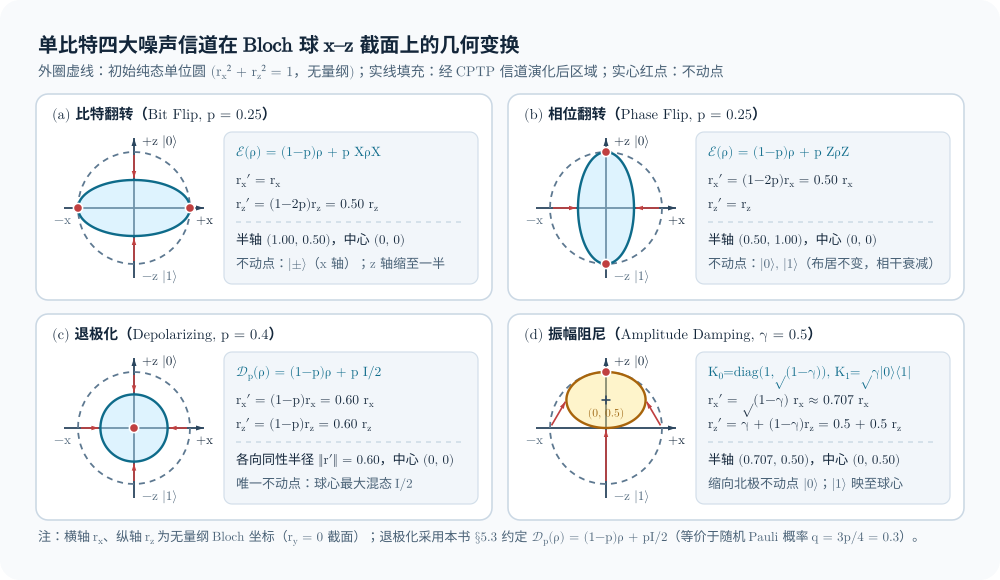

# 05｜混态、噪声与量子信道

[第 03 章](03-multiple-qubits.md)已经用约化密度矩阵描述了纠缠对的一半，[第 04 章](04-circuits-protocols.md)则主要用理想酉门追踪线路里的状态变化。本章把两种描述接起来。随机态制备与只观察纠缠对的一部分都可能产生混态。真实处理器中的比特还会与电磁场、材料缺陷或控制线路耦合，使相干性减弱或能量流出。本章用密度矩阵记录这些状态，再用量子信道描述它们的变化。

本章把量子计算语言从封闭系统升级到开放系统，按两条阅读路径组织（通用记号汇总见[符号表](appendices/notation.md)）：

- **★ 首遍主线**：第 1.1–1.3 节（密度矩阵与纯度）$\to$ 第 2 节（实心 Bloch 球证明）$\to$ 第 3.1–3.2 节（酉演化与测量）$\to$ 第 4.1 节与第 4.3 节（完全正性与无信号定理）$\to$ 第 5 节（五大单比特噪声信道与 Bloch 形变）$\to$ 第 6 节（短时 Kraus 到 Lindblad 主方程与 $T_1, T_2^*, T_2, T_\phi$）$\to$ 第 9 节（QPT / QEM / QEC 分界）。
- **☆ 进阶选读**：第 1.4 节（HJW 定理）、第 3.3 节（量子仪器）、第 4.2 节（超算符五表示互转）、第 7 节（$1/f$ 低频噪声与非马尔可夫性）与第 8 节（过程层析与 Pauli 旋转随机化）。

本章重点区分四组易混记号：
- **$E_m$（POVM 效果算符）vs $\mathcal I_m$（量子仪器分支）vs $K_k$（信道 Kraus 算符）**：$E_m\succeq 0$ 只定概率，$\mathcal I_m$ 同时定概率与后态，全章信道一律用 $K_k$ 且满足 $\sum_k K_k^\dagger K_k=I$；
- **$J_{\mathcal E}$、$\mathcal S_{\mathcal E}$、$R$**：分别为未归一化 Choi 矩阵、列堆叠 Liouville 矩阵与 Pauli 转移矩阵（PTM）；
- **$\mathcal D_p$ vs $\widetilde{\mathcal D}_q$ 与 $p_{\mathrm{eq}}$**：退极化混合参数 $p$ 与随机 Pauli 参数 $q$ 满足 $q=\frac{3}{4}p$，平均门错误率 $r=1-F_{\mathrm{avg}}=\frac{2}{3}q$；广义振幅阻尼的稳态 $|1\rangle$ 占据专记 $p_{\mathrm{eq}}$，与 Bloch 坐标 $r_z$ 和门错误率 $r$ 区分；
- **$T$ 与 $F$**：迹距离 $T(\rho,\sigma)=\frac{1}{2}\lVert\rho-\sigma\rVert_1$，根保真度 $F(\rho,\sigma)=\operatorname{Tr}\sqrt{\sqrt\rho\,\sigma\sqrt\rho}$（区别于平方保真度 $F^2$）；信息熵用 $\log_2$，自然对数用 $\ln$。

---

## 1. 为什么单个态矢量不够：密度矩阵的两种来历

遇到一个新数学对象时，最稳妥的办法是先看看旧工具究竟卡在哪一步。

### 1.1 来历一：背后有人抛硬币（经典系综）

若制备装置以经典概率 $p_j$ 送出归一化纯态 $|\psi_j\rangle\in\mathbb C^d$，却不告知具体分支，就把各纯态外积按经典概率加权求和，得到**密度矩阵（density matrix）**：

$$
\rho = \sum_j p_j |\psi_j\rangle\langle\psi_j|, \qquad p_j \ge 0,\quad \sum_j p_j = 1.
$$

回看前文反复对比的相干叠加态 $|+\rangle$ 与均匀抛硬币混合（物理判别实验见[量子力学 Q1 第 5 节](quantum-mechanics/01-experiments-states.md)与[第 02 章第 1.2 节](02-single-qubit.md)），直接写出它们的 $2\times 2$ 矩阵：

$$
\rho_{\mathrm{coin}} = \frac{1}{2}|0\rangle\langle 0| + \frac{1}{2}|1\rangle\langle 1| = \begin{bmatrix} 1/2 & 0 \\ 0 & 1/2 \end{bmatrix} = \frac{I}{2},
\qquad
\rho_+ = |+\rangle\langle +| = \begin{bmatrix} 1/2 & 1/2 \\ 1/2 & 1/2 \end{bmatrix}.
$$

两张矩阵的差异一目了然：**主对角元**（$\rho_{00}, \rho_{11}$，称为**布居** population）记录计算基概率，两者均为 $1/2$；**非对角元**（$\rho_{01}, \rho_{10}$，称为**相干项** coherence）记录基态间稳定的相对相位关联，$\rho_+$ 保留了 $1/2$ 从而在 $X$ 基干涉命中 $|+\rangle$，而 $\rho_{\mathrm{coin}}$ 非对角元为零，只剩经典概率混合。

### 1.2 来历二：只看见纠缠对的一半（子系统约化态）

即使不存在任何人为的经典随机制备，只要系统 $A$ 与未观测的远端系统 $B$ 处于纠缠纯态，局部统计同样需要密度矩阵。以[第 03 章第 4.2 节](03-multiple-qubits.md)算过的 Bell 态 $|\Phi^+\rangle = \frac{|00\rangle + |11\rangle}{\sqrt{2}}$ 为例，对 $B$ 求偏迹立刻得到

$$
\rho_A = \operatorname{Tr}_B\bigl(|\Phi^+\rangle\langle\Phi^+|\bigr)
= \frac{1}{2}|0\rangle\langle 0| + \frac{1}{2}|1\rangle\langle 1|
= \frac{I}{2}.
$$

比特 $A$ 的约化密度矩阵与经典抛硬币送出的 $\rho_{\mathrm{coin}}=I/2$ 完全相同：相位信息并未消失，而是锁进了 $A$ 与 $B$ 的联合关联之中。开放量子系统（系统 + 环境）之所以普遍表现为混态，正是因为两者发生纠缠后我们不再追踪浩瀚的环境自由度。

### 1.3 密度矩阵的三条铁律与纯度

任意 $d$ 维希尔伯特空间 $\mathbb C^d$ 上的 $d\times d$ 复矩阵 $\rho$，能代表一个合法的量子态，当且仅当它同时满足三条公理：

1. **厄米性（Hermiticity）**：$\rho^\dagger = \rho$。它保证所有本征值都是实数（概率不能是虚数）。
2. **正半定性（Positive Semidefiniteness）**：$\rho \succeq 0$，即对任意列向量 $|v\rangle\in\mathbb C^d$ 都有 $\langle v|\rho|v\rangle \ge 0$（等价于全部本征值 $\lambda_i \ge 0$）。它保证在任何测量基下算出的概率都不为负。
3. **单位迹（Unit Trace）**：$\operatorname{Tr}\rho = \sum_{i=0}^{d-1}\rho_{ii} = 1$（等价于全部本征值之和 $\sum_i \lambda_i = 1$）。它保证一次完整测量的总概率恰好等于 $1$。

不要把第 2 条简化成“主对角线元素都非负”。回忆[第 01 章](01-math.md#6-迹正半定矩阵指数与求逆条件数)的反例：矩阵 $\begin{bmatrix}1/2 & 1\\ 1 & 1/2\end{bmatrix}$ 既厄米、对角线又全是正数、迹也是 $1$，可它的两个本征值是 $3/2$ 和 $-1/2$，在 $|-\rangle$ 方向上给出的“概率”是 $\langle -|\rho|-\rangle = -1/2 < 0$，绝不是合法量子态。

有了合法密度矩阵，怎么一眼分辨它是**纯态**还是**混态**？定义一个极好算的标量——**纯度（purity）** $\gamma_{\mathrm{pur}}(\rho) = \operatorname{Tr}(\rho^2)$。利用厄米矩阵的谱分解 $\rho = \sum_{i=1}^d \lambda_i |u_i\rangle\langle u_i|$（$\lambda_i \ge 0$ 且 $\sum_{i=1}^d \lambda_i = 1$），因为本征态正交归一，有 $\rho^2 = \sum_{i=1}^d \lambda_i^2 |u_i\rangle\langle u_i|$，于是：

$$
\operatorname{Tr}(\rho^2) = \sum_{i=1}^d \lambda_i^2.
$$

由于每个 $\lambda_i \in [0,1]$，总有 $\lambda_i^2 \le \lambda_i$，求和即得 $\operatorname{Tr}(\rho^2) \le \sum_i \lambda_i = 1$；等号成立当且仅当恰有一个本征值为 $1$、其余全为 $0$，即 $\rho = |\psi\rangle\langle\psi|$ 是纯态（且满足 $\rho^2 = \rho$）。另一方面，由柯西–施瓦茨不等式：

$$
1 = \left(\sum_{i=1}^d 1\cdot\lambda_i\right)^2 \le \left(\sum_{i=1}^d 1^2\right)\left(\sum_{i=1}^d \lambda_i^2\right) = d\operatorname{Tr}(\rho^2),
$$

由此得到 $d$ 维量子态纯度的严格上下界：

$$
\frac{1}{d} \le \operatorname{Tr}(\rho^2) \le 1.
$$

- 上界 $1$ 由**纯态**达到；
- 下界 $1/d$ 由所有本征值均等（$\lambda_i = 1/d$）的**最大混态（maximally mixed state）** $\rho = I/d$ 达到；
- 满足 $\operatorname{Tr}(\rho^2) < 1$ 的一切合法态都叫**混态（mixed state）**。

拿前面两张 $2\times 2$ 矩阵亲手核对一遍：

$$
\rho_+^2
= \frac{1}{4}\begin{bmatrix} 1 & 1 \\ 1 & 1 \end{bmatrix}\begin{bmatrix} 1 & 1 \\ 1 & 1 \end{bmatrix}
= \frac{1}{4}\begin{bmatrix} 2 & 2 \\ 2 & 2 \end{bmatrix}
= \frac{1}{2}\begin{bmatrix} 1 & 1 \\ 1 & 1 \end{bmatrix}
= \rho_+,
\qquad
\operatorname{Tr}(\rho_+^2) = \frac{1}{2} + \frac{1}{2} = 1,
$$

所以 $\rho_+$ 是纯态。再看 $\rho_{\mathrm{coin}} = I/2$：

$$
\rho_{\mathrm{coin}}^2
= \left(\frac{I}{2}\right)^2
= \frac{I}{4}
= \begin{bmatrix} 1/4 & 0 \\ 0 & 1/4 \end{bmatrix},
\qquad
\operatorname{Tr}(\rho_{\mathrm{coin}}^2) = \frac{1}{4} + \frac{1}{4} = \frac{1}{2},
$$

正好压在二维系统纯度下界 $1/d = 1/2$ 上。

### 1.4 进阶选读：同一个密度矩阵，无穷多种制备剧本——HJW 定理直觉

刚才我们已经看到，抛硬币制备 $|0\rangle/|1\rangle$ 得到 $I/2$。现在换一台机器：抛硬币，正面制备 $|+\rangle$，反面制备 $|-\rangle$。算一下它的密度矩阵：

$$
\begin{aligned}
\rho_{X\text{-}\mathrm{coin}}
&= \frac{1}{2}|+\rangle\langle +| + \frac{1}{2}|-\rangle\langle -| \\
&= \frac{1}{4}\begin{bmatrix} 1 & 1 \\ 1 & 1 \end{bmatrix}
 + \frac{1}{4}\begin{bmatrix} 1 & -1 \\ -1 & 1 \end{bmatrix}
 = \frac{1}{2}\begin{bmatrix} 1 & 0 \\ 0 & 1 \end{bmatrix}
 = \frac{I}{2}.
\end{aligned}
$$

两台机器用完全不同的材料，造出的却是**同一个密度矩阵** $I/2$！只要两套制备方案给出了同一个 $\rho$，**仅对当前系统做任何物理测量，都不可能把它们区分开**。

究竟哪些不同的纯态系综会合并成同一个 $\rho$？**Hughston–Jozsa–Wootters（HJW）定理**（1993）给出了完整答案。把带概率权重的未归一化向量记作 $|\tilde\psi_j\rangle = \sqrt{p_j}|\psi_j\rangle$，则 $\rho = \sum_j |\tilde\psi_j\rangle\langle\tilde\psi_j|$。HJW 定理指出：两组未归一化系综 $\{|\tilde\psi_j\rangle\}$ 与 $\{|\tilde\phi_k\rangle\}$（较短的一组可补零向量使其长度一致）产生同一个密度矩阵 $\rho$，**当且仅当**存在一个酉矩阵 $u_{jk}$ 将它们线性混合在一起：

$$
|\tilde\psi_j\rangle = \sum_k u_{jk} |\tilde\phi_k\rangle.
$$

仍取这里的 $\rho=I/2$，用 Bell 态 $\lvert\Phi^+\rangle_{AE}$ 纯化它。在 $E$ 端测计算基，$A$ 端得到等权的 $\lvert0\rangle,\lvert1\rangle$。改测 $X$ 基，得到等权的 $\lvert+\rangle,\lvert-\rangle$。换成 $\rho=\operatorname{diag}(3/4,1/4)$ 及其纯化 $\sqrt{3/4}\lvert00\rangle+\tfrac12\lvert11\rangle$，同样测 $X$ 基时，$A$ 的两个等权条件态却是 $\sqrt{3/4}\lvert0\rangle\pm\tfrac12\lvert1\rangle$。两组实验里，忽略 $E$ 端的标签都会恢复各自原来的 $\rho$。一般系综可用更大的参考系统或 POVM 实现，见[第 18 章](18-channels-capacities-complexity.md)。

---

## 2. 兑现 Bloch 球之约：从球面纯态到整个实心球

在[第 02 章](02-single-qubit.md#3-bloch-球把单量子比特画成三维球面)里，我们把所有单比特纯态画到了三维单位球面 $|\vec r|=1$ 上，并约好在本章将整个实心球 $|\vec r|\le 1$ 与全部单比特密度矩阵一一对应起来。下面逐步完成这套推导。

### 2.1 Pauli 基的 Hilbert–Schmidt 正交性

沿用[第 01 章第 5.6 节](01-math.md)已验证过的四个厄米基矩阵 $\sigma_0=I,\;\sigma_1=X,\;\sigma_2=Y,\;\sigma_3=Z$（满足 $\sigma_\mu^2=I$、无迹 Pauli 相乘给出另一无迹 Pauli）：在 $2\times 2$ 矩阵空间的 **Hilbert–Schmidt 内积** $\langle A, B\rangle_{\mathrm{HS}} = \operatorname{Tr}(A^\dagger B)$ 下，它们两两正交：

$$
\operatorname{Tr}(\sigma_\mu \sigma_\nu) = 2\delta_{\mu\nu} \qquad (\mu,\nu \in \{0,1,2,3\}).
$$

由于 $2\times 2$ 复矩阵空间恰有 $4$ 个复自由度，这四个正交非零矩阵构成完整正交基，任意 $2\times 2$ 复矩阵都可唯一写成 $I, X, Y, Z$ 的线性组合。

### 2.2 逐步导出 $\rho = \frac{1}{2}(I + \vec r\cdot\vec\sigma)$

设 $\rho$ 是任意 $2\times 2$ 合法密度矩阵。按刚才的正交基展开，先写作

$$
\rho = c_0 I + \frac{1}{2}\bigl(r_x X + r_y Y + r_z Z\bigr) = c_0 I + \frac{1}{2}\,\vec r\cdot\vec\sigma,
$$

其中系数 $c_0, r_x, r_y, r_z \in \mathbb C$ 暂时未知。逐条套用密度矩阵的公理，把这四个系数全部钉死：

**第一步：用单位迹 $\operatorname{Tr}\rho = 1$ 定出 $c_0$。**
对展开式两边取迹，利用迹的线性以及 $\operatorname{Tr}(I)=2$、$\operatorname{Tr}(X)=\operatorname{Tr}(Y)=\operatorname{Tr}(Z)=0$：

$$
1 = \operatorname{Tr}(\rho)
= c_0 \operatorname{Tr}(I) + \frac{1}{2}\bigl(r_x\cdot 0 + r_y\cdot 0 + r_z\cdot 0\bigr)
= 2c_0
\implies c_0 = \frac{1}{2}.
$$

**第二步：用正交性提取 $r_j$，再用厄米性证明它们全是实数。**
给展开式两边同乘 $\sigma_j$（$j \in \{x,y,z\}$）并取迹，代入 $\operatorname{Tr}(\sigma_\mu \sigma_\nu) = 2\delta_{\mu\nu}$：

$$
\operatorname{Tr}(\rho\sigma_j)
= \frac{1}{2}\operatorname{Tr}(I\sigma_j) + \frac{1}{2}\sum_{l\in\{x,y,z\}} r_l \operatorname{Tr}(\sigma_l \sigma_j)
= 0 + \frac{1}{2}\cdot (2 r_j)
= r_j.
$$

所以 $r_j = \operatorname{Tr}(\rho\sigma_j)$，恰好就是该态在 $X, Y, Z$ 测量下的期望值 $\langle\sigma_j\rangle$！再检查 $r_j$ 是不是实数：取复共轭，利用 $\bigl(\operatorname{Tr} M\bigr)^* = \operatorname{Tr}(M^\dagger)$ 以及 $\rho^\dagger=\rho$、$\sigma_j^\dagger=\sigma_j$：

$$
r_j^* = \bigl[\operatorname{Tr}(\rho\sigma_j)\bigr]^*
= \operatorname{Tr}\bigl((\rho\sigma_j)^\dagger\bigr)
= \operatorname{Tr}(\sigma_j^\dagger \rho^\dagger)
= \operatorname{Tr}(\sigma_j \rho)
= \operatorname{Tr}(\rho\sigma_j)
= r_j,
$$

其中倒数第二步用了迹的循环性质 $\operatorname{Tr}(AB)=\operatorname{Tr}(BA)$。共轭等于自身，说明 $\vec r = (r_x, r_y, r_z) \in \mathbb R^3$ 是一个实三维向量！

把四个矩阵逐项加在一起，写出完整的 $2\times 2$ 矩阵形式：

$$
\begin{aligned}
\rho
&= \frac{1}{2}\bigl(I + r_x X + r_y Y + r_z Z\bigr) \\
&= \frac{1}{2}\left(
   \begin{bmatrix} 1 & 0 \\ 0 & 1 \end{bmatrix}
 + \begin{bmatrix} 0 & r_x \\ r_x & 0 \end{bmatrix}
 + \begin{bmatrix} 0 & -i r_y \\ i r_y & 0 \end{bmatrix}
 + \begin{bmatrix} r_z & 0 \\ 0 & -r_z \end{bmatrix}
\right) \\
&= \frac{1}{2}\begin{bmatrix}
1 + r_z & r_x - i r_y \\
r_x + i r_y & 1 - r_z
\end{bmatrix}.
\end{aligned}
$$

一眼就能看出物理含义：纵向坐标 $r_z$ 管着对角线上的布居差（$p(0)-p(1) = \frac{1+r_z}{2}-\frac{1-r_z}{2}=r_z$），横向坐标 $(r_x, r_y)$ 管着非对角相干项的实部与虚部！

### 2.3 逐行求本征值：为什么合法态恰好是实心球 $|\vec r| \le 1$？

到目前为止，我们只用了厄米性和单位迹，还没有动用第三条公理——正半定性 $\rho \succeq 0$。现在直接解 $\rho$ 的特征多项式 $\det(\rho - \lambda I) = 0$。

先把 $\rho$ 的迹和行列式逐项算出来：

$$
\operatorname{Tr}(\rho) = \frac{1+r_z}{2} + \frac{1-r_z}{2} = 1,
$$

$$
\begin{aligned}
\det(\rho)
&= \left(\frac{1+r_z}{2}\right)\left(\frac{1-r_z}{2}\right)
 - \left(\frac{r_x - i r_y}{2}\right)\left(\frac{r_x + i r_y}{2}\right) \\
&= \frac{1 - r_z^2}{4} - \frac{r_x^2 - (i r_y)^2}{4} \\
&= \frac{1 - r_z^2 - (r_x^2 + r_y^2)}{4}
 = \frac{1 - |\vec r|^2}{4},
\end{aligned}
$$

其中 $|\vec r| = \sqrt{r_x^2 + r_y^2 + r_z^2}$ 是三维向量 $\vec r$ 的欧氏长度。代入 $2\times 2$ 矩阵特征方程 $\lambda^2 - (\operatorname{Tr}\rho)\lambda + \det\rho = 0$：

$$
\lambda^2 - \lambda + \frac{1 - |\vec r|^2}{4} = 0.
$$

算判别式 $\Delta = (-1)^2 - 4\cdot 1\cdot\frac{1 - |\vec r|^2}{4} = |\vec r|^2 \ge 0$，开根号得 $\sqrt{\Delta} = |\vec r|$，于是两个实本征值立刻落袋：

$$
\lambda_+ = \frac{1 + |\vec r|}{2}, \qquad \lambda_- = \frac{1 - |\vec r|}{2}.
$$

因为 $|\vec r| \ge 0$，较大的本征值 $\lambda_+ \ge 1/2 > 0$ 永远为正。所以矩阵 $\rho$ 正半定的充要条件完完全全落在较小本征值 $\lambda_-$ 身上：

$$
\rho \succeq 0 \iff \lambda_- = \frac{1 - |\vec r|}{2} \ge 0 \iff |\vec r| \le 1.
$$

这就彻底证明了：**全体合法的单比特密度矩阵，与三维实心单位球 $\{\vec r \in \mathbb R^3 : |\vec r| \le 1\}$ 构成一一对应！**

顺手用两条独立路线算出纯度 $\operatorname{Tr}(\rho^2)$，彼此互相验算：

- **路线一（用本征值平方和）**：

$$
\operatorname{Tr}(\rho^2) = \lambda_+^2 + \lambda_-^2
= \frac{(1+|\vec r|)^2 + (1-|\vec r|)^2}{4}
= \frac{1 + |\vec r|^2}{2}.
$$

- **路线二（直接把矩阵平方求迹）**：利用 Pauli 反对易关系 $\sigma_j\sigma_l + \sigma_l\sigma_j = 2\delta_{jl}I$，展开 $(\vec r\cdot\vec\sigma)^2 = |\vec r|^2 I$，于是 $\rho^2 = \frac{1}{4}\bigl((1+|\vec r|^2)I + 2\vec r\cdot\vec\sigma\bigr)$，两边取迹同样得到 $\operatorname{Tr}(\rho^2) = \frac{1+|\vec r|^2}{2}$！

现在整颗 Bloch 球的地理版图全部明朗了：

| Bloch 球位置 | 向量长度 $\lvert\vec r\rvert$ | 两个本征值 $(\lambda_+, \lambda_-)$ | 纯度 $\operatorname{Tr}(\rho^2)$ | 物理身份 |
| :--- | :--- | :--- | :--- | :--- |
| **球面** | $\lvert\vec r\rvert = 1$ | $(1,\; 0)$ | $1$ | 全体单比特**纯态**（第 02 章） |
| **球内（非球心）** | $0 < \lvert\vec r\rvert < 1$ | $\bigl(\frac{1+\lvert\vec r\rvert}{2},\; \frac{1-\lvert\vec r\rvert}{2}\bigr)$，均在 $(0,1)$ 内 | $\frac{1+\lvert\vec r\rvert^2}{2}\in(\frac{1}{2},1)$ | 一般**混态**；越靠近球心越混合 |
| **球心** | $\lvert\vec r\rvert = 0$ | $(\frac{1}{2},\; \frac{1}{2})$ | $\frac{1}{2}$ | **最大混态** $I/2$，各方向统计完全对称 |
| **球外** | $\lvert\vec r\rvert > 1$ | $\lambda_+ > 1,\; \lambda_- < 0$ | $> 1$ | **非物理矩阵**（存在负概率，不合法） |

回看[第 02 章第 8.2 节](02-single-qubit.md)的线性逆层析反例 $\hat{\vec r} = (0.8,\; 0.8,\; 0)$（长度 $\sqrt{1.28}\approx 1.1314 > 1$）：代入本节公式立刻得到 $\lambda_\pm = \frac{1 \pm \sqrt{1.28}}{2} \approx 1.0657,\; -0.0657$。沿着反方向单位态 $|\psi_-\rangle = \frac{1}{\sqrt{2}}\bigl(|0\rangle - e^{i\pi/4}|1\rangle\bigr)$ 检验，矩阵 $\hat\rho$ 给出负概率 $\langle\psi_-|\hat\rho|\psi_-\rangle = -0.0657$——这正是实验层析必须施加正半定约束（如第 02 章第 8.2 节的 Cholesky-MLE）的直接代数原因。

> **推广边界提醒**：不要以为“实心超球面”能直接照搬到更高维。对于 $d \ge 3$ 的量子系统（如三能级 qutrit 或两比特 $d=4$），若采用满足 $\operatorname{Tr}(\lambda_a \lambda_b) = 2\delta_{ab}$ 的标准无迹厄米生成元（如 Gell-Mann 矩阵），只有在**使纯态满足 $|\vec r|=1$ 的归一化展开** $\rho = \frac{1}{d}\!\left(I + \sqrt{\frac{d(d-1)}{2}}\,\vec r\cdot\vec\lambda\right)$ 下，长度有界 $|\vec r| \le 1$ 才是合法态的必要条件（若直接写成 $\frac{1}{d}(I+\vec r\cdot\vec\lambda)$，qutrit 纯态长度为 $\sqrt{3} > 1$）。而且即使在归一化约定下，满足 $\rho \succeq 0$ 的合法态集合也**不再是欧氏实心球**，而是一个棱角各异的高维凸体。只有单比特（$d=2$）拥有这颗完美对称的实心球。

---

## 3. 密度矩阵上的演化与测量：从 POVM 到量子仪器

状态从列向量 $|\psi\rangle$ 升级成密度矩阵 $\rho$ 之后，演化、期望值和测量的公式全都自然接续上来，而且同时覆盖纯态与混态。

### 3.1 封闭酉演化、期望值与 POVM 概率

将[第 02 章第 6–7 节](02-single-qubit.md)纯态的演化与测量公式按系综线性推广到任意密度矩阵 $\rho = \sum_j p_j |\psi_j\rangle\langle\psi_j|$，直接得到三条基础规则：

1. **封闭酉演化**：$\rho \longmapsto U \rho U^\dagger$。立即推出两条几何不变性：最大混态不动（$U(I/d)U^\dagger = I/d$）；纯度不变（$\operatorname{Tr}((U\rho U^\dagger)^2)=\operatorname{Tr}(\rho^2)$），因此单比特酉门在 Bloch 球内只是绕球心的刚体旋转（$|\vec r'|=|\vec r|$）。
2. **可观测量期望值**：对厄米算符 $A$，$\langle A \rangle = \operatorname{Tr}(A\rho)$。
3. **广义测量（POVM）概率**：对满足 $E_m \succeq 0$、$\sum_m E_m = I$ 的效果算符族 $\{E_m\}$，读出结果 $m$ 的概率为 $p(m) = \operatorname{Tr}(E_m \rho)$（由正半定与完备性自动保证 $p(m)\ge 0$ 且 $\sum_m p(m)=1$）。

### 3.2 投影测量（PVM）：看结果与丢结果的差别

POVM 只规定结果概率，不规定测后态。对满足 $P_m^\dagger = P_m$、$P_m P_n = \delta_{mn} P_m$、$\sum_m P_m = I$ 的理想投影测量（PVM），是否保留经典记录会导向截然不同的后态：

$$
\rho_m = \frac{P_m \rho P_m}{\operatorname{Tr}(P_m \rho)}\ \bigl(\text{读到结果 }m\text{ 的条件后态，Lüders 规则}\bigr),
\qquad
\rho' = \sum_m p(m)\,\rho_m = \sum_m P_m \rho P_m\ \bigl(\text{丢弃记录的非选择后态}\bigr).
$$

例如对 $\rho_+ = |+\rangle\langle +|$ 做计算基投影（$P_0 = |0\rangle\langle 0|,\; P_1 = |1\rangle\langle 1|$）：读到 `0` 时条件后态为纯态 $|0\rangle\langle 0|$；丢弃记录时非选择后态变为 $\rho' = P_0\rho_+P_0 + P_1\rho_+P_1 = I/2$——仅仅不保留结果，就会抹平非对角相干项。

### 3.3 进阶选读：量子仪器 $\mathcal I_m$——同一套统计，两种截然不同的命运

真实实验里的测量并不总是温柔的投影：光子探测器读到光子时会直接把光子吸收掉；超导量子比特做完中段测量后，电路有时会立刻把处于 $|1\rangle$ 的比特复位回 $|0\rangle$ 以便复用。要同时刻画**经典读出概率**与**任意物理后态**，就需要使用**量子仪器（quantum instrument）**。

对有限个经典结果 $m$，一个量子仪器是一族**完全正**（完全正将在第 4.1 节严格定义，直觉上指哪怕作用在纠缠对的一半上也绝不产生负概率）、迹不增加的线性映射 $\{\mathcal I_m\}$，其一般写法为

$$
\mathcal I_m(\rho) = \sum_\alpha M_{m\alpha}\,\rho\,M_{m\alpha}^\dagger,
\qquad
\sum_{m,\alpha} M_{m\alpha}^\dagger M_{m\alpha} = I.
$$

把所有结果的映射加起来，$\mathcal I = \sum_m \mathcal I_m$ 是一条保迹的确定性量子过程。每个分支自动对应一个 POVM 元：

$$
E_m = \sum_\alpha M_{m\alpha}^\dagger M_{m\alpha},
$$

从而结果概率、条件后态与非选择后态全部一气呵成：

$$
p(m) = \operatorname{Tr}\bigl[\mathcal I_m(\rho)\bigr] = \operatorname{Tr}(E_m \rho),
\qquad
\rho_m = \frac{\mathcal I_m(\rho)}{p(m)}\ \bigl(p(m)>0\bigr),
\qquad
\rho' = \sum_m \mathcal I_m(\rho).
$$

把这三层概念放在同一张表里，关系一目了然：

| 测量描述层级 | 数学对象与完备条件 | 回答什么问题 | 能否唯一决定测后态 |
| :--- | :--- | :--- | :--- |
| **投影测量（PVM）** | 正交投影 $\{P_m\}$，$P_m P_n=\delta_{mn}P_m$，$\sum_m P_m=I$ | 锐利测量概率 | 另须指定仪器。采用 Lüders 规则时，$\rho_m=P_m\rho P_m/p(m)$，立即复测得同一结果。 |
| **广义测量（POVM）** | 正半定效果 $\{E_m\}$，$E_m\succeq 0$，$\sum_m E_m=I$ | **只回答**各结果概率 $p(m)=\operatorname{Tr}(E_m\rho)$ | **不能**；同一组 $\{E_m\}$ 可由多种物理仪器实现 |
| **量子仪器** | 映射族 $\{\mathcal I_m\}$，$\sum_{m,\alpha}M_{m\alpha}^\dagger M_{m\alpha}=I$ | **同时回答**结果概率与一般测后态 | 能（含光子吸收、非锐利弱测量、测后主动复位） |

#### 手算反例：经典计数完全一样，测后态却南辕北辙

仍用计算基的两个投影 $P_0 = |0\rangle\langle 0|$、$P_1 = |1\rangle\langle 1|$，对比下面两台仪器（每结果只含单个算符）：

- **仪器甲（标准保留投影）**：$M_0 = |0\rangle\langle 0|$，$M_1 = |1\rangle\langle 1|$；
- **仪器乙（测完立刻复位到 $|0\rangle$）**：$N_0 = |0\rangle\langle 0|$，$N_1 = |0\rangle\langle 1|$。

先算两台仪器诱导出的 POVM 元：

$$
M_0^\dagger M_0 = |0\rangle\langle 0| = P_0, \qquad M_1^\dagger M_1 = |1\rangle\langle 1| = P_1,
$$

$$
N_0^\dagger N_0 = |0\rangle\langle 0| = P_0, \qquad N_1^\dagger N_1 = (|1\rangle\langle 0|)(|0\rangle\langle 1|) = |1\rangle\langle 1| = P_1.
$$

两台仪器的 POVM 元完全相同！如果输入纯态 $\rho_+ = |+\rangle\langle +|$，两台仪器都以 $1/2$ 概率报告 `0`、以 $1/2$ 概率报告 `1`——单看经典计数条形图，根本分辨不出用的是甲还是乙。

可只要在测量之后再接一步操作，差别立刻暴露无遗：

- **假设读到结果 `1`**：仪器甲给出的条件后态是 $\frac{M_1 \rho_+ M_1^\dagger}{1/2} = |1\rangle\langle 1|$；而仪器乙给出 $\frac{N_1 \rho_+ N_1^\dagger}{1/2} = \frac{|0\rangle\langle 1|\rho_+|1\rangle\langle 0|}{1/2} = |0\rangle\langle 0|$！
- **假设丢弃测量记录**：仪器甲的非选择后态是 $M_0\rho_+M_0^\dagger + M_1\rho_+M_1^\dagger = I/2$；仪器乙则是 $N_0\rho_+N_0^\dagger + N_1\rho_+N_1^\dagger = \frac{1}{2}|0\rangle\langle 0| + \frac{1}{2}|0\rangle\langle 0| = |0\rangle\langle 0|$！

所以，如果一条电路在中途测量后还要继续使用这个比特（比如量子纠错里的中段测纠错症状或动态电路复位），光给 POVM 是不够的，必须交代清楚对应的量子仪器。

读出矩阵也有这条区分。以计算基态标定得到的列随机矩阵 $A$，只能确定 $A_{m,b}=\langle b\vert E_m\vert b\rangle$。用 $q=Ap$ 推算含相干的任意输入还需效果算符在该基中对角。两台仪器也可以有相同 $A$ 却给出刚才那样不同的条件后态。反馈和复位应另测后态。标定的相干态反例见[第 01 章](01-math.md)。

---

## 4. 量子信道（CPTP）与超算符五表示大一统

单比特酉门 $\rho \mapsto U\rho U^\dagger$ 把纯态映到纯态，可真实世界里的演化远不止酉门：量子比特可能丢失能量、随机丢失相位、被主动复位，或者在芯片上只保留其中几个比特而忽略环境。能囊括**一切物理允许的确定性量子演化**的数学框架就是**量子信道**（quantum channel），即线性、**完全正**（Completely Positive, CP）且**保迹**（Trace-Preserving, TP）的映射 $\mathcal E: \mathcal L(\mathcal H_A) \to \mathcal L(\mathcal H_B)$。

### 4.1 为什么“正映射”不够，必须“完全正”？

如果一个线性映射 $\mathcal E$ 把任意正半定矩阵 $\rho \succeq 0$ 映成正半定矩阵 $\mathcal E(\rho) \succeq 0$，数学上称它为**正映射（positive map）**。听起来好像已经够用了——送进去一个合法密度矩阵，出来还是合法密度矩阵，岂不完事？

不行！因为你要操作的这个量子比特 $A$，很可能早已和远方的辅助比特 $B$ 处于纠缠态 $\rho_{AB}$。如果物理过程 $\mathcal E$ 只作用在 $A$ 上，而 $B$ 什么也不做（恒等映射 $\mathcal I_B$），那么整个联合态经过 $\mathcal E \otimes \mathcal I_B$ 之后，**必须仍然是一个合法的联合密度矩阵**（正半定、无负概率）。满足“对任意维度的辅助系统 $B$，扩张映射 $\mathcal E \otimes \mathcal I_B$ 都是正映射”的条件，才叫**完全正**。

矩阵转置 $T(\rho) = \rho^T$ 是验证这一区别的经典试金石。在单系统上，转置不改变特征多项式，因此 $\rho$ 与 $\rho^T$ 拥有完全相同的本征值——转置是一个名副其实的正映射。

现在把 $T$ 单独作用在两比特 Bell 态 $|\Phi^+\rangle\langle\Phi^+| = \frac{1}{2}\sum_{a,b\in\{0,1\}} |a\rangle\langle b|_A \otimes |a\rangle\langle b|_B$ 的第一个比特 $A$ 上，第二个比特 $B$ 保持不变：仅把 $|a\rangle\langle b|_A$ 换成 $|b\rangle\langle a|_A$，于是 $|00\rangle\langle 11|$ 与 $|11\rangle\langle 00|$ 分别跳到 $|10\rangle\langle 01|$ 与 $|01\rangle\langle 10|$，在大端序 $\{|00\rangle, |01\rangle, |10\rangle, |11\rangle\}$ 下得到 $\frac{1}{2}\mathrm{SWAP}$：

$$
(T \otimes \mathcal I_B)\bigl(|\Phi^+\rangle\langle\Phi^+|\bigr)
= \frac{1}{2}\begin{bmatrix}
1 & 0 & 0 & 0 \\
0 & 0 & 1 & 0 \\
0 & 1 & 0 & 0 \\
0 & 0 & 0 & 1
\end{bmatrix}.
$$

这个块对角矩阵的四个本征值可直接读出：第 1、4 行各给出 $+1/2$；中间 $2\times 2$ 块为 $\frac{1}{2}X$，本征值为 $+1/2$ 与 $-1/2$。负本征值 $-1/2$ 对应的本征向量正是单态 $|\Psi^-\rangle = \frac{|01\rangle - |10\rangle}{\sqrt{2}}$——若局域仪器能实现转置，在它后面测 $|\Psi^-\rangle$ 就会出现 $-1/2$ 的负概率。因此，转置映射虽“正”却不“完全正”，不能作为局域量子信道实现（也正因如此，部分转置在[第 03 章第 6.2 节](03-multiple-qubits.md)成为了检验纠缠的 PPT 判据）。

### 4.2 进阶选读：超算符五表示大一统（Stinespring ↔ Kraus ↔ Choi ↔ Liouville ↔ PTM）

在有限维空间里，同一条 CPTP 量子信道有**五种**常用等价表示：面向物理与数学分析的 **Stinespring 扩张**、**Kraus 算符和**、**未归一化 Choi 矩阵 $J_{\mathcal E}$**，以及面向模拟器、过程层析与误差缓解的**列堆叠 Liouville 超算符 $\mathcal S_{\mathcal E}$** 与 **Pauli 转移矩阵（PTM）$R$**。下面逐步打通五者的显式换算公式（五表示互转总览见第 8.3 节插图）。

#### 视角一：Stinespring 扩张（物理起源）

**Stinespring 扩张定理**（1955）保证：对任何 CPTP 信道 $\mathcal E$，总可以添入一个初始处于固定纯态 $|0\rangle_E$ 的环境系统 $E$，让“系统 + 环境”一起做一次完全可逆的联合酉演化 $U$（当 $d_A \ne d_B$ 时一般写作等距算符 $V:\mathcal H_A\to\mathcal H_B\otimes\mathcal H_E$，详见[第 18 章](18-channels-capacities-complexity.md)），最后把环境偏迹丢掉：

$$
\mathcal E(\rho) = \operatorname{Tr}_E\!\Bigl[U\bigl(\rho \otimes |0\rangle\langle 0|_E\bigr)U^\dagger\Bigr].
$$

这个扩张在表示给定信道时使用固定、起初无关联的环境。真实装置若跨拍保留相关性，用一次输入到输出实验仍可能得到 CPTP 映射。要把它当作每拍独立的积木复用，需要另外检查跨时相关与干预下的行为，见第 7.2 节。

#### 视角二：Kraus 算符和表示（日常手算利器）

拿一套环境正交归一基 $\{|k\rangle_E\}$ 展开偏迹，定义第 $k$ 个 **Kraus 算符** $K_k = {}_E\langle k|U|0\rangle_E$，立刻得到 **Kraus 算符和表示**（Kraus 1971, 1983）：

$$
\mathcal E(\rho) = \sum_k K_k \rho K_k^\dagger, \qquad \sum_k K_k^\dagger K_k = I.
$$

由环境基完备性 $\sum_k |k\rangle\langle k|_E = I_E$ 和 $U^\dagger U = I_{SE}$，自动有 $\sum_k K_k^\dagger K_k = {}_E\langle 0|U^\dagger I_E U|0\rangle_E = I_S$（保迹 TP）；同时对任意辅助系统 $R$ 与向量 $|v\rangle$，令 $|w_k\rangle = (I_R\otimes K_k^\dagger)|v\rangle$，有 $\langle v|(\mathcal I_R\otimes\mathcal E)(\rho_{RA})|v\rangle = \sum_k \langle w_k|\rho_{RA}|w_k\rangle \ge 0$（自动满足完全正 CP）。**单比特信道的最小表示至多含 $d_A d_B = 4$ 个 Kraus 算符（最小数目等于 $\operatorname{rank} J_{\mathcal E}$）**，但 Kraus 分解并不唯一，具有**酉自由度（unitary freedom）**：两组（短组补零算符至等长后）Kraus 算符 $\{K_k\}$ 与 $\{L_j\}$ 表示同一条信道，**当且仅当**存在酉矩阵 $u$（$u^\dagger u = I$）使 $L_j = \sum_k u_{jk} K_k$。充分性两行即证：

$$
\sum_j L_j \rho L_j^\dagger
= \sum_{k,l}\!\left(\sum_j u_{jk} u_{jl}^*\right) K_k \rho K_l^\dagger
= \sum_{k,l} \delta_{kl}\,K_k \rho K_l^\dagger
= \sum_k K_k \rho K_k^\dagger,
$$

其中用了 $(u^\dagger u)_{lk} = \sum_j u_{jl}^* u_{jk} = \delta_{kl}$；必要性可把下文的 Choi 矩阵 $J_{\mathcal E} = \sum_k \operatorname{vec}_c(K_k)\operatorname{vec}_c(K_k)^\dagger$ 视作（未归一化）密度矩阵并直接套用第 1.4 节的 HJW 定理得出（显式 $2\times 2$ 酉旋转例见第 5.2 节）。

#### 视角三：未归一化 Choi 矩阵 $J_{\mathcal E}$（一张矩阵验明正身）

**Choi–Jamiołkowski 同构**（Jamiołkowski 1972; Choi 1975）指出，检验完全正只需测试一个未归一化最大纠缠向量 $|\Omega\rangle = \sum_{a=0}^{d_A-1} |a\rangle|a\rangle$。本书采用**信道作用在右侧**的约定（与 Nielsen–Chuang 一致），定义**未归一化 Choi 矩阵**：

$$
J_{\mathcal E}
= (\mathcal I_A \otimes \mathcal E)\bigl(|\Omega\rangle\langle\Omega|\bigr)
= \sum_{a,b=0}^{d_A-1} |a\rangle\langle b| \otimes \mathcal E\bigl(|a\rangle\langle b|\bigr).
$$

单比特时 $J_{\mathcal E}$ 是 $4\times 4$ 分块矩阵，左上、右上、左下、右下四个 $2\times 2$ 块依次装着 $\mathcal E(|0\rangle\langle 0|)$、$\mathcal E(|0\rangle\langle 1|)$、$\mathcal E(|1\rangle\langle 0|)$、$\mathcal E(|1\rangle\langle 1|)$，并给出两条充要判据：

$$
\mathcal E\text{ 完全正（CP）} \iff J_{\mathcal E} \succeq 0,
\qquad
\mathcal E\text{ 保迹（TP）} \iff \operatorname{Tr}_B(J_{\mathcal E}) = I_A.
$$

> **左右作用侧约定提醒**：第 4.1 节检验转置时写了 $(T \otimes \mathcal I_B)$（左侧作用），对对称的转置映射左右作用碰巧都得 $\frac{1}{2}\mathrm{SWAP}$；但对一般非对称信道（如振幅阻尼），部分教材（如 Watrous 2018）把信道作用在左侧定义 $J_{\mathcal E}^{(\mathrm{L})} = (\mathcal E\otimes\mathcal I_B)(|\Omega\rangle\langle\Omega|)$，与本书的右侧约定互差一次子系统交换 $\mathrm{SWAP}$，相应的保迹偏迹也从 $\operatorname{Tr}_B$ 变为 $\operatorname{Tr}_A$！跨文献核对矩阵元时务必先看清信道作用在左边还是右边，以及是否除以了 $d_A$ 做归一化。

#### 视角四：列堆叠向量化 Liouville 超算符 $\mathcal S_{\mathcal E}$（把串联变成矩阵乘法）

如果把两条信道串联 $\mathcal E_2 \circ \mathcal E_1$，用 Kraus 算符要算双层求和 $\sum_{j,k} L_j K_k \rho K_k^\dagger L_j^\dagger$，很不顺手。怎么把整条量子信道写成一个普通的 $d^2 \times d^2$ 矩阵？

沿用[第 01 章第 7.4 节](01-math.md)的列/行向量化记号：把 $d\times d$ 矩阵按**列优先**自上而下拉直成 $d^2$ 维列向量（列堆叠向量化，column-stacking vectorization），记作 $\operatorname{vec}_c$，即将基矩阵 $|m\rangle\langle n|$ 映为 $\operatorname{vec}_c(|m\rangle\langle n|) = |n\rangle \otimes |m\rangle$。例如 $2\times 2$ 矩阵 $\rho = \begin{bmatrix}\rho_{00} & \rho_{01}\\ \rho_{10} & \rho_{11}\end{bmatrix}$ 拉直后是 $\operatorname{vec}_c(\rho) = [\rho_{00},\; \rho_{10},\; \rho_{01},\; \rho_{11}]^T$。

现在逐步证明一条常用恒等式：

$$
\operatorname{vec}_c(A \rho B) = (B^T \otimes A)\,\operatorname{vec}_c(\rho).
$$

**证明**：由线性性，只需在任意基元 $\rho = |m\rangle\langle n|$ 上验证。展开左边：

$$
A(|m\rangle\langle n|)B = (A|m\rangle)\bigl((B^T|n\rangle)^T\bigr)
= \sum_{p,q} A_{pm} (B^T)_{qn} |p\rangle\langle q|.
$$

对其取列堆叠向量化 $\operatorname{vec}_c(|p\rangle\langle q|) = |q\rangle \otimes |p\rangle$：

$$
\operatorname{vec}_c\bigl(A|m\rangle\langle n|B\bigr)
= \sum_{p,q} (B^T)_{qn} A_{pm} \bigl(|q\rangle \otimes |p\rangle\bigr)
= \bigl(B^T|n\rangle\bigr) \otimes \bigl(A|m\rangle\bigr)
= (B^T \otimes A)\bigl(|n\rangle\otimes|m\rangle\bigr)
= (B^T \otimes A)\,\operatorname{vec}_c(|m\rangle\langle n|).
$$

把 $A = K_k$、$B = K_k^\dagger$ 代入，因为 $(K_k^\dagger)^T = K_k^*$（逐元素复共轭），立刻得到 **Liouville 超算符矩阵 $\mathcal S_{\mathcal E}$**：

$$
\operatorname{vec}_c\bigl(\mathcal E(\rho)\bigr) = \mathcal S_{\mathcal E}\,\operatorname{vec}_c(\rho),
\qquad
\mathcal S_{\mathcal E} = \sum_k K_k^* \otimes K_k.
$$

这样，两条信道先 $\mathcal E_1$ 后 $\mathcal E_2$ 的串联，瞬间简化为普通矩阵相乘：

$$
\mathcal S_{\mathcal E_2 \circ \mathcal E_1} = \mathcal S_{\mathcal E_2}\,\mathcal S_{\mathcal E_1}.
$$

同时，**Kraus ↔ Choi ↔ Liouville 之间的显式互转**一目了然：

1. **Kraus → Choi**：注意 $(I \otimes K_k)|\Omega\rangle = \sum_a |a\rangle \otimes (K_k|a\rangle) = \operatorname{vec}_c(K_k)$（正好把 $K_k$ 的各列拼成列向量），因此

$$
J_{\mathcal E}
= \sum_k (I \otimes K_k)|\Omega\rangle\langle\Omega|(I \otimes K_k^\dagger)
= \sum_k \operatorname{vec}_c(K_k)\,\operatorname{vec}_c(K_k)^\dagger.
$$

   这条等式一步就看清了为什么任意 Kraus 和对应的 Choi 矩阵必正半定（它是若干半正定外积之和）。
2. **Choi → Kraus（最小 Kraus 分解）**：反过来，给定任意满足 $J_{\mathcal E} \succeq 0$ 的 Choi 矩阵，做厄米谱分解 $J_{\mathcal E} = \sum_k \lambda_k |v_k\rangle\langle v_k|$（只保留 $\lambda_k > 0$ 的项），把每个 $\sqrt{\lambda_k}|v_k\rangle$ 按列还原成 $d_B \times d_A$ 矩阵 $K_k$，就自动得到数目最少（等于 $\operatorname{rank} J_{\mathcal E}$）的一组 Kraus 算符。
3. **Choi ↔ Liouville（下标重排 / reshuffling）**：逐元比较 $(J_{\mathcal E})_{(p,m),(q,n)} = \sum_k (K_k)_{mp}(K_k^*)_{nq}$ 与 $(\mathcal S_{\mathcal E})_{(n,m),(q,p)} = \sum_k (K_k^*)_{nq}(K_k)_{mp}$，可见两者包含**完全相同的 $d^4$ 个矩阵元**，仅仅把指标 $(p, n)$ 对调了一下位置：

$$
(\mathcal S_{\mathcal E})_{(n,m),(q,p)} = (J_{\mathcal E})_{(p,m),(q,n)}.
$$

> **写代码的红线提醒（列堆叠 $\operatorname{vec}_c$ vs 行堆叠 $\operatorname{vec}_r$）**：NumPy 的 `rho.reshape(-1)` 默认采用**行优先**（row-stacking）拉直（把 $|m\rangle\langle n|$ 映为 $|m\rangle\otimes|n\rangle$），此时恒等式变为 $\operatorname{vec}_r(A\rho B) = (A \otimes B^T)\operatorname{vec}_r(\rho)$，对应的 Liouville 矩阵是 $\sum_k K_k \otimes K_k^*$（两个张量因子恰好左右对调）。阅读任何软件库（如 Qiskit `SuperOp` 与 QuTiP 默认列优先）前，拿一个非对称小矩阵 $A\rho B$ 实测一遍就能立刻锁定约定。

#### 视角五：Pauli 转移矩阵（PTM）$R$（全实数、与 Bloch 球完全合体）

Liouville 矩阵 $\mathcal S_{\mathcal E}$ 的元素通常是复数，还不够直观。如果把基从计算基矩阵 $|m\rangle\langle n|$ 换成第 2.1 节的归一化 Pauli 基 $\bigl\{\sigma_0/\sqrt{2},\; \sigma_1/\sqrt{2},\; \sigma_2/\sqrt{2},\; \sigma_3/\sqrt{2}\bigr\}$（对应 $I, X, Y, Z$），就得到量子实验、门集层析（GST）与误差缓解中最常用的 **Pauli 转移矩阵（Pauli Transfer Matrix, PTM）** $R$：

$$
R_{ij} = \frac{1}{2}\operatorname{Tr}\bigl(\sigma_i\,\mathcal E(\sigma_j)\bigr),
\qquad i, j \in \{0, 1, 2, 3\}\;\text{对应}\;\{I, X, Y, Z\}.
$$

构造 $4\times 4$ 换基矩阵 $M = \frac{1}{\sqrt{2}}\bigl[\operatorname{vec}_c(I),\; \operatorname{vec}_c(X),\; \operatorname{vec}_c(Y),\; \operatorname{vec}_c(Z)\bigr]$。因为 $\frac{1}{2}\operatorname{Tr}(\sigma_i\sigma_j) = \delta_{ij}$，容易验算 $M^\dagger M = I_4$（$M$ 是酉矩阵），于是 **PTM 不过是 Liouville 超算符的一次酉相似换基**：

$$
R = M^\dagger \mathcal S_{\mathcal E} M,
\qquad
R_{\mathcal E_2 \circ \mathcal E_1} = R_{\mathcal E_2}\,R_{\mathcal E_1}.
$$

PTM 拥有四条实用性质：

1. **全为实数**：因为合法信道保持厄米性（$\mathcal E(\sigma_j)^\dagger = \mathcal E(\sigma_j)$），$R_{ij} \in \mathbb R$，无需复数运算。
2. **保迹（TP）直接读出**：第 0 行元素 $R_{0j} = \frac{1}{2}\operatorname{Tr}(\mathcal E(\sigma_j)) = \frac{1}{2}\operatorname{Tr}(\sigma_j) = \delta_{0j}$，因此**信道保迹当且仅当 PTM 第一行恒为 $[1,\; 0,\; 0,\; 0]$**。
3. **保单位（unital）直接读出**：第 0 列元素 $R_{i0} = \frac{1}{2}\operatorname{Tr}(\sigma_i\mathcal E(I))$，因此**信道保单位（$\mathcal E(I)=I$）当且仅当 PTM 第一列恒为 $[1,\; 0,\; 0,\; 0]^T$**。
4. **无缝装入第 5 节的 Bloch 球仿射变换**：把 $\rho = \frac{1}{2}(I + \vec r\cdot\vec\sigma)$ 写成四维实列向量 $[1,\; r_x,\; r_y,\; r_z]^T$，PTM 的 $4\times 4$ 分块结构正好把 Bloch 仿射变换 $\vec r' = M_{\mathrm{Bloch}}\vec r + \vec c$ 严丝合缝地装在里面：

$$
R = \begin{bmatrix} 1 & \vec 0^T \\ \vec c & M_{\mathrm{Bloch}} \end{bmatrix},
\qquad
\begin{bmatrix} 1 \\ \vec r' \end{bmatrix} = R \begin{bmatrix} 1 \\ \vec r \end{bmatrix}.
$$

把五种等价表示的定位与擅长场景总结在一张速查表里：

| 超算符表示 | 数学对象 | 串联信道怎么算 | 判 CP / TP 难易度 | 最擅长的场景 |
| :--- | :--- | :--- | :--- | :--- |
| **Stinespring 扩张** | 联合酉 $U$（或等距 $V$）+ 偏迹 | 需引入多个环境叠加 | 自动满足 CP+TP | 物理微观建模、不可删除与无信号直觉 |
| **Kraus 算符和** | 算符族 $\{K_k\}$ | 双层求和 $\{L_j K_k\}$ | 极易判 TP（$\sum K_k^\dagger K_k = I$） | 小规模手算、蒙特卡洛量子轨迹模拟 |
| **Choi 矩阵 $J_{\mathcal E}$** | $d^2\times d^2$ 厄米矩阵 | 较繁琐（需链路乘积） | **最容易**：$J\succeq 0$ 且 $\operatorname{Tr}_B J = I_A$ | QPT 凸优化拟合、信道正性验收 |
| **Liouville 矩阵 $\mathcal S_{\mathcal E}$** | $d^2\times d^2$ 复矩阵 $\sum K_k^*\otimes K_k$ | **直接矩阵相乘** $\mathcal S_2 \mathcal S_1$ | 需重排为 $J_{\mathcal E}$ 判 CP | 通用密度矩阵模拟器、超算符求逆 |
| **Pauli 转移矩阵 $R$** | $d^2\times d^2$ **实矩阵** $M^\dagger \mathcal S_{\mathcal E} M$ | **直接实矩阵相乘** $R_2 R_1$ | 首行 $[1,0,\dots,0]$ 判 TP；须先经酉换基转回 $\mathcal S_{\mathcal E}=MRM^\dagger$ 再重排，或按 $J_{\mathcal E}=\frac{1}{d}\sum_{i,j}R_{ij}\sigma_j^T\otimes\sigma_i$ 重构判 CP | Bloch 几何动画、Pauli 旋转随机化、GST 与 PEC |

### 4.3 两个检验理解的基石例子

#### 例子一：合法复位信道（与不可删除定理的区别）

想把处于任意未知状态 $\rho = \begin{bmatrix}\rho_{00} & \rho_{01}\\ \rho_{10} & \rho_{11}\end{bmatrix}$ 的单比特强行清空复位到纯态 $|0\rangle\langle 0|$，取两个 Kraus 算符：

$$
K_0 = |0\rangle\langle 0| = \begin{bmatrix} 1 & 0 \\ 0 & 0 \end{bmatrix}, \qquad
K_1 = |0\rangle\langle 1| = \begin{bmatrix} 0 & 1 \\ 0 & 0 \end{bmatrix}.
$$

先验完备性：$K_0^\dagger K_0 + K_1^\dagger K_1 = |0\rangle\langle 0| + |1\rangle\langle 1| = I$。再算信道输出：

$$
\begin{aligned}
\mathcal R(\rho)
&= K_0 \rho K_0^\dagger + K_1 \rho K_1^\dagger \\
&= |0\rangle\langle 0|\rho|0\rangle\langle 0| + |0\rangle\langle 1|\rho|1\rangle\langle 0| \\
&= (\rho_{00} + \rho_{11})\,|0\rangle\langle 0|
 = (\operatorname{Tr}\rho)\,|0\rangle\langle 0|
 = |0\rangle\langle 0|.
\end{aligned}
$$

这是一个完全合法的 CPTP 信道，并不违反[第 04 章第 4.3 节](04-circuits-protocols.md)的不可删除定理：通过与初态 $|0\rangle_E$ 的环境做 $\mathrm{SWAP}$ 再丢弃环境，原态信息并未被抹除，而是等距转移进了未追踪的环境。

在真实硬件中，理想纯复位 $\mathcal R$ 往往是工程努力逼近的目标：被动等待系统弛豫通常只会收敛到带热激发的混合平衡态，主动复位（如测量后条件翻转、光学抽运或耦合耗散辅助腔）则需要同时报告残余激发概率、复位耗时、非计算能级泄漏以及对相邻比特的串扰。

#### 例子二：任意有限维局域 CPTP 操作的一般无信号定理

有了 Kraus 算符，现在可以只需三行，对**任意维数、任意纠缠程度的联合态 $\rho_{AB}$** 证明一般性的**无信号定理（no-signaling theorem）**！

设远方的 Bob 仅在子系统 $B$ 上施加一条任意 CPTP 量子信道 $\mathcal E_B(\cdot) = \sum_k K_k (\cdot) K_k^\dagger$（满足 $\sum_k K_k^\dagger K_k = I_B$），系统 $A$ 不做任何操作。联合态变为 $\rho'_{AB} = (\mathcal I_A \otimes \mathcal E_B)(\rho_{AB}) = \sum_k (I_A \otimes K_k)\,\rho_{AB}\,(I_A \otimes K_k^\dagger)$。现在 Alice 在自己本地执行任意一套广义测量（POVM 元为 $\{E_a\}$），测得结果 $a$ 的概率 $p'(a)$ 为：

$$
\begin{aligned}
p'(a)
&= \operatorname{Tr}\bigl[(E_a \otimes I_B)\,\rho'_{AB}\bigr] \\
&= \sum_k \operatorname{Tr}\!\Bigl[(E_a \otimes I_B)(I_A \otimes K_k)\,\rho_{AB}\,(I_A \otimes K_k^\dagger)\Bigr] \\
&= \sum_k \operatorname{Tr}\!\Bigl[(I_A \otimes K_k^\dagger)(E_a \otimes I_B)(I_A \otimes K_k)\,\rho_{AB}\Bigr] \\
&= \operatorname{Tr}\!\left[\left(E_a \otimes \sum_k K_k^\dagger K_k\right)\rho_{AB}\right] \\
&= \operatorname{Tr}\bigl[(E_a \otimes I_B)\,\rho_{AB}\bigr]
 = p(a).
\end{aligned}
$$

细看第三行：把最右边的 $(I_A \otimes K_k^\dagger)$ 利用**整个联合矩阵的迹循环性质** $\operatorname{Tr}(XY)=\operatorname{Tr}(YX)$ 移到最左边（并未假设矩阵可交换），第四行利用张量积乘法并代入保迹条件 $\sum_k K_k^\dagger K_k = I_B$，精准还原 $p(a)$！因为这对 Alice 的任意 POVM 都成立，Alice 的约化态 $\rho_A = \operatorname{Tr}_B(\rho_{AB})$ 纹丝不动——只要未收到 Bob 发来的经典结果标签做后选择，远端任何局域操作都不可能向 Alice 传递半比特信息。

---

## 5. 把噪声看成 Bloch 球动画：五大单比特信道与 $4\times 4$ PTM 实战

回到最直观的画面。第 2 节证明了单个量子比特的全部合法态填满三维实心 Bloch 球 $|\vec r| \le 1$，而任意单比特酉门只是绕球心转一圈，球的形状和大小丝毫不变。

一旦把单比特送进一条 CPTP 噪声信道 $\mathcal E$，结合第 4.2 节的 Pauli 转移矩阵 $R = \begin{bmatrix} 1 & \vec 0^T \\ \vec c & M_{\mathrm{Bloch}} \end{bmatrix}$，**任意一条单比特 CPTP 信道在三维 Bloch 球里都表现为一次仿射变换（affine map）**：

$$
\vec r' = M_{\mathrm{Bloch}}\vec r + \vec c,
$$

其中 $M_{\mathrm{Bloch}}$ 是 $3\times 3$ 实矩阵（负责旋转与各轴压缩），$\vec c \in \mathbb R^3$ 是三维平移向量（恰好等于最大混态输出后的新中心：$\mathcal E(I/2) = \frac{1}{2}(I + \vec c\cdot\vec\sigma)$）。

平移向量 $\vec c$ 是否为零，把全部量子信道劈成了风格迥异的两大阵营：

- **保单位信道（unital channel）**：满足 $\mathcal E(I/2) = I/2$，即 $\vec c = \vec 0$。球心纹丝不动，噪声只是把球体往球心或某条轴压扁成椭球或缩小成小球。所有随机 Pauli 信道（比特翻转、相位翻转、退极化）都属于这一阵营，它们绝不会让最大混态变得更纯。
- **非保单位信道（non-unital channel）**：$\mathcal E(I/2) \ne I/2$，即 $\vec c \ne \vec 0$。噪声一边把球压扁，一边把整颗椭球的中心拖向某个特定方向（比如能量最低的基态北极 $|0\rangle$）。振幅阻尼与复位信道都属于这一阵营——它们甚至能把球心的最大混态拉回偏纯的状态，实现局部“制冷降熵”！

下面这张由 Kraus 算符逐点计算绘制的四联截面图，把最核心的四种单比特噪声的几何动画定格在 Bloch 球的 $x\text{–}z$ 平面（$r_y = 0$）上：

对照这张图上的四个面板——虚线圆是演化前的初始纯态单位圆，彩色填充区是噪声作用后的所有可达输出态，实心红点是信道的不动点——我们逐一推导出五种经典噪声的精确公式与手算算例。

### 5.1 比特翻转信道（Bit Flip）

**物理画面与定义**：量子比特以概率 $p$（$0 \le p \le 1$）被意外施加了一次 Pauli $X$ 门，以概率 $1-p$ 保持原样：

$$
\mathcal F_p(\rho) = (1-p)\rho + p X\rho X,
\qquad
K_0 = \sqrt{1-p}\,I,\quad K_1 = \sqrt{p}\,X.
$$

检查完备性：$K_0^\dagger K_0 + K_1^\dagger K_1 = (1-p)I + p X^2 = I$。利用 Pauli 共轭规则 $X I X = I$、$X X X = X$、$X Y X = -Y$、$X Z X = -Z$，把 $\rho = \frac{1}{2}(I + r_x X + r_y Y + r_z Z)$ 代入：

$$
\begin{aligned}
\mathcal F_p(\rho)
&= \frac{1-p}{2}(I + r_x X + r_y Y + r_z Z)
 + \frac{p}{2}(I + r_x X - r_y Y - r_z Z) \\
&= \frac{1}{2}\bigl[I + r_x X + (1-2p)r_y Y + (1-2p)r_z Z\bigr].
\end{aligned}
$$

读出新坐标：

$$
(r_x',\; r_y',\; r_z') = \bigl(r_x,\; (1-2p)r_y,\; (1-2p)r_z\bigr).
$$

对照图中的面板 (a)（$p=0.25$），$r_x'=r_x$，$r_y'=0.50\,r_y$，$r_z'=0.50\,r_z$。输出为沿 $x$ 轴伸长的椭球，连接 $\lvert+\rangle$ 与 $\lvert-\rangle$ 的线段都是不动点。$p=0$ 时整个球都不动，$p=1/2$ 时只剩该线段，$p=1$ 时等同确定性的 $X$ 旋转。

**手算提醒——一个输入不变不等于没有噪声**：取 $p = 1/4$。输入 $|0\rangle\langle 0|$ 时输出 $\mathcal F_{1/4}(|0\rangle\langle 0|) = \operatorname{diag}(3/4, 1/4)$；而改输入 $|+\rangle\langle +|$ 时因 $X|+\rangle = |+\rangle$，输出仍是 $|+\rangle\langle +|$！因此诊断量子信道时，绝不能只测一个输入态就宣布硬件无噪声。把 $X$ 换成 $Y$ 即得**比特–相位翻转信道（bit-phase flip）** $\mathcal E(\rho) = (1-p)\rho + p Y\rho Y$，其 Bloch 变换保留 $y$ 轴、压缩 $x, z$ 轴。

### 5.2 相位翻转（Phase Flip）与相位阻尼（Phase Damping）

**相位翻转**是一种纯量子世界才有的噪声：比特以概率 $p$（$0\le p\le 1$）被意外施加 $Z$ 门，计算基布居分毫不差，但相对相位被随机翻号：

$$
\mathcal Z_p(\rho) = (1-p)\rho + p Z\rho Z,
\qquad
K_0 = \sqrt{1-p}\,I,\quad K_1 = \sqrt{p}\,Z.
$$

对一般单比特密度矩阵 $\rho = \begin{bmatrix} a & c \\ c^* & 1-a \end{bmatrix}$，因 $Z\rho Z = \begin{bmatrix} a & -c \\ -c^* & 1-a \end{bmatrix}$，按权重相加得

$$
\mathcal Z_p(\rho)
= \begin{bmatrix} a & (1-2p)c \\ (1-2p)c^* & 1-a \end{bmatrix},
\qquad
(r_x',\; r_y',\; r_z') = \bigl((1-2p)r_x,\; (1-2p)r_y,\; r_z\bigr).
$$

看图中的面板 (b)（$p = 0.25$）：南北两极 $|0\rangle, |1\rangle$ 牢牢钉住，赤道面收缩一半；当 $p = 1/2$ 时整颗球彻底压扁成连接南北极的竖直线段，非对角相干彻底归零（**完全退相位**）。

再看物理上更贴近连续环境散射的**相位阻尼信道（Phase Damping）**，用参数 $\lambda \in [0, 1]$ 直接刻画非对角相干损耗：

$$
K_0^{(\mathrm{PD})} = \begin{bmatrix} 1 & 0 \\ 0 & \sqrt{1-\lambda} \end{bmatrix},
\qquad
K_1^{(\mathrm{PD})} = \begin{bmatrix} 0 & 0 \\ 0 & \sqrt{\lambda} \end{bmatrix}.
$$

核对完备性：$K_0^{(\mathrm{PD})\dagger}K_0^{(\mathrm{PD})} + K_1^{(\mathrm{PD})\dagger}K_1^{(\mathrm{PD})} = \operatorname{diag}(1, 1-\lambda) + \operatorname{diag}(0, \lambda) = I$。作用在同一个 $\rho$ 上：

$$
\mathcal E_{\lambda}^{\mathrm{PD}}(\rho)
= \begin{bmatrix} a & \sqrt{1-\lambda}\,c \\ \sqrt{1-\lambda}\,c^* & (1-\lambda)(1-a) \end{bmatrix}
+ \begin{bmatrix} 0 & 0 \\ 0 & \lambda(1-a) \end{bmatrix}
= \begin{bmatrix} a & \sqrt{1-\lambda}\,c \\ \sqrt{1-\lambda}\,c^* & 1-a \end{bmatrix}.
$$

与 $\mathcal Z_p(\rho)$ 逐格对比：只要令

$$
1 - 2p = \sqrt{1 - \lambda}
\iff
p = \frac{1 - \sqrt{1 - \lambda}}{2} \in \left[0, \frac{1}{2}\right],
$$

两者的输出矩阵对**一切**输入 $\rho$ 完全相同！也就是说，在 $p\in[0,1/2]$ 范围内（等价于 $\lambda = 4p(1-p)$），**相位阻尼与相位翻转是同一条量子信道的两套不同 Kraus 分解**。下面直接构造第 4.2 节预告的 $2\times 2$ 酉矩阵 $u$，验证两者确实通过酉自由度相连：

$$
u = \begin{bmatrix} \sqrt{1-p} & \sqrt{p} \\ \sqrt{p} & -\sqrt{1-p} \end{bmatrix},
\qquad
u^\dagger u = u^2 = \begin{bmatrix} (1-p)+p & \sqrt{p(1-p)}-\sqrt{p(1-p)} \\ \sqrt{p(1-p)}-\sqrt{p(1-p)} & p+(1-p) \end{bmatrix} = I_2.
$$

将 $u$ 作用在相位翻转算符族 $\{K_0^{\mathrm{PF}}=\sqrt{1-p}\,I,\; K_1^{\mathrm{PF}}=\sqrt{p}\,Z\}$ 上，逐项相加：

$$
\begin{aligned}
L_0 &= u_{00}K_0^{\mathrm{PF}} + u_{01}K_1^{\mathrm{PF}}
     = (1-p)I + pZ
     = \begin{bmatrix} 1 & 0 \\ 0 & 1-2p \end{bmatrix}
     = \begin{bmatrix} 1 & 0 \\ 0 & \sqrt{1-\lambda} \end{bmatrix}
     = K_0^{(\mathrm{PD})}, \\
L_1 &= u_{10}K_0^{\mathrm{PF}} + u_{11}K_1^{\mathrm{PF}}
     = \sqrt{p(1-p)}\,(I - Z)
     = \begin{bmatrix} 0 & 0 \\ 0 & 2\sqrt{p(1-p)} \end{bmatrix}
     = \begin{bmatrix} 0 & 0 \\ 0 & \sqrt{\lambda} \end{bmatrix}
     = K_1^{(\mathrm{PD})}.
\end{aligned}
$$

例如取 $p = 1/4$（对应 $\lambda = 3/4,\; \sqrt{1-\lambda} = 1/2$），酉阵 $u = \frac{1}{2}\begin{bmatrix}\sqrt{3} & 1 \\ 1 & -\sqrt{3}\end{bmatrix}$ 精确把 $\{\frac{\sqrt{3}}{2}I,\; \frac{1}{2}Z\}$ 旋成 $\{\operatorname{diag}(1, 1/2),\; \operatorname{diag}(0, \sqrt{3}/2)\}$。在物理上，对环境换一套正交基做 Stinespring 测量便给出不同的 Kraus 分解——这正是[量子力学 Q2 第 9.3 节](quantum-mechanics/02-observables-dynamics.md)中同一主方程存在多种量子跳跃展开（unraveling）的离散对应。

连续指数纯退相位模型的 $p(t)=(1-e^{-t/T_\phi})/2$ 从 $0$ 趋近 $1/2$。整个相位翻转信道族还允许 $p>1/2$，这时 $1-2p<0$，相干项反号，绝对值却随 $p$ 增大而回升。$p=1$ 是确定性的 $Z$ 门，保留全部相干的绝对值。比较软件参数前，应先区分翻转概率 $p$ 与阻尼参数 $\lambda$。

### 5.3 退极化信道（Depolarizing）：双参数换算与平均门错误率

**退极化信道**模拟完全各向同性的噪声：以比例 $(1-p)$ 保留输入态，以比例 $p$ 替换为最大混态 $I/2$。本书统一采用如下主定义：

$$
\mathcal D_p(\rho) = (1-p)\rho + p\frac{I}{2}, \qquad 0 \le p \le 1.
$$

代入 $\rho = \frac{1}{2}(I + \vec r\cdot\vec\sigma)$ 得 $\mathcal D_p(\rho) = \frac{1}{2}\bigl[I + (1-p)\vec r\cdot\vec\sigma\bigr]$，即整颗球等比例收缩：$\vec r' = (1-p)\vec r$（对应面板 (c) 中 $p=0.40$ 缩成半径 $0.60$ 的同心小球，唯一不动点为球心 $I/2$）。

量子纠错与模拟器文献常使用另一种**随机 Pauli 写法** $\widetilde{\mathcal D}_q$：以总概率 $q$ 等可能随机施加 $X, Y, Z$ 之一（每种概率 $q/3$）：

$$
\widetilde{\mathcal D}_q(\rho) = (1-q)\rho + \frac{q}{3}\bigl(X\rho X + Y\rho Y + Z\rho Z\bigr).
$$

三行现场推清 $p$ 与 $q$ 的换算！把 $\rho = \frac{1}{2}(I + r_x X + r_y Y + r_z Z)$ 分别用 $X, Y, Z$ 共轭后相加：单位矩阵项加出 $\frac{3}{2}I$，每个 $r_j\sigma_j$ 恰好“一正两负”相加得 $-r_j\sigma_j$，于是

$$
X\rho X + Y\rho Y + Z\rho Z
= \frac{1}{2}(3I - \vec r\cdot\vec\sigma)
= 2I - \rho.
$$

代回 $\widetilde{\mathcal D}_q(\rho)$ 并整理同类项：

$$
\widetilde{\mathcal D}_q(\rho)
= (1-q)\rho + \frac{q}{3}(2I - \rho)
= \left(1 - \frac{4q}{3}\right)\rho + \frac{4q}{3}\cdot\frac{I}{2},
$$

逐项比对系数立即锁定换算公式：

$$
p = \frac{4q}{3} \iff q = \frac{3p}{4}.
$$

混合替换的字面含义要求 $p\in[0,1]$，对应 $q\in[0,3/4]$。随机 Pauli 写法可以一直取到 $q=1$。例如 $q=3/4$ 使 Bloch 向量变零，$q=1$ 以各 $1/3$ 的概率选 $X,Y,Z$，使 $\vec r'=-\vec r/3$，把 $\lvert0\rangle\langle0\rvert$ 变成 $\operatorname{diag}(1/3,2/3)$。后者仍是 CPTP，对应同一仿射公式的延伸参数 $p=4/3$。Stim 1.16.0 的 `DEPOLARIZE1(q)` 接收总 Pauli 错误概率 $q$，Aer 0.17.2 的 `depolarizing_error(param, 1)` 接收仿射参数 $p$。$4/3$ 在这里是公式系数，不能作为替换概率。[Stim 1.16.0 门表](https://github.com/quantumlib/Stim/blob/v1.16.0/doc/gates.md#the-depolarize1-instruction) · [Aer 0.17.2 源码](https://github.com/Qiskit/qiskit-aer/blob/0.17.2/qiskit_aer/noise/errors/standard_errors.py)

再顺手推导出文献里极常出现的**平均单比特门保真度 $F_{\mathrm{avg}}$ 与平均门错误率 $r = 1 - F_{\mathrm{avg}}$**（以恒等门叠加退极化噪声为例）：对任意单比特纯态 $|\psi\rangle$，输出态与原纯态的平方重叠为

$$
\langle\psi|\,\mathcal D_p(|\psi\rangle\langle\psi|)\,|\psi\rangle
= (1-p)\langle\psi|\psi\rangle^2 + p\,\langle\psi|\frac{I}{2}|\psi\rangle
= (1-p) + \frac{p}{2}
= 1 - \frac{p}{2}
= 1 - \frac{2}{3}q.
$$

这个值与具体输入态 $|\psi\rangle$ 无关，因此对 Bloch 球面上所有纯态均匀平均后结果不变，立即得

$$
F_{\mathrm{avg}}(\mathcal D_p) = 1 - \frac{p}{2} = 1 - \frac{2}{3}q,
\qquad
r = 1 - F_{\mathrm{avg}} = \frac{p}{2} = \frac{2}{3}q!
$$

（一般单比特信道**相对理想恒等门 $I$** 的平均门保真度由 PTM 主对角元给出 $F_{\mathrm{avg}} = \frac{3 + R_{XX} + R_{YY} + R_{ZZ}}{6}$；若目标门为非恒等酉门 $U$，该式须作用在误差信道 $\mathcal E_{\mathrm{err}} = \mathcal U_{\mathrm{ideal}}^\dagger \circ \widetilde{\mathcal U}$ 的 PTM 上；对退极化 $R_{XX}=R_{YY}=R_{ZZ}=1-p$，代入同样得 $1 - p/2$。）因此面板 (c) 中的 $p = 0.40$ 等价于随机 Pauli 参数 $q = 0.30$（$X, Y, Z$ 各占 $0.10$）和平均门错误率 $r = 0.20$；调用 Stim（如 `DEPOLARIZE1(q)`）或 Qiskit 看到“退极化率 1%”时，务必先核对它指代的是 $p$、$q$ 还是 $r$！

### 5.4 零温振幅阻尼、局部降熵与 Landauer 擦除热耗下限

前三个信道都不偏袒南北极。现实中的超导量子比特或激发态原子却偏爱低能基态 $|0\rangle$：待在激发态 $|1\rangle$ 时，随时可能向低温环境发射光子跌回 $|0\rangle$，这就是**零温振幅阻尼信道（amplitude damping）**。

设单步向下弛豫概率为 $\gamma \in [0, 1]$，两个 Kraus 算符为

$$
K_0 = \begin{bmatrix} 1 & 0 \\ 0 & \sqrt{1-\gamma} \end{bmatrix}, \qquad
K_1 = \begin{bmatrix} 0 & \sqrt{\gamma} \\ 0 & 0 \end{bmatrix}.
$$

在这一种量子跳跃表示中，$K_1=\sqrt{\gamma}\lvert0\rangle\langle1\rvert$ 描述向下跃迁，$K_0$ 描述没有跃迁的分支。后者把 $\lvert1\rangle$ 的未归一化振幅乘上 $\sqrt{1-\gamma}$，报出条件态时还要按分支概率归一化。完全监测且无暗计数时，无点击才与无跃迁对应。核对完备性：$K_0^\dagger K_0+K_1^\dagger K_1=\operatorname{diag}(1,1-\gamma)+\operatorname{diag}(0,\gamma)=I$。

对一般单比特密度矩阵 $\rho = \begin{bmatrix} 1-b & c \\ c^* & b \end{bmatrix}$（$b = \rho_{11} \in [0,1]$ 为激发态布居），展开两项相加得精确输出公式：

$$
\mathcal A_\gamma(\rho)
= K_0\rho K_0^\dagger + K_1\rho K_1^\dagger
= \begin{bmatrix}
1 - (1-\gamma)b & \sqrt{1-\gamma}\,c \\
\sqrt{1-\gamma}\,c^* & (1-\gamma)b
\end{bmatrix}.
$$

翻译成 Bloch 坐标（$r_z = 1 - 2b$）：$r_x' = \sqrt{1-\gamma}\,r_x$，$r_y' = \sqrt{1-\gamma}\,r_y$，$r_z' = 1 - 2(1-\gamma)b = \gamma + (1-\gamma)r_z$，合写为

$$
(r_x',\; r_y',\; r_z') = \bigl(\sqrt{1-\gamma}\,r_x,\; \sqrt{1-\gamma}\,r_y,\; (1-\gamma)r_z + \gamma\bigr).
$$

对照面板 (d)（$\gamma = 0.5$）：水平半轴缩为 $\sqrt{0.5} \approx 0.707$、竖直半轴缩为 $0.50$，中心整体上移到 $(0, 0, 0.50)$，唯一不动点是北极基态 $|0\rangle$。

#### 手算例 A：叠加态 $|+\rangle$ 经 $\gamma = 0.36$ 的阻尼

取 $\gamma = 0.36$（$\sqrt{1-\gamma} = 0.8$），输入 $\rho_+ = \begin{bmatrix} 0.5 & 0.5 \\ 0.5 & 0.5 \end{bmatrix}$：

$$
K_0 \rho_+ K_0^\dagger = \begin{bmatrix} 0.50 & 0.40 \\ 0.40 & 0.32 \end{bmatrix},
\qquad
K_1 \rho_+ K_1^\dagger = \begin{bmatrix} 0.18 & 0 \\ 0 & 0 \end{bmatrix},
\qquad
\mathcal A_{0.36}(|+\rangle\langle +|) = \begin{bmatrix} 0.68 & 0.40 \\ 0.40 & 0.32 \end{bmatrix}.
$$

迹为 $1$，行列式 $0.68\times0.32-0.16=0.0576$，两本征值约为 $0.9386,0.0614$。这个阻尼模型把布居从 $0.50$ 降为 $0.32$，同时把相干项从 $0.50$ 降为 $0.40$，是第 6.3 节推导的起点。

现在让探测器只以效率 $\eta$ 记录真正的跃迁，无暗计数。无点击未归一化分支为 $K_0\rho K_0^\dagger+(1-\eta)K_1\rho K_1^\dagger$，有点击为 $\eta K_1\rho K_1^\dagger$。本例理想无跃迁概率为 $0.50+0.32=0.82$，条件激发占据为 $0.32/0.82\approx0.390244$。当 $\eta=0.5$ 时，无点击还混入权重为 $0.09$ 的漏记跃迁，概率为 $0.91$，条件激发占据变成 $0.32/0.91\approx0.351648$。不保留记录时，两种仪器的分支和都等于上面的 $\mathcal A_{0.36}(\rho_+)$。[量子力学 Q2 的量子轨迹](quantum-mechanics/02-observables-dynamics.md)

#### 手算例 B：非保单位信道“局部降熵”与 Landauer 擦除热耗下限

把最混乱的最大混态 $I/2 = \operatorname{diag}(0.5, 0.5)$ 送进零温阻尼 $\mathcal A_{0.5}$：

$$
\mathcal A_{0.5}\!\left(\frac{I}{2}\right)
= \begin{bmatrix} 0.75 & 0 \\ 0 & 0.25 \end{bmatrix}.
$$

Bloch 向量从原点拉长到 $(0, 0, 0.5)$，纯度从 $0.5$ 涨到 $0.75^2 + 0.25^2 = 0.625$。按冯·诺依曼熵的本征值定义 $S(\rho) = -\sum_i \lambda_i \log_2 \lambda_i$（[第 13 章](13-quantum-information.md)将系统展开），输入熵为 $S(I/2) = 1\ \mathrm{bit}$，输出熵下降为

$$
S(\rho') = -0.75\log_2(0.75) - 0.25\log_2(0.25) \approx 0.8113\ \mathrm{bit} < 1\ \mathrm{bit}.
$$

保单位信道在相同输入、输出维数下保证对所有输入不减熵，振幅阻尼则可降低局部熵。本例只降了 $1-h_2(1/4)\approx0.188722$ bit，现象学信道本身未指定热浴温度与热量。若热浴起初为温度 $T$ 的 Gibbs 态，和系统无初始关联，系统与浴间做联合酉演化，则浴吸收的热量满足 $Q\ge k_BT\ln2\,[S(\rho)-S(\rho')]$，其中熵采用以 2 为底的对数。本例对应下限为 $0.188722\,k_BT\ln 2$。

同样的输入与输出也可由具体热浴构造。取与系统等能隙 $E=k_BT\ln3$ 的二能级浴，Gibbs 激发占据为 $1/4$。让它与 $I/2$ 的系统做保能交换。系统变成 $\operatorname{diag}(3/4,1/4)$，浴的激发占据升至 $1/2$，吸热 $E/4=k_BT\ln(3)/4$。这个数位于本次部分降熵的下限与完整复位一比特的下限之间。该交换只作为同一输入的热量示例。[Reeb 与 Wolf 的热浴假设与不等式](https://arxiv.org/abs/1306.4352)

> **量子热力学注记：Landauer 擦除原理与制冷机的热力学底线**
>
> 在相同的热浴假设下，将 $I/2$ 完全复位为 $\lvert0\rangle$ 才使熵减少完整的 1 bit。此时 Landauer 不等式给出理想热量下界
>
> $$
> Q_{\min} = k_B T \ln 2, \qquad k_B \approx 1.380649 \times 10^{-23}\,\mathrm{J/K}.
> $$
>
> 代入两个直观的真实温度标尺：
>
> - **室温（$T = 300\,\mathrm{K}$）**：$Q_{\min} \approx 2.87 \times 10^{-21}\,\mathrm{J}$；
> - **稀释制冷机混合腔（$T = 20\,\mathrm{mK}$）**：$Q_{\min} \approx 1.91 \times 10^{-25}\,\mathrm{J}$，整整低了 $15{,}000$ 倍！
>
> 若假设每秒有 $10^9$ 个初态为 $I/2$ 的比特向同温热浴完全复位，且都计在 $20\,\mathrm{mK}$，该理论下界折算为约 $1.9\times10^{-16}\,\mathrm W$。实际的脉冲功耗、线缆热漏与不同温区的热预算须分别测算，见[第 19 章第 4 节](19-engineering-architecture.md)。

### 5.5 有限温度的广义振幅阻尼（Generalized Amplitude Damping）

真实稀释制冷机（哪怕冷到 $15\text{–}20\,\mathrm{mK}$）仍有残余热涨落或杂散光子：把比特完美初始化在 $|0\rangle$，放着不动过一会儿也会被悄悄激发出一小部分 $|1\rangle$，最终收敛到热平衡混态 $\rho_{\mathrm{eq}} = \operatorname{diag}(1 - p_{\mathrm{eq}},\; p_{\mathrm{eq}})$。

记 $\gamma \in [0, 1]$ 为单步弛豫强度，**$p_{\mathrm{eq}} \in [0, 1]$** 为模型稳态的激发态 $|1\rangle$ 占据概率（正温度二能级玻尔兹曼平衡下满足 $0 \le p_{\mathrm{eq}} < 1/2$；此处专记 $p_{\mathrm{eq}}$ 以避免与 Bloch 坐标 $r_z$ 和门错误率 $r$ 混淆）。把权重 $1 - p_{\mathrm{eq}}$ 的向下阻尼与权重 $p_{\mathrm{eq}}$ 的向上激发拼在一起，得到四个 Kraus 算符：

$$
\begin{aligned}
K_0 &= \sqrt{1 - p_{\mathrm{eq}}}\begin{bmatrix} 1 & 0 \\ 0 & \sqrt{1-\gamma} \end{bmatrix}, &
K_1 &= \sqrt{1 - p_{\mathrm{eq}}}\begin{bmatrix} 0 & \sqrt{\gamma} \\ 0 & 0 \end{bmatrix}, \\
K_2 &= \sqrt{p_{\mathrm{eq}}}\begin{bmatrix} \sqrt{1-\gamma} & 0 \\ 0 & 1 \end{bmatrix}, &
K_3 &= \sqrt{p_{\mathrm{eq}}}\begin{bmatrix} 0 & 0 \\ \sqrt{\gamma} & 0 \end{bmatrix}.
\end{aligned}
$$

前两项满足 $K_0^\dagger K_0 + K_1^\dagger K_1 = (1-p_{\mathrm{eq}})I$，后两项满足 $K_2^\dagger K_2 + K_3^\dagger K_3 = p_{\mathrm{eq}} I$，四项和为 $I$。对一般输入 $\rho = \begin{bmatrix} 1-b & c \\ c^* & b \end{bmatrix}$，按权重合并向下分支 $(1-\gamma)b$ 与向上分支 $b + \gamma(1-b)$：

$$
b' = (1 - p_{\mathrm{eq}})(1-\gamma)b + p_{\mathrm{eq}}\bigl[b + \gamma(1-b)\bigr] = (1-\gamma)b + \gamma\, p_{\mathrm{eq}},
\qquad
c' = \sqrt{1-\gamma}\,c.
$$

换成 Bloch 坐标（$r_z = 1 - 2b$）：

$$
r_z' = 1 - 2\bigl[(1-\gamma)b + \gamma\, p_{\mathrm{eq}}\bigr]
= (1-\gamma)r_z + \gamma(1 - 2p_{\mathrm{eq}}).
$$

整颗 Bloch 球依然压扁成椭球，只是中心不再冲向北极 $(0, 0, 1)$，而是朝热平衡不动点 $r_z^{\mathrm{eq}} = 1 - 2p_{\mathrm{eq}}$ 收敛（因 $b' - p_{\mathrm{eq}} = (1-\gamma)(b - p_{\mathrm{eq}})$，只要 $\gamma > 0$，唯一不动点正是 $\rho_{\mathrm{eq}} = \operatorname{diag}(1-p_{\mathrm{eq}}, p_{\mathrm{eq}})$）。取连续时间 $\gamma(t) = 1 - e^{-t/T_1}$，便有 $b(t) = p_{\mathrm{eq}} + (b_0 - p_{\mathrm{eq}})e^{-t/T_1}$。

**具体手算对照**：取 $\gamma = 0.36$（$\sqrt{1-\gamma}=0.8$）、$p_{\mathrm{eq}} = 0.10$（平衡态 $r_z^{\mathrm{eq}} = 0.80$）：

- 输入基态 $|0\rangle$（$b=0, c=0$）：$b' = 0.36\times 0.10 = 0.036$，$r_z' = 0.928$——基态被热环境激发出了 $3.6\%$ 的 $|1\rangle$；
- 输入激发态 $|1\rangle$（$b=1, c=0$）：$b' = 0.64 + 0.036 = 0.676$，$r_z' = -0.352$；
- 输入叠加态 $|+\rangle$（$b=0.5, c=0.5$）：$b' = 0.64\times 0.5 + 0.036 = 0.356$，$r_z' = 0.288$，$c' = 0.40$。

> **固定版本的参数核对**。Aer 0.17.1 文档与 0.17.2 的 `amplitude_damping_error` 源码文档字符串均把 `excited_state_population` 写成 $\lvert0\rangle$ 的占据。0.17.2 的该函数却将参数原样交给 `phase_amplitude_damping_error`，后者的文档与 Kraus 构造按 $\lvert1\rangle$ 激发占据解释。独立代入上面的 $b'=(1-\gamma)b+\gamma p_{\mathrm{eq}}$，对 $\gamma>0$ 求不动点得到 $b=p_{\mathrm{eq}}$。当 $\gamma=0$ 时每个输入都不变，不能通过此端点识别参数含义。读接口时可从 Kraus 算符、完备性和非退化固定点依次核对。[Aer 0.17.1 API](https://qiskit.github.io/qiskit-aer/stubs/qiskit_aer.noise.amplitude_damping_error.html) · [Aer 0.17.2 固定源码](https://github.com/Qiskit/qiskit-aer/blob/0.17.2/qiskit_aer/noise/errors/standard_errors.py#L367-L462) · [开源软件对照](appendices/software-practice.md#88-噪声模型名字相同先查-kraus-矩阵与固定点)

### 5.6 五大类单比特噪声信道 Bloch 仿射变换总表（含相位翻转 / 相位阻尼等价对照）

| 信道名称 | Kraus 算符与参数范围 | Bloch 仿射变换 $(r_x', r_y', r_z')$ | 几何形变与不动点 | 是否保单位（unital） |
| :--- | :--- | :--- | :--- | :--- |
| **比特翻转** | $K_0=\sqrt{1-p}\,I,\; K_1=\sqrt{p}\,X$（$0\le p\le 1$） | $\bigl(r_x,\; (1-2p)r_y,\; (1-2p)r_z\bigr)$ | 沿 $x$ 轴伸展的雪茄椭球；不动点为 $x$ 轴（含 $\lvert\pm\rangle$） | 是（$\vec c=\vec 0$） |
| **相位翻转** | $K_0=\sqrt{1-p}\,I,\; K_1=\sqrt{p}\,Z$（$0\le p\le 1$） | $\bigl((1-2p)r_x,\; (1-2p)r_y,\; r_z\bigr)$ | 沿 $z$ 轴竖直椭球；不动点为 $z$ 轴（含 $\lvert 0\rangle,\lvert 1\rangle$） | 是（$\vec c=\vec 0$） |
| **相位阻尼** | $K_0=\operatorname{diag}(1,\sqrt{1-\lambda}),\; K_1=\sqrt{\lambda}\lvert 1\rangle\langle 1\rvert$（$0\le\lambda\le 1$） | $\bigl(\sqrt{1-\lambda}\,r_x,\; \sqrt{1-\lambda}\,r_y,\; r_z\bigr)$ | 与 $p=\frac{1-\sqrt{1-\lambda}}{2}\in[0,\frac{1}{2}]$ 的相位翻转**同信道** | 是（$\vec c=\vec 0$） |
| **退极化** | $\mathcal D_p(\rho)=(1-p)\rho+p\frac{I}{2}$（$0\le p\le 1$；等价随机 Pauli $q=\frac{3p}{4}$） | $\bigl((1-p)r_x,\; (1-p)r_y,\; (1-p)r_z\bigr)$ | 各向同性收缩同心小球；唯一不动点为球心 $I/2$ | 是（$\vec c=\vec 0$） |
| **零温振幅阻尼** | $K_0=\operatorname{diag}(1,\sqrt{1-\gamma}),\; K_1=\sqrt{\gamma}\lvert 0\rangle\langle 1\rvert$（$0\le\gamma\le 1$） | $\bigl(\sqrt{1-\gamma}\,r_x,\; \sqrt{1-\gamma}\,r_y,\; (1-\gamma)r_z+\gamma\bigr)$ | $\gamma>0$ 时唯一不动点为 $\lvert0\rangle$ | 当且仅当 $\gamma=0$ |
| **广义振幅阻尼** | 向下权重 $1-p_{\mathrm{eq}}$ + 向上权重 $p_{\mathrm{eq}}$（$0\le\gamma,p_{\mathrm{eq}}\le 1$） | $\bigl(\sqrt{1-\gamma}\,r_x,\; \sqrt{1-\gamma}\,r_y,\; (1-\gamma)r_z+\gamma(1-2p_{\mathrm{eq}})\bigr)$ | $\gamma>0$ 时唯一不动点为 $\operatorname{diag}(1-p_{\mathrm{eq}},p_{\mathrm{eq}})$ | 当且仅当 $\gamma(1-2p_{\mathrm{eq}})=0$ |

上表在 $p=0$、$\lambda=0$ 或 $\gamma=0$ 的相应行均退化为恒等信道，所有输入皆为不动点。$p=1/2$ 的比特或相位翻转沿相应轴完全去掉横向分量。$p=1$ 的两种翻转分别是确定性的 $X$ 或 $Z$，$p=1$ 的替换式退极化则把所有输入送到 $I/2$。

### 5.7 噪声的先后次序很重要：信道一般不可交换

两个量子门换序结果会变（$ZH \ne HZ$），那两条噪声信道先后作用呢？现在直接请出第 4.2 节刚学会的 **$4\times 4$ Pauli 转移矩阵（PTM）**，亲手算透零温振幅阻尼 $\mathcal A_\gamma$ 的完整 PTM，再拿两行矩阵乘法算清信道串联不对易！

**第一步：逐列算出零温振幅阻尼 $\mathcal A_\gamma$ 的 $4\times 4$ PTM。**
把 $I, X, Y, Z$ 依次送入 $K_0 = \operatorname{diag}(1, \sqrt{1-\gamma}),\; K_1 = \sqrt{\gamma}|0\rangle\langle 1|$：

- $\mathcal A_\gamma(I) = \operatorname{diag}(1, 1-\gamma) + \operatorname{diag}(\gamma, 0) = \operatorname{diag}(1+\gamma,\; 1-\gamma) = I + \gamma Z$；
- $\mathcal A_\gamma(X) = \begin{bmatrix}0 & \sqrt{1-\gamma}\\ \sqrt{1-\gamma} & 0\end{bmatrix} + 0 = \sqrt{1-\gamma}\,X$；
- $\mathcal A_\gamma(Y) = \begin{bmatrix}0 & -i\sqrt{1-\gamma}\\ i\sqrt{1-\gamma} & 0\end{bmatrix} + 0 = \sqrt{1-\gamma}\,Y$；
- $\mathcal A_\gamma(Z) = \operatorname{diag}(1, -(1-\gamma)) + \operatorname{diag}(-\gamma, 0) = \operatorname{diag}(1-\gamma,\; -(1-\gamma)) = (1-\gamma)Z$。

按 $R_{ij} = \frac{1}{2}\operatorname{Tr}\bigl(\sigma_i\,\mathcal A_\gamma(\sigma_j)\bigr)$ 逐列填入（代入 $\gamma = 0.36,\; \sqrt{1-\gamma} = 0.8$）：

$$
R_{\mathcal A_\gamma}
= \begin{bmatrix}
1 & 0 & 0 & 0 \\
0 & \sqrt{1-\gamma} & 0 & 0 \\
0 & 0 & \sqrt{1-\gamma} & 0 \\
\gamma & 0 & 0 & 1-\gamma
\end{bmatrix}
= \begin{bmatrix}
1 & 0 & 0 & 0 \\
0 & 0.8 & 0 & 0 \\
0 & 0 & 0.8 & 0 \\
0.36 & 0 & 0 & 0.64
\end{bmatrix}.
$$

核对第 4.2 节的三条性质：第一行是 $[1, 0, 0, 0]$（保迹 TP）；第一列左下角 $(Z, I)$ 元为 $\gamma = 0.36 \ne 0$（非保单位，正是 Bloch 球中心上移的 $\vec c = (0, 0, \gamma)^T$）；右下 $3\times 3$ 块正是 Bloch 收缩矩阵 $\operatorname{diag}(0.8, 0.8, 0.64)$！

**第二步：两行实矩阵乘法算出 $\mathcal A_{0.36} \circ \mathcal F_{0.25}$ 与 $\mathcal F_{0.25} \circ \mathcal A_{0.36}$ 的差异。**
比特翻转 $\mathcal F_p$（取 $p = 0.25 \implies 1 - 2p = 0.5$）的 PTM 是纯对角阵 $R_{\mathcal F_{0.25}} = \operatorname{diag}(1,\; 1,\; 0.5,\; 0.5)$。直接按从右向左复合做两次 $4\times 4$ 乘法：

$$
R_{\mathcal A_{0.36}}\,R_{\mathcal F_{0.25}}
= \begin{bmatrix}
1 & 0 & 0 & 0 \\
0 & 0.8 & 0 & 0 \\
0 & 0 & 0.4 & 0 \\
0.36 & 0 & 0 & 0.32
\end{bmatrix}
\;\neq\;
R_{\mathcal F_{0.25}}\,R_{\mathcal A_{0.36}}
= \begin{bmatrix}
1 & 0 & 0 & 0 \\
0 & 0.8 & 0 & 0 \\
0 & 0 & 0.4 & 0 \\
0.18 & 0 & 0 & 0.32
\end{bmatrix}!
$$

把两张矩阵相减，其余 15 个位置全部归零，**只在 $(Z, I)$ 元留出精确差值 $+0.18 = \gamma - (1-2p)\gamma = 2p\gamma$**！也就是说，无论输入态 $\rho$（Bloch 向量 $[1, r_x, r_y, r_z]^T$）是什么，两种次序的输出向量永远只差 $\Delta r_z = +2p\gamma$，翻译回密度矩阵立刻得到对**任意归一化单比特态 $\rho$** 恒成立的精确差值：

$$
\mathcal A_\gamma\bigl(\mathcal F_p(\rho)\bigr) - \mathcal F_p\bigl(\mathcal A_\gamma(\rho)\bigr)
= \frac{1}{2}\bigl(2p\gamma\,Z\bigr)
= p\gamma\,Z
= \begin{bmatrix} p\gamma & 0 \\ 0 & -p\gamma \end{bmatrix}.
$$

代入输入 $|0\rangle$（$r_z = +1$）和 $p = 0.25,\; \gamma = 0.36$（$p\gamma = 0.09$）做独立回验：

- **先翻转再阻尼（$\mathcal A_{0.36}\circ\mathcal F_{0.25}$）**：$r_z' = 0.36 + 0.32\times 1 = 0.68$，激发态布居 $b = \frac{1-0.68}{2} = 0.16$（输出 $\operatorname{diag}(0.84, 0.16)$）——翻上去的 $25\%$ 还有机会弛豫掉 $36\%$；
- **先阻尼再翻转（$\mathcal F_{0.25}\circ\mathcal A_{0.36}$）**：$r_z' = 0.18 + 0.32\times 1 = 0.50$，激发态布居 $b = \frac{1-0.50}{2} = 0.25$（输出 $\operatorname{diag}(0.75, 0.25)$）——$|0\rangle$ 过阻尼不动，最后才翻上去 $25\%$！

两者的激发概率差正好是 $0.16 - 0.25 = -0.09 = -p\gamma$。调用任何软件库的信道复合接口（如 Qiskit `compose` 与 `dot`）前，拿这道 $0.16$ 对 $0.25$ 的算例跑一遍，先后顺序即可明确核对。

---

## 6. 从离散信道到连续时间：短时 Kraus、Lindblad 与 $T_1, T_2^*, T_2, T_\phi$

打开硬件规格表，迎面扑来的往往不是 Kraus 算符，而是四个带时间单位（$\mu\mathrm{s}$、$\mathrm{ms}$ 或 $\mathrm{s}$）的字母：$T_1$、$T_2^*$、$T_2$ 与 $T_\phi$。本节先厘清四者的物理含义，再逐步搭起“离散 Kraus 算符 $\leftrightarrow$ 连续 Lindblad 主方程”的桥梁，最后推导出常用的 $1/T_2 = 1/(2T_1) + 1/T_\phi$。

### 6.1 四个相干时间尺度各测什么

- **$T_1$（能量弛豫时间）**：刻画激发态 $|1\rangle$ 丢失能量跌回基态 $|0\rangle$ 的快慢（纵向弛豫）。实验上先把比特制备到 $|1\rangle$，静置时长 $t$ 后在计算基读出，对存活概率拟合 $P_1(t) = A e^{-t/T_1} + B$（偏置 $B$ 反映有限温度底座 $p_{\mathrm{eq}}$ 与读出偏移）。
- **$T_\phi$（纯退相位时间）**：刻画“不交换能量、只打乱相对相位”的纯退相干过程，如环境磁场或电荷微抖导致能隙随机漂移。
- **$T_2^*$（Ramsey 自由演化退相位时间）**：在 Ramsey 实验（$\frac{\pi}{2}$ 脉冲 $\to$ 等待 $\tau$ $\to$ $\frac{\pi}{2}$ 脉冲）中，比特既承受高频随机噪声，也承受跨越多次采样的**慢频漂移**与失谐不均匀性；测得的有效相干时间记为 $T_2^*$（注意右上角星号不是乘号）。
- **$T_2$（回波相干时间）**：在等待中点插入 $\pi$ 翻转脉冲（Hahn echo 自旋回波）或多脉冲动态解耦（如 CPMG，见[第 14 章](14-compilation-control.md)），抵消前后半段的准静态慢漂移相位，重聚焦相干性，因此通常有 $T_2^* \le T_2$。

### 6.2 从短时 Kraus 算符导出 Lindblad 主方程

很多初学者读完物理篇后一直纳闷：第 5 章的离散矩阵和 $\rho \mapsto \sum_k K_k \rho K_k^\dagger$，与[量子力学 Q2 第 9 节](quantum-mechanics/02-observables-dynamics.md#9-进阶选读走出封闭盒子开放系统的-lindblad-主方程与量子跳跃轨迹)的连续微分方程 $\frac{d\rho}{dt}$ 究竟怎么衔接？用极短时间步 $\delta t$，四步代数就能把两者连在一起（为免与 Hadamard 门 $H$ 混淆，此处沿用全书约定记系统哈密顿量为 $\mathcal{H}$）。

考虑无记忆（马尔可夫）开放系统在极短时间步 $\delta t$ 内的 CPTP 演化 $\rho(t + \delta t) = K_0 \rho K_0^\dagger + \sum_{k \ge 1} K_k \rho K_k^\dagger$：

1. **跃迁分支（每步发生概率正比于 $\delta t$）**：设每个耗散通道的 Kraus 算符为 $K_k = \sqrt{\delta t}\,L_k$（$k \ge 1$），其中 $L_k$ 称为 **Lindblad 跳跃算符**（jump operator，量纲 $\text{时间}^{-1/2}$），从而 $K_k \rho K_k^\dagger = \delta t\, L_k \rho L_k^\dagger$。
2. **无跃迁分支（$\delta t \to 0$ 时趋近 $I$）**：写出最一般的 $O(\delta t)$ 展开，把厄米部分和反厄米部分拆开：

$$
K_0 = I + \left(-\frac{i}{\hbar}\mathcal{H} + M\right)\delta t,
$$

   其中 $\mathcal{H}^\dagger = \mathcal{H}$（系统有效哈密顿量，单位焦耳），$M^\dagger = M$ 为待定厄米算符。
3. **由保迹完备性 $\sum_{k\ge 0} K_k^\dagger K_k = I + O(\delta t^2)$ 唯一锁定 $M$**：展开

$$
\begin{aligned}
K_0^\dagger K_0 + \sum_{k\ge 1} K_k^\dagger K_k
&= \left[I + \left(+\frac{i}{\hbar}\mathcal{H} + M\right)\delta t\right]\left[I + \left(-\frac{i}{\hbar}\mathcal{H} + M\right)\delta t\right] + \delta t\sum_{k\ge 1} L_k^\dagger L_k \\
&= I + \left(2M + \sum_{k\ge 1} L_k^\dagger L_k\right)\delta t + O(\delta t^2) = I,
\end{aligned}
$$

   对比 $\delta t$ 一阶系数，解得 $M = -\frac{1}{2}\sum_{k\ge 1} L_k^\dagger L_k$。于是**短时 Kraus 算符**被完全确定为

$$
K_0 = I - \left(\frac{i}{\hbar}\mathcal{H} + \frac{1}{2}\sum_{k\ge 1} L_k^\dagger L_k\right)\delta t,
\qquad
K_k = \sqrt{\delta t}\,L_k.
$$

4. **代入 $\rho(t+\delta t) = K_0\rho K_0^\dagger + \sum_{k\ge 1} K_k\rho K_k^\dagger$ 展开到 $O(\delta t)$**：

$$
\rho(t+\delta t)
= \rho - \frac{i}{\hbar}[\mathcal{H}, \rho]\delta t
- \frac{1}{2}\sum_{k\ge 1}\bigl(L_k^\dagger L_k \rho + \rho L_k^\dagger L_k\bigr)\delta t
+ \sum_{k\ge 1} L_k \rho L_k^\dagger\,\delta t + O(\delta t^2).
$$

   两边减去 $\rho(t)$、除以 $\delta t$ 并令 $\delta t \to 0$，即得 **GKSL / Lindblad 主方程**（Gorini–Kossakowski–Sudarshan 1976; Lindblad 1976）：

$$
\frac{d\rho}{dt} = -\frac{i}{\hbar}[\mathcal{H}, \rho] + \sum_k \left(L_k \rho L_k^\dagger - \frac{1}{2}\bigl\{L_k^\dagger L_k, \rho\bigr\}\right),
$$

   其中反对易子 $\{A, B\} := AB + BA$。

**立刻回验第 5.4 节的振幅阻尼与纯退相位**：

- 取 $\mathcal{H} = 0$ 与单个弛豫跳跃算符 $L_1 = \sqrt{1/T_1}\,|0\rangle\langle 1|$，则 $L_1^\dagger L_1 = \frac{1}{T_1}|1\rangle\langle 1|$，短时 Kraus 算符立刻化为

$$
K_0 = \begin{bmatrix} 1 & 0 \\ 0 & 1 - \frac{\delta t}{2T_1} \end{bmatrix}
= \begin{bmatrix} 1 & 0 \\ 0 & \sqrt{1 - \delta t / T_1} \end{bmatrix} + O(\delta t^2),
\qquad
K_1 = \begin{bmatrix} 0 & \sqrt{\delta t / T_1} \\ 0 & 0 \end{bmatrix}!
$$

  这与取 $\gamma(\delta t)=\delta t/T_1$ 的零温振幅阻尼在一阶上一致。反对易衰减项 $-\tfrac12\{L_k^\dagger L_k,\rho\}$ 来自无跃迁分支的未归一化振幅缩放。探测效率低于 1 时，无点击记录还包含未检出的跃迁。
- 同理，取纯退相位跳跃算符 $L_\phi = \sqrt{1/(2T_\phi)}\,Z$，得 $K_0 = \bigl(1 - \frac{\delta t}{4T_\phi}\bigr)I$、$K_1 = \sqrt{\frac{\delta t}{2T_\phi}}\,Z$，正好对应随机 $Z$ 翻转概率 $p_\phi(\delta t) = \frac{\delta t}{2T_\phi} = \frac{1 - e^{-\delta t/T_\phi}}{2} + O(\delta t^2)$。

### 6.3 亲手推导 $1/T_2 = 1/(2T_1) + 1/T_\phi$

把第 5 节的两个信道积分到有限等待时间 $t$，三步即可算出为什么横向相干时间上限是 $2T_1$ 而不是 $T_1$。设初态 $\rho(0) = \begin{bmatrix} a & c \\ c^* & 1-a \end{bmatrix}$：

1. 在零温马尔可夫弛豫下，等待时间 $t$ 的弛豫概率为 $\gamma(t) = 1 - e^{-t/T_1}$（即 $1-\gamma(t) = e^{-t/T_1}$），代入零温振幅阻尼输出公式：

$$
\rho_{11}(t) = (1-a)e^{-t/T_1},
\qquad
\rho_{01}(t) = c\sqrt{1-\gamma(t)} = c\,e^{-t/(2T_1)}.
$$

   因子 $2$ 立刻露面：**激发布居 $\rho_{11}$ 正比于振幅平方，按 $e^{-t/T_1}$ 衰减；非对角相干元 $\rho_{01}$ 只与振幅成线性关系，开根号变成 $e^{-t/(2T_1)}$！**
2. 再叠加纯退相位信道 $p_\phi(t) = \frac{1 - e^{-t/T_\phi}}{2}$（不改对角元，给非对角元乘实因子 $1 - 2p_\phi(t) = e^{-t/T_\phi}$；两对角缩放信道恰好可交换），合并得

$$
\rho_{11}(t) = (1-a)e^{-t/T_1},
\qquad
\rho_{01}(t) = c\,e^{-t/(2T_1)}\,e^{-t/T_\phi} = c\,e^{-t/T_2}.
$$

对照指数系数，立刻推出相干速率叠加公式与 $2T_1$ 上限：

$$
\frac{1}{T_2} = \frac{1}{2T_1} + \frac{1}{T_\phi}
\implies T_2 \le 2T_1 \qquad (\text{因 } 1/T_\phi \ge 0).
$$

### 6.4 具体手算与 Ramsey 包络

**手算算例**：设某超导量子比特 $T_1 = 60\,\mu\mathrm{s}$、$T_\phi = 60\,\mu\mathrm{s}$。则

$$
\frac{1}{T_2} = \frac{1}{120} + \frac{1}{60} = \frac{3}{120} = \frac{1}{40}\,\mu\mathrm{s}^{-1}
\implies T_2 = 40\,\mu\mathrm{s}.
$$

从赤道纯态 $|+\rangle$（$\rho_{11}(0) = \rho_{01}(0) = 1/2$）出发，等待 $t = 40\,\mu\mathrm{s}$ 后：

$$
\rho_{11}(40\,\mu\mathrm{s}) = \frac{1}{2}e^{-2/3} \approx 0.2567,
\qquad
\rho_{01}(40\,\mu\mathrm{s}) = \frac{1}{2}e^{-1} \approx 0.1839.
$$

实际在实验室测 $T_2^*$ 时，Ramsey 干涉条纹常用带阻尼包络的余弦曲线拟合：

$$
P_1(t) = \frac{1}{2}\left[1 + C\,e^{-(t/T_2^*)^\alpha}\cos(\Delta t + \phi)\right].
$$

其中 $\Delta = \omega_d - \omega_0$ 为全书统一的计算基角频率失谐（单位 $\mathrm{rad/s}$；若文献采用能量基 $\delta_E = \omega_0 - \omega_d = -\Delta$，需同步翻转 $\Delta$ 与初相 $\phi$ 相对符号；若给普通频率差 $\Delta f$，须换算 $\Delta = 2\pi\Delta f$），$C$ 为对比度，$\alpha$ 反映噪声频谱形状（白噪声 $\alpha=1$，低频 $1/f$ 噪声常接近高斯包络 $\alpha=2$）。请牢记：**$T_1, T_2$ 绝不是处理器唯一总分**——必须结合门时长比值 $T_2 / t_{\mathrm{gate}}$、脉冲失准、串扰、能级泄漏与读出误差综合评估（六大物理平台量级对照见[第 09 章](09-hardware.md#5-定量刻画硬件噪声相干复位读出与错误换算)）。

---

## 7. 进阶选读：超越独立同分布泡利噪声——$1/f$ 低频噪声与非马尔可夫退相干

### 7.1 真实芯片上六类偏离 i.i.d. Pauli 的噪声

为了便于理论分析，量子纠错入门常假设“每个门后面独立、同分布（i.i.d.）地随机挂上一个单比特 Pauli 信道”。这个简化模型非常有用，但在真机上，下面六类偏离几乎无处不在：

1. **缓慢校准漂移（drift）**：微波振幅、驱动频率或激光功率在几分钟到几小时内缓慢飘走，同一套门在不同批次里的错误方向彼此相关，不再是独立随机硬币。
2. **串扰（crosstalk）**：给比特 A 施加控制脉冲或读出脉冲时，电磁场或光斑边缘悄悄漏到旁观比特 B 上，引发多比特关联相位偏移（如超导芯片上常见的寄生 $ZZ$ 耦合）。
3. **非计算能级泄漏（leakage）**：物理比特很少真的是孤立二能级系统——超导 transmon 有 $|2\rangle, |3\rangle$ 高能级，中性原子可能逃离光镊陷阱。一旦状态离开 $\{|0\rangle, |1\rangle\}$ 子空间，常规单比特 Pauli 信道甚至装不下它。
4. **$1/f$ 低频噪声与跨时相关**。慢磁通漂移或两能级缺陷（TLS）都可使不同时刻的误差相关。即使频率漂移只是经典随机变量，在一条实验轨迹内保持同一个值，逐拍独立模型也会失效。
5. **高能粒子与突发相关错（correlated bursts）**：宇宙射线或芯片衬底微量放射性衰变撞击超导芯片，瞬间激发大量准粒子，让一大片区域的多个比特同时 $T_1$ 骤降。
6. **状态制备与测量误差（SPAM）**：初态没清干净、读出窗口里发生 $|1\rangle\to|0\rangle$ 弛豫或分类阈值判错，在单次运行里和门错误缠在一起。

因此提到[第 10 章](10-error-correction.md)的**容错阈值定理**时，绝不能把“低于 $1\%$ 就能容错”当成放之四海而皆准的口号——任何阈值数字都严格绑定于特定的纠错码、解码器、门集以及噪声相关性与泄漏模型。

### 7.2 $1/f$ 准静态高斯衰减 $e^{-(t/T_2^*)^2}$、时间非齐次性与自旋回波直觉

白噪声模型给出指数 Ramsey 包络，低频漂移主导且在观察窗口内近似静态时，包络可接近高斯。下面取静态漂移在各实验轮次间呈高斯分布。对真实有限带宽的 $1/f$ 噪声，包络还取决于频带与观察时长，应按实验的滤波积分核对。[Ithier 等的实验模型](https://arxiv.org/abs/cond-mat/0508588)

**准静态高斯频率抖动模型**：设比特能隙在单次实验时长 $t$ 内近乎静止不变，但在不同重复采样轮次之间按正态分布 $\delta\omega \sim \mathcal N(0, \sigma_\omega^2)$ 缓慢漂移。初态 $|+\rangle$ 自由演化时间 $t$ 后，单次实验的非对角相干元获得随机相位因子 $e^{-i\delta\omega\cdot t}$。对大量重复轮次取系综平均（正态分布的特征函数积分）：

$$
\begin{aligned}
\rho_{01}(t)
&= \frac{1}{2}\,\mathbb E\bigl[e^{-i\delta\omega\cdot t}\bigr]
 = \frac{1}{2}\int_{-\infty}^{\infty}\frac{e^{-\delta\omega^2/(2\sigma_\omega^2)}}{\sqrt{2\pi}\sigma_\omega}\,e^{-i\delta\omega\cdot t}\,\mathrm d(\delta\omega) \\
&= \frac{1}{2}\,e^{-\frac{1}{2}\sigma_\omega^2 t^2}
 = \frac{1}{2}\,e^{-(t/T_2^*)^2},
\qquad
T_2^* := \frac{\sqrt{2}}{\sigma_\omega}.
\end{aligned}
$$

把这条高斯衰减和白噪声的马尔可夫纯指数衰减并排对照，三重核心差异立刻浮出水面：

1. **衰减形状（方差随时间标度不同）**：高频白噪声每小步独立随机踢相位，累积随机相位的方差像醉汉随机游走一样线性增长 $\operatorname{Var}(\Phi(t)) \propto t$，故得纯指数 $e^{-t/T_\phi}$；而准静态 / $1/f$ 低频噪声跨时间高度正相关，相位按 $\Phi(t) = \delta\omega\cdot t$ 线性累积，方差按 $\operatorname{Var}(\Phi(t)) \propto t^2$ 二次方增长，从而产生高斯包络 $e^{-(t/T_2^*)^2}$！在短时间 $t \ll T_2^*$ 处高斯衰减比指数平缓得多（例如 $t = 0.2\,T_2^*$ 时 $e^{-0.04}\approx 0.961$ 远高于 $e^{-0.2}\approx 0.819$），但在 $t > T_2^*$ 后急剧坠落（$t = 2\,T_2^*$ 时跌到 $e^{-4} \approx 0.0183$，远低于 $e^{-2}\approx 0.1353$）。
2. **破坏时间齐次半群律与多时间无记忆性（并与 CP-不可分性划清界线）**：时间齐次的无记忆马尔可夫演化满足半群律 $\mathcal E_{t_1 + t_2} = \mathcal E_{t_2}\circ\mathcal E_{t_1}$，对应指数乘法 $e^{-(t_1+t_2)/T_\phi} = e^{-t_1/T_\phi}\,e^{-t_2/T_\phi}$；而高斯衰减满足

$$
e^{-(t_1+t_2)^2/(T_2^*)^2}
= e^{-t_1^2/(T_2^*)^2}\,e^{-t_2^2/(T_2^*)^2}\cdot e^{-2 t_1 t_2 / (T_2^*)^2},
$$

   同一静态频偏同时参与两个时间段，因此多出的交叉因子破坏了时间齐次半群律。仅看从起点到各时刻的映射族，$\Lambda_{t,s}=\mathcal E_t\circ\mathcal E_s^{-1}$ 对 $t\ge s\ge0$ 的相干缩放为 $e^{-(t^2-s^2)/(T_2^*)^2}\in(0,1]$，是一条 CPTP 信道，故这个单时间映射族仍 **CP 可分**。这与在中间插入控制脉冲时能否用一套无记忆过程描述，是两个问题。前者只对照输入和各时刻的输出，后者还要预测干预后的条件统计。[Pollock 等的多时过程判据](https://arxiv.org/abs/1801.09811)
3. **Hahn 自旋回波为何有效**：在演化中点 $t/2$ 插入一个翻转脉冲 $X$，前半段累积的慢漂移相位 $+\delta\omega\cdot(t/2)$ 与后半段反向累积的 $-\delta\omega\cdot(t/2)$ 精确相加归零！相反，白噪声前后两半段的随机踢动彼此独立，加了 $X$ 脉冲照样无法抵消。这直接解释了第 6.1 节中 $T_2 \gg T_2^*$ 的微观根源，也自然通向[第 14 章](14-compilation-control.md)的动态解耦滤波器函数。

**一个经典频偏也会打破 CP 可分性。** 设 $\omega>0$，每条轨迹等概率选 $\delta\omega=\pm\omega$，选定后全程固定。非对角相干的乘数为 $(e^{-i\omega t}+e^{i\omega t})/2=\cos(\omega t)$。在 $s=\pi/(2\omega)$ 时，$\lvert+\rangle$ 和 $\lvert-\rangle$ 两个输入的输出都变为 $I/2$。到 $t=\pi/\omega$ 时，两个输出重新变成互相正交的纯态。若 $\mathcal E_t=\Lambda_{t,s}\circ\mathcal E_s$，同一个 $I/2$ 须被 $\Lambda_{t,s}$ 送到两个不同的态，因而连这样的线性分解也不存在。若 $\cos(\omega s)\ne0$，相干绝对值回升还会使中间缩放的模 $\lvert\cos(\omega t)/\cos(\omega s)\rvert$ 超过 1。这里没有量子热浴，时间关联只来自未观测的经典频偏。相对地，前面的静态高斯模型同样有跨时关联，但其相干绝对值单调下降，单时间映射维持 CP 可分。

---

## 8. 进阶选读：过程表征、CP+TP 层析陷阱与 Pauli 旋转随机化

面对一台带噪量子设备，光说“噪声不大”毫无意义。我们需要定量衡量误差，从实验计数重构合法量子信道，并学会把危险的相干误差“旋”成可控的随机 Pauli 噪声。

### 8.1 两把基础标尺：迹距离、根保真度与表征地图

衡量两个量子态 $\rho$ 和 $\sigma$ 的距离，全书统一使用两把标尺（完整操作含义见[第 13 章](13-quantum-information.md)）：

1. **迹距离（trace distance）**：

$$
T(\rho, \sigma) = \frac{1}{2}\|\rho - \sigma\|_1
= \frac{1}{2}\operatorname{Tr}\sqrt{(\rho - \sigma)^\dagger(\rho - \sigma)}
= \frac{1}{2}\sum_i |\mu_i|,
$$

   其中 $\mu_i$ 是厄米差矩阵 $\rho - \sigma$ 的全部本征值。取值在 $[0, 1]$ 之间，越大越容易通过最优测量区分。对单比特态，它恰好等于 Bloch 向量欧氏距离的一半：$T(\rho,\sigma) = \frac{1}{2}|\vec r_\rho - \vec r_\sigma|$。

2. **根保真度（root fidelity）**：

$$
F(\rho, \sigma) = \operatorname{Tr}\sqrt{\sqrt{\rho}\,\sigma\sqrt{\rho}}.
$$

   纯态间简化为内积模长 $F(|\psi\rangle, |\phi\rangle) = |\langle\psi|\phi\rangle|$；纯态与混态间为 $\sqrt{\langle\psi|\rho|\psi\rangle}$。注意许多文献和软件包（如 Qiskit `state_fidelity`）把本书的**平方保真度** $F^2$ 称为“fidelity”，对比数字前必先核对口径（$F=0.99 \implies F^2\approx 0.9801$）。

**手算对照（巧合不等于相等）**：取 $|0\rangle$ 与 $|+\rangle$。根保真度为 $F(|0\rangle, |+\rangle) = |\langle 0|+\rangle| = 1/\sqrt{2} \approx 0.7071$（平方保真度 $F^2 = 1/2$）。差矩阵 $|0\rangle\langle 0| - |+\rangle\langle +| = \frac{1}{2}\begin{bmatrix}1&-1\\-1&-1\end{bmatrix}$ 的本征值为 $\pm 1/\sqrt{2}$，故迹距离 $T = \frac{1}{2}(1/\sqrt{2} + 1/\sqrt{2}) = 1/\sqrt{2} \approx 0.7071$（Bloch 球距离 $\sqrt{2}$ 除以 $2$ 同样验证）。两者数值相等纯属直角纯态的巧合（一般纯态满足 $T = \sqrt{1 - F^2}$）。

放大到整台处理器层面，不同表征工具各有专攻（详见[第 11 章](11-resources-benchmarks.md)与[第 18 章](18-channels-capacities-complexity.md)）：

| 指标 / 表征方法 | 核心回答的问题 | 它不能单独回答的事 |
| :--- | :--- | :--- |
| **态保真度 / 迹距离** | 某一个输出态离目标态多接近 | 同一个门对其他未知输入的整体表现 |
| **平均门保真度 $F_{\mathrm{avg}}$** | 门在所有纯态输入上均匀平均的质量 | 最坏输入情形与相干累积误差 |
| **随机基准测试（RB）** | 按实验与噪声模型拟合衰减参数，固定 SPAM 通常进入拟合系数 | 一般门依赖噪声的无条件平均门保真度，或具体相干误差方向，见[第 11 章](11-resources-benchmarks.md) |
| **量子过程层析（QPT）** | 重构小系统的完整信道矩阵 $J_{\mathcal E}$ | 多比特可扩展性（代价 $O(16^n)$）与 SPAM 解耦 |
| **钻石范数（Diamond norm）** | 允许纠缠辅助时的最坏情形信道距离 | 难以直接做实验估计，通常需从过程模型反推 |
| **逻辑错误率** | 纠错编码下每轮逻辑操作的真实可靠性 | 未注明轮次耗时、码距与资源时不可横向对比 |

### 8.2 量子过程层析（QPT）、四态拼非对角块配方与 CP+TP 双陷阱

想给单比特门拍一张完整的信道 X 光片，标准方法是**量子过程层析（QPT）**（Chuang & Nielsen 1997）：准备 $4$ 个线性无关的合法输入态 $|0\rangle, |1\rangle, |+\rangle, |{+i}\rangle$，每个送过待测信道后分别在 $X, Y, Z$ 三基测量，共 $12$ 组设置、$24$ 个结果概率。

**初学者最常问的一个关键问题**：Choi 矩阵 $J_{\mathcal E}$ 的右上角块是 $\mathcal E(|0\rangle\langle 1|)$，可矩阵 $|0\rangle\langle 1| = \begin{bmatrix}0&1\\0&0\end{bmatrix}$ 既不厄米、迹又是 $0$，实验室根本制备不出来，怎么靠 4 个物理态把整张 $J_{\mathcal E}$ 拼出来？

秘诀就在下面这行**四态线性组合恒等式**（Nielsen & Chuang, Eq. 8.163）：

$$
|0\rangle\langle 1|
= |+\rangle\langle +| + i\,|{+i}\rangle\langle{+i}|
- \frac{1+i}{2}|0\rangle\langle 0| - \frac{1+i}{2}|1\rangle\langle 1|.
$$

直接按 $2\times 2$ 矩阵逐项验算右边：

$$
\frac{1}{2}\begin{bmatrix}1 & 1\\ 1 & 1\end{bmatrix}
+ \frac{i}{2}\begin{bmatrix}1 & -i\\ i & 1\end{bmatrix}
- \frac{1+i}{2}\begin{bmatrix}1 & 0\\ 0 & 1\end{bmatrix}
= \frac{1}{2}\begin{bmatrix}0 & 1 + 1\\ 1 - 1 & 0\end{bmatrix}
= \begin{bmatrix}0 & 1\\ 0 & 0\end{bmatrix}
= |0\rangle\langle 1|!
$$

因为量子信道 $\mathcal E$ 是线性的，只要用态层析测出 4 个物理输入态的输出 $\mathcal E(|0\rangle\langle 0|), \mathcal E(|1\rangle\langle 1|), \mathcal E(|+\rangle\langle +|), \mathcal E(|{+i}\rangle\langle{+i}|)$，按同样系数一加立刻算出 $\mathcal E(|0\rangle\langle 1|)$，再取共轭转置得 $\mathcal E(|1\rangle\langle 0|) = \mathcal E(|0\rangle\langle 1|)^\dagger$，无损填满 $J_{\mathcal E}$ 四个子块！

实际做统计拟合时，更常用一步到位的线性概率公式：若输入为 $\rho_s$、输出测量效果为 $E_{b,y}$，则观测概率为

$$
p_{s,b,y}(J_{\mathcal E}) = \operatorname{Tr}\!\left[\bigl(\rho_s^T \otimes E_{b,y}\bigr)\,J_{\mathcal E}\right].
$$

**逐步验算为何是普通转置 $\rho_s^T$**：代入 $J_{\mathcal E} = \sum_{a,c} |a\rangle\langle c|\otimes\mathcal E(|a\rangle\langle c|)$ 并利用 $\operatorname{Tr}(A\otimes B) = \operatorname{Tr}(A)\operatorname{Tr}(B)$：

$$
\begin{aligned}
\operatorname{Tr}\!\left[\bigl(\rho_s^T \otimes E_{b,y}\bigr)\,J_{\mathcal E}\right]
&= \sum_{a,c} \operatorname{Tr}\bigl(\rho_s^T |a\rangle\langle c|\bigr)\,\operatorname{Tr}\bigl[E_{b,y}\,\mathcal E(|a\rangle\langle c|)\bigr] \\
&= \sum_{a,c} \langle c|\rho_s^T|a\rangle\,\operatorname{Tr}\bigl[E_{b,y}\,\mathcal E(|a\rangle\langle c|)\bigr] \\
&= \sum_{a,c} (\rho_s)_{ac}\,\operatorname{Tr}\bigl[E_{b,y}\,\mathcal E(|a\rangle\langle c|)\bigr]
 = \operatorname{Tr}\bigl[E_{b,y}\,\mathcal E(\rho_s)\bigr].
\end{aligned}
$$

如果手滑漏掉转置，对含虚部的输入态 $|{+i}\rangle\langle{+i}|$ 就会把 $Y$ 方向算反号。

以第 5.5 节广义振幅阻尼（$\gamma = 0.36,\; p_{\mathrm{eq}} = 0.10$）为例，把四个基块排入 $4\times 4$ 精确未归一化 Choi 矩阵：

$$
J_{\mathcal E}
= \begin{bmatrix}
0.964 & 0 & 0 & 0.8 \\
0 & 0.036 & 0 & 0 \\
0 & 0 & 0.324 & 0 \\
0.8 & 0 & 0 & 0.676
\end{bmatrix}.
$$

验收 CP 与 TP：四角子块 $\begin{bmatrix}0.964 & 0.8\\ 0.8 & 0.676\end{bmatrix}$ 的行列式为 $0.011664 > 0$，四个本征值全为正；把四个 $2\times 2$ 子块各自的迹拼成偏迹，得 $\operatorname{Tr}_B(J_{\mathcal E}) = \begin{bmatrix}0.964+0.036 & 0\\ 0 & 0.324+0.676\end{bmatrix} = I_2$。

有限采样计数总带涨落，直接线性反演往往破坏物理约束。下面两个极短手算反例揭示重构代码里最隐蔽的两个陷阱：

1. **陷阱一（只修成正半定且总迹为 $2$，并不保证保迹 TP）**：取 $J_* = 2|00\rangle\langle 00| = \operatorname{diag}(2, 0, 0, 0)$。它厄米、正半定、总迹 $\operatorname{Tr}(J_*) = 2$，可偏迹为 $\operatorname{Tr}_B(J_*) = \operatorname{diag}(2, 0) \ne I_2$——把 $|0\rangle\langle 0|$ 放大到迹 $2$、把 $|1\rangle\langle 1|$ 抹成零矩阵！
2. **陷阱二（只约束偏迹实部等于 $I_2$，漏掉虚部仍违背保迹条件）**：取 $\epsilon = 0.1$，构造

$$
J_\star = \frac{1}{2}I_4 + \epsilon (Y \otimes I_2)
= \begin{bmatrix}
0.5 & 0 & -0.1i & 0 \\
0 & 0.5 & 0 & -0.1i \\
0.1i & 0 & 0.5 & 0 \\
0 & 0.1i & 0 & 0.5
\end{bmatrix}.
$$

   它的四个本征值是 $\{0.4, 0.4, 0.6, 0.6\}$（严格正半定）、总迹为 $2$，算偏迹却得

$$
\operatorname{Tr}_B(J_\star)
= \begin{bmatrix} 1 & -0.2i \\ 0.2i & 1 \end{bmatrix}
= I_2 + 2\epsilon Y!
$$

   实部等于 $I_2$，虚部却藏着 $\mp0.2i$。具体取 $\rho_{+i}=(I+Y)/2$，则 $\rho_{+i}^T=(I-Y)/2$。对输出求迹相当于取效果 $I_B$，得到 $\operatorname{Tr}[(I-Y)(I+0.2Y)/2]=0.8$。若公式漏掉转置，误算成 $\operatorname{Tr}[(I+Y)(I+0.2Y)/2]=1.2$。

因此，最终要报告为 CPTP 的估计必须同时满足 $J_{\mathcal E}\succeq0$ 和完整复偏迹 $\operatorname{Tr}_B J_{\mathcal E}=I_A$。可以在 Choi 拟合中直接加入两个约束，也可以用保证完备性的 Kraus 或等距参数化。验收时独立检查最小本征值、完整偏迹残差，并用带虚相干的输入核对 Born 概率。前述两种坏矩阵是编程回归输入。[实验册](labs/sdk-validation.md) · [Fiurášek 与 Hradil 的过程拟合](https://doi.org/10.1103/PhysRevA.63.020101)

### 8.3 Pauli 旋转随机化（Pauli Twirling）：把相干误差旋成随机 Pauli 信道

学完 PTM 和过程层析，现在来了解现代容错（QEC）与误差缓解（PEC）共同依赖的一项核心技术——**Pauli 旋转随机化（Pauli Twirling）**（以及电路级的**随机化编译 Randomized Compiling**，Wallman & Emerson 2016）。

**问题抛出**：假设硬件脉冲过冲，使单比特门多转了一个很小的相干误差角 $U_\varepsilon = R_z(\varepsilon)$（取 $\varepsilon = 0.2\,\mathrm{rad}$）。由第 5.3 节公式可算得它的单步平均门错误率只有 $r = \frac{2}{3}\sin^2(\varepsilon/2) \approx 0.66\%$，看起来微不足道。可如果把这套带相干过旋转的门连续串联 $N = 10$ 次，误差角会同向**线性累加**成 $N\varepsilon = 2.0\,\mathrm{rad}$！对赤道态 $|+\rangle$ 来说，错误概率按

$$
P_{\mathrm{err}}^{\mathrm{coh}}(N) = \sin^2\!\left(\frac{N\varepsilon}{2}\right) \approx \frac{N^2 \varepsilon^2}{4}
$$

在 $N\lvert\varepsilon\rvert\ll1$ 时近似随 $N$ 的平方增长。$N=10$ 的 $70.8\%$ 由精确的 $\sin^2(1.0)$ 算出。若每层都是独立的随机相位翻转，且 $p_z=\sin^2(\varepsilon/2)\approx0.997\%$，则精确误差为 $[1-(1-2p_z)^N]/2$，只在 $Np_z\ll1$ 时近似线性。本例 10 层的精确结果约为 $9.1\%$。

单步 Pauli 旋转随机化在噪声前后均匀选取同一个 $P\in\{I,X,Y,Z\}$。对理想 Clifford 门 $C$，后侧的补偿取 $P^{\prime}=CPC^\dagger$，使理想功能不变。只有在补偿能够吸收进相邻层且无需新增物理操作时，才可沿用原线路深度。这里先看单步的等权平均：

$$
\mathcal E_{\mathrm{twirl}}(\rho) := \frac{1}{4}\sum_{P \in \{I, X, Y, Z\}} P\,\mathcal E(P\rho P)\,P.
$$

#### 手算一：相干过旋转 $U_\varepsilon = R_z(\varepsilon)$ 精确转化为纯随机相位翻转

记 $c = \cos(\varepsilon/2),\; s = \sin(\varepsilon/2)$，则 $U_\varepsilon = c I - i s Z$。先写出无旋转时的演化：

$$
\mathcal E(\rho) = U_\varepsilon \rho U_\varepsilon^\dagger
= (c I - i s Z)\rho(c I + i s Z)
= c^2 \rho + s^2 Z\rho Z - i c s\,(Z\rho - \rho Z).
$$

那个相干交叉项 $-i c s [Z, \rho]$ 正是引起二次方累加的来源。现在逐一计算四个 Pauli 夹心分支 $P\,\mathcal E(P\rho P)\,P$：

- **$P = I$ 或 $P = Z$**（与 $Z$ 对易，$P Z P = +Z$）：两分支都保持 $-i c s [Z, \rho]$；
- **$P = X$ 或 $P = Y$**（与 $Z$ 反对易，$P Z P = -Z$）：交叉项里的 $Z$ 全部翻成 $-Z$，两分支都变成 $+i c s [Z, \rho]$！

把四个分支相加除以 $4$，**两负两正的相干交叉项精确抵消为零**，只剩下纯随机相位翻转信道：

$$
\mathcal E_{\mathrm{twirl}}(\rho)
= \cos^2\!\left(\frac{\varepsilon}{2}\right)\rho + \sin^2\!\left(\frac{\varepsilon}{2}\right) Z\rho Z!
$$

#### 手算二：PTM 视角下的 Pauli Twirling——清零全部非对角元

放到第 4.2 节的 $4\times 4$ PTM 上看，规律更加清晰。计算旋转后信道的第 $(i, j)$ 个 PTM 元素（$\sigma_i, \sigma_j \in \{I, X, Y, Z\}$）：

$$
(R_{\mathrm{twirl}})_{ij}
= \frac{1}{2}\operatorname{Tr}\!\left[\sigma_i \cdot \frac{1}{4}\sum_P P\,\mathcal E(P\sigma_j P)\,P\right]
= \frac{1}{4}\sum_P \frac{1}{2}\operatorname{Tr}\!\bigl[(P\sigma_i P)\,\mathcal E(P\sigma_j P)\bigr].
$$

记 $P\sigma_k P = \eta(P, k)\,\sigma_k$（其中符号因子 $\eta(P, k) \in \{+1, -1\}$ 取决于 $P$ 与 $\sigma_k$ 对易还是反对易），于是

$$
(R_{\mathrm{twirl}})_{ij}
= \left[\frac{1}{4}\sum_{P\in\{I,X,Y,Z\}} \eta(P, i)\,\eta(P, j)\right] R_{ij}.
$$

检查括号里的平均值：

- 当 $i = j$ 时，$\eta(P, i)^2 = 1$，四项平均等于 **$1$**；
- 当 $i \ne j$ 时，恰好有 2 个 Pauli 与 $\sigma_i\sigma_j$ 对易（乘积 $+1$）、2 个反对易（乘积 $-1$），四项平均精确等于 **$0$**！

由此一步证完 **Pauli Twirling PTM 定理**：对**任意**单比特量子信道 $\mathcal E$，Pauli 旋转随机化在 PTM 上执行的唯一操作，就是**原样保留主对角线，把所有 12 个非对角元素统统清零**：

$$
R_{\mathrm{twirl}} = \operatorname{diag}\bigl(1,\; R_{XX},\; R_{YY},\; R_{ZZ}\bigr)!
$$

立刻拿前文刚算过的两张 $4\times 4$ PTM 现场验算：

1. **相干过旋转 $R_z(0.2)$**：原 PTM 在 $(X, Y)$ 块有非对角旋转元 $\mp\sin(0.2) \approx \mp 0.1987$，旋转随机化后非对角彻底归零，对角留下 $\operatorname{diag}(1,\; \cos 0.2,\; \cos 0.2,\; 1) \approx \operatorname{diag}(1,\; 0.9801,\; 0.9801,\; 1)$。
2. **零温振幅阻尼 $\mathcal A_{0.36}$**：原 PTM 左下角有平移元 $R_{ZI} = 0.36$，旋转随机化把 $R_{ZI}$ 抹为零，只剩对角矩阵 $\operatorname{diag}(1,\; 0.8,\; 0.8,\; 0.64)$——反解对应 Pauli 概率分布恰好为 $p_I = 0.81,\; p_X = p_Y = 0.09,\; p_Z = 0.01$（核对：$p_I+p_X-p_Y-p_Z = 0.8$，$p_I-p_X-p_Y+p_Z = 0.64$）！

**同一个单步平均，串起来可以不同。** 取 $\varepsilon=0.2\,\mathrm{rad}$，从 $\lvert+\rangle$ 出发，每层的 Pauli 夹心只决定转角符号 $s_j=\pm1$，测 $X$ 时得到 $-1$ 的概率为 $[1-\cos(\varepsilon\sum_j s_j)]/2$。若每层独立均匀刷新，复指数期望可因式分解成 $\cos^N\varepsilon$，十层错误概率为 $0.0911859661$。若每条电路只选一次符号，随后在十层复用，累计角为 $\pm N\varepsilon$，结果是 $(1-\cos(N\varepsilon))/2=0.7080734183$。两种方案的单步平均相同，单步 PTM 对角化并不足以推出整条电路的噪声独立。

两种方案的单步平均门错误率都不因旋转随机化而变，因为 $F_{\mathrm{avg}}$ 只看 PTM 主对角线。对独立层的近似，可继续用[第 08 章](08-applications.md)与[第 10 章](10-error-correction.md)的模型分析。实验中还要区分一条电路内是否每层刷新，以及多少次测量来自同一个随机化电路。后者会影响区间计算，可按[第 15 章](15-practice-research.md)的随机设置作统计簇。[Wallman 与 Emerson 的随机化编译](https://doi.org/10.1103/PhysRevA.94.052325)

---

## 9. 面对噪声的三条路：QPT、QEM 与 QEC 的清晰分界

知道了噪声怎么建模、怎么测、怎么旋成 Pauli 信道之后，用一张紧凑路标表划清面对噪声的三条技术路线（具体推导分见[第 08 章](08-applications.md)、[第 10 章](10-error-correction.md)与[第 11 章](11-resources-benchmarks.md)）：

| 路线 | 核心目标 | 典型手段与桥梁 | 根本限制与后续章节 |
| :--- | :--- | :--- | :--- |
| **过程表征（QPT / GST / RB）** | **诊断噪声**：把门与信道的误差定量测出来 | QPT、GST、RB、循环基准 | QPT 需 $O(16^n)$ 且受 SPAM 污染；大系统转向 RB / 循环基准（[第 11 章](11-resources-benchmarks.md)） |
| **量子误差缓解（QEM）** | **后处理估期望**：借额外采样与经典后处理降低期望值偏差 | ZNE、基于 Pauli Twirling 的稀疏 PEC、读出缓解（Cai et al. 2023） | 不保护单次量子态；**采样开销随总噪声与深度指数增长**（Takagi et al. 2022），详见[第 08 章第 7 节](08-applications.md) |
| **量子纠错（QEC）** | **主动护态**：编码逻辑比特并周期性测纠错症状（syndrome）纠正错误 | 稳定子码、表面码、qLDPC 码与容错阈值架构 | 物理错率低于阈值且噪声可控时逻辑错误率随码距指数下降，但空间比特与 $T$ 门成本高昂（[第 10 章](10-error-correction.md)） |

核心结论只有一句：**误差缓解（QEM）不能取代量子纠错（QEC）。** QEM 适合在短深度电路上修正期望值偏差，一旦线路足够深，为放大衰减信号付出的采样数会指数增长；运行大规模深层算法最终必须走通容错量子纠错之路。

---

## 10. 常见误区速查

- **误区 1：计算基概率相同就是同一个态，或对角线非负且迹为 1 就一定合法。** $|+\rangle\langle +|$ 与 $I/2$ 在计算基同为 $1/2$，差在非对角相干元；密度矩阵还必须满足正半定（单比特等价于 Bloch 实心球 $|\vec r|\le 1$，球外点即使坐标都在 $[-1,1]$ 内也会给出负概率）。
- **误区 2：POVM 唯一决定测后态，或正映射就是合法信道。** 同一个计算基 POVM 既可对应保留投影，也可对应测后立刻复位到 $|0\rangle$；矩阵转置单系统保正，但 $(T\otimes\mathcal I)(|\Phi^+\rangle\langle\Phi^+|)$ 吐出负本征值 $-1/2$，物理信道必须完全正（CP）。
- **误区 3：单输入不变说明无噪声，或噪声信道满足交换律。** 比特翻转对 $|+\rangle$ 不动、振幅阻尼对 $|0\rangle$ 不动；而 $\mathcal A_\gamma\circ\mathcal F_p$ 与 $\mathcal F_p\circ\mathcal A_\gamma$ 交换次序会产生精确差值 $p\gamma Z$（PTM 中 $(Z, I)$ 元相差 $2p\gamma$）。
- **误区 4：不同文献的退极化参数可以直接比数字，或写超算符代码不区分列堆叠与行堆叠。** $\mathcal D_p$ 与随机 Pauli $\widetilde{\mathcal D}_q$ 差因子 $q=3p/4$，平均门错误率为 $r = 2q/3$；列堆叠 $\operatorname{vec}_c(A\rho B)=(B^T\otimes A)\operatorname{vec}_c(\rho)$，而 NumPy 默认行堆叠变为 $(A\otimes B^T)\operatorname{vec}_r(\rho)$。
- **误区 5：所有噪声都提高熵。** 保单位信道保证对所有输入不减熵。零温阻尼可以降熵。初始无关联的 Gibbs 热浴模型下，应按实际熵降计算热量下限。
- **误区 6：Choi 矩阵正半定且总迹为 $d_A$，或偏迹实部等于 $I$ 就保证保迹。** 必须同时满足完整复偏迹等式 $\operatorname{Tr}_B J_{\mathcal E} = I_A$（实部与虚部缺一不可）。
- **误区 7：单步随机化就能保证整条线路只有线性累积。** 单步平均保留 PTM 主对角线，平均门错误率不变。只有独立刷新等足以使序列平均分解的条件下，本节的随机翻转结果才成立。
- **误区 8：用指数包络和单时间 CP 可分性就能概括时间记忆。** 静态高斯频偏产生非指数包络，单时间映射仍 CP 可分。静态双点频偏可出现相干复苏并破坏 CP 可分性。两种模型都需要另外用中途干预分析跨时记忆。

---

## 本章一页速记卡

**概念主链**：密度矩阵（经典系综 / 纠缠约化） $\to$ 实心 Bloch 球 $|\vec r|\le 1$ $\to$ POVM 与量子仪器 $\to$ CPTP 五表示与 Kraus 酉自由度 $\to$ 五大单比特噪声与 PTM $\to$ 短时 Kraus $\leftrightarrow$ Lindblad 与 $T_2\le 2T_1$ $\to$ $1/f$ 高斯衰减、QPT 与 Pauli Twirling。

| 核心对象 | 关键公式 / 判据 | 必记边界 |
| :--- | :--- | :--- |
| 密度矩阵与 Bloch 球 | $\rho=\frac{1}{2}(I+\vec r\cdot\vec\sigma)$，$\lambda_\pm=\frac{1\pm|\vec r|}{2}$，$\operatorname{Tr}(\rho^2)=\frac{1+|\vec r|^2}{2}$ | 单比特 $\rho\succeq 0\iff|\vec r|\le 1$；$d\ge 3$ 合法态不再是实心球 |
| 测量与量子仪器 | $p(m)=\operatorname{Tr}(E_m\rho)$；$\mathcal I_m(\rho)=\sum_\alpha M_{m\alpha}\rho M_{m\alpha}^\dagger$ | 同一 POVM 可对应不同测后态（如投影 vs 测后复位） |
| CPTP 五表示 | $J_{\mathcal E}\succeq 0,\;\operatorname{Tr}_B J_{\mathcal E}=I_A$；$\mathcal S_{\mathcal E}=\sum_k K_k^*\otimes K_k$；$R_{ij}=\frac{1}{2}\operatorname{Tr}(\sigma_i\mathcal E(\sigma_j))$ | 单比特最小 Kraus 数 $\le 4$；Kraus 具酉自由度 $L_j=\sum_k u_{jk}K_k$；$\operatorname{vec}_c$ 与 $\operatorname{vec}_r$ 左右对调 |
| 退极化与相干时间 | $q=3p/4$，$r=p/2=2q/3$。$\frac{1}{T_2}=\frac{1}{2T_1}+\frac{1}{T_\phi}$ | 区分替换参数 $p\in[0,1]$ 和完整随机 Pauli 范围 $q\in[0,1]$。时间关系用于第 6.3 节的指数弛豫模型。 |
| QPT 与 Twirling | $p_{s,b,y}=\operatorname{Tr}[(\rho_s^T\otimes E_{b,y})J_{\mathcal E}]$。$R_{\mathrm{twirl}}=\operatorname{diag}(1,R_{XX},R_{YY},R_{ZZ})$ | CPTP 估计验完整复偏迹与正半定性。单步不改 $r$，多步误差看随机化时间安排。 |

**三句自检要点**：
1. 能否写出 $\mathcal E(\rho)=\sum_k K_k\rho K_k^\dagger$ 与相位翻转 $\leftrightarrow$ 相位阻尼的 $2\times 2$ 酉矩阵换算？
2. 能否用 $4\times 4$ PTM 两行乘法判定两条单比特噪声信道是否对易，并看出保迹与保单位条件？
3. 能否从短时 Kraus 算符导出 Lindblad 主方程，并说清 $T_2\le 2T_1$ 与 $1/f$ 高斯包络的成因？

接下来的物理篇从 [Q1](quantum-mechanics/01-experiments-states.md) 的干涉实验开始。可以用本章的密度矩阵和测量语言追问一条干涉条纹何时变浅、哪些测量能把原因区分开来。若只学离散电路算法，可从这里直接进入[第 06 章](06-algorithmic-primitives.md)。

---

## 自检题

先关上书拿纸笔独立算一遍，再去核对解答。第 1–2 题检验密度矩阵与纯度，第 3、5 题检验 Kraus 完备性与完全正性，第 4 题检验相干时间边界，第 6–8 题检验退极化参数换算、单比特信道与测量后态。

1. 计算 $|+\rangle$ 的密度矩阵和纯度。 <!-- exercise-id: 05-01 -->
2. 最大混态 $I/2$ 经任意单比特酉变换后是什么？ <!-- exercise-id: 05-02 -->
3. 验证零温振幅阻尼的两个 Kraus 算符 $K_0 = \begin{bmatrix}1 & 0\\ 0 & \sqrt{1-\gamma}\end{bmatrix}$、$K_1 = \begin{bmatrix}0 & \sqrt{\gamma}\\ 0 & 0\end{bmatrix}$ 满足完备关系 $\sum_k K_k^\dagger K_k = I$。 <!-- exercise-id: 05-03 -->
4. 为什么只报告 $T_1$ 不能说明一台处理器能运行多深的电路？ <!-- exercise-id: 05-04 -->
5. 求部分转置例子 $(T\otimes\mathcal I)(|\Phi^+\rangle\langle\Phi^+|)$ 中间 $2\times 2$ 块的两个本征值，并解释“正”为什么不足以定义物理信道。 <!-- exercise-id: 05-05 -->
6. 把 $p=0.20$ 的本书退极化参数换算成随机 Pauli 写法中的 $q$。 <!-- exercise-id: 05-06 -->
7. 对概率 $p=1/4$ 的比特翻转信道，分别求输入 $|0\rangle\langle 0|$ 与 $|+\rangle\langle +|$ 的输出。为何第二个输入不变，不能说明信道等于恒等？ <!-- exercise-id: 05-07 -->
8. 从 $|+\rangle\langle +|$ 出发，按计算基做理想投影测量。已知结果为 $0$ 时的条件后态是什么？丢弃结果时的非选择后态是什么？两者计算基概率是否相同？ <!-- exercise-id: 05-08 -->

完整答案与推导提示见[练习与答案：第 5 章](appendices/exercises.md#第-5-章)。

### 进阶就地练习（独立标签，附自检回验）

- **练 05-A（PTM 手算与信道交换性检验）**：
  (a) 写出相位阻尼信道 $\mathcal E_{\lambda}^{\mathrm{PD}}$（取 $\lambda = 0.75$）的 $4\times 4$ Pauli 转移矩阵 $R_{\mathrm{PD}}$，并与 $p = 0.25$ 的相位翻转信道 PTM 比对，验证两者完全相等；
  (b) 用第 5.7 节的 $4\times 4$ PTM 矩阵乘法，分别算出 $R_{\mathcal A_{0.5}} R_{\mathcal Z_{0.25}}$ 与 $R_{\mathcal Z_{0.25}} R_{\mathcal A_{0.5}}$，证明零温振幅阻尼与纯退相位**可以交换次序**（并与比特翻转 $\mathcal F_{0.25}$ 的不对易结果对比）。
  *自检要点*：(a) 因 $\sqrt{1-0.75} = 0.5 = 1 - 2(0.25)$，两者 PTM 均为 $\operatorname{diag}(1, 0.5, 0.5, 1)$；(b) $R_{\mathcal A_{0.5}}$ 仅在主对角线和 $(Z, I)$ 元非零，而 $R_{\mathcal Z_{0.25}}$ 在 $I, Z$ 两个位置上均为 $1$，故两乘积完全相等，均在 $(Z, I)$ 元为 $0.5$、主对角线为 $(1,\; \frac{\sqrt{2}}{4},\; \frac{\sqrt{2}}{4},\; 0.5)$。

- **练 05-B（Pauli 旋转随机化与 $1/f$ 高斯退相干）**：
  (a) 对绕 $x$ 轴的小角相干过旋转 $U_\varepsilon = R_x(\varepsilon) = \cos(\varepsilon/2)\,I - i\sin(\varepsilon/2)\,X$ 执行单比特 Pauli Twirling $\frac{1}{4}\sum_P P U_\varepsilon P\rho P U_\varepsilon^\dagger P$，逐分支证明它变成纯比特翻转信道 $\cos^2(\varepsilon/2)\,\rho + \sin^2(\varepsilon/2)\,X\rho X$；
  (b) 设某比特受准静态高斯频率抖动 $\sigma_\omega = 2 \times 10^5\,\mathrm{rad/s}$，求 $T_2^* = \sqrt{2}/\sigma_\omega$，并比较 $t = 0.2\,T_2^*$ 与 $t = 2\,T_2^*$ 时高斯衰减 $e^{-(t/T_2^*)^2}$ 与同 $T_2^*$ 指数衰减 $e^{-t/T_2^*}$ 的大小关系。
  *自检要点*：(a) $P \in \{I, X\}$ 保留 $-i cs [X, \rho]$，$P \in \{Y, Z\}$ 把 $X$ 翻为 $-X$ 得 $+i cs [X, \rho]$，平均后交叉项精确归零；(b) $T_2^* \approx 7.07\,\mu\mathrm{s}$；$t=0.2\,T_2^*$ 时高斯 $0.9608 >$ 指数 $0.8187$，$t=2\,T_2^*$ 时高斯 $0.0183 <$ 指数 $0.1353$。

---

## 动手实验与延伸阅读

想用代码亲手复现本章的每一组算例与反例，可以从以下两条路径入手（本地纯 Python 脚本不联网、不调用任何付费云服务）：

- **纯 Python 标准库数值实验**（详解见[基础实验册](labs/foundations.md)与[基础代码总览](../codes/foundations/README.md)）：
  - `python3 codes/foundations/foundations_lab.py --case 05`：组合 $T_1=T_\phi=60\,\mu\mathrm{s}$ 的振幅阻尼与纯退相位，逐格验证 $40\,\mu\mathrm{s}$ 后的布居与相干元，并检查 Kraus 完备性与恒等/复位边界；
  - `python3 codes/foundations/diagnostic_lab.py --case 05`：验证广义振幅阻尼（$\gamma=0.36,\; p_{\mathrm{eq}}=0.10$）的四个 Kraus 算符、三个输入态输出、热平衡固定点及多组边界参数；信道顺序不对易与远端阻尼无信号检验等补充脚本亦收录于[基础代码总览](../codes/foundations/README.md)。
  - [线路与信道边界实验](../codes/foundations/circuit_channel_boundaries.py) `python3 codes/foundations/circuit_channel_boundaries.py`：穷举十层独立随机符号、与整段复用对照，核验静态失谐复苏、无点击的漏检项和 Choi 满迹但不保迹的反例。
- **开源量子 SDK 实测与过程层析验证**：在隔离环境中基于 Qiskit Aer、Qiskit Experiments 与 CVXPY 实际运行单比特 12 设置过程层析（含低样本数事后修正破坏 TP、仅约束偏迹实部漏掉虚部的实测反例，以及高斯加权最小二乘与多项计数最大似然的完整复偏迹对比），全部锁定依赖、原始计数、复现脚本与工程防护记录汇总于[完整 SDK 实验册](labs/sdk-validation.md)。

### 延伸阅读起点

- **标准教材与讲义**：
  - M. A. Nielsen & I. L. Chuang, *Quantum Computation and Quantum Information* (10th Anniv. Ed., Cambridge University Press, 2010), §2.4 & Ch. 8（密度矩阵、POVM、量子操作、过程层析四态公式与单比特噪声信道）；
  - J. Watrous, *The Theory of Quantum Information* (Cambridge University Press, 2018), Ch. 2（CPTP 信道等价定理）；以及 IBM Quantum Learning 公开课 [General Formulation of Quantum Information](https://quantum.cloud.ibm.com/learning/en/courses/general-formulation-of-quantum-information)；
  - J. Preskill, *Lecture Notes for Ph219/CS219: Quantum Computation* (Caltech), Ch. 2–3（系综、测量仪器、短时 Kraus 到 Lindblad 主方程与单比特信道几何）。
- **核心原始论文与综述**：
  - R. Landauer (1961), *Irreversibility and Heat Generation in the Computing Process*, *IBM J. Res. Dev.* 5(3), 183–191（Landauer 擦除热耗下限）；
  - L. P. Hughston, R. Jozsa & W. K. Wootters (1993), *A complete classification of quantum ensembles having a given density matrix*, *Phys. Lett. A* 183, 14–18（HJW 定理）；
  - W. F. Stinespring (1955), [Positive functions on $C^*$-algebras](https://doi.org/10.1090/S0002-9939-1955-0069403-4), *Proc. AMS* 6(2), 211–216；
  - K. Kraus (1971), *General state changes in quantum theory*, *Ann. Phys.* 64, 311–335；K. Kraus (1983), *States, Effects, and Operations*, Lecture Notes in Physics 190, Springer；
  - V. Gorini, A. Kossakowski & E. C. G. Sudarshan (1976), *Completely positive dynamical semigroups of N-level systems*, *J. Math. Phys.* 17, 821；G. Lindblad (1976), *On the generators of quantum dynamical semigroups*, *Commun. Math. Phys.* 48, 119–130（GKSL / Lindblad 主方程）；
  - A. Jamiołkowski (1972), *Linear transformations which preserve trace and positive semidefiniteness of operators*, *Rep. Math. Phys.* 3(4), 275–278；M.-D. Choi (1975), [Completely positive linear maps on complex matrices](https://doi.org/10.1016/0024-3795(75)90075-0), *Linear Algebra Appl.* 10(3), 285–290；
  - C. J. Wood, J. D. Biamonte & D. G. Cory (2015), *Tensor networks and graphical calculus for open quantum systems*, *QIC* 15(9–10), 759–811（超算符五表示互转与下标重排）；
  - E. Paladino et al. (2014), *$1/f$ noise: Implications for solid-state quantum information*, *Rev. Mod. Phys.* 86, 361（低频 $1/f$ 噪声与高斯退相干）；
  - I. L. Chuang & M. A. Nielsen (1997), *Prescription for experimental determination of the dynamics of a quantum black box*, *J. Mod. Opt.* 44, 2455–2467（量子过程层析 QPT）；J. Fiurášek & Z. Hradil (2001), [Maximum-likelihood estimation of quantum processes](https://doi.org/10.1103/PhysRevA.63.020101), *Phys. Rev. A* 63, 020101；
  - J. J. Wallman & J. Emerson (2016), *Noise tailoring for scalable quantum computation via randomized compiling*, *Phys. Rev. A* 94, 052325（Pauli 旋转随机化与随机化编译）；
  - P. Krantz et al. (2019), *A quantum engineer's guide to superconducting qubits*, *Appl. Phys. Rev.* 6(2), 021318（$T_1, T_2^*, T_2, T_\phi$ 与硬件噪声表征）；
  - R. Takagi et al. (2022), *Fundamental limits of quantum error mitigation*, *npj Quantum Inf.* 8, 114；Z. Cai et al. (2023), *Quantum error mitigation*, *Rev. Mod. Phys.* 95(4), 045005（QEM 综述与指数采样下界）。
