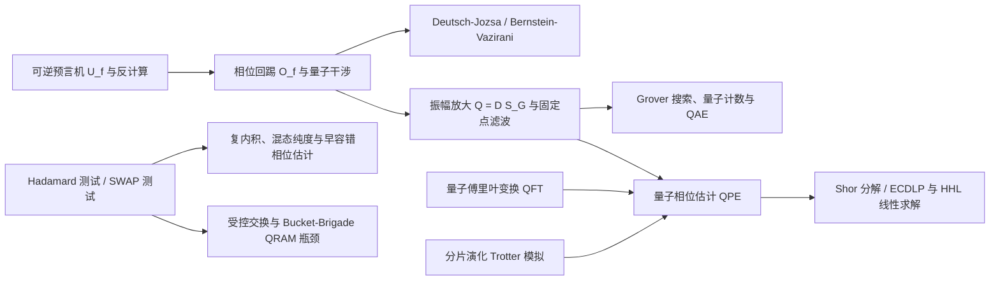
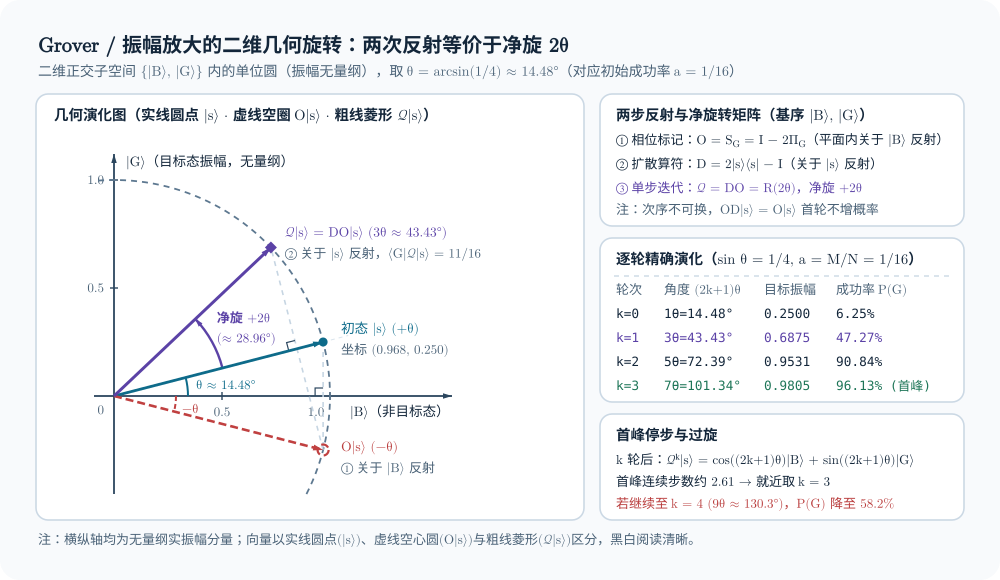
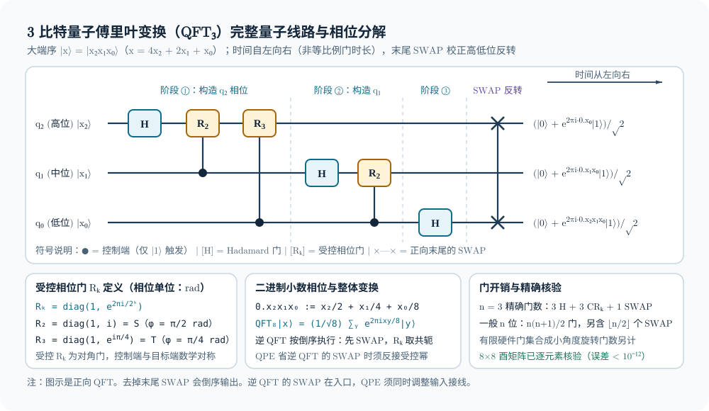

# 06｜量子算法的共同骨架

读完前五章，你已经掌握了单比特几何、多比特纠缠、量子门线路，以及噪声与测量的数学语言。走进算法世界前，先看清一件事：**量子算法并不是一串互不相干的灵光一闪，而是用寥寥几块通用积木反复搭出来的。**

不管是搜索无结构空间、分解大整数、解线性方程组，还是模拟分子演化与比对未知量子态，掀开外衣，里面反复出现的总是同一套骨架：把经典问题封装进可逆预言机、借相位回踢把答案刻进相对相位、用干涉与固定点滤波放大正确振幅、在傅里叶基里读出周期与相位、用分片乘积逼近连续演化、用单辅助位或破坏式干涉读出复内积与态重叠，以及直面相干数据装载的 QRAM 瓶颈。本章把这些积木一块一块拆开，每块都先用两到四个比特亲手算一遍，再写出一般公式、门级实现、适用边界和容易踩的坑，为[第 07 章](07-algorithms.md)的代表性算法铺平道路。

全章沿用本书统一约定：多比特基序采用**高位在左（大端序）**，电路图从左到右表示时间，矩阵乘法从右到左作用在态矢量上；内积采用左反线性共轭 $\langle u|v\rangle = \sum_j u_j^* v_j$；二进制对数写 $\log_2$，自然对数写 $\ln$；Grover 目标个数专记 $M$，振幅放大迭代算符专记花体 $\mathcal{Q}$，相位估计网格总数全书统一记作正体 **$Q = 2^t$**，估计数值精度记作 $\epsilon$，失败概率记作 $\delta$。

### 读懂任何量子算法前，先在纸上写清六件事

翻开一篇算法论文或一节教材时，先别急着一头扎进长公式，拿张草稿纸把下面六个问题填出来，思路立刻清楚一大半：

1. **输入是什么**：是经典整数、一串参数，还是已经制备好的量子态？
2. **输入承诺（promise）是什么**：题目是否事先保证输入只来自某一类特殊函数或矩阵？（承诺是前提，不是算法自己检验出的结论；前提不成立，正确性保证通常会失效。）
3. **允许怎样访问问题**：能调用哪种黑盒预言机（oracle），还是已知具体的门分解电路？能免费做受控版本和逆版本吗？
4. **要输出什么**：是一个经典比特串、一个标量期望值，还是一个无法直接打印全部分量的量子态？
5. **容许什么误差**：要求零错误精确输出，还是允许失败概率 $\delta$ 或数值误差 $\epsilon$？
6. **成本究竟在数什么**：是黑盒查询次数、分解后的基本门数与深度，还是从输入装载到最终验算的全部开销？

尤其是第六点，很多关于“量子加速”的争论，根源都出在把三套不同的成本账本混在一起念：

| 成本口径 | 实际在数什么 | 最容易被藏起来的开销 |
|---|---|---|
| **查询复杂度** | 调用黑盒预言机多少次 | 黑盒内部到底要多少基本门与辅助比特 |
| **门复杂度与电路深度** | 分解成基本门后的总门数与最长串行层数 | 芯片连接限制导致的路由交换、多控门分解、受控高次幂、反计算清理 |
| **端到端总成本** | 从经典数据装载、态制备到测量验算的全部耗时 | QRAM/QROM 数据装载、重复采样统计、容错纠错与经典后处理 |

举一个具体的数字感受一下。在 $N = 2^{20} = 1{,}048{,}576$ 个候选项中找唯一目标，Grover 搜索只需要大约 $\frac{\pi}{4}\sqrt{N} \approx 804$ 次预言机查询。听起来好像“八百步就搞定了”，但如果每次核对“这一项是不是目标”都要把一条复杂记录送进上万个量子门的可逆检查电路，单是预言机内部就已经是千万级门数，远不是“约八百个基本门”。此外，量子查询模型里的预言机必须能对**任意叠加态**相干、可逆地工作；现实中一个只能收经典请求、返回经典答案的远程数据库接口，并不自动等价于量子预言机。

下面这张拼装地图概括了本章核心原语之间的依赖脉络，以及它们如何通往下一章的代表性算法：

---

## 1. 可逆预言机、相位回踢与反计算

### 1.1 为什么经典函数不能直接做成酉门

经典编程里，我们写一个布尔函数 $f:\{0,1\}^n \to \{0,1\}$ 随心所欲，根本不管能不能反推出输入。但在封闭量子系统里，任何理想门都必须是**酉矩阵**（$U^\dagger U = I$），它会严格保持两个向量之间的内积，尤其是把正交态映为正交态。

拿最简单的常值函数 $f(0) = f(1) = 1$ 来试一下。如果天真地规定门的作用是 $|x\rangle \mapsto |f(x)\rangle$，那么原本正交的 $|0\rangle$ 和 $|1\rangle$ 都会被拍扁到同一个态 $|1\rangle$：输入内积 $\langle 0|1\rangle = 0$，输出内积 $\langle 1|1\rangle = 1$，内积被破坏，映射不可逆，这样的酉门在物理上根本不存在。

解决办法其实很朴素：**别丢掉输入 $x$，另外准备一个目标寄存器 $|y\rangle$，把 $f(x)$ 异或（模 2 加）到 $y$ 上。** 这就得到了标准的**比特预言机**（bit oracle）$U_f$（维度为 $2^{n+1} \times 2^{n+1}$）：

$$
U_f |x\rangle |y\rangle = |x\rangle |y \oplus f(x)\rangle, \qquad x \in \{0,1\}^n,\; y \in \{0,1\}.
$$

其中 $\oplus$ 表示模 2 加法（异或）：两位相同得 $0$，不同得 $1$。把所有四种组合列成表：

| $y$ | $f(x)$ | $y \oplus f(x)$ | 再异或一次 $f(x)$ |
|---:|---:|---:|---:|
| $0$ | $0$ | $0$ | $0$ |
| $0$ | $1$ | $1$ | $0$ |
| $1$ | $0$ | $1$ | $1$ |
| $1$ | $1$ | $0$ | $1$ |

表中最后一列立刻说明了两件事：第一，只要输入 $(x, y)$ 不同，输出 $(x, y \oplus f(x))$ 一定不同，所以 $U_f$ 只是对 $2^{n+1}$ 个计算基态做了一一重排（置换矩阵），必然是酉矩阵；第二，对同一个状态连续施加两次 $U_f$，目标位会经历 $y \oplus f(x) \oplus f(x) = y$，原样复原，因此 $U_f^2 = I$，即 $U_f^{-1} = U_f^\dagger = U_f$（自逆）。

拿 $n=1$ 的恒等函数 $f(0)=0,\, f(1)=1$ 逐态核对一次。四维计算基按大端序排为 $|00\rangle, |01\rangle, |10\rangle, |11\rangle$：

$$
\begin{aligned}
U_f|0,0\rangle &= |0,\, 0\oplus 0\rangle = |0,0\rangle, &
U_f|0,1\rangle &= |0,\, 1\oplus 0\rangle = |0,1\rangle, \\
U_f|1,0\rangle &= |1,\, 0\oplus 1\rangle = |1,1\rangle, &
U_f|1,1\rangle &= |1,\, 1\oplus 1\rangle = |1,0\rangle.
\end{aligned}
$$

前两项原地不动，后两项互相交换——你一眼就能认出，这正是[第 04 章](04-circuits-protocols.md)的 $\mathrm{CNOT}$ 门！它保持所有基态正交，连做两次回到原态，是一个完完全全合法的四维酉门。

### 1.2 相位回踢：把比特预言机免费变成相位预言机

比特预言机虽然合法，但在算法里往往把函数值留在目标位上，容易和输入寄存器纠缠在一起。能不能不改输入基态本身，而是只把 $f(x) \in \{0,1\}$ 写成输入分支前的正负号 $(-1)^{f(x)}$ 呢？

这样的 $2^n \times 2^n$ 对角酉算符叫做**相位预言机**（phase oracle）$O_f$：

$$
O_f |x\rangle = (-1)^{f(x)} |x\rangle.
$$

早在[第 04 章](04-circuits-protocols.md)我们已经见过**相位回踢**（phase kickback）的诀窍（Cleve–Ekert–Macchiavello–Mosca, 1998）：只要把 $U_f$ 的目标位预先准备在 Pauli $X$ 门的 $-1$ 本征态

$$
|-\rangle = \frac{|0\rangle - |1\rangle}{\sqrt{2}}
$$

上，然后对任意计算基态 $|x\rangle$ 调用一次 $U_f$，利用线性逐步展开：

$$
\begin{aligned}
U_f |x\rangle |-\rangle
&= U_f |x\rangle \left(\frac{|0\rangle - |1\rangle}{\sqrt{2}}\right) \\
&= \frac{U_f|x,0\rangle - U_f|x,1\rangle}{\sqrt{2}} \\
&= \frac{|x, f(x)\rangle - |x, 1 \oplus f(x)\rangle}{\sqrt{2}}.
\end{aligned}
$$

现在分两种情况看括号里的第二寄存器：

- 若 $f(x) = 0$，它等于 $\frac{|0\rangle - |1\rangle}{\sqrt{2}} = (+1)|-\rangle$；
- 若 $f(x) = 1$，它等于 $\frac{|1\rangle - |0\rangle}{\sqrt{2}} = (-1)|-\rangle$。

两种情形恰好统一写成因子 $(-1)^{f(x)}$：

$$
U_f |x\rangle |-\rangle = (-1)^{f(x)} |x\rangle |-\rangle = \bigl(O_f|x\rangle\bigr) \otimes |-\rangle.
$$

对单个基态 $|x\rangle$，$(-1)^{f(x)}$ 只是无法观测的全局相位；可一旦输入寄存器处于叠加态 $\sum_x \alpha_x |x\rangle$，由线性立刻得到

$$
U_f \left(\sum_x \alpha_x |x\rangle\right)|-\rangle
= \left(\sum_x (-1)^{f(x)} \alpha_x |x\rangle\right) \otimes |-\rangle.
$$

目标位自始至终保持 $|-\rangle$，与输入寄存器完全解耦；函数值 $f(x)$ 全部变成各输入分支之间的**相对相位**！这不是什么“信息从目标位倒流回控制位”，而是因为 $y \mapsto y \oplus 1$ 就是 $X$ 门，$|-\rangle$ 恰是 $X$ 的 $-1$ 本征态，受控操作的本征值自然落到了控制分支的系数上。如果把目标位错准备成 $|+\rangle = (|0\rangle + |1\rangle)/\sqrt{2}$，因为 $X|+\rangle = (+1)|+\rangle$，无论 $f(x)$ 是 $0$ 还是 $1$ 因子全是 $+1$，输入寄存器上就什么相位都不会留下。

用两道具体手算把感觉坐实：

**算例 1（单输入位，对比量子相干与经典混合）**。仍取 $f(0)=0,\, f(1)=1$，输入 $|+\rangle_x |-\rangle_y = \frac{|0\rangle + |1\rangle}{\sqrt{2}}|-\rangle_y$。经过 $U_f$ 后，$|0\rangle$ 分支乘 $(-1)^0 = +1$，$|1\rangle$ 分支乘 $(-1)^1 = -1$，输出为

$$
\frac{|0\rangle - |1\rangle}{\sqrt{2}}|-\rangle_y = |-\rangle_x |-\rangle_y.
$$

此时对输入位施加一个 $H$ 门，由 $H|-\rangle = |1\rangle$，测量确定以概率 $1$ 得到 $1$（而原本未加负号的 $|+\rangle$ 经 $H$ 会确定得 $0$）。现在假设有人在调用 $U_f$ 之前先在计算基偷测了输入位，再按测得的经典值调用 $f$：偷测后输入位变成等权经典混合 $\rho_x = \frac{1}{2}|0\rangle\langle 0| + \frac{1}{2}|1\rangle\langle 1| = \frac{I}{2}$。分别给 $|0\rangle$ 和 $|1\rangle$ 乘全局相位 $+1$ 和 $-1$，密度矩阵仍是 $\frac{1}{2}|0\rangle\langle 0| + \frac{1}{2}(-|1\rangle)(-\langle 1|) = \frac{I}{2}$，再做 $H$ 后还是 $\frac{I}{2}$，测得 $0$ 和 $1$ 的概率各占 $1/2$，完全分不出函数信息。可见**相干叠加是相位回踢生效的必要条件**。

**算例 2（双输入位，三比特线路）**。取 $f(x_1 x_2) = x_1 \oplus x_2$，输入寄存器为两位均匀叠加 $H^{\otimes 2}|00\rangle = \frac{1}{2}(|00\rangle + |01\rangle + |10\rangle + |11\rangle)$，目标位为 $|-\rangle_y$（整条线路共 **3 个量子比特**）。逐项代入 $f(00)=0,\, f(01)=1,\, f(10)=1,\, f(11)=0$：

$$
\begin{aligned}
U_f \bigl(|+\rangle_{x_1}|+\rangle_{x_2}|-\rangle_y\bigr)
&= \frac{1}{2}\bigl(|00\rangle - |01\rangle - |10\rangle + |11\rangle\bigr)|-\rangle_y \\
&= \left(\frac{|0\rangle - |1\rangle}{\sqrt{2}}\right)_{x_1} \otimes \left(\frac{|0\rangle - |1\rangle}{\sqrt{2}}\right)_{x_2} \otimes |-\rangle_y \\
&= |-\rangle_{x_1} |-\rangle_{x_2} |-\rangle_y.
\end{aligned}
$$

展开右边第一、二个因子的乘积核对一下：$(|0\rangle-|1\rangle)(|0\rangle-|1\rangle)/2 = (|00\rangle - |01\rangle - |10\rangle + |11\rangle)/2$，分毫不差！

**双向转换的成本不对称**。上面证明了：只要手头有比特预言机 $U_f$，配一个 $|-\rangle$ 目标位就能**一次免费实现**相位预言机 $O_f$。那反过来呢？如果黑盒只给了一个相位预言机 $O_f$，不能默认免费得到 $U_f$！想把 $O_f$ 转回 $U_f$，需要分两步走：首先构造**受控相位预言机** $\text{c-}O_f$——若黑盒本身不提供受控接口，但事先知道任一满足 $f(x_0) = 0$ 的参考输入点 $x_0$，可借助一组受控交换门（$\text{c-SWAP}$）在控制位为 $0$ 时把工作寄存器 $|x\rangle$ 与固定辅助态 $|x_0\rangle$ 对调、调用一次 $O_f$ 后再换回，从而仅由 $O_f$ 造出 $\text{c-}O_f$（若已知 $f(x_0) = 1$ 同样可行，只需在控制位补加 $XZX$ 抵消控制位为 $0$ 分支上的 $-1$ 相位）；随后把目标位 $y$ 充当控制端，并在目标位两侧夹上 Hadamard 门，立得

$$
(I \otimes H)\,(\text{c-}O_f)\,(I \otimes H)\,|x\rangle|y\rangle = |x\rangle|y \oplus f(x)\rangle = U_f|x\rangle|y\rangle.
$$

评判算法访问模型时，千万别把“手头只有 $O_f$”和“手头已有 $\text{c-}O_f$ 或 $U_f$”混为一谈。

### 1.3 Bennett 反计算与垃圾位纠缠

真实的布尔函数 $f(x)$ 很少像 $x_1 \oplus x_2$ 那样一步就算完。把经典多步逻辑用 Toffoli 等可逆门翻译进量子电路时（参见[第 04 章](04-circuits-protocols.md)），几乎不可避免地要借用一堆存放中间草稿的工作比特（workspace / ancilla）$|0^m\rangle_w$。正向算完一遍后，得到的是

$$
C_f |x\rangle |0\rangle_y |0^m\rangle_w = |x\rangle |f(x)\rangle_y |g(x)\rangle_w,
$$

其中 $|g(x)\rangle_w$ 是依赖输入 $x$ 的中间草稿，通常叫做**垃圾位**（garbage）。如果输入寄存器处在叠加态 $\sum_x \alpha_x |x\rangle$，直接把工作位扔在一边不管，不同分支就会和不同的 $|g(x)\rangle_w$ 纠缠在一起，后续干涉将被彻底搅乱。

Charles Bennett（1973）给出了经典与量子可逆计算的标准解法——**反计算**（uncomputation），一共三步：

1. **正向计算**：施加 $C_f$，把函数值算进临时输出位，工作位留下 $|g(x)\rangle_w$；
2. **提取结果**：把计算基上的结果异或到真正的目标寄存器 $|y\rangle$（或施加相位门把 $f(x)$ 写进相位）；注意这里复制的是计算基上的经典比特值，并不违背不可克隆定理；
3. **逆向清理**：施加逆电路 $C_f^\dagger$（把 $C_f$ 的每个门按反序取共轭转置倒跑一遍），将所有中间工作位精确退回 $|0^m\rangle_w$，和主寄存器彻底解耦。

反计算的直接代价是：**基础预言机的门数与深度至少翻倍**。这就是为什么查询复杂度只记“1 次调用”，而门复杂度账本里必须把反计算单独算清。

先用一位输入 $x$、一位工作位 $w$、$f(x)=x$ 看看有无反计算的巨大差别。从 $|+\rangle_x |0\rangle_w$ 出发，正向做一次 $\mathrm{CNOT}(x \to w)$ 得到 Bell 态

$$
\frac{|0\rangle_x |0\rangle_w + |1\rangle_x |1\rangle_w}{\sqrt{2}}.
$$

- **如果不清理直接丢弃 $w$**：对工作位求偏迹，$x$ 的约化密度矩阵变成 $\rho_x = \frac{1}{2}|0\rangle\langle 0| + \frac{1}{2}|1\rangle\langle 1| = \frac{I}{2}$，非对角相干项全军覆没。再对 $x$ 做 $H$ 门测量，得 $0$ 和 $1$ 各占 $1/2$，干涉完全消失。
- **如果做完相位再反计算**：目标只是给 $|1\rangle_x$ 分支加负号，于是先在工作位 $w$ 上施加 $Z_w$，把态变成 $\frac{|00\rangle - |11\rangle}{\sqrt{2}}$；随后再做一次 $\mathrm{CNOT}(x \to w)$ 倒回去，将 $|11\rangle$ 还原成 $|10\rangle$，得到

$$
\frac{|0\rangle_x |0\rangle_w - |1\rangle_x |0\rangle_w}{\sqrt{2}} = |-\rangle_x \otimes |0\rangle_w.
$$

此时工作位干净地回到 $|0\rangle_w$，对 $x$ 施加 $H$ 门，必以概率 $1$ 测得 $1$。

### 1.4 垃圾位只泄漏部分信息时，干涉会掉多少？为什么“复位”不是“反计算”

上面是两个极端：工作位完全相同（无纠缠）或完全正交（全纠缠）。更一般地，设输入位和工作寄存器在联合纯态中为

$$
|\Psi\rangle = \frac{|0\rangle_x |g_0\rangle_w + |1\rangle_x |g_1\rangle_w}{\sqrt{2}}, \qquad \langle g_0|g_0\rangle = \langle g_1|g_1\rangle = 1,
$$

其中 $|g_0\rangle_w, |g_1\rangle_w$ 可以是任意归一化的多比特辅助态或环境态。按[第 05 章](05-noise-channels.md)的偏迹公式展开外积 $|\Psi\rangle\langle\Psi|$ 并对 $w$ 求迹，利用 $\operatorname{Tr}_w(|g_a\rangle\langle g_b|) = \langle g_b|g_a\rangle$：

$$
\begin{aligned}
\rho_x
&= \operatorname{Tr}_w(|\Psi\rangle\langle\Psi|) \\
&= \frac{1}{2}\Bigl(
|0\rangle\langle 0|\,\langle g_0|g_0\rangle
+ |0\rangle\langle 1|\,\langle g_1|g_0\rangle
+ |1\rangle\langle 0|\,\langle g_0|g_1\rangle
+ |1\rangle\langle 1|\,\langle g_1|g_1\rangle
\Bigr) \\
&= \frac{1}{2}\begin{bmatrix} 1 & c \\ c^* & 1 \end{bmatrix}, \qquad c := \langle g_1|g_0\rangle.
\end{aligned}
$$

决定相干性还剩多少的，不是“垃圾寄存器占了几个比特”，而是两条分支的垃圾态内积 $c = \langle g_1|g_0\rangle$！接着对输入位做 $H$ 门并在计算基测得 $0$，等价于在 $|+\rangle = \frac{1}{\sqrt{2}}[1,1]^T$ 方向做投影，其概率按矩阵乘法一步步展开为

$$
\begin{aligned}
p_0 = \langle +|\rho_x|+\rangle
&= \frac{1}{2}\begin{bmatrix} 1 & 1 \end{bmatrix}
\left(\frac{1}{2}\begin{bmatrix} 1 & c \\ c^* & 1 \end{bmatrix}\right)
\begin{bmatrix} 1 \\ 1 \end{bmatrix} \\
&= \frac{1}{4}\begin{bmatrix} 1 & 1 \end{bmatrix}\begin{bmatrix} 1+c \\ c^*+1 \end{bmatrix}
= \frac{2 + c + c^*}{4} = \frac{1 + \operatorname{Re} c}{2}.
\end{aligned}
$$

检验三个关键边界：$c = 1$（垃圾态完全相同，无泄漏）给出 $p_0 = 1$；$c = 0$（垃圾态正交，分支完全被记下）给出 $p_0 = 1/2$；而当 $c = i$ 时，$p_0 = (1 + 0)/2 = 1/2$，但 $|c| = 1$ 说明 $\rho_x$ 其实是纯态（相位只是转了 $\pi/2$），可见单凭 $X$ 基测出 $1/2$ 不能贸然断定系统已完全失相干。

下面用一道具体算例戳破初学者最常见的错觉——**“把工作比特直接 reset（复位）成 $|0\rangle$，不就等于清垃圾了吗？”**

**反例手算（部分重叠垃圾态，证伪“复位 = 反计算”）**。取 $|g_0\rangle = |0\rangle$，$|g_1\rangle = \frac{3}{5}|0\rangle + \frac{4}{5}|1\rangle$（检查归一化：$(3/5)^2 + (4/5)^2 = \frac{9+16}{25} = 1$）。

1. **算内积与密度矩阵**：按左反线性内积

   $$
   c = \langle g_1|g_0\rangle = \frac{3}{5}\cdot 1 + \frac{4}{5}\cdot 0 = \frac{3}{5}, \qquad
   \rho_x = \frac{1}{2}\begin{bmatrix} 1 & 3/5 \\ 3/5 & 1 \end{bmatrix}
   = \begin{bmatrix} 1/2 & 3/10 \\ 3/10 & 1/2 \end{bmatrix}.
   $$

   核对 $\operatorname{Tr}(\rho_x) = 1/2 + 1/2 = 1$。
2. **算纯度 $\operatorname{Tr}(\rho_x^2)$**：先把 $\rho_x$ 平方：

   $$
   \rho_x^2 = \begin{bmatrix} 1/2 & 3/10 \\ 3/10 & 1/2 \end{bmatrix}
   \begin{bmatrix} 1/2 & 3/10 \\ 3/10 & 1/2 \end{bmatrix}
   = \begin{bmatrix} 1/4 + 9/100 & 3/20 + 3/20 \\ 3/20 + 3/20 & 9/100 + 1/4 \end{bmatrix}
   = \begin{bmatrix} 34/100 & 3/10 \\ 3/10 & 34/100 \end{bmatrix}.
   $$

   取迹得 $\operatorname{Tr}(\rho_x^2) = \frac{68}{100} = \frac{17}{25} = 0.68 < 1$，确为混态。
3. **算干涉概率**：$p_0 = \frac{1 + 3/5}{2} = \frac{4}{5} = 0.80$（低于理想纯干涉的 $1$）。
4. **若不做反计算，而是对 $w$ 执行无条件局域复位（reset 到 $|0\rangle$）**：按[第 05 章](05-noise-channels.md)的局域信道性质，复位信道 $\mathcal{R}_w(\sigma) = \operatorname{Tr}(\sigma)|0\rangle\langle 0|$ 只作用在 $w$ 上，对联合态 $\rho_{xw} = |\Psi\rangle\langle\Psi|$ 施加 $\mathcal{I}_x \otimes \mathcal{R}_w$ 得到

   $$
   (\mathcal{I}_x \otimes \mathcal{R}_w)(|\Psi\rangle\langle\Psi|) = \operatorname{Tr}_w(|\Psi\rangle\langle\Psi|) \otimes |0\rangle\langle 0| = \rho_x \otimes |0\rangle\langle 0|.
   $$

   工作位表面上确实回到了干干净净的 $|0\rangle$，可输入位的边缘态**纹丝未动**，仍是 $\rho_x$，测量概率依然卡在 $p_0 = 4/5$！物理原因非常直白：硬件复位并没有把信息相干地退回输入位，而是把垃圾态里的分支信息倾倒进了外部环境。真正能把 $p_0$ 救回 $1$ 的，只有知道正向过程后施加的酉逆电路 $C_f^\dagger$。

---

## 2. Deutsch–Jozsa：量子干涉的最小完整示范

手里有了相位预言机，我们来搭第一台完整的小机器：**Deutsch–Jozsa 算法**（Deutsch & Jozsa, 1992；Cleve et al., 1998 简化版）。

### 2.1 问题、承诺与一步不跳的推导

- **输入与访问**：黑盒比特预言机 $U_f$，实现布尔函数 $f:\{0,1\}^n \to \{0,1\}$。
- **承诺**：$f$ 要么是**恒定函数**（对全部 $2^n$ 个输入都返回同一个值，$0$ 或 $1$），要么是**平衡函数**（恰有一半即 $2^{n-1}$ 个输入返回 $0$，另一半返回 $1$）。其他函数被排除在外。
- **任务**：判断 $f$ 属于哪一类。

先把一个在整个算法篇都会反复用到的恒等式推一遍：$n$ 个并行的 Hadamard 门 $H^{\otimes n}$ 作用在任意计算基态 $|x\rangle = |x_1 x_2 \cdots x_n\rangle$ 上是什么？

单比特上，$H|0\rangle = \frac{|0\rangle + |1\rangle}{\sqrt{2}}$、$H|1\rangle = \frac{|0\rangle - |1\rangle}{\sqrt{2}}$，统一写作

$$
H|x_j\rangle = \frac{1}{\sqrt{2}}\sum_{y_j \in \{0,1\}} (-1)^{x_j y_j} |y_j\rangle.
$$

把 $n$ 个比特的张量积乘开，每一位挑一个 $y_j \in \{0,1\}$，对应的符号相乘起来就是 $(-1)^{x_1 y_1} \cdots (-1)^{x_n y_n} = (-1)^{x \cdot y}$，其中 $x \cdot y := x_1 y_1 + \cdots + x_n y_n \pmod 2$ 是**模 2 点积**：

$$
H^{\otimes n}|x\rangle = \frac{1}{\sqrt{2^n}} \sum_{y \in \{0,1\}^n} (-1)^{x \cdot y} |y\rangle.
$$

例如取 $x = 10,\, y = 11$，则 $x \cdot y = 1\cdot 1 + 0\cdot 1 = 1$，所以 $|11\rangle$ 前面的符号是 $(-1)^1 = -1$。

现在按四步走完 Deutsch–Jozsa 线路（共 $n+1$ 个比特，初态 $|0^n\rangle |1\rangle$）：

1. **全员施加 Hadamard 门** $H^{\otimes n} \otimes H$：前 $n$ 位成为全部 $2^n$ 个输入的等幅叠加，目标位 $|1\rangle$ 成为 $|-\rangle$：

   $$
   |\psi_1\rangle = \frac{1}{\sqrt{2^n}} \sum_{x \in \{0,1\}^n} |x\rangle |-\rangle.
   $$

2. **调用一次预言机 $U_f$**：由相位回踢，每个 $|x\rangle$ 分支带上 $(-1)^{f(x)}$，目标位保持分离：

   $$
   |\psi_2\rangle = \frac{1}{\sqrt{2^n}} \sum_{x \in \{0,1\}^n} (-1)^{f(x)} |x\rangle |-\rangle.
   $$

3. **对输入寄存器再施加 $H^{\otimes n}$**：把上面的 $H^{\otimes n}|x\rangle$ 恒等式逐项代进去并交换求和次序：

   $$
   \begin{aligned}
   |\psi_3\rangle
   &= \frac{1}{\sqrt{2^n}} \sum_{x \in \{0,1\}^n} (-1)^{f(x)} \left(\frac{1}{\sqrt{2^n}} \sum_{y \in \{0,1\}^n} (-1)^{x \cdot y} |y\rangle\right) |-\rangle \\
   &= \sum_{y \in \{0,1\}^n} \underbrace{\left(\frac{1}{2^n} \sum_{x \in \{0,1\}^n} (-1)^{f(x) + x \cdot y}\right)}_{A(y)} |y\rangle |-\rangle.
   \end{aligned}
   $$

4. **在计算基测量前 $n$ 个比特**：紧盯全零串 $y = 0^n$ 的振幅 $A(0^n)$。因为 $x \cdot 0^n = 0$，它化简为

   $$
   A(0^n) = \frac{1}{2^n} \sum_{x \in \{0,1\}^n} (-1)^{f(x)}.
   $$

按 Born 规则，测得全零串 $0^n$ 的概率是振幅模平方 $|A(0^n)|^2$：

- **若 $f$ 恒定**：所有 $2^n$ 项要么全是 $+1$，要么全是 $-1$，所以 $A(0^n) = \pm 1$，概率 $P(0^n) = |\pm 1|^2 = 1$——**必定测得 $0^n$**；
- **若 $f$ 平衡**：恰好一半项是 $+1$、一半项是 $-1$，正负精准抵消，$A(0^n) = 0$，概率 $P(0^n) = |0|^2 = 0$——**绝不会测得 $0^n$**。

于是，只要在计算基测一次输入寄存器：看到 `00...0` 就判“恒定”，看到任何非零串就判“平衡”，**只用 1 次量子查询便零错误完成任务**。请注意，量子计算机并没有“一次算出并读出了全部 $2^n$ 个函数值”；它只是巧妙地让全部 $2^n$ 条分支在 $0^n$ 这一格发生相长或相消干涉，把一个全局性质压进了单次测量。

### 2.2 $n = 2$ 手算验证

取平衡函数 $f(x_1 x_2) = x_1$（$f(00)=f(01)=0$，$f(10)=f(11)=1$）。调用 $U_f$ 后，第一寄存器的态是

$$
\frac{1}{2}\bigl(|00\rangle + |01\rangle - |10\rangle - |11\rangle\bigr)
= \left(\frac{|0\rangle - |1\rangle}{\sqrt{2}}\right) \otimes \left(\frac{|0\rangle + |1\rangle}{\sqrt{2}}\right)
= |-\rangle |+\rangle.
$$

末层施加 $H \otimes H$，利用 $H|-\rangle = |1\rangle$、$H|+\rangle = |0\rangle$，直接得到确定态 $|10\rangle$！它不是 $|00\rangle$，算法准确判为平衡。顺带留意：平衡函数并不要求全都输出同一个非零串，换一个平衡函数可能输出 $|01\rangle$、$|11\rangle$ 或是多个非零串的叠加，只要 $|00\rangle$ 的振幅被压成 $0$ 就大功告成。

### 2.3 准确评估 Deutsch–Jozsa 的优势边界

Deutsch–Jozsa 的历史价值在于首次以最清晰的线路展示了量子干涉，但评价它的“加速”必须盯紧经典对比口径：

- **对照确定性、零错误经典算法**：在最坏情况下，经典算法连续查了 $2^{n-1}$ 个输入全拿到 $0$，还是不能排除平衡函数，至少需要 $2^{n-1} + 1$ 次查询才能 100% 确定。相比量子 $1$ 次查询，这是**精确确定性查询模型下的指数分离**。
- **对照允许微小失败概率 $\delta$ 的随机经典算法**：经典计算机随机抽取 $k$ 个输入查询——一旦看到两个不同输出就立刻判平衡；若 $k$ 次全相同就猜恒定。恒定函数永不判错，而平衡函数被误判的精确概率要区分两种抽样方式：
  - **有放回独立抽样 $k$ 次**：全得 $0$ 的概率为 $(1/2)^k$，全得 $1$ 的概率也为 $(1/2)^k$，误判率**精确等于** $2 \cdot 2^{-k} = 2^{1-k}$；
  - **无放回抽取 $k$ 个互异输入**：误判率为 $2\binom{2^{n-1}}{k} / \binom{2^n}{k} \le 2^{1-k}$（对 $k \ge 2$ 严格小于 $2^{1-k}$，且一旦 $k > 2^{n-1}$ 即为 $0$）。例如取 $k = 11$，两种方式下误判率都满足 $\le 1/1024 < 0.1\%$。也就是说，达到误差 $\delta$ 只需 $O(\log_2(1/\delta))$ 次查询，**与比特数 $n$ 完全无关**！

因此，不能把 Deutsch–Jozsa 笼统宣传成“相对经典计算机的指数加速”；它只给出确定性零错误查询模型里的指数分离，相对随机经典算法并无指数优势。

---

## 3. Bernstein–Vazirani：一次查询读出隐藏线性结构

Deutsch–Jozsa 只回答了一个“是或否”的 1 比特问题。有没有可能用**同样的一条线路、同样只查 1 次预言机**，直接把一整串 $n$ 比特的隐藏秘密读出来？**Bernstein–Vazirani 算法**（Bernstein & Vazirani, 1993 / 1997）把这件事做到了。

### 3.1 问题、推导与配对相消证明

- **承诺**：黑盒函数是一个隐藏的模 2 线性函数

  $$
  f_s(x) = s \cdot x \pmod 2 = s_1 x_1 \oplus s_2 x_2 \oplus \cdots \oplus s_n x_n,
  $$

  其中 $s \in \{0,1\}^n$ 是未知的 $n$ 位秘密串。
- **任务**：找出完整的 $s$。

令人愉悦的是，**电路和 Deutsch–Jozsa 一模一样**，连一个门都不用改！把 $f_s(x) = s \cdot x$ 直接代进第 2 节推好的末态振幅公式，利用模 2 加法 $s \cdot x + x \cdot y \equiv (s \oplus y) \cdot x \pmod 2$：

$$
A(y) = \frac{1}{2^n} \sum_{x \in \{0,1\}^n} (-1)^{(s \oplus y) \cdot x}.
$$

让我们一步不跳地证明这个求和在 $y = s$ 时等于 $1$，在 $y \neq s$ 时精准归零：

- **当 $y = s$**：$s \oplus y = 0^n$，对每个 $x$ 都有 $(s \oplus y) \cdot x = 0$，于是求和里的 $2^n$ 项全都是 $(-1)^0 = +1$，总和为 $2^n / 2^n = 1$。
- **当 $y \neq s$**：记 $d = s \oplus y \neq 0^n$，因此 $d$ 至少有一位 $j$ 满足 $d_j = 1$。把全部 $2^n$ 个比特串按“第 $j$ 位是 $0$ 还是 $1$”两两配对：每一对 $(x, x')$ 除了第 $j$ 位相反外其余各位完全相同，于是

  $$
  d \cdot x' = d \cdot x \oplus d_j = d \cdot x \oplus 1.
  $$

  这意味着每一对里的两项 $(-1)^{d \cdot x}$ 与 $(-1)^{d \cdot x'}$ 必定是一正一负，相加等于 $0$！全部 $2^{n-1}$ 对统统抵消，所以 $A(y) = 0$。

合起来看，末态精确坍缩成单一计算基态 $|s\rangle$，一次测量即以概率 $1$ 吐出整串 $s$！

### 3.2 三输入位（四比特线路）具体电路与手算对照

光看抽象黑盒容易浮在半空，我们亲手用基本门搭出三个 3 输入位的可逆预言机来对照检验。沿用高位在左大端序，寄存器排列为 $(x_1, x_2, x_3, y)$，共 **4 个量子比特**（$y$ 为目标位，预先制备为 $|-\rangle$）：

| 隐藏函数 $f(x_1 x_2 x_3)$ | 可逆预言机内部门分解 | 调用 $U_f$ 后输入寄存器态 | 末层 $H^{\otimes 3}$ 理想输出 |
|---|---|---|---|
| $f(x) = 0$（恒定） | 恒等门 $I$（不放任何门） | $\lvert+\rangle\lvert+\rangle\lvert+\rangle$ | `000` |
| $f(x) = x_1$（平衡 / $s=100$） | $\mathrm{CNOT}(x_1 \to y)$ | $\lvert-\rangle\lvert+\rangle\lvert+\rangle$ | `100` |
| $f(x) = x_1 \oplus x_3$（平衡 / $s=101$） | $\mathrm{CNOT}(x_1 \to y)$，接着 $\mathrm{CNOT}(x_3 \to y)$ | $\lvert-\rangle\lvert+\rangle\lvert-\rangle$ | `101` |

仔细核对最后一行 $s = 101$：第一个 $\mathrm{CNOT}(x_1 \to y)$ 借 $|-\rangle_y$ 把 $x_1$ 的相位踢出 $(-1)^{x_1}$；第二个 $\mathrm{CNOT}(x_3 \to y)$ 接着踢出 $(-1)^{x_3}$。两者相乘恰为 $(-1)^{x_1 + x_3} = (-1)^{x_1 \oplus x_3}$，输入寄存器逐位分解为

$$
\frac{1}{\sqrt{8}} \sum_{x \in \{0,1\}^3} (-1)^{x_1 + x_3} |x_1 x_2 x_3\rangle
= |-\rangle_{x_1} |+\rangle_{x_2} |-\rangle_{x_3}
= H^{\otimes 3} |101\rangle.
$$

末层再作用 $H^{\otimes 3}$，由于 $H^2 = I$，立刻得到确定态 $|101\rangle$，而目标位 $y$ 纹丝不动留在 $|-\rangle$。

回过头对照章首的三套账本，这道小例子敲响两记警钟：第一，线路明明用了 **4 个比特**，且第三行内部包含 **2 个 CNOT 门**，在查询模型里仍统称为“1 次查询”；第二，这三行电路看起来轻巧，仅仅是因为线性异或函数天生结构极简，**绝不代表任意未知布尔函数都能用这么便宜的门数实现**。

### 3.3 经典对比与历史意义

在经典查询模型里（哪怕允许随机化），每次查询只返回 1 个比特信息，想要确定未知的 $n$ 比特串 $s$，至少需要查询 $n$ 次（例如分别查 $n$ 个单位向量 $10\cdots0, \dots, 0\cdots01$）。Bernstein–Vazirani 用 1 次量子查询替代 $n$ 次经典查询，带来的是**线性查询加速**（$n$ 倍，而非指数倍）。不过，Bernstein 与 Vazirani（1993 / 1997）顺势将这个问题递归嵌套，构造出**递归傅里叶采样**（Recursive Fourier Sampling），在历史上第一次相对预言机给出了量子算法超越随机经典算法的超多项式（$n^{\log_2 n}$）分离，直接启发了随后的 Simon 与 Shor 算法。

---

## 4. 振幅放大：几何旋转、门分解与固定点改进

前面的两个例子都依赖极强的结构承诺。如果手头只有一个普通的无测量量子子程序 $A$，它从全零态出发制备出初态 $|\psi\rangle = A|0^n\rangle$，直接测量时拿到“好答案”的概率只有很小的 $a \in (0,1)$——该怎么把成功率提上去？

经典的做法最直接：独立重跑 $A$，平均要试 $1/a$ 次才能撞上一次成功（例如 $a = 1/10{,}000$，平均要跑一万遍）。而 Brassard、Høyer、Mosca 与 Tapp（2002，简称 BHMT）把 Grover 搜索推广成了通用的**量子振幅放大**（Quantum Amplitude Amplification）：只要能可逆地标记“好答案”，且允许调用 $A$ 及其逆电路 $A^\dagger$，只需要 $O(1/\sqrt{a})$ 轮迭代就能把成功概率抬到接近 $1$——一万次降到约一百次，实现普适的平方级查询加速。

### 4.1 把高维空间锁进一张二维平面

假设有一个可逆的答案检查规则 $g(x) \in \{0,1\}$：满足 $g(x)=1$ 的计算基态叫“好态”，其余叫“坏态”。把初态 $|\psi\rangle = A|0^n\rangle$ 拆成好、坏两部分的和：

$$
|\psi\rangle = A|0^n\rangle = |\psi_{\mathrm{bad}}\rangle + |\psi_{\mathrm{good}}\rangle.
$$

只要 $0 < a < 1$（好、坏两部分长度都不为零；$a=0$ 时根本没有好态，任何反射都凭空造不出它；$a=1$ 时本来就必然成功），就可以把这两部分各自除以自身模长，得到一对**正交归一**的向量：

$$
|B\rangle := \frac{|\psi_{\mathrm{bad}}\rangle}{\sqrt{1-a}}, \qquad
|G\rangle := \frac{|\psi_{\mathrm{good}}\rangle}{\sqrt{a}}, \qquad
\langle B|G\rangle = 0.
$$

于是，无论原本的希尔伯特空间是 $2^{20}$ 维还是 $2^{100}$ 维，初态都严严实实躺在这两个向量张成的**二维实平面**里。引入角度 $\theta_a \in (0, \pi/2)$ 满足 $\sin^2\theta_a = a$（即 $\sin\theta_a = \sqrt{a},\; \cos\theta_a = \sqrt{1-a}$），初态写成

$$
|\psi\rangle = A|0^n\rangle = \cos\theta_a\,|B\rangle + \sin\theta_a\,|G\rangle.
$$

在后文的标准 Grover 搜索特例里，$A = H^{\otimes n}$，初态是全部 $N$ 项的均匀叠加 $|s\rangle = H^{\otimes n}|0^n\rangle$，当中有 $M$ 个目标项，于是初始成功率 $a = M/N$、$\sin\theta = \sqrt{M/N}$。

现在看怎么在 $\{|B\rangle, |G\rangle\}$ 这张平面上，只靠**两次镜面反射**把向量一步步往好态 $|G\rangle$ 轴转动。先对照下图建立几何画面，再用矩阵逐行把每个数字算出来：

### 4.2 两次反射合成 $2\theta_a$ 旋转：零跳步矩阵推导

我们按与上图完全一致的有序正交基 $\{|B\rangle, |G\rangle\}$ 排列坐标（第一分量是坏态 $|B\rangle$ 的振幅，第二分量是好态 $|G\rangle$ 的振幅），于是初态列向量为

$$
|\psi\rangle = \begin{bmatrix} \cos\theta_a \\ \sin\theta_a \end{bmatrix}.
$$

单轮振幅放大由两个反射算符接力完成：

**第一步：好态相位标记 $S_G$（图中记作 $O$）**。对好态乘 $-1$、对坏态保持不变，定义全局算符 $S_G = I - 2\Pi_G$（$\Pi_G = \sum_{x: g(x)=1}|x\rangle\langle x|$ 为投影到好态子空间的算符；注意当好态数 $M > 1$ 时，$\Pi_G$ 是秩 $M$ 投影，只在限制到二维平面 $\operatorname{span}\{|B\rangle, |G\rangle\}$ 内才等价于 $I - 2|G\rangle\langle G|$）。在这张二维平面上，它把 $|B\rangle \mapsto |B\rangle$、$|G\rangle \mapsto -|G\rangle$，也就是关于横轴 $|B\rangle$ 做镜面反射，矩阵为

$$
S_G = \begin{bmatrix} 1 & 0 \\ 0 & -1 \end{bmatrix}.
$$

它把角度为 $+\theta_a$ 的初态 $|\psi\rangle$ 翻到了横轴下方角度为 $-\theta_a$ 的位置：$S_G|\psi\rangle = [\cos\theta_a,\; -\sin\theta_a]^T$。

**第二步：关于初态的反射 $D$（扩散算符）**。定义 $D = 2|\psi\rangle\langle\psi| - I$。先逐格算出外积矩阵 $|\psi\rangle\langle\psi|$：

$$
|\psi\rangle\langle\psi|
= \begin{bmatrix} \cos\theta_a \\ \sin\theta_a \end{bmatrix}
  \begin{bmatrix} \cos\theta_a & \sin\theta_a \end{bmatrix}
= \begin{bmatrix} \cos^2\theta_a & \sin\theta_a\cos\theta_a \\ \sin\theta_a\cos\theta_a & \sin^2\theta_a \end{bmatrix}.
$$

乘以 $2$ 再减去单位矩阵 $I$，代入二倍角公式 $2\cos^2\theta_a - 1 = \cos 2\theta_a$、$2\sin^2\theta_a - 1 = -\cos 2\theta_a$ 与 $2\sin\theta_a\cos\theta_a = \sin 2\theta_a$，得到

$$
D = 2|\psi\rangle\langle\psi| - I
= \begin{bmatrix} 2\cos^2\theta_a - 1 & 2\sin\theta_a\cos\theta_a \\ 2\sin\theta_a\cos\theta_a & 2\sin^2\theta_a - 1 \end{bmatrix}
= \begin{bmatrix} \cos 2\theta_a & \sin 2\theta_a \\ \sin 2\theta_a & -\cos 2\theta_a \end{bmatrix}.
$$

这个 $D$ 把向量沿着 $|\psi\rangle$ 方向原样保留（$D|\psi\rangle = 2|\psi\rangle\langle\psi|\psi\rangle - |\psi\rangle = |\psi\rangle$），把垂直于 $|\psi\rangle$ 的分量全部反号，正是一次关于直线 $|\psi\rangle$ 的镜面反射！因为 $S_G|\psi\rangle$ 与 $|\psi\rangle$ 夹角为 $2\theta_a$，再关于 $|\psi\rangle$ 反射一次，就会跃到 $|\psi\rangle$ 上方同样夹角 $2\theta_a$ 处，总角度来到 $\theta_a + 2\theta_a = 3\theta_a$。

**合成单轮放大算符 $\mathcal{Q} = D S_G$**（上图中好态标记记作 $O = S_G$，单轮迭代算符统一记作 $\mathcal{Q} = DO$；部分文献亦写作 $G$，本书为避免与目标态 $|G\rangle$ 重名，统一使用花体 $\mathcal{Q}$）。按行展开两矩阵相乘：

$$
\begin{aligned}
\mathcal{Q} = D S_G
&= \begin{bmatrix} \cos 2\theta_a & \sin 2\theta_a \\ \sin 2\theta_a & -\cos 2\theta_a \end{bmatrix}
   \begin{bmatrix} 1 & 0 \\ 0 & -1 \end{bmatrix} \\
&= \begin{bmatrix}
\cos 2\theta_a \cdot 1 + \sin 2\theta_a \cdot 0 & \cos 2\theta_a \cdot 0 + \sin 2\theta_a \cdot (-1) \\
\sin 2\theta_a \cdot 1 + (-\cos 2\theta_a) \cdot 0 & \sin 2\theta_a \cdot 0 + (-\cos 2\theta_a) \cdot (-1)
\end{bmatrix} \\
&= \begin{bmatrix} \cos 2\theta_a & -\sin 2\theta_a \\ \sin 2\theta_a & \cos 2\theta_a \end{bmatrix}
= R(2\theta_a).
\end{aligned}
$$

这是一个极其干净的二维逆时针旋转矩阵，旋转角恰好是 $2\theta_a$！检查一下：$\mathcal{Q}$ 作用在任意角度 $\alpha$ 的单位向量 $[\cos\alpha, \sin\alpha]^T$ 上，利用和角公式给出

$$
\begin{bmatrix} \cos 2\theta_a & -\sin 2\theta_a \\ \sin 2\theta_a & \cos 2\theta_a \end{bmatrix}
\begin{bmatrix} \cos\alpha \\ \sin\alpha \end{bmatrix}
= \begin{bmatrix} \cos 2\theta_a\cos\alpha - \sin 2\theta_a\sin\alpha \\ \sin 2\theta_a\cos\alpha + \cos 2\theta_a\sin\alpha \end{bmatrix}
= \begin{bmatrix} \cos(\alpha + 2\theta_a) \\ \sin(\alpha + 2\theta_a) \end{bmatrix}.
$$

从初态角度 $\alpha = \theta_a$ 出发，连续迭代 $k$ 次，状态始终留在二维平面内，且严格等于

$$
\mathcal{Q}^k A|0^n\rangle = \cos\bigl((2k+1)\theta_a\bigr)\,|B\rangle + \sin\bigl((2k+1)\theta_a\bigr)\,|G\rangle.
$$

此时测量得到好态的概率为 $P_k = \sin^2\bigl((2k+1)\theta_a\bigr)$，坏态概率为 $\cos^2\bigl((2k+1)\theta_a\bigr)$，两者之和恒为 $1$。

> **跨文献符号对照**：BHMT（2002）原文把关于全零态的反射定义为 $\widetilde{S}_0 = I - 2|0^n\rangle\langle 0^n|$（正好与我们的 $S_0 = 2|0^n\rangle\langle 0^n| - I$ 差一个负号），因此他们把迭代算符写成 $\mathcal{Q} = -A \widetilde{S}_0 A^{-1} S_G$。因为 $-A\widetilde{S}_0 A^{-1} = A(2|0^n\rangle\langle 0^n|-I)A^\dagger = 2|\psi\rangle\langle\psi| - I = D$，两者其实是**同一个矩阵**，连符号都分毫不差。

### 4.3 $\mathcal{Q}$ 的特征值与特征向量（通往量子计数与量子幅度估计）

顺手把旋转矩阵 $\mathcal{Q} = R(2\theta_a)$ 对角化，这在本章第 6.6 节的量子计数以及[第 07 章第 4 节](07-algorithms.md#4-量子幅度估计qae超越蒙特卡洛的平方精度与无-qft-方案)的量子幅度估计（QAE，亦称量子振幅估计）里都会派上大用场。定义一对归一化复向量：

$$
|\Psi_+\rangle = \frac{|B\rangle - i|G\rangle}{\sqrt{2}} = \frac{1}{\sqrt{2}}\begin{bmatrix} 1 \\ -i \end{bmatrix}, \qquad
|\Psi_-\rangle = \frac{|B\rangle + i|G\rangle}{\sqrt{2}} = \frac{1}{\sqrt{2}}\begin{bmatrix} 1 \\ i \end{bmatrix}.
$$

先验正交性：$\langle \Psi_+|\Psi_-\rangle = \frac{1}{2}(1\cdot 1 + (+i)\cdot i) = \frac{1-1}{2} = 0$。再直接把 $\mathcal{Q}$ 乘到 $|\Psi_+\rangle$ 上，展开每一行并套欧拉公式 $e^{2i\theta_a} = \cos 2\theta_a + i\sin 2\theta_a$：

$$
\begin{aligned}
\mathcal{Q}|\Psi_+\rangle
&= \frac{1}{\sqrt{2}}
   \begin{bmatrix} \cos 2\theta_a & -\sin 2\theta_a \\ \sin 2\theta_a & \cos 2\theta_a \end{bmatrix}
   \begin{bmatrix} 1 \\ -i \end{bmatrix} \\
&= \frac{1}{\sqrt{2}}
   \begin{bmatrix} \cos 2\theta_a + i\sin 2\theta_a \\ \sin 2\theta_a - i\cos 2\theta_a \end{bmatrix}
= \frac{1}{\sqrt{2}}
   \begin{bmatrix} e^{2i\theta_a} \\ -i(\cos 2\theta_a + i\sin 2\theta_a) \end{bmatrix}
= e^{+2i\theta_a} |\Psi_+\rangle.
\end{aligned}
$$

同理把 $-i$ 换成 $+i$，立得 $\mathcal{Q}|\Psi_-\rangle = e^{-2i\theta_a}|\Psi_-\rangle$。也就是说，$\mathcal{Q}$ 在该二维子空间上的两个特征值恰好是 **$e^{\pm 2i\theta_a}$**！把初态写成这两个特征向量的叠加：

$$
\begin{aligned}
\frac{e^{i\theta_a}|\Psi_+\rangle + e^{-i\theta_a}|\Psi_-\rangle}{\sqrt{2}}
&= \frac{e^{i\theta_a} + e^{-i\theta_a}}{2}|B\rangle
   + \frac{-i e^{i\theta_a} + i e^{-i\theta_a}}{2}|G\rangle \\
&= \cos\theta_a\,|B\rangle + \sin\theta_a\,|G\rangle = |\psi\rangle.
\end{aligned}
$$

反复施加 $k$ 次 $\mathcal{Q}$ 时，$|\Psi_\pm\rangle$ 分别乘上 $e^{\pm 2ik\theta_a}$，指数瞬间合并为 $e^{\pm i(2k+1)\theta_a}$，立刻用另一条独立途径重新验证了 $\mathcal{Q}^k|\psi\rangle = \cos((2k+1)\theta_a)|B\rangle + \sin((2k+1)\theta_a)|G\rangle$！

### 4.4 $a = 1/16$ 逐轮演化、边界行为与反射次序反例

（当 $A = H^{\otimes n}$ 且 $N = 4,\, M = 1$ 时，$D = 2|s\rangle\langle s| - I$ 的坐标口诀是“关于振幅均值反演”，这一四项一轮满分的完整手算将在[第 07 章第 3.1 节](07-algorithms.md#31-从无结构搜索到四项一轮手算)配合可视化柱状图一步步展开；本节聚焦一般振幅放大的逐轮分数演化、边界陷阱与门级实现。）

**算例（对照 4.1 节几何图：$a = 1/16$ 的逐轮演化与过旋）**。回到 4.1 节图中的 16 选 1 场景（$a = M/N = 1/16$，$\sin\theta = 1/4$，$\theta \approx 14.48^\circ$）。我们用三倍角公式 $\sin 3\theta = 3\sin\theta - 4\sin^3\theta$ 手算第 1 轮目标振幅：

$$
\sin 3\theta = 3\cdot\frac{1}{4} - 4\cdot\left(\frac{1}{4}\right)^3
= \frac{3}{4} - \frac{4}{64} = \frac{48 - 4}{64} = \frac{11}{16} = 0.6875.
$$

对应的成功概率为 $(11/16)^2 = 121/256 \approx 47.27\%$，与图里 $k=1$ 一栏完全一致！接着继续旋转：

- $k = 2$（$5\theta \approx 72.39^\circ$）：目标振幅为 $\frac{61}{64} = 0.953125$，成功率 $\frac{3721}{4096} \approx 90.84\%$；
- $k = 3$（$7\theta \approx 101.34^\circ$）：目标振幅为 $\frac{251}{256} \approx 0.9805$，成功率 $\frac{63001}{65536} \approx 96.13\%$（峰值最优）；
- $k = 4$（$9\theta \approx 130.30^\circ$）：已经转过纵轴太远，目标振幅掉到 $\frac{781}{1024} \approx 0.7627$，成功率跌至 $58.17\%$。

一般地，想让 $(2k+1)\theta_a$ 尽量贴近 $\pi/2$，需选最接近 $\frac{\pi}{4\theta_a} - \frac{1}{2}$ 的非负整数；由初等取整恒等式 $\operatorname{round}(x - 1/2) = \lfloor x \rfloor$，这恰好就是 BBHT（1998）给出的标准闭式最优步数

$$
k^* = \left\lfloor \frac{\pi}{4\theta_a} \right\rfloor \approx \left\lfloor \frac{\pi}{4}\sqrt{\frac{N}{M}} \right\rfloor
$$

（对 $a = 1/16$，精确 $\frac{\pi}{4\arcsin(1/4)} \approx 3.11$、小角近似 $\frac{\pi}{4}\cdot 4 \approx 3.14$，向下取整均为 $k^* = 3$；当 $0 < a \le 1/2$ 时，该公式严格保证成功概率 $\ge 1 - a$）。查询复杂度为 $\Theta(1/\sqrt{a}) = \Theta(\sqrt{N/M})$。

**大占比边界反例（$a \ge 1/2$ 时不要盲目迭代）**。上述公式只在目标占比 $a < 1/2$ 时有效。如果目标本来就已经超过一半——例如 $a = M/N = 3/4$（$\sin\theta = \sqrt{3}/2 \implies \theta = \pi/3$）——盲目跑 $k = 1$ 轮反而把角度直接旋到 $3\theta = \pi$，成功概率暴跌成 $\sin^2(\pi) = \mathbf{0}$！遇到 $a \ge 1/2$ 时，直接随机采样一次命中率就已经不低于 $50\%$；如果必须作为确定性子程序嵌套进更大电路，只需加 1 根辅助位把搜索空间扩倍（将目标条件与辅助位 $|1\rangle$ 取逻辑与），立刻就能把有效占比压到 $a/2 \le 1/2$ 以下。

**反例：两个反射的先后次序绝不能随便交换**。有人听说“给迭代算符乘个整体 $-1$ 不影响测量概率”，便误以为“反正都是两个反射相乘，$D S_G$ 和 $S_G D$ 谁先谁后都一样”。拿 $a = 1/4$（$\theta = \pi/6$）当场算给它看：

- **正确次序（先标记 $S_G$、后扩散 $D$）**：$\mathcal{Q}|\psi\rangle = D S_G|\psi\rangle$ 转到 $3\theta = \pi/2$，成功率 $= \sin^2(\pi/2) = \mathbf{1}$；
- **换序执行（先扩散 $D$、后标记 $S_G$）**：因为 $D$ 是关于初态 $|\psi\rangle$ 自身的反射，第一步 $D|\psi\rangle = |\psi\rangle$ 根本没挪动初态！接着施加 $S_G$ 只把好态翻了个负号：

  $$
  S_G D |\psi\rangle = S_G |\psi\rangle = \cos\theta\,|B\rangle - \sin\theta\,|G\rangle.
  $$

  此时测得好态的概率是 $|-\sin\theta|^2 = \sin^2\theta = \mathbf{1/4}$，原地踏步！同样，在 $a = 1/16$ 的图例中，$D S_G$ 一轮把成功率从 $6.25\%$ 拉到 $47.27\%$，而 $S_G D$ 一轮仍死守 $6.25\%$。阅读不同资料时，一定要连同初态定义和反射次序一起核对。

### 4.5 多控反射门 $S_0$ 的实际门分解与成本账本

不要只盯着“标记预言机 $S_G$ 调用了 $k$ 次”就以为总门数很小。怎么在量子电路里真正做出关于一般初态 $|\psi\rangle = A|0^n\rangle$ 的反射 $D = 2|\psi\rangle\langle\psi| - I$？利用 $A$ 的酉性（$A A^\dagger = I$），可以拆成三步：

$$
D = 2 A|0^n\rangle\langle 0^n| A^\dagger - A I A^\dagger = A\bigl(2|0^n\rangle\langle 0^n| - I\bigr)A^\dagger = A S_0 A^\dagger,
$$

其中 $S_0 = 2|0^n\rangle\langle 0^n| - I$ 是关于全零态 $|0^n\rangle$ 的多比特反射。也就是说，**每一轮振幅放大都要付出一次 $S_G$、一次逆电路 $A^\dagger$、一次多比特反射 $S_0$ 和一次正向电路 $A$**！如果制备初态 $A$ 本身需要上万个门，把总开销简化成“只需 $O(1/\sqrt{a})$ 步”就会严重低估真实电路规模。

进一步追问：**电路图里轻描淡写写成一个大框的 $S_0$，到底怎么拆成硬件能执行的单/双比特门或 Toffoli 门？** 分三步化归即可看穿它的真实门数：

1. **搬到全一态（警惕全局负号陷阱！）**：用 $X^{\otimes n}$ 把 $|0^n\rangle$ 翻到 $|1^n\rangle$，立刻得到

   $$
   S_0 = 2|0^n\rangle\langle 0^n| - I
   = -X^{\otimes n}\bigl(I - 2|1^n\rangle\langle 1^n|\bigr)X^{\otimes n}
   = -X^{\otimes n}\bigl(\mathrm{C}^{n-1}Z\bigr)X^{\otimes n},
   $$

   其中 $\mathrm{C}^{n-1}Z$ 是 $(n-1)$ 控 $Z$ 门（仅当全部 $n$ 个比特都为 $1$ 时乘相位 $-1$）。这里有一个极其关键的相位细节：在单独跑 Grover 搜索时，最外层的全局负号 $-1$ 不影响测量概率，可以省去；可一旦把 $\mathcal{Q}$ 做成**受控算符 $\text{c-}\mathcal{Q}$**（例如第 6.6 节的量子计数或 QAE），丢掉全局负号 $-1$ 就会在控制位为 $|1\rangle$ 的分支上凭空乘出 $(-1) = e^{i\pi}$，导致 QPE 读出的相位整体平移 $1/2$！因此做成受控 $\text{c-}\mathcal{Q}$ 时，必须在控制位上补加一个 $Z$ 门把负号补回来（呼应[第 04 章](04-circuits-protocols.md)的受控门全局相位规则）。
2. **与多控非门互换**：若硬件或库函数只提供多控非门 $\mathrm{C}^{n-1}X$，在末位两侧夹上 Hadamard 门即可利用 $HXH = Z$ 完成转换：

   $$
   \mathrm{C}^{n-1}Z = \bigl(I^{\otimes (n-1)} \otimes H\bigr)\,\bigl(\mathrm{C}^{n-1}X\bigr)\,\bigl(I^{\otimes (n-1)} \otimes H\bigr).
   $$

3. **$n = 4$（$\mathrm{C}^3 Z$）V 型 Toffoli 梯级手算拆解**：设工作比特为 $q_0, q_1, q_2, q_3$，另配 $n - 2 = 2$ 个初始化为 $|00\rangle$ 的干净辅助比特 $a_1, a_2$，按对称的 V 型五门序列执行：
   - **正向逻辑与链**：先施 $\mathrm{Toffoli}(q_0, q_1 \to a_1)$，把 $q_0 \wedge q_1$ 写入 $a_1$；再施 $\mathrm{Toffoli}(a_1, q_2 \to a_2)$，把三者连与 $q_0 \wedge q_1 \wedge q_2$ 写入 $a_2$；
   - **中心相位翻转**：施加两比特门 $\mathrm{CZ}(a_2 \to q_3)$，当且仅当 $a_2 = 1$ 且 $q_3 = 1$（即 $q_0 = q_1 = q_2 = q_3 = 1$）时施加 $-1$ 相位；
   - **逆向反计算清零**：倒序执行 $\mathrm{Toffoli}(a_1, q_2 \to a_2)$ 与 $\mathrm{Toffoli}(q_0, q_1 \to a_1)$，把 $a_1, a_2$ 精确清回 $|00\rangle$，与主寄存器彻底解耦！

   把这套 V 型梯级推广到一般 $n \ge 3$ 比特（配备 $n - 2$ 个干净辅助比特），总共只需 **$2(n - 2)$ 个 Toffoli 门 + $1$ 个 $\mathrm{CZ}$ 门**，门数严格按 $O(n)$ 线性增长（若改用二叉树配对计算逻辑与，电路深度可进一步压缩至 $O(\log_2 n)$）。进入容错 Clifford+$T$ 门集后，普通 Toffoli 门需 7 个 $T$ 门，整个 V 型梯级要 $14(n - 2)$ 个 $T$ 门；但 **Gidney（*Quantum* 2018）** 设计的**临时逻辑与**（Temporary Logical AND）用 4 个 $T$ 门完成正向计算，并在反计算阶段用中段 $X$ 基测量配经典条件 $\mathrm{CZ}$ 反馈清零——反计算消耗 **0 个 $T$ 门**，直接把总 $T$ 门数压到 **$4(n - 2)$**，省去超过 $70\%$ 的非 Clifford 开销！

下表汇总了从经典教材到 2025 年前沿的多控门 $\mathrm{C}^{n-1}X$ / $\mathrm{C}^{n-1}Z$ 分解方案：

| 拆解策略与代表文献 | 额外辅助比特数 | Toffoli / 基本门规模 | $T$ 门规模（容错口径） | 电路深度 | 适用场景 |
|---|---:|---:|---:|---:|---|
| **无辅助比特拆解**（Barenco et al., *PRA* 1995） | $0$ | $O(n^2)$ 基本门 | $O(n^2)$ | $O(n^2)$ | 比特极度紧缺的小规模线路 |
| **标准 V 型梯级 / 二叉树**（Nielsen & Chuang §4.3） | $n - 2$（干净） | $2(n - 2)$ Toffoli | $14(n - 2)$（标准分解） | $O(n)$（树形 $O(\log_2 n)$） | 最易手算的教学标准拆解 |
| **临时逻辑与**（Gidney, *Quantum* 2018） | $n - 2$（干净） | $n - 2$ 逻辑与 + 测控清零 | **$4(n - 2)$** | $O(n)$（树形 $O(\log_2 n)$） | 容错算术与 Grover 扩散主流基线 |
| **条件干净辅助位分解**（Khattar & Gidney, *Quantum* 2025） | **仅 $2$ 个**（或 $1$ 脏位） | **$2n$ Toffoli** | **$O(n)$** | **$O(\log_2 n)$** | 兼顾极省辅助比特与对数深度（最新突破） |

### 4.6 固定点振幅放大与防过旋转机制

标准振幅放大有一个恼人的“过旋转”毛病：每一次反射都是固定的 $\pi$ 相位翻转（$e^{i\pi} = -1$），就像推秋千时每次都给同一个死力气，不知道秋千原本摆多高，一不小心推过最高点反而荡回来。早期的 Grover（2005）$\pi/3$ 固定点搜索虽然消灭了过旋转，查询次数却退化回了经典的 $O(1/\lambda)$，丢掉了二次加速。

2014 年 **Yoder、Low 与 Chuang**（*Phys. Rev. Lett.* 113, 210501）给出了彻底破解这一两难的**最优固定点振幅放大**方案：只要事先知道成功概率有一个下界 $a \ge \lambda$，它就能把输出成功率稳稳锁在 $[1 - \delta^2,\, 1]$ 平台区、**绝不过旋转**，同时完整保住 $O\bigl(\lambda^{-1/2}\ln(1/\delta)\bigr)$ 的二次加速！

#### 机制：把固定 $\pi$ 反射升级为可调复相位旋转

Yoder–Low–Chuang 的核心思想非常干净：把每轮的两次固定反号反射，推广成带可调实角度 $\alpha_j, \beta_j \in (0, \pi]$ 的**一般复相位旋转**（采用统一正号约定）：

$$
S_G(\alpha_j) := I - (1 - e^{i\alpha_j})\Pi_G, \qquad
D(\beta_j) := A\bigl(I - (1 - e^{i\beta_j})|0^n\rangle\langle 0^n|\bigr)A^\dagger
= I - (1 - e^{i\beta_j})|\psi_0\rangle\langle\psi_0|,
$$

其中 $|\psi_0\rangle = A|0^n\rangle = \sqrt{1 - a}\,|B\rangle + \sqrt{a}\,|G\rangle$。立刻检验边界：当 $\alpha_j = \beta_j = \pi$ 时，$1 - e^{i\pi} = 2$，于是 $S_G(\pi) = I - 2\Pi_G = S_G$、$D(\pi) = I - 2|\psi_0\rangle\langle\psi_0| = -D$，与标准 Grover 迭代只差一个全局负号！

#### 零跳步手算 $\ell = 1$ 轮（$L = 3$）：亲眼看见 Chebyshev 多项式现身

令 $x := \sqrt{1 - a} \in [0, 1]$（坏态初始振幅），$y := \sqrt{a}$，$x^2 + y^2 = 1$。我们只做 $\ell = 1$ 轮（记 $L = 2\ell + 1 = 3$，对应初态制备加一轮放大共 3 次 $A/A^\dagger$ 查询），取对称角度 $\alpha_1 = \beta_1 = \alpha$，在二维基 $\{|B\rangle, |G\rangle\}$ 下一步不跳算出末态 $D(\alpha) S_G(\alpha)|\psi_0\rangle$ 的坏态分量 $A_B(x)$：

1. 先施好态相位旋转 $S_G(\alpha) = \operatorname{diag}(1, e^{i\alpha})$：

   $$
   S_G(\alpha)|\psi_0\rangle = \begin{bmatrix} x \\ e^{i\alpha} y \end{bmatrix}.
   $$

2. 计算它与初态的内积 $\langle\psi_0|S_G(\alpha)|\psi_0\rangle = x^2 + e^{i\alpha} y^2 = x^2 + e^{i\alpha}(1 - x^2) = e^{i\alpha} + (1 - e^{i\alpha})x^2$。
3. 代入 $D(\alpha)S_G(\alpha)|\psi_0\rangle = S_G(\alpha)|\psi_0\rangle - (1 - e^{i\alpha})\langle\psi_0|S_G(\alpha)|\psi_0\rangle|\psi_0\rangle$，取出第一分量（坏态振幅 $A_B(x)$）：

   $$
   \begin{aligned}
   A_B(x)
   &= x - (1 - e^{i\alpha})\bigl[e^{i\alpha} + (1 - e^{i\alpha})x^2\bigr]\,x \\
   &= x\Bigl[\bigl(1 - e^{i\alpha} + e^{2i\alpha}\bigr) - (1 - e^{i\alpha})^2 x^2\Bigr].
   \end{aligned}
   $$

4. 提出公因子 $e^{i\alpha}$，记 $s := \sin^2(\alpha/2)$：利用 $e^{-i\alpha} + e^{i\alpha} - 1 = 2\cos\alpha - 1 = 1 - 4s$，以及 $-(1 - e^{i\alpha})^2 = -e^{i\alpha}(e^{-i\alpha/2} - e^{i\alpha/2})^2 = -e^{i\alpha}(-2i\sin(\alpha/2))^2 = e^{i\alpha}\cdot 4s$，上式瞬间化为极其简洁的三次奇多项式：

   $$
   A_B(x) = e^{i\alpha}\,x\bigl[4s x^2 - (4s - 1)\bigr]!
   $$

5. **匹配三阶第一类 Chebyshev 多项式 $T_3(u) = 4u^3 - 3u$**：我们希望对于任意落在区间 $x \in [0, \gamma]$ 内的坏态振幅（即 $a = 1 - x^2 \ge 1 - \gamma^2$），都满足 $|A_B(x)| \le \delta$。而 $T_3(u)$ 恰好是在 $[-1, 1]$ 上等波纹振荡于 $[-1, +1]$、在 $|u| > 1$ 处增长最快的极值多项式！令

   $$
   x\bigl[4s x^2 - (4s - 1)\bigr] = \delta\, T_3\!\left(\frac{x}{\gamma}\right) = \delta\left[4\frac{x^3}{\gamma^3} - 3\frac{x}{\gamma}\right],
   $$

   先由 $x = 1$（$a = 0$ 时必须有 $A_B(1) = e^{i\alpha}\cdot 1$）定出归一化条件 $\delta\, T_3(1/\gamma) = 1$，即

   $$
   \gamma^{-1} = \cosh\!\left(\frac{1}{3}\operatorname{arccosh}\frac{1}{\delta}\right).
   $$

   再对比 $x^3$ 与 $x$ 两项系数之比 $\frac{4s}{4s - 1} = \frac{4}{3\gamma^2}$，立刻解出 $1/s = 4 - 3\gamma^2$；利用 $1/s = 1/\sin^2(\alpha/2) = 1 + \cot^2(\alpha/2)$，一步解出最优相角：

   $$
   \cot\!\left(\frac{\alpha}{2}\right) = \sqrt{3(1 - \gamma^2)}!
   $$

   顺手核验两项系数：$T_3(1/\gamma) = \frac{4}{\gamma^3} - \frac{3}{\gamma} = \frac{1}{\delta} \implies \frac{4\delta}{\gamma^3} = \frac{4}{4 - 3\gamma^2} = 4s$，连常数因子都丝毫不差！

#### 一般 $\ell$ 轮闭式相位公式与防过旋转数值对比

把上述推导推广到任意 $\ell$ 轮（共 $L = 2\ell + 1$ 次 $A/A^\dagger$ 查询），沿用前面同一套正号约定 $S_G(\alpha_j), D(\beta_j)$，可写出无分支符号歧义的闭式相位公式（按 $j = 1, \dots, \ell$ 顺序施加 $D(\beta_\ell)S_G(\alpha_\ell)\cdots D(\beta_1)S_G(\alpha_1)|\psi_0\rangle$）：

$$
\gamma^{-1} := T_{1/L}(1/\delta) = \cosh\!\left(\frac{1}{L}\operatorname{arccosh}\frac{1}{\delta}\right), \qquad
\beta_j = 2\operatorname{arccot}\!\left(\tan\!\left(\frac{\pi j}{L}\right)\sqrt{1 - \gamma^2}\right) \in (0, \pi), \qquad
\alpha_j = \beta_{\ell - j + 1}.
$$

整条线路的成功概率满足严格闭式恒等式：

$$
P_L(a) = 1 - \delta^2\, T_L\!\left(\frac{\sqrt{1 - a}}{\gamma}\right)^2.
$$

它的“防过旋转”魔力一眼看穿：记门槛 $w := 1 - \gamma^2$。只要真实初始成功率满足 $a \ge w$，就有 $0 \le \sqrt{1-a}/\gamma \le 1$；由于第一类 Chebyshev 多项式 $T_L(u) = \cos(L\arccos u)$ 在 $[-1, 1]$ 上恒满足 $|T_L(u)| \le 1$，输出成功率便**永远被锁死在 $[1 - \delta^2,\, 1]$ 的等波纹平台区，无论 $a$ 多大都绝不跌落**！解出 $w \le \lambda$ 得查询次数下限 $L \ge \frac{\ln(2/\delta)}{\sqrt{\lambda}} = O\bigl(\lambda^{-1/2}\ln(1/\delta)\bigr)$，完整保留了相对经典 $O(\lambda^{-1}\ln(1/\delta))$ 的平方加速。

看一组精确数值对比（均设容错参数 $\delta = 0.2$，即要求平台区成功率不低于 $1 - \delta^2 = 96.00\%$）：

| 轮数与阈值 | 真实初始成功率 $a$ | 标准 Grover 跑 $\ell$ 轮成功率 | Yoder–Low–Chuang 固定点放大成功率 |
|---|---:|---:|---:|
| $\ell = 1$（$L = 3$，$w \approx 0.4141$，$\alpha_1 \approx 1.4625\text{ rad}$） | $0.50$ | $50.00\%$ | **$99.42\%$** |
| $\ell = 1$（$L = 3$，$w \approx 0.4141$） | $0.75$ | **$0.00\%$（彻底归零！）** | **$97.15\%$** |
| $\ell = 3$（$L = 7$，$w \approx 0.10002$） | $0.25$（4 选 1） | **$25.00\%$（严重过旋！）** | **$96.15\%$** |
| $\ell = 3$（$L = 7$，$w \approx 0.10002$） | $0.50$ | $50.00\%$ | **$99.41\%$** |

可以看到，同样跑 3 轮放大（$L = 7$），遇到 $a = 0.25$ 时标准 Grover 因为过旋转暴跌到 $25.00\%$，而 Yoder–Low–Chuang 不仅稳稳给出 **$96.15\%$**，更在整个区间 $a \in [w, 1]$ 上全部保底 $\ge 96.00\%$！如果把视角再拉高一层，这种靠精心编排单参数复相位角把输入振幅变成目标 Chebyshev 多项式的思想，正是后来**量子信号处理**（QSP）与**量子奇异值变换**（QSVT，见[第 16 章第 5 节](16-advanced-algorithms-verification.md#5-现代统一算法栈从-lcu块编码到-qsvt-与-gqsp)）的直接前身。

最后补一句另一类重要变体：**无意识振幅放大**（Oblivious Amplitude Amplification，Berry–Childs–Cleve–Kothari–Somma, STOC 2014）——即便输入态 $|\psi\rangle$ 是未知的任意量子态（无法调用制备电路 $A$ 的逆），只要辅助比特从固定态 $|0\rangle$ 出发且目标块是酉算符，仍可对其做相干放大，它是[第 16 章](16-advanced-algorithms-verification.md)块编码算法的核心支撑。

> **练 06-A（多控反射全局相位陷阱与固定点 $L=3$ 校验）**
> 1. 在 4 比特扩散算符 $D = H^{\otimes 4} S_0 H^{\otimes 4}$ 中，若误把 $S_0 = -X^{\otimes 4}(\mathrm{C}^3 Z)X^{\otimes 4}$ 前面的全局负号去掉，记作 $\widetilde{\mathcal{Q}} = -\mathcal{Q}$。请问单独跑 Grover 时结果变不变？若把 $\text{c-}\widetilde{\mathcal{Q}}$ 送进第 6 节的 QPE，测出的相位 $\tilde\phi$ 会发生什么偏移？
> 2. 沿用本节 $\ell = 1$（$L = 3$）、$\delta = 0.2$ 的固定点参数（$\gamma \approx 0.765437$，$s = \sin^2(\alpha/2) \approx 0.4460$），把 $a = 0.75$（即 $x = 1/2$）代入 $A_B(x) = e^{i\alpha}x[4sx^2 - (4s - 1)]$，亲手核验输出成功概率 $1 - |A_B(1/2)|^2 \approx 97.15\%$。
>
> *核对要点*：① 单独跑 Grover 时 $\widetilde{\mathcal{Q}}^k = (-1)^k\mathcal{Q}^k$ 仅差全局相位，概率不变；进入受控 $\text{c-}\widetilde{\mathcal{Q}}$ 时特征值由 $e^{\pm 2i\theta}$ 变为 $-e^{\pm 2i\theta} = e^{2\pi i(\pm\theta/\pi + 1/2)}$，QPE 相位整体偏移 $1/2 \pmod 1$；② $4s(1/4) - (4s - 1) = 1 - 3s \approx -0.3380$，$|A_B(1/2)| \approx \frac{1}{2}\times 0.3380 = 0.1690$，$1 - 0.1690^2 \approx 0.9714$（精确 $97.15\%$）。

---

## 5. 量子傅里叶变换（QFT）

振幅放大解决的是“你已经会辨认答案，只想把答案的振幅抬高”。但在很多更有威力的问题里（比如找模幂周期、估计矩阵特征值），答案藏在**一整排振幅按固定频率旋转的相位节奏里**，直接测计算基看到的全是等概率乱码。怎么把藏在相位节奏里的周期或频率翻译成可以直接测出的整数？这就是**量子傅里叶变换**（Quantum Fourier Transform, QFT）的拿手好戏。

### 5.1 定义与 $N = 4$ 完整手算

对 $n$ 个量子比特，令 $N = 2^n$，计算基态按大端序对应整数 $x \in \{0, 1, \dots, N-1\}$。$\operatorname{QFT}_N$ 定义为线性酉变换：

$$
\operatorname{QFT}_N |x\rangle = \frac{1}{\sqrt{N}} \sum_{y=0}^{N-1} e^{2\pi i x y / N} |y\rangle.
$$

因为 $\operatorname{QFT}_N$ 是酉矩阵（各列互相正交归一），它的逆变换 $\operatorname{QFT}_N^{-1} = \operatorname{QFT}_N^\dagger$ 只需把指数上的正号改成负号：

$$
\operatorname{QFT}_N^{-1} |y\rangle = \frac{1}{\sqrt{N}} \sum_{x=0}^{N-1} e^{-2\pi i x y / N} |x\rangle.
$$

先看 $n = 2$（$N = 4$）的具体矩阵。令基本旋转因子 $\omega_4 = e^{2\pi i/4} = i$，第 $(y, x)$ 个矩阵元是 $\frac{1}{2}\omega_4^{xy} = \frac{1}{2}i^{xy}$：

$$
\operatorname{QFT}_4 = \frac{1}{2}
\begin{bmatrix}
1 & 1 & 1 & 1 \\
1 & i & -1 & -i \\
1 & -1 & 1 & -1 \\
1 & -i & -1 & i
\end{bmatrix}.
$$

把 $|x\rangle = |1\rangle$（对应二进制 $|01\rangle$）送进去，直接读出矩阵的第 2 列（下标从 0 算起）：

$$
\operatorname{QFT}_4 |1\rangle = \frac{1}{2}\bigl(|0\rangle + i|1\rangle - |2\rangle - i|3\rangle\bigr).
$$

注意这四个振幅的模长全是 $1/2$，如果此时直接测量，四个结果各占 $1/4$ 概率，根本看不出原来的数字是 $1$。但信息并没有丢——它完完整整地刻在相邻项每次逆时针旋转 $90^\circ$（乘 $i$）的**相位节奏**里！

现在把逆变换 $\operatorname{QFT}_4^{-1}$ 作用回去，看看这团相位怎样精准聚回一格。输出态在任意基态 $|z\rangle$（$z \in \{0,1,2,3\}$）上的振幅为

$$
A(z) = \frac{1}{4}\sum_{y=0}^{3} e^{2\pi i (1-z) y / 4} = \frac{1}{4}\sum_{y=0}^{3} i^{(1-z)y}.
$$

把四个 $z$ 逐个代入：

- $z = 1$：$\frac{1}{4}(1 + 1 + 1 + 1) = \mathbf{1}$；
- $z = 0$：$\frac{1}{4}(1 + i + (-1) + (-i)) = \mathbf{0}$；
- $z = 2$：$\frac{1}{4}(1 + (-i) + (-1) + i) = \mathbf{0}$；
- $z = 3$：$\frac{1}{4}(1 + (-1) + 1 + (-1)) = \mathbf{0}$。

四条分支在 $|1\rangle$ 处同相相长，在另外三个位置两两相消归零，精确复原 $|1\rangle$！下一节的相位估计正是靠这一招：把按步匀速旋转的相位串送进 $\operatorname{QFT}^{-1}$，一把读出旋转频率。

### 5.2 张量积分解与 3 比特完整线路推导

一个 $2^n \times 2^n$ 的稠密矩阵，凭什么只用 $O(n^2)$ 个单、双比特门就能搭出来？奥秘在于：对任意计算基输入 $|x\rangle$，输出态居然是一个**完全不纠缠的张量积态**！

我们拿 $n = 3$（$N = 8$）一步不跳地推给你看。按大端序，把输入 $x$ 和输出 $y$ 写成 3 位二进制整数：

$$
x = 4x_2 + 2x_1 + x_0, \qquad y = 4y_2 + 2y_1 + y_0, \qquad x_j, y_j \in \{0,1\}.
$$

引入**二进制小数记号**：

$$
0.x_2 x_1 x_0 := \frac{x_2}{2} + \frac{x_1}{4} + \frac{x_0}{8}, \qquad
0.x_1 x_0 := \frac{x_1}{2} + \frac{x_0}{4}, \qquad
0.x_0 := \frac{x_0}{2}.
$$

把 $xy / 8$ 按 $y_2, y_1, y_0$ 拆成三部分，注意每当某一项成为整数 $m$ 时，它在指数上贡献 $e^{2\pi i m} = 1$，可以直接消去：

$$
\begin{aligned}
\frac{x y}{8}
&= x\left(\frac{y_2}{2} + \frac{y_1}{4} + \frac{y_0}{8}\right) \\
&= y_2\left(2x_2 + x_1 + \frac{x_0}{2}\right)
 + y_1\left(x_2 + \frac{x_1}{2} + \frac{x_0}{4}\right)
 + y_0\left(\frac{x_2}{2} + \frac{x_1}{4} + \frac{x_0}{8}\right) \\
&\equiv y_2(0.x_0) + y_1(0.x_1 x_0) + y_0(0.x_2 x_1 x_0) \pmod 1.
\end{aligned}
$$

把这三项代回 $\operatorname{QFT}_8|x_2 x_1 x_0\rangle$ 的求和式，三重求和立刻拆成三个独立单比特因子的张量积：

$$
\begin{aligned}
\operatorname{QFT}_8 |x_2 x_1 x_0\rangle
&= \frac{1}{\sqrt{8}} \sum_{y_2,y_1,y_0 \in \{0,1\}}
   e^{2\pi i\, y_2(0.x_0)} e^{2\pi i\, y_1(0.x_1 x_0)} e^{2\pi i\, y_0(0.x_2 x_1 x_0)}
   |y_2\rangle |y_1\rangle |y_0\rangle \\
&= \left(\frac{|0\rangle + e^{2\pi i \cdot 0.x_0}|1\rangle}{\sqrt{2}}\right)
   \otimes \left(\frac{|0\rangle + e^{2\pi i \cdot 0.x_1 x_0}|1\rangle}{\sqrt{2}}\right)
   \otimes \left(\frac{|0\rangle + e^{2\pi i \cdot 0.x_2 x_1 x_0}|1\rangle}{\sqrt{2}}\right).
\end{aligned}
$$

睁大眼睛看上面三项的小数部分：左边第一位（高位 $q_2$）只要 $0.x_0$，右边第三位（低位 $q_0$）却要最完整的 $0.x_2 x_1 x_0$——顺序正好和输入 $|x_2 x_1 x_0\rangle$ 倒了过来！

为了用基本门逐位构造出这些相位，定义**受控相位门** $R_k = \operatorname{diag}\bigl(1, e^{2\pi i / 2^k}\bigr)$（相位单位为弧度 $\mathrm{rad}$）：当 $k=2$ 时 $R_2 = \operatorname{diag}(1, i) = S$（转 $\pi/2\text{ rad}$），当 $k=3$ 时 $R_3 = \operatorname{diag}(1, e^{i\pi/4}) = T$（转 $\pi/4\text{ rad}$）。因为受控 $R_k$ 是对角矩阵（仅在控制位与目标位同时为 $|11\rangle$ 时乘 $e^{2\pi i / 2^k}$），它在数学上对控制端和目标端完全对称。

对照下面的 3 比特完整线路图，我们一步步追踪每个比特的演化：

从输入 $|x_2\rangle_{q_2} |x_1\rangle_{q_1} |x_0\rangle_{q_0}$ 出发，按图从左向右执行四个阶段：

1. **阶段 ①（构造 $q_2$ 上的三位小数相位）**：先对 $q_2$ 做 $H$ 门，因为 $(-1)^{x_2} = e^{2\pi i \cdot 0.x_2}$，得 $\frac{|0\rangle + e^{2\pi i \cdot 0.x_2}|1\rangle}{\sqrt{2}}$；接着用 $q_1$ 控 $q_2$ 做 $R_2$，当 $x_1 = 1$ 时在 $|1\rangle_{q_2}$ 上添相位 $e^{2\pi i/4}$，相位合并为 $0.x_2 x_1$；再用 $q_0$ 控 $q_2$ 做 $R_3$，当 $x_0 = 1$ 时添相位 $e^{2\pi i/8}$，此时 $q_2$ 精准变成

   $$
   \frac{|0\rangle + e^{2\pi i \cdot 0.x_2 x_1 x_0}|1\rangle}{\sqrt{2}}.
   $$

   此后 $q_2$ 不再充当任何控制位，可以放心保留！
2. **阶段 ②（构造 $q_1$ 上的两位小数相位）**：对 $q_1$ 做 $H$ 门得 $0.x_1$，再用 $q_0$ 控 $q_1$ 做 $R_2$ 添入 $x_0/4$，此时 $q_1$ 变为 $\frac{|0\rangle + e^{2\pi i \cdot 0.x_1 x_0}|1\rangle}{\sqrt{2}}$。
3. **阶段 ③（构造 $q_0$ 上的一位小数相位）**：对 $q_0$ 做 $H$ 门，得 $\frac{|0\rangle + e^{2\pi i \cdot 0.x_0}|1\rangle}{\sqrt{2}}$。
4. **末尾 $\mathrm{SWAP}(q_2, q_0)$ 反转高低位**：把 $q_2$ 和 $q_0$ 互换，三根线自上而下依次携带 $0.x_0$、$0.x_1 x_0$、$0.x_2 x_1 x_0$，与前面的张量积精确公式分毫不差！

拿具体输入 $|101\rangle$（$x = 5$，即 $x_2=1, x_1=0, x_0=1$）验算一遍：

- 阶段 ① 结束：$q_2$ 相位为 $0.101_2 = \frac{1}{2} + \frac{0}{4} + \frac{1}{8} = \frac{5}{8}$，态为 $\frac{|0\rangle + e^{i 5\pi/4}|1\rangle}{\sqrt{2}}$；
- 阶段 ② 结束：$q_1$ 相位为 $0.01_2 = \frac{1}{4}$，态为 $\frac{|0\rangle + i|1\rangle}{\sqrt{2}}$；
- 阶段 ③ 结束：$q_0$ 相位为 $0.1_2 = \frac{1}{2}$，态为 $\frac{|0\rangle - |1\rangle}{\sqrt{2}}$；
- 末尾 $\mathrm{SWAP}(q_2, q_0)$ 后，输出张量积为 $\frac{|0\rangle - |1\rangle}{\sqrt{2}} \otimes \frac{|0\rangle + i|1\rangle}{\sqrt{2}} \otimes \frac{|0\rangle + e^{i 5\pi/4}|1\rangle}{\sqrt{2}}$。随机抽查 $|y\rangle = |011\rangle$（$y=3$）的系数：$\frac{1}{\sqrt{8}} \cdot 1 \cdot i \cdot e^{i 5\pi/4} = \frac{1}{\sqrt{8}} e^{i(\pi/2 + 5\pi/4)} = \frac{1}{\sqrt{8}} e^{i 7\pi/4}$，对照定义式 $\frac{1}{\sqrt{8}} e^{2\pi i \cdot 5\cdot 3/8} = \frac{1}{\sqrt{8}} e^{i 15\pi/4} = \frac{1}{\sqrt{8}} e^{i 7\pi/4}$，完全吻合！

> **端序与 SWAP 提醒**：标准电路里若省略末尾的 $\lfloor n/2 \rfloor$ 个 SWAP 门，输出比特的高低位顺序会完全颠倒。在线路紧接着测量的场景里（如 QPE 与 Shor 末尾），工程上常省略硬件 SWAP、改在经典读出后把测量位串倒序重排；但无论省不省，公式、电路图和代码必须明写端序约定。

### 5.3 QFT 与经典 FFT 的本质差异

看到 $n$ 比特精确 QFT 只需要 $n$ 个 $H$ 门、$\frac{n(n-1)}{2}$ 个受控相位门（合计 $\frac{n(n+1)}{2} = O(n^2)$ 门）加上 $\lfloor n/2 \rfloor$ 个 SWAP 门，而经典快速傅里叶变换（Cooley–Tukey FFT）处理长度为 $N = 2^n$ 的数组需要 $O(N\log_2 N) = O(n 2^n)$ 步，不少初学者会激动地以为“量子计算机能指数加速所有音频、图像和信号处理的频谱计算”。下面这张对照表把真实差异摊开说透：

| 对比维度 | 经典 Cooley–Tukey FFT | 量子傅里叶变换 QFT（标准 / 近似） | 常见误区 |
|---|---|---|---|
| **输入形式** | 内存里存好的经典复数组 $x \in \mathbb{C}^N$ | 已经准备好的 $n$ 比特量子振幅态 $\sum_x c_x \lvert x\rangle$ | 漏算把一般经典数组装载成量子态需 $\Omega(N)$ 门 |
| **变换门数 / 步数** | $O(N\log_2 N) = O(n 2^n)$ 次算术运算 | 精确 $O(n^2)$ 门；近似 AQFT 为 $O(n\log_2(n/\epsilon))$ 门 | 把门数比直接当成“全频谱计算指数加速” |
| **输出与读出** | 直接得到全部 $N$ 个复频谱系数 | 单次测量只能按 $\lvert y_k\rvert^2$ 随机抽样出 **1 个** 整数索引 | 想读出全部 $N$ 个系数至少要 $\Omega(N)$ 次重复测量 |
| **真正擅长场景** | 通用信号处理、卷积、滤波、图像压缩 | 提取隐藏周期、本征相位等全局结构（Shor / QPE） | 试图用 QFT 替代日常工程里的音频或雷达 FFT |

### 5.4 近似 QFT 与动态电路前沿进展

仔细看标准 QFT 线路会发现，当 $n$ 很大（例如 $n = 2000$）时，受控相位门 $R_k$ 的旋转角 $2\pi / 2^k$ 会小到不可思议——$k = 40$ 时角度已经不到 $10^{-11}\text{ rad}$，硬件噪声早就把它淹没了。

- **近似 QFT（AQFT）**（Coppersmith, 1994）：直接删掉所有 $k > m$ 的极小角度受控旋转，只要取截断阈值 $m = O(\log_2(n/\epsilon))$，总门数就从 $O(n^2)$ 压到 $O\bigl(n\log_2(n/\epsilon)\bigr)$，且与精确 QFT 的算符范数误差不超过 $\epsilon$。如果硬件只提供固定离散通用门集（如 Clifford+$T$），还需要另算小角度旋转的合成门数；Nam、Su 与 Maslov（*npj Quantum Inf.* 2020）借助相位梯度辅助态，把 AQFT 的容错 $T$ 门开销从 $O\bigl(n\log_2^2(n/\epsilon)\bigr)$ 压低到 $O\bigl(n\log_2(n/\epsilon)\bigr)$（主项约 $8n\log_2(n/\epsilon) + O(n)$）。
- **半经典与动态电路 QFT（1996 → 2024–2025）**：当 QFT 后面紧接测量时，Griffiths 与 Niu（1996）证明可以用逐比特测量加上经典前馈控制单比特旋转，完全省去多比特受控相位门。近年的理论与实验进展进一步结合中段测量与经典前馈（动态电路）：Bäumer 等（*Phys. Rev. Lett.* 133, 150602, 2024）将测量前 QFT 压至 $O(n)$ 规模动态电路；Bäumer、Sutter 与 Woerner（`arXiv:2504.20832`, 2025 预印本）更在一维最近邻链上构造了对数深度近似 QFT（一般态仅需 $4n$ 个比特，特定结构态仅需 $2n$ 个比特，摆脱了早期 Cleve–Watrous / Hales 方案需要全连接与 $8n$ 比特的限制）。这提醒我们，算法原语的电路深度优化至今仍是活跃研究前沿。

---

## 6. 量子相位估计（QPE）与量子计数

把第 1 节的相位回踢和第 5 节的逆 QFT 扣在一起，我们就造出了量子算法库里最核心的“万用卡尺”——**量子相位估计**（Quantum Phase Estimation, QPE；Kitaev, 1995；Cleve et al., 1998）。

### 6.1 任务、前提与 2 控制位完整算例

先按章首的“六件事”把任务框定清楚：

- **前提输入**：有一个可实施的酉算符 $U$，**并且**能够调用它的受控幂次 $\text{c-}U^{2^j}$；此外，系统寄存器已经准备好 $U$ 的一个归一化本征态 $|u\rangle$，满足

  $$
  U |u\rangle = e^{2\pi i \phi} |u\rangle, \qquad 0 \le \phi < 1.
  $$

- **目标输出**：估计未知实相位 $\phi$（而不是打印整个矩阵 $U$）。

注意两个极易被跳过的前提：第一，$|u\rangle$ 必须先能制备出来（如果输入的只是若干本征态的叠加，后面 6.4 节会专门算清发生什么）；第二，只有未知 $U$ 的黑盒并不自动免费送你受控版本 $\text{c-}U$。

先亲手算一道 **2 控制位**的完整例子热身。取 $U = S = \operatorname{diag}(1, i)$，本征态 $|u\rangle = |1\rangle$，由于 $S|1\rangle = i|1\rangle = e^{2\pi i (1/4)}|1\rangle$，真实相位是 $\phi = 1/4 = 0.01_2$。

1. **初始化并做 Hadamard**：两个控制位从 $|00\rangle$ 经 $H^{\otimes 2}$ 变成均匀叠加，系统位保持 $|1\rangle$：

   $$
   |\psi_1\rangle = \frac{1}{2}\bigl(|00\rangle + |01\rangle + |10\rangle + |11\rangle\bigr)|1\rangle.
   $$

2. **施加受控 $U$ 与受控 $U^2$**：大端序中控制位写成 $|k_1 k_0\rangle$，对应整数 $k = 2k_1 + k_0 \in \{0,1,2,3\}$。让低位 $k_0$ 控 $U^{2^0} = U$，让高位 $k_1$ 控 $U^{2^1} = U^2$。因为 $|1\rangle$ 是本征态，当控制位为 $|k\rangle$ 时，系统位连续吃下 $k$ 次 $U$，把相位 $i^k$ 完整回踢到控制分支上：
   - $k=0$（$|00\rangle$）：乘 $i^0 = 1$；
   - $k=1$（$|01\rangle$）：乘 $i^1 = i$；
   - $k=2$（$|10\rangle$）：乘 $i^2 = -1$；
   - $k=3$（$|11\rangle$）：乘 $i^3 = -i$。

   联合态变成

   $$
   |\psi_2\rangle = \frac{1}{2}\bigl(|00\rangle + i|01\rangle - |10\rangle - i|11\rangle\bigr) \otimes |1\rangle
   = \bigl(\operatorname{QFT}_4 |1\rangle\bigr) \otimes |1\rangle.
   $$

3. **对控制寄存器做逆变换 $\operatorname{QFT}_4^{-1}$**：第 5.1 节刚刚算过，逆变换把左边精确收束成 $|01\rangle$（整数 $y = 1$），对应相位估计 $\hat{\phi} = y / 4 = 1/4 = 0.01_2$，一分不差！

同理可以顺手心算另外两个精确网格例：
- 取 $U = Z,\, |u\rangle = |1\rangle$（$Z|1\rangle = -|1\rangle = e^{2\pi i (1/2)}|1\rangle$），$t = 1$ 个控制位就输出 $|1\rangle$，即 $\phi = 0.1_2 = 1/2$；
- 取 $\phi = 5/8 = 0.101_2$、$t = 3$ 个控制位，受控幂后控制寄存器恰是 $\operatorname{QFT}_8|5\rangle$，逆 QFT 确定输出 $|101\rangle$。

### 6.2 一般 $t$ 位推导、受控幂成本与物理演化符号

推广到 $t$ 个控制比特，为避免与 Grover 搜索中的目标个数 $M$ 撞名（部分教材将网格数写作 $M = 2^t$），本书统一将相位寄存器网格总数记作正体 **$Q = 2^t$**：

1. 对 $t$ 个控制位做 $H^{\otimes t}$，得到 $\frac{1}{\sqrt{Q}}\sum_{k=0}^{Q-1} |k\rangle |u\rangle$；
2. 对每个控制比特 $j \in \{0, 1, \dots, t-1\}$（对应权重 $2^j$），以它控制施加 $U^{2^j}$。因为 $k = \sum_{j=0}^{t-1} k_j 2^j$，每条 $|k\rangle$ 分支总共作用了 $U^k$，回踢出相位 $e^{2\pi i k \phi}$：

   $$
   \frac{1}{\sqrt{Q}} \sum_{k=0}^{Q-1} e^{2\pi i k \phi} |k\rangle |u\rangle;
   $$

3. 对控制寄存器施加 $\operatorname{QFT}_Q^{-1}$ 并测量计算基，读出整数 $y \in \{0, 1, \dots, Q-1\}$，报告估计相位 $\hat{\phi} = y / Q$。

这里有两处工程与物理上极容易栽跟头的细节：

- **受控幂 $U^{2^j}$ 不是免费的！** 如果手头只有一个黑盒 $\text{c-}U$，只能靠顺序重复来搭出 $\text{c-}U^{2^j}$，那么从 $j = 0$ 到 $t-1$ 一共需要调用

  $$
  1 + 2 + 4 + \cdots + 2^{t-1} = 2^t - 1 = Q - 1
  $$

  次基本 $\text{c-}U$（例如 $t = 4$ 控制位实际用了 $1+2+4+8 = 15$ 次基本受控 $U$，绝不能报成“4 次”）。想达到精度 $\epsilon \sim 2^{-t} = 1/Q$，查询成本就是 $O(1/\epsilon)$。只有在 $U$ 拥有特殊代数结构（如 Shor 算法的模幂运算可通过经典预计算反复平方 $a^{2^j} \bmod N$ 直接压缩）时，才能绕过指数次重复调用。
- **物理哈密顿量的相位负号与绕圈**：当任务是求哈密顿量 $H|u\rangle = E|u\rangle$ 的能量 $E$ 时，常取时间演化算符 $U = e^{-i H \tau}$（$\hbar = 1$）。它的本征值是 $e^{-i E \tau} = e^{2\pi i (-E\tau / 2\pi)}$，所以 QPE 读出的是满足

  $$
  \phi \equiv -\frac{E\tau}{2\pi} \pmod 1
  $$

  的**模 1 相位**。要由 $\phi$ 唯一反推出能量 $E$，必须事先知道 $E$ 的上下界并挑好足够小的 $\tau$，避免不同能级差了整圈 $2\pi$ 后撞进同一个相位。

### 6.3 非精确网格相位：Dirichlet 核、圆周绕回与前缀边界反例

真实问题里，相位 $\phi$ 几乎不可能刚好等于 $m / 2^t$。当 $\phi$ 落在网格点之间时，测得整数 $y \in \{0, \dots, Q-1\}$ 的精确概率是多少？

记相位偏差 $\Delta := \phi - y/Q$（保留 $\delta$ 专表失败概率，避免混淆）。把 $\operatorname{QFT}_Q^{-1}$ 作用在 $\frac{1}{\sqrt{Q}}\sum_{k=0}^{Q-1} e^{2\pi i k\phi}|k\rangle$ 上，$|y\rangle$ 的振幅为

$$
A_y = \frac{1}{Q} \sum_{k=0}^{Q-1} e^{2\pi i k\phi} e^{-2\pi i k y / Q}
    = \frac{1}{Q} \sum_{k=0}^{Q-1} e^{2\pi i k\Delta}.
$$

当 $\Delta \in \mathbb{Z}$（即 $\phi$ 恰好命中网格点 $y/Q$）时，每一项都是 $1$，$A_y = 1$。当 $\Delta \notin \mathbb{Z}$ 时，令公比 $q = e^{2\pi i\Delta} \neq 1$，用等比数列求和公式 $\sum_{k=0}^{Q-1} q^k = \frac{1 - q^Q}{1 - q}$，再从分子分母分别提取半角指数因子 $e^{\pi i Q\Delta}$ 和 $e^{\pi i\Delta}$，套用 $e^{i\alpha} - e^{-i\alpha} = 2i\sin\alpha$：

$$
\begin{aligned}
A_y
&= \frac{1}{Q}\cdot\frac{1 - e^{2\pi i Q\Delta}}{1 - e^{2\pi i\Delta}} \\
&= \frac{1}{Q}\cdot\frac{e^{\pi i Q\Delta}\bigl(e^{-\pi i Q\Delta} - e^{\pi i Q\Delta}\bigr)}{e^{\pi i\Delta}\bigl(e^{-\pi i\Delta} - e^{\pi i\Delta}\bigr)} \\
&= e^{\pi i (Q-1)\Delta}\,\frac{\sin(\pi Q\Delta)}{Q\sin(\pi\Delta)}.
\end{aligned}
$$

前面的复指数因子模长恒为 $1$（$|e^{\pi i(Q-1)\Delta}| = 1$）。取模平方，立刻得到测得整数 $y$ 的概率分布（即经典的 **Dirichlet 核平方**）：

$$
\Pr(y) = |A_y|^2 = \left[\frac{\sin\!\bigl(\pi Q(\phi - y/Q)\bigr)}{Q\sin\!\bigl(\pi(\phi - y/Q)\bigr)}\right]^2.
$$

因为相位 $0$ 和 $1$ 在单位圆上是同一点（$e^{2\pi i \cdot 0} = e^{2\pi i \cdot 1} = 1$），评估误差必须使用**圆周距离**（torus distance），绝不能用普通实数减法：

$$
d_{\mathbb{T}}(\phi,\, y/Q) := \min_{k \in \mathbb{Z}} \left|\phi - \frac{y}{Q} - k\right|.
$$

现在一步不跳地证明最著名的 QPE 成功概率下界！挑出在圆周距离意义下离 $\phi$ 最近的网格点 $y^*$，必然存在某个整数平移后的代表 $\Delta$ 满足 $|\Delta| \le \frac{1}{2Q}$，从而 $0 \le \pi Q|\Delta| \le \frac{\pi}{2}$。在区间 $[0, \pi/2]$ 上，$\sin z$ 是上凸函数，有经典夹逼不等式 $\frac{2}{\pi} z \le \sin z \le z$。把分子用下界放大、分母用上界放大：

$$
|\sin(\pi Q\Delta)| \ge \frac{2}{\pi}\cdot \pi Q|\Delta| = 2Q|\Delta|, \qquad
|\sin(\pi\Delta)| \le \pi|\Delta|,
$$

两式相除并取平方，立得

$$
|A_{y^*}| \ge \frac{2Q|\Delta|}{Q \cdot \pi|\Delta|} = \frac{2}{\pi}, \qquad
\Pr(y^*) \ge \frac{4}{\pi^2} \approx 0.4053.
$$

即使在最坏情况下（$\phi$ 恰好卡在两个相邻网格点正中间，两边各距 $\frac{1}{2Q}$），那**两个最近网格点**各自概率都不低于 $4/\pi^2$，所以落在距离 $\phi$ 最近的这两个网格点之一的总概率恒满足 $\ge \frac{8}{\pi^2} \approx 0.8106$！

那如果要以至少 $1 - \delta$ 的概率保证圆周误差 $d_{\mathbb{T}}(\phi, y/Q) \le 2^{-n}$（注意这里的 $2^{-n}$ 是全格误差容差，不同于更严格的 $2^{-(n+1)}$ 半格四舍五入界），需要多少个控制比特？Nielsen 与 Chuang（§5.2.1）通过给远离峰值的旁瓣尾项求和，给出了标准额外控制位定理：除了目标精度所需的 $n$ 位之外，再多加几根辅助控制线，取总控制位数为

$$
t = n + \left\lceil \log_2\!\left(2 + \frac{1}{2\delta}\right) \right\rceil,
$$

即可保证 $\Pr\bigl(d_{\mathbb{T}}(\phi, y/Q) \le 2^{-n}\bigr) \ge 1 - \delta$。例如要达到 $n = 3$ 位数值精度且允许失败概率 $\delta = 1/4$，只需 $t = 3 + \lceil\log_2(2 + 2)\rceil = 5$ 个控制位（若要求达到半格精度 $2^{-(n+1)}$，只需将 $n$ 替换为 $n + 1$ 即可）。

下面用**三道硬核算例**把非精确相位的脾气摸透：

**算例 1（$\phi = 1/3,\, t = 2,\, Q = 4$ 完整分布）**。此时 $Q\phi = 4/3$，最近网格点是 $y = 1$（估计 $1/4$），偏差 $\Delta_1 = 1/3 - 1/4 = 1/12$。回忆 $\sin(\pi/3) = \sqrt{3}/2$ 与 $\sin(\pi/12) = \frac{\sqrt{6}-\sqrt{2}}{4}$，代入公式算 $y=1$：

$$
\Pr(1) = \left[\frac{\sin(\pi/3)}{4\sin(\pi/12)}\right]^2
= \frac{3/4}{16 \cdot (8 - 4\sqrt{3})/16}
= \frac{3}{4(8 - 4\sqrt{3})}
= \frac{3(2 + \sqrt{3})}{16}
= \frac{6 + 3\sqrt{3}}{16} \approx 0.6998.
$$

同理把全部四个 $y \in \{0,1,2,3\}$ 都算出来，做成完整概率表并验和：

| 读出整数 $y$ | 二进制串 | 相位估计 $y/4$ | 偏差 $\Delta = 1/3 - y/4$ | 精确概率 $\Pr(y)$ | 小数近似 |
|---:|---|---:|---:|---:|---:|
| $0$ | `00` | $0$ | $+1/3$ | $1/16$ | $0.0625$ |
| $1$ | `01` | $1/4$ | $+1/12$ | $(6 + 3\sqrt{3})/16$ | $0.6998$ |
| $2$ | `10` | $1/2$ | $-1/6$ | $3/16$ | $0.1875$ |
| $3$ | `11` | $3/4$ | $-5/12$ | $(6 - 3\sqrt{3})/16$ | $0.0502$ |

四项精确相加：$\frac{1 + (6 + 3\sqrt{3}) + 3 + (6 - 3\sqrt{3})}{16} = \frac{16}{16} = 1$，完美归一化！从表里立刻能看清两件事：第一，$4/\pi^2 \approx 0.4053$ 是所有相位的统一下界，具体算例往往高得多（这里是 $69.98\%$）；第二，**分辨率**和**置信度**是两码事——增加控制位 $t$ 把网格划细，重复实验做统计则压低抽样不确定性。

**算例 2（圆周绕回陷阱：$\phi = 63/64,\, t = 4,\, Q = 16$）**。很多程序新手会把 $\phi = 63/64 = 0.984375$ 的最近网格点误猜成 $y = 15$（$15/16 = 60/64$）。用圆周距离一算就真相大白：

$$
d_{\mathbb{T}}\!\left(\frac{63}{64},\, 0\right) = \frac{1}{64}, \qquad
d_{\mathbb{T}}\!\left(\frac{63}{64},\, \frac{15}{16}\right) = \frac{3}{64}.
$$

在相位圆周上，$y = 0$（也就是绕回一圈的 $1$）比 $y = 15$ 近三倍！用原始复指数求和（在整网格处也无 $0/0$ 奇点）直接算：

$$
A_0 = \frac{1}{16}\sum_{k=0}^{15} e^{2\pi i k (63/64)}, \qquad
\Pr(0) = |A_0|^2 = \left[\frac{\sin(\pi/4)}{16\sin(\pi/64)}\right]^2 \approx 0.811221,
$$

而 $\Pr(15) \approx 0.090717$（两邻点之和 $0.9019 > 8/\pi^2$）。如果写代码时用普通减法 $|63/64 - 0| = 63/64$ 评判误差，就会把一个高达 $81.1\%$ 概率出现、误差只有 $1/64$ 的优质读数误判成彻头彻尾的失败！同理，多次采样读出 $0.99$ 和 $0.01$ 时绝不能直接取算术平均——算术平均给 $0.50$，跑到了圆周正对面，而两者其实都紧挨着 $0$。

**算例 3（二进制前缀边界反例：$Q = 256,\, \phi = \frac{1}{4} - \frac{1}{10Q}$）**。前面定理保证的是圆周**数值距离**不超过 $2^{-n}$，而不是“输出二进制串的前 $n$ 位一定逐位等于真相位的前 $n$ 位”。举一个无可辩驳的反例：取 $t = 8$（$Q = 256$），真相位

$$
\phi = \frac{1}{4} - \frac{1}{10 \times 256} = 0.249609375.
$$

因为它比 $1/4 = 0.01_2$ 稍微小了一丁点，它的精确二进制展开前两位必然是 **`00`**（形如 `0.00111111111...`）。但 $y = 64$（对应 $64/256 = 1/4 = 0.01000000_2$）离它极近，偏差仅 $\Delta = -\frac{1}{10Q}$，代入 Dirichlet 核公式算得

$$
\Pr(64) = \left[\frac{\sin(-\pi/10)}{256\sin(-\pi/2560)}\right]^2 \approx \mathbf{0.9675}.
$$

也就是说，有高达 **$96.75\%$ 的概率**电路会报出 $y = 64$；如果你粗暴截断后面六位、保留前两位，就会报告 **`01`**——两位全错！然而这个数值估计误差仅有 $1/2560 \approx 0.00039$，远好于 $1/4$。这个反例告诫我们：只要没有额外承诺“真相位远离所有二进制分界点”，加再多控制位也无法对所有实相位统一保证二进制前缀逐位无错。

### 6.4 当输入不是单个本征态，而是本征态的叠加

现实中我们很少正好手握目标本征态 $|u\rangle$，通常制备出的是若干正交归一化的本征态叠加 $|\psi\rangle = \sum_j c_j |u_j\rangle$（对应本征相位 $\phi_j$）。记前面推导出的单相位振幅为 $A_y(\phi_j) = \frac{1}{Q}\sum_{k=0}^{Q-1} e^{2\pi i k(\phi_j - y/Q)}$。由量子电路的线性，逆 QFT 后的联合态为

$$
\sum_{y=0}^{Q-1} |y\rangle \otimes \left(\sum_j c_j A_y(\phi_j)\,|u_j\rangle\right).
$$

因为 $\{|u_j\rangle\}$ 正交归一，测得控制寄存器为 $y$ 的总概率，以及读出 $y$ 后系统寄存器坍缩到的条件纯态分别为

$$
p(y) = \sum_j |c_j|^2\,|A_y(\phi_j)|^2, \qquad
|\psi_y\rangle = \frac{\sum_j c_j A_y(\phi_j)\,|u_j\rangle}{\sqrt{p(y)}} \quad \bigl(p(y) > 0\bigr).
$$

只有当所有 $\phi_j$ 都精准落在**互不相同的网格点**上时，$A_y(\phi_j)$ 才是一张精准的“开关表”，测量才会把系统完美投影到对应本征态（若存在简并，则投影到该简并本征子空间）。在一般非精确网格下，不同本征相位的分布拖尾会互相重叠！

算一个最小例子亲眼看看。取 $|\psi\rangle = \frac{|u_0\rangle + |u_1\rangle}{\sqrt{2}}$（$|c_0|^2 = |c_1|^2 = 1/2$），本征相位 $\phi_0 = 1/3,\, \phi_1 = 2/3$，控制位数 $t = 2$（$Q = 4$）。观察读出 $y = 1$（估计相位 $1/4$）时的情形：由对称性，$|A_1(2/3)|^2 = |A_3(1/3)|^2$，直接借用 6.3 节算例 1 的表，

$$
|A_1(1/3)|^2 = \frac{6 + 3\sqrt{3}}{16}, \qquad
|A_1(2/3)|^2 = \frac{6 - 3\sqrt{3}}{16}.
$$

代入公式，读出 $y = 1$ 的概率是

$$
p(1) = \frac{1}{2}\cdot\frac{6 + 3\sqrt{3}}{16} + \frac{1}{2}\cdot\frac{6 - 3\sqrt{3}}{16} = \frac{12}{32} = \frac{3}{8} = 0.375.
$$

而在条件后态 $|\psi_1\rangle$ 中，$|u_0\rangle$ 与 $|u_1\rangle$ 所占的模平方权重分别为

$$
w_0 = \frac{\frac{1}{2}\cdot\frac{6+3\sqrt{3}}{16}}{3/8} = \frac{2+\sqrt{3}}{4} \approx 0.9330, \qquad
w_1 = \frac{\frac{1}{2}\cdot\frac{6-3\sqrt{3}}{16}}{3/8} = \frac{2-\sqrt{3}}{4} \approx 0.0670.
$$

即便读出了最贴近 $\phi_0 = 1/3$ 的网格点 $y=1$，后态里依然混着 $6.7\%$ 的 $|u_1\rangle$ 分量，而且两者之间仍保持纯态相干——QPE 在有限精度下并不能魔术般地完美提纯单个本征态，初态与目标本征态的重叠 $|c_0|^2$ 也始终决定着总采样成本。

### 6.5 有符号谱解码与 Nyquist 端点混叠（衔接 HHL）

QPE 原生输出的整数 $y \in \{0, \dots, Q-1\}$ 只对应圆周 $[0, 1)$ 上没有正负号的相位。可在解线性方程组（[第 07 章第 6 节](07-algorithms.md#6-hhl-与量子线性系统算法三级递进手算与四重细则量化)的 HHL 算法）或分析一般厄米矩阵 $A$ 时，特征值 $\lambda$ 往往有正有负！怎么用同一台 QPE 区分正负特征值？

答案借用了经典计算机里的**二进制补码**思想：

1. **先立严格谱承诺**：事先确保 $A$ 的全部特征值严格落在对称开区间 $-\Lambda < \lambda < \Lambda$ 内（$A,\lambda,\Lambda$ 取同一无量纲模型单位）；
2. **显式选定正号相位编码**：构造酉算符

   $$
   U = \exp\!\left(\frac{2\pi i A}{2\Lambda}\right) = \exp\!\left(\frac{i\pi A}{\Lambda}\right).
   $$

   （注意这里采用正号是为了让正特征值落在圆周前半圈 $[0, 1/2)$、负特征值落在后半圈 $(1/2, 1)$，与物理薛定谔演化 $e^{-iHt}$ 的负号约定不同，实例化 QPE 时务必写清指数符号！）
3. **补码式有符号解码**：对 $t$ 个控制位（$Q = 2^t$），将读出的无符号整数 $y \in \{0, \dots, Q-1\}$ 按最高位拆成前半圈和后半圈，解码为有符号特征值标签

   $$
   \widetilde{\lambda}_y = \frac{2\Lambda}{Q}
   \begin{cases}
   y, & 0 \le y < Q/2 \text{（最高位为 0，非负半区）}, \\
   y - Q, & Q/2 \le y < Q \text{（最高位为 1，负半区）}.
   \end{cases}
   $$

拿具体参数 **$\Lambda = 4,\, t = 3$（$Q = 8$）** 全表手算一遍！此时网格步长 $\frac{2\Lambda}{Q} = \frac{8}{8} = 1$：

| 读出位串 | 整数 $y$ | 圆周相位 $y/8$ | 有符号谱标签 $\widetilde{\lambda}_y$ | 备注 |
|---|---:|---:|---:|---|
| `000` | $0$ | $0$ | $0$ | 零特征值（求逆时需规避或截断） |
| `001` | $1$ | $1/8$ | $+1$ | 正半区 |
| `010` | $2$ | $2/8$ | $+2$ | 正半区 |
| `011` | $3$ | $3/8$ | $+3$ | 正半区 |
| `100` | $4$ | $4/8 = 1/2$ | **$-4$（端点混叠！）** | $\lambda = +4$ 与 $\lambda = -4$ 撞在同一格 |
| `101` | $5$ | $5/8$ | $-3$ | 负半区 |
| `110` | $6$ | $6/8$ | $-2$ | 负半区 |
| `111` | $7$ | $7/8$ | $-1$ | 负半区 |

立刻检验两个关键问题：

- **$\lambda = -1$ 落在哪里？** 代入相位公式 $\phi = \frac{-1}{2 \times 4} \equiv -\frac{1}{8} \equiv \frac{7}{8} \pmod 1$，精确命中 $y = 7$，即位串 **`111`**。控制寄存器并没有额外多长出一个独立的“符号位”，而是由最高位自然承担了补码式的有符号解释。
- **为什么必须用严格不等式 $-\Lambda < \lambda < \Lambda$，不能把 $\lambda = +4$ 和 $\lambda = -4$ 同时当合法输入？** 代入编码公式一看便知：

  $$
  \lambda = +4 \implies U = e^{+i\pi} = -1 \quad (\phi = 1/2), \qquad
  \lambda = -4 \implies U = e^{-i\pi} = -1 \quad (\phi = 1/2).
  $$

  两个相反的特征值映射到了完全相同的酉本征值 $-1$（就像经典采样定理里的 **Nyquist 临界频率端点混叠**），哪怕用无限精度、零噪声的 QPE 也绝无可能把它们分开！所以谱界必须严格留出安全余量，把 $\pm\Lambda$ 排除在合法输入之外。

另外留个伏笔：若真实特征值不在整数网格上，例如 $\lambda = -1.1$，其相位为 $\phi = \frac{-1.1}{8} \pmod 1 = 0.8625$（介于 `110` 的 $0.75$ 和 `111` 的 $0.875$ 之间），QPE 之后八个标签全都会带上非零振幅。在[第 07 章第 6.4 节](07-algorithms.md#64-第三级手算负特征值非网格谱泄漏与反计算垃圾方差)分析 HHL 时，这正是“非网格谱泄漏导致逆 QPE 无法彻底清零相位寄存器”的根源。

### 6.6 量子计数：$\mathcal{Q}$ 与 QPE 的首次合体

现在把第 4 节的振幅放大与本节的 QPE 真正扣在一起，做出它们最经典的合体应用——**量子计数**（Quantum Counting；Brassard–Høyer–Tapp, ICALP 1998；Nielsen & Chuang §6.3）。

**问题定义**：给定规模为 $N = 2^n$ 的搜索空间与好态相位预言机 $S_G$，但目标个数 $M \in \{0, 1, \dots, N\}$ 事先**完全未知**。如何不必把所有解逐一搜出来，就高效估出 $M$（甚至快速判断究竟有没有解）？经典随机抽样想把 $M$ 估到误差 $O(\sqrt{M} + 1)$，最坏需要 $\Omega(N)$ 次查询；量子计数仅需 $O(\sqrt{N})$ 次查询！

#### 零跳步串联推导与误差传递

1. **直接复用第 4.3 节的谱分解**：令均匀叠加初态 $|s\rangle = H^{\otimes n}|0^n\rangle = \cos\theta\,|B\rangle + \sin\theta\,|G\rangle$，其中 $\sin^2\theta = M/N$、$\theta \in [0, \pi/2]$。第 4.3 节已经证明，Grover 算符 $\mathcal{Q} = D S_G$ 在二维平面内的两个正交本征态 $|\Psi_\pm\rangle$ 对应特征值 $e^{\pm 2i\theta} = e^{2\pi i(\pm\theta/\pi)}$，且初态恰好是两者的等权叠加：

   $$
   |s\rangle = \frac{e^{i\theta}|\Psi_+\rangle + e^{-i\theta}|\Psi_-\rangle}{\sqrt{2}}.
   $$

2. **用 $t$ 位相位寄存器（网格 $Q = 2^t$）对 $\mathcal{Q}$ 与 $|s\rangle$ 执行 QPE**：由第 6.4 节，测量结果 $y \in \{0, \dots, Q-1\}$ 服从两支等权混合分布 $p(y) = \frac{1}{2}|A_y(\phi_+)|^2 + \frac{1}{2}|A_y(\phi_-)|^2$，高概率落在 $\phi_+ = \theta/\pi \in [0, 1/2]$ 或镜像相位 $\phi_- = 1 - \theta/\pi \in [1/2, 1)$ 附近的网格点上。
3. **消除双峰歧义并还原 $\widehat{M}$**：将读数折回前半圈 $[0, \pi/2]$，定义估计角与估计目标数：

   $$
   \hat{\theta} := \pi \min\!\left(\frac{y}{Q},\, 1 - \frac{y}{Q}\right), \qquad
   \widehat{M} := N\sin^2\hat{\theta} = N\sin^2\!\left(\frac{\pi y}{Q}\right).
   $$

   利用三角恒等式 $\sin^2(\pi(1 - x)) = \sin^2(\pi x)$，正负两支镜像峰自动合并成同一个目标数估计，毫无歧义！
4. **完整误差传递推导**：由第 6.3 节，以至少 $8/\pi^2 \approx 81.1\%$ 的概率，读出相位与真实相位的圆周距离不超过 $1/Q$（落入最近两个网格点之一），故角度误差满足 $|\hat{\theta} - \theta| \le \Delta\theta := \frac{\pi}{Q}$。展开正弦平方差公式 $\sin^2\alpha - \sin^2\beta = \sin(\alpha - \beta)\sin(\alpha + \beta)$，并利用 $|\sin u| \le |u|$ 与 $|\sin(\hat{\theta} + \theta)| = |\sin(2\theta + (\hat{\theta} - \theta))| \le \sin 2\theta + |\hat{\theta} - \theta|$（因 $2\theta \in [0, \pi]$ 故 $\sin 2\theta \ge 0$）：

   $$
   \begin{aligned}
   \bigl|\widehat{M} - M\bigr|
   &= N\bigl|\sin^2\hat{\theta} - \sin^2\theta\bigr|
    = N\bigl|\sin(\hat{\theta} - \theta)\sin(\hat{\theta} + \theta)\bigr| \\
   &\le N\,\Delta\theta\bigl(\sin 2\theta + \Delta\theta\bigr)
    = N\frac{\pi}{Q}\left(2\sqrt{\frac{M}{N}}\sqrt{1 - \frac{M}{N}} + \frac{\pi}{Q}\right) \\
   &= \frac{2\pi\sqrt{M(N - M)}}{Q} + \frac{\pi^2 N}{Q^2}.
   \end{aligned}
   $$

这条不等式一目了然：只需取 $Q = \Theta(\sqrt{N})$（即 $t \approx n/2$ 个控制位，顺序消耗 $Q - 1 = O(\sqrt{N})$ 次受控 $\mathcal{Q}$），目标数误差立刻被压到 $|\widehat{M} - M| = O(\sqrt{M} + 1)$！更妙的是无解特例：$M = 0$ 时 $\theta = 0$，本征值恒为 $1$，QPE 以 **100% 确定概率**命中 $y = 0$（给出 $\widehat{M} = 0$），从而可用来高效检验搜索问题是否有解。

#### 两道具体算例（精确网格 vs 非精确网格）

- **热身（精确网格：$N = 16,\, M = 8$）**：$\sin\theta = \sqrt{8/16} = 1/\sqrt{2} \implies \theta = \pi/4$，两支相位为 $\phi_+ = 1/4,\, \phi_- = 3/4$。取 $t = 2$（$Q = 4$），测量各以 $50\%$ 概率读出 `01`（$y=1$）或 `11`（$y=3$），两者均精确恢复 $\widehat{M} = 16\sin^2(\pi/4) = 8$。
- **非精确网格实算（$N = 16,\, M = 4$）**：此时 $\sin\theta = \sqrt{4/16} = 1/2 \implies \theta = \pi/6$，两支相位 $\phi_+ = 1/6$ 与 $\phi_- = 5/6$ 都不在 $2^t$ 网格上。
  - **取 $t = 4$（$Q = 16$）**：$Q\phi_+ = 16/6 = 2\frac{2}{3}$，最近网格点为 $y = 3$（镜像 $y = 13$）。按双支混合分布 $p(y) = \frac{1}{2}|A_y(1/6)|^2 + \frac{1}{2}|A_y(5/6)|^2$ 算得：主峰单支贡献 $68.49\%$，加上镜像分支微弱拖尾贡献 $0.36\%$，命中 $\{3, 13\}$ 之一的总概率为 **$68.85\%$**；对应估计值 $\widehat{M} = 16\sin^2(3\pi/16) \approx \mathbf{4.94}$（实际误差 $0.94$，远小于上界 $\frac{2\pi\sqrt{48}}{16} + \frac{16\pi^2}{256} \approx 3.34$）。
  - **增至 $t = 5$（$Q = 32$）**：$Q\phi_+ = 32/6 = 5\frac{1}{3}$，最近网格点为 $y = 5$（镜像 $y = 27$），命中 $\{5, 27\}$ 总概率为 **$68.52\%$**，估计值收窄至 $\widehat{M} = 16\sin^2(5\pi/32) \approx \mathbf{3.56}$（实际误差降为 $0.44$，上界 $1.51$）。

**前沿衔接**：Aaronson 与 Rall（SODA 2020, *Quantum Approximate Counting, Simplified*）证明，量子近似计数根本不必依赖多位 QFT 和受控 $\mathcal{Q}^{2^j}$——仅靠运行一组不同幂次的普通 Grover 迭代，同样能达到最优相对误差查询复杂度 $O\bigl(\frac{1}{\epsilon}\sqrt{N/M}\bigr)$。这种“去掉 QFT 换浅线路”的思想，将在[第 07 章第 4 节](07-algorithms.md#4-量子幅度估计qae超越蒙特卡洛的平方精度与无-qft-方案)的无 QFT 幅度估计（MLAE 与 IQAE）里开花结果。

### 6.7 早容错时代的 QPE 演进简注

标准 QPE 需要 $t$ 个相干控制比特、深长的受控幂链路与完整逆 QFT，在量子比特数量珍贵的早期容错阶段代价很高。2023–2025 年间，两条实用改进路线脱颖而出：

- **单辅助比特复指数拟合（QCELS）**（Ding & Lin, *PRX Quantum* 2023 & *Quantum* 2023）：完全抛弃多位相位寄存器和 QFT，只用 **1 个辅助比特** 在一组精心挑选的演化时间上做类 Hadamard 测试采样（见第 8 节），再交给经典计算机做复指数最小二乘拟合。只要初态与目标本征态的重叠足够大，QCELS 既保留了 $O(1/\epsilon)$ 的海森堡极限总演化时间，又大幅砍低了单条线路的最大深度；
- **窗函数抑制谱泄漏（Kaiser Window QPE）**（Greenaway–Pol–Sim, `arXiv:2404.01396`, 2024 预印本）：标准 QPE 用 $H^{\otimes t}$ 给所有时间步赋予均匀权重（相当于信号处理里的矩形窗），旁瓣衰减慢、拖尾重。把控制寄存器初态替换成可调形状参数的 **Kaiser 窗**，能以指数速度压低旁瓣泄漏。相关基准研究显示，在需要相干保留相位寄存器的子程序场景里，Kaiser 窗 QPE 的失败率可比同类 QSVT 方案低 3–5 个数量级且查询成本压至约 $1/4$——这也再次说明，算法框架更通用更新，并不自动意味着在所有子任务上都压倒精细优化的经典原语。

---

## 7. 哈密顿量模拟与一阶 Trotter 拆分

上一节的 QPE 常需要实施 $U = e^{-iHt}$ 这样的时间演化算符，而模拟真实量子多体系统的动力学本身，正是 Feynman 当年提出量子计算机的最初动机。

先按“六件事”定清边界：这里的输入不是一句含糊的“某个分子的化学答案”，而是一个**可拆解、可访问的哈密顿量** $H$（厄米矩阵，代表系统能量规则）、演化时长 $t$、可制备的初态 $|\psi_0\rangle$ 以及容许误差 $\varepsilon_{\mathrm{sim}}$。在算法模型中取无量纲单位 $\hbar = 1$，目标是在容许误差内制备演化后的量子态

$$
|\psi(t)\rangle = e^{-iHt} |\psi_0\rangle,
$$

或在此态上测量某个物理可观测量 $O$ 的期望值 $\langle\psi(t)|O|\psi(t)\rangle$，**而不是**把 $2^n$ 个复振幅全部打印成一张经典表格。

### 7.1 对易情形：精确拆成各自独立的演化

先算一个最清爽的双比特例子：设哈密顿量 $H = Z_A \otimes I_B + I_A \otimes X_B$，初态为 $|\psi_0\rangle = |00\rangle$。因为第一项只动比特 $A$、第二项只动比特 $B$，两项严格对易：

$$
(Z_A \otimes I_B)(I_A \otimes X_B) = Z_A \otimes X_B = (I_A \otimes X_B)(Z_A \otimes I_B).
$$

对易矩阵的指数可以直接拆成乘积（零近似误差）：

$$
e^{-iHt} = e^{-i(Z_A \otimes I_B)t}\, e^{-i(I_A \otimes X_B)t} = e^{-i Z_A t} \otimes e^{-i X_B t}.
$$

分别作用在 $|0\rangle_A$ 和 $|0\rangle_B$ 上：因为 $Z|0\rangle = |0\rangle$，所以 $e^{-i Z_A t}|0\rangle_A = e^{-it}|0\rangle_A$；又由 $X^2 = I$ 及矩阵指数展开（见[第 01 章](01-math.md)与[第 02 章](02-single-qubit.md)），$e^{-i X_B t} = \cos t\,I - i\sin t\,X$，因此 $e^{-i X_B t}|0\rangle_B = \cos t\,|0\rangle_B - i\sin t\,|1\rangle_B$。拼回张量积：

$$
|\psi(t)\rangle = e^{-it}\,|0\rangle_A \otimes \bigl(\cos t\,|0\rangle_B - i\sin t\,|1\rangle_B\bigr).
$$

检查测量概率：整体因子 $e^{-it}$ 模长为 $1$，测得 $B=0$ 的概率为 $|e^{-it}\cos t|^2 = \cos^2 t$，测得 $B=1$ 的概率为 $|-ie^{-it}\sin t|^2 = \sin^2 t$，之和 $\cos^2 t + \sin^2 t = 1$。

### 7.2 不对易情形：一阶 Lie–Trotter 拆分与单比特反例

真实的物理或化学哈密顿量通常写成许多简单局域项之和 $H = H_1 + H_2 + \cdots + H_L$，而不同项之间往往**不对易**（$[H_j, H_k] := H_j H_k - H_k H_j \neq 0$）。这时，$e^{-i(H_1 + \cdots + H_L)t}$ **不等于** $e^{-iH_1 t}\cdots e^{-iH_L t}$！

为了逼近真实演化，**一阶 Lie–Trotter 乘积公式**把总时间 $t$ 切成 $r$ 个极短的小片，每片时长 $\Delta t = t/r$，在每一片内按固定次序轮流演化各项，重复 $r$ 遍：

$$
e^{-iHt} \approx \left(e^{-iH_1 \Delta t}\, e^{-iH_2 \Delta t} \cdots e^{-iH_L \Delta t}\right)^r, \qquad \Delta t = \frac{t}{r}.
$$

总计包含 $rL$ 个单项指数门。当 $H_j$ 有界时，每一小片因忽略不对易交换产生的误差是 $O(\Delta t^2)$，由各项对易子 $[H_j, H_k]$ 主导；累加 $r$ 片后，总算符误差大致按 $r \cdot O((t/r)^2) = O(t^2/r)$ 缩小（更精细的嵌套对易子标度、高阶 Suzuki–Trotter、多体泡利门分解与随机编译 qDRIFT 将在[第 07 章第 5 节](07-algorithms.md#5-哈密顿量模拟从-trotter多体电路到-qdrift-与无快进定理)展开）。

拿**同一个量子比特**上的 $H = H_1 + H_2 = X + Z$ 亲手验算一下不对易的威力（呼应[第 01 章](01-math.md)的矩阵指数反例）。先验不对易性：

$$
XZ|0\rangle = X|0\rangle = |1\rangle, \qquad ZX|0\rangle = Z|1\rangle = -|1\rangle \implies [X, Z] = XZ - ZX = 2XZ = -2iY \neq 0.
$$

从初态 $|0\rangle$ 出发，考察演化时间 $t = \pi/2$ 时测得 $|1\rangle$ 的概率：

1. **粗暴只用一片（$r = 1$）**：严格按上式 $H_1 = X,\, H_2 = Z$ 的矩阵乘法次序（先作用右边的 $e^{-iZ(\pi/2)}$，再作用左边的 $e^{-iX(\pi/2)}$），利用 $Z|0\rangle = |0\rangle$ 与 $\cos(\pi/2) = 0,\, \sin(\pi/2) = 1$：

   $$
   e^{-iZ(\pi/2)}|0\rangle = e^{-i\pi/2}|0\rangle = -i|0\rangle, \qquad
   e^{-iX(\pi/2)}(-i|0\rangle) = (-iX)(-i|0\rangle) = -|1\rangle.
   $$

   单片近似预言测得 $|1\rangle$ 的概率为 $|-1|^2 = 1.0000$（即 100%）！（即便将两项顺序颠倒为 $e^{-iZ(\pi/2)}e^{-iX(\pi/2)}|0\rangle = |1\rangle$，概率同样是 $1.0000$。）
2. **精确演化**：先算 $(X+Z)^2 = X^2 + XZ + ZX + Z^2 = I + 0 + I = 2I$（因为 $XZ + ZX = 0$）。于是 $\frac{X+Z}{\sqrt{2}}$ 的平方等于 $I$，借用欧拉展开立刻写出精确算符：

   $$
   e^{-i(X+Z)t} = \cos(\sqrt{2}\,t)\,I - i\sin(\sqrt{2}\,t)\,\frac{X+Z}{\sqrt{2}}.
   $$

   作用在 $|0\rangle$ 上（利用 $X|0\rangle = |1\rangle,\, Z|0\rangle = |0\rangle$）：

   $$
   e^{-i(X+Z)t}|0\rangle
   = \left(\cos(\sqrt{2}\,t) - \frac{i\sin(\sqrt{2}\,t)}{\sqrt{2}}\right)|0\rangle
     - \frac{i\sin(\sqrt{2}\,t)}{\sqrt{2}}|1\rangle.
   $$

   代入 $t = \pi/2$，测得 $|1\rangle$ 的精确概率是振幅模平方：

   $$
   P_{\mathrm{exact}}(1) = \left|-\frac{i}{\sqrt{2}}\sin\!\left(\frac{\pi}{\sqrt{2}}\right)\right|^2
   = \frac{1}{2}\sin^2\!\left(\frac{\pi}{\sqrt{2}}\right) \approx \mathbf{0.3166}.
   $$

$1.0000$ 对 $0.3166$——单片近似错得离谱！按统一顺序 $\bigl(e^{-iX\Delta t}e^{-iZ\Delta t}\bigr)^r|0\rangle$ 把时间片加细后再算：取 $r = 4$ 时近似概率降到 $0.3567$，取 $r = 10$ 时已贴近至 $0.3227$，清楚印证了分片收敛的过程。

### 7.3 别把三笔误差混成同一个数

报告任何哈密顿量模拟的成本与精度时，务必把三类完全不同的误差拆开记账：

1. **离散化算法误差 $\varepsilon_{\mathrm{sim}}$**：来自 Trotter 分片等理论近似。若近似酉算符 $\widetilde{U}$ 满足 $\|\widetilde{U} - e^{-iHt}\| \le \varepsilon_{\mathrm{sim}}$，对满足 $\|O\| \le 1$ 的可观测量，其理想期望值的偏差至多为 $2\varepsilon_{\mathrm{sim}}$；
2. **有限采样统计误差 $\varepsilon_{\mathrm{stat}}$**：哪怕模拟电路完美零误差，把二值测量独立重复 $R$ 次，样本频率的标准差至多为 $\frac{1}{2\sqrt{R}}$，想把统计误差压到 $\varepsilon_{\mathrm{stat}}$ 量级仍需 $R = O(1/\varepsilon_{\mathrm{stat}}^2)$ 次重新制备与演化；
3. **真实硬件门噪声**：在含噪设备上，无限增大片数 $r$ 会让门数和深度飙升，硬件退相干反而可能把收益吞噬殆尽。具体物理与化学应用的模拟边界将在[第 08 章](08-applications.md)进一步讨论。

---

## 8. 单辅助比特干涉原语：Hadamard 测试与 SWAP 测试

QPE 用来估计未知本征相位，需要 $t$ 个控制位和逆 QFT。但很多时候，我们并不需要知道整个谱，只需要知道一个复数——酉算符 $U$ 在给定态上的期望值 $\langle\psi|U|\psi\rangle$（或混态迹 $\operatorname{Tr}(U\rho)$），或者比较手里两个**未知态**的重叠程度 $|\langle\phi|\psi\rangle|^2$（及混态纯度 $\operatorname{Tr}(\rho^2)$）。这一节把两大极简干涉测试原语彻底算透。

### 8.1 Hadamard 测试：实部、虚部、$S^\dagger$ 符号陷阱与混态迹公式

给定酉算符 $U$（能调用受控版本 $\text{c-}U$）与归一化态 $|\psi\rangle$（**完全不必是 $U$ 的本征态**！），目标估计复数内积

$$
z := \langle\psi|U|\psi\rangle \in \mathbb{C}.
$$

Aharonov、Jones 与 Landau（STOC 2006）提出的 **Hadamard 测试**（Hadamard test）只需要 **1 个辅助比特** 和 **1 次受控 $\text{c-}U$**，就能把 $z$ 的实部和虚部分别变成辅助比特的测量概率差。

准备 1 个辅助比特在 $|0\rangle$，系统寄存器在 $|\psi\rangle$（联合初态 $|0\rangle|\psi\rangle$）。

**第一步（共用前段）**：对辅助位施加 $H$ 门，再以辅助位控制对系统施加 $U$：

$$
|0\rangle|\psi\rangle
\xrightarrow{H \otimes I} \frac{|0\rangle + |1\rangle}{\sqrt{2}} |\psi\rangle
\xrightarrow{\text{c-}U} \frac{|0\rangle|\psi\rangle + |1\rangle U|\psi\rangle}{\sqrt{2}} =: |\Psi\rangle.
$$

**情况 A：测量实部 $\operatorname{Re} z$**。直接对辅助位再施加一次 $H$ 门，利用 $H|0\rangle = \frac{|0\rangle + |1\rangle}{\sqrt{2}}$ 与 $H|1\rangle = \frac{|0\rangle - |1\rangle}{\sqrt{2}}$ 合并同类项：

$$
(H \otimes I)|\Psi\rangle
= |0\rangle \otimes \frac{|\psi\rangle + U|\psi\rangle}{2}
  + |1\rangle \otimes \frac{|\psi\rangle - U|\psi\rangle}{2}.
$$

在计算基测量辅助位，测得 $0$ 的概率等于 $|0\rangle$ 对应分支向量的模长平方。按左反线性内积逐项展开，利用 $\langle\psi|\psi\rangle = 1$ 和酉性 $\langle\psi|U^\dagger U|\psi\rangle = \langle\psi|\psi\rangle = 1$：

$$
\begin{aligned}
p_0^{(X)}
&= \left(\frac{\langle\psi| + \langle\psi|U^\dagger}{2}\right)
   \left(\frac{|\psi\rangle + U|\psi\rangle}{2}\right) \\
&= \frac{\langle\psi|\psi\rangle + \langle\psi|U|\psi\rangle + \langle\psi|U^\dagger|\psi\rangle + \langle\psi|U^\dagger U|\psi\rangle}{4} \\
&= \frac{1 + z + z^* + 1}{4} = \frac{1 + \operatorname{Re} z}{2}.
\end{aligned}
$$

将测得 $0$ 记为 $+1$、测得 $1$ 记为 $-1$（即测辅助位的 Pauli $Z$），单次读数的期望值恰好就是

$$
\mathbb{E}\bigl[Z_{\mathrm{anc}}^{(X)}\bigr] = (+1)p_0^{(X)} + (-1)\bigl(1 - p_0^{(X)}\bigr) = 2p_0^{(X)} - 1 = \operatorname{Re} z.
$$

**情况 B：测量虚部 $\operatorname{Im} z$（警惕 $S^\dagger$ 次序与符号陷阱！）**。在末层 $H$ 门**之前**，对辅助位插入相位门 $S^\dagger = \operatorname{diag}(1, -i)$（等价于把初始辅助位制备在 $S^\dagger H|0\rangle = (|0\rangle - i|1\rangle)/\sqrt{2}$）。于是 $|\Psi\rangle$ 先变成 $\frac{|0\rangle|\psi\rangle - i|1\rangle U|\psi\rangle}{\sqrt{2}}$，再经末层 $H$ 门成为

$$
(H S^\dagger \otimes I)|\Psi\rangle
= |0\rangle \otimes \frac{|\psi\rangle - i U|\psi\rangle}{2}
  + |1\rangle \otimes \frac{|\psi\rangle + i U|\psi\rangle}{2}.
$$

对 $|0\rangle$ 分支逐项展开内积（**千万留意左矢量取共轭时 $-i$ 变成 $+i$**！）：

$$
\begin{aligned}
p_0^{(Y)}
&= \left(\frac{\langle\psi| + i\langle\psi|U^\dagger}{2}\right)
   \left(\frac{|\psi\rangle - i U|\psi\rangle}{2}\right) \\
&= \frac{\langle\psi|\psi\rangle - i\langle\psi|U|\psi\rangle + i\langle\psi|U^\dagger|\psi\rangle + (-i)(+i)\langle\psi|U^\dagger U|\psi\rangle}{4} \\
&= \frac{1 - iz + iz^* + 1}{4} = \frac{2 - i(z - z^*)}{4}.
\end{aligned}
$$

把 $z - z^* = 2i\operatorname{Im} z$ 代入，$-i(2i\operatorname{Im} z) = +2\operatorname{Im} z$，立刻得到

$$
p_0^{(Y)} = \frac{1 + \operatorname{Im} z}{2}, \qquad
\mathbb{E}\bigl[Z_{\mathrm{anc}}^{(Y)}\bigr] = 2p_0^{(Y)} - 1 = \operatorname{Im} z.
$$

**混态自然推广**：如果输入系统是一般密度矩阵 $\rho = \sum_k w_k |\psi_k\rangle\langle\psi_k|$，由线性叠加立得

$$
\mathbb{E}\bigl[Z_{\mathrm{anc}}^{(X)}\bigr] = \operatorname{Re}\operatorname{Tr}(U\rho), \qquad
\mathbb{E}\bigl[Z_{\mathrm{anc}}^{(Y)}\bigr] = \operatorname{Im}\operatorname{Tr}(U\rho).
$$

这一迹公式不仅是单辅助位相位估计（如 6.7 节 QCELS）的基础，更直接把我们引向了下一小节的 SWAP 测试！

**手算与误用 $S$ 的符号陷阱反例**。

- 先取 $|\psi\rangle = |+\rangle = \frac{1}{\sqrt{2}}[1,1]^T$、$U = \operatorname{diag}(1, i)$。直接算内积 $z = \frac{1}{2}(1\cdot 1 + 1\cdot i) = \frac{1 + i}{2}$，故 $\operatorname{Re} z = 1/2,\, \operatorname{Im} z = 1/2$。实部测试与虚部测试均给出 $p_0 = \frac{1 + 1/2}{2} = \frac{3}{4}$，单次 $\pm 1$ 读数方差为 $\mathbb{E}[Z^2] - (\mathbb{E}[Z])^2 = 1 - (1/2)^2 = \frac{3}{4}$，独立测 $R$ 次后的样本均值方差为 $\frac{3}{4R}$。
- 现在把 $U$ 换成 $\operatorname{diag}(1, -i)$，此时 $z = \frac{1 - i}{2}$（$\operatorname{Re} z = +1/2,\, \operatorname{Im} z = -1/2$）：
  - 实部测试给出 $p_0^{(X)} = \frac{3}{4}$，均值 $+\frac{1}{2}$；
  - 正确的虚部测试（在末层 $H$ 前用 $S^\dagger$）给出 $p_0^{(Y)} = \frac{1 + (-1/2)}{2} = \frac{1}{4}$，均值 $-\frac{1}{2}$；
  - **如果把 $S^\dagger$ 误写成了 $S = \operatorname{diag}(1, i)$**：$|0\rangle$ 分支会变成 $\frac{|\psi\rangle + i U|\psi\rangle}{2}$，展开后得到 $p_0 = \frac{1 - \operatorname{Im} z}{2} = \frac{3}{4}$，读数均值翻成 **$+\frac{1}{2}$**——虚部正负号当场反转！

### 8.2 SWAP 测试：未知态重叠、混态纯度与破坏式 SWAP

Hadamard 测试有一个隐含前提：我们必须知道酉算符 $U$ 的线路，才能实现 $\text{c-}U$。现在换一个更苛刻的问题：假设爱丽丝和鲍勃各自发来一份未知的 $n$ 比特量子态物理副本 $|\phi\rangle$ 与 $|\psi\rangle$（我们连它们的制备电路都不知道，比如[第 18 章](18-channels-capacities-complexity.md)量子指纹通信复杂度里的裁判），怎么直接估计两个未知态的重叠平方 $|\langle\phi|\psi\rangle|^2$？

**SWAP 测试**（SWAP Test；Buhrman–Cleve–Watrous–de Wolf, *Phys. Rev. Lett.* 87, 167902, 2001）巧妙地把 Hadamard 测试中的 $U$ 取成**两套 $n$ 比特寄存器之间的整体交换算符** $\mathrm{SWAP}$（作用为 $\mathrm{SWAP}|\phi\rangle|\psi\rangle = |\psi\rangle|\phi\rangle$，只需 $n$ 个逐对受控交换门 $\text{c-SWAP}$，即 Fredkin 门，完全不需要知道 $|\phi\rangle$ 或 $|\psi\rangle$ 是怎么制备的！）。

#### 三步零跳步纯态推导

整条电路用 $2n + 1$ 个量子比特：1 个辅助比特 $|0\rangle_a$ 加上两套 $n$ 比特寄存器 $|\phi\rangle|\psi\rangle$。逐行演化：

1. **首层 $H_a$**：

   $$
   |0\rangle_a |\phi\rangle|\psi\rangle
   \xrightarrow{H_a} \frac{|0\rangle_a + |1\rangle_a}{\sqrt{2}} |\phi\rangle|\psi\rangle.
   $$

2. **受控交换 $\text{c-SWAP}$**：当辅助位为 $|1\rangle_a$ 时互换两套寄存器：

   $$
   \xrightarrow{\text{c-SWAP}} \frac{|0\rangle_a |\phi\rangle|\psi\rangle + |1\rangle_a |\psi\rangle|\phi\rangle}{\sqrt{2}}.
   $$

3. **末层 $H_a$ 干涉分流**：把 $|0\rangle_a \mapsto \frac{|0\rangle_a + |1\rangle_a}{\sqrt{2}}$ 与 $|1\rangle_a \mapsto \frac{|0\rangle_a - |1\rangle_a}{\sqrt{2}}$ 代入并按辅助位分组：

   $$
   \xrightarrow{H_a}
   |0\rangle_a \otimes \frac{|\phi\rangle|\psi\rangle + |\psi\rangle|\phi\rangle}{2}
   + |1\rangle_a \otimes \frac{|\phi\rangle|\psi\rangle - |\psi\rangle|\phi\rangle}{2}.
   $$

在计算基测量辅助位，测得 `0` 的概率是对称分支的平方范数。按左反线性内积把四项交叉项逐一展开（利用 $\langle\phi|\phi\rangle = \langle\psi|\psi\rangle = 1$ 与 $\langle\psi|\phi\rangle = \langle\phi|\psi\rangle^*$）：

$$
\begin{aligned}
p(0)
&= \frac{1}{4}\bigl(\langle\phi|\langle\psi| + \langle\psi|\langle\phi|\bigr)
              \bigl(|\phi\rangle|\psi\rangle + |\psi\rangle|\phi\rangle\bigr) \\
&= \frac{1}{4}\bigl(
   \langle\phi|\phi\rangle\langle\psi|\psi\rangle
   + \langle\phi|\psi\rangle\langle\psi|\phi\rangle
   + \langle\psi|\phi\rangle\langle\phi|\psi\rangle
   + \langle\psi|\psi\rangle\langle\phi|\phi\rangle
   \bigr) \\
&= \frac{1 + |\langle\phi|\psi\rangle|^2 + |\langle\phi|\psi\rangle|^2 + 1}{4}
= \frac{1 + |\langle\phi|\psi\rangle|^2}{2} \in \left[\frac{1}{2},\, 1\right],
\end{aligned}
$$

相应地，测得 `1` 的概率为

$$
p(1) = 1 - p(0) = \frac{1 - |\langle\phi|\psi\rangle|^2}{2} \in \left[0,\, \frac{1}{2}\right].
$$

盯紧这里的**单边确定证伪性**：当两个态完全相同（至多差全局相位）时，$|\langle\phi|\psi\rangle|^2 = 1 \implies p(1) = 0$，绝不会输出 `1`！因此，**只要单次测出 `1`，就能 100% 确定两态必不相同**；反过来，即使两态完全正交（$\langle\phi|\psi\rangle = 0$），单次测出 `0` 的概率仍有 $50\%$，不能凭一次 `0` 断定两态相同，必须多副本重复（消耗 $O(\epsilon^{-2}\ln(1/\delta))$ 对副本估计重叠值，或重复 $k$ 次以 $1 - 2^{-k}$ 置信度区分相同与正交，这正是[第 18 章](18-channels-capacities-complexity.md)量子指纹通信指数省带宽的核心工具）。

#### 两道手算算例：复相位不变性与混态纯度测量

**算例 1（复相位不变性对照）**。取单比特纯态 $|\phi\rangle = |+\rangle = \frac{|0\rangle + |1\rangle}{\sqrt{2}}$，$|\psi\rangle = |{+i}\rangle = \frac{|0\rangle + i|1\rangle}{\sqrt{2}}$。按左反线性内积算出复重叠：

$$
\langle\phi|\psi\rangle = \frac{1\cdot 1 + 1\cdot i}{2} = \frac{1 + i}{2}, \qquad
|\langle\phi|\psi\rangle|^2 = \frac{1^2 + 1^2}{4} = \frac{1}{2}.
$$

代入公式立得 $p(0) = \frac{1 + 1/2}{2} = \frac{3}{4}$，$p(1) = \frac{1}{4}$。如果把 $|\psi\rangle$ 乘上任意全局相位 $e^{i\alpha}$，或者干脆换成共轭态 $|{-i}\rangle = \frac{|0\rangle - i|1\rangle}{\sqrt{2}}$，模平方 $|\langle\phi|\psi\rangle|^2$ 仍是 $1/2$，测量概率纹丝不动——**SWAP 测试天生读不出复内积的相位**，只读模平方。

**算例 2（混态推广与纯度测量）**。若两套寄存器处于任意混态 $\rho$ 与 $\sigma$（总状态 $\rho \otimes \sigma$），直接套用 8.1 节的 Hadamard 测试混态迹公式（取 $U = \mathrm{SWAP}$，注意 $\mathrm{SWAP}$ 是厄米算符故迹必为实数），并在任意计算基 $\{|j\rangle|k\rangle\}$ 下展开迹：

$$
\begin{aligned}
\mathbb{E}[Z_a]
&= \operatorname{Tr}\bigl(\mathrm{SWAP}(\rho \otimes \sigma)\bigr)
 = \sum_{j, k} \langle j|\langle k|\,\mathrm{SWAP}\,(\rho \otimes \sigma)\,|j\rangle|k\rangle \\
&= \sum_{j, k} \langle k|\langle j|\,(\rho \otimes \sigma)\,|j\rangle|k\rangle
 = \sum_{j, k} \langle k|\rho|j\rangle\langle j|\sigma|k\rangle
 = \sum_k \langle k|\rho\sigma|k\rangle
 = \operatorname{Tr}(\rho\sigma)!
\end{aligned}
$$

于是对任意混态均有

$$
p(0) = \frac{1 + \operatorname{Tr}(\rho\sigma)}{2}, \qquad
p(1) = \frac{1 - \operatorname{Tr}(\rho\sigma)}{2}.
$$

当把同一未知态的两份独立副本送进 SWAP 测试（$\sigma = \rho$）时，测出的正是该态的**纯度** $\operatorname{Tr}(\rho^2)$！例如对单比特最大混态 $\rho = I/2$，$\operatorname{Tr}(\rho^2) = 1/2 \implies p(0) = 3/4,\, p(1) = 1/4$；对 $\rho = \operatorname{diag}(3/4, 1/4)$，$\operatorname{Tr}(\rho^2) = (3/4)^2 + (1/4)^2 = 5/8 \implies p(0) = 13/16,\, p(1) = 3/16$。务必警惕一个高频术语坑：**对于一般混态，SWAP 测试测得的 $\operatorname{Tr}(\rho\sigma)$ 并不等于[第 13 章](13-quantum-information.md)的根保真度 $F(\rho, \sigma) = \operatorname{Tr}\sqrt{\sqrt{\rho}\sigma\sqrt{\rho}}$ 或其平方 $F^2(\rho, \sigma)$**（只有当 $\rho$ 或 $\sigma$ 至少一个是纯态时，$\operatorname{Tr}(\rho\sigma)$ 才等于 $F^2$）！

#### 破坏式 SWAP 测试（深度恒为 2、零辅助比特！）

标准 SWAP 测试在硬件上其实很吃力：它需要 1 根辅助位与全部 $2n$ 根数据线相连，并且执行 $n$ 个三比特 Fredkin（$\text{c-SWAP}$）门（每个 Fredkin 门拆成双比特门又要耗费大量 CNOT 与深度）。

如果任务只需要估计 $\operatorname{Tr}(\rho\sigma)$、**允许在测量后销毁原量子态**，Garcia-Escartín 与 Chamorro-Posada（*Phys. Rev. A* 87, 052330, 2013）以及 Cincio 等人（*New J. Phys.* 20, 113022, 2018）发现了令人拍案叫绝的**破坏式 SWAP 测试**（Destructive SWAP Test）：

- **线路**：彻底扔掉辅助比特！把第一个态的第 $j$ 位与第二个态的第 $j$ 位配对（$j = 1, \dots, n$），对全部 $n$ 对比特**完全并行**地做一次 Bell 基测量——每对只施加一个 $\mathrm{CNOT}$ 门加一个 $H$ 门，随后在计算基同时测量所有 $2n$ 个比特，读出两组 $n$ 位经典串 $a, b \in \{0,1\}^n$。**整条电路深度恒等于 $2$（与比特数 $n$ 无关！）、辅助比特数为 $0$**！
- **经典后处理**：计算两串的模 2 内积（奇偶性）$a \cdot b = \bigoplus_{j=1}^n a_j b_j \in \{0, 1\}$。数学上可以验证，对单比特对而言，Bell 测量把反对称单态 $|\Psi^-\rangle = \frac{|01\rangle - |10\rangle}{\sqrt{2}}$（$\mathrm{SWAP}$ 的唯一 $-1$ 本征态）映到唯一满足 $a_j b_j = 1$ 的基态 $|11\rangle$，而把三个对称三态（$\mathrm{SWAP}$ 的 $+1$ 本征态）映到 `00, 01, 10`（均有 $a_j b_j = 0$）。对 $n$ 对张量积，整体处于 $\mathrm{SWAP}$ 的 $-1$ 特征子空间恰好对应奇数个单态，即 $a \cdot b \equiv 1 \pmod 2$！因此

  $$
  \Pr\bigl(a \cdot b \equiv 1 \pmod 2\bigr) = \frac{1 - \operatorname{Tr}(\rho\sigma)}{2} = p(1), \qquad
  \mathbb{E}\bigl[(-1)^{a \cdot b}\bigr] = \operatorname{Tr}(\rho\sigma).
  $$

这正是量子光学中著名的 **Hong–Ou–Mandel（HOM）双光子干涉**在量子电路里的离散翻版。

### 8.3 样本复杂度与三种干涉测试选型对照

在 Hadamard 测试中，实部和虚部需要两组独立的线路运行，不可能从单次 1 比特测量同时读出两个连续实数。设实部、虚部各独立运行 $R$ 次（总共需要 $2R$ 次 $\text{c-}U$ 与 $2R$ 次态制备）。因为单次读数落在 $[-1, +1]$（区间宽 $2$），由 Hoeffding 不等式，单组估计偏差超过 $\epsilon$ 的概率至多为 $2\exp(-R\epsilon^2/2)$；再对两组用并合界要求总失败率不超过 $\delta$（每组至多 $\delta/2$），只需取

$$
R \ge \frac{2}{\epsilon^2}\ln\frac{4}{\delta}.
$$

总查询开销为 $O\bigl(\epsilon^{-2}\ln(1/\delta)\bigr)$。留心一个几何细节：当实部和虚部误差各自不超过 $\epsilon$ 时，复平面上的欧氏误差满足 $|\widehat{z} - z| = \sqrt{(\Delta\operatorname{Re})^2 + (\Delta\operatorname{Im})^2} \le \sqrt{2}\,\epsilon$；如果想直接保证 $|\widehat{z} - z| \le \epsilon$，把单分量精度预算换成 $\epsilon/\sqrt{2}$ 即可（样本数翻倍）。对单组输出的 SWAP 测试，达到精度 $\epsilon$、失败率 $\delta$ 同样只需 $R \ge \frac{2}{\epsilon^2}\ln\frac{2}{\delta}$ 对态副本（若需要进一步平方压低样本复杂度至 $O(1/\epsilon)$，须将测试线路接入第 4 节的振幅放大或[第 07 章第 4 节](07-algorithms.md#4-量子幅度估计qae超越蒙特卡洛的平方精度与无-qft-方案)的幅度估计）。

把三种干涉测试并排对照，按硬件与任务特征一眼选定：

| 测试原语 | 所需输入与核心门 | 辅助比特与电路深度 | 直接测得的物理量 | 主要优势与局限 |
|---|---|---|---|---|
| **Hadamard 测试** | 1 份态 + 受控 $\text{c-}U$ | 1 辅助位；深度受 $\text{c-}U$ 支配 | $\operatorname{Re}\operatorname{Tr}(U\rho)$ 与 $\operatorname{Im}\operatorname{Tr}(U\rho)$ | 可读复数**相位**；需已知并能受控执行 $U$ |
| **标准 SWAP 测试** | 2 份未知态 + $n$ 个 $\text{c-SWAP}$ | 1 辅助位；需全连三比特 Fredkin 门 | $\operatorname{Tr}(\rho\sigma)$（纯态为 $\lvert\langle\phi\vert\psi\rangle\rvert^2$） | 无需知晓制备电路；保留测后对称/反对称态；硬件连线重 |
| **破坏式 SWAP 测试** | 2 份未知态 + $n$ 对并行 $\mathrm{CNOT}+H$ | **0 辅助位；深度恒为 2** | $\operatorname{Tr}(\rho\sigma)$（由 $(-1)^{a\cdot b}$ 期望得） | 极度适合近期浅层硬件；测量后原态被销毁 |

> **练 06-B（量子计数读数还原与 SWAP 测试混态检验）**
> 1. 在 $N = 16$ 的搜索空间中对未知目标数 $M$ 运行 $t = 4$（$Q = 16$）位量子计数，单次测量读出整数 $y = 13$。请写出折叠角 $\hat{\theta}$ 与目标数估计 $\widehat{M}$，并说明为何读出 $y = 13$ 与读出 $y = 3$ 给出完全相同的 $\widehat{M}$；
> 2. 分别对（a）纯态 $|\phi\rangle = \cos(\pi/6)|0\rangle + \sin(\pi/6)|1\rangle$ 与 $|\psi\rangle = |0\rangle$，以及（b）两份相同的单比特混态 $\rho = \sigma = \frac{3}{4}|0\rangle\langle 0| + \frac{1}{4}|1\rangle\langle 1|$ 执行 SWAP 测试，计算两种情形下测得 `0` 与 `1` 的精确概率；若对（b）改用破坏式 SWAP 测试，测出两比特串 `11` 的概率是多少？
>
> *核对要点*：① $\hat{\theta} = \pi\min(13/16,\, 3/16) = 3\pi/16$，$\widehat{M} = 16\sin^2(3\pi/16) \approx 4.94$，因 $\sin^2(\pi(1-x)) = \sin^2(\pi x)$ 消除共轭双峰歧义；②（a）$|\langle\phi|\psi\rangle|^2 = \cos^2(\pi/6) = 3/4 \implies p(0) = 7/8,\; p(1) = 1/8$；（b）$\operatorname{Tr}(\rho^2) = 9/16 + 1/16 = 5/8 \implies p(0) = 13/16,\; p(1) = 3/16$；破坏式 SWAP 测试仅在读出 `11` 时 $a\cdot b = 1$，故 $\Pr(11) = p(1) = 3/16$。

---

## 9. 量子随机访问内存（QRAM）：Bucket-Brigade 架构与硬件瓶颈

翻看[第 07 章](07-algorithms.md)的 Grover 搜索、HHL 线性求解以及[第 08 章](08-applications.md)的量子机器学习，你会反复撞见同一句拦路虎：“若输入来自经典大型数组，把数据相干送进量子叠加态需要尚未工程落地的 **QRAM**。”这一节我们不再把它当黑箱口号，而是利用上一节刚学完的受控交换逻辑，彻底看清 QRAM 究竟长什么样、它为什么能把查询深度压到 $O(\log_2 N)$，以及为什么学术界对它的硬件可行性依然高度审慎。

### 9.1 问题定义：为什么朴素查找表会摧毁量子加速

假设经典存储器里存着长度为 $N = 2^n$ 的数组 $D[0], D[1], \dots, D[N-1]$（每条数据可为 1 比特或 $w$ 比特字长）。想要让量子计算机按**叠加态地址**一次性相干读取这些数据，需要实现**量子随机访问内存**（Quantum Random Access Memory, QRAM）查询算符：

$$
U_{\mathrm{QRAM}} \sum_{j=0}^{N-1} \alpha_j |j\rangle_{\mathrm{addr}} |0\rangle_{\mathrm{bus}}
= \sum_{j=0}^{N-1} \alpha_j |j\rangle_{\mathrm{addr}} |D[j]\rangle_{\mathrm{bus}}.
$$

如果老老实实用常规量子门硬写这个查找表——也就是逐一检查地址是不是 $0, 1, \dots, N-1$，对每条记录放一个 $n$-控门把 $D[j]$ 写进总线（即朴素 **Fan-out** 架构或直接编译的 **QROM** 电路）——光是执行**一次**查询就需要 $\Theta(N)$ 个门！把 $\Theta(N)$ 的单次装载塞进原本只需 $O(\sqrt{N})$ 次查询的 Grover 搜索，总门数立刻变成 $\Omega(N^{3/2})$，比经典顺序扫描 $O(N)$ 还慢；塞进原本只需 $O(\operatorname{polylog} N)$ 的 HHL，指数优势当场清零。

### 9.2 桶队 QRAM（Bucket-Brigade）二叉树架构与 $N = 4$ 四步手算

2008 年 Giovannetti、Lloyd 与 Maccone（*Phys. Rev. Lett.* 100, 160501）提出了最著名的对数深度 QRAM 设计——**桶队架构**（Bucket-Brigade QRAM，亦称**桶队 QRAM**、偶译接力桶）。

它的硬件是一棵深度为 $n = \log_2 N$ 的完全二叉树：共有 $N - 1$ 个**内部量子路由开关节点**，底部连着 $N$ 个存放经典数据 $D[j]$ 的叶节点。每个内部路由节点具备三个逻辑态（可用三能级 qutrit 或双比特编码）：默认休眠的**等待态** $|\text{wait}\rangle$、向左侧分支转发的**左转态** $|\text{left}\rangle$，以及向右侧分支转发的**右转态** $|\text{right}\rangle$。

我们拿 $n = 2,\, N = 4$ 的微型路由树（共 3 个内部节点：根节点 $R$、左子节点 $L$、右子节点 $R'$；底部 4 个经典叶节点存 $D = [d_0, d_1, d_2, d_3]$）输入叠加地址 $\frac{|01\rangle + |10\rangle}{\sqrt{2}}$（大端序 $|a_1 a_0\rangle$），亲手走通完整的**四步相干寻址与反计算**：

1. **步骤 ①：地址比特逐位向下“刻路”（仅激活 $O(\log_2 N)$ 个开关！）**
   - 先把高位地址 $a_1$ 送进根节点 $R$（初始全树为 $|\text{wait}\rangle$）：分支 $a_1 = 0$ 把 $R$ 拨成 $|\text{left}\rangle$，分支 $a_1 = 1$ 把 $R$ 拨成 $|\text{right}\rangle$；
   - 再把低位地址 $a_0$ 送入树顶：在 $a_1 = 0$ 分支里，$R$ 把 $a_0 = 1$ 导向左子节点 $L$，将 $L$ 拨成 $|\text{right}\rangle$（指向叶 $d_1$），此时**右子节点 $R'$ 纹丝不动，始终睡在 $|\text{wait}\rangle$ 里**！对称地，在 $a_1 = 1$ 分支里，$R$ 把 $a_0 = 0$ 导向右子节点 $R'$，将 $R'$ 拨成 $|\text{left}\rangle$（指向叶 $d_2$），而**左子节点 $L$ 始终睡在 $|\text{wait}\rangle$ 里**！
   - 此刻整个路由树与地址处于相干叠加态：

     $$
     \frac{1}{\sqrt{2}}\Bigl(
     |\text{left}\rangle_R |\text{right}\rangle_L |\text{wait}\rangle_{R'}
     + |\text{right}\rangle_R |\text{wait}\rangle_L |\text{left}\rangle_{R'}
     \Bigr).
     $$

2. **步骤 ②：发送总线比特（bus）读取数据**。把初始化为 $|0\rangle_{\mathrm{bus}}$ 的总线量子比特从树顶送入：它沿着每条叠加分支上**唯一激活的那条路径**一路滑到底部叶节点，在叶节点处按经典位 $D[j]$ 执行受控异或（$D[j]=1$ 时翻成 $|1\rangle_{\mathrm{bus}}$，$D[j]=0$ 时不变），从而在两条分支里分别写上 $|d_1\rangle_{\mathrm{bus}}$ 与 $|d_2\rangle_{\mathrm{bus}}$。
3. **步骤 ③：总线原路返回树顶**。携带结果的 $|D[j]\rangle_{\mathrm{bus}}$ 沿原激活路径退回根节点出口。
4. **步骤 ④：逆向反计算路由开关（绝不能省！）**。从树底到树顶按逆序把激活的路由开关还原回 $|\text{wait}\rangle$、并把路由信息退回地址寄存器 $|a_1 a_0\rangle$！正如第 1.3 节所证，如果不做这一步反计算，地址与总线就会和内部路由树死死纠缠在一起，后续干涉将被彻底破坏。反计算完成后，全树干净回到 $|\text{wait}\rangle^{\otimes 3}$，输出纯净的

   $$
   \frac{|01\rangle_{\mathrm{addr}}|d_1\rangle_{\mathrm{bus}} + |10\rangle_{\mathrm{addr}}|d_2\rangle_{\mathrm{bus}}}{\sqrt{2}} \otimes |\text{wait}\rangle^{\otimes 3}!
   $$

看清这里的核心直觉：**尽管整棵树的物理硬件总数仍是 $O(N)$ 个器件，但在每一条叠加分支中，每次查询真正被激活并参与相干交互的节点只有沿根到叶的 $n = \log_2 N$ 个开关**，其余 $N - 1 - \log_2 N$ 个节点全程休眠不动。因此，单次查询的**逻辑电路深度（延迟）从 $\Theta(N)$ 指数压缩到了 $O(\log_2 N)$**！

### 9.3 噪声韧性 vs 工程机会成本批判与 QROM 替代（2021–2025 前沿）

Bucket-Brigade 在纸面上如此优雅，为什么十几年过去了，还没有一台实用化的十亿级 QRAM 问世？近年两篇重量级论文把这场乐观与冷静的争论推进到了极为精确的定量层面：

- **乐观面——意外强悍的噪声韧性（Hann–Lee–Girvin–Jiang, *PRX Quantum* 2, 020311, 2021）**：早期质疑者担心，路由树里有 $O(N)$ 个物理器件，只要任意一个节点发生退相干（物理误差率 $\epsilon_{\mathrm{phys}}$），整个查询就会报废（误差按 $O(\epsilon_{\mathrm{phys}} N)$ 爆炸）。Hann 等人严格证明这是误判：因为每条叠加分支只经过 $O(\log_2 N)$ 个激活节点，休眠分支上的局域噪声几乎不与主路径纠缠，Bucket-Brigade 的查询不保真度仅按 **$O\bigl(\epsilon_{\mathrm{phys}} \log_2^2 N\bigr)$**（多对数）缓慢增长，比 Fan-out 架构灾难性的 $O(\epsilon_{\mathrm{phys}} N)$ 强韧得多！
- **冷静面——物理规模墙与“机会成本论证”（Jaques & Rattew, *Quantum* 9, 1666, 2025；原 `arXiv:2305.10310`）**：即便过了多对数噪声韧性这一关，Jaques 与 Rattew 系统指出了三道极难绕过的工程硬墙：
  1. **硬件、散热与控制线仍是 $\Omega(N)$**：存 $N = 10^9$ 条数据依然要造出并精密控制十亿个低温相干量子开关，其芯片面积、串扰与制冷功率按 $\Omega(N)$ 增长；
  2. **主动纠错 QRAM 的“机会成本论证”（Opportunity Cost Argument）**：如果要把路由树的每个开关都做成容错逻辑比特（主动 QRAM）来支撑深度算法，你就必须先拥有 $O(N)$ 个逻辑量子计算单元的庞大物理基础设施。把同等规模的硬件投入造一台经典并行处理器集群，本来就能在 $O(\log_2 N)$ 墙钟时间内并行扫完整个数据库——把硬件折算进同一条起跑线后，依赖主动 QRAM 的 Grover 搜索甚至彻底丧失了相对经典并行的墙钟优势！
  3. **被动/弹道式 QRAM 的容错极限**：若不做主动纠错（靠光子/声子路由），当算法需要连续调用百万次以上查询时，即便不保真度仅按 $\operatorname{polylog}(N)$ 增长，所需的物理组件保真度底线仍远超当今工艺水平。

**务实替代方案：可编译 QROM 与 SelectSwap 时空折中**。正因大规模硬件 QRAM 短期难以落地，当前面向容错量子计算的严肃资源估算（如[第 07 章第 2.5 节](07-algorithms.md#25-拆开黑盒模幂运算-ax-bmod-n-的可逆算术电路与门数演进)的 Gidney 窗口模幂与[第 5.4 节](07-algorithms.md#54-多比特泡利指数门分解自旋费米子实算与-trotter-vs-量子化分水岭)的 FeMoco 张量超收缩）都不假设存在免费的十亿级硬件 QRAM，而是改用纯逻辑门编译的小规模 **QROM**（Quantum Read-Only Memory；Babbush et al., *PRX* 2018）以及 **SelectSwap** 时空权衡网络（Low–Kliuchnikov–Schaeffer, 2018）：借助可调参数 $\lambda_{\mathrm{sw}}$ 份辅助寄存器并行读出再交换，把 $T$ 门数与电路深度折中压到 $O(\sqrt{N})$ 量级，专门用来查几百到几万项的小型预计算常数表。

| 存储查询方案 | 物理硬件 / 辅助位规模 | 单次查询电路深度 | 单次查询门数（全树 $T$ 门 vs 单分支活跃开销） | 局域噪声下查询不保真度 | 现实定位 |
|---|---:|---:|---|---:|---|
| **Fan-out QRAM** | $O(N)$ | $O(\log_2 N)$ | $\Theta(N)$（全树节点均被激活） | $O(\epsilon_{\mathrm{phys}} N)$（极脆弱） | 理论原型，噪声不可扩展 |
| **桶队 QRAM**（Bucket-Brigade，Giovannetti 2008） | $O(N)$ 物理路由开关 | **$O(\log_2 N)$** | 主动容错全树总门数 **$\Theta(N)$**；单分支仅激活 $O(\log_2 N)$ 个路由器开关，逐位路由累计 **$\Theta(\log_2^2 N)$** 次活跃门交互 | **$O(\epsilon_{\mathrm{phys}}\log_2^2 N)$**（Hann 2021） | 延迟最优，但面临 $\Omega(N)$ 硬件、全树 $T$ 门与机会成本壁垒 |
| **SelectSwap QROM**（Babbush 2018 / Low 2018） | $O(\sqrt{N})$ 逻辑辅助位（可调） | $O(\sqrt{N})$（可调） | **$O(\sqrt{N})$ Toffoli/$T$** | 经标准容错纠错保护 | **当今容错算法编译的务实主力**（小中规模查表） |

> 注：桶队 QRAM 的三项查询开销口径务必分清——① 单条计算基分支每次查询被激活的路由器**开关数**确为 $O(\log_2 N)$；② 将 $n = \log_2 N$ 位地址逐位送入树顶并沿已刻路径向下转发时，第 $k$ 位地址须经 $k$ 级开关交互，单分支累计的**活跃门交互次数**为 $\sum_{k=1}^{n} k = \Theta(\log_2^2 N)$，这正是 Hann（2021）查询不保真度 $O(\epsilon_{\mathrm{phys}}\log_2^2 N)$ 的直接来源；③ 而在标准主动容错电路（$T$/Toffoli 门）模型下，由于地址处于全部 $N$ 项的相干叠加，树上全部 $N - 1$ 个内部节点都必须部署受控路由门，全树单次查询总门数仍为 $\Theta(N)$。

---

## 10. 重复验证与查询下界直觉

把各种原语组装完后，还有两个绕不开的工程与理论问题：第一，如果算法不是 100% 确定成功，怎么用重复把信心拉满？第二，面对某个难题，我们凭什么断定“不是还没想出更快的算法，而是物理和数学法则就不允许更快”？

### 10.1 有界错误、多数表决与算法分级

按照输出保证，算法通常分成四档：

- **精确算法**：理想模型下零错误（如 Deutsch–Jozsa、Bernstein–Vazirani）；
- **有界错误算法**：单次成功概率与 $1/2$ 保持常数间隔，常见标准为 $\ge 2/3$；
- **近似算法**：输出数值与真值之差在允许加性或相对误差内（如 QPE、量子计数、Hadamard/SWAP 测试）；
- **启发式算法**：在小规模算例上可能表现良好，但没有一般性的最坏情形理论保证。

对于二选一判定问题，如果单次独立运行的正确率是 $p = 2/3$，独立跑 3 次并采取**多数表决**（3 次全对，或恰有 2 次对 1 次错），正确率立刻升到

$$
p^3 + \binom{3}{2} p^2 (1-p)
= \left(\frac{2}{3}\right)^3 + 3\left(\frac{2}{3}\right)^2\left(\frac{1}{3}\right)
= \frac{8}{27} + \frac{12}{27} = \frac{20}{27} \approx 0.7407.
$$

按 Chernoff 界，只要重复 $O(\ln(1/\delta))$ 次做多数表决，就能把失败概率指数级压到 $\delta$ 以下。而如果搜索任务的候选答案**易于经典验算**（比如检查两个整数相乘是否等于 $N$），就不必做多数表决，直接重复直到第一次验算通过，期望运行轮数恰为 $1/p$。

不过，上面所有公式都站在一块脆弱的基石上——**各次运行彼此独立且同分布**。如果硬件存在持续的单向校准漂移、读出偏置，或者预言机代码本身写错了一行，机械地重跑一百次只会把同一个错误自信地放大一百倍。

### 10.2 查询下界：为什么 Grover 的 $\Theta(\sqrt{N})$ 无法再被突破

一个具体的算法只能证明**上界**（最多需要多少次查询）。想证明“在这个访问模型里，**任何**量子算法都绕不开至少 $T$ 次查询”，需要**查询下界**证明。当上界与下界同阶时，这个问题的查询复杂度才真正盖棺定论。这里先建立两种最经典的直觉（严密证明框架见[第 16 章第 2 节](16-advanced-algorithms-verification.md#2-查询复杂度下界怎样证明不可能更少查询)）：

**1. 多项式方法（Beals et al., FOCS 1998 / *JACM* 2001）**。把预言机编码的真值表写成 $N$ 个布尔变量 $z_1, \dots, z_N \in \{0,1\}$。按数学归纳法可以逐层跟踪：每调用一次标准量子预言机，态矢量里每个计算基振幅关于变量 $z_1, \dots, z_N$ 的次数最多增加 $1$。因此，经过 $T$ 次查询后，每个振幅都是次数至多 $T$ 的复多项式；测量接受概率是若干振幅模平方之和，必然是次数至多 **$2T$** 的实多项式！

拿 $n = 1$ 的 Deutsch 问题亲手核对一次：令 $z_0 = f(0),\, z_1 = f(1)$，“两者不同”（即平衡函数）的精确接受概率是异或函数

$$
p_{\mathrm{accept}}(z_0, z_1) = z_0 \oplus z_1 = z_0 + z_1 - 2 z_0 z_1.
$$

逐点检验：$(0,0) \mapsto 0$、$(0,1) \mapsto 1$、$(1,0) \mapsto 1$、$(1,1) \mapsto 0$。这是一个 **2 次**多项式，恰与 $T = 1$ 次查询允许的最高次数 $2T = 2$ 完全匹配！反之，如果一个目标函数（比如判断 $N$ 个布尔变量中是否至少有一个 $1$ 的 $\mathrm{OR}_N$ 函数），数学上已经证明任何在 $\{0,1\}^N$ 上以误差 $\le 1/3$ 逼近它的实多项式次数都至少是 $d = \Omega(\sqrt{N})$，那么立刻推出任何有界错误量子算法必满足 $2T \ge d \implies T = \Omega(\sqrt{N})$。

**2. 混合法与敌手法直觉（BBBV, *SIAM J. Comput.* 1997；Ambainis, 2002）**。想象一个没有标记任何目标的“空预言机” $O_{\varnothing}$，与 $N$ 个各自仅标记第 $j$ 项的预言机 $O_j$（$j = 1, \dots, N$）。在第 $t$ 步查询前，把空预言机演化出的态写作 $|\psi_{t-1}\rangle = \sum_{j=1}^N \alpha_{t,j} |j\rangle$（含工作寄存器时将各查询分支的范数记为 $|\alpha_{t,j}|$，完整证明见[第 16 章](16-advanced-algorithms-verification.md)）。因为 $O_j$ 与 $O_{\varnothing}$ 只在第 $j$ 格上有区别，这一次查询能给第 $j$ 项制造出的态矢量偏移量至多正比于当前振幅模长 $|\alpha_{t,j}|$。但态矢量必须归一化：

$$
\sum_{j=1}^N |\alpha_{t,j}|^2 = 1.
$$

由 Cauchy–Schwarz 不等式，这 $N$ 个偏移量的平均值至多只有 $O(1/\sqrt{N})$！即便连续跑 $T$ 步，平均可区分距离累加起来也至多是 $O(T / \sqrt{N})$。要想把未知目标从“无目标”里以常数优势区分开来，必须满足

$$
\frac{T}{\sqrt{N}} = \Omega(1) \implies T = \Omega(\sqrt{N}).
$$

这意味着 Grover 搜索的 $\Theta(\sqrt{N})$ 查询数并不是“人类还没想到更聪明的办法”，而是在无结构黑盒模型下的**终极物理极限**。

**3. 为什么承诺问题如此关键？** 注意到 Deutsch–Jozsa 和下一章的 Simon 算法都是带强承诺的**偏函数**（promise problem）。Beals 等人（2001）用多项式方法证明了：对于没有输入承诺的**全布尔函数**（total Boolean function），确定性经典查询复杂度 $D(f)$ 与有界错误量子查询复杂度 $Q(f)$ 之间至多相差多项式倍（$D(f) = O(Q(f)^6)$），后来 **Aaronson、Ben-David、Kothari、Rao 与 Tal（STOC 2021）** 进一步把这一普适上界紧化至 **$D(f) = O(Q(f)^4)$**——全布尔函数上**永远不可能出现指数级查询加速**！正因如此，想要在查询模型里拿到指数分离，算法几乎必须利用强承诺或特殊代数结构。不过，切忌把这条定理外推成“量子算法永远没有指数优势”——例如 Shor 算法处理的是显式整数分解的**门复杂度**和数论周期结构，并不落入全布尔函数黑盒查询的限制里；同样，混合法证明的是无结构黑盒查询下界，不能直接拿去断言现实中带 B+ 树索引、缓存与并行的数据库系统的墙钟时间下界。

---

## 11. 常见误区速查

- **误区 1：把查询复杂度直接当成门数或墙钟运行时间。** 查询复杂度把整段预言机记作 1 步；真实门数必须把预言机内部门分解、反计算清理、多控反射 $S_0$ 拆解、受控高次幂以及初态制备 $A / A^\dagger$ 统统算上。
- **误区 2：以为把工作比特复位（reset）到 $|0\rangle$ 就等于反计算。** 局域复位会把工作位的信息排给环境，输入位的约化密度矩阵丝毫不变，干涉照样受损；只有施加逆电路 $C_f^\dagger$ 才能把相干性完整收回来。
- **误区 3：以为 Deutsch–Jozsa 相对所有经典算法都有指数加速。** 它只相对确定性零错误经典算法是指数分离；允许常数失败率 $\delta$ 时，经典随机抽样只需 $O(\log_2(1/\delta))$ 次查询，与 $n$ 无关。
- **误区 4：以为振幅放大里的两个反射次序可换、全局负号永远无害，或者迭代越多成功率越高。** 交换 $D S_G$ 成 $S_G D$ 会让首轮成功率停滞不前；丢掉 $S_0 = -X^{\otimes n}(\mathrm{C}^{n-1}Z)X^{\otimes n}$ 的全局负号会让受控 $\text{c-}\mathcal{Q}$ 在 QPE 里平白偏移 $1/2$ 相位；多跑轮次或遇 $a \ge 1/2$ 会过旋转暴跌，防过旋转须用固定点放大或量子计数。
- **误区 5：以为 $O(n^2)$ 门的 QFT 能指数加速经典音频或图像的 FFT。** 经典数组装载成量子态一般需 $\Omega(N)$ 门，且单次测量只返回一个样本，读出全部 $N$ 个频谱系数仍至少需 $\Omega(N)$ 次测量。
- **误区 6：用普通实数减法或算术平均处理 QPE 相位，或把数值精度当成二进制前缀完全一致。** 相位活在圆周 $\mathbb{R}/\mathbb{Z}$ 上，$\phi=63/64$ 最靠近的是 $y=0$；靠近二进制分界线的相位即使数值极准，前几位比特串也可能整体翻转。
- **误区 7：以为 QPE 里的受控 $U^{2^j}$ 只需付出 $t$ 次 $U$ 的成本，且非网格相位也能把叠加态完美投影到单一本征态。** 顺序构造受控幂需要 $Q - 1 = 2^t - 1$ 次基本调用；有限精度下不同本征相位的拖尾会互相重叠，条件后态仍是相干叠加。
- **误区 8：在 Hadamard 测试虚部时随手插一个 $S$ 门，或把 SWAP 测试的 $\operatorname{Tr}(\rho\sigma)$ 混同于混态保真度。** 末层 $H$ 前必须放 $S^\dagger$，误用 $S$ 会反转虚部符号；SWAP 测试测不出复内积相位，且对两个混态测得的是交叠 $\operatorname{Tr}(\rho\sigma)$（同态时为纯度 $\operatorname{Tr}(\rho^2)$），而非根保真度 $F(\rho, \sigma)$。
- **误区 9：把 Bucket-Brigade QRAM 当成“免费对数成本黑盒”。** 尽管激活路径只有 $O(\log_2 N)$ 深且具多对数噪声韧性，但物理路由器件与主动容错机会成本仍是 $\Omega(N)$，现实容错编译多靠小规模 SelectSwap QROM。

---

## 自检题

先合上书用纸笔一步步算完，再对照答案核查每一步的符号、归一化与边界条件。

1. 逐行推导为什么 $U_f|x\rangle|-\rangle = (-1)^{f(x)}|x\rangle|-\rangle$。
2. Deutsch–Jozsa 的精确经典基线与随机经典基线有何不同？
3. 用振幅均值法完成目标为 $|01\rangle$ 的四项 Grover 算例。
4. 计算 $\operatorname{QFT}_4|2\rangle$，并检查与 $\operatorname{QFT}_4|1\rangle$ 的输出正交。
5. 为什么 QFT 高效不等于能高效输出完整经典傅里叶数组？
6. 相位估计中 $U^{2^j}$ 的实现成本为什么必须单独说明？
7. 把 Deutsch 问题的正确接受概率写成 $z_0, z_1$ 的多项式，并说明它为何不违背“一次查询最多得到二次接受概率”。
8. 混合法（hybrid）下界直觉为什么只能推出特定预言机模型中的限制，而不能直接推出任意数据库系统的墙钟时间下界？
9. 取 $f(0) = 0,\, f(1) = 1$。列出 $U_f$ 对 $|0,0\rangle, |0,1\rangle, |1,0\rangle, |1,1\rangle$ 的作用，并说明为何它可逆。
10. 设 $U = \operatorname{diag}(1, i)$、本征态为 $|1\rangle$、用两个控制位。写出受控幂后的四个相位，说明逆 QFT 输出哪个两位串。
11. 一般振幅放大中，初态电路为 $A$。如何由 $A$ 实现关于初态的反射？为何只数“标记查询”会低估实际线路？
12. 对 $H = Z_A \otimes I_B + I_A \otimes X_B$、初态 $|00\rangle$，求时间 $t$ 后测得 $B=1$ 的概率。若改为同一个比特上的 $H = X + Z$，能否直接把两个指数相乘并当作精确等式？
13. 对二选一任务，单次正确率 $2/3$，独立运行三次作多数判定，正确率是多少？若三次都受同一个系统偏差影响，为什么公式不能照搬？
14. 令相位网格 $Q = 256$（部分文献记作 $M = 256$）、$\phi = 1/4 - 1/(10Q)$。真相位的前两位是什么？若相位估计给出 $y = 64$，只保留输出的前两位会报告什么？为什么这不代表数值估计很差？

完整答案见[练习与答案：第 6 章](appendices/exercises.md#第-6-章)。

---

## 动手实验与延伸阅读

本章所有核心算例和反例都可以用本地纯 Python 代码复算，无需联网也不消耗云端额度，入口汇总见[算法实验册](labs/algorithms.md#实验-06-a有限相位网格与圆周距离)与[算法代码说明](../codes/algorithms/README.md)：

- **有限相位网格与圆周绕回**：运行 `python3 codes/algorithms/experiments.py 06`，用复指数求和直接计算 $\phi = 1/3,\, t = 2$ 的四项分布与 $\phi = 63/64,\, t = 4$ 的绕回主峰，核对概率归一化与 $2^t - 1$ 受控调用账本；
- **Hadamard 测试符号陷阱**：运行 `python3 codes/algorithms/round70_checks.py 06`，从四维联合态直接收缩验算 $U = \operatorname{diag}(1, \pm i)$ 下的实部、虚部及误用 $S$ 时的符号反转；
- **垃圾位内积与偏迹纯度**：运行 `python3 codes/algorithms/round71_checks.py 06`，在四维联合态上执行实际偏迹，对照 $c = 3/5$ 时的密度矩阵、纯度 $17/25$、$p_0 = 4/5$ 以及 $c \in \{1, 0, i\}$ 边界；
- **有符号谱解码与端点混叠**：运行 `python3 codes/algorithms/round73_checks.py 06` 核对 $\Lambda = 4,\, t = 3$ 全部八个有符号标签与 $\pm 4$ 端点混叠，也可在[受控幂与逆 QFT 完整电路复现](../codes/algorithms/sdk73/README.md)及[可逆预言机 SDK 复现实验](../codes/algorithms/sdk/README.md)中查看对应的 Cirq（以及 `sdk/` 中 Qualtran 模幂 `ModExp` 等模块）本地理想模拟实现。

### 延伸阅读起点

- **标准教材与公开课**：M. A. Nielsen & I. L. Chuang, *Quantum Computation and Quantum Information* (10th Anniv. Ed., Cambridge University Press, 2010), §4.3、§5.1–5.2、§6.1–6.3；IBM Quantum Learning [Quantum Query Algorithms](https://quantum.cloud.ibm.com/learning/en/courses/fundamentals-of-quantum-algorithms/quantum-query-algorithms) 与 [Phase Estimation and Factoring](https://quantum.cloud.ibm.com/learning/en/courses/fundamentals-of-quantum-algorithms/phase-estimation-and-factoring)。
- **经典奠基论文**：
  - C. H. Bennett (1973), *Logical Reversibility of Computation*, *IBM J. Res. Dev.* 17(6), 525–532（可逆计算与反计算）；
  - D. Deutsch & R. Jozsa (1992), [Rapid solution of problems by quantum computation](https://doi.org/10.1098/rspa.1992.0167), *Proc. R. Soc. A* 439, 553–558；
  - A. Barenco et al. (1995), *Elementary gates for quantum computation*, *Phys. Rev. A* 52, 3457（多控门无辅助位拆解）；
  - E. Bernstein & U. Vazirani (1997), [Quantum Complexity Theory](https://doi.org/10.1137/S0097539796300921), *SIAM J. Comput.* 26, 1411–1473；
  - R. Cleve, A. Ekert, C. Macchiavello & M. Mosca (1998), [Quantum Algorithms Revisited](https://arxiv.org/abs/quant-ph/9708016), *Proc. R. Soc. A* 454, 339–354（相位回踢与有限精度 QPE 统一框架）；
  - G. Brassard, P. Høyer & A. Tapp (1998), *Quantum Counting*, ICALP 1998, LNCS 1443, 820–831；G. Brassard, P. Høyer, M. Mosca & A. Tapp (2002), [Quantum Amplitude Amplification and Estimation](https://arxiv.org/abs/quant-ph/0005055), *Contemp. Math.* 305, 53–74；
  - H. Buhrman, R. Cleve, J. Watrous & R. de Wolf (2001), *Quantum Fingerprinting*, *Phys. Rev. Lett.* 87, 167902（SWAP 测试）；
  - D. Aharonov, V. Jones & Z. Landau (2006), [A Polynomial Quantum Algorithm for Approximating the Jones Polynomial](https://arxiv.org/abs/quant-ph/0511096), STOC 2006（Hadamard 测试标准表述）；
  - V. Giovannetti, S. Lloyd & L. Maccone (2008), *Quantum Random Access Memory*, *Phys. Rev. Lett.* 100, 160501（Bucket-Brigade QRAM）；
  - C. H. Bennett, E. Bernstein, G. Brassard & U. Vazirani (1997), [Strengths and Weaknesses of Quantum Computing](https://doi.org/10.1137/S0097539796300933), *SIAM J. Comput.* 26, 1510–1523（混合法下界）；
  - R. Beals, H. Buhrman, R. Cleve, M. Mosca & R. de Wolf (2001), [Quantum Lower Bounds by Polynomials](https://arxiv.org/abs/quant-ph/9802049), *JACM* 48(4), 778–797。
- **现代优化与前沿进展（2013–2025）**：
  - J. C. Garcia-Escartín & P. Chamorro-Posada (2013), *SWAP test and Hong–Ou–Mandel effect are equivalent*, *Phys. Rev. A* 87, 052330；L. Cincio et al. (2018), *Learning the quantum algorithm for state overlap*, *New J. Phys.* 20, 113022（破坏式 SWAP 测试）；
  - T. J. Yoder, G. H. Low & I. L. Chuang (2014), *Fixed-Point Quantum Search with an Optimal Number of Queries*, *Phys. Rev. Lett.* 113, 210501；
  - C. Gidney (2018), *Halving the cost of quantum addition*, *Quantum* 2, 74（临时逻辑与 $4(n-2)$ $T$ 门）；R. Babbush et al. (2018), *Encoding Electronic Spectra in Quantum Circuits with Linear T Complexity*, *Phys. Rev. X* 8, 041015（QROM）；G. H. Low, V. Kliuchnikov & L. Schaeffer (2018 预印本), `arXiv:1812.00954`（SelectSwap）；
  - S. Aaronson & P. Rall (2020), *Quantum Approximate Counting, Simplified*, SODA 2020；Y. Nam, Y. Su & D. Maslov (2020), *Approximate quantum Fourier transform with $O(n\log_2 n)$ T gates*, *npj Quantum Inf.* 6, 26；
  - S. Aaronson, S. Ben-David, R. Kothari, S. Rao & A. Tal (2021), *Degree vs. Approximate Degree and Quantum Implications of Huang's Sensitivity Theorem*, STOC 2021（全布尔函数 $D(f) = O(Q(f)^4)$）；
  - C. T. Hann, G. Lee, S. M. Girvin & L. Jiang (2021), *Resilience of Quantum Random Access Memory to Generic Noise*, *PRX Quantum* 2, 020311；S. Jaques & A. G. Rattew (2025), *QRAM: A Survey and Critique*, *Quantum* 9, 1666（原 `arXiv:2305.10310`）；
  - Z. Ding & L. Lin (2023), *PRX Quantum* 4, 020331 & *Quantum* 7, 1136（QCELS）；S. Greenaway, W. Pol & S. Sim (2024 预印本), `arXiv:2404.01396`（Kaiser 窗 QPE）；
  - E. Bäumer et al. (2024), *Phys. Rev. Lett.* 133, 150602（动态电路 QFT）；E. Bäumer, D. Sutter & S. Woerner (2025 预印本), `arXiv:2504.20832`（一维近邻对数深度 AQFT）；T. Khattar & C. Gidney (2025), *Rise of conditionally clean ancillae for optimizing quantum circuits*, *Quantum* 9, 1791（原 `arXiv:2407.17966`，2 辅助位对数深度多控门）。
