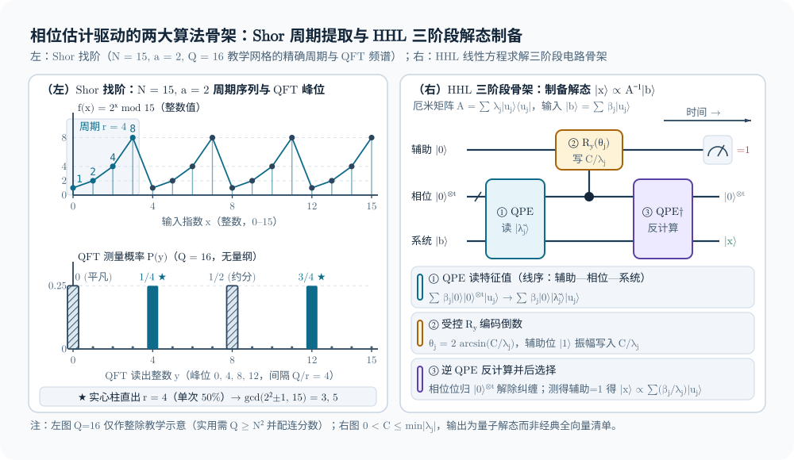
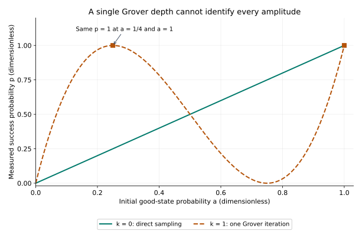
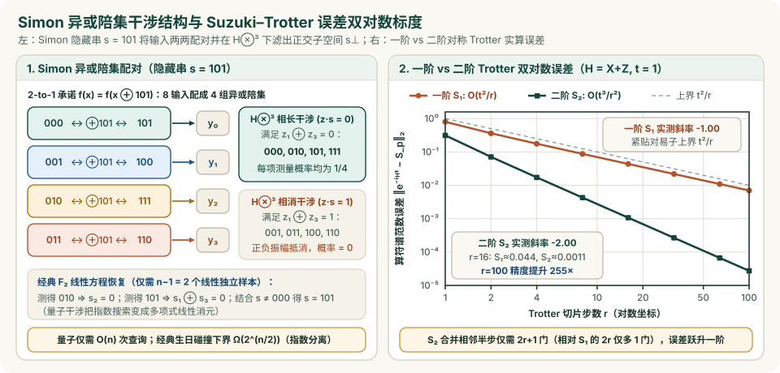
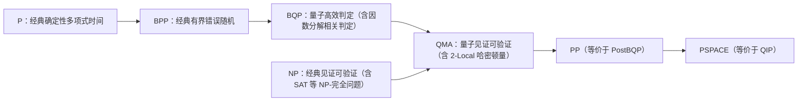

# 07｜代表性量子算法：从隐藏周期到量子模拟

先熟悉[第 06 章](06-algorithmic-primitives.md)的可逆预言机、相位回踢、振幅放大与固定点滤波、量子傅里叶变换（QFT）、量子相位估计（QPE）、量子计数、分片时间演化，以及 Hadamard/SWAP 测试与 QRAM 瓶颈。下面把这些原语用到三类代表性任务中——**隐藏周期与傅里叶采样（Simon 算法 → Shor 分解与椭圆曲线离散对数）**、**振幅放大与统计精度加速（Grover 搜索 → 量子幅度估计 QAE）**，以及**物理模拟与线性代数（哈密顿量模拟 → HHL 线性方程求解）**，最后把它们一起放进量子复杂度类的地图里，看清量子计算机究竟能加速什么、又卡在什么边界之外。

读这一章时，可以按自己的数学底子分两遍推进：
- **首遍主干（★ 必读）**：第 1 节 Simon 两/三比特手算、第 2.1–2.4 节 Shor 分解 15 与 35、第 3 节 Grover 搜索、第 4.1 节标准 QAE、第 5.1–5.3 / 5.5 节 Trotter 与 qDRIFT、第 6.1–6.2 / 6.5 节 HHL 二维对角与四重细则、第 7 节复杂度地图。
- **进阶选读（☆ 首遍可跳过）**：标有 `进阶选读：` 的第 2.5 / 2.7 节（模幂电路与 ECDLP）、第 4.2 节（MLAE 混叠）、第 5.4 节（多体泡利分解与 THC 分水岭）、第 6.4 节（负谱非网格 HHL）与第 6.6 节（量子微分方程 LCHS / Schrödingerization / Carleman）。

全章沿用[符号表](appendices/notation.md)统一约定与[第 06 章第 0 节](06-algorithmic-primitives.md#0-读懂任何量子算法前的六件事与原语总图)的三笔成本划分（查询次数、门复杂度、端到端总时间）；本章局部专记 Grover 迭代算符 $\mathcal{Q}$、目标个数 $M$、QPE 网格总数正体 **$Q = 2^t$**，Hadamard 门 $H$ 与哈密顿量 $H$ 仅在各自小节使用并就地界定单位。

---

## 1. Simon 算法：从隐藏异或周期到指数查询分离

### 1.1 问题、承诺与两个版本

想象有人给你一只黑盒，能计算函数

$$
f:\{0,1\}^n \to \{0,1\}^n,
$$

并且事先立下一条承诺：存在某个隐藏的 $n$ 位二进制串 $s \in \{0,1\}^n$，使得任意两个输入给出相同函数值，当且仅当它们恰好相差这个串 $s$：

$$
f(x) = f(y) \quad\Longleftrightarrow\quad x \oplus y \in \{0^n,\, s\},
$$

也就是 $y = x$ 或 $y = x \oplus s$。这里的 $\oplus$ 是按位异或（模 2 加法）：同一位相同得 $0$，不同得 $1$，例如 $001 \oplus 110 = 111$。

如果只允许像普通程序那样逐个试探输入，想找出 $s$，就得在 $2^n$ 个入口里撞出一对满足 $f(x) = f(y)$ 且 $x \neq y$ 的碰撞，再用 $s = x \oplus y$ 还原答案。按生日悖论，任何经典随机黑盒算法平均都要查 $\Theta(2^{n/2})$ 次才撞得见一对重复输出。Simon 在 1994 年证明，只要能对 $f$ 做量子叠加查询，只需要 $O(n)$ 次查询就能把 $s$ 挖出来——这是历史上第一个在有界错误模型下给出经典随机与量子之间**指数查询分离**的原型算法。

正式推导前，先区分文献中常见的两个版本，尤其是判定版容易漏掉的满秩分支：

- **搜索版（本章主线）**：题目额外承诺 $s \neq 0^n$，因此 $f$ 严格是“两对一”映射，每个函数值恰好对应两个原像 $\{x, x\oplus s\}$，任务是输出 $s$。
- **判定版**：允许 $s = 0^n$（此时 $f$ 是一对一映射），任务是区分“$f$ 一对一”还是“存在非零 $s$ 使 $f$ 两对一”。当 $s = 0^n$ 时，单次量子采样输出的比特串 $z$ 在全空间 $\mathbb{F}_2^n$（维数 $n$）上均匀分布；因此在采用固定采样预算 $k \ge n$（例如按 1.4 节取 $k = (n - 1) + \lceil\log_2(1/\delta)\rceil \ge n$）收齐方程并求其 $\mathbb{F}_2$ 秩 $r$ 后，完整判定必须包含**三个分支**：
  1. **若 $r = n$（满秩，无任何非零解）**：由于任意非零 $s$ 的允许样本只能张成维数至多 $n - 1$ 的子空间 $s^\perp$，出现秩 $n$ 立刻 100% 确定地判为 **$s = 0^n$（一对一）**；
  2. **若 $r = n - 1$（存在唯一非零候选 $s$）**：再做一次经典碰撞检验 $f(0^n) \stackrel{?}{=} f(s)$——相等则确认为两对一并输出真周期 $s$，不等则判为 $s = 0^n$（一对一）；
  3. **若 $r < n - 1$（线性无关方程不足）**：补采样本直至秩达到 $n - 1$ 或 $n$，或按预设总预算重跑。

后面测量出的比特串 $z \in \{0,1\}^n$ 会通过模 2 内积约束 $s$：

$$
x \cdot z := x_1 z_1 \oplus x_2 z_2 \oplus \cdots \oplus x_n z_n \in \{0,1\}.
$$

举两个小例子热身：$110 \cdot 001 = (1\cdot 0)\oplus(1\cdot 0)\oplus(0\cdot 1) = 0$，而 $110 \cdot 100 = (1\cdot 1)\oplus(1\cdot 0)\oplus(0\cdot 0) = 1$。请先建立心理预期：**单次量子运行并不会直接吐出 $s$，而是吐出一条满足 $z \cdot s = 0 \pmod 2$ 的线性方程。**

### 1.2 一次量子采样怎样产生一条方程

准备两个各含 $n$ 个量子比特的寄存器，初始化在 $|0^n\rangle|0^n\rangle$，使用标准比特预言机 $U_f|x\rangle|y\rangle = |x\rangle|y\oplus f(x)\rangle$（本节 $H$ 均表示单比特 Hadamard 门）。整条单次采样线路分四步：

1. **制备全输入均匀叠加**：对第一寄存器施加 $H^{\otimes n}$，

   $$
   |0^n\rangle|0^n\rangle
   \xrightarrow{H^{\otimes n}\otimes I}
   \frac{1}{\sqrt{2^n}} \sum_{x \in \{0,1\}^n} |x\rangle|0^n\rangle.
   $$

2. **一次查询写入函数值**：调用一次 $U_f$，

   $$
   \frac{1}{\sqrt{2^n}} \sum_{x \in \{0,1\}^n} |x\rangle|f(x)\rangle.
   $$

3. **按函数值坍缩成陪集态**：设想先测量第二寄存器，随机测得某个函数值 $f(x_0)$。由于 $f$ 在 $s \neq 0^n$ 承诺下严格两对一，只有 $x_0$ 与 $x_0 \oplus s$ 对应这个结果，因此第一寄存器归一化为

   $$
   |\psi_{\mathrm{coset}}\rangle = \frac{|x_0\rangle + |x_0 \oplus s\rangle}{\sqrt{2}}.
   $$

   （顺带一提，根据[第 04 章](04-circuits-protocols.md)的延迟测量原理，实际线路里完全可以不测第二寄存器，直接把第二寄存器丢在一旁——第一寄存器得到的 $z$ 边缘概率分布与这里一模一样。把测量写出来，纯粹是为了让你看清陪集态的干涉机制。）

4. **末层 Hadamard 制造干涉筛选**：把恒等式 $H^{\otimes n}|x\rangle = \frac{1}{\sqrt{2^n}}\sum_{z \in \{0,1\}^n} (-1)^{x\cdot z}|z\rangle$ 逐项代进陪集态：

   $$
   H^{\otimes n}\left(\frac{|x_0\rangle + |x_0 \oplus s\rangle}{\sqrt{2}}\right)
   = \frac{1}{\sqrt{2^{n+1}}} \sum_{z \in \{0,1\}^n} \left[(-1)^{x_0 \cdot z} + (-1)^{(x_0 \oplus s) \cdot z}\right] |z\rangle.
   $$

   利用二进制内积对异或的分配律 $(x_0 \oplus s)\cdot z = x_0 \cdot z \oplus s \cdot z \pmod 2$，把公因子 $(-1)^{x_0 \cdot z}$ 提到括号外：

   $$
   H^{\otimes n}|\psi_{\mathrm{coset}}\rangle
   = \frac{1}{\sqrt{2^{n+1}}} \sum_{z \in \{0,1\}^n} (-1)^{x_0 \cdot z}\left[1 + (-1)^{s \cdot z}\right] |z\rangle.
   $$

现在逐个盯住括号里的 $1 + (-1)^{s\cdot z}$：

- 若 $s \cdot z = 1 \pmod 2$，则 $1 + (-1)^1 = 0$，相消干涉把振幅彻底清零，测出这个 $z$ 的概率为 $0$；
- 若 $s \cdot z = 0 \pmod 2$，则 $1 + (-1)^0 = 2$，该基态振幅为 $(-1)^{x_0 \cdot z}\frac{2}{\sqrt{2^{n+1}}} = (-1)^{x_0 \cdot z}\frac{1}{\sqrt{2^{n-1}}}$，取模平方得到概率

  $$
  p(z) = \left|(-1)^{x_0 \cdot z}\frac{1}{\sqrt{2^{n-1}}}\right|^2 = \frac{1}{2^{n-1}}.
  $$

由于 $s \neq 0^n$，线性方程 $z \cdot s = 0$ 在 $n$ 维二元向量空间 $\mathbb{F}_2^n$ 里切出一个维数为 $d = n - 1$ 的正交补子空间 $s^\perp$，里面恰好有 $2^{n-1}$ 个向量，总概率 $2^{n-1} \times \frac{1}{2^{n-1}} = 1$。更妙的是，未知的随机偏移量 $x_0$ 只躲在局部符号 $(-1)^{x_0 \cdot z}$ 里，取模平方时彻底消失——不管第二寄存器撞到哪一对原像，第一寄存器输出的 $z$ 都在 $s^\perp$ 上**严格等概率均匀分布**！

### 1.3 两比特与三比特分步手算

#### 热身算例：$n = 2,\, s = 11$

构造具体函数 $f(00) = f(11) = 00$，$f(01) = f(10) = 01$。容易验证每对同值输入恰好相差 $11$。

1. 初态经 $H^{\otimes 2}\otimes I$ 再过 $U_f$ 后，变成四项等权叠加：

   $$
   \frac{1}{2}\bigl(|00\rangle|00\rangle + |01\rangle|01\rangle + |10\rangle|01\rangle + |11\rangle|00\rangle\bigr).
   $$

2. 假设第二寄存器测得 `00`，第一寄存器坍缩到 $\frac{|00\rangle + |11\rangle}{\sqrt{2}}$。
3. 施加 $H \otimes H$，把单比特变换 $H|0\rangle = \frac{|0\rangle+|1\rangle}{\sqrt{2}}$ 和 $H|1\rangle = \frac{|0\rangle-|1\rangle}{\sqrt{2}}$ 直接展开乘开：

   $$
   \begin{aligned}
   (H\otimes H)\frac{|00\rangle + |11\rangle}{\sqrt{2}}
   &= \frac{1}{2\sqrt{2}}\Bigl[(|0\rangle+|1\rangle)(|0\rangle+|1\rangle) + (|0\rangle-|1\rangle)(|0\rangle-|1\rangle)\Bigr] \\
   &= \frac{1}{2\sqrt{2}}\Bigl[(|00\rangle+|01\rangle+|10\rangle+|11\rangle) + (|00\rangle-|01\rangle-|10\rangle+|11\rangle)\Bigr] \\
   &= \frac{1}{2\sqrt{2}}\bigl(2|00\rangle + 2|11\rangle\bigr)
   = \frac{|00\rangle + |11\rangle}{\sqrt{2}}.
   \end{aligned}
   $$

`|01>` 和 `|10>` 正负精准抵消，只留下满足 $z_1 \oplus z_2 = 0$ 的 `00` 与 `11`，各自概率为 $|1/\sqrt{2}|^2 = 1/2$，和为 $1$。只要采到一次 `11`，方程 $s_1 \oplus s_2 = 0$ 配上承诺 $s \neq 00$，立刻唯一锁死 $s = 11$。

#### 进阶算例：$n = 3,\, s = 110$

现在把位宽升到三比特，隐藏串 $s = 110$。若第二寄存器测后第一寄存器落在陪集态 $\frac{|001\rangle + |111\rangle}{\sqrt{2}}$（因为 $001 \oplus 110 = 111$），按 $H^{\otimes 3}|x\rangle = \frac{1}{\sqrt{8}}\sum_z (-1)^{x\cdot z}|z\rangle$ 逐个列出全部 8 个基态的系数：

- 对 $|001\rangle$，内积 $001 \cdot z = z_3$，符号为 $(-1)^{z_3}$；
- 对 $|111\rangle$，内积 $111 \cdot z = z_1 \oplus z_2 \oplus z_3$，符号为 $(-1)^{z_1 \oplus z_2 \oplus z_3}$。

把两支相加再除以 $\sqrt{2}\cdot\sqrt{8} = 4$：只要 $z_1 \oplus z_2 = 1$（即 `010, 011, 100, 101`），两项符号相反抵消为 $0$；只要 $z_1 \oplus z_2 = 0$（即 `000, 001, 110, 111`），两项同号相加得 $\pm 2/4 = \pm 1/2$：

$$
H^{\otimes 3}\left(\frac{|001\rangle + |111\rangle}{\sqrt{2}}\right)
= \frac{1}{2}\bigl(|000\rangle - |001\rangle + |110\rangle - |111\rangle\bigr).
$$

核验归一化：$4 \times (\pm 1/2)^2 = 1$。这四个允许样本构成维数 $d = 2$ 的子空间 $s^\perp = \{000, 001, 110, 111\}$，每个以概率 $1/4$ 出现。

再看经典后处理怎么工作。假设我们连续三次运行线路，依次测得 `001`、`110`、`001`：

1. 第一次测得 `001`：写出方程 $0\cdot s_1 \oplus 0\cdot s_2 \oplus 1\cdot s_3 = 0 \implies s_3 = 0$，候选非零串还剩 `010, 100, 110`；
2. 第二次测得 `110`：写出方程 $s_1 \oplus s_2 = 0$，结合 $s_3 = 0$，所有解只剩 `000` 和 `110`；
3. 第三次又测得 `001`：依然是 $s_3 = 0$，没有提供任何新信息；
4. 结合搜索版承诺 $s \neq 000$，唯一确定 $s = 110$。

如果把这个函数做成真实量子电路——例如取 $f(x_1x_2x_3) = (x_1 \oplus x_2,\, x_3,\, 0)$，用三个 $\mathrm{CNOT}$ 门从 $|000\rangle$ 输出寄存器直接算出——先要验证该线性映射的核空间确实是 $\{000, 110\}$，从而确认函数满足两对一承诺。采集方程后用 $\mathbb{F}_2$ 消元求出的零空间，本身不能反过来证明黑盒遵守了 Simon 承诺。

### 1.4 满秩分析、固定预算尾界与对称密码边界

初学者常在这里有一个错觉：“既然需要 $d = n - 1$ 条方程，那我就跑 $n - 1$ 次量子电路不就够了？”拿刚才的 $d = 2$ 算一笔账就知道为什么不行：

- 秩为 $0$ 时，四个等概率样本里有 $3$ 个非零串，拿到第 1 条有效方程的概率是 $3/4$，几何分布的期望等待次数是 $\frac{1}{3/4} = \frac{4}{3}$ 次；
- 秩为 $1$ 时，已有向量张成含 $2$ 个元素的子空间（自己和 `000`），下一抽落在子空间外的概率是 $2/4 = 1/2$，期望再等 $2$ 次；
- 合计达到满秩的期望采样次数为

  $$
  \frac{4}{3} + 2 = \frac{10}{3} \approx 3.333\text{ 次},
  $$

  而不是 $2$ 次！一般地，当已有方程的秩为 $r < d$ 时，新样本落在当前 $r$ 维子空间外的概率为 $1 - 2^{r-d}$，所以达到满秩的精确期望采样数为

  $$
  \mathbb{E}[\text{采样数}]
  = \sum_{r=0}^{d-1} \frac{1}{1 - 2^{r-d}}
  = d + \sum_{j=1}^{d} \frac{1}{2^j - 1}
  < d + 1.6067
  $$

  （常数 $\sum_{j=1}^\infty \frac{1}{2^j-1} \approx 1.606695$ 称为 Erdős–Borwein 常数）。

如果现实中我们必须提前定死采样预算 $k \ge d$，满秩的精确概率又是多少？把 $k$ 个独立均匀样本排成 $k \times d$ 的二元矩阵，按列计数：第 1 列可在 $2^k - 1$ 个非零向量中任选，已有 $j$ 个线性无关列时它们张成 $2^j$ 个向量，第 $j+1$ 列有 $2^k - 2^j$ 个可选；除以总配置数 $(2^k)^d$，便得精确满秩概率：

$$
p_{\mathrm{full}}(k, d) = \prod_{j=0}^{d-1}\left(1 - 2^{j-k}\right).
$$

这条公式有两个非常好用的推论：

1. **刚好只采 $k = d$ 次时**：满秩概率 $p_{\mathrm{full}}(d, d) = \prod_{i=1}^{d}(1 - 2^{-i})$ 随 $d$ 单调递减，但永远不会掉到零，而是收敛到 Euler 常数 $\prod_{i=1}^\infty (1 - 2^{-i}) \approx 0.288788 > 1/4$。也就是说，哪怕只采 $n-1$ 次，也至少有近 $29\%$ 的机会一把满秩。
2. **控制失败尾部的固定预算**：若 $k$ 个样本未张满 $d$ 维空间，就必存在某个非零线性泛函 $u$ 使全部 $k$ 个样本满足 $u \cdot z = 0$。对固定非零 $u$，单个均匀样本撞上的概率是 $1/2$，$k$ 个同时撞上的概率是 $2^{-k}$。共有 $2^d - 1$ 个非零 $u$，由并合界立得失败率上界：

   $$
   p_{\mathrm{fail}}(k, d) \le (2^d - 1) 2^{-k} < 2^{d-k}.
   $$

   只要选取 $k = d + \lceil \log_2(1/\delta) \rceil$，就能保证满秩失败率不超过 $\delta$。

拿 $n = 3,\, s = 110$（$d = 2$）把精确公式和并合界落到实数上核对一遍：

- 固定只采 $k = 2$ 次：$p_{\mathrm{full}}(2, 2) = \left(1 - \frac{1}{4}\right)\left(1 - \frac{1}{2}\right) = \frac{3}{8}$。直接穷举也能复核：$4 \times 4 = 16$ 对有序样本中，第 1 个非零有 $3$ 种选法，第 2 个避开 `000` 和第 1 个有 $2$ 种选法，共 $6/16 = 3/8$ 满秩。
- 要求用并合界把失败率压到 $1\%$ 以下：取 $k = 2 + \lceil \log_2 100 \rceil = 2 + 7 = 9$ 次。并合界给出 $(2^2 - 1)2^{-9} = \frac{3}{512} \approx 0.005859 < 0.01$；而精确失败率为 $1 - \left(1 - \frac{1}{512}\right)\left(1 - \frac{1}{256}\right) = \frac{767}{131072} \approx 0.005852$，与并合界几乎严丝合缝。

最后补齐两笔经常被漏记的账：第一，拿齐方程后还必须在经典计算机上做 $\mathbb{F}_2$ 高斯消元，耗费 $O(n^3)$ 经典时间——“$O(n)$ 查询”并不等于总时间只有 $O(n)$；第二，Simon 算法后来在密码分析中产生了真实回响：Kuwakado 与 Morii（2010, 2012）以及 Kaplan 等人（CRYPTO 2016）借助 Simon 算法在多项式时间内攻破了 3 轮 Feistel 结构、Even–Mansour 密码以及多种经典对称加密/消息认证模式。不过，这类攻击严格依赖 **Q2 模型**——攻击者必须能够把带密钥的加密黑盒放到量子叠加态上相干查询；如果对手只能发普通经典明文密文对（**Q1 模型**），Simon 攻击无法直接发动。

从群论视角看，Simon 算法是在有限阿贝尔群 $\mathbb{Z}_2^n$ 上寻找隐藏子群 $\{0^n, s\}$；下一节的 Shor 算法正是把同样的“陪集态—傅里叶采样—经典恢复”骨架搬到了整数乘法循环群和椭圆曲线点群上，更一般的隐藏子群问题（HSP）将在[第 16 章第 3 节](16-advanced-algorithms-verification.md#3-隐藏子群问题hspsimonshor-与非阿贝尔壁垒)展开。

---

## 2. Shor 算法：大整数分解、模幂电路与椭圆曲线离散对数

Simon 找到了二进制异或的隐藏周期；1994 年 Peter Shor 把同样的傅里叶周期提取思想推向普通整数乘法模 $N$ 的循环群和一般有限阿贝尔循环群，给出了多项式时间的大整数分解与离散对数算法，一举动摇了基于 RSA 和椭圆曲线密码（ECC）的传统公钥体系。

### 2.1 经典数论约化：把因数分解变成找阶

给定一个待分解的合数 $N$（输入规模是它的二进制位长 $L = \lceil \log_2 N \rceil$），先复习三个整除记号：$u \equiv v \pmod N$ 表示 $N$ 整除 $u - v$；$a^r \bmod N$ 是 $a^r$ 除以 $N$ 的余数；$\gcd(u, N)$ 是最大公因数。对与 $N$ 互素的整数 $a$，定义 $a$ 模 $N$ 的**阶**（order）$r$ 为满足

$$
a^r \equiv 1 \pmod N
$$

的**最小正整数**（注意“最小”二字绝不能省）。

整套 Shor 算法里，真正用到量子计算机的只有“找阶”这一步，前后全部在普通经典计算机上完成：

1. **经典预处理**：若 $N$ 是偶数，直接输出因子 $2$；用经典算法检验 $N$ 是否为素数（如 AKS 或 Miller–Rabin）或完美幂 $N = b^m$（$m \ge 2$，只需对每个 $2 \le m \le \lfloor \log_2 N \rfloor$ 二分试探整数根 $b$）。素数直接结束，完美幂直接输出 $b$ 并递归分解。经此筛选，剩下的 $N$ 必是**至少含两个不同奇素因子的奇合数**。
2. **随机选底数**：在 $\{2, 3, \dots, N-1\}$ 中均匀随机选一个整数 $a$，用欧几里得算法算 $g = \gcd(a, N)$。若 $g > 1$，直接撞中非平凡因子 $g$，连量子计算机都不用开！
3. **量子找阶**：此时 $\gcd(a, N) = 1$，调用量子阶寻找子程序求 $a$ 模 $N$ 的阶 $r$。
4. **奇偶检查**：若 $r$ 是奇数，换一个 $a$ 回到第 2 步。
5. **排除负一坏条件**：记 $u = a^{r/2} \bmod N$。若 $u \equiv -1 \pmod N$（即 $u = N - 1$），也换一个 $a$ 回到第 2 步。
6. **提取非平凡因子**：因式分解 $a^r - 1 = (a^{r/2} - 1)(a^{r/2} + 1)$，经典计算

   $$
   p_1 = \gcd(u - 1, N), \qquad p_2 = \gcd(u + 1, N).
   $$

   因为 $N$ 是奇数且 $\gcd(u - 1, u + 1)$ 只能整除 $(u + 1) - (u - 1) = 2$，所以 $p_1$ 与 $p_2$ 互素且恒满足 $p_1 p_2 = N$——对任意至少含两个不同奇素因子的奇合数 $N$，两者**同时**都是 $N$ 的非平凡因子，最后用经典乘法验证即可。

**为什么第 5 步只需排除 $u \equiv -1 \pmod N$，不用担心 $u \equiv 1 \pmod N$？** 因为 $r$ 是偶数且 $u^2 \equiv a^r \equiv 1 \pmod N$，所以 $N$ 整除 $(u-1)(u+1)$。如果 $u \equiv 1 \pmod N$，意味着 $a^{r/2} \equiv 1 \pmod N$，与 $r$ 是**最小**正阶直接矛盾！所以 $u \equiv 1$ 根本不可能出现；只要再排除 $u \equiv -1$，那么 $N$ 整除 $(u-1)(u+1)$ 却既不整除 $u-1$ 也不整除 $u+1$，从而 $N$ 的素因子必然被拆散分进 $u-1$ 和 $u+1$ 两边，取最大公因数必定揪出非平凡因子。

更令人安心的是，数论定理保证：只要奇合数 $N$ 至少有 $m \ge 2$ 个不同奇素因子，在所有与 $N$ 互素的底数 $a$ 中，同时通过第 4、5 两关的概率满足

$$
\Pr\bigl[r \text{ 为偶数且 } a^{r/2} \not\equiv -1 \pmod N\bigr] \ge 1 - \frac{1}{2^{m-1}} \ge \frac{1}{2}.
$$

也就是说，平均随机选一两次底数就能撞上好底数，绝不会在经典约化上陷入指数重试。

### 2.2 相位估计如何读出隐藏阶 $r$

#### 直觉热身：$Q = 16$ 教学网格上的周期态

在展开一般模乘算符前，先借一个四比特（$Q = 16$）的周期态亲眼看看傅里叶变换如何把“周期 $r = 4$”翻成“频谱峰位”。设相位寄存器处于每 4 格重复一次的周期叠加态：

$$
|P\rangle = \frac{|0\rangle + |4\rangle + |8\rangle + |12\rangle}{2}.
$$

套用[第 06 章第 5 节](06-algorithmic-primitives.md#5-量子傅里叶变换qft)的 QFT 定义 $F_{16}|x\rangle = \frac{1}{\sqrt{16}}\sum_{y=0}^{15} e^{2\pi i x y / 16}|y\rangle$，输出基态 $|y\rangle$ 前的振幅是四条路径之和：

$$
A_y = \frac{1}{2\sqrt{16}} \sum_{j=0}^{3} e^{2\pi i (4j) y / 16}
    = \frac{1}{8} \sum_{j=0}^{3} e^{2\pi i j y / 4}.
$$

代入两个具体读数一步算完：

- 当 $y = 4$ 时，每一项都是 $e^{2\pi i j} = 1$，四项同相叠加，得 $A_4 = \frac{1+1+1+1}{8} = \frac{1}{2}$，概率 $|A_4|^2 = \frac{1}{4}$；
- 当 $y = 1$ 时，四项依次是 $e^0 = 1$、$e^{i\pi/2} = i$、$e^{i\pi} = -1$、$e^{3i\pi/2} = -i$，相加得 $1 + i - 1 - i = 0$，故 $A_1 = 0$！

同理检查全部 16 个整数，只有 $y \in \{0, 4, 8, 12\}$ 四个位置有非零振幅（各为 $1/2$，概率各为 $1/4$，总和 $1$），其余 12 个位置完全相消。周期 $r = 4$ 就这样变成了间距为 $Q/r = 4$ 的四根等高尖峰！即便周期态整体平移（比如从位置 1 开始），每根峰只是多挂一个单位模相位因子，测量概率丝毫不变；相位估计线路中采用**逆** QFT，也只把指数变号，四根峰的位置与高度完全相同。

上面这张双联图把相位估计驱动的两大经典算法放在了同一张画布上：左半图正是刚才算出的 $N = 15,\, a = 2$ 周期序列 $1, 2, 4, 8$ 与 $Q = 16$ 教学网格上的四根 QFT 峰（注意只有实心柱 $y = 4$ 和 $y = 12$ 能一把直接暴露完整分母 $r = 4$，单次占 $50\%$）；右半图则先预告第 6 节的 HHL 三阶段解态制备骨架，读到第 6 节时我们可以直接回头对照。

#### 一般模乘算符、本征态展开与 Legendre 连分数条件

正式进入一般整数 $N$（设位长 $L = \lceil \log_2 N \rceil$）。对满足 $\gcd(a, N) = 1$ 的底数 $a$，在 $L$ 比特工作寄存器上定义**模乘算符** $U_a$：

$$
U_a |y\rangle =
\begin{cases}
|a y \bmod N\rangle, & 0 \le y < N, \\
|y\rangle, & N \le y < 2^L.
\end{cases}
$$

为什么 $U_a$ 一定是酉门？因为 $\gcd(a, N) = 1$ 保证了模 $N$ 乘法逆元 $a^{-1}$ 存在：只要 $a y_1 \equiv a y_2 \pmod N$，两边同乘 $a^{-1}$ 便得 $y_1 \equiv y_2 \pmod N$。所以 $U_a$ 在 $\{0,\dots,N-1\}$ 上做一一置换，在 $y \ge N$ 上保持不动，整体是 $2^L \times 2^L$ 置换矩阵，必然是酉算符。

如果 $a$ 的阶为 $r$，那么轨道 $\{|1\rangle, |a\rangle, |a^2\bmod N\rangle, \dots, |a^{r-1}\bmod N\rangle\}$ 构成一个长度为 $r$ 的循环。对每个 $k \in \{0, 1, \dots, r-1\}$，构造它的离散傅里叶叠加态

$$
|u_k\rangle = \frac{1}{\sqrt{r}} \sum_{j=0}^{r-1} e^{-2\pi i k j / r} |a^j \bmod N\rangle.
$$

逐行验证 $|u_k\rangle$ 正是 $U_a$ 的本征态：把 $U_a$ 作用进去，令新求和指标 $\ell = j + 1 \pmod r$（从而 $j = \ell - 1$，且利用 $a^r \equiv 1 \pmod N$ 与 $e^{-2\pi i k r / r} = 1$ 首尾相接）：

$$
\begin{aligned}
U_a |u_k\rangle
&= \frac{1}{\sqrt{r}} \sum_{j=0}^{r-1} e^{-2\pi i k j / r} |a^{j+1} \bmod N\rangle \\
&= \frac{1}{\sqrt{r}} \sum_{\ell=0}^{r-1} e^{-2\pi i k (\ell - 1) / r} |a^\ell \bmod N\rangle \\
&= e^{2\pi i k / r} \left(\frac{1}{\sqrt{r}} \sum_{\ell=0}^{r-1} e^{-2\pi i k \ell / r} |a^\ell \bmod N\rangle\right)
= e^{2\pi i k / r} |u_k\rangle.
\end{aligned}
$$

本征相位恰好是 $\phi_k = k/r$！可问题是：我们事先不知道 $r$，根本没法直接制备单个 $|u_k\rangle$。妙就妙在把所有 $r$ 个本征态等权加起来——利用等比求和 $\sum_{k=0}^{r-1} e^{-2\pi i k j / r}$ 在 $j = 0$ 时等于 $r$、在 $1 \le j \le r-1$ 时等于 $0$，立得

$$
\frac{1}{\sqrt{r}} \sum_{k=0}^{r-1} |u_k\rangle
= \frac{1}{r} \sum_{j=0}^{r-1} \left(\sum_{k=0}^{r-1} e^{-2\pi i k j / r}\right) |a^j \bmod N\rangle
= |1\rangle!
$$

本节沿用[第 06 章第 5.2 节](06-algorithmic-primitives.md#52-张量积分解与-3-比特完整线路推导)的大端相位控制约定。若省去逆 QFT 的入口反序，要同时反接受控幂，最后仍按大端读数。

你不需要知道 $r$，只要在工作寄存器里随手放进极其简单的计算基态 **$|1\rangle$**（把最低位翻成 $1$ 即可），它天生就是全部 $r$ 个本征态的等权叠加！于是把[第 06 章第 6.4 节](06-algorithmic-primitives.md#64-当输入不是单个本征态而是本征态的叠加)的结论搬进来：用 $t$ 位相位寄存器（网格大小 $Q = 2^t$）对 $U_a$ 和初态 $|1\rangle$ 运行一次 QPE（其中受控幂 $U_a^{2^j}$ 的实际可逆门分解紧接着在 2.5 节拆透），测量会等概率落入某个分支 $k \in \{0,\dots,r-1\}$，并高概率读出一个满足

$$
\frac{y}{Q} \approx \frac{k}{r}
$$

的整数 $y \in \{0, 1, \dots, Q-1\}$。

最后怎么从小数 $y/Q$ 反推分母 $r$？靠数论中的 **Legendre 连分数定理**：若分数 $y/Q$ 与有理数 $k/r$ 的距离满足

$$
\left|\frac{y}{Q} - \frac{k}{r}\right| < \frac{1}{2 r^2},
$$

则 $k/r$ 约成最简分数后的结果，**必然**出现在 $y/Q$ 的某个连分数收敛子（convergent）里！因为真阶 $r < N$，只要取相位网格满足 $Q = 2^t > N^2$（精确最小位宽为 $t = \lfloor 2\log_2 N \rfloor + 1$，对所有经预处理的奇合数 $N < 2^L$ 恒有 $t \le 2L$，例如下文 $N = 15$ 取 $t = 8$、$N = 35$ 取 $t = 11$；若改按整格误差界 $2^{-n} < \frac{1}{2N^2}$ 统一控制失败率 $\delta$，则按第 06 章公式取 $t = 2L + 1 + \lceil\log_2(2 + \frac{1}{2\delta})\rceil$），最近网格点的误差至多 $\frac{1}{2Q} < \frac{1}{2N^2} < \frac{1}{2r^2}$，就能确保 Legendre 条件成立。不过请留意连分数恢复的两道门槛：第一，它只能找回**既约分数**的分母——如果抽中的 $k$ 与 $r$ 不互素，约分后会丢失公因子 $\gcd(k, r)$；第二，对每个候选分母 $d < N$，必须用经典模幂检查 $a^d \bmod N \stackrel{?}{=} 1$，而且通过该检查只说明真阶整除 $d$，未必保证 $d$ 就是最小阶。

### 2.3 手算算例一：分解 $N = 15$（好底数与坏底数对照）

#### 好底数：$a = 2$

逐次计算 $2$ 的幂模 $15$：

$$
2^0,\, 2^1,\, 2^2,\, 2^3,\, 2^4 \pmod{15} = 1,\, 2,\, 4,\, 8,\, 1,
$$

所以真阶 $r = 4$。按 $Q > N^2 = 225$ 的要求选 $t = 8$（$Q = 256$）。由于 $r = 4$ 恰好整除 $256$，四个本征相位 $0, 1/4, 1/2, 3/4$ 全落在精确网格点上，对应四个等概率峰（每个概率恰好 $1/4$）：

- **$y = 0$**（相位 $0$）：平凡结果，不含阶信息，直接重试；
- **$y = 128$**（相位 $128/256 = 1/2$）：连分数给出分母 $d = 2$，经典验算 $2^2 = 4 \not\equiv 1 \pmod{15}$，被拒绝！这是因为 $k/r = 2/4$ 约掉了公因子 $2$。最稳妥的办法是重新采样（小例中也可顺手验一下小倍数 $2 \times 2 = 4$，但在一般大整数下丢失的 $\gcd(k,r)$ 未必小，无上界试倍数并不属于多项式时间保证）；
- **$y = 64$ 或 $192$**（相位 $1/4$ 或 $3/4$）：分子与 $4$ 互素，连分数直接给出 $r = 4$！

看清楚这个数字：哪怕在零噪声、相位完全整除网格的理想情形下，**单次 QPE 直接露出完整阶 $r = 4$ 的概率也只有 $2/4 = 50\%$**！拿到 $r = 4$ 后，检验 $r$ 为偶数且 $2^{4/2} = 4 \not\equiv -1 \pmod{15}$，最后经典求最大公因数：

$$
\gcd(4 - 1, 15) = \gcd(3, 15) = 3, \qquad
\gcd(4 + 1, 15) = \gcd(5, 15) = 5,
$$

回验 $3 \times 5 = 15$，分解成功。

#### 坏底数：$a = 14$

仍分解 $N = 15$，但这次随机抽到了与 $15$ 互素的底数 $a = 14$。因为 $14 \equiv -1 \pmod{15}$，所以

$$
14^1 \equiv 14 \not\equiv 1 \pmod{15}, \qquad
14^2 = 196 \equiv 1 \pmod{15},
$$

最小正阶是 $r = 2$。即便量子线路一丝不差地算出了偶阶 $r = 2$，代入因子公式却发现 $a^{r/2} = 14 \equiv -1 \pmod{15}$：

$$
\gcd(14 - 1, 15) = \gcd(13, 15) = 1, \qquad
\gcd(14 + 1, 15) = \gcd(15, 15) = 15,
$$

全是平凡因子！这并非量子找阶出错，而是抽中了经典约化第 5 步要排除的坏底数，换一个随机 $a$ 重试即可。

### 2.4 手算算例二：分解 $N = 35$（非网格峰位与连分数逐阶展开）

$N = 15$ 的真阶 $4$ 恰好整除 $256$，容易让人误以为连分数只是“顺手约分”。现在换 $N = 35,\, a = 2$，亲手走一遍非整齐网格上的真实连分数展开！

先列全余数找真阶：

$$
2^0, 2^1, \dots, 2^{12} \pmod{35} = 1, 2, 4, 8, 16, 32, 29, 23, 11, 22, 9, 18, 1,
$$

因此 $r = 12$。由于 $N^2 = 1225$，取 $t = 11$ 使 $Q = 2^{11} = 2048$（满足 $N^2 < Q < 2N^2$）。此时 $12$ **不能**整除 $2048$，大多数本征相位都不落在网格点上。

#### 成功分支 $k = 1$（真相位 $\phi = 1/12$）

1. **找最近网格点与核验 Legendre 条件**：$Q \cdot \frac{1}{12} = \frac{2048}{12} = 170\frac{2}{3}$，最近的整数读数是 $y = 171$。计算误差：

   $$
   \left|\frac{171}{2048} - \frac{1}{12}\right|
   = \left|\frac{513 - 512}{6144}\right|
   = \frac{1}{6144}
   < \frac{1}{2 \cdot 12^2} = \frac{1}{288}.
   $$

   Legendre 条件宽裕通过！用[第 06 章第 6.3 节](06-algorithmic-primitives.md#63-进阶选读非精确网格相位dirichlet-核圆周绕回与前缀边界反例)的 Dirichlet 核公式，顺手算出在 $k = 1$ 分支下命中这个最近整数 $y = 171$ 的精确概率（相位偏差 $\Delta = \frac{1}{12} - \frac{171}{2048} = -\frac{1}{6144}$，故 $Q|\Delta| = \frac{1}{3}$）：

   $$
   \Pr(y = 171 \mid k = 1)
   = \left[\frac{\sin(\pi/3)}{2048\,\sin(\pi/6144)}\right]^2
   \approx 0.6839.
   $$

2. **对 $171/2048$ 逐行做欧几里得辗转相除**：

   $$
   \begin{aligned}
   2048 &= \mathbf{11} \times 171 + 167, \\
   171  &= \mathbf{1}  \times 167 + 4,   \\
   167  &= \mathbf{41} \times 4   + 3,   \\
   4    &= \mathbf{1}  \times 3   + 1,   \\
   3    &= \mathbf{3}  \times 1   + 0.
   \end{aligned}
   $$

   于是连分数展开为

   $$
   \frac{171}{2048} = [0;\, 11, 1, 41, 1, 3]
   = \cfrac{1}{11 + \cfrac{1}{1 + \cfrac{1}{41 + \cfrac{1}{1 + \cfrac{1}{3}}}}}.
   $$

3. **逐阶写出收敛子 $p_m/q_m$**（递推 $p_m = c_m p_{m-1} + p_{m-2},\; q_m = c_m q_{m-1} + q_{m-2}$，初值 $p_{-1}=1, q_{-1}=0;\; p_0=0, q_0=1$）：
   - $m = 0$（$c_0 = 0$）：$0/1$；
   - $m = 1$（$c_1 = 11$）：$\frac{11\cdot 0 + 1}{11\cdot 1 + 0} = 1/11$；
   - $m = 2$（$c_2 = 1$）：$\frac{1\cdot 1 + 0}{1\cdot 11 + 1} = 1/12$；
   - $m = 3$（$c_3 = 41$）：$\frac{41\cdot 1 + 1}{41\cdot 12 + 11} = 42/503$（分母 $503 > N = 35$，无需再算）。

4. **经典模幂逐个验证候选分母**：
   - 检查 $d = 11$：$2^{11} \equiv 18 \not\equiv 1 \pmod{35}$，**拒绝**；
   - 检查 $d = 12$：$2^{12} \equiv 1 \pmod{35}$，**接受** $r = 12$！

5. **提取因子**：$2^{12/2} = 2^6 = 64 \not\equiv -1 \pmod{35}$，算出

   $$
   \gcd(64 - 1, 35) = \gcd(63, 35) = 7, \qquad
   \gcd(64 + 1, 35) = \gcd(65, 35) = 5.
   $$

#### 约分失败分支 $k = 2$（真相位 $2/12 = 1/6$）

如果本次测中的是 $k = 2$，真相位约成了 $1/6$。因为 $2048/6 = 341\frac{1}{3}$，最近读数 $y = 341$，辗转相除得

$$
\frac{341}{2048} = [0;\, 6, 170, 2],
$$

有效收敛子只给出 $1/6$（下一个是 $170/1021$，分母远超 $35$）。经典验证 $2^6 = 64 \equiv 29 \not\equiv 1 \pmod{35}$ 失败，于是拒绝分母 $6$ 并重试（或结合两次不同样本的候选分母取最小公倍数）。在全部 12 个分支里，只有与 $12$ 互素的 $k \in \{1, 5, 7, 11\}$ 能一把保留完整分母 $12$，这一关的比例是 $\frac{\varphi(12)}{12} = \frac{4}{12} = \frac{1}{3}$。

### 2.5 进阶选读：拆开黑盒——模幂运算 $a^x \bmod N$ 的可逆算术电路与门数演进

前面的推导把 $U_a^{2^j}$ 写得轻描淡写，可在真正的 Shor 电路里，**超过 $99\%$ 的量子门和辅助比特都花在模幂运算 $|x\rangle|1\rangle \mapsto |x\rangle|a^x \bmod N\rangle$ 上**，而 QFT 反而只是个零头。为什么 Shor 的经典教科书门数是 $O(L^3)$、借助快速乘法又能压到 $O(L^2\log_2 L \log_2\log_2 L)$，而且中途还非做反计算不可？我们把模幂黑盒分三层彻底拆开。

#### 第一层拆解：二进制展开与经典重复平方预计算

把 $t$-位指数寄存器（通常 $t \approx 2L$）写成二进制 $x = \sum_{j=0}^{t-1} x_j 2^j$，于是

$$
a^x \bmod N = \prod_{j=0}^{t-1} \left(a^{2^j} \bmod N\right)^{x_j} \pmod N.
$$

最关键的减负发生在经典计算机上：**我们绝不会让量子线路自己把 $U_a$ 重复跑 $2^j$ 遍！** 在启动量子计算机之前，先用经典程序通过反复平方 $a_0 = a \bmod N,\; a_{j+1} = a_j^2 \bmod N$ 预先算出全部 $t$ 个常数 $a_j := a^{2^j} \bmod N$（经典总算术成本仅 $O(L^3)$）。随后量子线路只需对 $j = 0, 1, \dots, t-1$ 顺次执行 **$t \approx 2L$ 次受控常数模乘** $\text{c-}U_{a_j}$——当且仅当指数第 $j$ 位 $x_j = 1$ 时，把工作寄存器 $|y\rangle$ 乘以已知经典常数 $a_j$ 并模 $N$。

**手算小例（$N = 21,\, a = 2$）**。经典预计算 3 个平方幂：$a_0 = 2^1 \equiv 2$，$a_1 = 2^2 \equiv 4$，$a_2 = 4^2 \equiv 16 \pmod{21}$。考察指数分支 $x = 5 = 101_2$（即 $x_2 = 1,\, x_1 = 0,\, x_0 = 1$）：线路仅激活 $j = 0$ 与 $j = 2$ 两个受控门，工作寄存器依次演化为

$$
|1\rangle
\xrightarrow{\times 2 \bmod 21} |2\rangle
\xrightarrow{\text{跳过 } j=1} |2\rangle
\xrightarrow{\times 16 \bmod 21} |32 \bmod 21\rangle = |11\rangle = |2^5 \bmod 21\rangle.
$$

只做了 2 次模乘就完成了 5 次幂，指数位长增到 $L = 2048$ 时，也只需约 $4096$ 次受控模乘，彻底避开了指数级的 $2^{4096}$ 次重复调用。

#### 第二层拆解：怎样把就地受控模乘 $\text{c-}U_c|y\rangle = |cy \bmod N\rangle$ 做成无垃圾可逆电路？

单次受控常数模乘要做的是“就地覆盖”$|y\rangle \mapsto |cy \bmod N\rangle$，不能在辅助寄存器里留下与 $|y\rangle$ 纠缠的垃圾副本。Vedral–Barenco–Ekert（*PRA* 1996）与 Beauregard（*QIC* 2003）给出了极其优雅的**三步无垃圾模乘法**。因为 $\gcd(c, N) = 1$，经典扩展欧几里得算法可预先算出模逆常数 $c^{-1} \bmod N$；增配一个清零的 $L$-位辅助寄存器 $|0\rangle$，当控制位为 $1$ 时执行三步：

1. **正向乘加（$L$ 次受控常数模加）**：把 $y$ 写成二进制 $y = \sum_{k=0}^{L-1} y_k 2^k$，则 $cy \equiv \sum_{k=0}^{L-1} y_k (2^k c \bmod N) \pmod N$。对每一位 $y_k$，由控制位与 $y_k$ 联合控制，把经典预计算常数 $(2^k c \bmod N)$ 模加到第二寄存器上：

   $$
   |y\rangle |0\rangle \longmapsto |y\rangle |c y \bmod N\rangle.
   $$

2. **受控寄存器交换（$\text{c-SWAP}$）**：把两个 $L$-位寄存器逐位互换：

   $$
   |y\rangle |c y \bmod N\rangle \longmapsto |c y \bmod N\rangle |y\rangle.
   $$

3. **逆向乘减清零（用 $c^{-1} \bmod N$ 反计算）**：记第一寄存器的新值为 $z := cy \bmod N$。现在以第一寄存器的各位 $z_k$ 控制，从第二寄存器**模减去** $c^{-1} z \bmod N$。因为 $c^{-1} z \equiv c^{-1}(cy) \equiv y \pmod N$，第二寄存器精确相减归零！

   $$
   |c y \bmod N\rangle |y\rangle \longmapsto |c y \bmod N\rangle |y - c^{-1}(cy) \bmod N\rangle = |c y \bmod N\rangle |0\rangle.
   $$

拿刚才 $N = 21$ 中的第二步 $c = 16$（先验模逆：$16 \times 4 = 64 = 3\times 21 + 1 \implies c^{-1} = 4 \bmod 21$）、输入 $|y\rangle = |2\rangle$ 亲手走完三步：

$$
|2\rangle|0\rangle
\xrightarrow{+16\times 2 \equiv +11 \pmod{21}} |2\rangle|11\rangle
\xrightarrow{\mathrm{SWAP}} |11\rangle|2\rangle
\xrightarrow{-4\times 11 \equiv -44 \equiv -2 \pmod{21}} |11\rangle|0\rangle!
$$

上述三步在合法余数 $0\le y<N$ 上成立。为实现 §2.2 在全部 $2^L$ 个地址上的约定，先把 $[y<N]$ 可逆地异或到范围比特 $r$，只在 $r$ 与外部控制都为 $1$ 时运行三步。合法部分被置换到合法部分，闲置部分恒等，因此最后对更新后的地址用同一个比较器反计算，清掉 $r$。例如 $N=21$ 时，$y=21$ 仍为 $21$，$y=0$ 仍为 $0$，两者的辅助寄存器和范围比特都还原为零。外控为零时也保持恒等。

#### 第三层拆解：受控模加器与从 $O(L^3)$ 到 $O(L^2\log_2 L)$ 的门数阶梯

在有效余数 $0\le b,d<N$ 上，设 $L=\lceil\log_2 N\rceil$。数据最初占 $L$ 位，中间运算用 **$L+1$ 位**（含一个清零扩展位），另用比较位 $q_{\mathrm{cmp}}$。相加的无符号结果至多 $2N-2$，减 $N$ 后在 $[-N,N-2]$，这时才把最高位当作二补码符号读取。

1. 把数据零扩展到 $L+1$ 位后加 $d$，得 $b+d$。
2. 减 $N$，将当前符号位复制给 $q_{\mathrm{cmp}}$。若 $b+d<N$，它为 $1$。
3. 当 $q_{\mathrm{cmp}}=1$ 时加回 $N$，得到归约值 $r_b=(b+d)\bmod N$。
4. 暂减 $d$。原来未扣除 $N$ 的分支得到 $b\ge0$，原来已扣除 $N$ 的分支得到 $b-N<0$。这一步在无借位时翻转 $q_{\mathrm{cmp}}$，就能把它清零。
5. 加回 $d$ 恢复 $r_b$。因为 $r_b<N$，扩展位也回到 $0$。

以 $N=21,b=d=20$ 为例，六位寄存器上的 $b+d=40$（二进制 $101000$），减 $N$ 得 $19$（$010011$），所以比较位是 $0$。暂减 $20$ 得 $-1$（$111111$），比较位保持 $0$，加回 $20$ 得 $19$。若只留五位，减 $N$ 后的 $10011$ 会误判为负数，电路最终留下数据 $8$ 和比较位 $1$。行波进位和 QFT 加法均须为该比较提供正确的扩展位，另算各自进位或旋转代价。用 [QPE 与模加验算脚本](../codes/algorithms/qpe_modular_checks.py)可对 $N=3,5,8,21$ 的全部有效 $b,d$、闲置地址与外控开关做穷举。

现在把三层账乘在一起，模幂电路的复杂度演进阶梯瞬间清清楚楚：

| 模幂架构与代表文献 | 基础加法 / 乘法技术 | 逻辑比特数 | 主导门复杂度 | 核心思路与定位 |
|---|---|---:|---:|---|
| **教科书行波进位**（Vedral–Barenco–Ekert 1996 + Cuccaro 2004） | $O(L)$ 模加 × $L$ 次模乘 × $2L$ 位指数 | $4L + O(1)$ | $O(L^3)$ Toffoli | 常数项计入扩展位、比较、范围与行波进位辅助位 |
| **极省比特 QFT 加法**（Beauregard 2003） | Draper QFT 模加 + 单比特半经典 QPE | $2L + 3$ | $O(L^3\log_2 L)$（近似 $O(L^3)$） | 把工作空间压到 $2L+3$，但 QFT 旋转门常数高 |
| **渐近快速量子乘法**（Schönhage–Strassen / Kahanamoku-Meyer & Yao 2024） | FFT / 卷积快速乘法替代 $O(L^2)$ 教科书乘法 | $O(L)$（后者零额外辅助位 $O(L^{1+\epsilon})$ 门） | $\tilde O(L^2)$（如 $O(L^2\log_2 L\log_2\log_2 L)$） | 压低渐近阶；对 $L = 2048$ 常数未必胜过窗口法 |
| **容错窗口算术**（Gidney 2019, `arXiv:1905.09749`） | 将 $w_e$ 位指数与 $w_m$ 位乘数合并查小 QROM 表 | $3L + O(w_e + w_m)$ | $O\bigl(L^3 / \log_2^2 L\bigr)$ Toffoli | 把查表与算术折中，直接支撑现代 RSA-2048 容错估算 |

### 2.6 失败关卡全景表与 RSA-2048 复杂度及资源演进

把 Shor 从头到尾可能碰到的七个环节排成一张体检表，就能看清为什么“一次测量直接吐出因子”是常见误解，同时又能明白为什么整体期望重试次数仍只是位长 $L$ 的多项式：

| 环节 | 可能出现的结果 | 正确处理方式 |
|---|---|---|
| 经典预处理 | $N$ 为偶数、素数或完美幂 | 素数结束；偶数/完美幂直接分解底数，无需进量子电路 |
| 随机选底数 $a$ | $\gcd(a, N) > 1$ | 运气极好，直接得非平凡因子 |
| 量子相位估计 | $y/Q$ 落在 $k/r$ 附近或小概率偏离到旁瓣 | 保证 $Q = 2^t > N^2$ 以维持主峰高概率与连分数条件 |
| 连分数恢复 | $\gcd(k, r) > 1$，约分后只得 $r$ 的真因子 | 拒绝后重试，或取多轮候选分母的最小公倍数 |
| 候选阶验证 | $a^d \bmod N \neq 1$ | 经典模幂直接淘汰；通过只说明真阶整除 $d$ |
| 经典因子恢复 | $r$ 为奇数，或 $a^{r/2} \equiv -1 \pmod N$ | 换一个随机 $a$ 重来（奇合数通过率 $\ge 1/2$） |
| 最终验算 | 最大公因数为 $1$ 或 $N$ | 不接受，换随机底数重试；找到非平凡因子立即乘法核对 |

以输入位长 $L = \lceil \log_2 N \rceil$ 计，Shor 算法的逻辑门复杂度是 $L$ 的多项式，而目前已知最强的经典通用因数分解算法——一般数域筛法（GNFS）——复杂度是亚指数 $\exp\bigl(O(L^{1/3}(\ln L)^{2/3})\bigr)$。这就是所谓“相对于已知最强通用经典算法的超多项式（常简称指数级）加速”的精确含义，不应拿它和试除法对比。

过去十余年间，模幂算术、剩余数表示与量子纠错的协同优化，把分解一颗现代 **RSA-2048** 密钥的容错资源估算拉低了三个数量级：

| 文献与年份 | 证据类型 | 核心路线 | 逻辑比特 | 物理比特（$p=10^{-3}$ 表面码） | 期望运行时长 | 关键说明与边界 |
|---|---|---|---:|---:|---:|---|
| Fowler et al. (2012) | 容错资源估算 | 标准 Shor + 表面码 | ~4,096+ | ~10 亿 | ~1 天 | 早期保守容错基线 |
| Gidney & Ekerå (2019 / *Quantum* 2021) | 同行评审 / 资源估算 | 窗口模幂 + Ekerå–Håstad | ~6,189 | ~2,000 万 | ~8 小时 | 曾为近六年标准参考基线 |
| Chevignard–Fouque–Schrottenloher (ePrint 2024/222; CRYPTO 2025) | 同行评审理论 | RNS 剩余数算术（$L/2 + o(L)$ 空间） | ~1,730 | 未给完整物理布局 | ~40 轮（万亿级 Toffoli） | 逻辑空间极限压缩的关键算法突破 |
| **Gidney (2025 年 5 月, `arXiv:2505.15917`)** | **预印本 / 资源估算** | 近似剩余 + 轭联表面码 + 魔法态培育 | **~1,400**（1,399–1,409） | **不足 100 万**（精确拆解见第 11 章） | **~4.96 天（不到一周）** | 与 2021 同硬件假设；以时间换空间，比特降约 20 倍 |
| Regev (2023 / *JACM* 2025) | 同行评审理论 | 多维格约化分解 | $\tilde O(L^{3/2})$ | 未编译完整容错布局 | 每电路 $\tilde O(L^{3/2})$ 门，约 $\sqrt{L}$ 次 | 依赖数论启发假设；多电路非单次运行 |
| Ragavan & Vaikuntanathan (CRYPTO 2024) | 同行评审理论 | Fibonacci 模幂改进 Regev | $O(L\log_2 L)$ | 未编译完整容错布局 | 每电路 $O(L^{3/2}\log_2 L)$ 门，兼顾准线性空间与抗噪 | 补齐 Regev 原始空间与抗噪短板 |

表中 **Gidney（2025 年 5 月预印本，`arXiv:2505.15917`）** 在与 2021 年方案相同的物理假设下（二维近邻方格阵列、均匀物理门错误率 $10^{-3}$、表面码周期 $1\,\mu\mathrm{s}$、反馈延迟 $10\,\mu\mathrm{s}$），借近似剩余算术把 Toffoli 门数压至约 $6.5\times 10^9$，并结合**轭联表面码**（yoked surface codes）高密度存储与**魔法态培育**（magic state cultivation，物理机制见[第 10 章](10-error-correction.md)），将整机需求降至不足百万物理比特、期望运行不到一周；其冷存储区、热存储区与计算区的完整物理比特三区拆解账本统一归口于[第 11 章第 8.2 节](11-resources-benchmarks.md#82-近年代表性容错资源估算标杆对照20192025)。

读懂这份表必须同时守住两条底线：第一，Gidney（2025）是**预印本级容错架构资源估算**，前提是近百万物理比特全部达到 $10^{-3}$ 均匀门错误率与微秒级实时解码，绝不等于当前百至千比特含噪实验芯片已接近破解 RSA-2048；而文献里“实验分解 15 或 21”的小演示往往把已知周期编译进了极简线路，不能直接外推到大整数。第二，它同样清晰地提醒密码工程界：算法与纠错协同进步会持续下修实用门槛，提前向后量子密码迁移非常必要（详见[第 12 章](12-security-network-frontiers.md)）。

### 2.7 进阶选读：Shor 算法求解离散对数与椭圆曲线密码（ECDLP）

[第 00 章](00-overview.md)与[第 12 章](12-security-network-frontiers.md)都提到，Shor 算法不仅攻破 RSA，还同样攻破基于**离散对数**（DLP）与**椭圆曲线离散对数**（ECDLP）的现代公钥协议（如 Diffie–Hellman 密钥交换、ECDSA 与 EdDSA 数字签名）。它们共享的正是 Shor 1994 年同一篇论文里的**二维傅里叶周期提取**骨架！

#### 问题设定与二维 QFT 分步推导

设 $(G, +)$ 是一个阶为素数 $r$ 的有限循环阿贝尔群（在有限域乘法群 $\mathbb{F}_p^*$ 中群运算写作乘法 $g^d \equiv h \pmod p$；在素域椭圆曲线群 $E(\mathbb{F}_p): y^2 \equiv x^3 + Ax + B \pmod p$ 中群运算写作点加、重复相加写作标量乘 $Q = dP$）。给定公开生成元 $P$ 与目标群元 $Q = dP$，任务是找出秘密私钥标量 $d \in \{0, 1, \dots, r-1\}$。

怎么把未知私钥 $d$ 变成一个周期函数的隐藏斜率？在二维指标网格 $\mathbb{Z}_r \times \mathbb{Z}_r$ 上定义双变量函数

$$
f(a, b) := aP + bQ = (a + db)P.
$$

因为 $P$ 的阶是 $r$，两个点 $(a, b)$ 与 $(a', b')$ 给出相同的群元，当且仅当

$$
a + db \equiv a' + db' \pmod r.
$$

于是所有映到同一个群元 $cP$ 的输入对 $(a, b)$ 整齐排列在一条模 $r$ 直线 $a \equiv c - db \pmod r$ 上，斜率恰由私钥 $d$ 决定！准备两个索引寄存器与一个群元工作寄存器，按四步走完量子线路：

1. **制备均匀叠加并查询群运算预言机**：

   $$
   \frac{1}{r} \sum_{a=0}^{r-1}\sum_{b=0}^{r-1} |a\rangle |b\rangle |aP + bQ\rangle.
   $$

2. **测量（或丢弃）第三寄存器**：随机测得某群元 $cP$（$c \in \mathbb{Z}_r$），前两个寄存器坍缩到满足 $a + db \equiv c \pmod r$ 的 $r$ 项等权陪集态：

   $$
   |\psi_c\rangle = \frac{1}{\sqrt{r}} \sum_{b=0}^{r-1} \bigl|(c - db)\bmod r\bigr\rangle |b\rangle.
   $$

3. **施加二维量子傅里叶变换 $\operatorname{QFT}_r \otimes \operatorname{QFT}_r$**：输出基态 $|u\rangle|v\rangle$（$u, v \in \{0, \dots, r-1\}$）上的振幅为

   $$
   \begin{aligned}
   A(u, v)
   &= \frac{1}{r\sqrt{r}} \sum_{b=0}^{r-1} e^{2\pi i [u(c - db) + vb]/r} \\
   &= \frac{e^{2\pi i uc/r}}{r\sqrt{r}} \sum_{b=0}^{r-1} e^{2\pi i b(v - du)/r}.
   \end{aligned}
   $$

4. **干涉筛选与一步模逆读出私钥**：紧盯求和式 $\sum_{b=0}^{r-1} e^{2\pi i b(v - du)/r}$——
   - 若 **$v \equiv du \pmod r$**，每一项都是 $e^0 = 1$，总和为 $r$，振幅模平方 $|A(u, v)|^2 = |e^{2\pi i uc/r}/\sqrt{r}|^2 = \frac{1}{r}$；
   - 若 $v \not\equiv du \pmod r$，等比求和精准相消为 $0$！

   测量会以等概率 $1/r$ 吐出满足 $v \equiv du \pmod r$ 的 $r$ 对整数 $(u, du \bmod r)$ 之一。只要抽中 $u \neq 0$（对素数阶 $r$，单次概率高达 $(r - 1)/r$），立刻在经典计算机上用扩展欧几里得算法求 $u^{-1} \bmod r$，一步还原私钥：

   $$
   d \equiv v \cdot u^{-1} \pmod r!
   $$

   （实际量子硬件使用 $2^t$ 网格 QFT，通过连分数或 Ekerå–Håstad 半经典相位估计以单控制位串行恢复 $(u, v)$，逻辑机制完全一致。）

#### 极简素域椭圆曲线手算：$E(\mathbb{F}_7)$ 上的 ECDLP

我们找一条只有 5 个点的微型素域椭圆曲线，把点加、标量乘和 Shor 读出从头到尾手算一遍！取素数 $p = 7$、曲线方程

$$
E(\mathbb{F}_7):\; y^2 \equiv x^3 + x + 1 \pmod 7.
$$

逐个代入 $x = 0, 1, \dots, 6$ 检查右侧是否为模 $7$ 二次剩余（模 7 平方数只有 $0, 1, 2, 4$）：

- $x = 0 \implies y^2 \equiv 1 \implies y \in \{1, 6\}$，得点 $(0,1), (0,6)$；
- $x = 1 \implies y^2 \equiv 3$（无解）；
- $x = 2 \implies y^2 \equiv 8 + 2 + 1 = 11 \equiv 4 \implies y \in \{2, 5\}$，得点 $(2,2), (2,5)$；
- $x = 3, 4, 5, 6$ 右侧依次模 7 得 $3, 6, 5, 6$（均无解）。

连同群单位元——无穷远点 $\mathcal{O}$——整条曲线的阿贝尔群共有素数阶 **$r = 5$** 个点：$\{\mathcal{O}, (0,1), (2,5), (2,2), (0,6)\}$。取生成元 $P = (0, 1)$，用椭圆曲线切线与割线法则逐倍计算：

- **倍点 $2P$**：切线斜率 $\lambda = (3x_1^2 + A)(2y_1)^{-1} = (0 + 1)\cdot 2^{-1} \equiv 4 \pmod 7$；横坐标 $x_2 = \lambda^2 - 2x_1 = 16 \equiv 2 \pmod 7$；纵坐标 $y_2 = \lambda(x_1 - x_2) - y_1 = 4(0 - 2) - 1 = -9 \equiv 5 \pmod 7$，故 **$2P = (2, 5)$**。
- **点加 $3P = 2P + P = (2, 5) + (0, 1)$**：割线斜率 $\lambda = (1 - 5)(0 - 2)^{-1} = (-4)(-2)^{-1} = 2 \pmod 7$；横坐标 $x_3 = 2^2 - 2 - 0 = 2 \pmod 7$；纵坐标 $y_3 = 2(2 - 2) - 5 = -5 \equiv 2 \pmod 7$，故 **$3P = (2, 2)$**。
- 继续加得 $4P = (0, 6) = -P$，$5P = \mathcal{O}$。

现在设定公开目标点 $Q = (2, 2)$（隐藏私钥为 $d = 3$）。量子线路计算 $f(a, b) = (a + 3b)P$，二维 QFT 只在满足 $v \equiv 3u \pmod 5$ 的 5 对结果 $\{(0,0), (1,3), (2,1), (3,4), (4,2)\}$ 上发生相长干涉（各占 $1/5$ 概率）。假设单次测量读出 $(u, v) = (2, 1)$：因为 $2 \times 3 = 6 \equiv 1 \pmod 5$，得 $u^{-1} = 3 \bmod 5$，一步恢复

$$
d = 1 \times 3 \equiv 3 \pmod 5,
$$

经典回验 $3P = (2, 2) = Q$，私钥彻底暴露！

#### 为什么 256 位 ECC 所需的逻辑比特不高于 RSA-2048？

许多工程师曾直觉地以为“256 位椭圆曲线（如 NIST P-256 或比特币 `secp256k1`）算法更先进，应该比 RSA-2048 更抗量子”。事实恰恰相反！在经典计算视角下，256 位 ECC 与 RSA-2048 提供相当的 ~128 位经典安全强度，是因为针对 ECDLP 的最佳通用经典攻击（Pollard $\rho$ 算法）是纯指数 $O(\sqrt{r}) = O(2^{128})$，而分解 RSA 模数存在亚指数数域筛法，迫使 RSA 密钥长度拉大到 2048 位。可一旦进入 Shor 的多项式量子世界，两者的复杂度都按位长的多项式坍塌，而 ECC 的底域位宽 $n = 256$ 只有 RSA 位宽 $L = 2048$ 的 **1/8**！尽管仿射坐标下的椭圆曲线点加每步都需要昂贵的**量子模求逆**（比单次模乘复杂），但寄存器宽度小得多，近八年的容错资源估算清晰呈现了这一演进：

| 文献与年份 | 目标曲线 | 逻辑比特数 | 非 Clifford 门规模（Toffoli / $T$） | 关键技术 |
|---|---|---:|---:|---|
| Roetteler–Naehrig–Svore–Lauter (ASIACRYPT 2017) | NIST P-256 | ~2,330 | ~$1.26\times 10^{11}$ Toffoli | 首个门级精确资源估算，二进制扩展欧几里得求逆 |
| Häner–Jaques–Naehrig–Roetteler–Soeken (PQCrypto 2020) | NIST P-256 | ~2,124 | $T$ 门压低约 $119\times$ | 窗口化标量乘 + 优化 Kaliski 模求逆与反计算 |
| Litinski (`arXiv:2306.08585`, 2023 预印本) | NIST P-256 | 空间-时间折中 | **~$5\times 10^7$ Toffoli** | 活跃体积架构 + 跨密钥并行分摊模求逆 |
| Chevignard–Fouque–Schrottenloher (IACR ePrint 2026/280; EUROCRYPT 2026 [A]) | 256 位曲线 | **~1,098–1,193** | $\tilde O(n^4)$（以时间换空间） | RNS 剩余数算术 + Legendre 符号单比特压缩输出 |

结论非常干脆：256 位 ECC 所需的逻辑比特门槛（1,100–2,330）与 RSA-2048 相当甚至更低。因此，向后量子密码迁移（如 NIST 标准化的 ML-KEM 与 ML-DSA，详见[第 12 章](12-security-network-frontiers.md)）必须**同时替换 RSA 与 ECC**，把 RSA 换成椭圆曲线完全不能抵御未来的容错量子计算机。

> **练 07-A（模乘反计算与椭圆曲线 ECDLP 手算）**
> 1. 取 $N = 21,\, c = 4$，先求出模逆 $c^{-1} \bmod 21$，再逐步写出三步无垃圾受控模乘 $\text{c-}U_4$ 作用在 $|y\rangle|0\rangle = |5\rangle|0\rangle$ 上的中间态与末态；
> 2. 在本节的素域椭圆曲线 $E(\mathbb{F}_7)$（阶 $r = 5$）上，若二维 QFT 测得非零样本 $(u, v) = (3, 4)$，求隐藏私钥 $d$ 并用前文点表回验。
>
> *核对要点*：① $4 \times 16 = 64 \equiv 1 \pmod{21}$，故 $c^{-1} = 16$；三步依次为 $|5\rangle|0\rangle \mapsto |5\rangle|20\rangle \xrightarrow{\mathrm{SWAP}} |20\rangle|5\rangle \xrightarrow{-16\times 20 \equiv -5 \pmod{21}} |20\rangle|0\rangle$；② $3^{-1} \equiv 2 \pmod 5$，故 $d \equiv 4 \times 2 \equiv 3 \pmod 5$，对应 $Q = 3P = (2, 2)$。

---

## 3. Grover 搜索：平方加速、过旋转与最优极限

### 3.1 从无结构搜索到四项一轮手算

前面两节的指数与超多项式优势都依赖强代数周期结构。现在丢掉所有隐藏承诺，面对一个彻底没有索引的无结构搜索问题：在 $N = 2^n$ 个候选项中，有 $M$ 个被布尔谓词 $f:\{0,1\}^n \to \{0,1\}$ 标记为目标（$f(x) = 1$），其余 $N - M$ 个为非目标（$f(x) = 0$）。经典算法哪怕允许随机抽样，找到一个目标平均也要查 $\Theta(N/M)$ 次；1996 年 Lov Grover 发现，量子计算机只需 $\Theta(\sqrt{N/M})$ 次查询。

我们在[第 06 章第 4 节](06-algorithmic-primitives.md#4-振幅放大几何旋转门分解与固定点改进)已经推过一般振幅放大的二维几何旋转；Grover 搜索正是初态制备取 $A = H^{\otimes n}$ 的特例。设 $0 < M < N$（$M = 0$ 时无解，$M = N$ 时任意测量必中），令 $|G\rangle$ 与 $|B\rangle$ 分别表示全体目标与非目标的归一化均匀叠加态，则初态 $|s\rangle = H^{\otimes n}|0^n\rangle = \cos\theta\,|B\rangle + \sin\theta\,|G\rangle$，其中 $\sin\theta = \sqrt{M/N}$、$\theta \in (0, \pi/2)$。每轮 Grover 迭代 $\mathcal{Q} = D O_f$ 严格按“先标记 $O_f$、后扩散 $D = 2|s\rangle\langle s| - I$”两步走，将态矢量在 $\{|B\rangle, |G\rangle\}$ 平面内旋转 $2\theta$：

$$
\mathcal{Q}^k |s\rangle = \cos\bigl((2k+1)\theta\bigr)|B\rangle + \sin\bigl((2k+1)\theta\bigr)|G\rangle, \qquad
p_k = \sin^2\bigl((2k+1)\theta\bigr).
$$

在均匀搜索里，扩散算符 $D = 2|s\rangle\langle s| - I$ 有一个格外直观的坐标口诀——**关于振幅均值反演**：因为 $\langle s|v\rangle = \frac{1}{\sqrt{N}}\sum_x a_x = \sqrt{N}\,\bar a$，所以 $D$ 把每个基态的振幅 $a_x$ 映为 $2\bar a - a_x$（其中 $\bar a = \frac{1}{N}\sum_x a_x$ 是全体振幅的算术平均值）。

用 $N = 4,\, M = 1$（唯一目标为 $|11\rangle$）亲手走一轮均值反演，让干涉的放大过程肉眼可见：

- **初态**：四个基态振幅均为 $1/2$（模平方和 $4 \times 1/4 = 1$）。
- **步骤 1（标记 $O_f$）**：只把 $|11\rangle$ 翻号，四项振幅变为 $(1/2,\, 1/2,\, 1/2,\, -1/2)$。此时平均振幅为

  $$
  \bar a = \frac{\frac{1}{2} + \frac{1}{2} + \frac{1}{2} - \frac{1}{2}}{4} = \frac{1}{4}.
  $$

- **步骤 2（扩散 $D$）**：套用 $a_x \mapsto 2\bar a - a_x = \frac{1}{2} - a_x$：
  - 对非目标 `00, 01, 10`：$\frac{1}{2} - \frac{1}{2} = 0$；
  - 对目标 `11`：$\frac{1}{2} - \left(-\frac{1}{2}\right) = 1$。

| 阶段 | $\lvert 00\rangle$ | $\lvert 01\rangle$ | $\lvert 10\rangle$ | $\lvert 11\rangle$ | 平均振幅 $\bar a$ |
|---|---:|---:|---:|---:|---:|
| 初始均匀态 | $+1/2$ | $+1/2$ | $+1/2$ | $+1/2$ | $1/2$ |
| 标记 $O_f$ 后 | $+1/2$ | $+1/2$ | $+1/2$ | $-1/2$ | $1/4$ |
| 扩散 $D$ 后 | $0$ | $0$ | $0$ | $+1$ | $1/4$ |

一轮结束，测得 `11` 的概率恰好为 $|1|^2 = 1$（上图中以 $\mu$ 记平均振幅 $\bar a$，以 oracle 指代相位预言机 $O_f$）！用二维角度公式核验也分毫不差：$\sin\theta = \sqrt{1/4} = 1/2 \implies \theta = \pi/6$，故 $p_1 = \sin^2(3 \times \pi/6) = \sin^2(\pi/2) = 1$。

（一般 $0 < M < N/2$ 且 $M$ 已知时的闭式最优步数 $k_{\mathrm{opt}} = \lfloor\frac{\pi}{4\theta}\rfloor \approx \lfloor\frac{\pi}{4}\sqrt{N/M}\rfloor$ 及 $a = 1/16$ 的逐轮精确分数演化已在[第 06 章第 4.4 节](06-algorithmic-primitives.md#44-a--116-逐轮演化边界行为与反射次序反例)完整推演，下节直接聚焦单解/多解过旋转对比与重启均值优化。）

### 3.2 过旋转、重启优化与未知目标数（BBHT）

因为成功率 $p_k = \sin^2((2k+1)\theta)$ 是周期振荡的正弦平方函数，迭代一旦越过 $\pi/2$ 就会发生**过旋转**（over-rotation）。将 $N = 16$ 下的单解 $M = 1$ 与多解 $M = 4$（$\theta = \pi/6$，周期 3 在 $1/4$ 与 $1$ 间跳动）并排对照：

| 真实解数 | 初始角 $\theta$ | $p_0$ | $p_1$ | $p_2$ | $p_3$ | $p_4$ |
|---:|---:|---:|---:|---:|---:|---:|
| $M = 1$ | $\arcsin(1/4)$ | $0.062500$ | $0.472656$ | $0.908447$ | $0.961319$ | $0.581704$ |
| $M = 4$ | $\pi/6$ | $0.250000$ | $1.000000$ | $0.250000$ | $0.250000$ | $1.000000$ |

表末两列显示：若不知情而按单解跑 $k = 3$ 轮，遇到 $M = 4$ 时成功率反从 $k = 1$ 的 $100\%$ 跌回 $25\%$；即便确为 $M = 1$，多跑一轮至 $k = 4$ 也会从 $96.13\%$ 跌至 $58.17\%$。

更进一步：**就算 $M$ 已知，选单次成功率最高的 $k$ 也不一定最省平均查询数！**

继续看 $N = 16,\, M = 1$。实际使用 Grover 时，测出候选 $x$ 后总要再用一次谓词查验 $f(x) \stackrel{?}{=} 1$，没中就重新制备均匀态再跑一轮。若单轮计 $k$ 次相位标记查询加上 $1$ 次候选验证，共 $k + 1$ 次查询，则独立重试直到首次命中的轮数服从参数为 $p_k$ 的几何分布，期望轮数为 $1/p_k$，总期望查询数为

$$
\mathbb{E}[\text{总查询}] = \frac{k + 1}{p_k}.
$$

把 $k = 0, 1, 2, 3$ 逐一代入对比：

| 每轮迭代数 $k$ | 单次成功率 $p_k$ | 每轮查询数 $k + 1$ | 直到验证成功的平均查询数 $(k+1)/p_k$ |
|---:|---:|---:|---:|
| $0$（纯随机抽样） | $0.062500$ | $1$ | $16.0000$ |
| $1$ | $0.472656$ | $2$ | $4.2314$ |
| $2$ | $0.908447$ | $3$ | **$3.3023$** |
| $3$（单次最高峰） | **$0.961319$** | $4$ | $4.1609$ |

$k = 3$ 虽然把单次成功率顶到了 $96.13\%$，可每轮要多花 $1$ 次查询，摊下来平均要 $4.1609$ 次；反倒是提前在 $k = 2$ 停下（单次 $90.84\%$），平均只需要 **$3.3023$ 次查询**！在实际设备上，如果电路越深噪声越重，提前止步重启的优势往往更明显；反之，如果每次重启的设备初始化开销极大，就需要把固定启动成本加进分子再重新优化。

顺手算一道实用重试预算题：假设在某个搜索策略下，每次独立重启至少保证成功概率 $p \ge 1/4$，要让全部失败的概率压到 $0.01$ 以下，至少要安排多少轮 $R$？解不等式 $(3/4)^R \le 0.01$，两边取自然对数（注意 $\ln(3/4) < 0$，不等号反转）：

$$
R \ge \frac{\ln 0.01}{\ln(3/4)} \approx \frac{-4.60517}{-0.28768} \approx 16.0078.
$$

检验相邻两个整数：$R = 16$ 时 $(3/4)^{16} \approx 0.010023 > 0.01$，还差一丝丝；必须取 **$R = 17$**，此时全部失败概率降至 $(3/4)^{17} \approx 0.007517 < 0.01$。

那么，当目标数 $M$ 事先完全**未知**时，怎么既躲开过旋转又保住 $O(\sqrt{N/M})$ 加速？Boyer、Brassard、Høyer 与 Tapp（1998）给出了经典的 **BBHT 指数扩界算法**：

1. 初始化迭代上限 $m = 1$，并固定一个扩张常数 $\lambda \in (1, 4/3)$（原论文常取 $\lambda = 6/5$ 或 $8/7$）；
2. 在 $\{0, 1, \dots, \lceil m \rceil - 1\}$ 中均匀随机抽取一个整数 $k$，运行 $k$ 步 Grover 迭代，测量并对候选做一次经典验证；
3. 若找到解则停机输出；否则把上限放大为 $m \leftarrow \min(\lambda m, \sqrt{N})$，回到第 2 步。

**为什么扩张比必须严格满足 $1 < \lambda < 4/3$？** 这条边界背后的因果极易被记反，按 BBHT（1998）引理 2 与定理 3 分两段看立刻清楚：

- **临界点 $m_0 := 1/\sin(2\theta) = \Theta(\sqrt{N/M})$ 之前**：这是仅有 $s_0 = \lceil\log_\lambda m_0\rceil$ 轮的**有限**几何级数，即使此前全未命中，总查询数至多是 $\sum_{s=0}^{s_0} \lambda^s = \frac{\lambda^{s_0+1} - 1}{\lambda - 1} = O(m_0) = O(\sqrt{N/M})$——这前半段对**任意** $\lambda > 1$（哪怕取 $\lambda = 2$）都收敛在 $O(\sqrt{N/M})$ 内！
- **越过临界点 $m_0$ 之后**：由三角求和恒等式可证，只要 $m \ge m_0$，在 $\{0, \dots, m-1\}$ 上均匀随机抽 $k$ 的单轮命中率恒满足下界 $P_m = \frac{1}{2} - \frac{\sin(4m\theta)}{4m\sin(2\theta)} \ge \frac{1}{4}$，也就是说**每轮失败率至多为 $3/4$**。于是第 $s$ 轮越界后仍未停机的概率至多为 $(3/4)^s$，而该轮期望查询数为 $\frac{1}{2}\lambda^s m_0$，因此临界点**之后**的期望剩余查询数受无穷几何级数控制：

  $$
  \mathbb{E}[\text{越界后查询}] \le \frac{m_0}{2} \sum_{s=0}^{\infty} \left(\frac{3}{4}\lambda\right)^s.
  $$

  这个无穷级数收敛，当且仅当公比 $\frac{3}{4}\lambda < 1$，即 **$\lambda < 4/3$**！一旦取 $\lambda \ge 4/3$，越界后上限拉大的速度会盖过失败率的指数衰减，期望查询上界便发散破坏。

还要留神一个边界情况：万一 $M = 0$（根本无解），算法永远验不出真解，因此程序必须设定 $O(\sqrt{N})$ 量级的总查询上限，到限仍无解时停机报告“大概率无解”。除了 BBHT，若想在不预知 $M$ 时彻底避开过旋转，还可直接调用[第 06 章第 6.6 节](06-algorithmic-primitives.md#66-量子计数mathcalq-与-qpe-的首次合体)的**量子计数**先估出 $M$，或采用[第 06 章第 4.6 节](06-algorithmic-primitives.md#46-进阶选读固定点振幅放大与防过旋转机制)的 **Yoder–Low–Chuang（2014）固定点振幅放大**。

### 3.3 最优性下界（BBBV 与 Zalka）与现实落地成本

Grover 把 $O(N)$ 砍到 $O(\sqrt{N})$，能不能再发明一个巧妙的量子算法，把无结构搜索压缩到 $O(\log_2 N)$？答案是**绝对不可能**。

- **BBBV 定理**（Bennett–Bernstein–Brassard–Vazirani, *SIAM J. Comput.* 1997）：利用混合法（hybrid method，[第 06 章第 10.2 节](06-algorithmic-primitives.md#102-查询下界为什么-grover-的-thetasqrtn-无法再被突破)已给直觉，[第 16 章第 2 节](16-advanced-algorithms-verification.md#2-进阶选读查询复杂度下界怎样证明不可能更少查询)给出完整证明）证明，任何量子算法解决无结构黑盒搜索都至少需要 $\Omega(\sqrt{N})$ 次查询；Beals 等人（*JACM* 2001）用多项式次数法给出了另一条独立证明。
- **Zalka 紧常数下界**（*Phys. Rev. A* 1999）：甚至连常数因子 $\frac{\pi}{4}\sqrt{N}$ 也已被证紧最优——不仅渐近阶不能再降，而且即使同时开动 $p$ 台量子计算机并行搜索，每台也只能把时间缩为原来的 $1/\sqrt{p}$ 倍（把搜索空间切成 $p$ 份，每份耗时 $\propto \sqrt{N/p}$），而经典并行却是线性缩小 $1/p$ 倍！

这就顺理成章地引出了评估 Grover 实际工程价值的五笔成本：

1. **可逆谓词的门数**：判断“这条记录是否满足条件”往往需要成千上万个可逆逻辑门与大量反计算工作位；
2. **相干随机访问难题**：搜索静态经典数据库时，把数据相干地送进叠加态需要大规模容错 QRAM（其 Bucket-Brigade 架构与机会成本瓶颈详见[第 06 章第 9 节](06-algorithmic-primitives.md#9-量子随机访问内存qrambucket-brigade-架构与硬件瓶颈)），否则每次扫描数据本身就已经是 $\Theta(N)$；
3. **多控扩散与路由开销**：多比特反射门 $S_0$ 拆解为原生门后需 $O(n)$ 级 Toffoli 门与辅助位管理（拆解方案见[第 06 章第 4.5 节](06-algorithmic-primitives.md#45-进阶选读多控反射门-s_0-的实际门分解与成本构成)）；
4. **容错与慢时钟基线**：纠错后单个逻辑 Toffoli 门在微秒至毫秒量级，远慢于经典 GHz 处理器与大规模 GPU 并行集群；
5. **平方加速的量级现实**：对 $2^n$ 规模的 NP 暴力搜索，Grover 只把指数从 $2^n$ 变成 $2^{n/2}$，依然是指数时间，绝不会把 NP 完全问题变成多项式时间。因此 Grover 最有前景的落脚点并非扫描无结构业务表，而是作为**子程序**嵌入可逆组合搜索、对称密码安全边际评估（如 AES-128 密钥空间等效平方折损，见[第 12 章](12-security-network-frontiers.md)）和下一节的幅度估计中。

---

## 4. 量子幅度估计（QAE）：超越蒙特卡洛的平方精度与无 QFT 方案

### 4.1 问题设定与标准 QPE 型幅度估计（BHMT 2002）

在金融定价、风险评估和物理统计采样里，最常遇到的问题不是像上一节那样“找出一个目标”，而是**精确估计一个事件的概率（或期望值）**：给定一个无测量酉算法 $A$，它把初态准备成好态与坏态的叠加

$$
A|0^n\rangle = \cos\theta\,|B\rangle + \sin\theta\,|G\rangle, \qquad
a = \sin^2\theta \in [0, 1],\quad \theta \in \left[0, \frac{\pi}{2}\right],
$$

目标是以加性误差 $\epsilon$ 估计未知概率 $a$。

经典蒙特卡洛方法反复独立运行 $A$ 并统计命中频率：由中心极限定理，标准差按 $1/\sqrt{S}$ 下降，想把误差压到 $\epsilon$（常数置信度下）必须采样 $O(1/\epsilon^2)$ 次。2002 年 Brassard、Høyer、Mosca 与 Tapp（BHMT）把振幅放大与量子相位估计拼在一起，给出了**量子幅度估计**（Quantum Amplitude Estimation, QAE，亦称量子振幅估计），把调用次数平方加速到 $O(1/\epsilon)$！

机制的钥匙我们在[第 06 章第 4.3 节](06-algorithmic-primitives.md#43-mathcalq-的特征值与特征向量通往量子计数与量子幅度估计)与[第 6.6 节](06-algorithmic-primitives.md#66-量子计数mathcalq-与-qpe-的首次合体)已经推透：在二维不变子空间 $\{|B\rangle, |G\rangle\}$ 内，Grover 算符 $\mathcal{Q} = D S_G$（由好态反射 $S_G$ 与初态反射 $D = A S_0 A^\dagger$ 组成）恰好有两个共轭特征值 $\lambda_\pm = e^{\pm 2i\theta}$，且初态 $A|0^n\rangle$ 正是这两支特征向量的等权叠加。用网格大小为 **$Q = 2^t$** 的相位寄存器对 $\mathcal{Q}$ 做一次 QPE，读出整数 $y \in \{0, \dots, Q-1\}$ 与估计相位 $\tilde\phi = y/Q$，把两支共轭相位折回 $[0, \pi/2]$ 得到角度与概率估计：

$$
\tilde\theta = \pi \min(\tilde\phi,\, 1 - \tilde\phi), \qquad
\tilde a = \sin^2 \tilde\theta = \sin^2\!\left(\frac{\pi y}{Q}\right).
$$

把[第 06 章第 6.6 节](06-algorithmic-primitives.md#66-量子计数mathcalq-与-qpe-的首次合体)推好的量子计数误差不等式两边同时除以 $N$（即以任意概率 $a = M/N$ 替换均匀搜索特例），立刻得到 BHMT 误差定理：总共消耗 $Q - 1 = O(Q)$ 次受控 $\mathcal{Q}$，以至少 $8/\pi^2 \approx 81.1\%$ 的概率满足

$$
|\tilde a - a| \le \frac{2\pi\sqrt{a(1-a)}}{Q} + \frac{\pi^2}{Q^2}.
$$

取 $Q = O(1/\epsilon)$ 即可达到加性精度 $\epsilon$，实现相对经典蒙特卡洛 $O(1/\epsilon^2)$ 的平方改进。

#### 两位相位估计手算：为什么频谱出现双峰却对应同一个概率？

取未知好态概率 $a = 1/2$（注意振幅为 $\sqrt{a} = 1/\sqrt{2}$），则 $\sin\theta = 1/\sqrt{2} \implies \theta = \pi/4$。Grover 算符 $\mathcal{Q}$ 的两个特征值是

$$
e^{+2i(\pi/4)} = e^{+i\pi/2} = e^{2\pi i (1/4)}, \qquad
e^{-2i(\pi/4)} = e^{-i\pi/2} = e^{2\pi i (3/4)}.
$$

归一化相位分别是 $\phi_+ = 1/4$ 与 $\phi_- = 3/4$，用两位控制寄存器（$Q = 4$）做精确 QPE，会以各 $1/2$ 的概率测得 `01`（代表 $1/4$）或 `11`（代表 $3/4$）。后一支 $3/4$ 在圆周上等价于负相位 $-1/4$；代入折叠公式：

- 测得 `01`（$\tilde\phi = 1/4$）：$\tilde\theta = \pi\min(1/4,\, 3/4) = \pi/4 \implies \tilde a = \sin^2(\pi/4) = 1/2$；
- 测得 `11`（$\tilde\phi = 3/4$）：$\tilde\theta = \pi\min(3/4,\, 1/4) = \pi/4 \implies \tilde a = \sin^2(\pi/4) = 1/2$！

两根峰对应互为相反数的旋转角 $+\theta$ 与 $-\theta$，平方之后完全重合，因此双峰输出恢复的是同一个好态**概率** $a = 1/2$，不会造成概率歧义。

### 4.2 进阶选读：去掉 QFT——最大似然估计（MLAE）与单深度角度混叠

标准 QPE 型 QAE 的痛点也很现实：它既需要受控版本的 $\mathcal{Q}^{2^j}$，又需要多位相位寄存器和完整逆 QFT，电路深度与辅助比特开销都很大。能不能把 QPE 和 QFT 统统拿掉，只靠运行不同次数的普通 $\mathcal{Q}^k A$ 线路、把测量计数交给经典统计去拟合 $a$？

2020 年 Suzuki、Uno、Raymond、Tanaka、Onodera 与 Yamamoto（*Quantum Inf. Process.* 19:75）提出了**最大似然幅度估计**（MLAE）。它的做法非常直观：

1. 预先挑选一组非负整数 Grover 幂 $\{k_m\}$（例如指数序列 $k_m = 2^{m-1}$ 或线性序列）；
2. 对每个 $k_m$，独立运行线路 $\mathcal{Q}^{k_m} A |0^n\rangle$ 并测量 $S_m$ 次，记录落入好态的成功次数 $h_m$。理想模型下，单次命中概率是

   $$
   p_k(a) = \sin^2\bigl((2k+1)\theta\bigr), \qquad \theta = \arcsin\sqrt{a}.
   $$

3. 忽略与 $a$ 无关的二项组合常数，写出全部线路的联合对数似然函数并在 $a \in [0, 1]$ 上求最大值：

   $$
   \ell(a) = \sum_m \Bigl[ h_m \ln p_{k_m}(a) + (S_m - h_m)\ln\bigl(1 - p_{k_m}(a)\bigr) \Bigr].
   $$

   遇到 $p = 0$ 或 $p = 1$ 的端点时必须按极限处理：零次事件贡献 $0$（不能直接算 $0\cdot\ln 0$ 或代码中的 `0 * ln(0)`，须显式特判）；只要观测到了模型赋零概率的事件，该候选 $a$ 的对数似然就是 $-\infty$（直接排除）。

对单个 $a \in (0, 1)$，利用 $\theta = \arcsin\sqrt{a}$ 得 $\frac{d\theta}{da} = \frac{1}{2\sqrt{a(1-a)}}$，按链式法则求 $p_k(a) = \sin^2\bigl((2k+1)\theta\bigr)$ 的导数：

$$
\frac{dp_k}{da}
= \frac{dp_k}{d\theta}\frac{d\theta}{da}
= 2(2k+1)\sin\bigl((2k+1)\theta\bigr)\cos\bigl((2k+1)\theta\bigr)\cdot\frac{1}{2\sqrt{a(1-a)}}
= (2k+1)\frac{\sin\bigl((2k+1)\theta\bigr)\cos\bigl((2k+1)\theta\bigr)}{\sqrt{a(1-a)}}.
$$

代入 $S_m$ 次独立二项试验的 Fisher 信息 $I_{F,m}(a) = S_m\frac{(dp_{k_m}/da)^2}{p_{k_m}(1 - p_{k_m})}$，在 $0<a<1$ 且各深度满足 $0<p_{k_m}(a)<1$ 时，分母 $p_{k_m}(1 - p_{k_m}) = \sin^2((2k_m+1)\theta)\cos^2((2k_m+1)\theta)$ 与分子三角因子精确约消，求和立得整组实验的 Fisher 信息：

$$
I_F(a) = \sum_m \frac{S_m (2k_m + 1)^2}{a(1 - a)}.
$$

若只有确定性观测，约分会掩盖原式的 $0/0$。例如取 $a=1/4+h$、$k=1$，下节的多项式恰变为 $p_1(a)=1-12h^2+16h^3$，所以在 $h=0$ 有 $p_1=1,\ p_1'=0$。每次测量的 Fisher 商在该点未定义，邻点的极限为 $48$。此处概率支持集随参数改变，常规 Cramér–Rao 正则条件不能直接套用。

Suzuki 等人的指数调度使用 $k_0=0,\ k_m=2^{m-1}$（$m\ge1$），每个深度固定相同的测量次数。在可辨识且满足正则条件的区域，总查询数与最大幂同阶，$1/\sqrt{I_F}$ 给出随 $1/N_{\mathrm{query}}$ 缩小的渐近标准差标尺。Cramér–Rao 给的是方差下界，达到这一标尺还依赖估计量的渐近效率。有限样本置信度应另外核查。[Suzuki 等，2020，式 (7)–(13)](https://arxiv.org/pdf/1904.10246v2)。

#### 关键反例：为什么只跑一轮 Grover 永远分不清 $a = 1/4$ 与 $a = 1$？

用三倍角公式 $\sin(3\theta) = 3\sin\theta - 4\sin^3\theta$，一步把 $k = 1$ 的成功率直接写成 $a = \sin^2\theta$ 的多项式：

$$
p_1(a) = \sin^2(3\theta) = \sin^2\theta\bigl(3 - 4\sin^2\theta\bigr)^2 = a(3 - 4a)^2.
$$

现在分别代入两个完全不同的初始概率 $a = 1/4$ 和 $a = 1$：

- $a = 1/4$（$\theta = \pi/6$）：$p_1(1/4) = \frac{1}{4}(3 - 1)^2 = 1$；
- $a = 1$（$\theta = \pi/2$）：$p_1(1) = 1 \cdot (3 - 4)^2 = 1$！

| 初始概率 $a$ | 对应角度 $\theta$ | 直接采样（$k = 0$）成功率 | 一轮放大（$k = 1$）成功率 |
|---:|---:|---:|---:|
| $1/4$ | $\pi/6$ | $1/4$ | $1$ |
| $1$ | $\pi/2$ | $1$ | $1$ |

图中横轴是初始好态概率 $a$，纵轴是测量成功概率 $p_k(a)$（均无量纲），实线是 $k = 0$ 直接采样，虚线是 $k = 1$ 一轮放大，两个方形标记清晰标出了 $a = 1/4$ 与 $a = 1$ 的混叠重合点（[查看原尺寸科学图](assets/round70-amplitude-aliasing.svg)）。如果只运行 $k = 1$ 这一条线路，哪怕重复测量一亿次、次次成功，你也**永远无法分辨**真实概率究竟是 $1/4$ 还是 $1$！这是多对一函数 $p_k(a)$ 固有的**不可辨识性（角度混叠）**，与测量噪声和统计样本数无关。

解决混叠的办法，正是把浅线路与深线路的测量联合起来。拿一组教学计数检验：设 $k = 0$ 测了 $S_0 = 100$ 次命中 $h_0 = 25$ 次，$k = 1$ 测了 $S_1 = 100$ 次命中 $h_1 = 100$ 次：

- 考察候选 $a = 1$：$k = 0$ 观测到了 $75$ 次失败，而 $a = 1$ 预言失败概率为 $1 - 1 = 0$，因此联合似然直接为 $0$（对数似然 $-\infty$），彻底排除！
- 考察候选 $a = 1/4$：$k = 0$ 的对数似然 $25\ln(1/4) + 75\ln(3/4) \approx -56.2335$ 在 $a = 1/4$ 处取到全局最大，同时 $k = 1$ 的 $p_1(1/4) = 1$ 也让 $100/100$ 达到最大概率 $1$，于是联合似然在 $a = 1/4$ 取得唯一峰值！

别忘了核对这组数据的**完整查询账本**：每一回运行 $\mathcal{Q}^k A$，开头的初态制备用 $1$ 次 $A$，后面每轮 $\mathcal{Q} = A S_0 A^\dagger S_G$ 又包含 $1$ 次 $A$、$1$ 次 $A^\dagger$ 和 $1$ 次好态反射 $S_G$，所以单次运行消耗 $2k + 1$ 次 $A/A^\dagger$ 和 $k$ 次好态反射。把两组统计加总：

- 总 $A/A^\dagger$ 调用次数：$\sum_k S_k(2k + 1) = 100 \times 1 + 100 \times 3 = 400$ 次；
- 总好态反射次数：$\sum_k S_k k = 100 \times 0 + 100 \times 1 = 100$ 次。

绝不能把总共 200 次测量计数（shots）含糊地报成“200 次制备查询”。

### 4.3 严格置信界的迭代式方案（IQAE / Modified IQAE）与方法对照

为了既省去 QFT、又补上 MLAE 缺乏严格最坏情形保证的短板，研究者设计了**迭代量子幅度估计**（IQAE）：

- **IQAE**（Grinko–Gacon–Zoufal–Woerner, *npj Quantum Inf.* 7:52, 2021）：完全无需 QFT 与受控 $\mathcal{Q}^{2^j}$，只动态维护 $\theta$ 的严格置信区间 $[\theta_l, \theta_u]$；每轮自适应挑选当前可安全分辨的最大 Grover 幂 $k$（避免跨越单调区间造成混叠），用二项统计置信区间收缩区间。原始论文的定理 1 对 Chernoff–Hoeffding 方案给出置信度 $1-\alpha$、加性误差 $\epsilon$ 时的 $\mathcal Q$ 调用上界

  $$
  N_{\mathcal Q}<\frac{50}{\epsilon}\ln\!\left(\frac{2}{\alpha}\log_2\frac{\pi}{4\epsilon}\right).
  $$

  Clopper–Pearson 的分析另见原论文附录 C（置信度 $0.95$、固定精度范围）及数值比较。[Grinko 等，2021，定理 1](https://arxiv.org/pdf/1912.05559)；修改版的常数用论文自己的 $A$ 接口计费。[Fukuzawa 等，2023，定理 3.1 与引理 3.7](https://arxiv.org/pdf/2208.14612)。

- **Modified IQAE**（Fukuzawa–Ho–Irani–Zion, SIAM ALENEX 2023, pp. 135–147）：进一步优化了调度与区间更新规则，彻底消掉了上述公式里多出来的双对数因子，给出了显式渐近最优查询上界

  $$
  \frac{62}{\epsilon}\ln\frac{6}{\alpha} = O\!\left(\frac{1}{\epsilon}\ln\frac{1}{\alpha}\right).
  $$

把四类幅度估计路线并排比较，选型一目了然：

| 方法 | 是否需要受控 $\mathcal{Q}$ 与 QFT | 最大相干深度 | 总查询理想标度 | 核心优势与主要限制 |
|---|---|---:|---:|---|
| **标准 QPE 型 QAE**（BHMT 2002） | 需要 | $O(1/\epsilon)$ | $O(1/\epsilon)$ | 理论简洁、单次框架清晰；深电路与相位寄存器开销大 |
| **IQAE**（2021） | 不需要 | $O(1/\epsilon)$ | $O\bigl(\epsilon^{-1}\ln(\alpha^{-1}\log_2(1/\epsilon))\bigr)$ 次 $\mathcal Q$ | 解析界是 Chernoff–Hoeffding 方案 |
| **Modified IQAE**（2023） | 不需要 | $O(1/\epsilon)$ | 至多 $62\epsilon^{-1}\ln(6/\alpha)$ 次论文定义的 $A$ 调用 | 按深度分配每阶段的失败预算 |
| **最大似然 MLAE**（2020） | 不需要 | 由预设最大幂 $k_{\max}$ 决定 | 指数调度下渐近逼近 $O(1/\epsilon)$ | 调度灵活、数值常数小；需多深度防混叠，无普适有限样本最坏界 |
| **经典直接采样** | 不需要 | $1$ | $O(1/\epsilon^2)$ | 线路最浅、抗噪最强；精度翻十倍样本量暴涨百倍 |

最后划一道实用红线：去掉 QFT 确实降低了辅助比特数和常数深度，但**平方精度加速的根源在于能够相干执行 $k = \Omega(1/\epsilon)$ 步 $\mathcal{Q}^k$**。如果含噪硬件把最大可用 Grover 深度锁死在某个常数 $k_{\max}$ 内，或者深层噪声把干涉条纹冲平，不管算法名字里带不带“无 QFT”，随 $\epsilon \to 0$ 的渐近标度都会退化回经典的 $O(1/\epsilon^2)$。

---

## 5. 哈密顿量模拟：从 Trotter、多体电路到 qDRIFT 与无快进定理

### 5.1 物理演化任务与单位约定

如果说 Shor 改写了现代公钥密码格局，那么**哈密顿量模拟**（Hamiltonian simulation）才是物理学家 Richard Feynman 提出量子计算机的最初动因：用一台可控的量子系统，去模拟另一台复杂量子多体系统的动力学演化。

先交代符号与单位。本节中的 $H$ 始终表示描述系统能量的**厄米矩阵（哈密顿量）**，与前文的 Hadamard 门无关。在算法模型中我们取无量纲单位 $\hbar = 1$，使 $Ht$ 无量纲；当封闭系统的哈密顿量 $H$ 不随时间变化时，时间演化算符为

$$
|\psi(t)\rangle = e^{-iHt}|\psi(0)\rangle.
$$

如果回到物理国际单位制，把以焦耳为单位的哈密顿量记作 $H_{\mathrm{energy}}$，完整指数应写为 $e^{-iH_{\mathrm{energy}}t/\hbar}$。另外，若哈密顿量显含时间 $H = H(t)$ 且不同时刻的 $H(t_1), H(t_2)$ 互不对易，演化不再是普通矩阵指数，而必须保留时间排序算符 $\mathcal{T}\exp\bigl(-i\int_0^t H(s)\,ds\bigr)$，需要截断 Dyson 级数等专门方法。

现实多体系统（比如分子电子结构或二维自旋晶格）的哈密顿量往往可以拆成若干结构简单的局域项之和：

$$
H = \sum_{\gamma=1}^{\Gamma} H_\gamma.
$$

每一小块 $e^{-i H_\gamma \tau}$ 都很容易翻译成几个基本门，但整体 $e^{-iHt}$ 却因为各项互不对易（$[H_\alpha, H_\beta] \neq 0$）而不能直接拆成乘积。数字量子模拟的核心任务，就是用一系列容易实现的基本门，在给定谱范数误差 $\epsilon_U$ 内逼近 $e^{-iHt}$。

### 5.2 一阶与二阶 Suzuki–Trotter 拆分：误差预算与嵌套对易子界

最直接的想法是把总时间 $t$ 切成 $r$ 个小片 $\Delta t = t/r$，在每一小片内轮流演化各项——这就是**一阶 Lie–Trotter 乘积公式**：

$$
S_1(\Delta t)^r = \left(\prod_{\gamma=1}^{\Gamma} e^{-i H_\gamma \Delta t}\right)^r \approx e^{-iHt}.
$$

直接承接[第 06 章第 7.2 节](06-algorithmic-primitives.md#72-不对易情形一阶-lietrotter-拆分与单比特反例)推导出的单比特 $H = X + Z$ 精确演化与 $V = e^{-i\tau X}e^{-i\tau Z}$，下面把总时间 $t$ 切成 $r$ 步，将**多步乘积矩阵 $V^r$、谱范数误差、对易子上界以及整套算法误差预算**逐步算清。下图左侧对照回顾第 1 节 Simon 算法的异或陪集干涉结构，右侧呈现本节 Trotter 时间切片缩小对易子误差的几何机制：

[查看原尺寸科学图](assets/v4-07-simon-trotter.svg)。

#### 第一步：求 $r$ 步一阶 Trotter 矩阵 $V^r$

记单步时间 $\tau = t/r$、$c = \cos\tau$、$s = \sin\tau$。逐项乘开单步矩阵 $V = e^{-i\tau X} e^{-i\tau Z}$（利用 $XZ = -iY$）：

$$
\begin{aligned}
V &= (cI - isX)(cI - isZ) \\
  &= c^2 I - isc(X + Z) - s^2 XZ \\
  &= c^2 I - isc(X + Z) + i s^2 Y.
\end{aligned}
$$

看到最后那个多余的 $+is^2 Y$ 了吗？它直接来自非对易关系 $[X, Z] = XZ - ZX = -2iY$。由 BCH 展开可知，单步指数上的领先误差项是 $i\tau^2 Y = O(\tau^2)$；连乘 $r$ 步后，固定总时间 $t$ 下的累计误差降为 $r \cdot O((t/r)^2) = O(t^2 / r)$。

为了快速算出 $V^r$ 而不用手乘 $r$ 次，注意 $V$ 本身是单比特旋转算符：令 $\cos\theta = c^2$（即 $\theta = \arccos(\cos^2\tau)$），那么 $\sin^2\theta = 1 - c^4 = (1 - c^2)(1 + c^2) = s^2(2c^2 + s^2) = (sc)^2 + (sc)^2 + (s^2)^2$，恰好等于 $[sc(X+Z) - s^2 Y]$ 的系数平方和！所以按旋转角的倍角规律立得

$$
V^r = \cos(r\theta)\, I - i\frac{\sin(r\theta)}{\sin\theta}\bigl[sc(X + Z) - s^2 Y\bigr].
$$

#### 第二步：用 $t = 0.2$ 核对对易子界与实际谱范数误差

对有限维空间上的任意有界厄米算符 $A, B$，一阶公式有一个简洁且可手算的谱范数（算符 2-范数）误差上界：

$$
\left\| e^{-i(A+B)t} - \left(e^{-iAt/r} e^{-iBt/r}\right)^r \right\|
\le \frac{t^2}{2r}\,\|[A, B]\|.
$$

对 $A = X,\, B = Z$，由于 $[X, Z] = -2iY$ 且 $Y$ 的特征值为 $\pm 1$，谱范数 $\|[X, Z]\| = 2$。代入 $t = 0.2$，上界化简为 $\frac{0.04}{r}$。

拿 $r = 4$（$\tau = 0.05$）做一次完整回验：$\theta = \arccos(\cos^2 0.05) \approx 0.07069594$，把 $e^{-0.2i(X+Z)}$ 与 $V^4$ 的四个泡利分量逐项相减：

$$
e^{-0.2i(X+Z)} - V^4
\approx -0.00001645\,I - i\bigl(0.00016343\,X + 0.00986725\,Y + 0.00016343\,Z\bigr).
$$

对任意实系数 $a, b_x, b_y, b_z$，矩阵 $M = aI + i(b_x X + b_y Y + b_z Z)$ 满足 $M^\dagger M = (a^2 + b_x^2 + b_y^2 + b_z^2)I$（交叉项因泡利矩阵反对易而全部抵消），因此谱范数就是 $\sqrt{a^2 + b_x^2 + b_y^2 + b_z^2}$。代入上面四个数，得精确谱范数误差为 $0.00986997$，非常贴近对易子上界 $0.010000$！同样方法再算 $r = 20$，汇总成下表：

| Trotter 步数 $r$ | 指数操作数 $2r$ | 对易子上界 $t^2 / r$ | 实际谱范数误差 |
|---:|---:|---:|---:|
| $4$ | $8$ | $0.010000$ | $0.009870$ |
| $20$ | $40$ | $0.002000$ | $0.001973$ |

#### 第三步：把公式误差、门误差和可观测量误差拆开记账

假设任务要求总演化算符误差不超过 $5\times 10^{-3}$，我们把其中 $2\times 10^{-3}$ 分给 Trotter 公式误差、$3\times 10^{-3}$ 分给门实现误差：

1. **由公式预算定步数**：解 $\frac{0.04}{r} \le 2\times 10^{-3}$ 得 $r \ge 20$，共需 $2r = 40$ 次指数操作（一次 $e^{-iX\tau}$ 或 $e^{-iZ\tau}$）。
2. **由门预算定单门精度**：若每个近似门仍是酉算符且与理想指数门的谱范数误差不超过 $\delta$，逐项替换并利用酉算符谱范数为 $1$ 与三角不等式，得

   $$
   40\,\delta \le 3\times 10^{-3} \quad\Longrightarrow\quad \delta \le 7.5\times 10^{-5}.
   $$

   （若硬件存在非酉退相干噪声，则需要改用信道钻石范数来累加预算，并额外计入初态制备与有限采样误差。）
3. **从算符误差换算到可观测量偏差**：设精确和近似末态分别为 $|\psi\rangle, |\phi\rangle$，满足 $\||\psi\rangle - |\phi\rangle\| \le \epsilon_U$。对任意谱范数 $\|O\| \le 1$ 的可观测量 $O$，将期望差拆成两项：

   $$
   \langle\psi|O|\psi\rangle - \langle\phi|O|\phi\rangle
   = \langle\psi - \phi|O|\psi\rangle + \langle\phi|O|\psi - \phi\rangle.
   $$

   对两项分别套用 Cauchy–Schwarz 不等式与 $\|O|\psi\rangle\| \le \|O\|\cdot\||\psi\rangle\| \le 1$，每项绝对值至多 $\epsilon_U$，从而

   $$
   \left|\langle O\rangle_{\mathrm{exact}} - \langle O\rangle_{\mathrm{approx}}\right| \le 2\epsilon_U.
   $$

   因此，“算符误差 $\epsilon_U$”与“可观测量系统偏差 $2\epsilon_U$”必须分开标注。

#### 二阶对称公式与嵌套对易子标度（Childs et al., 2021）

如果想更快压低误差，只需把一阶拆分改写成左右对称的**二阶 Suzuki–Trotter 公式**（设 $\Delta = t/r$）：

$$
S_2(\Delta)^r = \left(e^{-iA\Delta/2}\, e^{-iB\Delta}\, e^{-iA\Delta/2}\right)^r.
$$

由于对称性自动消除了所有偶数阶误差项，单片误差降至 $O(\Delta^3)$，固定总时间 $t$ 下的全局误差改善为 $O(t^3 / r^2)$！而且把相邻两片拼接在一起时，前一片末尾的 $e^{-iA\Delta/2}$ 与后一片开头的 $e^{-iA\Delta/2}$ 恰好合并成一次 $e^{-iA\Delta}$，整条线路只需 **$2r + 1$** 次指数操作——几乎没比一阶的 $2r$ 多花门数，精度阶数却跳升了一级。

对于一般的 $p$ 阶乘积公式与多项哈密顿量 $H = \sum_{\gamma=1}^\Gamma H_\gamma$，Childs、Su、Tran、Wiebe 与 Zhu（*Phys. Rev. X* 11, 011020, 2021）绕过了早期 BCH 级数收敛半径的限制，证明了普适的**嵌套对易子误差定理**：

$$
\left\| S_p(t) - e^{-itH} \right\| = O\!\left(\tilde{\alpha}_{\mathrm{comm}}\, t^{p+1}\right), \qquad
\tilde{\alpha}_{\mathrm{comm}} := \sum_{\gamma_1,\dots,\gamma_{p+1}=1}^{\Gamma}
\left\|\left[H_{\gamma_{p+1}}, \left[\dots, \left[H_{\gamma_2}, H_{\gamma_1}\right]\dots\right]\right]\right\|.
$$

从而达到总精度 $\epsilon$ 所需步数为

$$
r = O\!\left(\frac{\tilde{\alpha}_{\mathrm{comm}}^{1/p}\, t^{1 + 1/p}}{\epsilon^{1/p}}\right).
$$

这条定理完美解释了计算物理界长期以来的实证观察：在局域自旋晶格和量子化学分子里，绝大多数远距离项彼此对易，导致 $\tilde{\alpha}_{\mathrm{comm}}$ 远小于旧的 1-范数粗界 $\bigl(\sum_\gamma \|H_\gamma\|\bigr)^{p+1}$，因此高阶乘积公式在真实物理问题上的表现往往出乎意料地强悍。

### 5.3 qDRIFT 随机编译：当哈密顿量有成千上万项时

确定性乘积公式有一块软肋：即使 $r = 1$，每一步也必须把哈密顿量里的全部项挨个排上电路（本小节沿用 Campbell 原文记项数为 $L$，对应前文 5.1–5.2 节的项数 $\Gamma$）。可是在量子化学电子结构问题中，分子轨道数 $N_{\mathrm{orb}}$ 对应的泡利项数高达 $L = O(N_{\mathrm{orb}}^4)$——动辄几十万项，其中大量项的系数极其微小，把它们全部排进每一步实在太浪费。

2019 年 Earl Campbell（*Phys. Rev. Lett.* 123, 070503）提出了一个极为聪明的随机编译器 **qDRIFT**。将哈密顿量写成归一化厄米项的加权和：

$$
H = \sum_{l=1}^{L} h_l H_l, \qquad H_l^\dagger = H_l,\quad \|H_l\| = 1,
$$

记系数绝对值之和（1-范数权重）与抽样分布为

$$
\lambda = \sum_{l=1}^{L} |h_l|, \qquad p_l = \frac{|h_l|}{\lambda}.
$$

把总演化分成 $R$ 步（这里用 $R$ 表示随机步数，与 Grover 候选数 $N$ 区分）。每一步独立按概率分布 $\{p_l\}$ 抽取**仅仅一项** $H_l$，并对量子态施加旋转门

$$
e^{-i(\lambda t / R)\operatorname{sgn}(h_l)\, H_l}.
$$

注意系数的绝对值决定了抽中概率，而系数的正负号 $\operatorname{sgn}(h_l) \in \{+1, -1\}$ 依然要带进演化相位里。

拿一个简单的两项哈密顿量（[第 16 章第 5.2 节](16-advanced-algorithms-verification.md#52-酉线性组合lcu用完整-4times-4-矩阵跑通-h--06x--08z)稍后会用同一个矩阵做酉线性组合块编码）亲手算一遍：

$$
H = 0.6\,X + 0.8\,Z.
$$

1. 算 1-范数与抽样概率：$\lambda = |0.6| + |0.8| = 1.4$，$p_X = \frac{0.6}{1.4} = \frac{3}{7}$，$p_Z = \frac{0.8}{1.4} = \frac{4}{7}$（两者之和为 $1$）。
2. 每一步以 $3/7$ 的概率施加 $e^{-i(1.4 t / R)X}$，以 $4/7$ 的概率施加 $e^{-i(1.4 t / R)Z}$。
3. 将单步演化作一阶展开并求期望，验证平均生成元是否对得上 $H$：

   $$
   \frac{3}{7}\left(-i\frac{1.4t}{R}X\right) + \frac{4}{7}\left(-i\frac{1.4t}{R}Z\right)
   = -i\frac{t}{R}\bigl(0.6\,X + 0.8\,Z\bigr)
   = -i\frac{t}{R}H!
   $$

权重按 $|h_l|/\lambda$ 分配、步长放大 $\lambda$ 倍，两相抵消，平均一阶演化恰好精准命中 $-i\frac{t}{R}H$！

Campbell 证明的核心定理令人眼前一亮：用**钻石范数**（diamond norm，衡量两个量子信道在任意纠缠参考系统下的最坏可区分度，详见[第 18 章](18-channels-capacities-complexity.md)）衡量随机电路平均量子信道与理想演化信道之间的误差，只需

$$
R = O\!\left(\frac{\lambda^2 t^2}{\epsilon}\right)
$$

步即可把平均信道误差压到 $\epsilon$ 以下——**总门数彻底与项数 $L$ 无关**！只要大量微弱项的绝对系数和 $\lambda$ 保持温和，qDRIFT 就能直接跳过“每步遍历 $L$ 项”的噩梦。

不过使用时必须守住两条前提：第一，它对误差的依赖是 $1/\epsilon$（弱于高阶 Trotter 或 QSP），更适合中等精度、项数极多且权重高度不均的哈密顿量；第二，严格误差界约束的是**平均量子信道**，因此在做实验估计期望值时，**每一次采样都应该独立重新抽取一条随机线路**，绝不能只抽固定一条线路反复跑上万次再套用平均信道界。（若关心单条随机线路的涨落，Chen–Huang–Kueng–Tropp 在 *PRX Quantum* 2021 中用矩阵鞅不等式给出了单条线路的严格集中界。）

### 5.4 进阶选读：多比特泡利指数门分解、自旋/费米子实算与 Trotter vs 量子化分水岭

前面的例子都停在单比特上。现实中怎么把一个双体甚至 $k$-体相互作用项（例如 $e^{-i\tau Z_1 Z_2}$ 或分子哈密顿量里的四体泡利串）编成标准单/双比特门？而且，在真实的凝聚态晶格与量子化学分子里，到底该选 Trotter 乘积公式，还是选渐近更优的 LCU / 量子化？

#### 多比特泡利指数门分解：`CNOT`–$R_z$–`CNOT` 奇偶演化构件

先看最基础的两体相互作用 $e^{-i\tau Z_1 Z_2}$。在计算基 $|q_1 q_2\rangle$（$q_1, q_2 \in \{0, 1\}$）上，$Z_1 Z_2$ 的本征值只取决于两位异或奇偶性：$q_1 \oplus q_2 = 0$（即 $|00\rangle, |11\rangle$）时取 $+1$、相位为 $e^{-i\tau}$；$q_1 \oplus q_2 = 1$（即 $|01\rangle, |10\rangle$）时取 $-1$、相位为 $e^{+i\tau}$。

只需要 2 个 CNOT 门夹住 1 个单比特旋转门 $R_z(2\tau) = e^{-i\tau Z} = \operatorname{diag}(e^{-i\tau}, e^{+i\tau})$，就能精确实现它！按电路从左到右（矩阵从右到左）逐态检验：

$$
|q_1, q_2\rangle
\xrightarrow{\mathrm{CNOT}_{1\to 2}} |q_1,\, q_1 \oplus q_2\rangle
\xrightarrow{I \otimes R_z(2\tau)} e^{-i\tau (-1)^{q_1 \oplus q_2}} |q_1,\, q_1 \oplus q_2\rangle
\xrightarrow{\mathrm{CNOT}_{1\to 2}} e^{-i\tau (-1)^{q_1 \oplus q_2}} |q_1, q_2\rangle.
$$

逐格核对全部四个计算基态：

- $|00\rangle$（$0\oplus 0 = 0$）$\mapsto e^{-i\tau}|00\rangle$；
- $|01\rangle$（$0\oplus 1 = 1$）$\mapsto e^{+i\tau}|01\rangle$；
- $|10\rangle$（$1\oplus 0 = 1$）$\mapsto e^{+i\tau}|10\rangle$；
- $|11\rangle$（$1\oplus 1 = 0$）$\mapsto e^{-i\tau}|11\rangle$。

这四格正是对角矩阵 $e^{-i\tau Z_1 Z_2}$！写成算符恒等式：

$$
\mathrm{CNOT}_{1\to 2}\bigl(I \otimes R_z(2\tau)\bigr)\mathrm{CNOT}_{1\to 2} = e^{-i\tau Z_1 Z_2}.
$$

推广到任意 $k$-体泡利串 $e^{-i\tau P_1 P_2 \cdots P_k}$（其中 $P_j \in \{X, Y, Z\}$）只需四步：
1. **转到 $Z$ 基**（按电路从左到右施加）：对每个 $P_j = X$ 的比特施加 $H$（因 $H X H = Z$）；对每个 $P_j = Y$ 的比特**先施 $S^\dagger$ 再施 $H$**（按算符从右到左的矩阵乘积写作 $H S^\dagger$，满足 $(H S^\dagger) Y (S H) = Z$）；$P_j = Z$ 不动；
2. **奇偶汇总**：用 $k - 1$ 个级联 CNOT 门把全部 $k$ 位的异或奇偶性 $q_1 \oplus \cdots \oplus q_k$ 汇总到最后一位；
3. **单比特旋转**：在最后一位施加 $R_z(2\tau)$；
4. **逆向反计算**：倒序施加这 $k - 1$ 个 CNOT 门复原比特值，再撤销第 1 步的基变换（按电路从左到右，$X$ 位施 $H$，$Y$ 位**先施 $H$ 再施 $S$**，对应的矩阵乘积写作 $S H = (H S^\dagger)^\dagger$）。

总计仅需 $2(k-1)$ 个 CNOT 门与 $1$ 个单比特 $R_z$ 旋转门（在容错编译中，这 $1$ 个任意角度旋转门才是 $T$ 门成本的主体）。

#### 1D 横场 Ising 自旋链（TFIM）砖墙 Trotter 实算

拿凝聚态物理的经典基准模型——$n$ 比特一维横场 Ising 链——看看局域几何怎样放大 Trotter 的威力：

$$
H_{\mathrm{TFIM}} = -J\sum_{j=1}^{n-1} Z_j Z_{j+1} - h\sum_{j=1}^{n} X_j.
$$

把全部相互作用切成三组内部两两全对易的并行层：

- **偶数边层** $H_{\mathrm{even}} = -J\sum_{j\text{ 偶}} Z_j Z_{j+1}$：各条边互不共享比特，所有 `CNOT`–$R_z$–`CNOT` 模块可在 **1 层并行**完成；
- **奇数边层** $H_{\mathrm{odd}} = -J\sum_{j\text{ 奇}} Z_j Z_{j+1}$：同样 **1 层并行**完成；
- **横场层** $H_X = -h\sum_{j=1}^n X_j$：全部单比特 $R_x$ 门 **1 层并行**完成。

这种交错排布的电路形如砌砖墙（brick-wall circuit），**每一步 Trotter 的电路深度是与链长 $n$ 无关的常数 $O(1)$**！再对照 5.2 节的嵌套对易子定理：由于 $[Z_j Z_{j+1}, X_k]$ 仅当 $k \in \{j, j+1\}$ 时非零，全部非零嵌套对易子的总数只随链长线性增长 $O(n)$，远远小于 1-范数粗界 $\lambda^2 = O(n^2)$。代入二阶 Suzuki–Trotter 公式，整条模拟线路的总门数仅为 $O(n^{3/2} t^{3/2} / \epsilon^{1/2})$！

#### 费米子系统与 Trotter vs LCU / 量子化的定量资源分水岭

把目光转向电子和化学分子（费米子系统）：[第 08 章第 3.2 节](08-applications.md)会详细介绍如何通过 Jordan–Wigner 映射把费米子产生/湮灭算符译成泡利串（例如一维最近邻跳跃项 $c_j^\dagger c_{j+1} + c_{j+1}^\dagger c_j \mapsto \frac{1}{2}(X_j X_{j+1} + Y_j Y_{j+1})$ 没有长 $Z$-宇称链，而在二维网格上则需借助费米 SWAP 网络或 Verstraete–Cirac 局域编码消除长链）。

读完下节的大 $O$ 渐近表后，读者很容易产生一个错觉：“既然量子化 / QSP 达到了对精度的最优对数标度 $O(\alpha t + \log_2(1/\epsilon))$，那它在一切物理和化学模拟任务上岂不都全面压过 Trotter？”近年的权威容错资源估算（Childs et al., *PNAS* 2018；Kivlichan et al., *Quantum* 2020；Campbell, *Quantum Sci. Technol.* 2021；Lee et al., *PRX Quantum* 2021）给出了截然不同、极具启发性的真实交叉图景：

局域自旋链的对易子较稀疏，局域晶格也允许门分解和并行调度，优化乘积公式可成为有竞争力的候选。非局域电子结构则可以比较不同分解对相位估计的影响。统一比较应固定演化任务、目标误差和门集。

下表给出 Lee 等人对两套 FeMoCo 活性空间的量子化与张量超收缩（THC）容错估算。以毫哈特里（$\mathrm{mHa}$）计，采用约 $1.6\,\mathrm{mHa}$ 的化学精度目标。

| 活性空间 | 轨道与电子 | THC 秩 $M$ | CCSD(T) 相关能量偏移 | 逻辑比特 | Toffoli 门 |
|---|---|---:|---:|---:|---:|
| Reiher | 54 空间轨道、108 自旋轨道、54 电子 | 350 | $-0.29\,\mathrm{mHa}$ | 2,142 | $5.3\times10^9$ |
| Li | 76 空间轨道、152 自旋轨道、113 电子 | 450 | $-0.18\,\mathrm{mHa}$ | 2,196 | $3.2\times10^{10}$ |

能量偏移是用指定自旋态下的 CCSD(T) 评价积分分解近似的指标。Li 活性空间采用高自旋 $S=35/2$ 的代理来考察低自旋基态所用的近似积分。在 Li 活性空间的同表对照中，双因子分解估算需 6,404 逻辑比特和 $6.4\times10^{10}$ 个 Toffoli。上述是逻辑层资源账，具体墙钟换算见[第 11 章](11-resources-benchmarks.md)。[Lee 等，2021，表 III–V](https://arxiv.org/pdf/2011.03494)。

### 5.5 四类输入模型、现代方法选型与无快进定理

读量子模拟论文时，最容易踩的坑是脱离**输入访问模型**直接比拼大 $O$ 公式。同样一句“给定哈密顿量 $H$”，在文献里至少有四种截然不同的接口，各自把不同代价藏在了“访问一次”背后：

| 输入模型 | 如何访问 $H$ | 隐藏在“访问一次”里的真实成本 |
|---|---|---|
| **$k$-局域和** | $H = \sum_j H_j$，每项至多作用于常数 $k$ 个比特 | 局域项数、基变换与基本门分解深度 |
| **稀疏预言机（Sparse oracle）** | 黑盒查询每行第 $\ell$ 个非零元的列号与数值 | 非零元位置/数值查询电路、浮点定点精度与反计算 |
| **Pauli / LCU 线性组合** | $H = \sum_j \alpha_j U_j$（$U_j$ 为酉算符） | `PREPARE`（制备系数叠加）、`SELECT`（按索引受控执行 $U_j$）及其逆电路 |
| **块编码（Block encoding）** | 将 $H/\alpha$ 嵌入更大酉矩阵的左上角子块 | 更大酉矩阵的门数、辅助比特数、归一化因子 $\alpha$ 与编码截断误差 |

配合输入模型，五大主流数字量子模拟路线的选型坐标如下（`PREPARE`/`SELECT` 的 6 门显式电路与 4 项 QROM 一元迭代门级拆解见[第 06 章第 9.3 节](06-algorithmic-primitives.md#93-进阶选读噪声韧性工程机会成本批判与显式-prepareselectqrom-门级电路)，LCU、块编码、量子化与 QSP/QSVT 的完整矩阵构造将在[第 16 章第 5—6 节](16-advanced-algorithms-verification.md#5-现代统一算法栈上输入模型lcu-与块编码)一步步展开）：

| 模拟方法 | 单步基础操作 | 主导复杂度参数 | 优先考虑的场景 | 主要限制 |
|---|---|---|---|---|
| **Suzuki–Trotter 乘积公式** | 各项 $e^{-iH_\gamma\tau}$ 门序列 | 嵌套对易子 $\tilde{\alpha}_{\mathrm{comm}},\, t,\, 1/\epsilon^{1/p}$ | 局域晶格、对易项多、无需额外辅助位 | 非局域稠密项或极高精度下步数与常数增大 |
| **qDRIFT 随机编译** | 按 $\lvert h_l\rvert/\lambda$ 抽单项演化 | 1-范数 $\lambda,\, t,\, 1/\epsilon$（与 $L$ 无关） | 项数庞大但 $\lambda$ 温和、中等精度 | 需每次独立重抽线路；高精度下 $1/\epsilon$ 偏慢 |
| **截断 Taylor 级数 / LCU** | `PREPARE` / `SELECT` + 振幅放大 | $\lambda,\, t,\, \log_2(1/\epsilon)$ | 需要对精度呈对数依赖 | `PREPARE`/`SELECT` 电路常数开销高 |
| **量子化 / QSP / QSVT** | 块编码及其受控调用 | 加性最优 $O\bigl(\alpha t + \frac{\log_2(1/\epsilon)}{\log_2\log_2(1/\epsilon)}\bigr)$ | 有高质量块编码（如 THC 分子）、追求极高精度 | 单次块编码电路与辅助比特开销大 |
| **截断 Dyson 级数** | 时变 $H(t)$ 访问与时间排序抽样 | 积分范数 $\int_0^t \lVert H(s)\rVert\,ds,\, \log_2(1/\epsilon)$ | 哈密顿量明显随时间变化（如绝热或强驱动） | 静态模拟复杂度不能照搬 |

看到上面最优查询标度里始终挂着一项线性时间 $\alpha t$，你可能会问：能不能像 Shor 求 $a^{2^j} \bmod N$ 那样，通过“快速幂”在 $\operatorname{polylog}(t)$ 步内把任意量子系统快进到遥远的时刻 $t$？

**无快进定理**（No-Fast-Forwarding Theorem）给出了否定的回答：

- **黑盒查询下界**：Berry、Ahokas、Cleve 与 Sanders（*Comm. Math. Phys.* 270, 2007）通过把奇偶性黑盒规约到稀疏哈密顿量演化，严格证明了一般稀疏哈密顿量模拟至少需要 $\Omega(t)$ 次查询，不可能普遍实现 $\operatorname{polylog}(t)$ 快进；
- **计算版时间–能量不确定原理**：Atia 与 Aharonov（*Nature Comm.* 8, 1572, 2017）进一步揭示，“一般局域哈密顿量不可快进”与计算复杂度直接挂钩——若能普遍快进任意局域哈密顿量，就能在量子多项式时间内解出 $\mathrm{PSPACE}$ 问题（推出 $\mathrm{BQP} = \mathrm{PSPACE}$）。同时他们明确标出了允许指数快进的**结构化例外族**：各项两两全对易的哈密顿量、二次费米子与自由玻色子（高斯可解）模型，以及与 Shor 周期结构同源的特殊构造。

最后提醒一句端到端落地的全盘账：理想模拟线路只是整条科研链的中段。真正跑一个物理或化学任务，还必须把**物理模型到量子比特的映射编码**、**高重叠初态制备**（例如化学基态初猜）、**硬件连接路由与容错纠错**、**可观测量重复采样统计**以及**经典后处理**全部算进总时间里；而且输出是量子态，我们只应提取能量、关联函数等少数局域宏观量，绝不能指望打印全部 $2^n$ 个波函数振幅。

---

## 6. HHL 与量子线性系统算法：三级递进手算与四重细则量化

### 6.1 核心原理、非厄米扩维与双重 $\kappa$ 来源

2009 年，Harrow、Hassidim 与 Lloyd（*Phys. Rev. Lett.* 103, 150502）提出了著名的 **HHL 算法**，在特定条件下用 $\tilde O(\log_2(N)\, s^2 \kappa^2 / \epsilon)$ 时间求解 $N\times N$ 线性方程组 $A\vec x = \vec b$（其中 $\tilde O$ 略去关于 $s, \kappa, 1/\epsilon$ 的多对数因子）。不过在欢呼“指数加速”之前，先牢牢记住它和经典高斯消元求解的**根本不是同一个输出任务**：HHL 不输出 $N$ 个经典坐标数字，而是制备与解向量成正比的归一化量子态

$$
|x\rangle = \frac{A^{-1}|b\rangle}{\|A^{-1}|b\rangle\|}.
$$

设 $A$ 是 $N \times N$ 可逆、行稀疏度为 $s$、条件数 $\kappa = \max_j|\lambda_j|/\min_j|\lambda_j| = \|A\|\,\|A^{-1}\|$ 良好的厄米矩阵。

**非厄米矩阵可以扩成厄米矩阵。** 设 $|b\rangle$ 已归一化，记未归一化向量 $x_{\mathrm{raw}}=A^{-1}|b\rangle$。用一个附加比特标记上下块，在 $2N$ 维空间中有

$$
\widetilde A=
\begin{pmatrix}0&A\\A^\dagger&0\end{pmatrix},\qquad
\widetilde A\begin{pmatrix}0\\x_{\mathrm{raw}}\end{pmatrix}
=\begin{pmatrix}A x_{\mathrm{raw}}\\0\end{pmatrix}
=\begin{pmatrix}|b\rangle\\0\end{pmatrix}.
$$

归一化后，条件解态满足 $A|x\rangle=|b\rangle/\|x_{\mathrm{raw}}\|$。例如 §6.2 的对角矩阵给出系数 $1/\sqrt{5/8}=\sqrt{8/5}$。若把块中的 $A$ 和 $A^\dagger$ 互换，右端与解的上下位置也相应交换。原矩阵的奇异值 $\sigma_j>0$ 在 $\widetilde A$ 中成对出现为 $\pm\sigma_j$，所以二范数条件数保持不变，谱编码仍要处理负特征值。

这项扩维可以增加行查询开销。取 $N\ge2$，用 $e_0$ 表示第一根坐标轴，$u=(0,1,\dots,1)^{\mathsf T}/\sqrt{N-1}$，令 $A=I+u e_0^{\mathsf T}$。每行至多两个非零元，第一列却有 $N$ 个。因为 $e_0^{\mathsf T}u=0$，$A^{-1}=I-u e_0^{\mathsf T}$。在 $(e_0,u)$ 正交基上，$A$ 的非平凡块为 $\left[\begin{smallmatrix}1&0\\1&1\end{smallmatrix}\right]$，$A^\dagger A$ 的两个非平凡本征值为 $(3\pm\sqrt5)/2$，故 $\kappa_2(A)=(3+\sqrt5)/2\approx2.618$。扩维下半块含 $A^\dagger$，最大行稀疏度恰为 $N$。使用稀疏算法前须确认可快速查询原矩阵的行和列，也可用直接构造扩维块编码的接口。[HHL，2009，附录 A](https://arxiv.org/pdf/0811.3171v3)。

回到厄米矩阵 $A$，写下它的谱分解与输入态展开：

$$
A = \sum_j \lambda_j |u_j\rangle\langle u_j|, \qquad
|b\rangle = \sum_j \beta_j |u_j\rangle, \qquad
A^{-1}|b\rangle = \sum_j \frac{\beta_j}{\lambda_j} |u_j\rangle.
$$

怎么让量子线路把每个本征分量 $\beta_j$ 除以对应的特征值 $\lambda_j$？请回头看第 2.2 节那张双联图的右半部分（`assets/v2-07-shor-hhl-pipeline.svg`），整套 HHL 就是三阶段流水线：

1. **阶段 ①（QPE 读出特征值）**：在 $t$ 位相位寄存器与系统寄存器之间对演化算符 $U$（由 $A$ 构造）运行相位估计，把每个本征态 $|u_j\rangle$ 对应的特征值编码成相位寄存器里的数字标签 $|\tilde\lambda_j\rangle$：

   $$
   |0\rangle_a |0^t\rangle_p \sum_j \beta_j |u_j\rangle_s
   \xrightarrow{\mathrm{QPE}}
   |0\rangle_a \sum_j \beta_j |\tilde\lambda_j\rangle_p |u_j\rangle_s.
   $$

2. **阶段 ②（受控 $R_y$ 编码倒数）**：酉门不可能直接把某个振幅放大到超过 $1$（比如当 $|\lambda_j| < 1$ 时 $1/\lambda_j > 1$）。于是引入一个辅助比特 $|0\rangle_a$，选定缩放常数 $C$ 满足 $0 < C \le \min_j |\lambda_j|$（保证所有 $|C/\lambda_j| \le 1$），再由相位寄存器控制对辅助比特做 $R_y(\theta_j)$ 旋转，其中 $\theta_j = 2\arcsin(C/\lambda_j)$。利用 $R_y(\theta)|0\rangle = \cos(\theta/2)|0\rangle + \sin(\theta/2)|1\rangle$，辅助比特变为

   $$
   \sqrt{1 - \frac{C^2}{\lambda_j^2}}\,|0\rangle_a + \frac{C}{\lambda_j}\,|1\rangle_a.
   $$

   特别留意：当特征值 $\lambda_j < 0$ 时，$\arcsin(C/\lambda_j) < 0$，旋转角自带负号，于是倒数的正负号自然保留在了 $|1\rangle_a$ 的振幅 $C/\lambda_j$ 中！
3. **阶段 ③（逆 QPE 反计算与后选择）**：对相位寄存器和系统寄存器施加 $\mathrm{QPE}^\dagger$，把相位寄存器清回 $|0^t\rangle_p$ 以解除它与系统的纠缠（否则丢弃相位寄存器会把叠加态变成经典混合态！）。在理想精确网格情形下，最后测量辅助比特：
   - 若测得 $a = 1$（成功分支），系统留下的未归一化态为 $C\sum_j \frac{\beta_j}{\lambda_j}|u_j\rangle = C A^{-1}|b\rangle$；
   - 成功概率是该未归一化分支的平方范数：

     $$
     p_{\mathrm{succ}} = C^2 \sum_j \left|\frac{\beta_j}{\lambda_j}\right|^2 = C^2 \left\|A^{-1}|b\rangle\right\|^2.
     $$

   - 若测得 $a = 0$（失败分支），则放弃本次结果，重新运行或配合振幅放大提高成功率。

**拆清 HHL 复杂度 $\tilde O(\log_2(N)\, s^2 \kappa^2 / \epsilon)$ 里两重 $\kappa$ 的确切来源！** 把 $A$ 缩放使最大特征值模为 $1$、最小特征值模为 $1/\kappa$ 时，总时间里潜伏着**两重彼此相乘的 $\kappa$ 开销**：

1. **第一重 $\kappa$ 来自 QPE 分辨率**：想把最小特征值的倒数 $1/\lambda_{\min} = \kappa$ 算准到相对误差 $\epsilon$，QPE 对特征值的**绝对分辨率**必须精细到 $\delta_\lambda = O(\epsilon / \kappa)$，从而迫使哈密顿量演化总时长拉长到 $t_0 = O(\kappa / \epsilon)$！因此，**仅仅跑通一遍 HHL 线路**就已经耗费 $\tilde O(\log_2(N)\, s^2 \kappa / \epsilon)$；
2. **第二重 $\kappa$ 来自后选择成功率**：合法缩放常数至多取 $C = 1/\kappa$。若 $\|A\|=1,\ C=1/\kappa$，单次成功率 $p_{\mathrm{succ}}\ge1/\kappa^2$，输入落在最大模本征方向时取到等号。
   - 若直接独立重跑，平均需要 $O(\kappa^2)$ 轮，总开销高达 $\tilde O(\log_2(N)\, s^2 \kappa^3 / \epsilon)$；
   - 必须套上一层**振幅放大**把重试轮数压到 $O(\kappa)$ 轮，与单遍电路的 $\kappa/\epsilon$ 相乘，才最终得到 HHL 著名的 **$\tilde O(\log_2(N)\, s^2 \kappa^2 / \epsilon)$**！

下面我们用**三级递进手算**，把 HHL 从最简二维对角、到完整四比特非对角线路、再到真实的负谱非网格谱泄漏，一层一层彻底算透！

### 6.2 第一级手算：$2\times 2$ 对角矩阵（解态不是坐标清单）

先取最直观的二维对角教学例：

$$
A = \begin{pmatrix} 1 & 0 \\ 0 & 2 \end{pmatrix}, \qquad
|b\rangle = |+\rangle = \frac{|0\rangle + |1\rangle}{\sqrt{2}}.
$$

这里两个特征值为 $\lambda_1 = 1,\, \lambda_2 = 2$，条件数 $\kappa = 2$。选最大合法常数 $C = \min(1, 2) = 1$：

1. **算未归一化成功分支**：

   $$
   C A^{-1}|b\rangle
   = 1 \cdot \begin{pmatrix} 1 & 0 \\ 0 & 1/2 \end{pmatrix} \frac{1}{\sqrt{2}}\begin{pmatrix} 1 \\ 1 \end{pmatrix}
   = \frac{1}{\sqrt{2}}|0\rangle + \frac{1}{2\sqrt{2}}|1\rangle.
   $$

2. **算成功概率 $p_{\mathrm{succ}}$**：取两项模平方相加，

   $$
   p_{\mathrm{succ}} = \left|\frac{1}{\sqrt{2}}\right|^2 + \left|\frac{1}{2\sqrt{2}}\right|^2
   = \frac{1}{2} + \frac{1}{8} = \frac{5}{8} = 0.625.
   $$

   其余 $3/8$ 的运行会测得辅助比特 $0$，必须重跑。
3. **归一化得到条件解态 $|x\rangle$**：除以 $\sqrt{p_{\mathrm{succ}}} = \sqrt{5/8} = \frac{\sqrt{5}}{2\sqrt{2}}$：

   $$
   |x\rangle = \frac{2\sqrt{2}}{\sqrt{5}}\left(\frac{1}{\sqrt{2}}|0\rangle + \frac{1}{2\sqrt{2}}|1\rangle\right)
   = \frac{2|0\rangle + |1\rangle}{\sqrt{5}}.
   $$

   核验归一化：$(2/\sqrt{5})^2 + (1/\sqrt{5})^2 = 4/5 + 1/5 = 1$。
4. **提取整体标量与打印全部坐标的对照**：若只需估计全局期望 $\langle x|Z|x\rangle$，直接用计算基测量即可得

   $$
   \langle x|Z|x\rangle = \left(\frac{2}{\sqrt{5}}\right)^2 (+1) + \left(\frac{1}{\sqrt{5}}\right)^2 (-1) = \frac{4}{5} - \frac{1}{5} = \frac{3}{5}.
   $$

   但计算基测量只按概率 $4/5$ 与 $1/5$ 吐出单个比特，既不会一次性打印所有坐标，也看不出两个分量的相对正负号。放大到 $N$ 维时，想要打印完整经典解向量至少要写出 $N$ 个数字，读出本身就已经是 $\Omega(N)$，瞬间抹平任何对 $N$ 的指数加速。

### 6.3 第二级手算：四比特非对角完整电路

光看对角矩阵容易忽略“相位估计、受控旋转和反计算”究竟怎样配合工作。现在把矩阵升级成**非对角**形式，用 $2$ 位相位寄存器（$p_0 p_1$，大端序，$p_0$ 为高位）、$1$ 位系统寄存器 $s$ 和 $1$ 位辅助比特 $a$（共 4 个量子比特），把整条电路的态矢量一步不跳地写出来！

取无量纲教学矩阵（此处两侧的 $H$ 为 Hadamard 门）：

$$
A = \begin{pmatrix} 3/2 & -1/2 \\ -1/2 & 3/2 \end{pmatrix}
  = H \begin{pmatrix} 1 & 0 \\ 0 & 2 \end{pmatrix} H,
\qquad |b\rangle = |0\rangle.
$$

先查清谱分解：$A|+\rangle = 1\cdot |+\rangle$，$A|-\rangle = 2\cdot |-\rangle$，所以本征态为 $|u_1\rangle = |+\rangle$（$\lambda_1 = 1$）与 $|u_2\rangle = |-\rangle$（$\lambda_2 = 2$）。把输入态 $|0\rangle$ 按本征基展开：

$$
|b\rangle = |0\rangle = \frac{|+\rangle + |-\rangle}{\sqrt{2}}.
$$

接着明确定义相位估计的演化酉算符：采用[第 06 章第 6.5 节](06-algorithmic-primitives.md#65-进阶选读有符号谱解码与-nyquist-端点混叠衔接-hhl)的正号编码约定

$$
U = e^{+i\pi A / 2}.
$$

（注意此处显式选用正号，使本征相位 $\phi_j = \lambda_j / 4$ 直接落在正半区：$\lambda_1 = 1 \mapsto \phi_1 = 1/4$ 对应两位串 `01`，$\lambda_2 = 2 \mapsto \phi_2 = 1/2$ 对应两位串 `10`，两个相位都恰好命中 $Q = 2^2 = 4$ 网格点！）

现在沿着时间从左到右逐层演化四比特态矢量：

1. **阶段 ①（2 位 QPE）**：相位位经 $H^{\otimes 2}$ 后，高位 $p_0$ 控制 $U^2$、低位 $p_1$ 控制 $U$，再经含比特次序处理的 $\mathrm{QFT}_4^\dagger$。两个本征分支各自精准写入对应的两位二进制标签：

   $$
   |\Psi_1\rangle = \frac{|01\rangle_p|+\rangle_s + |10\rangle_p|-\rangle_s}{\sqrt{2}} |0\rangle_a.
   $$

2. **阶段 ②（受控 $R_y$ 编码倒数）**：取 $C = 1$。回顾 $R_y(\vartheta)|0\rangle = \cos(\vartheta/2)|0\rangle + \sin(\vartheta/2)|1\rangle$：
   - 对标签 `01`（$\lambda_1 = 1$），要使 $\sin(\vartheta_1/2) = 1/1 = 1 \implies \vartheta_1 = \pi$，旋转后辅助位变成 $|1\rangle_a$；
   - 对标签 `10`（$\lambda_2 = 2$），要使 $\sin(\vartheta_2/2) = 1/2 \implies \vartheta_2 = \pi/3$（注意是半角正弦等于 $1/2$，不是把 $\vartheta_2$ 设成 $1/2$！），旋转后辅助位变成 $\frac{\sqrt{3}}{2}|0\rangle_a + \frac{1}{2}|1\rangle_a$；
   - 未占据的标签 `00`、`11` 施加恒等门以保持整体酉性。

   旋转后的联合态为

   $$
   |\Psi_2\rangle = \frac{1}{\sqrt{2}}|01\rangle_p|+\rangle_s|1\rangle_a
   + \frac{1}{\sqrt{2}}|10\rangle_p|-\rangle_s\left(\frac{\sqrt{3}}{2}|0\rangle_a + \frac{1}{2}|1\rangle_a\right).
   $$

3. **阶段 ③（逆运行整条 QPE 电路反计算）**：$\mathrm{QPE}^\dagger$ 把 $|01\rangle_p|+\rangle_s$ 映回 $|00\rangle_p|+\rangle_s$，把 $|10\rangle_p|-\rangle_s$ 映回 $|00\rangle_p|-\rangle_s$！抽取出辅助比特为 $|1\rangle_a$ 的成功分支：

   $$
   |\Psi_{3,\mathrm{succ}}\rangle
   = |00\rangle_p \otimes \left(\frac{|+\rangle_s + \frac{1}{2}|-\rangle_s}{\sqrt{2}}\right) \otimes |1\rangle_a.
   $$

   相位寄存器干净利落地回到了 $|00\rangle_p$，与系统完全解纠缠！现在把系统态里的 $|\pm\rangle = \frac{|0\rangle \pm |1\rangle}{\sqrt{2}}$ 展开回计算基：
   - $|0\rangle$ 前的振幅：$\frac{1}{\sqrt{2}}\left(\frac{1}{\sqrt{2}} + \frac{1}{2\sqrt{2}}\right) = \frac{1}{2} + \frac{1}{4} = \frac{3}{4}$；
   - $|1\rangle$ 前的振幅：$\frac{1}{\sqrt{2}}\left(\frac{1}{\sqrt{2}} - \frac{1}{2\sqrt{2}}\right) = \frac{1}{2} - \frac{1}{4} = \frac{1}{4}$。

   因此未归一化成功分支就是 $|00\rangle_p \otimes \left(\frac{3}{4}|0\rangle_s + \frac{1}{4}|1\rangle_s\right)|1\rangle_a$！

4. **核对概率、条件态、期望与方程回代**：
   - 成功概率：$p_{\mathrm{succ}} = \left(\frac{3}{4}\right)^2 + \left(\frac{1}{4}\right)^2 = \frac{9 + 1}{16} = \frac{5}{8}$；
   - 归一化条件解态：$|x\rangle = \frac{3|0\rangle + |1\rangle}{\sqrt{10}}$；
   - 条件期望值：计算基概率为 $9/10$ 与 $1/10$，故 $\langle x|Z|x\rangle = \frac{9-1}{10} = \frac{4}{5}$；而在 $X$ 基下 $\langle x|X|x\rangle = \frac{2\cdot 3 \cdot 1}{10} = \frac{3}{5}$——**必须补测 $X$ 才能核对两个分量的相对正负号**，只测计算基分不出 $3|0\rangle+|1\rangle$ 和 $3|0\rangle-|1\rangle$；
   - 独立回代原方程：

     $$
     A \begin{pmatrix} 3 \\ 1 \end{pmatrix}
     = \begin{pmatrix} 3/2 & -1/2 \\ -1/2 & 3/2 \end{pmatrix} \begin{pmatrix} 3 \\ 1 \end{pmatrix}
     = \begin{pmatrix} 9/2 - 1/2 \\ -3/2 + 3/2 \end{pmatrix}
     = \begin{pmatrix} 4 \\ 0 \end{pmatrix}
     \implies A|x\rangle = \frac{4}{\sqrt{10}}|b\rangle,
     $$

     精确吻合归一化解态定义！

顺手做两道立刻加深理解的变式检验：

- **若把旋转常数 $C$ 改小一半，取 $C = 1/2$ 会怎样？** 两个受控旋转角变为 $2\arcsin(1/2) = \pi/3$ 与 $2\arcsin(1/4)$；整个成功分支振幅缩小为原来的 $1/2$，条件解态 $|x\rangle$ 纹丝不动，但成功概率骤降至 $(1/2)^2 \cdot \frac{5}{8} = \frac{5}{32}$，独立重试的平均次数也从 $8/5 = 1.6$ 次飙升到 $32/5 = 6.4$ 次。
- **能不能偷懒省掉阶段 ③ 的逆 QPE？** 绝对不行！回头看 $|\Psi_2\rangle$ 里辅助位为 $1$ 的分支：$\frac{1}{\sqrt{2}}|01\rangle_p|+\rangle_s + \frac{1}{2\sqrt{2}}|10\rangle_p|-\rangle_s$。如果直接把相位寄存器扔掉（求偏迹），由于 $\langle 01|10\rangle = 0$，$|+\rangle$ 和 $|-\rangle$ 之间的交叉相干项全部归零，系统退化成混合态 $\frac{4}{5}|+\rangle\langle +| + \frac{1}{5}|-\rangle\langle -|$，完全不再是纯解态 $|x\rangle$！

### 6.4 进阶选读：第三级手算——负特征值、非网格谱泄漏与反计算垃圾方差

前两级算例把特征值都设计成了恰好落在网格上的正数。一旦进入真实矩阵——既有**负特征值**（包括 6.1 节非厄米扩维必然带来的 $\pm\sigma_j$ 对称谱），特征值又**不在 $Q = 2^t$ 网格点上**——两个全新现象就会立刻浮出水面：有符号编码的端点规避，以及**逆 QPE 无法彻底清零相位寄存器而留下的“垃圾概率”**。

#### 近零截断滤波器

沿用[第 06 章第 6.5 节](06-algorithmic-primitives.md#65-进阶选读有符号谱解码与-nyquist-端点混叠衔接-hhl)的补码式有符号谱解码：预先立下严格谱界承诺 $|\lambda_j| < \Lambda$（排除 $\pm\Lambda$ 端点混叠），构造 $U = \exp\bigl(\frac{i\pi A}{\Lambda}\bigr)$，并将 $t$ 位读数 $y \in \{0, \dots, Q-1\}$ 译为有符号标签 $\widetilde\lambda_y$。

当非网格特征值发生谱泄漏时，零标签 $\widetilde\lambda_0 = 0$ 或极小标签也会分到一点非零振幅，若直接算 $C/\widetilde\lambda_y$ 会除零或超出 $[-1, 1]$。下面取参数 $\Lambda = 4$、承诺 $0.5 \le |\lambda_j| < 4$、缩放常数 $C = 0.5$，给受控旋转定义一条明确合法的硬截断滤波规则：

$$
r_y =
\begin{cases}
C / \widetilde\lambda_y, & |\widetilde\lambda_y| \ge 0.5, \\
0, & |\widetilde\lambda_y| < 0.5,
\end{cases}
$$

对每个标签施加 $R_y(2\arcsin r_y)$，保留负号。（这组硬截断规则便于有限线路精确核算；理论最优分析通常使用更平滑的滤波函数以压低截断震荡。）

#### 垃圾概率的精确方差恒等式

为什么非网格输入下，明明老老实实运行了 $\mathrm{QPE}^\dagger$，相位寄存器却回不到 $|0^t\rangle$ 了？五步推导一目了然：

1. 在本征态 $|u_j\rangle$ 上，令相位寄存器经历的整套 QPE 酉矩阵为 $Q_j$，写下各标签的复振幅 $a_{jy} = \langle y|Q_j|0^t\rangle$（即第 06 章的有限傅里叶和，满足 $\sum_{y=0}^{Q-1} |a_{jy}|^2 = 1$）。
2. 受控旋转把辅助位 $|1\rangle_a$ 分支里每个标签 $|y\rangle$ 的振幅乘上了互不相同的实系数 $r_y$；再施加逆算符 $Q_j^\dagger$ 后，第 $j$ 条本征分支留下的未归一化相位矢量为

   $$
   |g_j\rangle = Q_j^\dagger \sum_{y=0}^{Q-1} r_y a_{jy} |y\rangle.
   $$

   只有当所有非零 $a_{jy}$ 对应的 $r_y$ 全部相等（例如精确网格单点命中）时，$|g_j\rangle$ 才会正比于 $Q_j^\dagger Q_j|0^t\rangle = |0^t\rangle$；只要谱泄漏分散到了多个 $r_y$ 不同的标签上，受控旋转就打破了完美可逆的对称性，$|g_j\rangle$ 必然生出垂直于 $|0^t\rangle$ 的“垃圾分量”！
3. 按每个本征分支的标签概率分布 $|a_{jy}|^2$，定义 $r_y$ 的一阶矩与二阶矩：

   $$
   f_j := \sum_{y=0}^{Q-1} |a_{jy}|^2 r_y, \qquad
   s_j := \sum_{y=0}^{Q-1} |a_{jy}|^2 r_y^2.
   $$

4. 利用 $Q_j$ 的酉性（保内积）立刻算出 $|g_j\rangle$ 的平方范数与在 $|0^t\rangle$ 上的投影：

   $$
   \|g_j\|^2 = \sum_{y=0}^{Q-1} |r_y a_{jy}|^2 = s_j, \qquad
   \langle 0^t|g_j\rangle = \left(Q_j|0^t\rangle\right)^\dagger \sum_{y=0}^{Q-1} r_y a_{jy}|y\rangle = \sum_{y=0}^{Q-1} |a_{jy}|^2 r_y = f_j.
   $$

5. 联合成功分支为 $\sum_j \beta_j |g_j\rangle_p |u_j\rangle_s$。因 $|u_j\rangle$ 两两正交，两种后选择方案的概率分别是：
   - **只测辅助位 $a = 1$（不管相位位是否归零）**：$p_a = \sum_j |\beta_j|^2 s_j$；
   - **同时筛出辅助位 $a = 1$ 且相位位全零 $|0^t\rangle$**：$p_{a,0} = \sum_j |\beta_j|^2 f_j^2$；
   - **两者之差（反计算未清零的垃圾概率）**：

     $$
     p_a - p_{a,0} = \sum_j |\beta_j|^2 \left(s_j - f_j^2\right) = \sum_j |\beta_j|^2 \operatorname{Var}_{y \sim |a_{jy}|^2}(r_y) \ge 0!
     $$

   **每条本征分支上的垃圾概率，精确等于受控权重 $r_y$ 在该分支 QPE 标签分布下的方差！**

还要严格区分两种后选择的输出态：如果只测 $a = 1$ 并丢弃相位寄存器，必须对相位寄存器求偏迹，得到的是**混态**

$$
\rho_{a=1} = \frac{1}{p_a} \sum_{j,k} \beta_j \beta_k^* \langle g_k|g_j\rangle |u_j\rangle\langle u_k|,
$$

评估它与理想解态 $|x\rangle$ 的接近程度时，要按全书统一口径计算**根保真度** $F = \sqrt{\langle x|\rho_{a=1}|x\rangle}$。额外后选相位全零 $|0^t\rangle$ 后，若联合事件概率非零，便得到纯态 $\propto\sum_j\beta_j f_j|u_j\rangle$。只按标志位筛选也可能得到纯态，比如输入仅有一个本征分量。若联合概率为零，条件态、根保真度或方向残差均未定义。数值上还要报告能否把这个分支与舍入误差可靠区分。

**只看标志仍成功，清零分支却不可分辨。** 在两位相位网格上取谱尺度 $\Lambda=4$、截断阈值 $2$，令 $A\approx3.1167157787684143I_2$、$|b\rangle=|0\rangle$、旋转常数 $C=1/2$。各有符号网格上的旋转振幅有正有负。在 $f_j=\sum_y p_j(y)r_y$ 中几乎完全相消，而 $\sum_y p_j(y)r_y^2$ 约为 $0.0337221092$。精确零点也存在：把 $A=\lambda I_2$ 中的 $\lambda$ 作为连续参数，$f_j(3.0)\approx0.03504126$、$f_j(3.2)\approx-0.02323236$；由连续性，两者之间有一个 $f_j=0$ 的点，邻近的这些相位在非零网格标签仍有权重，所以标志概率保持正值。这一输入的标志后选有可分辨的样本，联合全零分支降到模拟精度以下，因此实验只报告可定义的状态指标。[可运行电路与报告](../codes/algorithms/sdk73/README.md)。

#### 反直觉数值反例：$t = 3 \to 4$ 条件垃圾率反升！

取一个具体非对角、负谱、非网格的二维教学输入：令旋转矩阵 $V = \begin{pmatrix}\cos(\pi/5) & -\sin(\pi/5) \\ \sin(\pi/5) & \cos(\pi/5)\end{pmatrix}$，构造

$$
A = V \operatorname{diag}(-1.1,\, 2.3) V^T, \qquad
|b\rangle = \begin{pmatrix} \sqrt{0.6} \\ i\sqrt{0.4} \end{pmatrix},
$$

参数取 $\Lambda = 4,\, C = 0.5$、近零截断阈值 $0.5$。先算理想精确倒数的成功概率：$p_{\mathrm{ideal}} = C^2 \|A^{-1}|b\rangle\|^2 \approx \mathbf{0.131860}$。再把 $t = 3, 4, 5, 6$ 逐位用精确傅里叶和算出来（均可由[负谱非网格 HHL 独立复核脚本](../codes/algorithms/round73_checks.py)参数 `07` 独立复核）：

| 相位位数 $t$ | 只筛 $a=1$ 的概率 $p_a$ | 同时筛全零的概率 $p_{a,0}$ | 成功子组内条件垃圾率 $(p_a - p_{a,0})/p_a$ | 仅筛 $a=1$ 的混态根保真度 $F$ |
|---:|---:|---:|---:|---:|
| $3$ | $0.159908$ | $0.147185$ | $0.079568$（$7.96\%$） | $0.969971$ |
| $4$ | $0.165539$ | $0.141509$ | **$0.145163$（$14.52\%$）** | $0.970590$ |
| $5$ | $0.147253$ | $0.129967$ | $0.117390$（$11.74\%$） | $0.986429$ |
| $6$ | $0.130850$ | $0.126346$ | $0.034422$（$3.44\%$） | $0.994448$ |

这张表里有三条发人深省的教训：

1. **多加一位相位比特，条件垃圾率反而暴涨近一倍！** 从 $t = 3$ 到 $t = 4$，成功子组内未清零的垃圾比例竟然从 **$7.96\%$ 反升到 $14.52\%$**。原因在于 $-1.1$ 与 $2.3$ 在不同网格分辨率下相对最近格点与截断边界的距离会跳变，叠加硬截断滤波器后，有限比特下的误差并不保证单调递减。
2. **更高的 $p_a$ 不等于“更准”**：理想成功率只有 $0.131860$，$t = 3, 4$ 时的 $p_a \approx 0.160, 0.166$ 之所以偏高，恰恰是被泄漏到小标签（大倒数权重）上的错误振幅与垃圾分支虚抬上去的！
3. **过滤精度与重试成本的真实权衡**：到 $t = 6$ 时，如果再多筛一步相位全零，条件纯态的根保真度能从 $0.994448$ 跃升至 $0.999970$，代价是平均独立重试次数从 $1/0.130850 \approx 7.642$ 次小幅上升到 $1/0.126346 \approx 7.915$ 次。在实测统计时也要盯紧分母：在本地 Cirq 复现脚本[validate_algorithms.py](../codes/algorithms/sdk73/validate_algorithms.py)（固定随机种子 `73011`、详见[负谱非网格 HHL SDK 复现说明](../codes/algorithms/sdk73/README.md)）对 $t = 4$ 运行 20,000 次独立采样，测得辅助成功 3,215 次，其中相位全零 2,751 次、垃圾 464 次，经验条件垃圾率是 $464 / 3215 \approx 14.43\%$（紧密吻合理论值 $14.52\%$），不能除以总采样数 20,000 后仍称之为“成功子组内垃圾率”；而包含正逆 QPE 的基本受控 $U$ 顺序调用账是 $2(2^4 - 1) = 30$ 次，尚未计入输入制备、QFT 与 15 个非零受控倒数旋转（$2^4 = 16$ 个标签中 $y = 0$ 被截断跳过）的门分解。

### 6.5 Aaronson 四重细则精确量化、PDE 实算与最优 QLSA 演进

2015 年 Scott Aaronson 在 *Nature Physics*（11, 291–293）发表了振聋发聩的短评 *Read the fine print*，为所有宣称基于 HHL 实现“指数加速”的方案立下**四重细则**。为了避免泛泛而谈，我们先立起公平的经典基线，再把四道瓶颈逐条量化到底！

**公平经典基线**：对 $N\times N$、每行至多 $s$ 个非零元、条件数为 $\kappa$ 的对称正定（SPD）稀疏矩阵，经典**共轭梯度法**（Conjugate Gradient, CG）求出**全部 $N$ 个经典解分量**到精度 $\epsilon$ 的总算术复杂度为

$$
T_{\mathrm{CG}} = O\!\left(N s \sqrt{\kappa}\,\ln\frac{1}{\epsilon}\right)
$$

（一般非对称稀疏矩阵的 GMRES / CGNR 为 $O(N s \kappa \ln(1/\epsilon))$）。对比之下，最优量子线性系统算法（QLSA）制备量子解态 $|x\rangle$ 的复杂度为 $O(\alpha \kappa \log_2(1/\epsilon))$（稀疏模型下为 $\tilde O(s\kappa\log_2(N)\log_2(1/\epsilon))$），初代 HHL 则为 $\tilde O(s^2 \kappa^2 \log_2(N)/\epsilon)$。现在逐条检验四大细则如何量化改写胜负：

1. **细则 ①：输入态制备的 $\Theta(N)$ 墙**。把任意经典向量 $\vec b \in \mathbb{C}^N$ 装载成量子态 $|b\rangle$ 通常需要 $\Theta(N)$ 个基本门（或 $\Omega(N)$ 硬件规模的 QRAM / QROM，见[第 06 章第 9 节](06-algorithmic-primitives.md#9-量子随机访问内存qrambucket-brigade-架构与硬件瓶颈)）。一旦把 $\Omega(N)$ 装载记入总账，量子端到端时间瞬间退回 $\Omega(N)$，相对经典 CG 的指数加速彻底归零！唯有当 $|b\rangle$ 能由解析高效电路在 $\operatorname{polylog}(N)$ 门内生成（如解析高斯波包、低频傅里叶模态、Grover–Rudolph 可积分布）时才能过关。
2. **细则 ②：稀疏度 $s$ 与块编码归一化因子 $\alpha$**。稀疏模型要求 $s = \operatorname{polylog}(N)$（稠密矩阵 $s = N$ 直接抹平加速）；块编码模型则把代价藏在归一化因子 $\alpha \ge \|A\|$ 中——对一般稠密矩阵，采用 Frobenius 范数块编码时 $\alpha = \|A\|_F$ 可高达 $\sqrt{N}\|A\|$，把查询次数直接拉高 $\sqrt{N}$ 倍！
3. **细则 ③：条件数 $\kappa$ 的真实几何标度（1D / 2D / 3D 泊松方程实算）**。在偏微分方程（PDE）科学计算中，$\kappa$ 几乎从不是常数！考察 $d$ 维单位超立方体 $[0, 1]^d$ 上的经典有限差分泊松方程 $-\Delta u = f$：每维取 $m$ 个内部网格点（步长 $h = \frac{1}{m+1}$，总未知数 $N = m^d$，行稀疏度 $s = 2d + 1 = O(1)$）。离散负拉普拉斯矩阵 $-\Delta_h$ 的最小与最大特征值精确为 $\lambda_{\min} = \frac{4d}{h^2}\sin^2\frac{\pi}{2(m+1)} \approx d\pi^2$ 与 $\lambda_{\max} = \frac{4d}{h^2}\cos^2\frac{\pi}{2(m+1)} \approx \frac{4d}{h^2}$，于是**未预处理条件数的精确标度**为

   $$
   \kappa = \frac{\lambda_{\max}}{\lambda_{\min}} = \cot^2\!\left(\frac{\pi}{2(m+1)}\right) \approx \frac{4}{\pi^2}(m+1)^2 = \Theta(m^2) = \Theta\!\left(N^{2/d}\right)!
   $$

   把 $\kappa = \Theta(N^{2/d})$ 代入最优 QLSA、初代 HHL 与经典求解器直接硬碰硬对比：

   | 空间维数 $d$ | 未预处理条件数 $\kappa(N)$ | 最优 QLSA 制备 $\lvert x\rangle$ | 初代 HHL（$\kappa^2$） | 经典共轭梯度 CG（$N\sqrt{\kappa}$）与最优经典法 | 端到端胜负结论 |
   |---:|---|---|---|---|---|
   | **$d = 1$** | $\Theta(N^2)$ | $\tilde O(N^2)$ | $\tilde O(N^4)$ | $O(N)$（三对角追赶法 / Thomas） | **量子反而多项式级更慢！** |
   | **$d = 2$** | $\Theta(N)$ | $\tilde O(N)$ | $\tilde O(N^2)$ | CG 为 $O(N^{3/2})$；多重网格法 $O(N)$ | **失去指数加速，仅持平或慢于多重网格** |
   | **$d = 3$** | $\Theta(N^{2/3})$ | $\tilde O(N^{2/3})$ | $\tilde O(N^{4/3})$ | CG 为 $O(N^{4/3})$；多重网格法 $O(N)$ | **无预处理时至多弱多项式优势** |
   | **高维 $d \gg 1$** | $\Theta(N^{2/d}) = \Theta(m^2)$ | $\tilde O(m^2)$ | $\tilde O(m^4)$ | $O(m^{d+1})$（经典网格维度灾难） | **仅有条件保留指数优势**（且仍须过细则 ①②④！） |

   可见，在低维物理 PDE 中如果不设计专门的**量子预条件子**（如 BPX / 小波 / 稀疏近似逆预条件）把 $\kappa$ 压回 $O(1)$，要和适配网格结构的经典多重网格或直接求解法分开核算。
4. **细则 ④：输出读出与统计方差的乘法耦合**。显式列出解的 $N$ 个经典坐标有 $\Omega(N)$ 的写出成本，量子态层析的样本和查询还取决于精度范数以及能否相干调用制备电路和逆电路。若只要一个标量 $\langle x|M|x\rangle$（$\|M\|\le1$），直接采样的样本数按 $O(1/\epsilon^2)$ 增长。若有可逆解态制备和可相干检查的测量标记，可转成振幅估计，在固定置信度下用 $O(1/\epsilon)$ 组相干调用。两种读取方法的开销都要乘上制备和成功处理的费用。[相干制备访问下的量子层析](https://arxiv.org/abs/2207.08800)。

即便在满足四重细则的理想场景下，2009 年之后研究者也彻底改写了 HHL 对 $(\kappa, \epsilon)$ 的复杂度标度，同时经典算法界也用**去量子化**（dequantization，亦译反量子化）精准划定了它的边界：

| 量子线性系统求解代际 | 代表文献 | 核心技术路线 | $(\kappa, \epsilon)$ 主导查询标度 | 主要边界与说明 |
|---|---|---|---|---|
| **初代 QPE 型** | HHL (*PRL* 2009) | 稀疏模拟 + QPE + 受控旋转 | $\tilde O(\kappa^2 / \epsilon)$（含 $s^2\log_2 N$） | 精度 $1/\epsilon$ 多项式慢、存在非网格谱泄漏 |
| **指数提精 LCU 型** | Childs–Kothari–Somma (*SICOMP* 2017) | LCU + 傅里叶 / Chebyshev 级数 + 可变时间振幅放大 | $O\bigl(\kappa\,\operatorname{polylog}(\kappa/\epsilon)\bigr)$ | 绕过 QPE 达成对数精度；嵌套控制逻辑常数高 |
| **渐近最优绝热滤波型** | Costa et al. (*PRX Quantum* 2022) | 离散绝热定理 + 本征态滤波 | **$O(\kappa \log_2(1/\epsilon))$**（渐近最优） | 追平理论查询下界，但依赖块编码与较大常数 |
| **低常数捷径型** | Dalzell (TQC 2024; `arXiv:2406.12086`, 2026 年 4 月修订预印本) | 核反射 / 投影捷径 | **$56\kappa + 1.05\kappa\ln(1/\epsilon) + o(\kappa)$** | 显式常数比绝热方案压低逾一个数量级，仍受四重细则约束 |
| **经典去量子化对照** | Tang (STOC 2019) / Chia et al. (*JACM* 2022) | $\ell_2$ 采样-查询经典数据结构 | $\operatorname{poly}(k, \kappa, 1/\epsilon, \log_2 N)$ | 仅适用低秩（秩 $k$）样本访问，**无法攻破高秩稀疏良条件系统** |

看清最后一行至关重要：Ewin Tang（2019）与 Chia 等人（2022）证明，许多早期宣称利用 HHL 风格获得指数加速的低秩机器学习算法（如量子推荐系统、低秩主成分分析与低秩回归），一旦允许经典计算机使用同等的 $\ell_2$ 范数采样-查询数据结构，就会被经典算法以多项式代价“去量子化”。2024–2026 年，去量子化进一步向两个纵深扩张：一方面，**经典奇异值变换（CSVT）**（Gharibian–Le Gall 与 Tang 等后续框架 [A]）把对低秩、低精度矩阵的 QSVT 也纳入经典采样模拟；另一方面，Bakshi、Liu、Moitra 与 Tang（STOC / FOCS 2024–2025 [A]）证明，高温下的局域哈密顿量 Gibbs 态无长程纠缠且可高效制备，任意温度下的局域哈密顿量亦可多项式时间学习。但**高秩、稀疏、良条件**的线性系统（BQP-完全）以及**低温强关联量子多体问题**仍未被去量子化，真正的挑战全在四重细则能否在实际应用里同时落地。

> **练 07-B（两比特泡利门分解与 2D / 3D 泊松方程条件数实算）**
> 1. 参照第 5.4 节，写出实现两体演化 $e^{-i\tau X_1 Y_2}$ 的完整基本门序列（明确区分电路从左到右的施加时序与算符从右到左的矩阵乘积），并用基变换关系 $(H S^\dagger) Y (S H) = Z$ 说明为何末层不能原样沿用首层的基变换顺序；
> 2. 计算 $100 \times 100$ 内部网格的 2D 泊松方程（$N = 10^4$）与 $100^3$ 内部网格的 3D 泊松方程（$N = 10^6$）未预处理条件数的近似值 $\kappa \approx \frac{4}{\pi^2}(m+1)^2$，并据此定性比较最优 QLSA（$\tilde O(\kappa)$）与经典共轭梯度法（$O(N\sqrt{\kappa})$）的量级。
>
> *核对要点*：① 按**电路从左到右**施加时序为 $(I_1 \otimes S_2^\dagger) \to (H_1 \otimes H_2) \to \mathrm{CNOT}_{1\to 2} \to R_{z,2}(2\tau) \to \mathrm{CNOT}_{1\to 2} \to (H_1 \otimes H_2) \to (I_1 \otimes S_2)$（即第 2 比特首层**先施 $S_2^\dagger$ 再施 $H_2$**、末层**先施 $H_2$ 再施 $S_2$**）；写成**算符从右到左**的矩阵乘积则为 $(H_1 \otimes S_2 H_2)\,\mathrm{CNOT}_{1\to 2}\,R_{z,2}(2\tau)\,\mathrm{CNOT}_{1\to 2}\,(H_1 \otimes H_2 S_2^\dagger)$；末层必须是首层的逆 $(H S^\dagger)^\dagger = S H$ 才能还原到原计算基（不要按矩阵乘积字面反序先施 $H_2$ 再施 $S_2^\dagger$，否则会错演成 $e^{-i\tau X_1 X_2}$）；② 两者 $m = 100$ 相同，故 $\kappa \approx \frac{4}{\pi^2}\times 101^2 \approx 4{,}134$（精确 $4{,}133.6$）；2D 下 $N = 10^4$ 与 $\kappa \approx 4{,}134$ 同量级，无指数加速；3D 下 $N\sqrt{\kappa} \approx 6.4\times 10^7$ 显著大于 $\kappa \approx 4{,}134$，呈现多项式级 $N^{2/3}$ vs $N^{4/3}$ 分离（但仍须对照多重网格 $O(N)$ 及细则 ①④）。

**同一输出的实算。** 取区间两端为零的一维离散泊松方程，内部网格有 $15$ 点。为简便，把网格步长平方吸收到右端，令 $A=\operatorname{tridiag}(-1,2,-1)$、$b_i=1$。两种方法都求第八个坐标在归一化解中的概率 $g=|x_8|^2/\|x\|^2$，绝对误差目标为 $0.01$。

三对角消元和回代各 $14$ 步，得到 $x_8=32$ 和 $g\approx 0.1171892882$。对应的独立正弦谱逆滤波给出同一个 $g$，公式 $x_j=j(16-j)/2$ 也可用于回验。三对角存储和求解为 $O(N)$，若先显式构造整个 $15\times15$ 密集输入，则要另写 $225$ 个位置。

模拟理想受控倒数滤波时，取成功振幅系数为最小本征值，标志成功率约为 $0.860298$。重复测位置标记的 Hoeffding 上界要求至少 $18{,}445$ 个成功样本以达到 $95\%$ 置信度。使用固定种子，得到这些样本共尝试 $21{,}422$ 次，位置命中 $2{,}153$ 次，估计为 $0.1167254$。这些次数只计理想概率抽样，实际 QPE 型线路还需另算输入制备、可逆矩阵访问和逆 QPE。若由基本受控 $U$ 串行拼幂，前后两次 QPE 合计每次试验调用 $2(Q-1)$ 次受控 $U$，另有有限相位分辨率误差。该比较只以 $g$ 作为共同输出，经典坐标 $x_8$ 则单独报告。[泊松同标量验算脚本](../codes/algorithms/poisson_scalar_baseline.py)。

### 6.6 进阶选读：从静态线性方程到量子微分方程（LCHS、Schrödingerization 与 Carleman 线性化）

第 5 节的哈密顿量模拟处理的是严格保范数的**酉演化** $\frac{d|\psi\rangle}{dt} = -iH|\psi\rangle$，第 6.1–6.5 节的 HHL/QLSA 处理的是静态线性方程 $A\vec x = \vec b$。但在计算物理、热传导、流体力学与金融衍生品定价中，最核心的问题往往是**含时非酉线性常/偏微分方程（ODE/PDE）**

$$
\frac{du(t)}{dt} = -A\,u(t), \qquad u(0) = u_0,
$$

（$A$ 不是反厄米矩阵，解范数 $\|u(t)\|$ 会随耗散衰减），以及像 Burgers / Navier–Stokes 那样的**非线性耗散微分方程** $\frac{du}{dt} = F_1 u + F_2 u^{\otimes 2}$。早期路线把全部时间步硬拼成一张巨型“历史态”线性方程组交给 QLSA，虽可求解却背上了高阶条件数和昂贵的初态查询常数。2021–2026 年间，三条更贴近物理结构的量子微分方程主线逐渐成型。

#### 路线一：哈密顿量模拟线性组合（LCHS）与 1D 耗散核三行手算

An、Liu 与 Lin（*Phys. Rev. Lett.* **131**, 150603, 2023 [A]）提出 **LCHS（Linear Combination of Hamiltonian Simulation）**：将任意一般矩阵 $A$ 唯一分解为厄米耗散部 $L = \frac{A + A^\dagger}{2}$ 与厄米振荡部 $H = \frac{A - A^\dagger}{2i}$，即

$$
A = L + iH, \qquad L^\dagger = L,\; H^\dagger = H, \qquad L \succeq 0\text{（稳定耗散条件）}.
$$

在此正半定耗散前提下，非酉传播子 $e^{-At}$ 满足一条极其简洁的积分恒等式——**恰好是无穷多条严格酉哈密顿量演化的加权组合**：

$$
e^{-At} = \int_{-\infty}^{\infty} \frac{1}{\pi(1 + k^2)}\, e^{-i(kL + H)t}\,dk.
$$

用 1 维纯耗散方程 $\dot u = -\gamma u$（$L = \gamma > 0,\, H = 0$，精确解 $u(t) = e^{-\gamma t} u_0$）做三行留数验证：被积函数 $\frac{e^{-ik\gamma t}}{\pi(1 + k^2)}$ 在下半复平面 $\operatorname{Im}(k) \le 0$ 仅有唯一一阶极点 $k = -i$（因 $k^2 + 1 = (k - i)(k + i)$，且当 $\gamma t \ge 0$ 时 $\operatorname{Im}(k) < 0$ 使 $|e^{-ik\gamma t}| = e^{\operatorname{Im}(k)\gamma t} \to 0$，下半圆弧积分为零）；取顺时针围道（乘 $-2\pi i$）：

$$
\int_{-\infty}^{\infty} \frac{e^{-ik\gamma t}}{\pi(1+k^2)}\,dk
= (-2\pi i)\,\operatorname{Res}_{k=-i}\!\left[\frac{e^{-ik\gamma t}}{\pi(k-i)(k+i)}\right]
= (-2\pi i)\cdot\frac{e^{-i(-i)\gamma t}}{\pi(-2i)}
= e^{-\gamma t}!
$$

这正是柯西分布的特征函数。在量子电路上，把积分截断到 $[-K, K]$ 并用求积节点离散化后，LCHS 直接化为**对普通哈密顿量模拟 $e^{-i(k_j L + H)t}$ 做一次 LCU**，既彻底绕开了历史态矩阵求逆与可变时间振幅放大（VTAA），又达到最优的初态制备查询复杂度（仅 $O(\|u_0\|/\|u(t)\|)$）。

原始柯西核的唯一短板是衰减太慢（仅按 $1/k^2$ 多项式衰减），迫使截断半径 $K = O(1/\epsilon)$ 拖慢精度标度。随后 **An、Childs 与 Lin**（`arXiv:2312.03916`, *Comm. Math. Phys.* 2024–2025 [A]）构造了一族在下半平面解析、沿实轴呈近指数衰减的改进核函数，例如（$\beta \in (0, 1)$）：

$$
f_\beta(k) = \frac{e^{2^\beta}}{2\pi(1 - ik)\exp\!\bigl((1 + ik)^\beta\bigr)}, \qquad
\int_{-\infty}^{\infty} f_\beta(k)\,e^{-ikx}\,dk = e^{-x}\;\;(x \ge 0),
$$

一举把 LCHS 的截断误差压至近指数衰减、精度复杂度提升至 $\tilde O(\operatorname{polylog}(1/\epsilon))$；2025–2026 年的后续工作进一步将极小极大（minimax）最优核与显式块编码构造（如 Novikau & Joseph 2025 [C]、LC-Schrödingerization 2026 [C]）落地到等离子体与声波方程。取 $\gamma = 1.0,\, t = 1.5$（精确值 $e^{-1.5} \approx 0.22313016$），在相同截断 $K = 50$ 与 $2{,}000$ 节点下，原始柯西核求积误差为 $6.99\times 10^{-5}$，而改进核（$\beta = 0.8$）已压至 $8.18\times 10^{-6}$（详见[算法综合验算脚本](../codes/algorithms/v4_algorithms_lab.py)参数 `07`）。

#### 路线二：薛定谔化（Schrödingerization）

Jin、Liu 与 Yu（*Phys. Rev. Lett.* / *Phys. Rev. A* 2023–2025 [A]）提出了物理图像同样直观的**薛定谔化**：为系统多添一个一维辅助连续坐标 $p \in \mathbb{R}$，定义扭曲相位变换（warped phase transform）$w(t, p) = e^{-p} u(t)$（对 $p > 0$，并在 $p < 0$ 做偶延拓 $e^{-|p|}u(t)$）。因为 $\partial_p (e^{-p} u) = -e^{-p} u$，耗散项 $-L u$ 瞬间转化为关于辅助坐标的一阶对流项 $L\partial_p w$；在 $p$ 的傅里叶对偶变量 $\eta$ 空间里（$\partial_p \mapsto i\eta$），原非酉线性 PDE 直接升维成一条**高一维、严格酉的薛定谔方程**：

$$
i\frac{\partial \tilde w(t, \eta)}{\partial t} = (H - \eta L)\,\tilde w(t, \eta).
$$

演化完毕后逆变换回 $p$ 空间并在 $p > 0$ 区域做后选择，即可提取出解态 $|u(t)\rangle$。从代数本质上看，薛定谔化在傅里叶变量 $\eta$ 上的演化与 LCHS 的积分表示高度相通，但在处理含非齐次源项和复杂物理边界条件（如 Robin / 吸收边界）时格外自然。

#### 路线三：Carleman 线性化与 $R < 1$ 强非线性崩溃边界

如果微分方程本身是**非线性**的呢？量子力学演化天生是线性的，不能直接实现 $|u\rangle \mapsto |u^{\otimes 2}\rangle$（否则违背不可克隆定理）。Liu、Kolden、Krovi、Loureiro、Trivisa 与 Childs（*PNAS* **118**(35), e2026805118, 2021 [A]）将经典的 **Carleman 线性化** 引入量子算法：把未知向量 $u$ 连同它的张量高次幂 $u^{\otimes 2}, u^{\otimes 3}, \dots, u^{\otimes N}$ 拼成一个高维长向量 $y = [u,\, u^{\otimes 2},\, \dots,\, u^{\otimes N}]^T$，在最高阶截断后化为线性 ODE 交给 QLSA 或 LCHS 求解。

用最简 **1 维二次耗散方程** 亲手算清它的成功区与崩溃边界：

$$
\frac{du}{dt} = -u + \varepsilon u^2, \qquad u(0) = u_0 > 0,\quad \varepsilon > 0.
$$

定义无量纲**非线性—耗散比** $R := \frac{\varepsilon u_0}{1} = \varepsilon u_0$。这是一道可精确求解的 Bernoulli 方程（令 $v = 1/u$ 得 $\dot v = v - \varepsilon$），精确解为：

$$
u_{\mathrm{exact}}(t) = \frac{u_0 e^{-t}}{1 - R(1 - e^{-t})}.
$$

现在做 **$2\times 2$ 二阶 Carleman 截断**：令 $y = [y_1, y_2]^T = [u, u^2]^T$。计算第二分量的导数：

$$
\frac{d(u^2)}{dt} = 2u\frac{du}{dt} = 2u(-u + \varepsilon u^2) = -2u^2 + 2\varepsilon u^3 \approx -2u^2\quad\text{（截掉三阶项 }2\varepsilon u^3\text{）}.
$$

从而得到封闭的 $2\times 2$ 线性系统与精确解（先解 $y_2(t) = u_0^2 e^{-2t}$，再代回 $\dot y_1 + y_1 = \varepsilon u_0^2 e^{-2t}$）：

$$
\frac{d}{dt}\begin{pmatrix} y_1 \\ y_2 \end{pmatrix}
= \begin{pmatrix} -1 & \varepsilon \\ 0 & -2 \end{pmatrix}
\begin{pmatrix} y_1 \\ y_2 \end{pmatrix}
\implies
y_1(t) = u_0 e^{-t} + \varepsilon u_0^2(e^{-t} - e^{-2t}) = u_0 e^{-t}\bigl[1 + R(1 - e^{-t})\bigr].
$$

把 $u_{\mathrm{exact}}(t)$ 按等比级数展开对比 $y_1(t)$，胜负门槛一目了然：

$$
u_{\mathrm{exact}}(t) = u_0 e^{-t}\Bigl[1 + R(1 - e^{-t}) + R^2(1 - e^{-t})^2 + \cdots\Bigr].
$$

令 $q(t)=R(1-e^{-t})$。在 $0\le q(t)<1$ 时，保留前 $N$ 项得到 $u_N(t)=u_0 e^{-t}\sum_{\ell=0}^{N-1}q(t)^\ell$，余项为

$$
u_{\mathrm{exact}}(t)-u_N(t)=u_0 e^{-t}\frac{q(t)^N}{1-q(t)}.
$$

- **$R<1$** 时全程 $q(t)\le R<1$，相对误差至多 $R^N$。例如 $u_0=1,R=0.2,t=1$，精确解约为 $0.4211$，二阶截断约为 $0.4144$。这是截断误差的证据，端到端算法还需核算制备张量态、条件数、成功概率和读出。
- **$R=1$** 时，$u_{\mathrm{exact}}(t)=u_0$，每个有限 $t$ 都有 $q(t)<1$。例如 $t=1$ 时，二阶截断为 $u_0[1-(1-e^{-1})^2]\approx0.6004u_0$。随着 $t$ 增大，$q(t)$ 趋于 $1$，所需截断阶数随之增加。
- **$R>1$** 时，在爆破时刻 $t^*=\ln[R/(R-1)]$ 之前，$q(t)<1$，仍然可作级数展开。以 $u_0=1,R=1.5,t=1<t^*=\ln3$ 为例，级数之和约为 $7.0993$，二阶截断约为 $0.7167$。当 $t$ 靠近 $t^*$，分母 $1-q(t)$ 变小且 $q(t)^N$ 衰减变慢，固定阶截断难以跟上真实解。

#### 量子微分方程四路线选型与现实边界表

| 求解路线 | 适用方程类型 | 核心数学前提 | 端到端主要开销与不可忽略的边界 |
| :--- | :--- | :--- | :--- |
| **QLSA 历史态法**（Berry 2014 / Krovi 2023） | 一般线性 ODE/PDE（含高阶时间步） | 矩阵对角化良条件或稳定耗散 | 条件数与 $T$、空间网格耦合，常数大，受 6.5 节四重细则制约 |
| **LCHS**（An–Liu–Lin 2023 / 2024–2026 改进核） | 含时非酉线性 ODE/PDE（$A = L + iH$） | 严格稳定耗散 **$L \succeq 0$** | 绕开历史态求逆、初态制备最优；若解范数 $\|u(t)\|$ 随耗散指数衰减，末态提取后选择仍呈指数开销 |
| **Schrödingerization**（Jin–Liu–Yu 2023–2025） | 非酉线性 PDE 与开放边界/源项问题 | $L \succeq 0$ 与辅助坐标截断精度 | 额外引入 1 维辅助寄存器与 $p > 0$ 后选择；同样受解范数衰减与读出细则制约 |
| **Carleman 线性化**（Liu et al. *PNAS* 2021） | 弱非线性耗散二次 ODE/PDE（如低雷诺数 Burgers） | $R<1$ 是原量子算法分析使用的耗散条件之一 | 标量例在有限时段可用 $q(t)<1$ 校验截断，另计张量态制备与读出 |

---

## 7. 量子复杂度类地图：BQP、QMA 与局域哈密顿量

学完六大代表性算法，我们拉高视角，把它们放进计算复杂性理论的大地图里，回答初学者最常问的两个宏大问题：“量子计算机是不是什么难题都能瞬间解开？”以及“连量子计算机也啃不动的难题长什么样？”

### 7.1 核心复杂度类与包含链

先把七个最常在论文里见到的复杂度类用平实人话界定清楚（针对判定或承诺问题，输入规模为位长 $n$）：

- **$\mathrm{P}$**：经典确定性计算机在多项式时间 $O(n^c)$ 内精确解出的问题。
- **$\mathrm{BPP}$**：经典随机计算机在多项式时间内、以有界错误（正确率 $\ge 2/3$，重复多数表决可指数压低失败率）解出的问题。
- **$\mathrm{BQP}$**：理想门模型量子计算机在多项式门数内、以有界错误（正确率 $\ge 2/3$）解出的问题——这正是量子计算机“高效可解”的正式定义。Shor 算法把大整数分解与离散对数判定版放进了 $\mathrm{BQP}$。
- **$\mathrm{NP}$**：对于“是（YES）”实例，存在多项式长度的**经典比特串见证**（witness），经典多项式时间验证者能高效核验（例如拿到素因子就能瞬间乘回去验算，或者拿到哈密顿回路就能顺着顶点走一遍）。
- **$\mathrm{QMA}$**（Quantum Merlin–Arthur）：$\mathrm{NP}$ 的量子推广——对于“是”实例，存在多项式比特数的**量子态见证 $|\psi\rangle$**，使得多项式时间量子验证者以高概率（如 $\ge 2/3$）接受；对于“否（NO）”实例，**无论给什么量子态见证**，验证者接受概率都不超过低阈值（如 $\le 1/3$）。
- **$\mathrm{PP}$**：多项式时间经典概率机对“是”实例的接受概率严格大于 $1/2$、对“否”实例不超过 $1/2$。因为与 $1/2$ 的差距可以是指数微小的 $2^{-n}$，现实中无法靠多项式次抽样分辨，所以 $\mathrm{PP}$ 远强于普通随机计算。
- **$\mathrm{PSPACE}$**：经典计算机仅用多项式大小内存（不管运行时间多长）即可解出的问题。

已严格证明的核心包含链是

$$
\mathrm{P} \subseteq \mathrm{BPP} \subseteq \mathrm{BQP} \subseteq \mathrm{QMA} \subseteq \mathrm{PP} \subseteq \mathrm{PSPACE},
\qquad \text{且}\quad \mathrm{NP} \subseteq \mathrm{QMA}.
$$

读这张地图时，有三条非常关键的理论定理和边界必须牢牢分清：

1. **为什么 $\mathrm{PostBQP} = \mathrm{PP}$ 不意味着量子计算机能解 $\mathrm{PP}$？** Aaronson（2005）证明了“允许免费后选择的量子计算”精确等于 $\mathrm{PP}$。所谓后选择（postselection），是假想不管某个测量结果的概率多小（哪怕是 $2^{-n}$），机器都能强行只保留该分支。若一次成功概率为 $p_{\mathrm{post}}>0$，独立重跑直到成功的期望次数为 $1/p_{\mathrm{post}}$，固定跑 $k$ 次的至少一次成功率则为 $1-(1-p_{\mathrm{post}})^k$。例如 $p_{\mathrm{post}}=0.1$ 时，十次的成功率约为 $0.6513$。若有可逆电路和可相干检查的标记，振幅放大可将相应调用数降到 $O(1/\sqrt{p_{\mathrm{post}}})$；指数小的概率仍带来指数成本——所以 $\mathrm{PostBQP} = \mathrm{PP}$ 刻画的是理论模型上界，绝不意味着真实 $\mathrm{BQP}$ 设备能高效解 $\mathrm{PP}$ 或 $\mathrm{NP}$-完全问题。
2. **为什么 $\mathrm{QIP} = \mathrm{PSPACE}$ 不等于 $\mathrm{BQP} = \mathrm{PSPACE}$？** Jain、Ji、Upadhyay 与 Watrous（2011）证明了量子交互式证明系统 $\mathrm{QIP}$ 等于 $\mathrm{PSPACE}$，但 $\mathrm{QIP}$ 里存在一位算力无上限的外部证明者与验证者反复对话，而独立的量子计算机并没有这样一位全能外援。
3. **$\mathrm{BQP}$ 到底比经典强多少？** 截至 2026 年，上面包含链中绝大多数是否严格（如 $\mathrm{P} \stackrel{?}{=} \mathrm{PSPACE}$、$\mathrm{NP}$ 与 $\mathrm{BQP}$ 的一般包含关系）仍是未解之谜。在有预言机的世界里，**Raz 与 Tal**（STOC 2019 / *JACM* 2022）构造出精巧的 Forrelation 问题，首次证明存在预言机使 $\mathrm{BQP} \not\subseteq \mathrm{PH}$——这意味着在黑盒模型下，量子计算连整个经典多项式层级（PH，包含 $\mathrm{NP}$、$\mathrm{coNP}$ 及任意有限层交替量词）都装不下！但在无预言机情形下，学术界普遍相信 $\mathrm{NP}$-完全问题并不在 $\mathrm{BQP}$ 内：Shor 靠的是整数分解与离散对数独有的阿贝尔群周期结构，绝不代表所有 $\mathrm{NP}$ 难题都能被量子多项式时间攻克。

### 7.2 局域哈密顿量问题与 2-Local 的 QMA-完全性

就像布尔可满足性问题（3-SAT）是 $\mathrm{NP}$ 的代表性完全问题一样，**$k$-局域哈密顿量问题**（$k$-Local Hamiltonian Problem）正是 $\mathrm{QMA}$ 的核心代表。

它的正式定义非常清晰：给定 $n$ 个量子比特上的局域哈密顿量

$$
H = \sum_{j=1}^{m} H_j,
$$

其中项数 $m = \operatorname{poly}(n)$，每个厄米项 $H_j$ 至多作用于 $k$ 个量子比特、矩阵元以多项式位精度给出且范数有界 $\|H_j\| \le \operatorname{poly}(n)$；同时给定两个实数阈值 $a < b$，满足逆多项式**承诺间隙**（promise gap）

$$
b - a \ge \frac{1}{\operatorname{poly}(n)}.
$$

要求判定如下承诺问题：

- **YES 实例**：基态（最低本征）能量 $\lambda_{\min}(H) \le a$；
- **NO 实例**：基态能量 $\lambda_{\min}(H) \ge b$。

（若 $\lambda_{\min}(H)$ 落在开区间 $(a, b)$ 内，输入违背承诺，算法输出什么都无所谓。）

1999 年 Alexei Kitaev 通过精妙的 **Feynman–Kitaev 时钟历史态**构造，把任意量子验证电路的整段演化编码成局域能量惩罚项，证明了 **5-局域哈密顿量问题是 $\mathrm{QMA}$-完全的**（量子版 Cook–Levin 定理）。2006 年 **Kempe、Kitaev 与 Regev**（*SIAM J. Comput.* 35, 1070–1097）进一步引入基于 Schrieffer–Wolff 有效哈密顿量展开的**微扰小器件**（perturbation gadgets）——利用高能量惩罚子空间，仅靠两体相互作用有效模拟出三体及以上的高局域项——一举证明：**哪怕只允许两两相互作用的 2-局域哈密顿量问题，就已经是 $\mathrm{QMA}$-完全的**！

#### 手算辨析：承诺间隙 $\neq$ 物理谱隙

初学者读到上面定义时，极易把判定阈值之间的**承诺间隙** $b - a$，和物理学家常说的**物理谱隙**（第一激发态与基态能量之差）$\Delta_{\mathrm{spec}} = E_1 - E_0$ 混成一个概念。拿一个极简两比特模型立刻分清！取

$$
H = \frac{I - Z_1}{2} + \frac{I - Z_2}{2}.
$$

由于 $Z|0\rangle = +|0\rangle$、$Z|1\rangle = -|1\rangle$，算符 $\frac{I - Z}{2}$ 恰好把 $|0\rangle$ 映成 $0$、把 $|1\rangle$ 映成 $1$（即数出位串里有几个 `1`）。列出全部四个计算基态的能量：

| 计算基态 | $\lvert 00\rangle$ | $\lvert 01\rangle$ | $\lvert 10\rangle$ | $\lvert 11\rangle$ |
|---|---:|---:|---:|---:|
| 能量本征值 | $0$ | $1$ | $1$ | $2$ |

现在给判定问题选定阈值 $a = 1/4,\, b = 3/4$：

- 基态能量 $E_0 = 0 \le 1/4$，所以这是一个 **YES** 实例；
- 题目的**承诺间隙**是 $b - a = \frac{3}{4} - \frac{1}{4} = \frac{1}{2}$；
- 系统的**物理谱隙**是 $\Delta_{\mathrm{spec}} = E_1 - E_0 = 1 - 0 = 1$！

承诺间隙是判定阈值之间的距离，物理谱隙来自具体的能级结构。若有统一的多项式时间量子算法，可判定全部具有逆多项式承诺间隙的 2-局域哈密顿量实例，那么任意 QMA 承诺问题都能先做经典多项式归约，再用该算法判定，所以 $\mathrm{QMA}\subseteq\mathrm{BQP}$。又有 $\mathrm{BQP}\subseteq\mathrm{QMA}$，从而 $\mathrm{BQP}=\mathrm{QMA}$。这两个类是否相等仍是开放问题。特定有结构的实例仍可能高效求解。判定低能见证、制备基态、模拟演化和打印能谱也是不同任务。[Kempe–Kitaev–Regev，2006](https://doi.org/10.1137/S0097539704445226)。

#### 2022–2025 复杂度前沿简注

过去几年，围绕局域哈密顿量与量子优势边界出现了两项里程碑式进展：

- **NLTS 定理（No Low-Energy Trivial States）**：Anshu、Breuckmann 与 Nirkhe（STOC 2023）借助渐近优良的量子 LDPC 码，严格证明了 Freedman 与 Hastings 提出十年的 NLTS 猜想——存在一族局域哈密顿量，存在固定 $\epsilon>0$，能量低于 $\epsilon n$ 的态须由深度 $\Omega(\log_2 n)$ 的常数扇入量子电路制备（允许非局域连接）。这是通向著名的**量子 PCP 猜想**的关键已证台阶。
- **引导局域哈密顿量问题（Guided Local Hamiltonian, GLH）**：Gharibian 与 Le Gall（STOC 2022）及 2024–2025 后续工作研究了现实量子化学里更贴近实际的设定——如果化学家已经先用经典近似方法算出了一个与真实基态有显著重叠的“引导态”（guiding state），那么借助这个引导态去高精度估计基态能量，究竟在多大的重叠与精度阈值下是经典可解的、又在什么区间变成 $\mathrm{BQP}$-完全的？这一研究为评估“量子化学究竟有没有指数优势”画出了清晰的数学分水岭。

---

## 8. 算法选型总表与覆盖边界

面对一个新问题时，先看它的数学结构，再对照下面这张总表选择切入算法，并务必顺着最后一列逐条追问前提：

| 问题结构 | 首选算法框架 | 理论优势口径 | 动手前必须追问的关键边界 |
|---|---|---|---|
| 隐藏按位异或周期 | Simon / 傅里叶采样 | 承诺黑盒模型下指数查询分离 | 两对一承诺是否成立？是否满足 Q2 叠加查询前提？ |
| 整数乘法阶与离散对数 / ECDLP | Shor / QPE + 连分数 / 二维 QFT | 相对最强经典通用算法对位长超多项式加速 | 受控模幂、椭圆曲线模求逆、容错资源与多轮重试成本多大？ |
| 黑盒中找少数目标 | Grover / 振幅放大 / 固定点放大 | 无结构黑盒二次查询优势（紧最优） | 谓词预言机多贵？能否相干访问数据（QRAM）？如何防过旋转？ |
| 概率或期望高精度估计 | QAE / IQAE / MLAE / 量子计数 | 相对经典蒙特卡洛对 $1/\epsilon$ 二次加速 | 硬件能否支撑 $O(1/\epsilon)$ 深度的相干 Grover 幂？ |
| 多体哈密顿量动力学 | Trotter / qDRIFT / 量子化 + THC | 局域、稀疏或块编码模型下多项式时间 | 属哪种输入模型？局域对易子与 1-范数谁占优？初态与读出成本几何？ |
| 线性方程组整体特征 | HHL / 最优 QLSA | 四重细则同时满足时对维度呈对数依赖 | 态装载、矩阵访问、PDE 条件数 $\kappa(N)$ 与输出读出是否都过关？ |
| 非酉/弱非线性微分方程 | LCHS / Schrödingerization / Carleman | 稳定耗散下多项式于维数与 $\operatorname{polylog}(1/\epsilon)$ | 是否满足 $L\succeq 0$ 与非线性比 $R < 1$？解范数耗散衰减后选择是否爆炸？ |
| 稀疏傅里叶结构组合优化 | 解码量子干涉（DQI，*Nature* 2025，见第 08 章 §4.4） | 在 OPI 等稀疏代数结构上具超多项式加速候选 | 目标是否具稀疏傅里叶解码结构？可逆容错解码电路开销多大？ |
| 酉算符本征相位 | 量子相位估计（QPE / QCELS） | 精度对 $1/\epsilon$ 呈海森堡标度 | 高重叠初态与受控高次幂 $U^{2^j}$ 怎么制备？ |

**覆盖边界说明**：本章完整核验了六大奠基性代表算法及量子微分方程主线（含模幂电路、ECDLP、多体模拟交叉、PDE 条件数与 LCHS/Carleman 实算）及其复杂度地图，并纳入了 2021–2026 年间容错 Shor/ECC、嵌套对易子 Trotter、THC 量子化、最优 QLSA、LCHS/Schrödingerization、Modified IQAE 与 NLTS/GLH 的核心进展，但并未穷尽全部量子算法家族。面向近期含噪设备的变分算法（VQE、QAOA、DQI、量子机器学习与误差缓解）见[第 08 章](08-applications.md)；量子纠错与整机容错资源拆解见[第 10 章](10-error-correction.md)与[第 11 章](11-resources-benchmarks.md)；查询下界严格证明、一般隐藏子群问题、量子行走以及 LCU—块编码—量子化—QSVT 大统一栈见[第 16 章](16-advanced-algorithms-verification.md)。

---

## 9. 常见误区速查

1. **拿 Shor 和试除法对比来宣称“指数加速”。** 正确基线是已知最强经典通用因数分解算法（一般数域筛法的亚指数复杂度），比较变量是输入位长 $L = \lceil \log_2 N \rceil$；而且小整数编译演示不能外推到 RSA-2048，模幂算术而非 QFT 才是逻辑门数的绝对大头。
2. **以为 Grover 能把一般 NP-完全问题降成多项式时间，或者迭代越多越准。** Grover 在黑盒模型下最多带来紧最优的平方加速（$2^n \to 2^{n/2}$），不会破解 NP-完全；迭代过多会因过旋转反而让成功率暴跌，而且单次成功率最高点未必是重启平均查询最省点，BBHT 要求 $\lambda < 4/3$ 源自越过临界点后的无穷失败级数收敛条件。
3. **把 Simon 的“$O(n)$ 查询”当成“采 $n-1$ 次就一定满秩且总耗时 $O(n)$”。** 恰好采 $n-1$ 次满秩率仅趋近 $0.2888$，且后续还需 $O(n^3)$ 经典 $\mathbb{F}_2$ 高斯消元；判定版在 $s = 0^n$ 时会出现满秩 $n$ 分支；对称密码上的 Simon 攻击严格要求 Q2 叠加查询模型。
4. **以为 Shor 只威胁 RSA 不威胁椭圆曲线密码（ECC），或者误以为 256 位 ECC 比 RSA-2048 更抗量子。** Shor 的二维 QFT 同样在多项式时间内破解有限域和椭圆曲线离散对数，且 256 位 ECC 的底域更窄，其容错逻辑比特门槛（约 1,100–2,330 个逻辑比特）与 RSA-2048 相当甚至更低，后量子迁移必须同时替换 RSA 与 ECC。
5. **脱离输入模型、物理体系与误差口径谈量子模拟。** 稀疏预言机、LCU 与块编码藏着截然不同的电路成本；渐近最优的量子化在局域自旋链和 2D Fermi–Hubbard 晶格上常被高阶 Trotter 反超，对非局域电子结构可以比较 THC 和双因子分解等不同表示的开销；算符误差 $\epsilon_U$、可观测量偏差 $2\epsilon_U$ 与有限采样方差必须分开核算。
6. **把 HHL 说成“指数加速所有线性方程组”，或以为逆 QPE 总能把相位位清零。** 任何 HHL 应用都必须逐条过 Aaronson 四重细则量化检验（未预处理 1D/2D 泊松方程 $\kappa = \Theta(N^{2/d})$ 直接击碎指数加速）；一旦存在非网格特征值，逆 QPE 会留下与 $r_y$ 方差精确相等的垃圾概率，且有限比特配硬截断时垃圾率可能非单调反弹。
7. **以为无 QFT 幅度估计单选一个大 $k$ 就能单调提精度。** 单一 Grover 深度存在固有角度混叠（如 $k = 1$ 永远分不清 $a = 1/4$ 与 $a = 1$），必须联合多深度并核对完整 $A/A^\dagger$ 调用账本；若硬件锁死最大深度，二次精度优势将不复存在。
8. **把 $\mathrm{PostBQP} = \mathrm{PP}$ 当成现实量子机能力，或把 2-Local 承诺间隙当成物理谱隙。** 后选择在现实中需指数次重跑；承诺间隙 $b - a$ 是判定阈值宽度，物理谱隙 $E_1 - E_0$ 是能级间距，两者完全不同。

---

## 本章一页速记卡

- **主干概念链**：隐藏周期与傅里叶采样（Simon $\to$ Shor RSA / ECDLP）$\longrightarrow$ 振幅放大与统计加速（Grover / BBHT $\to$ QAE / IQAE / MLAE）$\longrightarrow$ 物理模拟与线性/微分方程（Trotter / qDRIFT / 量子化 $\to$ HHL / LCHS / Carleman）$\longrightarrow$ 复杂度边界（$\mathrm{BPP}\subseteq\mathrm{BQP}\subseteq\mathrm{QMA}\subseteq\mathrm{PP}\subseteq\mathrm{PSPACE}$）。

| 代表算法 | 核心公式与标度 | 适用条件与基线 | 最常见误用 |
| :--- | :--- | :--- | :--- |
| **Simon 算法** | $z\cdot s = 0\pmod 2$；$p_{\mathrm{full}}(d,d) \to 0.2888$ | 两对一承诺 + Q2 叠加查询；经典 $\mathbb{F}_2$ 消元 $O(n^3)$ | 以为采 $n-1$ 次必满秩，或把 Q2 攻击套给经典 Q1 接口 |
| **Shor（RSA / ECDLP）** | $Q = 2^t > N^2$；$a^r \equiv 1\pmod N$；$d \equiv v u^{-1}\pmod r$ | 对最强经典 GNFS 亚指数的位长超多项式加速；模幂占 $>99\%$ 门 | 拿试除法作基线，或误以为 256 位 ECC 比 RSA-2048 更抗量子 |
| **Grover 与 QAE** | $p_k = \sin^2((2k+1)\theta)$；$|\tilde a - a| \le \frac{2\pi\sqrt{a(1-a)}}{Q} + \frac{\pi^2}{Q^2}$ | BBHT 须 $1 < \lambda < 4/3$；MLAE 须多深度防混叠 | 以为 Grover 把 NP-完全降成多项式，或忽略硬件深度上限 |
| **哈密顿量模拟** | $r = O\bigl(\tilde\alpha_{\mathrm{comm}}^{1/p}t^{1+1/p}/\epsilon^{1/p}\bigr)$；qDRIFT $R = O(\lambda^2 t^2/\epsilon)$ | 无快进下界 $\Omega(t)$；局域晶格常是 Trotter 胜出 | 脱离输入模型与体系稀疏度空谈大 $O$，或混写 $\epsilon_U$ 与 $2\epsilon_U$ |
| **HHL 与量子 ODE** | $\kappa_{\mathrm{Poisson}} = \Theta(N^{2/d})$；LCHS $e^{-At}=\int f(k)e^{-i(kL+H)t}dk$ | 四重细则同时满足；LCHS 须 $L\succeq 0$；Carleman 要核对耗散条件和目标时段的截断余项 | 打印全部 $N$ 个坐标、未预处理低维 PDE 或强非线性硬套 Carleman |
| **复杂度边界** | $\mathrm{PostBQP} = \mathrm{PP}$；2-Local 哈密顿量 $\mathrm{QMA}$-完全 | 承诺间隙 $b-a \neq$ 物理谱隙 $E_1 - E_0$ | 把 $\mathrm{PostBQP}=\mathrm{PP}$ 误读为现实量子机能解 $\mathrm{NP}$-完全 |

- **首遍通关自测三句话**：① 为什么 Shor 算法绝大部分量子门花在模幂算术而不是 QFT，且连分数单次读数仍可能因 $\gcd(k, r) > 1$ 失败？② 为什么 Grover 单次成功率最高点 $k=3$ 的重启平均查询数反而不如 $k=2$，且单深度 MLAE 永远分不清 $a=1/4$ 与 $a=1$？③ 面对 2D 泊松方程或强非线性流体，为什么直接套用 HHL 或 Carleman 线性化会失去加速甚至失效？

[第 08 章](08-applications.md)把问题换成能量估计、组合优化和金融采样。在看资源账本时，可以继续沿用本章的三个问题：输入怎样装载、精度怎样检验、经典基线是什么。

---

## 自检题

先合上书拿草稿纸逐题演算，再对照答案检查每一步的维度、符号、归一化与边界前提。

1. 对 Simon 的 $s = 101$，列出所有满足 $z \cdot s = 0$ 的三比特串。 <!-- exercise-id: 07-01 -->
2. 若 $N = 10^6$ 且唯一目标，Grover 查询次数的数量级是多少？预言机（oracle）若每次需 $10^4$ 个门，总门数至少是什么量级？ <!-- exercise-id: 07-02 -->
3. 用 $a = 2$ 对 $N = 21$ 计算阶，并检查能否在本轮得到非平凡因子。 <!-- exercise-id: 07-03 -->
4. 在分解 15 的例子中，为什么测得相位 $1/2$ 还不够？ <!-- exercise-id: 07-04 -->
5. HHL 为什么通常不适合“打印全部解分量”的任务？ <!-- exercise-id: 07-05 -->
6. 说出理想量子模拟之外的四个端到端成本。 <!-- exercise-id: 07-06 -->
7. 在 $H = X + Z,\, t = 0.2$ 的例子中，用对易子界估算要让一阶 Trotter 上界不超过 $2\times 10^{-3}$，至少需要多少步？ <!-- exercise-id: 07-07 -->
8. 若幅度估计中 $a = 1/2$，为什么相位 $1/4$ 与 $3/4$ 都给同一个概率？再辨析另一种估计方法 MLAE 在 $a=1/4,k=1$ 处的 Fisher 商。 <!-- exercise-id: 07-08 -->
9. 为什么 $\mathrm{PostBQP}=\mathrm{PP}$ 不表示现实量子机能高效解所有 $\mathrm{PP}$ 问题？若每次后选成功率为 $10\%$，求平均等待次数及固定跑十次的成功率。 <!-- exercise-id: 07-09 -->
10. 稀疏预言机（sparse oracle）、LCU 和块编码（block encoding）三种哈密顿量输入模型分别把什么成本隐藏在“访问一次”中？ <!-- exercise-id: 07-10 -->
11. Simon 的隐藏串设为 $s = 110$。若先后测得 $z = 001, 110, 001$，分别写出方程；哪一次没有增加信息？最后怎样用非零承诺确定 $s$？ <!-- exercise-id: 07-11 -->
12. 在 $N = 4$ 的 Grover 例子里，只有 `11` 是解。从均匀态开始，写出标记后四个振幅、平均振幅，以及扩散后四个振幅。 <!-- exercise-id: 07-12 -->
13. 对 $Q = 16$ 的周期态 $(|0\rangle + |4\rangle + |8\rangle + |12\rangle)/2$ 做 QFT，为什么 $y = 4$ 的输出振幅是 $1/2$，而 $y = 1$ 的振幅是 $0$？ <!-- exercise-id: 07-13 -->
14. HHL 的 $A = \operatorname{diag}(1, 2)$、$|b\rangle = |+\rangle$ 例子取旋转常数 $C = 1$。算辅助比特为 $1$ 的概率与成功后归一化的解态。 <!-- exercise-id: 07-14 -->
15. 分解 15 时若随机选 $a = 14$，求它的阶，并说明阶已经求对、最终最大公因数却仍只给 $1$ 和 $15$ 的原因。 <!-- exercise-id: 07-15 -->

完整答案见[练习与答案：第 7 章](appendices/exercises.md#第-7-章)。

---

## 动手实验与延伸阅读

本章全部核心手算与反例都配有零云依赖、本地可复算的 Python 验证程序，入口汇总见[算法实验册：实验 07-A](labs/algorithms.md#实验-07-a逐振幅检查过度旋转)与[算法代码总说明](../codes/algorithms/README.md)：

- **Grover 过旋转、固定预算与重启均值**：运行[主干实验脚本](../codes/algorithms/experiments.py)（`python3 codes/algorithms/experiments.py 07`），逐振幅模拟 $N = 16$（$M = 1$ 与 $M = 4$）四轮迭代，独立核对二维旋转公式以及 $p \ge 1/4$ 时 $R = 16$ 与 $R = 17$ 的重试失败率阈值；关于 $k = 2$ 平均查询 $3.3023$ 优于 $k = 3$ 的 $4.1609$ 的重启成本逐项对照，详见[算法实验册：实验 07-A](labs/algorithms.md#实验-07-a逐振幅检查过度旋转)；
- **LCHS、Carleman 线性化、Shor 35、ECDLP 与泊松条件数**：运行[算法综合验算脚本](../codes/algorithms/v4_algorithms_lab.py)（`python3 codes/algorithms/v4_algorithms_lab.py 07`），独立验算 LCHS 柯西核与 2024 改进速降核、Carleman $2\times 2$ 在 $R = 0.2$ 与 $R = 1.5$ 的收敛/崩溃对比、$N=35$ 连分数、$E(\mathbb{F}_7)$ 群表与泊松方程条件数；
- **Simon 满秩穷举与 MLAE 混叠**：分别运行[有限预算与满秩穷举脚本](../codes/algorithms/round71_checks.py)（参数 `07`）与[接口符号与混叠核验脚本](../codes/algorithms/round70_checks.py)（参数 `07`），核对 $d = 2$ 下 $k \le 5$ 全部样本满秩率、$k = 9$ 并合界以及 $p_1(a)=a(3-4a)^2$ 混叠与 400 次制备调用；
- **负谱非网格 HHL 与垃圾方差恒等式**：运行[负谱非网格 HHL 独立复核脚本](../codes/algorithms/round73_checks.py)（参数 `07`）用标准库标量傅里叶和复核 $t = 3, 4, 5, 6$ 的全部 $p_a$、$p_{a,0}$ 与条件垃圾率；完整的本地 Cirq 线路复现中，4 比特非对角 HHL 与三 CNOT Simon 函数电路见[非对角 HHL 与 Simon 电路复现](../codes/algorithms/sdk/README.md)，负谱非网格 2 维/4 维 HHL 完整线路见[负谱非网格 HHL 完整线路复现](../codes/algorithms/sdk73/README.md)。

### 延伸阅读起点

- **经典奠基论文（理论定理）**：
  - D. R. Simon (1997), [On the Power of Quantum Computation](https://doi.org/10.1137/S0097539796298637), *SIAM J. Comput.* 26, 1474–1483；
  - L. K. Grover (1996), [A fast quantum mechanical algorithm for database search](https://doi.org/10.1145/237814.237866), STOC 1996；
  - C. H. Bennett, E. Bernstein, G. Brassard & U. Vazirani (1997), *Strengths and Weaknesses of Quantum Computing*, *SIAM J. Comput.* 26, 1510–1523（BBBV 下界）；C. Zalka (1999), *Grover's quantum searching algorithm is optimal*, *Phys. Rev. A* 60, 2746；
  - M. Boyer, G. Brassard, P. Høyer & A. Tapp (1998), [Tight bounds on quantum searching](https://arxiv.org/abs/quant-ph/9605034), *Fortsch. Phys.* 46, 493–505（BBHT 未知目标数搜索）；
  - P. W. Shor (1997), [Polynomial-Time Algorithms for Prime Factorization and Discrete Logarithms on a Quantum Computer](https://doi.org/10.1137/S0097539795293172), *SIAM J. Comput.* 26, 1484–1509；
  - V. Vedral, A. Barenco & A. Ekert (1996), *Quantum networks for elementary arithmetic operations*, *Phys. Rev. A* 54, 147；S. Beauregard (2003), *Circuit for Shor's algorithm using $2n+3$ qubits*, *Quantum Inf. Comput.* 3(2), 175–185；S. A. Cuccaro et al. (2004 预印本), `arXiv:quant-ph/0410184`（行波进位量子加法器）；
  - S. Lloyd (1996), [Universal Quantum Simulators](https://doi.org/10.1126/science.273.5278.1073), *Science* 273, 1073–1078；D. W. Berry, G. Ahokas, R. Cleve & B. C. Sanders (2007), [Efficient Quantum Algorithms for Simulating Sparse Hamiltonians](https://arxiv.org/abs/quant-ph/0508139), *Comm. Math. Phys.* 270, 359–371（无快进定理）；
  - A. W. Harrow, A. Hassidim & S. Lloyd (2009), [Quantum algorithm for linear systems of equations](https://doi.org/10.1103/PhysRevLett.103.150502), *Phys. Rev. Lett.* 103, 150502；
  - G. Brassard, P. Høyer, M. Mosca & A. Tapp (2002), [Quantum Amplitude Amplification and Estimation](https://arxiv.org/abs/quant-ph/0005055), *Contemp. Math.* 305, 53–74；
  - S. Aaronson (2005), [Quantum Computing, Postselection, and Probabilistic Polynomial-Time](https://www.scottaaronson.com/papers/pp.pdf), *Proc. R. Soc. A* 461, 3473–3482；J. Kempe, A. Kitaev & O. Regev (2006), [The Complexity of the Local Hamiltonian Problem](https://arxiv.org/abs/quant-ph/0406180), *SIAM J. Comput.* 35, 1070–1097；J. Watrous (2008), [Quantum Computational Complexity](https://arxiv.org/abs/0804.3401)。
- **现代突破、算法演进与资源估算（2015–2026）**：
  - **Shor 模幂、RSA 与 ECC 资源演进**：C. Gidney (2019 预印本), `arXiv:1905.09749`（窗口量子算术）；C. Gidney & M. Ekerå (2021), *How to factor 2048 bit RSA integers in 8 hours using 20 million noisy qubits*, *Quantum* 5, 433；G. D. Kahanamoku-Meyer & N. Y. Yao (2024 预印本), `arXiv:2403.18006`（零额外辅助位快速量子乘法）；C. Chevignard, P.-A. Fouque & A. Schrottenloher (ePrint 2024/222; CRYPTO 2025 [A]), *Reducing the Number of Qubits in Quantum Factoring* 及 *Reducing the Number of Qubits in Quantum Discrete Logarithms on Elliptic Curves*（IACR ePrint 2026/280; EUROCRYPT 2026 [A]）；C. Gidney (2025 年 5 月预印本 / 资源估算 [C]), [How to factor 2048 bit RSA integers with less than a million noisy qubits](https://arxiv.org/abs/2505.15917)（`arXiv:2505.15917`）；O. Regev (2023 / *JACM* 2025 [A]), *An Efficient Quantum Factoring Algorithm*；S. Ragavan & V. Vaikuntanathan (CRYPTO 2024 [A]), *Space-Efficient and Noise-Robust Quantum Factoring*；M. Roetteler et al. (ASIACRYPT 2017 [A])；T. Häner et al. (PQCrypto 2020 [A])；D. Litinski (2023 预印本 [C]), `arXiv:2306.08585`（活跃体积 256 位 ECC 攻击）；
  - **哈密顿量模拟与体系资源交叉**：Y. Atia & D. Aharonov (2017), *Fast-forwarding of Hamiltonians and exponentially precise measurements*, *Nature Comm.* 8, 1572；A. M. Childs et al. (2018), *Toward the first quantum simulation with quantum speedup*, *PNAS* 115(38), 9456–9461；E. Campbell (2019), [A random compiler for fast Hamiltonian simulation](https://arxiv.org/abs/1811.08017), *Phys. Rev. Lett.* 123, 070503（qDRIFT）；G. H. Low & I. L. Chuang (2019), [Hamiltonian Simulation by Qubitization](https://quantum-journal.org/papers/q-2019-07-12-163/), *Quantum* 3, 163；M. Kieferová, A. Scherer & D. W. Berry (2019), *Phys. Rev. A* 99, 042314；I. D. Kivlichan et al. (2020), *Improved Fault-Tolerant Quantum Simulation of Condensed-Phase Correlated Electrons via Trotterization*, *Quantum* 4, 296；A. M. Childs et al. (2021), [Theory of Trotter Error with Commutator Scaling](https://doi.org/10.1103/PhysRevX.11.011020), *Phys. Rev. X* 11, 011020；E. Campbell (2021), *Early fault-tolerant simulations of the Hubbard model*, *Quantum Sci. Technol.* 7, 015007；J. Lee et al. (2021), *Even More Efficient Quantum Computations of Chemistry Through Tensor Hypercontraction*, *PRX Quantum* 2, 030305（FeMoco THC 量子化）；
  - **量子线性系统、微分方程与去量子化**：S. Aaronson (2015), *Read the fine print*, *Nature Physics* 11, 291–293；A. M. Childs, R. Kothari & R. D. Somma (2017), *SIAM J. Comput.* 46, 1920–1950；R. D. Somma & Y. Subaşı (2021), [Complexity of quantum state verification in the quantum linear systems problem](https://arxiv.org/abs/2007.15698), *PRX Quantum* 2, 010315；P. C. S. Costa et al. (2022), *Optimal Scaling Quantum Linear-Systems Solver via Discrete Adiabatic Theorem*, *PRX Quantum* 3, 040303；N.-H. Chia et al. (2022), *JACM* 69；A. Bakshi, A. Liu, A. Moitra & E. Tang (STOC 2024 / FOCS 2024–2025 [A]), *High-Temperature Gibbs States are Unentangled and Efficiently Preparable*；A. M. Dalzell (TQC 2024; `arXiv:2406.12086`, 2026 年 4 月修订预印本 [C])；J.-P. Liu et al. (*PNAS* **118**(35), e2026805118, 2021 [A]，Carleman 线性化)；D. An, J.-P. Liu & L. Lin (*Phys. Rev. Lett.* **131**, 150603, 2023 [A]，LCHS)；D. An, A. M. Childs & L. Lin (`arXiv:2312.03916`, *Comm. Math. Phys.* 2024–2025 [A]，改进核 LCHS)；S. Jin, N. Liu & Y. Yu (*Phys. Rev. Lett.* / *Phys. Rev. A* 2023–2025 [A]，Schrödingerization)；L. Lin (2022), *Lecture Notes on Quantum Algorithms for Scientific Computation*（`arXiv:2201.08309`）（上述 2024–2026 时效进展最近联网核验日期：2026-11-25）；
  - **幅度估计与固定点放大**：T. J. Yoder, G. H. Low & I. L. Chuang (2014), *Phys. Rev. Lett.* 113, 210501；Y. Suzuki et al. (2020), [Amplitude estimation without phase estimation](https://arxiv.org/abs/1904.10246), *Quantum Inf. Process.* 19, 75（MLAE）；D. Grinko et al. (2021), *Iterative Quantum Amplitude Estimation*, *npj Quantum Inf.* 7, 52（IQAE）；S. Fukuzawa, C. Ho, S. Irani & J. Zion (2023), *Modified Iterative Quantum Amplitude Estimation is Asymptotically Optimal*, SIAM ALENEX 2023, pp. 135–147（`arXiv:2208.14612`）；
  - **量子复杂度前沿**：R. Raz & A. Tal (2022), *Oracle Separation of BQP and PH*, *JACM* 69；S. Gharibian & F. Le Gall (STOC 2022), *Dequantizing the Quantum Singular Value Transformation: Hardness and Applications to Quantum Chemistry and the Quantum PCP Conjecture*（GLH）；A. Anshu, N. P. Breuckmann & C. Nirkhe (STOC 2023), *NLTS Hamiltonians from Good Quantum Codes*。
