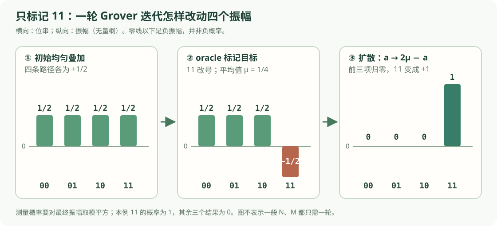

# 07｜代表性量子算法：从隐藏周期到量子模拟

本章关注完整算法，而不只介绍一个子线路。每次谈“加速”都要同时说明：输入规模、访问模型、成功概率、输出形式、经典比较对象和是否计入输入输出成本。

如果数学已经有些生疏，可分两遍读。第一遍先看 Simon、Grover、Shor 的问题定义与小算例，再看 HHL 的二维解态；读懂“输入是什么、测量给什么、何时会失败”即可。第二遍再回看 Shor 的非整齐峰、量子模拟的误差预算、幅度估计定理和复杂度类。这些段落需要较多矩阵、模运算或概率背景，不是理解前三个算法的门槛。用到相位估计或 QFT 的具体线路时，可同时翻看[第 06 章的算法骨架](06-algorithmic-primitives.md)。

先记住两种不同的“快”：**查询次数**只数向黑盒提问多少次；**门数与总时间**还要计入把黑盒做成电路、制备输入、反计算、测量和重试。本章说到指数或平方优势时，都会注明比较的是哪一种。

## 1. Simon 算法：指数级查询优势的原型

Simon 问题像一场“找固定异或差”的游戏。给定黑盒函数

$$
f:\{0,1\}^n\to\{0,1\}^n,
$$

承诺存在非零串 $s$，且

$$
f(x)=f(y)\quad\Longleftrightarrow\quad
y=x\ \text{或}\ y=x\oplus s,
$$

等价地，$x\oplus y\in\{0^n,s\}$。

符号 $x\oplus s$ 表示按位做异或：相同位给 0，不同位给 1，例如 $001\oplus110=111$。本章的版本承诺 $s\ne0^n$，所以每个函数值恰有两个原像，二者相差同一个隐藏串 $s$；有些教材还把 $s=0^n$ 的一一映射函数列为另一种允许输入，需额外区分。本章只处理前述两对一版本，要求最后输出隐藏串 $s$。

测量后得到的点积也在二进制里计算：$x\cdot z=x_1z_1\oplus\cdots\oplus x_nz_n$，乘积位依旧是普通的 0 或 1。例如 $110\cdot001=0\oplus0\oplus0=0$，而 $110\cdot100=1\oplus0\oplus0=1$。每次量子采样给的是一条关于 $s$ 的方程，不会把 $s$ 直接打印出来。

### 一次量子采样怎样产生一条方程

从两个全零寄存器出发：

$$
|0^n\rangle|0^n\rangle
\xrightarrow{H^{\otimes n}}
\frac1{\sqrt{2^n}}\sum_x|x\rangle|0^n\rangle.
$$

调用函数 oracle：

$$
\frac1{\sqrt{2^n}}\sum_x|x\rangle|f(x)\rangle.
$$

若测量第二寄存器得到 $f(x_0)$，第一寄存器变为

$$
\frac{|x_0\rangle+|x_0\oplus s\rangle}{\sqrt2}.
$$

对它施加 $H^{\otimes n}$。利用

$$
H^{\otimes n}|x\rangle=
\frac1{\sqrt{2^n}}\sum_z(-1)^{x\cdot z}|z\rangle,
$$

可得每个 $|z\rangle$ 前的因子包含

$$
1+(-1)^{s\cdot z}.
$$

若 $s\cdot z=1$，两项相消；若 $s\cdot z=0$，两项相加。因此测量只会得到满足

$$
z\cdot s=0\pmod2
$$

的随机 $z$。不显式测量第二寄存器也能得到相同的 $z$ 分布；显式测量只是帮助理解余集态。

### 三比特手算

令 $s=110$，假设第二寄存器测量后第一寄存器为

$$
\frac{|001\rangle+|111\rangle}{\sqrt2}.
$$

末层 Hadamard 得

$$
\frac12\left(|000\rangle-|001\rangle+|110\rangle-|111\rangle\right).
$$

支持集中的四个串均满足 $z_1\oplus z_2=0$。若多次得到非零样本 $001$ 和 $110$，方程为

$$
s_3=0,\qquad s_1\oplus s_2=0.
$$

再结合承诺 $s\ne000$，得到 $s=110$。

为什么不能只看一次结果就猜出 $s$？若第一次只测得 $z=001$，知道的仅是 $s_3=0$；非零候选还包括 $010,100,110$。若第二次仍测得 $001$，它重复同一条方程，没有新增信息。测得 $z=000$ 时，方程 $0=0$ 对所有 $s$ 都成立，也不缩小候选集合。直到拿到彼此线性无关的方程，才可能唯一确定 $s$。

一般要收集约 $O(n)$ 个样本，直到有 $n-1$ 条线性无关方程，再在 $\mathbb F_2$ 上做高斯消元。量子查询数为 $O(n)$；随机经典黑盒算法通常需要 $\Theta(2^{n/2})$ 次查询，才会通过生日碰撞看到一对相同函数值。这个指数差属于承诺黑盒模型，不等于任意显式函数问题都有同样加速。

这个 $O(n)$ 不是说“任取 $n-1$ 次就一定线性无关”。在上面的三比特例子中，允许的样本集合是

$$
s^\perp=\{000,001,110,111\}.
$$

它是维数 $d=n-1=2$ 的线性空间，四个元素等概率出现。从秩 0 开始，第一次拿到非零向量的概率为 $3/4$，所以等到秩变为 1 的期望抽样数是 $1/(3/4)=4/3$。已有一个非零向量后，它张成的子空间只有 2 个元素；下一次样本落在这个子空间外的概率为 $2/4=1/2$，再等一个独立方程平均要 2 次。因此这个例子达到满秩平均需要

$$
\frac43+2=\frac{10}{3}
$$

次 oracle 采样，而不是恰好 2 次。一般地，当前秩为 $r<d$ 时，新样本提高秩的概率为 $1-2^{r-d}$，故达到满秩的期望样本数为

$$
\sum_{r=0}^{d-1}\frac1{1-2^{r-d}}=d+O(1)=O(n).
$$

采样结束后还需在 $\mathbb F_2$ 上做经典高斯消元；“$O(n)$ 次查询”没有把这项经典时间抹掉。

从更高一层看，Simon 算法是在群 $\mathbb Z_2^n$ 上寻找隐藏子群 $\{0,s\}$；Shor 的周期寻找也属于 Abelian hidden subgroup 的 Fourier sampling 思路。第 16 章会把“余集态—Fourier 采样—经典恢复”的共同骨架单独展开，并说明为什么一般非 Abelian hidden subgroup 不一定有高效时间算法。

## 2. Grover 搜索

问题：在 $N$ 个候选中，有 $M$ 个被 oracle 标记。令 $|G\rangle$ 和 $|B\rangle$ 分别是所有好项、坏项的归一化均匀叠加，则

$$
|s\rangle=\sin\theta|G\rangle+\cos\theta|B\rangle,
\qquad \sin^2\theta=\frac MN.
$$

一次 Grover 迭代把角度增加 $2\theta$，$k$ 次后的成功概率为

$$
p_k=\sin^2((2k+1)\theta).
$$

公式里的“一次迭代”含两件事：**标记 oracle** 把好项的振幅变成负号，随后**扩散操作**把每个振幅 $a_x$ 映为 $2\bar a-a_x$，其中 $\bar a$ 是标记后的全部 $N$ 个振幅的平均值。这叫“绕平均值反射”，不是对每个候选单独增加一个常数。以四项中只有 $|11\rangle$ 被标记为例，从均匀态开始，一轮就能手算完：

| 阶段 | $|00\rangle$ | $|01\rangle$ | $|10\rangle$ | $|11\rangle$ |
|---|---:|---:|---:|---:|
| 初态振幅 | $1/2$ | $1/2$ | $1/2$ | $1/2$ |
| 标记后振幅 | $1/2$ | $1/2$ | $1/2$ | $-1/2$ |
| 扩散后振幅 | $0$ | $0$ | $0$ | $1$ |

标记后的平均值是 $(1/2+1/2+1/2-1/2)/4=1/4$。因此每个未标记项变成 $2(1/4)-1/2=0$，标记项变成 $2(1/4)-(-1/2)=1$；最后测得 `11` 的概率为 $|1|^2=1$。这个恰好成功的四项例子是教学特例，不代表一般 $N,M$ 总能只做一轮。反射的几何推导与更一般的幅度放大见[第 06 章第 4 节](06-algorithmic-primitives.md#4-振幅放大)。

当 $M\ll N$ 且 $M$ 已知时，迭代次数约为

$$
k\approx\frac\pi4\sqrt{\frac NM}-\frac12,
$$

取最接近的非负整数。查询复杂度为 $\Theta(\sqrt{N/M})$，并且在无结构黑盒模型中渐近最优。

### 未知解数与过度旋转

若 $M$ 未知，固定执行 $\lfloor(\pi/4)\sqrt N\rfloor$ 次可能错过峰值。可采用随机迭代次数、量子计数或固定点搜索。即使 $M$ 已知，继续迭代也会越过好态方向，成功率重新下降。

以 $N=16$ 为例，直接代入 $p_k=\sin^2((2k+1)\theta)$：

| 真实解数 | $\theta$ | $p_0$ | $p_1$ | $p_2$ | $p_3$ | $p_4$ |
|---:|---:|---:|---:|---:|---:|---:|
| $M=1$ | $\arcsin(1/4)$ | 0.0625 | 0.4727 | 0.9084 | 0.9613 | 0.5817 |
| $M=4$ | $\pi/6$ | 0.2500 | 1.0000 | 0.2500 | 0.2500 | 1.0000 |

若误以为只有一个解而选 $k=3$，实际有四个解时成功率只有 $1/4$；反而 $k=1$ 时成功率为 1。这就是“过度旋转”的可计算含义，而不是单纯的线路噪声。

未知 $M$ 时，一个有保证的做法是逐步增大迭代次数上限，每轮从 $0,1,\ldots,m-1$ 中随机选 $k$，运行后再用经典谓词验证候选；Boyer–Brassard–Høyer–Tapp 算法在 $M>0$ 时保持期望 $O(\sqrt{N/M})$ 次查询。若 $M=0$，永远不会出现可验证目标，因此实际程序必须设置停止规则；把总工作限制在 $O(\sqrt N)$ 量级后才能报告“没有找到”，而不能把失败样本当成不存在解的证明。量子计数和固定点搜索改变的是已知信息、线路深度或单调性等取舍，并非免费消除未知 $M$。

### 不能忽略的成本

- 构造并可逆运行判断谓词的门数；
- 数据是否能被相干、随机访问；
- 扩散操作和辅助位反计算；
- 容错实现、失败重试与最终验证；
- 大规模并行经典搜索的墙钟时间基线。

因此，Grover 保证的是查询模型中的平方优势，不是所有“遍历业务数据”的自动平方墙钟加速。对 $2^n$ 个候选的 NP 搜索，它给出约 $2^{n/2}$ 而非多项式时间。

## 3. Shor 算法：从整数分解到阶寻找

### 3.1 经典约化

要分解奇合数 $N$，先统一三个熟悉的记号。$u\equiv v\pmod N$ 意味着 $u-v$ 可被 $N$ 整除，例如 $16\equiv1\pmod{15}$；“$a^r\bmod N$”是 $a^r$ 除以 $N$ 的余数。$\gcd(u,N)$ 是 $u$ 与 $N$ 的最大公因数，例如 $\gcd(12,15)=3$。**阶** $r$ 是使 $a^r\equiv1\pmod N$ 的最小正整数，不是任意一个满足等式的指数。接下来按这个定义做经典约化：

1. 先用经典算法检查素性与完美幂。若 $N$ 是素数，就没有非平凡因子；若 $N=b^m$（$m\ge2$），则 $b$ 已是非平凡因子，完整分解时再递归分解 $b$；
2. 对剩下的输入，随机选 $1<a<N$；若 $\gcd(a,N)>1$，已经找到因子；
3. 寻找最小正整数 $r$，使 $a^r\equiv1\pmod N$；
4. 若 $r$ 为奇数，换一个 $a$；
5. 若 $a^{r/2}\equiv-1\pmod N$，也换一个 $a$；
6. 否则利用

$$
a^r-1=(a^{r/2}-1)(a^{r/2}+1)
$$

计算

$$
\gcd(a^{r/2}-1,N),\qquad
\gcd(a^{r/2}+1,N),
$$

得到非平凡因子。

为什么步骤 5 只需额外排除 $-1$？记 $u=a^{r/2}\bmod N$。因为 $r$ 为偶数，$u^2\equiv a^r\equiv1\pmod N$。若 $u\equiv1\pmod N$，就与 $r$ 是**最小**正阶矛盾；所以剩下的坏情况是 $u\equiv-1\pmod N$，此时两个最大公因数只能给平凡结果 1 与 $N$。当 $u$ 既非 $1$ 也非 $-1$ 时，$N$ 整除 $(u-1)(u+1)$，却不整除其中任何一个因子，计算两个最大公因数可提取非平凡因子。

因此，量子部分解决的是**阶寻找**，不是直接输出因子；取最大公因数与验算都在普通计算机上完成。

### 3.2 相位估计如何看见阶

第 06 章已经介绍 QFT 的线路；这里补一段小算例，说明它在阶寻找中究竟做了什么。取大小 $Q=16$ 的相位寄存器，假设它在函数值测量后的态只包含位置 $0,4,8,12$：

$$
|P\rangle=\frac{|0\rangle+|4\rangle+|8\rangle+|12\rangle}{2}.
$$

四个位置每隔 4 重复一次，周期 $r=4$。定义 $F_Q|x\rangle=Q^{-1/2}\sum_{y=0}^{Q-1}e^{2\pi ixy/Q}|y\rangle$。在输出 $|y\rangle$ 前，四条路径的振幅相加为

$$
\frac1{2\sqrt{16}}\sum_{j=0}^3 e^{2\pi i(4j)y/16}
=\frac18\sum_{j=0}^3e^{2\pi ijy/4}.
$$

若 $y=0,4,8,12$，四项都是 1，振幅为 $4/8=1/2$，概率各 $1/4$；其余 $y$ 的四个相位绕一圈相消，振幅为 0。周期 4 因而变成“读数间隔 $Q/r=4$ 的四个峰”。若周期态从位置 1 而非 0 开始，峰的位置仍相同，只是各峰振幅附加不同相位；若 $r$ 不能整除 $Q$，则不再是恰好为零的分布，峰聚在 $y/Q\approx k/r$ 附近。相位估计线路通常用**逆** QFT，其指数符号相反，但这里讨论的峰位置不变。这个手算只是解释 Fourier 机制；真正可扩展的 Shor 电路还必须高效实现受控模乘。

令 $a$ 与 $N$ 互素。在 $0\le y<N$ 的全部剩余类上定义模乘算符

$$
U_a|y\rangle=|ay\bmod N\rangle.
$$

由于 $\gcd(a,N)=1$，存在模 $N$ 的逆元 $a^{-1}$。若 $ay_1\equiv ay_2\pmod N$，两边乘以 $a^{-1}$ 就得到 $y_1\equiv y_2\pmod N$；所以模乘会置换所有 $N$ 个剩余类，包括与 $N$ 不互素的剩余类，而不只是 $|1\rangle$ 所在的轨道。量子寄存器有 $2^{\lceil\log_2N\rceil}$ 个计算基态，可规定 $y\ge N$ 的态保持不变，从而把这项置换扩展成整个寄存器上的酉门。这个扩展不改变从 $|1\rangle$ 出发的阶寻找分析。

若 $a$ 的阶为 $r$，则

$$
|u_k\rangle=\frac1{\sqrt r}\sum_{j=0}^{r-1}
e^{-2\pi ikj/r}|a^j\bmod N\rangle
$$

满足

$$
U_a|u_k\rangle=e^{2\pi ik/r}|u_k\rangle.
$$

核对这个本征值只需把求和指标从 $j$ 换成 $\ell=j+1\pmod r$：$U_a$ 把 $|a^j\rangle$ 移到 $|a^{j+1}\rangle$，原系数随之变为

$$
e^{-2\pi ik(\ell-1)/r}
=e^{2\pi ik/r}e^{-2\pi ik\ell/r}.
$$

反过来，利用 $\sum_{k=0}^{r-1}e^{-2\pi ikj/r}=r$（$j=0\pmod r$）或 0（其余 $j$），得到

$$
|1\rangle=\frac1{\sqrt r}\sum_{k=0}^{r-1}|u_k\rangle.
$$

所以这些本征相位在初态中的权重各为 $1/r$。对 $U_a$ 做相位估计，会随机获得接近某个 $k/r$ 的相位。若相位寄存器大小为 $Q=2^t$，测量值 $y$ 通常满足

$$
\frac yQ\approx\frac kr.
$$

经典连分数算法从 $y/Q$ 恢复候选分母 $d$，先用 $a^d\bmod N=1$ 排除明显错误的候选。通过这个检验只说明真阶整除 $d$，本身不保证 $d$ 是**最小**阶。若 $k$ 与 $r$ 不互素，分数会约掉一部分分母，需要再次采样或合并候选；得到可用阶后再验算最终因子。

连分数恢复有一个常用的充分条件：若

$$
\left|\frac yQ-\frac kr\right|<\frac1{2r^2},
$$

则 $k/r$ 的既约形式会出现在 $y/Q$ 的某个连分数收敛分数中。取 $Q$ 至少为 $N^2$ 的量级可提供足够分辨率，因为阶满足 $r<N$。但该条件只保证找回**既约分数**；若 $\gcd(k,r)>1$，得到的分母仍会是 $r$ 的真因子，所以模幂验证和重复采样不是可省略的实现细节。

### 3.3 手算例子：分解 15

取 $a=2$：

$$
2^0,2^1,2^2,2^3,2^4\pmod{15}=1,2,4,8,1,
$$

所以 $r=4$。若取 $t=8$，即 $Q=256$，理想 Fourier 峰位于

$$
y\in\{0,64,128,192\},
$$

对应 $0,1/4,1/2,3/4$。本例 $r=4$ 恰好整除 $Q=256$，从 $|1\rangle$ 出发四个本征相位权重相同，所以四个读数各以 $1/4$ 出现。$y=0$ 只给相位 0，不能确定阶；$y=128$ 给约分后的分母 2；$y=64$ 或 $192$ 的分子与 4 互素，才会直接露出完整分母 4。也就是说，即使理想相位读出没有网格误差，**单次直接露出阶的概率也只有 $1/2$**，不是必然成功。若测得 $y=64$，连分数给出分母 4。随后

$$
2^{r/2}=4\not\equiv-1\pmod{15},
$$

并且

$$
\gcd(4-1,15)=3,\qquad \gcd(4+1,15)=5.
$$

若测得 $128$，$128/256=1/2$ 的分母只有 2，并非真正的阶；不能直接把 2 当作答案。最简单的处理是再次采样，也可尝试验证候选分母的小倍数；本例检查 $2\times2=4$ 就能通过模幂检验。

这里的倍数只有 2，是小整数例子的便利；一般的 $k/r$ 约分后丢掉的因子 $\gcd(k,r)$ 未必小。无上界地逐个试倍数，不能作为 Shor 算法多项式时间保证的一部分。

即使量子部分**准确**找到阶，经典约化也可能在某个 $a$ 上失败。仍取 $N=15$，改选 $a=14$：$14\equiv-1\pmod{15}$，故 $14^2\equiv1\pmod{15}$，其阶是 $r=2$。阶虽为偶数，但 $a^{r/2}=14\equiv-1\pmod{15}$；于是

$$
\gcd(14-1,15)=\gcd(13,15)=1,\qquad
\gcd(14+1,15)=\gcd(15,15)=15.
$$

1 和 15 都不是非平凡因子。这不是量子机器把阶算错，而是这次随机底数不合适，需要换 $a$。

### 3.4 进阶回看：非整齐峰位、连分数与重试

分解 15 的峰恰好落在 $Q=256$ 的网格上，容易让人误以为“把测量值约分”就是连分数后处理的全部。下面改用 $N=35,a=2$。逐次模乘得到

$$
2^0,2^1,\ldots,2^{12}\pmod{35}
=1,2,4,8,16,32,29,23,11,22,9,18,1,
$$

所以阶为 $r=12$。取 $Q=2^{11}=2048$；它满足 $N^2<Q<2N^2$，但 12 不整除 2048，Fourier 峰不会全落在整数网格点上。

假设本次相位分支是 $k=1$，真实相位为 $1/12$。因为

$$
Q\frac1{12}=170\frac23,
$$

最接近的测量值是 $y=171$。其误差为

$$
\left|\frac{171}{2048}-\frac1{12}\right|
=\frac1{6144}
<\frac1{2\cdot12^2}.
$$

对 $171/2048$ 做欧几里得算法：

$$
\begin{aligned}
2048&=11\times171+167,\\
171&=1\times167+4,\\
167&=41\times4+3,\\
4&=1\times3+1.
\end{aligned}
$$

因此

$$
\frac{171}{2048}=[0;11,1,41,1,3].
$$

前几个收敛分数是 $0/1,1/11,1/12,\ldots$。不能看到一个分母就停：

$$
2^{11}\equiv18\not\equiv1\pmod{35},
\qquad
2^{12}\equiv1\pmod{35},
$$

所以经典模幂检验接受 12，而拒绝 11。由第 6 章的有限精度 QPE 公式，这个分支测得最近整数 171 的概率为

$$
\left[
\frac{\sin(\pi/3)}{2048\sin(\pi/6144)}
\right]^2
\approx0.684.
$$

失败分支也能逐步检查。若本征相位分支为 $k=2$，真实相位约分成 $2/12=1/6$，最近读数为 $y=341$。此时

$$
\frac{341}{2048}=[0;6,170,2],
$$

连分数先给候选分母 6，但 $2^6\equiv29\not\equiv1\pmod{35}$，不能接受它作为阶。这里采用的简单流程会重试；也可验证小倍数，例如本例的 $2\times6=12$，或结合多次采样的候选分母。$k=0,3,4,6,8,9,10$ 也只暴露 12 的真因子。单次相位分支能直接保留完整分母的 $k$ 是

$$
k\in\{1,5,7,11\},
$$

即与 12 互素的四个值。在暂时忽略有限精度读数失败的分析中，这一关的比例是

$$
\frac{\varphi(12)}{12}=\frac13,
$$

并不是 1。得到 $r=12$ 后才进入因子恢复：

$$
2^{r/2}=2^6=64,
$$

$$
\gcd(64-1,35)=7,
\qquad
\gcd(64+1,35)=5.
$$

这个例子把三类结果分开了：最近网格读数可能随机偏离；连分数可能先产生错误候选；即使读数足够准，$k/r$ 也可能约分。三者都可由重复采样和经典模幂检验处理，不能合写成“一次测量得到周期”。

### 3.5 逐步分析成功概率：失败可以发生在哪一步

Shor 算法不是“一次 QPE 必定给出因子”。一次尝试要依次通过下面几关：

| 环节 | 可能得到什么 | 怎样处理 |
|---|---|---|
| 经典预处理 | $N$ 是素数或完美幂 | 素数直接结束；完美幂输出其底数并按需递归分解，不进入阶寻找 |
| 随机选择 $a$ | $\gcd(a,N)>1$，直接得到因子；否则进入阶寻找 | 两种结果都不是算法失败 |
| Fourier 采样 | $y/Q$ 接近某个 $k/r$ | 选足够大的 $Q$，使峰值有足够分辨率 |
| 连分数恢复 | 若 $\gcd(k,r)>1$，约分后只得到 $r$ 的因子 | 再采样，或合并多个候选 |
| 候选阶验证 | 候选 $d$ 不满足 $a^d\equiv1\pmod N$ | 用经典模幂拒绝它；若满足，只说明真阶整除 $d$，不能仅凭此宣称 $d$ 就是最小阶 |
| 经典因子恢复 | 真正的阶 $r$ 为奇数，或 $a^{r/2}\equiv-1\pmod N$ | 换一个 $a$；对含至少两个不同素因子的奇合数，随机互素 $a$ 通过这两项检查的概率至少为 $1/2$ |
| 最终验算 | 最大公因数给 1 或 $N$，或乘回去不符 | 不接受候选因子，换随机选择并重试 |

因此单轮成功率依赖 $N$ 的因子结构、随机 $a$、采到的 $k$ 和相位精度，不能脱离这些条件报一个对所有输入都相同的百分比。先经典处理素数与完美幂后，进入阶寻找的奇合数含至少两个不同素因子；各关都有可检测的失败结果，重复次数的期望仍为输入位长的多项式，最终因子还能用乘法直接验证。

### 3.6 复杂度与密码学边界

输入规模是位长 $L=\lceil\log_2N\rceil$。Shor 的理想逻辑门数对 $L$ 为多项式，而已知最佳通用经典因数分解算法为亚指数；具体门数取决于可逆算术设计，不能只报 QFT 的 $O(L^2)$。

小整数演示常把已知周期编译进极简线路，不能外推到密码规模。破解现代 RSA 或椭圆曲线体系还需要大规模容错量子机。Shor 威胁的是因数分解和离散对数类公钥体系，不是“所有加密”；对称密钥穷举主要受 Grover 式平方根影响。

## 4. 量子模拟

哈密顿量（Hamiltonian）是描述系统能量并生成时间演化的厄米算符，本节记为 $H$；这个 $H$ 是物理量，**不是**前文的 Hadamard 门，虽然字母相同。下面使用 $\hbar=1$ 的单位约定，使 $Ht$ 无量纲；若 $H_{\rm energy}$ 以焦耳为单位，完整指数是 $e^{-iH_{\rm energy}t/\hbar}$。本节的 $H=X+Z,t=0.2$ 算例取无量纲模型参数和时间。

当封闭系统的 $H$ 不随时间变化时，时间演化为

$$
|\psi(t)\rangle=e^{-iHt}|\psi(0)\rangle.
$$

若 $H=H(t)$ 随时间变化，一般必须保留时间排序；后面的截断 Dyson 方法正是处理这类问题的一条路线。

数字量子模拟要把 $e^{-iHt}$ 近似为基本门序列。若

$$
H=\sum_jH_j
$$

且各项不对易，一阶 Lie–Trotter 公式为

$$
e^{-iHt}\approx
\left(\prod_je^{-iH_jt/r}\right)^r.
$$

### 手算：$H=X+Z$

因 $(X+Z)^2=2I$，精确演化为

$$
e^{-it(X+Z)}=
\cos(\sqrt2t)I-i\frac{\sin(\sqrt2t)}{\sqrt2}(X+Z).
$$

一步 Trotter 近似为 $e^{-itX}e^{-itZ}$。由 BCH 展开和

$$
[X,Z]=-2iY,
$$

近似指数中出现领先附加项 $it^2Y$，所以单步误差为 $O(t^2)$。分成 $r$ 步后，固定总时间下的量级降为 $O(t^2/r)$。非对易性正是 Trotter 误差的来源。

对有限维空间上的有界 Hermitian 算符 $A,B$，以下范数均取谱范数（算符 $2$-范数）。一阶公式有一个便于估算的界：

$$
\left\|e^{-i(A+B)t}-
\left(e^{-iAt/r}e^{-iBt/r}\right)^r\right\|
\le \frac{t^2}{2r}\|[A,B]\|.
$$

在上例中 $\|[X,Z]\|=2$。若 $t=0.2,r=4$，该上界为 $0.01$。它是保守上界，不是实际误差的等号；但它能把“多取几步会更准”变成可核查的误差预算。

这个 $2\times2$ 例子还能把误差预算换成明确的操作数。若只关心选多少步，可先看下表；想核对“实际误差”这一列，再做下面的进阶矩阵计算。

令 $\tau=t/r$、$c=\cos\tau$、$s=\sin\tau$。因为 $XZ=-iY$，一步乘积不是把指数里的 $X+Z$ 直接相加，而是

$$
V=e^{-i\tau X}e^{-i\tau Z}
=c^2I-isc(X+Z)+is^2Y.
$$

把 $V$ 连乘 $r$ 次，再与上面的精确矩阵相减。为避免手乘许多次，可令 $\theta=\arccos(c^2)$，于是

$$
V^r=\cos(r\theta)I
-i\frac{\sin(r\theta)}{\sin\theta}
\bigl[sc(X+Z)-s^2Y\bigr].
$$

例如 $t=0.2,r=4$ 时，$\tau=0.05$、$\theta\approx0.07069594$。把这两个矩阵的系数逐项相减，得到

$$
e^{-0.2i(X+Z)}-V^4
\approx-0.00001645I
-i(0.00016343X+0.00986725Y+0.00016343Z).
$$

对实数 $a,b_x,b_y,b_z$，矩阵 $aI+i(b_xX+b_yY+b_zZ)$ 的谱范数是 $\sqrt{a^2+b_x^2+b_y^2+b_z^2}$：乘其共轭转置后，交叉项抵消，得到这一标量乘 $I$。代入上行，实际误差约为 $0.00986997$。同一方法取 $r=20$ 给约 $0.00197346$。这一步只是复核表中小数，首次阅读不必先掌握谱范数的完整理论。

| Trotter 步数 $r$ | 指数操作数 $2r$ | 交换子上界 | 实际谱范数误差 |
|---:|---:|---:|---:|
| 4 | 8 | 0.010000 | 0.009870 |
| 20 | 40 | 0.002000 | 0.001973 |

这里的“指数操作”指一次 $e^{-iX\tau}$ 或 $e^{-iZ\tau}$，还不是后端的原生门数。若要求乘积公式误差不超过 $2\times10^{-3}$，由

$$
\frac{t^2}{2r}\|[X,Z]\|
=\frac{0.04}{r}
\le2\times10^{-3}
$$

得到 $r\ge20$，即至少 40 次这样的指数操作。

还要分别计算“公式误差”和“门实现误差”。若总演化误差目标是 $5\times10^{-3}$，把其中 $2\times10^{-3}$ 留给 Trotter 近似、$3\times10^{-3}$ 留给 40 个指数操作。先考虑每个近似门仍是酉矩阵、与对应理想门的谱范数差不超过 $\delta$ 的模型：逐项替换乘积中各操作，利用酉矩阵的谱范数为 1 和三角不等式，可得

$$
40\delta\le3\times10^{-3},
\qquad
\delta\le7.5\times10^{-5}.
$$

这里的 $\delta$ 不是每门平均失真度或实验报告的随机错误率；一般非酉噪声须改用信道距离等一致的误差度量，不能直接代入。这个数还没有包括初态制备、读出和有限 shots。若最终只测范数不超过 1 的可观察量 $O$，演化算符误差 $\epsilon_U$ 至多造成

$$
\left|\langle O\rangle_{\rm exact}
-\langle O\rangle_{\rm approx}\right|
\le2\epsilon_U
$$

的系统偏差。具体地，对同一个归一化输入态，记精确、近似输出为 $|\psi\rangle,|\phi\rangle$，有 $\|\psi-\phi\|\le\epsilon_U$。把期望值差拆成

$$
\langle\psi|O|\psi\rangle-\langle\phi|O|\phi\rangle
=\langle\psi-\phi|O|\psi\rangle+\langle\phi|O|\psi-\phi\rangle,
$$

对两项分别用 Cauchy–Schwarz 不等式与 $\|O\|\le1$，每项绝对值都至多为 $\epsilon_U$，故总和至多为 $2\epsilon_U$。因此“演化算符误差”和“可观察量误差”不应使用同一个未定义的 $\epsilon$。

二阶对称公式须同样把总时间分片。令 $\Delta=t/r$，对两项 $H=A+B$，完整线路是

$$
e^{-i(A+B)t}\approx
\left(e^{-iA\Delta/2}e^{-iB\Delta}e^{-iA\Delta/2}\right)^r.
$$

在 $A,B$ 有界、总时间固定等常见条件下，它把全局误差阶改善到 $O(t^3/r^2)$。直接数每片有三个指数操作，看似共 $3r$ 个；相邻两片接在一起时，中间的 $e^{-iA\Delta/2}e^{-iA\Delta/2}$ 可合并成一个 $e^{-iA\Delta}$，故完整式可排成 $2r+1$ 个指数操作。与一阶的 $2r$ 个相比，每片误差阶更好，门数却仍取决于达到同一目标精度所需的 $r$，不能只比较单片长度。

### 输入模型先于复杂度公式

“给定 Hamiltonian”至少可能有四种含义：

| 输入模型 | 怎样访问 $H$ | 复杂度中的关键量 |
|---|---|---|
| $k$-local 和 | $H=\sum_jH_j$，每项只作用于常数量子比特 | 项数、局域范数、交换子 |
| 稀疏 oracle | 查询每行非零元的位置和值 | 稀疏度、矩阵元上界、$t$ |
| Pauli/LCU | $H=\sum_j\alpha_jU_j$ | $\lambda=\sum_j|\alpha_j|$、PREPARE/SELECT 成本 |
| block encoding | 更大酉矩阵的左上块编码 $H/\alpha$ | 归一化 $\alpha$、辅助位、编码误差 |

一般黑箱 Hamiltonian 存在 no-fast-forwarding 限制：不能普遍用 $\operatorname{polylog}(t)$ 次查询模拟时间 $t$ 的演化。某些可积、可对角化或可快速幂的特殊结构可以例外，但复杂度声明必须把结构写出。

这里的“不能普遍”是 oracle 模型中的下界，不是说任何特定 Hamiltonian 都不能快速演化；Berry、Ahokas、Cleve 与 Sanders 给出了这类 no-fast-forwarding 构造。上面的交换子误差界则是乘积公式分析的一个基础特例，更高阶和多项情形需要相应的嵌套交换子条件。

现代方法还包括高阶乘积公式、线性组合酉、块编码、qubitization 和量子信号处理（QSP）。它们的复杂度依赖 Hamiltonian 的局域性、稀疏性、范数、访问 oracle 和目标误差，不能脱离输入模型比较一个孤立的大 $O$ 式。LCU、块编码、qubitization 与 QSP 的构造关系见[第 16 章第 5 节](16-advanced-algorithms-verification.md#5-现代-hamiltonian-算法栈)；下表只比较选择条件。

### 现代模拟方法怎样选择

不同方法把不同操作视为“一步”。因此下表用于选择入口，不是脱离访问模型的排行榜。

| 方法 | 一步需要什么 | 主导量 | 适合先想到的情形 | 主要边界 |
|---|---|---|---|---|
| 乘积公式 | 实现各项 $e^{-iH_j\tau}$ | 局域项、交换子、公式阶数 | 各局域项容易直接演化 | 高阶嵌套交换子与门数可能增大 |
| qDRIFT | 按系数绝对值随机抽取可高效演化的归一化 Hermitian 项；Pauli 串是特例 | $\lambda=\sum_j|h_j|$、$t$、$\epsilon$ | 项很多而 $\lambda$ 可控 | 近似对象是平均量子信道；有随机波动 |
| 截断 Taylor / LCU | PREPARE 制备系数叠加，SELECT 按索引选择酉操作，再做幅度放大 | LCU 权重和、oracle 成本、$\epsilon$ | 需要较好的精度依赖 | PREPARE/SELECT 可能比查询数本身昂贵 |
| qubitization / QSP | block encoding 及其受控调用 | 归一化 $\alpha$、$t$、$\epsilon$ | 有高质量块编码，追求近最优查询数 | 一次 block-encoding 查询可能是很大的电路 |
| 截断 Dyson | 对时变 $H(t)$ 的访问和时间排序 | 积分范数、时间采样、$\epsilon$ | Hamiltonian 明显随时间变化 | 不能把静态算法复杂度原样套用 |

#### 手算：qDRIFT 怎样抽样

先写清一般形式。设

$$
H=\sum_j h_jH_j,
\qquad H_j=H_j^\dagger,
\qquad \|H_j\|=1,
$$

并且每个 $e^{-i\tau H_j}$ 都可高效实现。令

$$
\lambda=\sum_j|h_j|,
\qquad p_j=\frac{|h_j|}{\lambda}.
$$

把总时间分成 $R$ 步后，每步以概率 $p_j$ 抽取第 $j$ 项并施加；这里 $R$ 是随机步数，不是前面 Grover 的候选数 $N$：

$$
e^{-i(\lambda t/R)\operatorname{sgn}(h_j)H_j}.
$$

系数的绝对值决定抽样概率，正负号仍必须进入演化；任意非 Hermitian 酉矩阵不能直接充当 Hamiltonian 项。

取一个只含两项、便于手算的 Hamiltonian：

$$
H=0.6X+0.8Z.
$$

本节用它说明 qDRIFT 怎样抽样；[第 16 章](16-advanced-algorithms-verification.md#52-lcu把线性组合放进一个酉矩阵的块)稍后会用同一矩阵说明另一种线性组合构造。第一次读第 07 章时，不需要先读第 16 章。

其系数绝对值之和与抽样概率为

$$
\lambda=1.4,
\qquad
p_X=\frac{0.6}{1.4}=\frac37,
\qquad
p_Z=\frac{0.8}{1.4}=\frac47.
$$

把总时间分成 $R$ 步。每一步以相应概率应用

$$
e^{-i(1.4t/R)X}
\quad\text{或}\quad
e^{-i(1.4t/R)Z}.
$$

一阶展开后，平均单步的生成项是

$$
-i\frac{1.4t}{R}
\left(\frac37X+\frac47Z\right)
=-i\frac{t}{R}H.
$$

这解释了抽样概率为何与系数大小成正比。严谨 qDRIFT 分析比较的是随机电路平均得到的量子信道与目标信道；不能把“平均单步矩阵的一阶项正确”误写成每条随机线路都等于 $e^{-iHt}$。在以金刚石范数（diamond norm，连同任意参考系统一起衡量最坏情形信道差异）约束平均信道误差不超过 $\epsilon$ 的标准界下，步数标度为 $R=O(\lambda^2t^2/\epsilon)$。若用多次运行估计期望值，每次都应独立重新抽取随机线路；只固定抽出的一条线路反复运行，不能直接套用这个平均信道误差界。[Campbell 的原论文](https://arxiv.org/abs/1811.08017)特别区分了平均信道与单条随机酉的误差。

完整工作流还包括：物理模型到量子比特的编码、初态制备、演化、可观察量测量和经典后处理。通常只估计少数局域量、能量或关联函数；若要求输出全部 $2^n$ 个波函数振幅，输出本身就是指数长的。

## 5. HHL 与量子线性系统算法

给定可逆、稀疏、条件良好的 Hermitian 矩阵 $A$ 和可高效制备的归一化态 $|b\rangle$，目标是制备

$$
|x\rangle\propto A^{-1}|b\rangle.
$$

在谱分解 $A=\sum_j\lambda_j|u_j\rangle\langle u_j|$ 下，若

$$
|b\rangle=\sum_j\beta_j|u_j\rangle,
$$

则理想输出与

$$
\sum_j\frac{\beta_j}{\lambda_j}|u_j\rangle
$$

成比例。HHL 用相位估计写入 $\lambda_j$，受控旋转编码 $1/\lambda_j$，再反计算本征值寄存器。

这里的“编码”不能理解成酉门直接把每个振幅乘以 $1/\lambda_j$：若某个 $|\lambda_j|<1$，那可能把振幅放大到超过 1。HHL 引入一个辅助比特，并选常数 $C$ 满足 $0<C\le\min_j|\lambda_j|$。在相位估计已标出本征值的理想情形，受控旋转让辅助比特的 $|1\rangle$ 振幅成为 $C/\lambda_j$；负本征值的符号也必须进入这个振幅。把本征值寄存器反计算后，只在辅助比特测得 1 的分支留下

$$
C\sum_j\frac{\beta_j}{\lambda_j}|u_j\rangle
=C A^{-1}|b\rangle.
$$

这个分支尚未归一化，其发生概率是

$$
p_{\rm succ}=C^2\sum_j\left|\frac{\beta_j}{\lambda_j}\right|^2
=C^2\|A^{-1}|b\rangle\|^2.
$$

失败分支不是错误答案，而是辅助比特测得 0；要重新运行或做幅度放大。若把 $A$ 的最大本征值模缩放为 1、最小本征值模为 $1/\kappa$，可取 $C=1/\kappa$。某些输入下成功率会低至 $1/\kappa^2$ 量级，因此不能把后选择的重试成本藏在“制备了解态”四个字里。

必须同时说明：

- 输出是量子态，不是全部经典分量；
- 成本依赖矩阵访问模型、稀疏性、条件数 $\kappa$ 和误差 $\epsilon$；
- 小本征值使受控旋转和成功概率恶化，故“条件良好”不是装饰条件；
- 若最终要打印全部 $N$ 个分量，至少需要线性输出成本；
- 制备 $|b\rangle$ 与从 $|x\rangle$ 提取目标量可能抵消形式加速。

HHL 很能说明输入与输出形式对算法成本的影响；不能据此认定任意线性方程组都有指数加速。

### 二维手算：输出是解态，不是解向量清单

取

$$
A=\begin{pmatrix}1&0\\0&2\end{pmatrix},
\qquad |b\rangle=|+\rangle.
$$

矩阵的条件数为 $\kappa=2$。未归一化解为

$$
A^{-1}|b\rangle
=\frac1{\sqrt2}\left(|0\rangle+\frac12|1\rangle\right).
$$

取 $C=1$，因为两个本征值模分别为 1 和 2，辅助比特成功分支的未归一化态恰是上式。它的平方范数是

$$
p_{\rm succ}=\left|\frac1{\sqrt2}\right|^2+
\left|\frac1{2\sqrt2}\right|^2
=\frac12+\frac18=\frac58.
$$

另外 $3/8$ 的运行测得辅助比特 0，不给出所要的解态。只有在成功分支把向量除以 $\sqrt{5/8}$ 后，输出态才为

$$
|x\rangle=\frac{2|0\rangle+|1\rangle}{\sqrt5}.
$$

若任务只需一个整体量，可直接估计。例如

$$
\langle x|Z|x\rangle=\frac45-\frac15=\frac35.
$$

计算基测量给出 $p_0=4/5,p_1=1/5$ 的样本；它不会一次打印两个振幅，更不会直接显示相对符号。对一般 $N$ 维问题，恢复全部经典分量至少要写出 $N$ 个数。验证解态也不是免费：在一般黑箱模型的最坏情形，验证复杂度同样会受 $\kappa$ 制约。

## 6. 量子幅度估计

若算法 $A$ 的成功概率为 $a$，经典 Monte Carlo 以常数置信度达到加性误差 $\epsilon$ 通常需要 $O(1/\epsilon^2)$ 个独立样本。理想相位估计型幅度估计可把 oracle 查询降至 $O(1/\epsilon)$，但需要受控操作、逆操作和较深的相干线路。

写成二维形式：

$$
A|0\rangle=\sin\theta|G\rangle+
\cos\theta|B\rangle,
\qquad a=\sin^2\theta.
$$

由“关于好态反射”和“关于 $A|0\rangle$ 反射”组成的 Grover 算符 $Q$，在 $|G\rangle,|B\rangle$ 张成的子空间内有两个本征值

$$
e^{\pm2i\theta}.
$$

对 $Q$ 做相位估计得到 $\tilde\theta$，再输出 $\tilde a=\sin^2\tilde\theta$。标准 QPE 型量子幅度估计定理的一种写法是：令 $M$ 表示相位网格大小，也就是受控 Grover 幂所覆盖的资源尺度；总共使用 $O(M)$ 次 $Q$（从而使用 $O(M)$ 次构成 $Q$ 的 oracle 操作）时，以至少 $8/\pi^2$ 的概率满足

$$
|\tilde a-a|
\le
\frac{2\pi\sqrt{a(1-a)}}{M}+\frac{\pi^2}{M^2}.
$$

因此 $M=O(1/\epsilon)$ 足以达到常数成功概率的加性误差 $\epsilon$；这里的查询包括构成 $Q$ 所需的 $A,A^\dagger$ 和好态反射，不能把这些电路当成免费。

### 两位相位估计的手算

若 $a=1/2$，则 $\theta=\pi/4$。$Q$ 的两个本征值为 $e^{\pm i\pi/2}$，对应归一化相位 $1/4$ 与 $3/4$。两位精确 QPE 会得到 `01` 或 `11`。后一支应解释为负相位 $-1/4$；一般可用 $\theta=\pi\min(\phi,1-\phi)$ 把两支折回 $[0,\pi/2]$，此处均得 $\theta=\pi/4$，故两支都给

$$
\sin^2(\pi/4)=\frac12.
$$

这解释了为什么幅度估计会出现两个相位峰，却只对应一个成功概率。

无 QFT、最大似然或迭代式变体可降低线路深度，却可能增加常数、轮数或对噪声模型的依赖。比较时应报告总 oracle 次数和总重复运行次数（shots），而不只报告最深一条线路。

| 方法 | 受控 $Q$/QFT | 最大相干深度 | 总查询的理想标度 | 主要边界 |
|---|---|---:|---:|---|
| QPE 型 | 通常需要 | $O(1/\epsilon)$ | $O(1/\epsilon)$ | 深线路、受控反射 |
| 迭代式 | 不需完整 QFT | 随轮次增加 | 接近 $O(1/\epsilon)$ | 多轮置信区间与常数 |
| 最大似然式 | 可不需 QPE | 由所选 Grover 幂决定 | 设计相关 | 拟合偏差与噪声模型 |
| 直接采样 | 不需要 | 1 | $O(1/\epsilon^2)$ | 查询多但线路最浅 |

如果硬件把最大 Grover 幂限制在常数，或深线路噪声抹掉相位信息，就不能只凭“没有 QFT”宣称仍保留完整二次优势。

## 7. 复杂度类的正确读法

- **P**：经典确定性多项式时间。
- **BPP**：经典随机多项式时间，有界错误。
- **BQP**：量子多项式时间，有界错误。
- **NP**：是实例存在多项式长度的经典见证，可由经典多项式时间验证。
- **QMA**：是实例存在多项式量子态见证，可由量子多项式时间验证。
- **PP**：多项式时间概率机以严格大于 $1/2$ 的概率接受是实例；差距可以极小，因此不是通常意义的高效随机计算。
- **PSPACE**：经典多项式空间。

已知包含关系包括

$$
\mathrm P\subseteq\mathrm{BPP}\subseteq\mathrm{BQP}
\subseteq\mathrm{QMA}\subseteq\mathrm{PP}\subseteq\mathrm{PSPACE}.
$$

还知道 $\mathrm{NP}\subseteq\mathrm{QMA}$。两个有助于理解上界、却不代表普通量子机能力的等价是

$$
\mathrm{PostBQP}=\mathrm{PP},
\qquad
\mathrm{QIP}=\mathrm{PSPACE}.
$$

PostBQP 允许对可能指数稀有的测量事件做后选择，并非现实设备上的免费操作；QIP 允许计算受限验证者与计算上不受限的证明者交互，也不是 BQP 算法模型。量子线路接受概率是典型 BQP-complete promise problem；带逆多项式 promise gap 的局域 Hamiltonian 问题是 QMA-complete。上述包含是否严格大多未知；`NP` 与 `BQP` 的一般包含关系也未知。Shor 说明因数分解可在量子多项式时间完成，不说明 NP 完全问题都能高效求解。

### 局域 Hamiltonian 问题究竟问什么

给定

$$
H=\sum_{j=1}^mH_j,
$$

其中每个 $H_j$ 至多作用于 $k$ 个量子比特，各项以多项式位精度给出且范数受多项式界；再给两个阈值 $a<b$，并承诺

$$
b-a\ge\frac1{\operatorname{poly}(n)}.
$$

局域 Hamiltonian 判定问题要求区分：

- **YES：** $\lambda_{\min}(H)\le a$；
- **NO：** $\lambda_{\min}(H)\ge b$。

若最低能量落在 $(a,b)$，输入不满足承诺，算法无需给出规定答案。这里的 $b-a$ 是判定阈值之间的**承诺间隙**；物理中常说的谱隙则是

$$
\Delta_{\rm spec}=E_1-E_0.
$$

两者不是同一个量。“判断是否存在低能量量子见证”、实际制备基态、模拟 $e^{-iHt}$ 和输出完整能谱也不是同一任务。

#### 手算：承诺间隙不等于谱隙

取

$$
H=\frac{I-Z_1}{2}+\frac{I-Z_2}{2}.
$$

| 基态 | $|00\rangle$ | $|01\rangle$ | $|10\rangle$ | $|11\rangle$ |
|---|---:|---:|---:|---:|
| 能量 | 0 | 1 | 1 | 2 |

若 $a=1/4,b=3/4$，这是 YES 实例，因为最低能量为 0。承诺间隙是 $1/2$，物理谱隙是 1。这个 1-local 例可以逐比特求解；一般 2-local Hamiltonian 问题是 QMA-complete。这里的“complete”是最坏情形输入族的复杂度结论，不表示每个两体物理模型都难。

## 8. 算法选择与证据表

| 结构 | 首先考虑 | 理论优势 | 必须追问 |
|---|---|---|---|
| 黑箱中少数目标 | Grover / 振幅放大 | 二次查询优势且黑箱最优 | oracle 能否便宜、相干地实现？ |
| XOR 隐藏周期 | Simon / Fourier sampling | 承诺查询模型中指数差 | 承诺是否成立？函数如何访问？ |
| 整数阶或周期 | Shor / 相位估计 | 对位长为多项式 | 模幂、容错和连分数成功率？ |
| 酉算符本征相位 | 相位估计 | 精度依赖优于直接采样的场景 | 本征态和受控幂如何制备？ |
| Hamiltonian 动力学 | 模拟算法 | 对局域/稀疏/块编码模型可高效 | 要测什么？态制备与读出多贵？ |
| 线性方程组的少数整体量 | 量子线性系统 | 强输入输出假设下可能很大 | $\kappa$、数据装载和输出形式？ |
| 概率/期望估计 | 幅度估计 | 对 $1/\epsilon$ 二次改进 | 能否承受深相干电路？ |

## 9. 常见误区

- “Shor 是指数加速”必须相对已知最佳通用经典算法、以位长为变量来说明，不能只和试除法比较。
- Grover 提供平方查询加速，不会把一般 NP 完全问题变成多项式时间。
- QFT 线路快，不表示完整经典频谱输出快。
- 理想门模型中的多项式时间，不等于近期硬件上的实用优势。
- 小规模“运行 Shor”可能依赖已知答案的编译简化；演示电路不等于可扩展实现。
- 量子模拟输出量子态，不等于获得了其所有经典描述。
- HHL 的指数维度压缩与量子态输入输出绑定，不能忽略装载和读出。

## 实操扩展：单次成功率最高，不一定平均查询最省

第 2 节给出 $N=16,M=1$ 时首个成功峰在 $k=3$ 附近。若任务允许每次测量后用一次同一谓词验证，失败就从均匀态独立重来，优化目标已经改变。为单独研究查询口径，暂把制备、扩散及经典控制的门数另列，每次尝试计 $k$ 次相位标记加 1 次候选验证；这里假定相位标记和验证各以一次标准函数查询实现。成功率为 $p_k>0$ 时，尝试次数服从几何分布，期望为 $1/p_k$，因此

$$
\mathbb E[\text{总查询}]=\frac{k+1}{p_k}.
$$

| 每次尝试的迭代数 $k$ | 单次成功率 $p_k$ | 每次查询 $k+1$ | 直到验证成功的平均查询数 |
|---:|---:|---:|---:|
| 0 | 0.062500 | 1 | 16.0000 |
| 1 | 0.472656 | 2 | 4.2314 |
| 2 | 0.908447 | 3 | 3.3023 |
| 3 | 0.961319 | 4 | 4.1609 |

这四种策略里，$k=2$ 的平均查询更少，虽然单次成功率低于 $k=3$。表格没有证明 $k=2$ 对任意硬件或所有非负整数都最优；它只在给定重试模型和四个候选方案内比较。若每次启动设备有很大固定成本、验证谓词昂贵、或相干线路随深度退化，应改写每轮总成本，再重新优化。

**实验 07-A。** 用十六个实际振幅依次完成标记和均值反射，独立核对 $\sin^2((2k+1)\theta)$；分别设一个目标和四个目标，运行到 $k=4$。若每次独立尝试都保证 $p\ge1/4$，要使全部失败的概率不超过 $0.01$，需

$$
R\ge\frac{\ln0.01}{\ln(3/4)},\qquad R=17.
$$

这保证的是预先固定的重试预算下至少一次成功的概率，不是存在解的零错误判定。代码入口为 `python3 codes/algorithms/experiments.py 07`；[完整实验与答案](labs/algorithms.md#实验-07-a逐振幅检查过度旋转)同时核对 $R=16$ 尚不满足要求。

## 10. 自检

1. 对 Simon 的 $s=101$，列出所有满足 $z\cdot s=0$ 的三比特串。
2. 若 $N=10^6$ 且唯一目标，Grover 查询次数的数量级是多少？oracle 若每次需 $10^4$ 个门，总门数至少是什么量级？
3. 用 $a=2$ 对 $N=21$ 计算阶，并检查能否在本轮得到非平凡因子。
4. 在分解 15 的例子中，为什么测得相位 $1/2$ 还不够？
5. HHL 为什么通常不适合“打印全部解分量”的任务？
6. 说出理想量子模拟之外的四个端到端成本。
7. 在 $H=X+Z,t=0.2$ 的例子中，用交换子界估算要让一阶 Trotter 上界不超过 $2\times10^{-3}$，至少需要多少步？
8. 若幅度估计中 $a=1/2$，为什么相位 $1/4$ 与 $3/4$ 都给同一个概率？
9. 为什么 $\mathrm{PostBQP}=\mathrm{PP}$ 不表示现实中的 BQP 设备能高效解决所有 PP 问题？
10. 稀疏 oracle、LCU 和 block encoding 三种 Hamiltonian 输入模型分别把什么成本隐藏在“访问一次”中？
11. Simon 的隐藏串设为 $s=110$。若先后测得 $z=001,110,001$，分别写出方程；哪一次没有增加信息？最后怎样用非零承诺确定 $s$？
12. 在 $N=4$ 的 Grover 例子里，只有 `11` 是解。从均匀态开始，写出标记后四个振幅、平均振幅，以及扩散后四个振幅。
13. 对 $Q=16$ 的周期态 $(|0\rangle+|4\rangle+|8\rangle+|12\rangle)/2$ 做 QFT，为什么 $y=4$ 的输出振幅是 $1/2$，而 $y=1$ 的振幅是 0？
14. HHL 的 $A=\operatorname{diag}(1,2)$、$|b\rangle=|+\rangle$ 例子取旋转常数 $C=1$。算辅助比特为 1 的概率与成功后归一化的解态。
15. 分解 15 时若随机选 $a=14$，求它的阶，并说明阶已经求对、最终最大公因数却仍只给 1 和 15 的原因。

答案见[练习与答案：第 7 章](appendices/exercises.md#第-7-章)。

## 参考起点

- D. R. Simon, [On the Power of Quantum Computation](https://doi.org/10.1137/S0097539796298637), *SIAM Journal on Computing* 26, 1474–1483 (1997)。
- L. K. Grover, [A fast quantum mechanical algorithm for database search](https://doi.org/10.1145/237814.237866), STOC (1996)。
- M. Boyer, G. Brassard, P. Høyer, A. Tapp, [Tight bounds on quantum searching](https://arxiv.org/abs/quant-ph/9605034), *Fortschritte der Physik* 46, 493–505 (1998)；给出精确成功率、多解与未知解数搜索分析。
- P. W. Shor, [Polynomial-Time Algorithms for Prime Factorization and Discrete Logarithms on a Quantum Computer](https://doi.org/10.1137/S0097539795293172), *SIAM Journal on Computing* 26, 1484–1509 (1997)。
- IBM Quantum Learning, [The phase-estimation procedure](https://quantum.cloud.ibm.com/learning/en/courses/fundamentals-of-quantum-algorithms/phase-estimation-and-factoring/phase-estimation-procedure)：QFT 定义、逆 QFT、有限精度相位读数。
- IBM Quantum Learning, [Phase estimation and factoring](https://quantum.cloud.ibm.com/learning/en/courses/fundamentals-of-quantum-algorithms/phase-estimation-and-factoring/introduction)：从受控模乘、相位估计到连分数和经典验证的完整教学实现。
- G. Leander, [Improving the Success Probability for Shor's Factoring Algorithm](https://arxiv.org/abs/quant-ph/0208183) (2002)。
- S. Lloyd, [Universal Quantum Simulators](https://doi.org/10.1126/science.273.5278.1073), *Science* 273, 1073–1078 (1996)。
- G. H. Low, I. L. Chuang, [Hamiltonian Simulation by Qubitization](https://quantum-journal.org/papers/q-2019-07-12-163/), *Quantum* 3, 163 (2019)。
- A. W. Harrow, A. Hassidim, S. Lloyd, [Quantum algorithm for linear systems of equations](https://doi.org/10.1103/PhysRevLett.103.150502), *Physical Review Letters* 103, 150502 (2009)。
- J. Watrous, [Quantum Computational Complexity](https://arxiv.org/abs/0804.3401) (2008)。
- G. Brassard et al., [Quantum Amplitude Amplification and Estimation](https://arxiv.org/abs/quant-ph/0005055) (2000)。
- A. M. Childs et al., [Theory of Trotter Error with Commutator Scaling](https://doi.org/10.1103/PhysRevX.11.011020), *Physical Review X* 11, 011020 (2021)。
- D. W. Berry, G. Ahokas, R. Cleve, B. C. Sanders, [Efficient Quantum Algorithms for Simulating Sparse Hamiltonians](https://arxiv.org/abs/quant-ph/0508139), *Communications in Mathematical Physics* 270, 359–371 (2007)。
- D. W. Berry et al., [Simulating Hamiltonian Dynamics with a Truncated Taylor Series](https://arxiv.org/abs/1412.4687) (2014)。
- E. Campbell, [A random compiler for fast Hamiltonian simulation](https://arxiv.org/abs/1811.08017), *Physical Review Letters* 123, 070503 (2019)。
- M. Kieferová, A. Scherer, D. Berry, [Simulating the dynamics of time-dependent Hamiltonians with a truncated Dyson series](https://arxiv.org/abs/1805.00582), *Physical Review A* 99, 042314 (2019)。
- J. Kempe, A. Kitaev, O. Regev, [The Complexity of the Local Hamiltonian Problem](https://arxiv.org/abs/quant-ph/0406180), *SIAM Journal on Computing* 35, 1070–1097 (2006)。
- R. D. Somma, Y. Subaşı, [Complexity of quantum state verification in the quantum linear systems problem](https://arxiv.org/abs/2007.15698), *PRX Quantum* 2, 010315 (2021)。
- S. Aaronson, [Quantum Computing, Postselection, and Probabilistic Polynomial-Time](https://www.scottaaronson.com/papers/pp.pdf), *Proceedings of the Royal Society A* 461, 3473–3482 (2005)。
