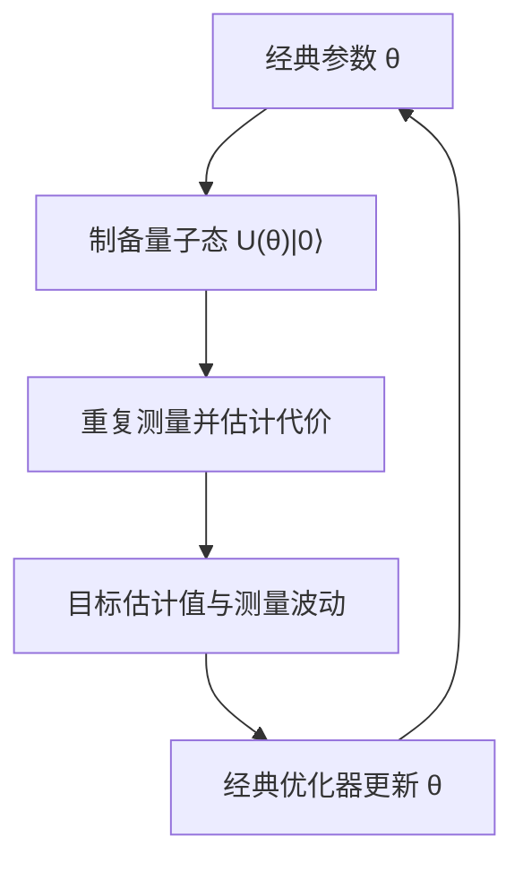

# 08｜应用、变分算法与证据边界

应用章节最容易把“可写成量子线路”误写成“已获得量子优势”。本章从可手算的模型逐步到实际任务：先说要计算什么，再算线路返回什么，最后计入误差、数据准备和经典比较。VQE 是“变分量子本征求解器”，QAOA 是“量子近似优化算法”。除非另有严格证明，它们和许多量子机器学习方法都应称为**启发式混合算法**：可能在某些实例上有效，但不保证对一般输入比已知最好的经典方法更快。若第 01 章的统计方差与第 02 章的测量还不熟悉，可先读本章每节的第一个算例，标着“进阶回看”的资源和图论推导稍后补。

## 阅读前先固定：究竟要交付什么

“应用”不是一个单一任务。必须写出输入是什么、答案是什么形式、允许多大误差或失败率，以及拿什么经典方法比较。下面是本章五条主线；后文的 $\epsilon$ 表示预先约定的输出误差容忍度，不是硬件的门错误率。

| 任务 | 输入与须说明的前提 | 要交付的输出 | 合理的经典比较对象 |
|---|---|---|---|
| VQE 基态能量 | 给定可实现的哈密顿量及试探态线路 | 能量估计，注明精度、置信度和模型误差 | 精确对角化（小规模）、耦合簇与合适的张量网络方法等 |
| QAOA 组合优化 | 给定图或约束、可实现的代价和混合线路 | 一个或多个候选比特串及其目标值、成功率 | 专用精确或启发式优化器，使用同一时间预算 |
| 量子机器学习 | 给定训练/测试数据、访问方式与标签 | 未见样本上的预测误差或训练成本 | 调优过的同类经典学习器及量子启发方法 |
| 风险或定价 | 给定概率分布的可实现制备与收益函数 | 期望收益或尾部风险的数值及置信度 | 经典随机模拟、低差异序列采样等 |
| 化学与材料 | 给定几何、基组、活性空间与物理模型 | 能量差、响应或动力学等可比物理量 | 对同一近似模型的量子化学/多体数值方法 |

同一个问题的**目标值期望**与**找到一个好的具体答案**不同；同一个分子的**简化模型能量**与**真实反应预测**也不同。理论中的“查询一次”若需要制备复杂输入、运行长电路和重复很多次，端到端时间就未必小。本章所有小算例只训练计算和判断，不声称它们本身已形成应用优势。

## 1. 为什么出现变分量子算法

在未实现大规模、持续纠错的设备上，能可靠执行的线路深度受到限制。一种办法是让量子设备反复制备一个较短线路给出的**试探态**，测它的目标值，交给经典计算机选择下一组参数。这个“量子测量—经典更新”的循环称为**变分量子算法**。设 $\theta$ 表示一组可调的实数角度，$U(\theta)$ 是由这些角度控制的门组合，$U(\theta)|0\cdots0\rangle$ 是本次试探态；英文 ansatz 仅是这族试探态/线路的名称，并不表示答案已知。

循环可以这样读：

图中 $\widehat C(\theta)$ 指根据有限次数测量得到的**估计值**，帽子提醒它不是精确的 $C(\theta)$。一次重复运行同一线路并记录一个结果，通常称一次 shot；本章以下多用“重复测量一次”。量子设备估计目标值，有的算法还估计梯度；经典优化器据此调整参数。单条线路可能较浅，但粗略的调用量通常是

$$
\text{参数点评估次数}\times\text{测量组数}\times\text{每组重复测量次数}\times\text{额外缓解倍率},
$$

这只是各参数点和各组次数相同情况下的概算；实际需把每一组单独相加，还要计入状态制备、编译、通信、排队与经典优化时间。因此“单条线路较浅”不等于“交付答案便宜”。

## 2. VQE

**哈密顿量**是描述模型能量、并决定理想时间演化的厄米矩阵。本节把它记为 $H$；它不是第 02 章记作 $H$ 的 Hadamard 门，二者只是沿用了不同上下文的惯常符号。若模型有 $n$ 个量子比特，$H$ 是 $2^n\times2^n$ 矩阵，常写成 Pauli 串之和：

$$
H=\sum_jc_jP_j.
$$

这里每个 $P_j$ 是 $n$ 个 $I,X,Y,Z$ 矩阵的张量积，例如两比特的 $Z\otimes X$；$c_j$ 是实数，若在求能量就带能量单位。恒等项 $c_0I$ 也算一项，会整体平移能量，却不用重复测量来估计，因为任何归一化态的 $\langle I\rangle=1$。将求能量问题变成许多可测的 $\pm1$ 型 Pauli 结果，是 VQE 的基本计算步骤。

选择由参数 $\theta$ 控制的归一化试探态 $|\psi(\theta)\rangle$。一次给定 $\theta$ 的任务是估计

$$
E(\theta)=\langle\psi(\theta)|H|\psi(\theta)\rangle
=\sum_jc_j\langle P_j\rangle_\theta.
$$

为什么把能量往低处调有道理？设 $H$ 的正交归一化本征态为 $|E_k\rangle$，对应能量按 $E_0\le E_1\le\cdots$ 排列。任一归一化试探态都可在这组基中展开：

$$
|\psi(\theta)\rangle=\sum_kd_k|E_k\rangle,
$$

其中 $\sum_k|d_k|^2=1$。代入期望值并逐步展开：

$$
\begin{aligned}
E(\theta)
&=\sum_{j,k}d_j^*d_k\langle E_j|H|E_k\rangle\\
&=\sum_{j,k}d_j^*d_k E_k\langle E_j|E_k\rangle\\
&=\sum_k|d_k|^2E_k
\ge\sum_k|d_k|^2E_0=E_0.
\end{aligned}
$$

第二行用了本征方程，第三行用了不同本征态之间内积为零，最后一步用了 $E_k\ge E_0$。这就是**变分原理**。它只保证：对**同一个精确模型哈密顿量、归一化物理态和精确期望值**，能量不低于该模型的真实基态能量。合法的混态 $\rho$ 也满足 $\operatorname{Tr}(H\rho)\ge E_0$；实验报出的带噪估计数则未必。它不保证：

- 试探态族包含真实基态；
- 经典优化器找到全局最小；
- 有限次测量所得的估计值不低于 $E_0$；
- 带偏的读出校正或误差缓解仍保持上界；
- 总运行时间优于最佳经典方法。

### 两项哈密顿量算例

设一个教学用单比特矩阵

$$
H=0.7Z+0.2X,
\qquad
|\psi(\theta)\rangle=R_y(\theta)|0\rangle.
$$

本例系数暂视为同一任意能量单位，不对应某个真实分子。展开矩阵可得 $H=\bigl[\begin{smallmatrix}0.7&0.2\\0.2&-0.7\end{smallmatrix}\bigr]$。试探态的两个振幅是 $\cos(\theta/2)$ 与 $\sin(\theta/2)$；它们的平方和恒为 1。

由

$$
R_y(\theta)|0\rangle
=\cos\frac\theta2|0\rangle+\sin\frac\theta2|1\rangle
$$

可得

$$
\langle Z\rangle=\cos\theta,
\qquad
\langle X\rangle=\sin\theta,
$$

所以

$$
E(\theta)=0.7\cos\theta+0.2\sin\theta.
$$

写成

$$
E(\theta)=\sqrt{0.53}\cos(\theta-\delta),
$$

其中

$$
\cos\delta=\frac{0.7}{\sqrt{0.53}},
\qquad
\sin\delta=\frac{0.2}{\sqrt{0.53}}.
$$

最小值为

$$
E_{\min}=-\sqrt{0.53}\approx-0.728.
$$

可选 $\theta=\delta+\pi$ 达到负的峰值；$\delta=\arctan(0.2/0.7)\approx0.2783$，故 $\theta\approx3.4199$ 弧度。再用矩阵独立核对：因为 $Z^2=X^2=I$ 且 $ZX+XZ=0$，

$$H^2=(0.7^2+0.2^2)I=0.53I.$$

因此 $H$ 的两个本征值只能是 $\pm\sqrt{0.53}$；迹为零，二者一正一负，最小值正是上式。这个一比特试探态族覆盖所有实振幅纯态，恰能达到本例实对称 $H$ 的基态；一般多体试探态族未必包含真实基态。

此时可以把“变分上界”与“带抽样波动的报告数”分开。即使已经准确制备本例基态，只对 $Z$、$X$ 各测一次，也可能两次都读到 $-1$；那一次的能量估计就是 $0.7(-1)+0.2(-1)=-0.9$，小于真实基态能量 $-\sqrt{0.53}\approx-0.728$。这没有产生更低的物理态，只是有限样本的加权估计不能代替精确期望值。基态下两种负读数的概率分别为 $[1+0.7/\sqrt{0.53}]/2$ 和 $[1+0.2/\sqrt{0.53}]/2$；若用独立制备的两份态，两次同时为负的概率约为 $0.625$。因此报告变分能量时，必须给测量次数和统计区间，而不能把单次的 $-0.9$ 当作新的能量上界。

### 怎样实际测量这两个项

对同一个固定 $\theta$，需要制备许多份相同的试探态，把它们分成两组：一组直接在计算基测量，0 记作 $Z=+1$、1 记作 $Z=-1$；另一组先做 Hadamard，再测计算基，0 记作原来 $X=+1$、1 记作 $X=-1$。对后一组先做 Hadamard 是**换测量基**，不是让同一份状态同时测到 $X$ 和 $Z$。两组的正负读数分别取平均，最后合成 $\widehat E=0.7\widehat{\langle Z\rangle}+0.2\widehat{\langle X\rangle}$。

先在两个容易预知的角度检查整套程序。表中的“约 50/50”表示重复 100 次的平均计数，不保证一批恰好各 50 次。

| 角度和试探态 | 100 次 $Z$ 测量的预期记录 | 100 次 $X$ 测量的预期记录 | 理论能量 |
|---|---|---|---:|
| $\theta=0$，态为 $\lvert0\rangle$ | 100 次 $+1$ | 约 50 次 $+1$、50 次 $-1$ | $0.7(1)+0.2(0)=0.7$ |
| $\theta=\pi/2$，态为 $\lvert+\rangle$ | 约 50 次 $+1$、50 次 $-1$ | 100 次 $+1$ | $0.7(0)+0.2(1)=0.2$ |

一个 Pauli 测量读数 $P$ 只取 $\pm1$，故 $P^2=1$。若其平均值为 $\mu=\langle P\rangle$，单次读数的方差是 $\mathbb E(P^2)-\mu^2=1-\mu^2$；独立重复 $S$ 次并取平均后，方差再除以 $S$。因此单个期望值估计的标准差为

$$
\sqrt{\frac{1-\langle P\rangle^2}{S}}\le\frac1{\sqrt S}.
$$

要把统计波动缩小十倍，重复测量次数通常要增加约一百倍。对含大量 Pauli 项的化学哈密顿量，测量分组、各组次数分配和协方差会显著影响总成本。

### 进阶回看：误差 $0.02$ 大约要重复测量多少次

仍用 $H=0.7Z+0.2X$。若 $Z$、$X$ 两组分别独立测量 $S_Z,S_X$ 次，且两组估计相互独立，则

$$
\begin{aligned}
\operatorname{Var}(\widehat E)
&=\frac{0.7^2(1-\langle Z\rangle^2)}{S_Z}
+\frac{0.2^2(1-\langle X\rangle^2)}{S_X}\\
&\le \frac{0.49}{S_Z}+\frac{0.04}{S_X}.
\end{aligned}
$$

给定总数 $S=S_Z+S_X$，先暂把次数当作正实数，令 $z=S_Z$，则需最小化

$$
f(z)=\frac{0.49}{z}+\frac{0.04}{S-z},
\qquad 0<z<S.
$$

求导并令其为零：

$$
f'(z)=-\frac{0.49}{z^2}+\frac{0.04}{(S-z)^2}=0
\quad\Longrightarrow\quad
\frac{z}{S-z}=\frac{0.7}{0.2}.
$$

由于 $f''(z)=0.98/z^3+0.08/(S-z)^3>0$，该驻点是最小值。因此最优分配满足

$$
S_Z:S_X=0.7:0.2=7:2,
$$

此时

$$
\operatorname{Var}(\widehat E)\le\frac{(0.7+0.2)^2}{S}=\frac{0.81}{S}.
$$

若只做某一个**固定参数点**的实验规划，并用正态近似把“约 95% 置信区间半宽不超过 0.02”写成

$$
1.96\frac{0.9}{\sqrt S}\le0.02,
$$

则需 $S\ge7779.24$，向上取整并方便分配可用 7780 次，其中约 $S_Z=6051,S_X=1729$。代回上界可得 $1.96\sqrt{0.49/6051+0.04/1729}\approx0.019999<0.02$。若两组机械地均分次数，保守方差上界会变成 $1.06/S$，要满足同一近似半宽需约 10181 次：把更多样本分给系数较大的 $Z$ 项，在这个模型里能省下一部分重复测量。

这只是**规划数**：真实方差依赖当前态，严格的有限样本置信区间需用相应集中不等式或二项分布方法；读出偏差、漂移、不同测量组的协方差、误差缓解和优化器访问多个参数点也未计入。因而 7780 不能被引用成“这个 VQE 任务的固定总成本”。

### 共测的同一批样本：协方差必须跟着保存

分组不是只把测量基名称放到一起。两个 Pauli 串若逐位对易，可用同一个乘积基测量；一般整体对易的串则可能还要纠缠测量变换。先看最简单的 $Z_1,Z_2$：每次计算基测量得到同一个二位串，可同时形成两个读数 $z_1,z_2\in\{-1,+1\}$。一次能量读数是 $e=c_1z_1+c_2z_2$，其方差为

$$
\operatorname{Var}(e)=c_1^2\operatorname{Var}(z_1)
+c_2^2\operatorname{Var}(z_2)
+2c_1c_2\operatorname{Cov}(z_1,z_2),
$$

其中 $\operatorname{Cov}(z_1,z_2)=\mathbb E(z_1z_2)-\mathbb E(z_1)\mathbb E(z_2)$。$S$ 次不同态制备相互独立时，平均能量的方差再除以 $S$；**同一次**制备里的两个读数却未必独立。若只保留各项边缘均值而丢掉原始配对串，就不能从这些均值恢复协方差。

取 Bell 态 $|\Phi^+\rangle$。计算基只输出 `00` 或 `11`，各半，故 $z_1=z_2$、两均值均为 0、两方差均为 1、协方差为 1。用同一个态研究两种教学 Hamiltonian，系数均采用同一任意能量单位：

| 目标 | 一次共测能量 | 共测 $S$ 份态后的方差 | 分别测量、总共 $S$ 份态后的最优方差 |
|---|---|---:|---:|
| $H_+=Z_1+Z_2$ | $+2$ 或 $-2$，各半 | $4/S$ | $4/S$ |
| $H_-=Z_1-Z_2$ | 恒为 0 | 0 | $4/S$ |

最后一列给每项 $S/2$ 份独立态（$S$ 为正偶数），因此方差为 $1/(S/2)+1/(S/2)=4/S$。共同测量在第一行减少了基设置/调用组织，却没有降低这个固定总态制备预算下的统计方差；第二行利用逐样本抵消，方差确实变为零。这个抵消依赖本例的精确关联，不可外推到任意试探态或读出误差模型。

对多组 $H_g=\sum_{j\in g}c_jP_j$，记一次组读数的标准差为 $\sigma_g$，独立组的能量方差为 $\sum_g\sigma_g^2/S_g$。若每份态制备费用相同、总份数固定、各 $\sigma_g$ 已可靠给出，连续优化得到 $S_g\propto\sigma_g$，最小方差为 $(\sum_g\sigma_g)^2/S$。它把协方差含在 $\sigma_g$ 内；不能继续机械地按组内系数绝对值分配。实际分配要取整数，未知方差要先估计，并留出最终独立验证样本；方差为零的已知常数组不需要采样，但不应由一批“恰好无波动”的数据就断言其真方差为零。

**练习 A71-08（含详解）。** 对 $|\Phi^+\rangle$ 指定一批教学计数 `00`:60、`11`:40（不是硬件数据），两项均值和配对能量均值是多少？若另外只给“第一位 60/40、第二位 60/40”，可以判断 $H_-$ 的逐样本方差为零吗？

**解答。** 两均值都是 $(60-40)/100=0.2$，$H_+$ 的均值为 $0.4$，$H_-$ 为 0。原始配对串表明每轮差值均为零。仅给相同边缘计数不够：另一份配对表 `00`:20、`01`:40、`10`:40、`11`:0 也有两边 60/40，但差值为 $0,+2,-2$，经验二阶矩是 $3.2$。在此反例里只列边缘表会漏掉巨大差异。

运行 `python3 codes/algorithms/round71_checks.py 08`，分别按联合概率求精确方差，并保存两份原始计数和配对二阶矩。分组与有限采样设计的研究入口是 [Crawford 等原论文](https://arxiv.org/abs/1908.06942)（2019 预印本、*Quantum* 5, 385，2021；访问于 2026-10-13）。这些小表只核对统计规则，不证明某种工业化学测量方案有端到端优势。

## 3. QAOA

VQE 问“能量估计有多低”；QAOA 主要问“能否采样到目标值较好的**具体比特串**”。若输入有 $n$ 个二元变量，候选答案是 $x=x_1\cdots x_n$，经典目标函数为 $C(x)$。把它编码成在计算基对角的矩阵 $H_C$，使 $H_C|x\rangle=C(x)|x\rangle$；这一步只是把已知目标写成量子表示，**还没有找到最优的 $x$**。另选一个能改变候选串的混合矩阵 $H_M$，常叫 mixer；若它与 $H_C$ 对易，交替线路就无法改变 $H_C$ 的期望值。初态 $|+\rangle^{\otimes n}$ 让每个候选串先有相同振幅。交替 $p$ 层的态为

$$
|\boldsymbol\gamma,\boldsymbol\beta\rangle
=e^{-i\beta_pH_M}e^{-i\gamma_pH_C}\cdots
e^{-i\beta_1H_M}e^{-i\gamma_1H_C}|+\rangle^{\otimes n}.
$$

每个指数 $e^{-i\gamma_jH_C}$ 按 $C(x)$ 给候选串加相位，$e^{-i\beta_jH_M}$ 再把振幅混合。经典优化器调整 $2p$ 个角度，使 $\langle H_C\rangle$ 增大或减小，具体取决于目标的符号约定。最终仍要多次测量，得到候选比特串，并把每个串代回原来的 $C(x)$ 核对；**期望值不是可直接打印出来的最优解**。

### 单边 MaxCut 的完整手算

**最大割**（MaxCut）要把图的顶点分成两组，使跨组边的数量或权重尽量大。先看只有一条边 $(1,2)$ 的图：若两个比特不同，就把两个顶点分到不同组，这条边被切开，得 1 分。令

$$
C=\frac{1-Z_1Z_2}{2},
\qquad B=X_1+X_2.
$$

$C$ 在两个比特不同的状态上取值 1，相同的状态上取值 0：

| 输出串 $x_1x_2$ | 00 | 01 | 10 | 11 |
|---|---:|---:|---:|---:|
| 割值 $C(x)$ | 0 | 1 | 1 | 0 |

表中 01、10 是两种同样好的答案。把这张四项表记在心里，再看线路的期望值来自哪里。对 $p=1$，

$$
|\gamma,\beta\rangle=e^{-i\beta B}e^{-i\gamma C}|++\rangle.
$$

代价层先给奇宇称基态加相位：

$$
|\psi_C\rangle
=\frac12\left(|00\rangle+|11\rangle
+e^{-i\gamma}|01\rangle+e^{-i\gamma}|10\rangle\right).
$$

令 $c=\cos\beta,s=\sin\beta$，则

$$
e^{-i\beta X}=cI-isX.
$$

展开两个单比特旋转后，求输出 $|01\rangle$ 的振幅要把四个输入分支都算上：$00$ 与 $11$ 各贡献 $-ics/2$；$01$ 贡献 $e^{-i\gamma}c^2/2$；$10$ 需要两位都翻转，贡献 $e^{-i\gamma}(-is)^2/2=-e^{-i\gamma}s^2/2$。相加便是

$$
\begin{aligned}
A_{01}
&=\frac12\left[-2ics+e^{-i\gamma}(c^2-s^2)\right]\\
&=\frac12\left[-i\sin(2\beta)+e^{-i\gamma}\cos(2\beta)\right].
\end{aligned}
$$

由交换两个量子比特的对称性，$A_{10}=A_{01}$。因为 $C$ 只在 $01,10$ 上取值 1，故

$$
\begin{aligned}
\langle C\rangle
&=|A_{01}|^2+|A_{10}|^2\\
&=\frac12\left[1+2\sin(2\beta)\cos(2\beta)\sin\gamma\right]\\
&=\frac12\left[1+\sin(4\beta)\sin\gamma\right].
\end{aligned}
$$

这一步逐项展开也说明，公式中的正号来自本节所用的 $e^{-i\gamma C}$ 和 $e^{-i\beta B}$ 约定；若改变哈密顿量或演化符号，最优角度会相应改变。

取

$$
\beta=\frac\pi8,
\qquad
\gamma=\frac\pi2,
$$

便有 $\langle C\rangle=1$。代入振幅式，$\sin(2\beta)=\cos(2\beta)=1/\sqrt2$、$e^{-i\gamma}=-i$，所以 $A_{01}=A_{10}=-i/\sqrt2$，概率各 $1/2$；总概率已是 1，00、11 的概率只能为 0。最终**每次**都得到一个最优割，但得到 01 还是 10 仍随机。在更一般的图上，$\langle C\rangle$ 高并不保证每次都有最优串；应报告达到目标阈值的概率。

这个例子证明线路和符号约定彼此一致，却**不证明**固定深度 QAOA 能精确求解一般图。一般性能依赖图结构、$p$、参数训练、编译后深度和噪声。

### 进阶回看：三顶点路径的局部图结构

再看路径 $1-2-3$。对一条不在三角形中的边 $(u,v)$，在本节的符号约定下，$p=1$ 时有

$$
\langle C_{uv}\rangle
=\frac12+\frac14\sin(4\beta)\sin\gamma
\left(
\cos^{d_u-1}\gamma+
\cos^{d_v-1}\gamma
\right),
$$

其中 $d_u,d_v$ 是两个端点的度数。路径中每条边连接度数 1 和 2 的顶点，所以

$$
\langle C_{12}\rangle
=\langle C_{23}\rangle
=\frac12+\frac14\sin(4\beta)\sin\gamma(1+\cos\gamma).
$$

这里的 $1+\cos\gamma$ 可以从路径本身算出来，不必把一般图公式当成黑箱。记 $U_C=e^{-i\gamma(C_{12}+C_{23})}$、$U_B=e^{-i\beta(X_1+X_2+X_3)}$，并令 $c_2=\cos(2\beta),s_2=\sin(2\beta)$。在测量前把 $Z_1Z_2$ 依次向后共轭，先经过混合层：

$$
U_B^\dagger Z_1Z_2U_B
=c_2^2 Z_1Z_2+c_2s_2(Z_1Y_2+Y_1Z_2)+s_2^2Y_1Y_2.
$$

这是把 $e^{i\beta X}Ze^{-i\beta X}=c_2Z+s_2Y$ 分别用于第 1、2 位的结果。再经过代价层，并在初态 $|+++\rangle$ 上取期望，四项分别给出：

| 项 $O$ | $\langle+++\vert U_C^\dagger O U_C\vert+++\rangle$ | 原因 |
|---|---:|---|
| $Z_1Z_2$ | $0$ | 与代价层对易，$\lvert+\rangle$ 的 $Z$ 期望为零 |
| $Y_1Z_2$ | $-\sin\gamma$ | 边 $12$ 的共轭产生 $-\sin\gamma X_1$；边 $23$ 与原项对易 |
| $Z_1Y_2$ | $-\sin\gamma\cos\gamma$ | 边 $12$ 产生 $-\sin\gamma X_2$，相邻边 $23$ 再留下 $\cos\gamma$ 因子 |
| $Y_1Y_2$ | $0$ | 共轭后的每项仍含在 $\lvert+\rangle$ 上期望为零的 $Y_1$ |

例如第二行的符号可用 $Z_1Z_2\,Y_1Z_2=-iX_1$ 与 Pauli 共轭式直接核对。于是

$$
\langle Z_1Z_2\rangle
=-c_2s_2\sin\gamma(1+\cos\gamma)
=-\tfrac12\sin(4\beta)\sin\gamma(1+\cos\gamma).
$$

代入 $C_{12}=(I-Z_1Z_2)/2$，正好得到上面的路径公式。额外的 $\cos\gamma$ 只来自与顶点 2 相邻的另一条边；单边图没有这一步。

取

$$
\beta=\frac\pi8,
\qquad
\gamma=\frac\pi3,
$$

每条边的期望为

$$
\frac12+\frac{3\sqrt3}{16},
$$

总期望为

$$
\langle C_{12}+C_{23}\rangle
=1+\frac{3\sqrt3}{8}
\approx1.64952.
$$

这组角度不是随手选的。在 $0\le\gamma\le\pi$ 内，令 $u=\cos\gamma$，则 $\sin\gamma(1+\cos\gamma)$ 的驻点满足

$$
\frac{d}{d\gamma}[\sin\gamma(1+\cos\gamma)]
=2u^2+u-1=(2u-1)(u+1)=0.
$$

内点最大值在 $u=1/2$，即 $\gamma=\pi/3$；在这一段 $\sin\gamma\ge0$，又有 $\sin(4\beta)\le1$，取 $\beta=\pi/8$ 达到 1。还要检查其余角度：期望式对 $\gamma$ 有 $2\pi$ 周期；当 $\pi<\gamma<2\pi$ 时，令 $\gamma'=2\pi-\gamma\in(0,\pi)$，则 $\cos\gamma'=\cos\gamma$、$\sin\gamma'=-\sin\gamma$。同时把 $\beta$ 换成 $\beta'=\beta+\pi/4$，有 $\sin(4\beta')=-\sin(4\beta)$，所以乘积 $\sin(4\beta)\sin\gamma(1+\cos\gamma)$ 不变。也就是说，后一半周期的任一取值都能映到已经分析过的前一半周期；$\gamma=0,\pi$ 时额外项为零。因此上述 $1+3\sqrt3/8$ 正是这条路径在本符号约定下、对所有 $\beta,\gamma$ 的 $p=1$ 最大**期望割值**，而不是对所有 QAOA 深度或所有图的结论。

这低于最优割 2。这个例子不是用来证明 $p=1$ 很差，而是说明：即使只增加一个顶点，邻域度数也已经进入期望式；单边图的最优角度不能不经检验地迁移到一般图。固定深度 QAOA 的结论必须说明图族、参数选择和经典比较对象。

### QAOA 应报告什么

| 指标 | 为什么需要 |
|---|---|
| 近似比或目标差距 | 期望值是否真正接近最优 |
| 单次得到目标质量解的概率 | 决定重复采样次数 |
| 参数搜索所用代价评估次数 | 防止隐藏经典优化成本 |
| 总重复测量次数与置信区间 | 说明统计可靠性 |
| 编译后双量子比特门数和深度 | 反映真实噪声暴露 |
| 与强经典启发式的同预算比较 | 防止只与随机猜测或穷举比较 |

## 4. 训练为何困难

经典优化器看到的并非一条光滑、精确的函数曲线，而是每次重新测量得到的带波动数字。**梯度**是目标值随参数小幅变化的快慢；若真实变化小于测量波动，优化器就难判断该往哪边走。例如两个参数点的真实目标值相差 $0.01$，但每点估计的标准差都是 $0.02$，两独立估计之差的标准差为 $\sqrt{0.02^2+0.02^2}\approx0.0283$，比真实差异大。只靠把每点重复测量次数增加 100 倍，标准差才大致缩成 $0.002$；这不是算法本身的改进，而是多付出了测量成本。

常见困难有不同成因，不宜都叫一个名字：

- **贫瘠高原**：某些过深、过随机的线路或不合适的全局代价中，典型梯度及其方差随规模迅速缩小，像走在几乎水平的地形上；不是所有参数化线路都必然如此。
- **噪声诱导平坦**：设备误差把不同参数对应的输出推向相似的混态，越深的线路越难留下可分辨的变化。
- **局部极小、鞍点与窄谷**：即使梯度不小，沿当前方向下降也未必走到全局最好点；窄谷会让步长难选。
- **测量开销**：哈密顿量有许多不可同时测量的项时，一个参数点可能需要很多组、很多次重复测量。
- **梯度估计开销**：一种方法是在 $\theta+h$ 和 $\theta-h$ 两点估计目标，再除以 $2h$；两次测量的波动也会被这个除数放大。某些门可用参数偏移公式求导，但仍需多次线路评估。
- **表达能力的取舍**：试探线路太受限，根本到不了目标态；线路越复杂却也可能更难训练、测量或验证。
- **经典可模拟性**：浅层、低纠缠或特殊结构线路可能被张量网络等经典方法有效模拟，因此它跑在量子芯片上并不能单独证明优势。

针对问题设计较局部的试探线路、逐层训练、选较好的初始参数、只在守恒量允许的状态中搜索、合并可共测的 Pauli 项，都可能缓解特定瓶颈；也有随机测量方案能让一批数据用于估计多个观测量。但目前没有通用消除方案。“未观察到贫瘠高原”也不等于已经证明量子优势。

## 5. VQE 与 QAOA 的边界对照

| 项目 | VQE | QAOA |
|---|---|---|
| 典型目标 | 哈密顿量低能态 | 组合优化高质量比特串 |
| 设备读数 → 算法报告 | 测各 Pauli 项并合成能量估计 | 测候选比特串，再统计代价分布与期望 |
| 主要建模选择 | 轨道、映射和试探线路 | 编码、代价、混合器、层数 |
| 理论保证 | 精确期望满足变分上界 | 一般固定 $p$ 不保证最优 |
| 常见瓶颈 | 测量项数、态表达、优化 | 参数训练、深度、采样质量 |
| 一般端到端量子优势（截至 2026-09） | 不由变分原理推出 | 不由固定层数推导推出 |

## 6. 量子机器学习

量子机器学习不是一种统一算法：有的从经典数据预测经典标签，有的分析实验得到的量子态，也有的输出量子态。若目标是预测，就应先写清训练样本、标签、测试分布以及错一次的损失。另一个必须先问的问题是“数据原本在哪里”。若任意 $N$ 维经典向量显式存于普通内存，没有预建索引或特殊结构，仅把全部输入读一遍就需 $\Omega(N)$ 时间；后续线路在 $\log_2N$ 个量子比特上运行，并不能抹掉这笔账。

### 四个经典数怎样变成两个量子比特

给一个非常小的向量 $x=(3,4,0,0)$。它的长度是 $\sqrt{3^2+4^2}=5$，所以**振幅编码**把它的归一化分量写成

$$
|x\rangle=\frac35|00\rangle+\frac45|01\rangle.
$$

四个位置需要两比特来编号：$00,01,10,11$。在计算基测一次，只会看到 $00$ 或 $01$，概率分别是 $9/25$、$16/25$；一次测量不会把四个原始数整张表交还给你。若另一个样本 $y=(1,0,0,0)$，其态为 $|y\rangle=|00\rangle$，一种量子**核函数**——用一个数描述两样本相似程度的方法——定义为两个归一化态内积的模平方：

$$
K(x,y)=|\langle x|y\rangle|^2
=\left|\frac35\right|^2=\frac9{25}.
$$

这个四维例子用经典点积就能更便宜地算出 $9/25$；它说明核值是什么意思，不是量子加速演示。对大量样本还要计算许多核元素、准备每个态、选分类规则并在未见样本上验证。

### 先固定数据访问模型

| 数据形态 | 算法得到什么访问 | 不可省略的成本 |
|---|---|---|
| 显式经典数组 | 顺序读取或普通随机访问 | 读取所需元素、预处理 |
| 振幅态 $\lvert x\rangle$ | 假设有可重复调用的态制备线路 | 建立、更新和每轮重复制备 |
| 量子随机存取存储器（QRAM）/ $\ell_2$ 采样 | 索引查询或按平方幅度采样 | 数据结构构建、精度和一致性 |
| 原生量子数据 | 多份未知量子态 | 样本采集、测量破坏和副本数 |

访问模型必须对量子与经典算法公平。表中的 $\ell_2$ 采样指能按各分量模平方占总模平方的比例抽取下标；对刚才的 $x$，抽到前两项的概率为 $9/25$ 和 $16/25$。Tang 的量子启发推荐算法表明：当量子算法被假设免费获得很强的量子数据访问时，给经典算法可比较的采样数据结构后，某个原先被认为有指数优势的推荐任务不再具有该指数分离。这不表示所有量子机器学习都能被同样处理，而是说明“态已制备”不是无成本前提。

### 数据结构要经过多少次复用才能摊销

把一次性数据结构构建成本记为 $T_{\rm build}$，每次量子任务成本记为 $T_Q$，同一任务的经典成本记为 $T_C$。复用 $R$ 次时，量子路线只有在

$$
T_{\rm build}+RT_Q<RT_C
$$

也就是

$$
R>\frac{T_{\rm build}}{T_C-T_Q}
$$

时才可能回本。这里暂且假设 $T_C>T_Q$；否则无论复用多少次，这个不等式都不会成立。

例如，在同一抽象成本单位下取

$$
T_{\rm build}=10^6,
\qquad T_Q=10^3,
\qquad T_C=10^5.
$$

则需 $R>10.10$，即至少复用 11 次。若数据每 5 次查询就更新并重建，单批量子成本为

$$
10^6+5\times10^3>5\times10^5,
$$

这一批内并不回本。这些数字只是练习摊销口径，不代表具体硬件；实际还要计入相干访问精度、每轮重复制备、更新和输出验证。

### 难模拟、难估计和难学习是三个命题

一个量子特征态或核线路难以精确经典模拟，不自动说明：

1. 任务所需的少量统计量难以经典估计；
2. 存在真实标签时，经典学习器不能直接从数据学到同样的预测规则；
3. 量子模型在未见样本上有更低泛化误差。

反过来，也存在在明确计算困难假设和数据分布下可证明的量子学习分离。严谨表述必须说清优势属于运行时间、查询数还是样本复杂度，并固定训练/测试分布与允许误差。模型在未见测试样本上平均犯错的程度，才是这里关心的**泛化误差**，不是训练集上记住答案的能力。

### 量子核也可能“过于相似”

若核值之间可用于分类的差异为 $\delta$，用独立重复测量把统计误差压到该尺度以下通常需要 $O(1/\delta^2)$ 次。为了看清常数，假设每次测量生成一个取 $\pm1$ 的有界无偏核估计读数。单次方差最多为 1，重复 $S$ 次取平均的标准差至多 $1/\sqrt S$；要让这个**标准差上界**降至 $\delta/2$，令 $1/\sqrt S\le\delta/2$，得到 $S\ge4/\delta^2$。这不是“95% 分类正确”保证，尚未处理两个核值各自的估计误差、训练集规模与多次比较。

例如，两类核均值只差 $\delta=1/32$。按上面这个保守的 $\pm1$ 读数模型，仅让一个核值估计的标准差上界降到 $\delta/2$，就需要

$$
\frac4{\delta^2}=4096
$$

次重复测量。若测量实际返回 0/1，估计器的方差上界和常数会不同，但按 $1/\delta^2$ 增长的基本困难仍在；这里也尚未计入置信度、多核元素和训练超参数搜索。因而“核在无噪声精确算术下不同”不等于实验能以可承受样本数分辨。

评估清单：

1. 数据装载、预处理和重复制备是否计入？
2. 模型是否只在量子生成数据或人工有利分布上测试？
3. 经典基线是否包含核方法、张量网络和相近参数量模型？
4. 所称优势是样本复杂度、运行时间、能耗，还是仅训练集精度？
5. 测量次数、超参数搜索和泛化误差是否报告？
6. 任务规模是否超过强经典模拟的范围？

“量子态所在空间的维数随比特数指数增长”本身不是机器学习加速证明，因为可访问状态族、可测信息和训练数据仍可能很受限。

## 7. 优化与金融

### 一个两变量优化任务：编码并不等于求解

假设只能从两个项目里选至多一个；选第 1 个得到 3 分，选第 2 个得到 2 分。用 $x_i\in\{0,1\}$ 表示是否选择，原任务是最大化 $3x_1+2x_2$，约束为 $x_1+x_2\le1$。若希望写成没有显式约束的二次目标，可改为最小化

$$F(x_1,x_2)=-3x_1-2x_2+4x_1x_2.$$

最后一项是**罚项**：仅当两个项目都选时才加 4。把四种输入逐个代入：

| 选择 $(x_1,x_2)$ | 是否满足约束 | 不含罚项的负收益 | 加罚后的 $F$ |
|---|---|---:|---:|
| $(0,0)$ | 是 | $0$ | $0$ |
| $(1,0)$ | 是 | $-3$ | $-3$ |
| $(0,1)$ | 是 | $-2$ | $-2$ |
| $(1,1)$ | 否 | $-5$ | $-1$ |

最小值是 $-3$，对应选择第 1 个项目。这里的**二次无约束二元优化**，英文缩写 QUBO，只表示目标由 $x_i$ 和 $x_ix_j$ 项构成，不表示求最小值因此变得容易。若罚项系数选得太小，违法约束的答案甚至可能被错误地排在最前。

把一个比特串与计算基态对应，并用 $x_i=(I-Z_i)/2$ 代替二元变量，则这个玩具问题的代价矩阵为

$$
H_F=-\frac32I+\frac12Z_1+Z_1Z_2.
$$

例如输入 $|10\rangle$ 时，$Z_1=-1$、$Z_2=+1$，代入得 $-3/2-1/2-1=-3$，与表格相符。量子线路可估计 $H_F$ 或偏向低值比特串，但如果只拿这个两变量题展示 QAOA，它比读上表更费事；真正的比较应在相同实例、相同近似质量与墙钟预算下，对照专用经典求解器。

### 一个二值收益：采样成本与幅度估计

现在换成金融式的**期望收益**任务。假设一笔交易只可能收益 0 或 1，未知成功概率 $p$，但有一个可重复调用的制备过程；为核对公式，设底层真实值是 $p=1/4$。经典独立采样 $N$ 次所得频率 $\hat p$ 就是期望收益估计，标准差为

$$
\sqrt{\frac{p(1-p)}N}
=\sqrt{\frac{3}{16N}}.
$$

若只要求这一**标准差**不大于 $0.01$，解 $3/(16N)\le10^{-4}$，需要 $N\ge1875$ 次；若还要求明确的高置信度保证，通常需要更多次数。这个小例子中的收益只是 0/1，真实风险模型的分布、收益与尾部事件要复杂得多。

理想**幅度估计**把成功事件编码成量子态的“好”分支，利用可逆状态制备及其反操作，在特定访问模型下把达到加性精度 $\epsilon$ 所需的查询次数从普通独立采样的 $O(1/\epsilon^2)$ 级降到 $O(1/\epsilon)$ 级。这里的“查询”不是整套金融计算的秒数：还需把市场分布、相关路径和收益函数可逆地装入线路，计入控制操作、纠错、重复、输出置信度与最新经典 Monte Carlo/准 Monte Carlo 基线。若真实 $p$ 在输入时已经给出，当然直接读数即可，根本不应运行幅度估计。

因此要避免两种跳跃：从“能写成 QUBO”跳到“QAOA 会更快”；从“幅度估计的查询数较少”跳到“整个风险计算必有二次墙钟加速”。

## 8. 化学与材料

原子与电子本身遵循量子力学，因此化学与材料是量子计算值得研究的方向；但“模型自然匹配”不等于“已有工业优势”。首先要定任务：给定核的位置、电子数和近似模型，是求**某一构型的电子基态能量**，还是求两构型的能量差、反应势垒、温度下的性质或实时动力学？它们的输入、精度和经典基线都不同。

这里的**轨道**是电子可占据的单粒子模式，**基组**是用有限数学函数近似它们的选择；**活性空间**只保留被认为最相关的一部分轨道。不同选择会改变问题的精度与规模，不能只报量子比特数。描述电子占据与跃迁的费米算符还需映射为比特上的矩阵。一个真实工作流至少包括：

1. 选择分子轨道和基组；
2. 选取活性空间并评估截断误差；
3. 将费米算符映射为量子比特算符；
4. 制备初态或参数化试探态；
5. 测量能量、力或其他性质；
6. 纳入几何优化、溶剂、温度和总误差预算；
7. 与耦合簇、密度矩阵重整化群（DMRG，一类张量网络方法）、量子 Monte Carlo 等合适经典基线比较。

### 一个能量差的误差预算

把第 2 节的一比特玩具矩阵想成某个**高度简化**的有效模型，并加一个常数参考能量 $E_{\rm ref}$：

$$
H_{\rm toy}=E_{\rm ref}I+0.7Z+0.2X,
\qquad E_{0,\rm toy}=E_{\rm ref}-\sqrt{0.53}.
$$

恒等项只平移两个本征值，不能改变最优态。本式用于演示 Pauli 分解与能量计算，**不代表任何真实分子**。要比较两种分子几何 $A,B$，通常真正关心的是 $\Delta E=E_B-E_A$，而不是孤立地展示一个能量估计有多少小数位。

假设教学例中测得 $\widehat E_A=-1.72\,\mathrm{eV}$、$\widehat E_B=-1.60\,\mathrm{eV}$，则报告的差是 $\widehat{\Delta E}=(-1.60)-(-1.72)=0.12\,\mathrm{eV}$。再**假设**每个能量的测量/求解误差绝对值不超过 $0.01\,\mathrm{eV}$，而轨道与活性空间等模型截断误差绝对值不超过 $0.03\,\mathrm{eV}$。由三角不等式，每个真实能量与报告值之差至多 $0.04\,\mathrm{eV}$，所以能量差的保守总误差至多 $0.08\,\mathrm{eV}$。若应用需要 $0.02\,\mathrm{eV}$ 精度，这份结果仍不足用。真实研究须分别论证这些误差界；不能把一个固定模型中很小的测量误差，直接称作对现实化学的高精度预测。

容错相位估计在条件满足时有较清晰的系统精度路径，但需深电路、好初态和纠错资源；VQE 适合设备方法研究，却受测量、优化和试探态偏差制约。经典比较不能只选精确对角化，还须纳入针对同一体系有效的 DMRG、耦合簇、量子 Monte Carlo 等。2023 年针对一般化学基态问题的证据审查未找到跨化学空间的指数优势证据；这不排除特定困难实例或多项式优势。2024 年有论文报告 12 量子比特的优化耦合簇 VQE 实验，属于方法进展，不能仅凭比特数或模型能量吻合就认定有端到端工业优势。

## 9. 何谓可信的“实用量子优势”

至少需要：

| 维度 | 最低要求 |
|---|---|
| 问题 | 有外部价值，而非只为量子硬件设计 |
| 质量 | 达到事先约定的误差、近似比或成功率 |
| 基线 | 与当时强且调优充分的经典方法比较 |
| 资源 | 包含编译、采样、纠错、数据输入输出和后处理 |
| 规模趋势 | 优势随规模增长，不是单点或统计波动 |
| 公平性 | 双方使用可比的精度、硬件预算与失败概率 |
| 复现 | 任务、代码、数据、超参数和统计方法足够公开 |

阅读一篇“量子优势”论文，最好把四种**不同问题**并排看，而不是排成一条自动升级的阶梯：

| 证据类别 | 它回答什么 | 它没有单独证明什么 |
|---|---|---|
| 可运行性 | 某台设备能执行线路并产生数据吗？ | 答案一定正确或有实用价值 |
| 结果可信度 | 在可检验尺度、交叉平台或有条件的噪声模型下，结果有多可信？ | 所有经典方法都慢 |
| 模型内算法优势 | 固定输入访问和误差要求后，查询数或门数有何分离？ | 真实设备墙钟一定更短 |
| 实测端到端优势 | 对同一任务和输出质量，量子完整流程是否优于强经典流程？ | 对其他任务、规模、硬件也成立 |

理论优势与实验可信度是两条相互补充的证据轴：前者不是后者的实验验证，后者也不是前者的复杂度证明。

**截至 2026 年 9 月的研究动态。** 2026 年 7 月，IBM 与合作者公布了三份预印本：一份研究可验证的困难线路采样，另两份估计多体系统的特定观测量；IBM 的[官方说明](https://www.ibm.com/quantum/blog/quantum-advantage)称其为量子优势证据。其中 [Floquet 动力学论文](https://arxiv.org/abs/2607.24937)报告至多 74 量子比特的磁化观测量，并用多种误差缓解及部分跨平台实验交叉检验；作者也明确说明所比较的经典模拟在所选区域未收敛。这是**特定物理任务的预印本主张**，值得研究，但不是 VQE 已能普遍胜过经典化学、QAOA 已能普遍解决商业优化，或每项结果都有已知精确答案。另两篇[困难线路采样](https://arxiv.org/abs/2607.25941)与[观测量估计](https://arxiv.org/abs/2607.25998)也各自有任务、验证方法和噪声假设；在后续审稿、复现与经典算法改进中，比较结论仍可能变化。

2026-10-13 重新核查上述 arXiv 记录：Floquet 论文仍显示 7 月 27 日提交的 v1；困难线路采样显示 9 月 2 日更新的 v3。后者摘要的保真度下界与置信度来自设备相关证书和综合征后选择，不能替换成无条件全态验证或通用容错成功率。本轮访问的三条记录未显示期刊出版信息；这只描述这些记录的状态，不排除其他渠道的后续进展。本章没有复现这些大型实验。

## 10. 错误缓解的证据边界

零噪声外推通过人为改变噪声强度并外推到零噪声；概率误差抵消用带符号重加权抵消已知噪声；对称性验证丢弃违反守恒量的结果。它们可改善小规模期望值，却通常以更高方差和更多重复测量为代价。

把**零噪声外推**拆成一个两点算例。假设所用噪声刻度是 $\lambda$ 和 $2\lambda$，并且只在这小段范围内暂用直线模型 $E(\lambda)=E(0)+a\lambda$。若两次测得 $\widehat E(\lambda)=-0.60$、$\widehat E(2\lambda)=-0.55$，解两条直线方程得

$$
\widehat E(0)=2\widehat E(\lambda)-\widehat E(2\lambda)
=2(-0.60)-(-0.55)=-0.65.
$$

外推值 $-0.65$ 不曾被设备在真正“零噪声”下直接测到。若两个原始估计相互独立且方差同为 $v$，外推的方差是 $2^2v+(-1)^2v=5v$，标准差放大为 $\sqrt5$ 倍；若真实误差随 $\lambda$ 呈曲线或有漂移，还会出现模型偏差。误差缓解可以改变**报告的估计值**，却不会因此在量子芯片上建成一个受保护的逻辑量子比特。

错误缓解与错误校正不同：前者通常不能在长计算中持续保护未知量子态，而是尝试改善最终统计估计。报告缓解结果时，应同时给出：

- 未缓解结果；
- 额外重复测量次数与墙钟成本；
- 外推模型或噪声表征误差；
- 置信区间和多次独立重复；
- 经典可验证区间；
- 是否出现不物理值或破坏变分上界。

## 实操扩展：把近似误差条变成有限样本保证

第 2 节的 7780 次测量采用正态近似。若需要一个不依赖未知真实方差的有限样本保证，可直接使用独立有界读数的 Hoeffding 不等式。固定一个**事先选定**的参数点，$Z$、$X$ 各测 $S_Z,S_X$ 次，定义

$$
\widehat E=\frac{0.7}{S_Z}\sum_{i=1}^{S_Z}Z_i
+\frac{0.2}{S_X}\sum_{j=1}^{S_X}X_j.
$$

每个 $Z_i,X_j\in\{-1,+1\}$；因此加权单次读数的取值区间宽度分别为 $1.4/S_Z$、$0.4/S_X$。把这些宽度的平方相加，得到

$$
\sum_i(b_i-a_i)^2
=4\left(\frac{0.49}{S_Z}+\frac{0.04}{S_X}\right).
$$

[Hoeffding 原始结果](https://doi.org/10.1080/01621459.1963.10500830)随即给出双侧尾界

$$
\Pr(|\widehat E-E|\ge\epsilon)
\le 2\exp\left[
-\frac{\epsilon^2}{2(0.49/S_Z+0.04/S_X)}\right].
$$

要让右边不超过 $\delta$，足以取半宽

$$
b=\sqrt{2\left(\frac{0.49}{S_Z}+\frac{0.04}{S_X}\right)
\ln\frac2\delta}.
$$

仍按 $7:2$ 分配，总测量数为 $S$ 时，括号中等于 $0.81/S$。代入 $\epsilon=0.02,\delta=0.05$，所需 $S\ge14939.962\ldots$；取 $S_Z=11620,S_X=3320$，总计 14940，得到 $b\approx0.01999997$。保证更保守，所以与 7780 不矛盾：前者是有限样本上界，后者是近似规划数。这个区间只覆盖独立无偏抽样误差；读出偏差和漂移仍需另计。

若优化器已看过许多参数点，然后挑最小的估计值报告，不能把挑选前的单点覆盖率直接套给这个最小值。一个容易实现的办法是：先结束优化，固定最终参数，再用一批独立新样本估计最终能量。若要同时覆盖预先固定的 $K$ 个参数点，可以把每点失败预算改为 $\delta/K$ 后用并合界；代价会随 $\ln K$ 增加。

### 模型容量：参数多不等于可学信息多

这里的“模型容量”指模型族能表示多少不同预测规律，不是第 18 章按每次信道使用计算的通信容量。以一个比特上的 $R_y(\theta_2)R_y(\theta_1)|0\rangle$ 为例，由同轴旋转相加，末态只依赖 $\theta_1+\theta_2$。虽然写了两个参数，$Z$ 期望仍只是 $\cos(\theta_1+\theta_2)$；沿 $(\theta_1+u,\theta_2-u)$ 移动，所有预测不变。参数表的长度没有自动增加独立可调方向。

需要分别测量或分析三件事：状态族能否覆盖目标解（表达能力）、优化是否能找到它（可训练性）、对未见数据是否有效（泛化）。[Sim 等的原始研究](https://arxiv.org/abs/1905.10876)给出表达能力与纠缠能力的描述量；[Caro 等](https://www.nature.com/articles/s41467-022-32550-3)则在明确模型与损失条件下研究依赖可训练门数的泛化界。两类结果都不是“量子比特越多，预测必然越准”的定理。

### 新方法入口：SQD 把哪些工作交回经典计算机

采样量子对角化（sample-based quantum diagonalization，SQD）先由量子线路采样计算基串，再用这些串选出经典可处理的子空间，在该子空间中计算哈密顿量矩阵并对角化。它改变了 VQE 逐项测量能量的工作分配，不是绕过了经典后处理。[IBM 官方教程](https://quantum.cloud.ibm.com/docs/en/tutorials/sample-based-quantum-diagonalization)给出氮分子的小基组模拟流程；[原始化学研究](https://arxiv.org/abs/2405.05068)讨论更大规模的量子—经典协作。

用已有的单比特 $H$ 做一个极小投影例。若样本只包含基串 `0`，选到的子空间是 $\mathcal S=\operatorname{span}\{|0\rangle\}$，投影矩阵只有元素 $\langle0|H|0\rangle=0.7$；即使把同一串再采一万次，子空间仍是一维，最低 Ritz 值仍是 0.7。若采到 `0` 和 `1`，子空间覆盖整个二维系统，精确对角化才给 $-\sqrt{0.53}$。对固定精确 Hermitian 模型，子空间中的最小 Rayleigh 商仍不低于全空间基态能量；“样本更多”只有在改进有用子空间覆盖等条件下才可能改善结果。

这个算例只解释投影，不包含真实 SQD 的构型恢复、费米矩阵元或分布式对角化。评估工业化学流程须同时记录活性空间、样本数、恢复规则、子空间维数、经典内存与时间，并与同模型的强经典选择组态/张量网络方法比较；超过全矩阵精确对角化规模，仍不足以单独证明超越所有这些方法。

**实验 08-A。** 核对上述严格测量预算，并直接模拟三顶点路径的 $p=1$ QAOA。取 $\gamma=\pi/3,\beta=\pi/8$，分别求期望割值与得到最优割的概率。代码入口为 `python3 codes/algorithms/experiments.py 08`；[完整实验与答案](labs/algorithms.md#实验-08-a测量预算与最优解概率)给出八个基态概率和独立解析验算。这个实验正好检验“好的平均值不等于每次都给最优解”。

## 实操扩展 B：一个参数出现在两道门时，不能把整条线路一起平移

第 4 节的参数偏移规则可以准确求某些量子期望值的导数。其常用形式有明确条件：考虑某一道 $R_P(\vartheta)=e^{-i\vartheta P/2}$，其中 $P^2=I$、本征值为 $\pm1$；固定其余所有门参数，测量期望记为 $f(\vartheta)$。由 $R_P=\cos(\vartheta/2)I-i\sin(\vartheta/2)P$ 展开可知

$$
f(\vartheta)=c_0+c_1\cos\vartheta+c_2\sin\vartheta.
$$

对实常数 $c_j$ 求导，再代入正负偏移点，得到

$$
\frac{\partial f}{\partial\vartheta}
=\frac{f(\vartheta+\pi/2)-f(\vartheta-\pi/2)}2.
$$

它没有有限差分的截断误差；但有限 shots 仍带来统计方差。“一道门”是条件的一部分。若一个训练参数控制多道门，应该先把每个门角当成独立变量，再按链式法则合并各偏导。[Schuld 等的原始论文](https://arxiv.org/abs/1811.11184)给出生成元条件；[PennyLane 官方参数偏移实现](https://github.com/PennyLaneAI/pennylane/blob/main/pennylane/gradients/parameter_shift.py)是可追踪的工程入口（访问于 2026-09-26）。

**共享参数的反例。** 两道门共用 $\theta$：

$$
|\psi(\theta)\rangle=R_y(\theta)R_y(\theta)|0\rangle,
\qquad f(\theta)=\langle Z\rangle=\cos(2\theta).
$$

其真导数是 $-2\sin(2\theta)$。若把两道门一起改成 $\theta\pm\pi/2$，两条线路都给 $-\cos(2\theta)$，半差恒为 0。在 $\theta=\pi/8$，真导数为 $-\sqrt2$，错误公式却报零，会把可训练方向误判为平坦。

正确做法是先写 $F(\theta_1,\theta_2)=\cos(\theta_1+\theta_2)$。当 $\theta_1=\theta_2=\theta$，链式法则给

$$
\begin{aligned}
\frac{df}{d\theta}
&=\left.\frac{\partial F}{\partial\theta_1}\right|_{\theta_1=\theta_2=\theta}
+\left.\frac{\partial F}{\partial\theta_2}\right|_{\theta_1=\theta_2=\theta}\\
&=\frac{F(\theta+\pi/2,\theta)-F(\theta-\pi/2,\theta)}2\\
&\quad+\frac{F(\theta,\theta+\pi/2)-F(\theta,\theta-\pi/2)}2\\
&=-\sin(2\theta)-\sin(2\theta).
\end{aligned}
$$

本例四条线路因同轴对称性成对相同，可以合并；一般电路不能假定这种简化。若门角是 $g_j(\theta)$，还要乘 $g'_j(\theta)$。QAOA 一个层角控制多项 Pauli 旋转时同样需要核对生成元谱，不能把单 Pauli 门的两点规则直接套给整个层。

**方差账。** 对一个符合两点规则的单门期望，每条偏移线路独立测 $S$ 次 $\pm1$ 读数。两组均值方差各至多 $1/S$，因此半差估计的方差至多 $1/(2S)$。中央有限差分除以 $2h$，其方差上界却为 $1/(2Sh^2)$，另有有限差分偏差。这里比较的是相同每条线路 shots 下的保守上界，不是说参数偏移不需测量，或任何生成元都只需两条线路。

**练习 08-B（含答案）。** 在 $\theta=\pi/8$ 时，分别计算一起平移与逐门平移的导数。另考虑符合单门规则的两点估计器，每条线路 $S=1000$ 次，参数偏移与 $h=0.01$ 有限差分的标准差上界各是多少？

**解答。** 前两值为 0 和 $-\sqrt2$。两种单门估计器的标准差上界分别为 $1/\sqrt{2000}\approx0.02236$ 与 $1/(0.01\sqrt{2000})\approx2.2361$；此数不是上面四条共享参数线路之和的方差。运行 `python3 codes/algorithms/round70_checks.py 08`，以实际两维旋转矩阵核对四个偏移点，并用解析导数独立检查；浮点近似不是硬件测量。

### 工业研究入口：先选工作流，再检查它提供哪种证据

下表是截至 2026-09-26 核验的四条具体路线，不是“全部工业算法”清单。源码可见只证明实现可检查，不证明已部署或有商业优势。

| 路线与官方入口 | 输入、输出及关键代价 | 当前引用支持的证据 | 复现还要保留什么 |
|---|---|---|---|
| [Qiskit SQD](https://github.com/Qiskit/qiskit-addon-sqd) | 输入测量比特串与化学模型；输出子空间能量/态表示；经典子空间矩阵与求解可能主导 | 公开研究软件；算法和研究示例可检查 | 轨道排序、粒子数、恢复规则、随机种子、子空间大小、经典时间 |
| [Qualtran 化学资源估计](https://qualtran.readthedocs.io/en/latest/bloqs/chemistry/resource_estimation.html) | 输入模型分解与精度；输出逻辑资源估算；构造成本、态重叠及物理纠错须接续 | 容错算法资源模型，见[方法论文](https://arxiv.org/abs/2409.04643) | Hamiltonian 系数与分解误差、归一化、容错假设；估算不等于实机运行 |
| [Qiskit Finance 幅度估计](https://qiskit-community.github.io/qiskit-finance/tutorials/00_amplitude_estimation.html) | 输入可逆分布制备和收益编码；输出概率/期望估计 | 教学和研究接口，未由教程证明真实市场优势 | 原始分布、离散化偏差、收益范围、每次 oracle 成本、强经典采样基线 |
| [D-Wave 嵌入与链管理](https://docs.dwavequantum.com/en/latest/quantum_research/embedding_guidance.html) | 输入 QUBO/Ising 与连接图；输出候选样本；嵌入、断链处理和重试计成本 | 官方设备编程流程与案例，不是一般最优性或加速定理 | 原题可行性、链强度、样本原计数、调参预算、端到端 TTS |

研究选择也要区分年代与能力。QSVT 的近最优查询结论适合容错算法设计；SQD 把更多求解交给经典子空间；参数偏移改善的是梯度计算规则；嵌入处理硬件连接约束。这几种进展解决不同瓶颈，不能排成一个脱离任务的“最先进算法”榜单。第三方固定版本摘录统一见 [源码清单](../codes/vendor/manifest.json)，自编小例见本节实验；本节没有执行云任务或调用付费求解器。

## 11. 自检

1. VQE 的变分原理保证什么，又没有保证什么？为什么有限次测量的估计可偶然低于 $E_0$？
2. 用矩阵或逐振幅方法验证单边 QAOA 的 $\langle C\rangle$ 公式。
3. 为什么参数化线路更有表达力时，训练反而可能更困难？
4. 在量子机器学习声明中，数据装载为什么关键？
5. 把“可行性演示”升级为“实用优势”至少还缺哪四类证据？
6. 为什么错误缓解后的更准期望值不等同于拥有一个受保护的逻辑量子比特？
7. 为什么“量子核难以经典精确模拟”不自动推出预测优势？
8. 若两组核值的有用差异从 $1/16$ 缩小到 $1/64$，在其他条件不变的朴素采样模型下，重复测量次数约增加多少倍？
9. 对第 2 节的 $H=0.7Z+0.2X$，分别算 $\theta=0$ 与 $\theta=\pi/2$ 的能量；再用 $H^2$ 求精确最低能量。为什么选两三个参数点中最好的一个不一定是真正最低点？
10. 对 $\theta=0$ 的试探态，若 $Z$ 与 $X$ 各独立测 100 次，两组正负读数的**预期**计数和能量是多少？为什么不应把“预期”当作必得计数？
11. 第 7 节的两个项目例子中，逐项计算四个比特串的 $F$；验证 $H_F=-3I/2+Z_1/2+Z_1Z_2$ 对 $|10\rangle$ 给出相同目标值。
12. 二值收益成功概率 $p=1/4$ 时，经典独立采样要把样本频率标准差降至 $0.01$，至少需要几次？幅度估计的查询优势还缺哪些实现前提？
13. 若报告 $E_A=-1.72\,\mathrm{eV}$、$E_B=-1.60\,\mathrm{eV}$，每个能量的估计误差界是 $0.01\,\mathrm{eV}$、模型误差界是 $0.03\,\mathrm{eV}$，求差值和保守总误差界；这能满足 $0.02\,\mathrm{eV}$ 目标吗？
14. 为什么 2026 年特定物理观测量的量子优势预印本，即使结果可信，也不能证明一般 VQE、QAOA 在实用任务上有优势？至少指出任务、证据阶段、经典基线三方面的区别。
15. 两点零噪声外推给 $\widehat E(\lambda)=-0.60$、$\widehat E(2\lambda)=-0.55$，在线性模型下外推到零噪声是多少？若两点独立且方差同为 $v$，外推方差是多少？

答案见[练习与答案：第 8 章](appendices/exercises.md#第-8-章)。

## 参考起点

- A. Peruzzo et al., [A variational eigenvalue solver on a photonic quantum processor](https://doi.org/10.1038/ncomms5213), *Nature Communications* 5, 4213 (2014)。
- E. Farhi, J. Goldstone, S. Gutmann, [A Quantum Approximate Optimization Algorithm](https://arxiv.org/abs/1411.4028) (2014, preprint)。
- Z. Wang, S. Hadfield, Z. Jiang, E. G. Rieffel, [Quantum Approximate Optimization Algorithm for MaxCut: A Fermionic View](https://arxiv.org/abs/1706.02998), *Physical Review A* 97, 022304 (2018)；含一般图 $p=1$ 的解析期望式。
- M. B. Hastings, [Classical and Quantum Bounded Depth Approximation Algorithms](https://arxiv.org/abs/1905.07047) (2019, preprint)。
- M. Cerezo et al., [Variational quantum algorithms](https://doi.org/10.1038/s42254-021-00348-9), *Nature Reviews Physics* 3, 625–644 (2021)。
- S. Wang et al., [Noise-induced barren plateaus in variational quantum algorithms](https://doi.org/10.1038/s41467-021-27045-6), *Nature Communications* 12, 6961 (2021)。
- J. F. Gonthier et al., [Measurements as a roadblock to near-term practical quantum advantage in chemistry](https://doi.org/10.1103/PhysRevResearch.4.033154), *Physical Review Research* 4, 033154 (2022)。
- K. Blekos et al., [A review on Quantum Approximate Optimization Algorithm and its variants](https://doi.org/10.1016/j.physrep.2024.03.002), *Physics Reports* 1068, 1–66 (2024)。
- E. Tang, [A quantum-inspired classical algorithm for recommendation systems](https://arxiv.org/abs/1807.04271) (2018)。
- H.-Y. Huang et al., [Power of data in quantum machine learning](https://doi.org/10.1038/s41467-021-22539-9), *Nature Communications* 12, 2631 (2021)。
- S. Thanasilp et al., [Exponential concentration in quantum kernel methods](https://doi.org/10.1038/s41467-024-49287-w), *Nature Communications* 15, 5200 (2024)。
- Y. Liu, S. Arunachalam, K. Temme, [A rigorous and robust quantum speed-up in supervised machine learning](https://arxiv.org/abs/2010.02174) (2020)。
- A. Montanaro, [Quantum speedup of Monte Carlo methods](https://arxiv.org/abs/1504.06987) (2015)：在相应可逆访问模型下的期望值估计查询优势。
- G. K.-L. Chan et al., [Evaluating the evidence for exponential quantum advantage in ground-state quantum chemistry](https://www.nature.com/articles/s41467-023-37587-6), *Nature Communications* 14, 1952 (2023)：化学基态任务的证据审查。
- [Experimental quantum computational chemistry with optimized unitary coupled cluster ansatz](https://www.nature.com/articles/s41567-024-02530-z), *Nature Physics* (2024)：12 量子比特 VQE 方法实验，不能单由规模推断一般实用优势。
- E. Leviatan et al., [Resolving Structure in Prethermal Floquet Dynamics with Precision Quantum Computation](https://arxiv.org/abs/2607.24937) (2026, preprint)：特定多体观测量的量子实验与交叉验证。
- S. Martiel et al., [Sampling hard circuits with verifiably high fidelity](https://arxiv.org/abs/2607.25941) (2026, preprint)；S. V. Barron et al., [Observable Estimation in the Absence of Classical Verification](https://arxiv.org/abs/2607.25998) (2026, preprint)：各自限定的采样和观测量任务。
