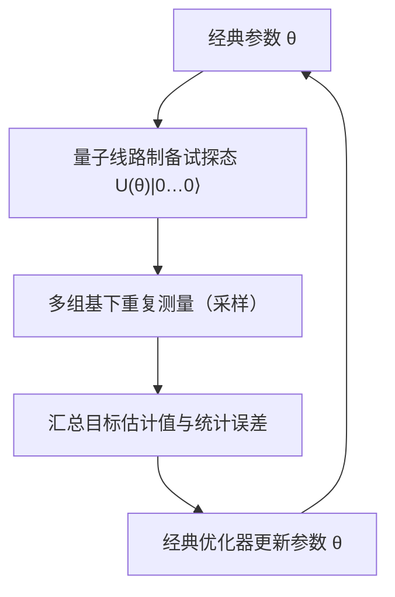
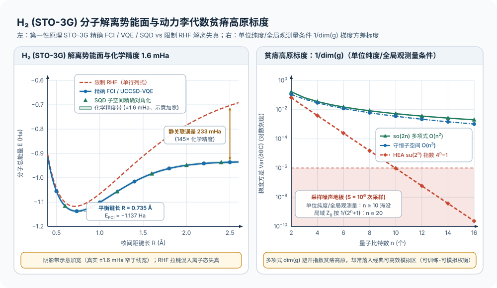

# 08｜应用、变分算法与证据边界

走到应用这一章，初学者最容易遇到一个诱人的错觉：只要某个化学分子、图优化问题或金融模型“可以写成量子线路”，似乎就离“量子计算打败超级计算机”不远了。其实，把问题翻译成量子比特语言，只是走完了第一步；能不能拿到准确答案、要重复测量多少次、数据怎么装进芯片、比当下最强的经典算法快多少，才是决定一项应用能否站住脚的真正门槛。

这一章专门讨论近中期设备（尚未具备大规模持续纠错能力）和早期容错阶段最受关注的五条应用主线：**变分量子本征求解器（VQE）与量子化学**、**量子近似优化算法（QAOA）与组合优化**、**量子机器学习（QML）与贫瘠高原理论**、**量子金融与幅度估计**，以及连接硬件噪声与真实结论的**误差缓解（QEM）与实用量子优势评测**。

除非另有严格定理证明，VQE、QAOA 和多数参数化量子机器学习方法都属于**启发式混合算法**：它们在某些问题结构上可能表现不错，但不保证对一般输入都比最优经典方法更快。阅读之前，先把“到底要交付什么”钉在桌面上——本章统一用 $\varepsilon$ 表示任务事先约定的输出误差容忍度，用来区别于硬件的门错误率。

| 应用主线 | 必须说清的输入与前提 | 要交付的输出 | 公平的经典比较对象 |
| :--- | :--- | :--- | :--- |
| **VQE 与基态求解** | 给定物理哈密顿量分解、精度目标与试探线路 | 基态能量估计，附统计置信区间与模型误差 | 小规模精确对角化；中大规模用耦合簇、张量网络等 |
| **QAOA 与组合优化** | 给定图或约束、代价与混合线路、调参预算 | 一个或多个可行候选比特串、目标值与成功概率 | 同时间预算下的专用精确或启发式求解器 |
| **量子机器学习** | 给定训练/测试分布、数据访问方式与损失函数 | 未见测试样本上的泛化误差与端到端训练成本 | 充分调优的经典学习器、核方法及量子启发算法 |
| **量子金融与采样** | 给定概率分布的可逆制备线路与收益函数 | 期望收益或尾部风险估计，附置信度与墙钟时间 | 准蒙特卡洛（低差异序列）、多层采样与多 GPU 集群 |
| **化学与材料计算** | 给定分子几何、基组、活性空间与温度/环境模型 | 构型能量差、反应势垒或动力学观测量 | 同一近似模型下的 CCSD(T)、DMRG、SHCI、AFQMC 等 |

动手算具体算例前，先记住两条贯穿全章的标尺：**目标函数的期望值高**，不等于**单次采样就一定吐出好答案**；**理论查询次数少**，也不等于**算上数据装载、电路编译和重复采样后的墙钟时间更短**。

---

## 1. 变分量子算法的骨架：浅线路背后的采样总账

第 07 章介绍的 Shor 算法和量子相位估计（QPE）虽然理论加速清晰，但往往需要数千到数百万层深度、并且要求中途不能频繁出错。在尚未建成大规模容错量子计算机的阶段，芯片每次只能可靠地跑几十到上百层门，深线路跑完后量子态早就被噪声抹平了。

面对“线路不能太深”的现实，研究者想出了一个分工折中：让量子芯片只负责运行一段**较短的可调参数线路** $U(\boldsymbol\theta)$，反复制备一个**试探态（ansatz）** $|\psi(\boldsymbol\theta)\rangle = U(\boldsymbol\theta)|0\cdots 0\rangle$ 并测量它；把统计出来的目标估计值传给经典计算机，由经典优化器决定下一组参数 $\boldsymbol\theta$，再送回芯片重跑。这个不断往返的混合框架叫做**变分量子算法（variational quantum algorithm, VQA）**。这里的英文 ansatz 只是物理与数学里“试探函数族”的惯称，并不代表它天然包含真实答案。

整个循环的结构如下：

每运行一次线路并读出一个比特串，实验上称为一次 **shot**（下文常称一次“重复测量”或一次采样）。经典优化器拿到的不是数学上光滑精确的目标函数 $C(\boldsymbol\theta)$，而是由有限次测量拼出来的带波动估计值 $\widehat C(\boldsymbol\theta)$。

初学者最容易低估的，是这台“短线路循环机”背后真正的总运行次数。如果每次评估都在 $G$ 组测量基下各采样 $S_g$ 次，外层经典优化器一共评估了 $N_{\mathrm{eval}}$ 个参数点（包含算梯度所需的额外线路），再加上误差缓解带来的采样倍率 $M_{\mathrm{QEM}}$，仅量子采样总数就大致是：

$$
N_{\mathrm{shots}} \approx N_{\mathrm{eval}} \times \left(\sum_{g=1}^{G} S_g\right) \times M_{\mathrm{QEM}}.
$$

在这个数字之外，真实墙钟时间还要加上线路编译、经典与量子控制器通信、任务排队以及经典侧优化计算。因此，“单条线路很浅”绝不等于“拿到最终答案很便宜”。接下来我们先深入拆解变分算法里最具代表性的成员——VQE。

---

## 2. 变分量子本征求解器（VQE）：从单比特手算、测量统计到自然梯度

### 2.1 哈密顿量分解与变分原理

在量子力学与量子化学里，系统的能量由一个厄米矩阵——**哈密顿量（Hamiltonian）**——描述，记作 $H$（注意它在上下文中表示能量算符，不是第 02 章的 Hadamard 门）。对 $n$ 个量子比特，这是一个 $2^n \times 2^n$ 的厄米矩阵。因为直接测量任意一个巨大的 $2^n \times 2^n$ 矩阵在硬件上做不到，VQE 的第一步是把 $H$ 拆成若干 **Pauli 串**的实系数线性组合：

$$
H = \sum_{j=1}^{M} c_j P_j, \qquad c_j \in \mathbb{R}, \quad P_j \in \{I, X, Y, Z\}^{\otimes n}.
$$

每个 $c_j$ 都带有能量单位；恒等项 $c_0 I$ 虽然会整体平移所有能级，但因为任何归一化态都满足 $\langle I\rangle = 1$，所以它不需要任何量子测量，直接在经典侧加回即可。其余每一项 $P_j$ 的本征值都只有 $+1$ 和 $-1$，硬件上只要在测量前对各个比特施加恰当的单比特换基门，就能把求能量问题拆成许多次 $\pm 1$ 读数的加权平均：

$$
E(\boldsymbol\theta) = \langle\psi(\boldsymbol\theta)|H|\psi(\boldsymbol\theta)\rangle = \sum_{j=1}^{M} c_j \langle\psi(\boldsymbol\theta)|P_j|\psi(\boldsymbol\theta)\rangle.
$$

为什么要把 $E(\boldsymbol\theta)$ 往低处压？这背后依靠量子力学里最简单也最硬的一条不等式——**变分原理（Rayleigh–Ritz 变分原理）**。设厄米矩阵 $H$ 的一组正交归一特征向量为 $|E_0\rangle, |E_1\rangle, \dots, |E_{2^n-1}\rangle$，对应的实特征值按升序排为 $E_0 \le E_1 \le \cdots \le E_{2^n-1}$，其中 $E_0$ 是基态能量。任意归一化纯态 $|\psi(\boldsymbol\theta)\rangle$ 都可以按这组完备正交基展开：

$$
|\psi(\boldsymbol\theta)\rangle = \sum_{k=0}^{2^n-1} d_k |E_k\rangle, \qquad \sum_{k=0}^{2^n-1} |d_k|^2 = 1.
$$

把它代入精确期望值，一步步展开（利用线性、本征方程 $H|E_k\rangle = E_k|E_k\rangle$ 与正交归一性 $\langle E_j|E_k\rangle = \delta_{jk}$）：

$$
\begin{aligned}
E(\boldsymbol\theta)
&= \left(\sum_{j} d_j^* \langle E_j|\right) H \left(\sum_{k} d_k |E_k\rangle\right) \\
&= \sum_{j,k} d_j^* d_k \, \langle E_j|H|E_k\rangle \\
&= \sum_{j,k} d_j^* d_k E_k \, \langle E_j|E_k\rangle \\
&= \sum_{k} |d_k|^2 E_k \\
&\ge \sum_{k} |d_k|^2 E_0 = E_0.
\end{aligned}
$$

对于任意合法的密度矩阵 $\rho = \sum_m p_m |\phi_m\rangle\langle\phi_m|$（$p_m \ge 0, \sum_m p_m = 1$），同理有 $\operatorname{Tr}(H\rho) = \sum_m p_m \langle\phi_m|H|\phi_m\rangle \ge E_0$。

但请务必看清变分原理的**精确适用条件**：它只约束**同一个精确模型哈密顿量**在**合法归一化物理态**上的**精确数学期望**。它并没有向我们保证下面五件事中的任何一件：

1. 所选试探态族 $|\psi(\boldsymbol\theta)\rangle$ 一定包含真实基态 $|E_0\rangle$；
2. 经典优化器一定能跨过局部极小、找到全局最低点；
3. 有限次重复测量算出来的样本均值一定不低于 $E_0$；
4. 经过有偏读出校正或外推误差缓解后的报告值仍保持上界；
5. 整个变分流程比最佳经典求解器更快。

### 2.2 单比特完整手算：$H = 0.7Z + 0.2X$ 与“击穿基态”的反例

让我们用最简单的一维非对角模型，把 VQE 的每一步拆到纸面上算透。取单比特哈密顿量（系数取同一无量纲或任意能量单位）和单参数试探态：

$$
H = 0.7 Z + 0.2 X = \begin{pmatrix} 0.7 & 0.2 \\ 0.2 & -0.7 \end{pmatrix}, \qquad |\psi(\theta)\rangle = R_y(\theta)|0\rangle, \quad \theta \in \mathbb{R}.
$$

回忆第 02 章的旋转门定义 $R_y(\theta) = \cos\frac{\theta}{2}\,I - i\sin\frac{\theta}{2}\,Y = \begin{pmatrix}\cos\frac{\theta}{2} & -\sin\frac{\theta}{2} \\ \sin\frac{\theta}{2} & \cos\frac{\theta}{2}\end{pmatrix}$，作用在 $|0\rangle = [1,0]^T$ 上得到实振幅纯态：

$$
|\psi(\theta)\rangle = \cos\frac{\theta}{2}|0\rangle + \sin\frac{\theta}{2}|1\rangle = \begin{pmatrix} \cos\frac{\theta}{2} \\ \sin\frac{\theta}{2} \end{pmatrix}.
$$

检查归一化：$\cos^2\frac{\theta}{2} + \sin^2\frac{\theta}{2} = 1$。接着逐行计算两个 Pauli 算符的精确期望值：

$$
\begin{aligned}
\langle Z\rangle_\theta
&= \begin{pmatrix}\cos\frac{\theta}{2} & \sin\frac{\theta}{2}\end{pmatrix}
\begin{pmatrix}1 & 0 \\ 0 & -1\end{pmatrix}
\begin{pmatrix}\cos\frac{\theta}{2} \\ \sin\frac{\theta}{2}\end{pmatrix}
= \cos^2\frac{\theta}{2} - \sin^2\frac{\theta}{2} = \cos\theta, \\
\langle X\rangle_\theta
&= \begin{pmatrix}\cos\frac{\theta}{2} & \sin\frac{\theta}{2}\end{pmatrix}
\begin{pmatrix}0 & 1 \\ 1 & 0\end{pmatrix}
\begin{pmatrix}\cos\frac{\theta}{2} \\ \sin\frac{\theta}{2}\end{pmatrix}
= 2\sin\frac{\theta}{2}\cos\frac{\theta}{2} = \sin\theta.
\end{aligned}
$$

把两项按权重拼起来，得到精确能量函数并用辅助角公式合成为单个余弦：

$$
E(\theta) = 0.7\cos\theta + 0.2\sin\theta = \sqrt{0.7^2 + 0.2^2}\cos(\theta - \delta) = \sqrt{0.53}\cos(\theta - \delta),
$$

其中 $\cos\delta = \frac{0.7}{\sqrt{0.53}}$、$\sin\delta = \frac{0.2}{\sqrt{0.53}}$，即 $\delta = \arctan\frac{2}{7} \approx 0.2783\,\mathrm{rad}$。当 $\cos(\theta - \delta) = -1$、即 $\theta^* = \delta + \pi \approx 3.4199\,\mathrm{rad}$ 时，能量达到最小值：

$$
E_{\min} = -\sqrt{0.53} \approx -0.728011.
$$

用独立方法回验一下这个基态能量。因为 $Z^2 = X^2 = I$ 且 $ZX + XZ = 0$，直接算 $H$ 的平方：

$$
H^2 = (0.7Z + 0.2X)^2 = 0.49 Z^2 + 0.04 X^2 + 0.14(ZX + XZ) = 0.53 I.
$$

矩阵 $H$ 的两个特征值平方都等于 $0.53$，故只能是 $\pm\sqrt{0.53}$；又因为 $\operatorname{Tr}(H) = 0.7 + (-0.7) = 0$，两个特征值必定一正一负，真实基态能量确实是 $E_0 = -\sqrt{0.53}$。本例中 $R_y(\theta)|0\rangle$ 恰好扫遍了全部单比特实振幅纯态，所以能精确命中这个实对称 $H$ 的基态；但在多比特化学问题里，浅层试探态通常只覆盖希尔伯特空间中极小的一片曲面，未必包含真实基态。

在实验上怎么测这两项？因为 $Z$ 和 $X$ 不对易，不能在同一份量子态上同时测出两个精确值。对固定参数 $\theta$，必须制备两批独立的试探态：

- 第一批直接在计算基测量：读到 `0` 记作 $Z = +1$，读到 `1` 记作 $Z = -1$；
- 第二批先过一个 Hadamard 门再测计算基（因为 $H_{\mathrm{gate}} X H_{\mathrm{gate}} = Z$，这一步是在**切换测量基**）：读到 `0` 记作原态的 $X = +1$，读到 `1` 记作原态的 $X = -1$。

先拿两个一目了然的特殊角度做程序自检：

| 参数与试探态 | 100 次 $Z$ 测量的预期计数 | 100 次 $X$ 测量的预期计数 | 精确理论能量 $E(\theta)$ |
| :--- | :--- | :--- | ---: |
| $\theta = 0$，$\lvert 0\rangle$ | 100 次 $+1$，0 次 $-1$ | 平均约 50 次 $+1$、50 次 $-1$ | $0.7(1) + 0.2(0) = 0.7$ |
| $\theta = \pi/2$，$\lvert +\rangle$ | 平均约 50 次 $+1$、50 次 $-1$ | 100 次 $+1$，0 次 $-1$ | $0.7(0) + 0.2(1) = 0.2$ |

注意表中的“平均约 50/50”是大量重复下的期望分布，实际跑 100 次很可能出现 47/53 或 54/46，不能把期望计数当成每批必得计数。同时，哪怕把两个点里较低的 $E(\pi/2) = 0.2$ 挑出来，也离真正基态 $-0.728$ 差得很远——有限次试探找到的最好点绝不等于全局最优。

现在来看一个初学者最容易吃惊的现象：**实验测出的“变分能量”可以比真实基态能量还要低**！假设芯片已经毫无误差地制备出了精确基态 $|\psi(\theta^*)\rangle$，此时 $\langle Z\rangle = -0.7/\sqrt{0.53} \approx -0.9615$，$\langle X\rangle = -0.2/\sqrt{0.53} \approx -0.2747$。只对两份独立制备的基态各测一次 $Z$ 和 $X$：

- 测 $Z$ 读到 $-1$ 的概率为 $\frac{1 - \langle Z\rangle}{2} = \frac{1 + 0.7/\sqrt{0.53}}{2} \approx 0.9808$；
- 测 $X$ 读到 $-1$ 的概率为 $\frac{1 - \langle X\rangle}{2} = \frac{1 + 0.2/\sqrt{0.53}}{2} \approx 0.6374$。

两次同时读到 $-1$ 的概率高达 $0.9808 \times 0.6374 \approx 0.6251$（超过六成！）。一旦发生这种情况，当次拼出来的能量估计就是：

$$
\widehat E = 0.7 \times (-1) + 0.2 \times (-1) = -0.9 < -\sqrt{0.53} \approx -0.728.
$$

这当然不是打破了变分原理，也没有变出什么能量更低的物理态，只是因为**有限样本的加权估计不能代替精确期望值**。所以，报告任何变分能量时都必须同时附上测量次数与统计不确定度区间，而不能把一次偶然偏低的样本数当作更紧的物理上界。

### 2.3 样本分配与有限样本保证：为什么 $7:2$ 比均分更省，以及 $7780$ 与 $14940$ 的区别

为了把统计波动压下来，我们需要多少次重复测量？对任意单次取值为 $\pm 1$ 的 Pauli 读数 $P$，总有 $P^2 = 1$。设其真实期望为 $\mu = \langle P\rangle \in [-1, 1]$，单次读数的方差为 $\operatorname{Var}(P) = \mathbb{E}[P^2] - \mu^2 = 1 - \mu^2 \le 1$。独立重复 $S$ 次取样本均值 $\widehat{\langle P\rangle}$，方差缩为原来的 $1/S$，因此标准差满足：

$$
\operatorname{Std}\!\left(\widehat{\langle P\rangle}\right) = \sqrt{\frac{1 - \langle P\rangle^2}{S}} \le \frac{1}{\sqrt{S}}.
$$

这个 $1/\sqrt{S}$ 律非常“固执”：想把统计误差条缩窄 10 倍，重复测量次数就得暴涨 100 倍。

回到 $H = 0.7Z + 0.2X$。假设我们对 $Z$ 和 $X$ 两组分别独立测量 $S_Z$ 次和 $S_X$ 次（总预算 $S = S_Z + S_X$ 固定）。由于两组样本彼此独立，能量估计 $\widehat E = 0.7\widehat{\langle Z\rangle} + 0.2\widehat{\langle X\rangle}$ 的方差为：

$$
\operatorname{Var}(\widehat E) = \frac{0.7^2(1 - \langle Z\rangle^2)}{S_Z} + \frac{0.2^2(1 - \langle X\rangle^2)}{S_X} \le \frac{0.49}{S_Z} + \frac{0.04}{S_X}.
$$

直觉上，$Z$ 项权重 $0.7$ 远大于 $X$ 项权重 $0.2$，如果两边傻傻地各分一半样本，岂不是浪费在权重很小的项上了？我们来把最优分配比例严格算出来。把 $z = S_Z$ 暂当成连续正实数（$0 < z < S$），目标是最小化方差上界：

$$
f(z) = \frac{0.49}{z} + \frac{0.04}{S - z}.
$$

求一阶导数并令其等于零：

$$
f'(z) = -\frac{0.49}{z^2} + \frac{0.04}{(S - z)^2} = 0
\quad\Longrightarrow\quad
\left(\frac{z}{S - z}\right)^2 = \frac{0.49}{0.04}
\quad\Longrightarrow\quad
\frac{z}{S - z} = \frac{0.7}{0.2} = \frac{7}{2}.
$$

核查二阶导数 $f''(z) = \frac{0.98}{z^3} + \frac{0.08}{(S - z)^3} > 0$，确认这是全局最小值。把 $S_Z = \frac{7}{9}S$、$S_X = \frac{2}{9}S$ 代回方差上界：

$$
\operatorname{Var}(\widehat E) \le \frac{0.49}{\frac{7}{9}S} + \frac{0.04}{\frac{2}{9}S} = \frac{0.63 + 0.18}{S} = \frac{0.81}{S} = \frac{(0.7 + 0.2)^2}{S}.
$$

推广到任意独立测量的 $H = \sum_j c_j P_j$，按 $S_j \propto |c_j|$ 分配时，保守方差上界恰好是 $\left(\sum_j |c_j|\right)^2 / S$，分子正是系数的 $\ell_1$ 范数平方！

现在给一个具体目标：在**某个预先固定的参数点**上，希望统计误差半宽不超过 $\varepsilon = 0.02$（失败率 $\delta = 0.05$，即 95% 置信水平），到底要测多少次？这里有两种口径，初学者一定要分清：

1. **正态近似规划数（约 7,780 次）**：用中心极限定理近似，令 95% 半宽 $1.96 \times \frac{0.9}{\sqrt{S}} \le 0.02$，解得 $S \ge (1.96 \times 45)^2 = 7779.24$。向上取整为 $S = 7780$，按 $7:2$ 分配取 $S_Z = 6051, S_X = 1729$，代回检验得 $1.96\sqrt{0.49/6051 + 0.04/1729} \approx 0.019999 < 0.02$。如果当初采用均分（$S_Z = S_X = S/2$），方差上界升为 $\frac{2(0.49+0.04)}{S} = \frac{1.06}{S}$，同一目标需约 **10,181 次**（若要求 $S_Z = S_X$ 严格取整数，则需取偶数 $S = 10{,}182$，即各 $5{,}091$ 次）——合理分配白省下近四分之一样本。
2. **严格有限样本保证（Hoeffding 界，14,940 次）**：正态近似只在大样本渐近意义下成立。若要不依赖未知真实方差、在有限样本下严格控制尾概率，可以直接使用 Hoeffding 不等式。把估计量写成全部 $S_Z + S_X$ 个独立有界随机变量之和：

   $$
   \widehat E = \sum_{i=1}^{S_Z} \frac{0.7}{S_Z} Z_i + \sum_{j=1}^{S_X} \frac{0.2}{S_X} X_j, \qquad Z_i, X_j \in \{-1, +1\}.
   $$

   每个 $Z$ 项的取值区间宽度为 $\frac{0.7}{S_Z} - \left(-\frac{0.7}{S_Z}\right) = \frac{1.4}{S_Z}$，每个 $X$ 项的宽度为 $\frac{0.4}{S_X}$。把所有区间宽度的平方求和：

   $$
   \sum (b_k - a_k)^2 = S_Z \left(\frac{1.4}{S_Z}\right)^2 + S_X \left(\frac{0.4}{S_X}\right)^2 = 4\left(\frac{0.49}{S_Z} + \frac{0.04}{S_X}\right).
   $$

   代入 Hoeffding 双侧尾界 $\Pr(|\widehat E - E| \ge \varepsilon) \le 2\exp\!\left(-\frac{2\varepsilon^2}{\sum(b_k-a_k)^2}\right)$，得到：

   $$
   \Pr(|\widehat E - E| \ge \varepsilon) \le 2\exp\!\left[-\frac{\varepsilon^2}{2\left(\frac{0.49}{S_Z} + \frac{0.04}{S_X}\right)}\right].
   $$

   令右边不超过 $\delta = 0.05$，反解出严格半宽（注意这里是自然对数 $\ln$）：

   $$
   b = \sqrt{2\left(\frac{0.49}{S_Z} + \frac{0.04}{S_X}\right)\ln\frac{2}{\delta}}.
   $$

   仍按 $7:2$ 分配使括号等于 $0.81/S$，代入 $\varepsilon = 0.02, \delta = 0.05$（$\ln 40 \approx 3.688879$），得 $S \ge \frac{2 \times 0.81 \times \ln 40}{0.0004} \approx 14939.96$。取 $S_Z = 11620, S_X = 3320$（总计 $S = 14940$），代回精确算得 $b \approx 0.01999997 < 0.02$。

7,780 和 14,940 并不矛盾：前者是规划用的大样本近似，后者是零分布假设的严格上界。更重要的是，这两个数字都只针对**预先定死的单个参数点**。如果经典优化器已经扫描过几百个参数点、然后专挑其中测得最低的一个拿来汇报，挑出来的点天然带着“挑便宜”的选择偏差；稳妥做法是在优化结束后锁死最终参数，另开一批独立新样本做最终验收（若要同时给预先选定的 $K$ 个参数点做统一保证，则需按并合界把每点失败预算收紧到 $\delta/K$，样本量多出一个 $\ln K$ 因子）。

### 2.4 共测分组、协方差账本与“测量路障”

真实分子的哈密顿量动辄有几千上万个 Pauli 项，如果每项都单独跑线路，采样早就爆炸了。于是人们自然想到：**能不能把可以同时测量的 Pauli 项编成一组，共测一次读出多项？**

可以，但分组之后立刻会出现一个容易踩坑的统计量——**组内协方差**。先看最简单的两比特共测：$Z_1$ 和 $Z_2$ 都在计算基下对角，每次测量只吐出一个两位比特串，却能同时读出 $z_1, z_2 \in \{+1, -1\}$。对于组合 $e = c_1 z_1 + c_2 z_2$，单次抽样的方差并不是两项方差简单相加，而是：

$$
\operatorname{Var}(e) = c_1^2 \operatorname{Var}(z_1) + c_2^2 \operatorname{Var}(z_2) + 2 c_1 c_2 \operatorname{Cov}(z_1, z_2),
$$

其中 $\operatorname{Cov}(z_1, z_2) = \mathbb{E}[z_1 z_2] - \mathbb{E}[z_1]\mathbb{E}[z_2]$。不同次态制备之间相互独立（所以 $S$ 次平均后方差除以 $S$），但**同一次测量里读出的 $z_1$ 和 $z_2$ 往往高度相关**。

拿第 03 章熟悉的 Bell 态 $|\Phi^+\rangle = \frac{1}{\sqrt{2}}(|00\rangle + |11\rangle)$ 来手算两种目标：$H_+ = Z_1 + Z_2$ 与 $H_- = Z_1 - Z_2$。计算基测量只能看到 `00`（概率 $1/2$，对应 $z_1=z_2=+1$）或 `11`（概率 $1/2$，对应 $z_1=z_2=-1$），所以 $\mathbb{E}[z_1]=\mathbb{E}[z_2]=0$，$\operatorname{Var}(z_1)=\operatorname{Var}(z_2)=1$，而 $\operatorname{Cov}(z_1,z_2)=\mathbb{E}[z_1 z_2] - 0 = +1$。把共测 $S$ 份态与分开各测 $S/2$ 份态（$S$ 为正偶数）摆在一起对比：

| 目标哈密顿量 | 单次共测读数 | 共测 $S$ 份态后的方差 | 分开各测 $S/2$ 份态的方差 |
| :--- | :--- | ---: | ---: |
| $H_+ = Z_1 + Z_2$ | $+2$ 或 $-2$（各半） | $\dfrac{1 + 1 + 2(1)}{S} = \dfrac{4}{S}$ | $\dfrac{1}{S/2} + \dfrac{1}{S/2} = \dfrac{4}{S}$ |
| $H_- = Z_1 - Z_2$ | 恒为 $0$ | $\dfrac{1 + 1 - 2(1)}{S} = 0$ | $\dfrac{1}{S/2} + \dfrac{1}{S/2} = \dfrac{4}{S}$ |

这张小表揭示了两个非常反直觉的事实：

- 对 $H_+$，共测虽然省掉了一半测量基配置，但在固定总态制备数 $S$ 下，正协方差把方差撑满到了 $4/S$，统计精度其实一点没省；
- 对 $H_-$，负协方差实现了逐样本精确抵消，方差直接归零！

由此还引出一条实验记录铁律：**必须保存原始配对位串计数，绝不能只存单比特边缘统计**。假设你在某批 100 次采样里测得 `00` 60 次、`11` 40 次：两位均值都是 $(60-40)/100 = 0.2$，$H_+$ 均值为 $0.4$，$H_-$ 每次读数都是 $0$（经验二阶矩为 $0$）。可如果另一组数据是 `00`: 20、`01`: 40、`10`: 40、`11`: 0，拆开单看第一位和第二位同样都是 60 次 `0`、40 次 `1`（边缘统计完全一模一样！），但 $H_- = z_1 - z_2$ 在 `01` 上取 $+2$、在 `10` 上取 $-2$，经验二阶矩一下子飙升到 $(40\times 4 + 40\times 4)/100 = 3.2$（因该批均值为 $0$，按分母 $n=100$ 算出的插件方差恰好也是 $3.2$，按 $n-1=99$ 算出的无偏样本方差为 $320/99 \approx 3.232$）。丢掉原始配对记录，就会把这种天差地别彻底抹掉。

对于分成 $G$ 个独立测量组的哈密顿量 $H = \sum_{g=1}^G H_g$，记第 $g$ 组单次联合读数的标准差为 $\sigma_g = \sqrt{\operatorname{Var}(H_g)}$（已经把组内协方差打包在内）。重复 §2.3 的极值推导可得最优组样本分配 $S_g \propto \sigma_g$，最小总方差和达到精度 $\varepsilon$ 的近似总测量数分别为：

$$
\operatorname{Var}(\widehat E) = \frac{1}{S}\left(\sum_{g=1}^{G} \sigma_g\right)^2,
\qquad
S \approx \frac{1}{\varepsilon^2}\left(\sum_{g=1}^{G} \sigma_g\right)^2.
$$

工业和学术界为了压缩这里的 $G$ 与 $\sum_g \sigma_g$，发展出三条主流测量约减路线（综述见 Tilly et al., *Phys. Rep.* 2022；Crawford et al., *Quantum* 2021）：

| 测量约减路线 | 判据与核心思路 | 硬件附加电路代价 | 分子化学中的典型组数/缩放与短板 |
| :--- | :--- | :--- | :--- |
| **逐比特对易分组（QWC）** | 同组 Pauli 串在**每个比特位**上相同或至少其一为 $I$（如 $X_0 Z_1$ 与 $I_0 Z_1$） | 仅需单比特换基门，无额外双比特门 | 组数通常仍按 $O(N^4)$ 增长；未利用整体对易，且正协方差可能不降反升 |
| **一般对易分组（GC）** | 只要整串对易 $[P_i,P_j]=0$（在偶数个比特位上反对易，如 $X_0 X_1$ 与 $Z_0 Z_1$）即可同组 | 需附加纠缠 Clifford 对角化线路，深度 $O(N)$ 或 $O(N/\log_2 N)$ | 组数可压至 $O(N^3)$ 乃至借双分解压至 $O(N^2)$；但附加纠缠门会在含噪芯片上引入新误差 |
| **经典阴影（Classical Shadows）** | 施加随机局域 Pauli 或全局 Clifford 变换后存储快照，离线估计任意多个观测量（详见[第 16 章](16-advanced-algorithms-verification.md)） | 随机单比特门（局域版）或浅随机纠缠电路 | 朴素局域 Pauli 阴影样本量按 $3^w$ 随 Pauli 权重 $w$ 指数增长，直接用于高权重费米算符代价过高；去随机化与费米阴影可改善但增加电路深度 |

即便用上了这些优化，纯 VQE 在化学规模下依然撞上了严峻的**测量路障**。Gonthier 等人（*Phys. Rev. Research* 2022）对 50–100 个自旋轨道的有机分子燃烧反应做了资源核算：即便经过分组优化，仅仅在**单个参数点**把能量统计误差压到化学精度（$1.6\,\mathrm{mHa}$），也常常需要 $10^8$–$10^{10}$ 次以上重复测量。按当前超导芯片微秒到毫秒级的单次运行与复位周期估算，单算一个参数点的能量就要几小时甚至几天，外层优化再迭代几百上千轮根本无法承受。正是这堵墙，推动近年的量子化学研究大举转向后文 §3.4 的子空间采样方法与容错相位估计。

### 2.5 参数移位法则、多本征值边界与共享参数链式法则陷阱

除了算能量，经典优化器往往还想知道梯度 $\frac{\partial E}{\partial \theta_k}$。初学者最先想到的办法是经典数值微分的**中央有限差分**：在 $\theta+h$ 和 $\theta-h$ 处各测一次再除以 $2h$。但在量子计算机上，这招非常吃亏——除以一个很小的 $2h$ 会把有限采样的统计噪声同时放大 $1/h$ 倍，而 $h$ 取大了又会有截断误差。

幸运的是，对于量子线路里最常见的一类单参数门 $R_P(\vartheta) = e^{-i\vartheta P/2}$（其中生成元 $P$ 是任意满足 $P^2 = I$、**恰有两个不同本征值** $\pm 1$ 的厄米 Pauli 串），存在一条**无截断误差**的精确求导法则——**参数移位法则（parameter-shift rule）**（Schuld et al., *Phys. Rev. A* 2019）。

我们来一步步把这条法则推出来。把其余门全部固定，令该门前的态为 $\rho_{\mathrm{in}}$、该门后的门与观测量一并吸进厄米算符 $M$ 里，则期望值是 $f(\vartheta) = \operatorname{Tr}\!\left[M R_P(\vartheta)\rho_{\mathrm{in}} R_P^\dagger(\vartheta)\right]$。因为 $P^2 = I$，由欧拉展开式 $R_P(\vartheta) = \cos\frac{\vartheta}{2}\,I - i\sin\frac{\vartheta}{2}\,P$，直接乘开夹心项：

$$
\begin{aligned}
R_P(\vartheta)\rho_{\mathrm{in}} R_P^\dagger(\vartheta)
&= \cos^2\frac{\vartheta}{2}\,\rho_{\mathrm{in}} + \sin^2\frac{\vartheta}{2}\,P\rho_{\mathrm{in}} P
- i\sin\frac{\vartheta}{2}\cos\frac{\vartheta}{2}\,(P\rho_{\mathrm{in}} - \rho_{\mathrm{in}} P) \\
&= \frac{1 + \cos\vartheta}{2}\,\rho_{\mathrm{in}} + \frac{1 - \cos\vartheta}{2}\,P\rho_{\mathrm{in}} P
- \frac{i}{2}\sin\vartheta\,[P, \rho_{\mathrm{in}}].
\end{aligned}
$$

两边乘以 $M$ 取迹，就能看出 $f(\vartheta)$ 对 $\vartheta$ 必然是一个一阶三角多项式：

$$
f(\vartheta) = c_0 + c_1 \cos\vartheta + c_2 \sin\vartheta,
$$

其中 $c_0, c_1, c_2$ 是与 $\vartheta$ 无关的实常数。直接求导得 $f'(\vartheta) = -c_1\sin\vartheta + c_2\cos\vartheta$。再算两个大步长偏移点 $\vartheta \pm \frac{\pi}{2}$ 的差：

$$
\begin{aligned}
f\!\left(\vartheta + \frac{\pi}{2}\right) &= c_0 - c_1\sin\vartheta + c_2\cos\vartheta, \\
f\!\left(\vartheta - \frac{\pi}{2}\right) &= c_0 + c_1\sin\vartheta - c_2\cos\vartheta,
\end{aligned}
$$

两式相减再除以 2，常数项 $c_0$ 消去，恰好精确还原导数：

$$
\frac{\partial f}{\partial \vartheta} = \frac{f(\vartheta + \pi/2) - f(\vartheta - \pi/2)}{2}.
$$

算一下方差账就能体会它的威力：若单条偏移线路独立测量 $S$ 次 $\pm 1$ 读数，每条均值方差至多为 $1/S$，因此参数移位估计器的方差上界为 $\frac{1}{4}\left(\frac{1}{S}+\frac{1}{S}\right) = \frac{1}{2S}$；而步长为 $h$ 的中央有限差分方差上界是 $\frac{1}{4h^2}\left(\frac{1}{S}+\frac{1}{S}\right) = \frac{1}{2Sh^2}$。取 $S = 1000$、$h = 0.01$，参数移位标准差上界仅为 $1/\sqrt{2000} \approx 0.02236$，而有限差分标准差上界暴涨 100 倍至 $2.2361$，还没算截断偏差！

不过，这条简洁的两点 $\pm\pi/2$ 法则有两条极易踩中的边界条件：

1. **生成元超过两个不同本征值时，两点法则失效**：上面的推导关键在于 $P$ 只有两个本征值，才保证了期望值只有单一频率 $\omega = 1$（即 $c_0 + c_1\cos\vartheta + c_2\sin\vartheta$）。如果门生成元有三个或更多不同本征值——例如受控旋转门 $\mathrm{CRZ}(\vartheta)$（生成元本征值含 $0, \pm 1/2$）、费米 Givens 旋转或整层 QAOA 代价门 $e^{-i\gamma H_C}$——期望值里会出现多阶谐波，两点 $\pm\pi/2$ 移位不再精确！此时必须采用**广义多点参数移位法则**（Wierichs et al., *Quantum* **6**, 677, 2022，根据生成元的正本征值差个数取 $2R$ 个偏移点做线性组合），或先把该门编译拆成基本双本征值 Pauli 旋转门，再套用下面的链式法则。
2. **同一个参数共享给多道门时，绝不能整条线路一起移位**：如果同一个训练参数 $\theta$ 同时控制了线路里的两道或多道门（比如 QAOA 一层里所有比特共享同一个 $\beta$，或硬件高效线路的共享参数），把整条线路里的 $\theta$ 一起平移 $\pm \pi/2$ 会彻底算错！

看一个一眼就穿帮的反例。让两道 $R_y$ 门共享同一个参数 $\theta$：

$$
|\psi(\theta)\rangle = R_y(\theta) R_y(\theta)|0\rangle = R_y(2\theta)|0\rangle,
\qquad
f(\theta) = \langle Z\rangle = \cos(2\theta).
$$

精确导数是 $f'(\theta) = -2\sin(2\theta)$；在 $\theta = \pi/8$ 处，真导数为 $-2\sin(\pi/4) = -\sqrt{2} \approx -1.4142$。如果你偷懒把两道门**一起**平移 $\pm \pi/2$，就会算成：

$$
\frac{\cos\!\left(2\theta + \pi\right) - \cos\!\left(2\theta - \pi\right)}{2} = \frac{-\cos(2\theta) - (-\cos(2\theta))}{2} = 0!
$$

无论 $\theta$ 取什么值，错误公式恒输出 $0$，硬生生把斜率高达 $-\sqrt{2}$ 的可训练斜坡误判成了死水一潭的平坦高原！

正确做法是先给每道门分别命名独立变量，写成严格的伴随顺序（注意一般门序为 $U_2(\theta_2)U_1(\theta_1)|0\rangle$，取厄米共轭时须逆序写出 $U_1^\dagger(\theta_1)U_2^\dagger(\theta_2)$，尽管本例两道同轴 $R_y$ 恰好对易，对一般不对易门绝不可颠倒次序）：

$$
F(\theta_1, \theta_2) = \langle 0| R_y^\dagger(\theta_1) R_y^\dagger(\theta_2) Z R_y(\theta_2) R_y(\theta_1)|0\rangle = \cos(\theta_1 + \theta_2).
$$

再按多元微积分的**链式法则**逐门施加参数移位：

$$
\begin{aligned}
\frac{df}{d\theta}
&= \left.\frac{\partial F}{\partial \theta_1}\right|_{\theta_1=\theta_2=\theta}
+ \left.\frac{\partial F}{\partial \theta_2}\right|_{\theta_1=\theta_2=\theta} \\
&= \frac{F(\theta+\pi/2, \theta) - F(\theta-\pi/2, \theta)}{2}
+ \frac{F(\theta, \theta+\pi/2) - F(\theta, \theta-\pi/2)}{2} \\
&= -\sin(2\theta) + \bigl(-\sin(2\theta)\bigr) = -2\sin(2\theta).
\end{aligned}
$$

在 $\theta = \pi/8$ 处正好恢复 $-\sqrt{2}$。如果第 $j$ 道门的旋转角是函数 $g_j(\theta)$，每项还要乘上导数 $g'_j(\theta)$。记住一条实用口诀：**参数移位作用在“每道独立双本征值门”上，共享参数靠经典链式法则累加**。

### 2.6 量子自然梯度（QNG）与变分优化陷阱

拿到精确梯度 $\nabla E(\boldsymbol\theta)$ 之后，初学者自然会问：“直接跑普通梯度下降 $\boldsymbol\theta^{(t+1)} = \boldsymbol\theta^{(t)} - \eta\nabla E(\boldsymbol\theta^{(t)})$ 不就行了吗？”

问题出在**参数空间的几何是严重扭曲的**。普通欧氏梯度下降暗中假设“参数坐标每走一步，对应的量子态就移动相同的物理距离”。打个比方，这就像看着一张平面世界地图按“经纬度各走 $1^\circ$”来规划航线——在赤道上跨 $1^\circ$ 经度大约是 $111\,\mathrm{km}$，可在北纬 $89^\circ$ 附近跨 $1^\circ$ 经度还不到 $2\,\mathrm{km}$！把地球球面压平到 $(\theta, \phi)$ 坐标纸上会扭曲距离，把量子态流形 $|\psi(\boldsymbol\theta)\rangle$ 压平到门角度空间里同样如此。

为了在**量子态自身的真实几何**（而非扭曲的参数坐标）里沿最速方向下降，Stokes 等人（*Quantum* **4**, 269, 2020）引入了**量子自然梯度（Quantum Natural Gradient, QNG）**。它的核心对象是描述参数微扰导致量子态偏移的**量子几何张量（Quantum Geometric Tensor, QGT）** $Q(\boldsymbol\theta)$：

$$
Q_{ij}(\boldsymbol\theta)
= \langle \partial_i \psi | \partial_j \psi \rangle
- \langle \partial_i \psi | \psi \rangle \langle \psi | \partial_j \psi \rangle,
$$

其中 $|\partial_i \psi\rangle = \frac{\partial |\psi(\boldsymbol\theta)\rangle}{\partial \theta_i}$。第二项减去了只改变无关全局相位的分量，保证 $Q_{ij}$ 在规范变换 $|\psi\rangle \mapsto e^{i\alpha(\boldsymbol\theta)}|\psi\rangle$ 下严格不变。取它的实部，就得到衡量两邻近纯态平方保真度距离 $1 - |\langle\psi(\boldsymbol\theta)|\psi(\boldsymbol\theta + d\boldsymbol\theta)\rangle|^2 = \sum_{i,j} g_{ij}\,d\theta_i d\theta_j + O(\|d\boldsymbol\theta\|^3)$ 的 **Fubini–Study 度规张量**：

$$
g_{ij}(\boldsymbol\theta) = \operatorname{Re}\bigl(Q_{ij}(\boldsymbol\theta)\bigr).
$$

（它的虚部则对应微分几何里的 Berry 曲率。）在每次更新步长限制量子态移动距离不变的约束下最小化一阶能量变化，便得到量子自然梯度更新方程：

$$
g(\boldsymbol\theta)\,\Delta\boldsymbol\theta = -\eta \nabla E(\boldsymbol\theta)
\quad\Longrightarrow\quad
\Delta\boldsymbol\theta = -\eta \bigl(g(\boldsymbol\theta) + \lambda I\bigr)^{-1} \nabla E(\boldsymbol\theta),
$$

其中工程上常加入极小的 Tikhonov 正则化项 $\lambda I$（$\lambda > 0$），防止 $g(\boldsymbol\theta)$ 奇异或条件数过大时求逆爆炸。

我们拿最熟悉的**单比特 Bloch 球态**一步不跳地把 $g(\theta, \phi)$ 算出来：

$$
|\psi(\theta, \phi)\rangle = \begin{pmatrix} \cos\frac{\theta}{2} \\ e^{i\phi}\sin\frac{\theta}{2} \end{pmatrix},
\qquad \theta \in (0, \pi), \quad \phi \in [0, 2\pi).
$$

第一步，逐分量求偏导：

$$
|\partial_\theta \psi\rangle = \begin{pmatrix} -\frac{1}{2}\sin\frac{\theta}{2} \\ \frac{1}{2}e^{i\phi}\cos\frac{\theta}{2} \end{pmatrix},
\qquad
|\partial_\phi \psi\rangle = \begin{pmatrix} 0 \\ i e^{i\phi}\sin\frac{\theta}{2} \end{pmatrix}.
$$

第二步，按左共轭内积逐项计算所需内积：

$$
\begin{aligned}
\langle\partial_\theta \psi|\partial_\theta \psi\rangle
&= \frac{1}{4}\sin^2\frac{\theta}{2} + \frac{1}{4}\cos^2\frac{\theta}{2} = \frac{1}{4}, \\
\langle\partial_\theta \psi|\psi\rangle
&= -\frac{1}{2}\sin\frac{\theta}{2}\cos\frac{\theta}{2} + \frac{1}{2}\cos\frac{\theta}{2}\sin\frac{\theta}{2} = 0, \\
\langle\partial_\phi \psi|\partial_\phi \psi\rangle
&= |i e^{i\phi}|^2 \sin^2\frac{\theta}{2} = \sin^2\frac{\theta}{2}, \\
\langle\psi|\partial_\phi \psi\rangle
&= (e^{-i\phi}\sin\frac{\theta}{2})(i e^{i\phi}\sin\frac{\theta}{2}) = i\sin^2\frac{\theta}{2}, \\
\langle\partial_\theta \psi|\partial_\phi \psi\rangle
&= \left(\frac{1}{2}e^{-i\phi}\cos\frac{\theta}{2}\right)\left(i e^{i\phi}\sin\frac{\theta}{2}\right)
= \frac{i}{2}\sin\frac{\theta}{2}\cos\frac{\theta}{2} = \frac{i}{4}\sin\theta.
\end{aligned}
$$

第三步，代入 $Q_{ij}$ 并取实部：
- $Q_{\theta\theta} = \frac{1}{4} - 0 = \frac{1}{4}$；
- $Q_{\phi\phi} = \sin^2\frac{\theta}{2} - (-i\sin^2\frac{\theta}{2})(i\sin^2\frac{\theta}{2}) = \sin^2\frac{\theta}{2}\left(1 - \sin^2\frac{\theta}{2}\right) = \sin^2\frac{\theta}{2}\cos^2\frac{\theta}{2} = \frac{1}{4}\sin^2\theta$；
- $Q_{\theta\phi} = \frac{i}{4}\sin\theta - 0 = \frac{i}{4}\sin\theta$（纯虚数，故实部 $g_{\theta\phi} = g_{\phi\theta} = 0$）。

于是精确的 Fubini–Study 度规矩阵写为：

$$
g(\theta, \phi) = \begin{pmatrix} \frac{1}{4} & 0 \\ 0 & \frac{1}{4}\sin^2\theta \end{pmatrix}.
$$

这正是单位半径 Bloch 球面（乘以因子 $1/4$）的标准球面度规！看一眼具体数字就能体会它的威力：取简单目标 $H = -X$，能量为 $E(\theta,\phi) = -\sin\theta\cos\phi$。如果初态落在北极附近 $(\theta = 0.2\,\mathrm{rad}, \phi = \pi/2)$，此时精确梯度是 $\partial_\theta E = 0$、$\partial_\phi E = \sin(0.2) \approx 0.1987$。设学习率 $\eta = 0.01$：
- **普通欧氏梯度下降**：$\Delta\phi_{\mathrm{GD}} = -0.01 \times 0.1987 \approx -0.00199\,\mathrm{rad}$，在北极附近几乎原地踏步；
- **量子自然梯度**：因 $g_{\phi\phi}^{-1} = \frac{4}{\sin^2(0.2)} \approx 101.3$，自动放大步长至 $\Delta\phi_{\mathrm{QNG}} \approx -0.2013\,\mathrm{rad}$，正好沿着 Bloch 球面的真实测地线果断滑向基态 $|+\rangle$！

再顺手检验一下 §5.4 会提到的冗余参数线路 $R_y(\theta_2)R_y(\theta_1)|0\rangle = R_y(\theta_1+\theta_2)|0\rangle$：因为 $|\partial_1\psi\rangle = |\partial_2\psi\rangle$，立即可算得度规矩阵为

$$
g(\theta_1, \theta_2) = \frac{1}{4}\begin{pmatrix} 1 & 1 \\ 1 & 1 \end{pmatrix}.
$$

它的行列式为 $0$、秩只有 $1$，直接把沿 $(\theta_1+u, \theta_2-u)$ 方向的零特征值冗余暴露无遗！

当然，QNG 远不是万能灵药。使用之前必须看清两条硬边界：第一，计算完整度规矩阵需要 $O(P^2)$ 次量子线路评估（$P$ 为参数个数），工程上常退而求其次采用**块对角近似**（每层单独估计）；第二，也是最关键的一条——**QNG 只能修正病态曲率和坐标冗余，绝对无法治愈后文 §5.4 的指数贫瘠高原**。在贫瘠高原上，梯度本身已被压到指数级小、彻底淹没在 $1/\sqrt{S}$ 的有限采样噪声里，此时拿 $g^{-1}$ 去放缩，放大的只是随机采样噪声！

除了贫瘠高原，Anschuetz 与 Kiani（*Nature Communications* **13**, 7760, 2022）还揭示了另一类独立陷阱：当试探电路**欠参数化**（参数数远低于动力李代数维度）时，即便没有任何贫瘠高原、梯度幅值也很健康，优化地形依然可能布满大量远高于真实基态的**虚假局部极小“沼泽”**，把局部梯度优化器牢牢困死。

下表把变分实验中最常用的四类优化器放在一起对照选型：

| 变分优化器 | 每轮所需量子线路评估数 | 抗有限采样噪声能力 | 能否适应参数几何曲率 | 能否治愈贫瘠高原 |
| :--- | :--- | :--- | :--- | :--- |
| **参数移位 + Adam** | $2P$（按门数线性增长） | 中等（依赖动量平滑，但需足够 shots） | 仅对角近似（逐坐标自适应） | 不能 |
| **量子自然梯度（QNG）** | $2P +$ 度规估计（块对角近似下与层数成正比） | 较弱（噪声可能破坏 $g$ 的正定性，须加正则化） | **强**（沿态流形 Fubini–Study 测地线下降） | 不能 |
| **SPSA（同时扰动随机近似）** | **恒为 2 次**（与参数个数 $P$ 无关！） | **强**（专为含噪目标设计的随机双向差分） | 仅二阶扩展（2-SPSA）可近似曲率 | 不能 |
| **COBYLA / Nelder–Mead（免梯度）** | 每轮 1–2 次 | 较弱（高维噪声下单纯形易提前塌缩） | 无显式几何度规 | 不能 |

在参数较多、单轮采样预算紧张的真实含噪芯片上，每轮固定只跑 2 条随机扰动线路的 **SPSA** 往往比朴素参数移位更省预算；而当线路层数很浅、希望排查几何奇异与加速收敛时，块对角 QNG 则是最清晰的分析工具。

---

## 3. 量子化学与材料：二次量子化、费米映射、$\mathrm{H}_2$ 手算与 SQD

原子和电子本身就按量子力学规律运动，这让化学与材料长期被视为量子计算最具潜力的战场。然而，“物理底色相符”到“真能做出超越经典计算化学的分子预测”，中间隔着一整套严密的建模与映射链条。

### 3.1 二次量子化极简零跳步入门、分子哈密顿量与误差总账

初学者翻开量子化学论文，最先被劝退的往往不是量子电路，而是分子哈密顿量里那一串带匕首符号的算符 $a_p^\dagger a_q$ 和 $a_p^\dagger a_q^\dagger a_r a_s$。其实只要用 **2 个轨道（4 维空间）** 亲手算一遍，这套叫做**二次量子化**（second quantization）的语言就会瞬间变得像二进制开关一样清楚。

1. **占据数表象（Fock 空间）**：电子是费米子，遵守**泡利不相容原理**——同一个单电子自旋轨道 $p \in \{0, 1, \dots, N-1\}$ 里，最多只能放 $1$ 个电子。因此，不必去记“第 1 号电子在哪、第 2 号电子在哪”，只需用一个二进制占据向量 $|n_0 n_1 \cdots n_{N-1}\rangle$（$n_p \in \{0, 1\}$）标明每个轨道是空（$0$）还是满（$1$）。对 $N = 2$ 个轨道，全部 Fock 基态正好是 4 维空间：$|00\rangle$（真空态，无电子）、$|01\rangle$（轨道 1 有电子）、$|10\rangle$（轨道 0 有电子）、$|11\rangle$（两轨道各占一个电子）。
2. **产生算符 $a_p^\dagger$ 与湮灭算符 $a_p$ 的精确规则**：$a_p^\dagger$ 负责往空轨道 $p$ 里放一个电子，$a_p$ 负责把满轨道 $p$ 里的电子取走；若空轨道取电子或满轨道再硬塞电子，直接湮灭成零向量 $0$。关键在于电子波函数交换须出负号，因此放/取第 $p$ 个轨道时必须乘上前面所有轨道的**前缀宇称因子** $(-1)^{\sum_{k < p} n_k}$：

$$
\begin{aligned}
a_p^\dagger |n_0 \cdots n_p \cdots n_{N-1}\rangle
&= \delta_{n_p, 0}\,(-1)^{\sum_{k<p} n_k} |n_0 \cdots 1 \cdots n_{N-1}\rangle, \\
a_p |n_0 \cdots n_p \cdots n_{N-1}\rangle
&= \delta_{n_p, 1}\,(-1)^{\sum_{k<p} n_k} |n_0 \cdots 0 \cdots n_{N-1}\rangle.
\end{aligned}
$$

立刻在 2 轨道 4 维 Fock 空间里逐个检验（轨道 0 前面没有轨道，符号恒为 $+1$；轨道 1 前面只有轨道 0，符号为 $(-1)^{n_0}$）：
- $a_0^\dagger|00\rangle = |10\rangle$，$a_0^\dagger|01\rangle = |11\rangle$，$a_0^\dagger|10\rangle = a_0^\dagger|11\rangle = 0$；
- $a_1^\dagger|00\rangle = (+1)|01\rangle = |01\rangle$，$a_1^\dagger|10\rangle = (-1)^1|11\rangle = -|11\rangle$，$a_1^\dagger|01\rangle = a_1^\dagger|11\rangle = 0$。

现在把两个电子按**不同顺序**从真空态 $|00\rangle$ 放进轨道 0 和轨道 1：

$$
a_0^\dagger a_1^\dagger |00\rangle = a_0^\dagger |01\rangle = +|11\rangle,
\qquad
a_1^\dagger a_0^\dagger |00\rangle = a_1^\dagger |10\rangle = -|11\rangle.
$$

两式相加正好为零：$(a_0^\dagger a_1^\dagger + a_1^\dagger a_0^\dagger)|00\rangle = 0$！这就是**交换两个电子出负号**的代数源头。把这一检验推广到全部基态，便推导出支配一切费米系统的**费米正则反对易关系（CAR）**（记 $\{A, B\} = AB + BA$）：

$$
\{a_p, a_q^\dagger\} = a_p a_q^\dagger + a_q^\dagger a_p = \delta_{pq} I,
\qquad
\{a_p, a_q\} = \{a_p^\dagger, a_q^\dagger\} = 0.
$$

顺手读出两条直接推论：① 令 $p = q$ 得 $2(a_p^\dagger)^2 = 0 \implies (a_p^\dagger)^2 = 0$（泡利不相容原理：同一个轨道绝不能放两个电子）；② 定义**粒子数算符** $n_p = a_p^\dagger a_p$，验证 $n_p|n_p=0\rangle = 0$、$n_p|n_p=1\rangle = 1\cdot|n_p=1\rangle$，正好读出轨道 $p$ 的占据数 $0$ 或 $1$。

有了这套积木，在固定原子核坐标的 **Born–Oppenheimer 近似**下，选定 $N$ 个正交归一单电子**自旋轨道**（由有限基组如 STO-3G、cc-pVDZ 与电子自旋 $\alpha, \beta$ 组合而成），分子电子哈密顿量即可简洁地写成：

$$
H_{\mathrm{elec}} = E_{\mathrm{nuc}} + \sum_{p,q=0}^{N-1} h_{pq}\, a_p^\dagger a_q + \frac{1}{2}\sum_{p,q,r,s=0}^{N-1} h_{pqrs}\, a_p^\dagger a_q^\dagger a_r a_s.
$$

这里能量通常以原子单位制哈特里（Hartree, $\mathrm{Ha}$）或电子伏特（$\mathrm{eV}$）计量，化学界常说的**化学精度**指 $1\,\mathrm{kcal/mol} \approx 1.6\,\mathrm{mHa} \approx 43\,\mathrm{meV}$。$E_{\mathrm{nuc}}$ 是核间排斥能常数；$h_{pq}$ 是一电子积分（动能与电子-核吸引，对应电子从轨道 $q$ 跳到轨道 $p$）；$h_{pqrs}$ 是双电子库仑排斥积分。**特别留意双电子项 $a_p^\dagger a_q^\dagger a_r a_s$ 的指标顺序**：为了保证 $p=s, q=r$ 时给出正定的密度-密度排斥 $a_p^\dagger a_q^\dagger a_q a_p = n_p n_q$（$p \neq q$，验证：$a_p^\dagger a_q^\dagger a_q a_p = -a_p^\dagger a_q^\dagger a_p a_q = a_p^\dagger a_p a_q^\dagger a_q = n_p n_q$），算符常按反序写为 $a_p^\dagger a_q^\dagger a_r a_s$（对应化学家积分记号 $(ps|qr)$、等价于物理学家记号 $\langle pq|sr\rangle$；而物理学家记号 $\langle pq|rs\rangle$ 对应的则是算符序 $a_p^\dagger a_q^\dagger a_s a_r$——对接 PySCF/OpenFermion 等代码时务必核对文档约定，免得错乘负号）。

双电子项的朴素项数按 $O(N^4)$ 增长。为了控制比特数，研究者通常挑出化学键断裂或强关联最关键的一部分轨道构成**活性空间**，记作 $(N_e\mathrm{e}, N_o\mathrm{o})$，表示 $N_e$ 个活性电子分布在 $N_o$ 个空间轨道（即 $N = 2N_o$ 个自旋轨道）里。全组态相互作用（FCI，即把固定粒子数扇区完整对角化）的行列式维数为 $\binom{N_o}{N_\alpha}\binom{N_o}{N_\beta}$，随 $N_o$ 指数膨胀，经典暴力对角化通常在 20–26 个空间轨道附近撞上内存墙。

一份完整的化学计算工作流至少包含七步：① 选定分子几何、轨道与基组；② 截断活性空间并评估截断误差；③ 把费米算符映射成量子比特上的 Pauli 串；④ 制备初态或试探线路；⑤ 测量能量、受力或响应性质；⑥ 纳入几何优化、溶剂与温度效应；⑦ 在**同一物理模型**下与耦合簇、密度矩阵重整化群（DMRG）或选择组态相互作用（SHCI）等强经典方法对比。

**能量差误差预算算例。** 化学反应关心的通常不是单个构型的绝对能量，而是两个构型 $A, B$ 之间的能量差 $\Delta E = E_B - E_A$。假设某简化模型对两个构型报出 $\widehat E_A = -1.72\,\mathrm{eV}$、$\widehat E_B = -1.60\,\mathrm{eV}$，估计能量差为：

$$
\widehat{\Delta E} = \widehat E_B - \widehat E_A = (-1.60) - (-1.72) = 0.12\,\mathrm{eV}.
$$

如果每个构型的测量/求解误差绝对值界为 $0.01\,\mathrm{eV}$，而基组与活性空间截断带来的模型误差界为 $0.03\,\mathrm{eV}$，那么由三角不等式，单个真实能量的保守总误差至多 $0.01 + 0.03 = 0.04\,\mathrm{eV}$，两构型相减后的保守总误差界则高达：

$$
|\widehat{\Delta E} - \Delta E_{\mathrm{true}}| \le 0.04 + 0.04 = 0.08\,\mathrm{eV}.
$$

若反应势垒判断要求 $0.02\,\mathrm{eV}$ 精度，即便量子线路把测量噪声压到 $0.01\,\mathrm{eV}$，这份结果依然远远不够用。在没有严格证明两构型截断误差可以系统抵消之前，不能把一个极小基组里的精细统计数字当成真实化学精度的保证。

### 3.2 费米—量子比特映射：Jordan–Wigner、Parity 与 Bravyi–Kitaev 对照

有了上一节的 2 轨道手算，现在一眼就能明白把 $H_{\mathrm{elec}}$ 搬上量子芯片时的代数冲突：**不同量子比特上的 Pauli 算符彼此对易**（$p \neq q$ 时 $[X_p, X_q]=0$），**而不同轨道上的费米算符彼此反对易**（$\{a_p, a_q\}=0$，因为存在前缀宇称因子 $(-1)^{\sum_{k<p} n_k}$）。

要让量子比特忠实模拟电子的反对易号，线路必须同时追踪两件事：
1. **占据信息**：轨道 $j$ 里有没有电子（$n_j \in \{0, 1\}$）；
2. **前缀宇称信息**：轨道 $0, 1, \dots, j-1$ 里一共有奇数个还是偶数个电子（决定把电子放进轨道 $j$ 时乘 $+1$ 还是 $-1$）。

三种经典费米映射（都把 $N$ 个自旋轨道映为 $N$ 个量子比特）的核心差别，就像数据结构里“数组 vs 前缀和 vs 树状数组（Fenwick 树）”的经典权衡——决定把**占据**和**宇称**怎么分配存进各个比特：

| 映射方式 | 比特 $q_j$ 存什么 | 查占据代价 | 查宇称代价 | 单产生/湮灭算符 Pauli 权重 | 直观特点与工程权衡 |
| :--- | :--- | :--- | :--- | :--- | :--- |
| **Jordan–Wigner (JW)** (1928) | 局域占据：$q_j = n_j$ | $O(1)$ | $O(N)$（逐个读遍前面所有比特） | **$O(N)$**（最长含 $N-1$ 个 $Z$） | 最直观，粒子数算符直接是 $n_j = (I-Z_j)/2$；大分子下长 $Z$ 串拖长线路深度 |
| **Parity 映射** | 累积前缀宇称：$q_j = \bigoplus_{k=0}^{j} n_k$ | $O(1)$（$q_j \oplus q_{j-1}$） | $O(1)$（直接读 $q_{j-1}$） | **$O(N)$**（改动 $n_j$ 要翻转后面所有 $q_k$） | 把“读宇称的长 $Z$ 串”换成“更新宇称的长 $X$ 串”；末位直接存总宇称，配合自旋分块可直接**裁掉 2 个对称性比特**（Bravyi et al. 2017） |
| **Bravyi–Kitaev (BK)** (2002; Seeley et al. 2012) | **二叉索引树分层部分宇称**：偶数下标位（$j=0,2,\dots$）存占据，奇数下标位（$j=1,3,\dots$）存树状子区间异或和 | **$O(\log_2 N)$** | **$O(\log_2 N)$** | **$O(\log_2 N)$** | 类似树状数组：查前缀宇称与更新祖先宇称都只沿树高走 $\lceil\log_2 N\rceil$ 步，把读写代价同时压到对数级 |

我们来用 **$N = 4$ 个轨道**（如最小基组 $\mathrm{H}_2$ 的四个自旋轨道）把三种映射全部写开对照。记占据向量 $\mathbf{n} = (n_0, n_1, n_2, n_3)^T \in \mathbb{F}_2^4$，基态按大端序写作 $|q_0 q_1 q_2 q_3\rangle$，量子比特编码由模 2 线性变换 $\mathbf{q} = M\mathbf{n}\pmod 2$ 决定：

- **JW 映射**（$M_{\mathrm{JW}} = I_4$，$q_j = n_j$）：$a_j^\dagger = \frac{1}{2}(X_j - iY_j)\bigotimes_{k=0}^{j-1} Z_k$；
- **Parity 映射**（下三角全 1 矩阵，$q_j = \bigoplus_{k=0}^{j} n_k$）：翻转第 $j$ 个轨道会改变所有 $k \ge j$ 的累积宇称，因此右侧拖出长 $X$ 串；
- **BK 映射**（遵循 Seeley–Richard–Love 2012 约定）：编码矩阵及其模 2 逆矩阵为：

  $$
  \beta_4 = \begin{pmatrix}
  1 & 0 & 0 & 0 \\
  1 & 1 & 0 & 0 \\
  0 & 0 & 1 & 0 \\
  1 & 1 & 1 & 1
  \end{pmatrix},
  \qquad
  \beta_4^{-1} = \begin{pmatrix}
  1 & 0 & 0 & 0 \\
  1 & 1 & 0 & 0 \\
  0 & 0 & 1 & 0 \\
  0 & 1 & 1 & 1
  \end{pmatrix} \pmod 2.
  $$

  逐行读出每个比特的含义：$q_0 = n_0$，$q_1 = n_0 \oplus n_1$，$q_2 = n_2$，$q_3 = n_0 \oplus n_1 \oplus n_2 \oplus n_3$。这里 $\beta_4$ 第 $j$ 列中除对角元外的非零行号构成**祖先更新集** $U(j)$（改变 $n_j$ 时须同步翻转的所有比特，如 $U(0)=\{1,3\}$、$U(1)=\{3\}$）；$\beta_4^{-1}$ 的第 $j$ 行给出还原占据数 $n_j$ 的比特下标；轨道 $0,\dots,j-1$ 的前缀宇称则由**宇称集** $P(j)$ 上的 $Z$ 乘积读出（如 $P(1)=\{0\}$，因为前缀和 $n_0 = q_0$）。以 $a_1^\dagger$ 为例：先用 $Z_0$ 读出前缀宇称、用 $X_1 X_3$ 翻转 $q_1$ 与 $U(1)=\{3\}$，再乘以占据投影 $\frac{1}{2}(I + Z_0 Z_1)$（由 $\beta_4^{-1}$ 第 1 行 $n_1 = q_0 \oplus q_1 = 0$ 决定），展开得 $Z_0 X_1 X_3 \cdot \frac{1}{2}(I + Z_0 Z_1) = \frac{1}{2}(Z_0 X_1 X_3 - i Y_1 X_3)$——因 $Z_0^2 = I$ 相消，故其 $Y_1$ 项不含 $Z_0$。

把 $N = 4$ 的全部四个产生算符并排列出（省略恒等算符 $I$）：

| 轨道 $j$ | Jordan–Wigner $a_j^\dagger$ | Parity $a_j^\dagger$ | Bravyi–Kitaev $a_j^\dagger$ |
| :---: | :--- | :--- | :--- |
| $0$ | $\frac{1}{2}(X_0 - iY_0)$ | $\frac{1}{2}(X_0 X_1 X_2 X_3 - iY_0 X_1 X_2 X_3)$ | $\frac{1}{2}(X_0 X_1 X_3 - iY_0 X_1 X_3)$ |
| $1$ | $\frac{1}{2}(Z_0 X_1 - iZ_0 Y_1)$ | $\frac{1}{2}(Z_0 X_1 X_2 X_3 - iY_1 X_2 X_3)$ | $\frac{1}{2}(Z_0 X_1 X_3 - iY_1 X_3)$ |
| $2$ | $\frac{1}{2}(Z_0 Z_1 X_2 - iZ_0 Z_1 Y_2)$ | $\frac{1}{2}(Z_1 X_2 X_3 - iY_2 X_3)$ | $\frac{1}{2}(Z_1 X_2 X_3 - iZ_1 Y_2 X_3)$ |
| $3$ | $\frac{1}{2}(Z_0 Z_1 Z_2 X_3 - iZ_0 Z_1 Z_2 Y_3)$ | $\frac{1}{2}(Z_2 X_3 - iY_3)$ | $\frac{1}{2}(Z_1 Z_2 X_3 - iY_3)$ |

你可以直接拿 $a_3^\dagger$ 验算一下：在 JW 里，它的两项权重都是 $4$；而在 BK 里，两项权重分别降为 $3$ 和 $1$，且粒子数算符 $n_3 = a_3^\dagger a_3 = \frac{1}{2}(I - Z_1 Z_2 Z_3)$ 正好对应 $\beta_4^{-1}$ 的最后一行 $(0,1,1,1)$！

同时也要避开一个常见的工程误区：在 $N=4$ 这样的小规模上，BK 与 JW 的最大权重几乎打平；要到数十上百个自旋轨道时，$O(\log_2 N)$ 对 $O(N)$ 的权重优势才真正拉开。而且在近邻连接的二维平面芯片上，JW 配合专门设计的费米交换网络可以把交互整齐排成局域近邻门，而 BK 的树状跳跃连接有时反而增加编译后的路由 SWAP 开销（Tranter et al. 2015, 2018）。因此，不能把“BK 的渐近权重更小”直接等同于“在任何硬件上线路一定更浅”。

### 3.3 两个手算标杆：两轨道粒子数罚项与真实 $\mathrm{H}_2$（STO-3G, 2-qubit）VQE 完整求解

#### 标杆 A：两轨道紧束缚跳跃模型与粒子数罚项阈值 $\lambda > (3 - \sqrt{2})/2$

先算一个只有两个轨道、可以一眼算穿的紧束缚跳跃模型（能量取同一任意单位），用来看清费米映射、粒子数扇区与罚项阈值的力学机制：

$$
H_f = n_0 + 2 n_1 - \frac{1}{2}\left(a_0^\dagger a_1 + a_1^\dagger a_0\right),
$$

其中 $n_j = a_j^\dagger a_j$，两轨道的在位能分别为 $1$ 和 $2$，电子在两轨道间跳跃的耦合系数为 $-1/2$。基串 $|n_0 n_1\rangle$ 按全书大端序排成 $|00\rangle, |01\rangle, |10\rangle, |11\rangle$。

第一步，用 Jordan–Wigner 映射把 $H_f$ 写成两比特 Pauli 矩阵。代入 $a_0^\dagger = \frac{1}{2}(X_0 - iY_0)$、$a_1^\dagger = \frac{1}{2}Z_0(X_1 - iY_1)$：
- $n_0 = a_0^\dagger a_0 = \frac{1}{2}(I - Z_0)$，$n_1 = a_1^\dagger a_1 = \frac{1}{2}(I - Z_1)$；
- 算第一跳跃项 $a_0^\dagger a_1$：先用 $X_0 Z_0 = -i Y_0$ 和 $Y_0 Z_0 = i X_0$ 化简第 0 比特上的左因子，得 $(X_0 - iY_0)Z_0 = -iY_0 - i(iX_0) = X_0 - iY_0$；于是：

  $$
  a_0^\dagger a_1 = \frac{1}{4}(X_0 - iY_0) Z_0 (X_1 + iY_1)
  = \frac{1}{4}(X_0 - iY_0)(X_1 + iY_1)
  = \frac{1}{4}(X_0 X_1 + Y_0 Y_1 + i X_0 Y_1 - i Y_0 X_1).
  $$

- 加上厄米共轭 $a_1^\dagger a_0$，两个虚部项恰好抵消，得到 $a_0^\dagger a_1 + a_1^\dagger a_0 = \frac{1}{2}(X_0 X_1 + Y_0 Y_1)$。

汇总全部四项，两比特哈密顿量精确写为：

$$
H_q = \frac{1}{2}(I - Z_0) + (I - Z_1) - \frac{1}{4}(X_0 X_1 + Y_0 Y_1)
= \frac{3}{2} I - \frac{1}{2} Z_0 - Z_1 - \frac{1}{4}(X_0 X_1 + Y_0 Y_1).
$$

按基序 $|00\rangle, |01\rangle, |10\rangle, |11\rangle$ 写出它的 $4\times 4$ 完整矩阵（注意 $X_0 X_1 + Y_0 Y_1$ 只在 $|01\rangle \leftrightarrow |10\rangle$ 之间有矩阵元 $2$）：

$$
H_q = \begin{pmatrix}
0 & 0 & 0 & 0 \\
0 & 2 & -\frac{1}{2} & 0 \\
0 & -\frac{1}{2} & 1 & 0 \\
0 & 0 & 0 & 3
\end{pmatrix}.
$$

这个分块对角矩阵把三个固定粒子数扇区摆得明明白白：
- **零粒子（真空）扇区** $|00\rangle$：能量 $E^{(0)} = 0$；
- **一粒子扇区** $\operatorname{span}\{|01\rangle, |10\rangle\}$：子矩阵 $\begin{pmatrix} 2 & -1/2 \\ -1/2 & 1 \end{pmatrix}$ 的特征方程为 $(2-E)(1-E) - \frac{1}{4} = E^2 - 3E + \frac{7}{4} = 0$，解得两个本征能量：

  $$
  E_{\pm} = \frac{3 \pm \sqrt{9 - 7}}{2} = \frac{3 \pm \sqrt{2}}{2},
  \qquad
  E_- = \frac{3 - \sqrt{2}}{2} \approx 0.792893.
  $$

- **两粒子扇区** $|11\rangle$：能量 $E^{(2)} = 3$。

**陷阱来了！** 假设物理问题要找的是**一粒子系统**的基态能量 $E_- \approx 0.7929$。如果你直接拿一个不守恒粒子数的通用硬件高效线路（HEA）去跑无约束 VQE，优化器会非常“聪明”地一路滑向真空态 $|00\rangle$，开心地向你汇报“能量降到了 $0$”——这比目标扇区基态低了一大截，却是一个**彻底违背电子数约束的非法答案**！

为了把优化器拦在一粒子扇区里，常见办法是在哈密顿量里加一个二次罚项：

$$
H_\lambda = H_f + \lambda (N_f - I)^2, \qquad \lambda \ge 0, \quad N_f = n_0 + n_1.
$$

千万别以为“只要 $\lambda > 0$ 就够了”！我们把三个扇区加罚后的能量逐一算出来：
- 零粒子（$N_f = 0$）：能量抬升为 $0 + \lambda(0 - 1)^2 = \lambda$；
- 一粒子（$N_f = 1$）：罚项恒为 $0$，能级保持 $E_{\pm} = (3 \pm \sqrt{2})/2$ 不变；
- 两粒子（$N_f = 2$）：能量抬升为 $3 + \lambda(2 - 1)^2 = 3 + \lambda$。

要让**整个四维空间里所有的最低能态都合法地落在一粒子扇区**，真空能量必须**严格大于** $E_-$，即：

$$
\lambda > \frac{3 - \sqrt{2}}{2} \approx 0.792893.
$$

验证三个具体值一目了然：取 $\lambda = 0.5$ 时，全空间最低值仍是违法的真空能量 $0.5$；刚好取 $\lambda = (3-\sqrt{2})/2$ 时，真空与一粒子基态简并，仍可能滑进非法态；取 $\lambda = 1$ 时，真空抬到 $1 > 0.7929$，全空间基态才真正回到合法的一粒子态。

再把罚项的 Pauli 形式算完整。由 $N_f = \frac{1}{2}(I-Z_0) + \frac{1}{2}(I-Z_1) = I - \frac{1}{2}(Z_0 + Z_1)$，得 $N_f - I = -\frac{1}{2}(Z_0 + Z_1)$。利用 $Z_0^2 = Z_1^2 = I$ 与 $Z_0 Z_1 = Z_1 Z_0$ 平方展开：

$$
(N_f - I)^2 = \frac{1}{4}(Z_0^2 + Z_1^2 + 2 Z_0 Z_1) = \frac{1}{2}(I + Z_0 Z_1),
\qquad
H_\lambda = H_q + \frac{\lambda}{2} I + \frac{\lambda}{2} Z_0 Z_1.
$$

这里新增的常数项 $\frac{\lambda}{2}I$ 和耦合项 $\frac{\lambda}{2}Z_0 Z_1$ 缺一不可——漏掉常数项虽然不改变哪个态更低，却会弄乱绝对能量和阈值账本。另一方面，也不能把 $\lambda$ 随手设成 $10^6$：过大的罚项系数会成比例拉高 Pauli 系数 $\ell_1$ 范数，急剧放大测量方差，还会把原问题的能量地形压成陡峭峡谷、拖慢优化收敛。更好的工程做法往往是直接采用保持电子数与自旋对称性的试探线路，或显式在合法扇区内对角化。

#### 标杆 B：真实分子 $\mathrm{H}_2$（STO-3G, 2-qubit）完整 VQE 手算与电子关联能

紧束缚模型只是热身，现在我们动手算一个**真实的化学分子**——氢分子 $\mathrm{H}_2$！在最小基组 STO-3G 下，$\mathrm{H}_2$ 共有 4 个自旋轨道（成键轨道 $\sigma_g$ 和反键轨道 $\sigma_u$ 各带 $\alpha, \beta$ 自旋）。利用 Bravyi–Kitaev 或 Parity 映射并借助电子总宇称与自旋宇称两条 $\mathbb{Z}_2$ 对称性裁掉 2 个冗余比特后（O'Malley et al., *Phys. Rev. X* **6**, 031007, 2016；Bravyi et al., `arXiv:1701.08213`, 2017），整个分子在平衡键长附近 **$R = 0.75\,\text{Å}$**（O'Malley 2016 Table I 标准基准）精确化为两比特哈密顿量（单位：哈特里 $\mathrm{Ha}$）：

$$
H_{\mathrm{H}_2} = g_0 I + g_1 Z_0 + g_2 Z_1 + g_3 Z_0 Z_1 + g_4 (X_0 X_1 + Y_0 Y_1),
$$

其中已包含核间排斥能 $E_{\mathrm{nuc}} \approx +0.7056\,\mathrm{Ha}$ 的系数为（注：不含核排斥的纯电子常数项为 $-0.4804\,\mathrm{Ha}$，相加得 $g_0 = +0.2252\,\mathrm{Ha}$）：

$$
g_0 = +0.2252, \quad
g_1 = +0.3435, \quad
g_2 = -0.4347, \quad
g_3 = +0.5716, \quad
g_4 = +0.0910 \quad (\mathrm{Ha}).
$$

第一步，在大端序基 $\{|00\rangle, |01\rangle, |10\rangle, |11\rangle\}$ 下逐项算出全部非零矩阵元。因为 $X_0 X_1|10\rangle = |01\rangle$ 且 $Y_0 Y_1|10\rangle = (-i|0\rangle)\otimes(i|1\rangle) = +|01\rangle$，非对角耦合仅连接 $|10\rangle$（Hartree–Fock 参考态：双电子占据成键轨道 $\sigma_g$）与 $|01\rangle$（双激发态：双电子跃迁至反键轨道 $\sigma_u$），耦合元精确等于 $2g_4 = +0.1820\,\mathrm{Ha}$：

$$
\begin{aligned}
h_{10} &= g_0 - g_1 + g_2 - g_3 = 0.2252 - 0.3435 - 0.4347 - 0.5716 = -1.1246\,\mathrm{Ha}, \\
h_{01} &= g_0 + g_1 - g_2 - g_3 = 0.2252 + 0.3435 + 0.4347 - 0.5716 = +0.4318\,\mathrm{Ha}.
\end{aligned}
$$

整个 $4\times 4$ 矩阵呈干净的分块对角结构（对角元 $|00\rangle$ 为 $+0.7056\,\mathrm{Ha}$、$|11\rangle$ 为 $+0.8880\,\mathrm{Ha}$），而双电子单重态精确关在 $\{|10\rangle, |01\rangle\}$ 二维子块中：

$$
H_{\mathrm{sub}} = \begin{pmatrix} h_{10} & 2g_4 \\ 2g_4 & h_{01} \end{pmatrix}
= \begin{pmatrix} -1.1246 & +0.1820 \\ +0.1820 & +0.4318 \end{pmatrix}\,\mathrm{Ha}.
$$

这里的对角元 $h_{10} = -1.1246\,\mathrm{Ha}$ 正是经典的**平均场 Hartree–Fock（HF）能量** $E_{\mathrm{HF}}$（把两个电子关在单一 Slater 行列式 $|10\rangle$ 里，忽略电子间的瞬时关联）。

第二步，构造单参数 **UCCSD 试探线路**（幺正耦合簇双激发）：

$$
|\psi(\theta)\rangle = \exp\!\left[-i\frac{\theta}{2}(X_0 Y_1 - Y_0 X_1)\right]|10\rangle.
$$

逐项检验生成元作用：$X_0 Y_1|10\rangle = |0\rangle\otimes(i|1\rangle) = i|01\rangle$，$Y_0 X_1|10\rangle = (-i|0\rangle)\otimes|1\rangle = -i|01\rangle$，因此 $(X_0 Y_1 - Y_0 X_1)|10\rangle = 2i|01\rangle$，同理 $(X_0 Y_1 - Y_0 X_1)|01\rangle = -2i|10\rangle$。在 $\{|10\rangle, |01\rangle\}$ 子空间内，$-i\frac{1}{2}(X_0 Y_1 - Y_0 X_1)$ 恰好对应实平面旋转生成元 $\begin{pmatrix}0&-1\\1&0\end{pmatrix}$，因此指数精确展开为：

$$
|\psi(\theta)\rangle = \cos\theta\,|10\rangle + \sin\theta\,|01\rangle.
$$

第三步，代入 $H_{\mathrm{sub}}$ 求精确能量函数 $E(\theta)$ 并用二倍角公式化简（注意 $\frac{h_{10}+h_{01}}{2} = g_0 - g_3 = -0.3464\,\mathrm{Ha}$，$\frac{h_{01}-h_{10}}{2} = g_1 - g_2 = +0.7782\,\mathrm{Ha}$）：

$$
\begin{aligned}
E(\theta)
&= h_{10}\cos^2\theta + h_{01}\sin^2\theta + 4 g_4 \sin\theta\cos\theta \\
&= (g_0 - g_3) - (g_1 - g_2)\cos(2\theta) + 2g_4 \sin(2\theta).
\end{aligned}
$$

对 $\theta$ 求导令其等于零：$E'(\theta) = 2(g_1 - g_2)\sin(2\theta) + 4g_4\cos(2\theta) = 0$，解得精确最小点（检验二阶导数 $E''(\theta^*) > 0$，切记保留负号！）：

$$
\tan(2\theta^*) = -\frac{2g_4}{g_1 - g_2} = -\frac{0.1820}{0.7782} \approx -0.233873
\quad\Longrightarrow\quad
\theta^* \approx -0.11487\,\mathrm{rad}.
$$

代入得到精确 FCI 基态能量（与直接求 $2\times 2$ 矩阵最小本征值完全一致）：

$$
\begin{aligned}
E_{\mathrm{FCI}} = E(\theta^*)
&= (g_0 - g_3) - \sqrt{(g_1 - g_2)^2 + (2g_4)^2} \\
&= -0.3464 - \sqrt{0.7782^2 + 0.1820^2} \\
&= -0.3464 - 0.7992 = -1.1456\,\mathrm{Ha}.
\end{aligned}
$$

把两个数字相减，就得到了分子化学最核心的物理量——**电子关联能**：

$$
\Delta E_{\mathrm{corr}} = E_{\mathrm{FCI}} - E_{\mathrm{HF}} = (-1.1456) - (-1.1246) = -0.0210\,\mathrm{Ha} = -21.0\,\mathrm{mHa}.
$$

别小看这短短一行减法：在平衡键长处，双激发态 $|01\rangle$ 的占据概率只有 $\sin^2\theta^* \approx 1.31\%$（$|10\rangle$ 仍占 $98.69\%$），但这区区 $1.31\%$ 的量子叠加就已经拉低了 $21.0\,\mathrm{mHa}$ 的能量——**是化学精度 $1.6\,\mathrm{mHa}$ 的 13 倍以上**！

更震撼的物理出现在**拉伸化学键**时（键长 $R \to 2.5\,\text{Å}$）：随着两个氢原子越拉越远，成键轨道与反键轨道能量趋于简并（$g_1 - g_2 \to 0$），而耦合 $2g_4$ 依然非零，此时精确最优角迅速滑向 $\theta^* \to -\pi/4$，真实基态变成 $\frac{1}{\sqrt{2}}(|10\rangle - |01\rangle)$ 的等权强纠缠叠加（两个电子各回各的氢原子，称为**静关联**）。死守单一构型 $|10\rangle$（$\theta = 0$）的限制性 Hartree–Fock 方法在解离区会错误混入一半高能离子态 $\mathrm{H}^+\mathrm{H}^-$ 导致能量严重飙升，而单参数 UCCSD 线路却能丝滑贴合精确 FCI 解离曲线（见后文 §5.4 科学双联图左图）。

### 3.4 试探态谱系、采样量子对角化（SQD / S-CORE）与 QCSC 工作流

面向更大分子体系，试探态（ansatz）的设计走过了一条从“迁就芯片”到“嵌入物理先验”的演进路线：

| 试探态族 | 代表文献 | 构造思路 | 主要优势 | 现实短板 |
| :--- | :--- | :--- | :--- | :--- |
| **硬件高效型（HEA）** | Kandala et al., *Nature* (2017) | 单比特旋转 + 硬件原生近邻纠缠门浅层堆叠 | 贴合芯片连通性，单层门数最少 | 不守恒粒子数与自旋；深度略增即触发严重贫瘠高原（见 §5.4） |
| **幺正耦合簇（UCCSD）** | Peruzzo et al. (2014); Romero et al. (2018) | $e^{T - T^\dagger}\lvert\mathrm{HF}\rangle$，保留单/双电子激发 | 天然守恒粒子数与自旋，化学精度表达力强 | Trotter 化后双比特门数按 $O(N^4)$ 膨胀，远超含噪设备深度承受力 |
| **自适应 VQE（ADAPT-VQE）** | Grimsley et al., *Nat. Commun.* (2019) | 从激发算符池按梯度大小逐项生长电路 | 电路比完整 UCCSD 浅得多，自动贴合强关联特征 | 每生长一步都要测量整池算符梯度，进一步加重测量开销 |
| **局域幺正簇 Jastrow（LUCJ）** | Motta et al., *Chem. Sci.* (2023) | 双分解轨道旋转 + 仅沿芯片邻接边的密度-密度交互 | 贴合平面稀疏硬件拓扑、守恒粒子数、可由经典 CCSD 热启动 | 浅层自身做纯 VQE 难以达到化学精度，现多用作 SQD 的量子采样器 |

为了绕开纯 VQE 的 $O(N^4)$ 测量墙和含噪估计破坏变分上界的痼疾，IBM Quantum 与日本理化学研究所（RIKEN）合作推进了一条极具代表性的混合超算路线——**采样量子对角化（Sample-based Quantum Diagonalization, SQD）**（Robledo-Moreno et al., *Science Advances* **11**, eadu9991, 2025；原预印本 `arXiv:2405.05068`）。

SQD 的分工哲学极为干脆：**量子芯片不再逐项测 Pauli 能量，而只负责在计算基下采样重要电子构型；精确哈密顿量矩阵元计算与本征求解全部交回经典超级计算机**。这套**量子中心超算**（Quantum-Centric Supercomputing, QCSC）闭环包含三个核心数学环节：

1. **计算基采样与 Slater 行列式映射**：在量子处理器上运行保粒子数与自旋对称性的浅层电路（如由经典 CCSD 振幅热启动的 LUCJ），仅在计算基下收集大量比特串。**在 Jordan–Wigner 映射下**（每个比特直接存轨道占据数 $q_p = n_p$），每个满足目标电子数 $(N_\alpha, N_\beta)$ 的合法比特串 $\mathbf{x}_I$ 都直接对应一个 **Slater 行列式** $|\mathbf{x}_I\rangle$（若改用 Parity 或 BK 映射，经典端须先乘模 2 逆矩阵 $\beta_N^{-1}\mathbf{q}$ 还原占据数向量）。
2. **自洽构型恢复（Self-consistent Configuration Recovery, S-CORE）**：真实含噪芯片发生比特翻转或能量弛豫后，大量原始采样串的汉明重量 $N'_\sigma \neq N_\sigma$（$\sigma \in \{\alpha, \beta\}$ 分别指自旋向上与向下通道），直接扔掉会浪费绝大部分样本。S-CORE 构造了一套优雅的自洽迭代修复算法：
   - 第 $r$ 轮迭代时，利用上一轮子空间基态波函数系数 $\{c_I\}$ 计算每个自旋轨道的平均占据数：

     $$
     \bar{n}_{p\sigma} = \sum_{I \in \mathcal{S}} |c_I|^2\, x_{I, p\sigma} \in [0, 1].
     $$

   - 对每一条违背电子数约束的含噪比特串 $\mathbf{x}$（比如自旋 $\alpha$ 通道测得 $N'_\alpha > N_\alpha$，多出了 $N'_\alpha - N_\alpha$ 个电子），只在该通道取值为 `1` 的比特中，按与当前平均占据偏差 $|x_{p\sigma} - \bar{n}_{p\sigma}|$ 单调递增的概率权重随机抽选 $|N'_\alpha - N_\alpha|$ 个位翻转为 `0`（若缺电子则在 `0` 位中翻转为 `1`），将其拉回合法粒子数扇区；
   - 随后用修复后的全量合法构型重新对角化更新 $\bar{n}_{p\sigma}$，迭代数轮直至能量与占据数自洽收敛。
3. **批处理投影对角化（Subsampling / Batching）**：把去重后的全部合法构型集合随机拆分成 $K$ 个子批 $\mathcal{S}_1, \dots, \mathcal{S}_K$（每批维数 $d$ 受经典超算分布式内存约束，例如 $d \sim 10^5$–$10^8$）。在每批子空间内，经典超算利用 **Slater–Condon 规则**精确构造高度稀疏的投影哈密顿量矩阵（仅当两行列式汉明距离 $\le 4$ 即至多相差两个轨道占据时矩阵元才非零）：

$$
(H_{\mathcal{S}})_{IJ} = \langle \mathbf{x}_I | H_{\mathrm{elec}} | \mathbf{x}_J \rangle,
\qquad
H_{\mathcal{S}} \mathbf{c} = E_{\mathrm{SQD}} \mathbf{c},
$$

并用 Davidson 算法并行求出各批最低本征值，取最优变分能量。因为 $H_{\mathcal{S}}$ 是原精确哈密顿量在合法子空间上的精确投影，只要电子积分准确，它对固定模型**严格恢复了变分上界 $E_{\mathrm{SQD}} \ge E_{\mathrm{FCI}}$**——再也不会出现纯 VQE 含噪估计“击穿真实基态”的尴尬。

**4 轨道 / 2 电子 SQD + S-CORE 极简手算例。** 取 2 个空间轨道 $\times$ 2 种自旋（4 个自旋轨道），在 Jordan–Wigner 映射下按位序 $|n_{0\alpha} n_{1\alpha} n_{0\beta} n_{1\beta}\rangle$ 编码，目标扇区为 $N_\alpha = 1, N_\beta = 1$。该扇区共有 4 个合法 Slater 行列式：参考态 $|\mathbf{x}_0\rangle = |1010\rangle$（HF，能量 $-1.1246\,\mathrm{Ha}$）、双激发 $|\mathbf{x}_1\rangle = |0101\rangle$（$+0.4318\,\mathrm{Ha}$）以及两个单激发 $|\mathbf{x}_2\rangle = |1001\rangle$、$|\mathbf{x}_3\rangle = |0110\rangle$（设某非对称双原子活性空间内二者对角元为 $-0.2000\,\mathrm{Ha}$，耦合矩阵元为 $\langle \mathbf{x}_0|H|\mathbf{x}_1\rangle = 0.1820$、$\langle \mathbf{x}_0|H|\mathbf{x}_{2,3}\rangle = 0.0800$、$\langle \mathbf{x}_1|H|\mathbf{x}_{2,3}\rangle = -0.0500$、$\langle \mathbf{x}_2|H|\mathbf{x}_3\rangle = 0.0400\,\mathrm{Ha}$，全 4 维精确 FCI 基态能量为 $E_{\mathrm{FCI}} = -1.1601\,\mathrm{Ha}$）。

- **第 0 轮（仅用初始合法采样）**：假设芯片采出了两条合法串 `1010`、`0101` 和一条含噪串 `1101`（注意前两位 $\alpha$ 通道是 `11`，$N'_\alpha = 2 \neq 1$，多出 1 个电子！）。先只在初始合法子空间 $\mathcal{S}_0 = \{|1010\rangle, |0101\rangle\}$ 对角化 $2\times 2$ 矩阵，正好复现上节的 $E_{\mathcal{S}_0} = -1.1456\,\mathrm{Ha}$，基态权值为 $|c_0|^2 \approx 0.9869$、$|c_1|^2 \approx 0.0131$。
- **S-CORE 构型恢复**：算出自旋 $\alpha$ 通道的平均轨道占据 $\bar{n}_{0\alpha} = 0.9869$、$\bar{n}_{1\alpha} = 0.0131$。回头看含噪串 `1101` 的 $\alpha$ 通道两位 `1`：轨道 $0\alpha$ 的偏差是 $|1 - 0.9869| = 0.0131$，而轨道 $1\alpha$ 的偏差高达 $|1 - 0.0131| = 0.9869$！S-CORE 于是高概率把偏差最大的轨道 $1\alpha$ 从 `1` 翻回 `0`，把含噪串 `1101` 修复为合法的新行列式 **`1001`**！
- **第 1 轮子空间扩展**：扩充为三维子空间 $\mathcal{S}_1 = \{|1010\rangle, |0101\rangle, |1001\rangle\}$，经典端精确对角化该 $3\times 3$ 投影矩阵，最低本征值进一步降到 **$E_{\mathcal{S}_1} = -1.1532\,\mathrm{Ha}$**。

整条变分阶梯一目了然：

$$
E_{\mathrm{HF}} = -1.1246\,\mathrm{Ha}
\;>\;
E_{\mathcal{S}_0} = -1.1456\,\mathrm{Ha}
\;>\;
E_{\mathcal{S}_1} = -1.1532\,\mathrm{Ha}
\;>\;
E_{\mathrm{FCI}} = -1.1601\,\mathrm{Ha}.
$$

同时，拿单比特 $H = 0.7Z + 0.2X$ 做反向警醒也能看透 SQD 的要害：如果芯片只采到了 `0`，即便重复采一万遍，去重后张成的仍只是一维空间，能量死死卡在 $0.7$；**SQD 的胜负不在总采样数，而在是否高效覆盖了基态支撑中的关键非重复构型**。

在 2025 年的 *Science Advances* 实验里，IBM Heron 处理器与日本 RIKEN Fugaku 超算协同运行了最高 58 比特的 $\mathrm{N}_2$ 解离曲线、40–45 比特的铁硫簇 `[2Fe-2S]`（活性空间 `(30e, 20o)`）以及 **72–77 比特**、逾万门的铁硫簇 `[4Fe-4S]`（活性空间 `(54e, 36o)`），其在 $N_\alpha = N_\beta = 27$ 自旋扇区内的完整 FCI 维数高达 $\binom{36}{27}^2 \approx 8.86 \times 10^{15}$，确实越过了暴力全空间精确对角化的内存墙。

但看待这项成果，必须把另一半学术对话同时摆上桌面——**超过暴力 FCI，绝不等于击败现代经典计算化学**。面对强关联铁硫簇，真正的经典强手是单参考黄金标准 **CCSD(T)**、张量网络 **DMRG** 和经典选择组态方法 **SCI / SHCI**（它们和 SQD 共享“挑子空间 + 经典对角化”的骨架，只不过改用经典微扰能量判据来筛行列式）。两篇重要同行评审论文划清了现实边界：

- **Lee、Chan 等**（*Nature Communications* **14**, 1952, 2023）全面复核了跨化学空间的基态问题证据，指出截至当时**尚未发现一般分子基态存在指数级量子优势的可靠证据**：凡是容易制备高重叠量子初态的分子，经典启发式（DMRG/SHCI/AFQMC）往往也表现出色；反之，当经典方法彻底失灵时，量子初态制备常面临与基态重叠指数衰减的“正交灾难”。
- **Reinholdt 等**（*J. Chem. Theory Comput.* **21**, 6811, 2025）系统剖析了量子选择组态方法（QSCI/SQD）的两处硬伤：一是**重复采样陷阱**——量子测量按 $|c_I|^2$ 独立抽样，权重大的少数主导行列式会被一遍遍重复抽到，而决定化学精度的大量尾部小权重构型极难被抽中；二是**子空间不够紧凑**——即便在无噪声理想模拟中，为了达到同等能量精度，SQD 抽出的构型集合往往明显大于经典微扰筛选出的 SHCI 子空间，抽少了精度停滞、抽多了又拖垮经典对角化。

正因如此，2025–2026 年的化学前沿正把 SQD 重新定位为 QCSC 流水线里的**混合波函数生成模块**——例如将 SQD 抽出的稀疏试探波函数喂给经典无相位辅助场量子蒙特卡洛（**SQD-ph-AFQMC**）引导后续演化，而不是孤立地宣称它已经胜过 DMRG 或 SHCI。

> **就地练习 练 08-A（$\mathrm{H}_2$ 关联能与 QNG 度规回验）**
>
> 1. 将 3.3 节标杆 B 中 $\mathrm{H}_2$ 拉伸至某较长键长，设化简后的双比特子块对角元为 $h_{10} = -0.8200\,\mathrm{Ha}$、$h_{01} = -0.6200\,\mathrm{Ha}$，非对角耦合 $2g_4 = +0.2000\,\mathrm{Ha}$。求单参数 UCCSD 态 $|\psi(\theta)\rangle = \cos\theta|10\rangle + \sin\theta|01\rangle$ 的精确最优角 $\theta^*$、最小能量 $E_{\mathrm{FCI}}$ 与关联能 $\Delta E_{\mathrm{corr}}$，并说明为何此时双激发权重 $\sin^2\theta^*$ 远大于平衡键长的 $1.31\%$。
> 2. 计算 2.6 节单比特 Bloch 球态在极角 $\theta = \pi/6$ 处的 Fubini–Study 度规矩阵 $g(\pi/6, \phi)$，并验证此时沿经度 $\phi$ 的自然梯度步长是普通欧氏梯度的多少倍。
>
> *参考答案要点*：① $\frac{h_{01}-h_{10}}{2} = 0.1000$、$2g_4 = 0.2000$，故 $\tan(2\theta^*) = -2 \implies \theta^* \approx -0.5536\,\mathrm{rad}$；$E_{\mathrm{FCI}} = -0.7200 - \sqrt{0.1^2 + 0.2^2} \approx -0.9436\,\mathrm{Ha}$，$\Delta E_{\mathrm{corr}} \approx -0.1236\,\mathrm{Ha}$（$-123.6\,\mathrm{mHa}$），$\sin^2\theta^* \approx 27.6\%$，说明拉键导致静关联剧增。② $\sin(\pi/6)=1/2$，故 $g = \operatorname{diag}(1/4,\, 1/16)$，沿 $\phi$ 方向 $g_{\phi\phi}^{-1} = 16$（相对 $g_{\theta\theta}^{-1}=4$ 放大 4 倍，绝对放缩 16 倍）。

---

## 4. 组合优化与 QAOA：从手算景观、局域障碍到约束 QUBO 设计

### 4.1 交替算符骨架与离散化绝热直觉

VQE 追求的是“算出足够低的能量期望值”，而组合优化问的是另一件事：“能不能在海量离散方案里，高概率采出一个目标值足够好的**具体比特串**？”

给定 $n$ 个二元决策变量 $x = x_1\cdots x_n \in \{0, 1\}^n$ 和经典目标函数 $C(x)$，**量子近似优化算法（QAOA）**（Farhi, Goldstone & Gutmann 2014）先构造一个在计算基对角的**代价哈密顿量** $H_C$，满足 $H_C|x\rangle = C(x)|x\rangle$——注意这一步只是把已知目标写进量子矩阵，并没有帮我们找到最优串。再选一个不与 $H_C$ 对易的**混合哈密顿量（mixer）**，最标准的选择是横向场 $H_B = \sum_{v} X_v$（若混合算符与 $H_C$ 对易，交替演化根本不会改变任何计算基概率）。

从 $H_B$ 的最大特征态——均匀叠加态 $|+\rangle^{\otimes n}$ 出发，交替施加 $p$ 层代价演化与混合演化：

$$
|\boldsymbol\gamma, \boldsymbol\beta\rangle
= \prod_{\ell=1}^{p}\left(e^{-i\beta_\ell H_B} e^{-i\gamma_\ell H_C}\right)|+\rangle^{\otimes n}
= e^{-i\beta_p H_B} e^{-i\gamma_p H_C}\cdots e^{-i\beta_1 H_B} e^{-i\gamma_1 H_C}|+\rangle^{\otimes n}.
$$

为什么要这样交替？从物理画面看，如果把[第 17 章](17-computation-models.md)讨论的连续绝热路径 $H(s) = (1-s)H_B + s H_C$（$s\in[0,1]$）离散成 $p$ 步一阶 Trotter 演化，得到的恰好就是这种交替线路。因此：

- 当层数 $p \to \infty$ 且角度适当选取时，绝热定理保证最大期望值收敛到精确最优解；
- 当 $p$ 固定得很小时（如 $p = 1, 2$），算法不再依靠缓慢绝热，而是用代价层给不同目标值的比特串打上相位标记 $e^{-i\gamma C(x)}$，再用混合层 $e^{-i\beta H_B}$ 促成相长干涉，试图把振幅往高分比特串上汇聚。

外层经典优化器调整 $2p$ 个角度使 $\langle H_C\rangle$ 尽量高（求最大化时），但**最终交付的不是期望值本身，而是从制备态中测量出来的具体比特串**——你必须把每个采到的串代回原函数 $C(x)$ 逐一核对。

### 4.2 单边 MaxCut 的完整手算

**最大割**（MaxCut）是检验 QAOA 最经典的基准题：给定无向图 $G = (V, E)$，要把顶点分成两组（用 $0$ 和 $1$ 标记），使两端分属不同组的边（割边）数量尽量多。利用 Pauli 算符 $Z_u$ 的本征值 $z_u = 1 - 2x_u \in \{+1, -1\}$，当 $x_u \neq x_v$ 时 $z_u z_v = -1$、当 $x_u = x_v$ 时 $z_u z_v = +1$，因此单条边 $(u, v)$ 的割算符为：

$$
C_{uv} = \frac{I - Z_u Z_v}{2},
\qquad
H_C = \sum_{(u,v)\in E} \frac{I - Z_u Z_v}{2}.
$$

先看极简情形：只有两个顶点 $1, 2$ 和一条边 $(1, 2)$。此时代价算符记作 $H_C = C = \frac{I - Z_1 Z_2}{2}$，混合算符为 $H_B = X_1 + X_2$。四个基串的割值一目了然：

| 计算基串 $x_1 x_2$ | `00` | `01` | `10` | `11` |
| :--- | :---: | :---: | :---: | :---: |
| 割值 $C(x)$ | $0$ | $1$ | $1$ | $0$ |

`01` 和 `10` 是两个等价的最优割（最大割值为 $1$）。现在从头手算 $p = 1$ 的末态 $|\gamma, \beta\rangle = e^{-i\beta H_B} e^{-i\gamma C}|++\rangle$：

1. **代价层**：初态 $|++\rangle = \frac{1}{2}(|00\rangle + |01\rangle + |10\rangle + |11\rangle)$ 经 $e^{-i\gamma C}$ 作用后，只给割值为 $1$ 的 `01` 和 `10` 乘上相位 $e^{-i\gamma}$：

   $$
   |\psi_C\rangle = \frac{1}{2}\left(|00\rangle + |11\rangle + e^{-i\gamma}|01\rangle + e^{-i\gamma}|10\rangle\right).
   $$

2. **混合层**：记 $c = \cos\beta, s = \sin\beta$，则单比特旋转 $e^{-i\beta X} = cI - isX$。因为 $X_1$ 与 $X_2$ 对易，两比特混合门按张量积拆成：

   $$
   e^{-i\beta(X_1 + X_2)} = (cI - isX_1)\otimes(cI - isX_2) = c^2 I - ics(X_1 + X_2) - s^2 X_1 X_2.
   $$

3. **逐分支汇总 $|01\rangle$ 的末态振幅 $A_{01}$**：哪些输入基串能跳到 $|01\rangle$？
   - $|00\rangle$ 翻转第 2 位，贡献 $\frac{1}{2}(-ics)$；
   - $|11\rangle$ 翻转第 1 位，贡献 $\frac{1}{2}(-ics)$；
   - $|01\rangle$ 两位都不翻转，贡献 $\frac{1}{2} e^{-i\gamma} c^2$；
   - $|10\rangle$ 两位同时翻转，贡献 $\frac{1}{2} e^{-i\gamma}(-s^2)$。

   把四路振幅相加，并用二倍角公式 $2cs = \sin(2\beta)$、$c^2 - s^2 = \cos(2\beta)$ 化简：

   $$
   A_{01}
   = \frac{1}{2}\left[-2ics + e^{-i\gamma}(c^2 - s^2)\right]
   = \frac{1}{2}\left[-i\sin(2\beta) + e^{-i\gamma}\cos(2\beta)\right].
   $$

   由交换两顶点的对称性，$A_{10} = A_{01}$。
4. **取模平方求期望割值**：先拆出实部与虚部，再算模平方！把 $e^{-i\gamma} = \cos\gamma - i\sin\gamma$ 代入括号：

   $$
   A_{01} = \frac{1}{2}\Bigl[\cos\gamma\cos(2\beta) - i\bigl(\sin(2\beta) + \sin\gamma\cos(2\beta)\bigr)\Bigr].
   $$

   实部平方加虚部平方得：

   $$
   \begin{aligned}
   |A_{01}|^2
   &= \frac{1}{4}\left[\cos^2\gamma\cos^2(2\beta) + \sin^2(2\beta) + 2\sin(2\beta)\cos(2\beta)\sin\gamma + \sin^2\gamma\cos^2(2\beta)\right] \\
   &= \frac{1}{4}\left[\cos^2(2\beta) + \sin^2(2\beta) + \sin(4\beta)\sin\gamma\right] \\
   &= \frac{1}{4}\left[1 + \sin(4\beta)\sin\gamma\right].
   \end{aligned}
   $$

   由于割值只在 `01` 和 `10` 上等于 $1$，总期望割值就是两者的概率和：

   $$
   \langle C\rangle = |A_{01}|^2 + |A_{10}|^2 = \frac{1}{2}\left[1 + \sin(4\beta)\sin\gamma\right].
   $$

检验最优角：取 $\gamma = \frac{\pi}{2}$、$\beta = \frac{\pi}{8}$，使 $\sin\gamma = 1$、$\sin(4\beta) = \sin\frac{\pi}{2} = 1$，立刻得到 $\langle C\rangle = 1$。代回振幅式，$A_{01} = A_{10} = \frac{1}{2}\left(-\frac{i}{\sqrt{2}} - \frac{i}{\sqrt{2}}\right) = -\frac{i}{\sqrt{2}}$，概率各为 $1/2$，总和已等于 $1$，说明非法串 `00` 和 `11` 的概率精确消为零——在这条单边图上，$p = 1$ QAOA 每次测量都能 100% 采到最优割（随机落在 `01` 或 `10` 之一）。

### 4.3 三节点路径图 $0$–$1$–$2$ 的 $p = 1$ 完整推导与景观图

只加一个顶点，局面立刻变得大不相同。考虑 3 顶点路径图 $0$–$1$–$2$（顶点编号 $0, 1, 2$，两条边 $(0, 1)$ 与 $(1, 2)$），代价算符和混合算符分别是：

$$
H_C = C = C_{01} + C_{12} = \frac{I - Z_0 Z_1}{2} + \frac{I - Z_1 Z_2}{2},
\qquad
H_B = X_0 + X_1 + X_2.
$$

要把两条边同时割开，只需把中间顶点 $1$ 放在一组、两端顶点 $0, 2$ 放在另一组，对应最优串 $|010\rangle$ 与 $|101\rangle$，最大割值 $C_{\max} = 2$。我们先看由精确 3 比特态矢量演化画出的 $p = 1$ 完整参数景观图，再一步不跳地推导出图中每一个关键数字：

![3 顶点路径图 0-1-2 及其最大割示意图（左），以及 p=1 QAOA 在 γ∈[0,π]、β∈[0,π/2] 上的精确期望割值热力图与全局最优点 (π/3, π/8)（右）](assets/v2-08-qaoa-maxcut.svg)

图左展示了路径图 $0$–$1$–$2$ 的最大割分组与全部精确数值；图右给出了 $\gamma\in[0,\pi], \beta\in[0,\pi/2]$ 上的期望割值热力图（含 $1.4$ 与 $0.6$ 等值线及 $\beta=\pi/4$ 处的随机基线 $\langle C\rangle = 1.0$，黑白打印亦可读）。[查看原尺寸科学图](assets/v2-08-qaoa-maxcut.svg)。

为了不把公式当黑箱，我们用 **Heisenberg 绘景反向传播**从头算出 $\langle C_{01}\rangle$。记 $U_C = e^{-i\gamma(C_{01}+C_{12})}$、$U_B = e^{-i\beta(X_0+X_1+X_2)}$，简记 $c_2 = \cos(2\beta), s_2 = \sin(2\beta)$。先逐项展开单比特 Pauli 旋转共轭（利用 $XZ = -iY$ 与 $XZX = -Z$）：

$$
\begin{aligned}
e^{i\beta X} Z e^{-i\beta X}
&= (\cos\beta\,I + i\sin\beta\,X) Z (\cos\beta\,I - i\sin\beta\,X) \\
&= \cos^2\beta\,Z + \sin^2\beta\,XZX + i\sin\beta\cos\beta\,(XZ - ZX) \\
&= (\cos^2\beta - \sin^2\beta)Z + 2i\sin\beta\cos\beta\,(-iY)
= c_2 Z + s_2 Y.
\end{aligned}
$$

第一步，把 $Z_0 Z_1$ 逆推过混合层 $U_B$：

$$
U_B^\dagger Z_0 Z_1 U_B = (c_2 Z_0 + s_2 Y_0)(c_2 Z_1 + s_2 Y_1)
= c_2^2 Z_0 Z_1 + c_2 s_2(Y_0 Z_1 + Z_0 Y_1) + s_2^2 Y_0 Y_1.
$$

第二步，把这四项再逆推过代价层 $U_C = e^{i\frac{\gamma}{2} Z_0 Z_1} e^{i\frac{\gamma}{2} Z_1 Z_2}$（去掉不影响共轭的全局常数相位 $e^{-i\gamma}$），然后在 $|+++\rangle$ 上求期望。利用对任意与 $O$ 反对易（$OP = -PO$）的 Pauli 串 $P$ 恒有 $e^{-i\frac{\gamma}{2}P} O e^{i\frac{\gamma}{2}P} = e^{-i\gamma P} O = \cos\gamma\, O - i\sin\gamma\, PO$（右侧半角翻号移至左侧合成整角 $\gamma$），以及 $\langle +|X|+\rangle = 1$、$\langle +|Y|+\rangle = \langle +|Z|+\rangle = 0$，逐项算表如下：

| 算符项 $O$ | 逆推过 $U_C$ 后的关键展开 | $\langle +++\rvert U_C^\dagger O U_C\lvert +++\rangle$ | 物理与代数原因 |
| :--- | :--- | ---: | :--- |
| $Z_0 Z_1$ | 保持 $Z_0 Z_1$ 不变 | $0$ | 与 $Z_0 Z_1, Z_1 Z_2$ 都对易，而 $\langle + \rvert Z \lvert +\rangle = 0$ |
| $Y_0 Z_1$ | 仅与 $Z_0 Z_1$ 反对易：$Z_0 Z_1 \cdot Y_0 Z_1 = -i X_0$，得 $\cos\gamma\, Y_0 Z_1 - \sin\gamma\, X_0$ | $-\sin\gamma$ | 与边 $(1,2)$ 对易，只保留 $-\sin\gamma\langle X_0\rangle$ |
| $Z_0 Y_1$ | 先经 $Z_0 Z_1$ 产生 $-\sin\gamma\, X_1$（另有余弦项），再经相邻边 $Z_1 Z_2$ 给 $X_1$ 乘出 $\cos\gamma\, X_1 + \sin\gamma\, Y_1 Z_2$ | $-\sin\gamma\cos\gamma$ | 相邻边 $(1,2)$ 把中间顶点 $1$ 的干涉多乘了一个 $\cos\gamma$ 因子 |
| $Y_0 Y_1$ | 与 $Z_0 Z_1$ 对易；经 $Z_1 Z_2$ 得 $\cos\gamma\, Y_0 Y_1 - \sin\gamma\, Y_0 X_1 Z_2$ | $0$ | 每项都残留 $Y_0$，在 $\lvert +\rangle$ 上期望恒为零 |

把四项系数合并（用到 $2 c_2 s_2 = \sin(4\beta)$）：

$$
\langle Z_0 Z_1\rangle = -c_2 s_2 \sin\gamma(1 + \cos\gamma) = -\frac{1}{2}\sin(4\beta)\sin\gamma(1 + \cos\gamma).
$$

代入 $C_{01} = (I - Z_0 Z_1)/2$，并由左右对称性 $\langle C_{12}\rangle = \langle C_{01}\rangle$，得到每条边和全图的 $p = 1$ 精确期望割值：

$$
\langle C_{01}\rangle = \langle C_{12}\rangle = \frac{1}{2} + \frac{1}{4}\sin(4\beta)\sin\gamma(1 + \cos\gamma),
\qquad
\langle C(\gamma, \beta)\rangle = 1 + \frac{1}{2}\sin(4\beta)\sin\gamma(1 + \cos\gamma).
$$

注意多出来的那个 $\cos\gamma$ 因子——它纯粹来自中间顶点 $1$ 牵着相邻边 $(1,2)$！单边图里两端度数都是 $1$，所以没有这个因子。

现在严格求出全参数平面上的全局最大值。在 $\gamma \in [0, \pi]$ 内 $\sin\gamma \ge 0$，令 $g(\gamma) = \sin\gamma(1 + \cos\gamma)$ 并求导（设 $u = \cos\gamma$）：

$$
g'(\gamma) = \cos\gamma(1 + \cos\gamma) - \sin^2\gamma = \cos\gamma + \cos^2\gamma - (1 - \cos^2\gamma) = 2u^2 + u - 1 = (2u - 1)(u + 1) = 0.
$$

内点驻点落在 $u = \cos\gamma = \frac{1}{2}$，即 $\gamma^* = \frac{\pi}{3}$，此时 $\sin\gamma^* = \frac{\sqrt{3}}{2}$，给出 $g(\frac{\pi}{3}) = \frac{\sqrt{3}}{2}\cdot\frac{3}{2} = \frac{3\sqrt{3}}{4}$。同时取 $\beta^* = \frac{\pi}{8}$ 使 $\sin(4\beta^*) = 1$，便得到全局最大期望割值与近似比：

$$
\langle C\rangle_{\max} = 1 + \frac{1}{2}\cdot 1 \cdot \frac{3\sqrt{3}}{4} = 1 + \frac{3\sqrt{3}}{8} \approx 1.649519,
\qquad
r = \frac{\langle C\rangle_{\max}}{C_{\max}} = \frac{1.649519}{2} \approx 0.824760.
$$

至于 $\gamma \in (\pi, 2\pi)$，令 $\gamma' = 2\pi - \gamma \in (0, \pi)$ 且 $\beta' = \beta + \frac{\pi}{4}$，由于 $\sin\gamma' = -\sin\gamma$、$\cos\gamma' = \cos\gamma$ 且 $\sin(4\beta') = -\sin(4\beta)$，乘积严格不变，说明后半周期不会出现更高的峰。同理，在图右热力图的 $(\gamma = \pi/3, \beta = 3\pi/8)$ 处，$\sin(4\beta) = -1$，对应全局极小谷底 $1 - \frac{3\sqrt{3}}{8} \approx 0.350481$；沿 $\beta = \pi/4$ 整条横线 $\sin(4\beta) = 0$，恒退化为随机猜割的基线 $1.0$。

**最关键的一步核对：近似比 $0.8248$ 等于最优串概率吗？**
绝对不等于！把 $(\gamma^* = \pi/3, \beta^* = \pi/8)$ 直接代入 3 比特态矢量演化，算出全部 8 个比特串的精确输出概率：

| 输出比特串 | 割值 $C(x)$ | 单个基串精确概率 | 单个基串数值概率 | 该类合计概率 |
| :--- | :---: | :---: | ---: | ---: |
| `000`、`111` | $0$ | $\dfrac{11 - 6\sqrt{3}}{64}$ | $0.009495$ | $0.018990$ |
| `001`、`011`、`100`、`110` | $1$ | $\dfrac{5}{64}$ | $0.078125$ | $0.312500$ |
| `010`、`101`（最优割） | $2$ | $\dfrac{11 + 6\sqrt{3}}{64}$ | $0.334255$ | **$0.668510$** |

先做概率归一化回验：$\frac{2(11-6\sqrt{3}) + 4\times 5 + 2(11+6\sqrt{3})}{64} = \frac{22 + 20 + 22}{64} = 1$；再算期望割值回验：$0 \times 0.018990 + 1 \times 0.312500 + 2 \times 0.668510 = 1.649520$，在六位小数舍入误差内与精确值 $1 + \frac{3\sqrt{3}}{8} \approx 1.649519$ 吻合！

看清楚这个差距：**期望近似比是 $0.8248$，但单次测量真正拿到最优割串（`010` 或 `101`）的概率只有 $p_{\mathrm{opt}} = \frac{11+6\sqrt{3}}{32} \approx 0.6685$**——另外还有 $31.25\%$ 的概率只切开一条边！高期望值会把次优串的贡献一并加权平均进去，决不能用 $\langle C\rangle / C_{\max}$ 冒充采到最优解的概率。

### 4.4 一般图的含三角形 $p = 1$ 公式、$3$-正则下界与理论障碍

在刚才的反向传播表里，我们看到 $Y_0 Y_1$ 项在路径图上贡献为零。什么时候它才不再为零？**当顶点 $0$ 和 $1$ 拥有一个共同邻居 $w$、构成闭合三角形 $(0, 1, w)$ 时！** 经由两条邻边 $Z_0 Z_w$ 和 $Z_1 Z_w$ 共同作用，$Y_0 Y_1$ 可以消去 $Z_w$ 而转出在 $|+\rangle^{\otimes n}$ 上期望非零的 $X_0 X_1$。

对任意无权图的一条边 $(u, v) \in E$，设两端度数为 $d_u, d_v$，包含该边的三角形个数为 $\lambda_{uv}$（即 $u, v$ 的共同邻居数），Wang、Hadfield、Jiang 与 Rieffel（*Phys. Rev. A* **97**, 022304, 2018）给出了在本章符号约定下 $p = 1$ 的精确通用公式：

$$
\langle C_{uv}\rangle
= \frac{1}{2}
+ \frac{1}{4}\sin(4\beta)\sin\gamma\left(\cos^{d_u - 1}\gamma + \cos^{d_v - 1}\gamma\right)
- \frac{1}{4}\sin^2(2\beta)\cos^{d_u + d_v - 2 - 2\lambda_{uv}}\gamma\left(1 - \cos^{\lambda_{uv}}(2\gamma)\right).
$$

公式立刻揭示了近中期组合优化的四条深层规律：

1. **光锥局域性**：$p = 1$ 时每条边的期望只看见两端度数和共享三角形，压根看不见距离超过 1 步的图结构；一般 $p$ 层线路的视野半径严格受限于 $p$。
2. **三角形图 $K_3$ 的 $p = 1$ 精确闭式手算**：把路径图 $0$–$1$–$2$ 补连一条边 $(0, 2)$ 闭合为三角形 $K_3$（3 条边，最大割值 $C_{\max}(K_3) = 2$，共 6 条最优割串，仅 `000` 和 `111` 割值为 $0$）。此时每条边均有 $d_u = d_v = 2$、$\lambda_{uv} = 1$，第三项 $-\frac{1}{4}\sin^2(2\beta)(1 - \cos 2\gamma)$ 立刻激活！将参数代入 Wang 等人的通用公式并对 3 条等价边求和（利用 $2\sin\gamma\cos\gamma = \sin(2\gamma)$ 与 $1 - \cos(2\gamma) = 2\sin^2\gamma$）：

   $$
   \begin{aligned}
   E_{K_3}(\gamma, \beta)
   &= 3\left[\frac{1}{2} + \frac{1}{2}\sin(4\beta)\sin\gamma\cos\gamma - \frac{1}{4}\sin^2(2\beta)\bigl(1 - \cos(2\gamma)\bigr)\right] \\
   &= \frac{3}{2} + \frac{3}{4}\sin(4\beta)\sin(2\gamma) - \frac{3}{2}\sin^2(2\beta)\sin^2\gamma.
   \end{aligned}
   $$

   先检验错搬角度的后果：若直接照搬路径图最优角 $(\pi/3, \pi/8)$，漏掉三角形项会误算为每边 $\frac{1}{2} + \frac{\sqrt{3}}{8} \approx 0.7165$，而真实每边期望因第三项扣去 $\frac{1}{4}\cdot\frac{1}{2}\cdot\frac{3}{2} = \frac{3}{16} = 0.1875$，骤降到 $0.5290$（全图仅 $1.5870$）。现在严格求出 $K_3$ 自身的精确最优角！先固定 $\gamma$ 对 $\beta$ 求最大，把 $\sin^2(2\beta) = \frac{1 - \cos(4\beta)}{2}$ 代入化为 $4\beta$ 的单一正余弦组合：

   $$
   E_{K_3}(\gamma, \beta)
   = \frac{3}{2} - \frac{3}{4}\sin^2\gamma + \frac{3}{4}\Bigl[\sin(2\gamma)\sin(4\beta) + \sin^2\gamma\cos(4\beta)\Bigr].
   $$

   由辅助角公式，方括号对 $\beta$ 的最大值为 $\sqrt{\sin^2(2\gamma) + \sin^4\gamma} = |\sin\gamma|\sqrt{4\cos^2\gamma + \sin^2\gamma} = |\sin\gamma|\sqrt{4 - 3\sin^2\gamma}$。令 $s = |\sin\gamma| \in [0, 1]$，只需最大化 $h(s) = -s^2 + s\sqrt{4 - 3s^2}$。求导令其为零：

   $$
   h'(s) = -2s + \frac{4 - 6s^2}{\sqrt{4 - 3s^2}} = 0
   \iff 2 - 3s^2 = s\sqrt{4 - 3s^2}
   \implies (2 - 3s^2)^2 = s^2(4 - 3s^2)
   \iff (3s^2 - 1)(s^2 - 1) = 0.
   $$

   因为等式左端要求 $2 - 3s^2 \ge 0$（故舍去增根 $s = 1$），唯一内点最大值落在 $s^* = \frac{1}{\sqrt{3}}$（即 $\gamma^* = \arcsin\frac{1}{\sqrt{3}} = \arctan\frac{1}{\sqrt{2}} \approx 0.615480\,\mathrm{rad}$），此时 $\sqrt{4 - 3(s^*)^2} = \sqrt{3}$，得 $h(s^*) = -\frac{1}{3} + \frac{1}{\sqrt{3}}\cdot\sqrt{3} = \frac{2}{3}$。再反解使辅助角取到最大值的 $\beta^*$：$\sin(4\beta^*) = \frac{2\sqrt{2}}{3}$、$\cos(4\beta^*) = \frac{1}{3}$，由半角公式 $\tan(2\beta^*) = \frac{\sin(4\beta^*)}{1 + \cos(4\beta^*)} = \frac{1}{\sqrt{2}} = \tan\gamma^*$，故 $\beta^* = \frac{\gamma^*}{2} = \frac{1}{2}\arctan\frac{1}{\sqrt{2}} \approx 0.307740\,\mathrm{rad}$。代回能量公式得到惊人结果：

   $$
   E_{K_3}(\gamma^*, \beta^*) = \frac{3}{2} + \frac{3}{4}\cdot\frac{2}{3} = 2 = C_{\max}(K_3)!
   $$

   直接用 3 比特态矢量回验：在 $(\gamma^*, \beta^*)$ 处，全部 6 条最优割串（`001`、`010`、`011`、`100`、`101`、`110`）概率精确均为 $\frac{1}{6}$，而两个非割串 `000` 与 `111` 经相消干涉概率精确归零！之所以 $K_3$ 在 $p = 1$ 竟能达到 $100\%$ 最优（反超看起来“更简单”的 3 节点路径图 $1.6495 / 2$），根源在于 $K_3$ 只有两个不同割值（$0$ 与 $2$），单一相位角就能彻底消去 $0$-割子空间；而 3 节点路径图有三个不同割值（$0, 1, 2$），单层无法同时压零 $0$-割与 $1$-割。
3. **$3$-正则图的经典 $0.6924$ 下界（Farhi et al. 2014）**：对无三角形 $3$-正则图（$d_u = d_v = 3, \lambda_{uv} = 0$），公式化为 $\langle C_{uv}\rangle = \frac{1}{2} + \frac{1}{2}\sin(4\beta)\sin\gamma\cos^2\gamma$。取 $\beta = \pi/8$ 使 $\sin(4\beta) = 1$，对 $h(\gamma) = \sin\gamma\cos^2\gamma$ 求导：

   $$
   h'(\gamma) = \cos^3\gamma - 2\sin^2\gamma\cos\gamma = \cos\gamma(\cos^2\gamma - 2\sin^2\gamma) = 0
   \implies \tan\gamma = \frac{1}{\sqrt{2}}.
   $$

   于是 $\sin\gamma = \frac{1}{\sqrt{3}}, \cos^2\gamma = \frac{2}{3}$，代入得精确最大值：

   $$
   \langle C_{uv}\rangle_{\max} = \frac{1}{2} + \frac{1}{2}\cdot\frac{1}{\sqrt{3}}\cdot\frac{2}{3} = \frac{1}{2} + \frac{1}{3\sqrt{3}} \approx 0.692450.
   $$

   结合含三角形构型分析，Farhi 等证明对**任意** $3$-正则图，$p = 1$ QAOA 的最坏情形近似比至少为 $0.6924$。
4. **参数集中、大度数高深度猜想与两大“反面定理”**：
   - **参数集中（Parameter Concentration）**：Brandão 等（2018）与 Basso 等（2022）发现，同一随机图系综（如随机 $d$-正则图）下的大实例共享几乎相同的最优角度，因此可直接迁移解析角度以省去逐实例调参成本；在大围长随机 $d$-正则图的**大度数 $d \to \infty$ 渐近意义**下，Basso 等数值计算至 $p = 20$ 并**猜想**高深度极限（$p \to \infty$）每边割值趋近 Dembo–Montanari–Sen（2017）的渐近式 $\frac{1}{2} + \frac{P_*}{\sqrt{d}} + o(1/\sqrt{d})$，其中 $P_* \approx 0.7632$ 是自旋玻璃的 Parisi 常数（切勿把大度数渐近式直接套给小度数——例如代 $d = 1$ 会算出 $1.26 > 1$，代 $d = 3$ 得 $0.9406$ 也高于真实随机 $3$-正则图最大割占比约 $0.924$；且该收敛目前仍是数值支持的猜想而非已证定理，同时经典近似消息传递算法 AMP 在无重叠间隙假设下也能逼近同一常数）。
   - **局域性障碍（OGP）与对称性障碍**：Farhi、Gamarnik 与 Gutmann（2020）证明，只要深度低于图局域树状半径（$p = o(\log_2 n)$），在具有重叠间隙性质的随机图上，浅层 QAOA 与最优解之间存在不可跨越的常数鸿沟；Bravyi、Kliesch、König 与 Tang（*Phys. Rev. Lett.* **125**, 260505, 2020）进一步利用全局 $\mathbb{Z}_2$ 比特翻转对称性与局域性，构造出特定图族，证明**对任意常数深度 $p$，标准 QAOA 都严格落后于经典的 Goemans–Williamson（GW）算法**（半正定规划松弛 + 随机超平面舍入，对任意非负权图保证最坏情形近似比 $\alpha_{\mathrm{GW}} \approx \mathbf{0.878567}$，*J. ACM* 1995）。虽然递归 QAOA（RQAOA）和基于 GW 解偏置的热启动 QAOA（WS-QAOA，Egger et al. 2021）在部分实例上表现更好，但后者大部分求解功劳来自经典的 SDP 预处理，绝不能把经典 $0.8786$ 基线记成量子加速。

评审任何一篇 QAOA 实验论文时，下面六项报告缺一不可：

| 必报指标 | 为什么不能省略 |
| :--- | :--- |
| 近似比或最优差距 | 衡量期望值究竟离最优解多近 |
| 单次采到目标质量解的概率 | 真正决定需要抽样多少次，而非只看期望 |
| 外层调参所用线路评估总次数 | 防止把高昂的经典寻参成本藏起来 |
| 总采样数与置信区间 | 判断优势是不是有限次抽样的运气波动 |
| 编译后的双比特门数与深度 | 决定实际硬件噪声暴露量 |
| 与强经典求解器的同墙钟预算对比 | 防止只拿随机猜测（0.5）或暴力穷举 $2^n$ 当靶子 |

### 4.5 约束组合优化的 QUBO 罚项设计：从两变量符号桥到背包松弛变量与 $XY$-mixer

实际业务里，组合优化和投资组合问题往往带有硬性约束，必须先写成**二次无约束二元优化**（QUBO）再翻译成量子哈密顿量。先用极简两项目热身建立符号桥，再看真实不等式约束带来的三笔硬代价。

#### 热身与跨章符号桥（两项目选择）

有两个项目，选第 1 个得 $3$ 分，选第 2 个得 $2$ 分，预算限制至多选一个（$x_1 + x_2 \le 1$，$x_1, x_2 \in \{0, 1\}$）。为去掉显式约束，把最大化 $3x_1 + 2x_2$ 改写成最小化目标并给违规项 $(1,1)$ 加上权重 $4$ 的二次罚项：

$$
F(x_1, x_2) = -3 x_1 - 2 x_2 + 4 x_1 x_2.
$$

把全部四种选择代入核对：

| 选择 $(x_1, x_2)$ | 是否满足 $x_1 + x_2 \le 1$ | 不含罚项的负收益 | 加罚后的 $F(x_1, x_2)$ |
| :---: | :---: | ---: | ---: |
| $(0, 0)$ | 是 | $0$ | $0$ |
| $(1, 0)$ | 是 | $-3$ | **$-3$**（最优） |
| $(0, 1)$ | 是 | $-2$ | $-2$ |
| $(1, 1)$ | 否 | $-5$ | $-5 + 4 = -1$ |

最小值 $-3$ 落在合法方案 $(1, 0)$。接着把它翻译成门线路用的 Pauli-$Z$ 哈密顿量：在大端序计算基下 $Z_i|0\rangle = +|0\rangle$、$Z_i|1\rangle = -|1\rangle$，本征值 $z_i = 1 - 2x_i$，反解得 $x_i = \frac{I - Z_i}{2}$。一步步代入展开：

$$
\begin{aligned}
H_F
&= -3\cdot\frac{I - Z_1}{2} - 2\cdot\frac{I - Z_2}{2} + 4\cdot\frac{I - Z_1}{2}\cdot\frac{I - Z_2}{2} \\
&= \left(-\frac{3}{2}I + \frac{3}{2}Z_1\right) + \left(-I + Z_2\right) + \left(I - Z_1 - Z_2 + Z_1 Z_2\right) \\
&= -\frac{3}{2} I + \frac{1}{2} Z_1 + Z_1 Z_2.
\end{aligned}
$$

用最优态 $|10\rangle$（$Z_1 = -1, Z_2 = +1, Z_1 Z_2 = -1$）验算：$-\frac{3}{2} + \frac{1}{2}(-1) + (-1) = -3$，精确一致。

**跨章符号桥（对齐[第 17 章](17-computation-models.md)量子退火）**：退火软件库（如 D-Wave `dimod`）采用的自旋约定是 $s_i = 2x_i - 1 \in \{-1, +1\}$，与门线路的 Pauli 本征值 $z_i = 1 - 2x_i$ 严格反号（$s_i = -z_i$），因此同一个 $F$ 的退火 Ising 能量为 $F = -\frac{3}{2} - \frac{1}{2}s_1 + s_1 s_2$——**一阶局域场系数严格反号，二阶耦合项严格同号**。

#### 真实带不等式约束手算：3 物品 0-1 背包的松弛变量与罚项阈值

上面的 $x_1 + x_2 \le 1$ 过于理想化——它恰好只需一个二次项 $x_1 x_2$ 就能罚掉唯一违约点，掩盖了工业优化与量子金融里最沉重的三大现实成本。来看一个 **3 物品 0-1 背包问题**：三项资产的收益为 $(3, 2, 4)$，占用预算权重为 $(2, 3, 4)$，总预算上限为 $5$，目标是最大化收益 $3x_1 + 2x_2 + 4x_3$，满足线性不等式约束：

$$
2x_1 + 3x_2 + 4x_3 \le 5, \qquad x_1, x_2, x_3 \in \{0, 1\}.
$$

先枚举全部 8 种物品组合，合法最优解是 $(x_1, x_2, x_3) = (1, 1, 0)$（总重 $5$、总收益 $5$，对应负收益 $-5$）。但要把不等式 $\le 5$ 变成 QUBO 里的二次平方罚项，必须先引入非负整数**松弛变量（slack variable）** $s \in \{0, 1, 2, 3, 4, 5\}$ 将不等式转为等式 $2x_1 + 3x_2 + 4x_3 + s = 5$，再用二进制位把 $s$ 编码进量子比特：

$$
s = s_0 + 2s_1 + 2s_2, \qquad s_0, s_1, s_2 \in \{0, 1\}.
$$

**第一笔硬代价立刻显现**：仅仅为了编码这一条预算不等式，3 个原始决策变量瞬间翻倍成了 **6 个量子比特**！一般容量为 $W$ 的不等式约束，每条都要额外吞掉 $\lceil\log_2(W+1)\rceil$ 个辅助比特。写下完整 QUBO 目标函数（罚项权重 $P > 0$）：

$$
F(\mathbf{x}, \mathbf{s}) = -(3x_1 + 2x_2 + 4x_3) + P\bigl(2x_1 + 3x_2 + 4x_3 + s_0 + 2s_1 + 2s_2 - 5\bigr)^2.
$$

接着严格求解使全 64 维空间最低点严格落在合法解 $(1,1,0)$（配 $s=0$，目标值 $-5$）上的最小罚项下界 $P$。对每一种超重非法物品组合，罚项在 $s = 0$ 时取最小违约平方 $(w - 5)^2$：

| 非法物品选择 $(x_1, x_2, x_3)$ | 总重 $w$ | 收益 | 最小违约平方 $(w-5)^2$ | 要求 $F_{\min} > -5$ 的罚项条件 |
| :---: | :---: | :---: | :---: | :--- |
| $(1, 0, 1)$ | $6$ | $7$ | $1^2 = 1$ | $-7 + 1\cdot P > -5 \iff \mathbf{P > 2}$ |
| $(0, 1, 1)$ | $7$ | $6$ | $2^2 = 4$ | $-6 + 4P > -5 \iff P > 0.25$ |
| $(1, 1, 1)$ | $9$ | $9$ | $4^2 = 16$ | $-9 + 16P > -5 \iff P > 0.25$ |

最紧的瓶颈落在只超重 1 单位却收益极高的 $(1,0,1)$ 上，因此严格下界为 **$P > 2$**（例如取 $P = 3$）。但和 §3.3 的粒子数罚项一样，**第二笔硬代价是能量尺度失衡**：$P$ 选小了非法解反超，选大了则会把原目标收益差（例如最优 $5$ 与次优 $4$ 之间仅差 $1$）淹没在巨大的罚项动态范围里，急剧放大采样方差与退火控制畸变。

**第三笔硬代价是稠密全连接耦合**。看一个常见的 3 资产基数约束（必须恰好选中 2 项资产）：$x_1 + x_2 + x_3 = 2$。代入 $x_i = (I - Z_i)/2$，有 $x_1 + x_2 + x_3 - 2 = -\frac{1}{2}(I + Z_1 + Z_2 + Z_3)$，平方展开：

$$
(x_1 + x_2 + x_3 - 2)^2
= I + \frac{1}{2}(Z_1 + Z_2 + Z_3) + \frac{1}{2}(Z_1 Z_2 + Z_1 Z_3 + Z_2 Z_3).
$$

哪怕原本三条资产之间毫无交互，只要加上一条基数约束，就会在 $n$ 个比特间生成全部 $\binom{n}{2} = O(n^2)$ 对**全连接 $Z_i Z_j$ 稠密图**！在稀疏近邻平面芯片上编译 QAOA 需要大量 SWAP 路由层，在量子退火机上则逼出极长的次图嵌入链（详见[第 17 章 §5.3](17-computation-models.md)）。

为了彻底摆脱硬罚项、松弛比特与全连接耦合，现代 QAOA 发展出了**量子交替算符试探态**（Quantum Alternating Operator Ansatz, Hadfield et al., *Algorithms* **12**, 34, 2019）：不再往代价函数 $H_C$ 里塞罚项，而是把初态制备在可行域内（如汉明重量恒等于 $K$ 的 Dicke 态），再把标准的单比特翻转混合器 $\sum_i X_i$ 替换为**保可行域的 $XY$-mixer**：

$$
H_B^{XY} = \sum_{(i,j)} \frac{1}{2}(X_i X_j + Y_i Y_j).
$$

回顾 3.3 节我们亲手算过的矩阵元：$X_i X_j + Y_i Y_j$ 只交换 $|01\rangle \leftrightarrow |10\rangle$、绝不改变总粒子数 $\sum x_i$！因此整条 QAOA 线路始终严格行走在合法子空间内，既不消耗松弛比特、也不必忍受罚项系数 $P$ 带来的动态范围灾难——代价则是混合层本身变成了双比特纠缠门，单层硬件门深度比单比特 $X$ 混合器更深。

走到这里，我们可以把 VQE 与 QAOA 两大变分主力并排做一次清晰对照：

| 对比维度 | VQE | QAOA |
| :--- | :--- | :--- |
| 典型求解目标 | 物理/化学哈密顿量的最低能量态 | 组合优化的高质量可行比特串 |
| 从测量到输出 | 分组测 Pauli 期望并加权合成能量估计 | 计算基采比特串，代回 $C(x)$ 统计分布与最优串 |
| 核心建模选择 | 轨道、费米映射、试探线路族 | 变量编码、松弛/罚项、混合器（$X$ 或 $XY$）与层数 $p$ |
| 理论保障 | 精确期望满足变分上界 $E(\boldsymbol\theta) \ge E_0$ | $p \to \infty$ 借绝热极限收敛；固定小 $p$ 无一般最优保证 |
| 主要瓶颈 | $O(N^4)$ 测量路障、试探态表达与训练 | 浅层局域/对称性障碍、约束稠密路由与调参开销 |

---

## 5. 量子机器学习：数据装载、再上传、量子核与贫瘠高原统一理论

### 5.1 数据装载墙、振幅编码、经典编码谱系与去量子化

谈论“量子机器学习（QML）”之前，先分清两类截然不同的任务：一类处理**经典数据**（输入是存放在内存里的向量、表格或图像），另一类处理**原生量子数据**（输入直接来自量子传感器或量子模拟实验输出的未知量子态）。

对经典数据，绕不开的第一道坎叫做**数据装载墙**。来看一个极简的振幅编码例子：假设有一条 4 维经典向量 $x = (3, 4, 0, 0)$。它的欧氏范数为 $\|x\|_2 = \sqrt{3^2 + 4^2} = 5$，归一化后正好可以放进 $\log_2 4 = 2$ 个量子比特的四个基态振幅里：

$$
|x\rangle = \frac{3}{5}|00\rangle + \frac{4}{5}|01\rangle + 0|10\rangle + 0|11\rangle.
$$

看起来 2 个比特就存下了 4 个数、$n$ 个比特就能存 $N = 2^n$ 个数，是不是完成了指数压缩？冷静想两件事：

- **读进去不免费**：若这 $N$ 个任意实数老老实实躺在经典内存里、没有额外稀疏或解析结构，哪怕只是把它们全部扫一遍写入线路，就至少要花 $\Omega(N)$ 时间（或需要尚无工程可行性证明且受纠错与机会成本严苛制约的量子随机访问内存 QRAM，参见[第 06 章](06-algorithmic-primitives.md)与 Aaronson, *Nat. Phys.* 2015）；
- **读出来也不免费**：在计算基测一次 $|x\rangle$，只能以概率 $9/25$ 看到 `00` 或以概率 $16/25$ 看到 `01`，并不会把原始数组吐给你。

再取第二个样本 $y = (1, 0, 0, 0)$，对应量子态 $|y\rangle = |00\rangle$。最常见的保真度量子核函数定义为两样本特征态内积的模平方：

$$
K(x, y) = |\langle x | y \rangle|^2 = \left|\frac{3}{5}\cdot 1 + \frac{4}{5}\cdot 0\right|^2 = \frac{9}{25}.
$$

在 4 维向量上经典点积远比制备量子态便宜。推广到一般任务时，先把五种主流经典数据编码策略的比特数、电路深度、表达频率谱与核心瓶颈并排摊开：

| 编码策略 | 所需比特数（$N$ 维向量） | 单次装载电路深度 | 表达力与频率谱特性 | 核心工程与理论瓶颈 |
| :--- | :---: | :---: | :--- | :--- |
| **计算基编码** | $O(N \cdot b)$（每数 $b$ 位） | $O(1)$（单层 $X$ 门） | 仅做离散查找，无连续特征映射 | 比特数随特征维数与定点数精度线性膨胀 |
| **振幅编码** | $\lceil\log_2 N\rceil$ | 一般需 $O(N)$（除非具可积/稀疏结构） | 线性内积特征，极省比特 | 通用态制备 $\Omega(N)$ 门数或需未落地的 QRAM |
| **单次角度编码** | $N$（每特征 1 比特） | $O(1)$（单层单比特旋转） | 每个特征仅含基频 $\omega \in \{0, \pm 1\}$ | 单层频率谱极窄，难以拟合高阶非线性边界 |
| **数据再上传** | 可少至 $1$–$O(N)$ | $O(L)$（重复编码 $L$ 层） | 生成截断傅里叶级数 $\omega \in \{-L,\dots,L\}$ | 低维频谱易被经典随机傅里叶特征模拟，深层仍受噪声与过拟合制约 |
| **局部投影量子核** | $N$ 或压缩潜空间维数 | 浅至中等纠缠深度 | 由单比特约化密度矩阵构造经典核 | 缓解全局核指数集中，但仍须与强经典核/神经网络同台比泛化 |

公平对比量子与经典机器学习，还必须把双方放在同一**数据访问模型**下算总账：

| 数据形态 | 算法获得的访问能力 | 不可忽略的端到端成本 |
| :--- | :--- | :--- |
| 显式经典数组 | 顺序扫描或随机内存读取 | 读取全部所需元素及预处理 |
| 振幅编码态 $\lvert x\rangle$ | 可重复调用的态制备线路 | 制备电路深度、每轮重复制备与数据更新 |
| QRAM / $\ell_2$ 范数采样 | 索引查询或按 $\lvert x_j\rvert^2 / \|x\|_2^2$ 抽下标 | 树状索引构建、更新维护与相干精度 |
| 原生量子数据 | 多份未知实验量子态副本 | 实验样本采集、测量破坏与副本消耗 |

Ewin Tang（*STOC* 2019）著名的**去量子化**（dequantization，亦译反量子化）工作给出了震撼警示：早年被认为拥有指数加速的量子推荐系统，其实隐含假设了可以免费获得类似 $\ell_2$ 范数采样的 QRAM 数据结构；一旦允许经典算法使用同等强度的经典 $\ell_2$ 采样数据结构（对上面的 $x = (3,4,0,0)$，即以 $9/25$ 和 $16/25$ 概率抽取下标 $0, 1$），经典多项式时间算法就能解决同一问题！

哪怕真的投入一次性构建成本 $T_{\mathrm{build}}$ 建好了某种高速索引结构，后续单次量子查询耗时 $T_Q$、经典耗时 $T_C$（假设 $T_C > T_Q$），也要复用足够多次 $R$ 才能回本：

$$
T_{\mathrm{build}} + R T_Q < R T_C
\quad\Longrightarrow\quad
R > \frac{T_{\mathrm{build}}}{T_C - T_Q}.
$$

代入一组抽象成本单位：$T_{\mathrm{build}} = 10^6$、$T_Q = 10^3$、$T_C = 10^5$，解得 $R > \frac{10^6}{9.9 \times 10^4} \approx 10.10$，至少复用 $11$ 次才不亏本。如果业务数据每 $5$ 次查询就更新重建一次，单批量子总开销 $10^6 + 5\times 10^3 = 1.005\times 10^6$ 反而比经典 $5\times 10^5$ 贵了一倍多。

还要分清三个经常被混为一谈的命题：**难经典精确模拟整个量子态 $\neq$ 难经典估计少量分类统计量 $\neq$ 难用经典模型从带标签数据学出同样低泛化误差的预测规则**。当然，学术界也确实证明了两类严格量子学习分离：一类是在经典数据上依赖容错 Shor 级离散对数密码假设构造的核分类分离（Liu, Arunachalam & Temme, *Nat. Phys.* **17**, 1013, 2021）；另一类是在原生量子数据上，配备量子存储器并能做多副本联合纠缠测量的学习者，相对只能逐份单副本测量的经典学习者拥有指数级样本复杂度优势（Huang et al., *Science* **376**, 1182, 2022）。这两类严格优势都远不是“随便拿个浅层参数化线路去分表格数据”能碰瓷的。

### 5.2 数据再上传（Data Re-uploading）与傅里叶频率谱

如果你只把经典标量特征 $x \in \mathbb{R}$ 放进单比特线路一次，这条线路究竟能拟合出什么样的函数？初学者常以为“量子态振幅是复数叠加，单比特应该能表达任意复杂的非线性曲线”。动手算一下就会大吃一惊。

取最简单的 $L = 1$ 层单次角度编码线路 $U_1(x, \theta_1) = R_y(\theta_1) R_x(x)$ 作用在初态 $|0\rangle$（Bloch 矢量 $(0, 0, 1)$）上，测量 $Z$ 期望：

- 经过 $R_x(x)$（绕 $x$ 轴旋转 $x$）：Bloch 矢量变为 $(0,\; -\sin x,\; \cos x)$；
- 再经 $R_y(\theta_1)$（绕 $y$ 轴旋转 $\theta_1$，$z' = -\sin\theta_1 \cdot x_0 + \cos\theta_1 \cdot z_0$）：立刻得到

$$
f_1(x; \theta_1) = \langle 0| R_x^\dagger(x) R_y^\dagger(\theta_1) Z R_y(\theta_1) R_x(x) |0\rangle = \cos\theta_1 \cos x.
$$

无论你把可调参数 $\theta_1$ 怎么调，输出函数永远只能是单一基频 $\cos x$ 的缩放，连最简单的倍频函数 $\cos(2x)$ 或双峰分类边界都拟合不出来！

为了突破单层编码的频率天花板，Pérez-Salinas 等人（*Quantum* **4**, 226, 2020）提出了**数据再上传（data re-uploading）**：不再把数据只在开头塞一次，而是把数据编码门 $S(x)$ 与可训练变分门 $W^{(\ell)}(\boldsymbol\theta_\ell)$ 交替重复堆叠 $L$ 层：

$$
U(x, \boldsymbol\theta) = W^{(L)}(\boldsymbol\theta_L) S(x) \cdots W^{(1)}(\boldsymbol\theta_1) S(x) W^{(0)}(\boldsymbol\theta_0).
$$

Schuld、Sweke 与 Meyer（*Phys. Rev. A* **103**, 032430, 2021）给出了一条极为干净的**部分傅里叶级数定理**：对于任意可观测量 $M$，数据再上传线路的精确期望值必然展开为有限阶三角多项式：

$$
f_{\boldsymbol\theta}(x) = \langle 0| U^\dagger(x, \boldsymbol\theta) M U(x, \boldsymbol\theta) |0\rangle = \sum_{\omega \in \Omega} c_\omega(\boldsymbol\theta)\, e^{i\omega x}.
$$

这里分工一目了然：**数据编码门 $S(x) = e^{-ix G}$ 的生成元本征值差与重复层数 $L$，完全决定了可及频率集合 $\Omega$**（$L$ 次单比特 Pauli 编码 $R_x(x) = e^{-ix X/2}$ 最多产生整数频率 $\Omega = \{-L, \dots, 0, \dots, +L\}$）；而穿插其中的**可训练门 $W^{(\ell)}(\boldsymbol\theta_\ell)$ 负责调节各个频率的傅里叶系数 $c_\omega(\boldsymbol\theta)$**。

亲手算一遍 $L = 2$ 层单比特线路 $U_2(x; \theta_1, \theta_2) = R_y(\theta_2) R_x(x) R_y(\theta_1) R_x(x)$ 就能亲眼看到倍频是如何冒出来的：

1. 接上一步，$R_y(\theta_1) R_x(x)|0\rangle$ 的 Bloch 矢量为 $\bigl(\sin\theta_1\cos x,\; -\sin x,\; \cos\theta_1\cos x\bigr)$；
2. 第二次施加 $R_x(x)$（记住绕 $x$ 轴旋转把 $(x_0, y_0, z_0)$ 映为 $(x_0,\; y_0\cos x - z_0\sin x,\; y_0\sin x + z_0\cos x)$）：新的 $z$ 分量为 $(-\sin x)\sin x + (\cos\theta_1\cos x)\cos x = \cos\theta_1\cos^2 x - \sin^2 x$，用降幂公式 $\cos^2 x = \frac{1+\cos 2x}{2}$、$\sin^2 x = \frac{1-\cos 2x}{2}$ 整理为 $\frac{\cos\theta_1 - 1}{2} + \frac{\cos\theta_1 + 1}{2}\cos(2x)$；
3. 最后施加 $R_y(\theta_2)$（$z'' = -\sin\theta_2\cdot x' + \cos\theta_2\cdot z'$），得到完整解析输出：

$$
f_2(x; \theta_1, \theta_2)
= -\sin\theta_2\sin\theta_1 \cos x
+ \cos\theta_2\left(\frac{\cos\theta_1 - 1}{2} + \frac{\cos\theta_1 + 1}{2}\cos(2x)\right).
$$

检验特例：取 $\theta_1 = \theta_2 = 0$ 时精确给出 $\cos(2x)$；取 $\theta_1 = \pi, \theta_2 = 0$ 时给出常数 $-1$；一般 $(\theta_1, \theta_2)$ 同时激活了直流 $\omega = 0$、基频 $\omega = \pm 1$ 与倍频 $\omega = \pm 2$！每多上传一次数据，最高可及频率就稳步加 1——这正是单比特深度再上传也能充当通用函数逼近器的代数来源。

但立刻要钉牢两条边界：第一，层数 $L$ 拉高后高频振荡极易在有限训练样本上**过拟合**；第二，傅里叶级数表达绝不等于量子加速——只要频率集合 $|\Omega|$ 是多项式规模，经典机器学习早就拥有成熟的**随机傅里叶特征**（Random Fourier Features, RFF）与核回归算法，能够在多项式时间内拟合完全相同的低维频率谱！

### 5.3 量子核的指数集中、乘积态手算与投影量子核

量子核方法把经典输入 $\mathbf{x}$ 编码为量子态 $\rho(\mathbf{x}) = U(\mathbf{x})|0\cdots 0\rangle\langle 0\cdots 0|U(\mathbf{x})^\dagger$，用量子芯片估出核矩阵 $K(\mathbf{x}, \mathbf{x}') = \operatorname{Tr}[\rho(\mathbf{x})\rho(\mathbf{x}')]$，再交给经典支持向量机（SVM）训练。SVM 是凸优化，表面上绕开了非凸训练陷阱——但它躲不过一个对偶的致命现象：**指数集中（Exponential Concentration）**（Thanasilp, Wang, Cerezo & Holmes, *Nature Communications* **15**, 5200, 2024）。

很多人误以为只有深度纠缠电路才会导致核值坍缩。下面一个 **3 行零纠缠乘积态手算**就能彻底打破这个错觉！取最朴素的无纠缠角度编码（每个比特独立旋转，电路深度仅为 $1$）：

$$
|\phi(\mathbf{x})\rangle = \bigotimes_{j=1}^{n} R_y(x_j)|0\rangle, \qquad x_j \in [0, 2\pi).
$$

单比特内积为 $\langle 0|R_y^\dagger(x_j) R_y(x'_j)|0\rangle = \langle 0|R_y(x'_j - x_j)|0\rangle = \cos\frac{x_j - x'_j}{2}$，因此 $n$ 比特保真度量子核精确因子化为：

$$
K(\mathbf{x}, \mathbf{x}') = |\langle\phi(\mathbf{x})|\phi(\mathbf{x}')\rangle|^2 = \prod_{j=1}^{n} \cos^2\!\left(\frac{x_j - x'_j}{2}\right).
$$

假设各维特征 $x_j, x'_j$ 独立均匀取自 $[0, 2\pi)$，记差角 $u = x_j - x'_j$。逐项求单比特的一阶矩和二阶矩：
- $\mathbb{E}\!\left[\cos^2(u/2)\right] = \mathbb{E}\!\left[\frac{1 + \cos u}{2}\right] = \frac{1}{2}$；
- $\mathbb{E}\!\left[\cos^4(u/2)\right] = \mathbb{E}\!\left[\frac{1 + 2\cos u + \cos^2 u}{4}\right] = \frac{1 + 0 + 1/2}{4} = \frac{3}{8}$。

利用各比特相互独立，立刻算出 $n$ 比特核矩阵非对角元素的精确均值与精确方差：

$$
\mathbb{E}[K] = \left(\frac{1}{2}\right)^n = 2^{-n},
\qquad
\operatorname{Var}[K] = \mathbb{E}[K^2] - (\mathbb{E}[K])^2 = \left(\frac{3}{8}\right)^n - \left(\frac{1}{4}\right)^n < \left(\frac{3}{8}\right)^n.
$$

代一个极小的比特数 $n = 10$ 看看：均值已跌到 $2^{-10} \approx 9.77 \times 10^{-4}$，方差更是跌到 $(3/8)^{10} - (1/4)^{10} \approx 5.40 \times 10^{-5}$！**哪怕线路里一个纠缠门都没有，仅仅因为使用了全局内积投影测量，核函数就已经按 $O(b^{-n})$（$b > 1$）指数坍缩！**

Thanasilp 等人（2024）将量子核指数集中归纳为四大根源：**全局内积测量**（如上例）、**过度表达的编码电路**、**过强的纠缠**以及**硬件噪声**（将态压向最大混态）。指数集中会把测量成本直接推上天：假设两类样本对应的真实核均值仅相差 $\delta > 0$，每次独立测量吐出一个取值在 $[-1, +1]$ 内的无偏读数（单次方差至多为 $1$），重复 $S$ 次后的标准差上界为 $1/\sqrt{S}$。即便只要求把单个核值的标准差上界压到差值的一半 $\delta/2$，也必须满足：

$$
\frac{1}{\sqrt{S}} \le \frac{\delta}{2}
\quad\Longrightarrow\quad
S \ge \frac{4}{\delta^2}.
$$

代入具体数字：当 $\delta = 1/32$ 时，仅估算一个核元素就需要 $S \ge 4 \times 32^2 = 4{,}096$ 次重复测量；如果特征差异再缩窄 $4$ 倍（例如从 $1/16$ 缩到 $1/64$），在相同最坏方差上界下采样需求立刻暴增 $4^2 = 16$ 倍！一旦 $\delta \sim b^{-n}$ 指数衰减，有限测量噪声 $O(1/\sqrt{S})$ 就会彻底淹没所有非对角信息，核矩阵退化成近似单位阵 $I$——SVM 只能死记训练集，在未见测试样本上的泛化误差彻底崩溃。

为了对抗全局内积导致的指数集中，Huang 等人（*Nature Communications* **12**, 2631, 2021）提出了**局部投影量子核（Projected Quantum Kernel, PQK）**：不再直接测整条 $n$ 比特态的全局重叠 $|\langle\phi(\mathbf{x})|\phi(\mathbf{x}')\rangle|^2$，而是先把量子态投影回经典可读的单比特（或少比特）约化密度矩阵 $\rho_k(\mathbf{x}) = \operatorname{Tr}_{\setminus k}[\rho(\mathbf{x})]$，再在经典侧构造高斯核：

$$
K_{\mathrm{PQK}}(\mathbf{x}, \mathbf{x}') = \exp\!\left(-\kappa \sum_{k=1}^{n} \bigl\|\rho_k(\mathbf{x}) - \rho_k(\mathbf{x}')\bigr\|_F^2\right) \qquad (\kappa > 0).
$$

单比特约化密度矩阵只需 $O(1)$ 个局域 Pauli 测量（或经典阴影）即可稳健估出，从而绕过了全局内积带来的 $2^{-n}$ 坍缩；不过也要清醒看到，局域可观测量往往也更容易落入经典张量网络或 Pauli 传播的模拟射程之内，仍须靠真实测试集泛化与强经典基线一较高下。

### 5.4 贫瘠高原：Haar 衰减、2024–2025 动力李代数（DLA）统一理论与经典可模拟张力

回到一般参数化量子线路的训练问题，经典优化器面临的第一层日常麻烦来自测量波动淹没真实坡度。假设两个相邻参数点的真实目标值相差 $0.01$，但每点测出的估计标准差都是 $0.02$，那么两独立估计之差的标准差为 $\sqrt{0.02^2 + 0.02^2} \approx 0.0283$，几乎是真实差异的三倍——优化器根本分不清往哪边走才是下坡！只靠蛮力把采样数扩大 $100$ 倍，标准差才缩到约 $0.0028$。

同时，参数写得多也不等于模型容量大。比如在单比特上连放两道同轴旋转门 $R_y(\theta_2) R_y(\theta_1)|0\rangle = R_y(\theta_1 + \theta_2)|0\rangle$，表面有两个参数，实际上沿 $(\theta_1 + u, \theta_2 - u)$ 移动时所有测量结果一模一样，有效自由度只有一个（正如 §2.6 中其 Fubini–Study 度规矩阵秩为 $1$ 所揭示的）。分析参数化模型必须分开检验三件事：**表达能力**（能否覆盖目标态，Sim et al. 2019）、**可训练性**（梯度能否被有限样本分辨）与**泛化能力**（对未见数据的预测界，Caro et al. 2022）。

更深层的瓶颈是困扰变分领域多年的**贫瘠高原（Barren Plateaus）**（McClean et al., *Nature Communications* **9**, 4812, 2018）：随着比特数 $n$ 增加，损失函数及其梯度在参数空间里的均值往往为零、方差则按指数律衰减至零，整个优化地形平得像一片毫无地标的沙漠。直观上，当深层硬件高效线路把初态在 $2^n$ 维复球面上拉成近乎均匀的 Haar 随机分布时，任何固定方向上的投影都会因高维测度集中效应被压到 $O(2^{-n/2})$ 振幅（方差 $O(2^{-n})$）。随后 Cerezo 等人（*Nature Communications* **12**, 1791, 2021）进一步揭示了**局域代价 vs. 全局代价**的分水岭：对深度为 $O(\log_2 n)$ 的浅层交替线路，仅测量单比特或少比特的**局域代价函数**梯度方差仅按多项式 $1/\operatorname{poly}(n)$ 衰减，仍具备可训练性；而测量全比特投影 $|0\cdots 0\rangle\langle 0\cdots 0|$ 的**全局代价函数**哪怕在深度仅为 $O(1)$ 的极浅线路上也会立刻遭遇指数级贫瘠高原！

2024–2025 年，这一领域迎来了决定性的数学大统一（Ragone et al., *Nature Communications* **15**, 7172, 2024；Fontana et al., *Nature Communications* **15**, 7171, 2024；系统综述见 Larocca et al., *Nature Reviews Physics* **7**, 174–189, 2025）。这套统一理论的核心对象，是由参数化线路 $U(\boldsymbol\theta) = \prod_\ell e^{-i\theta_\ell H_\ell}$ 的全部**无迹厄米生成元** $\mathcal{G} = \{H_\ell\}$（若某生成元含非零迹常数项，例如 QAOA 的代价哈密顿量 $H_C$，则生成元属于 $\mathfrak{u}(2^n)$，须先剥离不影响量子态相对相位的阿贝尔中心 $\operatorname{span}\{iI\}$）反复做对易子 $[A, B] = AB - BA$ 所张成的实李代数——**动力李代数（Dynamical Lie Algebra, DLA）**：

$$
\mathfrak{g} = \langle i\mathcal{G} \rangle_{\mathrm{Lie}} \subseteq \mathfrak{su}(2^n).
$$

再定义任意厄米算符 $A$（如初态 $\rho$ 或观测量 $O$）在 $\mathfrak{g}$ 上的投影强度——**$\mathfrak{g}$-纯度（$\mathfrak{g}$-purity）**：设 $\{B_j\}_{j=1}^{\dim(\mathfrak{g})}$ 为 $i\mathfrak{g}$ 在 Hilbert–Schmidt 内积 $\langle X, Y\rangle = \operatorname{Tr}(X^\dagger Y)$ 下的正交归一厄米基，则

$$
\mathcal{P}_{\mathfrak{g}}(A) = \sum_{j=1}^{\dim(\mathfrak{g})} \left|\operatorname{Tr}(B_j A)\right|^2.
$$

**DLA 精确方差定理**（Ragone et al., *Nat. Commun.* 2024, Theorem 1）：当深参数化电路在其生成的李群 $e^{\mathfrak{g}}$ 上形成 **2-设计**（2-design，即该随机电路系综的前两阶矩与李群 $e^{\mathfrak{g}}$ 上的均匀 Haar 分布一致）、$\mathfrak{g}$ 为简单李代数，**且满足李代数支撑前提 $\rho \in i\mathfrak{g}$ 或 $O \in i\mathfrak{g}$** 时（一般非支撑情形须把 $\rho$ 和 $O$ 分解到 $\mathfrak{g}$ 的各个不可约表示扇区上分别计算再求和；半单情形为各简单直和项之和），损失函数 $\ell_{\boldsymbol\theta}(\rho, O) = \operatorname{Tr}\!\left[O U(\boldsymbol\theta)\rho U(\boldsymbol\theta)^\dagger\right]$ 在参数空间上的精确方差为：

$$
\operatorname{Var}_{\boldsymbol\theta}\!\left[\ell_{\boldsymbol\theta}(\rho, O)\right]
= \frac{\mathcal{P}_{\mathfrak{g}}(\rho)\,\mathcal{P}_{\mathfrak{g}}(O)}{\dim(\mathfrak{g})}.
$$

> **切勿遗漏前提“$\rho \in i\mathfrak{g}$ 或 $O \in i\mathfrak{g}$”——一个两比特最小反例**
>
> 如果忽略该前提把上述简洁公式硬套给任意算符，会直接算出荒谬结果。取 2 比特系统，仅在第 1 比特上做全可控旋转，其动力李代数为简单李代数 $\mathfrak{g} = \operatorname{span}\{iX_1, iY_1, iZ_1\} \cong \mathfrak{su}(2)\otimes I$（$\dim(\mathfrak{g}) = 3$，正交归一厄米基为 $B_a = \frac{1}{2}\sigma_a \otimes I$，$a \in \{x, y, z\}$）。取初态 $\rho = |00\rangle\langle 00|$ 与观测量 $O = Z_1 Z_2$（注意 $\rho$ 和 $O$ 均不在 $i\mathfrak{g}$ 内！）。计算 $O$ 在 $\mathfrak{g}$ 上的投影：对每个 $B_a$，因 $\operatorname{Tr}(Z_2) = 0$，有 $\operatorname{Tr}(B_a Z_1 Z_2) = \frac{1}{2}\operatorname{Tr}(\sigma_a Z_1)\operatorname{Tr}(Z_2) = 0$，故 $\mathcal{P}_{\mathfrak{g}}(Z_1 Z_2) = 0$——盲套简化公式会错算成方差为 $0$！可实际呢？线路 $U = u \otimes I$（$u \in \mathrm{SU}(2)$）保持第 2 比特恒为 $|0\rangle$（$Z_2 = +1$），因此 $\ell_{\boldsymbol\theta} = \langle 0|u^\dagger Z_1 u|0\rangle \cdot 1$ 就是单比特随机纯态的 $z$ 坐标，均匀分布在 $[-1, 1]$ 上，**真实精确方差为 $\frac{1}{3} \neq 0$**！

在满足前提的标准情形下，我们立刻拿全可控线路 $\mathfrak{g} = \mathfrak{su}(2^n)$（$\dim(\mathfrak{g}) = 4^n - 1$，由全部 $4^n - 1$ 个非恒等归一化 Pauli 串 $P/\sqrt{2^n}$ 张成）把这条定理验透。此时任意无迹观测量自动满足 $O \in i\mathfrak{g}$，且 $\mathcal{P}_{\mathfrak{g}}(A) = \operatorname{Tr}(A^2) - \frac{(\operatorname{Tr} A)^2}{2^n}$。取纯初态 $\rho = |0\cdots 0\rangle\langle 0\cdots 0|$，得 $\mathcal{P}_{\mathfrak{g}}(\rho) = 1 - \frac{1}{2^n} = \frac{2^n - 1}{2^n}$：

- **情形一（局域观测量 $O = Z_0$）**：$\operatorname{Tr}(Z_0) = 0$、$\operatorname{Tr}(Z_0^2) = 2^n$，故 $\mathcal{P}_{\mathfrak{g}}(Z_0) = 2^n$。因式分解 $4^n - 1 = (2^n - 1)(2^n + 1)$，代入定理得：

  $$
  \operatorname{Var}_{\boldsymbol\theta}\!\left[\langle Z_0\rangle\right]
  = \frac{\frac{2^n - 1}{2^n} \cdot 2^n}{4^n - 1}
  = \frac{1}{2^n + 1}.
  $$

  用 $n = 1$ 独立回验：单比特均匀随机纯态的 $z$ 坐标均匀分布在 $[-1, 1]$ 上，方差 $\int_{-1}^{1}\frac{1}{2}z^2\,dz = \frac{1}{3} = \frac{1}{2^1 + 1}$，严丝合缝！到了 $n = 20$ 比特，方差已跌至约 $9.5 \times 10^{-7}$。
- **情形二（全局投影观测量 $O = |0\cdots 0\rangle\langle 0\cdots 0|$）**：其无迹部分 $O - I/2^n \in i\mathfrak{g}$ 给出 $\mathcal{P}_{\mathfrak{g}}(O) = \frac{2^n - 1}{2^n}$，代入定理得：

  $$
  \operatorname{Var}_{\boldsymbol\theta}\!\left[\langle O\rangle\right]
  = \frac{(2^n - 1)^2 / 4^n}{4^n - 1}
  = \frac{2^n - 1}{4^n(2^n + 1)} \approx 2^{-2n}.
  $$

  在 $n = 20$ 比特时，方差暴跌到约 $9.1 \times 10^{-13}$！

把这条定理捧在手里，贫瘠高原的四大根源一瞬间全部串成一根线：**过度表达**让分母 $\dim(\mathfrak{g})$ 指数爆炸；**全局代价**让分子 $\mathcal{P}_{\mathfrak{g}}(O)$ 相对局域观测量暴跌 $2^n$ 倍；**高纠缠/错扇区初态**压扁 $\mathcal{P}_{\mathfrak{g}}(\rho)$；而**硬件噪声**把 $\rho$ 推向最大混态 $I/2^n$（其在无迹 $\mathfrak{g}$ 上投影恒为零），令 $\mathcal{P}_{\mathfrak{g}}(\rho)$ 随深度指数归零（Wang et al., *Nat. Commun.* **12**, 6961, 2021）。

下面这张双联科学图将第 3.3 节的真实分子化学解离势能面（左图）与本节的 DLA 贫瘠高原标度律（右图）并排定格：

左图由第一性原理标准 STO-3G 基组积分绘制（$R \in [0.4, 2.6]\,\text{Å}$，平衡键长 $R = 0.735\,\text{Å}$ 处 $E_{\mathrm{FCI}} = -1.137\,\mathrm{Ha}$，与 3.3 节手算采用的 O'Malley 2016 Table I $R = 0.75\,\text{Å}$ 参数表仅差约 $8.5\,\mathrm{mHa}$ 常数偏置，物理关联曲线完全一致；拉键至 $R = 2.5\,\text{Å}$ 时 RHF 因强行混入高能离子态产生高达 $233\,\mathrm{mHa}$、即 $145\times$ 化学精度的静关联失真；图中化学精度阴影带为便于肉眼辨识已视觉加宽，非等比例）；右图在**单位纯度 / 全局观测量归一化条件** $\mathcal{P}_{\mathfrak{g}}(\rho)\mathcal{P}_{\mathfrak{g}}(O) = 1$（对应全局投影或 Hilbert–Schmidt 归一化观测量）下，于对数纵轴定量绘制三类动力李代数的 $1/\dim(\mathfrak{g})$ 标度曲线——在该口径下，全可控硬件高效线路（$\mathfrak{su}(2^n)$，维度 $4^n - 1$）按 $1/(4^n - 1)$ 衰减，到 $n = 10$ 比特时已跌至 $9.54 \times 10^{-7}$，跨过 $S = 10^6$ 次采样的统计噪声地板（对照前文情形一：若换作局域 Pauli 观测量 $O = Z_0$，因分子 $\mathcal{P}_{\mathfrak{g}}(Z_0) = 2^n$，方差按 $1/(2^n + 1)$ 衰减，将在 $n = 20$ 处同样跌至 $9.54 \times 10^{-7}$ 噪声地板）；而多项式维度李代数（$\mathfrak{so}(2n)$ 的 $O(n^2)$ 与守恒子空间的 $O(n^3)$）虽成功避开指数衰减，却引出下面这一更尖锐的理论张力。[查看原尺寸科学图](assets/v3-08-h2-vqe-barren-plateau.svg)。

DLA 公式刚一落地，研究者紧接着就抛出了一个震动整个变分计算界的追问（Cerezo, Larocca, García-Martín et al., *Nature Communications* **16**, 7907, 2025）：**既然为了避免贫瘠高原必须把 $\dim(\mathfrak{g})$ 压成多项式级 $O(\operatorname{poly}(n))$（或把有效动力学锁在浅层局域光锥与低权 Pauli 空间里），那么经典计算机岂不是也能直接在这个多项式维子空间里把线路算出来？**

论文逐案检视了几乎所有已知可严格证明无贫瘠高原的变分架构——浅层局域电路、量子卷积神经网络（QCNN）、低维 DLA 对称等变线路、自由费米子匹配门（matchgate）电路等——结果发现它们全部落入了经典可模拟范围（或至多在收集原生量子数据时用到量子芯片、随后优化全部在经典完成的 $\mathrm{QESIM}$ 类）：经典端只需用李代数伴随模拟（$\mathfrak{g}$-sim，直接在 $\dim(\mathfrak{g})$ 维空间做矩阵演化，完全不碰 $2^n$ 维希尔伯特空间）或低权 Pauli 传播，就能在多项式时间里算出同样的损失函数！

不过，作者也明确划出了这一张力并未封死的三条重要例外边界：

1. **热启动与窄谷初始化**：DLA 方差定理刻画的是全局随机初始化的平均表现；若拥有强物理或经典先验（如化学 Hartree–Fock / CCSD 初猜），把参数直接放在最优解附近的局部“窄谷”内，整体存在贫瘠高原并不妨碍局部微调，且该线路未必可经典模拟；
2. **原生量子数据采集**：输入本身是实验产生的未知量子态时，初始读取特征期望仍需量子设备；
3. **非变分容错算法**：这一困境针对随机初始化的启发式变分电路，丝毫不影响 QPE、QSVT、Shor 或结构化哈密顿量动力学模拟。

实证端同样给出了冷静注脚。Bowles、Ahmed 与 Schuld（`arXiv:2403.07059`, 2024 [预印本]）在 PennyLane 上对 12 种主流 QML 分类器、跨 6 类任务共 160 个数据集进行了系统评测，结果发现：开箱即用的经典基线（MLP、核 SVM、树模型等）普遍胜过量子模型；更耐人寻味的是，把量子模型里的纠缠门全部拆掉之后，无纠缠线路的准确率常常与含纠缠版本持平甚至更高。

因此，读任何一份宣称 QML 优势的报告，都可以先过一遍下面六问核查清单：
- 数据装载、预处理和每轮重复制备有没有算进总时间？
- 测试集是不是人为偏向某条量子电路的合成数据？
- 经典基线有没有认真调过核方法、神经网络与张量网络？
- 声称的优势是样本复杂度、墙钟时间，还是仅仅训练集精度？
- 测量次数、超参数搜索开销和未见测试集泛化误差都报告了吗？
- 任务规模有没有越过强经典模拟器（含 $\mathfrak{g}$-sim、张量网络与 Pauli 传播，参见[第 21 章](21-stabilizer-classical-simulation.md)）的范围？

---

## 6. 量子金融与蒙特卡洛采样：二次加速与容错现实门槛

### 6.1 二值收益手算与量子幅度估计（QAE）框架

金融机构每天都在算同一类数学题：已知市场随机变量 $X$ 服从分布 $p(x)$，一笔衍生品或投资组合的归一化收益（或损失）是 $f(X) \in [0, 1]$，求期望值 $\mu = \mathbb{E}[f(X)]$ 或极端尾部风险。

先算一个最简单的二值收益热身。假设某交易只有收益 $1$（成功概率 $p$）和收益 $0$（概率 $1 - p$），为核对公式取底层真实值 $p = 1/4$。用经典独立蒙特卡洛抽样 $N$ 次、以样本频率 $\hat{p}$ 估计期望，单次方差是 $p(1-p) = \frac{1}{4}\cdot\frac{3}{4} = \frac{3}{16}$，样本均值的标准差为：

$$
\operatorname{Std}(\hat{p}) = \sqrt{\frac{p(1 - p)}{N}} = \sqrt{\frac{3}{16 N}}.
$$

如果要求这一一倍标准差不超过 $0.01$，平方解不等式 $\frac{3}{16 N} \le 10^{-4}$，立刻得到：

$$
N \ge \frac{3}{16 \times 10^{-4}} = 1{,}875.
$$

若要更高的置信度（例如 95% 置信半宽 $\le 0.01$），所需样本量还要再乘上约 $1.96^2 \approx 3.84$ 倍。一般而言，经典独立蒙特卡洛达到加性精度 $\varepsilon$ 的样本复杂度是 $O(1/\varepsilon^2)$。

**量子幅度估计（Quantum Amplitude Estimation, QAE）**（Brassard et al. 2002；金融蒙特卡洛一般化框架见 Montanaro, *Proc. R. Soc. A* **471**, 20150301, 2015；算法细节见[第 07 章](07-algorithms.md)）把这一查询复杂度压到了二次加速的 $O(1/\varepsilon)$。标准映射分三步：

1. 用状态制备算符 $\mathcal{P}$ 装载离散化后的市场分布：$\mathcal{P}|0\rangle = \sum_x \sqrt{p(x)}|x\rangle$；
2. 用比较器与受控旋转算符 $\mathcal{R}$ 把收益写入一个辅助比特：$\mathcal{R}|x\rangle|0\rangle = |x\rangle\left(\sqrt{1 - f(x)}|0\rangle + \sqrt{f(x)}|1\rangle\right)$；
3. 合并算符 $\mathcal{A} = \mathcal{R}(\mathcal{P}\otimes I)$ 制备出 $|\Psi\rangle = \sqrt{1-a}|\Psi_0\rangle|0\rangle + \sqrt{a}|\Psi_1\rangle|1\rangle$，其中辅助比特读出 `1` 的概率恰好就是期望收益 $a = \sum_x p(x) f(x) = \mathbb{E}[f(X)]$。定义全零态反射 $S_0 = I - 2|0\cdots 0\rangle\langle 0\cdots 0|$ 与好态相位翻转 $S_\chi = I - 2(I\otimes |1\rangle\langle 1|)$，反复调用 Grover 算符 $\mathcal{Q} = -\mathcal{A} S_0 \mathcal{A}^\dagger S_\chi = (2|\Psi\rangle\langle\Psi| - I)S_\chi$（与[第 07 章](07-algorithms.md)的 $\mathcal{Q} = D S_G$ 一致），仅需 $O(1/\varepsilon)$ 次调用 $\mathcal{A}, \mathcal{A}^\dagger$ 就能估出 $a$。

为了省去原始 Brassard 版 QAE 里昂贵的量子相位估计（QPE）和逆 QFT 电路，研究者又发展出**最大似然幅度估计（MLAE）**（Suzuki et al. 2020）和**迭代幅度估计（IQAE）**（Grinko et al., *npj Quantum Inf.* 2021），只需在不同 Grover 幂次下采样并做经典后处理，在保持 $O(1/\varepsilon)$ 标度的同时大幅精简比特数与门深度。

在具体金融场景里（综述见 Herman et al., *Nature Reviews Physics* **5**, 450–465, 2023）：
- 简单欧式期权有经典 Black–Scholes 闭式解，完全没有量子优势；真正耗时的是高维篮子期权与多时间步路径依赖衍生品（如亚式期权、自动赎回票据 Autocallable、目标可赎回远期 TARF）及风险敏感度 Greeks；
- **在险价值**（$\mathrm{VaR}_\alpha$）利用比较器标记事件 $L \le l$，用 QAE 估计累积分布 $\widehat{F}(l)$，外层套 $O(\log_2(1/\varepsilon))$ 轮经典二分搜索定出分位数；定位 $\mathrm{VaR}_\alpha$ 后，再对截断线性损失做一次 QAE 即可估计尾部平均损失——**条件在险价值**（$\mathrm{CVaR}_\alpha$）。

### 6.2 从查询二次加速到墙钟优势的三道门槛

从数学上的“$O(1/\varepsilon)$ 次查询”走到交易台真正能用的“比经典快”，还横亘着三道非常扎实的现实高墙：

1. **分布装载悖论（Herbert 2021, 2022）**：早年文献常引用 Grover–Rudolph 递归积分法制备对数凹分布态 $\mathcal{P}|0\rangle$。但 Steven Herbert（*Phys. Rev. E* **103**, 063302, 2021）指出，递归每一步的条件旋转角都依赖高维边缘积分；一旦把构造这条制备电路的算术开销按目标精度完整计账，端到端复杂度就会把 QAE 的二次加速抵消殆尽！后续工作正尝试绕行这一瓶颈，例如重参数化法（仅制备标准正态分布，把资产相关性与路径演化转为量子可逆算术）以及傅里叶级数量子蒙特卡洛积分（Herbert, *Quantum* **6**, 823, 2022）。
2. **容错资源门槛与“二次加速常数墙”**：Chakrabarti 等（高盛与 IBM，*Quantum* **5**, 463, 2021）对真实银行级路径依赖衍生品（Autocallable 与 TARF）做了门级容错资源估算，得出超越经典基准的门槛约为：**约 $8{,}000$ 个逻辑量子比特**、$T$ 门深度约 $5.4 \times 10^7$，而且要在银行约 $1$ 秒的实时定价窗口内算完，逻辑门时钟频率需要高达**约 $50\,\mathrm{MHz}$**（相当于 $20\,\mathrm{ns}$ 级别的逻辑 $T$ 门周期，比现有表面码方案的魔法态蒸馏与解码周期快出好几个数量级）。Babbush 等（*PRX Quantum* 2021）与 Hoefler、Häner、Troyer（*Commun. ACM* **66**(5), 82–87, 2023）进一步把规律点透（详见[第 11 章](11-resources-benchmarks.md)）：纠错带来的常数倍减速极为可观，纯二次加速只有在极长运行时间的难题上才容易跨过交叉点；在秒级金融计算中，若无超低开销纠错架构或高于二次的算法加速，近期很难形成实用替代。
3. **经典对手远不止朴素蒙特卡洛**：真实金融工程早已广泛采用**准蒙特卡洛（QMC）**（如 Sobol、Halton 低差异序列，在光滑有效低维积分上收敛逼近 $O((\ln N)^d / N)$，几乎已经贴近 $1/N$！）、**多层蒙特卡洛**（MLMC）以及大规模并行 GPU 集群。忽略 QMC 与硬件并行度，只拿 QAE 去比单核朴素随机采样，会严重高估量子路线的实际收益。

---

## 7. 误差缓解（QEM）：用方差与样本换偏差

### 7.1 误差缓解与量子纠错的根本分界

面对含噪芯片，如果不想等到百万物理比特建成容错机器，能不能在现有设备上先把算出来的期望值“修准一点”？这就是**量子误差缓解**（Quantum Error Mitigation, QEM）要干的活（权威综述见 Cai et al., *Reviews of Modern Physics* **95**, 045005, 2023）。

先把 QEM 和[第 10 章](10-error-correction.md)的**量子纠错**（QEC）划清界线：

- **量子纠错**用冗余物理比特把逻辑信息编进码空间，实时探测纠错症状并修复错误，从而在长线路中持续保护一个未知的逻辑量子态；
- **误差缓解**并不在芯片上保护量子态，而是接受硬件噪声照常发生，通过运行多组变形线路（比如人为放大噪声，或随机插入反向 Pauli 门）并在经典计算机上重加权、外推或筛选，**用大幅增加的重复测量次数（放大统计方差），换取最终期望值估计的偏差下降**。

把外推出来的期望值修得更贴近理论真值，绝不等于在芯片上建成了一个受保护的逻辑量子比特。

### 7.2 零噪声外推（ZNE）：两点线性与三点 Richardson 外推手算

**零噪声外推**（Zero-Noise Extrapolation, ZNE）是最直观、工程上也最容易上手的缓解方法（Temme et al., *PRL* 2017；Li & Benjamin, *PRX* 2017）。它的想法非常朴素：既然关不掉硬件噪声 $\lambda$，那就反其道而行之——通过门折叠（把门 $U$ 替换成逻辑等价但门数翻三倍的 $U U^\dagger U$）、拉伸微波脉冲时长或概率噪声放大（PEA），人为把噪声强度放大到 $c_1\lambda, c_2\lambda, c_3\lambda, \dots$ 分别测量期望值，再把曲线反向外推回“零噪声”处 $c = 0$。

#### 算例 A：两点线性外推与方差放大 $5v$

假设在噪声刻度 $\lambda$ 和 $2\lambda$ 下分别独立测得期望值 $\widehat E(\lambda) = -0.60$ 与 $\widehat E(2\lambda) = -0.55$，并假设在这小段噪声范围内误差近似呈线性 $E(\lambda) = E(0) + a\lambda$。列出两条方程：

$$
\begin{cases}
E(\lambda) = E(0) + a\lambda, \\
E(2\lambda) = E(0) + 2a\lambda.
\end{cases}
$$

把第一式乘以 $2$ 再减去第二式，消去斜率项 $a\lambda$，便得到零噪声外推公式与具体数值：

$$
\widehat E(0) = 2\widehat E(\lambda) - \widehat E(2\lambda)
= 2(-0.60) - (-0.55) = -1.20 + 0.55 = -0.65.
$$

表面上看，能量从 $-0.60$ 往下“修”到了 $-0.65$，但这里藏着两笔立刻兑现的代价：

1. **方差成倍放大**：假设两个原始估计独立且方差均为 $v$。线性组合的方差按系数平方相加：

   $$
   \operatorname{Var}\!\left(\widehat E(0)\right)
   = 2^2 \operatorname{Var}\!\left(\widehat E(\lambda)\right) + (-1)^2 \operatorname{Var}\!\left(\widehat E(2\lambda)\right)
   = 4v + v = 5v.
   $$

   仅仅做一次最简单的两点线性外推，标准差就被放大了 $\sqrt{5} \approx 2.236$ 倍——想把外推结果的误差条压回原始水平，采样数得翻 $5$ 倍！
2. **不可控的模型偏差**：$-0.65$ 从来没有在真正“零噪声”的设备上直接测到过。如果真实噪声衰减更像指数曲线 $E_0 e^{-\alpha\lambda}$ 而非直线，或芯片噪声在两批测量之间发生了漂移，线性外推就会留下系统误差，甚至可能外推出超出物理范围 $[-1, 1]$ 或低于真实基态能量 $E_0$ 的不物理数值。

#### 算例 B：三点 Richardson 外推（二次多项式消偏 vs. $19v$ 方差暴涨）

为了把曲线弯曲带来的二阶偏差 $O(\lambda^2)$ 也一起消掉，**Richardson 外推**在 $m$ 个不同噪声倍率 $c_1 < c_2 < \cdots < c_m$ 处采样，用拉格朗日插值多项式在 $c = 0$ 处求值：

$$
\widehat E_{\mathrm{Rich}}(0) = \sum_{k=1}^{m} \eta_k \,\widehat E(c_k \lambda),
\qquad
\eta_k = \prod_{j \neq k} \frac{0 - c_j}{c_k - c_j} = \prod_{j \neq k} \frac{c_j}{c_j - c_k}.
$$

取最常见的三点等距倍率 $c_1 = 1,\; c_2 = 2,\; c_3 = 3$，一步步算出三个精确权重：

$$
\begin{aligned}
\eta_1 &= \frac{(0 - 2)(0 - 3)}{(1 - 2)(1 - 3)} = \frac{6}{2} = +3, \\
\eta_2 &= \frac{(0 - 1)(0 - 3)}{(2 - 1)(2 - 3)} = \frac{3}{-1} = -3, \\
\eta_3 &= \frac{(0 - 1)(0 - 2)}{(3 - 1)(3 - 2)} = \frac{2}{2} = +1.
\end{aligned}
$$

立刻用多项式消元条件回验：$\eta_1 + \eta_2 + \eta_3 = 3 - 3 + 1 = 1$（保留常数项 $E(0)$），$1\cdot\eta_1 + 2\cdot\eta_2 + 3\cdot\eta_3 = 3 - 6 + 3 = 0$（消去一阶项 $a\lambda$），$1^2\cdot\eta_1 + 2^2\cdot\eta_2 + 3^2\cdot\eta_3 = 3 - 12 + 9 = 0$（同时消去二阶项 $b\lambda^2$）！

拿一条真实的指数衰减噪声曲线 $E(c) = -1.0 \cdot e^{-0.15 c}$（真实零噪声值为 $E(0) = -1.0000$）亲手比较“不缓解 / 两点线性 / 三点 Richardson”三组读数：三档精确期望为 $E(1) = -e^{-0.15} \approx -0.860708$、$E(2) = -e^{-0.30} \approx -0.740818$、$E(3) = -e^{-0.45} \approx -0.637628$：

| 估计方式 | 外推公式与数值结果 | 残余系统偏差 $\lvert \widehat E - E(0)\rvert$ | 各点独立方差同为 $v$ 时的输出方差 | 相对原始单点的标准差倍率 |
| :--- | :--- | ---: | :---: | :---: |
| 未缓解单点 $c=1$ | $E(1) \approx -0.860708$ | $0.139292$ | $v$ | $1.000\times$ |
| 两点线性（$c=1,2$） | $2E(1) - E(2) \approx -0.980598$ | $0.019402$ | $2^2 + (-1)^2 = \mathbf{5v}$ | $\sqrt{5} \approx 2.236\times$ |
| **三点 Richardson（$c=1,2,3$）** | $3E(1) - 3E(2) + E(3) \approx \mathbf{-0.997297}$ | **$0.002703$**（缩小 $7.2\times$） | $3^2 + (-3)^2 + 1^2 = \mathbf{19v}$ | $\sqrt{19} \approx 4.359\times$ |

这张表把 ZNE 的“**方差换偏差**”精髓钉得明明白白：三点 Richardson 把指数弯曲造成的偏差再压低了 $7$ 倍多，逼近 $-0.9973$，但方差同时从 $5v$ 暴涨至 **$19v$**！要想把三点外推的统计误差条压回未缓解单点水平，总采样预算得翻近 $19$ 倍（再叠加上要跑 3 档不同噪声线路）。阶数再往上提，系数绝对值按组合数剧增，往往还没消完偏差就被采样噪声彻底淹没。

### 7.3 概率误差抵消（PEC）手算与指数采样壁垒 $\gamma_{\mathrm{PEC}}^{2L}$

ZNE 依赖经验曲线拟合，往往带着难以估量的残余偏差。有没有办法在数学上实现**严格无偏**的误差抵消？有——**概率误差抵消（Probabilistic Error Cancellation, PEC）**（Temme et al., *PRL* 2017；Endo et al., *PRX* 2018；稀疏 Pauli–Lindblad 实验突破见 van den Berg, Minev, Kandala & Temme, *Nature Physics* **19**, 1116–1121, 2023）。按全书[符号表](appendices/notation.md)统一契约，本节将 PEC 准概率采样因子写作 **$\gamma_{\mathrm{PEC}}$**，避免与第 4 节的 QAOA 旋转角 $\gamma$ 撞名。

我们直接拿[第 05 章](05-noise-channels.md)的单比特退极化信道一步步算出 PEC 的底层机关。噪声强度为 $p \in [0, 1)$ 的单比特退极化信道写为：

$$
\mathcal{D}_p(\rho) = (1 - p)\rho + p\frac{I}{2}
= \left(1 - \frac{3p}{4}\right)\rho + \frac{p}{4}(X\rho X + Y\rho Y + Z\rho Z).
$$

检验它对四个 Pauli 基算符的作用：$\mathcal{D}_p(I) = I$，而对 $P \in \{X, Y, Z\}$ 有 $\mathcal{D}_p(P) = (1 - p)P$（把 Bloch 球整体按比例 $1 - p$ 向内收缩）。想把噪声彻底“倒放回去”，就得构造数学逆映射 $\mathcal{D}_p^{-1}$，它必须保持 $I$ 不变，并把 $X, Y, Z$ 向外拉长 $\frac{1}{1 - p}$ 倍！设它写成对称的 Pauli 线性组合：

$$
\mathcal{D}_p^{-1}(\rho) = c_0 \rho + c_1(X\rho X + Y\rho Y + Z\rho Z).
$$

分别代入 $\rho = I$ 和 $\rho = Z$（利用 $XZX = YZY = -Z$ 与 $ZZZ = Z$）：
- 对 $I$：$(c_0 + 3c_1)I = I \implies c_0 + 3c_1 = 1$；
- 对 $Z$：$(c_0 - c_1)Z = \frac{1}{1-p}Z \implies c_0 - c_1 = \frac{1}{1-p}$。

两式相减解得 $4c_1 = 1 - \frac{1}{1-p} = -\frac{p}{1-p}$，因此精确的逆映射系数为：

$$
c_0 = \frac{1 - p/4}{1 - p} > 1,
\qquad
c_1 = -\frac{p}{4(1 - p)} < 0.
$$

看这个负号！$c_1 < 0$ 说明 $\mathcal{D}_p^{-1}$ 不是物理上能直接执行的完全正量子信道（它把 Bloch 球往外撑大）。PEC 的巧思在于把它解释成带正负号的**准概率分布**：令归一化因子（系数 $\ell_1$ 范数）为

$$
\gamma_{\mathrm{PEC}} = |c_0| + 3|c_1| = \frac{1 - p/4 + 3p/4}{1 - p} = \frac{1 + p/2}{1 - p} > 1.
$$

运行线路时，在这个噪声门后面按合法概率 $q_0 = |c_0|/\gamma_{\mathrm{PEC}}$ 插入 $I$（正号）、各按 $q_1 = |c_1|/\gamma_{\mathrm{PEC}}$ 插入 $X, Y, Z$（负号），并把当次测量读数 $o$ 乘上 $\operatorname{sgn}(c_k)\,\gamma_{\mathrm{PEC}}$ 再取平均。按期望线性性，这样平均出来的期望值精确等于无噪声理想值 $\langle O\rangle_{\mathrm{ideal}}$！

代价立刻藏在乘上去的因子 $\gamma_{\mathrm{PEC}}$ 里。对 $L$ 层独立抽样修正的噪声线路（第 $\ell$ 层因子为 $\gamma_{\mathrm{PEC},\ell}$，总权重 $\gamma_{\mathrm{tot}} = \prod_{\ell=1}^{L} \gamma_{\mathrm{PEC},\ell}$），单次随机化估计量 $\widehat{O} = \operatorname{sgn}(\mathbf{k})\,\gamma_{\mathrm{tot}}\,o$ 的精确方差为 $\operatorname{Var}(\widehat{O}) = \gamma_{\mathrm{tot}}^2 \mathbb{E}[o^2] - \langle O\rangle_{\mathrm{ideal}}^2 \le \gamma_{\mathrm{tot}}^2$（对 $\pm 1$ 读数有 $o^2 = 1$）。若每层近似同为 $\gamma_{\mathrm{PEC}}$，维持同等最坏精度上界的样本放大倍率便严格按指数律爆炸：

$$
M_{\mathrm{PEC}} = \gamma_{\mathrm{tot}}^2 = \gamma_{\mathrm{PEC}}^{2L}.
$$

代入一组温和数字感受指数壁垒：假设一整层多比特门的噪声很轻，整层因子只有 $\gamma_{\mathrm{PEC}} = 1.15$（单比特 $p = 0.01$ 时单门仅 $\gamma_{\mathrm{PEC}} = \frac{1.005}{0.99} \approx 1.0152$，约九到十个这样的门拼成一层就差不多是 $1.15$）：
- 线路深度 $L = 10$ 层：$\gamma_{\mathrm{PEC}}^{2L} = 1.15^{20} \approx \mathbf{16.4}$ 倍采样；
- 线路深度 $L = 20$ 层：$\gamma_{\mathrm{PEC}}^{2L} = 1.15^{40} \approx \mathbf{267.9}$ 倍采样；
- 线路深度 $L = 50$ 层：$\gamma_{\mathrm{PEC}}^{2L} = 1.15^{100} \approx \mathbf{1.17 \times 10^6}$ 倍采样！

2023 年 van den Berg 等人利用芯片局域连接提出稀疏 Pauli–Lindblad 噪声模型（$\gamma_{\mathrm{PEC}} = e^{2\sum r_j}$），把 PEC 推到了多比特真实芯片上；但正如上面的 $\gamma_{\mathrm{PEC}}^{2L}$ 所示，即便噪声表征分毫不差，指数采样墙依然牢牢锁死了 PEC 的最大深度。

> **实验统计红线：随机化线路内的聚类标准误（Cluster SE）**
>
> 真实硬件编译与下发线路开销较大，实验员往往先随机抽样 $M_{\mathrm{circ}}$ 条 PEC 修正线路，再对**每条**修正线路连续跑 $S_{\mathrm{rep}}$ 发 shots（总计 $M_{\mathrm{circ}} S_{\mathrm{rep}}$ 发）。切记：**同一条随机化线路内的全部 $S_{\mathrm{rep}}$ 发 shots 共享同一个准概率符号 $\operatorname{sgn}(\mathbf{k})$ 与误差逆配置，彼此绝不独立！** 汇报统计误差条时，必须把每条随机化线路的平均加权读数当成一个独立观测单元，按 $M_{\mathrm{circ}}$ 个批次计算**聚类标准误（cluster SE）**（对照[符号表第 4 节](appendices/notation.md)），绝不能把总 shots 数 $M_{\mathrm{circ}} S_{\mathrm{rep}}$ 直接塞进 $1/\sqrt{N}$ 分母里虚报极窄的置信区间。

### 7.4 四大主力 QEM 路线、信息论天花板与报告清单

把近中期实验室最常用的四类误差缓解技术放在同一张表里比较：

| QEM 技术 | 核心论文 | 作用机制 | 偏差特性 | 采样开销与主要边界 |
| :--- | :--- | :--- | :--- | :--- |
| **读出误差缓解（M3 / TREX）** | Nation et al. (2021); van den Berg et al. (2022) | M3 在实测稀疏位串子空间内免全矩阵求逆；TREX 通过测量前随机 $X$ 翻转将读出噪声对角化为可标定衰减因子 | TREX 近无偏且无须强分布假设 | 随测量权重 $w$ 呈 $e^{O(w p_{\mathrm{ro}})}$（$p_{\mathrm{ro}}$ 为单比特读出错误率），对低权重观测量极轻便；仅消读出误差，不管门噪声 |
| **零噪声外推（ZNE / PEA）** | Temme et al. (2017); Kim et al. (2023) | 通过门折叠、脉冲拉伸或概率噪声放大（PEA）获取多档噪声数据，再拟合曲线外推至零噪声 | 启发式有偏，外推模型选错会产生系统误差 | 方差按外推系数平方放大（两点线性 $5\times$、三点 Richardson $19\times$）；不保证守恒物理界或变分上界 |
| **概率误差抵消（PEC）** | Temme et al. (2017); van den Berg et al. (2023) | 学习噪声信道后构造逆映射的准概率分解，随机插入 Pauli 门并按符号与 $\gamma_{\mathrm{PEC}}$ 重加权 | 噪声模型精确时严格无偏 | 采样数按 $\gamma_{\mathrm{PEC}}^{2L}$ 指数增长；须按随机化线路算聚类标准误；对漂移、非马尔可夫与泄漏噪声敏感 |
| **Clifford 数据回归（CDR）** | Czarnik et al. (*Quantum* 2021) | 把电路中多数非 Clifford 门换成 Clifford 门生成经典可算训练集，拟合带噪值到精确值的回归映射 | 经验学习有偏，依赖训练集噪声响应代表目标电路 | 开销集中在训练集运行；非 Clifford 门比例高或相干误差剧变时可能失准 |

有人曾幻想：“既然 QEM 不需要纠错码的冗余比特，能不能一直靠 QEM 跑任意深度的算法？”两篇重磅理论论文彻底封死了这条捷径：Takagi、Tajima 与 Gu（*Phys. Rev. Lett.* **131**, 210602, 2023）以及 Quek 等人（*Nature Physics* **20**, 1648–1658, 2024）从信息论给出普适下界，证明在局域退极化等常见噪声下，任何能将最坏情形偏差压低的误差缓解协议，其所需样本数必然随线路深度和规模呈指数增长——**QEM 永远无法替代容错 QEC**。

因此，当下整个领域的共识已经从“QEM 与 QEC 二选一”转向融合路线：在近期浅电路里用 QEM 当“放大镜”榨干物理芯片的可用深度；在早期容错阶段，再把逻辑层 ZNE/PEC 叠加在纠错码块之上，压低残余逻辑错误，帮助提前跨越实用门槛。

无论采用哪一种误差缓解，严谨的实验报告都应同时公开六项信息：① 未缓解的原始测量结果；② 缓解引入的额外重复测量次数与墙钟时间；③ 外推模型假设或噪声标定误差；④ 统计置信区间（随机化方案须给聚类标准误）及独立重复一致性；⑤ 经典可精确验证小尺度区间上的偏差核对；⑥ 是否出现超出物理边界或破坏变分上界的异常读数。

> **就地练习 练 08-B（三点 Richardson 外推与 PEC 采样开销手算）**
>
> 1. 某变分能量在噪声倍率 $c = 1, 2, 3$ 处分别独立测得 $\widehat E(1) = -0.80$、$\widehat E(2) = -0.68$、$\widehat E(3) = -0.58$（各点估计方差均为 $v$）。分别求两点线性外推（$c = 1, 2$）与三点 Richardson 外推（$c = 1, 2, 3$）的零噪声估计值与输出方差。
> 2. 设单比特退极化噪声强度 $p = 0.02$。按 7.3 节公式手算 PEC 逆映射系数 $c_0, c_1$ 与单门采样因子 $\gamma_{\mathrm{PEC}}$；并分别比较单门层（$\gamma_{\mathrm{PEC}} \approx 1.0306$）与多比特层（$\gamma_{\mathrm{PEC}} = 1.15$）在深度 $L = 15$ 时的样本放大倍数 $\gamma_{\mathrm{PEC}}^{2L}$。
>
> *参考答案要点*：① 两点线性 $\widehat E_{\mathrm{lin}}(0) = 2(-0.80) - (-0.68) = -0.92$，方差 $5v$；三点 Richardson $\widehat E_{\mathrm{Rich}}(0) = 3(-0.80) - 3(-0.68) + (-0.58) = -0.94$，方差 $3^2 + (-3)^2 + 1^2 = 19v$。② $c_0 = \frac{1 - 0.005}{0.98} \approx 1.0153$，$c_1 = -\frac{0.02}{4 \times 0.98} \approx -0.005102$，$\gamma_{\mathrm{PEC}} = \frac{1.01}{0.98} \approx 1.0306$；深度 $L = 15$ 时，单门层 $\gamma_{\mathrm{PEC}}^{30} \approx 2.47$ 倍，而多比特整层 $1.15^{30} \approx 66.21$ 倍。

---

## 8. 实用量子优势的证据标尺与 2023–2026 三回合攻防

### 8.1 拆开四类不同证据与七条底线

翻开一篇宣称取得“量子优势”或“量子实用性”的论文，最容易上当的读法是把几件完全不同的事混成一条自动升级的阶梯。更清醒的做法，是把下面四种彼此独立的证据并排摆开检查：

| 证据类别 | 它真正在回答什么问题？ | 它并没有单独证明什么？ |
| :--- | :--- | :--- |
| **可运行性** | 这台设备能不能跑通该线路并吐出数据？ | 答案准确、或问题具备外部实用价值 |
| **结果可信度** | 在小规模对照、跨平台复现或噪声模型下，读数有多可靠？ | 所有经典算法都会在这个问题上更慢 |
| **模型内算法优势** | 固定输入访问模型与精度目标后，查询数或门数有何渐近分离？ | 真实设备的端到端墙钟时间一定更短 |
| **实测端到端优势** | 针对同一外部任务与同等质量，完整量子流程是否跑赢强经典流程？ | 对其他任务、规模或商业场景自动成立 |

要让一项声明经得起同行与工程界的长期检验，必须同时守住七条最低底线（系统基准与统计验收详见[第 11 章](11-resources-benchmarks.md)）：① **问题价值**（明确科学或应用目标，非迎合特定芯片构造的采样题）；② **输出质量**（达到预先锁死的误差容忍度 $\varepsilon$、近似比或成功概率）；③ **经典基线**（对比当下最强且充分调优过的专用经典算法，而非暴力穷举）；④ **端到端资源**（完整计入数据装载、编译、采样、缓解/纠错与经典后处理）；⑤ **规模趋势**（优势随规模扩大拉开，非单点特例）；⑥ **公平口径**（双方采用可比精度、失败概率与硬件/能耗预算）；⑦ **公开复现**（实例数据、线路、超参数、原始计数与统计代码透明公开）。

### 8.2 2023–2026 实用量子优势三回合正面交锋

如果说理论标尺还略显抽象，那么 2023 年到 2026 年间量子实验与经典数值方法展开的三回合正面攻防，就是全书最鲜活的一堂科学证据课。这三年多里，没有任何一方靠发新闻稿赢下比赛；每一次硬件跨越，都在几个月甚至几周内迎来了经典算法最锋利的精准检验（四大经典模拟引擎的数学原理与推导详见[第 16 章 §8](16-advanced-algorithms-verification.md#8-经典模拟器四大支柱衡量量子优势的真实标尺)与[第 21 章](21-stabilizer-classical-simulation.md)）。

#### 第一回合（2023–2025）：IBM 127 比特“量子实用性” ↔ 张量网络与 Pauli 传播反击

- **量子出招**（Kim et al., *Nature* **618**, 500–505, 2023 [同行评审]）：IBM 在 127 比特重六边形超导芯片 Eagle 上模拟二维踢动 Ising 模型的 Trotter 演化（最高 60 层双比特门）并配合 PEA-ZNE 误差缓解，在当时对比的常规张量网络未能收敛的区域给出平滑磁化估计，提出“量子实用性（quantum utility）”概念。
- **经典反击与方法论收获**（2024–2026 [同行评审]）：仅数周至半年内，Tindall 等（*PRX Quantum* **5**, 010308, 2024）利用重六边形稀疏树状结构发展出置信传播张量网络（BP-TN），Begušić 等（*Science Advances* **10**, eadk4321, 2024）则发展出稀疏 Pauli 动力学（SPD），二者均在普通单机上以更高精度算穿全部 127 比特电路并揭出高噪声区 ZNE 残余偏差；由此催生系统化的 **Pauli 传播**理论（Rudolph et al., *PRX Quantum* **7**, 032001, 2026），揭示了“硬件噪声指数压制高权 Pauli 项”与“经典低权截断”精准重叠的物理对称性。

#### 第二回合（2025.10–2026.04）：Google Willow “Quantum Echoes” 与可验证量子优势

- **量子出招**（Google Quantum AI & Collaborators, *Nature* **646**, 825–830, 2025 年 10 月 [同行评审]）：团队在 105 比特 Willow 超导处理器上执行“正向多体演化 → 局域微扰 → 反向时间演化”回波协议，测量二阶非时序关联函数（$\mathrm{OTOC}^{(2)}$，俗称 Quantum Echoes）。请注意区分论文中的两项规模口径：实验在芯片上**最高扩展测试至 103 个量子比特**，而论文重点核算的**约 $13{,}000\times$ 超越前沿超算 Frontier**（Willow 约 2 小时 vs. Frontier 估算数年）的基准速度对比，具体对应的是 **65 比特**高纠缠二维配置，且该倍数是相对已知经典模拟算法的估算，而非对所有未来算法的下界。
- **范式意义与清醒边界**：与 2019 年难以逐串核验的随机线路采样（RCS）不同，$\mathrm{OTOC}^{(2)}$ 是确定性、可由另一台低噪量子设备独立复测核对的物理期望值（**可验证量子优势**）。2026 年 4 月，Bermejo 等（`arXiv:2604.15427` [预印本]）测试证实第一回合利器 BP-TN 在该二维强混沌高纠缠回波区确实难以奏效；但同时须守住两条边界：① 一维体系或一阶 $\mathrm{OTOC}^{(1)}$ 仍存在高效经典截断，难区严格限定在二维强混沌高阶关联中；② 尽管论文展望了 NMR 分子结构推断等前景，实验本身仍是“物理观测量里程碑”，尚未构成直接替代经典软件的商业应用优势。

#### 第三回合（2025.11–2026.08）：开放擂台与 IBM 2026-07 预印本遭遇 37.3 分钟 GPU 精确复算

- **开放擂台与量子出招**（2026 年 7 月 [预印本]）：继 2025 年底多机构联合发起 Quantum Advantage Tracker 开放擂台后，IBM 与合作者同步发布三篇预印本（Leviatan 等 `arXiv:2607.24937` 的 74 比特二维 Floquet 预热化动力学；Martiel 等 `arXiv:2607.25941` 的**掺杂 Clifford 采样 DCS**——97 颗物理比特在时空错误检测码内执行 70 比特、70 层纠缠门、注入 468 个 $T$ 门，经纠错症状后选择报出 95% 置信保真度下界 $0.284$；Barron 等 `arXiv:2607.25998` 的观测量误差界框架）。
- **经典精准复算与双重科学价值**（2026 年 8 月 [预印本]）：仅一个月后，Manabe、Gu（NVIDIA）与 Pan（`arXiv:2608.13110`）发现 DCS 采用开放边界一维砖墙结构，全部 468 个单比特 $T$ 门均可直接吸收进相邻双比特张量而不增加张量网络收缩宽度（严格保持 $\lceil d/2\rceil$），借时间边界收缩把内存压缩 256 倍至 $256\,\mathrm{GiB}$，在 256 块 H100 GPU 上仅用 **37.3 分钟**就算完 IBM 公开的全部 2,051 批输出串精确振幅！它带来双重科学价值：一方面把该一维砖墙拓扑重新拉回多 GPU 经典精确模拟区间；另一方面用精确振幅算出的对数交叉熵基准 $\mathrm{log\text{-}XEB} = 0.35034$（95% 置信区间 $[0.29763, 0.40305]$）与 IBM 的 $0.284$ 保真度下界相容，独立交叉验证了硬件与时空错误检测的真实高保真度。

把三回合战况浓缩成一张证据总表，供日后审读新论文时随时对照：

| 回合与时间 | 量子硬件里程碑（证据级别） | 经典最强回应（证据级别） | 留给初学者的核心教训 |
| :--- | :--- | :--- | :--- |
| **第一回合** 2023–2025 | IBM Eagle 127 比特踢动 Ising + PEA-ZNE（*Nature* 2023，同行评审） | Tindall BP-TN（*PRX Quantum* 2024）与 Begušić SPD（*Sci. Adv.* 2024，同行评审）单机超越实验精度 | 局部噪声与经典低权截断同步压制高权 Pauli 项；ZNE 外推可能隐藏系统偏差 |
| **第二回合** 2025.10–2026.04 | Google Willow Quantum Echoes $\mathrm{OTOC}^{(2)}$：扩展至 103 比特，65 比特配置报约 13,000× 加速（*Nature* 2025，同行评审） | Bermejo 等（`arXiv:2604.15427`，预印本）确认 BP-TN 在该二维强混沌回波区不可行 | 可验证物理观测量较不可核验随机采样迈进一大步，但仍属物理里程碑而非工业商业优势 |
| **第三回合** 2026.07–2026.08 | IBM 等三篇预印本：74 比特 Floquet、70 比特（97 物理比特）468-$T$ 掺杂 Clifford 采样（`arXiv:2607.*`，预印本） | Manabe–Gu–Pan（`arXiv:2608.13110`，预印本）256×H100 用 37.3 分钟精确复算 DCS 全量 2,051 批振幅 | $T$ 门数量多不自动代表经典难算，拓扑收缩宽度才是关键；独立复算既划清边界也交叉验证了硬件保真度 |

三回合看下来，有一条结论比任何新闻标题都更牢靠：**实用量子优势不是某天早晨一锤定音的终点线，而是一条随硬件保真度、纠错能力与经典张量网络/GPU 算法共同推进的动态前沿**。同样的正面交锋也延伸到了非门控硬件（D-Wave 自旋玻璃退火与 BP-TN 的交锋见[第 17 章 §5.4](17-computation-models.md#54-2025-前沿案例自旋玻璃退火模拟与经典张量网络之争)）。无论哪一篇特定物理观测量的预印本有多亮眼，它都不能被偷换成“一般 VQE 已经胜过经典化学”或“QAOA 已经解决商业组合优化”。

### 8.3 公开研究软件与工具入口

如果你想亲手检查上述工作流的真实工程接口，下面四条公开研究软件入口值得按需查阅（第三方固定版本源码摘录与许可信息统一记录在[源码清单](../codes/vendor/manifest.json)中）：

| 工具与官方入口 | 输入、输出与关键成本 | 适合用来核对什么 | 不应过度外推的边界 |
| :--- | :--- | :--- | :--- |
| [Qiskit SQD](https://github.com/Qiskit/qiskit-addon-sqd) | 输入测量比特串与费米哈密顿量；输出恢复后的子空间能量 | 构型恢复规则、去重子空间维数与经典对角化开销 | 越过暴力 FCI 规模不代表超越 SHCI / DMRG |
| [Qualtran 化学资源估计](https://qualtran.readthedocs.io/en/latest/bloqs/chemistry/resource_estimation.html) | 输入分子分解与精度目标；输出逻辑比特与 $T$ 门账本（见 `arXiv:2409.04643`） | 容错电路子块拆分、查询与逻辑门数换算 | 资源估算模型不等于真机实测或初态重叠保证 |
| [Qiskit Finance 幅度估计](https://qiskit-community.github.io/qiskit-finance/tutorials/00_amplitude_estimation.html) | 输入离散分布与分段线性收益线路；输出期望或分位数估计 | QAE / IQAE 接口、离散化偏差与查询次数 | 小规模教学示例不证明真实交易场景的墙钟优势 |
| [D-Wave 嵌入与链管理](https://docs.dwavequantum.com/en/latest/quantum_research/embedding_guidance.html) | 输入 QUBO/Ising 与稀疏拓扑图；输出退火候选样本 | 次图嵌入、链强度设置与断链修复（配合[第 17 章](17-computation-models.md)） | 建模与嵌入流程本身不提供最优性或加速定理 |

---

## 9. 本章高频误区速查

- **“测出的 VQE 能量低于真实基态 $E_0$，说明发现了更低能态或变分原理失效了。”**
  变分原理只管同一精确模型的精确期望值；有限样本加权测量以及有偏外推完全可能偶然给出低于 $E_0$ 的估计数（如 §2.2 的 $-0.9 < -0.728$）。必须同时报告采样数与置信区间。
- **“QAOA 近似比 $0.8248$，说明每次采样有 $82.48\%$ 的概率拿到最优割。”**
  在 3 节点路径图最优角 $(\pi/3, \pi/8)$ 处，近似比确实是 $0.8248$，但真正采到最优割串 `010`/`101` 的概率只有 $66.85\%$，其余贡献来自只切开一条边的次优串。
- **“把化学分子跑出超过暴力精确对角化（FCI）的比特数，就是化学量子优势。”**
  现代经典计算化学面对强关联体系用的是 DMRG、SHCI、CCSD(T) 与 AFQMC。任何化学优势声明都必须在同一基组与活性空间下与这些强经典方法同台比拼。
- **“给参数化电路叠得越深、参数越多，表达能力越强就越容易学好。”**
  深度与表达力推高动力李代数维度 $\dim(\mathfrak{g})$，反而按 DLA 方差定理把梯度压平进贫瘠高原（而且量子自然梯度 QNG 只能修正曲率，绝对无法治愈指数贫瘠高原）；刻意把 $\dim(\mathfrak{g})$ 压成多项式级时，又常落入 $\mathfrak{g}$-sim 等经典可模拟区。
- **“把参数移位法则套给整条共享参数线路，只跑两条线路就能拿到精确梯度。”**
  两点 $\pm\pi/2$ 参数移位法则只对“单个独立双本征值 Pauli 旋转门”成立；共享参数必须对每道门分别求偏导再按链式法则累加，否则在 $R_y(\theta)R_y(\theta)|0\rangle$ 上会把 $-\sqrt{2}$ 的真实斜率错算成 $0$。
- **“经过 ZNE 或 PEC 把期望值修准了，就相当于拥有了容错逻辑量子比特。”**
  误差缓解是在经典后处理里拿暴涨乃至指数增长的采样数（如三点 Richardson 的 $19v$ 或 PEC 的 $\gamma_{\mathrm{PEC}}^{2L}$）换低偏差，无法在长电路中途保护未知量子态，不能替代量子纠错。

---

## 自检题

1. VQE 的变分原理保证什么，又没有保证什么？为什么有限次测量的估计可偶然低于 $E_0$？
2. 用矩阵或逐振幅方法验证单边 QAOA 的 $\langle C\rangle$ 公式。
3. 为什么参数化线路更有表达力时，训练反而可能更困难？
4. 在量子机器学习声明中，数据装载为什么关键？
5. 把“可行性演示”升级为“实用优势”至少还缺哪四类证据？
6. 为什么误差缓解后的更准期望值不等同于拥有一个受保护的逻辑量子比特？
7. 为什么“量子核难以经典精确模拟”不自动推出预测优势？
8. 若两组核值的有用差异从 $1/16$ 缩小到 $1/64$，在其他条件不变的朴素采样模型下，重复测量次数约增加多少倍？
9. 对第 2 节的 $H = 0.7Z + 0.2X$，分别算 $\theta = 0$ 与 $\theta = \pi/2$ 的能量；再用 $H^2$ 求精确最低能量。为什么选两三个参数点中最好的一个不一定是真正最低点？
10. 承接第 9 题的 $H = 0.7Z + 0.2X$ 与试探态 $|\psi(\theta)\rangle = R_y(\theta)|0\rangle$，当 $\theta = 0$ 时，若 $Z$ 与 $X$ 各独立测 100 次，两组正负读数的预期计数和能量是多少？为什么不应把“预期”当作必得计数？
11. 第 4.5 节的两个项目 QUBO 例子中，逐项计算四个比特串的 $F$；验证 $H_F = -3I/2 + Z_1/2 + Z_1 Z_2$ 对 $|10\rangle$ 给出相同目标值。
12. 二值收益成功概率 $p = 1/4$ 时，经典独立采样要把样本频率标准差降至 $0.01$，至少需要几次？幅度估计的查询优势还缺哪些实现前提？
13. 若报告 $E_A = -1.72\,\mathrm{eV}$、$E_B = -1.60\,\mathrm{eV}$，每个能量的估计误差界是 $0.01\,\mathrm{eV}$、模型误差界是 $0.03\,\mathrm{eV}$，求差值和保守总误差界；这能满足 $0.02\,\mathrm{eV}$ 目标吗？
14. 为什么 2026 年特定物理观测量的量子优势预印本，即使结果可信，也不能证明一般 VQE、QAOA 在实用任务上有优势？至少指出任务、证据阶段、经典基线三方面的区别。
15. 两点零噪声外推给 $\widehat E(\lambda) = -0.60$、$\widehat E(2\lambda) = -0.55$，在线性模型下外推到零噪声是多少？若两点独立且方差同为 $v$，外推方差是多少？

答案见[练习与答案：第 8 章](appendices/exercises.md#第-8-章)。

---

## 延伸阅读与动手实验

### 动手验证脚本

本章所有数值算例均可在本地纯 Python 环境下离线复现，不访问云端硬件或付费服务：

- **测量预算与 3 节点路径 QAOA 精确分布**：对照[算法实验：测量预算与最优解概率](labs/algorithms.md#实验-08-a测量预算与最优解概率)，运行本地脚本 `python3 codes/algorithms/experiments.py 08` 核验 $7{,}780$ 与 $14{,}940$ 两种采样界，以及 $(\pi/3, \pi/8)$ 处全部 8 个比特串概率与期望割值；
- **共享参数移位、Bell 态共测协方差与两轨道粒子数罚项**：分别运行本地验算脚本 `python3 codes/algorithms/round70_checks.py 08`（共享参数移位链式法则 $-\sqrt{2}$ 反例）、`python3 codes/algorithms/round71_checks.py 08`（Bell 态共测方差与边缘计数反例）与 `python3 codes/algorithms/round73_checks.py 08`（两轨道粒子数扇区与临界阈值 $(3-\sqrt{2})/2$）；
- **开源 SDK 本地实跑记录**：参见[算法 SDK 本地验证说明](../codes/algorithms/sdk/README.md)（含 OpenFermion Jordan–Wigner 映射核验与 PennyLane 参数移位 VQE 100 步梯度下降）。

### 核心参考起点

- **VQE、自然梯度、费米映射与量子化学**：A. Peruzzo et al., *Nature Communications* **5**, 4213 (2014)；P. J. J. O'Malley et al., *Phys. Rev. X* **6**, 031007 (2016)；J. T. Seeley, M. J. Richard & P. J. Love, *J. Chem. Phys.* **137**, 224109 (2012)；J. Stokes et al., *Quantum Natural Gradient*, *Quantum* **4**, 269 (2020)；E. R. Anschuetz & B. T. Kiani, *Nature Communications* **13**, 7760 (2022)；J. Tilly et al., *Physics Reports* **986**, 1–128 (2022)；O. Crawford et al., *Quantum* **5**, 385 (2021)；J. F. Gonthier et al., *Phys. Rev. Research* **4**, 033154 (2022)；S. Lee, G. K.-L. Chan et al., *Nature Communications* **14**, 1952 (2023)；J. Robledo-Moreno et al., *Science Advances* **11**(25), eadu9991 (2025)；P. Reinholdt et al., *J. Chem. Theory Comput.* **21**(14), 6811–6822 (2025)。
- **QAOA 与约束组合优化**：M. X. Goemans & D. P. Williamson, *J. ACM* **42**(6), 1115–1145 (1995)；E. Farhi, J. Goldstone & S. Gutmann (`arXiv:1411.4028`, 2014)；Z. Wang et al., *Phys. Rev. A* **97**, 022304 (2018)；S. Hadfield et al., *Algorithms* **12**(2), 34 (2019)；S. Bravyi, A. Kliesch, R. König & E. Tang, *Phys. Rev. Lett.* **125**, 260505 (2020)；K. Blekos et al., *Physics Reports* **1068**, 1–66 (2024)。
- **QML、数据再上传、量子核与 2024–2025 贫瘠高原统一理论**：M. Schuld et al., *Phys. Rev. A* **99**, 032331 (2019)；D. Wierichs et al., *Quantum* **6**, 677 (2022)；E. Tang, *STOC* (2019)；A. Pérez-Salinas et al., *Quantum* **4**, 226 (2020)；M. Schuld, R. Sweke & J. J. Meyer, *Phys. Rev. A* **103**, 032430 (2021)；H.-Y. Huang et al., *Nature Communications* **12**, 2631 (2021) & *Science* **376**, 1182–1186 (2022)；Y. Liu, S. Arunachalam & K. Temme, *Nature Physics* **17**, 1013–1017 (2021)；S. Thanasilp et al., *Nature Communications* **15**, 5200 (2024)；M. Ragone et al., *Nature Communications* **15**, 7172 (2024)；E. Fontana et al., *Nature Communications* **15**, 7171 (2024)；J. Bowles, S. Ahmed & M. Schuld (`arXiv:2403.07059`, 2024 预印本)；M. Larocca et al., *Nature Reviews Physics* **7**, 174–189 (2025)；M. Cerezo et al., *Nature Communications* **16**, 7907 (2025)。
- **量子金融、误差缓解与 2023–2026 实用量子优势交锋**：A. Montanaro, *Proc. R. Soc. A* **471**, 20150301 (2015)；S. Chakrabarti et al., *Quantum* **5**, 463 (2021)；S. Herbert, *Phys. Rev. E* **103**, 063302 (2021) & *Quantum* **6**, 823 (2022)；D. Herman et al., *Nature Reviews Physics* **5**, 450–465 (2023)；T. Hoefler, T. Häner & M. Troyer, *Commun. ACM* **66**(5), 82–87 (2023)；Z. Cai et al., *Rev. Mod. Phys.* **95**, 045005 (2023)；E. van den Berg et al., *Nature Physics* **19**, 1116–1121 (2023)；R. Takagi, H. Tajima & M. Gu, *Phys. Rev. Lett.* **131**, 210602 (2023)；Y. Quek et al., *Nature Physics* **20**, 1648–1658 (2024)；Y. Kim et al., *Nature* **618**, 500–505 (2023)；J. Tindall et al., *PRX Quantum* **5**, 010308 (2024)；T. Begušić, J. Gray & G. K.-L. Chan, *Science Advances* **10**, eadk4321 (2024)；M. S. Rudolph et al., *PRX Quantum* **7**, 032001 (2026)；Google Quantum AI & Collaborators, *Nature* **646**, 825–830 (2025)；P. Bermejo et al. (`arXiv:2604.15427`, 2026 预印本)；E. Leviatan et al. (`arXiv:2607.24937`), S. Martiel et al. (`arXiv:2607.25941`), S. V. Barron et al. (`arXiv:2607.25998`) & H. Manabe, H. Gu, F. Pan (`arXiv:2608.13110`, 2026 预印本)。
