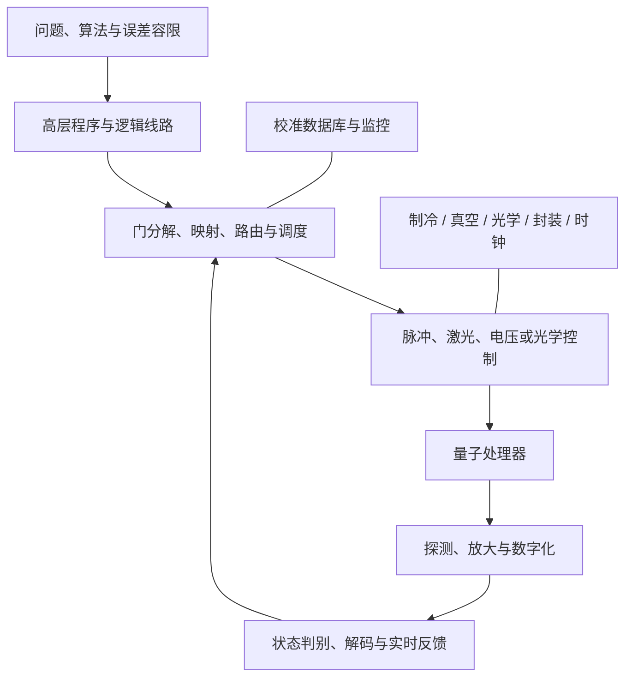

# 09｜从物理量子比特到控制栈

若对“能级”“共振驱动”或“二能级近似”还不熟悉，先读[量子力学 Q3](quantum-mechanics/03-levels-control.md)。那一章从能量差和脉冲出发，解释本章各种器件共享的物理基础；波函数、谐振子与势垒的详细推导放在进阶选读 [Q4](quantum-mechanics/04-wavefunctions-models.md)。

本章的阅读顺序是：先弄清一台机器有哪些层、什么叫物理与逻辑量子比特；再看六种器件各自如何存、控、读；最后用实际计数和时序例子理解错误、编译与新闻里的性能数字。不要求先懂微波工程、原子物理或芯片制造。技术名词首次出现时都应能回答一个朴素的问题：**它在整个计算过程中负责什么？**

## 1. 先把“量子计算机”拆成一整套系统

量子芯片只是系统中央的一层。一台能运行门模型算法的机器还要完成：初始化、门控制、读出、编译、实时反馈、校准，以及制冷、真空、激光或光纤互连。任何一层跟不上，芯片上名义量子比特再多也无法转化为更大的可靠线路。

因此，至少要一起看量子比特数、连接图、门和测量时间、错误率、并行度、泄漏、丢失、校准稳定性、经典反馈延迟和整机可用率。不同平台的“一个量子比特”也不是相同的工程资源。

### 物理、辅助和逻辑比特不是同一个计数

**物理量子比特**是器件中实际可控制的一个两能级自由度，例如一个超导电路的最低两能级、一个离子的两个内部能级。它会出错。为保护信息，可把一个抽象的**逻辑量子比特**编码在许多物理比特的联合态中：一部分承载数据，另一些辅助比特反复测量错误迹象（综合征），还有的专门帮助复位或清除泄漏。测量比特通常不是“又多存了一个算法答案”；它在每轮为解码器提供检查记录。逻辑比特也并非只要分配了一个编码块就自动可靠，还要看重复检测、解码和逻辑错误是否真的低于未经编码的基线。

用第 7 节的一个实验说明口径：该论文的距离 7 表面码存储器动用了 **101 个物理比特**，由 49 个数据比特、48 个测量比特、4 个额外的泄漏清除比特组成；这些资源保护的是**一个**逻辑存储比特。承载它的处理器有 105 个物理比特。于是“105 比特芯片”“101 比特编码实验”“一个逻辑存储比特”分别回答三种不同问题，不能互相替换；实验还不是一台能随意运行长程序的通用容错机器。

## 2. 共同要求与 DiVincenzo 准则

DiVincenzo 提出的是检查“某种物理体系能否承载量子计算”的**设计准则**，不是某个机构发出的合格证。前五项用于计算：

1. 有定义清楚、原则上可扩大的量子比特：能稳定说出哪个物理态是 $|0\rangle$、哪个是 $|1\rangle$，而不只是在一个小器件上偶尔看见两能级。
2. 能初始化：下一次运行前能把所需比特准备到已知起点，例如 $|0\rangle$；复位若慢或不准，会拖慢整机。
3. 相干足够久：环境造成的弛豫与相位漂移不能在操作完成前淹没信息。这里要比较**完整线路**的时间，不是孤立地称赞一个长 $T_1$。
4. 有通用门集：要能组合出所需的单比特控制和纠缠操作，并把误差与资源算进去。
5. 能按需测量：读出结果要足够准确、快，而且对算法要求的比特或联合可观察量可实际实施。

若用于远距离量子通信，还要把静止比特的信息转成可传播的光子等“飞行比特”，并可靠传输它；这两项不等于本地处理器必然配有量子网络。

例如，“相干时间为一秒”只有与门时间、等待时间、并行控制和实际噪声谱结合才有意义；“全连接”也要说明是逻辑上可路由、能够逐对寻址，还是能够任意并行。

## 3. 六条主要硬件路线

下表先作地图，不必第一次就记住每个名词。每行依次问：**把什么物理状态当作 $0/1$；用什么动作做门；怎样变成可记录的电或光信号；放大阵列后哪个环节先吃紧。** 表中的项目是常见实现，不是所有厂商或所有实验的唯一做法。

| 平台 | 物理编码与控制 | 典型读出 | 主要噪声或失效 | 扩展时的核心问题 |
|---|---|---|---|---|
| 超导电路 | 约瑟夫森结形成非谐振荡器；微波脉冲和可调耦合器 | 色散读出：状态改变谐振腔响应，经低温放大链判别 | 能量弛豫、退相位、串扰、残余耦合、频率碰撞、$|2\rangle$ 泄漏 | 毫开尔文制冷、布线与封装、频率拥挤、控制电子学和校准负担 |
| 离子阱 | 离子内部能级；激光或微波控制，共享振动模产生纠缠 | 状态依赖荧光：“亮/暗”计数 | 加热和振动模误差、激光相位/强度噪声、散射、串扰、碰撞 | 长链振动模变密；需分区、搬运、光学互连和稳定激光系统 |
| 中性原子 | 光镊逐个俘获；Rydberg 阻塞或相互作用实现纠缠 | 荧光成像、原子是否存活或内部态映射 | 原子丢失、Rydberg 衰变、多普勒效应、激光噪声、串扰 | 快速无损测量、补充与重排、局域寻址、并行门和控制光学 |
| 光子 | 路径、偏振、时间箱，或连续变量；干涉、测量和前馈 | 单光子/光子数探测或同相探测 | 产生、耦合、传播、开关和探测损耗；不可区分性不足 | 确定性纠缠资源、低损耗交换、快速前馈、探测器和巨大时空资源 |
| 半导体自旋 | 量子点电子/空穴或施主自旋；交换耦合和电/磁/微波控制 | 自旋到电荷转换，再用电荷传感器读出 | 电荷/核自旋噪声、谷态、器件变异、控制串扰、泄漏 | 低温布线与电子学、均匀大阵列、量子点调谐、晶圆级良率 |
| 拓扑路线 | 目标是用非阿贝尔准粒子的整体自由度编码；编织、测量或等效操作 | 奇偶宇称或电荷读出 | 准粒子中毒、有限尺寸劈裂、无序、普通束缚态伪装信号 | 首先要确证受保护自由度，再实现可重复读写、纠缠门与规模化网络 |

表中“优势”没有自动赢家。超导门快但控制周期和制冷代价不同于离子；光子擅长传输但损耗会沿大系统累积；原子阵列中的原子数也不等于已经具备同等数量、可并行执行任意门的通用处理器。

## 4. 六条路线的实验直觉

### 4.1 超导：把电路做成“人工原子”

先想一个普通电路：电容与电感来回交换能量，会振荡；如果它像理想 LC 振荡器，能级间距近似相等，一段瞄准 $|0\rangle\leftrightarrow|1\rangle$ 的微波也容易误碰 $|1\rangle\leftrightarrow|2\rangle$。**约瑟夫森结**是一种超导非线性元件，能把这两个跃迁频率拉开。于是选最低两级作为计算中的 $|0\rangle,|1\rangle$，更高的 $|2\rangle$ 不消失，只是不希望它被占据。常见的 **transmon** 设计用较大的 $E_J/E_C$ 降低电荷噪声敏感性；$E_J$ 是约瑟夫森能量尺度、$E_C$ 是充电能量尺度，两者的比值不是门保真度。

单比特门通常靠频率、相位与持续时间受控的微波脉冲；两比特门还要让相邻电路暂时相互作用，方案可用交叉共振、可调耦合器或参量过程。**色散读出**并不是直接拍摄量子态：把量子比特接在一个微波谐振腔旁，量子比特为 0 或 1 时，探测微波经过谐振腔的响应略有差别；低温放大器放大后，电子学从一团有噪声的测量点判成 0 或 1。控制过快或波形不准可能把状态推入 $|2\rangle$，这不是普通的“比特翻转”，而是离开计算子空间。

扩展难点并非只在芯片面积：每个频率、耦合器和读出通道都要安排，低温线缆会带来热负载，器件漂移又会反复触发校准。二维局域连接适合表面码，却也意味着非相邻逻辑操作需要路由。

封装是量子器件的一部分。二维芯片放大后，边缘引线不足、封装或衬底寄生模、接地不良和热化不足都可能降低相干或引入串扰。倒装焊、中介层和超导硅通孔可把信号从垂直方向引出，但新介质、金属、接缝和热路径也会增加损耗或准粒子风险。把控制电子学移到 3–4 K 或更低温度能减少室温线缆，却会把开关功耗和噪声带到制冷量更小的冷级，因此必须按温区核算功耗，而不能只数控制通道。

### 4.2 离子阱：用集体振动传递相互作用

离子是带电的原子，电磁阱把它悬在真空中；选它的两个内部能级作 $|0\rangle,|1\rangle$。激光或微波可转动一个离子的内部态。若两个离子排在同一条链，它们还有共同的振动模式，可以把这种运动短暂当作传递相互作用的“中介”：门结束时希望振动与比特重新分离，留下两比特纠缠。**状态依赖荧光**则让一种内部态散射许多探测光子，另一种近似不散射；相机记录到的是有噪声的“亮/暗”光子计数，不是直接读取看不见的振幅。

同一链内可以形成高连接度，但“全连接”不等于所有配对可零代价同时执行。离子数增长后振动模更拥挤，冷却、门时间和串扰更难管理。量子电荷耦合器件（QCCD）用分区阱和离子搬运缓解这个问题；更大的模块还可能靠光子链接。搬运、再冷却和远程纠缠都应计入运行时间与错误预算。

### 4.3 中性原子：用可重排光镊布置阵列

**光镊**是聚焦到很小区域、能困住单个中性原子的激光势阱。装载通常有随机空位，可以移动已装入的原子，把阵列重排成所需几何。选择原子的两个长寿命内部态当 $|0\rangle,|1\rangle$；做两比特门时，短暂把原子激发到电子离核更远的 **Rydberg 态**。一个原子被激发后，其相互作用使附近另一个原子的激发频率偏移，这叫 **Rydberg 阻塞**，可用来实现条件操作。读出常靠荧光成像，但必须分清“测到了内部态”和“原子在测量中丢失”；一个黑点可能是真正的 0，也可能是原子不在了，取决于具体读出方案。

它的吸引力是原子天然相同、几何可重构、阵列可很大。困难是把大阵列同时变成高质量门阵列：局域寻址、并行门、Rydberg 寿命、测量速度、无损性、原子补充和循环复位都影响有效吞吐。几千个被俘获原子的阵列是重要的装载与保持成绩，但本身不等于几千个通用、纠错后的逻辑量子比特。

### 4.4 光子：损耗本身就是错误模型的一部分

最简单的**双轨编码**用两条光路存一个比特：一粒光子在左轨记 $|0\rangle$，在右轨记 $|1\rangle$；两轨的相干叠加也能表示量子态。如果光子在传输中丢失，就不是“误读成另一轨”，而是两轨都没有光子，已离开这套编码。其他离散变量方案还可用偏振或时间箱；连续变量方案用光场正交分量和压缩态编码，要获得通用计算仍需非高斯资源。光子适合在网络中传播，却难以让两个光子确定性地相互作用，因此常靠干涉、辅助光子、探测和**前馈**（根据探测结果及时改变后续光路）来做测量诱导门或簇态计算，成功概率与额外资源都须算入。

每个环节的效率会相乘。若单光子总生存率为 $\eta$，一个需要 $n$ 个光子都到达的事件，其原始成功因子是 $\eta^n$。例如 $\eta=0.99,n=100$ 时只有约 $36.6\%$；把效率提高到 $0.999$ 才约为 $90.5\%$。所以“条件于成功探测的门保真度”必须与源亮度、耦合、探测效率、接受率和时钟频率一起报告。

“室温光子计算”也须逐层核对：光子可在室温光路传播，但高性能光源、稳定器或超导纳米线探测器可能仍需低温。

### 4.5 半导体自旋：小尺寸不等于已经容易布线

**量子点**是在半导体里用电极圈住单个电子或空穴的小区域；可把自旋向上、向下的两个态当作 $|0\rangle,|1\rangle$。两个点靠近时，改变它们之间的隧穿势垒就能调节**交换相互作用**，用来做双比特门。直接探测一个自旋很难，常先利用自旋选择规则，把它变成“电子能不能移动到邻近位置”的电荷差异，再由电荷传感器读出；这叫**自旋到电荷转换**。施主原子的核自旋则可提供另一类较长寿命的存储。

硅制造经验和高密度是长期优势，但量子点不像普通晶体管那样开箱即同质：栅压要逐个调谐，界面、**谷态**（硅能带中额外的低能自由度）和局部电场会改变行为。若谷态太接近计算能级，还可能提供意外的泄漏路径。扩展需要复用低温信号、把部分控制电子学放进低温区，并证明大阵列上的良率、并行控制和稳定校准，而不仅是小单元中的高保真度。

### 4.6 拓扑路线：先确认“受保护的对象”确实存在

目标是把信息编码在非局域、由拓扑性质决定的自由度中，使局域扰动难以直接破坏它。所谓 **Majorana 零模**，是理论上可出现在某些超导体系边界或缺陷附近的近零能量模式；编码要利用多个模式共同形成的态空间。**非阿贝尔交换**指按不同顺序交换这些模式，所得的态变换一般不能互换顺序。观察到某个近零能量信号不等于已经测到这种交换规律：零偏压峰、宇称寿命或某种能隙各自都可能有普通物理解释。证据链应逐级回答：

1. 信号是否与 Majorana 或非阿贝尔统计相容，并排除了普通 Andreev 束缚态等替代解释？
2. 是否形成可重复初始化和读出的编码量子比特？
3. 是否实现交换、测量式操作或等效纠缠门？
4. 错误是否随保护尺度增加而系统下降？
5. 是否达到可扩展、可组合的逻辑操作？

前一层不能替后一层作证。“拓扑”也不表示所有操作天然无误；测量、辅助态和非 Clifford 操作仍可能需要主动纠错。

### 4.7 扩展时真正被复制的是整套单元

扩大机器不是只复制量子比特。不同平台都要同时复制或复用控制、读出、热/光/真空环境和校准能力：

| 平台 | 必须随规模解决的基础设施 | 容易被宣传数字隐藏的成本 |
|---|---|---|
| 超导 | 多层封装、接地、滤波、低温放大、频分读出、不同温区的控制电子学 | 冷端热负载、寄生模、频率碰撞、布线良率和校准占空 |
| 离子阱 | 稳定激光或微波、分区电极、成像、搬运与再冷却 | 离子链的分裂、搬运、合并和重排占用的关键路径，以及门区的并行度 |
| 中性原子 | 真空、装载、成像、重排、局域寻址、储存/纠缠/读出区 | 随机装载、补原子、搬运、读出和再初始化的循环时间 |
| 光子 | 源、耦合、波导、开关、延迟线、探测器和快速前馈 | 各段效率相乘后的事件率、探测器死时间和低温探测需求 |
| 半导体自旋 | 自动调谐、交换脉冲、RF 反射读出复用、低温电子学 | 器件差异、谷态、栅线密度、热预算和晶圆上可用单元良率 |
| 拓扑候选 | 材料、能隙、奇偶读出和中毒监测 | 替代解释尚未排除时，器件信号不能直接折算成受保护门质量 |

这张表回答“系统要复制什么”。至于抽象门怎样变成布局、路由、调度和波形，以及校准参数如何相互依赖并在漂移后重新验证，见[第 14 章](14-compilation-control.md)。

这张表仍只是入口。五类成熟平台从信号源、调制、器件到探测和复位的完整控制链，以及分温区热预算、封装可测试性、制造良率和供应链，见[第 19 章](19-engineering-architecture.md)。

## 5. 相干、SPAM 与泄漏：不要把一个数字叫作“保真度”

### 5.1 $T_1$、$T_2^*$ 与 $T_2$

三种时间回答不同问题。$T_1$ 问“已激发的 $|1\rangle$ 多久会失去能量”；$T_2^*$ 问“许多次实验里，相位关系多久会因噪声和慢漂移变得难以重现”；$T_2$ 通常是加入回波等序列后测出的相位相干时间。它们都不是“能做多少个门”的现成答案。

能量弛豫实验先制备 $|1\rangle$，等待 $t$ 后测量，常拟合为

$$
P_1(t)=A e^{-t/T_1}+B.
$$

$P_1(t)$ 是重复实验后测到 1 的频率；$A$ 是可见的初始对比度，$B$ 是长时间后的背景或热平衡基线。在理想的低温、完美制备和读出模型里，$A=1,B=0$，只剩 $e^{-t/T_1}$。因此等待 $t=T_1$ 后，激发态的占据概率降到 $e^{-1}\approx0.368$，**不是**“有 1% 的错误”。实验拟合中的 $A,B$ 还可能包含制备与读出不完美，不应把曲线的全部偏移都归因于弛豫。

**Ramsey 实验**先用脉冲造出 $|0\rangle$ 与 $|1\rangle$ 的叠加，等待一段时间，再用第二个脉冲把累积相位转成可测概率；改变等待时间，概率会上下振荡。常见拟合模型为

$$
P_1(t)=\frac12\left[1+C e^{-(t/T_2^*)^\alpha}
\cos(\Delta t+\phi)\right].
$$

$C$ 是振荡可见度，$\phi$ 是初始相位，$\alpha$ 决定包络形状；它们都是拟合参数，不能把振荡频率与衰减时间混为一谈。$\Delta$ 是角频率失谐，单位为弧度每秒；若仪器按赫兹报告频率差 $\Delta f$，应先换算为 $\Delta=2\pi\Delta f$，再代入余弦。这与[第 15 章的 Ramsey 拟合式](15-practice-research.md#7-实验三弛豫与退相位的三轴诊断)中的 $\cos(2\pi\Delta f t+\phi)$ 是同一种写法。

$T_2^*$ 包含慢漂移造成的非均匀展宽；回波序列能抵消部分慢噪声，所得 $T_2$ 通常更长。在简单马尔可夫模型中

$$
\frac1{T_2}=\frac1{2T_1}+\frac1{T_\phi},\qquad T_2\le 2T_1,
$$

其中 $T_\phi$ 是纯退相位时间。若 $1/T_\phi\ge0$，就有 $1/T_2\ge1/(2T_1)$，把正数两边取倒数便得到 $T_2\le2T_1$。若实验定义、拟合包络或噪声非马尔可夫，这个关系不能机械套用。相干时间也不是门错误率：控制误差、串扰和泄漏不会被一个空闲衰减时间完整捕捉。

例如在低温、激发态近似只向基态弛豫的模型中，若 $T_1=100\,\mu\mathrm s$，一个已制备为 $|1\rangle$ 的比特空闲 $1\,\mu\mathrm s$ 后仍处于 $|1\rangle$ 的概率为 $e^{-1/100}\approx0.99005$，弛豫概率约 $0.995\%$。这只计算了这段**空闲**时间的能量弛豫；不能把它直接报成任意 $1\,\mu\mathrm s$ 门的错误率，因为门期间的驱动和其他噪声还会改变演化。

### 5.1.1 S71-09：等五个弛豫时间，复位残差一定小于 1% 吗

**题目与条件。** 初态为 $|1\rangle$。用恒定、马尔可夫的两能级模型描述空闲：向上跃迁率 $\Gamma_\uparrow=100\,\mathrm{s^{-1}}$，向下跃迁率 $\Gamma_\downarrow=9900\,\mathrm{s^{-1}}$，无泄漏。分别求等待 $500\,\mu\mathrm s$ 的激发概率、达到 2% 的最短等待，以及能否只靠等待达到 0.1%。这些是合成参数，不是硬件校准值。

**先算流入和流出。** 当前激发占据为 $p_1(t)$；基态比例是 $1-p_1(t)$。每秒从基态流入激发态的概率是 $\Gamma_\uparrow(1-p_1)$，从激发态流出的概率是 $\Gamma_\downarrow p_1$，所以

$$
\frac{dp_1}{dt}=\Gamma_\uparrow-(\Gamma_\uparrow+\Gamma_\downarrow)p_1.
$$

令 $\Gamma_\Sigma=\Gamma_\uparrow+\Gamma_\downarrow$，稳态占据 $p_\infty=\Gamma_\uparrow/\Gamma_\Sigma$。把 $p_1-p_\infty$ 作为新变量，微分方程变成 $d(p_1-p_\infty)/dt=-\Gamma_\Sigma(p_1-p_\infty)$，因此

$$
p_1(t)=p_\infty+[p_1(0)-p_\infty]e^{-t/T_{\rm rel}},
\qquad T_{\rm rel}=1/\Gamma_\Sigma.
$$

这里拟合占据差得到的弛豫时间是上下率之和的倒数；只有向上跃迁可忽略时，它才近似为 $1/\Gamma_\downarrow$。本题 $T_{\rm rel}=100\,\mu\mathrm s$、$p_\infty=0.01$，故五个时间常数后

$$
p_1(500\,\mu\mathrm s)=0.01+0.99e^{-5}\approx0.01667.
$$

低温单向模型的 $e^{-5}\approx0.00674$ 会漏掉热底限与回激发。欲达到 $p_* >p_\infty$，由指数式逐步解得

$$
t\ge T_{\rm rel}\ln\frac{p_1(0)-p_\infty}{p_*-p_\infty}.
$$

对 $p_*=0.02$，最短等待约为 $100\ln99=459.512\,\mu\mathrm s$。对 $p_*=0.001<p_\infty$，本题从激发态出发的单调衰减永远到不了目标；等更久会趋近 1%，不会趋近零。若从 $|0\rangle$ 出发，等待反而使激发占据增加到该底限。

**程序与扩展题。** 运行 [round71_checks.py](../codes/systems/round71_checks.py) 的 `--case 09`，用速率方程分步积分独立核对解析值，并检查初始时刻、稳态和两率均零的边界。把向上率改成零，会回到 §5.1 的单向式；把初态改成 0，应得到升温而非进一步冷却。

这一模型只算占据，不刻画相干、泄漏或主动复位。热平衡还需详细平衡条件；非平衡回激发不能自动解释成某个温度。[Jin 等的原始 transmon 热占据实验](https://arxiv.org/abs/1412.2772)区分热与残余激发；[IBM 官方噪声模型文档](https://quantum.cloud.ibm.com/docs/en/guides/build-noise-models)将平衡激发占据列为热弛豫参数（访问 2026-10-13）。在软件中把该参数默认设为零，是一个建模选择，不是设备测量。

### 5.2 SPAM、门错误、丢失与泄漏

- **SPAM** 是状态制备与测量误差的合称。读出把 $|0\rangle$ 判成 $1$ 和把 $|1\rangle$ 判成 $0$ 的概率可能不对称，平均值会隐藏这一点。
- **门错误** 应说明是单独门、同时门还是完整门层中的结果，以及使用何种基准和误差模型。
- **泄漏** 指状态进入计算子空间以外，如 transmon 的 $|2\rangle$ 或离子的其他能级。泄漏可能跨多个纠错周期持续传播，不能一律等价为 Pauli 错误。
- **丢失** 在原子和光子平台尤其重要。若设备能标记丢失位置，解码器可把它当“擦除”处理；若只丢弃失败样本，就必须同时报告接受率。

### 用 2,000 次标定看懂不对称读出

假设能可靠地分别准备 $|0\rangle$ 和 $|1\rangle$，每种各测 1,000 次，得到下面的**示例数据**（不是任何厂商设备的实测结果）：

| 实际准备 | 报 0 的次数 | 报 1 的次数 | 条件误判率 |
|---|---:|---:|---:|
| $|0\rangle$，1,000 次 | 980 | 20 | $20/1000=2\%$ |
| $|1\rangle$，1,000 次 | 60 | 940 | $60/1000=6\%$ |

平均误判率是 $(2\%+6\%)/2=4\%$，但只报“读出准确率 96%”会藏住 0 与 1 的差别。若某未知样本真正的 $p(1)$ 为 $p$，在标定稳定、同一读出模型适用的假设下，记仪器报 1 的概率为 $p_{\mathrm{obs},1}$，则

$$p_{\mathrm{obs},1}=0.02(1-p)+0.94p=0.02+0.92p.$$

若后来 1,000 次中报了 480 个 1，频率 $0.48$，代入得到 $p\approx(0.48-0.02)/0.92=0.50$。这个校正只针对所假定的稳定混淆矩阵，不会消除制备漂移、时间相关噪声、泄漏或有限标定样本的不确定度。若“准备 $|0\rangle$”本身就会偶尔失败，表中计数实际混合了制备与读出误差，不能只凭这张表把两者拆开，这正是 **SPAM** 一起报告的原因。

即使暂把表中的两个标定概率 $0.02$、$0.94$ 当作完全已知，$0.50$ 也只是**估计值**，不是精确得知真实概率。按 1,000 次独立二项采样估算，报 1 频率的标准误约为 $\sqrt{0.48(1-0.48)/1000}\approx0.0158$；由于反演式要除以 $0.92$，校正后的标准误约为 $0.0158/0.92\approx0.0172$。这还没有加上两组各 1,000 次标定造成的不确定度。若读出错误率接近 $50\%$，反演的分母会更小，统计噪声放大得更厉害；因此“做了读出校正”不等于获得了更多独立测量信息。

泄漏和丢失还要单列。transmon 若到了 $|2\rangle$，仪器也许仍强行把它判成 0 或 1，但后续门对它的作用不再遵守两维理想电路；这种错误可能持续多轮。双轨光子的丢失则是两条轨道都无光子；如果探测器或额外检查能指出哪个位置丢失，便有“已知位置的擦除”信息。两者都不是简单地把 $0\leftrightarrow1$ 的概率加进表格。

一次实验至少应给出中位数或分布、置信区间、测量日期、是否并行运行、校准到采样的时间间隔，以及是否经过读出校正、误差缓解或后选择。

### 5.3 练习与实验：一个“丢失告警”究竟有多可信

丢失检测器的**灵敏度**是“真的丢失时，有多少会被标记”；**告警精确率**是“已经收到的标记中，有多少真的丢失”。两个条件概率交换了条件，数值通常不同。误把前者当后者，会让擦除解码器过度相信位置标签。

**题目。** 假设一百万个相互独立的器件使用事件中，真实丢失概率为 $\ell=0.001$；检测灵敏度为 $s=0.98$，未丢失事件的假阳性率为 $f=0.002$。这些是教学参数，不是器件实测值。求四类事件的期望数、收到告警后真的丢失的概率，以及未告警事件中的残余丢失概率。

**逐步答案。** 先分真实状态，再在每一类中应用检测概率，不能先把所有事件乘以 98%。

| 真实状态 | 有告警 | 无告警 | 行总数 |
|---|---:|---:|---:|
| 丢失 | $1000\times0.98=980$ | $1000\times0.02=20$ | 1000 |
| 未丢失 | $999000\times0.002=1998$ | $999000\times0.998=997002$ | 999000 |

一共有 $980+1998=2978$ 个告警，其中真的丢失只有 980 个。因此贝叶斯公式给出

$$
P(\mathrm{丢失}\mid\mathrm{告警})
=\frac{s\ell}{s\ell+f(1-\ell)}
=\frac{980}{2978}\approx32.91\%.
$$

未告警的 $997022$ 个事件中仍有 20 个丢失，残余比例为 $20/997022\approx2.006\times10^{-5}$。低丢失率会使数量庞大的正常事件贡献许多假告警；这与 98% 灵敏度并不矛盾。表中的数字是期望数，一次实际抽样不必恰好如此。

运行 [hardware_flags.py](../codes/systems/hardware_flags.py) 可复算表格，并检查零告警、全部告警时条件概率无定义的边界。扩展练习把 $f$ 减到 $0.0002$：假告警期望数变为 199.8，告警精确率约为 83.06%。这揭示工业检测链应同时保存基准丢失率、漏检、误标记与原始计数，而不是只给一个“检测准确率”。这里未模拟标签延迟、相关丢失或标签对后续控制的作用；它也不是纠错阈值模拟。实验入口见[系统实验册](labs/systems.md)。

### 5.4 练习与实验：标定本身有误差，怎样一起算

**题目。** 延续 §5.2 的三组原始计数：准备 0 时 1000 次报 1 共 20 次；准备 1 时 1000 次报 1 共 940 次；未知态 1000 次报 1 共 480 次。三批独立，期间读出模型稳定。把标定也视作有限样本，校正概率的标准误还是 0.0172 吗？

**逐步答案。** 记 $a=P(\text{报1}\mid0)$、$b=P(\text{报1}\mid1)$、$q=P(\text{报1})$，则 $p=(q-a)/(b-a)$。这里三个量都在 $[0,1]$，当前估计为 $(q,a,b)=(0.48,0.02,0.94)$，分母 $g=b-a=0.92$。分别改变每个输入，对应的一阶灵敏度为

$$
\frac{\partial p}{\partial q}=\frac1g,\qquad
\frac{\partial p}{\partial a}=-\frac{1-p}{g},\qquad
\frac{\partial p}{\partial b}=-\frac p g.
$$

例如第二项由商法则得到 $[-(b-a)+(q-a)]/g^2=(q-b)/g^2=-(1-p)/g$，不是简单的 $-1/g$。独立二项频率的方差为 $x(1-x)/n$，所以一阶传播给出

$$
\operatorname{Var}(\widehat p)\approx\frac1{g^2}
\left[\frac{q(1-q)}N+\frac{(1-p)^2a(1-a)}{n_0}
+\frac{p^2b(1-b)}{n_1}\right].
$$

代入三批均为 1000 次、$p=0.5$，方括号中的三项依次是 $0.0002496$、$0.0000049$、$0.0000141$。相加再除 $0.92^2$ 得 $0.000317344$，开方得到约 **0.01781**。只保留第一项才得到先前的 0.01717；两者的差来自标定样本，不是器件突然变差。这是以观测频率代入的一阶标准误估计，**不是精确置信区间**；分母接近零、样本很少或约束边界附近，应使用联合似然等适当方法。

**扩展题及答案。** 若总预算仍是 3000 次，怎样在未知态、准备 0、准备 1 三批分配？写成 $V=\sum_i C_i/n_i$，其中 $C_i$ 是上式各项除以样本数前的系数。用拉格朗日乘子，$-C_i/n_i^2+\lambda=0$，得到 $n_i\propto\sqrt{C_i}$。按当前先导估计，连续分配约为 $(2177.4,305.1,517.5)$，预测标准误降到 0.01366。实际要取整数，并先用独立先导数据估计系数、给各标定批保留最少样本；不能事后为了好看改变已报告实验的样本设计。

运行 [calibration_uncertainty.py](../codes/systems/calibration_uncertainty.py) 可复算三项预算与分配。程序是教学误差传播，不调用设备；若三批共享漂移，应使用完整的 $J\Sigma J^T$ 加入协方差。统计原则依据 [NIST TN 1297 附录 A](https://www.nist.gov/pml/nist-technical-note-1297/nist-tn-1297-appendix-law-propagation-uncertainty)（一阶传播指南，访问 2026-09-26）。这项计算仍以可靠制备和正确模型为前提，不会自动分离 SPAM。

### 5.5 S72-09：把“门错误 0.1%”填进模拟器前，先对齐定义

**问题。** 第 10 章的电路级实验使用 Stim 参数 $p=0.001$。它是否自动代表本章任何一台硬件的平均门不保真度为 0.1%？不是：先要把实验估计的对象与模拟器的完整信道对应起来。

Stim 的单比特 `DEPOLARIZE1(p)` 在概率 $1-p$ 下不做事，另外分别以 $p/3$ 施加 $X,Y,Z$。定义域为 $0\le p\le1$，因此

$$
\mathcal E_p(\rho)=(1-p)\rho+\frac p3(X\rho X+Y\rho Y+Z\rho Z)
=\left(1-\frac{4p}{3}\right)\rho+\frac{4p}{3}\frac I2.
$$

第二个等号用到了 $X\rho X+Y\rho Y+Z\rho Z=2I-\rho$。对任意纯输入，输出与输入的重叠为 $1-2p/3$；这里的平均门不保真度为 $r=2p/3$，沿用第 11 章的平方重叠约定。不能把 $p$ 和 $r$ 当成同一个数。即使 $p>3/4$ 使 Bloch 缩放系数变负，第一式仍是合法 Pauli 概率混合；不要把另一种“与完全混态混合”的参数范围直接移过来。

**练习及答案。** 当 $p=0.001$ 时，单比特 $r=0.000666667$，约为 0.06667%。对两比特 `DEPOLARIZE2(p)`，15 种非恒等 Pauli 各有概率 $p/15$；四维平均门不保真度为 $r=4p/5=0.0008$，约为 0.08%。反过来，若一个两比特实验在相应去极化假设下给 $r=0.001$，参数应为 $p=5r/4=0.00125$。

运行 [systems_calculations.py](../codes/systems/sdk/systems_calculations.py)会用六个 Bloch 轴向纯态直接核对单比特平均重叠。两比特换算可从 $F_e=1-p$ 和 $F_{\rm avg}=(4F_e+1)/5$ 得到；其维度是 4，不能套单比特分母 3。

[Stim 1.16.0 官方门文档](https://github.com/quantumlib/Stim/blob/v1.16.0/doc/gates.md#depolarize1)给出这里的 Pauli 概率定义（访问 2026-10-13）。本书电路模拟中的门后、轮前、测量和复位参数分别定义；它们是合成输入，没有从器件的 $T_1$、SPAM 或某一个 RB 数字直接复制。硬件数据若包含相干、泄漏、串扰与漂移，仅做这个代数换算仍不足以建立可信设备模型。

## 6. 软件、控制与云平台

抽象量子线路必须被改写成目标机器实际支持的门和连接图。路由可能插入 SWAP、离子搬运、原子移动或远程纠缠；调度还要避开共享端口、读出总线和同时驱动造成的串扰。在支持中途测量的动态线路中，测量结果控制的下一步操作必须在相干预算内完成；容错机器的错误迹象解码还须同时满足大量数据处理与及时响应的要求。能级与相互作用模型（Hamiltonian）、振荡控制实验（Rabi/Ramsey）校准、目标机器指令集（ISA）、路由、脉冲和反馈的完整链条在[第 14 章](14-compilation-control.md)展开，本章不重复推导。

### 从一个远距 CNOT 算到物理门

假设一台**示例机器**只有三个物理位置 $0$—$1$—$2$，只允许相邻位置直接做双比特门；程序却要求对逻辑位置 0 和 2 做 CNOT。若所有逻辑量子比特最终还要回到原物理位置，可以先在物理位置 1、2 做 SWAP，让原来位于 2 的状态移到 1；再做相邻的 CNOT(0,1)；最后在 1、2 做一次 SWAP 把位置恢复。若原生双比特门就是 CNOT，理想 SWAP 可由三个相邻 CNOT 分解，于是原本一个抽象 CNOT 变成 $3+1+3=7$ 个双比特门。若后续电路允许继续使用换过的映射，最后一次 SWAP 可能省掉；若原生门不是 CNOT，分解数又会改变。

这个“7”是**在指定连接图和门集下的线路计数示例**，不是所有超导或离子机的实测成本。若极端简化地假设每个双比特门独立以 $1\%$ 概率出现一次会毁掉计算的故障，七门全无故障的概率是 $0.99^7\approx0.932$；不加路由的一门对应 $0.99$。这仅示意为什么多门可能积累风险，不能把 $0.932$ 直接称为真实线路保真度：相关串扰、错误抵消、空闲、编译脉冲和测量都会改变它。

### 反馈是一条有时限的数据通路

中途测量后，模拟信号还要被放大、数字化、判成经典 0/1，必要时送到解码器；控制器再决定下一段脉冲。若测量耗时 $0.5\,\mu\mathrm s$、判别与传输耗时 $0.3\,\mu\mathrm s$、发出条件脉冲前还需 $0.2\,\mu\mathrm s$，则条件操作至少等了 $1.0\,\mu\mathrm s$，尚未计入门本身。三个数字只是计时示例，不代表某个现有平台；它说明为什么要把“反馈延迟”拆成各层，而不是只读一个门时长。等待中的数据比特也会继续受弛豫和退相位影响。

软件接口也分层：

| 层 | 作用 | 边界 |
|---|---|---|
| 高层 SDK/算法库 | 构造线路、变分循环、实验工作流 | 同名门在不同后端会被再次分解 |
| OpenQASM 3 | 表示门、测量、经典控制、显式时间和校准语句 | 语言规范不规定云端排队、作业管理或统一脉冲语义 |
| QIR | 基于 LLVM IR 的跨前端/后端中间表示 | 不要求所有硬件采用共同的物理门集 |
| 厂商后端与脉冲层 | 目标机转译、调度、校准和执行 | 接口、可见参数和结果格式会更新 |

ISO/IEC 4879:2024 提供量子计算术语与词汇，但行业尚没有一种表示能无损覆盖所有离散门、模拟控制、光子测量和硬件脉冲。硬件差异不是改一个文件格式就会消失。

云端实验要保存目标设备和实际执行时间、目标机指令集（ISA）/连接/校准快照、编译设置与随机种子、编译后线路、重复采样次数（shots）、中途测量与条件分支、误差抑制或缓解、原始结果、软件及结果数据格式（schema）版本。随机种子只能帮助重现启发式编译，不能冻结硬件漂移。可直接复用的清单见[第 14 章实验记录模板](14-compilation-control.md#13-可复现实验记录模板)，统计与审稿口径见[第 11 章](11-resources-benchmarks.md)。设备列表、价格和可用性是易变信息，应链接平台实时文档，而不是抄成永久教材结论。

## 7. 截至 2026-09-24，可核查但容易过时的里程碑

以下条目用来训练“怎样读新闻”，不是厂商排名。这里采用论文**首次在线日期**，同时在参考资料列正式刊期；更正论文单列，避免把印刷卷期误当首次公开日期。截止日只表示本章完成过核查，不保证此后没有新结果。

- **[超导纠错](https://www.nature.com/articles/s41586-024-08449-y)**：Google 团队的论文于 2024-12-09 在线发表、收录于 *Nature* 2025 年卷，并在 2026-04-28 发表[作者更正](https://www.nature.com/articles/s41586-026-10559-8)：更正的是图 3a 中重复码的横轴标签与图例，不是下述距离 7 存储数据。在 105 比特处理器上，距离 7 表面码存储实验实际使用 101 个物理比特：49 个数据比特、48 个测量比特和 4 个额外的泄漏清除比特；这也解释了为什么它不是裸旋转补丁的 $2d^2-1=97$。实验给出每周期逻辑错误 $0.143\%\pm0.003\%$，码距每增加 2 的抑制因子为 $2.14\pm0.02$；两个数字都与该实验的编码、周期和解码方法绑定。这证明特定存储实验中的低于阈值缩放，不是通用容错计算机已经完成。
- **[中性原子阵列](https://www.nature.com/articles/s41586-025-09641-4)**：2025-09-24 在线的 *Nature* 工作在 11,998 个站点中俘获超过 6,100 个原子，报告约 23 分钟的真空限制寿命。其 $12.6(1)$ 秒相干时间是施加 XY16 **动态解耦**（用一串控制脉冲抵消部分慢噪声）后测得的 $T_2$；阵列平均的自由演化 $T_2^*$ 约为 $14.0(1)$ 毫秒。括号中的 $(1)$ 表示最后一位约 $\pm0.1$ 的报告精度；两个时间的实验条件不同，不能当作可直接互换的“等待时间”。这是装载、保持、成像和运输的系统工程里程碑；论文没有把全部原子演示成可执行通用高保真门的逻辑处理器。
- **[光子条件指标](https://www.nature.com/articles/s41586-025-08820-7)**：2025-02-26 的 300 mm 硅光子论文报告了很高的双轨 SPAM、Hong–Ou–Mandel（两粒不可区分光子的干涉）指标、融合操作和芯片互连指标，但论文明确把这些结果条件化于光子被探测，并未把损耗计入所报保真度。引用时必须同时写这一条件。
- **[离子逻辑改进](https://www.nature.com/articles/s41586-026-10628-y)**：2026-06-10 的 *Nature* 论文在 12 物理比特到 2 逻辑比特的 carbon code、16 到 4 的 tesseract colour code 实验中报告相对所选物理基线约 11 倍至 800 倍的逻辑改进。结果使用可扩展错误检测和后选择（只保留满足预设检测条件的运行）；它不是“任意算法、任意深度都改善 800 倍”。接受率、基线和线路族不能省略。
- **[Majorana/微软相关主张](https://doi.org/10.1038/s41586-024-08445-2)**：2025 年 *Nature* 的 InAs–Al 器件论文研究了宇称读出；论文本身明确说，这种读出不能无歧义地区分拓扑 Majorana 零模与精细调节的普通 Andreev 态。2026 年 *Nature* 又发表了针对其拓扑能隙协议解释的[质疑文章](https://doi.org/10.1038/s41586-026-10567-8)和[作者回复](https://doi.org/10.1038/s41586-026-10568-7)，说明相关解释仍在讨论。另一个 2026 年[两站点 Kitaev 链工作](https://doi.org/10.1038/s41586-025-09927-7)实现了毫秒量级的宇称读出，但它研究的是保护有限的**最小链模型**，不是已确立的大规模受保护计算。到本章截止日，可审慎说器件与宇称测量取得进展，不能说已无争议地实现了受拓扑保护、可通用操作的量子比特。

### 为什么这些数字会过时

新校准、新芯片、论文更正、经典解码器或重新分析都可能改变结论。凡是量子比特数、保真度、云后端、纪录和路线图，应标注“截至日期”，优先引用同行评审正文和勘误。新闻稿与厂商路线图可以说明计划，却不能替代完成证据。

## 8. 读硬件论文的事实核查清单

硬件演示也要对照[第 08 章](08-applications.md#9-何谓可信的实用量子优势)并排问四个不同的问题：设备能否运行、结果有多可信、理论模型是否有算法优势、完整流程在实测中是否胜过强经典基线。能运行不等于已验证正确；结果可信也不自动推出算法或实用优势。

1. 数字指物理比特、活跃比特、编码比特，还是逻辑比特？
2. 指标是单个最佳值、中位数、全芯片分布，还是并行门层？
3. 是否条件于探测、无丢失、无告警或后选择？接受率是多少？
4. “错误校正”是一次错误检测、重复综合征、逻辑存储，还是通用逻辑门？
5. 扩大码距后逻辑错误是否持续下降，比较基线是否公平？
6. 是否计入路由、搬运、复位、解码、校准和经典反馈？
7. 论文是否有更正、Matters Arising 与作者回复、争议或尚未排除的替代解释？
8. 截止日期、软件版本和设备配置能否复现？

## 9. 自检

1. 为什么不能用量子比特数单独比较超导处理器和中性原子阵列？
2. $T_1$、$T_2^*$、门错误率和 SPAM 各测量什么？
3. 光子门的条件保真度为何必须和损耗、接受率一起报告？
4. “离子全连接”和“拓扑保护”各自还需要哪些限定？
5. SWAP 路由与经典反馈延迟怎样改变抽象线路的实际成本？
6. “105 比特处理器”“101 比特编码实验”“一个逻辑存储比特”各数的是什么？其中 101 如何拆开？
7. 理想低温空闲模型中 $T_1=100\,\mu\mathrm s$，把 $|1\rangle$ 等待 $5\,\mu\mathrm s$ 后，仍为 $|1\rangle$ 的概率约多少？它能否直接叫门保真度？
8. 用第 5.2 节的示例读出表，若未知样本 1,000 次中报 1 共 480 次，估计真实 $p(1)$；列出这个校正依赖的假设。
9. 若一个事件必须让 100 个光子全部到达，单光子生存率分别为 $0.99$ 和 $0.999$，原始全到达概率各约多少？为什么条件保真度不能代替这个数？
10. 在线形连接 $0$—$1$—$2$ 上做远距 CNOT(0,2)，若需恢复原映射、SWAP 各由三个 CNOT 构成，总共需多少双比特门？理想独立 $1\%$ 故障模型下七门都不故障的概率约多少？
11. 一篇原子阵列论文同时报告带动态解耦的 $T_2=12.6$ s 和自由演化 $T_2^*=14.0$ ms；为什么不能据此说“任何线路都能无误等待约 12 秒”？

答案见[练习与答案：第 9 章](appendices/exercises.md#第-9-章)。

## 参考资料

- D. P. DiVincenzo, [The Physical Implementation of Quantum Computation](https://doi.org/10.1002/1521-3978(200009)48:9/11%3C771::AID-PROP771%3E3.0.CO;2-E), *Fortschritte der Physik* 48, 771–783 (2000)。
- T. D. Ladd et al., [Quantum computers](https://doi.org/10.1038/nature08812), *Nature* 464, 45–53 (2010)。
- J. Koch et al., [Charge-insensitive qubit design derived from the Cooper pair box](https://doi.org/10.1103/PhysRevA.76.042319), *Physical Review A* 76, 042319 (2007)；A. Blais et al., [Circuit quantum electrodynamics](https://doi.org/10.1103/RevModPhys.93.025005), *Reviews of Modern Physics* 93, 025005 (2021)。
- C. D. Bruzewicz et al., [Trapped-ion quantum computing: Progress and challenges](https://doi.org/10.1063/1.5088164), *Applied Physics Reviews* 6, 021314 (2019)。
- D. Jaksch et al., [Fast Quantum Gates for Neutral Atoms](https://doi.org/10.1103/PhysRevLett.85.2208), *Physical Review Letters* 85, 2208–2211 (2000)。
- A. Browaeys and T. Lahaye, [Many-body physics with individually controlled Rydberg atoms](https://doi.org/10.1038/s41567-019-0733-z), *Nature Physics* 16, 132–142 (2020)。
- G. Burkard et al., [Semiconductor spin qubits](https://doi.org/10.1103/RevModPhys.95.025003), *Reviews of Modern Physics* 95, 025003 (2023)。
- A. Y. Kitaev, [Unpaired Majorana fermions in quantum wires](https://arxiv.org/abs/cond-mat/0010440), *Physics-Uspekhi* 44, 131–136 (2001)（边界零模与有限尺寸劈裂模型）。
- M. Vahidpour et al., [Solid-state qubits integrated with superconducting through-silicon vias](https://www.nature.com/articles/s41534-020-00289-8), *npj Quantum Information* 6, 59 (2020)。
- B. Patra et al., [CMOS-based cryogenic control of silicon quantum circuits](https://www.nature.com/articles/s41586-021-03469-4), *Nature* 592, 369–373 (2021)。
- R. Acharya et al., [Quantum error correction below the surface code threshold](https://www.nature.com/articles/s41586-024-08449-y), *Nature* 638, 920–926 (2025；在线 2024-12-09)；[作者更正](https://www.nature.com/articles/s41586-026-10559-8), *Nature* 653, E5 (2026)。
- H. J. Manetsch et al., [A tweezer array with 6,100 highly coherent atomic qubits](https://www.nature.com/articles/s41586-025-09641-4), *Nature* 647, 60–67 (2025；2025-09-24 在线)。
- M. A. Guidry et al., [A manufacturable platform for photonic quantum computing](https://www.nature.com/articles/s41586-025-08820-7), *Nature* (2025-02-26 在线)。
- A. Paetznick et al., [Improved quantum processor logical error rates via correction and detection](https://doi.org/10.1038/s41586-026-10628-y), *Nature* 654, 349–355 (2026；2026-06-10 在线)。
- M. Aghaee et al., [Interferometric single-shot parity measurement in InAs–Al hybrid devices](https://doi.org/10.1038/s41586-024-08445-2), *Nature* 638, 651–655 (2025)。
- H. F. Legg, [On the robustness of topological gap detection via transport](https://doi.org/10.1038/s41586-026-10567-8), *Nature* 654, E22–E26 (2026)；Microsoft Quantum et al., [Reply to: On the robustness of topological gap detection via transport](https://doi.org/10.1038/s41586-026-10568-7), *Nature* 654, E27–E28 (2026)。
- N. van Loo et al., [Single-shot parity readout of a minimal Kitaev chain](https://doi.org/10.1038/s41586-025-09927-7), *Nature* 650, 334–339 (2026；2026-02-11 在线)。
- [OpenQASM 3 specification](https://openqasm.com/)、[QIR specification](https://github.com/qir-alliance/qir-spec/blob/main/specification/README.md)、[ISO/IEC 4879:2024](https://www.iso.org/standard/80432.html)。
