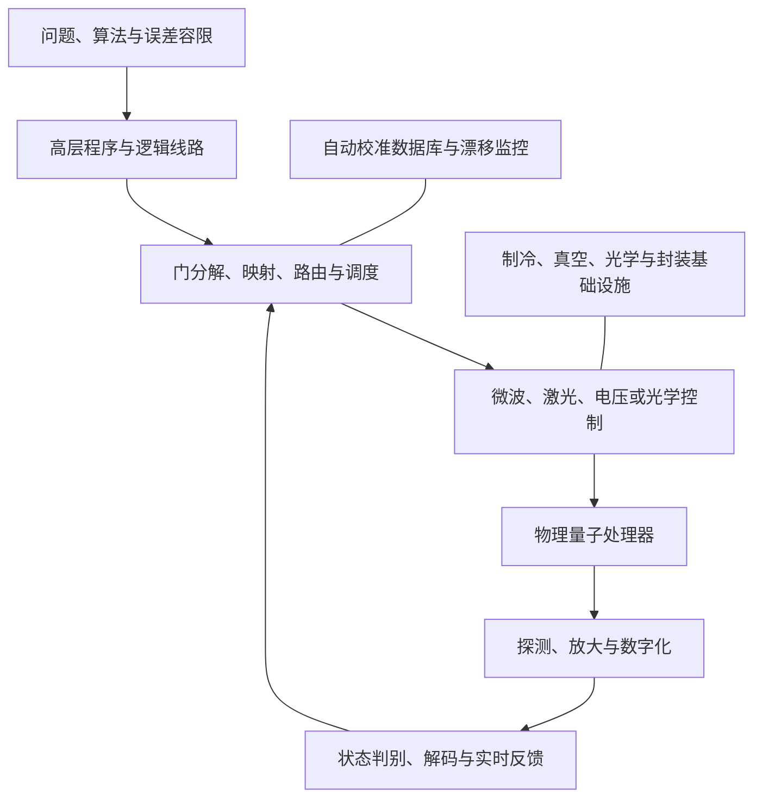
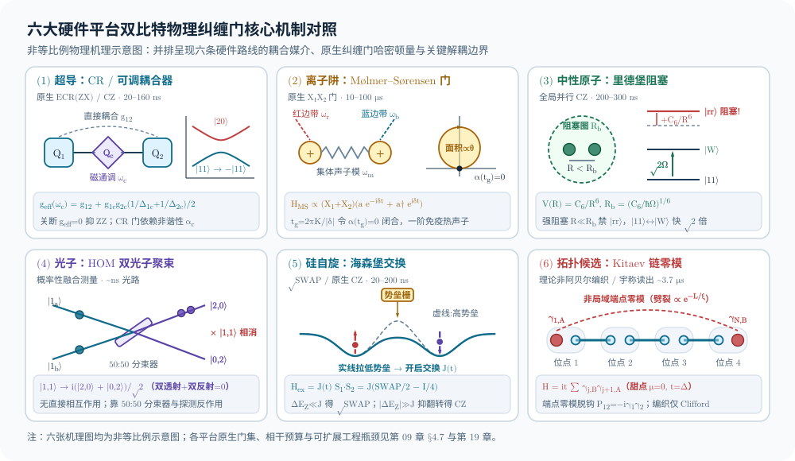
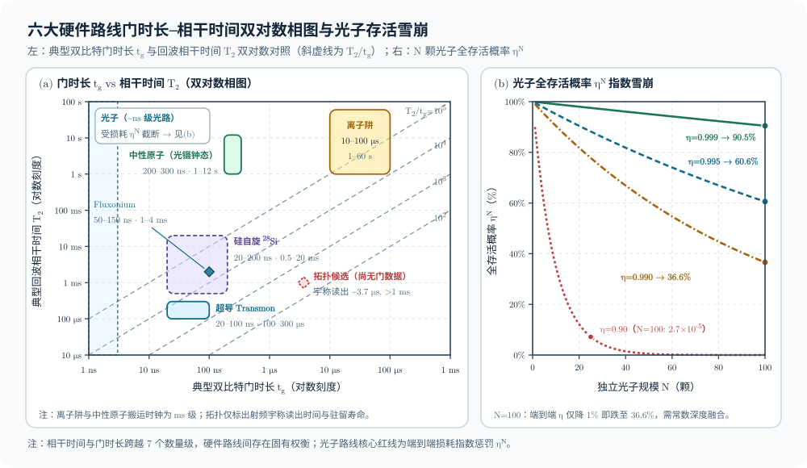

# 09｜主流硬件平台与物理噪声特性

如果你对“能级”“共振驱动”“色散读出”或“二能级近似”还觉得陌生，建议先翻一翻[量子力学 Q3](quantum-mechanics/03-levels-control.md)——那里从最基本的能量差、约瑟夫森非线性电感与电路量子电动力学出发，讲清了本章所有器件共享的物理底座；波函数、谐振子与势垒隧穿的微积分推导则放在进阶选读[量子力学 Q4](quantum-mechanics/04-wavefunctions-models.md)。

前几章我们一直在黑板上画干净的量子电路：画一个 $|0\rangle$，放一个 $H$ 门，连一道 `CNOT`，最后画一个测量仪表。一旦走下黑板、走进真实实验室，这些抽象符号马上变成制冷机里的微弱微波、超高真空里的激光束、纳米电极上的纳秒电压脉冲，以及芯片周围成柜的高速电子学设备。

本章聚焦**六大主流物理硬件路线与器件级噪声定量特性**：先拆清一台量子计算机的层次边界以及“物理比特、辅助比特与逻辑比特”的真实口径；接着走进六条路线深潜，不仅看清各自怎么存、怎么读、怎么扩，更一步不跳地推演**两颗物理量子比特究竟靠什么物理相互作用做出纠缠门**；随后拿起草稿纸，把六平台相干时间尺度、有限温复位底限、有限标定读出不确定度传播、擦除告警贝叶斯精确率和去极化参数换算算透；最后对照 2024–2026 年的真实实验进展，给出通往编译控制与系统工程的接口以及硬件专有审读核查口径。

---

## 1. 先把量子计算机拆成一整套系统

提到量子计算机，新闻配图常常只给一块金灿灿的芯片特写。实际上，量子处理器只是整台机器最中心的一层。要让一条量子电路真正跑起来，系统必须在微秒到毫秒的时间窗内协同完成初始化、精准门操控、微弱信号放大与读出、线路映射与调度、实时解码反馈、自动参数校准，以及背后的低温制冷、超高真空、稳频激光和精密封装。任何一层掉链子，芯片上标称的量子比特数再多，也变不成更深、更准的计算能力。

顺着这张系统链往下看，就能立刻明白业内为什么从不只凭“有多少个量子比特”来评价一台机器。同样关键的还有芯片连通性、单双比特门时长与错误率、并行执行能力、状态泄漏与原子/光子丢失率、校准能稳多久、经典反馈赶不赶得上退相干，以及整机每天真正能干活的时间。

### 物理比特、辅助比特与逻辑比特：从“105、101、1”三个数字讲起

刚看硬件报道时，最容易混淆的三个词就是**物理量子比特**（physical qubit）、**辅助比特**（ancilla qubit）和**逻辑量子比特**（logical qubit）。

- **物理量子比特**是器件中实际可以单独操控的一个两能级物理系统，比如一块超导回路的最低两个能级，或者一颗带电离子的两个内部超精细能级。物理比特很娇气，随时会受环境噪声干扰而出错。
- **逻辑量子比特**不是多造出一种“神奇材质”的比特，而是通过量子纠错码把一份抽象信息分散编码在许多物理比特的联合纠缠态里（详见[第 10 章](10-error-correction.md)）。
- 在一个编码块内部，物理比特还要分工：一部分是承载信息的**数据比特**（data qubit），另一部分是反复检查数据有没有出错的**测量/纠错症状比特**（syndrome qubit），有时还要配专门清理高能级泄漏的辅助比特。测量比特并不替算法多存一位答案，它像巡逻保安，每一轮把检错记录交给经典解码器。

拿 2024 年底在线发表于 *Nature*（2025 年刊出）的 Google Willow 表面码存储实验来对一次账，这三个口径就一清二楚了：

- 承载实验的 Willow 芯片一共有 **105 个物理比特**；
- 理论上，码距 $d=7$ 的旋转表面码最小块需要 $2d^2 - 1 = 97$ 个物理比特（$49$ 个数据比特加 $48$ 个测量比特）；Willow 实验实际动用了 **101 个物理比特**，也就是 **$49$ 个数据比特 $+ 48$ 个测量比特 $+ 4$ 个额外泄漏清除比特**；
- 这 101 个物理比特忙活一整套纠错循环，共同保护的是 **1 个逻辑存储比特**。

所以，“105 比特芯片”“101 物理比特编码实验”和“1 个逻辑存储比特”回答的是三个完全不同的问题：芯片有多大、实验用了多少物理资源、保护住了几份逻辑信息。把三者混成一谈，就会对硬件发展阶段产生严重误判。

---

## 2. 物理体系的共同门槛：DiVincenzo 准则

世界上有成百上千种微观两能级系统，为什么只有少数几条路线走到工程化前沿？物理学家 David DiVincenzo 在 2000 年总结了一套检验清单，后来被称为 **DiVincenzo 准则**。前五条面向本地计算，后两条面向远距离通信：

1. **定义清楚、原则上可扩展的物理比特**：必须能明确区分 $|0\rangle$ 与 $|1\rangle$，而且随着数量从几个增加到上千个，每个比特的参数可控、不会失控串扰。
2. **快速可靠的初始化**：每次运行前都能把比特干净地置回已知初态（通常是 $|0\rangle$）。在纠错循环中，辅助比特每微秒都要反复复位，初始化慢或残差高会直接拖垮整机。
3. **足够长的有效相干时间**：量子态在失去能量或丢失相对相位之前，必须容得下足够多轮门操作与测量。单独说“相干时间有 1 秒”没有意义，必须拿它和单次门时长、搬运时长、并行度放在一起算比值。
4. **通用门集**：能高精度执行任意单比特旋转，以及至少一种可控的双比特纠缠门（如 `CZ` 或 `CNOT`），并且能够把多比特并行时的串扰压在误差预算内。
5. **可寻址的可靠读出**：能快速、高保真地把指定比特的状态变成经典 0/1 电信号，而且在动态电路和纠错中尽量不惊动旁边的活比特。

如果要把多台处理器连成集群或量子网络，还需要两条通信要求：把芯片里静止的“存储比特”无损转成可传播的“飞行比特”（通常是光子），并让飞行比特在光纤或自由空间里可靠抵达另一端。

---

## 3. 六大硬件路线全景地图

先用一张总览表建立空间感。看表时不必急着背诵细节，只要盯住四个朴素问题：**拿什么物理态当 $0$ 和 $1$？用什么物理手段做门？怎么把微观状态读成电或光信号？规模放大十倍后哪里先顶不住？**

| 平台 | 怎么存（物理编码） | 怎么控（门操作） | 怎么读（读出方式） | 主要噪声与失效 | 扩展时的首要瓶颈 |
| :--- | :--- | :--- | :--- | :--- | :--- |
| **超导电路** | 约瑟夫森结非谐振子最低两能级（Transmon / Fluxonium / 双轨擦除） | 纳秒级微波脉冲；交叉共振或可调耦合器磁通脉冲 | 色散读出：比特态移动谐振腔频点，经低温放大链在 $I\text{-}Q$ 平面判别 | 能量弛豫、退相位、寄生 $ZZ$ 串扰、频率碰撞、$\lvert 2\rangle$ 态泄漏 | 10–20 mK 制冷与热负载、三维封装布线、频率拥挤与高频校准 |
| **离子阱** | 超高真空中带电离子的内部超精细钟态或光学能级 | 激光双光子拉曼脉冲，或近场微波梯度；共享振动模执行 MS 门 | 状态依赖荧光：散射光子数呈“亮/暗”分布 | 电极表面异常加热、振动模拥挤、激光噪声与自发散射、搬运退相位 | 长链模拥挤；需 QCCD 分区搬运与协同冷却，时钟显著慢于固态芯片 |
| **中性原子** | 光镊阵列囚禁的碱金属或类碱土原子超精细/核自旋态 | 局域拉曼激光单门；Rydberg 激发阻塞实现并行 `CZ` 门 | 荧光成像（含态选择成像与擦除转换标记） | 原子逃逸丢失、Rydberg 态衰变、多普勒频移、光镊加热 | 快速无损中途测量、连续补原子与实时重排、提升整体循环速率 |
| **光子** | 空间/偏振/时间箱双轨单光子，或光场正交分量（连续变量 GKP） | 分束器、电光相移器、HOM 干涉融合测量与高速经典前馈 | 超导纳米线单光子/光子数分辨探测器（SNSPD/PNRD）或零差探测 | 产生、耦合、波导、开关和探测各段损耗；光子不可区分性不足 | 端到端光学损耗的指数惩罚、多光子/GKP 资源态复用开关与低温探测 |
| **半导体硅自旋** | 纳米栅压量子点内单电子/空穴的塞曼自旋态 | 微天线 ESR、电偶极 EDSR 单门；势垒栅压调节交换耦合 $\sqrt{\mathrm{SWAP}}$ / `CZ` | 自旋-电荷转换（Pauli 自旋阻塞 PSB）配电荷传感器射频反射读出 | 电荷噪声、残留核自旋、硅谷态劈裂涨落、点间器件不均匀 | 谷态界面无序、逐点自动调谐、高密度低温布线与热预算、晶圆良率 |
| **拓扑路线** | 目标为空间分离的 Majorana 零模联合费米子宇称（Tetron） | 理论为非阿贝尔编织或等价的联合宇称投影测量 | 干涉环路量子电容射频单次宇称读出 | 材料无序、平庸 Andreev 束缚态伪装、准粒子中毒、有限尺寸劈裂 | 首要关口是无争议确证受保护零模，再验证编织、纠缠门与指数保护律 |

没有哪条路线在所有维度上天然完胜。超导芯片动作飞快，却要背着笨重的毫开尔文稀释制冷机并忍受近邻连接约束；离子阱保真度极高、连接灵活，运行节拍却比超导慢两到三个量级；光子天生适合室温光纤联网，却被光学损耗的指数定律死死卡住咽喉。理解这些真实取舍，才是看懂量子硬件演进的钥匙。

---

## 4. 六大路线物理深潜：编码、双比特纠缠门、读出与前沿突破

### 4.1 超导电路：把微波芯片做成“人工原子”

#### 怎么存：从普通 $LC$ 电路到 Transmon

先把中学物理里的 $LC$ 振荡回路降到十几毫开尔文（$-273.14\,^\circ\mathrm{C}$ 附近）进入超导态，它就变成一只宏观量子谐振子。但线性电感给出的能级严格等间距，无法靠频率单独寻址最低两级；换成**约瑟夫森结**后，结区的无耗散非线性电感 $L_J(\varphi) = L_{J0}/\cos\varphi$ 把抛物线势阱弯折成余弦势阱（零跳步推导见[量子力学 Q3 §4.2](quantum-mechanics/03-levels-control.md)），相邻跃迁频率随之错开，即可挑出最低两级作 $|0\rangle$ 与 $|1\rangle$，同时严防脉冲泄漏进 $|2\rangle$。

大规模超导处理器最常用的架构是 **Transmon**（Koch 等，2007），其哈密顿量为：

$$
\hat{H}_{\mathrm{transmon}} = 4E_C(\hat{n} - n_g)^2 - E_J \cos\hat{\varphi}
$$

其中 $\hat{n}$ 为超导岛多余库珀对数目算符（无量纲），$n_g$ 为环境感应偏置电荷（无量纲），$\hat{\varphi}$ 为结两端超导相位差算符（弧度）；$E_C = e^2/(2C_\Sigma)$ 为单电子充电能量尺度，$E_J = \Phi_0 I_c/(2\pi)$ 为约瑟夫森耦合能量尺度（$\Phi_0 = h/(2e)$ 为磁通量子，$I_c$ 为临界电流）。刻意把比值做到 $E_J/E_C \approx 50\text{--}100$，可让电荷色散按 $e^{-\sqrt{8E_J/E_C}}$ 指数骤降，几乎免疫低频电荷噪声；代价是**非谐性**（anharmonicity）$\alpha \equiv \omega_{12} - \omega_{01} \approx -E_C/\hbar$ 很弱——工作频率 $\omega_{01}/(2\pi) \approx 4\text{--}6\,\mathrm{GHz}$ 时，$\alpha/(2\pi)$ 只有 $-200\text{ 至 }-300\,\mathrm{MHz}$，因此单比特门离不开 DRAG 波形整形（[第 14 章](14-compilation-control.md)）和纠错中的周期性泄漏清除。

#### 双比特纠缠门零跳步拆解：交叉共振 $ZX$ 门与可调耦合器 CZ 门

单比特旋转靠对准 $\omega_{01}$ 的几十纳秒微波脉冲实现。两颗超导比特之间怎样做出高保真纠缠门？当代芯片演化出两条经典物理路径：

**路径一：交叉共振门（Cross-Resonance, CR，$ZX$ 相互作用）**（Rigetti & Devoret，*PRB* 2010；Sheldon 等，*PRA* 2016；Magesan & Gambetta，*PRA* 2020）。早期 IBM 固定频率 Transmon 芯片刻意省去磁通调谐线以避开磁通噪声，两颗频率不同的比特（控制位 $\omega_c$、目标位 $\omega_t$，失谐 $\Delta_{ct} \equiv \omega_c - \omega_t$）仅通过弱静态电容耦合 $J$（$J \ll |\Delta_{ct}|$）相连。怎么做双比特门？往**控制比特的微波线上，打一束频率恰好等于目标比特跃迁频率 $\omega_t$ 的微波**（驱动角频率 $\Omega$）！由于静态耦合让两比特本征态发生 $O(J/\Delta_{ct})$ 级微弱杂化，这束微波会“隔山打牛”触及目标比特；关键在于，控制比特处于 $|0\rangle$ 还是 $|1\rangle$ 时，经由控制比特 $|0\rangle \leftrightarrow |1\rangle$ 与 $|1\rangle \leftrightarrow |2\rangle$ 两条虚通道杂化到目标比特上的等效驱动幅度与符号各不相同。二阶微扰在目标比特旋转框中直接长出**条件旋转项 $Z_c X_t$**：

$$
\hat H_{\mathrm{CR}} \approx \frac{\hbar\omega_{ZX}}{2} Z_c X_t + \text{寄生项}(I_c X_t, Z_c I_t, Z_c Z_t),
\qquad
\omega_{ZX} \approx -\frac{J\Omega}{\Delta_{ct}}\cdot\frac{\alpha_c}{\Delta_{ct} + \alpha_c}.
$$

这个公式一眼就能看透两件大事：第一，若控制比特没有非谐性（$\alpha_c = 0$），则 $\omega_{ZX} = 0$——非谐性再一次决定了双比特纠缠门的生死！代入典型参数 $J/(2\pi) = 3\,\mathrm{MHz}$、$\Omega/(2\pi) = 40\,\mathrm{MHz}$、$\Delta_{ct}/(2\pi) = 150\,\mathrm{MHz}$、$\alpha_c/(2\pi) = -300\,\mathrm{MHz}$，算得 $\omega_{ZX}/(2\pi) = -\frac{3 \times 40}{150}\cdot\frac{-300}{-150} = -1.60\,\mathrm{MHz}$，转足 $\theta = \pi/2$ 需时 $t_{\pi/2} = 1/(4|\omega_{ZX}/2\pi|) \approx 156\,\mathrm{ns}$。第二，为了抹除寄生 $I_c X_t$ 与 $Z_c I_t$，IBM 普遍采用**回波交叉共振门（ECR）**：把 CR 脉冲分成相位相反的两半，正中点对控制比特插一发 $X_\pi$ 脉冲——因为 $X_c Z_c X_c = -Z_c$，$Z_c X_t$ 翻号配脉冲反相反而**同向累加**，而寄生 $I_c X_t$ 不翻号与脉冲反相精确**抵消**，最终得到原生最大纠缠门 $\exp\!\left(-i\frac{\pi}{4} Z_c X_t\right)$，配单比特旋转即成 `CNOT`。

**路径二：可调耦合器（Tunable Coupler）CZ 门**（Yan 等，*PRApplied* 2018；Sung 等，*PRX* 2021）。固定电容耦合的软肋是芯片闲着时也有常驻寄生 $ZZ$ 串扰。如今 Google Willow 和 IBM Heron/Nighthawk 均在两颗比特 $Q_1, Q_2$ 之间插入一只磁通可调的辅助耦合器 $Q_c$（$\omega_c > \omega_1, \omega_2$，故失谐 $\Delta_{jc} \equiv \omega_j - \omega_c < 0$）。二阶 Schrieffer–Wolff 消去耦合器模式后，两比特间的有效横向耦合为直接电容耦合 $g_{12} > 0$ 与经由耦合器的二阶间接耦合之和：

$$
g_{\mathrm{eff}}(\omega_c)
= g_{12} + \frac{g_{1c} g_{2c}}{2}\left(\frac{1}{\Delta_{1c}} + \frac{1}{\Delta_{2c}}\right).
$$

因为 $\Delta_{1c}, \Delta_{2c} < 0$，第二项恒为**负**！例如取 $g_{12}/(2\pi) = 5\,\mathrm{MHz}$、$g_{1c}/(2\pi) = g_{2c}/(2\pi) = 80\,\mathrm{MHz}$、$f_1 = 5.0\,\mathrm{GHz}$、$f_2 = 5.2\,\mathrm{GHz}$，把耦合器频率调到 $f_c^{\mathrm{off}} \approx 6.39\,\mathrm{GHz}$ 时，正负两项精确相消，$g_{\mathrm{eff}}(\omega_c^{\mathrm{off}}) = 0$，残余 $ZZ$ 串扰压至千赫兹级。

那么，开启耦合器后，`CZ` 门怎样唯独给 $|11\rangle$ 挂上一个 $-1$ 负号？只需在几十纳秒的磁通脉冲内拉低 $\omega_c$ 开启强耦合，同时把双激发态 $|11\rangle$ 调到与非计算态 $|20\rangle$（或 $|02\rangle$）发生近共振**避免交叉**（avoided crossing）。其余三个计算基态 $|00\rangle, |01\rangle, |10\rangle$ 周围没有近简并伙伴，只按单比特频率累积平凡相位；唯有 $|11\rangle$ 在与 $|20\rangle$ 的强杂化下获得条件能级排斥频移 $\zeta_{ZZ}(t)$（或在强共振区沿 $|11\rangle \to |20\rangle \to -|11\rangle$ 跑满一整圈 $2\pi$ 拉比交换，记住二能级转过 $2\pi$ 恰得相位因子 $-1$！）。控制平滑磁通脉冲使积分 $\int_0^{t_g} \zeta_{ZZ}(t)\,dt = \pi$ 且门末精确回到计算子空间零泄漏，抵消单比特动态相位后即完成 $\mathrm{CZ} = \operatorname{diag}(1, 1, 1, -1)$。

#### 怎么读：Transmon 色散读出

读出超导比特不是直接拍照片，而是采用**色散读出**（dispersive readout，零跳步 Schrieffer–Wolff 推导见[量子力学 Q3 §9](quantum-mechanics/03-levels-control.md)）：把比特电容耦合到频率为 $\omega_r$ 的微波谐振腔上，记比特—腔失谐 $\Delta_{qr} \equiv \omega_{01} - \omega_r$（区别于单比特驱动失谐 $\Delta = \omega_d - \omega_0$），工作在色散区 $g \ll |\Delta_{qr}|$。在能量基记号 $Z_E = |1\rangle\langle 1| - |0\rangle\langle 0| = -Z$ 下（与全书计算基 $Z$ 的等价换算见[量子力学 Q3 §6.2](quantum-mechanics/03-levels-control.md#62-彻底消除跨章失谐符号坑计算基与能量基的等价对照表)），计入 Transmon 的 $|1\rangle \leftrightarrow |2\rangle$ 三能级耦合修正后，有效色散哈密顿量为：

$$
\hat{H}_{\mathrm{disp}}
\approx \hbar\bigl(\tilde{\omega}_r + \chi_{\mathrm{transmon}} Z_E\bigr)\hat{a}^\dagger \hat{a}
+ \frac{\hbar}{2}\tilde{\omega}_{01} Z_E,
\qquad
\tilde{\omega}_r = \omega_r - \frac{g^2}{\Delta_{qr} + \alpha},
\qquad
\chi_{\mathrm{transmon}} = \frac{g^2}{\Delta_{qr}}\cdot\frac{\alpha}{\Delta_{qr} + \alpha}.
$$

这里 $\hat{a}^\dagger, \hat{a}$ 是腔光子产生与湮灭算符。不要直接拿理想二能级公式 $\chi_{\mathrm{2LS}} = g^2/\Delta_{qr}$ 估 Transmon——在常见参数下，修正因子 $\frac{\alpha}{\Delta_{qr}+\alpha}$ 会把真实色散位移缩小 5–10 倍（且当 $\alpha \to 0$ 退回线性振子时 $\chi_{\mathrm{transmon}} \to 0$）。当比特处于 $|0\rangle$ 或 $|1\rangle$ 时，腔频落在重整化中心 $\tilde\omega_r$ 的两侧 $\tilde\omega_r \mp \chi_{\mathrm{transmon}}$；往腔里送弱探测微波，反射或透射信号先经 10–20 mK 温区的参量放大器（JPA/TWPA），再经 4 K 温区 HEMT 放大送回室温解调，在 $I\text{-}Q$ 平面形成两团散点云以判别 0 或 1。工程上既要靠 Purcell 滤波器加速读出又不让比特经腔体快速自发衰变，又要严格把腔光子数压在临界光子数 $n_{\mathrm{crit}} = \Delta_{qr}^2/(4g^2)$ 以下，避免诱发测量诱导态跃迁（MIST）把比特踢入高能级。

#### 两个关键超导新方向：Fluxonium 与超导双轨擦除比特

为了突破 Transmon 的弱非谐性与高频介质损耗天花板，近年两条架构演进格外突出：

1. **Fluxonium**：在约瑟夫森结两端并联一条由几十到上百个大结串联而成的**超电感**（阻抗高于电阻量子 $R_Q = h/(4e^2) \approx 6.45\,\mathrm{k\Omega}$），哈密顿量多出抛物线电感势能（Manucharyan 等，2009）：

   $$
   \hat{H}_{\mathrm{fluxonium}} = 4E_C \hat{n}^2 + \frac{1}{2}E_L(\hat{\varphi} - \varphi_{\mathrm{ext}})^2 - E_J \cos\hat{\varphi},
   $$

   其中 $E_L = (\Phi_0/2\pi)^2/L \ll E_J$、$\varphi_{\mathrm{ext}} = 2\pi\Phi_{\mathrm{ext}}/\Phi_0$。超电感对直流短路彻底消除了偏置电荷 $n_g$；在半磁通甜点（$\varphi_{\mathrm{ext}} = \pi$）处，$|0\rangle \leftrightarrow |1\rangle$ 频率压低至 $0.1\text{--}1\,\mathrm{GHz}$ 而非谐性高达 $2\text{--}5\,\mathrm{GHz}$，带来毫秒级相干与超高门稳态：Somoroff 等（*PRL* 2023 [同行评审]）测得无回波 $T_2^* = 1.48 \pm 0.13\,\mathrm{ms}$、单比特门 $>99.99\%$；Ding 等（*PRX* 2023 [同行评审]）用 FTF 耦合器将 `CZ` 门推至 $99.85\%\text{--}99.92\%$；Lin 等（*PRX Quantum* 2025 [同行评审]）更在两只电感耦合 Fluxonium 上实现了 **60 ns 直接 `CNOT` 门**，峰值保真度 **$99.94\%$** 且**连续 24 天免重校准保持 $>99.9\%$**。代价是低频下 $k_{\mathrm{B}} T$ 与 $\hbar\omega_{01}$ 相当（被动冷却残余热激发极高，见第 5.2 节），必须依赖主动复位，且百比特级封装工艺尚不如 Transmon 成熟。

2. **超导双轨擦除比特（Dual-Rail Erasure Qubit）**（Kubica 等，*PRX* 2023；Teoh 等，*PNAS* 2023；Levine 等，*PRX* 2024 [AWS]；Chou 等，*Nature Physics* 2024 [Yale/QCI]）：把光子的“双轨单激发”思想直接搬进超导芯片——用一对耦合 Transmon 或一对超导微波腔的单激发子空间编码 $|0_L\rangle = |01\rangle,\ |1_L\rangle = |10\rangle$。超导器件最头疼的主误差——能量弛豫 $T_1$——不再伪装成悄无声息的比特翻转或相位翻转，而是直接把态拉进公共基态 $|00\rangle$！借助辅助比特做中途联合宇称/零激发检测，可以把 **$>99\%$ 的弛豫错误转化为已知位置的擦除错误**：Chou 等（2024）在双腔架构中将未标记残余比特翻转压低 $>140\times$；Levine 等（2024）在双 Transmon 器件上实现了毫秒级子空间相干、单门擦除率 $2.2 \times 10^{-3}$ 而残余未标记错低约 $40\times$，理论上可将表面码容错阈值从 $\sim 1\%$ 抬升至 $\sim 4\%\text{--}5\%$。

#### 怎么扩与 2024–2026 跃升：Google Willow 与 IBM 模块化路线

超导芯片超过百比特后，扩展难题转向倒装焊、硅中介层、超导硅通孔（TSV）三维封装以及毫开尔文冷端热预算（详尽分温区热预算与控制链架构见[第 19 章](19-engineering-architecture.md)）。2024–2026 年两条主线各自跨过标志性门槛：

- **Google Willow：表面码真正跨进“低于阈值”区**（Acharya 等，*Nature* 638, 920–926, 2025；2024-12-09 首次在线 [同行评审]；2026-04-28 作者更正仅修订图 3a 重复码横轴标签与图例，未改动表面码主数据）。在这块 105 比特可调耦合 Transmon 芯片上（QEC 芯片平均 $T_1 = 68 \pm 13\,\mu\mathrm{s}$，并行单比特门错 $0.035\%$，并行 `CZ` 门错 $0.33\%$，读出错误约 $0.7\%\text{--}0.8\%$，每轮纠错周期 $1.1\,\mu\mathrm{s}$ 并内嵌数据比特泄漏清除 DQLR），当旋转表面码码距从 $d=3$ 扩到 $d=5$ 再到 $d=7$ 时，每周期逻辑错误率以抑制因子 **$\Lambda = 2.14 \pm 0.02$** 指数下降：$d=7$（动用 101 物理比特）降至 **$\varepsilon_7 = 0.143\% \pm 0.003\%$**，逻辑存储寿命达到同一编码块内**最佳单个物理比特的 $2.4 \pm 0.3$ 倍**。团队还在 $d=5$ 上接入了实时经典解码器，连续稳定运行 $10^6$ 个周期、平均延迟 $63\,\mu\mathrm{s}$ 未发生积压；同时 $d=29$ 重复码也暴露了约每小时一次（约 $3\times 10^9$ 周期一次）的高能宇宙射线关联爆发底限。需记牢：Willow 严格验证的是**低于阈值的逻辑存储器**，而非通用容错计算。
- **IBM Heron / Nighthawk 与低开销 qLDPC 模块化路线**：在处理器迭代上，156 比特重六角格芯片从 Heron r2（2024，中位 `CZ` 错约 $0.24\%$）压低到 Heron r3（2025，中位 `CZ` 错约 $0.14\%\text{--}0.16\%$ [厂商校准]）；随后的 Nighthawk 系列转向度为 4 的方格拓扑减少路由开销，经 Nighthawk r1（120 可编程比特、218 可调耦合器，2025 年底）和带独立高速中途复位的 Nighthawk r2（2026 年 9 月部署，吞吐达 $>10^5$ 次采样/秒 [厂商公告]）后，IBM 已于 **2026 年 11 月**正式揭晓 **Nighthawk r3**（含 **520 个可编程比特 / 2,034 个物理比特** [厂商公告]），并规划于 **2027 年**用低温超导同轴链路 **l-coupler** 互联两块 Nighthawk r3 构成 **1,040 比特**双芯系统 [厂商路线图]。在编码架构上，Bravyi 等（*Nature* 627, 778–782, 2024 [同行评审]）提出的**二元双循环**（BB）qLDPC 码（代表性的 Gross 码 $[[144,12,12]]$ 仅用 288 物理比特保护 12 个逻辑比特，见[第 10 章 §8.1](10-error-correction.md)）正与片上长程耦合器 **c-coupler**（Loon 实验芯片，2025）及米级 **l-coupler**（两块 Nighthawk r1 间平均 $99.0\%$、峰值 $99.3\%$ 跨芯片态传输 [厂商公告]）协同推进。

---

### 4.2 离子阱：悬浮真空中的天然原子钟

#### 怎么存：天然完全一致的微观载体

超导芯片上的每一只 Transmon 都是人造微纳电路，工艺再精密也会有微小差异；而带电原子离子（如 $^{171}\mathrm{Yb}^+$、$^{137}\mathrm{Ba}^+$、$^{40}\mathrm{Ca}^+$）是大自然造好的，任意两颗同位素离子完全一模一样。把它们放进约 $10^{-11}\,\mathrm{Torr}$ 的超高真空腔里，用振荡射频电场与静电场组成的**保罗阱**（Paul trap）悬空囚禁，再挑出对磁场涨落一阶不敏感的**超精细钟态**（如 $^{171}\mathrm{Yb}^+$ 的 $12.6\,\mathrm{GHz}$ 或 $^{137}\mathrm{Ba}^+$ 的 $8.0\,\mathrm{GHz}$ 跃迁）当 $|0\rangle$ 和 $|1\rangle$，相干时间轻松达到秒乃至分钟级。

#### 双比特纠缠门零跳步拆解：Mølmer–Sørensen（MS）门与声子模“暂借归还”

两颗带电离子隔着几微米、电子云并不重叠，怎样让它们纠缠？靠彼此间的库仑斥力——同一条离子链像用弹簧串起的珠子，集体简正振动模（声子频率 $\omega_m$，升降算符 $\hat a^\dagger, \hat a$）充当“共享总线”。早年的 Cirac–Zoller 门要求把振动冷死到声子基态 $n=0$；**Mølmer–Sørensen（MS）门**（Sørensen & Mølmer，*PRL* 1999 / *PRA* 2000 [同行评审]；Bruzewicz 等，*APR* 2019）用红蓝双边带激光彻底打破了这一苛刻前提。

**第一步：Lamb–Dicke 展开与红蓝边带合成自旋依赖力。** 离子集体位移算符为 $\hat x = x_{\mathrm{zpf}}(\hat a + \hat a^\dagger)$（零点涨落 $x_{\mathrm{zpf}} = \sqrt{\hbar/(2m_{\mathrm{eff}}\omega_m)}$）。定义无量纲光—运动耦合常数——**Lamb–Dicke 参数** $\eta \equiv \Delta k\,x_{\mathrm{zpf}}$（$\Delta k$ 为拉曼光波矢差）。在 Lamb–Dicke 区（$\eta\sqrt{2\bar n + 1} \ll 1$）展开光场空间因子到一阶：$e^{i\Delta k\,\hat x} \approx 1 + i\eta(\hat a + \hat a^\dagger)$。同时对两颗离子照射对称失谐的红边带（$\omega_r = \omega_0 - \omega_m + \delta$，驱动 $|0,n\rangle \leftrightarrow |1,n-1\rangle$）与蓝边带（$\omega_b = \omega_0 + \omega_m - \delta$，驱动 $|0,n\rangle \leftrightarrow |1,n+1\rangle$）激光，在相互作用绘景下忽略远失谐载波项并选定激光相位，红蓝两束光恰好把 $\sigma_+$ 与 $\sigma_-$ 拼成实算符 $X_j = \sigma_{j+} + \sigma_{j-}$，得到著名的**自旋依赖力哈密顿量**：

$$
\hat H_{\mathrm{MS}}(t)
= \frac{\hbar\eta\Omega}{2}(X_1 + X_2)\bigl(\hat a e^{-i\delta t} + \hat a^\dagger e^{+i\delta t}\bigr),
$$

其中 $\Omega$ 为载波拉比角频率。

**第二步：二阶 Magnus 展开精确截断。** 算两个不同时刻哈密顿量的对易子。因为 $(X_1 + X_2)$ 与自身对易，唯一非零对易子来自玻色关系 $[\hat a, \hat a^\dagger] = 1$：

$$
\begin{aligned}
[\hat H_{\mathrm{MS}}(t_1), \hat H_{\mathrm{MS}}(t_2)]
&= \left(\frac{\hbar\eta\Omega}{2}\right)^2 (X_1 + X_2)^2
   \bigl(e^{-i\delta(t_1 - t_2)} - e^{+i\delta(t_1 - t_2)}\bigr) \\
&= -2i\left(\frac{\hbar\eta\Omega}{2}\right)^2 (X_1 + X_2)^2
   \sin\bigl[\delta(t_1 - t_2)\bigr].
\end{aligned}
$$

奇妙的事情发生了：结果里**完全不再含 $\hat a$ 与 $\hat a^\dagger$**！因此它与任何后续时刻的 $\hat H_{\mathrm{MS}}(t_3)$ 严格对易，三阶及所有更高阶 Magnus 项**严格为零**！直接对一、二阶 Magnus 项积分，精确时间演化算符只剩两项：

$$
\hat U_{\mathrm{MS}}(t)
= \exp\!\Bigl[(X_1 + X_2)\bigl(\alpha(t)\hat a^\dagger - \alpha^*(t)\hat a\bigr)\Bigr]
  \exp\!\Bigl[+i\Phi(t)(X_1 + X_2)^2\Bigr],
$$

其中声子相空间位移轨迹与几何相位分别为

$$
\alpha(t) = -\frac{\eta\Omega}{2\delta}\bigl(e^{i\delta t} - 1\bigr),
\qquad
\Phi(t) = \frac{(\eta\Omega)^2}{4\delta}\left(t - \frac{\sin\delta t}{\delta}\right).
$$

**第三步：相空间闭合 = 声子归零 + 纯两比特 $X_1 X_2$ 门。** 轨迹 $\alpha(t)$ 在相空间里画出一个半径为 $\frac{\eta\Omega}{2|\delta|}$ 的圆。取门时长满足跑完整数 $K$ 圈：

$$
t_g = \frac{2\pi K}{|\delta|}
\implies
e^{i\delta t_g} = 1
\implies
\alpha(t_g) = 0!
$$

此时左侧位移算符精确变回恒等算符 $I$——不管声子最初处在哪个福克态 $|n\rangle$，门结束时都原封不动回到起点、与内部自旋彻底脱钩！再把 $(X_1 + X_2)^2 = X_1^2 + X_2^2 + 2X_1 X_2 = 2I + 2X_1 X_2$ 代入右侧（丢去全局相位 $e^{2i\Phi(t_g)}$），纯两比特纠缠门立即可得（取 $\delta > 0$；若取 $\delta < 0$ 则指数反号为 $-i\frac{\theta}{2} X_1 X_2$）：

$$
\hat U_{\mathrm{MS}}(t_g) = \exp\!\left(+i\operatorname{sgn}(\delta)\frac{\theta}{2} X_1 X_2\right),
\qquad
\frac{\theta}{2} = 2|\Phi(t_g)| = \frac{(\eta\Omega)^2}{2|\delta|} t_g = \pi K\left(\frac{\eta\Omega}{\delta}\right)^2.
$$

挑单圈 $K = 1$ 且调失谐 $|\delta| = 2\eta\Omega$，立刻得到 $\frac{\theta}{2} = \frac{\pi}{4}$（即最大纠缠角 $\theta = \frac{\pi}{2}$），把 $|00\rangle|n\rangle \mapsto \frac{|00\rangle \pm i|11\rangle}{\sqrt{2}}|n\rangle$——输出纠缠态**完全不含声子数 $n$**！哪怕离子链处于热混合态 $\sum_n p_n |n\rangle\langle n|$，只要仍在 Lamb–Dicke 近似 $\eta\sqrt{2\bar n + 1} \ll 1$ 内，MS 门对热占据 $\bar n$ **一阶完全免疫**。超出该区域时，高阶 Lamb–Dicke 项（Debye–Waller 效应，$\Omega_n \approx \Omega(1 - \eta^2 n)$）会引起热保真度衰减，因此 QCCD 搬运后仍需协同冷却。

在操控载体上，离子阱分化出两条分支：**激光拉曼操控**（微米级聚焦寻址，受限于稳频光路与自发拉曼散射）与**全电子微波操控（EQC）**（用硅基微纳电极集成强近场磁场梯度，彻底避开自发散射；Oxford Ionics，Löschnauer 等，arXiv:2407.07694 [预印本] 在小单元上演示了 1Q $99.9992\%$、2Q Bell $99.97\%$ 与 SPAM $99.9993\%$，大规模并行的微波散热与串扰仍在攻关）。

#### 怎么读、怎么扩与 Quantinuum H2 / Helios 跃升

读出依赖**状态依赖荧光**：探测激光只激发“亮态”循环散射数百光子，由 PMT 或相机按光子计数阈值判别 0/1。扩展时，为避开长链集体振动模拥挤，Kielpinski、Monroe 与 Wineland（*Nature* 2002 [同行评审]）提出 **QCCD** 分区搬运架构，靠直流电极电压把配对离子（配协同冷却离子如 $^{138}\mathrm{Ba}^+$）物理搬运到隔离短链门区操作。逻辑上**全连接**并不等于零代价并发——分裂、搬运、过弯、合并与再冷却使 QCCD 节拍通常落在毫秒量级。

2024–2026 年，Quantinuum 的两代 QCCD 机器把逻辑精度推向新高：

- **System Model H2 与逻辑错误大幅下降**：56 比特赛道形 QCCD 处理器 H2-1（$^{171}\mathrm{Yb}^+$ 数据比特配 $^{138}\mathrm{Ba}^+$ 冷却，量子体积 $2^{23}\text{--}2^{25}$）与微软团队合作（Paetznick 等，*Nature* 654, 349–355, 2026-06-10 [同行评审]），用 $[[12,2,4]]$ carbon 码和 $[[16,4,4]]$ tesseract 色码实现了相对所选未编码基线 **11 倍至 800 倍**的逻辑错误率下降（最高 800 倍依赖错误检测与后选择，须同步核对接受率与对比基线）。
- **Helios：98 比特 $^{137}\mathrm{Ba}^+$ 二维交叉口 QCCD**（Ransford 等，*Nature* 655, 81–86, 2026 [同行评审]）：规模扩至 **98 个全连接物理比特**，切换为可见光波段的 $^{137}\mathrm{Ba}^+$，布局演进为“圆形存储环 $+$ 交叉口 $+$ 线性门区（8 个门区，其中 4 个专用于并行双比特门）”。全区平均达 **1Q $99.9975\%$**、**2Q $99.921\%$**、**SPAM $99.92\%\text{--}99.95\%$**，并演示了 **48 个纠错逻辑比特**（及 94 个检错逻辑比特）的编码与全局纠缠。

---

### 4.3 中性原子：光镊编织的可重构阵列

#### 怎么存：光镊搬运与动态重构

中性原子不带电，电磁保罗阱抓不住，实验物理学家改用聚焦红失谐激光光斑——**光镊**（optical tweezers）——靠交流斯塔克效应（AC Stark shift）形成的偶极势阱，把超冷中性原子（$^{87}\mathrm{Rb}$、$^{133}\mathrm{Cs}$ 或 $^{171}\mathrm{Yb}$、$^{87}\mathrm{Sr}$）按阵列夹在真空中。空间光调制器（SLM）初始装载率约 50%–60%，先荧光拍照标出空位，再用声光偏转器（AOD）驱动的可移动光镊把原子拖去填空。计算中途，整排原子也能在保持相干的前提下，在存储区、纠缠区与读出区之间编队穿梭，实现**可动态重构的非局域连接**，天生适配横向逻辑门与高码率 qLDPC 码。

#### 双比特纠缠门零跳步拆解：Rydberg 阻塞、$\sqrt{2}\Omega$ 增强与全局脉冲 CZ 门

平时两颗中性原子互不搭理，怎么做双比特门？把 $|1\rangle$ 短暂激发到主量子数 $n \approx 50\text{--}100$ 的高激发 **Rydberg 态** $|r\rangle$（Jaksch 等，*PRL* 2000 [同行评审]）。此时原子极化率暴增，两颗相距 $R$ 的 Rydberg 原子间出现强范德瓦尔斯相互作用：

$$
V(R) = \frac{C_6}{R^6},
\qquad
C_6 \propto n^{11},
\qquad
R_b = \left(\frac{C_6}{\hbar\Omega}\right)^{1/6}.
$$

这里 $\Omega$ 为驱动 $|1\rangle \leftrightarrow |r\rangle$ 的拉比角频率（单位 $\mathrm{rad/s}$；若文献给出的 $C_6/h$ 单位为 $\mathrm{Hz\cdot\mu m^6}$，则等价写作 $R_b = \bigl[(C_6/h)/f_{\mathrm{Rabi}}\bigr]^{1/6}$，其中 $f_{\mathrm{Rabi}} = \Omega/(2\pi)$）。以 $^{87}\mathrm{Rb}$ 的 $70S$ 态为例，$C_6/h \approx 862.7\,\mathrm{GHz\cdot\mu m^6}$，取 $f_{\mathrm{Rabi}} = 4.0\,\mathrm{MHz}$，算得阻塞半径 $R_b = (862.7 \times 10^9 / 4.0 \times 10^6)^{1/6} \approx 7.74\,\mu\mathrm{m}$；若两原子间距 $R = 4.0\,\mu\mathrm{m}$，范德瓦尔斯能量高达 $V/h = 862.7 / 4^6 \approx 210.6\,\mathrm{MHz} \approx 52.7\,f_{\mathrm{Rabi}}$，双激发态 $|rr\rangle$ 被顶到远远偏离共振，同一瞬间最多只能有一颗原子进入 $|r\rangle$——这就是 **Rydberg 阻塞**。

既然 $|rr\rangle$ 根本上不去，怎样靠阻塞变出 $\mathrm{CZ} = \operatorname{diag}(1,1,1,-1)$？看清四个计算基态在全局共振/近共振驱动 $\hat H_{\mathrm{drv}} = \frac{\hbar\Omega}{2}\bigl(|r\rangle\langle 1| \otimes I + I \otimes |r\rangle\langle 1| + \mathrm{h.c.}\bigr)$ 下裂成的三个互不相干子空间：

1. **$|00\rangle$**：两颗原子都在远失谐的 $|0\rangle$，纹丝不动（累积相位 $0$）；
2. **$|01\rangle$ 与 $|10\rangle$**：只有一颗原子在 $|1\rangle$，各自做标准二能级拉比振荡 $|1\rangle \leftrightarrow |r\rangle$，耦合角频率为 **$\Omega$**；
3. **$|11\rangle$**：双激发态 $|rr\rangle$ 被阻塞禁止，它只能跳向单激发对称叠加态 $|W\rangle \equiv \frac{|1r\rangle + |r1\rangle}{\sqrt{2}}$。直接算跃迁矩阵元：

   $$
   \langle W|\hat H_{\mathrm{drv}}|11\rangle
   = \frac{\hbar\Omega}{2}\cdot\frac{\langle 1r| + \langle r1|}{\sqrt{2}}\bigl(|r1\rangle + |1r\rangle\bigr)
   = \frac{\hbar\Omega}{2}\cdot\frac{1 + 1}{\sqrt{2}}
   = \frac{\hbar(\sqrt{2}\Omega)}{2}!
   $$

   也就是说，**$|11\rangle \leftrightarrow |W\rangle$ 的集体有效拉比频率比单原子快了整整 $\sqrt{2}$ 倍！**

基于这一结构，实验界演进出三代越来越快、越来越省事的 `CZ` 协议：

- **第一代直觉版（Jaksch 三脉冲局部寻址，2000）**：① 对原子 1 打 $\pi$ 脉冲：$|10\rangle \to -i|r0\rangle$，$|11\rangle \to -i|r1\rangle$；② 对原子 2 打 $2\pi$ 脉冲：$|01\rangle$ 转整圈得负号 $-|01\rangle$，而 $|r1\rangle$ 因原子 1 已在 $|r\rangle$ 触发阻塞被锁死，保持 $-i|r1\rangle$；③ 对原子 1 再打 $\pi$ 脉冲归位：$-i|r0\rangle \to -|10\rangle$，$-i|r1\rangle \to -|11\rangle$。四态相位依次为 $(+1, -1, -1, -1)$，对每颗原子施单比特 $Z$ 门立得 $(+1, +1, +1, -1) = \mathrm{CZ}$。
- **第二代全局并行版（Levine–Pichler 双脉冲，*PRL* 2019）**：为了不用逐原子打光、让整排纠缠区一束全局光并行完成所有 `CZ` 门，必须解决“$\Omega$ 与 $\sqrt{2}\Omega$ 之比是无理数、单发共振脉冲无法让 $|01\rangle$ 与 $|11\rangle$ 同时归零”的难题。妙招是加上恒定失谐 $\Delta/\Omega \approx 0.3774$，先让更快的 $|11\rangle \leftrightarrow |W\rangle$ 在时长 $\tau = 2\pi/\sqrt{2\Omega^2 + \Delta^2} \approx 4.293/\Omega$ 恰好转满一圈回到 $|11\rangle$；此时未归位的 $|01\rangle$ 在第二发等长脉冲里遭遇激光相位跳变 $\xi \approx -3.902\,\mathrm{rad}$（等价 $+2.381\,\mathrm{rad}$，对应旋转框单原子哈密顿量 $\hat H_2 = \hbar\bigl[-\Delta|r\rangle\langle r| + \frac{\Omega}{2}(e^{i\xi}|r\rangle\langle 1| + \mathrm{h.c.})\bigr]$，其中失谐 $\Delta = \omega_d - \omega_{1r} > 0$；若改用[量子力学 Q3 §6](quantum-mechanics/03-levels-control.md)载波相位约定 $\cos(\omega_d t + \phi)$ 使 $|r\rangle\langle 1|$ 项挂载 $e^{-i\phi}$，则须取相反符号 $\phi = -\xi \approx +3.902\,\mathrm{rad}$，符号代反会致第二段脉冲后残余约 $47.5\%$ 泄漏），把它的 Bloch 球轨迹精准折回北极，而 $|11\rangle$ 再走完整一圈依然零泄漏归位！两段总面积 $\Omega T = 2\Omega\tau \approx 8.59$，恰好给出非线性纠缠相位 $\phi_{11} - 2\phi_{01} = \pi$，经单比特 $Z$ 旋转即成 `CZ`。
- **第三代时间最优平滑脉冲（Jandura & Pupillo，*Quantum* 2022；Evered 等，*Nature* 2023）**：将硬跳相升级为连续平滑的相位调制 $\phi(t)$，把总脉冲面积从 $8.59$ 进一步压到 $\Omega T \approx 7.61$（典型时长 $200\text{--}300\,\mathrm{ns}$），缩短原子在易自发衰变 Rydberg 态的停留时间，把并行 `CZ` 保真度推上 $99.5\%$（Harvard/QuEra，Evered 等，*Nature* 2023）、$99.71\%$（Caltech，Tsai 等，*PRX Quantum* 2025）以及 $^{171}\mathrm{Yb}$ 核自旋的 $99.40\%$（无后选择）/ $99.72\%$（原子丢失后选择，Muniz 等，*PRX Quantum* 2025 [同行评审]）。

#### 怎么读、怎么扩与 2024–2026 跃升：大装载阵列 vs 容错四部曲

中性原子用荧光成像读出，但背景气体碰撞与反俘获 Rydberg 逃逸会造成原子飞出光镊——普通单次成像分不清“暗态 $|0\rangle$”与“原子丢了”。前沿方案采用态选择无损成像和类碱土原子的**擦除转换**，把主误差转为已知位置的擦除错误交给解码器处理。对比 2024–2026 年两类顶级 *Nature* 成果，最能看清“装载规模”与“容错深度”的层次区别：

- **规模保持的极限：Caltech 6,100 原子阵列**（Manetsch 等，*Nature* 647, 60–67, 2025-09 [同行评审]）：在 11,998 个静态光镊位点装入 **$>6,100$ 颗 $^{133}\mathrm{Cs}$ 原子**，真空受限寿命约 **23 分钟**；施加 XY16 动态解耦测得 $T_2 = 12.6(1)\,\mathrm{s}$，而阵列平均自由演化 Ramsey 相干时间为 $T_2^* = 14.0(1)\,\mathrm{ms}$（括号内 $(1)$ 表示末位约 $\pm 0.1$ 不确定度）。该工作是震撼的装载、保持与搬运里程碑，尚未在全阵列执行高保真并行双比特门与逻辑纠错，不能把动态解耦的 $12.6\,\mathrm{s}$ 当作任意电路的空闲等待能力。
- **逻辑容错的突进：Harvard / MIT / QuEra 四部曲**（2024–2026 四篇 *Nature* [同行评审]）：
  1. **48 逻辑比特可编程处理器**（Bluvstein 等，*Nature* 626, 58–65, 2024-02）：在 280 颗 $^{87}\mathrm{Rb}$ 原子上验证表面码 $d=3 \to 7$ 逻辑门误差下降，并用 3D $[[8,3,2]]$ 码制备纠缠 **48 个逻辑比特**；
  2. **全球首个全逻辑层面 5-to-1 魔法态蒸馏**（Sales Rodriguez 等，*Nature* 645, 620–625, 2025-09）：在 $d=3$ 与 $d=5$ 色码上直接用带噪逻辑输入蒸馏出更高保真的逻辑魔法态（含检错后选择）；
  3. **3,000+ 原子连续运行超 2 小时**（Chiu 等，*Nature* 646, 1075–1080, 2025-10）：用双光晶格传送带以 **300,000 原子/秒**持续注入新鲜原子，让 3,000+ 相干比特连续运转超 2 小时（累计循环逾 5,000 万颗原子）且不破坏活跃比特相干性；
  4. **448 原子通用容错架构**（Bluvstein、Geim、Lukin 等，*Nature* 649, 39–46, 2026-01；2025-11 在线）：整合丢失检测、机器学习解码、横向门、晶格手术、3D $[[15,1,3]]$ 码非 Clifford 隐形传态与中途复用，实现表面码**低于阈值 $2.14\times$** 的重复纠错抑制。
- 此外，Microsoft 与 Atom Computing（Reichardt 等，arXiv:2411.11822 [预印本]）在 256 比特 $^{171}\mathrm{Yb}$ 商业原型机上借助擦除转换制备了 24 逻辑比特 GHZ 态。下一步的决胜点在于把连续补原子、更快的无损中途测量和百万周期级实时解码真正拼进同一台机器。

---

### 4.4 光子：天生适合连网，却绕不开损耗定律

#### 怎么存与损耗的指数惩罚

光子不带电荷、几乎不理会室温热噪声，天生就能在波导和光纤里飞驰。在离散变量（DV）方案里，最直观的编码是**双轨编码**（dual-rail encoding）：准备两条空间波导（或两种正交偏振、两个时间箱），一颗单光子走上路 $a$ 记作 $|0\rangle_L = |1\rangle_a|0\rangle_b$，走下路 $b$ 记作 $|1\rangle_L = |0\rangle_a|1\rangle_b$，两者相干叠加就表示任意单比特态。分束器和相移器就能以极高精度完成单比特旋转。

难点紧跟着就来了。第一，光子在真空里擦肩而过、互不作用，无法像超导或原子那样直接开启双比特相互作用；第二，**光学损耗是光子路线绕不开的硬规律**——一颗光子一旦在耦合、波导或开关里被吸收，双轨态就掉进 $|0,0\rangle$，直接离开编码空间成为擦除错误。

把损耗的威力手算一遍就知道多严酷。假设单光子从产生、进片、传输、过开关到被探测的端到端总存活率是 $\eta$，那么要求 $n$ 颗独立光子全部顺利抵达的原始成功概率是 $\eta^n$：

- 取 $n = 100$、端到端效率 $\eta = 0.99$（每颗光子仅丢 $1\%$）：

  $$
  0.99^{100} \approx 0.3660 \quad (36.6\%)
  $$

- 把端到端效率硬生生再压低一个量级到 $\eta = 0.999$：

  $$
  0.999^{100} \approx 0.9048 \quad (90.5\%)
  $$

- 要是端到端效率只有 $\eta = 0.90$：

  $$
  0.90^{100} \approx 2.656 \times 10^{-5}
  $$

不到十万分之三！正因如此，读光子论文时有一条铁律：**仅在光子成功探测时统计的保真度（条件保真度 / 后选择保真度）完全没有把光子丢失算进去**，它只反映了干涉对齐和器件操控精度。评判光子硬件是否可扩展，必须把条件保真度与端到端损耗、光源亮度、开关插损、探测效率、接受率和时钟频率捆在一起看。顺带一提，即便光路在室温工作，超高效率的超导纳米线探测器（SNSPD）和光子数分辨探测器（PNRD）仍要放进 2–4 K 低温冷机里，“全室温光子计算机”并不适用于主流高效率方案。

#### 双比特纠缠与融合的物理根基：Hong–Ou–Mandel（HOM）双光子干涉零跳步推导

光子彼此不直接相互作用，怎么靠分束器和探测器做出纠缠门与融合操作？秘密全在玻色子量子干涉的招牌实验——**Hong–Ou–Mandel（HOM）双光子聚束干涉**（Hong、Ou & Mandel，*PRL* 1987 [同行评审]）里。

设两颗在频率、偏振、到达时间与空间波包上完全不可区分的单光子，同时从一只无损 50:50 对称分束器的两个入口 $a, b$ 射入，初态为 $|\Psi_{\mathrm{in}}\rangle = \hat a^\dagger \hat b^\dagger |0, 0\rangle = |1_a, 1_b\rangle$。按经典独立硬币直觉，它们应当有 $50\%$ 概率各走一个出口（产生符合计数 $|1_c, 1_d\rangle$）、$50\%$ 概率挤进同一出口。现在用量子光学变换一步不跳地算真实结果：对称无损 50:50 分束器把反射分支引入 $\pi/2$ 相移（因子 $i$），入口产生算符映射为出口算符 $\hat c^\dagger, \hat d^\dagger$：

$$
\hat a^\dagger \mapsto \frac{1}{\sqrt{2}}\bigl(\hat c^\dagger + i\hat d^\dagger\bigr),
\qquad
\hat b^\dagger \mapsto \frac{1}{\sqrt{2}}\bigl(i\hat c^\dagger + \hat d^\dagger\bigr).
$$

把两者相乘并按四条经典路径逐项展开：

$$
\begin{aligned}
|\Psi_{\mathrm{out}}\rangle
&= \frac{1}{2}\bigl(\hat c^\dagger + i\hat d^\dagger\bigr)\bigl(i\hat c^\dagger + \hat d^\dagger\bigr)|0, 0\rangle \\
&= \frac{1}{2}\Bigl(
     i(\hat c^\dagger)^2
     + \underbrace{\hat c^\dagger \hat d^\dagger}_{\text{双透射 } (+1)}
     + \underbrace{i^2 \hat d^\dagger \hat c^\dagger}_{\text{双反射 } (-1)}
     + i(\hat d^\dagger)^2
   \Bigr)|0, 0\rangle.
\end{aligned}
$$

盯紧中间两项！因为光子是玻色子，不同模式的产生算符严格对易 $[\hat c^\dagger, \hat d^\dagger] = 0$（即 $\hat d^\dagger \hat c^\dagger = \hat c^\dagger \hat d^\dagger$），再加上 $i^2 = -1$，**双透射振幅 $(+1)$ 与双反射振幅 $(-1)$ 精确抵消为零！** 再用归一化关系 $(\hat c^\dagger)^2|0\rangle = \sqrt{2}|2\rangle$，输出态彻底变成纯**双光子聚束态**：

$$
|\Psi_{\mathrm{out}}\rangle = \frac{i}{\sqrt{2}}\Bigl(|2_c, 0_d\rangle + |0_c, 2_d\rangle\Bigr).
$$

两个出口同时响（符合计数）的概率竟然严格归零！若两颗光子存在微小可区分性，波包重叠度记为 $V_{\mathrm{HOM}} = |\langle\phi_1|\phi_2\rangle|^2 \in [0, 1]$，那么相消干涉不完全，符合计数概率回弹为 $P_{\mathrm{coinc}} = \frac{1 - V_{\mathrm{HOM}}}{2}$——这就是实验室用来体检光子源质量的 **HOM 凹谷**与干涉可见度 $V_{\mathrm{HOM}}$（例如下文 PsiQuantum 测得 $V_{\mathrm{HOM}} = 99.50\%$，对应残余符合概率仅 $0.25\%$）。

把 HOM 干涉与单光子探测结合起来，就诞生了线性光学的纠缠引擎：在早期 KLM 方案（Knill、Laflamme 与 Milburn，*Nature* 2001）以及现代 **Type-II 融合操作**（破坏性双轨 Bell 态测量）中，将来自两个独立双轨资源态的两颗光子送入 50:50 分束器网络并做光子数分辨探测；正因 HOM 干涉锁住了双出口点击与两光子相对相位之间的对应关系，观测到特定点击模式时会通过测量反作用把原本毫无关系的两个资源态投影成纠缠态（标准无辅助线性光学 Type-II 融合成功率为 $50\%$，引入辅助单光子或纠缠态后可提至 $75\%$ 以上），从而无需光子间直接非线性力，用“玻色干涉 $+$ 探测前馈”织出容错纠缠网络。

#### 两条现代光子路线：FBQC 与连续变量 GKP

为了破解 KLM 开销过大和深线路损耗指数爆炸的死结，现代光子计算演进出两条清晰架构：

1. **离散变量：基于融合的量子计算（FBQC）与 PsiQuantum Omega**
   - 从 KLM 到基于测量的量子计算（MBQC，详见[第 17 章](17-computation-models.md)），再到 **FBQC**（Bartolucci 等，*Nat. Commun.* 14, 912, 2023 [同行评审]），核心思想是**化整为零**：只用固定浅层光路并行制备小尺寸、固定光子数的**资源态**（如 4 光子星态或 6 光子环态），再把相邻资源态的成对光子送去做破坏性 **Type-II 融合测量**，用融合结果织出三维容错纠错网络。这样每颗光子从出生到被探测只穿过**常数深度**的有限元件，损耗不再随计算深度指数累积。在 6 光子环态编码融合网络下，**每次融合操作发生光子丢失的概率阈值可达 $10.4\%$（折合每颗独立光子的端到端物理损耗阈值约 $2.7\%$）**——阅读该文献时切勿把“每次融合 $10.4\%$”误读成单颗光子可容忍 $10.4\%$ 损耗。
   - 2025 年 2 月，**PsiQuantum Team**（K. Alexander 等，*Nature* 641, 876–883, 2025；2025-02-26 在线 [同行评审]）公布了在 GlobalFoundries **300-mm 商业 CMOS 晶圆厂**量产的集成硅光子平台（Omega），把宣告单光子源、超低损耗氮化硅（SiN）波导（$0.5\pm 0.3\,\mathrm{dB/m}$）、高速低损耗**钛酸钡（BTO）电光相移器**（损耗-电压积 $0.33\,\mathrm{dB\cdot V}$）、光纤边缘耦合（$52\pm 12\,\mathrm{mdB}$）与低温 NbN 片上光子数分辨探测器（中位探测效率 $98.9\%$，分辨至 4 光子）集成到同一可制造流程中。在**仅统计光子成功探测事件**（后选择口径，未计光学损耗）的前提下，双轨 SPAM 保真度达 $99.98\%\pm 0.01\%$，双比特融合保真度 $99.22\%\pm 0.12\%$，经 42 米光纤跨芯片互连保真度 $99.72\%\pm 0.04\%$，独立光子源 HOM 干涉可见度 $99.50\%\pm 0.25\%$。接下来仍需把单步器件验证推进到多光子资源态合成与 FBQC 纠错循环。
2. **连续变量（CV）与片上 GKP 态：Xanadu Aurora 与集成芯片 GKP 源**
   - 连续变量路线用光场的连续正交振幅分量 $(\hat{q},\hat{p})$（完整数学见[第 18 章](18-channels-capacities-complexity.md)）和压缩态，借时分复用确定性地编织超大维度高斯簇态。由于纯高斯操作可被经典高效模拟，通用容错必须引入**非高斯资源**——最受瞩目的是 **GKP 态**（Gottesman、Kitaev 与 Preskill，*PRA* 2001 [同行评审]）：它在相空间 $(q,p)$ 中呈现周期尖峰网格与负 Wigner 格点，通常需要约 **$9.75\text{--}11.5\,\mathrm{dB}$** 的有效压缩度才能跨过容错阈值。
   - 2025 年 1 月，Xanadu 在 *Nature*（Aghaee Rad 等，638, 912–919 [同行评审]）展示了模块化联网系统 **Aurora**：把 **35 块集成光子芯片**装入 4 个标准服务器机架，用 **13 公里光纤**连成一体（84 个压缩光源、36 个低温 PNR 探测器、每时钟周期 12 个物理模式），跨芯片合成了 **864 亿个模式**的时空纠缠簇态，并运行了带实时前馈解码的距离-2 层叠重复码；作者坦诚当前光学损耗仍须在分贝尺度压低 **20–30 倍**才能迈进容错区。
   - 在非高斯核心器件上，继东京大学在传播光中演示无损耗校正的自由空间 GKP 态（Konno 等，*Science* 2024-01 [同行评审]）之后，Xanadu（Larsen 等，*Nature* 642, 587–591, 2025-06 [同行评审]）在 **300-mm 超低损耗 $\mathrm{Si_3N_4}$ 集成光子芯片**上实现了首个片上 GKP 态源，两个正交分量均测出至少 4 个可分辨尖峰和清晰的 $3\times 3$ 负 Wigner 格点。不过宣告式制备本身是概率性的，离确定性大规模供应还隔着庞大的低损耗复用开关网络。

---

### 4.5 半导体硅自旋：芯片工业的潜在大招，与界面上的微观拦路虎

#### 怎么存：纳米量子点与同位素纯化

如果能用造 CPU 的硅芯片产线直接造量子处理器，每个比特尺寸只有几十纳米（比超导比特小上千倍），且能与经典低温 CMOS 电路紧挨着集成，想象空间极大。这就是**半导体硅自旋量子点**（Loss & DiVincenzo，*PRA* 1998 [同行评审]；Burkard 等，*RMP* 2023）的底气：在 SiMOS 或 Si/SiGe 异质结上排布纳米栅电极，圈出微小的电势坑（**量子点**）把单颗电子或空穴关进去，加上静磁场 $\mathbf{B}_0$，用塞曼劈裂开的向上/向下自旋态 $|\uparrow\rangle, |\downarrow\rangle$ 作为 $|0\rangle, |1\rangle$（因电子旋磁比 $\gamma < 0$，此处沿用硅自旋文献习惯将高能态 $|\uparrow\rangle$ 记作 $|0\rangle$、低能态 $|\downarrow\rangle$ 记作 $|1\rangle$，其与[量子力学 Q3 §5](quantum-mechanics/03-levels-control.md)低能基态约定的符号衔接见下文）。天然硅混有约 $4.7\%$ 带核自旋的 $^{29}\mathrm{Si}$，会产生杂乱核磁场令自旋在几十纳秒内退相位；换成核自旋为零的**同位素纯化 $^{28}\mathrm{Si}$** 后，相干时间拉长三到四个量级，达到几十微秒（$T_2^*$）乃至毫秒级（$T_{2,\mathrm{Hahn}}$）。

#### 双比特纠缠门零跳步拆解：海森堡交换 $\sqrt{\mathrm{SWAP}}$ 与 Ising CZ

单比特操控靠微天线的电子自旋共振（ESR）交流磁场，或借微磁体梯度/空穴自旋-轨道耦合做全电控电偶极自旋共振（EDSR）。双比特门则直接用栅压“开门关门”：调低两个相邻量子点之间的势垒电压，让两颗电子的波函数短暂交叠，开启海森堡**交换耦合**。为明确量纲并区分于[量子力学 Q3 §5](quantum-mechanics/03-levels-control.md)中带 $\hbar$ 的角动量算符 $\mathbf{S}_{\mathrm{ang}} = \frac{\hbar}{2}\boldsymbol\sigma$，本节采用**无量纲自旋算符** $\mathbf{S}_i \equiv \frac{1}{2}\boldsymbol\sigma_i$（对应物理角动量 $\hbar\mathbf{S}_i$），交换耦合 $J(t)$ 与两量子点的塞曼能量差 $\Delta E_Z \equiv E_{Z1} - E_{Z2}$ 均取**能量单位**（换算成普通频率记作 $J/h$ 与 $\Delta E_Z/h$）：

$$
\hat{H}_{\mathrm{ex}}(t) = J(t)\,\mathbf{S}_1 \cdot \mathbf{S}_2.
$$

**第一步：由一行恒等式直接导出 $\sqrt{\mathrm{SWAP}}$ 门（$\Delta E_Z \ll J$ 极限）。** 按全书大端序计算基 $\{|00\rangle, |01\rangle, |10\rangle, |11\rangle\}$ 逐项写出 $4\times 4$ 矩阵：

$$
\mathbf{S}_1 \cdot \mathbf{S}_2
= \frac{1}{4}\bigl(X_1 X_2 + Y_1 Y_2 + Z_1 Z_2\bigr)
= \frac{1}{4}\begin{pmatrix} 1 & 0 & 0 & 0 \\ 0 & -1 & 2 & 0 \\ 0 & 2 & -1 & 0 \\ 0 & 0 & 0 & 1 \end{pmatrix}
= \frac{1}{2}\mathrm{SWAP} - \frac{1}{4}I_4.
$$

从对角化结构一眼读出双电子本征谱：三个三重态 $|T_+\rangle = |00\rangle$、$|T_-\rangle = |11\rangle$、$|T_0\rangle = \frac{|01\rangle + |10\rangle}{\sqrt{2}}$ 的能量同为 $+\frac{J}{4}$，而反对称单重态 $|S\rangle = \frac{|01\rangle - |10\rangle}{\sqrt{2}}$ 的能量为 $-\frac{3J}{4}$，单重—三重能隙恰好等于 $J$。因为 $\mathrm{SWAP}^2 = I_4$，令无量纲脉冲面积 $\theta \equiv \frac{1}{\hbar}\int_0^{t_g} J(t)\,dt$，矩阵指数可以一步展开（与单比特 Pauli 旋转完全同构）：

$$
\hat U_{\mathrm{ex}}(\theta)
= \exp\!\left[-i\theta\left(\frac{1}{2}\mathrm{SWAP} - \frac{1}{4}I_4\right)\right]
= e^{+i\theta/4}\left[\cos\!\left(\frac{\theta}{2}\right)I_4 - i\sin\!\left(\frac{\theta}{2}\right)\mathrm{SWAP}\right].
$$

- 取 $\theta = \pi$：$\hat U_{\mathrm{ex}}(\pi) = e^{-i\pi/4}\,\mathrm{SWAP}$（完全交换两颗电子的自旋态）；
- 取 $\theta = \pi/2$：$\hat U_{\mathrm{ex}}(\pi/2) = e^{+i\pi/8}\frac{I_4 - i\,\mathrm{SWAP}}{\sqrt{2}}$，平方恰好回原为 $e^{-i\pi/4}\mathrm{SWAP}$，这就是原生 **$\sqrt{\mathrm{SWAP}}$** 纠缠门（两次 $\sqrt{\mathrm{SWAP}}$ 配单比特旋转即可合成标准 `CNOT`）。

**第二步：加入塞曼能量差 $|\Delta E_Z| \gg J$ 变出原生 `CZ` 门。** 实际硅芯片常用微磁体梯度或 $g$ 因子差异让两颗量子点拥有不同塞曼能 $+\frac{E_{Z1}}{2}Z_1 + \frac{E_{Z2}}{2}Z_2$（因电子旋磁比 $\gamma < 0$ 且本节将高能态 $|\uparrow\rangle \mapsto |0\rangle$、低能态 $|\downarrow\rangle \mapsto |1\rangle$，故塞曼项取正号，与[量子力学 Q3 §5](quantum-mechanics/03-levels-control.md)“将低能态记作 $|0\rangle$、写 $-\frac{\hbar\omega_0}{2}Z$”恰好反号；若改按 Q3 §5 约定，仅下方对角项 $\pm\Delta E_Z/2$ 反号，不影响 $|\Delta E_Z| \gg J$ 导出 `CZ` 门的结论）。此时 $|00\rangle$ 与 $|11\rangle$ 仍是严格本征态，只在中间二维子空间 $\{|01\rangle, |10\rangle\}$ 里出现竞争，其 $2 \times 2$ 哈密顿量块为：

$$
H_{\{|01\rangle, |10\rangle\}}
= \begin{pmatrix} \dfrac{\Delta E_Z}{2} - \dfrac{J}{4} & \dfrac{J}{2} \\ \dfrac{J}{2} & -\dfrac{\Delta E_Z}{2} - \dfrac{J}{4} \end{pmatrix}.
$$

当塞曼能量差远大于交换能（$|\Delta E_Z| \gg J$）时，非对角自旋翻转项 $J/2$ 因严重能量失配而被强烈抑制（态混合幅度仅 $O(J/\Delta E_Z)$），只留下纯对角 Ising 相互作用 $\frac{J(t)}{4} Z_1 Z_2$！控制门脉冲面积满足 $\frac{1}{\hbar}\int_0^{t_g} J(t)\,dt = \pi$，再做一次单比特 $Z$ 相位补偿，几十到一百纳秒就能走出高保真原生 **`CZ` 门**——这正是当代硅自旋芯片的主力双比特门。

#### 怎么读、谷态劈裂与 2024–2026 工业代工里程碑

单颗电子磁矩极弱，读出需借助**自旋-电荷转换**配合射频电荷传感器。现代硅自旋广泛采用 **Pauli 自旋阻塞（PSB）**：把双量子点电势失谐 $\varepsilon$ 调入窗口 $0 < \varepsilon < \Delta_{\mathrm{ST}}$，尝试将每点一颗电子的 $(1,1)$ 电荷态推向同处一室的 $(0,2)$ 态。由泡利不相容原理，单重态 $S(1,1)$ 可顺利隧穿进 $S(0,2)$，而三重态 $T(1,1)$ 被阻塞在 $(1,1)$，除非额外越过 $(0,2)$ 态的单重—三重轨道/谷态能隙 $\Delta_{\mathrm{ST}}$。因为典型 $\Delta_{\mathrm{ST}} \sim 0.1\text{--}1\,\mathrm{meV}$ 远大于塞曼劈裂 $E_Z \sim 10\text{--}80\,\mu\mathrm{eV}$，即便在 $T = 1\,\mathrm{K}$（热能 $k_{\mathrm{B}} T \approx 86\,\mu\mathrm{eV}$）下仍满足 $k_{\mathrm{B}} T \ll \Delta_{\mathrm{ST}}$——这就是 PSB 让硅自旋突破 $1\,\mathrm{K}$ “热温区”高保真读出的定量根源（制冷功率比 $20\,\mathrm{mK}$ 扩大两个量级，为近端低温 CMOS 铺路）。

硅自旋芯片扩向百比特级的主要物理拦路虎是**谷态劈裂**（valley splitting）：硅导带残余的两个 $\pm z$ 低能谷能隙 $\Delta E_v$（Si/SiGe 中约 $20\text{--}300\,\mu\mathrm{eV}$，SiMOS 中约 $0.1\text{--}1\,\mathrm{meV}$）受界面随机合金无序剧烈起伏，一旦逼近 $E_Z$ 或 $k_{\mathrm{B}} T$ 就会撞上“自旋-谷热点”破坏读出与相干。2024–2026 年商业代工与热操控接连破冰：

- **Intel 300-mm 晶圆级自动化筛查**（Neyens 等，*Nature* 629, 80–85, 2024-05 [同行评审]）：商业 300-mm EUV CMOS 产线晶圆在 1.6 K 全晶圆低温探针台测绘中展示 **$>99\%$ 量子点单元良率**（尚待全晶圆统计规模的双比特门随机基准）。
- **$>1\,\mathrm{K}$ 热硅自旋操控**（Huang 等，UNSW / Diraq，*Nature* 627, 772–777, 2024-03 [同行评审]）：$^{28}\mathrm{Si}$ MOS 量子点结合 PSB 与算法初始化，于 $>1\,\mathrm{K}$ 达成 1Q **$99.85\%$**、2Q **$98.92\%$**、SPAM **$99.34\%$**。
- **商业 300-mm 代工首破 $99\%$ 门槛并扩至 8 比特**：Diraq / UNSW / imec（Steinacker 等，*Nature* 646, 81–87, 2025-09 [同行评审]）在 imec 300-mm SiMOS 产线双量子点单元上用门集层析（GST）测出 1Q 与 2Q 保真度全线 **$>99\%$**、SPAM 达 **$99.9\%$**（$T_1 = 9.5\,\mathrm{s}$、$T_2^* = 40.6\,\mu\mathrm{s}$、$T_{2,\mathrm{Hahn}} = 1.9\,\mathrm{ms}$）；随后 Nickl 等（*Nat. Commun.* 2026 [同行评审]）把同一 300-mm 代工工艺推进到 **8 比特阵列**相干操控。
- **锗空穴长程相干搬运**（van Riggelen-Doelman 等，QuTech，*Nat. Commun.* 15, 5716, 2024-07 [同行评审]）：锗空穴天然无硅导带谷简并难题，演示了基态自旋超过 **$300\,\mu\mathrm{m}$**、叠加态数十微米的量子点间相干搬运。

---

### 4.6 拓扑路线：先把“受保护的对象”本身坐实

#### 怎么存与怎么控：Kitaev 链端点零模脱钩、宇称算符与测量式编织

前面五条路线都在竭力隔绝局域噪声再叠主动纠错；**拓扑量子计算**则设想把一份量子信息拆成空间分离的两半，让任何局域扰动都“看不见”编码的 0 和 1。

看清这个想法为什么真的能从哈密顿量里长出来，只需 8 行代数就能亲眼见证 **Kitaev 链**（Kitaev，*Physics-Uspekhi* 2001 [同行评审]）的端点零模脱钩。考虑一条含 $N$ 个站点的无自旋一维 $p$ 波超导链（化学势 $\mu$、跃迁幅 $t > 0$、配对势 $\Delta > 0$）：

$$
\hat H_{\mathrm{Kitaev}}
= -\mu \sum_{j=1}^{N} c_j^\dagger c_j
+ \sum_{j=1}^{N-1}\bigl(-t\,c_j^\dagger c_{j+1} + \Delta\,c_j c_{j+1} + \mathrm{h.c.}\bigr).
$$

在每个站点 $j$ 把复费米子算符 $c_j$ 拆成一对自共轭 **Majorana 算符**（满足 $\gamma_{j,\alpha}^\dagger = \gamma_{j,\alpha}$ 与反对易关系 $\{\gamma_{j,\alpha}, \gamma_{k,\beta}\} = 2\delta_{jk}\delta_{\alpha\beta}$）：

$$
\gamma_{j,A} = c_j + c_j^\dagger,
\qquad
\gamma_{j,B} = -i(c_j - c_j^\dagger)
\iff
c_j = \frac{\gamma_{j,A} + i\gamma_{j,B}}{2}.
$$

先严格验算一对 Majorana 算符的占据数与**费米子宇称符号**（避免教科书间最常见的正负号混淆！）：计算

$$
c_j^\dagger c_j
= \frac{(\gamma_{j,A} - i\gamma_{j,B})(\gamma_{j,A} + i\gamma_{j,B})}{4}
= \frac{\gamma_{j,A}^2 + \gamma_{j,B}^2 + i(\gamma_{j,A}\gamma_{j,B} - \gamma_{j,B}\gamma_{j,A})}{4}
= \frac{1 + i\gamma_{j,A}\gamma_{j,B}}{2}.
$$

反解立刻得到 $i\gamma_{j,A}\gamma_{j,B} = 2n_j - 1 = -(-1)^{n_j}$（在 $n_j = 0$ 时取 $-1$、$n_j = 1$ 时取 $+1$），因此对应本征值 $(-1)^{n_j}$（空态 $+1$、占据态 $-1$）的**联合费米子宇称算符**必须带负号：

$$
P_{j} = -i\gamma_{j,A}\gamma_{j,B} = 1 - 2n_j = (-1)^{n_j} \in \{+1, -1\}.
$$

现在对照 Kitaev 链的两个极端极限，奇迹瞬间出现：

1. **平庸绝缘相**（$t = \Delta = 0,\ \mu < 0$）：$\hat H_{\mathrm{Kitaev}} = \frac{|\mu|}{2}\sum_{j=1}^{N}\bigl(1 + i\gamma_{j,A}\gamma_{j,B}\bigr)$，同一站点内的 $\gamma_{j,A}$ 与 $\gamma_{j,B}$ 自己配对打开能隙，两端没有任何孤立零模；
2. **拓扑甜点**（$\mu = 0,\ t = \Delta > 0$）：把 $c_j = (\gamma_{j,A} + i\gamma_{j,B})/2$ 代入相邻键项，交叉项抵消后仅剩**跨站点配对**：

   $$
   \hat H_{\mathrm{Kitaev}} = i t \sum_{j=1}^{N-1} \gamma_{j,B}\,\gamma_{j+1,A}.
   $$

   请逐项清点链上的 $2N$ 个 Majorana 算符：最左端的 **$\gamma_{1,A}$** 与最右端的 **$\gamma_{N,B}$** 根本没有出现在哈密顿量里（$[\hat H_{\mathrm{Kitaev}}, \gamma_{1,A}] = [\hat H_{\mathrm{Kitaev}}, \gamma_{N,B}] = 0$）！它们构成一对相距整条纳米线长度 $L$ 的 **Majorana 零模**，拼成非局域零能费米子 $f = (\gamma_{1,A} + i\gamma_{N,B})/2$，其联合费米子宇称 $P_{12} = -i\gamma_{1,A}\gamma_{N,B} = 1 - 2n_f = (-1)^{n_f}$ 严格两重简并。即便偏离甜点（$\mu \neq 0$），只要处于拓扑相内，两端波函数按超导相干长度 $\xi$ 指数衰减，残余劈裂 $\Delta E \propto e^{-L/\xi}$。

现实中自然界缺少理想 $p$ 波超导体，理论方案（Lutchyn 等 & Oreg 等，*PRL* 2010 [同行评审]）采用“强自旋-轨道耦合半导体纳米线（如 InAs）$+$ 常规 $s$ 波超导壳层（如 Al）$+$ 塞曼磁场”诱导有效拓扑超导。由于超导体内总宇称守恒，编码 1 个拓扑比特至少需要 4 个 Majorana 零模——固定总宇称 $P_{1234} = (-i\gamma_1\gamma_2)(-i\gamma_3\gamma_4) = -\gamma_1\gamma_2\gamma_3\gamma_4 = +1$，以 $P_{12} = -i\gamma_1\gamma_2 = \pm 1$ 定义 $|0\rangle, |1\rangle$，即 **Tetron** 构型。交换零模对应的编织算符 $U_{ij} = \exp(\frac{\pi}{4}\gamma_i\gamma_j)$ 服从非阿贝尔统计，且可由辅助零模的**联合宇称投影测量**数学等价实现（Bonderson、Freedman 与 Nayak，*PRL* 2008 [同行评审]）。同时须牢记两条边界：第一，Majorana 零模对应的伊辛任意子编织在辫群表示中仅生成 $90^\circ$ 旋转（Clifford 子群），通用计算所需的非 Clifford $T$ 门仍无拓扑保护，必须依赖魔法态注入与蒸馏；第二，环境游离电子落入超导岛造成的**准粒子中毒**会直接翻转宇称，宏观容错机仍需叠加主动纠错码（如 Floquet 码）。

#### 五级证据阶梯与 2025–2026 学术同行讨论

半导体-超导纳米线里的无序极易滋生**平庸 Andreev 束缚态（ABS）**，同样能伪装出零偏压电导峰与双模态跳变。判断拓扑路线真实进度须逐级过关，前一级不能替后一级背书：① 信号与拓扑零模相容且严格排除平庸 ABS 替代解释；② 构成可初始化与读出的编码拓扑比特；③ 演示非阿贝尔编织或等价测量式纠缠门；④ 验证错误率随长度 $L$ 呈指数抑制；⑤ 演示可扩展多逻辑比特操作。

2025 年 2 月微软公布 Majorana 1 硬件载体公告（arXiv:2502.12252）并同期在 *Nature* 正式发表单根纳米线射频宇称读出论文（Aghaee 等，*Nature* 638, 651–655, 2025-02-19 [同行评审]）：在经拓扑能隙协议（TGP）筛选的 InAs–Al 混合器件上，借电子干涉环路中约 $1\,\mathrm{fF}$ 量子电容频移，在 $3.7\,\mu\mathrm{s}$ 积分内达到 $\mathrm{SNR}=1$，观测到 $h/(2e)$ 磁通调制的双模态随机电报信号，宇称驻留寿命 **$>1\,\mathrm{ms}$**、单次赋值错误约 **$1\%$**；但实验尚未演示受保护比特操控、非阿贝尔编织、长度指数保护律或 8 比特芯片计算数据，*Nature* 编辑部按语亦明确指出单次宇称读出本身不能独立区分拓扑零模与精细调参的平庸 ABS。2026 年 6 月，*Nature* 刊发 Henry F. Legg 的质疑（*Nature* 654, E22–E26 [同行评审 Matters Arising]），批评 TGP 判据敏感性、相图边界脆弱性与器件无序；微软团队同期回复（*Nature* 654, E27–E28 [同行评审 Reply]）坚持 $h/(2e)$ 双模态信号难以用纯无序模型解释。作为平行对照，代尔夫特理工大学用双量子点搭出人工“两站点最小 Kitaev 链”（van Loo 等，*Nature* 650, 334–339, 2026-02 [同行评审]），同样测得 $>1\,\mathrm{ms}$ 单次宇称切换寿命，但作者明确声明两站点仅在精细甜点有有限保护，须扩向更多站点方可检验指数保护律。截至 2026 年 11 月，拓扑路线在毫秒级射频单次宇称读出技术上取得扎实进展，但确证拓扑零模与编织门的关键实验关卡仍待跨越。

---

### 4.7 六大平台双比特物理纠缠门对照与工程扩展接口

把六条路线的双比特物理纠缠门压缩到一张横向机制表与六宫格科学图里，能一眼看清不同硬件的物理媒介与解耦条件：

| 平台 | 物理耦合媒介 / 核心哈密顿量 | 原生双比特纠缠门 | 典型门时长 | 关键开启 / 解耦条件 | 双比特门首要误差来源 |
| :--- | :--- | :--- | :--- | :--- | :--- |
| **超导电路** | 电容杂化（CR）或可调耦合器 $g_{\mathrm{eff}}(\omega_c)$ 调谐 $\lvert 11\rangle \leftrightarrow \lvert 20\rangle$ | ECR（$Z_c X_t$）、`CZ`、`iSWAP` | $20\text{--}160\,\mathrm{ns}$ | 关断点 $g_{\mathrm{eff}}=0$ 抑 $ZZ$；门末回计算子空间零泄漏 | 退相干、$\lvert 2\rangle$ 态泄漏、磁通噪声与残余 $ZZ$ 串扰 |
| **离子阱** | 共享集体振动声子模 $\hat H_{\mathrm{MS}} \propto (X_1+X_2)(\hat a e^{-i\delta t}+\mathrm{h.c.})$ | Mølmer–Sørensen $X_1 X_2$ 门 | $10\text{--}100\,\mu\mathrm{s}$ | $t_g = 2\pi K/\lvert\delta\rvert$ 令相空间闭合 $\alpha(t_g)=0$；$\eta\sqrt{2\bar n+1}\ll 1$ | 电极异常加热、高阶 Debye–Waller 热衰变、激光噪声与散射 |
| **中性原子** | Rydberg 偶极相互作用 $V(R)=C_6/R^6$ 与 $\sqrt{2}\Omega$ 集体增强 | 全局并行 `CZ` 门 | $200\text{--}300\,\mathrm{ns}$ | 强阻塞 $R \ll R_b$；Levine–Pichler / 时间最优脉冲双态同归 | Rydberg 态自发衰变、原子热运动多普勒频移与光镊逃逸 |
| **光子** | 无直接相互作用；50:50 分束器 HOM 玻色干涉 $+$ 探测反作用 | 概率性 Type-II 融合测量 | $\sim\mathrm{ns}$ 级光路 | 高光子不可区分性 $V_{\mathrm{HOM}}\to 1$；常数深度浅层光路 | 端到端光学损耗（指数惩罚）、多光子污染与探测暗计数 |
| **半导体硅自旋** | 栅压调控海森堡交换 $\hat H_{\mathrm{ex}} = J(t)\mathbf S_1\cdot\mathbf S_2$ | $\sqrt{\mathrm{SWAP}}$（$\Delta E_Z \ll J$）或 `CZ`（$\lvert\Delta E_Z\rvert \gg J$） | $20\text{--}200\,\mathrm{ns}$ | 势垒栅压高速通断 $J(t)$；大塞曼梯度抑非对角翻转 | 电荷噪声调制 $J(t)$、残留核自旋与硅谷态劈裂涨落 |
| **拓扑候选** | 非局域 Majorana 零模联合费米子宇称 $P_{12}=-i\gamma_1\gamma_2$ | 理论为非阿贝尔编织 / 联合宇称测量（仅 Clifford） | 宇称读出 $\sim 3.7\,\mu\mathrm{s}$（尚无门数据） | 体能隙保护且 $L \gg \xi$；排除平庸 ABS 伪装 | 材料无序、准粒子中毒与有限尺寸端点波函数交叠 |

（需要放大查看各面板公式标注与能级关系时，可打开[原尺寸 SVG](assets/v3-09-entangling-gates-six-platforms.svg)查看。）

扩大一台量子计算机的规模，从来不是把芯片图案简单复制粘贴一千份，而是把“信号产生 $\to$ 调制传输 $\to$ 量子器件 $\to$ 探测判决 $\to$ 复位再循环”整条工程链按规模同步放大或高密度复用。五类成熟平台的完整五泳道控制链图示、毫开尔文至室温的分温区热预算、三维封装良率与整机能耗核算，详见[第 19 章 §2–§4](19-engineering-architecture.md)。

> **练 09-A（就地练习｜Mølmer–Sørensen 门闭合条件与 Rydberg 阻塞门时长）**
>
> （1）**离子阱 MS 门**：设两颗离子共享振动模，Lamb–Dicke 参数 $\eta = 0.08$，单边带载波拉比频率 $\Omega/(2\pi) = 250\,\mathrm{kHz}$。求单圈最大纠缠 MS 门（$K = 1,\ \theta = \pi/2$）所需的失谐 $|\delta|/(2\pi)$ 与门时长 $t_g$；若改为双圈 $K = 2$ 并保持 $\theta = \pi/2$，失谐与门时长如何变化？
> （2）**中性原子 Rydberg 阻塞**：$^{87}\mathrm{Rb}$ 的 $70S$ 态有 $C_6/h = 862.7\,\mathrm{GHz\cdot\mu m^6}$，取拉比频率 $f_{\mathrm{Rabi}} = \Omega/(2\pi) = 5.0\,\mathrm{MHz}$。求阻塞半径 $R_b$；计算间距 $R = 3.5\,\mu\mathrm{m}$ 处的相互作用能 $V/h$ 与阻塞比 $V/(\hbar\Omega)$；按 Levine–Pichler 双脉冲总面积 $\Omega T \approx 8.59$ 估算一次并行 `CZ` 门的总时长 $T$。
>
> **参考核对**：（1）边带耦合频率 $\eta\Omega/(2\pi) = 0.08 \times 250 = 20.0\,\mathrm{kHz}$。由 $\frac{\theta}{2} = \pi K\left(\frac{\eta\Omega}{\delta}\right)^2 = \frac{\pi}{4}$ 解得 $|\delta| = 2\sqrt{K}\,\eta\Omega$、$t_g = \frac{2\pi K}{|\delta|} = \frac{\pi\sqrt{K}}{\eta\Omega}$。当 $K = 1$ 时，$|\delta|/(2\pi) = 40.0\,\mathrm{kHz}$、$t_g = 1/(40.0\,\mathrm{kHz}) = 25.0\,\mu\mathrm{s}$；改为 $K = 2$ 后，失谐增至 $40\sqrt{2} \approx 56.6\,\mathrm{kHz}$，门时长拉长 $\sqrt{2}$ 倍至 $25\sqrt{2} \approx 35.4\,\mu\mathrm{s}$。（2）$R_b = (862.7 \times 10^9 / 5.0 \times 10^6)^{1/6} \approx 7.46\,\mu\mathrm{m}$；$R = 3.5\,\mu\mathrm{m}$ 时 $V/h = 862.7 / 3.5^6 \approx 469.3\,\mathrm{MHz}$，阻塞比 $V/(\hbar\Omega) = 469.3 / 5.0 \approx 93.9 \gg 1$；门时长 $T \approx 8.59 / (2\pi \times 5.0 \times 10^6\,\mathrm{s}^{-1}) \approx 273\,\mathrm{ns}$。

---

## 5. 定量刻画硬件噪声：相干、复位、读出与错误换算

硬件论文里堆满微秒与百分比数字，新手最容易把不同环节的指标混成一个模糊的“保真度”。这一节聚焦硬件器件级的六个核心定量问题：先对比六大平台在 $T_1, T_2^*, T_2$ 与门时长上的真实量级跨度，再把有限温复位、有限标定读出不确定度传播、丢失告警精确率、去极化参数换算与单故障双图关联一步步算明白。

### 5.1 六大平台相干时间与门时长量级对照

$T_1$ 反转恢复、Ramsey 干涉与 Hahn 自旋回波的脉冲序列推导见[量子力学 Q3 §7](quantum-mechanics/03-levels-control.md)，开放量子信道推导见[第 05 章 §6](05-noise-channels.md)。落到硬件表征时，只需牢记三条核心拟合关系与一条量级铁律：

1. **能量弛豫 $T_1$**：拟合 $P_1(t) = A e^{-t/T_1} + B$（理想零温无 SPAM 误差时退化为 $e^{-t/T_1}$；$t = T_1$ 时仅剩 $e^{-1} \approx 36.8\%$，绝不是“$T_1$ 内安全无误”）。例如 $T_1 = 100\,\mu\mathrm{s}$ 时，空闲 $1\,\mu\mathrm{s}$ 留在 $|1\rangle$ 的概率为 $e^{-0.01} \approx 0.99005$（约 $0.995\%$ 弛豫），也不能直接报成 $1\,\mu\mathrm{s}$ 门的保真度。
2. **Ramsey 自由演化 $T_2^*$ 与回波 $T_2$**：Ramsey 拟合式写作

   $$
   P_1(t) = \frac{1}{2}\Bigl[1 + C e^{-(t/T_2^*)^\beta}\cos(\Delta t + \phi)\Bigr],
   $$

   其中衰减包络指数统一记作 $\beta$（与[量子力学 Q3 §7.2](quantum-mechanics/03-levels-control.md)保持一致，白噪声取 $\beta = 1$、准静态 $1/f$ 高斯漂移取 $\beta = 2$，避免与 §4.1 的非谐性 $\alpha$ 撞名），$\Delta = 2\pi\Delta f$ 为角频率失谐。插入自旋回波或动态解耦脉冲滤除慢漂移后得到 $T_2$，马尔可夫无记忆噪声下满足 $\frac{1}{T_2} = \frac{1}{2T_1} + \frac{1}{T_\phi}$ 与 $T_2 \le 2T_1$。
3. **只看相干时间没有意义，必须拿它除以双比特门时长**：不同平台的时间尺度横跨七个数量级，只有把相干时间与门时长放在同一张量级表与双对数相图里，才能看懂真实物理预算。

| 硬件平台 | 典型 $T_1$ 量级 | 典型 $T_2^*$ 量级 | 典型 $T_2$（回波 / 解耦） | 典型双比特门时长 $t_{2Q}$ | 粗略相干门数比 $T_2 / t_{2Q}$ |
| :--- | :--- | :--- | :--- | :--- | :--- |
| **超导 Transmon** | $50\text{--}300\,\mu\mathrm{s}$ | $30\text{--}150\,\mu\mathrm{s}$ | $100\text{--}300\,\mu\mathrm{s}$ | $20\text{--}100\,\mathrm{ns}$ | $\sim 10^3\text{--}10^4$ |
| **超导 Fluxonium** | $0.5\text{--}5\,\mathrm{ms}$ | $0.3\text{--}1.5\,\mathrm{ms}$ | $1\text{--}4\,\mathrm{ms}$ | $50\text{--}150\,\mathrm{ns}$ | $\sim 10^4$ |
| **离子阱（超精细钟态）** | 秒至小时级 | $0.1\text{--}10\,\mathrm{s}$ | $1\text{--}60\,\mathrm{s}$ 以上 | $10\text{--}100\,\mu\mathrm{s}$（含搬运 ms 级） | $\sim 10^4\text{--}10^6$（单门区） |
| **中性原子（光镊钟态）** | 秒至分钟级（受限真空寿命） | $10\text{--}100\,\mathrm{ms}$ | $1\text{--}12\,\mathrm{s}$（动态解耦） | $200\text{--}300\,\mathrm{ns}$（含搬运 ms 级） | $\sim 10^4\text{--}10^6$（受搬运制约） |
| **半导体硅自旋（$^{28}\mathrm{Si}$）** | $0.1\text{--}10\,\mathrm{s}$ | $10\text{--}50\,\mu\mathrm{s}$ | $0.5\text{--}20\,\mathrm{ms}$ | $20\text{--}200\,\mathrm{ns}$ | $\sim 10^3\text{--}10^5$ |
| **光子（室温光纤 / 波导）** | 退极化极弱，受**传播损耗**主导 | 相干由脉冲同步与 $V_{\mathrm{HOM}}$ 决定 | 受端到端存活率 $\eta^n$ 截断 | $\sim \mathrm{ns}$ 级光路 | 不按 $T_2/t_{2Q}$ 度量，按常数深度损耗阈值衡量 |

（需要放大查看双对数相图刻度与光子存活曲线细节时，可打开[原尺寸 SVG](assets/v3-09-hardware-tradeoff-map.svg)查看。）

---

### 5.2 有限温度下的被动复位：等五个弛豫时间，残差一定小于 1% 吗？

很多人脑子里都有一条经验口诀：“等 $5T_1$，$e^{-5} \approx 0.67\%$，复位误差就压到 $1\%$ 以下了。”但在有限温度——比如第 4.1 节的低频 Fluxonium（若 $f_{01} = 500\,\mathrm{MHz}$、有效温度 $T_{\mathrm{eff}} = 40\,\mathrm{mK}$，玻尔兹曼比 $x = hf_{01}/(k_{\mathrm{B}} T_{\mathrm{eff}}) \approx 0.600$，热平衡激发占据竟高达 $p_\infty = e^{-x}/(1+e^{-x}) \approx 35.4\%$！）、第 4.5 节的 $>1\,\mathrm{K}$ 硅自旋，甚至带残留热光子的 Transmon 里——这条口诀会直接算错。

**算例设定。** 考虑无高能级泄漏的马尔可夫两能级系统：向下弛豫速率 $\Gamma_\downarrow = 9900\,\mathrm{s^{-1}}$，热回激发速率 $\Gamma_\uparrow = 100\,\mathrm{s^{-1}}$，初态 $p_1(0) = 1$。求：（1）等待 $500\,\mu\mathrm{s}$ 后的 $p_1$；（2）将 $p_1$ 压至 $2\%$ 的最短等待时间；（3）能否靠被动等待压到 $0.1\%$？

**第一步：列双向速率方程。** 净变化率等于向上流入减去向下流出：

$$
\frac{dp_1}{dt} = \Gamma_\uparrow(1 - p_1) - \Gamma_\downarrow p_1 = \Gamma_\uparrow - (\Gamma_\uparrow + \Gamma_\downarrow)p_1.
$$

**第二步：解析求解并辨认总速率与稳态底限。** 令总弛豫速率 $\Gamma_\Sigma = \Gamma_\uparrow + \Gamma_\downarrow$、有效弛豫时间 $T_{\mathrm{rel}} = 1/\Gamma_\Sigma$、稳态底限 $p_\infty = \Gamma_\uparrow / \Gamma_\Sigma$。记偏移 $u(t) = p_1(t) - p_\infty$，有 $\frac{du}{dt} = -\Gamma_\Sigma u \implies u(t) = u(0)e^{-\Gamma_\Sigma t}$，回代得：

$$
p_1(t) = p_\infty + \bigl[p_1(0) - p_\infty\bigr]e^{-t/T_{\mathrm{rel}}}.
$$

代入数字：$\Gamma_\Sigma = 10000\,\mathrm{s^{-1}}$，$T_{\mathrm{rel}} = 100\,\mu\mathrm{s}$，$p_\infty = 100/10000 = 0.01\;(1\%)$。

**第三步：逐问计算。**

1. 等待 $t = 500\,\mu\mathrm{s} = 5T_{\mathrm{rel}}$ 后：

   $$
   p_1(500\,\mu\mathrm{s}) = 0.01 + (1 - 0.01)e^{-5} \approx 0.01 + 0.99 \times 0.00673795 \approx 0.01667\;(1.67\%),
   $$

   比零温模型预估的 $0.67\%$ 整整高出一个百分点。
2. 对目标 $p_* > p_\infty$，解不等式得 $t \ge T_{\mathrm{rel}}\ln\frac{p_1(0) - p_\infty}{p_* - p_\infty}$；代入 $p_* = 0.02$：

   $$
   t \ge 100\,\mu\mathrm{s} \times \ln\frac{1 - 0.01}{0.02 - 0.01} = 100\,\mu\mathrm{s} \times \ln 99 \approx 459.512\,\mu\mathrm{s}.
   $$

3. 目标 $p_* = 0.001 < p_\infty = 0.01$：从 $|1\rangle$ 出发单调衰减的下界就是 $1\%$，**等再久也永远达不到 $0.1\%$**；若初态本是纯净 $|0\rangle$，被动等待反而会被热浴“烤热”到 $1\%$。

这正是现代超导（尤其是低频 Fluxonium）和热硅自旋必须采用条件反馈或耗散抽运**主动复位**的原因。独立数值积分核验见 [`codes/systems/round71_checks.py`](../codes/systems/round71_checks.py)（参数 `--case 09`）。

---

### 5.3 有限标定样本的读出不确定度传播与最优预算分配

真实硬件读出几乎总是不对称的（例如超导 $|1\rangle$ 在测量窗口中途弛豫回 $|0\rangle$），且制备误差与读出误差常混在一起合称为 **SPAM**。基础的列随机混淆矩阵 $q = Ap$ 求逆以及多比特 M3 / TREX 读出缓解协议在[第 14 章 §9](14-compilation-control.md)统一展开，中途测量的量子仪器与旁观串扰见[第 19 章 §3](19-engineering-architecture.md)；本节作为全书**有限标定样本误差传播的唯一主讲源**，专门算清一个实验里经常漏算的账：**标定矩阵本身只采了有限次样本，这部分统计误差会怎样放大并传到最终估计值上？**

按列随机约定，记假阳率 $a = P(\text{报 }1 \mid \text{真 }0)$、真阳率 $b = P(\text{报 }1 \mid \text{真 }1)$、对比度分母 $g \equiv b - a$（注意此处 $g$ 为读出对比度，区别于 cQED 耦合强度）。标定矩阵第二行给出 $q = a(1-p) + bp = a + gp$，反演得 $p = (q - a)/g$。

#### 2,000 次标定示例与固定标定误差

分别准备 $n_0 = 1000$ 次 $|0\rangle$ 与 $n_1 = 1000$ 次 $|1\rangle$，记录如下标定计数：

| 实际准备态 | 报 $0$ 次数 | 报 $1$ 次数 | 条件误判率 |
| :--- | ---: | ---: | ---: |
| $\lvert 0\rangle$（$n_0 = 1000$ 次） | $980$ | $20$ | $a = 20/1000 = 2\%$ |
| $\lvert 1\rangle$（$n_1 = 1000$ 次） | $60$ | $940$ | $1 - b = 60/1000 = 6\%$ |

这里 $a = 0.02,\ b = 0.94,\ g = 0.92$（平均误差 $4\%$ 掩盖了 $1\to 0$ 比 $0\to 1$ 差三倍的不对称）。若对未知态测 $N = 1000$ 次并报出 $480$ 个 $1$（$\widehat{q} = 0.48$），反演估计为 $\widehat{p} = (0.48 - 0.02)/0.92 = 0.50$。若假装 $a, b$ 精确无误，仅来自未知态二项采样的标准误已因除以 $g = 0.92$ 放大为：

$$
\mathrm{SE}_{\text{固定标定}}(\widehat{p})
= \frac{\sqrt{0.48 \times 0.52 / 1000}}{0.92}
\approx \frac{0.01580}{0.92}
\approx 0.01717.
$$

#### 三变量 Delta 方法传播标定不确定度与最优采样分配

事实上 $a, b$ 各自也只测了 $1,000$ 次！三批采样彼此独立且期间读出稳定时，把 $p(q, a, b) = (q - a)/(b - a)$ 分别对 $q, a, b$ 逐项求偏导（商法则展开）：

$$
\frac{\partial p}{\partial q} = \frac{1}{g},
\qquad
\frac{\partial p}{\partial a} = \frac{-g + (q - a)}{g^2} = -\frac{1 - p}{g},
\qquad
\frac{\partial p}{\partial b} = -\frac{q - a}{g^2} = -\frac{p}{g}.
$$

留意 $\frac{\partial p}{\partial a} = -\frac{1-p}{g}$ 而不是粗心的 $-\frac{1}{g}$：当真实态几乎全为 $|1\rangle$（$p \approx 1$）时，假阳率 $a$ 几乎不影响结果，偏导数自然趋零。将三批独立二项方差 $x(1-x)/n$ 按偏导平方加权相加，即得一阶方差传播公式：

$$
\operatorname{Var}(\widehat{p}) \approx
\frac{1}{g^2}\left[\frac{q(1-q)}{N} + \frac{(1-p)^2 a(1-a)}{n_0} + \frac{p^2 b(1-b)}{n_1}\right].
$$

代入 $N = n_0 = n_1 = 1000$、$q = 0.48$、$a = 0.02$、$b = 0.94$、$p = 0.50$ 与 $g^2 = 0.8464$：

- 未知态项：$\frac{0.48 \times 0.52}{1000} = 0.0002496$；
- 标定 $|0\rangle$ 项：$\frac{0.5^2 \times 0.02 \times 0.98}{1000} = 0.0000049$；
- 标定 $|1\rangle$ 项：$\frac{0.5^2 \times 0.94 \times 0.06}{1000} = 0.0000141$；
- 三项求和 $0.0002686$，除以 $g^2 = 0.8464$ 得 $\operatorname{Var}(\widehat{p}) \approx 0.000317344$，开平方得总标准误：

$$
\mathrm{SE}(\widehat{p}) \approx \sqrt{0.000317344} \approx 0.01781.
$$

更进一步，若总采样预算固定为 $N + n_0 + n_1 = 3000$，要最小化总方差 $V = \sum_{i=1}^3 C_i/n_i$（$C_i$ 为各项分子除以 $g^2$），由拉格朗日乘子法 $-C_i/n_i^2 + \lambda = 0$ 立得最优配比 $n_i \propto \sqrt{C_i}$。按上例参数算出的连续最优分配是 $(N, n_0, n_1) \approx (2177.4,\; 305.1,\; 517.5)$——同样花 3,000 次测量，标准误即可从 $0.01781$ 压低到 **$0.01366$**！完整计算与边界检验见 [`codes/systems/calibration_uncertainty.py`](../codes/systems/calibration_uncertainty.py)（当 $g$ 很小、样本极少、逼近 $0/1$ 边界或存在漂移与 $|2\rangle$ 泄漏时，一阶 Delta 近似失效，须改用联合似然模型）。

---

### 5.4 丢失告警有多可信？用一百万次事件算透贝叶斯精确率

中性原子、光子和超导双轨比特越来越看重**擦除标记**（erasure flag）：一旦检测到原子丢失、光子掉线或落入 $|00\rangle$，就向解码器举起小红旗。评估告警器时切勿混淆两个指标：

- **灵敏度** $s = P(\text{告警} \mid \text{真丢失})$：真的丢失时抓住了多少；
- **告警精确率** $P(\text{真丢失} \mid \text{告警})$：凡是拉响警报的事件里，究竟有多少是真的丢了。

**算例设定。** 在 $10^6$ 次独立事件中，真实丢失基准率 $\ell = 0.1\% = 0.001$，检测器灵敏度 $s = 98\%$，假阳性率 $f = 0.2\%$。拆进四格期望表一眼看穿：

| 真实状态 | 收到告警 | 未告警 | 行总数 |
| :--- | ---: | ---: | ---: |
| **真丢失**（占 $0.1\%$） | $1000 \times 0.98 = 980$ | $1000 \times 0.02 = 20$ | $1,000$ |
| **未丢失**（占 $99.9\%$） | $999000 \times 0.002 = 1998$ | $999000 \times 0.998 = 997002$ | $999,000$ |
| **列合计** | **$2,978$** | **$997,022$** | **$1,000,000$** |

按贝叶斯公式计算告警精确率：

$$
P(\text{真丢失} \mid \text{告警})
= \frac{s\,\ell}{s\,\ell + f(1 - \ell)}
= \frac{0.98 \times 0.001}{0.98 \times 0.001 + 0.002 \times 0.999}
= \frac{980}{2978} \approx 32.91\%.
$$

灵敏度高达 $98\%$、假阳率只有 $0.2\%$，超过三分之二的警报竟然还是虚惊一场！根源是**低基准率效应**：正常事件基数庞大，千分之二的误判绝对数量盖过了真丢失（同时未告警组里残留约 $20/997022 \approx 2.006 \times 10^{-5}$ 隐匿丢失）。只有把假阳率再压低十倍到 $f = 0.02\%$，精确率才跃升至 $83.06\%$。因此汇报擦除标记时必须同步给出基准丢失率、漏检率与假阳性率。复算脚本见 [`codes/systems/hardware_flags.py`](../codes/systems/hardware_flags.py)。

---

### 5.5 从硬件“门错误率 $r$”到模拟器参数 $q$：与符号表对齐的精确换算

读完硬件论文里的“双比特门错误率 $0.1\%$”，准备在[第 10 章](10-error-correction.md)用 `Stim` 跑表面码电路模拟时，不能顺手直接填 `0.001`——实验报告的**平均门错误率** $r = 1 - F_{\mathrm{avg}}$ 与模拟器里的**随机 Pauli 错率**之间差着一个维度相关的常数因子。

为与全书[符号表](appendices/notation.md)及[第 05 章](05-noise-channels.md)严格统一，本节将随机 Pauli 形式参数记为 **$q$**（`Stim` 的 `DEPOLARIZE1(q)` / `DEPOLARIZE2(q)`，注意 Stim 官方文档中将该入参名写为 `p`），将第 05 章与最大混态混合的权重记为 **$p$**。先看单比特（希尔伯特空间维度 $d = 2$）：`DEPOLARIZE1(q)`（$0 \le q \le 1$）以概率 $1 - q$ 保持不变，分别以概率 $q/3$ 施加 $X, Y, Z$：

$$
\widetilde{\mathcal{D}}_q(\rho) = (1 - q)\rho + \frac{q}{3}(X\rho X + Y\rho Y + Z\rho Z).
$$

将任意单比特态写成 Bloch 形式 $\rho = \frac{1}{2}(I + r_x X + r_y Y + r_z Z)$，逐项共轭求和：

- $X\rho X = \frac{1}{2}(I + r_x X - r_y Y - r_z Z)$；
- $Y\rho Y = \frac{1}{2}(I - r_x X + r_y Y - r_z Z)$；
- $Z\rho Z = \frac{1}{2}(I - r_x X - r_y Y + r_z Z)$。

三式相加得 $X\rho X + Y\rho Y + Z\rho Z = \frac{1}{2}(3I - r_x X - r_y Y - r_z Z) = 2I - \rho$，代回 $\widetilde{\mathcal{D}}_q(\rho)$：

$$
\widetilde{\mathcal{D}}_q(\rho)
= (1 - q)\rho + \frac{q}{3}(2I - \rho)
= \left(1 - \frac{4q}{3}\right)\rho + \frac{4q}{3}\cdot\frac{I}{2}.
$$

对照第 05 章的 $\mathcal{D}_p(\rho) = (1 - p)\rho + p\frac{I}{2}$，立刻对上符号表关系 $p = \frac{4}{3}q$（即 $q = \frac{3}{4}p$）。对任意纯态 $|\psi\rangle\langle\psi|$ 求输出平方重叠（即 RB 测得的 $F_{\mathrm{avg}}$ 口径，详见[第 11 章](11-resources-benchmarks.md)）：

$$
\langle\psi|\widetilde{\mathcal{D}}_q(|\psi\rangle\langle\psi|)|\psi\rangle
= \left(1 - \frac{4q}{3}\right) \cdot 1 + \frac{4q}{3}\cdot\frac{1}{2}
= 1 - \frac{2}{3}q
\implies
r = 1 - F_{\mathrm{avg}} = \frac{2}{3}q \qquad (\text{单比特，} d = 2).
$$

推广到双比特（$d = 4$）的 `DEPOLARIZE2(q)`：15 种非恒等双比特 Pauli 算符各以概率 $q/15$ 发生，纠缠保真度 $F_e = 1 - q$。套用 Horodecki–Nielsen 关系 $F_{\mathrm{avg}} = \frac{d F_e + 1}{d + 1}$（$d = 2$ 回验得 $r = \frac{2}{3}q$），代入 $d = 4$ 得：

$$
F_{\mathrm{avg}} = \frac{4(1 - q) + 1}{5} = 1 - \frac{4}{5}q
\implies
r = \frac{4}{5}q \iff q = \frac{5}{4}r \qquad (\text{双比特，} d = 4).
$$

举两个常用换算：在 `Stim` 中填 $q = 0.001$（$0.1\%$），单比特平均门错误率实为 $r = \frac{2}{3}\times 0.001 \approx 0.06667\%$、双比特实为 $r = \frac{4}{5}\times 0.001 = 0.08\%$；反过来，若真机测得双比特去极化门错误率 $r = 0.001$（$0.1\%$），填入 `DEPOLARIZE2` 应为 $q = \frac{5}{4}r = 0.00125$（$0.125\%$）。代码核验见 [`codes/systems/sdk/systems_calculations.py`](../codes/systems/sdk/systems_calculations.py)。

> **练 09-B（就地练习｜硅自旋交换门时长、Willow 模拟参数换算与擦除精确率）**
>
> （1）**硅自旋交换门**：取无量纲自旋算符 $\mathbf S_i = \frac{1}{2}\boldsymbol\sigma_i$，交换耦合频标 $J/h = 10\,\mathrm{MHz}$。求 $\Delta E_Z \ll J$ 时生成 $\sqrt{\mathrm{SWAP}}$ 门所需的脉冲时长；若加上微磁体梯度使塞曼能差 $\Delta E_Z/h = 200\,\mathrm{MHz} \gg J/h$，求生成原生 Ising `CZ` 门所需的脉冲时长。
> （2）**Stim 参数与擦除精确率**：Google Willow 报道并行 `CZ` 门平均错误率 $r = 0.33\%$，若近似建模为 `DEPOLARIZE2(q)`，应填多大的 $q$？另设某擦除检测器面临真实丢失率 $\ell = 0.2\%$、灵敏度 $s = 99\%$、假阳性率 $f = 0.1\%$，求告警精确率 $P(\text{真丢失} \mid \text{告警})$。
>
> **参考核对**：（1）$\sqrt{\mathrm{SWAP}}$ 要求脉冲面积 $\theta = \frac{J t}{\hbar} = 2\pi(J/h)t = \frac{\pi}{2} \implies t = \frac{1}{4(J/h)} = \frac{1}{40\,\mathrm{MHz}} = 25.0\,\mathrm{ns}$；大塞曼梯度下有效 Ising 项 $\frac{J}{4}Z_1 Z_2$ 生成 `CZ` 需 $\frac{J t}{\hbar} = \pi \implies t = \frac{1}{2(J/h)} = 50.0\,\mathrm{ns}$。（2）由 $q = \frac{5}{4}r$ 得 $q = 1.25 \times 0.33\% = 0.4125\%$；贝叶斯告警精确率为 $\frac{0.99 \times 0.002}{0.99 \times 0.002 + 0.001 \times 0.998} = \frac{0.00198}{0.002978} \approx 66.49\%$。

---

### 5.6 单个 $Y$ 故障为何同时触发两张纠错检查图（直连第 10 章）

走到这里，我们已经半只脚踏进[第 10 章](10-error-correction.md)的表面码纠错。CSS 码通常把 $Z$ 检查图（抓 $X$ 位翻转）与 $X$ 检查图（抓 $Z$ 相位翻转）分开，但由 Pauli 恒等式 $Y = iXZ$，物理上发生一次单比特 $Y$ 故障会同时点亮两张检查图。设单次故障分布为 $P(I)=0.96,\ P(X)=0.01,\ P(Z)=0.01,\ P(Y)=0.02$（位图标签 $b\in\{0,1\}$ 含 $X$，相位图标签 $z\in\{0,1\}$ 含 $Z$）：

- 两张图的边缘亮起概率均为 $P(b=1) = P(X)+P(Y) = 0.03$、$P(z=1) = P(Z)+P(Y) = 0.03$；
- 真实联合同时亮起概率为 $P(b=1, z=1) = P(Y) = 0.02$，比天真独立假设 $0.03 \times 0.03 = 0.0009$ 高出 **22 倍以上**；
- 条件概率 $P(z=1 \mid b=1) = \frac{0.02}{0.03} = \frac{2}{3} \approx 66.7\%$。

正因如此，[第 10 章](10-error-correction.md)的相关匹配解码器（correlated matching）才能把先解出的检错图作为高权重线索反哺另一张图。复算脚本见 [`codes/systems/round73_checks.py`](../codes/systems/round73_checks.py)（参数 `--case 09`）。

---

## 6. 通往编译与系统工程的控制栈接口

芯片底层的拓扑连通性、门时长、中途读出与经典电子学延迟，会一路向上传导到编译栈与整机架构：例如在近邻连接芯片上执行非相邻双比特门必须插入 `SWAP` 路由导致门数与误差成倍膨胀，而动态电路与实时纠错的每一百纳秒反馈延迟都在直接消耗活比特的 $T_1, T_2$ 预算。关于线形路由 `SWAP` 膨胀手算、SABRE 调度、DRAG / GRAPE 波形整形与六段实时反馈延迟预算，见[第 14 章 §4、§6、§10](14-compilation-control.md)；关于分温区制冷热预算、校准依赖图与实时解码尾延迟排队，见[第 19 章 §4、§6、§10](19-engineering-architecture.md)。

为了把上层算法与底层硬件脉冲解耦，行业形成了四层标准软件接口：

| 接口层 | 核心职责 | 能力边界 |
| :--- | :--- | :--- |
| **高层 SDK / 算法库**（Qiskit、Cirq、PennyLane） | 构造电路、组织变分循环与批处理实验 | 同名逻辑门在不同硬件会被分解成截然不同的原生门序列 |
| **OpenQASM 3** | 表达量子门、中途测量、经典控制流、时序与校准声明 | 只定义电路语言，不统一云端作业队列或各厂专有脉冲语义 |
| **QIR**（基于 LLVM IR） | 跨语言前端与异构后端的中间表示，复用经典编译器生态 | 不强求不同硬件共享同一物理门集 |
| **厂商后端与脉冲层** | 布局路由、调度、自动校准与波形下发 | 参数接口、设备校准快照与结果格式随固件持续迭代 |

尽管 ISO/IEC 4879:2024 统一了基础术语，业内目前仍不存在覆盖全部门线路、模拟演化与光子测量的“万能中间格式”。实跑硬件实验的可复现归档模板详见[第 14 章](14-compilation-control.md)与[第 15 章](15-practice-research.md)。

---

## 7. 六大平台 2024–2026 核心里程碑对照（截至 2026 年 11 月）

把第 4 节拆解过的六条路线收拢到一张横向总表里，明确区分 **[同行评审]**、**[预印本]** 与 **[厂商公告/路线图]** 三类证据级别：

| 平台 | 典型双比特门时长 | 代表性物理双比特保真度 / 误差 | 连接方式 | 2024–2026 代表性里程碑 | 迈向大规模容错的核心工程瓶颈 |
| :--- | :--- | :--- | :--- | :--- | :--- |
| **超导电路** （Transmon / Fluxonium / 双轨擦除） | $20\text{--}60\,\mathrm{ns}$ （纠错周期约 $1.1\,\mu\mathrm{s}$） | Transmon 阵列均值 $99.67\%$（Willow）至 $99.85\%$（Heron r3）； Fluxonium 双单元 $99.92\%\text{--}99.94\%$ | 二维近邻（方格/重六角）；片上 c-coupler 与米级 l-coupler 验证中 | **Google Willow**（*Nature* 2025 [同行评审]）：105q 芯片、$d=7$ 表面码 $\varepsilon_7=0.143\%$、$\Lambda=2.14$、超最佳物理比特 $2.4\times$； **Fluxonium & 双轨擦除**（*PRX Quantum* 2025；*PRX* 2024 / *Nat. Phys.* 2024 [同行评审]）：60 ns `CNOT` 达 $99.94\%$ 稳态 24 天、弛豫 $>99\%$ 转擦除； **IBM**（*Nature* 2024 BB qLDPC [同行评审]；Nighthawk r3 于 2026-11 发布 520 可编程/2,034 物理比特，2027 规划双芯 l-coupler 1,040 比特 [厂商公告/路线图]） | 10–20 mK 制冷与热负载、频率拥挤与 TLS 漂移、$\lvert 2\rangle$ 泄漏、宇宙射线关联爆发底限、三维封装与跨芯片互连 |
| **离子阱** （QCCD / 微波 EQC） | $10\text{--}100\,\mu\mathrm{s}$ （含搬运达 ms 级） | 98q 系统级均值 **$99.921\%$**（Quantinuum Helios）； 微波小单元 $99.97\%$（Oxford Ionics） | 电极搬运实现**逻辑全连接**（受限于门区并行度） | **Quantinuum Helios**（*Nature* 655, 81–86, 2026 [同行评审]）：98q $^{137}\mathrm{Ba}^+$ 环$+$交叉口 QCCD、1Q $99.9975\%$、2Q $99.921\%$、48 纠错逻辑比特； **Paetznick 等**（*Nature* 654, 349–355, 2026 [同行评审]）：11×–800× 逻辑错误下降（高倍数含检错后选择） | 搬运与协同冷却时间开销（时钟慢于超导 2–3 个量级）、大规模二维交叉口网络、复杂光路或微波散热隔离、光子跨模块互连 |
| **中性原子** （光镊 $+$ Rydberg） | $200\text{--}300\,\mathrm{ns}$ （含搬运/成像 ms 级） | 阵列并行 **$99.5\%$**（Harvard/QuEra）； 基准记录 $99.71\%\text{--}99.72\%$（Caltech / $^{171}\mathrm{Yb}$ 擦除） | **可动态重构任意连接**（分区存储/纠缠/读出） | **Harvard / QuEra 四部曲**（*Nature* 2024–2026 [同行评审]）：48 逻辑比特 $\to$ 首个逻辑 5-to-1 魔法态蒸馏 $\to$ 3,000+ 原子连续运行 $>2\,\mathrm{h}$ $\to$ 448 原子通用容错与 $2.14\times$ 低于阈值； **Caltech**（*Nature* 647, 60–67, 2025 [同行评审]）：$>6,100$ 原子阵列 | 原子丢失与快速无损中途测量、整体循环吞吐率、单点寻址光学并行度、将连续补原子与深层实时解码完全合龙 |
| **光子** （DV-FBQC / CV-GKP） | $\sim\mathrm{ns}$ 级光门与探测（时钟 GHz 级） | **仅计成功探测事件**融合 **$99.22\%$**、SPAM $99.98\%$（PsiQuantum Omega，**未计损耗**） | 光纤与开关天然联网（常数深度 FBQC 或时空簇态） | **Xanadu Aurora**（*Nature* 638, 912–919, 2025 [同行评审]）：35 芯片/4 机架/13 km 光纤 864 亿模式； **PsiQuantum Omega**（*Nature* 641, 876–883, 2025 [同行评审]）：300-mm 商业硅光集成 SiN$+$BTO$+$SNSPD； **Larsen 等**（*Nature* 642, 587–591, 2025 [同行评审]）：300-mm 片上 GKP 源 | **端到端光学损耗**的指数惩罚、非高斯/多光子资源态宣告概率与巨量复用开关网络、2–4 K 低温探测规模与超低延迟前馈 |
| **半导体硅自旋** （SiMOS / SiGe / Ge） | $20\text{--}200\,\mathrm{ns}$ | 300-mm 代工单元 **$>99\%$**（Diraq/imec, GST）； $>1\,\mathrm{K}$ 2Q $98.92\%$（UNSW） | 超高密度近邻阵列（探索中程自旋相干搬运） | **Intel**（*Nature* 629, 80–85, 2024 [同行评审]）：300-mm EUV 晶圆 1.6 K 筛查 $>99\%$ 良率； **UNSW**（*Nature* 627, 772–777, 2024 [同行评审]）：$>1\,\mathrm{K}$ 热自旋操控； **Diraq / imec**（*Nature* 646, 81–87, 2025 & *Nat. Commun.* 2026 [同行评审]）：300-mm 代工单元 $>99\%$ 与 8 比特阵列 | 硅谷态劈裂界面原子级无序涨落、逐点栅压自动调谐、纳米级低温扇出布线与热预算、从 8–12 比特扩至百比特以上 |
| **拓扑候选** （InAs–Al / Kitaev 链） | 单次宇称读出约 $3.7\,\mu\mathrm{s}$（尚无受保护门数据） | 单次宇称读出赋值错误约 **$1\%$**、寿命 **$>1\,\mathrm{ms}$**（无受保护双比特门） | 规划为二维 Tetron 测量网络（尚未验证） | **Microsoft**（*Nature* 638, 651–655, 2025 [同行评审]）：InAs–Al 单次干涉宇称读出； **Legg 质疑与微软回复**（*Nature* 654, E22–E28, 2026 [同行评审]）； **TU Delft**（*Nature* 650, 334–339, 2026 [同行评审]）：两站点最小 Kitaev 链 $>1\,\mathrm{ms}$ 宇称读出 | **首要障碍**：尚未无争议排除平庸 Andreev 束缚态并确证拓扑 Majorana 零模；尚未演示非阿贝尔编织、受保护纠缠门与长度指数保护律 |

硬件纪录更新极快，养成随手核对**截止日期、论文首次在线日期、作者更正和同行争议回复**的习惯，比死记某年的最高数字管用得多。

---

## 8. 硬件论文专有核查口径

通用的量子优势四类证据框架与论文审读红旗清单分别在[第 08 章 §8.1](08-applications.md)与[第 15 章 §5](15-practice-research.md)系统展开。下图标注了判断硬件与算法实验主张时必须并排核对的四级证据阶梯：

（可打开[原尺寸 SVG](assets/evidence-ladder.svg)查看四类证据并行对照。）

落到具体的**硬件器件与纠错芯片论文**，只需盯紧五条硬件专有口径，就能一眼看穿数字背后的物理边界：

1. **比特数口径**：区分芯片总物理比特、已装载原子数、参与编码的物理比特（数据 $+$ 辅助 $+$ 泄漏清除），以及真正受保护的逻辑比特数。
2. **孤立峰值 vs 全芯片并行均值**：核对保真度是最佳单对孤立测得，还是全芯片并行门层的中位数与最差尾分布；核对是否包含串扰与 $|2\rangle$ 态泄漏。
3. **损耗、擦除与后选择分母**：光子条件保真度、原子丢失后选择与错误检测高倍增益，必须与端到端损耗、接受率、告警假阳率及有效吞吐率一并报告。
4. **纠错阶段与码距标度**：区分检错后选择、单轮症状提取、低于阈值逻辑存储（码距 $d$ 增大时 $\varepsilon_d$ 是否持续指数下降）与通用容错逻辑门。
5. **物理隐藏开销与后续学术勘误**：确认搬运、协同冷却、主动复位、泄漏清除与实时解码延迟是否计入端到端周期，并检索论文发表后的 Author Correction 与 Matters Arising / Reply。

---

## 自检题

1. 为什么不能用量子比特数单独比较超导处理器和中性原子阵列？
2. $T_1$、$T_2^*$、门错误率和 SPAM 各测量什么？
3. 光子门的条件保真度为何必须和损耗、接受率一起报告？
4. “离子全连接”和“拓扑保护”各自还需要哪些限定？
5. SWAP 路由与经典反馈延迟怎样改变抽象线路的实际成本？
6. “105 比特处理器”“101 比特编码实验”“一个逻辑存储比特”各数的是什么？其中 101 如何拆开？
7. 理想低温空闲模型中 $T_1=100\,\mu\mathrm s$，把 $|1\rangle$ 等待 $5\,\mu\mathrm s$ 后，仍为 $|1\rangle$ 的概率约多少？它能否直接叫门保真度？
8. 用第 5.3 节的示例读出表，若未知样本 1,000 次中报 1 共 480 次，估计真实 $p(1)$；列出这个校正依赖的假设。
9. 若一个事件必须让 100 个光子全部到达，单光子生存率分别为 $0.99$ 和 $0.999$，原始全到达概率各约多少？为什么条件保真度不能代替这个数？
10. 在线形连接 $0\text{—}1\text{—}2$ 上做远距 CNOT(0,2)，若需恢复原映射、SWAP 各由三个 CNOT 构成，总共需多少双比特门？理想独立 $1\%$ 故障模型下七门都不故障的概率约多少？
11. 一篇原子阵列论文同时报告带动态解耦的 $T_2=12.6\,\mathrm{s}$ 和自由演化 $T_2^*=14.0\,\mathrm{ms}$；为什么不能据此说“任何线路都能无误等待约 12 秒”？

答案见[练习与答案：第 9 章](appendices/exercises.md#第-9-章)。

---

## 动手实验与参考资料

### 动手验证脚本

本章第 5 节的定量推导全部配有可离线运行的纯 Python 验证脚本（更多实验说明见[系统实验册](labs/systems.md)）：

- 有限温双向速率复位与数值积分核验：[`codes/systems/round71_checks.py`](../codes/systems/round71_checks.py)（运行 `--case 09`）；
- 不对称读出校正与标定不确定度一阶传播：[`codes/systems/calibration_uncertainty.py`](../codes/systems/calibration_uncertainty.py)；
- 丢失告警四格表与贝叶斯精确率边界：[`codes/systems/hardware_flags.py`](../codes/systems/hardware_flags.py)；
- 单/双比特去极化参数 $q$ 与平均门错误率 $r$ 换算：[`codes/systems/sdk/systems_calculations.py`](../codes/systems/sdk/systems_calculations.py)；
- 单比特 $Y=iXZ$ 双检错图条件相关性复算：[`codes/systems/round73_checks.py`](../codes/systems/round73_checks.py)（运行 `--case 09`）。

### 核心参考资料

- **基础准则与综述**：D. P. DiVincenzo, [The Physical Implementation of Quantum Computation](https://doi.org/10.1002/1521-3978(200009)48:9/11%3C771::AID-PROP771%3E3.0.CO;2-E), *Fortschritte der Physik* **48**, 771–783 (2000)；T. D. Ladd et al., [Quantum computers](https://doi.org/10.1038/nature08812), *Nature* **464**, 45–53 (2010)。
- **超导电路（Transmon、CR/可调耦合器、Fluxonium、双轨擦除、Willow 与 qLDPC）**：
  - J. Koch et al., [Charge-insensitive qubit design derived from the Cooper pair box](https://doi.org/10.1103/PhysRevA.76.042319), *Phys. Rev. A* **76**, 042319 (2007)；V. E. Manucharyan et al., [Fluxonium: Single Cooper-Pair Circuit Free of Charge Offsets](https://doi.org/10.1126/science.1175552), *Science* **326**, 113–116 (2009)；C. Rigetti & M. Devoret, [Fully microwave-tunable universal gates in superconducting qubits with linear couplings and fixed transition frequencies](https://doi.org/10.1103/PhysRevB.81.134507), *Phys. Rev. B* **81**, 134507 (2010)；S. Sheldon et al., [Procedure for systematically tuning up cross-talk in the cross-resonance gate](https://doi.org/10.1103/PhysRevA.93.060302), *Phys. Rev. A* **93**, 060302(R) (2016)；E. Magesan & J. M. Gambetta, [Effective Hamiltonian models of the cross-resonance gate](https://doi.org/10.1103/PhysRevA.101.052308), *Phys. Rev. A* **101**, 052308 (2020)。
  - F. Yan et al., [Tunable Coupling Scheme for Implementing High-Fidelity Two-Qubit Gates](https://doi.org/10.1103/PhysRevApplied.10.054062), *Phys. Rev. Applied* **10**, 054062 (2018)；Y. Sung et al., [Realization of High-Fidelity CZ and ZZ-Free iSWAP Gates with a Tunable Coupler](https://doi.org/10.1103/PhysRevX.11.021058), *Phys. Rev. X* **11**, 021058 (2021)；A. Blais et al., [Circuit quantum electrodynamics](https://doi.org/10.1103/RevModPhys.93.025005), *Rev. Mod. Phys.* **93**, 025005 (2021)。
  - A. Kubica et al., [Erasure Qubits: Overcoming the $T_1$ Limit in Superconducting Circuits](https://doi.org/10.1103/PhysRevX.13.041022), *Phys. Rev. X* **13**, 041022 (2023)；J. D. Teoh et al., [Dual-rail encoding with superconducting cavities](https://doi.org/10.1073/pnas.2221736120), *PNAS* **120**, e2221736120 (2023)；H. Levine et al. (AWS), [Demonstrating a Long-Coherence Dual-Rail Erasure Qubit Using Tunable Transmons](https://doi.org/10.1103/PhysRevX.14.011051), *Phys. Rev. X* **14**, 011051 (2024)；K. S. Chou et al. (Yale/QCI), [Superconducting dual-rail cavity qubit with erasure-detected logical measurements](https://doi.org/10.1038/s41567-024-02539-4), *Nature Physics* **20**, 1454–1460 (2024)。
  - A. Somoroff et al., [Millisecond Coherence in a Superconducting Qubit](https://doi.org/10.1103/PhysRevLett.130.267001), *Phys. Rev. Lett.* **130**, 267001 (2023)；L. Ding et al., [High-Fidelity, Frequency-Flexible Two-Qubit Fluxonium Gates with a Transmon Coupler](https://doi.org/10.1103/PhysRevX.13.031035), *Phys. Rev. X* **13**, 031035 (2023)；W.-J. Lin et al., [24 Days-Stable CNOT-Gate on Fluxonium Qubits with Over 99.9% Fidelity](https://doi.org/10.1103/PRXQuantum.6.010349), *PRX Quantum* **6**, 010349 (2025)。
  - R. Acharya et al. (Google Quantum AI), [Quantum error correction below the surface code threshold](https://www.nature.com/articles/s41586-024-08449-y), *Nature* **638**, 920–926 (2025；2024-12-09 在线)，及[作者更正](https://www.nature.com/articles/s41586-026-10559-8), *Nature* **653**, E5 (2026-04-28)；S. Bravyi et al. (IBM Quantum), [High-threshold and low-overhead fault-tolerant quantum memory](https://doi.org/10.1038/s41586-024-07107-7), *Nature* **627**, 778–782 (2024)；X. Y. Jin et al., [Thermal and Residual Excited-State Population in a 3D Transmon Qubit](https://arxiv.org/abs/1412.2772), *Phys. Rev. Lett.* **114**, 240501 (2015)。
- **离子阱（MS 门、QCCD、H2、Helios 与微波 EQC）**：
  - A. Sørensen & K. Mølmer, [Quantum Computation with Ions in Thermal Motion](https://doi.org/10.1103/PhysRevLett.82.1971), *Phys. Rev. Lett.* **82**, 1971–1974 (1999)；A. Sørensen & K. Mølmer, [Entanglement and quantum computation with ions in thermal motion](https://doi.org/10.1103/PhysRevA.62.022311), *Phys. Rev. A* **62**, 022311 (2000)；C. D. Bruzewicz et al., [Trapped-ion quantum computing: Progress and challenges](https://doi.org/10.1063/1.5088164), *Appl. Phys. Rev.* **6**, 021314 (2019)；D. Kielpinski, C. Monroe & D. J. Wineland, [Architecture for a large-scale ion-trap quantum computer](https://doi.org/10.1038/nature00784), *Nature* **417**, 709–711 (2002)；S. A. Moses et al., [A Race-Track Trapped-Ion Quantum Processor](https://doi.org/10.1103/PhysRevX.13.041052), *Phys. Rev. X* **13**, 041052 (2023)。
  - C. M. Löschnauer et al. (Oxford Ionics), [Scalable, high-fidelity all-electronic control of trapped-ion qubits](https://arxiv.org/abs/2407.07694) (2024，预印本)；A. Paetznick et al., [Improved quantum processor logical error rates via correction and detection](https://doi.org/10.1038/s41586-026-10628-y), *Nature* **654**, 349–355 (2026-06-10 在线)；A. Ransford et al. (Quantinuum Helios), [A 98-qubit trapped-ion quantum computer with all-to-all connectivity](https://doi.org/10.1038/s41586-026-10676-4), *Nature* **655**, 81–86 (2026)。
- **中性原子（Rydberg 阻塞、Levine–Pichler / 时间最优门、Harvard/QuEra 容错四部曲与 Caltech 6,100 阵列）**：
  - D. Jaksch et al., [Fast Quantum Gates for Neutral Atoms](https://doi.org/10.1103/PhysRevLett.85.2208), *Phys. Rev. Lett.* **85**, 2208–2211 (2000)；H. Levine et al., [Parallel Implementation of High-Fidelity Multiqubit Gates with Neutral Atoms](https://doi.org/10.1103/PhysRevLett.123.170503), *Phys. Rev. Lett.* **123**, 170503 (2019)；S. Jandura & G. Pupillo, [Time-Optimal Two- and Three-Qubit Gates for Rydberg Atoms](https://doi.org/10.22331/q-2022-05-13-712), *Quantum* **6**, 712 (2022)；S. J. Evered et al., [High-fidelity parallel entangling gates on a neutral-atom quantum computer](https://doi.org/10.1038/s41586-023-06481-y), *Nature* **622**, 268–272 (2023)；R. B.-S. Tsai et al., [Benchmarking and Fidelity Response Theory of High-Fidelity Rydberg Entangling Gates](https://doi.org/10.1103/PRXQuantum.6.010331), *PRX Quantum* **6**, 010331 (2025)；J. A. Muniz et al., [High-Fidelity Universal Gates in the $^{171}\mathrm{Yb}$ Ground-State Nuclear-Spin Qubit](https://doi.org/10.1103/PRXQuantum.6.020334), *PRX Quantum* **6**, 020334 (2025)。
  - D. Bluvstein et al., [Logical quantum processor based on reconfigurable atom arrays](https://doi.org/10.1038/s41586-023-06927-3), *Nature* **626**, 58–65 (2024)；P. Sales Rodriguez et al., [Experimental demonstration of logical magic state distillation](https://doi.org/10.1038/s41586-025-09367-3), *Nature* **645**, 620–625 (2025-09)；H. J. Manetsch et al., [A tweezer array with 6,100 highly coherent atomic qubits](https://doi.org/10.1038/s41586-025-09641-4), *Nature* **647**, 60–67 (2025-09)；N.-C. Chiu et al., [Continuous operation of a coherent 3,000-qubit system](https://doi.org/10.1038/s41586-025-09596-6), *Nature* **646**, 1075–1080 (2025-10)；D. Bluvstein, A. A. Geim, M. D. Lukin et al., [A fault-tolerant neutral-atom architecture for universal quantum computation](https://doi.org/10.1038/s41586-025-09848-5), *Nature* **649**, 39–46 (2026-01；2025-11 在线)；B. W. Reichardt et al., [Fault-tolerant quantum computation with a neutral atom processor](https://arxiv.org/abs/2411.11822) (2024，预印本)。
- **光子（HOM、KLM、FBQC、Omega、Aurora 与 GKP）**：
  - C. K. Hong, Z. Y. Ou & L. Mandel, [Measurement of subpicosecond time intervals between two photons by interference](https://doi.org/10.1103/PhysRevLett.59.2044), *Phys. Rev. Lett.* **59**, 2044–2046 (1987)；E. Knill, R. Laflamme & G. J. Milburn, [A scheme for efficient quantum computation with linear optics](https://doi.org/10.1038/35051009), *Nature* **409**, 46–52 (2001)；D. Gottesman, A. Kitaev & J. Preskill, [Encoding a qubit in an oscillator](https://doi.org/10.1103/PhysRevA.64.012310), *Phys. Rev. A* **64**, 012310 (2001)；S. Bartolucci et al., [Fusion-based quantum computation](https://doi.org/10.1038/s41467-023-36493-1), *Nat. Commun.* **14**, 912 (2023)；S. Konno et al., [Logical states for fault-tolerant quantum computation with propagating light](https://doi.org/10.1126/science.adk7560), *Science* **383**, 289–293 (2024)。
  - H. Aghaee Rad et al. (Xanadu Aurora), [Scaling and networking a modular photonic quantum computer](https://doi.org/10.1038/s41586-024-08406-9), *Nature* **638**, 912–919 (2025-01 在线)；PsiQuantum Team (K. Alexander et al.), [A manufacturable platform for photonic quantum computing](https://doi.org/10.1038/s41586-025-08820-7), *Nature* **641**, 876–883 (2025；2025-02-26 在线)；M. V. Larsen et al., [Integrated photonic source of Gottesman–Kitaev–Preskill qubits](https://doi.org/10.1038/s41586-025-09044-5), *Nature* **642**, 587–591 (2025-06)。
- **半导体硅自旋与低温电子学**：
  - D. Loss & D. P. DiVincenzo, [Quantum computation with quantum dots](https://doi.org/10.1103/PhysRevA.57.120), *Phys. Rev. A* **57**, 120–126 (1998)；G. Burkard et al., [Semiconductor spin qubits](https://doi.org/10.1103/RevModPhys.95.025003), *Rev. Mod. Phys.* **95**, 025003 (2023)；B. Patra et al., [CMOS-based cryogenic control of silicon quantum circuits](https://www.nature.com/articles/s41586-021-03469-4), *Nature* **592**, 369–373 (2021)。
  - J. Y. Huang et al., [High-fidelity operation and algorithmic initialisation of spin qubits above one kelvin](https://doi.org/10.1038/s41586-024-07160-2), *Nature* **627**, 772–777 (2024)；S. F. Neyens et al. (Intel), [Probing single electrons across 300-mm spin qubit wafers](https://doi.org/10.1038/s41586-024-07275-6), *Nature* **629**, 80–85 (2024)；F. van Riggelen-Doelman et al. (QuTech), [Coherent spin qubit shuttling through germanium quantum dots](https://doi.org/10.1038/s41467-024-49358-y), *Nat. Commun.* **15**, 5716 (2024-07)；P. Steinacker et al. (Diraq / UNSW / imec), [Industry-compatible silicon spin-qubit unit cells exceeding 99% fidelity](https://doi.org/10.1038/s41586-025-09531-9), *Nature* **646**, 81–87 (2025-09)；A. Nickl et al., [Eight-qubit operation of a 300 mm SiMOS foundry-fabricated device](https://doi.org/10.1038/s41467-026-74597-6), *Nat. Commun.* (2026)。
- **拓扑路线（Kitaev 链、Majorana 零模、宇称读出与同行争辩）**：
  - A. Y. Kitaev, [Unpaired Majorana fermions in quantum wires](https://arxiv.org/abs/cond-mat/0010440), *Physics-Uspekhi* **44**, 131–136 (2001)；P. Bonderson, M. Freedman & C. Nayak, [Measurement-Only Topological Quantum Computation](https://doi.org/10.1103/PhysRevLett.101.010501), *Phys. Rev. Lett.* **101**, 010501 (2008)。
  - M. Aghaee et al., [Interferometric single-shot parity measurement in InAs–Al hybrid devices](https://doi.org/10.1038/s41586-024-08445-2), *Nature* **638**, 651–655 (2025-02-19 在线)；H. F. Legg, [On the robustness of topological gap detection via transport](https://doi.org/10.1038/s41586-026-10567-8), *Nature* **654**, E22–E26 (2026-06)；Microsoft Quantum et al., [Reply to: On the robustness of topological gap detection via transport](https://doi.org/10.1038/s41586-026-10568-7), *Nature* **654**, E27–E28 (2026-06)；N. van Loo et al., [Single-shot parity readout of a minimal Kitaev chain](https://doi.org/10.1038/s41586-025-09927-7), *Nature* **650**, 334–339 (2026-02-11 在线)。
- **标准与软件接口**：[OpenQASM 3 Specification](https://openqasm.com/)、[QIR Specification](https://github.com/qir-alliance/qir-spec/blob/main/specification/README.md)、[ISO/IEC 4879:2024](https://www.iso.org/standard/80432.html)、[Stim Gate Reference](https://github.com/quantumlib/Stim/blob/v1.16.0/doc/gates.md#depolarize1)、[NIST TN 1297 Appendix A](https://www.nist.gov/pml/nist-technical-note-1297/nist-tn-1297-appendix-law-propagation-uncertainty)。
