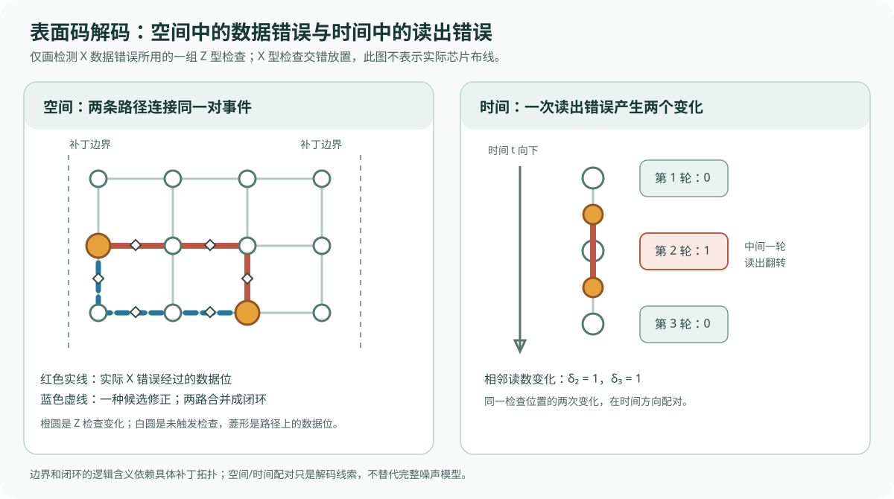
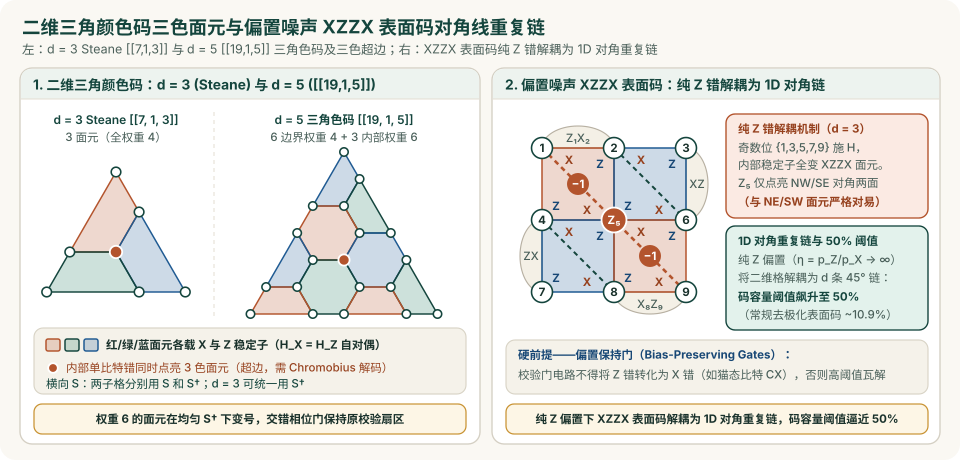
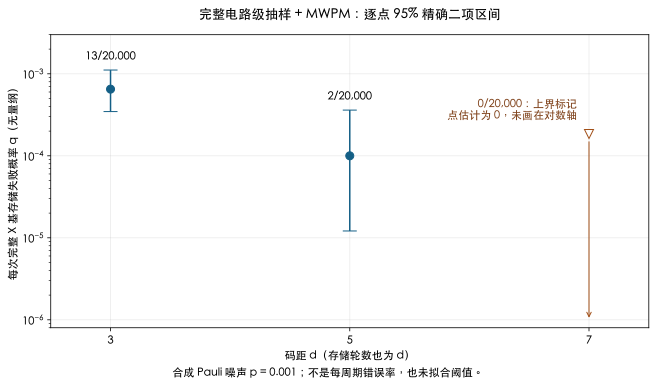
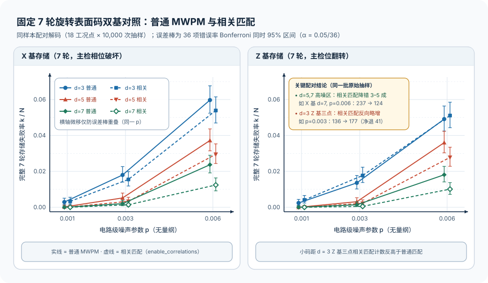
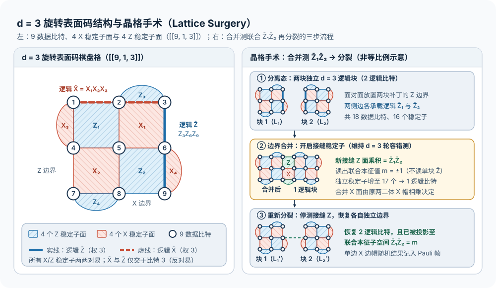
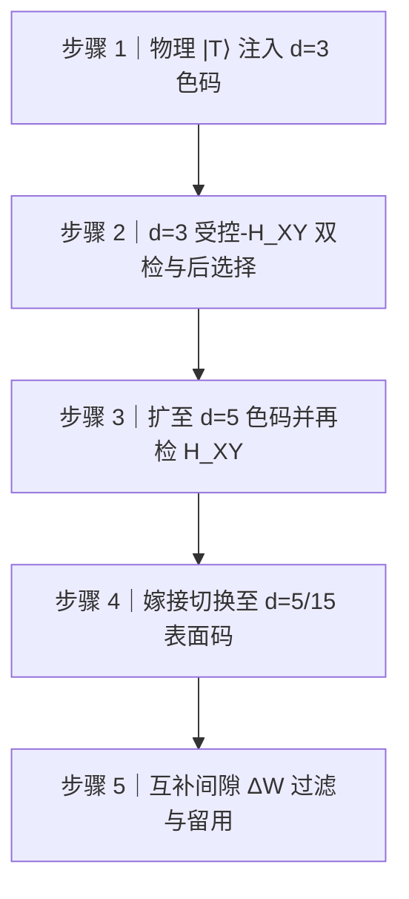

# 10｜量子纠错与容错计算

物理量子比特很脆弱：即便把单门与双比特门错误率压到千分之一（[第 09 章](09-hardware.md)），一旦算法需要几百万甚至上亿次逻辑操作，误差也会在计算完成前就把量子态淹没。**量子纠错**（quantum error correction, QEC）要解决“怎样把脆弱的物理比特编织成可靠的逻辑比特”，**容错计算**（fault-tolerant quantum computation, FTQC）则要进一步解决“当纠错电路本身、逻辑门和测量也会出错时，整台机器怎样照常算下去”。

**导读与分层路线**：

- ★ **核心主线（初读必看）**：先顺着 §1–§2.2 亲手算透三比特重复码与奇偶校验电路，再看 §3.1–§3.2、§4、§5、§6.1、§6.3、§7.1–§7.2、§9、§10.1–§10.2、§11–§12，把稳定子、表面码/色码几何、MWPM 解码、晶格手术、阈值与码距预算搭成完整骨架；
- ☆ **进阶选读（二刷深挖）**：带“进阶选读”标记的 §2.3 相干残余反例、§3.3 Knill–Laflamme 完整证明、§6.2 高阶解码器、§7.3 横向门与算法容错（AFT）、§8 高码率 qLDPC 与 §10.3 魔法态培育，可按需深入。

---

## 1. 绕开不可克隆：线性等距编码与错误离散化

经典通信里最朴素的纠错办法是“重复三遍”：把 `0` 写成 `000`，把 `1` 写成 `111`，收到 `010` 就按多数投票判成 `0`。初学者把这套直觉搬到量子世界时，立刻会撞上三堵墙：

1. **不可克隆定理**（[第 04 章](04-circuits-protocols.md)）禁止把未知量子态复制三份，即不存在通用酉操作实现 $|\psi\rangle \mapsto |\psi\rangle^{\otimes 3}$；
2. **测量塌缩**：如果像经典电路那样直接读出每个物理比特来看有没有翻转，原本藏在振幅 $\alpha,\beta$ 里的叠加相位会被瞬间摧毁；
3. **连续错误**：经典比特只有“翻转”一种错法，而量子比特的布洛赫矢量可以在球面上连续偏转任意小角度，错误似乎有无穷多种。

量子纠错之所以真的行得通，正是因为它用三件精巧的工具逐一化解了这三堵墙：**线性等距编码**、**只问关系不问取值的纠错症状测量**，以及**错误离散化**。

### 1.1 线性等距编码不是“复制三份”

量子纠错并不把单比特态克隆成三份独立副本，而是通过一个**线性等距映射（isometry）** $V:\mathbb{C}^2 \to (\mathbb{C}^2)^{\otimes n}$（满足 $V^\dagger V = I_2$），把 $2$ 维逻辑希尔伯特空间保内积地嵌入 $2^n$ 维物理空间中的一个 $2$ 维纠缠子空间 $\mathcal{C}$（称为**码空间**）：

$$
|\psi\rangle = \alpha|0\rangle + \beta|1\rangle
\longmapsto
|\psi_L\rangle = V|\psi\rangle = \alpha|0_L\rangle + \beta|1_L\rangle,
\qquad
|\alpha|^2 + |\beta|^2 = 1.
$$

这里 $|0_L\rangle = V|0\rangle$ 与 $|1_L\rangle = V|1\rangle$ 是两个相互正交的 $n$ 比特规范化态矢量，称为**逻辑基态**。

拿具体输入 $|+\rangle = \frac{1}{\sqrt{2}}(|0\rangle + |1\rangle)$ 放到草稿纸上对比，立刻能看出“等距编码”和“克隆三份”的本质差别。在三比特重复编码 $|0_L\rangle = |000\rangle,\ |1_L\rangle = |111\rangle$ 下，$|+\rangle$ 变成只有两项的纠缠态（GHZ 态）：

$$
|+_L\rangle = \frac{|000\rangle + |111\rangle}{\sqrt{2}}.
$$

如果真的做出三份独立乘积态 $|+\rangle^{\otimes 3}$，展开三个括号会得到全部八个三位串：

$$
|+\rangle^{\otimes 3}
= \frac{1}{2\sqrt{2}}\Bigl(|000\rangle + |001\rangle + |010\rangle + |011\rangle + |100\rangle + |101\rangle + |110\rangle + |111\rangle\Bigr).
$$

只要做一次计算基测量，二者就会原形毕露：对编码态 $|+_L\rangle$，测得 $001$ 的振幅是 $0$，概率为 $0$；而对三份乘积态 $|+\rangle^{\otimes 3}$，测得 $001$ 的振幅是 $1/\sqrt{8}$，概率为 $|1/\sqrt{8}|^2 = 1/8$。等距编码没有违背不可克隆定理——它根本没有复制未知态，而是把两位基态的“标签”铺展成多比特之间的关联。

### 1.2 连续错误为什么可以被离散化

布洛赫球面上的微小漂移或任意单比特量子噪声，写进算符语言后总可以表示成一组 Kraus 算符 $\{E_k\}$（[第 05 章](05-noise-channels.md)）。由于四个单比特 Pauli 矩阵 $\{I, X, Y, Z\}$ 构成 $2\times 2$ 复矩阵空间的一组完整正交基，任意一个单比特错误算符 $E$ 都可以精确拆成这四项的线性组合：

$$
E = c_I I + c_X X + c_Y Y + c_Z Z,
\qquad
c_I, c_X, c_Y, c_Z \in \mathbb{C}.
$$

例如，绕 $X$ 轴偏转一个任意小角度 $\theta$（单位：弧度）的相干过转误差就是

$$
R_x(\theta) = e^{-i\frac{\theta}{2}X} = \cos\!\frac{\theta}{2}\,I - i\sin\!\frac{\theta}{2}\,X,
$$

它只是“没出错 $I$”和“位翻转 $X$”两个基算符的线性叠加。

假设我们的纠错码能为 $I, X, Y, Z$ 分配彼此正交的**纠错症状**（syndrome）子空间。当 $E$ 作用在编码态 $|\psi_L\rangle$ 上，我们再去测量辅助比特提取纠错症状时，量子力学演化的**线性性**和测量投影会联合发力：原本连续的小角度偏转被投影到某一个离散分支——以大概率 $|\cos(\theta/2)|^2$ 塌缩回完全无错的 $|\psi_L\rangle$，或者以小概率 $|\sin(\theta/2)|^2$ 塌缩成清晰的整数次翻转 $X|\psi_L\rangle$，随后由经典控制器补上一扇 $X$ 门精确还原。

这就是量子纠错最核心的机制之一——**错误离散化（error discretization）**：只要编码和恢复过程能同时纠正有限个离散基错误 $\{I, X_j, Y_j, Z_j\}$，它就能自动纠正这些基错误的任意连续线性组合。

不过，先记下一条初学者极易踩空的边界：**离散的测量结果，并不意味着残余的逻辑噪声一定退化成无相干的随机 Pauli 翻转**。只要两个权重不同的物理错误恰好落进同一个纠错症状分支，它们就会在码空间里保持相干干涉，留下微小的相干旋转残余。下一节末尾我们会用三比特码亲手把这个反例算个水落石出。

---

## 2. 从三比特重复码到相干误差残余

我们先不贪心，假设噪声只会随机引起比特翻转（$X$ 错误），暂时没有相位翻转（$Z$ 错误）。下面一步步构造三比特重复码，并把辅助比特测奇偶的电路亲手跑一遍。

### 2.1 三比特比特翻转码与纠错症状表

按照全书统一的大端序（高位在左，物理比特编号 $q_1 q_2 q_3$），定义码空间基态：

$$
|0_L\rangle = |000\rangle,
\qquad
|1_L\rangle = |111\rangle,
$$

任意单比特逻辑态编码为 $|\psi_L\rangle = \alpha|000\rangle + \beta|111\rangle$。为了在不读取 $\alpha,\beta$ 的前提下揪出单个翻转，我们不问“第 1 位是 0 还是 1”，而是问两个**相邻奇偶问题**：

$$
S_1 = Z_1 Z_2 = Z \otimes Z \otimes I,
\qquad
S_2 = Z_2 Z_3 = I \otimes Z \otimes Z.
$$

逐项核验本征值：因为 $Z|0\rangle = +|0\rangle$、$Z|1\rangle = -|1\rangle$，所以

$$
S_1|000\rangle = (+1)(+1)|000\rangle = +|000\rangle,
\qquad
S_1|111\rangle = (-1)(-1)|111\rangle = +|111\rangle,
$$

同理 $S_2|000\rangle = +|000\rangle$、$S_2|111\rangle = +|111\rangle$。只要没有出错，$|000\rangle$ 和 $|111\rangle$ 在 $S_1, S_2$ 下都给出 $+1$，因此它们的任意叠加 $\alpha|000\rangle + \beta|111\rangle$ 也是 $S_1, S_2$ 的共同 $+1$ 本征态。这类把码空间精确锁在 $+1$ 本征子空间里的算符，叫做**稳定子（stabilizer）**。

现在假设第 2 个物理比特发生了位翻转 $X_2 = I \otimes X \otimes I$：

$$
X_2|\psi_L\rangle = X_2(\alpha|000\rangle + \beta|111\rangle) = \alpha|010\rangle + \beta|101\rangle.
$$

把 $S_1$ 和 $S_2$ 作用上去，逐位乘本征值：

- 对 $|010\rangle$：$S_1|010\rangle = (+1)(-1)|010\rangle = -|010\rangle$，$S_2|010\rangle = (-1)(+1)|010\rangle = -|010\rangle$；
- 对 $|101\rangle$：$S_1|101\rangle = (-1)(+1)|101\rangle = -|101\rangle$，$S_2|101\rangle = (+1)(-1)|101\rangle = -|101\rangle$。

两项拿到的本征值完全一致，于是整条叠加态都是 $S_1, S_2$ 的 $-1$ 本征态！更省力的代数写法是利用 Pauli 反对易关系 $ZX = -XZ$：因为 $X_2$ 与 $S_1 = Z_1Z_2$、$S_2 = Z_2Z_3$ 都在第 2 位碰撞，所以 $S_1 X_2 = -X_2 S_1$、$S_2 X_2 = -X_2 S_2$，立刻得到

$$
S_1 (X_2|\psi_L\rangle) = -X_2 (S_1|\psi_L\rangle) = -X_2|\psi_L\rangle,
\qquad
S_2 (X_2|\psi_L\rangle) = -X_2 (S_2|\psi_L\rangle) = -X_2|\psi_L\rangle.
$$

同理检验全部四种“至多一错”情形，得到完整的三比特码纠错症状表（把 $+1$ 记作二进制读数 $0$，$-1$ 记作 $1$）：

| 发生的单比特错误 | 稳定子 $S_1 = Z_1Z_2$ 本征值 | 稳定子 $S_2 = Z_2Z_3$ 本征值 | 纠错症状比特 $(s_1, s_2)$ | 恢复操作 |
| :--- | ---: | ---: | ---: | :--- |
| $I$（无错） | $+1$ | $+1$ | $(0, 0)$ | 无操作 |
| $X_1$ | $-1$ | $+1$ | $(1, 0)$ | 施加 $X_1$ |
| $X_2$ | $-1$ | $-1$ | $(1, 1)$ | 施加 $X_2$ |
| $X_3$ | $+1$ | $-1$ | $(0, 1)$ | 施加 $X_3$ |

四个症状彼此不同，且每一行都与逻辑振幅 $\alpha,\beta$ 毫无关系——测完症状，逻辑叠加态纹丝不动，补上对应 $X_j$（因为 $X_j^2 = I$）即可分毫不差地复原 $|\psi_L\rangle$。

### 2.2 把奇偶校验真正测出来：辅助比特线路与相位翻转码

“测量 $Z_1 Z_2$”千万不能拆成“先测 $Z_1$ 再测 $Z_2$，最后把结果相乘”，因为单独测量 $Z_1$ 会直接把 $\alpha|000\rangle + \beta|111\rangle$ 塌缩到 $|000\rangle$ 或 $|111\rangle$。正确做法是引入一个初始化在 $|0\rangle_a$ 的**辅助比特（ancilla）**，连续做两扇受控非门（CNOT），只把两数据比特的模 $2$ 和（奇偶性）写进辅助比特，最后只测量辅助比特：

| 时间顺序 | 数据比特 $q_1$ | 数据比特 $q_2$ | 辅助比特 $a_1$ |
| :--- | :--- | :--- | :--- |
| 1. 准备 | 保持原态 | 保持原态 | 初始化为 $|0\rangle$ |
| 2. $\mathrm{CNOT}(q_1 \to a_1)$ | 控制端 | 无操作 | 目标端：$a_1 \leftarrow a_1 \oplus x_1$ |
| 3. $\mathrm{CNOT}(q_2 \to a_1)$ | 无操作 | 控制端 | 目标端：$a_1 \leftarrow a_1 \oplus x_2$ |
| 4. 读出 | 不测量 | 不测量 | 在计算基测量，读出 $s_1 = x_1 \oplus x_2$ |

对计算基态 $|x_1 x_2 x_3\rangle|0\rangle_{a_1}$，两扇 CNOT 把联合态映为 $|x_1 x_2 x_3\rangle|x_1 \oplus x_2\rangle_{a_1}$。读出 $s_1 = 0$ 表示 $x_1 = x_2$（对应 $Z_1 Z_2 = +1$），读出 $s_1 = 1$ 表示 $x_1 \neq x_2$（对应 $Z_1 Z_2 = -1$）。再配第二个辅助比特 $a_2$ 以同样方式提取 $s_2 = x_2 \oplus x_3$。

检验相干叠加误差的表现：如果第 2 位处于“无错”与“翻转”的叠加 $\sqrt{1-p}\,|\psi_L\rangle + \sqrt{p}\,X_2|\psi_L\rangle$（$0 \le p \le 1$），经过两组奇偶校验 CNOT 门之后，数据与两个辅助比特的联合态变为

$$
\sqrt{1-p}\,|\psi_L\rangle|00\rangle_{a_1a_2} + \sqrt{p}\,X_2|\psi_L\rangle|11\rangle_{a_1a_2}.
$$

因为 $|\psi_L\rangle$ 与 $X_2|\psi_L\rangle$ 正交、$|00\rangle$ 与 $|11\rangle$ 正交，两项模平方之和 $(1-p)+p = 1$，态矢量严格归一化。测量辅助比特 $(a_1, a_2)$ 时，要么以概率 $1-p$ 读得 $00$、数据干净地回到 $|\psi_L\rangle$；要么以概率 $p$ 读得 $11$、数据投影到 $X_2|\psi_L\rangle$，随后施加 $X_2$ 还原。整个流程如图所示：

现在检查三比特码的软肋。在码空间中，把 $|000\rangle$ 与 $|111\rangle$ 互换的逻辑算符是 $\bar{X} = X_1 X_2 X_3$（权重为 $3$），而给 $|111\rangle$ 添一个负号的逻辑相位算符只需要单个物理算符：

$$
\bar{Z} = Z_1 \quad (\text{在码空间上与 } Z_2, Z_3, Z_1Z_2Z_3 \text{ 完全等价}).
$$

一旦第 1 位发生单个相位翻转 $Z_1$，编码态变成

$$
Z_1(\alpha|000\rangle + \beta|111\rangle) = \alpha|000\rangle - \beta|111\rangle.
$$

因为 $Z_1$ 与 $S_1 = Z_1 Z_2$、$S_2 = Z_2 Z_3$ 全部对易，纠错症状依然是无错的 $(0, 0)$——**三比特比特翻转码对单个相位错误完全失明**。

反过来，利用 Hadamard 门共轭恒等式 $H Z H = X$ 与 $H X H = Z$，把三个物理比特全部转到 $X$ 基（$|+\rangle, |-\rangle$），就能造出专门对付单个 $Z$ 错误的**三比特相位翻转码**：

$$
|0_L^{(\mathrm{phase})}\rangle = |+++\rangle,
\qquad
|1_L^{(\mathrm{phase})}\rangle = |---\rangle,
$$

其稳定子为 $X_1 X_2$ 与 $X_2 X_3$。同理，它能纠正任意单个 $Z$ 错误，却对单个 $X$ 错误完全失明。想要同时抵御 $X$ 和 $Z$（进而覆盖全部单比特错误），至少需要把这两种保护机制结合起来——这正是 §3 五比特完美码与 Shor 九比特码的出发点。

### 2.3 进阶选读：手算反例：测完纠错症状后，为什么还有相干逻辑误差

在告别三比特码之前，我们先兑现 §1.2 的承诺，亲手拆穿一个常见误解：“只要测了纠错症状，残余的逻辑错误就一定变成了随机 Pauli 翻转。”

**设定**：使用上面的三比特比特翻转码，编码态为任意逻辑密度矩阵 $\rho$（支撑在 $|0_L\rangle=|000\rangle,\ |1_L\rangle=|111\rangle$ 张成的 $2$ 维码空间）。三个物理比特各自受到相同的相干小旋转 $R_x(\theta) = c I - i s X$，其中 $c = \cos(\theta/2)$、$s = \sin(\theta/2)$，$\theta$ 单位为弧度。校验电路和按纠错症状执行的单错恢复完全理想，恢复后丢弃症状记录。我们想对比两种噪声模型得到的逻辑输出：

- **相干模型**：实际物理算符 $U = R_x(\theta)^{\otimes 3} = (c I - i s X)^{\otimes 3}$；
- **随机翻转近似（Pauli 化模型）**：把每个比特上的 $R_x(\theta)$ 粗暴替换成以概率 $p = s^2$ 独立施加 $X$、以概率 $1-p = c^2$ 施加 $I$ 的随机信道。

**第一步：逐项展开 8 维物理空间中的 $U$。** 按 $X$ 出现的个数从 $0$ 到 $3$ 展开三因子张量积：

$$
\begin{aligned}
(c I - i s X)^{\otimes 3}
&= c^3\,I_1 I_2 I_3 \\
&\quad - i s c^2\,(X_1 + X_2 + X_3) \\
&\quad - s^2 c\,(X_2 X_3 + X_1 X_3 + X_1 X_2) \\
&\quad + i s^3\,X_1 X_2 X_3.
\end{aligned}
$$

检查每一项的系数符号：$(-i)^0 = +1$，$(-i)^1 = -i$，$(-i)^2 = -1$，$(-i)^3 = +i$，分毫不差。

**第二步：按四种纠错症状归组，再施加对应单错恢复。** 测得症状 $(s_1, s_2)$ 会把上述 8 项劈成 4 个彼此正交的分支，但**每个分支内部恰好锁着一低一高两项错误**：

- 症状 $(0,0)$：包含无错项 $c^3 I$ 与三错项 $+i s^3 X_1X_2X_3$，恢复算符为 $I$；因为 $X_1X_2X_3$ 在码空间上就是逻辑算符 $X_L$，该分支的逻辑 Kraus 算符为

  $$
  K_0 = c^3 I_L + i s^3 X_L.
  $$

- 症状 $(1,0)$：包含单错 $-i s c^2 X_1$ 与双错 $-s^2 c X_2 X_3$（验证：$X_2X_3$ 与 $Z_1Z_2$ 仅在第 2 位反对易、与 $Z_2Z_3$ 在第 2、3 位两次反对易而对易，症状确为 $(1,0)$！）。解码器施加恢复 $X_1$ 后，$X_1 \cdot X_1 = I_L$，$X_1 \cdot X_2X_3 = X_L$，得到

  $$
  K_1 = -i s c^2 I_L - s^2 c X_L.
  $$

- 对称地，症状 $(1,1)$（恢复 $X_2$）与症状 $(0,1)$（恢复 $X_3$）在码空间上给出完全同形的 Kraus 算符：

  $$
  K_2 = K_3 = -i s c^2 I_L - s^2 c X_L.
  $$

**第三步：核验保迹性，再把四个分支求和成逻辑信道。** 先算 $K_j^\dagger K_j$：

$$
K_0^\dagger K_0 = (c^3 I_L - i s^3 X_L)(c^3 I_L + i s^3 X_L) = (c^6 + s^6) I_L + i c^3 s^3 (X_L - X_L) = (c^6 + s^6) I_L,
$$

$$
K_j^\dagger K_j = (i s c^2 I_L - s^2 c X_L)(-i s c^2 I_L - s^2 c X_L) = (s^2 c^4 + s^4 c^2) I_L + (-i + i) c^3 s^3 X_L = (s^2 c^4 + s^4 c^2) I_L.
$$

四项相加：

$$
\sum_{j=0}^{3} K_j^\dagger K_j = \bigl(c^6 + 3 c^4 s^2 + 3 c^2 s^4 + s^6\bigr) I_L = (c^2 + s^2)^3 I_L = I_L,
$$

保迹条件严格满足！接着对任意 $2\times 2$ 逻辑密度矩阵 $\rho$，逐项展开 $K_j \rho K_j^\dagger$：

- 对 $K_0$：

  $$
  K_0 \rho K_0^\dagger = c^6 \rho + s^6 X_L \rho X_L + i c^3 s^3 (X_L \rho - \rho X_L) = c^6 \rho + s^6 X_L \rho X_L + i c^3 s^3 [X_L, \rho].
  $$

- 对每个 $j \in \{1, 2, 3\}$：

  $$
  \begin{aligned}
  K_j \rho K_j^\dagger
  &= (-i s c^2 I_L - s^2 c X_L)\,\rho\,(+i s c^2 I_L - s^2 c X_L) \\
  &= s^2 c^4 \rho + s^4 c^2 X_L \rho X_L + i s^3 c^3 (\rho X_L - X_L \rho) \\
  &= s^2 c^4 \rho + s^4 c^2 X_L \rho X_L - i c^3 s^3 [X_L, \rho].
  \end{aligned}
  $$

把 $j = 0, 1, 2, 3$ 全部加起来：$\rho$ 的系数是 $c^6 + 3 c^4 s^2 = (1-p)^3 + 3p(1-p)^2 = 1 - P_L$，$X_L \rho X_L$ 的系数是 $3 c^2 s^4 + s^6 = 3p^2(1-p) + p^3 = P_L$，**而交叉项系数是 $(+1 - 3)\,i c^3 s^3 = -2 i c^3 s^3$，并没有抵消！** 最终逻辑信道为

$$
\mathcal{E}_L(\rho) = (1 - P_L)\rho + P_L X_L \rho X_L - 2 i c^3 s^3 [X_L, \rho],
\qquad
P_L = 3p^2(1-p) + p^3,\quad p = s^2.
$$

**第四步：代具体数字回验。** 取逻辑初态 $\rho = |0_L\rangle\langle 0_L| = \begin{pmatrix}1 & 0\\ 0 & 0\end{pmatrix}$、单比特小转角 $\theta = 0.2\ \mathrm{rad}$。逐项计算：

- $c = \cos(0.1) \approx 0.99500417$，$s = \sin(0.1) \approx 0.09983342$，$p = s^2 \approx 0.00996671$；
- 逻辑计算基翻转概率 $P_L = 3p^2(1-p) + p^3 \approx 0.000296026$；
- 计算对易子 $[X_L, |0_L\rangle\langle 0_L|] = |1_L\rangle\langle 0_L| - |0_L\rangle\langle 1_L| = \begin{pmatrix}0 & -1\\ 1 & 0\end{pmatrix}$；
- 代入得非对角元 $\rho_{01} = (-2 i c^3 s^3)(-1) = +2 i c^3 s^3$，$\rho_{10} = -2 i c^3 s^3$；
- 因而逻辑 $Y_L = \begin{pmatrix}0 & -i\\ i & 0\end{pmatrix}$ 的期望值为

  $$
  \langle Y_L \rangle = \operatorname{Tr}(Y_L \mathcal{E}_L(\rho)) = (-i)\rho_{10} + (i)\rho_{01} = -2\operatorname{Im}(\rho_{01}) = -4 c^3 s^3 \approx -0.00392069.
  $$

对照随机翻转近似：两种模型给出的逻辑位翻转概率都是 $P_L \approx 0.000296026$，如果只测 $Z_L$，根本分不出差别；可一旦测 $Y_L$，随机翻转模型断言 $\langle Y_L \rangle = 0$，真实相干输出却有 $-0.00392$ 的系统偏移——量级比 $P_L$ 整整大出一个数量级（$O(\theta^3)$ 对比 $O(\theta^4)$）！

这是因为每个症状分支内部留下的 $I_L$ 与 $X_L$ 依然保持相干叠加，等效于一次残余的小角度逻辑旋转（Greenbaum 与 Dutton 在 2016/2018 年系统研究了这一效应）。在评估多轮串接的长线路时，不能盲目把相干误差先 Pauli 化再套用独立随机错误估计，必须核查关心的逻辑观测量是否对相干残余敏感（完整八维物理态交叉验证脚本见 [`coherent_repetition.py`](../codes/systems/coherent_repetition.py)）。

---

## 3. 五比特完美码、Shor 九比特退化码与 Knill–Laflamme 条件

想要同时纠正任意单个物理比特上的 $X, Y, Z$ 错误，最少需要几个物理量子比特？在动手造码之前，我们先用一条极简的“空间装盒计数”——**量子 Hamming 界**——把答案算出来。

### 3.1 量子 Hamming 界与五比特完美码 $[[5,1,3]]$ 完整手算

假设一个码用 $n$ 个物理量子比特编码 $k$ 个逻辑量子比特，并希望为“无错”以及全部 $3n$ 种单比特 Pauli 错误（每个位置各有 $X, Y, Z$ 三种）分配彼此正交的 $2^k$ 维子空间。如果这些错误对应的子空间两两正交（即**非退化码**），它们占用的总维数不能超过整个物理空间的维数 $2^n$：

$$
2^k(1 + 3n) \le 2^n.
$$

对编码 $1$ 个逻辑比特（$k=1$）逐个试数：

- $n = 3$：$2(1 + 9) = 20 > 8$，装不下；
- $n = 4$：$2(1 + 12) = 26 > 16$，依然装不下（四比特码 $[[4,2,2]]$ 最多只能检测单错，不能纠正单错）；
- $n = 5$：$2(1 + 15) = 32 = 2^5$，**严丝合缝地取等号！**

Laflamme 等人（*PRL* 1996）与 Bennett 等人（*PRA* 1996）几乎同时找到了这个把 $32$ 维空间用到一寸不剩的最短单纠错码——**五比特完美码 $[[5,1,3]]$**。

它的 $4$ 个独立稳定子生成元具有优美的循环移位对称性（大端序 $q_1 q_2 q_3 q_4 q_5$）：

$$
g_1 = X Z Z X I,
\qquad
g_2 = I X Z Z X,
\qquad
g_3 = X I X Z Z,
\qquad
g_4 = Z X I X Z.
$$

把这四条算符在草稿纸上逐条验证一遍：

1. **两两对易性**：两个多比特 Pauli 算符对易，当且仅当它们在偶数个位置上同时非单位且互不相同。以 $g_1 = XZZXI$ 与 $g_2 = IXZZX$ 为例，逐位对比：
   - 第 1 位 $(X, I)$ 对易；第 2 位 $(Z, X)$ **反对易**；第 3 位 $(Z, Z)$ 对易；第 4 位 $(X, Z)$ **反对易**；第 5 位 $(I, X)$ 对易。
   一共反对易 $2$ 次（偶数），故 $g_1 g_2 = g_2 g_1$。同理其余 5 对生成元均恰好在 2 个位置上含不同非单位 Pauli，全部两两对易。
2. **第 5 个循环移位为何不独立**：把四个生成元按位乘起来（利用 $XZ = -iY,\ ZX = +iY,\ X^2 = Z^2 = I,\ Y^2 = I$）：
   - 第 1 位：$X \cdot I \cdot X \cdot Z = Z$；
   - 第 2 位：$Z \cdot X \cdot I \cdot X = Z$；
   - 第 3 位：$Z \cdot Z \cdot X \cdot I = X$；
   - 第 4 位：$X \cdot Z \cdot Z \cdot X = I$；
   - 第 5 位：$I \cdot X \cdot Z \cdot Z = X$。
   各位置均无额外虚数因子，因此 $g_1 g_2 g_3 g_4 = Z Z X I X = g_5$。只有 4 个生成元线性独立，码空间维数为 $2^{5-4} = 2$，正好编码 $k = 1$ 个逻辑比特。
3. **逻辑算符与码距验证**：取

   $$
   \bar{X} = X X X X X,
   \qquad
   \bar{Z} = Z Z Z Z Z.
   $$

   每条 $g_i$ 恰好含两个 $X$ 和两个 $Z$，因此与 $\bar{X}$、$\bar{Z}$ 均只碰撞两次（对易）；而 $\bar{X}$ 与 $\bar{Z}$ 在全部 5 个位置上碰撞（奇数），满足 $\bar{X}\bar{Z} = -\bar{Z}\bar{X}$。虽然 $\bar{X}$ 表面权重是 $5$，但乘上一个稳定子 $g_1$ 在码空间上代表同一个逻辑操作：

   $$
   g_1 \bar{X} = (X Z Z X I)(X X X X X) = I \,(ZX)\,(ZX)\, I \,X = I\,(+iY)\,(+iY)\,I\,X = -I Y Y I X.
   $$

   这个等价代表只有 **3 个非单位位**（且没有任何权重 1 或 2 的算符能与全部四个生成元对易），所以码距精确为 $d = 3$。
4. **手算全部 15 个单比特纠错症状**：约定与 $g_i$ 对易记 $0$、反对易记 $1$，按 $(g_1, g_2, g_3, g_4)$ 排成 4 比特串。先亲手算第 1 位的三种错：
   - $X_1$ 只和在第 1 位含 $Z$ 的生成元反对易（只有 $g_4$）$\implies 0001$；
   - $Z_1$ 只和在第 1 位含 $X$ 的生成元反对易（$g_1$ 与 $g_3$）$\implies 1010$；
   - $Y_1 = i X_1 Z_1$ 的症状是 $X_1$ 与 $Z_1$ 按位异或：$0001 \oplus 1010 = 1011$。

把 5 个位置全部算齐，得到严丝合缝的 15 行完美查表：

| 物理位置 | $X_j$ 症状 $(g_1g_2g_3g_4)$ | $Z_j$ 症状 $(g_1g_2g_3g_4)$ | $Y_j$ 症状 $(g_1g_2g_3g_4)$ |
| :---: | :---: | :---: | :---: |
| $q_1$ | `0001` | `1010` | `1011` |
| $q_2$ | `1000` | `0101` | `1101` |
| $q_3$ | `1100` | `0010` | `1110` |
| $q_4$ | `0110` | `1001` | `1111` |
| $q_5$ | `0011` | `0100` | `0111` |

检查表中 15 个四位二进制串：`0001` 到 `1111` 全部出现且互不重复，唯独 `0000` 留给无错态。每一个自由度都被利用到了极致。

### 3.2 Shor 九比特码 $[[9,1,3]]$ 与退化性

在历史上，Peter Shor 于 1995 年提出的首个量子纠错码用的不是 5 个比特，而是 9 个比特（*PRA* 1995）。虽然物理比特比五比特码多了将近一倍，但它的结构像搭积木一样直白——直接把 §2 的**外层相位翻转码**与**内层比特翻转码**串联起来：

$$
|0_L\rangle = \left(\frac{|000\rangle + |111\rangle}{\sqrt{2}}\right)^{\otimes 3},
\qquad
|1_L\rangle = \left(\frac{|000\rangle - |111\rangle}{\sqrt{2}}\right)^{\otimes 3}.
$$

把 9 个物理比特分成三组 $(1,2,3)$、$(4,5,6)$、$(7,8,9)$。对应的 8 个稳定子生成元分工明确：

- **6 个权重 2 的组内 $Z$ 检查**：$Z_1Z_2,\ Z_2Z_3,\ Z_4Z_5,\ Z_5Z_6,\ Z_7Z_8,\ Z_8Z_9$，各自在组内抓比特翻转 $X$；
- **2 个权重 6 的跨组 $X$ 检查**：

  $$
  S_{X,1} = X_1 X_2 X_3 X_4 X_5 X_6,
  \qquad
  S_{X,2} = X_4 X_5 X_6 X_7 X_8 X_9,
  $$

  用来比较相邻两组 GHZ 态的相对正负号，抓相位翻转 $Z$。

看第 1 组里发生单比特错时的症状表现（其余两组 4 项组内 $ZZ$ 均为 $+1$）：

| 第 1 组发生的错误 | 组内 $(Z_1Z_2, Z_2Z_3)$ | 跨组 $(S_{X,1}, S_{X,2})$ | 恢复方式与解读 |
| :--- | :---: | :---: | :--- |
| $I$ | $(+, +)$ | $(+, +)$ | 无错误 |
| $X_2$ | $(-, -)$ | $(+, +)$ | 第 2 位同时翻转组内两对奇偶；施加 $X_2$ 恢复 |
| $Z_1$（或 $Z_2, Z_3$） | $(+, +)$ | $(-, +)$ | 第 1 组 GHZ 符号反转；在该组**任一位**施加 $Z$ 即可恢复 |
| $Y_2$ | $(-, -)$ | $(-, +)$ | 同时触发位错与相位错；施加 $Y_2$ 恢复（忽略全局相位） |

请把目光停在第三行：**$Z_1, Z_2, Z_3$ 三个完全不同的物理错误，给出的纠错症状竟然一模一样！** 为什么纠错没有失效？检验 $Z_1$ 与 $Z_2$ 对第一组 GHZ 态的作用：

$$
Z_1\frac{|000\rangle + |111\rangle}{\sqrt{2}} = \frac{|000\rangle - |111\rangle}{\sqrt{2}} = Z_2\frac{|000\rangle + |111\rangle}{\sqrt{2}}.
$$

因为它们的乘积 $Z_1 Z_2$ 本身就是稳定子群 $\mathcal{S}$ 的成员（在码空间上恒等于 $I$），所以即使实际出错的是第 1 位，解码器在第 2 位施加 $Z_2$ 修正，最终净效果是 $Z_2 Z_1 |\psi_L\rangle = |\psi_L\rangle$，逻辑态依然完好无损！

这种“多个不同物理错误共享同一症状、但在码空间上等价”的现象叫做**退化性（degeneracy）**。退化性是量子纠错独有的现象——经典纠错里每一种可纠正的翻转模式都必须对应独一无二的症状，而量子纠错允许把彼此相差一个稳定子的错误打包处理，也使得某些退化码甚至能突破非退化量子 Hamming 界的限制。

### 3.3 进阶选读：Knill–Laflamme 充要条件及其完整证明

三比特码能纠 $X$ 却纠不了 $Z$；五比特码非退化地纠全部单错；Shor 码退化地纠全部单错。有没有一条统一判据，能直接判定任意给定的码空间和错误集合到底能不能完全恢复？

**定理（Knill–Laflamme 条件，*PRA* 1997）**：设码空间 $\mathcal{C}$ 的正交投影算符为 $P = \sum_i |i_L\rangle\langle i_L|$，错误算符集合为 $\{E_a\}$。存在保迹完全正（CPTP）恢复信道 $\mathcal{R}$ 精确纠正 $\operatorname{span}\{E_a\}$ 中全部错误的充要条件是：存在一个**仅依赖错误指标 $(a,b)$、与逻辑基态无关**的厄米常数矩阵 $C_{ab}$，满足

$$
P E_a^\dagger E_b P = C_{ab} P
\qquad\Longleftrightarrow\qquad
\langle i_L | E_a^\dagger E_b | j_L \rangle = C_{ab}\,\delta_{ij}.
$$

把这条简洁的方程翻译成两句大白话：

1. **当 $i \neq j$ 时，$\langle i_L | E_a^\dagger E_b | j_L \rangle = 0$**：任意两个待纠正的错误不会把不同的逻辑基态 $E_b|j_L\rangle$ 与 $E_a|i_L\rangle$ 撞到一起而无法区分；
2. **当 $i = j$ 时，$\langle 0_L | E_a^\dagger E_b | 0_L \rangle = \langle 1_L | E_a^\dagger E_b | 1_L \rangle = C_{ab}$**：错误空间的内积结构不能随逻辑态 $i$ 变化——换句话说，环境或症状测量偷窥不到半点关于 $\alpha, \beta$ 的信息。

#### 零跳步证明：必要性与极分解恢复构造

**第一部分：必要性（能恢复 $\implies P E_a^\dagger E_b P = C_{ab} P$）。**
设存在 CPTP 恢复信道 $\mathcal{R}(\sigma) = \sum_r R_r \sigma R_r^\dagger$（满足保迹条件 $\sum_r R_r^\dagger R_r = I$），对任意码态 $|\psi\rangle \in \mathcal{C}$ 与任意错误算符 $E_a$ 都能把状态还原回 $|\psi\rangle\langle\psi|$ 的标量倍：

$$
\sum_r R_r E_a |\psi\rangle\langle\psi| E_a^\dagger R_r^\dagger \propto |\psi\rangle\langle\psi|.
$$

因为纯态 $|\psi\rangle\langle\psi|$ 是密度矩阵凸集的极端点，它不能拆成两个不同正半定算符的非平凡之和；故每一条非零 Kraus 分支的输出必然同样与 $|\psi\rangle\langle\psi|$ 成比例，即对任意 $|\psi\rangle \in \mathcal{C}$，存在标量 $\lambda_{ra}(\psi) \in \mathbb{C}$ 满足 $R_r E_a |\psi\rangle = \lambda_{ra}(\psi)|\psi\rangle$。

接下来核验 $\lambda_{ra}$ 与 $|\psi\rangle$ 无关：取任意两个正交逻辑基态 $|i_L\rangle, |j_L\rangle$ 及其叠加 $|+\rangle_{ij} = \frac{1}{\sqrt{2}}(|i_L\rangle + |j_L\rangle)$。按上述性质，一方面

$$
R_r E_a |+\rangle_{ij} = \frac{\lambda_{ra}(+_{ij})}{\sqrt{2}}\bigl(|i_L\rangle + |j_L\rangle\bigr),
$$

另一方面按线性算符逐项展开得

$$
R_r E_a |+\rangle_{ij} = \frac{1}{\sqrt{2}}\bigl(\lambda_{ra}(i)|i_L\rangle + \lambda_{ra}(j)|j_L\rangle\bigr).
$$

因为 $|i_L\rangle$ 与 $|j_L\rangle$ 正交线性无关，逐分量比较系数立得 $\lambda_{ra}(i) = \lambda_{ra}(+_{ij}) = \lambda_{ra}(j)$。因此该系数只依赖 $(r, a)$，在整个码空间上恒有算符等式

$$
R_r E_a P = \lambda_{ra} P,
\qquad
P E_a^\dagger R_r^\dagger = \lambda_{ra}^* P.
$$

把保迹恒等式 $\sum_r R_r^\dagger R_r = I$ 插入 $P E_a^\dagger E_b P$ 中间，并利用投影算符的幂等性 $P^2 = P$：

$$
P E_a^\dagger E_b P
= P E_a^\dagger \left(\sum_r R_r^\dagger R_r\right) E_b P
= \sum_r \bigl(P E_a^\dagger R_r^\dagger\bigr)\bigl(R_r E_b P\bigr)
= \sum_r (\lambda_{ra}^* P)(\lambda_{rb} P)
= \underbrace{\left(\sum_r \lambda_{ra}^* \lambda_{rb}\right)}_{C_{ab}} P.
$$

逐元素检验共轭对称性：$C_{ba}^* = \sum_r (\lambda_{rb}^* \lambda_{ra})^* = \sum_r \lambda_{ra}^* \lambda_{rb} = C_{ab}$，说明矩阵 $C$ 严格厄米（而且形如格拉姆矩阵，必然半正定）。必要性证毕。

**第二部分：充分性（$P E_a^\dagger E_b P = C_{ab} P \implies$ 显式构造恢复信道 $\mathcal{R}$）。**
因为 $C$ 是厄米矩阵，存在酉矩阵 $U$ 将其对角化为 $U C U^\dagger = D = \operatorname{diag}(d_1, d_2, \dots)$，即按分量写为 $\sum_{a,b} U_{ka} C_{ab} U_{\ell b}^* = d_k \delta_{k\ell}$。定义线性重组后的正交错误算符

$$
F_k \equiv \sum_a U_{ka}^* E_a.
$$

直接代入验证它们满足对角化的 Knill–Laflamme 条件：

$$
P F_k^\dagger F_\ell P
= \sum_{a,b} (U_{ka}^*)^* U_{\ell b}^*\, P E_a^\dagger E_b P
= \left(\sum_{a,b} U_{ka} C_{ab} U_{\ell b}^*\right) P
= d_k \delta_{k\ell}\, P.
$$

对任意归一化码态 $|\psi\rangle \in \mathcal{C}$，有 $d_k = \langle\psi|F_k^\dagger F_k|\psi\rangle = \lVert F_k|\psi\rangle\rVert^2 \ge 0$。当 $d_k = 0$ 时，$F_k P = 0$（该重组错误湮灭全部码态，无需恢复）；对每个 $d_k > 0$，对算符 $F_k P$ 作**极分解** $F_k P = U_k \sqrt{(F_k P)^\dagger (F_k P)}$，代入 $(F_k P)^\dagger (F_k P) = P F_k^\dagger F_k P = d_k P$ 及 $\sqrt{P} = P$，立刻得到

$$
F_k P = \sqrt{d_k}\, U_k P,
$$

其中 $U_k$ 是一个将码空间等距映到错误子空间的酉算符。记每个重组错误张成的错误子空间投影为 $P_k \equiv U_k P U_k^\dagger$（满足 $P_k^\dagger = P_k$ 与 $P_k^2 = P_k$）。检验不同错误子空间的正交性：对任意 $k \neq \ell$（$d_k, d_\ell > 0$），将 $U_k P = \frac{1}{\sqrt{d_k}} F_k P$ 代入得

$$
P_k P_\ell
= U_k P U_k^\dagger U_\ell P U_\ell^\dagger
= \frac{1}{\sqrt{d_k d_\ell}}\, U_k \bigl(P F_k^\dagger F_\ell P\bigr) U_\ell^\dagger
= 0.
$$

诸错误子空间 $P_k$ 彼此严格正交！现在显式定义恢复信道 $\mathcal{R}$ 的全部 Kraus 算符：对每个 $d_k > 0$ 定义

$$
R_k \equiv P U_k^\dagger = \frac{1}{\sqrt{d_k}}\, P F_k^\dagger,
$$

并把全部错误子空间之外的正交补空间打包成一个补全算符 $R_0 \equiv I - \sum_{d_k > 0} P_k$。做两项独立回验：

1. **核验保迹性**：因为 $R_k^\dagger R_k = U_k P^2 U_k^\dagger = P_k$ 且 $R_0$ 是正交补投影（$R_0^\dagger R_0 = R_0$），故

   $$
   R_0^\dagger R_0 + \sum_{d_k > 0} R_k^\dagger R_k
   = \left(I - \sum_{d_k > 0} P_k\right) + \sum_{d_k > 0} P_k
   = I.
   $$

2. **核验精确恢复**：对任意码态 $\rho = P\rho P$ 与任意 $F_m$（$d_m > 0$），一方面 $R_0 F_m P = \sqrt{d_m} R_0 P_m U_m P = 0$，另一方面对所有 $d_k > 0$ 有

   $$
   R_k F_m \rho F_m^\dagger R_k^\dagger
   = \frac{1}{d_k}\bigl(P F_k^\dagger F_m P\bigr)\rho\bigl(P F_m^\dagger F_k P\bigr)
   = \frac{1}{d_k}(d_k \delta_{km} P)\,\rho\,(d_k \delta_{km} P)
   = d_k \delta_{km}\,\rho.
   $$

求和得到 $\mathcal{R}(F_m \rho F_m^\dagger) = d_m \rho$。由酉矩阵 $U$ 可逆，任意物理错误 $E = \sum_a c_a E_a \in \operatorname{span}\{E_a\}$ 都能展开为 $E = \sum_k \tilde{c}_k F_k$，于是 $\mathcal{R}(E\rho E^\dagger) = \left(\sum_k |\tilde{c}_k|^2 d_k\right)\rho$——只要非零，总能分毫不差地还原原始逻辑态 $\rho$。充分性证毕。

#### 稳定子桥接引理与三个小码的矩阵检验

对于稳定子码，不必每次都展开 $2^n$ 维逻辑基态来算 $P E_a^\dagger E_b P$，一条两行**稳定子桥接引理**就能直接判定：

> **稳定子桥接引理**：设稳定子群 $\mathcal{S}$ 的码空间投影为 $P$（满足对一切 $g \in \mathcal{S}$ 均有 $gP = Pg = P$）。若某算符 $M$ 至少与一条稳定子 $g \in \mathcal{S}$ **反对易**（$gM = -Mg$），则必有 $P M P = 0$。
> **两行验证**：$P M P = (Pg) M P = P (gM) P = -P (Mg) P = -P M (gP) = -P M P \implies 2 PMP = 0 \implies PMP = 0$。

立刻拿三个刚算过的码检验：

- **三比特码检验 $X$ 错 vs $Z$ 错**：投影 $P = |000\rangle\langle 000| + |111\rangle\langle 111|$。对 $\{I, X_1, X_2, X_3\}$，当 $a=b$ 时 $E_a^\dagger E_b = I \implies P I P = P$；当 $a\neq b$ 时 $E_a^\dagger E_b$ 翻转 1 或 2 位，至少与 $Z_1Z_2$ 或 $Z_2Z_3$ 反对易，由桥接引理立得 $P E_a^\dagger E_b P = 0$，即 $C_{ab} = \delta_{ab}$。一旦把 $Z_1$ 加入待纠集合，取 $E_a = I,\ E_b = Z_1$：

  $$
  P Z_1 P = |000\rangle\langle 000| - |111\rangle\langle 111| \neq c P \quad (\forall c\in\mathbb{C}),
  $$

  两个逻辑基态拿到了相反符号 $+1$ 与 $-1$，条件瞬间被打破。
- **五比特完美码具体验算**：在 §3.1 的 $[[5,1,3]]$ 码中，任取一对不同的单比特错，例如 $(E_a, E_b) = (X_1, Y_3)$，其乘积为 $M = E_a^\dagger E_b = X_1 Y_3 = X I Y I I$。对照第一条稳定子生成元 $g_1 = X Z Z X I$：第 1 位 $(X,X)$ 对易，第 2、4、5 位至少一边为 $I$ 而对易，唯独第 3 位 $(Z, Y)$ **反对易**（奇数次）。因此 $g_1 (X_1 Y_3) = -(X_1 Y_3) g_1$，由桥接引理立得 $P X_1^\dagger Y_3 P = 0$。对全部 16 个单错集 $\{I, X_j, Y_j, Z_j\}$ 的任意 $a \neq b$，表 3.1 中症状互不相同意味着 $E_a^\dagger E_b$ 至少与一条 $g_i$ 反对易，故 $C_{ab} = \delta_{ab}$ 满秩（秩为 16），属于**非退化码**。
- **Shor 码的奇异子块**：对 Shor 码子集 $\{Z_1, Z_2, Z_3\}$，任意乘积 $Z_a Z_b \in \mathcal{S}$ 满足 $P Z_a Z_b P = P$，对应的 $3\times 3$ 子块是全 $1$ 矩阵 $\begin{pmatrix}1&1&1\\1&1&1\\1&1&1\end{pmatrix}$，秩仅为 $1$（矩阵 $C$ 奇异），这正是**退化码**的精确代数画像。

---

## 4. 稳定子码、CSS 构造与联合码距预算

### 4.1 稳定子群、参数 $[[n,k,d]]$ 与纠错能力

Gottesman（1997）把上述具体例子提炼成了一套极其高效的代数语言——**稳定子形式（stabilizer formalism）**。在 $n$ 比特 Pauli 群 $\mathcal{P}_n = \{\pm 1, \pm i\}\times \{I, X, Y, Z\}^{\otimes n}$ 中，挑选一个满足两个条件的子群 $\mathcal{S}$：

1. 群内元素两两对易（阿贝尔子群）；
2. 不包含负单位阵 $-I$（保证共同 $+1$ 本征空间非空）。

如果 $\mathcal{S}$ 由 $n-k$ 个线性独立的生成元 $g_1, \dots, g_{n-k}$ 生成，每增加一条独立生成元就把允许空间维数砍半，因此共同 $+1$ 本征空间（码空间 $\mathcal{C}$）的维数为 $2^n / 2^{n-k} = 2^k$，恰好编码 $k$ 个逻辑量子比特。

凡是与 $\mathcal{S}$ 中所有元素都对易的 Pauli 算符组成**正规化子** $N(\mathcal{S})$。落在 $N(\mathcal{S})\setminus\mathcal{S}$ 里的算符，既不会触发任何非零纠错症状，又在码空间里执行非平凡的逻辑变换——它们正是**逻辑 Pauli 算符**（以及不可检测的逻辑错误）。因此，稳定子码的**码距**（distance）定义为非平凡逻辑算符的最小 Pauli 权重：

$$
d = \min\bigl\{\operatorname{wt}(P) : P \in N(\mathcal{S}) \setminus \mathcal{S}\bigr\},
$$

记作三元组 $[[n, k, d]]$（双括号用于区分经典线性码 $[n, k, d]$）。在此框架下，结合 §3.3 的稳定子桥接引理，Knill–Laflamme 条件简化成一句极好记的判定：Pauli 错误集合 $\{E_a\}$ 可纠，当且仅当对任意 $a, b$，

$$
E_a^\dagger E_b \notin N(\mathcal{S}) \setminus \mathcal{S}.
$$

也就是说，两个候选错误的差 $E_a^\dagger E_b$ 要么至少与一条稳定子反对易（$P E_a^\dagger E_b P = 0$，被症状区分开），要么落在稳定子群 $\mathcal{S}$ 里（$P E_a^\dagger E_b P = \pm P$，在码空间上等价，属于无害退化）。由码距 $d$ 直接推出三项基础保证：

- **纯错误检测**：能检测任意权重不超过 $d - 1$ 的非平凡 Pauli 错误；
- **未知位置纠错**：能纠正任意权重不超过 $t = \lfloor(d-1)/2\rfloor$ 的未知错误（因为任意两个权重 $\le t$ 的错误相乘，权重 $\le 2t \le d-1 < d$）；
- **已知位置擦除纠错**：如果硬件提前标出了哪些比特丢失或发生擦除（例如中性原子荧光丢失告警或光子双轨漏探），能纠正最多 $e = d - 1$ 个已知位置的擦除错误。

> **延伸至经典快速模拟引擎**：本章把稳定子群用来刻画静态纠错码与逻辑门；如果你想亲手用 $2n$ 比特的二进制辛向量和去稳定子表，把上千比特 Clifford 线路与纠错电路在毫秒内搬上普通笔记本电脑模拟，请接着阅读[第 21 章：稳定子形式、经典模拟引擎与量子优势边界](21-stabilizer-classical-simulation.md)。

### 4.2 一般 CSS 构造定理证明与 Steane $[[7,1,3]]$ 横向门全解

虽然五比特码极度紧凑，但它的稳定子同时混杂了 $X$ 和 $Z$，设计容错逻辑门比较别扭。Calderbank、Shor（*PRA* 1996）与 Steane（*PRL* 1996）发现了一类把经典编码理论直接嫁接到量子世界的优雅家族——**CSS 码**。

#### 一般 CSS 构造定理与零跳步证明

**定理（CSS 构造）**：设 $C_1 = [n, k_1, d_1]$ 与 $C_2 = [n, k_2, d_2]$ 是两个长度为 $n$ 的经典二元线性码（定义在二元域 $\mathbb{F}_2^n$ 上），其校验矩阵分别为 $H_Z$（行空间为 $C_1^\perp$，秩 $r_Z = n - k_1$）与 $H_X$（行空间为 $C_2^\perp$，秩 $r_X = n - k_2$），即 $C_1 = \ker(H_Z)$、$C_2 = \ker(H_X)$。若满足对偶包含条件 $C_2^\perp \subseteq C_1$，则可构造出 $[[n, k, d]]$ 量子稳定子码，其参数为

$$
k = n - r_X - r_Z = k_1 + k_2 - n,
\qquad
d = \min(d_X, d_Z),
$$

其中 $d_X = \min_{v \in C_1 \setminus C_2^\perp} \operatorname{wt}(v)$、$d_Z = \min_{v \in C_2 \setminus C_1^\perp} \operatorname{wt}(v)$。

下面分三步零跳步证完：

1. **对偶包含 $\iff$ 稳定子两两对易**：由定义，$C_2^\perp = \operatorname{row}(H_X)$，而 $C_1 = \ker(H_Z) = \{v \in \mathbb{F}_2^n : H_Z v^T = 0 \pmod{2}\}$。因此

   $$
   C_2^\perp \subseteq C_1
   \;\Longleftrightarrow\;
   \text{对 } H_X \text{ 的每一行 } u,\; H_Z u^T = 0 \pmod{2}
   \;\Longleftrightarrow\;
   H_Z H_X^T = 0 \pmod{2}
   \;\Longleftrightarrow\;
   H_X H_Z^T = 0 \pmod{2}.
   $$

   把 $H_X$ 的 $r_X$ 行逐一映射为纯 $X$ 稳定子 $X(u) \equiv \bigotimes_{j=1}^n X_j^{u_j}$，把 $H_Z$ 的 $r_Z$ 行映射为纯 $Z$ 稳定子 $Z(w) \equiv \bigotimes_{j=1}^n Z_j^{w_j}$。同类 Pauli 算符天然对易；而一条 $X(u)$ 与一条 $Z(w)$ 的对易性取决于它们重叠位置数的奇偶，即内积 $u \cdot w \pmod{2}$。矩阵正交条件 $H_X H_Z^T = 0 \pmod{2}$ 正好保证所有 $X$ 稳定子与 $Z$ 稳定子偶数次重叠、两两对易！且由于纯 $X$ 串与纯 $Z$ 串不会线性组合成同一非平凡串，共得到 $r_X + r_Z$ 条独立生成元，立得 $k = n - r_X - r_Z = n - (n-k_2) - (n-k_1) = k_1 + k_2 - n$。

2. **显式逻辑基态（陪集均匀叠加）与本征值验算**：对商空间 $C_1 / C_2^\perp$ 中的每个代表元 $x \in C_1$，构造规范化态矢量

   $$
   |x + C_2^\perp\rangle \equiv \frac{1}{\sqrt{|C_2^\perp|}} \sum_{y \in C_2^\perp} |x \oplus y\rangle.
   $$

   逐一验证它同时是全部稳定子的 $+1$ 本征态：
   - **验 $Z$ 稳定子**：对 $H_Z$ 的任意一行 $w \in C_1^\perp$，因为 $x \in C_1$ 且 $y \in C_2^\perp \subseteq C_1$，由线性码封闭性有 $x \oplus y \in C_1 = \ker(H_Z)$，故 $w \cdot (x \oplus y) \equiv 0 \pmod{2}$。因此 $Z(w)|x \oplus y\rangle = (-1)^{w\cdot(x\oplus y)}|x \oplus y\rangle = +|x \oplus y\rangle$，求和后整条叠加态本征值为 $+1$；
   - **验 $X$ 稳定子**：对 $H_X$ 的任意一行 $u \in C_2^\perp$，作用 $X(u)$ 把每一项变成 $|x \oplus y \oplus u\rangle$。令哑指标 $y' = y \oplus u$，因为 $C_2^\perp$ 是线性子空间，当 $y$ 跑遍 $C_2^\perp$ 时，$y'$ 只是把 $C_2^\perp$ 里的元素一对一重排，故 $X(u)|x + C_2^\perp\rangle = +|x + C_2^\perp\rangle$；
   - **计数逻辑维数**：不同陪集彼此不交，故对应量子态严格正交；陪集总数为 $|C_1 / C_2^\perp| = |C_1| / |C_2^\perp| = 2^{k_1} / 2^{n - k_2} = 2^{k_1 + k_2 - n} = 2^k$，精确张成 $2^k$ 维码空间！

3. **码距公式与退化 CSS 码的本质红利**：与所有 $Z$ 稳定子对易的纯 $X$ 算符正好对应 $C_1 = \ker(H_Z)$，其中属于 $X$ 稳定子群的平庸算符正是 $C_2^\perp$，故非平凡逻辑 $\bar{X}$ 算符的最小权重为 $d_X = \min_{v \in C_1 \setminus C_2^\perp}\operatorname{wt}(v)$；对偶地，$d_Z = \min_{v \in C_2 \setminus C_1^\perp}\operatorname{wt}(v)$，总码距 $d = \min(d_X, d_Z)$。
   - 这里藏着初学者极易误读的一条关键性质：教材常把 $d_X$ 粗略放缩成 $d_X \ge d_1$（从而写出 $d \ge \min(d_1, d_2)$）。但对现代最核心的**退化 CSS 码**（例如 §5 的旋转表面码与 §8 的二元双循环 qLDPC 码），短权重稳定子本身就住在 $C_2^\perp \subseteq C_1$ 里，所以经典码 $C_1$ 的最小码距 $d_1$ 永远卡死在常数 $4$ 或 $6$ 上；**正因为计算 $d_X$ 时挖掉了整个稳定子子空间 $C_2^\perp$，量子码距 $d_X$ 才能随着码长任意突破 $d_1$，达到 $d_X \gg d_1$**！

CSS 码在工程上还有一大红利：纠错完全解耦——$Z$ 稳定子只抓 $X$ 错误，$X$ 稳定子只抓 $Z$ 错误（$Y = iXZ$ 错误则同时亮起两边）。

#### Steane $[[7,1,3]]$ 码的校验矩阵与症状手算

取经典 $[7,4,3]$ Hamming 码 $C$，其 $3\times 7$ 校验矩阵恰好把数字 $1$ 到 $7$ 的三位二进制表示按列排开：

$$
H_{\mathrm{Hamming}} =
\begin{pmatrix}
0 & 0 & 0 & 1 & 1 & 1 & 1 \\
0 & 1 & 1 & 0 & 0 & 1 & 1 \\
1 & 0 & 1 & 0 & 1 & 0 & 1
\end{pmatrix}.
$$

把 $3\times 3$ 矩阵乘积 $H_{\mathrm{Hamming}} H_{\mathrm{Hamming}}^T$ 逐项算出来（实数矩阵乘积后再取模 $2$）：

$$
H_{\mathrm{Hamming}} H_{\mathrm{Hamming}}^T
= \begin{pmatrix}
4 & 2 & 2 \\
2 & 4 & 2 \\
2 & 2 & 4
\end{pmatrix}
\equiv \begin{pmatrix}
0 & 0 & 0 \\
0 & 0 & 0 \\
0 & 0 & 0
\end{pmatrix} \pmod{2}!
$$

对角元每行含 $4$ 个 `1`（偶数），非对角元两行恰有 $2$ 列同为 `1`（如第 1、2 行重叠列 6, 7；第 1、3 行重叠列 5, 7；第 2、3 行重叠列 3, 7），全矩阵在模 $2$ 下严格为零！这说明对偶码 $C^\perp = [7,3,4]$ 包含在 $C$ 之内（自对偶包含）。令 $H_X = H_Z = H_{\mathrm{Hamming}}$，得到 $k = 7 - 3 - 3 = 1$、$d = 3$ 的 **Steane $[[7,1,3]]$ 码**，其 6 条独立稳定子生成元为：

- 3 条 $X$ 型生成元：$g_{X,1} = IIIXXXX$，$g_{X,2} = IXXIIXX$，$g_{X,3} = XIXIXIX$；
- 3 条 $Z$ 型生成元：$g_{Z,1} = IIIZZZZ$，$g_{Z,2} = IZZIIZZ$，$g_{Z,3} = ZIZIZIZ$。

测单个 $X_j$ 错误时，只需读出 $H_{\mathrm{Hamming}}$ 的第 $j$ 列，得到的 3 比特 $Z$ 检查症状正好就是位置编号 $j$ 的二进制！测单个 $Z_j$ 错误时查 3 条 $X$ 检查，规律完全对称：

| 错误位置 $j$ | 1 | 2 | 3 | 4 | 5 | 6 | 7 |
| :---: | :---: | :---: | :---: | :---: | :---: | :---: | :---: |
| $X_j$ 的 $Z$ 检查症状（或 $Z_j$ 的 $X$ 检查症状） | `001` | `010` | `011` | `100` | `101` | `110` | `111` |

例如，$X_5$ 与 $g_{Z,1}$、$g_{Z,3}$ 反对易而与 $g_{Z,2}$ 对易，症状为 `101`（二进制的 5）；$Z_6$ 与 $g_{X,1}$、$g_{X,2}$ 反对易而与 $g_{X,3}$ 对易，症状为 `110`（二进制的 6）。

#### 完整手算：Steane 码横向 Clifford 门，以及为何 $\bar{S} = (S^\dagger)^{\otimes 7}$ 而非 $S^{\otimes 7}$

所谓**横向门（transversal gate）**，是指把一个单比特或双比特物理门逐位独立地作用在编码块的对应物理比特上。它对容错极为珍贵：块内任意两个物理比特之间没有直接耦合，因此一个物理故障绝不会在同一块内扩散成高权重不可纠错误。Steane 码之所以在教材和离子阱/中性原子实验里备受宠爱，正是因为它支持**全部逻辑 Clifford 群的横向实现**——但在 $S$ 门上藏着一个极易写反的符号坑，我们亲自把它算透！

先把 Steane 码的两个逻辑基态完整展开。$H_{\mathrm{Hamming}}$ 的行空间就是对偶码 $C^\perp$，一共有 $2^3 = 8$ 个码字：全零串 `0000000`（权重 $0$），以及 7 个非零码字 `0001111`、`0110011`、`1010101`、`0111100`、`1011010`、`1100110`、`1101001`（**全部权重为 $4$**）。这种每个码字权重都能被 $4$ 整除的经典码叫做**双偶码（doubly-even code）**。按本节一般 CSS 陪集公式，Steane 码的逻辑基态为

$$
|0_L\rangle = \frac{1}{\sqrt{8}}\sum_{c \in C^\perp} |c\rangle
\qquad (\text{所有项的汉明权重 } \operatorname{wt}(c) \in \{0, 4\} \equiv 0 \pmod{4}),
$$

$$
|1_L\rangle = X^{\otimes 7}|0_L\rangle = \frac{1}{\sqrt{8}}\sum_{c \in C^\perp} |c \oplus \mathbf{1}\rangle
\qquad (\text{所有项的汉明权重 } 7 - \operatorname{wt}(c) \in \{7, 3\} \equiv 3 \pmod{4}).
$$

逻辑 Pauli 算符取 $\bar{X} = X^{\otimes 7}$ 与 $\bar{Z} = Z^{\otimes 7}$（两者重叠 7 位反对易，且与全部权重为 4 的稳定子偶数次重叠而对易）。顺手检验它的最小权重等价代表——乘上第一条 $X$ 稳定子生成元 $g_{X,1}$：

$$
g_{X,1}\bar{X} = (I I I X X X X)(X X X X X X X) = X X X I I I I = X_1 X_2 X_3,
$$

权重恰好降为 $3$（下一小节验证擦除反例时马上就会用到这个精确等式！）。现在逐个验证三个 Clifford 生成元：

1. **横向 $\overline{\mathrm{CNOT}} = \mathrm{CNOT}^{\otimes 7}$**：任意 CSS 码都天生支持块间横向 CNOT。对任意基态 $|x\rangle|y\rangle$（$x, y \in C^\perp$ 或 $C^\perp \oplus \mathbf{1}$），逐位异或给出 $|x\rangle|y \oplus x\rangle$；由于 $C^\perp$ 对模 $2$ 加法封闭且 $\mathbf{1} \oplus \mathbf{1} = \mathbf{0}$，它把 $|a_L\rangle|b_L\rangle$ 精确映为 $|a_L\rangle|(a \oplus b)_L\rangle$。
2. **横向 $\bar{H} = H^{\otimes 7}$**：因为 Steane 码是自对偶 CSS 码（$H_X = H_Z$），$H^{\otimes 7}$ 在共轭下恰好把 $X$ 稳定子群和 $Z$ 稳定子群整体互换，保持稳定子群 $\mathcal{S}$ 不变，并把 $\bar{X} = X^{\otimes 7}$ 与 $\bar{Z} = Z^{\otimes 7}$ 精确互换，因此 $H^{\otimes 7}$ 就是逻辑 $\bar{H}$。
3. **横向相位门：为什么必须施加 $(S^\dagger)^{\otimes 7}$ 才是逻辑 $\bar{S}$？**
   回忆单比特相位门 $S = \operatorname{diag}(1, i)$：它给每个 $|1\rangle$ 乘一个 $i$，因此 $S^{\otimes 7}$ 作用在任意 7 比特计算基态 $|x\rangle$ 上会乘出相位 $i^{\operatorname{wt}(x)}$。分别代入 $|0_L\rangle$ 和 $|1_L\rangle$：
   - 对 $|0_L\rangle$ 中的每一项，权重都是 $0$ 或 $4$，而 $i^0 = 1$、$i^4 = 1$，所以

     $$
     S^{\otimes 7}|0_L\rangle = (+1)|0_L\rangle = |0_L\rangle.
     $$

   - 对 $|1_L\rangle$ 中的每一项，权重都是 $7$ 或 $3$，而 $i^7 = i^4 \cdot i^3 = -i$、$i^3 = -i$，所以

     $$
     S^{\otimes 7}|1_L\rangle = (-i)|1_L\rangle = \bar{S}^\dagger|1_L\rangle!
     $$

   用海森堡绘景再做一次独立交叉验算。由单比特共轭关系 $S X S^\dagger = Y = i X Z$，逐位共轭逻辑 $\bar{X}$：

   $$
   S^{\otimes 7} \bar{X} (S^\dagger)^{\otimes 7}
   = (S X S^\dagger)^{\otimes 7}
   = Y^{\otimes 7}
   = (i X Z)^{\otimes 7}
   = i^7 X^{\otimes 7} Z^{\otimes 7}
   = (-i)\bar{X}\bar{Z}
   = -\bar{Y}
   = \bar{S}^\dagger \bar{X} \bar{S},
   $$

   这里用到了 $\bar{Y} = i\bar{X}\bar{Z}$ 与 $\bar{S}^\dagger \bar{X} \bar{S} = -\bar{Y}$。两条独立路线严丝合缝地指向同一个结论：**在 Steane 码上逐位施加 $S$ 得到的是逻辑 $\bar{S}^\dagger$；要实现逻辑 $\bar{S}$，必须逐位施加 $(S^\dagger)^{\otimes 7}$**！
4. **顺手看一眼为何 $T^{\otimes 7}$ 不行**：$T = \operatorname{diag}(1, e^{i\pi/4})$ 作用在 $|0_L\rangle$ 的权重 0 项上得 $+1$，作用在权重 4 项上却得 $(e^{i\pi/4})^4 = e^{i\pi} = -1$——各分量拿到不同符号，直接把态踢出了 $|0_L\rangle$ 码空间！想要横向实现 $T$ 门，对偶码 $C^\perp$ 的所有非零权重必须都能被 $8$ 整除（即**三偶码**），这正好引出了 §10 用于魔法态蒸馏的 $[[15,1,3]]$ 量子 Reed–Muller 码。

把前四节学过的四个标志性小码放进同一张表里，它们各自的角色一目了然：

| 量子码 | 参数 $[[n,k,d]]$ | 是否 CSS | 是否退化 | 代表性特征与局限 |
| :--- | :---: | :---: | :---: | :--- |
| 三比特位/相位翻转码 | $[[3,1,1]]$（量子距） | 单向 | 否 | 只纠单类错误（$X$ 或 $Z$），量子距离为 1，是教学第一台阶 |
| 五比特完美码 | $[[5,1,3]]$ | 否 | 否 | 饱和非退化单错量子 Hamming 界的最短码，15 症状无冗余 |
| Shor 九比特码 | $[[9,1,3]]$ | 是 | **是** | 首个量子纠错码；三组串联，清晰展示 $Z_1, Z_2, Z_3$ 退化等价 |
| Steane 七比特码 | $[[7,1,3]]$ | 是（自对偶） | 否 | 源自 $[7,4,3]$ Hamming 码；全 Clifford 群可横向实现（$\bar{S}=(S^\dagger)^{\otimes 7}$） |

### 4.3 未知错误与已知擦除的联合码距预算 $2t + e < d$

许多真实硬件（尤其是中性原子与光子平台）会同时面对两类噪声：一部分擦除被硬件可靠地标记了位置，其余比特上仍然可能混进未报警的未知 Pauli 错误。初学者常问：对码距 $d=5$ 的码，既然单独能纠 $2$ 个未知错、单独又能纠 $4$ 个已知擦除，那它能不能同时纠 $1$ 个未知错加 $3$ 个已知擦除？

直接用错误对条件 $E_a^\dagger E_b \notin N(\mathcal{S}) \setminus \mathcal{S}$ 来算预算。设硬件标记的已知擦除位置集合为 $L$（$|L| = e$），此外在 $L$ 之外最多还有 $t$ 个未知位置错误。取任意两个合法候选错误 $E_a$ 与 $E_b$：

- 在已知擦除集合 $L$ 上，两者作用的位置**完全重合在同一个集合 $L$ 里**，并集大小仍然是 $e$（不要错误地数成 $2e$！）；
- 在 $L$ 之外，$E_a$ 最多占 $t$ 个未知位置，$E_b$ 最多占另外 $t$ 个未知位置，并集最多占 $2t$ 个位置。

因此，乘积 $E_a^\dagger E_b$ 的非平凡支撑（权重）至多为 $2t + e$。只要严格满足

$$
2t + e < d \qquad \Longleftrightarrow \qquad 2t + e \le d - 1,
$$

$E_a^\dagger E_b$ 的权重就严格小于码距 $d$，绝不可能是非平凡逻辑算符，从而由 Knill–Laflamme 条件保证可精确恢复。以 $d = 5$ 为例检查四种配额：

| 未知错误数 $t$ | 已知擦除数 $e$ | 联合占用 $2t + e$ | 与码距 $d = 5$ 比较 | 是否由码距保证可恢复 |
| :---: | :---: | :---: | :---: | :--- |
| $0$ | $4$ | $4$ | $4 < 5$ | 有保证 |
| $1$ | $2$ | $4$ | $4 < 5$ | 有保证 |
| $2$ | $0$ | $4$ | $4 < 5$ | 有保证 |
| $1$ | $3$ | $5$ | $5 = d$ | 仅凭码距不再保证 |

每多扛 $1$ 个未知错误，就要吃掉 $2$ 个已知擦除的额度——这就是硬件界大力研发“擦除转换（erasure conversion）”的深层原因：把未知错变成已知位置的擦除，相当于把有效纠错预算直接翻倍。

**等号处的具体反例**：拿上一小节刚算完的码距 $d = 3$ 的 Steane $[[7,1,3]]$ 码检验 $2t + e = d$ 的边界。令已知擦除位置为 $q_3$（$e = 1$），另允许至多 $t = 1$ 个未知 $X$ 错误，此时 $2\times 1 + 1 = 3 = d$。看两个都满足条件的候选错误：

- $E_a = X_1$（擦除位 $q_3$ 未翻，未知位 $q_1$ 翻转）；
- $E_b = X_2 X_3$（擦除位 $q_3$ 翻转，未知位 $q_2$ 翻转）。

对照 §4.2 的 Steane 码 $Z$ 检查表，$X_1$ 的症状是 `001`，$X_2 X_3$ 的症状是 `010` $\oplus$ `011` $=$ `001`，两者症状完全相同！而它们的乘积 $E_a^\dagger E_b = X_1 X_2 X_3$ 正是我们在 §4.2 刚验算过的权重 $3$ 等价逻辑算符 $g_{X,1}\bar{X}$。解码器无法区分 $E_a$ 与 $E_b$，一旦猜错就会悄悄翻掉逻辑比特。穷举 $4^7$ 个 Pauli 算符验证全部 21 组双擦除与本反例的脚本见[联合码距反例全枚举验算脚本](../codes/systems/round71_checks.py)（参数 `--case 10`）。

---

## 5. Toric Code 任意子、旋转表面码与三维时空检测图

Steane 码和五比特码虽然精巧，却有一个硬件痛点：想进一步拉大码距时，往往需要把物理比特做成长程互联或级联编码，而大多数超导芯片只能把每个比特和平面上相邻的 $4$ 个邻居连在一起。**表面码**（surface code）正是为了迁就二维平面最近邻（2D nearest-neighbor）布线而诞生的主流纠错家族——每条校验算符最多只摸到周围 $4$ 个数据比特，却可以通过简单扩大网格边长把码距 $d$ 任意做大。

### 5.1 从 Toric Code 哈密顿量到阿贝尔 $e/m$ 任意子编织

在把平面棋盘摊开之前，先花两分钟走一趟表面码的物理源头——Alexei Kitaev 提出的**环面码（Toric Code）**（*Annals of Physics* 2003）。它不仅解释了表面码为何天然抗局域错误，还直接打通了[第 09 章 §4.6](09-hardware.md)中拓扑量子计算的物理根基。

把一张 $L\times L$ 的周期性方格网卷成甜甜圈（环面），在每条网格**边**上放一个物理量子比特，全环面共有 $n = 2L^2$ 个物理比特。在每个顶点 $v$ 上定义 4-体星形算符 $A_v$，在每个小方格面 $p$ 上定义 4-体面元算符 $B_p$：

$$
A_v = \prod_{i \in \mathrm{star}(v)} X_i,
\qquad
B_p = \prod_{i \in \partial p} Z_i,
\qquad
H_{\mathrm{TC}} = -\sum_v A_v - \sum_p B_p.
$$

逐对检验对易性：任意一个顶点 $v$ 和一个小方格 $p$，要么完全不相交（$0$ 条公共边），要么共享从 $v$ 引出的恰好 $2$ 条相邻边。公共边数恒为偶数，故对所有 $v, p$ 均有 $[A_v, B_p] = 0$！又因为每条边恰好连着两个顶点、夹在两个方格之间，全部星形算符乘积 $\prod_v A_v = I$、全部面元算符乘积 $\prod_p B_p = I$，各自扣掉 $1$ 条不独立约束后，共有 $(L^2 - 1) + (L^2 - 1) = 2L^2 - 2$ 条独立稳定子，于是环面码的基态空间维数为 $2^{2L^2 - (2L^2 - 2)} = 4$，恰好编码 $k = 2$ 个受拓扑保护的逻辑量子比特（逻辑算符是绕甜甜圈两个不可收缩方向一周的 $X$ 链与 $Z$ 链，最小长度为 $d = L$）。

物理上的精彩之处在于**激发态的行为**。在基态 $|\psi_{\mathrm{GS}}\rangle$ 中，所有 $A_v = +1$、$B_p = +1$。现在沿一条开放路径 $\gamma$ 施加一串 $Z$ 算符 $W_Z(\gamma) = \prod_{i\in\gamma} Z_i$：

- 路径中段的每个顶点都触碰了 $2$ 条带 $Z$ 的边，与 $A_v$ 两次反对易而保持 $A_v = +1$；
- 唯独路径的**两个端点顶点** $v_1, v_2$ 只触碰了 $1$ 条带 $Z$ 的边，满足 $A_{v_1} = A_{v_2} = -1$！

这两个只能成对产生、能量比基态高出 $2$ 的顶点激发，被称为 **电型任意子 $e$**（对应 $X$ 稳定子亮起）。完全对偶地，沿对偶格一条开放路径施加 $X$ 串 $W_X(\tilde{\gamma})$，会在路径两端翻转两个面元 $B_{p_1} = B_{p_2} = -1$，称为 **磁型任意子 $m$**（对应 $Z$ 稳定子亮起）。

**零跳步手算 $e$ 绕 $m$ 编织一圈的 $-1$ 拓扑相位**：假设环面上在方格 $p^*$ 处静止着一个 $m$ 激发（即 $B_{p^*}|\psi_m\rangle = -|\psi_m\rangle$，其余所有面元仍满足 $B_p|\psi_m\rangle = +|\psi_m\rangle$）。现在把一个 $e$ 激发拖着沿一条包围 $p^*$ 的闭合回路 $\gamma$ 绕行一整圈回到原地——物理上等价于沿闭合回路 $\gamma$ 施加闭环 $Z$ 串 $W_Z(\gamma) = \prod_{i\in\gamma} Z_i$。把回路 $\gamma$ 内部所有小方格（记作区域 $\mathcal{A}$，恰好包含 $p^*$）的面元算符 $B_p$ 全部乘起来：

- 落在 $\mathcal{A}$ 内部的每一条公共边都被相邻两个小方格各乘了一次，$Z_i^2 = I$ 全部抵消；
- 唯独落在外边界 $\gamma = \partial \mathcal{A}$ 上的边只被乘了一次，原样保留！

因此得到精确算符恒等式 $W_Z(\gamma) = \prod_{p \in \mathcal{A}} B_p$。把它作用在含单个 $m$ 激发的态 $|\psi_m\rangle$ 上：

$$
W_Z(\gamma)\,|\psi_m\rangle
= \left(\prod_{p \in \mathcal{A}} B_p\right)|\psi_m\rangle
= B_{p^*}\left(\prod_{p \in \mathcal{A}\setminus\{p^*\}} B_p\right)|\psi_m\rangle
= (-1)\cdot(+1)\cdots(+1)\,|\psi_m\rangle
= -|\psi_m\rangle!
$$

无论你把回路 $\gamma$ 弯成圆、方还是锯齿，只要它把 $m$ 套在里面绕满一圈，整个波函数就严格获得精确相位 **$-1$**（既不是玻色子的 $+1$，也不是单类费米子的交换，而是互相编织给出 $-1$ 的**阿贝尔任意子**）。这种“只看绕没绕过、不看具体路径形状”的同调不变性，正是表面码能容忍海量局域变形误差的深层物理密码。为了免去在芯片上做三维甜甜圈的麻烦，工程师在环面上切出开放边界并沿 $45^\circ$ 旋转裁剪，便得到了如今实验室广泛落地的**旋转表面码**。

### 5.2 旋转表面码的棋盘结构、边界口径与钩错误调度

早期的未旋转平面表面码把数据比特放在网格边上，参数为 $[[d^2+(d-1)^2,\, 1,\, d]]$，算上测量用的辅助比特，一块码距 $d$ 的逻辑补丁需要 $4d^2 - 4d + 1$ 个物理比特。把网格沿 $45^\circ$ 旋转切割后，就得到如今实验与架构设计最常用的**旋转表面码（rotated surface code）**（Bombin 与 Martin-Delgado *PRA* 2007；Tomita 与 Svore *PRA* 2014），参数压缩为

$$
[[d^2,\ 1,\ d]],
$$

包含 $d^2$ 个数据比特和 $d^2 - 1$ 个辅助测量比特，每块补丁裸物理比特总数为

$$
n_{\mathrm{patch}} = 2d^2 - 1.
$$

相比未旋转版本，物理比特消耗几乎直接腰斩：

- $d = 3$：$9$ 数据 $+ 8$ 辅助 $= 17$ 物理比特；
- $d = 5$：$25$ 数据 $+ 24$ 辅助 $= 49$ 物理比特；
- $d = 7$：$49$ 数据 $+ 48$ 辅助 $= 97$ 物理比特（例如 Google Willow 整片共有 $105$ 个物理比特，其 $d=7$ 存储实验在 $97$ 比特裸补丁之外另配了 $4$ 个泄漏清除辅助比特，实际动用 $101$ 个物理比特——即 $49$ 数据 $+ 48$ 测量 $+ 4$ 泄漏清除——保护 $1$ 个逻辑比特，见[第 09 章 §1](09-hardware.md)；比较资源时应把补丁裸数 $2d^2-1$、实验实际动用数与芯片总物理比特数严格区分开）。

我们拿一块 $d = 3$ 的旋转表面码 $[[9,1,3]]$ 当标准解剖标本（请直接对照 §7 附图左面板的棋盘格编号）。把 $9$ 个数据比特排成 $3\times 3$ 方阵：第一行 $(1,2,3)$、第二行 $(4,5,6)$、第三行 $(7,8,9)$。方阵内部交替排布 $4$-体棋盘格，四条边上再扣 $4$ 个 $2$-体半圆边帽，一共 $8$ 条独立稳定子：

- **4 条 $Z$ 型稳定子**（蓝斜纹面，专抓 $X$ 位翻转）：

  $$
  Z_{\text{面}1} = Z_1 Z_2 Z_4 Z_5, \quad
  Z_{\text{面}2} = Z_5 Z_6 Z_8 Z_9, \quad
  Z_{\text{边}3} = Z_2 Z_3, \quad
  Z_{\text{边}4} = Z_7 Z_8;
  $$

- **4 条 $X$ 型稳定子**（红反斜纹面，专抓 $Z$ 相位翻转）：

  $$
  X_{\text{面}1} = X_2 X_3 X_5 X_6, \quad
  X_{\text{面}2} = X_4 X_5 X_7 X_8, \quad
  X_{\text{边}3} = X_1 X_4, \quad
  X_{\text{边}4} = X_6 X_9.
  $$

随便抽一对验证对易性：例如 $Z_{\text{面}1}(1,2,4,5)$ 与 $X_{\text{面}1}(2,3,5,6)$ 重叠在 $\{2,5\}$ 共 $2$ 位，与 $X_{\text{面}2}(4,5,7,8)$ 重叠在 $\{4,5\}$ 共 $2$ 位，与 $X_{\text{边}3}(1,4)$ 重叠在 $\{1,4\}$ 共 $2$ 位，与 $X_{\text{边}4}(6,9)$ 交集为空——全部偶数次重叠，两两对易！$9 - 8 = 1$，恰好编码 $1$ 个逻辑比特。

**统一边界命名口径（Litinski 2019 标准）**：现代容错架构（Litinski *Quantum* 3, 128, 2019；Stim 与 Google 表面码文献）一律按**沿该边界运行的逻辑算符类型**来命名边界：

- **上/下两条边称为 $X$-边界（$X$ 逻辑边界）**：沿边承载逻辑算符 $\bar{X} = X_1 X_2 X_3$（外侧挂 $2$-体 $Z$ 稳定子边帽 $Z_2 Z_3, Z_7 Z_8$，$Z$-错误链可在此终结，晶格手术合并两条 $X$-边界时开启接缝 $X$ 面元读出 $\bar{X}_1 \bar{X}_2$）；
- **左/右两条边称为 $Z$-边界（$Z$ 逻辑边界）**：沿边承载逻辑算符 $\bar{Z} = Z_3 Z_6 Z_9$（外侧挂 $2$-体 $X$ 稳定子边帽 $X_1 X_4, X_6 X_9$，$X$-错误链可在此终结，晶格手术合并两条 $Z$-边界时开启接缝 $Z$ 面元读出 $\bar{Z}_1 \bar{Z}_2$）。

写出这对逻辑算符及其几何贯通方向：

$$
\bar{X} = X_1 X_2 X_3 \quad (\text{沿上 } X\text{-边界横向贯通左右两条 } Z\text{-边界}),
\qquad
\bar{Z} = Z_3 Z_6 Z_9 \quad (\text{沿右 } Z\text{-边界纵向贯通上下两条 } X\text{-边界}).
$$

> **文献口径防坑提示**：早期 Horsman 等人（*NJP* 2012）在未旋转晶格上采用“粗边界（Rough）/平滑边界（Smooth）”命名，其与 $X/Z$ 的对应随原格/对偶格选取而互换；本书全篇（含 §7 晶格手术与[第 11 章 §8.2](11-resources-benchmarks.md)）严格统一采用现代工程标准 **Litinski（2019）逻辑算符口径**——“沿边跑 $\bar{Z}$、合并测 $\bar{Z}_1\bar{Z}_2$ 的叫 $Z$-边界；沿边跑 $\bar{X}$、合并测 $\bar{X}_1\bar{X}_2$ 的叫 $X$-边界”。

核验这对逻辑算符：$\bar{X}$ 与 $Z_{\text{面}1}(1,2,4,5)$ 交于 $\{1,2\}$、与 $Z_{\text{边}3}(2,3)$ 交于 $\{2,3\}$，与其余 $Z$ 面无交集，故与全部稳定子对易；$\bar{Z}$ 与 $X_{\text{面}1}(2,3,5,6)$ 交于 $\{3,6\}$、与 $X_{\text{边}4}(6,9)$ 交于 $\{6,9\}$，也与全部稳定子对易；而 $\bar{X}$ 与 $\bar{Z}$ 仅仅在右上角数据比特 $3$ 相交一次，严格满足 $\bar{X}\bar{Z} = -\bar{Z}\bar{X}$。任何把 $\bar{X}$ 乘上内部 $X$ 稳定子变形后的链，长度都至少是 $3$，码距确为 $d = 3$。

**钩错误（hook error）的精确 CNOT 传播方向与正交调度**：表面码在电路级落地时藏着一个极其微妙的容错陷阱。先写出单扇 $\mathrm{CNOT}_{c\to t}$（控制端 $c$、目标端 $t$）传播全部四种单比特 Pauli 错误的精确共轭恒等式：

$$
\mathrm{CNOT}_{c\to t}(I_c \otimes X_t)\mathrm{CNOT}_{c\to t}^\dagger = I_c \otimes X_t,
\qquad
\mathrm{CNOT}_{c\to t}(I_c \otimes Z_t)\mathrm{CNOT}_{c\to t}^\dagger = Z_c \otimes Z_t,
$$

$$
\mathrm{CNOT}_{c\to t}(X_c \otimes I_t)\mathrm{CNOT}_{c\to t}^\dagger = X_c \otimes X_t,
\qquad
\mathrm{CNOT}_{c\to t}(Z_c \otimes I_t)\mathrm{CNOT}_{c\to t}^\dagger = Z_c \otimes I_t.
$$

口诀极好记：**$X$ 错误只从控制端顺流向目标端扩散，$Z$ 错误只从目标端逆流向控制端反传（相位回踢）！** 现在立刻把它套到 4-体稳定子测量电路里，千万别把方向写反：

- 测量一条 $4$-体 **$Z$-稳定子**（例如 $Z_{\text{面}1} = Z_1 Z_2 Z_4 Z_5$）时，按 §2.2 电路，4 扇门的方向是**数据比特作控制端、辅助比特作目标端**（$\mathrm{CNOT}(q_i \to a)$）。如果辅助比特在第 $2$ 步与第 $3$ 步之间发生了一次 **$X$ 错误**，由第一式它**完全不会反传到数据比特上**，只会把辅助比特自身的读数翻转（等效于单轮测量错）；**真正会向第 $3$、$4$ 个数据比特反传、制造权重 $2$ 数据错误的是辅助比特上的 $Z$ 错误**——它经后两扇 $\mathrm{CNOT}(q_i \to a)$ 反向相位回踢，生成权重 $2$ 的 **$Z$-钩错误**，直接威胁逻辑 $\bar{Z}$ 码距！
- 完全对偶地，测量一条 $4$-体 **$X$-稳定子**（例如 $X_{\text{面}1} = X_2 X_3 X_5 X_6$）时，辅助比特初始化在 $|+\rangle_a$ 并作为**控制端**驱动数据比特（$\mathrm{CNOT}(a \to q_i)$），最后在 $X$ 基读出。此时第 $2$、$3$ 步之间发生在辅助比特上的 **$X$ 错误**才会经后两扇 CNOT 正向扩散成两个数据比特上的权重 $2$ **$X$-钩错误**，威胁逻辑 $\bar{X}$ 码距（而辅助比特上的 $Z$ 错只翻转辅助读出）。

如果这两个被钩错误同时污染的数据比特恰好沿着对应逻辑链的方向排成一排，那么原本需要 $\lceil d/2 \rceil$ 次独立故障才能连穿补丁的逻辑翻转，现在只要一半数量的钩错误就能穿透，有效电路级码距直接从 $d$ 拦腰折断成 $\lfloor d/2 \rfloor$！

化解办法极其巧妙：给 $Z$-面元和 $X$-面元的 $4$ 步 CNOT 精心编排**相互正交的 Z 字型与 N 字型访问顺序**，迫使：

- $Z$-面元第 $3$、$4$ 步产生的权重 $2$ **$Z$-钩错误**总是**水平排列**——垂直于纵向运行的 $\bar{Z}$ 链（沿 $\bar{X}$ 方向）；
- $X$-面元第 $3$、$4$ 步产生的权重 $2$ **$X$-钩错误**总是**竖直排列**——垂直于横向运行的 $\bar{X}$ 链（沿 $\bar{Z}$ 方向）。

如此一来，每个钩错误在致命逻辑贯通方向上的投影长度仍只有 $1$ 格，电路级有效码距牢牢守住完整的 $d$！

> **就地练习（练 10-A｜钩错误 CNOT 传播手算）**：在上面 $d=3$ 旋转表面码的 $Z_{\text{面}1} = Z_1 Z_2 Z_4 Z_5$ 校验电路中，设 4 扇门按 Z 字顺序依次执行 $\mathrm{CNOT}(q_1\to a)$、$\mathrm{CNOT}(q_2\to a)$、$\mathrm{CNOT}(q_4\to a)$、$\mathrm{CNOT}(q_5\to a)$。若第 2 步与第 3 步之间在辅助比特 $a$ 上分别发生 (a) $X_a$ 错误与 (b) $Z_a$ 错误，请用上面的 Pauli 传播恒等式推到第 4 步末尾，写出最终的等价（数据+辅助）Pauli 错误，并判断此 Z 字调度能否保住纵向 $\bar{Z}$ 码距。
>
> **参考核对**：(a) $X_a$ 位于两扇 CNOT 的目标端，传播后仍为 $I_{\text{数据}}\otimes X_a$，不污染任何数据比特，仅翻转本轮辅助读数；(b) $Z_a$ 经第 3 步 $\mathrm{CNOT}(q_4\to a)$ 变为 $Z_4 Z_a$，再经第 4 步 $\mathrm{CNOT}(q_5\to a)$ 变为 **$Z_4 Z_5 \otimes Z_a$**（注意 $Z_a$ 在 $Z$ 基测量下不翻转读出结果，却在数据上留下了水平相邻的权重 2 错误 $Z_4 Z_5$）。因为 $\bar{Z}$ 是纵向贯通上下 $X$-边界的链，水平错误 $Z_4 Z_5$ 在纵向的投影跨度仅为 $1$ 格，故该 Z 字调度成功保住了完整电路码距！

### 5.3 为什么必须跨时间比较：检测事件 $\delta_t = s_t \oplus s_{t-1}$

在真实芯片上，不仅数据比特会出错，读取稳定子用的辅助比特和读出谐振腔自身也会读错。如果只测一轮稳定子就匆忙动手纠错，一次偶发的读出翻转就会骗着控制器去白白翻转一个本来好端端的数据比特。

因此，表面码必须把所有稳定子一轮接一轮地周期性测量下去。把同一个稳定子在第 $t$ 轮的二进制读数记为 $s_t \in \{0, 1\}$（若电路中某些门本身带来已知的确定性符号翻转，先将其从参考帧里扣除）。解码器真正盯着的不是单轮读数 $s_t$，而是相邻两轮之间的异或变化：

$$
\delta_t = s_t \oplus s_{t-1}.
$$

每当 $\delta_t = 1$，就称时空网格里冒出了一个**检测事件（detection event）**。先把空间方向收起来，只盯着同一个稳定子连续三轮的读数，就能立刻看清跨时间比较的威力：

| 物理情形 | 三轮读数 $(s_1, s_2, s_3)$ | 相邻变化 $(\delta_2, \delta_3)$ | 时空图样特征 |
| :--- | :---: | :---: | :--- |
| 第 2 轮读出偶发翻转，第 3 轮恢复正常 | $(0, 1, 0)$ | $(1, 1)$ | 同一稳定子在相邻两个时间层各亮一次事件（**时间对**） |
| 第 1、2 轮之间发生并持续存在的数据错误 | $(0, 1, 1)$ | $(1, 0)$ | 奇偶校验翻转后持续保持，只在出错瞬间亮一次事件 |

把空间和时间合在一起，下图直观展示了两类最基础的配对关系：左侧是同一轮里数据错误链在空间上留下的两个端点，右侧是单轮读出故障在时间轴上留下的两个相邻变化。

留意左侧红线（真实数据错误链）与蓝虚线（解码器猜出的候选修正链）：两条路径连接同一对橙色检测事件，合起来围成一个可收缩的小闭合回路——在平面补丁里，这个闭合回路正好是一串稳定子的乘积，作用在码空间上等于恒等算符 $I$。换言之，**解码器不需要猜中真实错误的每一条具体轨迹，只要让“真实错误链 + 修正链”合起来的净路径属于同一个同调等价类（即不跨过整个补丁连结两条对立边界），逻辑态就会完好无损**！

把所有稳定子跨轮次叠在一起，就构成了一张**三维时空检测图（3D space-time detector graph）**，图上的连边对应三类常见物理故障：

- **空间边**：数据比特上的 Pauli 错误，在同一轮点亮空间上相邻的两个同类稳定子（若落在边界比特上，则只点亮一个稳定子并连向开放边界）；
- **时间边**：测量或复位错误，在相邻两轮点亮同一个稳定子；
- **时空对角边**：校验电路中 CNOT 门故障，同时在位置和轮次上错开一位，斜跨时空网格。

首轮和末轮的边界也必须交代清楚，绝不能图省事把未知初值填成 $0$：若逻辑比特沿 $Z$ 基制备（所有数据比特初态为 $|0\rangle$），那么首轮前全部 $Z$ 稳定子本征值已知为 $+1$（$s_0 = 0$），而 $X$ 稳定子的首轮结果本来就是完全随机的，只从第 $2$ 轮起和第 $1$ 轮做差。存储结束时逐个测量所有数据比特（例如沿 $Z$ 基读出），把每个 $Z$ 面元四周的数据终测结果做奇偶异或，就构造出了末轮的确定性参考读数，与最后一轮稳定子测量做差形成封闭的末时间边界。

### 5.4 二维颜色码（Color Codes）与 Google 超导色码实证

表面码固然对二维近邻硬件极其友好，但它有一个显眼的短板：在单块补丁内**不支持全部单比特横向 Clifford 门**（例如 $S$ 门无法逐位横向执行，连 $H^{\otimes d^2}$ 也会把 $X$-面元与 $Z$-面元互换，必须额外做晶格旋转或晶格手术）。有没有一种同样严格二维局域、却能一口气横向支持全部 Clifford 群的拓扑码？答案正是 Bombin 与 Martin-Delgado（*PRL* **97**, 180501, 2006）提出的**二维颜色码（2D color codes）**。

**从 Steane $[[7,1,3]]$ 迈向任意奇数码距的三角色码**：其实我们早在 §4.2 就已经亲手算透了最小的非平凡颜色码——Steane $[[7,1,3]]$ 码正是 **$d = 3$ 三角颜色码**！把 7 颗数据比特放在由红、绿、蓝三块 $4$-边形面元拼成的三角形顶点上，满足两条几何规则（三价、面三着色）：

1. 每个顶点（数据比特）内部度为 $3$，且相邻面元涂成红、绿、蓝三种互不相同的颜色，从而任意两个不同面元要么不相交、要么恰好共享偶数个顶点（$2$ 个）；
2. **每一个面元 $f$ 上同时定义一条纯 $X$ 稳定子 $S_{X,f} = \prod_{j\in f} X_j$ 和一条纯 $Z$ 稳定子 $S_{Z,f} = \prod_{j\in f} Z_j$**。

因为每个面元既有 $X$ 校验又有 $Z$ 校验（$H_X = H_Z$），颜色码天生是**自对偶 CSS 码**。把三角形往外扩一圈，就得到 6.6.6 晶格上的 **$d = 5$ 三角颜色码 $[[19, 1, 5]]$**：包含 $6$ 个边界权重 $4$ 面元与 $3$ 个内部权重 $6$ 六边形面元，共 $9$ 个面元、$9\times 2 = 18$ 条独立稳定子，编码 $k = 19 - 18 = 1$ 个逻辑比特。一般奇数码距 $d$ 下，6.6.6 三角色码的数据比特数为

$$
n_{\mathrm{6.6.6}}(d) = \frac{3d^2 + 1}{4} \qquad (d = 3 \to 7,\; d = 5 \to 19,\; d = 7 \to 37),
$$

比旋转表面码 $d^2$ 节省约 **$25\%$ 的数据比特**（另一支 4.8.8 晶格在 $d=5$ 时进一步省至 $[[17,1,5]]$，代价是出现权重 $8$ 面元）。由于整个码完全自对偶且每个面元顶点数均为偶数，任意单比特 Clifford 门都能逐位横向作用（具体到 $n \equiv 3 \pmod 4$ 的三角色码，$\bar H = H^{\otimes n}$、$\bar S = (S^\dagger)^{\otimes n}$、$\bar H_{XY} = (H_{XY}^*)^{\otimes n}$，权重 6 面元翻号记入 Pauli 帧，见 §10.3；后文将直接利用 $\bar H_{XY}$ 实现魔法态培育）。

**表面码与二维颜色码的工程权衡**：物理世界没有免费午餐，颜色码的横向门红利是用**更高校验权重与超边解码复杂度**换来的：

| 对比维度 | 旋转表面码 $[[d^2, 1, d]]$ | 二维三角颜色码（6.6.6：$[[(3d^2+1)/4, 1, d]]$） |
| :--- | :--- | :--- |
| 数据比特密度 | $d^2$（$d=5$ 时 $25$ 比特） | $(3d^2+1)/4$（$d=5$ 时 $19$ 比特，省约 $25\%$） |
| 稳定子权重 | 最高权重 $4$ | 6.6.6 含权重 $4$ 与 **$6$**（4.8.8 含权重 $4$ 与 $8$） |
| 横向门能力 | 横向 CNOT；$H$ 需旋转补丁；$S$ 非横向 | **完整单比特与双比特 Clifford 群全横向**（含 $H, S, H_{XY}, \mathrm{CNOT}$） |
| 错误—症状图结构 | 单比特错至多亮 $2$ 个同类面元（普通图，MWPM 直接求解） | 内部单比特错同时亮红/绿/蓝 **$3$ 个面元**（超边，须用 Chromobius、投影展开或神经解码器） |
| 电路级阈值与定位 | 约 $0.7\%\text{--}1.0\%$；大码距主存储与主计算主力 | 略低（约 $0.3\%\text{--}0.5\%$）；高效横向 Clifford 与 §10.3 **魔法态培育**核心载体 |

**2025 年 Google 超导色码实证**：Lacroix、Satzinger 等人（Google Quantum AI，*Nature* **645**, 614–619, 2025 [同行评审]）在 Willow 架构超导处理器上首次系统演示了低于阈值的二维颜色码扩展：从 $d = 3$ 扩至 $d = 5$ 时测得逻辑错误抑制因子 **$\Lambda_{3/5} = 1.56$**（相对同代芯片旋转表面码的 $\Lambda = 2.14$ 偏低，正印证了权重 $6$ 校验电路深度与三色超边解码的额外代价）。同时，团队在色码上跑通了完整横向 Clifford 逻辑随机基准测试（单逻辑 Clifford 门错误率约 **$0.0027$**）、后选择魔法态注入（保真度 **$>99\%$**，保留率约 **$75\%$**）以及色码晶格手术逻辑传态（保真度 **$86.5\%\text{--}90.7\%$**），直接为 §10.3 的原地魔法态培育打通了关键硬件拼图。

上图左面板对比了 $d=3$（Steane $[[7,1,3]]$）与 $d=5$（$[[19,1,5]]$）三角色码的红/绿/蓝三着色面元及内部三面超边结构；右面板对应 §11.2 推导的偏置噪声 XZZX 表面码——纯 $Z$ 错误在交替 $H$ 变换下解耦为互不干扰的一维对角线重复链。[查看原尺寸科学图](assets/v4-10-color-xzzx-codes.svg)。

---

## 6. 主流解码器深度剖析：MWPM、Union-Find、BP+OSD 与神经解码

拿到一整块三维时空检测图上零零散散亮起的检测事件后，经典解码器的任务就是反推出最有可能发生的逻辑翻转。这一节我们先从一行自然对数推导写出匹配边权，并在 §5.2 的 $d=3$ 旋转表面码上从零手算匹配图构造；接着系统剖析 Union-Find 并查集、qLDPC 的 BP+OSD / Relay-BP 以及神经网络解码器 AlphaQubit 1/2；最后用完整的电路级模拟数据检验普通匹配与相关匹配在真实电路噪声下的表现。

### 6.1 最小权完美匹配（MWPM）边权公式、$d=3$ 表面码匹配图手算与非均匀解码

假设时空图上的每条边对应一个独立发生的二元错误机制 $e_i \in \{0, 1\}$，发生概率为 $0 < p_i < 1/2$。一组给定错误构型 $e = (e_1, e_2, \dots, e_m)$ 出现的联合概率是各边概率的连乘：

$$
P(e) = \prod_{i=1}^{m} p_i^{e_i} (1 - p_i)^{1 - e_i}
= \left(\prod_{i=1}^{m} (1 - p_i)\right) \prod_{i=1}^{m} \left(\frac{p_i}{1 - p_i}\right)^{e_i}.
$$

为了把连乘变成求和并让“概率最大”变成“路径最短”，两边取负自然对数 $-\ln$：

$$
-\ln P(e)
= -\sum_{i=1}^{m} \ln(1 - p_i)
+ \sum_{i=1}^{m} e_i \ln\frac{1 - p_i}{p_i}.
$$

等号右边第一项只依赖硬件噪声参数，与候选构型 $e$ 无关；因为 $0 < p_i < 1/2$，第二项的系数恒为正数。因此，**寻找最可能的单个错误构型，严格等价于在图上寻找加权边和最小的配对方案**，每条边的权重为

$$
w_i = \ln\frac{1 - p_i}{p_i} > 0.
$$

直觉极顺畅：某条边越容易出错（$p_i$ 越大），比值 $(1-p_i)/p_i$ 越小，边权 $w_i$ 就越短，匹配算法就越愿意走这条边！

#### 四步手算：$d=3$ 旋转表面码上的 MWPM 匹配图构造

把上述公式落到 §5.2 那块 $d=3$ 旋转表面码（$9$ 个数据比特、$4$ 条 $Z$-稳定子专抓 $X$ 错）的二维空间切片上，亲手走一遍 MWPM 匹配图的完整构造与还原流程：

1. **构建检测器节点与开放边界虚节点**：把 $4$ 条 $Z$-稳定子记作图顶点 $v_1 = Z_1Z_2Z_4Z_5$、$v_2 = Z_5Z_6Z_8Z_9$、$v_3 = Z_2Z_3$、$v_4 = Z_7Z_8$。另在左侧与右侧开放 $Z$-边界各放一个边界虚节点 $B_L$、$B_R$（任何单个边界比特上的 $X$ 错只触发 $1$ 个稳定子，于是将该边连到对应边界虚节点）。
2. **把每个数据比特的 $X_j$ 错误映射为一条图边**：逐位核对 $X_j$ 与哪几条 $Z$-稳定子反对易：
   - 内部边（连接两个真实检测器）：$q_2 \leftrightarrow (v_1, v_3)$、$q_5 \leftrightarrow (v_1, v_2)$、$q_8 \leftrightarrow (v_2, v_4)$；
   - 左 $Z$-边界边：$q_1 \leftrightarrow (v_1, B_L)$、$q_4 \leftrightarrow (v_1, B_L)$、$q_7 \leftrightarrow (v_4, B_L)$；
   - 右 $Z$-边界边：$q_3 \leftrightarrow (v_3, B_R)$、$q_6 \leftrightarrow (v_2, B_R)$、$q_9 \leftrightarrow (v_2, B_R)$。
   顺手核验逻辑链：从 $B_L$ 经 $q_1 \to v_1 \to q_2 \to v_3 \to q_3 \to B_R$，恰好是长度为 $3$、贯通左右 $Z$-边界的逻辑算符 $\bar{X} = X_1 X_2 X_3$！
3. **对亮起的检测事件求全对最短路径并执行最小权完美匹配**：假设各比特具有相同出错率 $p$，每条边权均为 $w = \ln\frac{1-p}{p}$。在三个典型场景下逐一验算：
   - **情形一（单比特内部错 $X_5$）**：亮起事件 $\{v_1, v_2\}$。直接配对的最短路权 $d(v_1, v_2) = w$（走边 $q_5$）；若把两者分别配到边界，总权 $d(v_1, B_L) + d(v_2, B_R) = w + w = 2w > w$。MWPM 毫不犹豫选 $(v_1, v_2)$，施加修正 $X_5$，净残余 $X_5\cdot X_5 = I$，完美复原。
   - **情形二（边界单错 $X_1$，验证退化等价）**：仅亮起单个事件 $\{v_1\}$。到边界的最短路权 $d(v_1, B_L) = w$，可走 $q_1$ 也可走 $q_4$。哪怕解码器恰好选了 $q_4$ 并施加修正 $X_4$，净残余错误为 $X_4 X_1 = X_{\text{边}3} \in \mathcal{S}$，是稳定子群元素，逻辑态依然完好无损！
   - **情形三（双比特错 $X_1 X_2$，亲眼看见 $d=3$ 逻辑失败）**：$X_1$ 翻 $v_1$、$X_2$ 翻 $v_1$ 和 $v_3$，$v_1$ 翻转两次抵消，最终只亮起单个事件 $\{v_3\}$！计算到两条边界的最短路：$d(v_3, B_R) = w$（走 $q_3$），而 $d(v_3, B_L) = 2w$（走 $q_2 \to q_1$）。MWPM 按最小权把 $v_3$ 配到 $B_R$ 并施加修正 $X_3$，最终净效果是 $X_3(X_1 X_2) = X_1 X_2 X_3 = \bar{X}$——悄无声息地翻掉了逻辑比特！这正是 $d=3$ 码距只能保证纠正 $t=1$ 个未知错误（$w < 2w$）、却会被权重 $2$ 错误击穿的几何根源。

#### 非均匀噪声手算：为什么两个错误反而比一个错误更可信？

回到只纠正 $X$ 错误的三比特重复码（校验理想），症状为 $s = (e_1 \oplus e_2,\ e_2 \oplus e_3)$。假设芯片上三个物理比特质量参差不齐，独立位翻转概率分别为 $p_1 = 0.01$、$p_2 = 0.20$、$p_3 = 0.20$。现在测得症状 $s = (1, 0)$，问：该猜单错误 `100`，还是双错误 `011`？

1. **枚举候选**：由 $e_2 \oplus e_3 = 0$ 得 $e_2 = e_3$；由 $e_1 \oplus e_2 = 1$ 得 $e_1 = 1 - e_2$，因此全部合法候选只有两个：`100` 与 `011`。
2. **直算联合概率与后验概率**：

   $$
   P(100) = 0.01 \times 0.80 \times 0.80 = 0.0064,
   \qquad
   P(011) = 0.99 \times 0.20 \times 0.20 = 0.0396.
   $$

   症状 $s = (1,0)$ 的总概率为 $P(s=10) = 0.0064 + 0.0396 = 0.0460$。由贝叶斯公式，双错误 `011` 的后验概率高达

   $$
   P(011 \mid s=10) = \frac{0.0396}{0.0460} \approx 86.09\%,
   $$

   几乎是单错误 `100`（$13.91\%$）的 $6.2$ 倍！
3. **用自然对数边权公式交叉核验**：

   $$
   w_1 = \ln\frac{0.99}{0.01} = \ln 99 \approx 4.5951,
   \qquad
   w_2 = w_3 = \ln\frac{0.80}{0.20} = \ln 4 \approx 1.3863.
   $$

   双错误路径的总权重 $w_2 + w_3 = 2\ln 4 \approx 2.7726$，远远短于单错误路径 $w_1 \approx 4.5951$！因为第 1 位非常可靠，而第 2、3 位都很差，猜“两个差比特同时翻”远比猜“好比特翻”更合理。
4. **整套码的总失败率对比**：穷举全部 $8$ 种错误模式（可用 [`weighted_decoder.py`](../codes/systems/weighted_decoder.py) 一键验算，进阶平局条件推演见[系统实验册 S10](labs/systems.md)），按最少翻转（多数判决）解码的总逻辑 $X$ 失败率高达 **$0.0432$**；换用自然对数加权规则后，总逻辑失败率直降至 **$0.0100$**（正好等于可靠的第 1 位出错概率——把决定权交给最好那位比特！）。若三位噪声均改为均匀的 $p = 0.10$，两种规则合二为一，总失败率均为 $3(0.1)^2(0.9) + (0.1)^3 = 0.028$。

把这一思想搬到三维时空表面码图上，就得到工业界和科研界最成熟的解码器家族——**最小权完美匹配（Minimum-Weight Perfect Matching, MWPM）**。经典求解器基于 Edmonds 开花算法，而现代开源标准 PyMatching v2+ 采用了 Higgott 与 Gidney 提出的 **Sparse Blossom** 算法（*Quantum* 9, 1600, 2025），在低错区达到接近线性的运行速度。

不过 MWPM 在结构上依然存在两条天然局限：

- **单链最优 $\neq$ 逻辑类最优**：MWPM 只挑出概率最大的那**一条**错误链，而真正最优的最大似然解码（MLD）应该把同一逻辑等价类（coset）里全部退化路径的概率加在一起比较（退化路径越多，等价类熵增益越大）；
- **拆图丢失 $X/Z$ 相关性**：标准 MWPM 把 $X$ 检查图和 $Z$ 检查图彻底拆开独立求解。但我们在[第 09 章 §5.6](09-hardware.md)已经亲手算过，单比特 $Y = iXZ$ 错误以及双比特去极化门故障会同时在两张图上成对点亮事件（形成**超边**），把两张图硬拆开就会浪费强关联线索。

为此，Fowler（2013）提出了**相关匹配（correlated matching）**：跑两遍匹配——第一遍在子图上识别高置信度匹配边后，依据已知的 $X/Z$ 联合故障概率动态更新另一张图上对应相关边的条件概率 $p_{j\mid\mathrm{obs}}$，将边权重算为

$$
w'_j = \ln\frac{1 - p_{j\mid\mathrm{obs}}}{p_{j\mid\mathrm{obs}}},
$$

再执行第二遍匹配。

### 6.2 进阶选读：三大进阶解码器：Union-Find、BP+OSD / Relay-BP 与神经网络解码器

MWPM 虽然在表面码上极其成熟，但面对硬件硅片实时微秒节拍、非表面码的高码率 qLDPC 超图结构，以及真实芯片的模拟软读出与泄漏噪声，业界还发展出了另外三大家族，各自瞄准不同的瓶颈。

#### 1. Union-Find 并查集解码器（Delfosse & Nickerson, *Quantum* 5, 595, 2021）

如果我们愿意牺牲一点点极端情况下的匹配最优性，能不能把图解码速度推到近乎严格线性、且极其容易做成微秒级硬件硅片？**Union-Find（UF）并查集解码器**把解码拆成两步清爽的纯局域操作：

1. **阶段一：簇生长（Cluster Growth）**：把所有亮起的检测事件各自初始化为大小 $1$ 的“奇数宇称活簇”。每一步让全部活簇沿图边向外均匀扩张半条边长；当两个簇的波前相遇时，利用经典算法里带**路径压缩**与**按秩合并**的**并查集**（disjoint-set union）数据结构将它们合并，并把簇内事件数相加——一旦某连通簇包含**偶数个检测事件**，或者**触碰到了开放边界**，该簇立刻冻结。重复扩张直至图中不再有任何奇数活簇；
2. **阶段二：森林剥离（Peeling Decoder）**：在每个冻结簇内抽取一棵生成树（若触碰边界则以边界为树根），从度为 $1$ 的叶节点自外向内逐条“剥皮”：如果当前叶节点处亮着检测事件，就把连接它与父节点的边收进修正链并翻转父节点的事件状态；否则直接扔掉该边。剥完所有边后，输出的修正链严格满足全部检测事件！

凭借并查集的摊销界，Union-Find 的最坏时间复杂度仅为 **$O\bigl(n\,\alpha(n)\bigr)$**（$n$ 为检测图边数，$\alpha(n)$ 为增长极慢的反阿克曼函数，对所有实用码长均满足 $\alpha(n) \le 3$），几乎就是严格线性时间。它的局部波前合并结构天然适合并行硬件电路实现，也是 Riverlane **碰撞聚类（Collision Clustering）定制 ASIC 解码芯片**（Barber 等，*Nature Electronics* 2025，硅面积与功耗详见[第 11 章 §7.3](11-resources-benchmarks.md)）的算法直系先驱。

#### 2. BP+OSD 与 Relay-BP：攻克 qLDPC 的超图与退化陷阱

一旦跳出二维表面码、转向 §8 的高码率 qLDPC 码（例如 IBM Gross 码 $[[144,12,12]]$），**MWPM 和标准 Union-Find 会直接失灵**——原因不在算法写得不好，而在图结构变了：在表面码里，每个单比特错误至多翻转 $2$ 条同类稳定子，天然构成普通图的边；而在度为 $6$ 的 qLDPC 码中，单个物理错误常常同时翻转 **$3$ 条或更多稳定子**，对应的是**超图**（hypergraph）上的超边，根本无法用“两两配对”描述。

经典低密度码的王牌是 Tanner 图上的迭代消息传递——**置信传播（Belief Propagation, BP）**，每轮迭代只需 $O(n)$ 并行运算。可把经典 BP 直接搬进量子纠错码，立刻会撞上一堵量子独有的墙——**退化对称捕获集（symmetric trapping sets）**：由于量子稳定子码存在大量低权重稳定子（例如 Gross 码的权重 $6$ 稳定子），两个互差一条稳定子的退化错误模式拥有完全一样的先验概率和纠错症状，BP 的边缘概率在两条等价路径之间左右摇摆而难以收敛，导致逻辑错误率平台下不去。

学术界与工业界接连给出了两代破局方案：

- **BP+OSD（有序统计解码后处理，Roffe 等 *PRR* 2020；Panteleev & Kalachev *Quantum* 2021）**：当 BP 在预设迭代次数内未能收敛时，把物理比特按 BP 算出的**后验出错概率从大到小排序**，挑选线性无关的校验矩阵列拼成可逆信息子阵并做高斯消元，直接解出满足症状的合法解（OSD-0），还可在剩余列上局部搜索更低权重解（OSD-CS）。BP+OSD 精度极佳，是 IBM Gross 码 2024 年论文的主力模拟解码器；但高斯消元最坏复杂度高达 **$O(n^3)$**，难以直接压进超导 $1\,\mu\mathrm{s}$ 实时节拍；
- **IBM Relay-BP（中继置信传播，Müller 等 `arXiv:2506.01779`；Maurer 等 `arXiv:2510.21600`，2025 预印本）**：既然 BP 卡壳是因为完全对称的阻尼记忆锁死了退化摇摆，Relay-BP 用一组**无序、甚至带负记忆强度**的中继迭代腿主动打破对称性。它省去了重型 $O(n^3)$ OSD 高斯消元，在 Gross 码上保持接近 BP+OSD 的逻辑准确率，并在商用 FPGA 上实现平均每轮 **$< 1\,\mu\mathrm{s}$** 的实时 qLDPC 解码（具体硅硬件延迟对照见[第 11 章 §7.3](11-resources-benchmarks.md)）。

#### 3. 神经网络解码器（AlphaQubit 1 & 2）与低于阈值实证

传统图解码器还有两项短板：必须人工写出准确的噪声图模型，而且常常把读出信号硬二值化成 `0/1`，扔掉了 $I/Q$ 平面上的模拟置信度和能级泄漏信息。

- **AlphaQubit（Bausch 等，*Nature* 635, 834–840，2024 年 11 月 [同行评审]）**：Google DeepMind 与 Google Quantum AI 采用循环 Transformer 架构，经合成噪声预训练与真机数据微调，直接融合**模拟软读出**与泄漏概率。在 Sycamore 实机表面码数据上，它在 $d=3$（$2.901\%$ vs 张量网络 $3.028\%$）与 $d=5$（$2.748\%$ vs 张量网络 $2.915\%$）均超越张量网络基线，相对相关匹配降错约 **$30\%$**；原版偏向离线高精度标杆；
- **AlphaQubit 2（`arXiv:2512.07737`，2025 年 12 月 [预印本]）**：轻量化实时演进版本，在商用 TPU 上将实时神经解码压至 **$< 1\,\mu\mathrm{s}/\text{cycle}$**，覆盖至 $d=11$ 表面码与 $d=9$ 色码；
- **超导低于阈值实证与跨平台基准**：Google Willow 处理器（Acharya 等，*Nature* **638**, 920–926, 2025 [同行评审]）首次在表面码 $d=3\to 5\to 7$ 缩放中测出稳定低于阈值的指数抑制，并跑通 $d=5$ 百万轮实时流式解码；完整跨平台逻辑基准数据（含 Willow $\Lambda=2.14$、$d=29$ 突发底板与实时延迟）统一归口至[第 11 章 §7.1 与 §7.3](11-resources-benchmarks.md)。

把四大主流解码器家族放在同一张工作台里横向比较，算法机理与适用码族一目了然（各硬件实现面积、功耗与实测延迟详见[第 11 章 §7.3](11-resources-benchmarks.md)）：

| 解码器家族 | 底层模型 | 典型复杂度 | 退化与关联错处理 | 实时延迟特征 | 主攻码族 |
| :--- | :--- | :--- | :--- | :--- | :--- |
| **MWPM（Sparse Blossom / 相关匹配）** | 普通图（每错至多连 2 点） | 低错区近线性 $O(n)$，最坏多项式 | 单链最优；双遍相关匹配可利用 $Y$ 关联 | 微秒至数十微秒级，存在簇密度尾延迟 | 表面码、重复码 |
| **Union-Find / 碰撞聚类（CC ASIC）** | 普通图（波前簇合并+剥离） | 近似严格线性 $O(n\,\alpha(n))$ | 略逊于精确 MWPM，对擦除噪声天然极强 | 确定性亚微秒/轮，极适于低功耗 ASIC | 表面码、高擦除平台 |
| **BP+OSD / IBM Relay-BP** | Tanner **超图**（消息传递） | BP 为 $O(n)$；OSD 最坏 $O(n^3)$ | 经典 BP 易陷退化陷阱；OSD 与无序记忆 Relay-BP 破局 | BP+OSD 偏慢；Relay-BP FPGA 可压入微秒级 | qLDPC（BB 码）、色码、一般稳定子码 |
| **神经解码器（AlphaQubit 1/2）** | 数据驱动循环神经网络 | 固定前向张量乘加（高度并行） | 自动吸收模拟软读出、串扰、泄漏与退化熵 | 1 代离线慢；2 代（预印本）TPU 压入微秒级 | 表面码、色码（大码距泛化待验证） |

### 6.3 电路级表面码模拟：从单参数增长到 18 点相关匹配对照

要看清纠错电路本身也会出错时的真实行为，单靠三位穷举远远不够。下面展示两组基于固定版本开源工具链 **Stim 1.16.0 + PyMatching 2.4.0** 在本地完整执行的旋转表面码电路级模拟实验。电路采用标准四项等参电路级去极化模型（此处沿用 Stim 接口入参名写作电路级噪声参数 $p$，对应[第 09 章 §5.5](09-hardware.md)与[符号表](appendices/notation.md)中的随机 Pauli 错率 $q$，折合单比特门平均错误率 $r_{1Q} = \frac{2}{3}p$、双比特门平均错误率 $r_{2Q} = \frac{4}{5}p$）：每扇单/双比特 Clifford 门后加去极化噪声 `DEPOLARIZE1(p)` / `DEPOLARIZE2(p)`、每轮开始前数据比特加空闲去极化、测量前以概率 $p$ 翻转结果、复位后以概率 $p$ 置入相反本征态（不含相干过转、泄漏或漂移）。

#### 实验一：完整电路到逻辑判错流水线（$d = 3, 5, 7$，轮数 $= d$，$p = 0.001$）

在构建电路时，必须把两类指令严格隔离：`DETECTOR` 标记哪些稳定子读数异或构成静态时空检测器（并自动处理首末时间边界），`OBSERVABLE_INCLUDE` 标记用于验收的最终逻辑算符奇偶。送给解码器的只能是形状为 $N \times n_D$ 的二元检测矩阵（其中 $n_D = (d^2 - 1)d$ 为**时空检测器总数**，矩阵里的每一个 `1` 才是单次运行中实际触发的**检测事件**）；逻辑翻转数组 $o_i$ 只能留在评判端验收，否则就等于把答案泄给了解码器。

随后，Stim 通过 `detector_error_model(decompose_errors=True)` 把电路中的故障机制展开成带权匹配图交给 PyMatching，得到预测的逻辑翻转 $\hat{o}_i$。逐条比对统计失败次数与频率：

$$
k = \sum_{i=1}^{N} \mathbf{1}\{o_i \neq \hat{o}_i\},
\qquad
\widehat{q} = \frac{k}{N}.
$$

在 $X$ 基存储、每点运行 $N = 20{,}000$ 次独立完整电路抽样（另做 $p=0, d=3$ 零噪声完整性核验；固定种子与完整环境配置见[实验说明](../codes/systems/sdk/README.md)与[系统实验册 S10](labs/systems.md)）后，结果如下表（复现脚本 [`stim_matching.py`](../codes/systems/sdk/stim_matching.py)，存档数据 [`stim-matching-results.json`](../codes/systems/sdk/stim-matching-results.json)）：

| 码距 $d$ / 存储轮数 | 时空检测器总数 $n_D$ | 全部测量记录数 | 逻辑失败计数 $k / N$ | 每次完整存储失败频率 | 双侧 95% 精确 Clopper–Pearson 区间 |
| :---: | :---: | :---: | :---: | :---: | :--- |
| $3$ / $3$ | $24$ | $33$ | $13 / 20{,}000$ | $0.000650$ | $[0.0003461,\ 0.0011113]$ |
| $5$ / $5$ | $120$ | $145$ | $2 / 20{,}000$ | $0.000100$ | $[0.0000121,\ 0.0003612]$ |
| $7$ / $7$ | $336$ | $385$ | $0 / 20{,}000$ | $0$ | $[0,\ 0.0001844]$ |

读懂这组数据要留心三个工程细节：第一，这里记录的是分别存储 $3, 5, 7$ 轮后的**整次存储失败率**，不能直接当作“每轮逻辑错误率”；第二，$d = 7$ 出现 $0 / 20{,}000$ 次失败不代表真实失败率为零，必须给出正的置信上界（精确反演推导见[第 11 章 §7.4](11-resources-benchmarks.md)）；第三，统计硬件资源应按实际参与纠错的旋转表面码物理比特数 $2d^2 - 1$（即 $17, 49, 97$）计，切忌把软件内部稀疏坐标编号跨度当成器件数。

#### 实验二：固定 7 轮、双基存储与 18 点“普通 vs 相关匹配”对照

为了在完全齐平的标尺下横向比较，第二组实验将存储时长统一固定为 **7 轮**，分别在 $X$ 基（主检相位破坏）和 $Z$ 基（主检位翻转）下扫描 $d \in \{3, 5, 7\}$ 与 $p \in \{0.001, 0.003, 0.006\}$ 共 $18$ 个工况点，每点抽样 $10{,}000$ 次完整电路。**关键对照设计在于同样本配对**：每点只抽样一次，把完全相同的检测数组分别交给普通 MWPM 与双遍相关匹配（`enable_correlations=True`）独立解码。下表每格按“普通匹配 / 相关匹配”列出 $10{,}000$ 次中的逻辑失败计数（脚本 [`qec_grid.py`](../codes/systems/sdk73/qec_grid.py)，独立重解码校验 [`verify_saved_results.py`](../codes/systems/sdk73/verify_saved_results.py)）：

| 码距 $d$ | 电路级噪声参数 $p$ | $X$ 基失败数（普通 / 相关） | $Z$ 基失败数（普通 / 相关） |
| :---: | :---: | :---: | :---: |
| $3$ | $0.001$ | $29$ / $33$ | $24$ / $41$ |
| $3$ | $0.003$ | $180$ / $155$ | $136$ / $177$ |
| $3$ | $0.006$ | $597$ / $539$ | $491$ / $511$ |
| $5$ | $0.001$ | $2$ / $2$ | $0$ / $1$ |
| $5$ | $0.003$ | $52$ / $33$ | $31$ / $22$ |
| $5$ | $0.006$ | $372$ / $295$ | $360$ / $278$ |
| $7$ | $0.001$ | $0$ / $0$ | $0$ / $0$ |
| $7$ | $0.003$ | $20$ / $14$ | $14$ / $5$ |
| $7$ | $0.006$ | $237$ / $124$ | $181$ / $101$ |

这组实测表给初学者上了极其生动的一课：**“更新的算法”并不在所有参数点上都无条件胜出**。在 $d = 5$ 和 $d = 7$ 的中高噪声区，相关匹配把逻辑错误率砍掉了三成到近一半（例如 $d = 7,\ p = 0.006$ 的 $X$ 基从 $237$ 次降到 $124$ 次）；但在小码距 $d = 3$ 的 $Z$ 基三个点上，相关匹配的失败计数反倒全部高于普通匹配（如 $p=0.003$ 从 $136$ 升至 $177$），因为小码距下第一遍匹配本身的误判容易通过条件重加权反向带偏第二张图。

还有一个容易滑过的统计细节：把 $d = 7, p = 0.006$ $X$ 基上的 $237 - 124 = 113$ 简单喊成“相关匹配救回 113 次”并不准确——逐条核对配对记录后会发现，相关匹配实际从普通匹配手里**救回了 160 次**，同时也把原本普通匹配做对的 **47 次改错了**，净差才是 $160 - 47 = 113$（完整的 $2\times 2$ 配对四格表与精确 McNemar 检验见[第 11 章 §7.4](11-resources-benchmarks.md)）。

---

## 7. 晶格手术：二维近邻芯片上的容错双比特逻辑门

前面在 Steane 码里，我们靠块间逐对连线的横向 CNOT 实现了逻辑双比特门。可回到二维平面芯片上的表面码，两块相距较远的 $d\times d$ 补丁根本没法把 $d^2$ 对数据比特隔空一一连线。早期方案曾设想在表面码平面上“挖洞”并拖着洞互相绕圈（缺陷编织，braiding），但轨道占据的芯片面积开销过高。

2012 年，Horsman、Fowler、Devitt 与 Van Meter 提出了后来统一表面码架构的优雅方案——**晶格手术（lattice surgery）**（*New J. Phys.* 2012；Litinski 在 *Quantum* 3, 128, 2019 将其发展为完整的架构级编译框架）。它的思想直白得像做拼布缝合：**全程死守二维最近邻连接，只靠在两块补丁的接缝处临时开启和关闭局域稳定子测量（合并 Merge 与分裂 Split），就能容错地完成联合逻辑 Pauli 测量 $\bar{Z}_1\bar{Z}_2$ 或 $\bar{X}_1\bar{X}_2$，进而拼出任意逻辑 CNOT！**

### 7.1 逐比特手算：$Z$-边界合并测 $\bar{Z}_1\bar{Z}_2$ 与重新分裂

请对照下面这张严格按 §5.2 布局（Litinski 逻辑边界口径）绘制的 $d = 3$ 旋转表面码与晶格手术全图，把每一个接缝面元亲手核对一遍：

仔细跟踪右面板的三步变化，看清逻辑比特数和稳定子数怎样一增一减：

1. **步骤 ① 分离态（2 个独立逻辑比特）**：
   把两块 $d = 3$ 旋转补丁 $L_1$（块 1）和 $L_2$（块 2，左右镜像排布以使边界棋盘对齐）的 **$Z$-边界**（沿边承载逻辑 $\bar{Z}$）面对面摆在一起，中间隔一条缝。
   - 块 1 右侧 $Z$-边界上的 $3$ 个数据比特（自上而下记为 $3, 6, 9$）承载着它的逻辑算符 $\bar{Z}_1 = Z_3^{(1)} Z_6^{(1)} Z_9^{(1)}$，边界外侧挂着一个 $2$-体 $X$ 边帽 $X_6^{(1)} X_9^{(1)}$；
   - 块 2 左侧 $Z$-边界上的 $3$ 个数据比特（自上而下记为 $1', 4', 7'$）承载着它的逻辑算符 $\bar{Z}_2 = Z_{1'}^{(2)} Z_{4'}^{(2)} Z_{7'}^{(2)}$，边界外侧挂着对称的 $2$-体 $X$ 边帽 $X_{4'}^{(2)} X_{7'}^{(2)}$。
   - 此时两块合计有 $18$ 个数据比特、$8 + 8 = 16$ 条独立稳定子，共编码 $18 - 16 = 2$ 个逻辑比特。

2. **步骤 ② $Z$-边界合并（读出 $\bar{Z}_1\bar{Z}_2$）**：
   开启接缝处的局域稳定子测量，并持续运行 $d = 3$ 轮以确保读数容错抗测量错：
   - **合并 $X$ 面元**：停止分别测那两个旧的 $2$-体 $X$ 边帽，改为测它们拼成的单个 $4$-体红面 $X_{\text{缝}} = X_6^{(1)} X_9^{(1)} X_{4'}^{(2)} X_{7'}^{(2)}$。因为 $X_{\text{缝}}$ 恰好是原先两个稳定子的乘积，在无错情况下本征值已经确定为 $+1$。独立稳定子数减少 $1$ 条；
   - **新增两条绿色接缝 $Z$ 面元**：在接缝上半格开启 $4$-体面 $Z_{\text{缝}a} = Z_3^{(1)} Z_6^{(1)} Z_{1'}^{(2)} Z_{4'}^{(2)}$，在接缝底端开启 $2$-体边帽 $Z_{\text{缝}b} = Z_9^{(1)} Z_{7'}^{(2)}$。逐位验证它们与 $X_{\text{缝}}$ 及两侧原有 $X$ 面元均重叠 $2$ 位，全部对易！独立稳定子数增加 $2$ 条。
   - **关键就在乘积里**：把两条新接缝 $Z$ 面元乘起来：

     $$
     Z_{\text{缝}a} \cdot Z_{\text{缝}b}
     = \bigl(Z_3^{(1)} Z_6^{(1)} Z_{1'}^{(2)} Z_{4'}^{(2)}\bigr)\bigl(Z_9^{(1)} Z_{7'}^{(2)}\bigr)
     = \bigl(Z_3^{(1)} Z_6^{(1)} Z_9^{(1)}\bigr)\bigl(Z_{1'}^{(2)} Z_{4'}^{(2)} Z_{7'}^{(2)}\bigr)
     = \bar{Z}_1 \bar{Z}_2!
     $$

     因为 $Z_{\text{缝}a}$ 和 $Z_{\text{缝}b}$ 各自都与原先的 $2$-体 $X$ 边帽反对易，所以单个面元的首次测量结果完全随机；但**两个读数相乘的结果 $m = m(Z_{\text{缝}a})\cdot m(Z_{\text{缝}b}) \in \{+1, -1\}$ 精确等于联合逻辑算符 $\bar{Z}_1\bar{Z}_2$ 的本征值**，而且全程绝不泄露 $\bar{Z}_1$ 或 $\bar{Z}_2$ 各自的值！此时独立稳定子共有 $16 - 1 + 2 = 17$ 条，整块大图只剩 $18 - 17 = 1$ 个逻辑比特。

3. **步骤 ③ 重新分裂（恢复 2 个逻辑比特，进入联合本征子空间）**：
   停止测量两条接缝 $Z$ 面元（$-2$ 条稳定子），恢复测量原先各自的 $2$-体 $X$ 边帽 $X_6^{(1)} X_9^{(1)}$ 与 $X_{4'}^{(2)} X_{7'}^{(2)}$（取代 $X_{\text{缝}}$，净增 $+1$ 条稳定子）。独立稳定子数回到 $17 - 2 + 1 = 16$ 条，两块补丁重新成为 $2$ 个逻辑比特，且其联合状态已经被干净地投影到了 $\bar{Z}_1\bar{Z}_2 = m$ 的本征子空间中。分裂时单侧 $X$ 边帽测出的随机符号只需记录在经典控制器的 **Pauli 帧（Pauli frame）** 里，连物理修正脉冲都不用发。

完全对偶地，如果把两块补丁的 **$X$-边界**（沿边承载 $\bar{X}_1$ 与 $\bar{X}_2$、外挂 $2$-体 $Z$ 边帽）面对面合并并开启接缝 $X$ 稳定子，测出的乘积就是联合逻辑算符 **$\bar{X}_1\bar{X}_2$**。

### 7.2 五步晶格手术逻辑 $\mathrm{CNOT}_{C\to T}$ 与零跳步代数学验证

光会做联合测量 $\bar{Z}\bar{Z}$ 和 $\bar{X}\bar{X}$，怎么变成确定性的容错 $\mathrm{CNOT}_{C\to T}$？只需在控制补丁 $C$ 和目标补丁 $T$ 之间借放一块**辅助补丁 $A$**，执行五步协议（四步量子操作加一步纯经典帧更新）：

1. 将辅助补丁 $A$ 容错制备在逻辑态 $|+_L\rangle_A = \frac{1}{\sqrt{2}}(|0_L\rangle_A + |1_L\rangle_A)$；
2. 对控制位 $C$ 与辅助位 $A$ 执行 **$Z$-边界合并与分裂**，测得 $\bar{Z}_C \bar{Z}_A = (-1)^{s_1}$（$s_1 \in \{0, 1\}$；因为 $\mathrm{CNOT}_{C\to T}$ 与 $\bar{Z}_C$ 对易，控制位配 $ZZ$ 测量）；
3. 对辅助位 $A$ 与目标位 $T$ 执行 **$X$-边界合并与分裂**，测得 $\bar{X}_A \bar{X}_T = (-1)^{s_2}$（$s_2 \in \{0, 1\}$；因为 $\mathrm{CNOT}_{C\to T}$ 与 $\bar{X}_T$ 对易，目标位配 $XX$ 测量）；
4. 在逻辑 $\bar{Z}_A$ 基破坏性测量辅助补丁 $A$，读出结果 $s_3 \in \{0, 1\}$；
5. **纯经典 Pauli 帧更新**：在经典软件账本上为 $C$ 和 $T$ 记上一笔条件修正 $\bar{Z}_C^{\,s_2}\,\bar{X}_T^{\,s_1 \oplus s_3}$，即精确完成 $\mathrm{CNOT}_{C\to T}$！

下面我们绝不跳步，拿任意逻辑计算基输入 $|c\rangle_C |t\rangle_T$（$c, t \in \{0, 1\}$，略去下标 $L$ 以便书写）把全部五步（四步量子演化加第 5 步纯经典帧修正）从头算到尾，确认全部 $8$ 种测量分支 $(s_1, s_2, s_3) \in \{0,1\}^3$ 分毫不差：

- **第 1 步（初态制备）**：

  $$
  |\Psi_0\rangle = |c\rangle_C \otimes \frac{|0\rangle_A + |1\rangle_A}{\sqrt{2}} \otimes |t\rangle_T.
  $$

- **第 2 步投影 $\bar{Z}_C\bar{Z}_A = (-1)^{s_1}$**：测量要求 $c \oplus a = s_1$，即 $a = c \oplus s_1$。从 $|\Psi_0\rangle$ 的两项中精确筛出这一支（概率 $1/2$，重新归一化）：

  $$
  |\Psi_1\rangle = |c\rangle_C \, |c \oplus s_1\rangle_A \, |t\rangle_T.
  $$

- **第 3 步投影 $\bar{X}_A\bar{X}_T = (-1)^{s_2}$**：把投影算符 $\Pi_{s_2} = \frac{1}{2}\bigl(I + (-1)^{s_2} \bar{X}_A \bar{X}_T\bigr)$ 直接作用到 $|\Psi_1\rangle$ 上：

  $$
  \Pi_{s_2}|\Psi_1\rangle
  = \frac{1}{2}|c\rangle_C \Bigl(|c \oplus s_1\rangle_A |t\rangle_T + (-1)^{s_2}|c \oplus s_1 \oplus 1\rangle_A |t \oplus 1\rangle_T\Bigr).
  $$

  因为两项的 $A$ 比特正交，规范化因子为 $\sqrt{2}$（该分支概率 $1/2$）：

  $$
  |\Psi_2\rangle
  = \frac{1}{\sqrt{2}}|c\rangle_C \Bigl(|c \oplus s_1\rangle_A |t\rangle_T + (-1)^{s_2}|c \oplus s_1 \oplus 1\rangle_A |t \oplus 1\rangle_T\Bigr).
  $$

- **第 4 步测 $\bar{Z}_A$ 得 $s_3$**：分两种情形检查哪一项被选中：
  - 若 $s_3 = c \oplus s_1$（等价于 $c = s_1 \oplus s_3$），选中第一项，保留相位 $+1$，目标位为 $|t\rangle_T$；
  - 若 $s_3 = c \oplus s_1 \oplus 1$（等价于 $c \oplus 1 = s_1 \oplus s_3$），选中第二项，保留相位 $(-1)^{s_2}$，目标位为 $|t \oplus 1\rangle_T$。
  把这两种情形统一写成一个干净的表达式——注意无论哪种情形，目标位上的值都是 $|t \oplus c \oplus (s_1 \oplus s_3)\rangle_T$！核对一下：当 $c = s_1 \oplus s_3$ 时，$c \oplus (s_1 \oplus s_3) = 0$，目标位是 $|t\rangle_T$；当 $c \oplus 1 = s_1 \oplus s_3$ 时，$c \oplus (s_1 \oplus s_3) = 1$，目标位是 $|t \oplus 1\rangle_T$。同时，相位因子 $(-1)^{s_2(c \oplus s_1 \oplus s_3)}$ 可以拆成 $(-1)^{s_2 c}\cdot (-1)^{s_2(s_1 \oplus s_3)}$，其中第二部分不依赖输入 $(c, t)$，是无关紧要的全局相位！去掉全局相位后，测后态为

  $$
  |\Psi_3\rangle = (-1)^{s_2 c}\,|c\rangle_C \, |t \oplus c \oplus (s_1 \oplus s_3)\rangle_T.
  $$

- **第 5 步施加 Pauli 帧修正 $\bar{Z}_C^{\,s_2}\,\bar{X}_T^{\,s_1 \oplus s_3}$**：
  - $\bar{Z}_C^{\,s_2}$ 对 $|c\rangle_C$ 乘上 $(-1)^{s_2 c}$，恰好抵消掉前面的 $(-1)^{s_2 c}$；
  - $\bar{X}_T^{\,s_1 \oplus s_3}$ 把目标位再异或一次 $s_1 \oplus s_3$，抵消掉多余的 $(s_1 \oplus s_3)$。
  最终剩下的结果精确等于

  $$
  |c\rangle_C\,|t \oplus c\rangle_T = \mathrm{CNOT}_{C\to T}\,|c\rangle_C|t\rangle_T!
  $$

因上述等式对全部四个计算基态 $|00\rangle,|01\rangle,|10\rangle,|11\rangle$ 成立且全局相位与 $(c,t)$ 无关，由量子演化的线性性，它对任意双逻辑比特叠加态与纠缠态全部精确成立。整个过程既没有跨越芯片的长导线，也不需要实际给量子比特发射修正微波，只靠两轮边界合并/分裂与一行经典位运算就完成了容错逻辑 CNOT。

### 7.3 进阶选读：超越晶格手术：横向门架构、跨块关联解码与算法容错（AFT）

晶格手术为二维固定近邻芯片铺平了道路，但它有一个固有的时间瓶颈：每次接缝合并必须连续测 **$d$ 轮稳定子**才能压住测量错误，因此每次双比特逻辑门都付出 $O(d)$ 轮的时间开销，整块时空体积按 $d^3$ 缩放。而在可重构中性原子阵列（光镊整块平移，见[第 09 章 §4.3](09-hardware.md)）或全连接离子阱上，两块表面码或色码补丁可以直接叠在一起，用单层并行的物理门一口气完成**横向逻辑 $\overline{\mathrm{CNOT}} = \mathrm{CNOT}^{\otimes n}$**！

然而，横向 CNOT 会把错误跨逻辑块成对复制。把 §5.2 的单扇 CNOT 传播律逐位作用在控制块 $1$ 与目标块 $2$ 上，立刻看到两条确定的跨块传播通道：

$$
\mathrm{CNOT}^{\otimes n}\,(X_{1,i} \otimes I_{2,i})\,\mathrm{CNOT}^{\otimes n} = X_{1,i} \otimes X_{2,i},
\qquad
\mathrm{CNOT}^{\otimes n}\,(I_{1,i} \otimes Z_{2,i})\,\mathrm{CNOT}^{\otimes n} = Z_{1,i} \otimes Z_{2,i}.
$$

如果仍按传统做法在每块逻辑比特内部**各自独立解码**，每做完一扇横向逻辑门就必须停下来再测 $O(d)$ 轮稳定子去消化跨块传播出来的错误，时间红利瞬间归零。

2024–2025 年，Cain 等人（*PRL* **133**, 240602, 2024 [同行评审]）与 Zhou 等人（*Nature* **646**, 303–308, 2025 [同行评审]）提出了**跨块关联解码（correlated decoding）**与**算法容错（Algorithmic Fault Tolerance, AFT）**，突破了“每门 $O(d)$ 轮”的旧定律：

1. **稳定子流编织进联合超图**：不再把两个逻辑块的检测图切开，而是追踪稳定子在横向门下的精确海森堡演化——控制块 $X$ 稳定子变为 $S_{X,1} \mapsto S_{X,1} S_{X,2}$，目标块 $Z$ 稳定子变为 $S_{Z,2} \mapsto S_{Z,1} S_{Z,2}$。把这些跨块关联检测器写成一张覆盖整条逻辑线路的**联合多块时空超图**；
2. **单逻辑门仅需 $O(1)$ 轮症状提取**：由于跨块传播把“控制块 $X$ 错”与“目标块同步 $X$ 错”锁成了联合超图的强约束边，哪怕在每扇横向逻辑门后只插入 **$O(1)$ 轮（甚至仅 $1$ 轮）** 稳定子提取，全电路联合解码仍能严密保持完整的有效电路码距 $d$，将总时空体积从 $O(d^3)$ 压降一个码距因子至 $O(d^2)$；
3. **硬件落地意义**：该范式已在 Harvard/QuEra 中性原子平台（Bluvstein、Geim、Lukin 等，*Nature* **649**, 39–46, 2026 [同行评审]）上与横向门架构同步实证，直接把中性原子毫秒级物理周期带来的时间劣势补偿了一个多数量级（详见[第 11 章 §7.1](11-resources-benchmarks.md)）。

> **概念辨析：切勿混淆两种“关联解码”**
>
> - **① 单块内 $X/Z$ 双图 $Y$-关联匹配**（Fowler 2013，本章 §6.1 与 §6.3）：作用在**同一逻辑块**内部，利用单比特 $Y = iXZ$ 错误同时点亮 $X$ 图与 $Z$ 图的线索做双遍条件重加权；
> - **② 跨逻辑块横向门关联解码**（Cain 2024；Zhou 2025，本节）：作用在**多个逻辑块之间**，沿着横向 $\mathrm{CNOT}^{\otimes n}$ 等逻辑门的精确错误传播路径构造跨块时空检测器，实现单门 $O(1)$ 轮症状提取的算法容错。

---

## 8. 进阶选读：突破二维局域限制：高编码率 qLDPC 与 IBM Gross 码

读到这里，你也许已经敏锐地察觉到了表面码的阿喀琉斯之踵：**物理比特开销实在太大了**。一块码距 $d = 17$ 的旋转表面码只能编码 $1$ 个逻辑比特，却要吞下 $2\times 17^2 - 1 = 577$ 个物理比特；编码率 $k / n = 1 / d^2$ 随着码距增大趋近于零。

这不是表面码设计师偷懒，而是一条严格的几何定理锁死了二维平面的上限。Bravyi、Poulin 与 Terhal（*PRL* 2010）证明（**BPT 界限**）：任何稳定子只连接二维平面上近邻比特的局域稳定子码，其参数必然受制于

$$
k\,d^2 = O(n).
$$

换句话说，只要死守“单层平面最近邻”，你就不可能同时拿到高编码率 $k/n$ 和大码距 $d$。想要打破这层天花板，唯一出路是适度放宽二维平面局域性，引入少量**长程连接**，迈向**量子低密度奇偶校验码（quantum LDPC, qLDPC）**——每条稳定子仍然只触碰常数个数据比特（低权重），每个数据比特也只参与常数条稳定子（低度数），但连线可以跨越一定距离。

### 8.1 二元双循环（BB）码显式矩阵构造与 IBM Gross 码 $[[144, 12, 12]]$

理论界早已证明存在渐近“好”的 qLDPC 码（编码率 $k/n$ 和相对码距 $d/n$ 同时为正数），但早期构造的校验权重偏高、布线杂乱，离芯片落地很远。2024 年 3 月，IBM 研究团队（Bravyi、Cross、Gambetta、Maslov、Rall 与 Yoder）在 *Nature* 627, 778–782（同行评审）发表了极具工程美感的**二元双循环码**（Bivariate Bicycle, BB 码）家族，其中最耀眼的代表就是 **Gross 码** $[[144, 12, 12]]$（英文 `1 gross = 12 × 12 = 144`，得名于其 144 个数据比特）。

很多读者看到 BB 码论文里 $A = x^3 + y + y^2$ 这样的多项式，会疑惑“$x$ 和 $y$ 到底是多大的矩阵？数据比特怎么排布？”下面我们零跳步从零建起这套校验矩阵：

1. **定义 $\ell\times \ell$ 循环移位矩阵 $S_\ell$**：在二元域 $\mathbb{F}_2$ 上定义把行指标循环右移一格的置换矩阵 $(S_\ell)_{a, b} = \delta_{b,\, (a+1)\bmod \ell}$（例如 $\ell = 3$ 时）：

   $$
   S_3 = \begin{pmatrix}
   0 & 1 & 0 \\
   0 & 0 & 1 \\
   1 & 0 & 0
   \end{pmatrix}.
   $$

   直接矩阵相乘可核验两条性质：$S_\ell^\ell = I_\ell$，且其转置恰好等于逆矩阵 $S_\ell^T = S_\ell^{-1} = S_\ell^{\ell - 1}$。
2. **用张量积造出环面双移位矩阵 $x, y$**：取一对正整数 $(\ell, m)$，把 $\ell m$ 个环面格点 $(i, j) \in \mathbb{Z}_\ell \times \mathbb{Z}_m$ 排成向量，定义两个 $\ell m \times \ell m$ 的二元矩阵：

   $$
   x \equiv S_\ell \otimes I_m,
   \qquad
   y \equiv I_\ell \otimes S_m.
   $$

   逐项验算三件核心代数性质：
   - **周期性**：$x^\ell = S_\ell^\ell \otimes I_m = I_{\ell m}$，$y^m = I_\ell \otimes S_m^m = I_{\ell m}$；
   - **严格对易性**：利用张量积混合乘法律 $(P\otimes Q)(R\otimes T) = (PR)\otimes(QT)$，

     $$
     x y = (S_\ell \otimes I_m)(I_\ell \otimes S_m) = S_\ell \otimes S_m = (I_\ell \otimes S_m)(S_\ell \otimes I_m) = y x;
     $$

   - **转置仍是移位多项式**：$x^T = S_\ell^T \otimes I_m = x^{-1}$，$y^T = I_\ell \otimes S_m^T = y^{-1}$。因此任意由 $x, y$ 构成的 $\mathbb{F}_2$ 多项式矩阵 $A, B$ 与它们的转置 $A^T, B^T$ 全部彼此对易，特别有 $A B = B A$。
3. **分左右两块数据比特，一行证完 CSS 正交**：把全部 $n = 2\ell m$ 个数据比特均分为**左块 $L$**（$\ell m$ 比特）与**右块 $R$**（$\ell m$ 比特），取两个各含 $3$ 项的稀疏多项式矩阵 $A, B$（维度均为 $\ell m \times \ell m$），拼出 $\ell m \times 2\ell m$ 的 CSS 校验矩阵：

   $$
   H_X = \bigl[\,A \ \big|\ B\,\bigr],
   \qquad
   H_Z = \bigl[\,B^T \ \big|\ A^T\,\bigr].
   $$

   先显式写出 $H_Z$ 的分块转置 $H_Z^T = \begin{bmatrix} B \\ A \end{bmatrix}$（利用 $(B^T)^T = B$、$(A^T)^T = A$），再与 $H_X$ 做分块矩阵乘法：

   $$
   H_X H_Z^T
   = \bigl[\,A \ \big|\ B\,\bigr] \begin{bmatrix} B \\ A \end{bmatrix}
   = A B + B A
   = 2 A B \equiv 0 \pmod{2}!
   $$

   CSS 正交条件自动恒成立！
4. **落地追踪 IBM Gross 码 $[[144, 12, 12]]$ 的度-6 环面连接**：取 $\ell = 12,\ m = 6$（左块 $72$ 比特 + 右块 $72$ 比特 $= 144$ 数据比特，再加 $72$ 个 $X$-校验 + $72$ 个 $Z$-校验 $= 144$ 辅助比特），选择多项式

   $$
   A = x^3 + y + y^2,
   \qquad
   B = y^3 + x + x^2.
   $$

   因为 $A, B$ 各有 $3$ 项不同移位，每条校验恰好只触碰 **$6$ 个数据比特**（权重为 $6$）。顺手追踪环面上坐标为 $(i, j)$ 的那颗 $X$-校验连向哪 $6$ 颗数据比特：
   - 连向 $L$ 块的 $3$ 颗：$(i+3,\, j)_L,\ (i,\, j+1)_L,\ (i,\, j+2)_L$；
   - 连向 $R$ 块的 $3$ 颗：$(i,\, j+3)_R,\ (i+1,\, j)_R,\ (i+2,\, j)_R$（横坐标模 $12$、纵坐标模 $6$）。

   反过来检查 $Z$-校验 $(i', j')$（由 $B^T = y^{-3}+x^{-1}+x^{-2}$ 与 $A^T = x^{-3}+y^{-1}+y^{-2}$ 决定）：例如 $X$-校验 $(0,0)$ 连向 $L(3,0), L(0,1), L(0,2)$ 和 $R(0,3), R(1,0), R(2,0)$；而 $Z$-校验 $(3,3)$ 连向 $L(3,0), L(2,3), L(1,3)$ 和 $R(0,3), R(3,2), R(3,1)$——两者恰好只在 $L(3,0)$ 与 $R(0,3)$ 共 **$2$ 颗数据比特**上重叠（偶数），直观印证了对易性！更妙的是，这 $6$ 条连线中，$4$ 条可以画成二维环面最近邻，其余 $2$ 条长程线可全部放进第二层平面，使 Tanner 图的**图厚度仅为 $\theta = 2$**。最终通过计算秩与搜索逻辑算符，得到参数 **$[[144, 12, 12]]$**，其 BPT 乘积 $k d^2 = 12 \times 12^2 = 1{,}728 = 12 n$，干净利落地越过了二维单层局域标度。

### 8.2 物理开销下降约 10 倍，以及四项现实工程权衡

把 IBM Gross 码与同等逻辑容量（12 个逻辑比特、同量级逻辑错误率）的旋转表面码放进同一张表里比较：

| 对比维度 | IBM Gross 码 $[[144, 12, 12]]$（*Nature* 2024） | 同等效用旋转表面码对照 | 口径与核心说明 |
| :--- | :--- | :--- | :--- |
| 编码容量与总物理比特 | 12 逻辑比特；144 数据 + 144 辅助 $= \mathbf{288}$ 物理比特（平均 **24 物理/逻辑**） | 12 逻辑比特需约 **2,880–3,000+** 物理比特（如 12 块 $d \approx 11\text{–}13$ 补丁） | 物理比特开销下降约 **10 倍** |
| 电路级去极化阈值 | 约 **$0.7\%\text{–}0.8\%$** | 约 **$0.7\%\text{–}1.0\%$** | Gross 码校验电路深度仅 7–8，阈值与表面码量级持平 |
| $p = 10^{-3}$ 模拟存储表现 | 12 个逻辑比特稳定保存近 **$10^6$ 轮**（块级每周期错误率约 $10^{-6}\text{–}10^{-7}$ 量级） | 需 $d \ge 11\text{–}13$ 才能压到同量级 | 均在均匀电路级去极化噪声模型下模拟评估 |
| 连接拓扑与布线 | 度-6 Tanner 图，图**厚度 $\theta = 2$**（可拆成两层平面子图） | 度-4 严格单层平面最近邻（厚度 $\theta = 1$） | 需双层跨线长程耦合器（超导多层布线）或中性原子光镊搬运 |

看到“10 倍开销下降”，千万别急着下结论说“qLDPC 已经完全取代了表面码”。站在整机工程视角，Gross 码这类高码率 qLDPC 码正面临四项实打实的权衡与难关：

1. **长程物理耦合器的良率与串扰**：图厚度 $\theta = 2$ 说明 Gross 码只需要两层平面布线（已经比一般随机扩张图友好得多），但在超导芯片上，跨距长程耦合器依然会带来更复杂的三维封装、串扰控制与双比特门保真度挑战（反过来，能靠光镊自由搬运原子的中性原子平台天生更契合这类非局域连接）。
2. **解码器速度瓶颈与 2025 突破**：2024 年论文的高准确率依托 $O(n^3)$ 的 **BP+OSD** 后处理，延迟远高于表面码的 Sparse Blossom 匹配；如 §6.2 所述，2025 年 IBM **Relay-BP**（预印本）正通过在 FPGA 上实现 $< 1\,\mu\mathrm{s}$/周期的并行迭代解码，正面打通这一瓶颈。
3. **存储器不等于通用处理器**：Gross 码把 $12$ 个逻辑比特紧紧打包在同一个 $144$ 比特物理块里，没法像独立表面码补丁那样直接按块逐个拉出来做单比特操作或简单晶格手术。
4. **2025 年逻辑门架构探索**：针对“只会存不会算”的短板，IBM 团队随后提出了 **Bicycle Architecture**（Yoder 等，*"Tour de gross"*，arXiv:2506.03094，2025 年 6 月，**预印本**），结合 Gross $[[144,12,12]]$ 与 Two-Gross $[[288,12,18]]$ 模块，利用群移位自同构、枢轴逻辑比特、辅助逻辑处理单元（LPU）和模块间 L-耦合器广义码手术拼出了完整容错指令集。该研究也坦诚指出，**跨模块联合逻辑测量仍是整个架构中噪声最高的原语**，长程链路的保真度直接决定了它能否在真实硬件上兑现十倍比特红利。

---

## 9. 阈值定理与容错机制：级联码双指数压错与容错支柱

造出一套码距很大的纠错码，故事只讲完了一半。码距越大，辅助比特和校验门就越多，电路本身引入新错误的机会也随之水涨船高。把纠错码越做越大，逻辑错误率究竟会越压越低，还是会被纠错电路自身的噪声反噬、越纠越错？回答这个生死问题的基石，正是**容错阈值定理（fault-tolerant threshold theorem）**（Aharonov 与 Ben-Or 1999；Knill、Laflamme 与 Zurek 1998；Aliferis、Gottesman 与 Preskill 2006）。

### 9.1 阈值定理与六项决定性条件

阈值定理指出：在给定的局域噪声模型和容错操作模块（常称 gadget）假设下，存在一个常数阈值 $p_{\mathrm{th}} > 0$；只要物理元件的错误强度 $p$ 严格低于 $p_{\mathrm{th}}$，就能通过扩大码距或增加级联层数，以随计算规模可控（多项式对数级）增长的物理资源，将任意长理想量子线路的逻辑失败概率压到任意小。

务必记住，**阈值 $p_{\mathrm{th}}$ 绝不是全行业通用的单一硬件常数**。哪怕同一张芯片，只要换一套软件设定，阈值就会剧烈漂移。决定具体阈值数值的六大条件包括：

1. **码族与逻辑操作方案**：表面码、色码、级联码与高码率 qLDPC 码的阈值各不相同；
2. **噪声结构**：独立随机 Pauli 噪声、强相位偏置噪声、相干过转、时空关联突发噪声或三能级泄漏，各自对应的阈值差异可达一个数量级；
3. **误差分量分布**：单门、双门、空闲退相干、读出与复位误差之间的相对比例；
4. **稳定子提取电路与调度**：是否防住钩错误、是否使用旗标比特；
5. **解码器精度与实时时延**：MWPM、Union-Find、相关匹配、BP+OSD / Relay-BP 或神经网络会给出不同有效阈值；
6. **逻辑错误口径**：按每轮存储、每 $d$ 轮晶格手术，还是按完整算法失败概率统计。

文献里常提到的“表面码阈值约 $1\%$”，对应的是标准电路级均匀去极化噪声下的量级印象；讨论具体设备时，必须始终绑定噪声模型与解码器口径。

### 9.2 从零手算级联码阈值定理：$p_L \le c p^2$ 的双指数压错

阈值定理并不是一句空洞的经验口号——用**级联编码（concatenated codes）**，只需十行初等代数就能把“为什么低于阈值就能以多项式对数开销压平任意长线路误差”从头证清！

**第一步：建立单层级联的二次压错不等式。** 取一个码距 $d = 3$、块长 $n_0$ 的容错基础码（例如 §4.2 的 Steane $[[7,1,3]]$ 码，$n_0 = 7$），将每个逻辑门连同其前后的纠错模块封装成一个**扩展矩形（extended rectangle, ExRec）**，设其中共包含 $M$ 个可能独立出错的物理故障位置，每个位置出错概率不超过 $p$。因为该容错模块保证“任意单个物理故障绝不会引起逻辑错”，所以一次模块逻辑失败至少需要 $2$ 个故障同时落在模块内。由并合界，一层编码后的等效逻辑门错误率满足

$$
p_1 \;\le\; \binom{M}{2} p^2 \;\equiv\; c\, p^2,
\qquad
p_{\mathrm{th}} \equiv \frac{1}{c},
$$

其中常数 $c \le \binom{M}{2}$ 是坏故障对数的严格上界。

**第二步：递归级联 $L$ 层，推出双指数压错。** 所谓**级联（concatenation）**，就是把一层编码后的 $n_0$ 个物理比特，每一个再递归地用同一套 $[[n_0, 1, 3]]$ 码编成 $n_0$ 个次级物理比特，以此类推叠加 $L$ 层（总物理比特数 $n_0^L$）。第 $2$ 层看到的基础部件错率就是 $p_1$，代入同一条二次不等式并逐层归纳：

$$
p_1 \le c p^2 = c^{-1}(c p)^2,
\qquad
p_2 \le c p_1^2 \le c\bigl[c^{-1}(c p)^2\bigr]^2 = c^{-1}(c p)^4,
$$

一般地，经过 $L$ 层级联后，逻辑门错误率上界按 **$2^L$ 双指数**塌缩：

$$
p_L \;\le\; c^{-1}(c p)^{2^L} = p_{\mathrm{th}}\left(\frac{p}{p_{\mathrm{th}}}\right)^{2^L}.
$$

只要 $p < p_{\mathrm{th}}$（即 $c p < 1$），指数上的 $2^L$ 会以双指数速度把误差压平。

**第三步：代具体数字亲眼看见双指数威力。** 取教学参数 $c = 10^4$（阈值 $p_{\mathrm{th}} = 10^{-4}$）、物理错率 $p = 5\times 10^{-5} = p_{\mathrm{th}}/2$（即 $cp = 1/2$），逐层代入：

| 级联层数 $L$ | 幂次 $2^L$ | 逻辑门错误率上界 $p_L \le 10^{-4}\times (1/2)^{2^L}$ | 压错跨度 |
| :---: | :---: | :---: | :--- |
| $1$ | $2$ | $2.50 \times 10^{-5}$ | 仅降 $2\times$ |
| $2$ | $4$ | $6.25 \times 10^{-6}$ | 降 $8\times$ |
| $3$ | $8$ | $3.91 \times 10^{-7}$ | 跨越两个数量级 |
| $4$ | $16$ | $1.53 \times 10^{-9}$ | 跨越四个数量级 |
| $5$ | $32$ | $2.33 \times 10^{-14}$ | **一步跨越近十个数量级！** |

**第四步：反解所需层数与多项式对数开销。** 要让一条包含 $T$ 个逻辑门的目标电路整体失败概率不超过 $\varepsilon$，按并合界只需保证每个逻辑门 $p_L \le \varepsilon / T$。令 $c^{-1}(cp)^{2^L} \le \varepsilon / T$，两边取倒数并连续取两次 $\log_2$：

$$
\left(\frac{1}{c p}\right)^{2^L} \ge \frac{T}{c\varepsilon}
\;\Longrightarrow\;
2^L \ge \frac{\log_2\bigl(T/(c\varepsilon)\bigr)}{\log_2\bigl(1/(cp)\bigr)}
\;\Longrightarrow\;
L = \left\lceil \log_2\!\left(\frac{\log_2\bigl(T/(c\varepsilon)\bigr)}{\log_2\bigl(1/(cp)\bigr)}\right) \right\rceil.
$$

因为物理比特数随层数按 $n_0^L = 2^{L\log_2 n_0}$ 增长，把 $2^L$ 的上界代回立刻得到

$$
N_{\mathrm{phys}} = n_0^L = O\!\left(\left[\log_2\!\left(\frac{T}{\varepsilon}\right)\right]^{\log_2 n_0}\right) = \operatorname{poly}\!\left(\log_2\!\left(\frac{T}{\varepsilon}\right)\right)!
$$

这正是阈值定理最核心的结论：**把算法规模 $T$ 扩大一万倍，每个逻辑比特的物理开销只增加对数的多项式倍**！需要把级联码与表面码摆在一起对照工程权衡：级联码虽然拥有双指数压错的理论锋芒，但多层递归需要跨距离连接且经典门槛偏低（$10^{-4}\text{–}10^{-3}$）；而表面码死守二维平面最近邻、以单指数压错换来了高达 $\sim 1\%$ 的工程友好阈值，成为当下超导芯片的首选路线。

> **就地练习（练 10-B｜BB qLDPC 正交验证与级联码阈值手算）**：
> 1. 取 Bravyi 等（*Nature* 2024）中最小非平凡二元双循环（BB）码参数 $\ell = 6, m = 6$（数据比特数 $n = 2\ell m = 72$），令 $x = S_6\otimes I_6,\ y = I_6\otimes S_6$ 及多项式 $A = x^3 + y + y^2,\ B = y^3 + x + x^2$；写出 $H_X = [A\mid B]$ 与 $H_Z = [B^T\mid A^T]$ 每行的校验权重，验证 $A B = B A$ 与 CSS 正交条件 $H_X H_Z^T = 0 \pmod{2}$，并利用二元域秩 $\operatorname{rank}_{\mathbb{F}_2}(H_X) = \operatorname{rank}_{\mathbb{F}_2}(H_Z) = 30$ 算出逻辑比特数 $k$（提示：若任取小环面如 $\ell = m = 4$ 的满秩组合，会得到 $k = 0$ 的平庸稳定子态）；
> 2. 若某级联容错码满足单层压错界 $p_1 \le 500\,p^2$，求其理论阈值 $p_{\mathrm{th}}$；当物理错误率 $p = 10^{-3}$ 时，求经 $L = 3$ 层级联后的逻辑错误率上界 $p_3$。
>
> **参考核对**：1. $x^3 = S_6^3\otimes I_6$ 与 $y = I_6\otimes S_6,\ y^2 = I_6\otimes S_6^2$ 为 $3$ 个互不重合的置换矩阵（同理 $B$ 中 $y^3, x, x^2$ 互不重合），故 $H_X, H_Z$ 每行校验权重均为 $3 + 3 = 6$；由 $xy = S_6\otimes S_6 = yx$，多项式矩阵满足 $A B = B A$，从而 $H_X H_Z^T = [A\mid B]\begin{bmatrix}B\\ A\end{bmatrix} = AB + BA = 2AB \equiv 0 \pmod{2}$；按 §4.2 CSS 逻辑比特数公式得 $k = n - \operatorname{rank}_{\mathbb{F}_2}(H_X) - \operatorname{rank}_{\mathbb{F}_2}(H_Z) = 72 - 30 - 30 = \mathbf{12}$（对应码距 $d = 6$ 的 **$[[72, 12, 6]]$** 二元双循环码）。2. $p_{\mathrm{th}} = 1/500 = 2\times 10^{-3}$；当 $p = 10^{-3}$ 时 $cp = 0.5$，经 $L=3$ 层（$2^3 = 8$）得 $p_3 \le 500^{-1}(0.5)^8 = 0.002 / 256 = \mathbf{7.8125\times 10^{-6}}$。

### 9.3 表面码经验缩放趋势：低于阈值与高于阈值的分叉

在许多标准电路级表面码模型下，当物理错误率 $p$ 低于阈值 $p_{\mathrm{th}}$ 时，奇数码距 $d$ 对应的逻辑错误率可近似写成单指数经验幂律：

$$
p_L(d) \approx A\left(\frac{p}{p_{\mathrm{th}}}\right)^{(d+1)/2}.
$$

这里 $(d+1)/2$ 正是造成一次不可纠正逻辑翻转所需的最少独立物理故障数（对奇数 $d$，$\lfloor(d-1)/2\rfloor + 1 = (d+1)/2$）；**注意前置常数 $A$ 严格依赖时间口径**（按“每轮物理纠错周期”计还是按“每 $d$ 轮一个逻辑节拍”计，两者相差约 $d$ 倍，跨章引用时必须指明口径）。不妨代一组按每轮口径心算的教学参数感受“低于阈值”的指数威力：取 $A = 0.1$、$p = 10^{-3}$、$p_{\mathrm{th}} = 10^{-2}$（即 $p/p_{\mathrm{th}} = 0.1$），逐个代入奇数码距：

| 码距 $d$ | 所需最少物理故障数 $(d+1)/2$ | 示意逻辑错误率 $p_L(d) = 0.1 \times 0.1^{(d+1)/2}$ |
| :---: | :---: | :---: |
| $3$ | $2$ | $10^{-3}$ |
| $5$ | $3$ | $10^{-4}$ |
| $7$ | $4$ | $10^{-5}$ |

码距每加 $2$，逻辑错误率就稳定缩小 $10$ 倍（相当于误差抑制因子 $\Lambda = 10$）。反过来，假如物理错率略高于阈值（$p > p_{\mathrm{th}}$），底数 $p/p_{\mathrm{th}} > 1$，继续把码距从 $3$ 拉到 $5$、$7$ 只会让错误率雪上加霜——这也解释了为什么[第 11 章 §7.1](11-resources-benchmarks.md)把三码距缩放测出 $\Lambda > 1$ 视为跨越容错门槛的硬核标尺。

### 9.4 纠错码之外：容错计算的六根工程支柱

就算纠错码本身码距很大，如果在提取纠错症状或做逻辑门的过程中，一个单物理故障被门电路复制成同一码块里的两个数据错，码距为 $3$ 的码立刻就会崩溃。容错设计要求**任意单个物理故障在一个纠错周期内绝不扩散成超出当前码纠错能力的高权重错误**。支撑整台容错量子计算机运转的六根支柱是：

- **横向门（transversal gates）**：块间逐位独立作用，天然阻断块内错误蔓延；
- **晶格手术（lattice surgery）**：在二维近邻芯片上通过边界合并/分裂容错执行联合逻辑 Pauli 测量；
- **规范固定与码切换（gauge fixing & code switching）**：在不同子系统码或互补纠错码之间容错切换，拼齐非横向逻辑门；
- **旗标量子比特（flag qubits）与经验证的辅助态**：在小型非表面码校验电路中监测危险的钩错误扩散并及时触发补救；
- **重复测量、经典 Pauli 帧与实时解码**：通过多轮时空对比屏蔽测量错，把大部分 Pauli 修正留给零误差的经典软件记账，并在微秒节拍内防住解码队列积压（见[第 11 章 §7.3](11-resources-benchmarks.md)的 Terhal 积压分析）；
- **泄漏清除与相关错监控**：用专用重置协议把跳进 $|2\rangle$ 态的比特拉回计算子空间，同时监控宇宙射线等突发关联故障。

---

## 10. Eastin–Knill 定理、魔法态蒸馏与魔法态培育

如果所有通用量子门都能像 Steane 码里的 $H$、$S^\dagger$ 和 CNOT 那样直接横向执行，容错量子计算机的造价立刻会骤降一两个数量级。遗憾的是，量子力学用一条漂亮的禁行定理堵死了这条捷径——然后又悄悄为工程师留了几扇侧门。

### 10.1 Eastin–Knill 禁行定理与逃逸路线

**定理（Eastin–Knill 定理，*PRL* 102, 110502, 2009）**：对任意编码在**有限维物理子系统**中、**固定编码**且能**精确检测任意单个物理子系统错误**的非平凡量子纠错码，其全部横向逻辑门组成的群必然是逻辑酉群 $U(2^k)$ 的一个**有限离散子群**，因此**不可能构成通用量子门集**。

结合 §3.3 刚刚证完的 Knill–Laflamme 条件，这条定理的核心逻辑四步就能严谨打通：

1. 假设存在某个连续单参数横向逻辑门族 $U(\theta) = \bigotimes_j e^{-i\theta H_j} = \exp\bigl(-i\theta \sum_j H_j\bigr)$，其生成元 $H = \sum_j H_j$ 是各物理子系统上单子系统厄米算符之和；
2. 因为 $U(\theta)$ 对所有 $\theta$ 保持码空间不变（$(I - P) U(\theta) P = 0$），在 $\theta = 0$ 处对 $\theta$ 求导即得生成元 $H$ 同样保持码空间不变：$(I - P) H P = 0$，于是 $H P = P H P$；
3. 因为该码能检测任意单个物理子系统错误，对任意单子系统算符 $H_j$，在 §3.3 的 Knill–Laflamme 条件中取 $E_a = I,\ E_b = H_j$，立得 $P H_j P = c_j P$（其中 $c_j \in \mathbb{R}$ 与逻辑态无关）；
4. 对所有子系统求和即得 $H P = P H P = \left(\sum_j c_j\right) P$，由此推出在码空间上 $U(\theta) P = e^{-i\theta \sum_j c_j} P$——它仅仅给整个码空间乘上一个平庸的全局相位，执行的是恒等逻辑门，从而排除了所有非平凡连续单参数横向门；
5. **补齐紧致性关键一步**：所有保持码空间不变的横向酉算符集合 $\mathcal{G}_{\mathrm{trans}} = \bigl\{U = \bigotimes_j U_j : (I - P) U P = 0\bigr\}$ 由连续闭等式刻画，是紧致李群 $\prod_j U(d_j)$ 像中的**闭子群**，因而自身也是紧致李群，只含**有限个连通分支**。既然其单位连通分支在码空间上退化为全局相位，那么 $\mathcal{G}_{\mathrm{trans}}$ 在逻辑射影酉群 $PU(2^k) = U(2^k)/U(1)$ 中的连续像依然紧致且离散，故必然只含**有限个元素**——因此连 Clifford+$T$ 这样在 $PU(2^k)$ 中**稠密不闭**的无穷离散通用门集同样被排除！

看清定理的精确边界同样重要：它否定的是“在**同一个固定有限维码**里**完全只靠横向门**实现通用计算”，并没有否定通用容错量子计算本身。只要打破三条前提之一，就能合法绕出包围圈：

- **魔法态注入与提纯（蒸馏 / 培育）**：用非横向手段专门制备高纯度非 Clifford 辅助态，再只靠横向或晶格手术 Clifford 门把非 Clifford 门“注入”数据比特；
- **码切换（code switching）与规范固定**：在支持横向 Clifford 的码（如 Steane $[[7,1,3]]$）与支持横向 $T$ 的码（如 Reed–Muller $[[15,1,3]]$）之间容错切换；
- **放宽有限维或精确纠错前提**：在无限维谐振腔（如 GKP 玻色码，酉群不再紧致）或近似量子纠错码（允许 $P H_j P = c_j P + O(\epsilon)$ 的微小残差）中可合法绕开定理约束。

### 10.2 Clifford+$T$ 与 15-to-1 魔法态蒸馏

由 Gottesman–Knill 定理，仅含稳定子态制备、Clifford 门与 Pauli 测量的线路可在经典计算机上高效模拟。补上一扇非 Clifford 门——最常用的是 $\pi/8$ 相位门

$$
T = \begin{pmatrix} 1 & 0 \\ 0 & e^{i\pi/4} \end{pmatrix},
$$

就与 Clifford 群拼出了通用门集。要在一个本身不支持横向 $T$ 门的表面码上执行逻辑 $T$ 门，只需额外准备一份逻辑**魔法态（magic state）**（文献中也常记作 $|A\rangle$）：

$$
|T\rangle = T|+\rangle = \frac{|0\rangle + e^{i\pi/4}|1\rangle}{\sqrt{2}}.
$$

把待操作的数据逻辑比特 $|\psi\rangle = \alpha|0\rangle + \beta|1\rangle$ 与魔法态 $|T\rangle$ 放在一起：先以数据比特控制魔法态做一次逻辑 CNOT（变成 $\alpha|0\rangle|T\rangle + \beta|1\rangle X|T\rangle$，而 $X|T\rangle = e^{i\pi/4}\frac{|0\rangle + e^{-i\pi/4}|1\rangle}{\sqrt{2}}$），再在 $Z$ 基测量原魔法态比特：

- 若测得 $0$，数据比特直接变成 $\alpha|0\rangle + \beta e^{i\pi/4}|1\rangle = T|\psi\rangle$；
- 若测得 $1$，数据比特变成 $\alpha|0\rangle + \beta e^{-i\pi/4}|1\rangle = T^\dagger|\psi\rangle$（略去全局相位 $e^{i\pi/4}$），只需条件补上一扇纯 Clifford 门 $S = T^2$，立刻还原为 $S T^\dagger|\psi\rangle = T|\psi\rangle$！

在二维近邻表面码架构中，上述“逻辑 CNOT + 测 $Z_a$”不必拆成两步独立门操作，而是由编译器直接映射为[第 14 章 §12.2](14-compilation-control.md#122-litinski-clifford-消除与-pauli-乘积测量ppm)的晶格手术联合测量 $Z_{\text{数据}}\otimes Z_a$ 与辅助位 $X_a$ 读出，其条件 $S$ 修正的决策速度直接受控制系统端到端反应时间 $\tau_{\mathrm{react}}$ 约束。

整套门注入只用了 Clifford 门和测量，但新问题紧跟着来了：如何制备保真度高达 $1 - 10^{-10}$ 的逻辑 $|T\rangle$ 态？直接把一个物理 $|T\rangle$ 态注入小表面码再放大，它的逻辑错误率依然和裸物理门错率 $p \sim 10^{-3}$ 同量级，离 $10^{-10}$ 还差七个数量级。

2005 年，Bravyi 与 Kitaev（*PRA* 71, 022316）给出了经典解决方案——**15-to-1 魔法态蒸馏（magic state distillation）**。他们借用了支持横向 $\bar{T}^\dagger = T^{\otimes 15}$（但不支持横向 $H$，与 Eastin–Knill 完全自洽）的穿孔量子 Reed–Muller 码 $[[15, 1, 3]]$（共 $15 - 1 = 14$ 条独立稳定子：**$10$ 条 $Z$ 稳定子 + $4$ 条权重 $8$ 的 $X$ 稳定子**）。初学者常好奇：14 条稳定子为什么最终只测 4 条 $X$ 稳定子？机制分三步严丝合缝展开：

1. **Clifford 门 $H_{XY}$ 均化（twirling）**：先对每份噪声输入魔法态以 $1/2$ 概率随机施加纯 Clifford 门 $H_{XY} = \frac{X+Y}{\sqrt{2}}$（下一小节马上验证 $H_{XY}|T\rangle = +|T\rangle$、$H_{XY} Z|T\rangle = -Z|T\rangle$）。两项平均精确抹掉 $|T\rangle$ 与 $Z|T\rangle$ 之间的非对角相干项，把任意单比特噪声转化为纯对角 **$Z$ 翻转噪声**：$\rho_{\mathrm{in}} = (1-p)|T\rangle\langle T| + p\,Z|T\rangle\langle T|Z$；
2. **编码态注入自动守住 $10$ 条 $Z$ 稳定子**：用理想容错 Clifford 电路制备满足全部 $10$ 条 $Z$ 稳定子与 $4$ 条 $X$ 稳定子的逻辑 $|+_L\rangle$ 态，再消耗 $15$ 份经均化的噪声魔法态逐位门注入施加横向 $T^{\otimes 15}$。**因为物理 $T$ 门与全部 $Z$ 翻转错误都与 $10$ 条 $Z$ 稳定子严格对易**，这 $10$ 条 $Z$ 稳定子在注入后自动保持 $+1$ 本征值，无需再测；
3. **只测 $4$ 条 $X$ 稳定子做后选择**：权重 $1$ 和权重 $2$ 的 $Z$ 错误至少会翻转这 $4$ 条权重 $8$ 的 $X$ 稳定子之一，一旦任何一条读出 $-1$ 就整批丢弃重试；唯有权重 $\ge 3$ 的逻辑 $Z$ 错误组合（其中最小权重 $3$ 共有 $35$ 种）能逃过检测！

只要输入错误率低于理论蒸馏不动点阈值 $p_{\mathrm{th}}^{\mathrm{distill}} \approx 14.1\%$，在理想 Clifford 操作下，筛出的 $1$ 份逻辑魔法态错误率呈现**三次方压制**：

$$
p_{\mathrm{out}} = 35\,p^3 + O(p^4).
$$

动手代入两个常见数值，看看三次方压制有多猛烈：

- 当 $p = 10^{-2}$（$1\%$）时，经一级 15-to-1 蒸馏降至 $35 \times (10^{-2})^3 = 3.5 \times 10^{-5}$；再把 15 份一级产物送进第二级蒸馏，输出错率直接跌至 $35 \times (3.5\times 10^{-5})^3 \approx 1.50 \times 10^{-12}$！
- 当 $p = 10^{-3}$（$0.1\%$）时，仅需一级 15-to-1 蒸馏就压到 $35 \times (10^{-3})^3 = 3.5 \times 10^{-8}$。

尽管如此，早期容错架构估算发现，专门用来跑递归蒸馏的“魔法态工厂”竟然要吞噬整台量子计算机超过 $90\%$ 的物理比特。Litinski（*Quantum* 3, 205, 2019）通过非对称三码距工厂把单级与两级工厂体积砍掉了一个多数量级，但要稳定产出 $10^{-9}\text{–}10^{-10}$ 级别的逻辑 $|T\rangle$ 态，庞大的专用工厂与路由带宽依然是全机成本的重头戏。

### 10.3 进阶选读：2024–2026 前沿突破：魔法态培育（Magic State Cultivation）

既然 15-to-1 蒸馏是把 $15$ 块大补丁拉进工厂做“多换一”提纯，有没有办法反过来——**只用单块表面码补丁的占地面积，把 $1$ 份魔法态趁它体积还小时“原地精耕细作”养到极高纯度，再移栽到大码距表面码里？**

2024 年 9 月，Google Quantum AI 的 Gidney、Shutty 与 Jones 提出了引发容错架构界高度关注的新范式——**魔法态培育（Magic State Cultivation, MSC）**（arXiv:2409.17595，**预印本**）。它靠三台精密啮合的技术引擎，一举把制备逻辑 $|T\rangle$ 态的时空开销拉低到接近单次晶格手术逻辑 CNOT 的水平。整个五步培育与后选择闭环如下：

#### 引擎一：色码上的横向 $H_{XY}$ 相位回踢校验与共轭相位细节

先看一个只需要两行矩阵乘法就能验明的代数事实。定义单比特 Clifford 门 $H_{XY} = \frac{X + Y}{\sqrt{2}}$（恰好等于 $T X T^\dagger$）：

$$
H_{XY}
= \frac{1}{\sqrt{2}}\left[\begin{pmatrix}0 & 1 \\ 1 & 0\end{pmatrix} + \begin{pmatrix}0 & -i \\ i & 0\end{pmatrix}\right]
= \frac{1}{\sqrt{2}}\begin{pmatrix}0 & 1 - i \\ 1 + i & 0\end{pmatrix}
= \begin{pmatrix}0 & e^{-i\pi/4} \\ e^{i\pi/4} & 0\end{pmatrix}.
$$

把 $H_{XY}$ 直接乘到魔法态 $|T\rangle = \frac{1}{\sqrt{2}}\begin{pmatrix}1 \\ e^{i\pi/4}\end{pmatrix}$ 上，逐行展开：

$$
H_{XY}|T\rangle
= \begin{pmatrix}0 & e^{-i\pi/4} \\ e^{i\pi/4} & 0\end{pmatrix}
  \frac{1}{\sqrt{2}}\begin{pmatrix}1 \\ e^{i\pi/4}\end{pmatrix}
= \frac{1}{\sqrt{2}}\begin{pmatrix}e^{-i\pi/4}\cdot e^{i\pi/4} \\ e^{i\pi/4}\cdot 1\end{pmatrix}
= \frac{1}{\sqrt{2}}\begin{pmatrix}1 \\ e^{i\pi/4}\end{pmatrix}
= +|T\rangle!
$$

同理检验 $H_{XY} Z|T\rangle = -Z H_{XY}|T\rangle = -(Z|T\rangle)$。原来，**非 Clifford 魔法态 $|T\rangle$ 正是一个纯 Clifford 算符 $H_{XY}$ 的 $+1$ 本征态（而带 $Z$ 错的正交态 $Z|T\rangle$ 是它的 $-1$ 本征态）**。借助 GHZ 辅助态和旗标比特对逻辑态执行受控-$H_{XY}$ 相位回踢检验，只要读出 $-1$ 或触发任何稳定子、旗标异常，就立刻**后选择丢弃并原地重试**。

**横向实现中的相位共轭细节（勿漏共轭星号）**：与 §4.2 Steane 码中 $S^{\otimes 7} = \bar S^\dagger$ 的符号陷阱完全同类，在物理比特数满足 $n \equiv 3 \pmod 4$ 的三角颜色码上（$d = 3$ 时 $n = 7$，$d = 5$ 时 $n = 19$），由单比特共轭关系 $H_{XY} X H_{XY} = Y = iXZ$ 可得

$$
H_{XY}^{\otimes n}\,\bar X\,(H_{XY}^{\otimes n})^\dagger
= Y^{\otimes n}
= i^n \bar X \bar Z
= (-i)\bar X \bar Z
= -\bar Y
\;\Longrightarrow\;
H_{XY}^{\otimes n} = \frac{\bar X - \bar Y}{\sqrt{2}} = \bar H_{XY}^*,
$$

它校验的其实是共轭魔法态 $|T_L^\dagger\rangle = T^\dagger|+_L\rangle$！ **要在 $n \equiv 3 \pmod 4$ 三角色码上实现检验 $|T_L\rangle$ 的逻辑门 $\bar H_{XY} = (\bar X + \bar Y)/\sqrt{2}$，必须逐位施加共轭物理门 $(H_{XY}^*)^{\otimes n} = \bigl(\frac{X - Y}{\sqrt{2}}\bigr)^{\otimes n}$**（注：在 6.6.6 $d = 5$、$n = 19$ 色码上，均匀施加 $(H_{XY}^*)^{\otimes 19}$ 还会令 $3$ 个内部权重 $6$ 六边形稳定子因 $i^6 = -1$ 产生确定性符号翻转，工程上记入经典 Pauli 帧扣除，或在二分顶点子格上交替施加 $H_{XY}$ 与 $H_{XY}^*$ 令全部面元符号保持 $+1$）。

**为什么必须做两轮独立受控-$H_{XY}$ 双检？** 单轮受控-$H_{XY}$ 校验电路本身可能发生单个 $O(p)$ 测量错或辅助态错误，恰好把坏态漏放过关；连续执行**两轮独立双检**（并配旗标拦截钩错）后，未被察觉的放行概率才从 $O(p)$ 压低至 $O(p^2)$（扩至 $d = 5$ 再检一轮则进一步压低阶数）。

#### 引擎二：嫁接逃逸（Grafting），绕开后选择成本墙

纯后选择有一道刚性的“成本墙”：色码每变大一圈，物理门数激增，只要有一个门报错就全部作废，导致接受率随码距指数塌陷。MSC 的关键设计是在 $d = 5$ 色码刚刚通过校验、接受率仍可观的瞬间，通过**嫁接（grafting）**完成码切换：几何上，沿着三角色码的一条边界临时开启一组**混合边界稳定子面元**，把色码边界与外围大块表面码平滑缝合，一步扩张为常规大码距**表面码**（理论模拟中扩至 $d = 15$），此后转入无全域后选择的常规纠错模式。

#### 引擎三：互补间隙（Complementary Gap）软置信度后选择

在嫁接过渡窗口里，解码器会同时求解“逻辑未翻转”与“逻辑翻转”两个逻辑等价类（coset）的最小匹配总权重 $W(\text{不翻转类})$ 与 $W(\text{翻转类})$，并将两者的绝对差定义为**互补间隙（complementary gap）**：

$$
\Delta W = \bigl|W(\text{翻转类}) - W(\text{不翻转类})\bigr|.
$$

- **大间隙留用**：例如 $W(\text{不翻转类}) = 3.2$、$W(\text{翻转类}) = 14.8$，给出 $\Delta W = 11.6$，说明另一等价类的后验概率比首选解低 $e^{-11.6} \approx 9\times 10^{-6}$ 倍，解码结论高度可信，放心留用；
- **小间隙舍弃**：例如 $\Delta W = 0.4$，说明两条相反逻辑分支几乎旗鼓相当、极易猜错，MSC 主动丢弃这类悬疑试次，以极小的额外重试代价换来逻辑错误率数个数量级的骤降。

#### 模拟性能与 2026 年 *Science* 超导真机实证

在均匀电路级去极化模拟中（Gidney 等 2024 预印本，$d=5$ 色码嫁接至 $d=15$ 表面码）：当物理噪声 $p = 10^{-3}$ 时，MSC 培育出的逻辑 $|T\rangle$ 态错误率低至 **$2 \times 10^{-9}$**；当物理噪声进一步降至 $p = 5 \times 10^{-4}$ 时，逻辑错误率达 **$4 \times 10^{-11}$**；达到同等精度所需的时空体积（量子比特数 $\times$ 轮数）比传统优化蒸馏工厂下降约 **1 个数量级**，逼近单次晶格手术逻辑 CNOT 的开销。

这项构想很快在真实硬件上迈出了关键一步：Google Quantum AI 团队（Rosenfeld、Gidney、Satzinger 等，arXiv:2512.13908，于 **2026 年 10 月正式发表于 *Science*** [同行评审]）在 Willow 架构超导处理器上首次演示了 **$d = 3$ 色码原地魔法态培育并嫁接切换至 $d = 5$ 表面码**（注意区分硬件首次实证的 $d=3\to 5$ 规模与上述理论模拟的 $d=5\to 15$ 缩放）。经容错回踢层析（kickback tomography）标定，相比未培育的直接注入实现了约 **40 倍错误压制**，逻辑 $|T\rangle$ 态保真度达 **$0.9999(1)$**（对应后选择保留率约 **$8\%$**）。

把两种非 Clifford 制备范式摆在同一张表里对照，各自的定位与边界便格外清晰：

| 对比维度 | 15-to-1 魔法态蒸馏（Bravyi–Kitaev / Litinski） | 魔法态培育 MSC（Gidney 等 2024；*Science* 2026 实验） |
| :--- | :--- | :--- |
| 核心机制 | 多块提纯：消耗 15 份经 $H_{XY}$ 均化的噪声态，靠 $[[15,1,3]]$ 码 4 条 $X$ 校验筛出 1 份 | 原地精耕：单份 $|T\rangle$ 注入小色码 $\to$ 横向 $(H_{XY}^*)^{\otimes n}$ 检验 $\to$ 嫁接表面码 |
| 错误压制引擎 | 代数三次方压制 $p_{\mathrm{out}} \approx 35p^3$，可多级递归 | 色码容错后选择 + 嫁接期互补间隙 $\Delta W$ 软置信度过滤 |
| 时空体积开销 | 需独立蒸馏工厂与复杂布线（虽经 Litinski 2019 大幅压低） | $p = 10^{-3}$ 达 $2\times 10^{-9}$ 时比蒸馏低约 1 个数量级，逼近晶格手术 CNOT |
| 适用边界与短板 | 占用大量芯片面积，高并发下工厂常成整机面积主体 | 高度依赖后选择重试与缓冲池；当物理错率显著高于 $10^{-3}$ 或目标低至 $< 10^{-12}$ 时，仍常需“培育 + 一级轻量蒸馏”混用 |

### 10.4 任意连续旋转为什么会膨胀成海量 $T$ 门

量子算法里随处可见任意角度的单比特旋转 $R_z(\theta)$，必须编译成离散的 Clifford+$T$ 序列。在无辅助比特单比特 $z$ 旋转最优近似综合模型（Ross 与 Selinger 2014/2016，完整综合机制与 `gridsynth` 格点直觉见[第 14 章 §2.5](14-compilation-control.md#25-工业容错首选rossselinger-最优-t-门数论综合)）下，逼近误差不超过 $\epsilon$ 所需的典型 $T$-count 主项为

$$
N_T(\epsilon) \approx 3\log_2\!\left(\frac{1}{\epsilon}\right).
$$

以容错算法常见的目标精度 $\epsilon = 10^{-10}$ 为例，**单扇连续角 $R_z(\theta)$ 就会膨胀为约 $100$ 个逻辑 $T$ 门**（$30\log_2 10 \approx 99.7$）。因此，大规模容错资源评估必须单独核算总 **$T$-count**、不可并行的 **$T$-depth** 以及魔法态工厂或培育缓冲池的时空体积。

---

## 11. 量子纠错与误差缓解、偏置噪声及玻色码的边界

### 11.1 量子纠错（QEC）与量子误差缓解（QEM）的分水岭

在[第 08 章 §7.1](08-applications.md)我们已经系统对照过**量子纠错**（QEC）与零噪声外推（ZNE）、概率误差抵消（PEC）等**量子误差缓解**（QEM）技术的五维本质差异。核心分水岭只有一句话：**QEM 是靠指数增长的采样次数与经典后处理为浅层线路的统计期望值去偏，而 QEC 是靠物理比特冗余、周期性稳定子症状提取与实时解码在运行中持续保护逻辑量子态**。

把某项期望值通过多跑一万倍电路外推得更准，绝不等于造出了可长期存活的逻辑量子比特；工程上两者常接力配合（例如在早期容错逻辑门上轻度叠加 QEM 压低残余逻辑偏差），但通往百万门级大规模算法的底座只能是低于阈值的 QEC。

### 11.2 偏置噪声 XZZX 表面码、擦除转换解码与玻色编码入口

本章主线围绕各向同性去极化噪声展开，但在真实物理平台上，只要把纠错码与解码器精准贴合硬件噪声特征，就能释放数倍阈值红利：

1. **偏置噪声与 XZZX 表面码零跳步推导（Bonilla Ataides 等，*Nat. Commun.* 12, 2172, 2021 [同行评审]）**：在耗散猫态比特（[第 09 章 §4.1](09-hardware.md)）或部分中性原子/超导机制中，相位翻转概率 $p_Z$ 比比特翻转 $p_X$ 高出数个数量级（噪声偏置比 $\eta = p_Z/p_X \gg 1$）。回到 §5.2 的 $d = 3$ 旋转表面码（$9$ 颗数据比特 $1\text{--}9$），对棋盘上全部**奇数编号数据比特 $\{1, 3, 5, 7, 9\}$** 施加单比特 Hadamard 门 $H$（利用 $H X H = Z,\ H Z H = X$），逐条检查全部 $4$ 个内部 $4$-体面元：

   $$
   \begin{aligned}
   Z_{\text{面}1} = Z_1 Z_2 Z_4 Z_5 &\longmapsto X_1 Z_2 Z_4 X_5, \qquad
   Z_{\text{面}2} = Z_5 Z_6 Z_8 Z_9 \longmapsto X_5 Z_6 Z_8 X_9, \\
   X_{\text{面}1} = X_2 X_3 X_5 X_6 &\longmapsto X_2 Z_3 Z_5 X_6, \qquad
   X_{\text{面}2} = X_4 X_5 X_7 X_8 \longmapsto X_4 Z_5 Z_7 X_8.
   \end{aligned}
   $$

   所有内部稳定子全部变成几何完全对称的 **$XZZX$ 面元**！现在在中心数据比特 $q_5$ 上注入一个纯 $Z$ 错误 $Z_5$：它与 $X_{\text{面}1}, X_{\text{面}2}$（在第 $5$ 位为 $Z_5$）严格对易，只与 $Z_{\text{面}1}, Z_{\text{面}2}$（在第 $5$ 位为 $X_5$）反对易——两个亮起的检测器恰好落在同一条 **$45^\circ$ 对角线**上！在纯 $Z$ 偏置极限（$\eta \to \infty$）下，整个二维 XZZX 表面码严格解耦成 $d$ 条互不干扰的**一维对角线重复码**（见 §5.4 附图右面板 `assets/v4-10-color-xzzx-codes.svg`），其码容量（理想测量）阈值一路抬升至接近香农极限的 **$50\%$**！
   - **硬前提——偏置保持门**：物理偏置红利要求整套校验门电路全程不把 $Z$ 错转成 $X$ 错。常规物理 CNOT 容易破坏偏置，必须配套**偏置保持门（bias-preserving gates）**（Guillaud & Mirrahimi, *PRX* **9**, 041053, 2019；Puri 等，*Sci. Adv.* **6**, eaay5901, 2020 [同行评审]），否则高阈值红利会立刻瓦解。

2. **擦除感知 MWPM 解码与 $4\%\text{--}5\%$ 表面码阈值**：衔接 §4.3 联合码距预算 $2t + e < d$ 与 §6.1 MWPM 边权公式 $w_i = \ln\frac{1-p_i}{p_i}$。当硬件（如中性原子亚稳态荧光检测或超导双轨比特）实时宣告第 $i$ 颗物理比特发生擦除时，该位置在解码前等价于最大混态（$p_i = 1/2$），代入边权公式立即得到

   $$
   w_i = \ln\frac{1 - 1/2}{1/2} = \ln 1 = 0.
   $$

   在检测图中把已知擦除边的权重置零，解码器便会以零代价优先穿过已知失效位置。在纯擦除主导噪声下，表面码的电路级阈值可从约 $0.7\%\text{--}1\%$ 一举抬升至 **$4\%\text{--}5\%$**（Wu 等，*Nat. Commun.* **13**, 4657, 2022；Kubica 等，*PRX* **13**, 041022, 2023 [同行评审]）。

3. **玻色编码（bosonic codes）**：把 $1$ 个逻辑比特编码进单个谐振腔（振荡模式）的无穷维 Fock 态空间里，典型代表包括猫态码（cat code）、二项式码（binomial code）与 GKP 码，先在单腔内完成硬件高效内码纠错，再与外层表面码或 qLDPC 码级联。“单腔编码”绝不等于零成本：读取和操控谐振腔依然离不开辅助超导比特、微波泵浦与实时反馈控制。关于 cat、binomial 与 GKP 的工程账本与 2024–2026 实验口径，见[第 19 章第 9 节](19-engineering-architecture.md#9-连续变量与玻色编码从振荡器到逻辑比特)。

---

## 12. 从逻辑错误预算反推码距与整机开销

学完纠错码、解码器、晶格手术、阈值与魔法态后，我们把所有零件拧在一起，亲手算一笔“从算法目标倒推芯片规模”的入门账，为[第 11 章](11-resources-benchmarks.md)的九步端到端容错资源估算打好地基。

**问题**：假设一项有实用价值的量子算法包含 $10^8$ 个不可并行的关键逻辑层，为了保证整次运行可信，我们要求整次计算的累计逻辑失败概率不超过 $1\%$（即 $10^{-2}$）。如果采用 §9.3 那套按每周期计的教学缩放模型，每个逻辑比特至少需要多大的码距 $d$，以及多少个物理比特？

**第一步：按并合上界分配每层错误预算。** 假设每层的失败概率上限统一约束为 $p_L$。即使不对各层错误做独立性假设，概率论的并合上界（union bound）也保证总失败概率不超过 $10^8 p_L$。令该上界不超过 $10^{-2}$：

$$
10^8\,p_L \le 10^{-2}
\qquad\Longrightarrow\qquad
p_L \le \frac{10^{-2}}{10^8} = 10^{-10}.
$$

如果一台机器目前的逻辑错误率只做到每层 $10^{-6}$，那么它离这项算法的目标还差整整**四个数量级**。

**第二步：代入缩放模型反解最小奇数码距。** 沿用 §9.3 的每周期教学参数 $A = 0.1$、$p/p_{\mathrm{th}} = 0.1$（并简化假设每个关键逻辑层对应一次纠错周期、忽略其他来源开销；[第 11 章 §8.3](11-resources-benchmarks.md)将进一步升级为按每 $d$ 轮逻辑节拍计费的完整九步架构）：

$$
p_L(d) \approx 0.1 \times (0.1)^{(d+1)/2} = 10^{-1 - (d+1)/2} = 10^{-(d+3)/2}.
$$

要求 $10^{-(d+3)/2} \le 10^{-10}$，只需比较指数：

$$
\frac{d + 3}{2} \ge 10
\qquad\Longrightarrow\qquad
d + 3 \ge 20
\qquad\Longrightarrow\qquad
d \ge 17.
$$

因为旋转表面码常取奇数码距，所需最小码距正是 **$d = 17$**。

**第三步：换算单逻辑比特裸物理比特数。** 代入 §5.2 旋转表面码单块裸补丁公式 $2d^2 - 1$：

$$
2 \times 17^2 - 1 = 2 \times 289 - 1 = 577\ \text{个物理量子比特 / 逻辑比特}.
$$

请清晰看懂这个数字的分量：**$577$ 还仅仅是“单块逻辑存储补丁”的裸底价**，尚未计入晶格手术所需的路由通道、魔法态蒸馏工厂或培育缓冲池、实时解码延迟导致的额外等待轮次、泄漏清除开销以及芯片制造良率所需的备用比特。

如果一项算法同时需要 $1{,}000$ 个逻辑比特，算上路由与魔法态供给后，旋转表面码架构往往立刻跃升至百万物理比特量级——这也解释了为何今天全行业同时在三条战线上攻坚：把物理错误率压得更远低于阈值（缩小 $d$）、用高码率 qLDPC 打破 $2d^2-1$ 面积墙（如 IBM Gross 码），以及用魔法态培育（MSC）把非 Clifford 工厂压成单补丁足迹。

更完整的端到端九步资源账本、逻辑基准评测与解码排队时延核算，请接着阅读[第 11 章：基准测试与容错资源估算](11-resources-benchmarks.md)与[第 19 章：可维护量子系统工程](19-engineering-architecture.md)，并结合[系统实验册 S10](labs/systems.md)完成动手验证。

---

## 本章一页速记卡

- **核心判据**：Knill–Laflamme 条件 $P E_a^\dagger E_b P = C_{ab} P$；稳定子码判定 $E_a^\dagger E_b \notin N(\mathcal{S})\setminus\mathcal{S}$；联合未知错与已知擦除预算 $2t + e < d$。
- **主流拓扑与高码率码族**：
  - 旋转表面码 $[[d^2, 1, d]]$（$2d^2-1$ 物理比特，权 4 校验，正交 Z/N 调度防钩错）；
  - 二维三角颜色码（6.6.6 $n=(3d^2+1)/4$，全横向 Clifford，$n\equiv 3\pmod 4$ 时 $\bar H_{XY} = (H_{XY}^*)^{\otimes n}$，权重 6 面元翻号记入 Pauli 帧，见 §10.3；Google *Nature* 2025 $\Lambda_{3/5}=1.56$）；
  - 二元双循环 qLDPC（IBM Gross $[[144,12,12]]$，图厚度 $\theta=2$，省约 $10\times$ 物理比特）；
  - 偏置噪声 XZZX 表面码（交替 $H$ 使纯 $Z$ 错解耦为一维对角重复链，码容量阈值 $50\%$）与擦除感知解码（擦除边权 $w_i=\ln 1=0$，阈值升至 $4\%\text{--}5\%$）。
- **解码与逻辑门**：MWPM 边权 $w_i = \ln\frac{1-p_i}{p_i}$；Union-Find $O(n\,\alpha(n))$；Relay-BP 攻克 qLDPC 退化陷阱；晶格手术（二维近邻，$O(d)$ 轮/门）对比横向门 + 跨块关联解码 AFT（$O(1)$ 轮/门）。
- **非 Clifford 门突破**：Eastin–Knill 定理禁止固定有限维码全靠横向门通用；15-to-1 蒸馏（$p_{\mathrm{out}}\approx 35p^3$）与魔法态培育 MSC（色码横向双检 + 嫁接表面码 + 互补间隙 $\Delta W = |W(\text{翻转类})-W(\text{不翻转类})|$）破解工厂面积墙。

---

## 自检题

1. 三比特重复码的纠错症状测量为什么不会读出逻辑态的未知振幅 $\alpha$ 与 $\beta$？
2. 为什么三比特比特翻转重复码不能检测单个 $Z$ 相位错误？
3. 稳定子码记号 $[[n,k,d]]$ 中三个参数分别代表什么？码距 $d = 5$ 最多可纠正多少个未知位置错误、多少个已知位置擦除？
4. 使用 §4.2 给出的 Steane $[[7,1,3]]$ 生成元，手算单比特错误 $X_5$ 和 $Z_6$ 各自触发的纠错症状。
5. 物理错误率已经低于纠错阈值，为什么依然不能保证这台量子计算机的工程资源开销可接受？
6. Eastin–Knill 定理严格限制了什么，又没有否定什么？
7. 为什么容错资源估算报告通常要单独统计 $T$ 门数量（$T$-count）、$T$ 门深度（$T$-depth）以及魔法态工厂或培育池开销？
8. 量子误差缓解（QEM）与量子纠错（QEC）的根本差异是什么？
9. 在无辅助位 Clifford+$T$ 单比特 $z$ 旋转近似综合模型（主项 $3\log_2(1/\epsilon)$）下，把近似误差从 $\epsilon = 10^{-6}$ 收紧到 $\epsilon = 10^{-12}$，$T$-count 主项约增加多少？为什么这还不等于完整的物理资源增量？
10. 输入 $|+\rangle = (|0\rangle + |1\rangle)/\sqrt{2}$ 经三比特重复码编码后得到什么态？它与“三份 $|+\rangle$”的乘积态 $|+\rangle^{\otimes 3}$ 之间，有什么只需一次计算基测量就能区分开的差别？

全部参考解答见[练习与答案：第 10 章](appendices/exercises.md#第-10-章)。

---

## 动手实验与参考资料

### 离线可运行验证脚本与实跑数据

本章配套进阶实验引导与平局条件推演见[系统实验册 S10](labs/systems.md)，所有脚本均可离线运行：

- 相干小旋转 $R_x(\theta)^{\otimes 3}$ 残余逻辑相干误差交叉验证：[`codes/systems/coherent_repetition.py`](../codes/systems/coherent_repetition.py)
- 未知错误加已知擦除预算与 Steane 码等号反例全枚举核验：[联合码距预算与 Steane 反例验算脚本](../codes/systems/round71_checks.py)（参数 `--case 10`）
- 非均匀三比特重复码自然对数加权解码 vs 最少翻转穷举对比：[`codes/systems/weighted_decoder.py`](../codes/systems/weighted_decoder.py)
- Stim 1.16.0 + PyMatching 2.4.0 电路级表面码模拟（$d=3,5,7$ 同轮距存储）：[`codes/systems/sdk/stim_matching.py`](../codes/systems/sdk/stim_matching.py)、[实验说明](../codes/systems/sdk/README.md)、[原始结果 JSON](../codes/systems/sdk/stim-matching-results.json) 与 [绘图脚本](../codes/systems/sdk/plot_results.py)
- 固定 7 轮、双基 18 点“普通匹配 vs 相关匹配”完整归档与独立重解码：[双基 18 点相关匹配实跑脚本](../codes/systems/sdk73/qec_grid.py)、[环境与样本说明](../codes/systems/sdk73/README.md)、[`verify_saved_results.py`](../codes/systems/sdk73/verify_saved_results.py) 与 [绘图脚本](../codes/systems/sdk73/plot_results.py)

### 核心参考资料

- **奠基理论、小码与阈值定理**：
  - P. W. Shor, *Scheme for reducing decoherence in quantum computer memory*, *Phys. Rev. A* **52**, R2493 (1995)（同行评审；九比特退化码）。
  - R. Laflamme et al., *Perfect Quantum Error Correcting Code*, *Phys. Rev. Lett.* **77**, 198 (1996); C. H. Bennett et al., *Phys. Rev. A* **54**, 3824 (1996)（同行评审；五比特完美码 $[[5,1,3]]$）。
  - A. R. Calderbank & P. W. Shor, *Phys. Rev. A* **54**, 1098 (1996); A. M. Steane, *Phys. Rev. Lett.* **77**, 793 (1996)（同行评审；CSS 码与 Steane $[[7,1,3]]$ 码）。
  - E. Knill & R. Laflamme, *Theory of quantum error-correcting codes*, *Phys. Rev. A* **55**, 900 (1997)（同行评审；纠错充要条件）。
  - D. Gottesman, *Stabilizer Codes and Quantum Error Correction*, Caltech PhD Thesis, arXiv:quant-ph/9705052 (1997) 及 *Surviving as a Quantum Computer in a Classical World* (2024)（稳定子框架权威教材）。
  - D. Aharonov & M. Ben-Or, *Fault-tolerant quantum computation with constant error rate*, *SIAM J. Comput.* **38**, 1207 (2008 / STOC 1997); P. Aliferis, D. Gottesman & J. Preskill, *Quantum accuracy threshold for concatenated distance-3 codes*, *Quantum Inf. Comput.* **6**, 97 (2006)（同行评审；级联码容错阈值定理）。
  - D. Greenbaum & Z. Dutton, *Modeling coherent errors in quantum error correction*, *Quantum Sci. Technol.* **3**, 015007 (2018), arXiv:1612.03908（相干残余逻辑误差分析）。
- **Toric Code、表面码、晶格手术与四大解码器**：
  - A. Yu. Kitaev, *Fault-tolerant quantum computation by anyons*, *Ann. Phys.* **303**, 2–30 (2003)（同行评审；Toric Code 与 $e/m$ 任意子）。
  - A. G. Fowler et al., *Surface codes: Towards practical large-scale quantum computation*, *Phys. Rev. A* **86**, 032324 (2012); B. M. Terhal, *Rev. Mod. Phys.* **87**, 307 (2015)（同行评审综述）。
  - C. Horsman et al., *Surface code quantum computing by lattice surgery*, *New J. Phys.* **14**, 123011 (2012); D. Litinski, *A Game of Surface Codes*, *Quantum* **3**, 128 (2019)（同行评审；晶格手术与逻辑边界口径）。
  - A. G. Fowler, *Optimal complexity correction of correlated errors in the surface code*, arXiv:1310.0863 (2013); C. Gidney, *Stim*, *Quantum* **5**, 497 (2021); O. Higgott & C. Gidney, *Sparse Blossom*, *Quantum* **9**, 1600 (2025)（同行评审；MWPM 与相关匹配）。
  - N. Delfosse & N. H. Nickerson, *Almost-linear time decoding algorithm for topological codes*, *Quantum* **5**, 595 (2021)（同行评审；Union-Find 并查集解码器）。
  - J. Roffe et al., *Decoding across the quantum low-density parity-check code landscape*, *Phys. Rev. Research* **2**, 043423 (2020); P. Panteleev & G. Kalachev, *Degenerate Quantum LDPC Codes With Good Finite Length Performance*, *Quantum* **5**, 585 (2021)（同行评审；BP+OSD 解码）。
  - T. Müller et al., *Relay-BP*, arXiv:2506.01779 (2025) 及 M. Maurer et al., arXiv:2510.21600 (2025)（**预印本**；IBM Relay-BP 实时 FPGA qLDPC 解码）。
  - J. Bausch et al., *Learning high-accuracy error decoding for quantum processors*, *Nature* **635**, 834–840 (Nov 2024)（同行评审；AlphaQubit）；Google DeepMind & Google Quantum AI, *A scalable and real-time neural decoder for topological quantum codes*, arXiv:2512.07737 (Dec 2025，**预印本**；AlphaQubit 2）。
  - Google Quantum AI, *Quantum error correction below the surface code threshold*, *Nature* **638**, 920–926 (2025；2024-12-09 在线，同行评审；2026-04-28 另有 Author Correction, *Nature* **653**, E5，仅修订图 3a 重复码横轴标签与图例；Willow $\Lambda = 2.14 \pm 0.02$)。
  - H. Bombin & M. A. Martin-Delgado, *Topological Quantum Distillation*, *Phys. Rev. Lett.* **97**, 180501 (2006)（同行评审；二维颜色码）；N. Lacroix, A. Bourassa, K. J. Satzinger et al. (Google Quantum AI), *Scaling and logic in the color code on a superconducting quantum processor*, *Nature* **645**, 614–619 (2025)（同行评审；超导色码 $\Lambda_{3/5} = 1.56$ 与横向 Clifford 门）。
  - M. Cain, C. Zhao, H. Zhou, N. Meister, J. P. Bonilla Ataides, A. Jaffe, D. Bluvstein & M. D. Lukin, *Correlated Decoding of Logical Algorithms with Transversal Gates*, *Phys. Rev. Lett.* **133**, 240602 (2024)（同行评审；跨块关联解码）；H. Zhou et al., *Low-overhead transversal fault tolerance for universal quantum computation*, *Nature* **646**, 303–308 (2025)（同行评审；算法容错 AFT）；D. Bluvstein, A. A. Geim, S. H. Li et al., *A fault-tolerant neutral-atom architecture for universal quantum computation*, *Nature* **649**, 39–46 (2026)（同行评审；448 原子横向容错与低于阈值实证）。
  - J. P. Bonilla Ataides, D. K. Tuckett, S. D. Bartlett, S. T. Flammia & B. J. Brown, *The XZZX surface code*, *Nat. Commun.* **12**, 2172 (2021)（同行评审；偏置噪声对角线解耦）；J. Guillaud & M. Mirrahimi, *Repetition Cat Qubits for Fault-Tolerant Quantum Computation*, *Phys. Rev. X* **9**, 041053 (2019) 与 S. Puri et al., *Bias-preserving gates with stabilized cat qubits*, *Sci. Adv.* **6**, eaay5901 (2020)（同行评审；偏置保持门）；Y. Wu et al., *Erasure conversion for fault-tolerant quantum computing in alkaline earth Rydberg atom arrays*, *Nat. Commun.* **13**, 4657 (2022) 与 A. Kubica et al., *Erasure Qubits: Overcoming the $T_1$ Limit in Superconducting Circuits*, *Phys. Rev. X* **13**, 041022 (2023)（同行评审；擦除转换与 $4\%\text{--}5\%$ 表面码阈值）。
- **高码率 qLDPC、Eastin–Knill、蒸馏与魔法态培育**：
  - S. Bravyi, D. Poulin & B. M. Terhal, *Tradeoffs for Reliable Quantum Information Storage in 2D Systems*, *Phys. Rev. Lett.* **104**, 050503 (2010)（同行评审；BPT 界限）。
  - S. Bravyi et al., *High-threshold and low-overhead fault-tolerant quantum memory*, *Nature* **627**, 778–782 (Mar 2024)（同行评审；IBM Gross 码 $[[144,12,12]]$）；T. J. Yoder et al., *Tour de gross: A modular quantum computer based on bivariate bicycle codes*, arXiv:2506.03094 (Jun 2025，**预印本**）。
  - B. Eastin & E. Knill, *Restrictions on Transversal Encoded Quantum Gate Sets*, *Phys. Rev. Lett.* **102**, 110502 (2009)（同行评审；横向通用门禁行定理）。
  - S. Bravyi & A. Kitaev, *Universal quantum computation with ideal Clifford gates and noisy ancillas*, *Phys. Rev. A* **71**, 022316 (2005); D. Litinski, *Magic State Distillation: Not as Costly as You Think*, *Quantum* **3**, 205 (2019); N. J. Ross & P. Selinger, *Optimal ancilla-free Clifford+T approximation of z-rotations*, *Quantum Inf. Comput.* **16**, 901–953 (2016)（同行评审；15-to-1 蒸馏与单比特旋转综合）。
  - C. Gidney, N. Shutty & C. Jones, *Magic state cultivation: growing T states as cheap as CNOT gates*, arXiv:2409.17595 (Sep 2024，**预印本**)；E. Rosenfeld, C. Gidney, K. J. Satzinger et al., *Magic state cultivation on a superconducting quantum processor*, arXiv:2512.13908 / *Science* (Oct 2026，doi:[10.1126/science.aee7961](https://doi.org/10.1126/science.aee7961)，同行评审；超导处理器 $d=3$ 色码培育嫁接至 $d=5$ 表面码，逻辑 $|T\rangle$ 保真度 $0.9999(1)$)。
