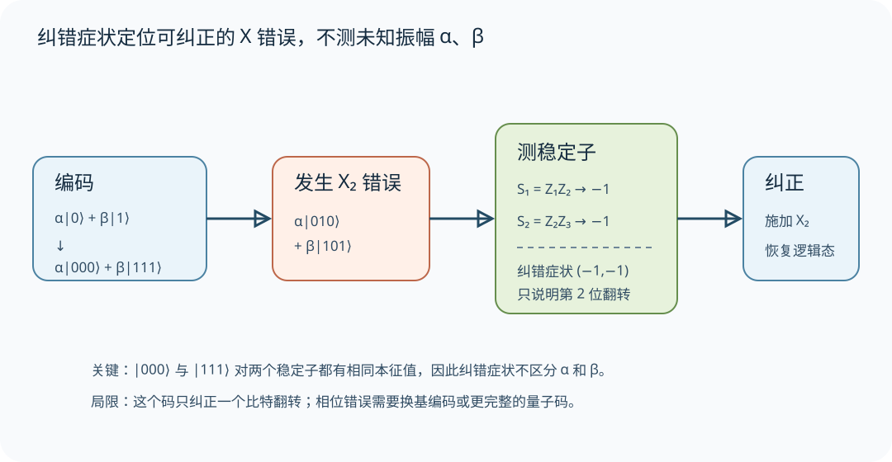

# 10｜量子错误校正与容错计算

量子错误校正（QEC）解决“如何保存逻辑量子信息”，容错计算解决“如何在纠错本身和逻辑门也会出错时继续计算”。能演示一个纠错码，不等于已经获得可扩展容错量子机；低于某个阈值，也不等于工程开销已经可接受。

初次阅读可以分层：先读 §1–2，把一个未知量子态怎样编码、一个位翻转怎样被辅助比特定位算明白；再读 §3 和 §7，理解为什么还要处理相位错误、为何表面码须跨时间比较。§4–6 的一般编码条件和其他码、§8–13 的阈值、容错门与资源预算，可以在研究相应话题时逐节回看。第一遍不必凭记忆背下所有码名。

## 1. 不可克隆为何不妨碍纠错

错误校正不是把未知态复制三份：

$$
|\psi\rangle\not\mapsto|\psi\rangle^{\otimes3}.
$$

它用一个等距编码把逻辑态映射到更大的纠缠子空间：

$$
\alpha|0\rangle+\beta|1\rangle
\longmapsto
\alpha|0_L\rangle+\beta|1_L\rangle.
$$

随后测量只揭示错误类别的**综合征**，不读取逻辑振幅 $\alpha,\beta$。因此没有产生三份独立未知态，也不违反不可克隆定理。

拿具体输入 $|+\rangle=(|0\rangle+|1\rangle)/\sqrt2$ 看差别。三比特码把它编码为

$$
|+_L\rangle=\frac{|000\rangle+|111\rangle}{\sqrt2},
$$

只有两项；如果真能复制三份未知态，则会得到

$$
|+\rangle^{\otimes3}
=\frac1{\sqrt8}(
|000\rangle+|001\rangle+|010\rangle+|011\rangle
+|100\rangle+|101\rangle+|110\rangle+|111\rangle),
$$

共有八项。例如编码态测得 $001$ 的概率为零，三份乘积态测得 $001$ 的概率却是 $1/8$。两者不是换个名称的同一状态。下节会看到，这两项编码叠加为什么足够定位**一个**物理位翻转，而不会读出原来的 $\alpha,\beta$。

## 2. 三量子比特比特翻转码

定义

$$
|0_L\rangle=|000\rangle,
\qquad
|1_L\rangle=|111\rangle,
$$

所以

$$
\alpha|0\rangle+\beta|1\rangle
\longmapsto
\alpha|000\rangle+\beta|111\rangle.
$$

稳定子生成元可取

$$
S_1=Z_1Z_2,
\qquad
S_2=Z_2Z_3.
$$

两个逻辑基态都是 $S_1,S_2$ 的 $+1$ 本征态。单个 $X$ 错误与相应生成元反对易，产生以下综合征：

| 错误 | $S_1$ | $S_2$ | 修正 |
|---|---:|---:|---|
| $I$ | $+1$ | $+1$ | 无 |
| $X_1$ | $-1$ | $+1$ | $X_1$ |
| $X_2$ | $-1$ | $-1$ | $X_2$ |
| $X_3$ | $+1$ | $-1$ | $X_3$ |

例如

$$
X_2(\alpha|000\rangle+\beta|111\rangle)
=\alpha|010\rangle+\beta|101\rangle.
$$

由于 $X_2$ 与 $Z_1Z_2$、$Z_2Z_3$ 都反对易，两个读数都是 $-1$。综合征与 $\alpha,\beta$ 无关，因此没有测出逻辑态。

### 把奇偶校验真正测出来

“测量 $Z_1Z_2$”不是分别测量第 1、2 个数据比特。准备一个辅助比特 $a$ 于 $|0\rangle$，先做 CNOT$(1\to a)$，再做 CNOT$(2\to a)$，最后只在计算基测量 $a$。对数据基态 $|x_1x_2x_3\rangle$，辅助比特变成 $|x_1\oplus x_2\rangle$；读数 0 对应 $Z_1Z_2=+1$，读数 1 对应 $-1$。另用一个辅助比特同样测第 2、3 位的奇偶，得到 $Z_2Z_3$ 的读数。

| 顺序 | 数据比特 1 | 数据比特 2 | 辅助比特 $a$ |
|---|---|---|---|
| 准备 | 保持原态 | 保持原态 | 制备为 0 |
| CNOT 1 | 控制端 | 不操作 | 目标端：$a\leftarrow a\oplus x_1$ |
| CNOT 2 | 不操作 | 控制端 | 目标端：$a\leftarrow a\oplus x_2$ |
| 读出 | 不测量 | 不测量 | 计算基测量，结果为 $x_1\oplus x_2$ |

表格按时间从上到下读取；“控制端”和“目标端”是同一行中的一扇 CNOT。只读辅助比特，所以数据比特的各个基态分量会按奇偶类别投影，而不会分别暴露 $x_1,x_2$ 的取值。

令 $|\psi_L\rangle=\alpha|000\rangle+\beta|111\rangle$。其两项在第 1、2 位上的奇偶都是 0，故经过第一组 CNOT 后，联合态仍可写成 $|\psi_L\rangle|0\rangle_a$；测辅助比特得到 0，不会区分 $\alpha$ 和 $\beta$。若第 2 个数据比特翻转，数据态成为 $\alpha|010\rangle+\beta|101\rangle$。两项对两组检查的奇偶都为 1，所以两个辅助比特读数为 11，数据的两个逻辑振幅仍保留。

若错误是“没出错”和“第 2 位翻转”的相干叠加，测量前的联合态可写成

$$
\sqrt{1-p}\,|\psi_L\rangle|00\rangle_{a_1a_2}
+\sqrt p\,X_2|\psi_L\rangle|11\rangle_{a_1a_2},
\qquad 0\le p\le1.
$$

两支数据态正交，故这个例子已归一化。读出辅助比特会选择错误类别，再按读数纠正；它并未读出 $\alpha,\beta$。实际校验电路自身也会出错，并可能把辅助比特故障传播到数据比特，后面的容错部分会处理这一限制。

图中箭头表示“编码—出错—测稳定子—恢复”的信息流程，不表示测量了 $\alpha$ 或 $\beta$。它只在“至多一个比特翻转”的假设下定位 $X$ 错误；相位错误仍超出这个码的能力。

逻辑算符可取

$$
\overline X=X_1X_2X_3,
\qquad
\overline Z=Z_1.
$$

任意 $Z_i$ 都与两个稳定子对易，并在码空间中等价于逻辑 $\overline Z$，所以这个码检测不到相位错误。它只是完整量子纠错的教学台阶。

## 3. 相位错误、Shor 码与错误离散化

Hadamard 满足

$$
HZH=X,
$$

所以在 X 基中使用重复结构，可以把相位翻转转成比特翻转来诊断。相位翻转重复码的两个编码基态可写为

$$
|0_L^{(\mathrm{phase})}\rangle=|+++\rangle,
\qquad
|1_L^{(\mathrm{phase})}\rangle=|---\rangle.
$$

九量子比特 Shor 码把组内比特翻转保护与组间相位翻转保护组合起来：

$$
|0_L\rangle=
\left(\frac{|000\rangle+|111\rangle}{\sqrt2}\right)^{\otimes3},
$$

$$
|1_L\rangle=
\left(\frac{|000\rangle-|111\rangle}{\sqrt2}\right)^{\otimes3}.
$$

它是 $[[9,1,3]]$ 码，能纠正任意单个物理量子比特上的错误。

可以亲手算一次综合征，看看两层保护怎样配合。把九个物理比特分成 $(1,2,3)$、$(4,5,6)$、$(7,8,9)$ 三组。每组有两项 $ZZ$ 检查，如第一组的 $Z_1Z_2,Z_2Z_3$；另外两项跨组检查为

$$
S_{X,1}=X_1X_2X_3X_4X_5X_6,
\qquad
S_{X,2}=X_4X_5X_6X_7X_8X_9.
$$

编码态对这八项检查的本征值全是 $+1$。原因是组内 $|000\rangle$ 和 $|111\rangle$ 在相邻两位上的奇偶相同，而 $X_1X_2X_3$ 使第一组的 GHZ 态 $(|000\rangle\pm|111\rangle)/\sqrt2$ 取得本征值 $\pm1$；编码态的三组符号一致，所以相邻两组的 $X$ 本征值乘积仍为 $+1$。只列出第一组的两项 $ZZ$ 检查和两项跨组检查，其余两组的四项 $ZZ$ 在下表中均为 $+1$：

| 第一组发生的错误 | $(Z_1Z_2,Z_2Z_3)$ | $(S_{X,1},S_{X,2})$ | 怎样理解 |
|---|---|---|---|
| $I$ | $(+,+)$ | $(+,+)$ | 没有检测到错误 |
| $X_2$ | $(-,-)$ | $(+,+)$ | 第 2 位同时改变两项组内奇偶；施加 $X_2$ 恢复 |
| $Z_1$ | $(+,+)$ | $(-,+)$ | 第一组的 GHZ 符号反转；在该组任一位施加 $Z$ 恢复 |
| $Y_2$ | $(-,-)$ | $(-,+)$ | 同时有位翻转和相位翻转；施加 $Y_2$ 恢复，忽略全局相位 |

例如 $Z_1$ 与 $S_{X,1}$ 反对易，却与 $S_{X,2}$ 及所有 $ZZ$ 检查对易，所以得到表中第三行。$Z_1,Z_2,Z_3$ 对组内编码态的作用相同：它们两两相差一个 $ZZ$ 稳定子，因此不必区分究竟是哪一位发生了相位翻转。这里的读数只告诉我们错误类别，不会揭示逻辑态的 $\alpha,\beta$；若同时出现两个任意位置错误，本码并不保证仍能正确恢复。

### 为什么纠正 $X,Y,Z$ 就足够

任意单量子比特算符都可在 Pauli 基展开：

$$
E=aI+bX+cY+dZ.
$$

若编码与恢复能纠正每个可能物理位置上的基错误 $I,X,Y,Z$，线性性保证其也能纠正这些错误的相干线性组合。综合征测量会把可区分的错误分量投影到相应分支，但不会测量逻辑振幅；在退化码中，多个物理错误也可能共享同一综合征分支。

因此，准确说法是“恢复过程把连续误差的影响离散化为 Pauli 综合征”，而不是“物理噪声本来就只会发生离散的 X、Y、Z”。

## 4. Knill–Laflamme 条件

设码空间投影为 $P$，待纠正的错误集合为 $\{E_a\}$。存在完美恢复操作的充要条件是：存在与逻辑态无关的常数矩阵 $C$，使

$$
PE_a^\dagger E_bP=C_{ab}P.
$$

若用逻辑基 $|i_L\rangle$ 表示，同一条件为

$$
\langle i_L|E_a^\dagger E_b|j_L\rangle
=C_{ab}\delta_{ij}.
$$

它包含两个直觉：

1. 当 $i\ne j$ 时，错误不能把不同逻辑基态混在一起；
2. 对固定错误对 $a,b$，环境或综合征得到的信息不能依赖逻辑值 $i$。

不同错误可以产生不同综合征，也可以在码空间上的作用彼此等价。所谓**退化码**，正是不同物理错误在码空间中具有同一有效作用；所以“每种错误必须有唯一综合征”并非一般要求。

把这个抽象条件放回三比特重复码，便能看清它**为何能纠正 $X$、却不能纠正 $Z$**。令 $P=|000\rangle\langle000|+|111\rangle\langle111|$，先只考虑 $E_0=I,E_1=X_1,E_2=X_2,E_3=X_3$。若 $a=b$，$E_a^\dagger E_b=I$，所以 $PE_a^\dagger E_bP=P$；若 $a\ne b$，这个乘积会翻转一个或两个物理比特，把 $|000\rangle,|111\rangle$ 都送到码空间外，故 $PE_a^\dagger E_bP=0$。因此这一错误集合满足上式，$C_{ab}=\delta_{ab}$。反过来，把 $Z_1$ 加入待纠正集合时，取 $E_a=I,E_b=Z_1$，便有

$$
PZ_1P=|000\rangle\langle000|-|111\rangle\langle111|\ne cP
$$

对任何常数 $c$ 都不成立：它给两个逻辑基态相反符号，正是未被发现的逻辑相位错误。这里检验的是**错误集合能否被同一个恢复过程纠正**，不是说单独施加 $X_1$ 后量子信息就已自动恢复；仍要测综合征并按读数修正。

## 5. 稳定子码语言

在 $n$ 量子比特 Pauli 群中，取一组相互对易、独立且不生成 $-I$ 的算符。它们的共同 $+1$ 本征空间就是码空间。若有 $n-k$ 个独立生成元，码空间维数为 $2^k$，可编码 $k$ 个逻辑量子比特。

一个稳定子码写作

$$
[[n,k,d]],
$$

其中：

- $n$：物理量子比特数；
- $k$：逻辑量子比特数；
- $d$：保持码空间却执行非平凡逻辑作用的最小 Pauli 权重。

逻辑 Pauli 算符与所有稳定子对易，但不属于稳定子群。距离 $d$ 的后果是：

- 能检测任意权重不超过 $d-1$ 的 Pauli 错误；
- 能纠正任意权重不超过 $t=\lfloor(d-1)/2\rfloor$ 的未知位置错误；
- 能纠正最多 $d-1$ 个位置已知的擦除错误。

“能检测两个错误”不等于“能纠正两个未知错误”；两者的距离要求不同。

这里的“可检测”不要求每一种低权重 Pauli 作用都产生非零综合征。退化码可能有低权重稳定子，例如 Shor 码的 $Z_1Z_2$：它在码空间等同恒等作用，综合征仍全为 $+1$，也无须纠正。距离保证的是低于 $d$ 的错误不会悄悄造成**非平凡逻辑作用**。

## 6. Shor、Steane 与 CSS 码

### 6.1 两个代表码的侧重点

| 码 | 参数 | 主要教学价值 | 局限或代价 |
|---|---|---|---|
| Shor 码 | $[[9,1,3]]$ | 直观看见位翻转与相位翻转两层保护 | 物理量子比特较多 |
| Steane 码 | $[[7,1,3]]$ | 连接经典 Hamming 码、CSS 结构和横向 Clifford 门 | 综合征与容错制备更抽象 |

CSS 码分别用 X 型和 Z 型检查处理相位与比特错误，使许多推导可归约为二元线性码问题。

### 6.2 Steane 码的综合征手算

Steane 码的一组选取方式是三条 X 型生成元

$$
IIIXXXX,
\qquad
IXXIIXX,
\qquad
XIXIXIX,
$$

再把 X 全部换成 Z，得到三条 Z 型生成元。

依次测量三条 Z 型生成元，把反对易记为 1、对易记为 0。单个 $X_j$ 错误的综合征为：

| 错误位置 $j$ | 综合征 |
|---:|---:|
| 1 | 001 |
| 2 | 010 |
| 3 | 011 |
| 4 | 100 |
| 5 | 101 |
| 6 | 110 |
| 7 | 111 |

七个非零三位串正好定位七个位置。这就是经典 `[7,4,3]` Hamming 校验矩阵在量子码中的作用。单个 Z 错误由 X 型生成元同理定位；Y 错误同时触发两类综合征。

## 7. 表面码

表面码把数据量子比特放在二维局域连接结构中，反复测量局域 X 型与 Z 型检查算符。下图左侧只画用来发现 X 数据错误的一组 Z 型检查：错误经过若干数据位后，通常只在链的端点留下检测记录。解码器据此猜一条连接相同端点的修正链，无法仅凭端点知道真实路径。右侧则画同一个检查连续三轮的读数，说明一次偶发读出错误为何在时间方向产生一对变化。

图中的红、蓝两条空间路径合起来是一个**可收缩的小闭环**；在所画的简单平面补丁模型中，它对应稳定子，不改变逻辑信息。若合成路径连接了适当类型的两处边界，或绕过一个孔，结论可能不同，须按具体补丁拓扑判断。图中的网格是帮助理解综合征的概念图，不是某台处理器的物理布线；未画出的 X 型检查用于发现 Z 数据错误。

码距 $d$ 是最短非平凡逻辑错误链的长度。综合征通常只显示错误链端点，不直接告诉解码器真实路径；解码依赖噪声模型和历史多轮测量。

### 7.1 为什么要比较相邻两轮，而不是只看一轮综合征

把同一个稳定子在第 $t$ 轮的二进制读数记为 $s_t\in\{0,1\}$；若线路本来就会造成已知的确定性翻转，先把它从读数中扣除。真正送给时空解码器的常常不是 $s_t$ 本身，而是相邻两轮是否发生变化：

$$
\delta_t=s_t\oplus s_{t-1}.
$$

$\delta_t=1$ 称为一个**检测事件**。下面只跟踪一个稳定子，先把空间方向省略掉：

| 情形 | 三轮读数 $(s_1,s_2,s_3)$ | 变化 $(\delta_2,\delta_3)$ | 直觉 |
|---|---|---|---|
| 第 2 轮读出偶发翻转，第 3 轮恢复 | $(0,1,0)$ | $(1,1)$ | 同一位置在相邻两个时间边界各出现一次事件 |
| 第 1、2 轮之间发生并持续的数据错误 | $(0,1,1)$ | $(1,0)$ | 真正的奇偶校验值改变后保持不变，只在改变处出现事件 |

这说明重复测量能把“读错一次”和“数据状态持续改变”变成不同的时间图样。不过，这个单稳定子表格不能单独定罪：完整表面码还要同时看邻近稳定子。典型的数据 Pauli 错误会在同一轮触发空间上相邻的一对事件，或触发一个事件并连到边界；测量或复位错误常在同一稳定子的相邻轮次形成一对时间事件。门故障、泄漏和相关噪声还会形成更复杂的时空图样。

因此解码不是“看到 $\delta_t=1$ 就立刻翻转某个数据比特”，而是在带边界的三维时空图上，把事件两两配对或配到边界，并按噪声模型比较候选错误链。

首事件帧必须按制备基分别处理。若某个稳定子的初始本征值已知，就把第一轮读数与这个已知值比较；若正交基下的初始本征值本来就是随机的，就不能凭空把未知的上一轮设成 0。末事件帧也不是与“事先知道的终态”比较：对与最终数据测量基相容的稳定子，先从数据量子比特的逐比特测量算出相应奇偶校验，再与最后一轮稳定子读数比较。这样首、末两端都成为有明确定义的时间边界，而不是把缺少读数误当成“没有错误”。

常见旋转平面补丁有约 $d^2$ 个数据量子比特和 $d^2-1$ 个测量量子比特，总数约为

$$
2d^2-1.
$$

这只是常用布局的计数，不是所有表面码变体的通式。实际还要为边界操作、布线、格码手术和魔法态工厂预留空间。

## 8. 阈值：何时增加冗余才真正有用

阈值定理的大意是：在指定的局域噪声、控制和容错操作模块（常称 gadget）假设下，只要物理错误强度低于某个常数阈值，就能以随计算规模可控增长的开销，把理想计算模拟到任意小失败概率。

阈值不是单一硬件常数。它依赖：

- 码族与逻辑操作方案；
- 噪声是独立、偏置、相关、相干还是含泄漏；
- 门、空闲、测量和复位错误；
- 综合征提取电路与调度；
- 解码器及其实时延迟；
- 采用的逻辑错误指标。

对若干常见表面码电路级噪声模型，“约 1%”可作为量级印象，但不能脱离模型引用。

### 一个明确标注为示意的缩放例子

某些模型下，对常用的奇数码距，按每轮综合征提取或每次逻辑操作等选定口径计数的逻辑错误率可经验写成

$$
p_L\approx A\left(\frac p{p_{\mathrm{th}}}\right)^{(d+1)/2}.
$$

仅为展示趋势，取

$$
A=0.1,\qquad p=10^{-3},\qquad p_{\mathrm{th}}=10^{-2}.
$$

则

| 距离 | 示意逻辑错误率 |
|---:|---:|
| $d=3$ | $10^{-3}$ |
| $d=5$ | $10^{-4}$ |
| $d=7$ | $10^{-5}$ |

低于阈值时，增加距离可指数压低逻辑错误；高于阈值时，增加更多易错元件反而可能使结果更差。这张表不能拿来估算具体设备，因为真实的 $A,p_{\mathrm{th}}$ 和缩放区间都需实验或电路级模拟确定。

## 9. 容错：纠错码之外还需要什么

若综合征提取中的一个故障能在同一码块传播成多个数据错误，编码本身也救不了计算。容错要求单个物理故障在一个纠错周期内不会扩散为不可纠正的高权重错误。

常用机制包括：

- **横向门**：不同码块对应物理量子比特逐对作用，限制块内传播；
- **格码手术**：合并和分裂逻辑补丁，测量联合逻辑算符；
- **规范固定与码切换**；
- **经过验证的辅助态和旗标量子比特**；
- **重复综合征测量、Pauli 帧（Pauli frame，在经典控制器中记录待施加的 Pauli 修正）与实时解码**；
- **泄漏清除和相关错误监控**。

### Eastin–Knill 的边界

横向门很适合容错，但 Eastin–Knill 定理说明：在**有限维物理子系统、固定编码和精确错误检测**的条件下，能检测任意单物理子系统错误的非平凡量子码，不可能只靠横向逻辑门得到通用门集。这里的有限维前提不能不加说明地套到理想无限维玻色模式上。

这里不是只排除“连续的”通用门集；离散但通用的纯横向逻辑门集同样不允许。定理限制的是对固定编码完全依赖横向门实现通用性，而不是否定单个横向门或非横向容错机制。

这不表示通用容错计算不可能，而是必须结合非横向机制，例如魔法态注入、码切换、规范固定或格码手术。也不能把该定理误读成“唯一方案是魔法态蒸馏”。

## 10. Clifford 门、$T$ 门与魔法态

Clifford 门把 Pauli 算符共轭到 Pauli 算符，便于稳定子追踪和容错实现。稳定子态制备、Clifford 门与 Pauli 测量组成的线路可被经典计算机高效模拟，且不构成通用量子计算。

加入非 Clifford 资源，例如

$$
T=\begin{pmatrix}1&0\\0&e^{i\pi/4}\end{pmatrix},
$$

即可与 Clifford 门组成常见通用门集。许多代码通过魔法态

$$
|A\rangle=T|+\rangle
=\frac{|0\rangle+e^{i\pi/4}|1\rangle}{\sqrt2}
$$

的注入来实现逻辑 T 门。

魔法态蒸馏用 Clifford 操作、测量和经典前馈，消耗许多较低保真度的魔法态，产出较少的高保真魔法态。只有输入错误低于相应蒸馏协议阈值时，递归蒸馏才会改善质量。

因此资源估算常重点报告：

- **T count**：T 门总数；
- **T depth**：不能并行的 T 层数；
- 每单位时间所需魔法态数；
- 工厂数量、产率和失败概率；
- 数据补丁、工厂与路由的物理量子比特—时间体积。

### 任意旋转为什么会变成大量 T 门

算法中的 $R_z(\theta)$ 往往不是容错门集中的原生门，必须用 Clifford+$T$ 线路近似。对无辅助量子比特的单比特 $z$ 旋转，Ross–Selinger 综合在其模型下的典型 T count 主项约为

$$
3\log_2(1/\epsilon),
$$

另有较低阶修正；这里 $\epsilon$ 是旋转近似误差。常数会随允许的辅助位、测量、随机化和门集改变，不能把这个式子当成所有架构的固定定律。

若一个旋转要达到 $\epsilon=10^{-10}$，主项约为

$$
3\log_2(10^{10})\approx99.7,
$$

即百个 T 门量级。含 $10^8$ 个此类旋转的算法不能只报“$10^8$ 个单量子比特门”；还要给每个旋转的精度分配、综合后的 T count/T depth 和工厂吞吐。把总误差简单平均到每个门是一个保守起点，不一定是资源最优分配。

## 11. 错误校正与错误缓解不是同一件事

| 项目 | 错误校正 | 错误缓解 |
|---|---|---|
| 目标 | 在计算过程中保护逻辑态 | 改善最终统计估计 |
| 冗余 | 编码到额外物理自由度 | 常以更多电路执行和后处理换偏差降低 |
| 是否重复提取综合征 | 通常需要 | 通常不需要稳定子综合征 |
| 可否支持任意长计算 | 低于阈值并具备容错操作时原则上可以 | 一般会随深度产生快速增长的采样开销 |
| 典型方法 | 表面码、CSS、玻色码 | 零噪声外推、概率误差抵消、对称性验证 |

把缓解后的某个期望值变准，不等于逻辑量子比特已被长期保护。

## 12. 偏置噪声与玻色码

若相位错误远多于比特翻转，可选择利用噪声偏置的代码和门，但所用操作必须尽量保持该偏置，否则优势会消失。

玻色码把逻辑信息编码在振荡模式的多个 Fock 分量中，例如 cat、binomial 与 GKP 码。它们可在单个模式内检测或抑制某些错误，再与外层量子比特码组合。“一个振荡器”不等于零成本：仍需辅助量子比特、泵浦、读出、反馈和容错逻辑操作。

这些代码适合作为拓展阅读；初学主线应先掌握 Pauli 错误、稳定子和距离，再讨论连续变量编码。

进一步比较 cat、binomial 与 GKP 的物理直觉，区分泄漏、丢失、即时/延迟擦除和偏置噪声，并把表面码、qLDPC、玻色内码串接放在同一工程表中，见[第 19 章第 9—10 节](19-engineering-architecture.md#9-连续变量与玻色编码从振荡器到逻辑比特)。

## 13. 从逻辑错误预算反推码距

假设一个算法包含 $10^8$ 个不可并行的关键逻辑层，且先用同一个 $p_L$ 上界约束每层失败概率。用并合上界作保守估计，若希望总失败概率不超过 $1\%$，需要

$$
10^8p_L\le10^{-2},
\qquad
p_L\le\frac{10^{-2}}{10^8}=10^{-10}.
$$

若要给其他错误来源留出预算，应把这一层的上界设得更低。若某个码距只能提供每层 $10^{-6}$ 的逻辑错误率，就相差四个数量级。可以提高码距、改善物理错误率、增加蒸馏级数、并行化或重新优化算法，但每种方法都会改变空间、时间或吞吐成本。

继续沿用第 8 节**纯示意**的模型，并额外假设每个关键逻辑层恰好对应一次所定义的纠错周期、其他操作没有额外错误。此时 $p/p_{\mathrm{th}}=0.1$，所以

$$
p_L(d)\approx0.1\,(0.1)^{(d+1)/2}
=10^{-(d+3)/2}.
$$

要让 $10^8$ 层的并合上界不超过 $10^{-2}$，需要 $p_L\le10^{-10}$；因此 $(d+3)/2\ge10$，取奇数码距时最小为 $d=17$。在第 7 节那种裸旋转补丁计数下，每个逻辑补丁约需 $2d^2-1=577$ 个物理比特。这个数字没有包括逻辑门、魔法态工厂、路由、泄漏清除和备用资源，也没有把示意的 $A,p_{\mathrm{th}}$ 当成某台机器的实测值。它只演示怎样从目标错误预算走到一个**带明确假设的**码距下界。

这说明“做出了一个逻辑量子比特”和“能运行有用的大算法”之间仍隔着逻辑门质量、持续时间、逻辑量子比特数、解码速度和魔法态工厂吞吐。

## 14. 自检

1. 三比特码的综合征为什么不会测出 $\alpha$ 与 $\beta$？
2. 为什么三比特重复码不能检测单个 Z 错误？
3. $[[n,k,d]]$ 中三个参数分别是什么？距离 5 可纠正多少未知位置错误、多少已知位置擦除？
4. 使用给出的 Steane 生成元，计算 $X_5$ 和 $Z_6$ 的综合征。
5. 物理错误低于阈值为什么仍不保证资源可接受？
6. Eastin–Knill 定理限制了什么，又没有否定什么？
7. 为什么容错资源估算常单独统计 T 门和魔法态工厂？
8. 错误缓解与错误校正的根本差异是什么？
9. 在给定综合模型下，把旋转误差从 $10^{-6}$ 收紧到 $10^{-12}$，T count 的主项约增加多少？为什么这还不是完整物理资源增量？
10. 输入 $|+\rangle$ 经三比特码编码后是什么？它与“做出三份 $|+\rangle$”的乘积态有什么可由一次计算基测量区分的差别？

答案见[练习与答案：第 10 章](appendices/exercises.md#第-10-章)。

## 参考起点

- P. W. Shor, [Scheme for reducing decoherence in quantum computer memory](https://doi.org/10.1103/PhysRevA.52.R2493), *Physical Review A* 52, R2493 (1995)。
- A. M. Steane, [Error Correcting Codes in Quantum Theory](https://doi.org/10.1103/PhysRevLett.77.793), *Physical Review Letters* 77, 793 (1996)。
- E. Knill, R. Laflamme, [Theory of quantum error-correcting codes](https://doi.org/10.1103/PhysRevA.55.900), *Physical Review A* 55, 900 (1997)。
- D. Gottesman, [Stabilizer Codes and Quantum Error Correction](https://arxiv.org/abs/quant-ph/9705052), PhD thesis (1997)。
- IBM Quantum Learning, [Repetition codes](https://quantum.cloud.ibm.com/learning/en/courses/foundations-of-quantum-error-correction/correcting-quantum-errors/repetition-codes)（辅助比特奇偶校验线路）。
- D. Aharonov, M. Ben-Or, [Fault-Tolerant Quantum Computation With Constant Error Rate](https://arxiv.org/abs/quant-ph/9906129)。
- A. G. Fowler et al., [Surface codes: Towards practical large-scale quantum computation](https://doi.org/10.1103/PhysRevA.86.032324), *Physical Review A* 86, 032324 (2012)。
- R. Acharya et al., [Suppressing quantum errors by scaling a surface code logical qubit](https://www.nature.com/articles/s41586-022-05434-1), *Nature* 614, 676–681 (2023)（相邻轮检测事件与时空相关示例）。
- J. Bausch et al., [Learning high-accuracy error decoding for quantum processors](https://doi.org/10.1038/s41586-024-08148-8), *Nature* 635, 834–840 (2024)（检测事件的逐轮定义与含泄漏、串扰的解码输入）。
- B. Eastin, E. Knill, [Restrictions on Transversal Encoded Quantum Gate Sets](https://doi.org/10.1103/PhysRevLett.102.110502), *Physical Review Letters* 102, 110502 (2009)。
- S. Bravyi, A. Kitaev, [Universal quantum computation with ideal Clifford gates and noisy ancillas](https://doi.org/10.1103/PhysRevA.71.022316), *Physical Review A* 71, 022316 (2005)。
- B. M. Terhal, [Quantum error correction for quantum memories](https://doi.org/10.1103/RevModPhys.87.307), *Reviews of Modern Physics* 87, 307 (2015)。
- N. J. Ross, P. Selinger, [Optimal ancilla-free Clifford+$T$ approximation of $z$-rotations](https://arxiv.org/abs/1403.2975) (2014)。
