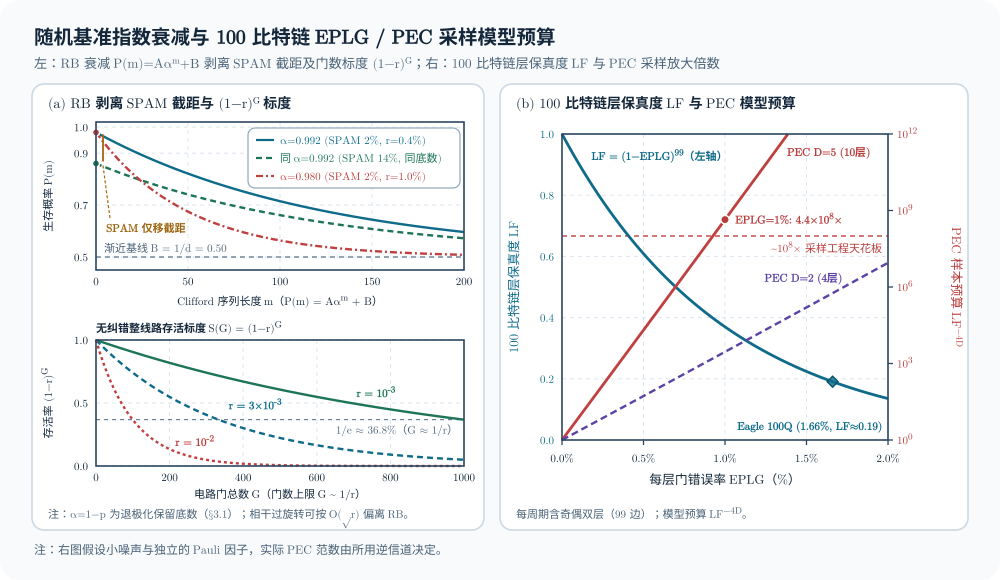
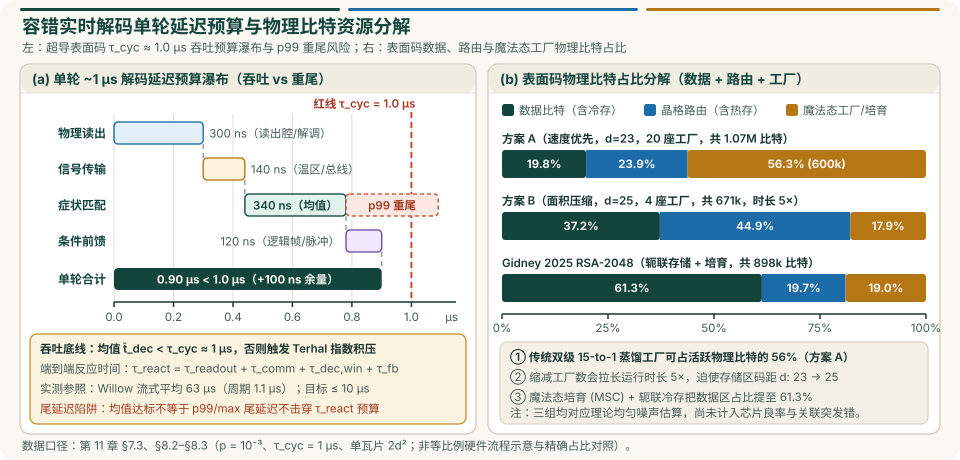
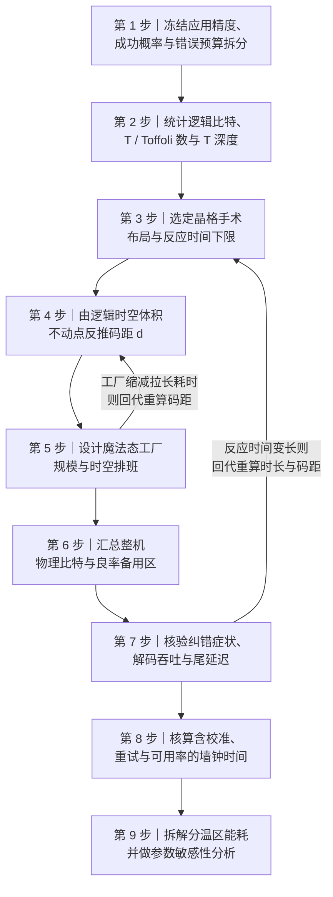
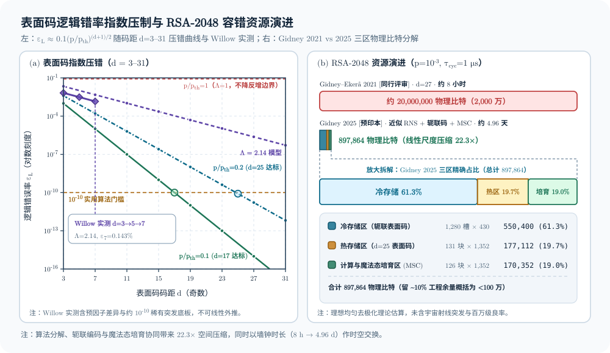

# 11｜基准测试与容错资源估算

当你看到一则新闻说“某新芯片突破 1,000 个量子比特”，或者一篇论文宣称“双比特门保真度达到 99.9%”“逻辑错误率降低 800 倍”，第一反应不该是背下这些数字，而是停下来问一句：**它测的到底是哪一件事？**

本章做两件彼此咬合的事。前半部分教你如何**量一台量子计算机**：从最底层的单个量子门、全芯片并行门层，一路往上走到系统级线路、应用套件和容错逻辑量子比特，把每把尺子的数学原理、量程和盲区拆给你看。后半部分教你如何**算一本端到端容错资源账**：给你一个算法的逻辑比特数和 $T$ 门数，怎么一步步反推出纠错码距、魔法态工厂或培育池排班、每秒几百吉比特的实时解码带宽，一直算到机房插线板上的兆瓦级功耗。

**导读与分层路线**：

- ★ **核心主线（初读必看）**：先通读 §1、§2、§3.1–§3.2、§4.1–§4.2、§5、§6、§7.1–§7.2、§7.4 与 §8，把元件—并行层—系统—逻辑四级评测口径与九步容错资源账本立起来；
- ☆ **进阶选读（二刷深挖）**：带“进阶选读”标记的 §3.3 门集层析（GST）、§4.3 PEC 采样上限推导、§7.3 实时解码三维约束与 §9 批内漂移统计分析，搭配[第 09 章](09-hardware.md)与[第 10 章](10-error-correction.md)回看效果最佳。

---

## 1. 为什么“1000 个量子比特”几乎什么都没说

先看一个不涉及任何具体厂商的日常比较题。假设我们要估计某条量子线路输出 `0` 的概率，并把统计误差控制在 $\pm 0.02$ 以内、达到预先约定的置信度。有两台设备摆在面前：

- 设备甲每秒尝试 $10^5$ 次，但经过筛选后只保留 $1\%$ 的有效记录；
- 设备乙每秒尝试 $2\times 10^4$ 次，但能保留 $50\%$ 的有效记录。

单看“每秒尝试次数”，甲是乙的 5 倍。可真正落到有效账本上，甲每秒只攒下

$$
10^5 \times 0.01 = 1{,}000\ \text{条可用记录},
$$

而乙每秒攒下

$$
2\times 10^4 \times 0.50 = 10{,}000\ \text{条可用记录}.
$$

只要两边每条有效记录的统计质量和外围开销相当，乙积累可用样本的速度反而是甲的 10 倍。当然，如果甲保留下来的记录噪声更小，或者乙的筛选过程偏向了特定输出，那还得进一步拆质量与无偏性——这恰恰说明，**把单一数字拎出来排排行榜，几乎一定会误导判断**。

要让一次性能声明经得起核查，至少得把下面五个要素写成完整的**性能五元组**：

$$
(\text{任务},\ \text{输入分布},\ \text{输出质量},\ \text{失败概率},\ \text{总资源}).
$$

少掉任何一个维度，比较就会错位。随机线路采样的分布相似度、量子化学基态能量的毫哈特里（$\mathrm{mHa}$）误差、组合优化的近似比，以及逻辑存储器的每周期翻转率，根本不是同一种物理量。同样地，一句孤零零的“1,000 个量子比特”，如果不说清它们是被光镊俘获的原子、芯片上可独立寻址的物理比特，还是已经跨过纠错阈值的逻辑比特，也不交代可用良率、连接拓扑、并行门错误率和时钟速度，就几乎预测不了它到底能跑多大、多深的算法。

为了避免跨层乱比，量子表征、验证与确认（QCVV）领域通常把基准测试分成从器件到应用的四个层级。没有任何单一标量能穿透全部层级，工程上必须分层组合使用：

| 层级 | 代表方法 | 核心测量对象 | 对 SPAM 误差的稳健性 | 经典验证成本 | 对串扰与相干误差的敏感度 | 典型适用规模 |
| :--- | :--- | :--- | :--- | :--- | :--- | :--- |
| **L1 元件层** | $T_1/T_2$、SPAM、标准 RB、交错 RB | 孤立单/双比特门的平均衰减 | RB 与交错 RB 对 SPAM 稳健 | 固定小规模多项式时间 | 较弱（随机平均容易掩盖相干累积与串扰） | 1–2 比特 |
| **L1+ 诊断层** | 门集层析（GST） | 完整自洽的过程矩阵与误差生成元 | 自洽联合估计（含规范自由度） | 指数级，约 $O(K\cdot 16^n)$ 参数 | 极强（能区分过旋转、轴偏斜、退相干与漂移） | 1–2 比特（稀疏模型可扩展至 3） |
| **L2 并行门层** | 循环基准（CB）、同时 Direct RB、层保真度（LF）/ EPLG | 整芯片并行双比特门层质量与串扰 | 稳健（靠深度扫描分离 SPAM） | $O(1)$ Pauli 抽样（CB）或 $O(N)$ 分块（LF） | 对串扰极强；对相干误差经随机编译均化 | $10\text{--}1{,}000+$ 比特 |
| **L3 系统层** | 量子体积（QV）、XEB、镜像电路、CLOPS | 有效宽度—深度边界、全栈执行吞吐 | 混合（结果受终端读出影响） | QV/XEB 需指数 $O(2^n)$；镜像/CLOPS 为多项式 | 镜像电路对结构化相干误差敏感；CLOPS 仅测速度 | QV 约 $\lesssim 30$；镜像与 CLOPS 可达百比特级 |
| **L4 逻辑与应用层** | $\varepsilon_L/\Lambda$、实时解码时延、QED-C、SupermarQ、rQOPS | 容错错误抑制、实时解码回路与真实应用精度 | 逻辑层通过多轮扫描分离 SPAM 截距 | 应用套件需已知解或可验实例；逻辑记忆直接核对 | 全面暴露泄漏、突发关联误差、路由与解码积压 | 逻辑阵列 / 实用算法 |

---

## 2. 先把资源账本的口径对齐

### 2.1 核心资源与吞吐指标口径

不同论文和厂商白皮书经常用同一个词指代不同范围的开销。动手算账前，先把十二项基础资源与吞吐口径统一列在一张表里：

| 资源或指标 | 含义 | 报告中最常见的遗漏 |
| :--- | :--- | :--- |
| 物理量子比特 | 实际硬件中可操控的器件自由度 | 良率折损、并行驱动质量下降、辅助测量比特与边缘备用区 |
| 逻辑量子比特 | 经纠错码编码后的算法级存储与运算单元 | 码距 $d$、边界开销、路由走廊，以及是否真正低于纠错阈值 |
| 门数 | 线路中的总操作数 | 单/双比特门代价悬殊，或者把物理门与逻辑门混在一起数 |
| 电路深度 | 关键路径上的时间层数 | 中途测量、主动复位、离子/原子搬运与经典反馈等待时间 |
| $T$ 门数与 $T$ 门深度 | 容错架构下非 Clifford 核心资源计数与串行层数 | 魔法态工厂的面积、蒸馏/培育拒收率与周期性供给等待 |
| 重复采样次数（shots） | 同一线路重复制备与测量的次数 | 有限样本置信区间、批次漂移相关性以及误差缓解带来的方差放大 |
| 接受率 | 经过告警筛查或后选择后保留下来的样本比例 | 只报条件保真度，不报丢弃了百分之多少的原始运行 |
| 墙钟时间 | 从提交任务到拿到合格结果的总现实时间 | 队列等待、编译路由、校准停机、复位、网络传输与经典后处理 |
| 空间—时间体积 | 占用的逻辑瓦片数乘以逻辑节拍数（tile-beats） | 不同纠错架构的周期时长与并行度差异 |
| 可靠逻辑操作速率（rQOPS） | 逻辑比特数乘以逻辑时钟频率（必须绑定目标逻辑错误率 $p_L$） | 脱离目标 $p_L$ 孤立吹嘘速度，或把物理门速率当逻辑速率 |
| 纠错症状带宽 $B_{\mathrm{syn}}$ | 辅助比特每秒产出的原始测量比特流速率 | 忽略低温到室温的数据传输、交换机与解码器 I/O 瓶颈 |
| 整机能耗 | 规定系统边界内产出一次可靠答案消耗的总能量 | 漏算稀释制冷机、激光、控制机架、经典解码集群与机房制冷 PUE |

读到任何一份资源宣称时，不妨拿这张表逐项打钩：只要表里右栏的常见遗漏没交代清楚，就别急着拿它和别的路线做横向胜负判断。

### 2.2 从单门误差到长线路：为何 99.9% 单门远不够用

在深入复杂基准协议前，先拿一个手边就能心算的小估算立好数量级直觉。假设一条线路包含 $G$ 个关键门位置，且粗略假定每个位置以相同概率 $p$ 独立出错、只要错一次整条线路就报废，那么整次运行完全无错的概率为

$$
P(\text{无错}) = (1 - p)^G \approx e^{-pG}.
$$

代入一组最常见的数字：$p = 10^{-3}$（所谓“99.9% 门保真度”）、$G = 1{,}000$，得到

$$
(1 - 10^{-3})^{1000} \approx 0.3677 \approx e^{-1} \approx 36.8\%.
$$

哪怕单门已经达到 $99.9\%$，跑完 $1{,}000$ 个独立关键门后，完好无损的概率也就剩下三分之一出头。需要更保守的严格上界时，不必假设各位置相互独立，直接用概率论中的**并合界（union bound）**：

$$
P_{\mathrm{fail}} \le \sum_{j=1}^{G} p_j.
$$

举个容错尺度的例子：假如一项算法需要 $10^6$ 个关键逻辑操作，而你要求整次计算的失败概率不超过 $1\%$，那么平均到每一步的逻辑错误率就得压到 $10^{-8}$ 量级或更低。这正好说明了为什么物理门保真度永远不可能直接拿来当算法容量——想要跨进百万、十亿门级实用算法，必须靠[第 10 章](10-error-correction.md)的量子纠错把错误率再往下压好几个数量级。同时别忘了这个小估算的适用边界：它既不能当作精确预测器，也未计入错误可能被纠错码拦截、不同位置噪声不均匀、以及相干误差按 $m^2$ 超线性累加这三种现实效应。

---

## 3. 元件级基准：随机基准测试（RB）、交错 RB 与门集层析（GST）

进入实验室后，工程师最先测的是一批元件级指标。同样叫“保真度”或“错误率”，测量对象却大不相同：

| 指标或方法 | 主要回答什么 | 不能单独推出什么 |
| :--- | :--- | :--- |
| $T_1, T_2^*, T_2$ | 量子比特空闲时的能量弛豫与相位保持能力 | 受控门误差、脉冲串扰、读出错误或能级泄漏 |
| 状态制备与测量误差（SPAM） | 初始化与终端读出的联合判别准确度 | 中间门的质量；常规测试也难以把制备和测量完全拆开 |
| 随机基准测试（RB） | 特定噪声假设下随机 Clifford 门的平均衰减率 | 最坏单门误差、相干误差方向、慢漂移与结构化应用成功率 |
| 交错 RB（IRB） | 单个目标 Clifford 门相对参考序列的附加衰减 | 存在强相干误差或门依赖噪声时的无偏精确误差 |
| 循环基准（CB）/ 层保真度（LF） | 多比特并行驱动时的串扰与整层过程保真度 | 任意深度的结构化相干共振表现 |
| 门集层析（GST） | 小规模门集的完整自洽过程模型与物理误差分解 | 百比特处理器的低成本日常验收 |
| 泄漏 / 丢失率 | 系统逃离 $\{|0\rangle,|1\rangle\}$ 计算子空间或原子丢失的概率 | 未被标记的泄漏在后续多轮纠错中的持续扩散 |

下面我们不跳任何一步，把元件层最核心的两套数学武器——**随机基准测试**（RB）和**门集层析**（GST）——彻底推清楚。

### 3.1 随机基准测试（RB）为什么能甩开 SPAM：从群平均到指数衰减

**先看困惑**：真实超导或离子阱芯片上，状态制备与读出误差（SPAM）常常在 $0.5\%\text{--}2\%$ 左右，而一个优秀的单比特门错误率只有 $0.05\%$。如果你只施加一次门就测量结果，门误差会彻底淹没在比它大几十倍的读出噪声里。

**直觉比方**：这就像手里有一把刻度头部磨掉了一小截的旧尺子，你想测一张纸的精确厚度。单量一张纸肯定测不准，因为尺头磨损的固定误差比纸还厚；但如果你把 100 张、200 张、500 张纸叠起来量总厚度，再画一条“总厚度随张数增长”的直线，**尺头磨损只会整体抬高截距，直线的斜率依然精准等于每张纸的平均厚度**。当然，这个比方也有边界：如果纸张厚薄不均，或者纸叠得越厚越容易压弯变形（类似相干误差累积和慢漂移），单靠斜率就看不出每张纸的差异。

**严格设定**：考虑一个 $n$ 比特系统，希尔伯特空间维度 $d=2^n$，密度矩阵空间记为 $\mathcal{D}(\mathbb{C}^d)$。记 $n$ 比特理想 Clifford 群为 $\mathcal{C}_n$（[第 04 章](04-circuits-protocols.md)中由 $H, S, \mathrm{CNOT}$ 生成的有限酉群，它把 Pauli 算符共轭映回 Pauli 算符）。我们先在标准零阶简化模型下做完整推导（Emerson, Alicki & Życzkowski 2005；Knill et al. 2008；Magesan, Gambetta & Emerson 2011, 2012）：

1. 门噪声是**马尔可夫、时不变且与所选门无关**的完全正保迹（CPTP）信道 $\mathcal{E}$：每次实际执行 Clifford 门 $C \in \mathcal{C}_n$ 对应的信道为 $\tilde{\mathcal{C}} = \mathcal{E}\circ\mathcal{C}$，其中理想门作用为 $\mathcal{C}(\rho)=C\rho C^\dagger$（按全书统一约定，信道复合从右向左生效）。
2. 带噪声的初态记为 $\tilde{\rho}_0 \in \mathcal{D}(\mathbb{C}^d)$，终端测量对应带噪声的 POVM 元素 $\tilde{E}$（理想情况是 $\rho_0 = |0\rangle\langle 0|^{\otimes n}$ 与 $E = |0\rangle\langle 0|^{\otimes n}$）。

现在分四步把整条衰减公式推出来：

**第一步：把随机门序列改写为共轭噪声的连乘。** 从 $\mathcal{C}_n$ 中独立均匀随机抽取 $m$ 个门 $C_1, C_2, \dots, C_m$，再在经典计算机上算出它们的理想总逆门 $C_{m+1} = (C_m \cdots C_2 C_1)^\dagger \in \mathcal{C}_n$（由 Gottesman–Knill 定理，Clifford 群求逆只需多项式经典时间）。如果没有噪声，整条序列恰好等于恒等门 $I$，量子态会精准回到 $|0\rangle^{\otimes n}$。

实际带噪声执行的组合信道是

$$
\mathcal{S}_{C_1,\dots,C_m}
= \tilde{\mathcal{C}}_{m+1} \circ \tilde{\mathcal{C}}_m \circ \cdots \circ \tilde{\mathcal{C}}_1
= \mathcal{E} \circ \mathcal{C}_{m+1} \circ \mathcal{E} \circ \mathcal{C}_m \circ \cdots \circ \mathcal{E} \circ \mathcal{C}_1.
$$

为了把夹在噪声之间的理想门整理干净，定义前 $k$ 步的累积理想门 $D_k \equiv C_k C_{k-1} \cdots C_1$（$k=1,\dots,m$，约定 $D_0 = I$）。由定义立即可得 $C_k = D_k D_{k-1}^\dagger$，并且总逆门就是 $C_{m+1} = D_m^\dagger$。把这些等式逐项代入上式，利用信道复合的结合律重新配对括号：

$$
\begin{aligned}
\mathcal{S}_{C_1,\dots,C_m}
&= \mathcal{E} \circ \mathcal{D}_m^\dagger \circ \mathcal{E} \circ (\mathcal{D}_m \circ \mathcal{D}_{m-1}^\dagger) \circ \mathcal{E} \circ \cdots \circ (\mathcal{D}_2 \circ \mathcal{D}_1^\dagger) \circ \mathcal{E} \circ \mathcal{D}_1 \\
&= \mathcal{E} \circ \left(\mathcal{D}_m^\dagger \circ \mathcal{E} \circ \mathcal{D}_m\right) \circ \left(\mathcal{D}_{m-1}^\dagger \circ \mathcal{E} \circ \mathcal{D}_{m-1}\right) \circ \cdots \circ \left(\mathcal{D}_1^\dagger \circ \mathcal{E} \circ \mathcal{D}_1\right),
\end{aligned}
$$

其中 $\mathcal{D}_k(\rho) = D_k \rho D_k^\dagger$。注意一个极关键的群论性质：给定前面的 $D_{k-1}$，由于 $C_k$ 均匀取遍有限群 $\mathcal{C}_n$，右乘一个固定群元 $D_{k-1}$ 只是群元素的一一重排，因此 $D_k = C_k D_{k-1}$ 依然在 $\mathcal{C}_n$ 上均匀分布且与 $D_{k-1}$ 独立。归纳下去，**变换后的随机变量 $(D_1, D_2, \dots, D_m)$ 彼此相互独立，且各自均匀分布于 $\mathcal{C}_n$**。

**第二步：对随机序列求平均，利用酉 2-设计与 Schur 引理得到去极化信道。** 因为 $D_1, \dots, D_m$ 相互独立，整个信道乘积的期望等于各因子期望的复合：

$$
\bar{\mathcal{S}}_m \equiv \mathbb{E}_{C_1,\dots,C_m}\!\left[\mathcal{S}_{C_1,\dots,C_m}\right]
= \mathcal{E} \circ \left(\mathcal{E}_{\mathrm{twirl}}\right)^m,
$$

其中单个**群均化信道**（twirled channel）定义为

$$
\mathcal{E}_{\mathrm{twirl}}(\rho)
\equiv \frac{1}{|\mathcal{C}_n|}\sum_{D \in \mathcal{C}_n} D^\dagger \mathcal{E}(D\rho D^\dagger) D.
$$

多比特 Clifford 群 $\mathcal{C}_n$ 构成一个**精确的酉 2-设计（unitary 2-design）**（Dankert et al. 2009），意思是凡是只涉及酉矩阵 $U$ 和 $U^\dagger$ 各至多两次的表达式（正好包含 $U^\dagger \mathcal{E}(U\rho U^\dagger) U$ 这种信道共轭），在有限群 $\mathcal{C}_n$ 上做离散平均，和在连续全酉群 $U(d)$ 上按均匀 Haar 测度积分结果完全相等：

$$
\mathcal{E}_{\mathrm{twirl}}(\rho) = \int_{U(d)} \mathrm{d}\mu_{\mathrm{Haar}}(U)\, U^\dagger \mathcal{E}(U\rho U^\dagger) U.
$$

对任意固定的酉矩阵 $V \in U(d)$，把输入换成 $V\rho V^\dagger$，再做积分变量代换 $W = UV$（利用 Haar 测度的右不变性 $\mathrm{d}\mu(W) = \mathrm{d}\mu(U)$）：

$$
\mathcal{E}_{\mathrm{twirl}}(V\rho V^\dagger)
= \int_{U(d)} \mathrm{d}\mu_{\mathrm{Haar}}(W)\, V W^\dagger \mathcal{E}(W\rho W^\dagger) W V^\dagger
= V\,\mathcal{E}_{\mathrm{twirl}}(\rho)\,V^\dagger.
$$

也就是说，线性超算符 $\mathcal{E}_{\mathrm{twirl}}$ 与全体酉共轭作用 $\rho \mapsto V\rho V^\dagger$ 严格对易。在线性算符空间 $\mathcal{L}(\mathbb{C}^d)$（维度 $d^2$）上，酉共轭表示正好分解为两个互不等价的不可约子空间的直和：

1. 一维标量倍恒等算符空间 $\mathrm{span}\{I\}$：因为 $\mathcal{E}$ 保迹，有 $\operatorname{Tr}(\mathcal{E}_{\mathrm{twirl}}(I)) = \operatorname{Tr}(I) = d$，且它保持在该一维子空间内，所以特征值必为 $1$，即 $\mathcal{E}_{\mathrm{twirl}}(I/d) = I/d$。
2. $(d^2-1)$ 维无迹算符空间 $\mathcal{L}_0(\mathbb{C}^d) = \{X \in \mathcal{L}(\mathbb{C}^d) : \operatorname{Tr}(X) = 0\}$：由表示论中的 **Schur 引理**，与不可约表示对易的线性映射只能是该子空间上的标量倍恒等算符，即存在唯一实常数 $\alpha$，使得对任意无迹算符 $X$ 都有 $\mathcal{E}_{\mathrm{twirl}}(X) = \alpha X$。

现在把任意密度矩阵 $\rho$（满足 $\operatorname{Tr}(\rho)=1$）拆成两部分之和：$\rho = \frac{I}{d} + \left(\rho - \frac{I}{d}\right)$。第一项在 $\mathrm{span}\{I\}$ 里，第二项的迹为 $1 - 1 = 0$，恰好落在 $\mathcal{L}_0(\mathbb{C}^d)$ 里。由线性性立得

$$
\mathcal{E}_{\mathrm{twirl}}(\rho)
= \frac{I}{d} + \alpha\!\left(\rho - \frac{I}{d}\right)
= \alpha\rho + (1-\alpha)\frac{I}{d}
\equiv \mathcal{D}_\alpha(\rho).
$$

无论原本的物理噪声 $\mathcal{E}$ 多么歪斜、各向异性，只要经过 Clifford 随机均化，平均效果就会坍缩成只由一个参数 $\alpha$ 描述的 **$d$ 维标准去极化信道** $\mathcal{D}_\alpha$（注意与[第 05 章](05-noise-channels.md)及[符号表](appendices/notation.md)的参数对照：前文用错误强度 $p$ 写作 $\mathcal{D}_p(\rho)=(1-p)\rho+p\frac{I}{d}$，而 RB 文献习惯用衰减保留因子 $\alpha = 1 - p$ 作下标，两者严格满足 $\alpha = 1 - p$）。

**第三步：推出指数衰减公式 $P(m) = A\alpha^m + B$，看清 SPAM 如何退居截距。** 用数学归纳法算 $\mathcal{D}_\alpha^m(\rho)$：$m=1$ 时即上式定义本身；假设 $m$ 步时 $\mathcal{D}_\alpha^m(\rho) = \alpha^m\rho + (1-\alpha^m)\frac{I}{d}$，再作用一次 $\mathcal{D}_\alpha$ 并利用 $\mathcal{D}_\alpha(I/d) = I/d$：

$$
\mathcal{D}_\alpha^{m+1}(\rho)
= \alpha\!\left[\alpha^m\rho + (1-\alpha^m)\frac{I}{d}\right] + (1-\alpha)\frac{I}{d}
= \alpha^{m+1}\rho + \left(\alpha - \alpha^{m+1} + 1 - \alpha\right)\frac{I}{d}
= \alpha^{m+1}\rho + (1-\alpha^{m+1})\frac{I}{d}.
$$

代入平均生存概率 $P(m) = \operatorname{Tr}[\tilde{E}\, \bar{\mathcal{S}}_m(\tilde{\rho}_0)]$，利用信道 $\mathcal{E}$ 和迹的线性性把 $\alpha^m$ 提出来：

$$
\begin{aligned}
P(m)
&= \operatorname{Tr}\!\left[\tilde{E}\, \mathcal{E}\!\left(\alpha^m \tilde{\rho}_0 + (1-\alpha^m)\frac{I}{d}\right)\right] \\
&= \alpha^m \operatorname{Tr}\!\left[\tilde{E}\, \mathcal{E}(\tilde{\rho}_0)\right] + (1-\alpha^m)\operatorname{Tr}\!\left[\tilde{E}\, \mathcal{E}\!\left(\frac{I}{d}\right)\right] \\
&= \underbrace{\operatorname{Tr}\!\left[\tilde{E}\, \mathcal{E}\!\left(\tilde{\rho}_0 - \frac{I}{d}\right)\right]}_{A}\,\alpha^m
+ \underbrace{\operatorname{Tr}\!\left[\tilde{E}\, \mathcal{E}\!\left(\frac{I}{d}\right)\right]}_{B}
= A\alpha^m + B.
\end{aligned}
$$

看清括号里的 $A$ 和 $B$：初态误差 $\tilde{\rho}_0$、读出误差 $\tilde{E}$，乃至最后一个总逆门附带的噪声 $\mathcal{E}$，**全部被严严实实地吸收进了与序列长度 $m$ 无关的常数 $A$ 和 $B$ 里**。只要读出对比度 $A \neq 0$，扫描不同序列长度 $m$ 拟合出来的指数底数 $\alpha$ 就严格不受 SPAM 污染。

**第四步：从衰减底数 $\alpha$ 换算平均门保真度 $F_{\mathrm{avg}}$、平均门错误率 $r$ 与过程保真度 $F_p$。** 门基准领域通用的**平均门保真度**（average gate fidelity）定义为信道相对恒等信道在全部纯态上的 Haar 平均重叠概率：

$$
F_{\mathrm{avg}}(\mathcal{E})
\equiv \int \mathrm{d}\psi\, \langle\psi|\mathcal{E}(|\psi\rangle\langle\psi|)|\psi\rangle.
$$

对任意固定酉门 $D \in \mathcal{C}_n$，作变量代换 $|\phi\rangle = D|\psi\rangle$（Haar 测度酉不变），有 $\int \mathrm{d}\psi\,\langle\psi|D^\dagger \mathcal{E}(D|\psi\rangle\langle\psi|D^\dagger)D|\psi\rangle = \int \mathrm{d}\phi\,\langle\phi|\mathcal{E}(|\phi\rangle\langle\phi|)|\phi\rangle = F_{\mathrm{avg}}(\mathcal{E})$。把等式对全部 $D\in\mathcal{C}_n$ 求算术平均，便证明了**随机均化不改变平均门保真度**：

$$
F_{\mathrm{avg}}(\mathcal{E})
= F_{\mathrm{avg}}(\mathcal{E}_{\mathrm{twirl}})
= F_{\mathrm{avg}}(\mathcal{D}_\alpha).
$$

而 $\mathcal{D}_\alpha$ 对任意归一化纯态 $|\psi\rangle$（满足 $\langle\psi|\psi\rangle=1$）给出的重叠概率都完全一样，不需要再积分：

$$
F_{\mathrm{avg}}(\mathcal{D}_\alpha)
= \langle\psi|\!\left(\alpha|\psi\rangle\langle\psi| + (1-\alpha)\frac{I}{d}\right)\!|\psi\rangle
= \alpha|\langle\psi|\psi\rangle|^2 + \frac{1-\alpha}{d}\langle\psi|\psi\rangle
= \alpha + \frac{1-\alpha}{d}.
$$

由此立即得到**平均门错误率**（average gate infidelity）与衰减参数 $\alpha$ 的精确公式：

$$
r(\mathcal{E}) \equiv 1 - F_{\mathrm{avg}}(\mathcal{E})
= 1 - \alpha - \frac{1-\alpha}{d}
= \frac{d-1}{d}(1-\alpha).
$$

后面讨论全芯片并行门层时，我们还会频繁用到**过程保真度**（process fidelity，也称纠缠保真度）$F_p(\mathcal{E}) \equiv \langle\Phi^+|(\mathcal{I}\otimes\mathcal{E})(|\Phi^+\rangle\langle\Phi^+|)|\Phi^+\rangle$，其中 $|\Phi^+\rangle = \frac{1}{\sqrt{d}}\sum_{j=0}^{d-1}|j\rangle|j\rangle$ 是维度 $d\times d$ 的最大纠缠态。借助 Horodecki–Nielsen 恒等式 $F_{\mathrm{avg}} = \frac{d F_p + 1}{d+1}$，把 $F_{\mathrm{avg}} = \alpha + \frac{1-\alpha}{d}$ 代入反解 $F_p$：

$$
d F_p + 1 = (d+1)\!\left(\alpha + \frac{1-\alpha}{d}\right)
= \frac{(d+1)[(d-1)\alpha + 1]}{d}
= \frac{(d^2-1)\alpha + d + 1}{d},
$$

两边减 $1$ 再除以 $d$，得

$$
F_p(\mathcal{E}) = \frac{1 + (d^2-1)\alpha}{d^2},
\qquad
r_p(\mathcal{E}) \equiv 1 - F_p(\mathcal{E})
= \frac{d^2-1}{d^2}(1-\alpha)
= \frac{d+1}{d}\,r(\mathcal{E}).
$$

记住两个最常用的特例：单比特（$d=2$）时，$r = \frac{1}{2}(1-\alpha)$ 且 $r_p = \frac{3}{4}(1-\alpha) = \frac{3}{2}r$；双比特（$d=4$）时，$r = \frac{3}{4}(1-\alpha)$ 且 $r_p = \frac{15}{16}(1-\alpha) = \frac{5}{4}r$。顺手用一行代换推得纯酉门 $U$ 的平均门保真度公式：对 $\mathcal{U}(\rho) = U\rho U^\dagger$，内积 $\langle\Phi^+|(I\otimes U)|\Phi^+\rangle = \frac{1}{d}\sum_{j=0}^{d-1}\langle j|U|j\rangle = \frac{1}{d}\operatorname{Tr}(U)$，因此 $F_p(U) = |\operatorname{Tr}(U)|^2 / d^2$；代入 Horodecki–Nielsen 恒等式立刻得到

$$
F_{\mathrm{avg}}(U) = \frac{d\cdot (|\operatorname{Tr}(U)|^2/d^2) + 1}{d + 1} = \frac{|\operatorname{Tr}(U)|^2 + d}{d(d + 1)}.
$$

#### 手算例一：单比特去极化与“根保真度低估一半”的陷阱

取单比特系统 $d=2$，假设实验拟合出 RB 衰减底数 $\alpha = 0.998$。代入上面的公式：

$$
F_{\mathrm{avg}} = 0.998 + \frac{1 - 0.998}{2} = 0.998 + 0.001 = 0.999,
\qquad
r = 1 - F_{\mathrm{avg}} = 0.001.
$$

这里藏着两个初学者极容易踩的坑：

1. **别把 $1-\alpha$ 当错误率，也别把每 Clifford 错误直接贴到原生脉冲上**：$1-\alpha = 0.002$ 是退极化衰减率，不是 $r = 0.001$。同时，$0.001$ 是**单个随机 Clifford 门**的平均错误率；在真实超导或离子阱硬件上，一个单比特 Clifford 门平均要编译成约 $1.875$ 个原生 $\pi/2$ 脉冲，一个双比特 Clifford 门平均包含约 $1.5$ 个原生 $\mathrm{CNOT}$ 门，换算原生门错误率时必须写明编译规则。
2. **绝不能拿全书的根保真度 $F$ 直接算 $1-F$**：本书统一把态保真度定义为**根保真度** $F(\rho,\sigma) = \operatorname{Tr}\sqrt{\sqrt{\rho}\sigma\sqrt{\rho}}$（[第 13 章](13-quantum-information.md)），对纯目标态 $|\psi\rangle$，根保真度满足 $F(|\psi\rangle,\rho) = \sqrt{\langle\psi|\rho|\psi\rangle}$，而门基准公式里的 $F_{\mathrm{avg}}$ 平均的是**重叠概率** $\langle\psi|\rho|\psi\rangle = F^2$。在当前例子里，对任意纯态输入，输出态与原态的重叠概率都是 $0.999$，因此根保真度为

$$
F = \sqrt{0.999} \approx 0.9994999.
$$

如果你不小心用 $1 - F$ 去算“错误率”，会得到 $1 - 0.9994999 \approx 0.0005001$——因为当 $r\ll 1$ 时 $\sqrt{1-r} \approx 1 - r/2$，**误用根保真度会把平均门错误率硬生生低估将近一半**。

#### 手算例二：退相位 vs 相干过旋转——50 倍鸿沟与普适钻石距离界

再来看一个更要命的对比，它解释了为什么“99.94% 的 RB 门保真度”依然可能在实用算法里瞬间崩盘。

**情形 A（非相干退相位噪声）**：取单比特退相位信道 $\mathcal{E}_Z(\rho) = (1-p)\rho + p Z\rho Z$（$0 \le p \le 1$）。由于单比特 Clifford 群共轭会把 $Z$ 以完全相等的概率 $1/3$ 映射到 $\{X, Y, Z\}$，随机均化后得

$$
\mathcal{E}_{\mathrm{twirl}}(\rho) = (1-p)\rho + \frac{p}{3}(X\rho X + Y\rho Y + Z\rho Z).
$$

我们来手算验证一个极好用的单比特恒等式。把任意 $2\times 2$ 密度矩阵写作 $\rho = \begin{pmatrix} a & b \\ c & e \end{pmatrix}$（满足厄米性 $c = b^*$ 与迹 $a+e = 1$），逐项写出三个 Pauli 共轭：

$$
X\rho X = \begin{pmatrix} e & c \\ b & a \end{pmatrix},
\qquad
Y\rho Y = \begin{pmatrix} e & -c \\ -b & a \end{pmatrix},
\qquad
Z\rho Z = \begin{pmatrix} a & -b \\ -c & e \end{pmatrix}.
$$

把 $\rho + X\rho X + Y\rho Y + Z\rho Z$ 逐元素相加：左上角是 $a+e+e+a = 2(a+e) = 2$，右下角同理为 $2$，右上角是 $b+c-c-b = 0$，左下角是 $c+b-b-c = 0$。于是得到精确恒等式 $X\rho X + Y\rho Y + Z\rho Z = 2I - \rho$。代回 $\mathcal{E}_{\mathrm{twirl}}(\rho)$：

$$
\mathcal{E}_{\mathrm{twirl}}(\rho)
= (1-p)\rho + \frac{p}{3}(2I - \rho)
= \left(1 - \frac{4}{3}p\right)\rho + \frac{4}{3}p\cdot\frac{I}{2}.
$$

直接读出 $\alpha = 1 - \frac{4}{3}p$，进而 $r = \frac{1}{2}(1-\alpha) = \frac{2}{3}p$，$F_p = 1 - p$。再算它的**钻石距离**（diamond distance，衡量信道最坏可区分误差，严格定义见[第 18 章](18-channels-capacities-complexity.md)）：对任意 Pauli 信道，信道差 $(\mathcal{I}\otimes(\mathcal{E}_Z - \mathcal{I}))(|\Phi^+\rangle\langle\Phi^+|) = p(|\Phi^-\rangle\langle\Phi^-| - |\Phi^+\rangle\langle\Phi^+|)$ 的迹范数为 $2p$，精确达到上确界，因此

$$
\frac{1}{2}\lVert \mathcal{E}_Z - \mathcal{I} \rVert_\diamond = p = \frac{3}{2}\,r.
$$

非相干退相位的钻石距离与 RB 平均门错误率 $r$ 呈**线性同阶**关系（例如 $p = 0.003$ 时，$r = 0.002$，钻石距离 $= 0.003$）。

**情形 B（纯相干 $Z$ 轴过旋转）**：现在把噪声换成脉冲面积略微超调造成的相干旋转误差 $U_\theta = e^{-i\theta Z/2} = \mathrm{diag}(e^{-i\theta/2}, e^{i\theta/2})$（$\theta \in \mathbb{R}$）。利用刚推完的 $F_{\mathrm{avg}}(U) = \frac{|\operatorname{Tr}(U)|^2 + d}{d(d+1)}$，算出迹和模平方：

$$
\operatorname{Tr}(U_\theta) = e^{-i\theta/2} + e^{i\theta/2} = 2\cos\!\left(\frac{\theta}{2}\right),
\qquad
|\operatorname{Tr}(U_\theta)|^2 = 4\cos^2\!\left(\frac{\theta}{2}\right).
$$

代入 $d=2$，并利用 $\cos^2(\theta/2) = 1 - \sin^2(\theta/2)$：

$$
F_{\mathrm{avg}}(U_\theta)
= \frac{4\cos^2(\theta/2) + 2}{2\times 3}
= \frac{6 - 4\sin^2(\theta/2)}{6}
= 1 - \frac{2}{3}\sin^2\!\left(\frac{\theta}{2}\right),
\qquad
r = \frac{2}{3}\sin^2\!\left(\frac{\theta}{2}\right) \approx \frac{\theta^2}{6} \quad (|\theta| \ll 1).
$$

注意它是角度的**平方**！可最坏情况下的区分度有多大？把 $U_\theta$ 作用在赤道态 $|+\rangle = \frac{|0\rangle + |1\rangle}{\sqrt{2}}$ 上，得到 $U_\theta|+\rangle = \frac{e^{-i\theta/2}|0\rangle + e^{i\theta/2}|1\rangle}{\sqrt{2}}$。两个纯态的内积是 $\langle +|U_\theta|+\rangle = \cos(\theta/2)$，由[第 13 章](13-quantum-information.md)纯态迹距离公式得 $\sqrt{1 - \cos^2(\theta/2)} = |\sin(\theta/2)|$（注意对任意实数 $\theta \in \mathbb{R}$ 必须取绝对值 $|\sin(\theta/2)|$，仅在 $|\theta|\le \pi$ 时才等于 $\sin(|\theta|/2)$）。对单比特酉旋转，这恰好达到精确钻石距离；再由 $r = \frac{2}{3}\sin^2(\theta/2)$ 反解 $|\sin(\theta/2)| = \sqrt{\frac{3}{2}r}$，立刻看见它与情形 A 的本质鸿沟：

$$
\frac{1}{2}\lVert \mathcal{U}_\theta - \mathcal{I} \rVert_\diamond = \left|\sin\!\left(\frac{\theta}{2}\right)\right| = \sqrt{\frac{3}{2}\,r} \approx \frac{|\theta|}{2} \qquad (|\theta| \ll 1).
$$

代入一个很小的过旋转角 $\theta = 0.06\,\mathrm{rad}$（约 $3.44^\circ$）：

- **RB 平均门错误率**：$r = \frac{2}{3}\sin^2(0.03) \approx 5.998\times 10^{-4} \approx 6.00\times 10^{-4}$——放进新闻稿里，就是亮眼的“**99.94% 门保真度**”；
- **同等 $r$ 的非相干退相位钻石距离**：$\frac{3}{2}r \approx 9.00\times 10^{-4}$；
- **纯相干过旋转钻石距离**：$\sqrt{\frac{3}{2}r} = |\sin(0.03)| \approx 2.9996\times 10^{-2} \approx 3.00\times 10^{-2}$——**比 RB 平均错误率整整大了 50 倍**，也比同等 $r$ 的非相干退相位大了 $33.3$ 倍！

更一般地，Wallman 与 Flammia（*New J. Phys.* 16, 103032, 2014）及 Sanders、Wallman 与 Sanders（*New J. Phys.* 18, 012002, 2016）证明了对任意 $d$ 维 CPTP 信道 $\mathcal{E}$ 的**普适钻石距离夹逼界**：

$$
\frac{d + 1}{d}\,r \;\le\; \frac{1}{2}\lVert \mathcal{E} - \mathcal{I} \rVert_\diamond \;\le\; \sqrt{d(d + 1)\,r}.
$$

对单比特（$d=2$），这条夹逼界即 $\frac{3}{2}r \le \frac{1}{2}\lVert\mathcal{E}-\mathcal{I}\rVert_\diamond \le \sqrt{6r}$：**下界 $O(r)$ 由随机 Pauli 噪声精确达到，上界 $O(\sqrt{r})$ 则由纯相干酉误差逼近**！在重复结构线路里，假如关键路径连续执行 $m = 20$ 次带同样过旋转 $\theta = 0.06\,\mathrm{rad}$ 的门，角度直接线性相干叠加为 $m\theta = 1.2\,\mathrm{rad}$，态 $|+\rangle$ 翻转到 $|-\rangle$ 的失败概率高达 $\sin^2(0.6) \approx 31.9\%$；而拿 RB 的 $r$ 去线性估算，只会算出 $m r \approx 1.2\%$，足足低估了 **26 倍以上**。这就是为什么 RB 在数学上存在**平方根鸿沟**：随机序列把相干误差打散成了随机游走，却把真实结构化电路里的相干共振藏了起来。

### 3.2 交错 RB（IRB）与门依赖噪声的规范自由度

标准 RB 测的是整个 Clifford 群的平均表现。如果工程师只想单独测某一个目标门 $C_{\mathrm{tar}}$（比如芯片上的原生 `CZ` 门），最常用的变体是**交错 RB**（Magesan et al. 2012）：先跑一遍标准参考 RB，拟合出参考衰减率 $\alpha_{\mathrm{ref}}$；再跑一遍交错序列，在每个随机 Clifford 门 $C_k$ 后面都紧跟一个目标门 $C_{\mathrm{tar}}$，最后统一求总逆门，拟合出交错衰减率 $\alpha_{\mathrm{int}}$。

在噪声近似去极化且无相干干涉的理想假设下，衰减率直接相乘 $\alpha_{\mathrm{int}} \approx \alpha_{\mathrm{tar}}\alpha_{\mathrm{ref}}$，由此给出目标门错误率的点估计：

$$
r_{C_{\mathrm{tar}}}^{\mathrm{est}} = \frac{d-1}{d}\!\left(1 - \frac{\alpha_{\mathrm{int}}}{\alpha_{\mathrm{ref}}}\right).
$$

问题在于，真实硬件里的参考噪声与目标门噪声往往含有相干旋转成分。它们复合在一起时，既可能相干加强，也可能彼此抵消——实验上甚至出现过 $\alpha_{\mathrm{int}} > \alpha_{\mathrm{ref}}$、点估计 $r_{C_{\mathrm{tar}}}^{\mathrm{est}}$ 变成负数的尴尬场面。若没有额外的非相干或酉性先验假设，Magesan 等（2012）真正对**一切 CPTP 噪声**（含相干旋转抵消，$\alpha_{\mathrm{ref}} > 0$）普遍成立的经典保守系统误差界为 $|r_{C_{\mathrm{tar}}}^{\mathrm{true}} - r_{C_{\mathrm{tar}}}^{\mathrm{est}}| \le E_{\mathrm{Magesan}}$：

$$
E_{\mathrm{Magesan}}
= \frac{2(d^2-1)(1-\alpha_{\mathrm{ref}})}{\alpha_{\mathrm{ref}}\,d^2} + \frac{4\sqrt{1-\alpha_{\mathrm{ref}}}\sqrt{d^2-1}}{\alpha_{\mathrm{ref}}}.
$$

（切勿在一般相干噪声下直接套用 Magesan 原文另一支线性界 $\frac{d-1}{d}\bigl(\lvert\alpha_{\mathrm{ref}} - \alpha_{\mathrm{int}}/\alpha_{\mathrm{ref}}\rvert + 1 - \alpha_{\mathrm{ref}}\bigr)$：该项仅在排除相干抵消的随机 Pauli 噪声等受限情形下有效，对一般相干酉误差会被直接击穿。）看 $E_{\mathrm{Magesan}}$ 里的 $\sqrt{1-\alpha_{\mathrm{ref}}}$：哪怕参考衰减误差低至 $1-\alpha_{\mathrm{ref}} = 10^{-2}$（$d=2$），开根号后仍给出 $E_{\mathrm{Magesan}} \approx 0.715$，导致理论误差带比点估计本身宽出一到两个数量级。

要得到既对**一切 CPTP 相干噪声严格成立**又大幅收紧的界，Carignan-Dugas、Wallman 与 Emerson（*New J. Phys.* 21, 053016, 2019）利用 Pauli 转移矩阵无迹块乘法 $T_{\mathrm{int}} = T_{\mathrm{ref}} T_{\mathrm{tar}}$、Cauchy–Schwarz 不等式及 Choi 态纯度给出的酉性上界 $u(\mathcal{E}) \equiv \|T\|_F^2/(d^2-1) \le 1$，证明了精确复合信道界：

$$
\bigl|\alpha_{\mathrm{int}} - \alpha_{\mathrm{ref}}\alpha_{\mathrm{tar}}\bigr|
\le \sqrt{(u_{\mathrm{ref}} - \alpha_{\mathrm{ref}}^2)(u_{\mathrm{tar}} - \alpha_{\mathrm{tar}}^2)}
\le \sqrt{(1 - \alpha_{\mathrm{ref}}^2)(1 - \alpha_{\mathrm{tar}}^2)}.
$$

即便不额外测量酉性（仅取 $u_{\mathrm{ref}}, u_{\mathrm{tar}} \le 1$），将该二次不等式关于未知 $\alpha_{\mathrm{tar}}$ 反解，立刻得到对一切 CPTP 信道严格成立的紧凑区间 $\bigl|\alpha_{\mathrm{tar}} - \alpha_{\mathrm{ref}}\alpha_{\mathrm{int}}\bigr| \le \sqrt{(1 - \alpha_{\mathrm{ref}}^2)(1 - \alpha_{\mathrm{int}}^2)}$，以及围绕标准点估计 $r_{C_{\mathrm{tar}}}^{\mathrm{est}}$ 的精确相干系统误差界（$\alpha_{\mathrm{ref}} > 0$）：

$$
\left|r_{C_{\mathrm{tar}}}^{\mathrm{true}} - r_{C_{\mathrm{tar}}}^{\mathrm{est}}\right|
\le E_{\mathrm{coh}}
= \frac{d-1}{d}\!\left[\frac{|\alpha_{\mathrm{int}}|}{\alpha_{\mathrm{ref}}}\bigl(1 - \alpha_{\mathrm{ref}}^2\bigr) + \sqrt{(1 - \alpha_{\mathrm{ref}}^2)(1 - \alpha_{\mathrm{int}}^2)}\right].
$$

在低错区（$1-\alpha \approx \frac{d}{d-1}r \ll 1$），相干交叉偏差按两个小错误率的几何平均 $\delta r \sim 2\sqrt{r_{\mathrm{ref}}\,r_{\mathrm{tar}}}$ 缩放（直观上同轴小旋转满足 $(\theta+\phi)^2/6 = r_{\mathrm{ref}} + r_{\mathrm{tar}} \pm 2\sqrt{r_{\mathrm{ref}}\,r_{\mathrm{tar}}}$），而非裸的 $\sqrt{r_{\mathrm{ref}}}$。

拿单比特相干抵消反例检验：取 $d=2$、目标门 $C_{\mathrm{tar}} = S$、参考误差 $R_z(\theta)$（$\theta = 0.1\,\mathrm{rad}$）与目标误差 $R_z(\phi)$（$\phi = -(1+\sqrt{2})\theta$），精确 24-Clifford 平均给出 $\alpha_{\mathrm{ref}} \approx 0.996669$、$\alpha_{\mathrm{int}} \approx 0.993344$、真实错误率 $r_{C_{\mathrm{tar}}}^{\mathrm{true}} \approx 9.667\times 10^{-3}$、点估计 $r_{C_{\mathrm{tar}}}^{\mathrm{est}} \approx 1.668\times 10^{-3}$，真实绝对偏差达 $7.999\times 10^{-3}$——受限线性支（$1.668\times 10^{-3}$）被击穿 $4.80\times$，而 $E_{\mathrm{Magesan}} \approx 0.406$ 与精确界 $E_{\mathrm{coh}} \approx 8.010\times 10^{-3}$（直接区间 $r_{C_{\mathrm{tar}}}^{\mathrm{true}} \in [2.86\times 10^{-4},\; 9.678\times 10^{-3}]$）均严格包住真实误差。

若再结合**酉性基准测试**（URB）独立测出参考门酉性 $u_{\mathrm{ref}}$，区间进一步收紧为 $\bigl|\alpha_{\mathrm{tar}} - \alpha_{\mathrm{ref}}\alpha_{\mathrm{int}}/u_{\mathrm{ref}}\bigr| \le \sqrt{(u_{\mathrm{ref}}-\alpha_{\mathrm{ref}}^2)(u_{\mathrm{ref}}-\alpha_{\mathrm{int}}^2)}/u_{\mathrm{ref}}$（纯退极化参考 $u_{\mathrm{ref}}=\alpha_{\mathrm{ref}}^2$ 时系统误差带精确归零）。因此，未经酉性标定的交错 RB 适合在高质量单比特参考背景中测误差明显更大的双比特门，或用作工程调参的相对参考，不能当作严格的绝对无偏标尺。

还有一个更深的理论提醒。当不同 Clifford 门拥有不同噪声矩阵（$\tilde{\mathcal{C}}_i \neq \mathcal{E}\circ\mathcal{C}_i$）时，Proctor 等（2017）指出：如果我们对整套实验门集做一个相似变换（称为**规范变换**，gauge transformation），$\tilde{\mathcal{C}}_i \to \mathcal{S}^{-1}\tilde{\mathcal{C}}_i\mathcal{S}$、$\tilde{\rho}_0 \to \mathcal{S}^{-1}\tilde{\rho}_0$、$\tilde{E} \to \tilde{E}\mathcal{S}$，**所有可能实验的输出概率保持绝对不变**，但单个门相对理想门的平均不保真度却会剧烈跳动。

Wallman（2018）随后证明，即便存在门依赖噪声，RB 衰减曲线依然服从 $P(m) = A\alpha^m + B + \epsilon_m$（残差 $|\epsilon_m|$ 指数衰减），且主导底数 $\alpha$ 是一个**规范不变量**，对应于某个特定“物理匹配规范”下的平均门保真度。换句话说，离开规范约定去追问“某个门唯一的绝对平均不保真度”，在数学上本来就是不完备的。

### 3.3 进阶选读：门集层析（GST）：如何打破 SPAM 与门误差的循环依赖

前面提到，单靠 RB 看不到相干误差的轴向与具体成因。我们在[第 02 章](02-single-qubit.md)与[第 14 章](14-compilation-control.md)里曾提到，要给量子门做“精细体检”，必须借助**门集层析（Gate Set Tomography, GST）**（Blume-Kohout et al. 2017；Nielsen et al. 2021）。它究竟解决了什么难题？

回忆传统的层析方法：
- **量子态层析**（QST）假定你的测量基和旋转门是完美校准的，用来反推未知态 $\rho$；
- **量子过程层析**（QPT）假定你的初态制备和测量基都是完美校准的，用来反推未知门 $\mathcal{E}$。

可在真实量子芯片上，初态制备、逻辑门和测量用的全是同一套有噪声的脉冲——这就是**先有鸡还是先有蛋的循环依赖**。只要制备和测量自带 $1\%$ 的误差，传统 QPT 就根本分不清一个门到底错在 $0.1\%$ 还是 $0.5\%$。

**GST 的破局思路非常干脆**：不再假装任何制备态或测量基是完美的，而是把初态、测量效果和整套物理门打包成一个**联合未知对象**，一起从实验数据里自洽解出来。

为把方程写成标准矩阵乘法，我们在 **Liouville 空间**（Hilbert–Schmidt 矢量化表示）里取归一化的 $n$ 比特 Pauli 正交基 $\{B_0, B_1, \dots, B_{d^2-1}\} = \{I, X, Y, Z\}^{\otimes n}/\sqrt{d}$（满足 $\operatorname{Tr}(B_\mu B_\nu) = \delta_{\mu\nu}$）：
- 密度矩阵 $\rho$ 写成 $d^2$ 维实列向量 $|\rho\rangle\rangle$，第 $\mu$ 个分量是 $\rho_\mu = \operatorname{Tr}(B_\mu \rho)$；
- POVM 元素 $E_k$ 写成 $d^2$ 维实横向量 $\langle\langle E_k|$；
- 每个保迹量子门 $\mathcal{G}_i$ 写成 $d^2\times d^2$ 的实矩阵（即 **Pauli 转移矩阵 PTM**），矩阵元 $(G_i)_{\mu\nu} = \operatorname{Tr}(B_\mu \mathcal{G}_i(B_\nu))$。

在这种记号下，执行任意门序列 $G_{i_L}\cdots G_{i_1}$ 后测得结果 $k$ 的概率，干净得像一行普通矩阵乘法：

$$
p(k \mid i_1, \dots, i_L) = \langle\langle E_k | G_{i_L} \cdots G_{i_1} | \rho_0 \rangle\rangle.
$$

**线性 GST（LGST）怎样不用先验完美态就解出门矩阵？** 从待测门集自身拼出一组短**制备基元**（preparation fiducials）$\{F_a^{\mathrm{prep}}\}_{a=1}^{d^2}$ 和一组短**测量基元**（measurement fiducials）$\{F_b^{\mathrm{meas}}\}_{b=1}^{d^2}$，让它们作用在真实初态与测量上后各自张成整个 $d^2$ 维空间。把这些未知的真实向量按列拼成准备矩阵 $B = [\,F_1^{\mathrm{prep}}|\rho_0\rangle\rangle,\dots,F_{d^2}^{\mathrm{prep}}|\rho_0\rangle\rangle\,]$，按行拼成 $d^2\times d^2$ 测量矩阵 $A$（第 $b$ 行为行向量 $\langle\langle E|F_b^{\mathrm{meas}}$，即 $A = [\,\langle\langle E|F_1^{\mathrm{meas}};\dots;\langle\langle E|F_{d^2}^{\mathrm{meas}}\,]$）。

我们完全不知道 $A$ 和 $B$ 是什么，但我们可以在实验室里直接测出两个 $d^2\times d^2$ 的概率矩阵——不插目标门时的 Gram 矩阵 $\tilde{g}$，和中间夹入目标门 $G_i$ 后的矩阵 $\tilde{G}_i$：

$$
\tilde{g}_{ba} = \langle\langle E | F_b^{\mathrm{meas}} F_a^{\mathrm{prep}} | \rho_0 \rangle\rangle = (AB)_{ba},
\qquad
\tilde{G}_{i,ba} = \langle\langle E | F_b^{\mathrm{meas}} G_i F_a^{\mathrm{prep}} | \rho_0 \rangle\rangle = (A G_i B)_{ba}.
$$

只要 $\tilde{g} = AB$ 可逆，直接做一次矩阵求逆相乘，未知的测量矩阵 $A$ 就恰好消掉了：

$$
\hat{G}_i \equiv \tilde{g}^{-1}\tilde{G}_i = (AB)^{-1}(A G_i B) = B^{-1} A^{-1} A G_i B = B^{-1} G_i B.
$$

同样地，令 $\tilde{\rho}_{0,b} = \langle\langle E|F_b^{\mathrm{meas}}|\rho_0\rangle\rangle = (A|\rho_0\rangle\rangle)_b$ 和 $\tilde{E}_a = \langle\langle E|F_a^{\mathrm{prep}}|\rho_0\rangle\rangle = (\langle\langle E|B)_a$，立刻得到 $\hat{\rho}_0 = \tilde{g}^{-1}\tilde{\rho}_0 = B^{-1}|\rho_0\rangle\rangle$ 与 $\langle\langle \hat{E}| = \tilde{E} = \langle\langle E|B$。

看清楚这三行结果！解出来的门集 $(\hat{\rho}_0, \langle\langle\hat{E}|, \{\hat{G}_i\})$ 和真实门集之间，只差了一个统一的可逆相似矩阵 $T = B$：

$$
|\rho_0\rangle\rangle \mapsto T^{-1}|\rho_0\rangle\rangle,
\qquad
G_i \mapsto T^{-1} G_i T,
\qquad
\langle\langle E_k| \mapsto \langle\langle E_k| T.
$$

因为 $T$ 和 $T^{-1}$ 在每一条门序列的概率乘积里两两抵消，**没有任何实验数据能把相差规范变换 $T$ 的两个门集区分开**（对保迹门集，$T$ 的第一行固定为 $(1,0,\dots,0)$，因此不可观测的规范自由度共有 $d^4 - d^2$ 个实参数）。这就意味着，拿到 GST 结果后，既要通过**规范固定**（选 $T$ 使估计门集在加权距离下最靠近理想门集）来解读过旋转角和轴偏斜，更要优先报告不随 $T$ 改变的**规范不变量**（如门矩阵特征值和具体线路的预测概率）。

**长序列 GST 如何把精度推进到 $10^{-4}\text{--}10^{-5}$？** 上面的线性 GST 只跑短电路，受散粒噪声限制，精度通常停在 $O(1/\sqrt{N_{\mathrm{shot}}}) \sim 10^{-2}$。Nielsen 等（2021）为此引入了指数增长长度的重复结构：选出一组精心设计的短门串，称为**胚芽电路（germs）** $\{g_k\}$，重复执行 $L \in \{1, 2, 4, 8, \dots, L_{\max}\}$ 次，构造 $F_b^{\mathrm{meas}} \circ (g_k)^L \circ F_a^{\mathrm{prep}}$。

为什么不能只把单个门重复 $L$ 次？因为周期旋转会自我抵消某些误差——比如绕 $X$ 轴转 $\pi/2$ 的门连续做 4 次后，垂直于 $X$ 轴的静态 $Z$ 轴倾角误差恰好在转满一圈时彼此抵消，重复再多次也看不见。经过联合挑选的完备胚芽组能保证**门集的每一个非规范误差参数都至少被某个胚芽以 $\propto L$ 线性放大**，在退相干淹没信号前把参数估计误差压缩到 $O\!\left(\frac{1}{L_{\max}\sqrt{N_{\mathrm{shot}}}}\right)$（相对总门数接近海森堡标度 $1/L$）。海量长序列冗余数据还能顺带做对数似然比或 $\chi^2$ 拟合优度检验，当模型明显失配时，就能直接揪出非马尔可夫噪声、慢漂移和上下文串扰。

**GST 的边界同样锋利**：每个 $n$ 比特保迹门的 PTM 含有 $d^4 - d^2 = 16^n - 4^n$ 个自由实参数。
- 单比特（$n=1, d=2$）：每个门 12 个参数，典型门集 $\{I, X_{\pi/2}, Y_{\pi/2}\}$ 约 36 个门参数，几百条电路就能在几分钟内高精度跑完；
- 双比特（$n=2, d=4$）：每个门 240 个参数，实验电路跃升到数千至上万条，经典极大似然非线性优化已经相当吃力；
- 三比特（$n=3, d=8$）：每个门飙到 4,032 个参数，完整无假设 GST 在采样和经典拟合上都已不可行。

所以，把 GST 当成**单/双比特物理门的超高倍显微镜**最贴切——它帮你抓出过旋转、轴偏斜和漂移，但绝不可能拿来给整片百比特处理器做全芯片打分。

---

## 4. 并行门层基准：循环基准测试（CB）、层保真度（LF）与 EPLG

把单门和双比特门都在孤立状态下调到 99.8% 以后，工程团队往往会在整片芯片一起开火时迎来当头一棒。无论是模拟哈密顿量的 Trotter 演化，还是表面码每微秒一次的纠错症状提取，真实电路都是把芯片上几十上百个双比特门排成**并行门层**（layers / cycles）同时驱动。一旦全芯片并行，固定耦合器带来的静态 $ZZ$ 串扰、相邻微波线的串话、频率拥挤碰撞和旁观者退相干会立刻把真实门错误率拉高一大截。

此时我们夹在两难之间：孤立双比特 RB 测不出全芯片串扰，而标准 $n$-比特 Clifford RB 的门编译深度和系统级量子体积的经典模拟成本又随 $n$ 失控。下面我们依次拆解这一层的两把现代标尺：通用的**循环基准测试（CB）**，以及 IBM 面向百比特芯片工程简化的**层保真度（LF）与 EPLG**。

### 4.1 循环基准测试（CB）与随机编译：用 $O(1)$ Pauli 抽样测量任意并行门层

**核心困惑**：假设你想精确测量芯片上某一特定并行纠缠周期 $\mathcal{G}$（例如覆盖全芯片的一整层并行 `CZ` 或 `CNOT` 门）在真实串扰下的过程保真度，能不能既不编译复杂的 $n$-比特 Clifford 群，也不用做 $2^n$ 态矢量模拟？

Erhard 等人（*Nat. Commun.* 10, 5347, 2019）基于 Wallman 与 Emerson（*PRA* 94, 052325, 2016）的**随机编译**（Randomized Compiling, RC）思想，提出了通用且严格可扩展的**循环基准测试**（Cycle Benchmarking, CB）。下面分四步零跳步推导出它的全部公式：

**第一步：随机编译把任意门层噪声均化成对角 Pauli 信道。** 设目标并行硬门层 $\mathcal{G}$ 为一个 $n$-比特 Clifford 层（满足 $\mathcal{G}^c = \mathcal{I}$，对并行 `CZ` / `CNOT` 层阶数 $c = 2$），实际带噪实现为 $\tilde{\mathcal{G}} = \mathcal{E}\circ\mathcal{G}$。随机编译在每一次执行 $\mathcal{G}$ 前后分别插入均匀随机的 $n$-比特单比特 Pauli 层 $Q_k \in \mathcal{P}_n$ 及其共轭补偿 $Q_k' = \mathcal{G}(Q_k)$（在实际电路中直接吸收进相邻的单比特“容易门层”，几乎零额外深度）。对随机 Pauli 层求平均，噪声 $\mathcal{E}$ 被 **Pauli 均化（Pauli twirling）** 变成一个纯随机 Pauli 信道：

$$
\mathcal{E}_{\mathrm{Pauli}}(\rho)
= \frac{1}{4^n}\sum_{Q \in \mathcal{P}_n} Q\,\mathcal{E}(Q\rho Q)\,Q
= \sum_{Q \in \mathcal{P}_n} q_Q\, Q\rho Q,
\qquad
\sum_{Q\in\mathcal{P}_n} q_Q = 1,\quad q_Q \ge 0.
$$

其中 $q_I$ 正是“无任何 Pauli 错误发生”的概率，严格等于原信道与均化信道共同的**过程保真度**：$F_p(\mathcal{E}) = F_p(\mathcal{E}_{\mathrm{Pauli}}) = q_I$。

**第二步：证明 $\mathcal{E}_{\mathrm{Pauli}}$ 的 Pauli 转移矩阵严格对角。** 取任意一个 $n$-比特 Pauli 算符 $P \in \mathcal{P}_n$，记 $\langle P, Q\rangle = 0$（若 $PQ = QP$）或 $1$（若 $PQ = -QP$），于是恒有 $Q P Q = (-1)^{\langle P, Q\rangle} P$。直接计算 $\mathcal{E}_{\mathrm{Pauli}}$ 作用在 $P$ 上：

$$
\mathcal{E}_{\mathrm{Pauli}}(P)
= \sum_{Q \in \mathcal{P}_n} q_Q\, Q P Q
= \underbrace{\left(\sum_{Q \in \mathcal{P}_n} (-1)^{\langle P, Q\rangle}\, q_Q\right)}_{\lambda_P}\, P.
$$

每一个 Pauli 算符 $P$ 都是 $\mathcal{E}_{\mathrm{Pauli}}$ 的精确本征算符，对应的实特征值 $\lambda_P \in [-1, 1]$ 称为 **Pauli 保真度**（特别地，$\lambda_I = \sum_Q q_Q = 1$）。

**第三步：无多比特纠缠制备、免疫 SPAM 的单指数衰减。** 选定某个待测 Pauli 通道 $P \in \mathcal{P}_n$，只需用**单比特门**将全部 $n$ 个比特准备在 $P$ 的某一个张量积 $+1$ 本征态上（完全不需要准备多比特纠缠态！）。重复执行 $m$ 次随机编译后的装扮周期（$m$ 取周期阶数 $c$ 的倍数，或者在经典端精确追踪目标 Pauli 算符 $P' = \mathcal{G}^m(P)$），末端测量 $P'$ 的期望值。因为每次重复只给特征值多乘一个 $\lambda_P$，得到干净的 SPAM 免疫指数衰减：

$$
\langle P' \rangle_m = A_P\,\lambda_P^m,
$$

其中 SPAM 误差全部落进截距 $A_P$，扫描多个长度 $m$ 拟合即可精确读出 $\lambda_P$。

**第四步：$O(1)$ 独立通道抽样无偏估计整芯片过程保真度。** 把全部 $4^n$ 个 Pauli 特征值 $\lambda_P$ 求和，交换求和次序并利用二元特征正交恒等式 $\sum_{P\in\mathcal{P}_n} (-1)^{\langle P, Q\rangle} = 4^n \delta_{Q, I}$（当 $Q \neq I$ 时，恰有一半 Pauli 与 $Q$ 对易、一半反对易，正负抵消为零）：

$$
\frac{1}{4^n}\sum_{P\in\mathcal{P}_n} \lambda_P
= \frac{1}{4^n}\sum_{Q\in\mathcal{P}_n} q_Q \sum_{P\in\mathcal{P}_n} (-1)^{\langle P, Q\rangle}
= \frac{1}{4^n}\sum_{Q\in\mathcal{P}_n} q_Q \bigl(4^n \delta_{Q,I}\bigr)
= q_I
= F_p(\mathcal{E})!
$$

这行恒等式带来了优异的可扩展性：要估计百比特芯片的并行门层过程保真度 $F_p(\mathcal{E})$，根本不必遍历全部 $4^n$ 个 Pauli，只需从 $\mathcal{P}_n$ 中**均匀随机抽取 $K$ 个 Pauli 通道**测出 $\lambda_{P_1},\dots,\lambda_{P_K}$ 取样本均值！由 Hoeffding 不等式，误差精度 $\epsilon$ 所需的通道数 $K = O(1/\epsilon^2)$ **与量子比特数 $n$ 完全无关**！

#### 手算验证：2 比特 `CZ` 层的 Pauli 特征值与过程保真度

假设一扇 2 比特 `CZ` 门经随机编译后主要受残留相位与 $ZZ$ 串扰支配，非零 Pauli 错误概率为 $q_{II} = 0.980$、$q_{ZI} = 0.008$、$q_{IZ} = 0.008$、$q_{ZZ} = 0.004$（其余 $12$ 个含 $X/Y$ 项为 $0$，总和 $0.980 + 0.008 + 0.008 + 0.004 = 1.000$）。逐类代入 $\lambda_P = \sum_Q (-1)^{\langle P, Q\rangle} q_Q$：

- $\{I, Z\}\otimes\{I, Z\}$（共 $4$ 个，与 $ZI, IZ, ZZ$ 全部对易）：$\lambda_P = 0.980 + 0.008 + 0.008 + 0.004 = 1.000$；
- $\{X, Y\}\otimes\{I, Z\}$（共 $4$ 个，与 $ZI, ZZ$ 反对易、与 $IZ$ 对易）：$\lambda_P = 0.980 - 0.008 + 0.008 - 0.004 = 0.976$；
- $\{I, Z\}\otimes\{X, Y\}$（共 $4$ 个，与 $IZ, ZZ$ 反对易、与 $ZI$ 对易）：$\lambda_P = 0.980 + 0.008 - 0.008 - 0.004 = 0.976$；
- $\{X, Y\}\otimes\{X, Y\}$（共 $4$ 个，与 $ZI, IZ$ 反对易、与 $ZZ$ 两次反对易而对易）：$\lambda_P = 0.980 - 0.008 - 0.008 + 0.004 = 0.968$。

对全部 $16$ 个 Pauli 算符求算术平均回验：

$$
\frac{1}{16}\bigl(4\times 1.000 + 4\times 0.976 + 4\times 0.976 + 4\times 0.968\bigr)
= \frac{4.000 + 3.904 + 3.904 + 3.872}{16}
= \frac{15.680}{16}
= 0.980 = q_{II} = F_p(\mathcal{E}),
$$

分毫不差！同时还能清晰看到：只测 $ZZ$ 衰减会得到 $1.000$ 的假满分，必须抽样覆盖含 $X, Y$ 的通道才能揭露相位与 $ZZ$ 串扰。

### 4.2 层保真度（LF）与每层门错误率（EPLG）

为了给百比特芯片提供一个只需极少电路数即可例行日常监控的工程指标，IBM 团队（McKay et al. 2023，预印本与技术报告）基于 **直接随机基准（Direct RB）**（Proctor et al., *PRL* 123, 030503, 2019）提出了**层保真度**（Layer Fidelity, LF）与尺寸无关指标**每层门错误率**（Error Per Layered Gate, EPLG）。

与标准 Clifford RB 相比，Direct RB 不把电路编译成庞大的 $n$-比特 Clifford 群门，而是直接按原生门分布逐层采样并配合随机稳定子态制备/测量，从而大幅压低编译开销。LF 与 EPLG 的测量按四步展开：

1. **排布连通长链与不相交并行层**：在二维处理器耦合图上挑一条包含 $N$ 个量子比特的连通一维链（共 $n_{2Q} = N-1$ 条相连边；若面向表面码，也可按四色边着色拆成 4 个并行层）。把这 $N-1$ 条边拆成两个互不相交的并行双比特门层：$\ell_1$ 包含全部奇数编号边，$\ell_2$ 包含全部偶数编号边。同一层内没有任何两个双比特门共用量子比特，两端落单的比特作为单比特块同步运行。
2. **同时直接随机基准（Simultaneous Direct RB）**：测试每一层 $\ell \in \{\ell_1, \ell_2\}$ 时，**整条链上的所有比特必须同时施加随机原生门与目标双比特门层**，以此完整激活全芯片串扰。但在读取和拟合数据时，只对每个互不相交的 2 比特或 1 比特子块 $j$ 单独统计边缘生存概率，各自拟合指数衰减底数 $\alpha_j$。经典拟合复杂度只随比特数 $O(N)$ 线性增长，完全绕开了 $2^N$ 指数墙。
3. **用过程保真度相乘合成层保真度**：把每个子块 $j$（维度 $d_j = 4$ 或 $2$）的衰减底数 $\alpha_j$ 按 §3.1 推导过的公式换算成**过程保真度**

$$
F_{p,j} = \frac{1 + (d_j^2 - 1)\alpha_j}{d_j^2}.
$$

为什么这里坚持用过程保真度 $F_p$，而不用大家更眼熟的平均门保真度 $F_{\mathrm{avg}}$？因为对彼此独立的张量积信道 $\mathcal{E}_1 \otimes \mathcal{E}_2$，**过程保真度严格可乘**，即 $F_p(\mathcal{E}_1\otimes\mathcal{E}_2) = F_p(\mathcal{E}_1)F_p(\mathcal{E}_2)$，而平均门保真度不可乘（举个极简数字验证：两个独立的单比特信道各有 $F_p = 0.9$，则各自 $F_{\mathrm{avg}} = \frac{2\times 0.9 + 1}{3} \approx 0.9333$，二者相乘为 $0.8711$；可联合两比特过程保真度是 $0.9\times 0.9 = 0.81$，代入 $d=4$ 的换算公式得联合 $F_{\mathrm{avg}} = \frac{4\times 0.81 + 1}{5} = 0.848 \neq 0.8711$！）。于是，单个并行层的保真度定义为 $LF_\ell = \prod_{j\in\ell} F_{p,j}$，覆盖整条 $N$ 比特链的总层保真度为

$$
LF = \prod_{\ell} LF_\ell = \prod_{\ell}\prod_{j\in\ell} F_{p,j}.
$$

> **跨块关联近似边界**：真实硬件上若存在较强的**跨子块高阶关联串扰**（例如跨越两个相邻 2-比特块的非局域纠缠误差），整层物理信道并不是严格的张量积 $\bigotimes_j \mathcal{E}_j$。因此 $LF = \prod_{\ell}\prod_{j\in\ell} F_{p,j}$ 实际上是在“将邻居驱动引起的平均串扰折算进各自边缘衰减 $\alpha_j$、并忽略高阶多块关联项”的近似下定义的；若需严格无假设地捕捉跨块长程 Pauli 关联误差，仍需回到 §4.1 的循环基准测试（CB）。

4. **定义跨规模可比的 EPLG**：整链的 $LF$ 会随着链长 $N$ 指数下跌，单看 $LF$ 没法对比 20 比特和 100 比特。把总层保真度开 $n_{2Q}$ 次根号，均摊到每一个并行双比特门（连带相邻单比特与全链串扰摊销），就得到**每层门错误率**：

$$
\mathrm{EPLG} \equiv 1 - LF^{1/n_{2Q}}.
$$

下面这组实测数据来自 McKay 等（2023，预印本与 IBM 公开校准快照），非常直观地展示了为什么硬件架构升级必须看并行门层指标：

| 处理器与耦合架构 | 连通链长 $N$（$n_{2Q}=N-1$） | 总层保真度 $LF$ | $\mathrm{EPLG}$ | 架构对比解读 |
| :--- | ---: | ---: | ---: | :--- |
| IBM Eagle（127Q 固定耦合，`ibm_sherbrooke`） | 80（79 条边） | $0.26$ | $1.7\times 10^{-2}$ | 固定耦合带来明显的静态 $ZZ$ 串扰，并行误差远高于孤立门 |
| IBM Eagle（127Q 固定耦合，`ibm_sherbrooke`） | 100（99 条边） | $0.19$ | $1.7\times 10^{-2}$ | 链长扩大后总 $LF$ 继续下降，但单门均摊误差保持平稳 |
| IBM Heron（133Q 可调耦合，`ibm_montecarlo`） | 80（79 条边） | $0.61$ | $6.2\times 10^{-3}$ | 引入可调耦合器抑制旁观串扰后，80 比特并行 EPLG 压低近 $3\times$ |

随手用公式验算这三行数字：$1 - 0.26^{1/79} \approx 1.69\times 10^{-2}$，$1 - 0.19^{1/99} \approx 1.66\times 10^{-2}$，$1 - 0.61^{1/79} \approx 6.24\times 10^{-3}$，全部与报告值吻合。同时，在 Heron 上把链继续拉长到 100 比特时，链条不得不经过芯片边缘较弱的耦合器，EPLG 会回升到 $1\%$ 以上——这也正是整片基准比“挑芯片最好一对门”诚实得多的地方。

把并行门层的三套主流基准协议放在一张对照表里，各自的适用场景一目了然：

| 并行门层协议 | 随机均化群 | 核心测量对象 | 对跨块高阶关联串扰的敏感度 | 经典分析成本 |
| :--- | :--- | :--- | :--- | :--- |
| **Simultaneous Direct RB**（Proctor 2019） | 局部原生门层分布 | 各不相交子块的边缘衰减率 $\alpha_j$ | 捕捉折入边缘的平均串扰；忽略高阶多块关联 | $O(N)$ 逐块指数拟合 |
| **Cycle Benchmarking（CB）**（Erhard 2019） | 全局 $n$-比特 Pauli 群（随机编译） | 随机抽样的全局 Pauli 特征值 $\lambda_P$ 与整层 $F_p$ | **极强**：全局 Pauli 串直接捕捉任意跨块串扰 | $O(1)$ 通道抽样（与 $n$ 无关） |
| **Layer Fidelity / EPLG**（McKay 2023） | 不相交子块同时 Direct RB | 乘积层保真度 $LF=\prod F_{p,j}$ 与单边均摊 EPLG | 与 Simultaneous Direct RB 相同（张量积近似） | $O(N)$，工程运维最轻量 |

### 4.3 进阶选读：定量桥梁：层保真度如何决定概率误差抵消（PEC）的采样天花板

层保真度不只是一个硬件评分，它还直接锁死了[第 08 章](08-applications.md)里介绍的**概率误差抵消**（PEC）到底能跑多深。

在描述超导并行门层噪声的稀疏 Pauli–Lindblad 模型（van den Berg et al. 2023）中，一层并行门的总噪声近似为若干局部 Pauli 信道之复合 $\mathcal{E}_{\mathrm{layer}} = \bigcirc_k \mathcal{E}_k$，每一项为

$$
\mathcal{E}_k(\rho) = (1 - p_k)\rho + p_k P_k \rho P_k,
\qquad
p_k = \frac{1 - e^{-2r_k}}{2},
$$

其中 $P_k$ 为非平凡局部 Pauli 串，$r_k \ge 0$ 是无量纲的该层累积 Lindblad 错误率（注意 $r_k$ 不是概率本身，也不是每秒速率）。由此，我们直接验证两条关系：

第一，算该层的**过程保真度**（即所有局部项均未发生错误的概率）：

$$
1 - p_k = 1 - \frac{1 - e^{-2r_k}}{2} = \frac{1 + e^{-2r_k}}{2} = e^{-r_k}\frac{e^{r_k} + e^{-r_k}}{2} = e^{-r_k}\cosh(r_k).
$$

对所有 $k$ 连乘，在 $r_k \ll 1$ 时 $\cosh(r_k) = 1 + \frac{1}{2}r_k^2 + \cdots \approx 1$，因此

$$
LF_{\mathrm{layer}} = \prod_k (1 - p_k) = \exp\!\left(-\sum_k r_k\right)\prod_k \cosh(r_k) \approx \exp\!\left(-\sum_k r_k\right).
$$

第二，算它的**精确逆映射**与准概率采样开销。令 $\mathcal{E}_k^{-1}(\rho) = a_k \rho - b_k P_k \rho P_k$，取 $a_k = \frac{1+e^{2r_k}}{2}$、$b_k = \frac{e^{2r_k}-1}{2}$。因为 $P_k^2 = I$，直接代回验证复合作用：
- $\rho$ 前的系数为 $a_k(1-p_k) - b_k p_k = \frac{(1+e^{2r_k})(1+e^{-2r_k}) - (e^{2r_k}-1)(1-e^{-2r_k})}{4} = \frac{(2+e^{2r_k}+e^{-2r_k}) - (e^{2r_k}+e^{-2r_k}-2)}{4} = 1$；
- $P_k\rho P_k$ 前的系数为 $a_k p_k - b_k(1-p_k) = \frac{(1+e^{2r_k})(1-e^{-2r_k}) - (e^{2r_k}-1)(1+e^{-2r_k})}{4} = 0$。

确认 $\mathcal{E}_k^{-1}\circ\mathcal{E}_k = \mathcal{I}$ 无误！而 PEC 随机采样需要把系数绝对值之和（准概率 1-范数）作为放大因子：

$$
\gamma_k = |a_k| + |-b_k| = \frac{1 + e^{2r_k}}{2} + \frac{e^{2r_k} - 1}{2} = e^{2r_k}.
$$

把整层各项相乘，立即得到连接层保真度与 PEC 的黄金桥梁（同时注意精确不等号方向——因为 $\cosh(r_k) \ge 1$ 恒成立，$\prod_k \cosh^{-2}(r_k) \le 1$）：

$$
LF_{\mathrm{layer}}^{-2}
= \exp\!\left(2\sum_k r_k\right)\prod_k \cosh^{-2}(r_k)
\;\le\;
\exp\!\left(2\sum_k r_k\right)
= \gamma_{\mathrm{PEC,layer}}.
$$

当各项局部率 $r_k \ll 1$ 时，$LF_{\mathrm{layer}}^{-2} \approx \gamma_{\mathrm{PEC,layer}}$ 极为精准；而在强局部噪声下，$LF_{\mathrm{layer}}^{-2}$ 会略微低估真实 $\gamma_{\mathrm{PEC,layer}}$。如果电路共有 $D$ 层这样的并行门，总放大因子是 $\gamma_{\mathrm{total}} = \gamma_{\mathrm{PEC,layer}}^D$，维持相同统计标准误所需的**采样次数**（方差开销）按平方增长：

$$
\text{PEC 采样开销倍数} = \gamma_{\mathrm{total}}^2 = \gamma_{\mathrm{PEC,layer}}^{2D} \gtrsim LF_{\mathrm{layer}}^{-4D}.
$$

**代入 80 比特芯片手算一遍**：取 $N = 80$ 比特一维连通链（共 $n_{2Q} = 79$ 条边，按 §4.2 拆成奇、偶两层并行双比特门，合成一个完整砖墙门周期），假设每条边的等效过程保真度都均匀达到相当不错的 $F_{p,j} = 0.994$（对应 $\mathrm{EPLG} = 0.006$）：
- 每个完整双层周期的总层保真度 $LF = LF_{\ell_1} LF_{\ell_2} = 0.994^{79} \approx 0.6216$；
- 每完整双层周期的 PEC 采样因子 $\gamma_{\mathrm{PEC}} = \gamma_{\mathrm{PEC},\ell_1}\gamma_{\mathrm{PEC},\ell_2} \approx 0.6216^{-2} \approx 2.588$；
- 哪怕只运行 $D = 5$ 个完整双层周期（共 $10$ 层并行双比特门），PEC 采样开销就已经暴涨到 $2.588^{10} \approx 1.35\times 10^4$ 倍；
- 一旦深度翻倍到 $D = 10$ 个完整双层周期（共 $20$ 层并行双比特门），采样开销直冲 $2.588^{20} \approx 1.82\times 10^8$ 倍！

下面这张双面板科学图把 §3.1 的 RB 指数衰减（含 SPAM 截距分离与相干/非相干标度）与本节的百比特链 EPLG/PEC 采样天花板定格在一起：

[查看原尺寸科学图](assets/v3-11-benchmark-scaling-eplg.svg)。

这组数字与曲线比任何口号都清醒：层保真度直接划定了无纠错误差缓解的工程天花板。另外也要记住 CB 与 EPLG 共同的盲区——因为协议内部做了随机 Pauli 编译，相干误差被均化成了随机 Pauli 噪声，所以它们擅长抓并行串扰与非相干损耗，却不能代替下一节的镜像电路去抓深层结构化相干共振。

> **就地练习（练 11-A｜相干钻石鸿沟与 EPLG/PEC 天花板手算）**：
> 1. 取单比特纯相干 $Z$ 轴过旋转角 $\theta = 0.03\,\mathrm{rad}$，分别计算 RB 平均门错误率 $r$、精确钻石距离 $\frac{1}{2}\lVert\mathcal{U}_\theta - \mathcal{I}\rVert_\diamond$，以及具有相同 $r$ 的非相干退相位信道 $\mathcal{E}_Z$ 的钻石距离，求两者与 $r$ 的比值；
> 2. 某 $N = 50$ 比特连通链（$n_{2Q} = 49$ 条边）测得完整砖墙周期层保真度 $LF = 0.70$，计算 $\mathrm{EPLG}$ 与运行 $D = 6$ 个完整双层周期的 PEC 采样开销估算倍数 $LF^{-4D}$。
>
> **参考核对**：1. $r = \frac{2}{3}\sin^2(0.015) \approx 1.500\times 10^{-4}$；非相干退相位钻石距离 $= \frac{3}{2}r \approx 2.250\times 10^{-4}$；相干过旋转钻石距离 $= |\sin(0.015)| \approx 1.500\times 10^{-2}$，是 RB 平均错率的 **$100$ 倍**、是同等 $r$ 非相干钻石距离的 **$66.7$ 倍**。2. $\mathrm{EPLG} = 1 - 0.70^{1/49} \approx 7.25\times 10^{-3}$；$LF^{-4D} = 0.70^{-24} \approx 5.22\times 10^3$ 倍。

---

## 5. 系统级与应用级基准：看清每一把尺子的量程与盲区

跨过单个门和单层门后，我们要问一个更贴近用户的问题：把硬件拓扑、编译器、路由、脉冲控制和读出全部拧在一起，整台机器究竟能把多宽、多深的线路算对？业界发展出五套最有代表性的系统与应用基准，它们各自盯着完全不同的侧面。

### 5.1 量子体积（Quantum Volume, QV）

**测什么**：量子体积（Cross et al. 2019）构造一族宽度为 $n$、深度也为 $n$ 的**方形随机模型线路**。每一层把 $n$ 个量子比特随机两两配对，对每一对施加独立从 Haar 测度抽取的随机两比特酉门 $\mathrm{SU}(4)$。因为配对是全连接随机的，如果底层芯片只支持二维近邻耦合，编译器就必须插入大量 `SWAP` 路由门；门质量、连接度、编译优化与串扰会同时压在最终结果上。

**“重输出”到底是什么？先拿两比特手算一遍。** 假设某条两比特理想线路输出 `00, 01, 10, 11` 的概率依次为 $0.4, 0.3, 0.2, 0.1$。把四个数排好序，中位数是 $(0.3 + 0.2)/2 = 0.25$。严格高于中位数的那一半输出 `{00, 01}`，就叫做这条线路的**重输出集合（heavy outputs）** $H_U$，它们的理想总概率是 $0.4 + 0.3 = 0.7$。如果机器噪声太大、输出退化成完全均匀的瞎猜（每种结果各 $0.25$），落在 `{00, 01}` 里的概率就只有 $0.5$。

**为什么大宽度下的理想重输出概率是 $0.8466$，而通过门槛定在 $2/3$？** 我们把大 $n$ 极限完整推出来。对于宽度足够大的随机线路，各输出比特串的理想概率 $p = P_{\mathrm{ideal}}(x)$ 近似服从指数型的 **Porter–Thomas 分布**，概率密度为

$$
f(p) = 2^n e^{-2^n p}, \qquad p \ge 0.
$$

先做归一化自检：令无量纲变量 $u = 2^n p$（$\mathrm{d}p = 2^{-n}\mathrm{d}u$），则 $\int_0^\infty f(p)\,\mathrm{d}p = \int_0^\infty e^{-u}\,\mathrm{d}u = 1$。接着求中位数 $p_{\mathrm{med}}$，令右尾面积等于 $1/2$：

$$
\int_{p_{\mathrm{med}}}^\infty 2^n e^{-2^n p}\,\mathrm{d}p = e^{-2^n p_{\mathrm{med}}} = \frac{1}{2}
\quad\Longrightarrow\quad
2^n p_{\mathrm{med}} = \ln 2,
\qquad
p_{\mathrm{med}} = 2^{-n}\ln 2.
$$

由于共有 $2^n$ 个比特串，把全部高于中位数的概率值加起来，就等价于对 $2^n \cdot p \cdot f(p)$ 从 $p_{\mathrm{med}}$ 积到 $\infty$。再用 $u = 2^n p$ 代换并做一次分部积分：

$$
\begin{aligned}
h_{\mathrm{ideal}}
&= \int_{p_{\mathrm{med}}}^\infty 2^n \cdot p \cdot (2^n e^{-2^n p})\,\mathrm{d}p
= \int_{\ln 2}^\infty u e^{-u}\,\mathrm{d}u \\
&= \left[-u e^{-u} - e^{-u}\right]_{\ln 2}^\infty
= (\ln 2 + 1)e^{-\ln 2}
= \frac{1 + \ln 2}{2} \approx 0.8466.
\end{aligned}
$$

完全均匀噪声对应的重输出概率是 $0.5$，理想无噪极限是 $0.8466$，Cross 等（2019）将统计通过线划在两者之间的 **$2/3 \approx 0.6667$**。具体测试时，独立抽取 $N_c$ 条随机线路（通常 $N_c \ge 100$），每条运行 $N_s$ 次采样，算出所有采样命中重输出集合的经验平均比例 $\hat{h}$。当且仅当单侧约 $97.7\%$ 置信下界越过 $2/3$，即

$$
\hat{h} - 2\hat{\sigma} > \frac{2}{3},
$$

才认定处理器通过宽度 $n$（Cross 原文对大 $N_s$ 近似取 $\hat{\sigma} = \sqrt{\hat{h}(1-\hat{h})/N_c}$；Baldwin et al. 2022 指出应采用计入有限采样与线路间方差的精确重抽样区间），最终将通过的最大宽度记为 $\mathrm{QV} = 2^{n_{\max}}$。

**QV 的四条边界**：第一，它强制每层全连接随机配对，会重罚二维近邻芯片的 `SWAP` 路由开销，天然更衬托全连接离子阱；第二，协议允许团队从整片芯片里只挑出表现最优秀的 $n$ 比特孤岛参测，不反映整片良率；第三，为了列出 $H_U$，经典计算机必须精确算出全部 $2^n$ 个理想概率，因此在 $n \gtrsim 30\text{--}40$ 后便撞上经典指数墙，无法扩展；第四，它完全不记录算完这批线路花了多长时间。

### 5.2 线性交叉熵基准（XEB）与经典欺骗（Spoofing）机理

在随机线路采样（RCS）实验里（Boixo et al. 2018；Arute et al. 2019），为了用少量采样样本估计整条深线路的全局保真度，常用**线性交叉熵基准（Linear XEB）**。从量子硬件采集 $M$ 个输出比特串 $\{x_1, \dots, x_M\}$，同时用经典计算机算出这些比特串的理想概率 $P_{\mathrm{ideal}}(x_i)$，定义

$$
F_{\mathrm{XEB}} \equiv 2^n \left(\frac{1}{M}\sum_{i=1}^{M} P_{\mathrm{ideal}}(x_i)\right) - 1.
$$

为什么系数正好是 $2^n$ 和减 $1$？还是借用上面的 Porter–Thomas 分布 $f(p) = 2^n e^{-2^n p}$ 一步步验算：
- **理想无噪采样**：采样本身按 $P_{\mathrm{ideal}}(x)$ 的权重抽取，因此样本的理想概率期望对应全部 $2^n$ 个比特串的平方和，再代入连续极限 $\sum_x P(x)\cdot 2^n P(x) \approx 2^n \cdot 2^n\,\mathbb{E}_p[p^2]$。令 $u = 2^n p$（$p = 2^{-n}u,\ \mathrm{d}p = 2^{-n}\mathrm{d}u$），分部积分两次得到 $\int_0^\infty u^2 e^{-u}\,\mathrm{d}u = 2! = 2$：

$$
\mathbb{E}_{x\sim P_{\mathrm{ideal}}}\!\left[2^n P_{\mathrm{ideal}}(x)\right]
= \sum_{x \in \{0,1\}^n} P_{\mathrm{ideal}}(x)\cdot 2^n P_{\mathrm{ideal}}(x)
\approx 2^n \int_0^\infty 2^n p^2 \cdot (2^n e^{-2^n p})\,\mathrm{d}p
= \int_0^\infty u^2 e^{-u}\,\mathrm{d}u = 2,
$$

减去 $1$ 恰好给出 $\mathbb{E}[F_{\mathrm{XEB}}] = 2 - 1 = 1$。
- **完全均匀噪声**：每个 $x$ 以等概率 $2^{-n}$ 出现，所有 $P_{\mathrm{ideal}}(x)$ 之和为 $1$，所以平均值为 $2^{-n}$，乘以 $2^n$ 再减 $1$ 恰好给出 $\mathbb{E}[F_{\mathrm{XEB}}] = 1 - 1 = 0$。
- **全局去极化混合**：若实际输出态为 $\rho_{\mathrm{out}} = F|\psi\rangle\langle\psi| + (1-F)I/2^n$，由期望的线性性立得 $\mathbb{E}[F_{\mathrm{XEB}}] = F\cdot 1 + (1-F)\cdot 0 = F$。

#### 为什么线性 XEB 可以被经典算法“欺骗（Spoofing）”？

很多人误以为“线性 XEB 分数高，就等于输出分布忠实逼近了真实量子分布”。其实恰恰相反，**线性 XEB 根本不是一个分布距离**，而是一个无上界的线性加权得分——它既不检查采样分布是否覆盖了所有比特串，也不惩罚概率过度集中！

**极简反例**：在 Porter–Thomas 分布 $f(p) = 2^n e^{-2^n p}$ 中，超过 $5\cdot 2^{-n}$ 的“尖峰比特串”占比为 $e^{-5} \approx 0.67\%$（即使在 $n = 20$ 比特下也有约 $7{,}000$ 个）。假设一个经典作弊器只费力找到其中**唯独一个**满足 $P_{\mathrm{ideal}}(x^*) = 5\cdot 2^{-n}$ 的比特串 $x^*$，然后在全部 $M$ 次采样里反复只输出这一个串（分布为点质量 $\delta_{x^*}$）。分别算它的真实分布总变差距离（TVD）和线性 XEB 得分：

- **真实分布误差**：$\mathrm{TVD}(P_{\mathrm{ideal}}, \delta_{x^*}) = 1 - P_{\mathrm{ideal}}(x^*) = 1 - 5\cdot 2^{-n} \approx 1.000$（几乎与理想分布毫无关系！）；
- **线性 XEB 得分**：

$$
F_{\mathrm{XEB}}(\delta_{x^*}) = 2^n \cdot \left(5\cdot 2^{-n}\right) - 1 = 5 - 1 = \mathbf{4.0}!
$$

一个完全胡闹的退化分布，竟拿到了**理想量子计算机 $1.0$ 满分的四倍高分**！

**真实二维电路上的经典欺骗（Gao 等，*PRX Quantum* 5, 010334, 2024）**：把这一机制放大到二维随机线路上，经典算法根本不需要精确模拟整条电路——它可以故意**删掉跨芯片中线的少量双比特门**（把整片芯片切成两块弱耦合子块，使张量网络收缩代价骤降），或者在 Pauli 路径积分中只保留少量低权重主导路径来抽样。虽然这样做会把输出分布明显拉偏、不等于忠实模拟真实量子态，但因为保留了主导振幅关联，经典欺骗算法能以极低代价刷出与有噪硬件持平甚至更高的 $F_{\mathrm{XEB}}$！再结合另外两道硬边界：
1. **验证悖论**：一旦宽度与深度真正进入经典算不动的区域（如 53 比特 20 周期），实验者自己也算不出 $P_{\mathrm{ideal}}(x_i)$，只能退回可验证裁切电路做外推；
2. **经典算法是移动标靶**：Pan 与 Zhang（*PRL* 2022）用大批量张量网络收缩大幅压低了 53 比特模拟时间；Aharonov 等（STOC 2023）更从理论上证明，在恒定每门去极化噪声且不启用纠错的模型下，存在多项式时间经典算法逼近有噪采样分布并在特定条件下欺骗 XEB。

因此，XEB 是优秀的**有噪硬件全芯片校准与诊断标尺**，但绝不能孤立地当作“不可逾越的量子优越性最终判决”。

### 5.3 体积基准与镜像电路：为什么结构化线路会早一个数量级失效

QV 只测试 $w = d$ 的对角线，看不出处理器擅长“宽而浅”还是“窄而深”。Blume-Kohout 与 Young（2020）提出**体积基准（Volumetric Benchmarks）**，把评测摊平到宽度 $w$（横轴）与深度 $d$（纵轴）组成的二维网格上，画出处理器能通过的帕累托边界。

可一旦宽度 $w$ 超过 40 比特，怎样不用指数经典模拟就知道硬件有没有算对？一个最自然的念头是构造**朴素回环线路** $C_{\mathrm{inv}}\circ C_{\mathrm{fwd}}$，检查最后是不是回到初态。但这招有一个致命漏洞：**正向演化和逆向演化很容易把硬件的相干过旋转误差彼此抵消掉**，让一台坏得很明显的机器考出虚高的“满分”。

Proctor 等（2022，*Nature Physics*）提出的**镜像电路**（Mirror Circuits）用一个极为漂亮的小技巧堵住了漏洞：

$$
C_{\mathrm{mirror}} = \tilde{C}^{-1} \circ Q \circ C_{\mathrm{fwd}}.
$$

在正向电路 $C_{\mathrm{fwd}}$ 与准逆电路 $\tilde{C}^{-1}$ 之间插入随机单比特 Pauli 层 $Q$（并在逆向各层交错插入随机 Pauli），既能靠经典 Clifford/Pauli 换位规则在**多项式时间**内精确算出理想输出比特串 $s \in \{0,1\}^w$（免除 $2^w$ 经典模拟），又能打破正反向相干抵消。

#### 零跳步一比特手算：插入 $Q = X$ 如何打破相干抵消并让过旋转翻倍暴露

设理想正向门为 $C_{\mathrm{fwd}} = R_z(\pi/2)$，物理逆门为 $C_{\mathrm{inv}} = R_z(-\pi/2)$。假定脉冲幅值校准偏高，造成**比例型相干过旋转误差** $\delta \in \mathbb{R}$：实际执行的正向门是 $\tilde{C}_{\mathrm{fwd}} = R_z(\pi/2 + \delta)$，实际执行的逆门是 $\tilde{C}_{\mathrm{inv}} = R_z(-\pi/2 - \delta)$。初态制备在 $|+\rangle = H|0\rangle$，末端在 $X$ 基测量（施加 $H$ 后测计算基）。对比两种测试线路：

1. **朴素回环（不插 Pauli，$Q = I$）**：

   $$
   \tilde{C}_{\mathrm{inv}}\, I\, \tilde{C}_{\mathrm{fwd}}
   = R_z\!\left(-\frac{\pi}{2} - \delta\right) R_z\!\left(\frac{\pi}{2} + \delta\right)
   = R_z(0) = I.
   $$

   无论误差 $\delta$ 多大，正反向过旋转**100% 精确抵消**，输出态恒为 $|+\rangle$，成功概率虚假地高达 **$1.000$**！
2. **镜像电路（中间插入随机 Pauli 门 $Q = X$）**：利用单比特共轭恒等式 $X Z X = -Z \implies X R_z(\phi) = R_z(-\phi) X$：
   - **先算理想目标（$\delta = 0$）**：

     $$
     R_z\!\left(-\frac{\pi}{2}\right) X R_z\!\left(\frac{\pi}{2}\right)
     = R_z\!\left(-\frac{\pi}{2}\right) R_z\!\left(-\frac{\pi}{2}\right) X
     = R_z(-\pi)\, X
     = (+i Z) X
     = -Y.
     $$

     作用在 $|+\rangle$ 上得到 $-Y|+\rangle = +i|-\rangle$（忽略全局相位即为 $|-\rangle$），因此经典编译器只需常数时间就确定理想输出为 **$s = 1$**（$X$ 基必测得 $|-\rangle$）。
   - **再算含过旋转误差的实际演化（$\delta \neq 0$）**：

     $$
     R_z\!\left(-\frac{\pi}{2} - \delta\right) X R_z\!\left(\frac{\pi}{2} + \delta\right)
     = R_z\!\left(-\frac{\pi}{2} - \delta\right) R_z\!\left(-\frac{\pi}{2} - \delta\right) X
     = R_z(-\pi - 2\delta)\, X
     = -R_z(-2\delta)\, Y!
     $$

     其中 $R_z(-2\delta) = e^{+i\delta Z} = \cos\delta\,I + i\sin\delta\,Z$。作用在 $|+\rangle$ 上（利用 $Z|-\rangle = |+\rangle$）：

     $$
     -R_z(-2\delta) Y|+\rangle
     = +i\,R_z(-2\delta)|-\rangle
     = i\bigl(\cos\delta\,|-\rangle + i\sin\delta\,|+\rangle\bigr).
     $$

     检验归一化：$|\cos\delta|^2 + |\sin\delta|^2 = 1$。原本在朴素回环里藏得严严实实的过旋转 $\delta$，在插入 $Q = X$ 后不仅不再抵消，反而**翻倍累积为 $2\delta$**，命中理想输出 $|-\rangle$ 的概率直接跌落到 $\cos^2\delta = 1 - \sin^2\delta$！对静态偏置误差与比例误差同时存在的一般多比特电路，随机切换 $Q \in \{I, X, Y, Z\}^{\otimes w}$ 就能系统打破任何固定方向的相干抵消。

为了消除小宽度下瞎猜也能撞对 $2^{-w}$ 的基线偏差，镜像电路用**有效极化度**（polarization）记分：

$$
S = \frac{p_{\mathrm{succ}} - 2^{-w}}{1 - 2^{-w}} \in \left[-\frac{1}{2^w - 1},\; 1\right],
$$

其中 $p_{\mathrm{succ}}$ 是实验命中理想比特串 $s$ 的概率（也可按汉明距离加权）。当 $p_{\mathrm{succ}} = 1$ 时 $S=1$；完全均匀瞎猜 $p_{\mathrm{succ}} = 2^{-w}$ 时 $S=0$。

Proctor 等（2022）在 12 台公开超导处理器（IBM 与 Rigetti）上系统对比了无序随机镜像电路和**周期性结构化镜像电路**（模拟相位估计、Trotter 演化等真实算法里反复出现的结构），得到了一个让全行业警醒的实证发现：**在真实芯片的相干误差与关联串扰夹击下，结构化电路失效的规模（宽度 $\times$ 深度）比同尺寸随机电路早了至多一个数量级！** 这一结果给所有靠 RB、QV 或 XEB 线性外推实用算法成功率的说法泼了一盆冷水。

### 5.4 CLOPS 与吞吐：警惕新旧版本口径切换

前面几把尺子都只看“准不准”，不看“快不快”。变分量子算法（[第 08 章](08-applications.md)）往往需要成千上万轮量子—经典往返迭代，如果电路编译、排队、参数下发和比特复位太慢，保真度再高也跑不完。

为此，Wack 等（2021）提出了衡量端到端执行吞吐的 **CLOPS（Circuit Layer Operations Per Second）**。它最初的虚拟层定义记作 $\mathrm{CLOPS}_v$：

$$
\mathrm{CLOPS}_v = \frac{M \times K \times S \times D}{T_{\mathrm{taken}}},
$$

其中 $M$ 是参数化模板线路数（默认 $100$），$K$ 是每条模板按前一轮测量结果更新参数的串行轮数（默认 $10$），$S$ 是每次执行的重复采样次数（默认 $100$），$D = \log_2(\mathrm{QV})$ 是虚拟线路层数，$T_{\mathrm{taken}}$ 是包含经典参数更新、编译、传输、硬件复位与读出在内的全部墙钟秒数。

2024 年，因为旧的 $\mathrm{CLOPS}_v$ 被绑死在受 QV 宽度限制的小规模全连接线路上，难以反映百比特芯片的原生执行速率，IBM 引入了新的硬件感知版本 **$\mathrm{CLOPS}_h$**，改为在 100 比特固定宽度的原生硬件拓扑层上计时。这里有一条读基准报告的铁律：**$\mathrm{CLOPS}_v$ 和 $\mathrm{CLOPS}_h$ 里“一层”的物理含义完全不同，新旧两个数字绝对不能画在同一条时间纵轴上伪称“吞吐暴涨”。** 而且无论哪个版本的 CLOPS 都只管“送得快不快”，不检验“算得对不对”，必须和层保真度或应用保真度成对报告。

### 5.5 应用导向基准套件：QED-C 与 SupermarQ

最接近真实用户价值的，是直接跑一组涵盖化学、优化、模拟和基础子程序的标准任务套件，绘制“质量—时间—资源”多维曲线。两套最具代表性的开源套件各有侧重：

- **QED-C 应用导向基准套件**（Lubinski et al. 2023, 2024）：覆盖教学算法（Deutsch–Jozsa、Bernstein–Vazirani）、核心子程序（QFT、QPE、Grover、幅度估计）与实用原型（VQE、QAOA、哈密顿量模拟、HHL）。它用实验概率分布 $P_{\mathrm{meas}}$ 与理想分布 $P_{\mathrm{ideal}}$ 的**经典 Hellinger 保真度**（平方口径）打底：

$$
F_H(P_{\mathrm{ideal}}, P_{\mathrm{meas}}) = \left(\sum_x \sqrt{P_{\mathrm{ideal}}(x)\, P_{\mathrm{meas}}(x)}\right)^2,
$$

再扣除完全均匀噪声分布 $P_{\mathrm{unif}}(x) = 2^{-w}$ 的基线得分，得到范围在 $[0,1]$ 的**归一化应用保真度**：

$$
F_s = \max\!\left(0,\; \frac{F_H(P_{\mathrm{ideal}}, P_{\mathrm{meas}}) - F_H(P_{\mathrm{ideal}}, P_{\mathrm{unif}})}{1 - F_H(P_{\mathrm{ideal}}, P_{\mathrm{unif}})}\right),
$$

并将结果投影到体积平面上，同时单独拆出编译时间、排队时间和纯量子执行时间。

- **SupermarQ 套件**（Tomesh et al. 2022）：不满足于给硬件打总分，而是先为每条待测应用电路算出一个归一化在 $[0,1]$ 之间的**六维特征向量**：
  1. **程序通信度**（Program Communication）：比特交互图的平均度，衡量对连接拓扑与 `SWAP` 路由的压力；
  2. **关键路径深度比**（Critical-Depth）：双比特门关键路径深度占总双比特门数的比例，衡量串行化与退相干压力；
  3. **纠缠门占比**（Entanglement-Ratio）：双比特门占全部门数的比例；
  4. **并行度**（Parallelism）：单层平均同时执行的门密度，直接烤打全芯片串扰；
  5. **活跃度**（Liveness）：比特在整条线路时长中忙于执行门而非空闲等待的比例；
  6. **测量占比**（Measurement）：中途测量、终端测量与复位的操作占比，暴露读出和动态电路瓶颈。

把应用在硬件上的得分与这六个特征做相关性分析，立刻就能看清“为什么全连接离子阱在通信度高的任务上领先，而超导芯片在并行度和时钟速度上占优”——这比编造一个“综合总分”有用得多。

---

## 6. 条件保真度、后选择与有效吞吐：质量与产率不可拆卖

在光子芯片、带丢失标记的中性原子阵列，以及部分采用错误检测的离子阱实验里，硬件会先挑出“所有探测器都按预期响铃、且没有触发错误告警”的那一小撮样本，然后只在这批幸存样本上计算保真度。这个数叫做**条件保真度（conditional / post-selected fidelity）**。

回到开头的算术直觉。假设某设备每秒尝试 $R = 10^5$ 次，只有 $a = 1\%$ 的运行满足所有探测与无告警条件，而这些保留下来的样本条件保真度高达 $99\%$。那么设备真正产出可用结果的**有效吞吐率**只有

$$
R_{\mathrm{useful}} = R\,a = 10^5 \times 0.01 = 10^3\ \text{次/秒},
$$

而不是 $10^5$ 次/秒。如果任务还需要做多数投票，或者要高置信度地估计一个很小的概率差，原始尝试次数还会成倍飙升。

合理利用“可标记失败”（例如光子丢失宣告或中性原子擦除探测）确实是极其宝贵的物理优势，但只要涉及筛选和后选择，论文就必须把下面五件事一并写明：

1. 接受/成功事件的精确判决条件；
2. 原始总尝试次数与最终保留次数；
3. 条件保真度或条件错误率的有限样本置信区间；
4. 被丢弃的事件是否与输入态或目标答案相关（若筛选偏向某些输出，留下的分布就会出现系统偏差）；
5. 接受率随电路宽度与深度如何缩放——如果接受率随规模呈指数下降，短线路上的高条件保真度就无法直接外推到大算法。

把“条件保真度 99.9%”单独拎出来写进标题，却把“接受率 0.5%”藏在补充材料里，等于只报挑出来的精品率却隐瞒了报废率，会让跨平台比较彻底失真。

---

## 7. 逻辑量子比特基准与实时解码

迈入量子纠错阶段后，物理门保真度退居二线，真正决定机器能否通向大规模容错的，是**逻辑错误率随码距的抑制能力**，以及**经典解码器能不能在实时微秒节拍里不掉链子**。

### 7.1 每轮逻辑错误率 $\varepsilon_L$、错误抑制因子 $\Lambda$ 与前沿实证对照

对码距为 $d$ 的纠错存储器（例如旋转表面码的 $X$ 基或 $Z$ 基逻辑记忆），连续执行 $n$ 轮纠错症状提取后再测量逻辑算符，记整次实验读出逻辑翻转的概率为 $q_n$（逻辑保真度对应 $F_L(n) = 1 - 2q_n$）。在各轮错误独立、每轮逻辑错误率为 $\varepsilon_L$ 的标准拟合模型里，考虑逻辑态制备与最终逻辑读出带来的总 SPAM 对比度衰减 $A \in (0, 1]$，衰减曲线写作

$$
1 - 2q_n = A\,(1 - 2\varepsilon_L)^n
\qquad\Longleftrightarrow\qquad
q_n = \frac{1 - A(1 - 2\varepsilon_L)^n}{2}.
$$

代入 $n = 0$ 就能看出 $q_0 = (1-A)/2$ 正好吸收了逻辑态制备与读出误差。因此，**不能只测单一轮数 $n$ 就拿 $q_n / n$ 当作每轮逻辑错误率 $\varepsilon_L$**，必须扫描多个轮数 $n$ 做指数衰减拟合。

当物理错误率 $p$ 真正低于电路级纠错阈值 $p_{\mathrm{th}}$ 时，每把奇数码距 $d$ 增大 $2$（例如 $d = 3 \to 5 \to 7$），每轮逻辑错误率按指数规律压低：

$$
\varepsilon_L(d) \approx C \cdot \Lambda^{-(d+1)/2},
\qquad
\Lambda \equiv \frac{\varepsilon_L(d)}{\varepsilon_L(d+2)} \approx \frac{p_{\mathrm{th}}}{p}.
$$

**错误抑制因子 $\Lambda$** 是衡量处理器是否真正跨过容错门槛的黄金标尺：$\Lambda > 1$ 意味着每加一圈物理保护比特，逻辑错误率就稳定缩小 $\Lambda$ 倍；如果 $\Lambda \le 1$，堆再多物理比特也只是越纠越错。

下表把 2023—2026 年间最具代表性的同行评审逻辑量子比特实验放在同一把尺子下对照（与[第 09 章](09-hardware.md)和[第 10 章](10-error-correction.md)保持完全一致的证据口径）：

| 实验工作（发表年份，均属同行评审） | 平台与物理规模 | 纠错码与演示任务 | 核心逻辑指标（$\varepsilon_L, \Lambda$ 等） | 物理周期与解码方式 | 关键边界与限制 |
| :--- | :--- | :--- | :--- | :--- | :--- |
| **Google Sycamore**（Acharya 等，*Nature* 2023） | 超导 72Q（使用 17Q 与 49Q） | 表面码逻辑存储（$d=3 \to 5$） | $\varepsilon_3 = 3.028\% \pm 0.023\%$，$\varepsilon_5 = 2.914\% \pm 0.016\%$，$\Lambda \approx 1.04$ | 周期约 $0.92\,\mu\mathrm{s}$；离线 MWPM 与置信传播 | 只有两个码距点，抑制幅度极弱，寿命尚未超过最佳物理比特 |
| **Google Willow**（Acharya 等，*Nature* 2025，2024-12 在线） | 超导 105Q（最高使用 101Q） | 表面码逻辑存储（$d=3 \to 5 \to 7$）与 $d=29$ 重复码 | $\Lambda = 2.14 \pm 0.02$；$d=5$ 约 $0.31\%$；$d=7$ 达 $\varepsilon_7 = 0.143\% \pm 0.003\%$；寿命达最佳物理比特的 $2.4 \pm 0.3$ 倍 | 周期 $1.1\,\mu\mathrm{s}$；$d=5$ 实测实时流式解码 $10^6$ 轮，平均延迟 $63\,\mu\mathrm{s}$ | 演示对象仍为逻辑存储而非通用逻辑门；在 $d=29$ 重复码上观测到约每小时 $1$ 次（约每 $3\times 10^9$ 周期一次）的稀有相关突发事件，形成约 **$10^{-10}$/周期**的错误底板 |
| **AWS Ocelot**（Putterman 等，*Nature* **638**, 927–934, 2025） | 超导 14 器件（5 猫腔 + 5 ATS + 4 辅助 transmon） | 耗散猫比特 + 外层一维重复码（$d=3 \to 5$）逻辑存储 | 平均每周期逻辑存储错率 $\varepsilon_L$ 从 $1.75(2)\%$ 降至 $1.65(3)\%$（$\lvert\alpha\rvert^2 = 1.5$） | 周期 $2.8\text{--}3\,\mu\mathrm{s}$；离线匹配 | 外层一维重复码不纠物理位翻转，**无完整二维渐近阈值**；“省 90% 硬件”属全容错外推，当前仅验证级联存储 |
| **Google 超导色码**（Lacroix 等，*Nature* **645**, 614–619, 2025） | 超导 Willow 架构 | 二维三角颜色码（$d=3 \to 5$）、全横向 Clifford 门与色码晶格手术 | 低于阈值抑制 **$\Lambda_{3/5} = 1.56$**；横向 Clifford 逻辑 RB 错率约 **$0.0027$**/门；后选择魔法态注入 $>99\%$（保留约 $75\%$）；传态 $86.5\%\text{--}90.7\%$ | 微秒级周期；色码超边/展开解码 | 权重 6 面元与三色超边使 $\Lambda_{3/5}$ 低于同芯片表面码（$2.14$），但为全横向 Clifford 与 MSC 打通硬件路径 |
| **Google 超导魔法态培育**（Rosenfeld 等，*Science* 2026-10） | 超导 Willow 架构 | $d=3$ 色码原地魔法态培育（MSC）嫁接切换至 $d=5$ 表面码 | 逻辑 $\lvert T\rangle$ 态保真度 **$0.9999(1)$**（较未培育直接注入压错约 **$40\times$**） | 容错回踢层析标定；色码双检与互补间隙后选择 | 后选择保留率约 **$8\%$**；属 $d=3\to 5$ 硬件首次实证，距理论 $d=5\to 15$ 产率与缓冲池规模仍需工程推进 |
| **Harvard / QuEra**（Bluvstein 等，*Nature* 2024；Sales Rodriguez 等，*Nature* **645**, 620–625, 2025；Bluvstein–Geim–Lukin 等，*Nature* **649**, 39–46, 2026） | 中性原子 280Q—448Q 可重构光镊阵列 | 2024：48 逻辑比特横向线路；2025：5-to-1 逻辑魔法态蒸馏；2026：448 原子通用容错架构与跨块关联解码 | 2026 年在低于阈值区测出 **$2.14\times$** 错误抑制，跑通深度横向逻辑线路与逻辑魔法态蒸馏 | 物理搬运/成像在毫秒量级；结合横向门 + 算法容错（AFT）跨块关联解码 | 单物理周期虽比超导慢约 $10^3\times$，但 AFT 把每门稳定子轮数从 $O(d)$ 压至 $O(1)$（省约 $d\sim 15\text{--}25\times$），有效逻辑时钟差距收窄超过一个数量级；深层连续补原子与实时闭环仍在全面合龙中 |
| **Microsoft / Quantinuum**（Paetznick 等，*Nature* 2026） | 离子阱 QCCD | 12Q carbon 码（受 Knill 方案启发）、16Q tesseract 色码；逻辑纠缠与短线路 | 相对物理基线实现 $11\times\text{--}800\times$ 逻辑错误率下降（如逻辑 Bell 态错误从约 $0.8\%$ 降至 $0.001\%$） | 结合错误检测与后选择 | 后选择导致接受率随电路深度下降，最高 $800\times$ 改善不可直接外推为任意深度的无后选择通用容错 |

看懂这张表后，评估任何一份“逻辑优于物理”的报告只需要盯着五条底线：第一，至少给出**三个码距点**（如 $d=3, 5, 7$）以验证指数趋势，而不是拿两个码距的偶然波动说事；第二，写清物理基线是芯片最佳物理比特、参与编码的物理比特均值，还是同等资源的未编码线路；第三，分清“逻辑存储”“横向 Clifford 门”“晶格手术”与“非 Clifford 魔法态注入”四个完全不同的台阶——低于阈值存储只是容错计算的入场券；第四，写清是否依赖后选择与接受率；第五，交代解码器是否在线实时运行、有没有偷看未来轮次的纠错症状。

### 7.2 为什么最终读错不等于中途一次也没错

读到表面码存储实验里的“每周期逻辑错误率 $0.143\%$”，初学者常会直接拿它乘以周期数 $n$，以为那就是整段存储出错的概率。我们来做一个干干净净的手算模型，把“最终读错”和“中途至少错一次”彻底分开。

假设一个简化的逻辑存储模型：初态为 $|0_L\rangle$，每个纠错周期以概率 $p = 0.01$ 独立发生一次逻辑 $X_L$ 翻转（不考虑相位错误、泄漏与逻辑门），连续运行 $n = 100$ 个周期后测 $Z_L$。因为两次翻转 $X_L^2 = I$ 会相互抵消，所以**最终读到 $1$ 当且仅当 100 个周期里总共发生了奇数次翻转**。

记经过 $n$ 个周期后处于错误态（奇数次翻转）的概率为 $q_n$，初始条件 $q_0 = 0$。第 $n+1$ 个周期结束时出错，只有两个互斥分支：“前 $n$ 周期已出错且本周期没翻”，或者“前 $n$ 周期没错且本周期翻了”：

$$
q_{n+1} = q_n(1 - p) + (1 - q_n)p = p + (1 - 2p)q_n.
$$

把变量平移成偏离 $1/2$ 的距离 $1 - 2q_n$，两边同乘 $-2$ 再加 $1$：

$$
1 - 2q_{n+1} = 1 - 2p - 2(1 - 2p)q_n = (1 - 2p)(1 - 2q_n).
$$

因为初始 $1 - 2q_0 = 1$，这是一个公比为 $(1-2p)$ 的等比数列，直接写出闭式解：

$$
1 - 2q_n = (1 - 2p)^n
\qquad\Longrightarrow\qquad
q_n = \frac{1 - (1 - 2p)^n}{2}.
$$

反过来，如果问“整个过程中**至少发生过一次**翻转”的概率 $a_n$，它的补事件是全部 $n$ 个周期一次都没翻，概率为 $(1-p)^n$，因此

$$
a_n = 1 - (1 - p)^n.
$$

现在把 $p = 0.01,\ n = 100$ 代入，和最粗略的并合上界 $\min(1, np)$ 摆在一起对照：

| 所问事件或上界 | 精确公式 | $p=0.01,\ n=100$ 数值 | 物理含义 |
| :--- | :--- | ---: | :--- |
| 最终读出逻辑翻转 $q_{100}$ | $\frac{1 - (1-2p)^n}{2}$ | $0.433690$ | 偶数次翻转已经相互抵消 |
| 中途至少发生一次翻转 $a_{100}$ | $1 - (1-p)^n$ | $0.633968$ | 只要过程中翻过一次就计入 |
| 并合上界 $\min(1, np)$ | $\min(1, np)$ | $1.000000$ | 无需独立假设的保守上界，此处极松 |

看这组数字的启示：当 $np \ll 1$ 时，$q_n$ 和 $a_n$ 的一阶展开都约等于 $np$；可一旦进入 $np \sim 1$ 的区域，两者分道扬镳——对任意 $0 < p < 1/2$，$q_n$ 随周期增长趋近的是 $1/2$（彻底失去记忆变成抛硬币），而不是 $1$。在无 SPAM 误差的纯独立模型下，可以从终态翻转率反解每周期错误率：

$$
p = \frac{1 - (1 - 2q_n)^{1/n}}{2}, \qquad 0 \le q_n < \frac{1}{2}.
$$

这一区分直接关系到资源预算：如果某个逻辑子程序一旦中途翻过一次就会污染后续非 Clifford 门路径，你的预算口径就对应 $a_n$；如果错误能在纯存储末端抵消，测到的则是 $q_n$。两种口径绝不能混换（可用文末[逻辑存储奇偶翻转与反演验算脚本](../codes/systems/round71_checks.py)的 `--case 11` 直接对二项分布全部奇数项求和独立验算）。

### 7.3 进阶选读：实时解码的三维约束：准确率、吞吐与尾延迟

拿到一轮轮纠错症状数据后，经典解码器必须飞快推断出最可能发生的物理错误链。报告解码器性能时，有三个完全不能互相替代的维度：

- **准确率**：把真实错误猜对的能力，直接决定最终的逻辑错误率 $\varepsilon_L$；
- **吞吐（throughput）**：单位时间能消化多少轮纠错症状（常用摊销每轮耗时 $T_{\mathrm{dec}}$ 衡量）；
- **响应时延（latency）**：一轮数据采集完毕后，最迟要等多久才能把纠正决定送回控制系统（尤其是高分位尾延迟 p99、p99.9 与最大值）。

离线解码器可以攒一大批数据用显卡并行跑，平均吞吐看起来很高，但它往往偷看了未来轮次的数据，且单次响应拖得很慢，根本不能拿来做在线实时纠错；反过来，单次算得很快却跟不上数据产出速率的系统，队列会越积越长。

#### 为什么吞吐一旦慢过纠错周期就会“冻死”整台机器：Terhal 指数积压推导

在表面码容错架构中，所有逻辑 Clifford 门都可以只记在经典的 Pauli 帧里，不必立刻对量子比特发修正脉冲。**但每当执行非 Clifford $T$ 门（或 Toffoli 门）注入时，后续是否施加修正性的 $S$ 门，严格取决于此前逻辑测量结果的经典解码输出。** 在经典解码器把答案算出来之前，后续依赖它的非 Clifford 门根本不知道该沿哪个基测量；而数据逻辑比特又不能“暂停时间”，必须继续一轮接一轮地跑纠错循环才能保住量子态不退相干。

Terhal（2015，*Rev. Mod. Phys.*）用三行简单的递推揭示了这里的生死红线。设物理纠错周期为 $\tau_{\mathrm{cyc}}$（超导平台典型值约 $1\,\mu\mathrm{s}$），解码器处理一轮新纠错症状的平均耗时为 $T_{\mathrm{dec}}$，定义**解码负载比**

$$
r_{\mathrm{back}} \equiv \frac{T_{\mathrm{dec}}}{\tau_{\mathrm{cyc}}}.
$$

假设在执行第 1 层非 Clifford 门前的初始等待中，芯片因为信号传输与首窗处理已经积压了 $n_0$ 轮待解码数据：
1. 解码器拼命把这 $n_0$ 轮算完，花掉时间 $t_1 = n_0 T_{\mathrm{dec}}$；
2. 可在这 $t_1$ 秒里，量子芯片一直在空转保态，又马不停蹄地吐出了 $n_1 = t_1 / \tau_{\mathrm{cyc}} = r_{\mathrm{back}}\,n_0$ 轮新的纠错症状！要决定第 2 层串行非 Clifford 门的测量基，必须把这 $n_1$ 轮也解完；
3. 解完这 $n_1$ 轮耗时 $t_2 = n_1 T_{\mathrm{dec}} = n_0 T_{\mathrm{dec}}\,r_{\mathrm{back}}$，期间芯片又吐出 $n_2 = r_{\mathrm{back}}\,n_1 = r_{\mathrm{back}}^2\,n_0$ 轮……

递推下去，经过 $k$ 层串行非 Clifford 门（即 $T$ 门深度等于 $k$）后，积压的未处理轮数和单层等待时间演化为

$$
n_k = r_{\mathrm{back}}^k\,n_0,
\qquad
t_k = n_0 T_{\mathrm{dec}} \cdot r_{\mathrm{back}}^{k-1}.
$$

看清这个指数因子有多吓人：哪怕解码器只比物理周期慢了区区 $5\%$（$r_{\mathrm{back}} = 1.05$），仅仅串行跑完 $k = 200$ 层 $T$ 门，积压轮数就会暴涨 $1.05^{200} \approx 1.73\times 10^4$ 倍！整台容错量子计算机会被经典解码队列彻底“冻死”，逻辑比特在无休止的等待中退相干失效。因此，实时容错的**第一铁律**（吞吐条件）是摊销每轮解码耗时必须严格小于物理纠错周期：

$$
T_{\mathrm{dec}}^{\mathrm{amortized}} < \tau_{\mathrm{cyc}}
\qquad (\text{超导平台单逻辑比特吞吐须高于 } 1\,\mathrm{MHz}).
$$

#### 为什么平均吞吐达标还不够：尾延迟与端到端反应时间

即便平均每轮处理时间只有 $0.6\,\mu\mathrm{s} < 1\,\mu\mathrm{s}$，图匹配算法（如 MWPM 或 Union-Find）的耗时依然强烈依赖当轮随机出现的错误簇密度：一旦碰上突发的高密度错误串，单次解码耗时就会陡然拉长，形成明显的**重尾分布**（比如中位数不到 $1\,\mu\mathrm{s}$，p99 跳到 $5\,\mu\mathrm{s}$，最大值冲上 $50\,\mu\mathrm{s}$）。

更直接影响整机运行速度的，是端到端**反应时间（reaction time）**：

$$
\tau_{\mathrm{react}} = \tau_{\mathrm{readout}} + \tau_{\mathrm{comm}} + \tau_{\mathrm{decode,window}} + \tau_{\mathrm{feedback}},
$$

也就是从物理读出开始，经信号搬运、窗口解码到发出条件反馈脉冲的全部延迟（完整硬件控制链与 FIFO 排队分析见[第 14 章](14-compilation-control.md)与[第 19 章 §8.3–§8.4](19-engineering-architecture.md)）。在百万到十亿周期的长算法中，概率只有 $10^{-6}$ 的极端尾延迟必然反复出现；一旦尾延迟频繁击穿 $\tau_{\mathrm{react}}$ 预算（例如 Gidney 2021/2025 资源估算中假定的 $\tau_{\mathrm{react}} = 10\,\mu\mathrm{s}$），不仅拖慢整条关键路径，还会放大逻辑比特的等待时间、倒逼整机提高码距 $d$。

目前学术界与工业界正从算法和定制硬件两端夹击积压与尾延迟问题（涵盖表面码与 qLDPC 码）：

| 技术路线 | 代表工作（发表年份与证据级别） | 核心机制 | 实测或目标指标 | 工程权衡与局限 |
| :--- | :--- | :--- | :--- | :--- |
| **并行窗口解码** | Skoric 等（*Nat. Commun.* 2023 [同行评审]） | 将时空纠错症状图切成带重叠缓冲区的并行时间窗，多核并行解码后拼接边界 | 根除 Terhal 指数积压，把串行减速压为可控多项式开销 | 需要更多并行解码器实例与窗口边界的额外缓冲轮次 |
| **超导实时流式解码** | Google Willow（Acharya 等，*Nature* 2025 [同行评审]） | 在 $d=5$ 表面码上接入实时流式匹配解码器连续跑通 $10^6$ 轮 | 周期 $1.1\,\mu\mathrm{s}$ 下无积压吞吐，端到端平均响应时延 $63\,\mu\mathrm{s}$ | $63\,\mu\mathrm{s}$ 距 $10\,\mu\mathrm{s}$ 级理想反应时间仍有约 $6\times$ 优化空间，大码距下的 p99/max 仍待验证 |
| **定制 FPGA / ASIC 解码器** | Riverlane Collision Clustering（Barber 等，*Nat. Electron.* 2025 [同行评审]） | 面向硅片设计的确定性低访存并行聚类算法 | 1,057 物理比特表面码下达亚微秒每轮吞吐；ASIC 面积 $0.06\,\mathrm{mm}^2$、功耗仅 $8\,\mathrm{mW}$ | 准确率略低于最优相关 MWPM 或神经解码器，以微弱阈值余量换取确定性低延迟与超低功耗 |
| **IBM Relay-BP（面向 qLDPC）** | Müller 等（`arXiv:2506.01779`）与 Maurer 等（`arXiv:2510.21600`，2025 [预印本]） | 带无序/负记忆强度的中继置信传播 FPGA 硬件解码器（配套 Gross $[[144,12,12]]$ 码） | 单次 BP 迭代约 **$24\,\mathrm{ns}$**，平均每轮解码 **$< 1\,\mu\mathrm{s}$**，克服传统 BP 振荡并替代重型 OSD | 打通了 qLDPC 长期卡脖子的实时解码延迟瓶颈，但芯片物理层的长程非局域布线依然是硬工程挑战 |
| **神经网络解码器** | Google DeepMind AlphaQubit（Bausch 等，*Nature* 2024 [同行评审]）与 **AlphaQubit 2**（`arXiv:2512.07737`，2025-12 [预印本]） | 循环 Transformer 网络，直接融合模拟软读出与泄漏概率学习硬件相关噪声 | 1 代真机精度超越 MWPM 与张量网络（离线较慢）；**AlphaQubit 2** 在商用 TPU 上压至 **$< 1\,\mu\mathrm{s}/\text{cycle}$**（至 $d=11$ 表面码与 $d=9$ 色码） | 2 代正补齐实时吞吐短板，但面向更大码距与多逻辑比特模块化调度的功耗与泛化仍在验证中 |

下面这张双面板科学图直观拆解了实时解码流水线的端到端反应时间预算 $\tau_{\mathrm{react}}$（对照 $1\,\mu\mathrm{s}$ 吞吐红线与 Terhal 积压），并横向呈现了不同纠错架构的物理比特资源分解：

[查看原尺寸科学图](assets/v4-11-decoder-latency-budget.svg)。

### 7.4 实验统计与计时核算：零失败上界、配对检验与尾延迟分布

读逻辑纠错论文的实验数据时，最容易在统计和计时上掉进三个坑：把“0 次失败”当成“错误率为 0”、拿独立误差条去比两个共享噪声样本的解码器、拿批量平均耗时当实时响应时延。下面结合本书 [`codes/systems/`](../codes/systems/) 目录里归档的 Stim 与 PyMatching 实跑数据，把三笔账一步步算清。

**第一笔账：20,000 次实验零失败，错误率到底能压到多低？** 在[第 10 章](10-error-correction.md)对应的 $d=7$ 表面码七轮 $X$ 基存储模拟中（归档于 [`stim-matching-results.json`](../codes/systems/sdk/stim-matching-results.json)），总共跑了 $N = 20{,}000$ 次完整存储，观察到 $0$ 次逻辑失败。这绝不意味着真实失败率为 $0$。

设单次完整七轮存储的真实失败概率恒为 $q$，则独立跑 $N$ 次全部不失败的概率为 $(1-q)^N$。按频率学派精确 **Clopper–Pearson 区间**反演，双侧 $95\%$ 置信区间的上端对应单尾概率 $\alpha/2 = 0.025$：

$$
(1 - q_U)^{20000} = 0.025
\quad\Longrightarrow\quad
q_U = 1 - 0.025^{1/20000} = 1 - \exp\!\left(\frac{\ln 0.025}{20000}\right) \approx 1.84427\times 10^{-4}.
$$

如果按单侧 $95\%$ 置信上界（尾概率 $0.05$）算，则得 $1 - 0.05^{1/20000} \approx 1.49775\times 10^{-4}$。这两个数字并不矛盾，只是覆盖规则不同，而且它们约束的都是**每次完整七轮存储**的失败率；除以 $7$ 换算每轮错误率只是一种附加了独立同分布假设的低错率近似。此外，如果同时汇报三个码距的 $95\%$ 置信区间并用它们做联合递增/递减判断，必须进行多重比较校正（例如按并合界把每点显著性预算分摊为 $0.05/3$），不能把三个逐点 $95\%$ 区间直接当成 $95\%$ 同时覆盖。

至于那份归档记录里的 `decode_batch` 总耗时除以 $20{,}000$，得到的只是**整批完整七轮数组已经躺进内存后的离线摊销服务成本**——它既偷看了全部未来轮次，也没算进信号采集、总线搬运、排队和条件反馈脉冲，绝不能冒充硬件实时反馈时延。

**第二笔账：换解码器对比，必须逐条配对检验。** 在 $d=7$、电路级噪声 $p = 0.006$ 的七轮 $X$ 基存储归档数据（[`qec-grid-results.json`](../codes/systems/sdk73/qec-grid-results.json)）中，我们对**完全相同的 $10{,}000$ 条噪声样本**分别运行普通 MWPM 解码与计入 $Y=iXZ$ 关联权重的相关解码。普通解码失败 $237$ 次，相关解码失败 $124$ 次。把逐条结果排成 $2\times 2$ 配对四格表：

| 同一条样本的解码结果 | 相关解码正确 | 相关解码失败 | 普通解码行合计 |
| :--- | ---: | ---: | ---: |
| **普通解码正确** | 9,716 | 47 | 9,763 |
| **普通解码失败** | 160 | 77 | 237 |
| **相关解码列合计** | 9,876 | 124 | 10,000 |

看表里的对角线：$9{,}716$ 条两个解码器都算对了，$77$ 条两个都算错了，它们对性能差值毫无贡献。真正决定胜负的是非对角线上的 **$207$ 条不一致记录**——相关解码从普通解码手里“救回”了 $160$ 条，同时也有 $47$ 条反而“退化”了。定义每条样本的差值指示变量 $D_i = \mathbf{1}\{\text{相关失败}\} - \mathbf{1}\{\text{普通失败}\}$，平均净差为

$$
\bar{D} = \frac{47 - 160}{10{,}000} = -0.0113,
$$

即完整存储失败频率净下降了 $1.13$ 个百分点。因为两个解码器共享同一份随机噪声实现，绝不能把它们当成两批独立二项试验只看各自误差条是否重叠，而应采用针对配对数据的**精确双侧 McNemar 条件二项检验**：在“两种不一致方向等概率”的零假设下，给定不一致总数 $207$，退化数服从 $\operatorname{Bin}(207, 1/2)$，双侧精确 $p$ 值为

$$
p_{\mathrm{pair}} = 2\sum_{j=0}^{47}\binom{207}{j}2^{-207} \approx 1.29966\times 10^{-15}.
$$

这个极小的 $p$ 值说明，即便在整张 18 个参数网格点上执行严格的 Bonferroni 多重检验门槛（每点 $\alpha = 0.05/18 \approx 2.78\times 10^{-3}$），相关解码在该高噪声工作点上的改进依然具有压倒性的统计显著性（而为 18 个点 $\times$ 2 种解码器共 36 个错误率构造 $95\%$ 同时置信区间时，则应分别采用 $\alpha = 0.05/36$，两者属于不同统计任务）。

**第三笔账：经验 p99 是样本次序统计量，不是硬截止期限的保证。** 对上述同一工况下 $1{,}000$ 次逐条本地相关解码耗时样本排序（次序统计量 $t_{(\lceil qn\rceil)}$，归档于 [`qec-grid-results.json`](../codes/systems/sdk73/qec-grid-results.json)），经验中位数（p50）为 $14.917\,\mu\mathrm{s}$、p99 为 $38.500\,\mu\mathrm{s}$，而样本最大值已跳到 $59.125\,\mu\mathrm{s}$（近中位数的 $4$ 倍）。

统计学上，有限样本的经验 p99 只是第 $990$ 名次序统计量，放到百万轮长程运行时极尾端还会拉得更长，且桌面 Python 本地整体匹配耗时不能直接冒充硬件实时反馈延迟（完整的单服务台 FIFO 队列与 SLA 违约建模详见[第 19 章 §8.3–§8.4](19-engineering-architecture.md)）。上述全部配对计数与精确二项求和均可通过文末[配对 McNemar 检验与耗时分位数验算脚本](../codes/systems/round73_checks.py)（`--case 11`）一键复核。

---

## 8. 端到端容错资源估算：九步流水线与整机能耗账本

读完前面七节，我们已经把“如何量一台硬件”拆透了。接下来回答另一个同样重要的问题：如果明天有一项真正的化学、材料或密码学任务摆在桌上，怎样把抽象算法一步步翻译成**物理量子比特数、运行时间和机房电费**？

### 8.1 从应用目标到整机资源的九步估算流水线

一份经得起同行审计的容错资源估算，绝不是把逻辑比特数随便乘以 1,000 就交差，而是一条前后咬合、包含反馈回代的九步工程流水线：

请特别留意图里那两条往回指的反馈箭头：减少魔法态工厂虽然省了面积，却会拉长计算时间，让数据区在噪声里暴露得更久，可能倒逼码距 $d$ 跳高一档；同样，如果实时解码的反应时间比原计划慢，整条关键路径也会被拉长。因此，负责任的资源报告绝不该只给一个精确到个位的单点估计，而是改变物理错误率、周期时长、反应时间、工厂数量和可用率，给出清晰的敏感性区间。

### 8.2 近年代表性容错资源估算标杆对照（2019–2026）

过去几年，容错资源估算领域最显著的变化并非只来自硬件进步，而是**算法分解、纠错码架构与魔法态工程协同优化**带来的数量级红利。下面四套里程碑工作构成了该领域的必读坐标：

1. **Litinski（2019）两篇奠基工作：晶格手术瓦片模型与非对称工厂**（*Quantum* 3, 128 & 205 [同行评审]）：
   - **第一篇（*A Game of Surface Codes*, *Quantum* 3, 128）**：把每个码距为 $d$ 的旋转表面码逻辑补丁抽象成二维平面上的一块方形**瓦片（tile）**，每块约占 $2d^2$ 个物理比特，以 $d$ 个物理纠错周期为一个逻辑节拍（1 beat）。借助 Pauli 乘积测量（PPM）把所有 Clifford 门推到电路末尾并入经典帧追踪后，算法只剩下由魔法态驱动的非 Clifford 旋转。
     - 对 $n$ 个算法逻辑比特，Litinski 给出紧凑型（$1.5n+3$ 块瓦片）、中间型（$2n+4$ 块瓦片）和快速型（$2n+\lceil\sqrt{8n}\rceil+1$ 块瓦片）三种布局权衡；对含 $n$ 比特、$m_x$ 条 $X$ 稳定子、输出 $k$ 个魔法态的蒸馏码，其紧凑蒸馏块占地仅需 **$1.5(m_x+k)+3$** 块瓦片、耗时 $n - m_x$ 步（对 15-to-1 蒸馏，$m_x = 4, k = 1 \implies 10.5 \to 11$ 块瓦片、$11$ 步 $\pi/8$ 旋转）。
   - **第二篇（*Magic State Distillation: Not as Costly as You Think*, *Quantum* 3, 205）**：进一步提出**非对称三码距 $(d_X, d_Z, d_m)$ 蒸馏工厂**并引入并行注入，把单级 15-to-1 周期压缩至 **$6\,d_m$**；在 $p = 10^{-3}$ 下，单级轻量 $(7,3,3)$ 工厂仅需 **$810$ 个物理比特**，单级高精度 $(15,7,7)$ 工厂约 **$4{,}600$ 个物理比特**，而产出 $10^{-12}$ 级超高纯度魔法态的两级 `(15-to-1)` 级联工厂也压缩到了 **$1\text{--}3$ 万物理比特**量级，改写了早期工厂垄断整机 $90\%$ 面积的旧认知。

2. **Beverland 等（2022）与 Azure Quantum Resource Estimator**（`arXiv:2211.07629` [预印本/开源框架]）：
   构建了跨六组物理硬件假设（纳秒级快门、微秒级慢门及拓扑候选模型）的全栈估算器，系统对比了二维 Fermi–Hubbard 模型、钌催化剂 $\mathrm{CO}_2$ 固碳化学与 RSA-2048 三个实用标杆。它清晰量化了容错实用化的三大硬件支柱——规模、可控性与速度：即使物理错误率同样优秀，如果门时长和周期落在微秒至毫秒级，原本几天能跑完的化学或密码学任务会被拉长 2–3 个数量级变成数年。该工作还提出了绑死目标逻辑错误率 $p_L$ 的系统吞吐标尺 **rQOPS**：

$$
\mathrm{rQOPS} = Q_{\mathrm{logical}} \times f_{\mathrm{logical}} \qquad (\text{须同时标明目标 } p_L).
$$

3. **RSA-2048 整数分解的二十倍空间压缩：Gidney & Ekerå（2021）$\to$ Gidney（2025）**：
   这两项工作采用完全相同的超导表面码物理假设（二维最近邻方格、电路级均匀去极化物理错误率 $p=10^{-3}$、表面码单周期 $\tau_{\mathrm{cyc}}=1\,\mu\mathrm{s}$、控制系统反应时间 $\tau_{\mathrm{react}}=10\,\mu\mathrm{s}$），是看懂“架构创新怎样改写资源账本”的绝佳教材（Shor 算法的数论复杂度演进见[第 07 章 §2.5–§2.6](07-algorithms.md)）：
   - **Gidney & Ekerå（2021）**（*Quantum* 5, 433 [同行评审]）：凭借窗式模指数运算与催化态工厂，用 $2.7\times 10^9$ 次 Toffoli、码距 $d=27$，把估算压到**约 2,000 万物理比特、耗时约 8 小时**；
   - **Gidney（2025 年 5 月）**（`arXiv:2505.15917` [预印本]）：一口气叠加三项革新——在 Chevignard 等（CRYPTO 2025）剩余数（RNS）算术思路上构造近似剩余算术，把峰值算法逻辑比特压至 **$1{,}399\text{--}1{,}409$ 个**（Toffoli 数约 $6.5\times 10^9$）；用**轭联表面码**（yoked surface codes）高密度寄存空闲冷逻辑比特；用[第 10 章 §10.3](10-error-correction.md)的**魔法态培育**（MSC）替代庞大传统蒸馏工厂。整机物理比特的三区精确拆解为：
     - **冷存储区（轭联表面码）**：$1{,}280$ 个逻辑槽位 $\times 430 = \mathbf{550{,}400}$ 个物理比特；
     - **热存储区（码距 $d = 25$，每块 $2(d+1)^2 = 1{,}352$）**：$131 \times 1{,}352 = \mathbf{177{,}112}$ 个物理比特（冷热两区共 $1{,}411$ 槽位，含少量路由与对齐缓冲）；
     - **计算与魔法态培育区（$7 \times 18 = 126$ 块热区占地）**：$126 \times 1{,}352 = \mathbf{170{,}352}$ 个物理比特；
     - **三区合计**：$550{,}400 + 177{,}112 + 170{,}352 = \mathbf{897{,}864}$ 个物理比特（留约 $10\%$ 工程余量概括为“不足 100 万”）。单次运行约 $12.07$ 小时、期望约 $9.2$ 次（直接相乘 $12.07\times 9.2/24 \approx 4.63$ 天），计入逻辑失效率放大与重试余量后，原论文报告期望总墙钟时长约 **$4.96$ 天（不到 1 周）**！务必保持清醒：这是理想均匀去极化噪声下的理论预印本架构估算，尚未计入宇宙射线等关联突发误差和百万级器件制造良率，绝不能误读为已经落地的工程样机。

4. **量子化学与新能源材料标杆（FeMoco 固氮酶与锂电催化）**：
   固氮酶活性中心 **FeMoco** 见证了短短几年内算法端 4–5 个数量级的大幅压缩：从 Reiher 等（2017，*PNAS* [同行评审]）采用 Trotter 展开所需的 $10^{14}\text{--}10^{15}$ 个 $T$ 门，经 Berry 等（2019）与 von Burg 等（2021）转向块编码与量子化（qubitization，详见[第 16 章](16-advanced-algorithms-verification.md)），一直到 **Lee 等**（2021，*PRX Quantum* [同行评审]）引入张量超收缩（THC），把 54 轨道模型压到 $5.3\times 10^9$ 次 Toffoli、$2{,}142$ 个逻辑比特（更真实的 76 轨道模型为 $3.2\times 10^{10}$ 次 Toffoli），映射到 $p=10^{-3},\ \tau_{\mathrm{cyc}}=1\,\mu\mathrm{s}$ 表面码大约需要 **400 万物理比特、运行约 3.5–4 天**。

   在电池材料方向，Kim 等（2022，*Phys. Rev. Research* [同行评审]）面向融合型光子容错架构（FBQC）评估碳酸乙烯酯电解液降解路径，借助并行魔法态消费把工厂面积压到整机 $2\%$ 以内，估算单次相位估计在 cc-pVDZ 基组下约 1–4 小时、cc-pVTZ 基组下约 35–90 小时。

| 应用任务与文献（证据级别） | 物理假设（架构 / $p$ / $\tau_{\mathrm{cyc}}$） | 算法逻辑比特 | 非 Clifford 门数 | 关键架构技术 | 物理比特数 | 估算墙钟时间 |
| :--- | :--- | :--- | :--- | :--- | :--- | :--- |
| **RSA-2048** — Gidney & Ekerå 2021（[同行评审]） | 2D 表面码 / $10^{-3}$ / $1\,\mu\mathrm{s}$ | 约 $6.2\times 10^3$ | $2.7\times 10^9$ Toffoli | 窗式模算术、$d=27$、催化工厂 | 约 $2.0\times 10^7$ | 约 8 小时 |
| **RSA-2048** — Gidney 2025（[预印本]） | 2D 表面码 / $10^{-3}$ / $1\,\mu\mathrm{s}$ | $1{,}409$（峰值） | $6.5\times 10^9$ Toffoli | 近似剩余数、轭联表面码、魔法态培育 | **$897{,}864$**（不足 100 万） | 约 $4.96$ 天（不到 1 周） |
| **FeMoco（54o / 76o）** — Lee 等 2021（[同行评审]） | 2D 表面码 / $10^{-3}$ / $1\,\mu\mathrm{s}$ | $2{,}142$ | $5.3\times 10^9$ / $3.2\times 10^{10}$ Toffoli | 张量超收缩（THC）+ 量子化 | 约 $4.0\times 10^6$ | 约 3.5–4 天 |
| **钌固碳 / Hubbard / RSA** — Beverland 等 2022（[预印本/开源工具]） | 跨 6 组平台假设（快门/慢门/拓扑） | 数百至数千 | $10^9\text{--}10^{11}$ $T$/Toffoli 级 | Azure QRE、rQOPS、双因子分解 | $10^5\text{--}10^7$（强烈依赖 $p$） | 小时至月级（慢门可达年） |
| **锂电电解液催化** — Kim 等 2022（[同行评审]） | 光子 FBQC 容错架构 | 视基组定 | 并行多魔法态消费换算 | 工厂占比 $\le 2\%$ 的并行 PPM | 视交错模块配置定 | 1–4 h（pVDZ）/ 35–90 h（pVTZ） |
| **Bicycle Architecture（qLDPC 模块化架构）** — Yoder 等 2025（`arXiv:2506.03094` [预印本]） | BB qLDPC（Gross / Two-Gross）/ $10^{-3}$ / $1\,\mu\mathrm{s}$ | 按模块 $12$ 逻辑/块 | 通用容错指令集（逻辑 LPU 辅助） | 群移位自同构、跨模块 L-耦合器、Relay-BP | 同等逻辑容量较表面码降约 **$10\times$**（单块 288 物理/12 逻辑） | 逻辑时钟受跨模块测量与串行调度权衡（相对表面码+MSC 以适度时钟换面积） |

下面这张双面板科学图直观定格了表面码随码距的指数压错曲线，以及 RSA-2048 从十亿、两千万到 Gidney 2025 三区 $897{,}864$ 物理比特的演进分解：

[查看原尺寸科学图](assets/v3-11-ftqc-resource-budget.svg)。

### 8.3 从零手算一遍九步容错账本

在[第 10 章 §12](10-error-correction.md)里，我们已按每周期缩放模型算过单块 $d=17$ 旋转表面码补丁的裸内存底价是 $2\times 17^2 - 1 = 577$ 个物理比特。现在把视角升级为**每 $d$ 轮一个逻辑节拍**的架构口径，把晶格手术路由走廊、魔法态工厂与非线性时空反馈、实时解码带宽、可用率与整机能耗全部补齐，从头到尾手算通完整九步流水线！

**任务与硬件设定**：某量子化学相位估计任务需要 $n_{\mathrm{alg}} = 200$ 个算法逻辑比特，消耗 $N_{\mathrm{Toffoli}} = 2.5\times 10^8$ 次 Toffoli 门，关键路径上的串行 $T$ 门深度为 $D_T = 1.0\times 10^8$，要求总失败概率 $\varepsilon_{\mathrm{tot}} \le 1\% = 10^{-2}$。目标硬件取二维最近邻超导表面码：物理错误率 $p = 10^{-3}$，阈值 $p_{\mathrm{th}} = 10^{-2}$，每瓦片每逻辑节拍（$d$ 个物理周期）的逻辑错误率模型为 $\varepsilon_{\mathrm{beat}}(d) = 0.1\,(p/p_{\mathrm{th}})^{(d+1)/2}$，物理纠错周期 $\tau_{\mathrm{cyc}} = 1\,\mu\mathrm{s}$，控制系统反应时间 $\tau_{\mathrm{react}} = 10\,\mu\mathrm{s}$。

**第 1 步（拆分错误预算）**：不要把全部 $1\%$ 都留给逻辑存储——旋转合成截断和魔法态蒸馏也会分走预算。按并合界把总预算拆成三份：

$$
\varepsilon_{\mathrm{tot}} = \varepsilon_{\mathrm{alg}} + \varepsilon_{\mathrm{mem}} + \varepsilon_{\mathrm{dist}}
\quad\Longrightarrow\quad
1.0\times 10^{-2} = 2.0\times 10^{-3} + 5.0\times 10^{-3} + 3.0\times 10^{-3}.
$$

**第 2 步（算法逻辑资源计数）**：利用带测量辅助的催化分解（Jones 2013；Gidney 2018），1 次 Toffoli 门只需消耗 **$4$ 个 $T$ 门**（而非教科书朴素分解的 $7$ 个），因此总 $T$ 门数为

$$
N_T = 4 N_{\mathrm{Toffoli}} = 4 \times 2.5\times 10^8 = 1.0\times 10^9.
$$

除以 $T$ 门深度 $D_T = 1.0\times 10^8$，说明算法平均每层要并行消耗 $10$ 个 $T$ 门。

**第 3 步（数据块布局与时间下限）**：采用 Litinski 快速型数据块给晶格手术留出足够路由走廊，所需逻辑瓦片数为

$$
N_{\mathrm{tiles}}^{\mathrm{data}}
= 2 n_{\mathrm{alg}} + \lceil\sqrt{8 n_{\mathrm{alg}}}\rceil + 1
= 400 + \lceil\sqrt{1{,}600}\rceil + 1
= 400 + 40 + 1 = 441\ \text{块瓦片}.
$$

哪怕魔法态取之不尽，每一层串行 $T$ 门也至少等待一次经典控制反应时间 $\tau_{\mathrm{react}} = 10\,\mu\mathrm{s}$，所以纯量子执行时间的理论下限是

$$
t_{\mathrm{QPU,min}} = D_T \cdot \tau_{\mathrm{react}} = 10^8 \times 10\,\mu\mathrm{s} = 1{,}000\,\mathrm{s} \approx 16.7\,\mathrm{min},
$$

折合 $T_{\mathrm{phys}} = t_{\mathrm{QPU,min}} / \tau_{\mathrm{cyc}} = 1.0\times 10^9$ 个物理周期。要撑起这个极限速度，魔法态工厂平均每个物理周期必须净供应 $N_T / T_{\mathrm{phys}} = 1.0\ \text{个 } T \text{ 态}$（即每秒 $10^6$ 个 $T$ 态）。

**第 4 步（由时空体积不动点反推码距 $d$）**：在总时长 $T_{\mathrm{phys}} = 10^9$ 个物理周期内，每块瓦片经历 $N_{\mathrm{beat}}(d) = T_{\mathrm{phys}} / d$ 个逻辑节拍，数据与路由区的总时空体积为 $V_{\mathrm{ST}}(d) = N_{\mathrm{tiles}}^{\mathrm{data}} \cdot (T_{\mathrm{phys}} / d)$。要求总存储失败概率 $P_{\mathrm{mem}}(d) = V_{\mathrm{ST}}(d)\,\varepsilon_{\mathrm{beat}}(d) \le \varepsilon_{\mathrm{mem}} = 5.0\times 10^{-3}$，逐个测试奇数码距：

- 试 $d = 21$：$\varepsilon_{\mathrm{beat}}(21) = 0.1\times 10^{-11} = 10^{-12}$，$N_{\mathrm{beat}} = 10^9 / 21 \approx 4.762\times 10^7$，$V_{\mathrm{ST}} \approx 441\times 4.762\times 10^7 = 2.100\times 10^{10}$，算出 $P_{\mathrm{mem}}(21) \approx 2.10\times 10^{-2} > 5.0\times 10^{-3}$（**超标，不通过**）；
- 试 $d = 23$：$\varepsilon_{\mathrm{beat}}(23) = 0.1\times 10^{-12} = 10^{-13}$，$N_{\mathrm{beat}} = 10^9 / 23 \approx 4.348\times 10^7$，$V_{\mathrm{ST}} \approx 441\times 4.348\times 10^7 = 1.917\times 10^{10}$，算出 $P_{\mathrm{mem}}(23) \approx 1.92\times 10^{-3} \le 5.0\times 10^{-3}$（**通过**）。

由此敲定 $d = 23$。按每块瓦片 $2d^2$ 个物理比特（计入接口辅助比特）估算，数据与路由区需要

$$
Q_{\mathrm{data+route}} = 441 \times (2 \times 23^2) = 441 \times 1{,}058 = 466{,}578\ \text{个物理比特}.
$$

**第 5 步（魔法态工厂选型、时空非线性反馈与 MSC 替代对照）**：把蒸馏预算分摊到 $10^9$ 个 $T$ 门上，单个输出魔法态的错误率不能高于

$$
\varepsilon_T \le \frac{\varepsilon_{\mathrm{dist}}}{N_T} = \frac{3.0\times 10^{-3}}{10^9} = 3.0\times 10^{-12}.
$$

先查单级 15-to-1 蒸馏（输出错误约 $35 p^3$）：$35\times (10^{-3})^3 = 3.5\times 10^{-8} > 3.0\times 10^{-12}$，还差四个数量级；改用两级 15-to-1 蒸馏，二阶理想抑制可压到 $35\times (3.5\times 10^{-8})^3 \approx 1.5\times 10^{-21} \ll 3.0\times 10^{-12}$（工程上配合外层较小码距调优到 $10^{-12}\text{--}10^{-15}$ 即可）。

假设每座调优后的双级工厂占地 $30{,}000$ 个物理比特，稳态下平均每 $20$ 个物理周期产 $1$ 个合格 $T$ 态（即单厂产率 $0.05\ \text{态/周期}$）。现在对比两种建厂方案，亲眼看一看**时空非线性反馈**：

- **方案 A（速度优先，建 $20$ 座工厂）**：总产率 $20\times 0.05 = 1.0\ \text{态/周期}$，正好跟上反应时间极限 $t_{\mathrm{QPU}} = 1{,}000\,\mathrm{s}$。工厂区占 $20\times 30{,}000 = 600{,}000$ 物理比特（占整机活跃面积的 **$56\%$**），整机活跃比特数为 $466{,}578 + 600{,}000 = 1{,}066{,}578$。
- **方案 B（面积压缩，只建 $4$ 座工厂）**：工厂区大幅省到了 $120{,}000$ 比特，但供给率掉到 $0.2\ \text{态/周期}$，计算时间被迫拉长 $5$ 倍至 $5{,}000\,\mathrm{s}$（$5\times 10^9$ 周期）。如果还沿用 $d = 23$，数据区暴露时间拉长 5 倍后错误概率涨到 $5\times 1.917\times 10^{-3} = 9.59\times 10^{-3} > 5.0\times 10^{-3}$，**直接击穿存储预算**！只好触发反馈箭头，把码距自动跳升一档至 **$d = 25$**：此时 $\varepsilon_{\mathrm{beat}}(25) = 10^{-14}$，$N_{\mathrm{beat}} = 5\times 10^9 / 25 = 2.0\times 10^8$，$P_{\mathrm{mem}} = 441\times 2.0\times 10^8 \times 10^{-14} = 8.82\times 10^{-4} \le 5.0\times 10^{-3}$ 重新过关。可数据区面积同步膨胀到 $441\times 2\times 25^2 = 551{,}250$ 比特，总活跃比特为 $551{,}250 + 120{,}000 = 671{,}250$——**少建 80% 的工厂，最终只省下了约 $37\%$ 的总物理比特，却付出了 5 倍时间的代价**。

> **前沿对照（接入魔法态培育 MSC）**：若把方案 A 里占去 60 万物理比特的传统两级蒸馏工厂，替换为[第 10 章 §10.3](10-error-correction.md)介绍的“魔法态培育（MSC）+ 一级轻量蒸馏”混合方案（将单态误差从 $2\times 10^{-9}$ 压低至 $< 3\times 10^{-12}$），魔法态供给区面积有望压缩约一个数量级，整机活跃物理比特可从约 $107$ 万直接压回约 **$55$ 万**量级，而不必像方案 B 那样牺牲 5 倍运行时间！

**第 6 步（汇总物理比特含备用区）**：以方案 A 为例，额外预留 $5\%$ 的边缘耦合缓冲与缺陷冗余备用比特：

$$
Q_{\mathrm{phys}} \approx 1.05 \times 1{,}066{,}578 \approx 1.12\times 10^6\ \text{个物理比特}.
$$

**第 7 步（实时解码带宽与延迟核验）**：大约一半的物理比特是辅助测量比特（$Q_{\mathrm{anc}} \approx 5.6\times 10^5$），每 $1\,\mu\mathrm{s}$ 各产出 1 bit 原始测量结果，实时纠错症状数据流带宽高达

$$
B_{\mathrm{syn}} = 5.6\times 10^5\ \text{bit} \times 10^6\,\mathrm{Hz} = 560\,\mathrm{Gbit/s} = 70\,\mathrm{GB/s}.
$$

这相当于每秒往经典解码集群里灌进两张蓝光电影光盘的原始数据！此时必须双向核验：摊销吞吐必须小于 $1\,\mu\mathrm{s}/\text{轮}$（防止 §7.3 的 Terhal 指数积压），且包含高分位尾延迟的端到端反应时间必须兜在 $10\,\mu\mathrm{s}$ 以内，否则就要回到第 3 步重新算整本账。

**第 8 步（端到端墙钟时间）**：在 $1{,}000\,\mathrm{s}$ 纯量子执行时间之外，计入 $20\%$ 的周期校准、复位与经典前后处理开销，得到单次尝试时长 $t_{\mathrm{attempt}} = 1.2\times 1{,}000 = 1{,}200\,\mathrm{s}$。再除以单次成功概率 $P_{\mathrm{success}} = 1 - \varepsilon_{\mathrm{tot}} = 0.99$ 和长期设备可用率 $\eta_{\mathrm{avail}} = 0.85$（参见[第 19 章](19-engineering-architecture.md)），得到平均产出一次可靠答案的有效墙钟时间：

$$
t_{\mathrm{wall,eff}}
= \frac{t_{\mathrm{attempt}}}{P_{\mathrm{success}} \cdot \eta_{\mathrm{avail}}}
= \frac{1{,}200}{0.99 \times 0.85} \approx 1{,}426\,\mathrm{s} \approx 23.8\,\mathrm{min}.
$$

**第 9 步（整机功率与能耗落账）**：将在 §8.5 结合制冷、控制与解码功耗算完最后一笔电费账，并提醒读者对物理错误率、反应时间和工厂数画出完整的敏感性包络。

> **就地练习（练 11-B｜Terhal 积压、码距不动点与离散排班手算）**：
> 1. 若超导周期 $\tau_{\mathrm{cyc}} = 1.0\,\mu\mathrm{s}$、解码器平均每轮耗时 $T_{\mathrm{dec}} = 1.02\,\mu\mathrm{s}$，算经 $k = 500$ 层串行 $T$ 门后的积压放大倍数 $r_{\mathrm{back}}^k$；
> 2. 某容错任务占 $N_{\mathrm{tiles}} = 200$ 块瓦片、总物理周期 $T_{\mathrm{phys}} = 2\times 10^9$、存储错误预算 $\varepsilon_{\mathrm{mem}} = 10^{-2}$，按 $\varepsilon_{\mathrm{beat}}(d) = 0.1\times 10^{-(d+1)/2}$ 反解最小合格奇数码距 $d$；
> 3. 参照下一小节离散排班公式，若三层顺序依赖逻辑层需消耗 $(2, 2, 3)$ 个魔法态（每层耗时 $1$ 周期），$m = 2$ 座工厂每 $4$ 个周期各产 $1$ 个态（首批发于时刻 $4$），求精确总完工时刻。
>
> **参考核对**：1. $r_{\mathrm{back}} = 1.02$，$1.02^{500} \approx \mathbf{1.996\times 10^4}$ 倍。2. 试 $d=21$：$\varepsilon_{\mathrm{beat}} = 10^{-12}$，$P_{\mathrm{mem}} = 200\times(2\times 10^9/21)\times 10^{-12} \approx 1.90\times 10^{-2} > 10^{-2}$（超标）；试 $d=23$：$\varepsilon_{\mathrm{beat}} = 10^{-13}$，$P_{\mathrm{mem}} = 200\times(2\times 10^9/23)\times 10^{-13} \approx 1.74\times 10^{-3} \le 10^{-2}$，最小合格码距为 **$d = 23$**。3. 累计需求 $c = (2, 4, 7)$，按 $a_j = \max(f_{j-1},\, 4\lceil c_j/2\rceil)$ 得三层区间依次为 $[4,5]、[8,9]、[16,17]$，总完工时刻为 **$17$ 周期**。

### 8.4 魔法态离散排班：为什么总 $T$ 门数除以产率算不准结束时间

上面第 5 步用的是稳态平均产率，可真实容错电路里，魔法态是一批一批到货的，而逻辑门层之间还有前后顺序依赖。我们来做一道小而精的离散排班手算题。

假设有三个顺序依赖的逻辑层，分别需要同时消耗 $(1, 3, 1)$ 个魔法态，每层执行时间均为 $1$ 个逻辑周期。魔法态工厂从时刻 $0$ 启动，每 $3$ 个周期产出一批，每座工厂每批产 $1$ 个合格态（首批在时刻 $3$ 到达，没有预库存；先假定库存无限无损、产出必合格且生产与逻辑门并行）。分别用 $m = 1$ 座和 $m = 2$ 座工厂，什么时候能跑完？

记前 $j$ 层的累计需求为 $c_j$，第 $j$ 层最早开始与结束时刻为 $a_j$ 和 $f_j$（初始 $f_0 = 0$）。因为在时刻 $t$ 时累计已经产出了 $m\lfloor t/3\rfloor$ 个态，要凑够 $c_j$ 个态，至少需要等到第 $\lceil c_j / m\rceil$ 批到达（时刻 $3\lceil c_j / m\rceil$）；同时还必须等上一层执行结束（时刻 $f_{j-1}$）。因此精确排班递推公式为

$$
a_j = \max\!\left(f_{j-1},\; 3\left\lceil\frac{c_j}{m}\right\rceil\right),
\qquad
f_j = a_j + 1.
$$

逐层算出累计需求 $c = (1, 4, 5)$，代入计算：

| 工厂数 $m$ | 第 1 层（耗 1，累计 1） | 第 2 层（耗 3，累计 4） | 第 3 层（耗 1，累计 5） | 总结束时间 |
| ---: | :--- | :--- | :--- | ---: |
| 1 | $3\text{—}4$（等第 1 批） | $12\text{—}13$（等第 4 批） | $15\text{—}16$（等第 5 批） | 16 周期 |
| 2 | $3\text{—}4$（第 1 批产 2 余 1） | $6\text{—}7$（第 2 批再产 2 凑齐 3） | $9\text{—}10$（第 3 批产 2 凑齐第 5 个） | 10 周期 |

请看 $m = 2$ 这一行：如果只用粗略的连续平均法，说“平均每 1.5 周期产 1 个态，5 个态只要 7.5 周期”，就比真实离散耗时 $10$ 周期少了整整四分之一！更微妙的是，如果我们把三层需求顺序改成 $(3, 1, 1)$（总 $T$ 门数仍是 5），代入 $m=2$ 会算出第 1 层必须等到时刻 $6$ 才能开工（$6\text{—}7$、$7\text{—}8$、$9\text{—}10$），总结束时间虽然还是 $10$ 周期，但数据逻辑比特在开局白白空等的时间完全变了，对数据存储与缓冲区面积的压力也截然不同。

你可以直接运行文末 [`codes/systems/factory_schedule.py`](../codes/systems/factory_schedule.py) 核验每次消费前的库存约束；在大型工业算法研究里，通常会用 [Qualtran](https://github.com/quantumlib/Qualtran) 等工具把算法分解后的非 Clifford 门流自动对接到架构排班器上。

### 8.5 长期可靠性与整机能耗账本

把机器真正搬进机房运转以后，还有一个常被实验室论文略过的维度：**长期可靠性与整机能耗**。一台刚校准完两小时内门保真度亮眼、可每天要停机重标定四小时的设备，它的长期有效吞吐远低于峰值；报告面向服务的系统能力时，必须把平均无故障时间（MTBF）、平均修复时间（MTTR）、校准占空比和良率漂移一起摊开（完整运维框架见[第 19 章](19-engineering-architecture.md)）。

算能耗同样不能只盯芯片上那几纳瓦的微波脉冲，必须先画清整机系统边界。统一的能源记账公式写作

$$
E_{\mathrm{solution}}
= \frac{(P_{\mathrm{cryo}} + P_{\mathrm{laser}} + P_{\mathrm{control}} + P_{\mathrm{classical}} + P_{\mathrm{facility}})\, t_{\mathrm{wall}}}{P_{\mathrm{success}}},
$$

分子里五项功率分别对应低温制冷、激光与光学、控制电子学、经典解码与计算、以及其余机房设施，$t_{\mathrm{wall}}$ 是单次尝试的墙钟时间，$P_{\mathrm{success}}$ 是固定质量标准下单次尝试被接受的概率。

先用一组小数字热身：假设在明确边界内整机平均功率为 $20\,\mathrm{kW}$，单次尝试耗时 $30\,\mathrm{s}$，独立尝试成功率为 $0.25$，那么平均产出一次合格答案的总能耗为

$$
E_{\mathrm{solution}} = \frac{20\times 30}{0.25}\,\mathrm{kJ} = 2{,}400\,\mathrm{kJ} = 2.4\,\mathrm{MJ} \approx 0.67\,\mathrm{kWh}.
$$

这个数只能在划定的系统边界里对比，绝不能拿一台含制冷机房的量子整机，去对比只算了一块 GPU 芯片热设计功耗的经典数字。

现在把目光拉回 §8.3 算出来的那台 **$1.12\times 10^6$ 物理比特超导容错机**，结合 Quantum Energy Initiative 倡议（Auffèves 2022；Fellous-Asiani et al. 2023）、低温布线热负载建模（Krinner et al. 2019）与定制 ASIC 解码器实测（Barber et al. 2025），逐一拆解三大耗电大户：

1. **低温制冷功率（$P_{\mathrm{cryo}}$）与卡诺墙插惩罚**：从低温端 $T_c$ 向室温 $T_h = 300\,\mathrm{K}$ 排走热量 $\dot{Q}_c$，理想卡诺性能系数与实际墙插电功率分别为

$$
\mathrm{COP}_{\mathrm{Carnot}} = \frac{T_c}{T_h - T_c},
\qquad
P_{\mathrm{wall}} = \frac{\dot{Q}_c}{\eta_{\mathrm{tech}}\,\mathrm{COP}_{\mathrm{Carnot}}},
$$

其中 $\eta_{\mathrm{tech}} \in (0.01, 0.25)$ 是实际制冷机相对卡诺极限的工程效率。越往下走，排走 1 瓦冷端热量的室温电费代价陡增：典型工程墙插比在 **$50\,\mathrm{K}$ 级约 $20\text{--}50\,\mathrm{W}_{\text{电}}/\mathrm{W}_{\text{冷}}$**、**$4\,\mathrm{K}$ 脉管级约 $500\text{--}1{,}000$**、而到 **$10\text{--}20\,\mathrm{mK}$ 混合室级飙升至 $10^6\text{--}10^7$**（各级商用稀释制冷机的精确冷量表、线缆导热与衰减器热预算见[第 19 章 §4](19-engineering-architecture.md)）。因此，百万比特超导机绝不可能沿用百比特“每比特插多根室温同轴线直通 20 mK”的旧方案，必须依赖高倍复用、低温光互连或极低功耗低温电子学。

2. **控制电子学功耗（$P_{\mathrm{control}}$）**：当前实验室室温微波机架折合每比特功耗约 $1\text{--}10\,\mathrm{W/qubit}$。若不做高度复用而直接堆到 $1.12\times 10^6$ 比特，光控制机架就要吃掉 **$1.1\text{--}11\,\mathrm{MW}$**！把控制芯片挪到 $4\,\mathrm{K}$ 低温 CMOS 里虽能削减长同轴线束，但 $4\,\mathrm{K}$ 级自带 $500\text{--}1{,}000\times$ 制冷倍增惩罚——如果低温芯片每比特耗电 $1\,\mathrm{mW}$，乘以 $1{,}000\times$ 制冷账单照样折合 $1\,\mathrm{W/qubit}$ 室温电耗。只有把低温控制压到亚毫瓦（如 $0.05\text{--}0.2\,\mathrm{mW/qubit}$）并配合高复用度，才真正在总功耗上跑赢室温方案。

3. **经典实时解码集群功耗（$P_{\mathrm{classical}}$）**：为了实时吞下 §8.3 算出的 $560\,\mathrm{Gbit/s}$ 纠错症状流，用通用 CPU/GPU 服务器或传统 FPGA 板卡堆砌，功耗可达数百千瓦至兆瓦级；而如果采用 Riverlane 实测的 Collision Clustering 定制 ASIC（1,057 比特表面码仅耗 $8\,\mathrm{mW}$），线性外推到 $1.12\times 10^6$ 比特（约 $1{,}060$ 个等效解码单元），**核心解码硅片本体功耗竟然只有约 $8.5\,\mathrm{W}$**！当然，诚实算账必须把片外高速 SerDes I/O、多芯片交换矩阵、主控编排与板级供电损耗一并加回来，总计仍会落在数千瓦至数十千瓦量级。

现在把 §8.3 的**第 9 步**合龙：假定机房电源使用效率 $\mathrm{PUE} = 1.2$（即其余设施功率为 IT 与制冷控制之和的 $20\%$），按 $E_{\mathrm{solution}} = P_{\mathrm{tot}}\cdot t_{\mathrm{wall,eff}}$ 计入单次可靠答案的有效墙钟时间 $t_{\mathrm{wall,eff}} = 1{,}426\,\mathrm{s}$（此处 $t_{\mathrm{wall,eff}}$ 已包含单次成功率 $P_{\mathrm{success}} = 0.99$ 与长期可用率 $\eta_{\mathrm{avail}} = 0.85$，相当于按保守口径将维护停机期也按整机均值功率计费；更精细的空闲基荷与边际功耗积分拆分见[第 19 章 §11.2](19-engineering-architecture.md)），两种工程配置的总功率与单解能耗如下：

| 工程配置方案（$1.12\times 10^6$ 物理比特） | 制冷 $P_{\mathrm{cryo}}$ | 控制 $P_{\mathrm{control}}$ | 解码与经典 $P_{\mathrm{classical}}$ | 含 PUE 总功率 $P_{\mathrm{tot}}$ | 单次可靠解能耗 $E_{\mathrm{solution}}$ |
| :--- | ---: | ---: | ---: | ---: | ---: |
| **保守直推架构**（室温低复用控制约 $2\,\mathrm{W/Q}$ + FPGA/服务器解码） | 约 $500\,\mathrm{kW}$ | 约 $2{,}240\,\mathrm{kW}$ | 约 $300\,\mathrm{kW}$ | 约 $3.65\,\mathrm{MW}$ | $5.20\,\mathrm{GJ} \approx 1{,}445\,\mathrm{kWh}$ |
| **协同优化架构**（高复用低功耗控制约 $0.15\,\mathrm{W/Q}$ 等效 + 定制 ASIC 解码） | 约 $250\,\mathrm{kW}$ | 约 $168\,\mathrm{kW}$ | 约 $30\,\mathrm{kW}$ | 约 $538\,\mathrm{kW}$ | $0.77\,\mathrm{GJ} \approx 213\,\mathrm{kWh}$ |

两行数字清楚地表明：哪怕经过深度协同优化，一台百万比特超导容错量子计算机依然是半兆瓦到数兆瓦级的数据中心基础设施；但相比常规大型经典超算（约 $1\text{--}10\,\mathrm{MW}$）以及动辄 $20\text{--}30\,\mathrm{MW}$ 的百亿亿次旗舰超级计算机（跑几周就消耗数百万千瓦时），只要量子算法在强关联化学或材料模拟上把耗时压出真正的数量级优势，在同等精度和同等 PUE 系统边界下，**量子能量优势**才站得住脚。

---

## 9. 进阶选读：批内漂移统计陷阱与基准审读专有核查

### 9.1 为什么一万次采样不一定有一万份独立信息

哪怕硬件、任务和边界全对齐了，最后一步统计分析仍然藏着一个极隐蔽的陷阱：**把一整批随时间漂移的采样数据，当成相互独立的抛硬币来算误差条。**

来算一个直观的合成漂移模型。假设实验分 $B = 100$ 批收集数据，每批测 $m = 100$ 次，总共收集了 $Bm = 10{,}000$ 次测量。每批开始时，由于环境慢漂移，整批的成功概率 $P_b$ 独立且等概率地落在 $0.4$ 或 $0.6$（总平均值 $p = 1/2$）；给定该批的 $P_b$ 后，批内 $100$ 次测量彼此独立。如果你直接套用教科书的独立二项标准误 $\sqrt{p(1-p)/N}$，会低估多少不确定度？

我们来一步步推导出精确方差。记第 $b$ 批第 $j$ 次结果为 $X_{bj} \in \{0, 1\}$。无条件来看，每次测量成功的概率都是 $\frac{1}{2}(0.4 + 0.6) = 0.5$，所以单个结果的方差是 $\operatorname{Var}(X_{bj}) = p(1-p) = 0.25$。

关键在于**同一批里的两次不同测量**（$i \neq j$）：它们共享同一个随机批次参数 $P_b$！由全协方差公式，给定 $P_b$ 时两者条件独立（条件协方差为 $0$），条件期望均为 $P_b$，因此批内协方差恰好等于 $P_b$ 的方差：

$$
\operatorname{Cov}(X_{bi}, X_{bj})
= \operatorname{Var}(P_b)
= \frac{1}{2}(0.4 - 0.5)^2 + \frac{1}{2}(0.6 - 0.5)^2
= 0.01 \qquad (i \neq j).
$$

批内相关系数因此为

$$
\rho = \frac{\operatorname{Cov}(X_{bi}, X_{bj})}{\operatorname{Var}(X_{bj})} = \frac{0.01}{0.25} = 0.04.
$$

看起来只有区区 $0.04$ 的微弱相关性，可它会被整批大小 $m = 100$ 剧烈放大！算单批总和 $S_b = \sum_{j=1}^m X_{bj}$ 的方差：展开平方共有 $m$ 个对角方差项和 $m(m-1)$ 个非对角协方差项：

$$
\operatorname{Var}(S_b) = m\,p(1-p) + m(m-1)\rho\,p(1-p) = m\,p(1-p)\left[1 + (m-1)\rho\right].
$$

因为不同批次彼此独立，总样本频率 $\widehat{p} = \frac{1}{Bm}\sum_{b=1}^B S_b$ 的方差为

$$
\operatorname{Var}(\widehat{p})
= \frac{B \cdot \operatorname{Var}(S_b)}{(Bm)^2}
= \frac{p(1-p)}{Bm}\left[1 + (m-1)\rho\right].
$$

把 $B = 100,\ m = 100,\ \rho = 0.04$ 代入：
- **方差放大因子**：$1 + (100 - 1)\times 0.04 = 1 + 3.96 = 4.96$；
- **天真的独立模型标准误**：$\sqrt{0.25 / 10{,}000} = 0.005$；
- **真实含漂移标准误**：$0.005\times \sqrt{4.96} \approx 0.01114$——被低估了一倍还多！
- **等效独立样本数**：从均值估计方差的角度看，这 10,000 条记录只等价于

$$
N_{\mathrm{eff}} = \frac{10{,}000}{4.96} \approx 2{,}016.13\ \text{条独立样本}!
$$

原始日志里确实躺着一万条数据，并没有删掉任何记录，但慢漂移让批内信息高度冗余，有效独立信息缩水了将近八成。如果你把总采样固定在 10,000 次，却能在物理上让漂移参数每 $m = 10$ 次独立重置（$B = 1{,}000$ 批），方差放大因子就会从 $4.96$ 骤降到 $1 + 9\times 0.04 = 1.36$。

当然，现实中的器件漂移跟着物理时间走，单纯给同一串数据重新画批次框不会消除相关性，真正有效的是交错排列不同实验设置、缩短单批时长，并把重标定成本一并记账（详见文末 [`codes/systems/correlated_shots.py`](../codes/systems/correlated_shots.py) 的精确枚举验算，以及 Ball et al. 2016 对时间相关噪声影响 RB 分布的分析）。

为了保证所有基准和实验结果都能被第三方独立复查，每次实验都应留下完整的**可复现实验清单（manifest）**——包括线路与编译代码、随机种子、原始计数、时间戳、后选择规则、软件固件版本、硬件校准快照和统计脚本（具体字段模板与工程流程见[第 14 章](14-compilation-control.md)与[第 15 章](15-practice-research.md)）。

### 9.2 基准测试与容错资源报告的四条专有核查

关于“量子优势四类证据与七条底线”见[第 08 章 §8.1](08-applications.md)，关于通用的“科研论文十条红旗总表”见[第 15 章 §5.2](15-practice-research.md)。落回本章聚焦的**硬件基准评测与容错资源估算**，审读报告时额外守住四条专有口径即可防住绝大多数失真：

1. **分清孤立门、并行层与新旧指标口径**：绝不把“全片最佳一对孤立双比特门”等同于百比特并行门层（CB / EPLG），绝不把 $\mathrm{CLOPS}_v$ 与 $\mathrm{CLOPS}_h$ 混画在同一条增长曲线上，也绝不把根保真度 $1-F$ 错当平均门错误率 $r = 1 - F_{\mathrm{avg}}$；
2. **警惕相干平方根鸿沟与 XEB 欺骗边界**：随机均化协议（RB / CB / EPLG）会把相干误差压成 $O(r)$ 而掩盖高达 $O(\sqrt{r})$ 的钻石距离；线性 XEB 不是分布距离，高分无法排除张量网络截断欺骗，结构化算法表现必须用镜像电路与应用套件独立核验；
3. **捆绑披露后选择接受率、三码距 $\Lambda$ 与在线尾延迟**：报条件保真度必报原始总尝试数与接受率；报“逻辑胜物理”必看三码距指数趋势（$\Lambda > 1$）与公平物理基线；报实时解码器不能只给离线批量均时，必须核对相对 $\tau_{\mathrm{cyc}}$ 的吞吐与相对 $\tau_{\mathrm{react}}$ 的高分位尾延迟；
4. **锁死容错资源估算的物理假设与同口径能耗边界**：读取百万比特级架构估算时，先查物理错率 $p$、周期 $\tau_{\mathrm{cyc}}$、反应时间 $\tau_{\mathrm{react}}$ 以及是否计入突发关联噪声与制造良率；跨平台对比能效时，两端必须画在同一含制冷、控制、解码与 PUE 的墙插系统边界内。

---

## 本章一页速记卡

- **四级基准分工**：L1 元件层（RB $r = \frac{d-1}{d}(1-\alpha)$ 免疫 SPAM，但对相干误差存在 $\frac{1}{2}\|\mathcal{E}-\mathcal{I}\|_\diamond \le \sqrt{d(d+1)r}$ 平方根鸿沟；GST 打破 SPAM 循环依赖，受限于规范自由度）$\to$ L2 并行层（CB 以 $O(1)$ Pauli 抽样抓全局串扰；LF/EPLG 用 $F_p$ 乘积监控整芯片并锁死 PEC 采样开销 $\gtrsim LF^{-4D}$）$\to$ L3 系统层（QV 受 $2^n$ 墙限，XEB 非分布距离可被欺骗，镜像电路抓结构化相干失效，$\mathrm{CLOPS}_v \neq \mathrm{CLOPS}_h$）$\to$ L4 逻辑与应用层。
- **逻辑基准核心口径**：扫描多轮次拟合 $1-2q_n = A(1-2\varepsilon_L)^n$；三码距错误抑制因子 $\Lambda = \varepsilon_L(d)/\varepsilon_L(d+2) > 1$；区分终端读错 $q_n = \frac{1-(1-2p)^n}{2}$ 与中途至少错一次 $a_n = 1-(1-p)^n$；配对解码比较须用 McNemar 精确检验；条件保真度必绑定接受率 $R_{\mathrm{useful}} = R\,a$。
- **实时解码红线**：负载比 $r_{\mathrm{back}} = T_{\mathrm{dec}}/\tau_{\mathrm{cyc}} < 1$（否则 $k$ 层非 Clifford 门触发 Terhal $r_{\mathrm{back}}^k$ 指数积压），且高分位尾延迟须兜在端到端反应时间 $\tau_{\mathrm{react}}$ 内。
- **九步容错资源账本与能耗**：错误预算拆分 $\to$ $N_T/D_T$ $\to$ 瓦片布局与时空体积不动点反推 $d$ $\to$ 魔法态工厂/MSC 排班与回代 $\to$ 症状带宽 $B_{\mathrm{syn}}$ $\to$ 墙钟时间与同口径卡诺/PUE 墙插能耗 $E_{\mathrm{solution}}$。

---

## 自检题

1. 为什么 RB 的平均错误不能直接预测长结构化线路？
2. $p=10^{-3}$、$G=1000$ 的独立错误算例说明了什么，又没有说明什么？
3. 条件保真度为 99%、接受率为 1% 时，为什么不能省略接受率？
4. 证明逻辑存储低于阈值后，还缺哪些证据才能称为通用容错计算？
5. QV、XEB、CLOPS 和应用基准各自主要回答什么？
6. 为什么解码器的吞吐、响应时延和准确率不能互相替代？
7. 比较量子与经典能耗时，至少要冻结哪些系统边界与成功条件？
8. 同一任务下，甲每秒尝试 $10^5$ 次、接受率 1%；乙每秒尝试 $2\times10^4$ 次、接受率 50%。每秒各有多少可用记录？若接受事件偏向某些输出，仅有这个速率比较为什么仍不够？
9. 在第 3 节的单比特去极化模型中取 $d=2,\alpha=0.998$。分别算平均门保真度 $F_{\mathrm{avg}}$、不保真度 $r$，以及对任意纯输入的根保真度 $F$；为什么 $r$ 不能写成 $1-F$？

答案见[练习与答案：第 11 章](appendices/exercises.md#第-11-章)。

---

## 动手实验与参考资料

### 动手验证脚本

本章全部数值模型与归档统计核算均配有可离线运行的纯 Python 验证脚本（完整实验指引见[系统实验册](labs/systems.md)）：

- 逻辑存储奇偶翻转闭式解、至少一次事件与反演验算：[逻辑存储奇偶翻转与反演验算脚本](../codes/systems/round71_checks.py)（运行 `--case 11`）；
- 零失败 Clopper–Pearson 精确双侧/单侧区间核查：[零失败精确置信区间验算脚本](../codes/systems/round72_checks.py)（运行 `--case 11`），批量解码耗时原记录及分母口径见归档数据 [`stim-matching-results.json`](../codes/systems/sdk/stim-matching-results.json)；
- 普通与相关解码器逐条配对 McNemar 精确二项检验及 1,000 次单次耗时尾分布核查：[配对 McNemar 检验与耗时分位数验算脚本](../codes/systems/round73_checks.py)（运行 `--case 11`）及归档数据 [`qec-grid-results.json`](../codes/systems/sdk73/qec-grid-results.json)；
- 离散批次魔法态工厂排班与库存约束验证：[`codes/systems/factory_schedule.py`](../codes/systems/factory_schedule.py)；
- 批内漂移有效样本数缩水（10,000 $\to$ 2,016）的精确混合二项枚举验算：[`codes/systems/correlated_shots.py`](../codes/systems/correlated_shots.py)；
- 工业级容错算法分解与资源计数开源工具入口：[Qualtran](https://github.com/quantumlib/Qualtran)（分析输出属于理论成本模型估算，不替代硬件实测）。

### 核心参考资料

- **元件与并行门层基准（RB、IRB、GST、CB、Direct RB 与层保真度）**：
  - J. Emerson, R. Alicki & K. Życzkowski, [Scalable noise estimation with random unitary operators](https://doi.org/10.1088/1464-4266/7/10/021), *J. Opt. B* **7**, S347 (2005) [同行评审]；E. Knill et al., [Randomized benchmarking of quantum gates](https://doi.org/10.1103/PhysRevA.77.012307), *Phys. Rev. A* **77**, 012307 (2008) [同行评审]。
  - E. Magesan, J. M. Gambetta & J. Emerson, [Scalable and robust randomized benchmarking of quantum processes](https://doi.org/10.1103/PhysRevLett.106.180504), *Phys. Rev. Lett.* **106**, 180504 (2011) [同行评审]；E. Magesan et al., [Efficient measurement of quantum gate error by interleaved randomized benchmarking](https://doi.org/10.1103/PhysRevLett.109.080505), *Phys. Rev. Lett.* **109**, 080505 (2012) [同行评审]。
  - J. J. Wallman & S. T. Flammia, [Randomized benchmarking with confidence](https://doi.org/10.1088/1367-2630/16/10/103032), *New J. Phys.* **16**, 103032 (2014) [同行评审]；Y. R. Sanders, J. J. Wallman & B. C. Sanders, [Bounding quantum gate error rate based on reported average fidelity](https://doi.org/10.1088/1367-2630/18/1/012002), *New J. Phys.* **18**, 012002 (2016) [同行评审]；A. Carignan-Dugas, J. J. Wallman & J. Emerson, [Bounding the average gate fidelity of composite channels using the unitarity](https://doi.org/10.1088/1367-2630/ab1800), *New J. Phys.* **21**, 053016 (2019) [同行评审]。
  - T. Proctor et al., [What randomized benchmarking actually measures](https://doi.org/10.1103/PhysRevLett.119.130502), *Phys. Rev. Lett.* **119**, 130502 (2017) [同行评审]；J. J. Wallman, [Randomized benchmarking with gate-dependent noise](https://doi.org/10.22331/q-2018-01-29-47), *Quantum* **2**, 47 (2018) [同行评审]；H. Ball et al., [Effect of noise correlations on randomized benchmarking](https://arxiv.org/abs/1504.05307), *Phys. Rev. A* **93**, 022303 (2016) [同行评审]。
  - J. J. Wallman & J. Emerson, [Noise tailoring for scalable quantum computation via randomized compiling](https://doi.org/10.1103/PhysRevA.94.052325), *Phys. Rev. A* **94**, 052325 (2016) [同行评审]；A. Erhard et al., [Characterizing large-scale quantum computers via cycle benchmarking](https://doi.org/10.1038/s41467-019-13068-7), *Nat. Commun.* **10**, 5347 (2019) [同行评审]；T. J. Proctor et al., [Direct randomized benchmarking for multiqubit devices](https://doi.org/10.1103/PhysRevLett.123.030503), *Phys. Rev. Lett.* **123**, 030503 (2019) [同行评审]。
  - E. Nielsen et al., [Gate Set Tomography](https://doi.org/10.22331/q-2021-10-05-557), *Quantum* **5**, 557 (2021) [同行评审]；D. C. McKay et al., [Benchmarking quantum processor performance at scale](https://arxiv.org/abs/2311.05933) (2023) [预印本 / 厂商方法论]；E. van den Berg et al., [Probabilistic error cancellation with sparse Pauli–Lindblad models on noisy quantum processors](https://doi.org/10.1038/s41567-023-02042-2), *Nature Physics* **19**, 1116–1121 (2023) [同行评审]。
- **系统级与应用级基准（QV、XEB、镜像电路、CLOPS、QED-C 与 SupermarQ）**：
  - A. W. Cross et al., [Validating quantum computers using randomized model circuits](https://doi.org/10.1103/PhysRevA.100.032328), *Phys. Rev. A* **100**, 032328 (2019) [同行评审]；C. H. Baldwin et al., [Re-examining the quantum volume test](https://doi.org/10.22331/q-2022-05-09-707), *Quantum* **6**, 707 (2022) [同行评审]。
  - S. Boixo et al., [Characterizing quantum supremacy in near-term devices](https://doi.org/10.1038/s41567-018-0124-x), *Nature Physics* **14**, 595–600 (2018) [同行评审]；F. Arute et al., [Quantum supremacy using a programmable superconducting processor](https://doi.org/10.1038/s41586-019-1666-5), *Nature* **574**, 505–510 (2019) [同行评审]；F. Pan & P. Zhang, [Simulation of quantum circuits using the big-batch tensor network method](https://doi.org/10.1103/PhysRevLett.128.030501), *Phys. Rev. Lett.* **128**, 030501 (2022) [同行评审]；D. Aharonov et al., [A polynomial-time classical algorithm for noisy random circuit sampling](https://arxiv.org/abs/2211.03999), *STOC* (2023) [同行评审]；X. Gao et al., [Limitations of linear cross-entropy as a measure for quantum advantage](https://doi.org/10.1103/PRXQuantum.5.010334), *PRX Quantum* **5**, 010334 (2024) [同行评审]。
  - R. Blume-Kohout & K. C. Young, [A volumetric framework for quantum computer benchmarks](https://doi.org/10.22331/q-2020-11-15-362), *Quantum* **4**, 362 (2020) [同行评审]；T. Proctor et al., [Measuring the capabilities of quantum computers](https://doi.org/10.1038/s41567-021-01409-7), *Nature Physics* **18**, 75–79 (2022) [同行评审]。
  - A. Wack et al., [Quality, speed, and scale: three key attributes to measure the performance of near-term quantum computers](https://arxiv.org/abs/2110.14108) (2021) [预印本 / 厂商技术报告]；T. Lubinski et al., [Application-oriented performance benchmarks for quantum computing](https://doi.org/10.1109/TQE.2023.3253761), *IEEE Trans. Quantum Eng.* **4**, 3100332 (2023) 及 [2024 套件更新](https://arxiv.org/abs/2402.08985) [同行评审 / 联盟文档]；T. Tomesh et al., [SupermarQ: A scalable quantum benchmark suite](https://arxiv.org/abs/2202.11045), *IEEE HPCA* (2022) [同行评审]。
- **逻辑基准与实时解码**：
  - B. M. Terhal, [Quantum error correction for quantum memories](https://doi.org/10.1103/RevModPhys.87.307), *Rev. Mod. Phys.* **87**, 307 (2015) [同行评审]；R. Acharya et al., [Suppressing quantum errors by scaling a surface code logical qubit](https://doi.org/10.1038/s41586-022-05434-1), *Nature* **614**, 676–681 (2023) [同行评审]；R. Acharya et al. (Google Willow), [Quantum error correction below the surface code threshold](https://www.nature.com/articles/s41586-024-08449-y), *Nature* **638**, 920–926 (2025) [同行评审]。
  - L. Skoric et al., [Parallel window decoding enables scalable fault tolerant quantum computation](https://doi.org/10.1038/s41467-023-42482-1), *Nat. Commun.* **14**, 7040 (2023) [同行评审]；J. Bausch et al., [Learning high-accuracy error decoding for quantum processors](https://doi.org/10.1038/s41586-024-08148-8), *Nature* **635**, 834–840 (2024) [同行评审]；Google DeepMind & Google Quantum AI, [AlphaQubit 2](https://arxiv.org/abs/2512.07737) (Dec 2025) [预印本]；B. Barber et al. (Riverlane), [A real-time, scalable, fast and highly resource efficient decoder for a quantum computer](https://arxiv.org/abs/2309.05558), *Nature Electronics* (2025) [同行评审]；T. Müller et al., [Relay-BP](https://arxiv.org/abs/2506.01779) (2025) 及 M. Maurer et al. (`arXiv:2510.21600`, 2025) [预印本]。
  - D. Bluvstein et al., [Logical quantum processor based on reconfigurable atom arrays](https://doi.org/10.1038/s41586-023-06927-3), *Nature* **626**, 58–65 (2024) [同行评审]；P. Sales Rodriguez et al., *Experimental demonstration of logical magic state distillation*, *Nature* **645**, 620–625 (2025) [同行评审]；H. Zhou et al., *Low-overhead transversal fault tolerance for universal quantum computation*, *Nature* **646**, 303–308 (2025) [同行评审]；D. Bluvstein, A. A. Geim, S. H. Li et al., *A fault-tolerant neutral-atom architecture for universal quantum computation*, *Nature* **649**, 39–46 (2026) [同行评审]。
  - H. Putterman et al. (AWS Ocelot), [Hardware-efficient quantum error correction via concatenated bosonic qubits](https://www.nature.com/articles/s41586-025-08642-7), *Nature* **638**, 927–934 (2025) [同行评审]；N. Lacroix, A. Bourassa, K. J. Satzinger et al. (Google Quantum AI), *Scaling and logic in the color code on a superconducting quantum processor*, *Nature* **645**, 614–619 (2025) [同行评审]；E. Rosenfeld, C. Gidney, K. J. Satzinger et al., *Magic state cultivation on a superconducting quantum processor*, arXiv:2512.13908 / *Science* (Oct 2026，doi:[10.1126/science.aee7961](https://doi.org/10.1126/science.aee7961)) [同行评审]；A. Paetznick et al., [Improved quantum processor logical error rates via correction and detection](https://doi.org/10.1038/s41586-026-10628-y), *Nature* **654**, 349–355 (2026) [同行评审]。
- **端到端容错资源估算与整机能效**：
  - A. G. Fowler et al., [Surface codes: Towards practical large-scale quantum computation](https://doi.org/10.1103/PhysRevA.86.032324), *Phys. Rev. A* **86**, 032324 (2012) [同行评审]；D. Litinski, [A Game of Surface Codes](https://doi.org/10.22331/q-2019-03-05-128), *Quantum* **3**, 128 (2019) 与 [Magic State Distillation: Not as Costly as You Think](https://doi.org/10.22331/q-2019-12-02-205), *Quantum* **3**, 205 (2019) [同行评审]。
  - M. E. Beverland et al., [Assessing requirements to scale to practical quantum advantage](https://arxiv.org/abs/2211.07629) (2022) [预印本 / 开源估算框架]；C. Gidney & M. Ekerå, [How to factor 2048 bit RSA integers in 8 hours using 20 million noisy qubits](https://doi.org/10.22331/q-2021-04-15-433), *Quantum* **5**, 433 (2021) [同行评审]；C. Gidney, [How to factor 2048 bit RSA integers with less than a million noisy qubits](https://arxiv.org/abs/2505.15917) (2025) [预印本]；T. J. Yoder et al., *Tour de gross: A modular quantum computer based on bivariate bicycle codes*, `arXiv:2506.03094` (Jun 2025) [预印本]。
  - M. Reiher et al., [Elucidating reaction mechanisms on quantum computers](https://doi.org/10.1073/pnas.1619152114), *PNAS* **114**, 7555–7560 (2017) [同行评审]；J. Lee et al., [Even more efficient quantum computations of chemistry through tensor hypercontraction](https://doi.org/10.1103/PRXQuantum.2.030305), *PRX Quantum* **2**, 030305 (2021) [同行评审]；I. H. Kim et al., [Fault-tolerant resource estimate for quantum chemical simulations: Case study on Li-ion battery electrolyte molecules](https://doi.org/10.1103/PhysRevResearch.4.023019), *Phys. Rev. Research* **4**, 023019 (2022) [同行评审]。
  - S. Krinner et al., [Engineering cryogenic setups for 100-qubit scale superconducting circuit systems](https://doi.org/10.1140/epjqt/s40507-019-0072-0), *EPJ Quantum Technology* **6**, 2 (2019) [同行评审]；A. Auffèves, [Quantum Technologies Need a Quantum Energy Initiative](https://doi.org/10.1103/PRXQuantum.3.020101), *PRX Quantum* **3**, 020101 (2022) [同行评审]；M. Fellous-Asiani et al., [Optimizing resource efficiencies for scalable full-stack quantum computers](https://doi.org/10.1103/PRXQuantum.4.040319), *PRX Quantum* **4**, 040319 (2023) [同行评审]。
