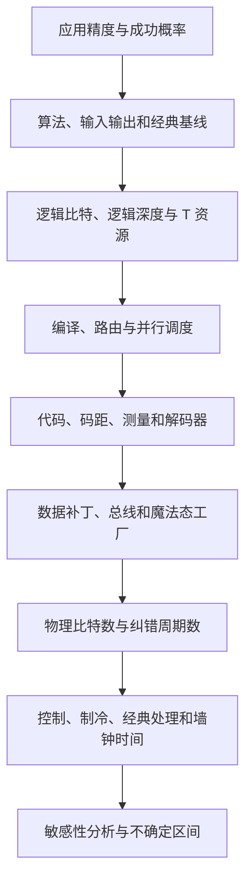

# 11｜资源估算与基准：怎样比较才公平

本章的目的不是背下每种基准的缩写，而是学会问“它测的到底是哪件事”。第一次阅读先看 §1–2、§4 和 §6：统一任务、质量、总成本，再用两个数字例子检查误导。§3、§5 解释实验室常见基准；§7–8 讨论逻辑比特和整机资源，可在读完错误校正章后回看。对同一个缩写，不同版本或实现的定义也可能不同，引用数值时以当时公开的方法说明为准。

## 1. 基准不是一个排行榜数字

先想一个具体但不指向某台机器的任务：估计某线路输出 0 的概率，并把估计误差控制在 $\pm0.02$，达到预先约定的成功置信度。设备甲每秒尝试 $10^5$ 次，却只保留 1% 的有效记录；设备乙每秒尝试 $2\times10^4$ 次，保留 50%。甲的**原始尝试**更多，但每秒可用记录是 $10^5\times0.01=1000$ 条；乙是 $2\times10^4\times0.50=10000$ 条。若两边每条有效记录的统计质量和其他开销相同，乙反而更快积累可用样本。现实中两边的有效记录也未必同质量，因此这个算例只展示为什么“尝试速率”不能单独排名，不能直接宣布乙在所有任务上更好。

任何性能声明都应写成一个五元组：

$$
(\text{任务},\text{输入分布},\text{输出质量},\text{失败概率},\text{总资源}).
$$

少一个维度，比较就可能失真。随机采样的“正确”、化学能量的绝对误差、优化问题的近似比和纠错存储的逻辑失败率不是同一种量。设备级基准、系统级基准、应用基准与逻辑量子比特基准回答的也是不同问题。

## 2. 先统一资源口径

| 资源 | 含义 | 常见遗漏 |
|---|---|---|
| 物理量子比特 | 实际器件自由度 | 可用率、并行操作质量、备用和测量量子比特 |
| 编码/逻辑量子比特 | 由若干物理自由度编码的算法级单位 | 码距、边界、辅助补丁、路由和是否真的低于阈值 |
| 门数 | 全部操作数 | 门类型代价不同，物理门与逻辑门混用 |
| 深度 | 关键路径上的操作层数 | 测量、复位、搬运和经典反馈等待 |
| $T$ count / $T$ depth | 常用容错非 Clifford 资源 | 魔法态工厂的面积、接受率与吞吐 |
| shots | 电路或实验的重复运行次数；是否可视为独立须另行检验 | 置信区间、批次漂移和误差缓解引起的方差 |
| 接受率 | 后选择后留下的样本比例 | 只报告保真度，不报告丢弃多少数据 |
| 墙钟时间 | 从提交到得到结果的总时间 | 排队、编译、校准、复位、网络和后处理 |
| 空间—时间体积 | 占用量子比特数乘运行周期数 | 不同架构的周期定义和并行能力 |
| 能耗 | 规定系统边界内的能量 | 制冷、激光、控制、经典解码和数据中心 |

“1000 个量子比特”若不说明是被俘获的原子、可寻址物理比特还是经验证逻辑比特，也不说明可用率与错误率，几乎不能预测可运行问题规模。

## 3. 元件指标：同叫“保真度”，测量方法可能不同

| 指标或方法 | 主要回答 | 不能单独推出 |
|---|---|---|
| $T_1,T_2^*,T_2$ | 空闲时的能量和相位保持 | 控制门、串扰、测量或泄漏错误 |
| SPAM / assignment fidelity | 制备与读出判别质量 | 中间门的质量；制备和测量也未必能分离 |
| 随机基准（RB） | 特定假设下的平均 Clifford 衰减 | 最坏门、相干方向、长时间漂移、应用线路成功率 |
| 交错 RB | 候选门相对参考序列的附加衰减 | 在强门依赖/非马尔可夫噪声下的无偏门误差 |
| 同时 RB / 层基准 | 并行驱动时的串扰和整层质量 | 任意深度、任意结构线路表现 |
| 门集层析（GST） | 小门集的详细自洽模型 | 大规模系统的低成本常规检测 |
| 泄漏/丢失率 | 离开计算子空间或器件的概率 | 未标记泄漏对后续线路的全部影响 |

标准 RB 施加不同长度的随机 Clifford 序列和相应逆操作，拟合生存概率

$$
P(m)=A\alpha^m+B.
$$

$A,B$ 吸收相当一部分 SPAM，$\alpha$ 描述平均衰减。把 $\alpha$ 换算为“每门错误”要依赖维数、门集合和噪声假设。RB 的优点是可扩展且对 SPAM 较稳健；局限是平均会隐藏少数坏门、相干累积、泄漏、门依赖、相关噪声与慢漂移。因此，论文必须说明抽样方式、拟合模型、置信区间、是否同时操作及每个 Clifford 含多少原生门。

在一个明确的简化模型里，这个换算可以算出来。假设噪声稳定、与所抽 Clifford 的选择近似无关，随机化后的有效通道是 $d$ 维去极化通道 $\mathcal D_\alpha(\rho)=\alpha\rho+(1-\alpha)I/d$。对任意纯输入 $|\psi\rangle$，输出与理想输入的重合度为

$$
F_{\rm avg}=\langle\psi|\mathcal D_\alpha(|\psi\rangle\langle\psi|)|\psi\rangle
=\alpha+\frac{1-\alpha}{d},
\qquad
r=1-F_{\rm avg}=\frac{d-1}{d}(1-\alpha).
$$

这里沿用门基准测试领域的**平均门保真度**约定：对纯理想输出，式中的重合度是本书第 13 章所用**根态保真度的平方**，不是根态保真度 $F$ 本身。若先算出某次输出的根态保真度，须先平方，才能放进 $F_{\rm avg}$ 的平均；计算 $r=1-F_{\rm avg}$ 时不能直接用 $1-F$。

例如单比特 $d=2$，若拟合得到 $\alpha=0.998$，该模型下每个**被抽样的 Clifford** 的平均不保真度为 $r=(1-0.998)/2=0.001$，而不是 $1-\alpha=0.002$。一个 Clifford 往往会分解成数个原生脉冲，不能把 $0.001$ 直接贴到其中每个脉冲上；门依赖、泄漏或随时间漂移明显时，也不能仅凭这个简式宣称测到了目标应用的失败概率。

## 4. 从单门误差到长线路：一个有用但有限的估算

若粗略假定 $G$ 个关键位置发生独立、同概率错误，且任一错误都导致失败，则

$$
P(\text{无错误})\approx(1-p)^G\approx e^{-pG}.
$$

例如 $p=10^{-3},G=1000$，无错误概率约为 $e^{-1}\approx36.8\%$。这个算例解释了“99.9% 门保真度”为什么并不自动支持很深的线路，但不能拿来预测真实算法：有些错误可被探测或纠正，有些会相消，有些相干错误会更快累积，实际位置的错误率也不相同。

若只需保守上界，可用并合界

$$
P_{\rm fail}\le \sum_{j=1}^{G}p_j.
$$

设算法含 $10^6$ 个关键逻辑操作，总失败预算为 $1\%$，平均每步逻辑错误需在 $10^{-8}$ 量级或更低。它不是完整系统模型，却显示容错资源估算为何不能直接把物理门误差当作逻辑门误差。

## 5. 系统级基准分别测什么

### 5.1 Quantum Volume

Quantum Volume（QV）在宽度等于深度的随机模型线路上，综合考察量子比特选择、连接、编译与门质量。它比单独的比特数丰富，但仍有明确边界：可挑选表现较好的子集，随机方形线路不代表结构化应用，也不直接给出墙钟吞吐或逻辑能力。应报告通过的宽度、编译策略、shots 和统计判据，而不只写 $2^k$。

这个判据为何叫“重输出”，可以先拿一条只有两个量子比特的**示意**线路手算。假设理想输出 $00,01,10,11$ 的概率依次为 $0.4,0.3,0.2,0.1$。四个概率的中位数是 $(0.3+0.2)/2=0.25$；高于中位数的 $00,01$ 就是这条线路的重输出，其理想总概率为 $0.4+0.3=0.7$。若完全均匀地随机猜四种结果，落在这两个输出的概率只有 $0.5$。正式 QV 协议要对许多按规则抽取的线路计算理想重输出集合，再以实验计数估计平均重输出概率，并按规定的统计置信度检验其是否**超过 $2/3$**。本例的 $0.7$ 只是方便看懂集合定义；它不是一台设备的测量结果，不能凭这一条玩具线路授予 QV 分数。判据、线路抽样和置信要求应以所引用的协议版本为准。

### 5.2 层保真度、镜像线路与体积式基准

层保真度/每层误差尝试衡量并行门层，比孤立两比特门更接近实际编译线路。镜像线路先执行目标结构，再执行可验证的逆，可以扩展到经典难模拟的宽度；体积式基准则在宽度—深度平面上显示通过区域。它们仍可能受线路族、编译器和可验证输出设计影响。研究表明，常见单一指标未必能很好预测结构化线路，因此最好给二维或多维性能图，而不是再创造一个“总分”。

### 5.3 XEB 与随机线路采样

交叉熵基准（XEB）比较实验样本与理想随机线路概率，常用于随机线路采样实验。它能诊断特定随机线路分布，却不等于通用应用性能。经典模拟基线会随张量网络、采样和硬件进步而改变，因此“量子优势”声明要同时固定线路生成规则、验证方法、经典算法版本和比较日期。

### 5.4 CLOPS 与吞吐

CLOPS 等指标测参数化量子线路层的执行吞吐，纳入部分参数更新和量子—经典交互。它回答“工作负载送得多快”，不是“答案有多准”。版本间若定义改变，旧值和新值也不能直接连成进步曲线。吞吐必须与输出质量、并行作业策略和后选择率共同报告。

### 5.5 应用导向基准

固定一组化学、优化、模拟或线性代数任务，绘制质量—时间—资源曲线，最接近用户价值。公平性至少要求：公开实例；冻结误差容限；纳入数据加载、编译、校准、采样和后处理；与强经典算法比较；避免只挑最适合某平台的实例。QED-C 应用基准套件等工作提供了可复现框架，但任何套件都只是任务样本，不是整个应用领域的最终裁判。

## 6. 条件保真度、后选择与吞吐必须同时出现

假设某实验只有在“所有探测器都点击且无告警”时才接受，接受率 $a=1\%$；被接受样本的保真度为 $99\%$；设备每秒尝试 $R=10^5$ 次。可用结果速率是

$$
R_{\rm useful}=R\,a=10^3\ \text{次/秒},
$$

而不是 $10^5$ 次/秒。若还要通过多数投票或估计小概率量，所需原始尝试更多。光子损耗检测、离子错误检测和原子丢失擦除都可能从“可标记失败”中受益，但必须报告：

1. 成功/接受事件的定义；
2. 原始尝试数和接受数；
3. 条件结果的置信区间；
4. 被丢弃事件是否与输入或答案相关；
5. 后选择能否随规模保持，或成功率是否指数下降。

只报“后选择后 99.9%”会把质量与产率拆开，无法比较系统价值。

## 7. 逻辑量子比特基准：不能只说“逻辑优于物理”

低于阈值时，许多拓扑码在简化噪声模型下常用近似

$$
\epsilon_L(d)\approx A\left(\frac{p}{p_{\rm th}}\right)^{(d+1)/2},
$$

其中 $d$ 是码距、$p$ 是物理错误率、$p_{\rm th}$ 是与电路和解码器相关的阈值。此式只表达理想缩放直觉；相关突发错误、泄漏、边界操作、丢失和解码延迟都可能破坏它。

### 从总失败预算反推码距：一遍可以复算的示意账

假设资源估算把一次计算拆成 $N_{\rm loc}=10^8$ 个需要保护的逻辑故障位置，并把总逻辑失败预算定为 $1\%=10^{-2}$。若暂用并合界（union bound）把每个位置的失败概率都上界为同一个 $\epsilon_L$，则必须满足

$$
N_{\rm loc}\epsilon_L\le 10^{-2},
\qquad
\epsilon_L\le\frac{10^{-2}}{10^8}=10^{-10}.
$$

再使用上面的**纯示意模型**，取 $A=0.1$、$p=10^{-3}$、$p_{\rm th}=10^{-2}$，就有

$$
\epsilon_L(d)\approx0.1(0.1)^{(d+1)/2}
=10^{-\left[1+(d+1)/2\right]}.
$$

要求它不大于 $10^{-10}$：

$$
1+\frac{d+1}{2}\ge10
\quad\Longrightarrow\quad
d\ge17.
$$

取常用的奇数码距 $d=17$。若再采用旋转表面码内存补丁的粗略计数 $2d^2-1$，每个逻辑补丁约需

$$
2\times17^2-1=577
$$

个物理量子比特；100 个数据逻辑比特的**裸内存补丁下限**就是

$$
100\times577=57{,}700.
$$

这条算例的价值在于展示“总预算 $\rightarrow$ 每位置预算 $\rightarrow$ 码距 $\rightarrow$ 空间下限”的算术链，而不是给某台机器报价。并合界通常偏保守；$\epsilon_L$ 的口径必须与“故障位置”的口径相同；$A$、阈值和缩放区间必须由目标电路级噪声模型或实验确定。$57{,}700$ 还没有计入格码手术间距、路由、魔法态工厂、备用区、泄漏清除、接口和运行时间，所以不能称为整机物理比特需求。

一个可信的逻辑基准应逐项说明：

- 使用什么码、码距和物理比特布局；
- 进行了多少轮综合征提取，是逻辑存储还是逻辑门；
- 比较对象是单个最佳物理比特、同等空间—时间资源，还是未编码线路；
- 解码器是否使用未来信息、训练数据或离线重处理；
- 是否使用错误检测、后选择和丢失标记，接受率是多少；
- 码距增加时逻辑错误是否下降，是否有至少三个规模点；
- 报告的是每周期、每逻辑门还是整条线路错误；
- 解码时间是否短于实时反馈预算。

“改善 800 倍”若只在某类短线路、某个物理基线和后选择条件下成立，就不能外推成所有算法的 800 倍加速。“低于阈值”若只演示存储，也不能自动推出已经拥有通用容错门集。

解码还需要把三个维度分开报告。**准确率**回答综合征被解释得多好；**吞吐**回答每秒能处理多少轮或多少个逻辑量子比特；**响应时延**回答一轮数据到达后，最迟多久能把决定送回控制器。离线解码器即使平均吞吐很高，也可能依赖未来轮次、批处理或很长的尾延迟，因而不能直接用于实时纠错。相反，响应很快但吞吐低于综合征产生率的系统会不断积压。应同时给出输入规模、并行度、平均与高分位时延、是否包含数据搬运及是否在目标码距上测试。完整的反馈时延分解见[第 14 章第 10 节](14-compilation-control.md#10-动态电路)。

### 7.1 S71-11：最终读错，不等于中途一次也没错

**题目与口径。** 一个合成逻辑存储模型每周期以概率 $p=0.01$ 独立发生逻辑 $X$，否则为恒等；只研究这一错误类型，不含逻辑门、相位错误或泄漏。初态为 $|0_L\rangle$，经过 $n=100$ 周期后测 $Z_L$。求最终读到 1 的概率、过程中至少一次翻转的概率，以及并合上界。它们能否用同一个“每周期错误率”换算？

**先跟踪奇偶，而不是把所有错误宣布为失败。** 两次 $X$ 相乘为 $I$，因此最终读错仅在翻转次数为奇数时发生。记该概率为 $q_n$、$q_0=0$。下一周期中，当前错误且不再翻转、当前正确但翻转，是两个互斥分支：

$$
q_{n+1}=q_n(1-p)+(1-q_n)p=p+(1-2p)q_n.
$$

移到偏离 $1/2$ 的变量，得到 $1-2q_{n+1}=(1-2p)(1-2q_n)$。反复使用递推便有

$$
q_n=\frac{1-(1-2p)^n}{2}.
$$

而“至少发生过一次”的补事件是所有周期均无翻转，给出 $a_n=1-(1-p)^n$。逐项代入：

| 所问事件或界 | 数值 | 含义 |
|---|---:|---|
| 最终逻辑比特翻转 $q_{100}$ | 0.433690 | 偶数次错误已抵消 |
| 中途至少一次翻转 $a_{100}$ | 0.633968 | 只要曾发生就计入 |
| 至少一次的并合上界 $\min(1,np)$ | 1 | 保守而在此很松 |

对 $np\ll1$，前两项的一阶展开都约为 $np$；本题 $np=1$，已不能用该近似。对 $0<p<1/2$，$q_n$ 随周期增加趋近 $1/2$，并非趋近 1。若论文采用这一独立翻转拟合模型，可从最终错误概率反解

$$
p=\frac{1-(1-2q_n)^{1/n}}2,\qquad 0\le q_n\le\frac12.
$$

但输入与读出误差会改变偏置和对比度，相关、相干逻辑错误会改变递推，不能从任意终态错误直方图直接使用这个反演式。[表面码存储原始实验](https://www.nature.com/articles/s41586-024-08449-y)采用与其存储测量定义相绑定的每周期逻辑指标（在线 2024-12-09，访问 2026-10-13）；本题只是解释口径的独立模型，没有从论文数值拟合本题的 $p$。

运行 [round71_checks.py](../codes/systems/round71_checks.py) 的 `--case 11`，直接相加二项分布的奇数项，核对递推闭式解及反演；包括零周期、零错误和 $p=1/2$ 边界。**扩展答案。** 如果业务规定第一次逻辑错误出现即终止，适用事件是 $a_n$；如果错误能在后续特定操作中抵消，必须按完整任务信道计算。这也解释了资源预算中的“故障位置”与逻辑实验拟合量为何必须统一。

### 7.2 S72-11：完整存储的计数，怎样换成可审查的证据

**题目。** 第 10 章 S72-10 的距离 7 实验，20,000 次完整存储都没观察到逻辑失败。能否宣称每周期错误为零？同时，批量译码用时除以 shots 能否叫硬件反馈时延？两项答案都需要先说明分母。

**先算不确定性。** 若独立完整实验的失败概率恒为 $q$，零次失败的概率为 $(1-q)^N$。双侧 95% Clopper–Pearson 区间的上端使用 $\alpha/2=0.025$：

$$
(1-q_U)^{20000}=0.025,\qquad
q_U=1-0.025^{1/20000}\approx0.000184427.
$$

这是**每次完整七轮 X 基存储**的上界。单侧 95% 上界则使用 0.05，约为 $0.000149775$；两个数不矛盾，它们采用不同覆盖规则。除以 7 只能作为另加独立同概率逐轮模型后的低错误率近似；没有该模型时，不把这个除法写成实验直接测量。对于 $0<k<N$，脚本用 Beta 分布分位数构造精确二项区间，这里的 Beta 是二项检验反演工具，不是声明采用了贝叶斯先验。

**再拆计时。** [实际运行 JSON](../codes/systems/sdk/stim-matching-results.json)分别记录抽样和 `decode_batch` 的耗时。批量译码包括对已经生成的整批检测数组进行匹配；“批量总时间 / 完整 memory shots”是该输入规模、平台与本次运行的平均服务成本。它没有包含逐轮数据获取、控制器传输、排队、高分位抖动或条件脉冲，而且看到了完整未来轮次，不能冠以“实时反馈时延”。即使再除以轮数，也只是更换摊销分母。

**扩展练习与答案。** 三个码距各有一个 95% 区间，是否自动保证三者同时覆盖至少 95%？不保证。逐点区间支持逐点报告；若要使用这些区间作预定的三点联合判据，可分配每点错误预算为 $0.05/3$，再用并合界保证至少 95% 同时覆盖，区间会更宽。只因三条点估计递减，不能忽略宽区间、不同存储轮数和选择性报告。

统计定义参照 [NIST 二项区间指南](https://www.itl.nist.gov/div898/handbook/prc/section2/prc241.htm)，实际匹配接口参照 [PyMatching 官方文档](https://pymatching.readthedocs.io/en/stable/)（访问 2026-10-13）。本次不运行论文中的百万级规模基准，也不把桌面机的单次微秒数移植到工业控制器。

### 7.3 S73-11：换译码器要逐条配对，计时也要留下分布

**题目。** 第 10 章 $d=7,p=0.006$ 的七轮 X 基存储，普通/相关失败数为237/124。相同10000条样本中，160条由失败变正确，47条由正确变失败。写出四格表、净差和条件二项检验，说明为何不能只比较两个独立误差条。

| 同一条样本 | 相关正确 | 相关失败 | 普通方法行总数 |
|---|---:|---:|---:|
| 普通正确 | 9716 | 47 | 9763 |
| 普通失败 | 160 | 77 | 237 |
| 相关方法列总数 | 9876 | 124 | 10000 |

**逐步计算。** 两者同错的77条与同对的9716条对差值抵消。定义 $D_i=\mathbf1\{\text{相关失败}\}-\mathbf1\{\text{普通失败}\}$，则 $\bar D=(47-160)/10000=-0.0113$，即完整存储失败频率降低1.13个百分点。因为两个输出来自同一个噪声样本，不能把它们当独立二项实验；应利用207条不一致记录。

若事先规定零假设为两种不一致方向的概率相等，并且完整shot独立，那么条件于207次不一致，救回次数服从 $\operatorname{Bin}(207,1/2)$。双侧精确检验的概率为

$$
p_{\rm pair}=2\sum_{j=0}^{47}\binom{207}{j}2^{-207}
\approx1.29966\times10^{-15}.
$$

检验只是判断该模型/规模下的差异，不能证明算法对任何线路更优。18点一起搜索若要控制家族错误率，可事先把每点检验预算设为 $0.05/18$；本例低于这一门槛。全网格保留18个原始双侧概率，未把最好一点事后称成唯一预定试验。对36个错误率，另用每率 $\alpha=0.05/36$ 构造双侧精确二项区间，给至少95%同时覆盖；这与18个配对检验是两种不同的统计任务。

**扩展题：p99是最后期限保证吗？** 同一 X 基高噪声点在10次热身之后，逐条调用相关译码1000次。实际完整shot服务耗时的经验中位数、95%、99%及最大值为14.917、29.708、38.500、59.125 μs。分位数采用次序统计量 $t_{(\lceil qn\rceil)}$，全部1000个纳秒记录归档。经验p99不说明未来每次都小于38.5 μs；本次最大值已更大。计时只含 Python 调用和本地匹配，输入已包含全部7轮，不含采集、运输、排队或脉冲，因而不是实时反馈能力。

运行 [round73_checks.py](../codes/systems/round73_checks.py) 的 `--case 11` 会用整数二项求和独立复查配对概率与原样本；完整版本与平台保存在 [qec-grid-results.json](../codes/systems/sdk73/qec-grid-results.json)。官方[批解码及相关选项](https://github.com/oscarhiggott/PyMatching/blob/v2.4.0/src/pymatching/matching.py)支持本轮两条实际执行路径（访问2026-10-13）；这些桌面计时没有被移植到其他处理器。

## 8. 端到端资源估算

若关键路径有 $D$ 个逻辑周期，每周期时长 $\tau_L$，$D\tau_L$ 只是理想下限。还要加魔法态等待、测量和反馈、周期校准、故障停机、失败重试、数据传输与经典前后处理。增加并行工厂可缩短时间，却会占用更多物理量子比特，形成空间—时间折中。

资源估算不应只给一个精确到个位的数字。至少要改变物理错误率、纠错周期、目标精度、解码器、工厂数量和可用率，给出敏感性范围；输入假设跨平台时，还要说明哪些是假设而非已实测能力。

### 练习与实验：T count 相同，魔法态等待仍不同

**题目。** 三个有顺序依赖的逻辑层分别同时消耗 $1,3,1$ 个魔法态，每层执行时间为一个逻辑周期。工厂从时刻 0 启动，每三个周期产一批，每台每批一个合格态，首批在时刻 3 产生；没有预库存。先假设库存容量无限、存储无噪声、产出必定合格、工厂与逻辑门可并行。分别用一台、两台工厂安排最早开始时间。只按 $T$ count 除产率能否算出准确结束时间？

**逐步答案。** 令 $c_j$ 为前 $j$ 层累计消耗，$m$ 为工厂数，$f_{j-1}$ 为上一层结束时间。时刻 $t$ 已产出 $m\lfloor t/3\rfloor$ 个态，所以第 $j$ 层最早开始、结束时间满足

$$
a_j=\max\!\left(f_{j-1},3\left\lceil\frac{c_j}{m}\right\rceil\right),
\qquad f_j=a_j+1,\qquad f_0=0.
$$

先把每层需求相加，得到 $c=(1,4,5)$。再同时检查“前一层已经结束”和“足够的态已经生产”两个条件：

| 工厂数 | 第一层开始—结束 | 第二层开始—结束 | 第三层开始—结束 | 总结束时间 |
|---:|---|---|---|---:|
| 1 | $3$—$4$ | $12$—$13$ | $15$—$16$ | 16 周期 |
| 2 | $3$—$4$ | $6$—$7$ | $9$—$10$ | 10 周期 |

两台工厂在时刻 3 产两个态，第一层用掉一个，余下一个库存；时刻 6 再来两个，才凑齐第二层需要的三个。不能说“平均每 1.5 周期一个态，五个只需 7.5 周期”就结束计算，因为本例产出按批到达，门还有依赖和执行时间。

运行 [factory_schedule.py](../codes/systems/factory_schedule.py) 验证此表与每次消费前的库存约束。扩展练习把需求改为 $(3,1,1)$，两台工厂仍需 10 周期，但首层必须等到时刻 6；相同总时间也可能对应不同的等待位置和数据存储负担。

这个离散时序模型只揭示供应、库存、需求的关系。完整估算还要加入蒸馏拒收、库存寿命、缓冲区面积、传输与注入门错误。可用 [Qualtran](https://github.com/quantumlib/Qualtran) 表达算法分解和容错资源计数，再将非 Clifford 需求接到架构调度；该库的资源分析输出不是硬件实测时间，也不是商业优势证据。项目版本、分解策略和成本模型必须随结果保存。

### 8.1 可靠性不是一次校准后的峰值

面向实验或服务的资源表还应加入长期运行指标：设备可用率、校准占空比、作业完成率、失效间隔、修复时间、可用量子比特良率，以及质量随小时或天漂移的分布。这些指标不应被一个“最佳日”的门保真度代替。例如，校准后两小时内表现很好、但每天需要数小时重标定的设备，其稳定吞吐与峰值吞吐不同。论文若尚无长期运维数据，应明确写“未测量”，不要用短实验自动外推。

### 8.2 能量比较先画清系统边界

能耗不是量子芯片上的控制脉冲能量。可以用下式做统一记账：

$$
E_{\rm solution}=\frac{(P_{\rm cryo}+P_{\rm laser}+P_{\rm control}+P_{\rm classical}+P_{\rm facility})\,t_{\rm wall}}{P_{\rm success}}.
$$

这里各功率项分别代表制冷、激光/光学、控制电子学、经典计算与其余设施；$t_{\rm wall}$ 是完成一次尝试的墙钟时间，$P_{\rm success}$ 是在固定成功判据下单次尝试被接受的概率。该简式适用于成功概率和平均尝试成本近似稳定的重试模型；若各次尝试成本不同、失败相关或存在批处理，应直接报告总实测能量除以最终接受答案数，并给出分布而不只给均值。该式只是审计框架，不是物理定律。实际报告必须说明系统边界、空闲功率是否摊销、共享设施如何分配、经典基线是否使用相同边界，以及答案精度是否相同。

例如，若在明确边界内平均功率为 $20\ \mathrm{kW}$，一次尝试需 $30\ \mathrm{s}$，独立尝试成功率为 $0.25$，则平均每个成功答案的能量为

$$
E_{\rm solution}=\frac{20\times30}{0.25}\ \mathrm{kJ}=2.4\ \mathrm{MJ}\approx0.67\ \mathrm{kWh}.
$$

这个数只能在给定边界和成功定义下使用，不能与只计算处理器芯片功耗的经典数字直接比较。

长期服务还应把 MTBF、MTTR、计划校准、降级运行、空闲功率与作业边际功率拆开；相应定义和有效吞吐算例见[第 19 章第 12 节](19-engineering-architecture.md#12-可用率能耗与云端运行状态)。

## 9. 量子优势声明怎样公平比较

1. 冻结任务、输入分布、规模、输出质量和失败概率。
2. 使用公开或可审计数据，预先约定验证方法。
3. 采用当前强经典算法，允许同等级别的硬件和工程优化。
4. 对两边使用相同系统边界：量子端不能漏掉编译、校准、采样、纠错和后处理。
5. 报告多个规模点、墙钟时间、能耗边界与置信区间。
6. 区分“从某种量子分布采样”和“解决一个有外部价值的问题”。
7. 接受后续经典算法改进会重新评估经验性优势结论。

量子复杂度优势是在明确理论模型下证明渐近关系；实验量子优势则相对于某时刻已知最佳经典实现。两者不能混写，“经典模拟需要多少年”也应标明硬件、算法版本和估算日期。

## 10. 统计与复现

对二项结果频率 $\hat p=k/N$，应给二项分布的置信区间，而不只报百分比。存在漂移或批次相关性时，应按时间块分析或采用适当的层次模型，不能假定所有 shots 独立同分布。多参数搜索若只发表最好一次运行，会产生选择偏差。

复现实验至少保存：线路生成和编译代码、随机种子、原始计数、后选择规则、校准快照、软件与固件版本、后端标识、运行日期和统计脚本。厂商定义的指标若有版本更新，应保存当时的正式定义。随机种子只能固定抽样或编译选择，不能冻结设备漂移；因此还要保留实际执行时间、目标机/ISA 快照、编译产物与作业标识。可直接复用的最小 **可复现实验清单（manifest）** 字段表见[第 14 章第 13 节](14-compilation-control.md#13-可复现实验记录模板)，这里不再重复。

### 10.1 练习与实验：一万次测量不一定有一万份独立信息

**题目。** 收集 100 批数据，每批 100 次。每批开始时，成功概率独立、等概率地变成 $0.4$ 或 $0.6$，整批保持这个值；给定这个值后，批内测量独立。该设定是合成漂移模型，不是设备实测。总体平均成功率为 $1/2$。如果仍用独立二项分布，标准误会低估多少？

**逐步答案。** 令 $X_{bj}\in\{0,1\}$ 是第 $b$ 批第 $j$ 次结果，批参数为 $P_b$。虽然每个结果的方差都是 $1/4$，同批两次结果共享 $P_b$，所以

$$
\operatorname{Cov}(X_{bi},X_{bj})
=\operatorname{Var}(P_b)
=\tfrac12(0.4-0.5)^2+\tfrac12(0.6-0.5)^2=0.01\quad(i\ne j).
$$

相关系数因此为 $\rho=0.01/0.25=0.04$。不同批之间协方差为零。一批 $m$ 次结果的和有 $m$ 个方差项和 $m(m-1)$ 个有序交叉项。对 $B$ 批的总体频率 $\widehat p$，除以 $(Bm)^2$，得到

$$
\operatorname{Var}(\widehat p)
=\frac{p(1-p)}{Bm}\left[1+(m-1)\rho\right].
$$

代入 $B=m=100$，方差放大因子为 $1+99\times0.04=4.96$。独立模型给标准误 $\sqrt{0.25/10000}=0.005$，正确模型给 $0.005\sqrt{4.96}\approx0.01114$。若只为比较均值方差，等效独立样本数为 $N_{\rm eff}=10000/4.96\approx2016.13$；原始记录仍有一万条，并没有真的删掉 7984 条。

**扩展题及答案。** 总 shots 固定为 10000，若能使批参数每 10 次独立重置，则 $B=1000,m=10$，放大因子降为 $1.36$。但现实漂移由物理时间决定，单纯给同一串数据重新贴“批次”标签不会消除相关；改变采样节奏、交错实验设置或独立重标定的开销也须计入。

运行 [correlated_shots.py](../codes/systems/correlated_shots.py) 会直接枚举两种二项分布的混合，交叉验证上述方差，并检查 $\rho=0$ 与 $m=1$ 边界。式子只适用于此处的等长批次、共同批内相关与独立批次模型；真实数据应保存时间戳并检查批间相关，不能把此处 $\rho=0.04$ 当成所有机器的修正系数。[Ball 等对 RB 相关噪声的原始分析](https://arxiv.org/abs/1504.05307)说明时间相关会改变基准结果分布（2015 年，访问 2026-09-26）；本题的合成批模型是独立教学推导，没有代替其量子噪声模型。

## 11. 一页式审稿清单

| 要问的问题 | 红旗信号 |
|---|---|
| 任务和成功标准是否预先定义？ | 运行后才挑一个有利指标 |
| 数字来自独立门还是并行门层？ | 用“最佳单门”代表全芯片 |
| 是否报告分布、误差条和日期？ | 只有最多小数位，没有不确定度 |
| 是否有损耗、后选择或缓解？ | 只报条件保真度，不报接受率/采样开销 |
| 逻辑改进的基线是否公平？ | 与一个刻意较差的物理比特比较 |
| 经典基线是否足够强？ | 用过时算法或不同硬件边界 |
| 指标能否预测目标应用？ | 由 QV、XEB 或单门保真度直接推出商业价值 |
| 结果能否复现？ | 缺原始数据、编译设置、版本和校准时间 |
| 解码结果能否及时用于反馈？ | 只报离线准确率或平均吞吐，不报响应时延与尾延迟 |
| 能耗是否同边界比较？ | 量子端只算芯片，经典端却算整机，或反之 |

## 12. 自检

1. 为什么 RB 的平均错误不能直接预测长结构化线路？
2. $p=10^{-3}$、$G=1000$ 的独立错误算例说明了什么，又没有说明什么？
3. 条件保真度为 99%、接受率为 1% 时，为什么不能省略接受率？
4. 证明逻辑存储低于阈值后，还缺哪些证据才能称为通用容错计算？
5. QV、XEB、CLOPS 和应用基准各自主要回答什么？
6. 为什么解码器的吞吐、响应时延和准确率不能互相替代？
7. 比较量子与经典能耗时，至少要冻结哪些系统边界与成功条件？
8. 同一任务下，甲每秒尝试 $10^5$ 次、接受率 1%；乙每秒尝试 $2\times10^4$ 次、接受率 50%。每秒各有多少可用记录？若接受事件偏向某些输出，仅有这个速率比较为什么仍不够？
9. 在第 3 节的单比特去极化模型中取 $d=2,\alpha=0.998$。分别算平均门保真度 $F_{\rm avg}$、不保真度 $r$，以及对任意纯输入的根态保真度 $F$；为什么 $r$ 不能写成 $1-F$？

答案见[练习与答案：第 11 章](appendices/exercises.md#第-11-章)。

## 参考资料

- E. Magesan, J. M. Gambetta, J. Emerson, [Scalable and robust randomized benchmarking](https://doi.org/10.1103/PhysRevLett.106.180504), *Physical Review Letters* 106, 180504 (2011)。
- A. W. Cross et al., [Validating quantum computers using randomized model circuits](https://doi.org/10.1103/PhysRevA.100.032328), *Physical Review A* 100, 032328 (2019)。
- T. Proctor et al., [Measuring the capabilities of quantum computers](https://www.nature.com/articles/s41567-021-01409-7), *Nature Physics* 18, 75–79 (2022)。
- T. Lubinski et al., [Quantum Algorithm Exploration using Application-Oriented Performance Benchmarks](https://arxiv.org/abs/2402.08985), QED-C benchmark suite update (2024)。
- IBM Quantum, [A new way to measure quantum progress: layer fidelity](https://www.ibm.com/quantum/blog/quantum-metric-layer-fidelity)（指标说明；属厂商资料，需与独立实验和定义版本一起使用）。
- R. Acharya et al., [Quantum error correction below the surface code threshold](https://www.nature.com/articles/s41586-024-08449-y), *Nature* 638, 920–926 (2025)。
- A. G. Fowler et al., [Surface codes: Towards practical large-scale quantum computation](https://doi.org/10.1103/PhysRevA.86.032324), *Physical Review A* 86, 032324 (2012)（表面码布局、逻辑操作与容错开销的基础来源）。
- A. Paetznick et al., [Improved quantum processor logical error rates via correction and detection](https://doi.org/10.1038/s41586-026-10628-y), *Nature* 654, 349–355 (2026)。
- R. Takagi et al., [Fundamental limits of quantum error mitigation](https://www.nature.com/articles/s41534-022-00618-z), *npj Quantum Information* 8, 114 (2022)。
- A. Auffèves, [Quantum Technologies Need a Quantum Energy Initiative](https://doi.org/10.1103/PRXQuantum.3.020101), *PRX Quantum* 3, 020101 (2022)（能量指标与跨层记账的研究议程）。
- M. Fellous-Asiani et al., [Optimizing resource efficiencies for scalable full-stack quantum computers](https://doi.org/10.1103/PRXQuantum.4.040319), *PRX Quantum* 4, 040319 (2023)。
