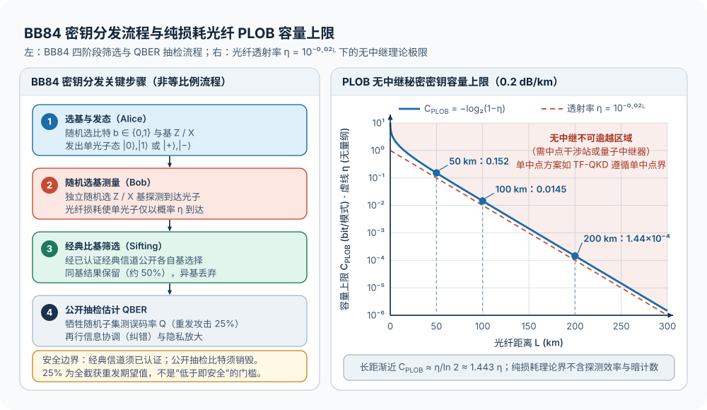
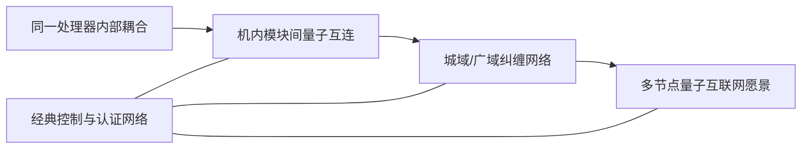
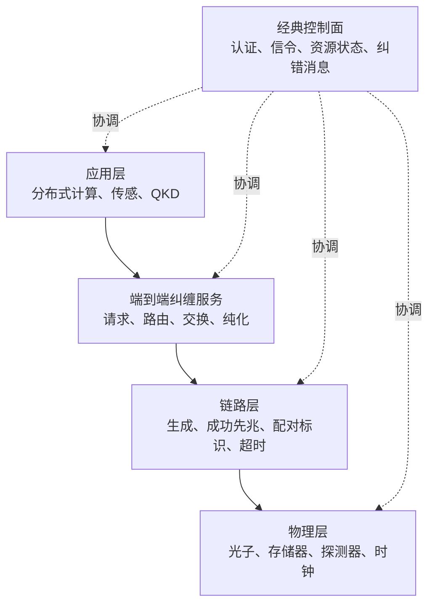
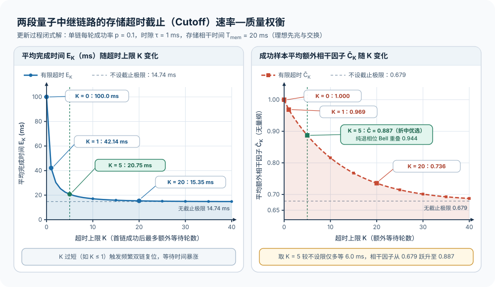
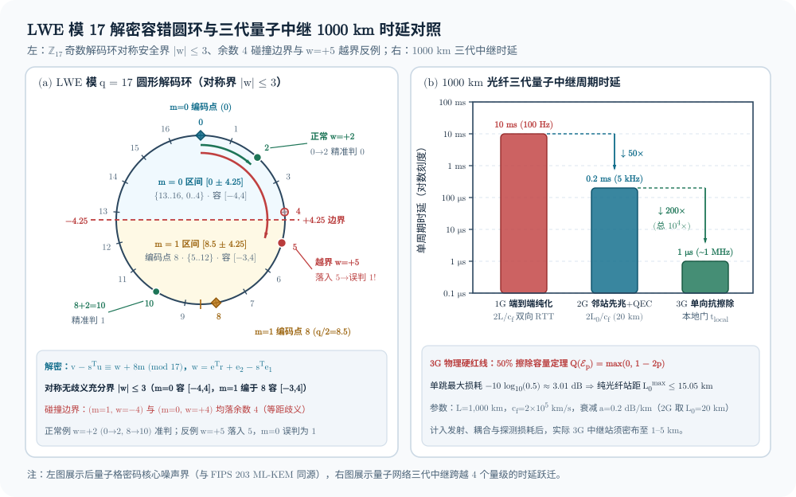

# 12｜量子密码、后量子安全与量子网络

先修：[第 03 章](03-multiple-qubits.md)（Bell 态与 CHSH 不等式）、[第 04 章](04-circuits-protocols.md)（隐形传态与不可克隆定理）、[第 07 章](07-algorithms.md)（Shor 与 Grover 骨架）。阅读路线：**必读 ★** 第 1–4.4 节、第 5–6.1 节、第 7.1 节与第 8 节；**进阶选读 ☆** 第 4.5 节（可认证随机性、盲量子计算与量子货币）、第 6.2–6.4 节（退相干等待与存储截止）及第 7.2–7.4 节（多跳交换、纯化与三代中继核算）。

很多人第一次听说量子计算，最先冒出来的往往是两个截然不同的念头：一边担心“我的银行密码明天是不是就不安全了”，另一边好奇“量子互联网是不是能让信息瞬间传到地球另一端”。把这些话题混在一块，越读越容易糊涂。

读这一章不需要提前熟悉工程密码学。我们先在草稿纸上把三个问题分开：第一，未来的容错量子计算机究竟会动摇哪些旧密码的数学难度？第二，今天我们在普通计算机上能迁移到什么新密码，它们凭什么不怕 Shor 算法？第三，如果真要把脆弱的量子态和纠缠跨越几十甚至几百公里送过去，光纤、探测器、量子存储器和中继站要解决哪些实际难题？前两个问题属于信息安全，第三个才是量子网络。遇到公式时，先跟着紧邻的小数字算例亲手算一遍，再看一般表达式，整章的脉络就会非常清晰。

## 1. 先分清三个经常混为一谈的主题

新闻报道里经常把“抗量子加密”“量子通信”“量子互联网”揉成一个词。先把它们摊在桌面上对照一遍，后面的讨论才不会串台。

| 名称 | 运行在什么硬件上 | 解决什么问题 | 不解决什么 |
|---|---|---|---|
| **量子计算攻击** | 足够大的容错量子计算机 | 用 Shor、Grover 等算法降低特定数学问题的求解成本 | 不会绕过物理隔离、终端漏洞和身份管理 |
| **后量子密码**（PQC） | 普通经典计算机与现有网络 | 用目前认为经典与量子计算机都难破解的数学问题替换脆弱公钥 | 无法保护已经泄露的私钥、错误实现或被攻破的终端 |
| **量子密钥分发**（QKD） | 专用光学硬件 + 已认证经典信道 | 借助量子测量扰动与统计检验在两端建立共享随机密钥 | 不替代身份认证、密钥管理、业务数据加密与终端安全 |

请记住最容易踩错的一条界线：**后量子密码运行在普通经典计算机上**，它不是“买一台量子计算机来给文件加密”；而**量子密钥分发**也只负责产生对称密钥，并不是一条能直接跑任意分布式量子计算的“量子互联网”。

## 2. 量子攻击与后量子密码（PQC）

### 2.1 公钥密码与 Shor 算法：为什么“找周期”能分解大数

现代互联网离不开两大家族的密码：一类是**公钥密码**（也叫非对称密码），例如保护网站握手与身份签名的 RSA、有限域 Diffie–Hellman（DH）和椭圆曲线密码（ECDH、ECDSA、EdDSA）；另一类是**对称密码与哈希函数**，例如加密业务数据的 AES 和校验完整性的 SHA-256。量子计算机对这两类密码的冲击天差地别。

我们在[第 07 章](07-algorithms.md)见过，一台足够大规模的容错量子计算机可以运行 Shor 算法，在多项式时间内完成大整数分解和求解离散对数。正是这两个代数结构问题支撑着今天几乎所有传统公钥密码。因此，只要容错量子计算机达到实用规模（具体物理比特与时间资源估算见[第 11 章](11-resources-benchmarks.md)），传统 RSA 与椭圆曲线密码就会被从根基上击穿。

为什么“找周期”能帮我们分解一个合数？拿人人都能口算的 $N = 15$ 走一遍全过程。先挑一个与 $15$ 互素的底数 $a = 2$，不断乘 $2$ 并只留除以 $15$ 的余数：

| 指数 $x$ | $0$ | $1$ | $2$ | $3$ | $4$ |
|---|---:|---:|---:|---:|---:|
| $2^x \bmod 15$ | $1$ | $2$ | $4$ | $8$ | $1$ |

序列在 $x = 4$ 处第一次回到 $1$，因此 $2$ 模 $15$ 的**周期**（数论里叫“阶”）是 $r = 4$。周期恰为偶数，就看一半处的数：$2^{r/2} = 2^2 = 4$。因为 $2^r - 1 = (2^{r/2} - 1)(2^{r/2} + 1)$ 能被 $15$ 整除，$15$ 的两个因子很可能分别藏在两个括号里。用欧几里得算法求最大公因数：

$$
\gcd(4 - 1, 15) = \gcd(3, 15) = 3, \qquad
\gcd(4 + 1, 15) = \gcd(5, 15) = 5.
$$

于是得到 $15 = 3 \times 5$。在这个 $N = 15$ 的小算例里，我们拿纸笔就能把余数列出来，没有任何量子优势；Shor 算法真正用到量子傅里叶变换和相位估计加速的，是当 $N$ 有几百上千个十进制位时那一步“找周期”，前后的互素检查与最大公因数都由经典计算机完成。另外，如果随机选到的 $a$ 碰巧得出奇数周期 $r$，或者出现 $a^{r/2} \equiv -1 \pmod{N}$（导致括号里给出平凡因子 $1$ 或 $N$），这一轮就得换一个 $a$ 重来。

### 2.2 对称加密、哈希的 Grover 边界与 Mosca 不等式

很多人听说“量子计算机能一举攻破所有密码”，顺手把 AES 和 SHA-256 也划进了高危名单。其实，对称加密和哈希函数没有 RSA 那种隐藏周期结构，目前已知的通用量子攻击主要是[第 07 章](07-algorithms.md)介绍的 Grover 搜索。

在一个大小为 $N = 2^k$ 的理想黑箱密钥空间里，经典穷举需要 $O(2^k)$ 次尝试，Grover 算法把查询次数降到 $O(\sqrt{N}) = O(2^{k/2})$。这是**平方根级加速**，而不是 Shor 那样的指数级坍塌。更关键的是，查询次数不等于真实运行时间：Grover 里的每一步量子查询，都必须把整个 AES 或 SHA-256 编译成无垃圾比特的可逆量子线路，再叠加上容错纠错的门深度与解码开销；而且 Grover 搜索很难靠堆机器线性并行提速（$M$ 台量子计算机并行只能把线路深度缩短 $\sqrt{M}$ 倍）。

因此，工程界的稳健做法是把对称密钥从 128 位升级到 256 位（例如 **AES-256**），并采用输出足够长的哈希函数（**SHA-256 / SHA-384 / SHA-512**），在已知量子攻击模型下留出充裕的安全余量。不过，不要把“所有密码安全位数一律减半”当成定理——哈希碰撞、原像攻击与复合协议的量子安全性各有细致界限，仍需按具体协议分析。

既然今天的实验量子处理器远不足以分解 2048 位的 RSA 密钥，为什么全球金融、政务和互联网基础设施从现在就开始紧锣密鼓地迁移密码？密码学家 Michele Mosca 给出过一条极直白的风险不等式，只需要三个时间量：

$$
X + Y > Z.
$$

- $X$（保密寿命）：数据需要保守秘密多少年？外交档案、医疗记录、核心专利和长期金融数据往往需要保密 10 到 30 年；
- $Y$（迁移耗时）：一个大型机构清点密码资产、升级协议、更换证书链与硬件安全模块（HSM）需要多少年？历史经验表明通常要 5 到 10 年；
- $Z$（崩溃倒计时）：能够以实际代价运行 Shor 算法的容错量子计算机距离今天还有多少年。

举个具体数字：假设一批机密数据的保密寿命 $X = 15$ 年，机构完成全网切换需要 $Y = 7$ 年。就算实用容错量子计算机要到 $Z = 20$ 年后才问世，$15 + 7 = 22 > 20$——这意味着攻击者今天就可以悄悄录下用传统公钥加密传输的密文并存在硬盘里，等到 20 年后算力成熟时再事后解密，届时数据仍在保密期内。这种威胁被称为**先截获、后解密**（Harvest Now, Decrypt Later，简称 HNDL）。

这里藏着一条非常实用的工程区分：**HNDL 主要威胁的是机密性**（密钥交换与加密），而**数字签名**防的是当下的身份伪造。攻击者今天录下一条 TLS 握手的数字签名，二十年后就算破解了当年的签名私钥，也无法穿越回今天去篡改一场已经结束的通信（除非那把私钥保护的是长达数十年的根证书、固件代码签名或长期法律存证）。正因如此，全球密码迁移普遍呈现“先换密钥交换，再换数字签名”的先后节奏。

### 2.3 格密码为什么抗量子？LWE 逐步手算、哈希签名与编码直觉

看懂了 Shor 如何拆解大整数分解，读者自然会追问：**后量子密码究竟拿什么数学锁来替换 RSA，为什么量子计算机打不开这把新锁？** 下面我们用草稿纸把当下最核心的三大抗量子路线——格密码、哈希签名与编码密码——一步步拆开看清。

#### 第一条路线：带误差学习（LWE）与格密码逐步手算

想造一把“有私钥很容易解、没私钥连量子计算机也束手无策”的密码锁，最直接的思路莫过于解线性方程组 $As = b$。可纯粹的线性方程组毫无秘密可言——高中生用高斯消元几步就能反解出未知数 $s$。2005 年，Oded Regev 提出了一个巧妙的破局思路：**在等式右边故意撒上一小把随机噪声 $e$**，只公开 $(A,\ b = As + e \bmod q)$，这就是**带误差学习问题**（Learning With Errors，简称 LWE）。

直觉上可以把高维格想象成一座无限延伸的规则点阵：私钥对应从原点出发的一组短基向量，公钥则是被噪声 $e$ 推离格点一小步的目标点。只要噪声足够短，手里握着私钥的一方可以把大项精确消掉、轻松把微小的残余噪声四舍五入归位；而不知情的外人试图用高斯消元，每做一次行消元都会把未知的微小噪声乘以巨大的模数系数，几步之内就把真实信号淹没成模 $q$ 均匀白噪声。（注意这个二维点阵比方在低维时容易让人误以为肉眼就能找最近格点；真正决定安全性的，是数百到上千维空间里最短向量与最近向量的指数级搜索复杂度。）

下面我们构造一个模仿 FIPS 203（ML-KEM）短秘密结构的二维极简教学 LWE 密码，把生成公钥、加密、解密与噪声越界失败全过程逐步手算一遍。

**第一步：参数设定与密钥生成。** 取小素数模数 $q = 17$。用模 $17$ 的半圆周距离编码单比特消息 $m \in \{0, 1\}$：$m = 0$ 放在 $0$ 处，$m = 1$ 放在 $\lfloor q/2 \rfloor = 8$ 处。由于 $q = 17$ 为奇数，编码点 $8$ 相对半圆对径点 $q/2 = 8.5$ 偏左 $0.5$，$0$ 与 $8$ 之间的短弧长只有 $8$（中点恰为整数 $4$）：如果残余噪声取到 $(m = 1,\, w = -4)$，结果 $(8 - 4) \bmod 17 = 4$ 会与 $(m = 0,\, w = +4)$ 撞在同一余数 $4$ 上形成严格等距歧义（$d_{17}(4, 0) = d_{17}(4, 8) = 4$；若按 $[0 \pm 4.25]$ 与 $[8.5 \pm 4.25]$ 划分判决区，$m = 0$ 容忍 $w \in [-4, 4]$，而 $m = 1$ 仅容忍 $w \in [-3, 4]$，$(m=1, w=-4)$ 会被误判为 $0$）。因此，对两个明文比特均无歧义的**对称双边充分界**为

$$
|w| \le 3 \qquad \left(\text{即整数满足 } |w| < \frac{\lfloor q/2 \rfloor}{2} = 4,\ \text{等价于 } |w| < \frac{q}{4} - \frac{1}{2} = 3.75\right).
$$

只要解密时的中心化残余噪声 $w$ 满足 $|w| \le 3$，就能无歧义地判断结果离 $0$ 更近还是离 $8$ 更近。现在公开随机矩阵 $A \in \mathbb Z_{17}^{2\times 2}$，并由接收方 Alice 抽取**短秘密向量** $s$ 与**短误差向量** $e$（模仿 ML-KEM 从中心二项分布抽取小整数）：

$$
A = \begin{bmatrix}5 & 11\\ 9 & 4\end{bmatrix}, \qquad
s = \begin{bmatrix}1\\ -1\end{bmatrix}, \qquad
e = \begin{bmatrix}1\\ -1\end{bmatrix}.
$$

逐行计算矩阵乘法 $As$，再加误差并模 $17$ 规约到 $\{0, 1, \dots, 16\}$：

$$
As = \begin{bmatrix}5(1) + 11(-1)\\ 9(1) + 4(-1)\end{bmatrix} = \begin{bmatrix}-6\\ 5\end{bmatrix}, \qquad
As + e = \begin{bmatrix}-6 + 1\\ 5 - 1\end{bmatrix} = \begin{bmatrix}-5\\ 4\end{bmatrix},
$$

$$
b = (As + e) \bmod 17 = \begin{bmatrix}-5 + 17\\ 4\end{bmatrix} = \begin{bmatrix}12\\ 4\end{bmatrix}.
$$

Alice 公开公钥 $\mathrm{pk} = (A, b)$，严密保管私钥 $\mathrm{sk} = s$。

**第二步：加密单个比特 $m \in \{0, 1\}$。** 发送方 Bob 抽取随机短向量 $r = \begin{bmatrix}1\\ -1\end{bmatrix}$ 以及加密小误差 $e_1 = \begin{bmatrix}0\\ 1\end{bmatrix}$、$e_2 = -1$。先写出 $A$ 的转置 $A^T = \begin{bmatrix}5 & 9\\ 11 & 4\end{bmatrix}$，逐行算密文前半段 $u$：

$$
A^T r = \begin{bmatrix}5(1) + 9(-1)\\ 11(1) + 4(-1)\end{bmatrix} = \begin{bmatrix}-4\\ 7\end{bmatrix}, \qquad
u = (A^T r + e_1) \bmod 17 = \begin{bmatrix}-4 + 0\\ 7 + 1\end{bmatrix} \bmod 17 = \begin{bmatrix}13\\ 8\end{bmatrix}.
$$

再算内积 $b^T r$ 与密文后半段 $v$：

$$
b^T r = 12(1) + 4(-1) = 8, \qquad
v = \bigl(b^T r + e_2 + 8m\bigr) \bmod 17 = (8 - 1 + 8m) \bmod 17 = (7 + 8m) \bmod 17.
$$

- 发送 $m = 0$ 时，Bob 发出的密文是 $(u, v) = \bigl([13,\ 8]^T,\ 7\bigr)$；
- 发送 $m = 1$ 时，Bob 发出的密文是 $(u, v) = \bigl([13,\ 8]^T,\ 15\bigr)$。

**第三步：解密与大项的精确抵消。** Alice 收到密文 $(u, v)$ 后，用私钥计算 $s^T u \bmod 17$：

$$
s^T u = 1(13) + (-1)(8) = 5 \pmod{17}.
$$

把 $v - s^T u$ 按代数定义展开，看看核心抵消是怎么发生的（利用标量内积转置不变 $(As)^T r = s^T A^T r$）：

$$
\begin{aligned}
v - s^T u
&\equiv (b^T r + e_2 + 8m) - s^T(A^T r + e_1) \\
&= (As + e)^T r + e_2 + 8m - s^T A^T r - s^T e_1 \\
&= \underbrace{e^T r + e_2 - s^T e_1}_{w} + 8m \pmod{17}.
\end{aligned}
$$

巨大的公开项 $(As)^T r$ 严丝合缝地相互抵消，剩下的只有短向量的内积组合 $w = e^T r + e_2 - s^T e_1$ 加上编码信号 $8m$！独立逐项核算总残余噪声 $w$：

$$
e^T r = 1(1) + (-1)(-1) = 2, \qquad
s^T e_1 = 1(0) + (-1)(1) = -1,
$$

$$
w = 2 + (-1) - (-1) = +2.
$$

检查噪声边界：$|w| = 2 \le 3$，稳稳落在对称无歧义容错圈内。代回两组密文核验：

- 当 $m = 0$：$(v - s^T u) \bmod 17 = (7 - 5) \bmod 17 = 2$。在模 $17$ 圆盘上，它距 $0$ 仅 $2$ 步，距 $8$ 有 $6$ 步，**精准还原为 $m = 0$**；
- 当 $m = 1$：$(v - s^T u) \bmod 17 = (15 - 5) \bmod 17 = 10$。在模 $17$ 圆盘上，它距 $8$ 仅 $2$ 步，距 $0$ 有 $\min(10, 17 - 10) = 7$ 步，**精准还原为 $m = 1$**。

**第四步：噪声越界失败反例。** 如果这一轮噪声恰好抽偏，取 $e_1 = \begin{bmatrix}-1\\ 1\end{bmatrix}$、$e_2 = +1$，加密 $m = 0$ 会发生什么？直接重算密文：

$$
u = \begin{bmatrix}-4 - 1\\ 7 + 1\end{bmatrix} \bmod 17 = \begin{bmatrix}12\\ 8\end{bmatrix}, \qquad
v = (8 + 1 + 0) \bmod 17 = 9, \qquad
s^T u = 1(12) + (-1)(8) = 4.
$$

解密差值为 $(9 - 4) \bmod 17 = 5$。独立核验总残余噪声：

$$
s^T e_1 = 1(-1) + (-1)(1) = -2, \qquad
w = 2 + 1 - (-2) = +5 > 3 \quad (\text{且已越过 } m = 0 \text{ 的上界 } 4).
$$

在模 $17$ 圆盘上，$5$ 距离 $8$ 只有 $3$ 步，反而小于距离 $0$ 的 $5$ 步——明明加密的是 $m = 0$，解密却**误判为 $1$**！这个小反例一举揭示了真实格密码的三条工程铁律：第一，私钥 $s$ 与随机向量 $r$ 必须都是“短”向量，否则交叉项 $s^T e_1$ 或 $e^T r$ 会瞬间撑爆容错半径；第二，真实格密码天然存在极微小的非零解密失败率（例如 ML-KEM-768 约为 $2^{-164}$）；第三，正因为攻击者可能刻意构造畸形密文来试探解密失败边界，真实标准必须配合 Fujisaki–Okamoto 变换与隐式拒绝。

从这个二维简化 LWE 迈向真实的 **FIPS 203（ML-KEM）**，只差一步代数打包：把 $\mathbb Z_{17}$ 里的单个整数换成多项式环 $R_q = \mathbb Z_{3329}[X]/(X^{256} + 1)$ 中的 256 项多项式（一次并行加密 256 个比特），再把 $A$ 写成 $k \times k$ 的模块矩阵（$k = 2, 3, 4$ 分别对应 ML-KEM-512、768、1024 档）。这一打包把公钥存储开销从 $O(n^2)$ 压到 $O(kn)$，并借助**数论变换**（NTT）把多项式乘法加速到 $O(n\log_2 n)$。

**为什么 Shor 算法打不动 LWE？** 原因有三层：

1. **周期性被噪声打碎**：Shor 算法的本质是求解**阿贝尔群上的隐藏子群问题**（Abelian HSP，见[第 16 章](16-advanced-algorithms-verification.md)）——它依赖 $f(x + r) = f(x)$ 的严格全局周期性，靠量子傅里叶变换（QFT）把周期的倒数峰值相长干涉出来；而 LWE 样本 $(A, As + e)$ 中的随机噪声 $e$ 破坏了严格群同态与周期结构，QFT 找不到可干涉放大的隐藏周期。
2. **量子规约碰上非阿贝尔高墙**：Regev（2004）证明，将格上唯一最短向量问题规约到**二面体群隐藏子群问题**（$D_N$-HSP）后，目前已知最优量子算法（Kuperberg 筛法）仍是亚指数级 $2^{O(\sqrt{n})}$，且需要庞大的量子内存与样本开销，远非多项式时间。
3. **量子格归约仅有常数级微调**：在工程破解评估中，用量子搜索（Grover）辅助 BKZ 格归约筛法，只把 Core-SVP 启发式指数从经典约 $0.292\beta$ 微调到量子约 $0.257\beta$（$\beta$ 为块维数），在设计标准时适度增加几十维就能抵消。

#### 第二条路线：只靠哈希函数的数字签名（SLH-DSA）

既然格密码带有丰富的代数结构，密码学家自然会问：**能不能抛弃一切代数难题，只靠单向哈希函数做出抗量子数字签名？** 答案不仅可行，而且是当前最保守的路线：

1. **Lamport 一次性签名**（OTS）：要签 $1$ 比特，私钥随机生成两串秘值 $(sk_0, sk_1)$，公钥公开它们的单向哈希 $(H(sk_0), H(sk_1))$。签 `0` 就亮出 $sk_0$，签 `1` 就亮出 $sk_1$，验证者算一次哈希对照即可。它的局限是一把私钥**只能用一次**——只要拿同一把私钥同时签过 `0` 和 `1`，私钥就全部暴露。
2. **Merkle 哈希树与有状态签名**（LMS / XMSS）：为了签很多次，先用哈希链把一次性签名压缩为 **WOTS+**，再把 $2^h$ 把一次性公钥摆成二叉树叶节点，两两向上求哈希直至唯一的 **32 字节树根作为总公钥**。每次签名附带该叶节点到树根的 $h$ 个“兄弟哈希”（认证路径）即可验真。但系统必须严格记录哪片叶子已经用过——一旦服务器快照回滚或克隆虚拟机重复使用了同一片叶子，私钥立刻失守。
3. **SLH-DSA（FIPS 205）如何做到无状态**：把多棵 Merkle 树层层嵌套成一棵**超树**（hypertree），在最底层铺出海量（例如 $2^{64}$ 个）少次签名（**FORS**）叶实例。每次签名按消息摘要伪随机挑选一片叶子，重复撞到同一片叶子的概率微乎其微，由此摆脱了状态管理。这也直接解释了 SLH-DSA 的鲜明特征：公钥极小（仅 **32 字节**），签名却很庞大（**7,856 B** 或 **17,088 B**），且安全性仅依赖哈希函数原像与抗碰撞性，不受格代数突破的波及。

#### 第三条路线：纠错码密码（Classic McEliece 与 HQC）

第三大抗量子家族借助了“给任意随机线性纠错码去噪是 NP 难问题”的直觉，内部演化出两条截然不同的分支：

- **Classic McEliece（隐藏码结构）**：挑一个已知有高效解码器的代数纠错码（二元 Goppa 码，生成矩阵 $G$），用秘密可逆阵 $S$ 与置换阵 $P$ 把它伪装成貌似随机的公开矩阵 $G' = SGP$。加密时编码并故意撒入 $t$ 个随机比特翻转：$c = mG' \oplus e$。外人面对一般线性码束手无策，持私钥者逆变换回 Goppa 码即可高效纠错。代价是必须传送整张伪装矩阵 $G'$，公钥高达 **261 KB 到 1.35 MB**。
- **HQC（公开纠错码 + 拟循环噪声隐藏）**：HQC 不藏纠错码，而是把 Reed–Muller 与 Reed–Solomon 级联码的生成矩阵 $G$ 完全公开！在二元循环多项式环 $\mathbb F_2[X]/(X^n - 1)$ 上，公开随机多项式 $h$，私钥取低 Hamming 重量（稀疏）多项式对 $(x, y)$，公钥为 $s = x + h \cdot y$（仔细看，它与 LWE 的 $b = As + e$ 完全对偶！）。加密时选稀疏随机多项式 $r_1, r_2, e$，发送密文 $u = r_1 + h \cdot r_2$、$v = mG + s \cdot r_2 + e$。解密时直接相减：

$$
v - u \cdot y = mG + \underbrace{x \cdot r_2 - r_1 \cdot y + e}_{\text{低 Hamming 重量噪声}},
$$

随后直接调用公开的 RM+RS 解码器把低重量噪声洗净，精确还原消息 $m$！这种与 LWE 高度平行却与格假设完全独立的代数结构，既把 HQC-128 公钥压回到 **2,249 B**，又为全生态提供了真正意义上的非格数学备份。

把四大后量子密码家族摆在一张总表里，各自的权衡一目了然：

| 密码家族 | 代表标准 / 候选 | 核心困难问题 | 显著优势 | 主要工程代价 |
|---|---|---|---|---|
| **结构化格** | ML-KEM、ML-DSA、FN-DSA | 模块格 MLWE / MSIS、NTRU 格 | 公私钥与密文/签名尺寸均衡，速度极快 | 含丰富代数结构，须严密审视格归约与浮点采样实现 |
| **哈希函数** | SLH-DSA（无状态）、LMS/XMSS（有状态） | 单向哈希抗碰撞与原像困难 | 数学假设最保守，公钥最小（32 B） | 无状态签名较大且签名速度较慢；有状态版严禁状态回滚 |
| **纠错码** | HQC、Classic McEliece | 拟循环伴随式解码 / 隐藏 Goppa 码 | 与格密码数学假设独立，适合做关键备份 | HQC 密文较大（4.5 KB）；McEliece 公钥极大（百 KB 至 MB 级） |
| **多变量 / 同源 / 对称原语** | NIST 额外签名第 3 轮（MAYO、UOV、SQIsign、FAEST 等） | 多变量二次方程组、超奇异椭圆曲线同源、MPC-in-the-Head | 部分方案签名极短（百字节级）且提供多样化备份 | 仍在持续密码分析淘汰中，尚待定稿为正式 FIPS |

> **就地练习｜练 12-A（LWE 模 17 加解密速算）**
>
> 沿用本节的公钥矩阵 $A = \begin{bmatrix}5 & 11\\ 9 & 4\end{bmatrix}$、私钥 $s = [1, -1]^T$、误差 $e = [1, -1]^T$ 与公钥向量 $b = [12, 4]^T$（模 $q = 17$）。若 Bob 改选 $r = [1, 0]^T$、$e_1 = [0, 1]^T$、$e_2 = -1$ 加密明文 $m = 1$，请手算密文 $(u, v)$、解密差值 $(v - s^T u) \bmod 17$ 以及独立总噪声 $w = e^T r + e_2 - s^T e_1$，验证是否能正确还原 $m = 1$。
>
> **参考核对**：$A^T r = [5, 11]^T$，故 $u = [5, 12]^T$；$b^T r = 12$，故 $v = (12 - 1 + 8) \bmod 17 = 2$；$s^T u = (5 - 12) \bmod 17 = 10$；解密差值 $(2 - 10) \bmod 17 = 9$。独立算总噪声 $w = 1 + (-1) - (-1) = +1$，满足 $|w| = 1 \le 3$，且 $9$ 距 $8$ 仅 $1$ 步（距 $0$ 为 $8$ 步），精准还原为 $m = 1$。

### 2.4 截至 2026 年底的后量子密码标准与迁移路线

为了在经典计算机上替换脆弱的传统公钥，美国国家标准与技术研究院（NIST）从 2016 年起组织了多轮全球公开征集与密码分析。标准编号里的 **FIPS** 是《联邦信息处理标准》系列，它代表标准文档编号，而不是某一种算法的缩写。

在看具体算法前，先分清两类不同职责的公钥原语：

1. **密钥封装机制**（KEM）：用来在公开网络上让双方协商出同一把短的共享秘密 $K$，随后再把 $K$ 交给 AES 等对称加密算法保护业务文件。它通常不直接拿公钥去加密整份文件。抽象消息流只有三个箭头：
   - 接收方生成公私钥对 $(\mathrm{pk}, \mathrm{sk})$，公开发送公钥 $\mathrm{pk}$，妥善保管私钥 $\mathrm{sk}$；
   - 发送方用 $\mathrm{pk}$ 执行封装，生成一段可公开发送的**封装密文** $c$ 和自己留存的共享秘密 $K$，把 $c$ 发给接收方；
   - 接收方用 $\mathrm{sk}$ 对 $c$ 执行解封装，正常情况下算出相同的 $K$。
   这里必须留意：如果攻击者在第一步把 $\mathrm{pk}$ 偷换成了自己的公钥，发送方就会毫无察觉地和攻击者建立秘密。所以光有 KEM 不能确认对方是谁，还必须对公钥和会话做身份认证。
2. **数字签名**（DSA）：持私钥者对消息生成签名，验证者用**已确认归属的公钥**检查消息是否被改动、确实出自该私钥持有者。它解决的是完整性和来源认证，不负责给消息保密。

截至 2026 年底，NIST 后量子密码标准体系已形成非常清晰的主力与备份格局：

| 标准 / 进展 | 算法名（原候选名） | 数学困难问题 | 用途定位 | 典型参数字节规模（公钥 / 私钥 / 密文或签名） | 截至 2026 年底状态 |
|---|---|---|---|---|---|
| **FIPS 203** | **ML-KEM**（CRYSTALS-Kyber） | 模块格（MLWE） | 通用首选密钥封装 | 768 档：1,184 B / 2,400 B / 密文 1,088 B（共享秘密恒为 32 B） | **最终标准**（2024-08-13 发布，持续维护勘误表） |
| **FIPS 204** | **ML-DSA**（CRYSTALS-Dilithium） | 模块格（MLWE / MSIS） | 通用首选数字签名 | 65 档：1,952 B / 4,032 B / 签名 3,309 B | **最终标准**（2024-08-13 发布） |
| **FIPS 205** | **SLH-DSA**（SPHINCS+） | 仅依赖密码学哈希函数 | 无状态哈希签名（保守备份） | 128s / 128f：32 B / 64 B / 签名 7,856 B 或 17,088 B | **最终标准**（2024-08-13 发布，共 12 组参数） |
| 拟 FIPS 206 | **FN-DSA**（FALCON） | NTRU 格 + FFT 高斯采样 | 紧凑型数字签名（适合带宽受限场景） | 512 档：897 B / 1,281 B / 签名约 666 B | **开发中**（尚未发布最终 FIPS） |
| 第 4 轮入选 | **HQC** | 拟循环纠错码 | 通用 KEM 的非格类数学备份 | 128 档（NIST IR 8545 正式规格）：公钥 2,249 B / 压缩私钥 40 B（展开约 2,289–2,321 B）/ 密文 **4,497 B** | **已选中进入标准化**（2025-03-11，尚未发布最终 FIPS） |

有三个关键细节值得特别讲透：

- **为什么 FN-DSA 迟迟未定稿？** FALCON 的“公钥 + 签名”组合在所有后量子签名中最紧凑，对 DNSSEC、证书链和受限设备极有吸引力，但它的原始签名流程依赖高精度浮点运算与树状高斯采样，在不同 CPU 架构上容易出现舍入不一致或定时侧信道泄漏。NIST 与原设计团队正将整套采样规范统一到跨平台可复现的定点数运算上，因此截至 2026 年底仍在推进定稿。
- **为什么必须保持算法多样性（HQC 入选与 HAWK 撤回的佐证）？** ML-KEM 和 ML-DSA 都建在结构化格的数学假设上。为防单点数学突破，NIST 在 2025 年 3 月（NIST IR 8545）选定拟循环纠错码方案 **HQC** 作为备份 KEM，胜过 BIKE（迭代比特翻转解码的解码失败率上界证明与常数时间防护更棘手）与 Classic McEliece（公钥高达 261 KB 到 1.35 MB，对 TLS 握手过重）。

  同理，NIST 在 2026 年 5 月 14 日发布额外数字签名第 2 轮报告（NIST IR 8610），最初筛选出 **9 个**涵盖格类（HAWK）、多变量、对称原语、纠错码与同源结构的方案进入第 3 轮；但仅隔两个多月，**2026 年 7 月 29 日，采用 NTRU 构型的循环格候选 HAWK 因针对循环格 Galois 自同构的密钥恢复攻击正式撤出第 3 轮**（该攻击将 HAWK-$n$ 密钥恢复归约到维数不超过 $n/2 + 1$ 的最短向量问题，使 HAWK-512 安全余量从约 $2^{150}$ 骤降至约 $2^{108}$），截至 2026 年底第 3 轮尚余 **8 个**在审方案（FAEST、MAYO、MQOM、QR-UOV、SDitH、SNOVA、SQIsign、UOV）。该攻击针对 HAWK 特有的二元循环格结构，**不影响已定稿的 FIPS 203（ML-KEM）、FIPS 204（ML-DSA）或 FN-DSA**，却用真实事件说明了严格区分“选中算法—公开草案—最终 FIPS”以及保留非格类备份的必要性。此外，除了无状态的 SLH-DSA，NIST 早在 SP 800-208 中批准了 LMS 与 XMSS 两套有状态哈希签名，但严禁状态重用，因此仅适用于受控固件与代码签名。
- **工程易错核对：ML-KEM 的隐式拒绝**（implicit rejection）。初学接口时，很多人以为“解封装函数返回成功，就说明密文没被篡改、双方拿到了同一把密钥”。在 ML-KEM 里恰好相反：为了防止攻击者通过反复投喂畸形密文、观察接口报错与否来套取私钥信息（选择密文侧信道与第 2.3 节提到的解码失败攻击），FIPS 203 采用 Fujisaki–Okamoto 变换实现了**隐式拒绝**——当密文在重加密校验中失败时，解封装接口并不抛出解密错误，而是静默地利用私钥里的随机种子和这段受损密文派生出一个伪随机的替代秘密并返回成功。

用官方密码库 `liboqs 0.15.0` 完整构建三种 ML-KEM 参数集（见 [run_liboqs.py](../codes/systems/sdk/run_liboqs.py) 与 [liboqs_roundtrip.c](../codes/systems/sdk/liboqs_roundtrip.c)），可以直观看到三档参数的对象尺寸与隐式拒绝行为：

| 参数集 | NIST 安全类别 | 公钥（字节） | 私钥（字节） | 封装密文（字节） | 共享秘密（字节） | 翻转密文 1 比特后 |
|---|---|---:|---:|---:|---:|---|
| ML-KEM-512 | Category 1（对标 AES-128） | 800 | 1,632 | 768 | 32 | 接口仍返回成功，得到不同秘密 |
| ML-KEM-768 | Category 3（对标 AES-192） | 1,184 | 2,400 | 1,088 | 32 | 接口仍返回成功，得到不同秘密 |
| ML-KEM-1024 | Category 5（对标 AES-256） | 1,568 | 3,168 | 1,568 | 32 | 接口仍返回成功，得到不同秘密 |

以最常用的 ML-KEM-768 为例，公钥加一次封装密文共 $1{,}184 + 1{,}088 = 2{,}272$ 字节（若公钥已缓存则不必每次重传，而真实握手还需加上证书链与协议帧头）。正因为解封装不会替你大喊“密文被改了”，**密钥确认和身份认证必须由上层协议（如 TLS 1.3 握手校验）负责**。同时，已发布的最终标准也会持续更新勘误，工程实现时必须把标准版本、勘误版本和符合性测试向量一并留档。

#### 2026 年定稿的迁移时间表与混合加密部署

2025 到 2026 年间，后量子密码从纸面标准真正步入了全球时间表与互联网默认部署阶段：

- **NIST IR 8547 正式定稿**（2026 年 10 月 27 日）：相比 2024 年 11 月初稿明显收紧——最终版将 **2030 年底后的弃用范围扩大到全部覆盖的量子脆弱公钥算法**（包括 RSA-3072、P-256 与 Ed25519；针对联邦高价值资产另设 2030-12-31 KEM 与 2031-12-31 签名的加速迁移线），并规定 **2035 年底后全面停用**。同时明确，在符合 FIPS 140 校验与规范组合器的前提下，传统公钥与已批准 PQC 结合的**混合密钥建立**在 2035 年后仍允许合规使用。
- **NIST SP 800-227 定稿**（2025 年 9 月 18 日）：专门规范 KEM 生命周期管理与**混合密钥组合器**（key combiners），指导工程师安全地将经典密钥交换输出与 ML-KEM 输出组合为会话密钥。
- **IETF RFC 10024 正式发布**（2026 年 8 月）：标准化 TLS 1.3 的后量子—传统混合密钥交换，将 **`X25519MLKEM768`**（IANA 代码点 `0x11EC`）列为推荐主力，另配 `SecP256r1MLKEM768` 与 `SecP384r1MLKEM1024`。混合模式的思路很朴素：只要经典 X25519 与新标准 ML-KEM-768 中至少有一个未被攻破，会话机密性就稳稳守住。截至 2026 年底，主流浏览器、云厂商、OpenSSL 3.5+、Go 1.24+ 以及 Signal PQXDH、Apple iMessage PQ3 均已在生产环境广泛启用。
- **NSA CNSA 2.0**：面向美国国家安全系统指定更高强度套件（ML-KEM-1024、ML-DSA-87、LMS/XMSS、AES-256、SHA-384/512），要求新采购自 **2027 年 1 月 1 日**起合规，并在 2030–2033 年间分步强制专用。关于各国安全机构对 PQC 与 QKD 路线分工的详细官方立场，我们在讲完 QKD 机制后于第 4.4 节集中对照。

## 3. 量子密钥分发（QKD）：从 BB84 到 E91

后量子密码的安全押注在“某些数学问题对量子计算机依然很难”之上。那么，能不能换一条思路，不靠计算复杂度假设，而是直接利用量子力学的基本原理来察觉窃听？这就是 1984 年 Charles Bennett 与 Gilles Brassard 提出的 **BB84 协议**。

BB84 的精髓只用到两套互相非正交的测量基：$Z$ 基用来问“这是 $|0\rangle$ 还是 $|1\rangle$”；$X$ 基用来问“这是 $|+\rangle = (|0\rangle + |1\rangle)/\sqrt{2}$ 还是 $|-\rangle = (|0\rangle - |1\rangle)/\sqrt{2}$”。每一轮，发送方 Alice 独立抛两枚硬币：一枚决定选 $Z$ 基还是 $X$ 基，另一枚决定送出比特 $0$ 还是 $1$，编码方式如下：

| Alice 要发的比特 | 选 $Z$ 基时发送 | 选 $X$ 基时发送 |
|---|---|---|
| $0$ | $\lvert 0\rangle$ | $\lvert +\rangle$ |
| $1$ | $\lvert 1\rangle$ | $\lvert -\rangle$ |

接收方 Bob 并不知道 Alice 用了哪一套基，他也只能独立随机地选 $Z$ 基或 $X$ 基去测。如果两人碰巧选了同一套基，理想无噪声时 Bob 必定准确还原 Alice 的比特；如果两人选了不同的基，Bob 的测量结果就会完全随机。比如 Alice 发 $|0\rangle$，Bob 偏用 $X$ 基测，拿到 $|+\rangle$ 的概率是 $|\langle + | 0 \rangle|^2 = (1/\sqrt{2})^2 = 1/2$，拿到 $|-\rangle$ 的概率同样是 $1/2$，这轮结果毫无信息量。

传送完一批量子比特后，Alice 和 Bob 在**已认证的经典信道**上公开核对每一轮各自选了哪一套基——注意，**只公开基的选择，绝不公开测到的比特值**。两人留住同基的轮次，丢掉异基的轮次。下面用 8 轮理想示例看一遍这个**基筛选**（sifting）过程：

| 轮次 | Alice 的基 / 比特 | Bob 的基 / 测得结果 | 同基保留？ |
|---:|---|---|---|
| 1 | $Z$ / $0$ | $Z$ / $0$ | 是 |
| 2 | $X$ / $1$ | $Z$ / $1$ | 否 |
| 3 | $Z$ / $1$ | $X$ / $0$ | 否 |
| 4 | $X$ / $0$ | $X$ / $0$ | 是 |
| 5 | $Z$ / $1$ | $Z$ / $1$ | 是 |
| 6 | $X$ / $1$ | $X$ / $1$ | 是 |
| 7 | $X$ / $0$ | $Z$ / $0$ | 否 |
| 8 | $Z$ / $0$ | $X$ / $1$ | 否 |

两人据此留下第 $1, 4, 5, 6$ 轮，各自手里的筛选串都是 `0011`。长期来看，独立等概率选基平均会留下一半轮次。

在动手算窃听误码之前，必须先把一条最容易被忽略的硬前提摆在最前面：**为什么这条经典讨论信道必须是“已认证”的，而不能只是“公开”的？**

因为 QKD 是一套**密钥扩展协议**，它不会凭空证明网线另一头的人就是 Bob。假如经典信道没有认证，窃听者 Eve 根本不用费力去偷测光子——她只要坐在链路中间，一边冒充 Bob 和 Alice 完整跑完一套 BB84 拿到密钥 $K_{AE}$，另一边冒充 Alice 和 Bob 跑完另一套 BB84 拿到密钥 $K_{EB}$。两段量子链路的误码率全都是 $0\%$，Alice 和 Bob 以为彼此平安无事，实际上所有后续通信都在 Eve 面前透明可见。

要堵住这种经典中间人攻击，双方通常预先共享一小段初始短密钥，用信息论安全的通用哈希认证码（如 Wegman–Carter MAC）保护每轮公开讨论，再从新生成的 QKD 密钥中拨出一小部分补充认证密钥，实现密钥的净增长。如果初始认证改用 PQC 或传统公钥签名，只要认证握手发生的那一刻公钥尚未被攻破，后续产出的历史 QKD 密钥就永久抵御未来任意算力破解——密码学中将这一强于常规计算前向安全的性质称为**永恒安全性**（everlasting security）。但也要看清它的边界：若后续轮次一直继续依赖 PQC 签名认证，一旦未来该公钥算法失守，攻击者仍可在未来握手时发起主动中间人攻击；唯有在首轮可靠认证后，转入由 QKD 密钥持续补充的 Wegman–Carter MAC，才能维持持续的信息论认证。

### 3.1 算例：截获再发送为什么带来 25% 错误

现在让窃听者 Eve 登场。假设在理想无损、无设备噪声的模型里，Alice、Bob 和 Eve 各自独立且等概率地选择 $Z$ 基或 $X$ 基；Eve 采用最直接的**截获—测量—再发送**策略：拦下每个光子，按自己随机挑的基测一次，再把测得的态重新制备发给 Bob。

我们只关心最终被 Alice 和 Bob 留下的**同基筛选比特**。按 Eve 是否猜中两人的基，分成两种等概率情形：

| Eve 的基与 Alice / Bob 的关系 | 在保留比特中的概率 | Bob 出错的条件概率 | 对保留序列错误率的贡献 |
|---|---:|---:|---:|
| 与 Alice / Bob 相同 | $1/2$ | $0$ | $0$ |
| 与 Alice / Bob 不同 | $1/2$ | $1/2$ | $1/4$ |

把第二行一步不跳地手算一遍。设 Alice 选 $Z$ 基发 $|0\rangle$，Bob 也选了 $Z$ 基，但 Eve 错选了 $X$ 基：

1. Eve 用 $X$ 基测量 $|0\rangle$，得到 $|+\rangle$ 的概率为 $|\langle + | 0 \rangle|^2 = 1/2$，得到 $|-\rangle$ 的概率为 $|\langle - | 0 \rangle|^2 = 1/2$，随后她把测到的 $|+\rangle$ 或 $|-\rangle$ 重发给 Bob；
2. Bob 收到后用 $Z$ 基测量，无论 Eve 重发的是 $|+\rangle$ 还是 $|-\rangle$，Bob 错测出 $|1\rangle$（即比特 $1$）的概率都是 $|\langle 1 | \pm \rangle|^2 = |\pm 1/\sqrt{2}|^2 = 1/2$。

因此，筛选后保留序列中的**量子比特错误率**（QBER）为：

$$
Q = \Pr(\text{Eve 选错基}) \cdot \Pr(\text{Bob 出错} \mid \text{Eve 选错基}) = \frac{1}{2} \times \frac{1}{2} = \frac{1}{4} = 25\%.
$$

这里藏着初学者容易算错的**双分母易错点**。假设 Alice 总共发了 $1{,}000$ 个光子：
- 平均有 $1{,}000 \times \frac{1}{2} = 500$ 个因为同基而被保留；
- 在这 $500$ 个保留比特中，平均有 $500 \times \frac{1}{4} = 125$ 个出错。

如果用**保留数**作分母，错误率是 $125 / 500 = 25\%$；如果用**总发送数**作分母，“被保留且出错”的比例则是 $125 / 1{,}000 = 12.5\%$。两个百分数算的不是同一个量，报数时必须说清分母是谁。

再算一个常用来戳破直觉的小概率：在这个独立攻击模型里，每个保留比特侥幸不出错的概率是 $3/4$。如果 Alice 和 Bob 随机抽出 $20$ 个保留比特公开核对，恰好一个错误也没撞见的概率仍有

$$
\left(\frac{3}{4}\right)^{20} \approx 0.00317.
$$

尽管约千分之三看起来不大，它绝不是零；而且公开核对过的比特必须立刻丢弃，不能再充当秘密密钥。更进一步，如果 Eve 足够狡猾，只随机拦截其中比例为 $f$ 的光子，引起的 QBER 就降为 $Q = f/4$；现实光纤里还有暗计数和偏振漂移带来的自然噪声，合法双方无法单凭一个 QBER 数值就把环境噪声和聪明窃听截然分开。所以，**$25\%$ 只是最粗糙攻击留下的印记，绝不是“只要误码率低于 $25\%$ 就安全”的门槛**。

### 3.2 信息协调、隐私放大与 Shor–Preskill 密钥率

经过基筛选和抽样查错之后，Alice 和 Bob 手里的比特串还不能直接当密钥使用：一方面，两人的串里仍有一定比例的比特对不上；另一方面，Eve 可能从窃听扰动中偷走了部分信息。真实协议必须接着完成两步经典后处理：

1. **信息协调**（纠错）：双方通过已认证经典信道交换奇偶校验信息（例如经典的交互式 Cascade 协议，或高速系统常用的 LDPC 纠错码），在不直接广播比特本身的前提下把 Bob 的串修正成与 Alice 一致。按 Shannon 编码极限，纠正比特错误率 $e_b$ 至少会向外界泄露 $h_2(e_b)$ 比特/筛选比特的信息；实际纠错码会多泄露一点，写作 $f_{\mathrm{EC}} h_2(e_b)$（纠错效率因子 $f_{\mathrm{EC}}$ 通常在 $1.05$ 到 $1.20$ 之间）。
2. **隐私放大**：现在两人的长串虽然一模一样，但 Eve 通过量子窃听和旁听公开纠错消息，可能对这串比特掌握了不少线索。Alice 随机挑一个**二通用哈希函数**（工程上常用随机 Toeplitz 二进制矩阵）并公开告诉 Bob，两人各自把长 $n$ 的协调串线性压缩成长 $\ell < n$ 的短串。直觉上看，这就像把已知部分碎片的随机密码本做一次全局充分搅匀再截短，使得 Eve 对最终输出每一位几乎完全失去预测能力。

2000 年，Peter Shor 与 John Preskill 给出了理想单光子 BB84 在渐近长密钥、已认证经典信道下的简洁安全密钥率下界：

$$
r \ge 1 - h_2(e_b) - h_2(e_p), \qquad
h_2(x) = -x\log_2 x - (1 - x)\log_2(1 - x).
$$

这里的每一项都各司其职：$r$ 的分母是进入后处理的**筛选比特数**（不是发送光子数）；二元熵 $h_2(x)$、迹距离可组合安全定义与平滑最小熵隐私放大的完整信息论证明见[第 13 章](13-quantum-information.md)；第一项 $-h_2(e_b)$ 扣除的是理想纠错泄露的信息量，第二项 $-h_2(e_p)$ 扣除的则是隐私放大为了清洗 Eve 量子信息所付出的压缩代价。注意，$e_b$ 是密钥基里的比特错误率，$e_p$ 是由互补基抽样约束的**相位错误率**，必须通过参数估计把两者联系起来，不能想当然直接画等号。

在对称噪声的理想算例里，取 $e_b = e_p = Q$，公式化为 $r \ge 1 - 2h_2(Q)$。我们来亲手算一算 $Q = 5\% = 0.05$ 时的下界：

$$
-0.05\log_2(0.05) \approx 0.216096, \qquad
-0.95\log_2(0.95) \approx 0.070301.
$$

两项相加得 $h_2(0.05) \approx 0.286397$，代回即得：

$$
r \ge 1 - 2 \times 0.286397 = 0.427206 \approx 0.42721.
$$

也就是说，在 $5\%$ 误码率的理想渐近模型里，平均每个筛选比特最多还能榨出约 $0.4272$ 个安全密钥比特。同样算一遍，$Q = 1\%$ 时下界约为 $0.8384$；而当 $Q$ 升到 $11.00\%$ 左右时，$h_2(Q)$ 达到 $0.5$，$1 - 2h_2(Q)$ 归零——这就是单向后处理理想 BB84 的著名 $11\%$ 容错上限，远低于截获再发送造成的 $25\%$！

不要拿这个渐近公式直接乘以小样本量来报喜。真实系统只能处理有限数量的脉冲块，抽样统计误差、实际纠错冗余 $f_{\mathrm{EC}} > 1$、认证密钥消耗以及有限长安全修正项 $\Delta(\varepsilon)$ 都要从最终长度里扣除，使得可安全提取的最大密钥长度 $\ell$ 不超过：

$$
\ell \le n_1^z \bigl[1 - h_2(\phi_1^u)\bigr] - \mathrm{leak}_{\mathrm{EC}} - \Delta(\varepsilon).
$$

其中，$n_1^z$ 为密钥基中单光子触发数的统计下界（在理想单光子模型中即密钥基筛选比特数，现实弱相干光源下由第 4.1 节诱骗态方法估计），$\phi_1^u$ 为对应的单光子相位错误率上界，$\mathrm{leak}_{\mathrm{EC}}$ 为信息协调阶段公开泄露的总比特数，$\Delta(\varepsilon)$ 为有限长安全参数 $\varepsilon$ 引入的统计与认证修正项（其背后的量子剩余哈希引理与带量子存储的熵不确定关系将在[第 13 章第 7 节](13-quantum-information.md)完整闭合）。所以，如果一次现实实验只拿到 $10{,}000$ 个筛选比特，即使观测误码率是 $5\%$，也不能直接宣称产出了 $4{,}272$ 个可证明安全的密钥比特；当样本块太小时，有限长惩罚项甚至会把最终密钥长度压成零。

### 3.3 E91 协议：用纠缠与 CHSH 不等式抓窃听

BB84 要求发送方 Alice 诚实地制备单光子态。1991 年，Artur Ekert 提出了一个脑洞大开的新思路（**E91 协议**）：假如我们连光源都不信任——干脆把纠缠光源摆在中间站，甚至假设它由窃听者 Eve 控制，Alice 和 Bob 还能安全协商密钥吗？

答案是肯定的，秘密武器正是我们在[第 03 章](03-multiple-qubits.md)学过的**纠缠单配性**和 **CHSH 不等式**。回顾一下：如果 Alice 和 Bob 共享的是纯最大纠缠态 $|\Phi^+\rangle = (|00\rangle + |11\rangle)/\sqrt{2}$，那么任何第三方 Eve 的系统都必须与他们完全乘积（$\rho_{ABE} = |\Phi^+\rangle\langle\Phi^+|_{AB}\otimes \rho_E$），Eve 不可能偷到一丝关联信息。反过来，一旦 Eve 想在半路动手脚、用探针纠缠或干脆发一对预先写好的经典关联比特来糊弄两人，$A$ 与 $B$ 的非局域量子关联就会受损，CHSH 检验值 $S$ 立刻掉下来。

我们来一步步把 E91 算清楚。先在 Bloch 球的 $X\text{–}Z$ 平面里定义沿角度 $\theta$ 的二值可观测量（本征值 $\pm 1$）：

$$
O(\theta) = \cos\theta\,Z + \sin\theta\,X.
$$

因为 $Z^2 = X^2 = I$ 且 $ZX + XZ = 0$，立即验证 $O(\theta)^2 = (\cos^2\theta + \sin^2\theta)I = I$。这里顺手提醒一个初学者最容易看晕的光学换算：**Bloch 球角 $\theta$ 是物理偏振片转角的两倍**——比如 $Z$ 基和 $X$ 基在 Bloch 球上差 $\theta = \pi/2$（$90^\circ$），在水平/对角线偏振片上则差 $45^\circ$。下文一律采用 Bloch 球角 $\theta$。

把两端的测量算符乘在一起，求在 $|\Phi^+\rangle$ 上的关联期望 $E_{\Phi^+}(\theta_a, \theta_b) = \langle\Phi^+|O(\theta_a)\otimes O(\theta_b)|\Phi^+\rangle$。由[第 03 章](03-multiple-qubits.md)已知，在 $|\Phi^+\rangle$ 上 $\langle Z\otimes Z\rangle = \langle X\otimes X\rangle = +1$，交叉项 $\langle Z\otimes X\rangle = \langle X\otimes Z\rangle = 0$，因此四项展开后只剩两项：

$$
\begin{aligned}
E_{\Phi^+}(\theta_a, \theta_b)
&= \cos\theta_a\cos\theta_b \langle Z\otimes Z\rangle
 + \sin\theta_a\sin\theta_b \langle X\otimes X\rangle \\
&= \cos\theta_a\cos\theta_b + \sin\theta_a\sin\theta_b
 = \cos(\theta_a - \theta_b).
\end{aligned}
$$

（Ekert 1991 年原论文使用的是自旋单态 $|\Psi^-\rangle = (|01\rangle - |10\rangle)/\sqrt{2}$，此时 $\langle Z\otimes Z\rangle = \langle X\otimes X\rangle = -1$，关联公式只差一个负号 $E_{\Psi^-}(\theta_a,\theta_b) = -\cos(\theta_a - \theta_b)$，同基时 Bob 把自己的结果翻转即可对齐。为与第 03 章无缝衔接，这里直接用 $|\Phi^+\rangle$ 演示。）

协议中，每收到一对纠缠比特，Alice 和 Bob 各自独立等概率地从 3 个方向里任选 1 个去测：

- **Alice 的 3 个方向**：$A_1(0) = Z$，$A_2(\pi/4) = \frac{Z+X}{\sqrt{2}}$，$A_3(\pi/2) = X$；
- **Bob 的 3 个方向**：$B_1(\pi/4) = \frac{Z+X}{\sqrt{2}}$，$B_2(\pi/2) = X$，$B_3(-\pi/4) = \frac{Z-X}{\sqrt{2}}$。

随后两人在已认证经典信道上公开各自选的编号，总共 $3 \times 3 = 9$ 种等概率组合天然分成三堆：

| 组合类别 | 涉及方向对 | 理想关联 $E_{\Phi^+} = \cos(\theta_a - \theta_b)$ | 用途 |
|---|---|---|---|
| **同向组**（$2/9$） | $(A_2, B_1)$、$(A_3, B_2)$ | 均为 $+1$（结果完全相同） | **保密不公开，提取原始密钥** |
| **CHSH 检验组**（$4/9$） | $(A_1, B_1)$、$(A_1, B_3)$、$(A_3, B_1)$、$(A_3, B_3)$ | $+\frac{1}{\sqrt{2}}$、$+\frac{1}{\sqrt{2}}$、$+\frac{1}{\sqrt{2}}$、$-\frac{1}{\sqrt{2}}$ | **公开结果，计算 CHSH 值 $S$** |
| **丢弃组**（$3/9$） | $(A_1, B_2)$、$(A_2, B_2)$、$(A_2, B_3)$ | $0$、$+\frac{1}{\sqrt{2}}$、$0$ | 丢弃（或作辅助诊断） |

把检验组 4 项代入第 03 章的标准 CHSH 组合：

$$
S = E(A_1, B_1) + E(A_1, B_3) + E(A_3, B_1) - E(A_3, B_3)
  = \frac{1}{\sqrt{2}} + \frac{1}{\sqrt{2}} + \frac{1}{\sqrt{2}} - \left(-\frac{1}{\sqrt{2}}\right)
  = 2\sqrt{2} \approx 2.828.
$$

看看噪声或窃听会怎样把它拉下来。假设信道对称噪声把 $|\Phi^+\rangle$ 退化成了混合态（Werner 态）

$$
\rho_v = v|\Phi^+\rangle\langle\Phi^+| + (1 - v)\frac{I_4}{4}, \qquad v \in [0, 1].
$$

在同向基里，最大混合项 $I_4/4$ 有 $1/2$ 概率让两人结果相反，所以同基误码率为 $Q = (1 - v)/2$，反解得可见度 $v = 1 - 2Q$。因为单位矩阵对任意迹为零的 Pauli 乘积的期望都是 $0$，CHSH 期望值直接按 $v$ 等比缩水：

$$
S = 2\sqrt{2}\,v = 2\sqrt{2}(1 - 2Q).
$$

代几个数字立刻见分晓：
- 无噪声 $Q = 0$ 时，$S = 2\sqrt{2} \approx 2.828$；
- 误码率 $Q = 5\%$ 时，$v = 0.90$，$S \approx 2.546 > 2$，仍清晰违背经典局域界；
- 一旦 $Q \ge \frac{1 - 1/\sqrt{2}}{2} \approx 14.64\%$，就有 $S \le 2$，完全跌回经典局域界内——如果 Eve 靠发经典预制比特对或全面截获重发来伪造关联，她绝不可能把 $|S|$ 做到超过 $2$，当场就会露馅。

更进一步，E91 的思想直接催生了现代**设备无关 QKD**（DI-QKD）：连 Alice 和 Bob 自己手里的发射与测量仪器都当成不可信的黑箱，只要观测到的无漏洞 CHSH 值 $S > 2$，就能用信息论直接给 Eve 的最大知识封顶。按标准 CHSH-DI-QKD 渐近下界（Acín 等 2007；Pironio 等 2009）：

$$
r_{\mathrm{DI}} \ge 1 - h_2(Q) - h_2\!\left(\frac{1 + \sqrt{(S/2)^2 - 1}}{2}\right).
$$

若把上面**各向同性 Werner 噪声**的捆绑关系 $S = 2\sqrt{2}(1 - 2Q)$ 代进去算（不加噪声预处理），$Q = 5\%$ 时 $r_{\mathrm{DI}} \approx 0.225$；而当 $Q$ 升高到 $7.15\%$（对应 $S \approx 2.424$）时，下界就已经归零——比理想 BB84 的 $11.00\%$ 苛刻得多！请留意这里的“各向同性噪声”前提：如果真实链路中密钥基的误码率 $Q$ 远小于 $7.15\%$，哪怕在渐近极限下 $S$ 落在 $2.42$ 附近，依然可以拿到显著为正的密钥率（第 4.3 节对照 2015 年无漏洞 Bell 检验与 2026 年百公里单原子 DI-QKD 实验时，我们会立刻回来辨析这两类口径）。无论如何，这组数字非常直观地说明了密码学里的一条规律：**对硬件信任得越少，安全保证越严格，留给实验噪声和光子损耗的余地就越窄。**

## 4. 走出理想单光子：现实光源、协议演进与工程边界

### 4.1 弱相干光源的漏洞与诱骗态防线

前面推导 BB84 时，我们默认 Alice 每次按下按钮都恰好射出**正好 1 个光子**。可现实光纤 QKD 里，最稳定便宜的光源并不是理想单光子枪，而是衰减到极微弱的激光脉冲（弱相干态）。把脉冲相位随机化后，每个脉冲里实际包含 $n$ 个光子的概率服从**泊松分布**：

$$
P(n \mid \mu) = e^{-\mu}\frac{\mu^n}{n!}, \qquad n = 0, 1, 2, \dots,
$$

其中 $\mu$ 是每个脉冲的平均光子数。我们取工程里很常见的信号光强 $\mu = 0.5$ 手算一遍：

- 真空空脉冲：$P(0) = e^{-0.5} \approx 0.6065$（$60.65\%$）；
- 单光子脉冲：$P(1) = 0.5 e^{-0.5} \approx 0.3033$（$30.33\%$）；
- 多光子脉冲：$P(n \ge 2) = 1 - P(0) - P(1) = 1 - 1.5 e^{-0.5} \approx 0.0902$（$9.02\%$）。

$9.02\%$ 看着似乎不多，但去掉空脉冲后，它在所有有光子的脉冲里占比高达 $0.0902 / (1 - 0.6065) \approx 22.9\%$！麻烦就在这里：同一个多光子脉冲里的几个光子携带的是完全相同的偏振/相位编码。

假设光纤长 $100\ \mathrm{km}$，透过率只有 $\eta = 0.01$，正常情况下 Bob 每个脉冲收到光子的概率只有约 $\mu\eta = 0.005$。此时，一位装备了量子存储器和无损信道的 Eve 可以实施**光子数分离**（PNS）攻击：她先对每个脉冲做非破坏性的光子数测量，**把所有单光子脉冲直接拦掉丢弃**（令单光子到达率 $Y_1 = 0$），再从每个多光子脉冲里悄悄剥离 1 个光子存进量子存储器，把剩下的光子走无损信道送给 Bob。因为 $0.0902$ 远大于 $0.005$，Eve 甚至还能故意扔掉一部分多光子脉冲，把 Bob 的接收率伪装得跟正常光纤一模一样！等 Alice 和 Bob 公开选基后，Eve 再按公布的基测出自己存下的光子——**她引入了 $0\%$ 的额外误码，却拿走了 $100\%$ 的密钥**。

怎么破局？2003 至 2005 年，Hwang、Lo–Ma–Chen 与王向斌分别提出并完善了**诱骗态**（Decoy-state）方法，思路堪称四两拨千斤：Alice 不再总用同一个光强，而是在每个脉冲里随机切换几种光强，比如信号态 $\mu_s = 0.5$、弱诱骗态 $\nu_1 = 0.1$ 和真空态 $\nu_2 = 0$，传送完毕后再公开每个脉冲用了哪档光强。

先交代本节的局部符号约定（沿用诱骗态标准文献惯例，避免与第 3 节简写混淆）：这里以大写 $Q_\mu$ 表示平均光子数 $\mu$ 下的**总探测增益**（Bob 产生响应的概率），以 $Q_1 = \mu e^{-\mu}Y_1$ 表示单光子增益，而总观测误码率改记为 $E_\mu$，单光子相位误码率记为 $e_1^p$。因为相位随机化后，一个 $n$ 光子 Fock 态身上根本不贴“我来自 $\mu_s$ 还是 $\nu_1$”的标签，Eve 无法分辨手里截获的某枚单光子脉冲属于哪一档光强，于是她对 $n$ 光子脉冲的放行率 $Y_n$ 只能与 $\mu$ 无关。不同光强下的总观测增益满足：

$$
Q_\mu = \sum_{n=0}^{\infty} Y_n\,e^{-\mu}\frac{\mu^n}{n!}.
$$

算一下弱诱骗态 $\nu_1 = 0.1$ 的多光子比例：$P(n \ge 2 \mid 0.1) = 1 - 1.1 e^{-0.1} \approx 0.468\%$，比 $\mu_s = 0.5$ 低了近 20 倍！正常光纤里，总响应率大致正比于平均光子数，所以 $Q_{\nu_1} / Q_{\mu_s} \approx 0.1 / 0.5 = 0.2$；可要是 Eve 真的压低了 $Y_1$、专门放行多光子，这个比值就会暴跌到接近 $1/20$，瞬间暴露无遗。把多档光强的观测方程联立起来，就能紧紧箍住真正的单光子增益 $Q_1 = \mu e^{-\mu} Y_1$ 和单光子相位误码率上界 $e_1^p$（在对称基下由互补基的单光子比特误码率 $e_1^x$ 约束，与第 3.2 节区分 $e_b, e_p$ 保持一致），从而套用 GLLP 安全公式提取可证明安全的密钥：

$$
R_{\mathrm{GLLP}} \ge q\Bigl\{Q_1\bigl[1 - h_2(e_1^p)\bigr] - f_{\mathrm{EC}} Q_\mu h_2(E_\mu)\Bigr\},
$$

其中 $q$ 是基筛选效率因子（标准等概率选基为 $1/2$，高效非对称选基可趋近 $1$）。

### 4.2 光纤衰减、无中继 PLOB 界与可信节点

即使把光源和器件全换成理想的，光子在光纤里也躲不开指数衰减。工程上习惯用**分贝**（dB）计量损耗：每增加 $10\ \mathrm{dB}$ 损耗，功率就只剩原来的 $1/10$；损耗 $20\ \mathrm{dB}$ 只剩 $1/100$。若光纤衰减系数为 $a$（单位 $\mathrm{dB/km}$），长度 $L$（单位 $\mathrm{km}$）的总损耗是 $aL\ \mathrm{dB}$，功率透过率（单光子在被动线性光纤中的存活概率）满足 $aL = -10\log_{10}\eta$，即：

$$
\eta(L) = 10^{-aL/10}.
$$

拿标准电信波段光纤常用的示意值 $a = 0.2\ \mathrm{dB/km}$ 算两笔账：$L = 50\ \mathrm{km}$ 时损耗 $10\ \mathrm{dB}$，$\eta = 0.1$；$L = 100\ \mathrm{km}$ 时损耗 $20\ \mathrm{dB}$，$\eta = 0.01$。假如每秒发出 $1{,}000{,}000$ 枚理想单光子、探测器效率 $100\%$ 且无暗计数，穿过 $100\ \mathrm{km}$ 光纤后平均只剩 $10{,}000$ 枚到达；经等概率 BB84 筛选，平均剩 $5{,}000$ 个同基比特；再扣掉纠错、隐私放大和有限长开销，最终安全密钥还要少一截。读实验论文时，每一步的分母都必须问清。

还要留心区分**光纤本体损耗**与**整条链路总损耗**。例如一项 100 km 光纤 QKD 实验（Tang 等，2022）使用的光纤衰减系数为 $0.235\ \mathrm{dB/km}$，仅光纤本体损耗约 $23.5\ \mathrm{dB}$（$\eta \approx 10^{-2.35} \approx 4.47 \times 10^{-3}$）；而算上耦合器、滤波器和探测器后的整条链路总损耗是 $31.5\ \mathrm{dB}$（$\eta \approx 10^{-3.15} \approx 7.08 \times 10^{-4}$），二者差了 6 倍多。

2017 年，Pirandola、Laurenza、Ottaviani 和 Banchi 证明了**零热噪声纯损耗玻色高斯信道**在**无中继、允许任意轮双向经典通信辅助**条件下的秘密密钥与纠缠分发容量上限（**PLOB 界**）：每使用一个光学模式最多能建立的秘密比特数严格等于：

$$
C_{\mathrm{PLOB}}(\eta) = -\log_2(1 - \eta).
$$

顺手对照一下**无经典反馈的单向纯损耗量子容量** $Q_1(\eta) = \max\bigl\{0,\ \log_2\frac{\eta}{1 - \eta}\bigr\}$：一旦透过率跌破 $\eta \le 1/2$（即损耗达到 $10\log_{10} 2 \approx 3.01\ \mathrm{dB}$，在 $0.2\ \mathrm{dB/km}$ 纯光纤里仅需 $L \ge 15.05\ \mathrm{km}$），单向无反馈量子容量就会立刻归零！这不仅凸显了双向经典协商对 QKD 的决定性作用，也直接预告了第 7.4 节第三代单向纠错量子中继器不可逾越的 $50\%$ 擦除物理红线。

回到双向辅助的 PLOB 界，在长距离高损耗区（$\eta \ll 1$），先用换底公式写成 $-\log_2(1-\eta) = -\frac{\ln(1-\eta)}{\ln 2}$，再代入一阶近似 $-\ln(1-\eta) \approx \eta$，得到 $C_{\mathrm{PLOB}}(\eta) \approx \frac{\eta}{\ln 2} \approx 1.4427\,\eta$，密钥率不可避免地随距离呈指数滑坡。下面对比标准 $0.2\ \mathrm{dB/km}$ 光纤下，无中继直连的 PLOB 界与在正中点放一个单中继站（每半段透过率 $\sqrt{\eta}$）的理论界：

| 光纤距离 $L$ | 总损耗 $aL$ | 端到端透过率 $\eta$ | 无中继 PLOB 界 $-\log_2(1-\eta)$ | 单中点界 $-\log_2(1-\sqrt{\eta})$ | 倍率差 |
|---:|---:|---:|---:|---:|---:|
| $50\ \mathrm{km}$ | $10\ \mathrm{dB}$ | $10^{-1}$ | $0.1520\ \mathrm{bit/mode}$ | $0.5484\ \mathrm{bit/mode}$ | $3.6\times$ |
| $100\ \mathrm{km}$ | $20\ \mathrm{dB}$ | $10^{-2}$ | $1.450 \times 10^{-2}\ \mathrm{bit/mode}$ | $0.1520\ \mathrm{bit/mode}$ | $10.5\times$ |
| $200\ \mathrm{km}$ | $40\ \mathrm{dB}$ | $10^{-4}$ | $1.443 \times 10^{-4}\ \mathrm{bit/mode}$ | $1.450 \times 10^{-2}\ \mathrm{bit/mode}$ | $100\times$ |
| $500\ \mathrm{km}$ | $100\ \mathrm{dB}$ | $10^{-10}$ | $1.443 \times 10^{-10}\ \mathrm{bit/mode}$ | $1.443 \times 10^{-5}\ \mathrm{bit/mode}$ | $10^{5}\times$ |

把协议流程和物理上限摆在同一张双联图里，两条边界一目了然：左图串起了 BB84 从发态、测量、已认证比基筛选到 QBER 抽检与后处理的四步完整流程；右图则以对数纵轴刻画了 $0.2\ \mathrm{dB/km}$ 光纤下无中继 PLOB 容量上限 $C_{\mathrm{PLOB}} = -\log_2(1 - \eta)$（实线）与透射率 $\eta = 10^{-0.02L}$（虚线）随距离的指数滑坡——到了 $200\ \mathrm{km}$ 就跌至 $1.44 \times 10^{-4}\ \mathrm{bit/mode}$，想要跨入上方红色阴影标注的无中继不可逾越区域，就必须改变点对点直连拓扑，引入中点干涉站或量子中继器。

现实中如果想跨过几百上千公里，目前已经铺设的城际 QKD 骨干网大多采用**可信节点**方案：Alice 与中间站跑一套 QKD 得 $K_1$，中间站与 Bob 跑一套 QKD 得 $K_2$，中间站把一把端到端密钥分别用 $K_1, K_2$ 加密转交。这种方式虽然实用，但**中间站会接触到端到端明文密钥**，物理上必须像银行金库一样严防死守；它与第 7 节要讲的、中间站不持有端到端密钥的**量子中继器**是两回事。

### 4.3 免疫探测器侧信道与突破 PLOB 界：MDI-QKD、TF-QKD 与百公里 DI-QKD

补上了光源多光子漏洞，QKD 在现实世界还有两道要命的难关：第一，**单光子探测器极其脆弱**，是真实系统最容易失守的阿喀琉斯之踵；第二，**无中继直连的 PLOB 界 $O(\eta)$ 把光纤距离死死锁在几百公里以内**。过去十几年里，三套革命性协议依次打穿了这两道墙。

#### 现实探测器如何被攻破：强光致盲攻击

常规单光子雪崩光电二极管（APD）靠工作在盖革模式下放大单光子雪崩电流来报点击。2010 年，Lydersen、Makarov 等人在 *Nature Photonics* 上演示了引起广泛关注的**探测器致盲攻击**：窃听者 Eve 只需沿光纤向 Bob 的探测器持续注入毫瓦级强连续光，就能把 APD 压回线性模式——此时它对正常单光子完全失明，只对 Eve 精心调制的高于阈值的强触发脉冲产生点击。Eve 截获 Alice 的光子并按随机基测完后，再按自己的测量结果向 Bob 发送一段触发脉冲：

- 若 Bob 选的测量基恰好与 Eve 相同，脉冲能量全部集中在对应单个探测器上，超过阈值触发点击；
- 若 Bob 选的基与 Eve 不同，脉冲在分束器上能量一分为二，两边都低于触发阈值，探测器默不作声！

结果 Bob 竟然**只在选基与 Eve 完全一致的轮次才有点击**，两人事后比对误码率时 **$\mathrm{QBER} = 0\%$**，Eve 悄无声息窃走了 $100\%$ 的密钥！

#### MDI-QKD（测量设备无关 QKD）：反客为主，免疫全部探测端漏洞

既然探测器最怕挨打，2012 年 Lo、Curty 与 Qi 提出了一个绝妙的“时间反演 EPR”方案——**MDI-QKD**：干脆不让 Alice 和 Bob 持有探测器，**让两人都当发射端**！

1. Alice 和 Bob 各自独立按诱骗态 BB84 随机制备偏振或相位编码单光子，同时发往中间站 Charlie——**哪怕 Charlie 就是窃听者 Eve 本人也没关系**；
2. Charlie 用 $50{:}50$ 分束器与偏振分束器对两枚到达的光子做 **Hong–Ou–Mandel（HOM）双光子干涉与线性光学 Bell 态测量（BSM）**，它能分辨出 $|\Psi^+\rangle$ 与 $|\Psi^-\rangle$ 两种结果并公开广播；
3. **为什么 Charlie 宣布结果却不知道密钥？** 当 Alice 和 Bob 都选 $Z$ 基且发出相反比特（$|0\rangle_A|1\rangle_B$ 或 $|1\rangle_A|0\rangle_B$）时，才会在 Charlie 处投影出 $|\Psi^\pm\rangle$ 符合点击。因此 Charlie 喊一声“$|\Psi^+\rangle$ 响了”，只告诉外界“两人比特相反”——Bob 只需默默把自己的比特翻转即可与 Alice 对齐，但 Charlie 根本无法分辨两人究竟是 $(0, 1)$ 还是 $(1, 0)$！如果 Charlie 撒谎或改成直接偷测单光子，两人立刻会在 $X$ 基测试轮中发现相位相关性崩塌（误码率飙升）。

MDI-QKD 由此一举免疫了致盲、时移、后脉冲在内的**全部探测端侧信道攻击**。但它为何仍跨不过无中继 PLOB 界？因为单次有效 BSM 必须等待 Alice 的光子（穿过半程光纤，透过率 $\sqrt{\eta}$）和 Bob 的光子（同样穿过半程光纤，透过率 $\sqrt{\eta}$）**同时到达中点**，联合到达概率依然是

$$
\sqrt{\eta} \times \sqrt{\eta} = \eta \implies \text{成码率标度为 } O(\eta).
$$

#### TF-QKD（双场 QKD）：单光子一阶干涉突破 PLOB 界，达 $O(\sqrt{\eta})$

2018 年，Lucamarini 等人在 *Nature* 上提出**双场 QKD**（TF-QKD），完成了关键的物理跃迁：**抛弃必须双光子同时到达的二阶干涉，改用一阶单光子光学干涉！**

Alice 和 Bob 把两台远端激光器的全局参考相位精确锁定（或事后按相位切片配对），各自发出平均光子数很小的弱相干脉冲 $|\sqrt{\mu}\,e^{i(\phi_A + \pi k_A)}\rangle$ 与 $|\sqrt{\mu}\,e^{i(\phi_B + \pi k_B)}\rangle$（$k_A, k_B \in \{0, 1\}$ 为密钥比特），送往不可信中点 Charlie 的 $50{:}50$ 分束器。当两端参考相位对齐（$\phi_A \approx \phi_B$）时，两束光在分束器两输出端口 $D_0, D_1$ 处的干涉振幅分别正比于 $e^{i\pi k_A} + e^{i\pi k_B}$ 与 $e^{i\pi k_A} - e^{i\pi k_B}$：

- 若 $k_A = k_B$（同相），相长干涉只让 $D_0$ 响；
- 若 $k_A \ne k_B$（反相），相消/相长翻转，只让 $D_1$ 响！

**突破 PLOB 界的关键物理机制就在这里**：要触发一次 $D_0$ 或 $D_1$ 的有效点击，**只需要来自 Alice 或 Bob 任一端的仅仅 1 个光子**穿过半程距离 $L/2$ 到达中点即可（在 Fock 态展开里是路径叠加态 $\frac{1}{\sqrt{2}}(|1\rangle_A|0\rangle_B \pm |0\rangle_A|1\rangle_B)$ 的单光子一阶干涉）！因此有效成码概率按单程半距透过率 **$O(\sqrt{\eta})$** 缩放——在 $500\ \mathrm{km}$ 光纤上理论上限高出无中继 PLOB 界整整 $10^5$ 倍，同时既保留了 MDI-QKD 免疫全部探测器漏洞的优势，又严格服从第 4.2 节表中的**单中点界** $-\log_2(1 - \sqrt{\eta})$，丝毫不违背量子信息论。

工程上为了对抗数百公里光纤剧烈的相位漂移，王向斌等人（2018）提出了极具代表性的**发或不发双场协议**（SNS-TF-QKD）：密钥轮（$Z$ 窗）只需独立决定“发弱脉冲（代表 1）”还是“不发真空（代表 0）”，根本不要求两臂锁相就能抗住极高信道误码；测试轮（$X$ 窗）才做相位配对的单光子干涉来监控窃听。2023 年，中国科大团队正是利用 SNS-TF-QKD 在超低损耗实验室盘纤（约 $0.157\ \mathrm{dB/km}$）上推进到了 **1,002 km**（总损耗 $156.5\ \mathrm{dB}$，渐近密钥率 $9.53 \times 10^{-12}\ \mathrm{bit/pulse}$）与 **952 km** 有限密钥（$8.75 \times 10^{-12}\ \mathrm{bit/pulse}$）。记住口径：这是实验室盘纤、每秒不足 1 比特级别的原理极限验证，而不是商业千公里高速专线。

把四代 QKD 协议排在一张演进总表里对照：

| 协议路线 | 堵住的核心漏洞 / 瓶颈 | 核心物理机制 | 损耗标度 | 残余前提与代价 |
|---|---|---|---|---|
| **诱骗态 QKD** | 弱相干光源多光子引发的 PNS 攻击 | 随机切换信号/诱骗/真空光强，收紧单光子参数 | $O(\eta)$ | 需信任发射端调制与接收端探测器 |
| **MDI-QKD**（测量设备无关） | 全部探测端侧信道（如强光致盲、时移攻击） | Alice 与 Bob 都发光子到**不可信中点站**做双光子 HOM/BSM | $O(\eta)$ | 仍信任两端发射机；需双光子同时到达中点 |
| **TF-QKD**（双场 QKD） | 无中继直连的 PLOB 线性衰减界 $O(\eta)$ | 两端向不可信中点发弱相干脉冲做**单光子一阶干涉** | $O(\sqrt{\eta})$ | 需数百公里双臂光相位锁定或发或不发配对补偿 |
| **DI-QKD**（设备无关） | 发射机与探测器均不可信（黑箱器件） | 无漏洞 Bell / CHSH 违背直接认证密钥安全 | 极严苛 | 仍需安全隔离实验室、真随机数与认证经典信道 |

#### 百公里单原子 DI-QKD：区分 2015 年无漏洞 Bell 检验与 2026 年高统计量成码的口径辨析

2022 年，牛津（同实验室离子阱）、慕尼黑（跨楼 400 m 单原子）和中国科大（220 m 全光子）先后迈过 DI-QKD 的演示门槛。2026 年 2 月，中国科大团队在 *Science* 发表突破性工作（Lu 等，*Science* **391**, 592–597 (2026)，DOI：`10.1126/science.aec6243`）：利用两枚囚禁单 $^{87}\mathrm{Rb}$ 原子，结合单光子先兆纠缠、量子频率转换（QFC）与里德堡辅助抑制光子反冲，在 **11 km** 光纤上连续运行 624 小时采集 **120 万对**先兆纠缠，实测 CHSH 违背 **$S = 2.612 \pm 0.031$**、密钥基误码率 **$Q = 0.0285 \pm 0.0002$**，取得抗一般攻击的**有限密钥率 $0.112\ \mathrm{bit/event}$**；同时在 **100 km** 光纤上维持了正的**渐近**密钥率。

阅读这一领域文献时，需要分清**统计显著性**与**噪声各向异性**两条独立维度，不要把早期无漏洞 Bell 检验与现代高统计量 DI-QKD 张冠李戴：

1. **2015 年 Hensen 等（$S = 2.42 \pm 0.20$）与 2026 年 Lu 等（$S = 2.612 \pm 0.031$）的本质差异**：2015 年代尔夫特团队（Hensen 等，*Nature* **526**, 682–686 (2015)）在 $1.3\ \mathrm{km}$ 金刚石 NV 色心上完成了具有里程碑意义的无漏洞 Bell 检验，但总样本量仅 **245 次试验**，实测 $S = 2.42 \pm 0.20$ 距经典局域界 $S = 2.0$ 仅有 $(2.42 - 2.00)/0.20 = 2.1\sigma$。在任何有密码学意义的有限长安全参数下（如 $\varepsilon \le 10^{-5}$，通常要求 $4\sigma\text{–}6\sigma$ 置信下界），$\pm 0.20$ 的误差棒会让 CHSH 下界直接跌破 $2.0$，数学上绝不可能提取出正有限密钥。相比之下，Lu 等（2026）在 11 km 采集了 **120 万对**先兆纠缠，将统计误差棒压低至 $\pm 0.031$（距经典界近 $20\sigma$）；把实测值 $S = 2.612$、$Q = 0.0285$ 代入第 3.3 节渐近下界公式可得 $r_{\mathrm{DI}} \ge 1 - h_2(0.0285) - h_2\!\left(\frac{1 + \sqrt{1.306^2 - 1}}{2}\right) \approx 1 - 0.1868 - 0.4021 \approx 0.4110\ \mathrm{bit/event}$，即使在有限长置信下界下仍留有充足余量，再结合**随机密钥基**与**广义熵积累定理**（GEAT）扣除有限长惩罚后，稳健落至 $0.112\ \mathrm{bit/event}$。
2. **各向同性阈值 $S \approx 2.424$ 与各向异性低误码率辨析**：第 3.3 节算出的 $S \approx 2.424$ 归零点强行捆绑了**各向同性 Werner 噪声**（强制 $S = 2\sqrt{2}(1 - 2Q)$，把 $S = 2.42$ 锁死在高达 $7.15\%$ 的密钥基误码率上）；而在实际原子或离子链路中，噪声往往显著**各向异性**，密钥基误码率 $Q$ 远低于 $7.15\%$。把同一条渐近下界公式代个数字即可当场验证：只要把密钥基误码率压低到 $Q = 2\%$，即便在无统计误差的渐近极限下 $S = 2.42$，仍有

   $$
   r_{\mathrm{DI}} \ge 1 - h_2(0.02) - h_2\!\left(\frac{1 + \sqrt{1.21^2 - 1}}{2}\right)
   \approx 1 - 0.1414 - 0.6328 \approx 0.2257 > 0.
   $$

把“2015 年 1.3 km 无漏洞 Bell 检验（245 次试验、$S = 2.42 \pm 0.20$）”与“2026 年 11 km 高统计量 DI-QKD（120 万对、$S = 2.612 \pm 0.031,\ Q = 0.0285 \pm 0.0002$）”、“11 km 有限密钥率”与“100 km 渐近率”、“每先兆事件”与“每秒”，以及“各向同性模型”与“各向异性实测噪声”分开读，就能准确把握 DI-QKD 十年跨越的真实分量。

### 4.4 QKD 的工程边界与全球权威机构 2024–2026 官方立场

学完 PQC 与 QKD 的数学和物理机制后，回到现实信息安全架构，必须冷静看清 QKD 在大规模部署中面临的四条客观工程边界：

1. **初始认证与 $O(N^2)$ 预共享密钥瓶颈**：若要实现全程不依赖计算假设的信息论认证（Wegman–Carter MAC），全网 $N$ 个节点两两之间需预先安全分发 $N(N - 1)/2$ 对初始密钥，随网络规模平方级膨胀；若改用 PQC / PKI 证书完成初始认证，虽能解决扩展性并获得历史密钥的永恒安全性，但认证体系本身已不得不依赖 PQC。
2. **可信中继节点的物理安全攻击面**：在真正的多跳量子中继器成熟之前，跨城数百至上千公里的 QKD 骨干网必须依赖可信中继站——每一个中继站都会解密并接触端到端明文密钥，全链路的安全性退化为“最薄弱中继机房的物理安防与运维内控”；相比之下，PQC 结合 TLS 1.3 天然保持端到端加密。
3. **专用光学设施与拒绝服务（DoS）脆弱性**：QKD 无法穿过普通 IP 路由器、常规掺铒光纤放大器（EDFA）或云虚拟网络；单光子信道对光纤弯折与外部强光注入干扰极度敏感，攻击者无需窃密即可轻而易举发动物理层拒绝服务攻击，让密钥池陷入枯竭。
4. **实现侧信道与认证生态成熟度**：正如强光致盲攻击所揭示的，理论安全证明依托于器件假设，激光波长漂移、特洛伊木马攻击与探测器后脉冲都需要持续攻防与高昂硬件评测，目前尚缺乏像 FIPS 140-3 与 NIST PQC 那样统一的全球商用合规认证体系。

正因如此，2024 至 2026 年间全球主要网络安全机构虽然在科研态度上略有侧重，但在“**应对量子计算威胁、保护通用网络的主路径必须是 PQC**”这一点上高度一致。需要特别理清各家真实发文口径与签署归属（不要将美国 NSA、英国 NCSC 误混入 2024 年欧洲联合声明）：

| 机构 / 文件 | 发布时间与文件性质 | 核心官方立场 | 细微口径区分 |
|---|---|---|---|
| **美国 NSA** | 长期官方问答 + CNSA 2.0 路线图（独立发布） | **不推荐**在国家安全系统（NSS）部署 QKD 或量子密码；全面推行 CNSA 2.0（2027-01-01 起新采购合规，2030–2033 分步专用） | 明确指出 QKD 引入的工程复杂度与可信中继风险大于其安全收益 |
| **美国 NIST** | FIPS 203/204/205、SP 800-227、IR 8547 Final（2024–2026） | 聚焦 PQC 标准化与全联邦过渡（2030 弃用、2035 停用） | 未将 QKD 纳入联邦通用密码迁移标准路径 |
| **英国 NCSC** | 官方白皮书（独立发布） | **不支持**政府与军用常规应用部署 QKD，优先资源投入 PQC 迁移 | 强调现有 QKD 缺乏可验证的端到端通用认证与成本效益 |
| **欧洲四国联合立场文件** | **2024 年 1 月**由法国 ANSSI、德国 BSI、荷兰 NLNCSA、瑞典 NCSA 四家联合签署（后获捷克 NÚKIB 等附议） | 指出 QKD 存在固有功能与成熟度局限，**不应因等待或部署 QKD 而延误 PQC 迁移** | **由欧洲四国独立联署，美 NSA 与英 NCSC 并未签署此文件** |
| **欧盟 EuroQCI 与德国 BSI 补充视角** | 欧盟量子通信基础设施计划与 BSI 科研评估 | 坚持 PQC 为通用主力，但支持将 QKD 作为**长期科研及极少数高敏点对点隔离链路**（配合 PQC 纵深混合防御）的试验评估方向 | 相比 NSA / NCSC 更为直接的排斥立场，保留了科研与特定纵深场景的探索空间 |

### 4.5 进阶选读：超越 QKD——可认证量子随机性、盲量子计算与不可克隆密码

读完 PQC 与 QKD，初学者容易形成一个窄印象：量子物理在密码学里的用途似乎只有“用测量扰动发现窃听”。其实在当代量子密码学中，量子叠加、纠缠与不可克隆定理还催生出三类**没有纯经典等价物**的前沿原语：可认证随机性、盲量子计算与量子货币 / 不可克隆密码。

#### 一、可认证量子随机性（Certified Randomness）

传统硬件随机数发生器（包括普通单光子分束器 QRNG）面临一个难以根治的信任死角：**你怎么确定厂家没有在黑箱芯片里预先写入一串看似统计完美的伪随机表？** 所谓**可认证量子随机性**，是指验证者仅靠公开的经典输入–输出交互与统计检验，就能给远程不可信量子设备的输出赋予可证明的最小熵下界（参见[第 13 章第 7 节](13-quantum-information.md)），确保其中包含连设备制造者也无法提前预测的新鲜随机比特。

2025 年 3 月，Quantinuum、JPMorganChase 与 UT Austin 团队在 *Nature* 发表了该领域的里程碑实验（Liu 等，*Nature* **640**, 343–348, 2025；证据层级 A）：团队基于 Aaronson 与 Hung（*STOC* 2023）协议，由经典客户端向远程不可信的 56 比特全连接离子阱处理器 Quantinuum H2-1 下发随机电路采样（RCS）质询并施加严格响应时间窗；服务器返回采样比特串后，客户端借助经典超级计算机（Frontier / Summit 等）事后复算理想振幅并检验线性交叉熵基准（XEB），在假设对手无法在实时时间窗内用经典算力伪造高 XEB 的计算困难前提下，最终认证提取出 **71,313 比特**随机性。

理解这一突破时，必须把可认证随机性的三条主流技术路线并排比较，看清安全模型与验证代价的本质分野：

| 技术路线 | 代表文献与实测 | 硬件要求 | 安全假设 | 经典验证代价 | 现实工程边界 |
| :--- | :--- | :--- | :--- | :--- | :--- |
| **Bell / DI-QRNG** | Colbeck (2006)；Pironio 等 *Nature* (2010)；Bierhorst 等 *Nature* (2018) | **两台**严格空间隔离的纠缠设备 | **信息论安全**（仅依赖量子力学与无信号原理） | 极轻（多项式统计 Bell 不等式违背） | 需关闭探测与局域漏洞，隔离部署成本高 |
| **RCS 可认证随机性** | Aaronson–Hung (*STOC* 2023)；Liu 等 *Nature* **640** (2025) | **单台**远程量子处理器（如 56 比特 H2-1） | **计算安全**（对手实时窗口内难以经典伪造高 XEB） | **指数级**（客户端须动用超算事后复算 XEB） | 仅存在于“对手实时难伪造、验证者事后仍能用超算复核”的 **50–60 比特中规模窗口**，无法无限制外推至百比特（见[第 18 章第 7.4 节](18-channels-capacities-complexity.md)） |
| **LWE-TCF 可认证随机性** | Brakerski 等 (*FOCS* 2018) | **单台**具备容错深度线路能力的量子处理器 | **计算安全**（后量子格密码带陷门无爪函数 TCF 困难性） | **多项式时间**（普通笔记本即可核验） | 量子端须执行复杂格函数求值线路，当前硬件门深度开销仍过大 |

#### 二、通用盲量子计算（BFK / UBQC）与可验证盲计算（VBQC）

未来如果量子计算机以云服务形态部署，用户将面临一个新的隐私难题：**我能不能把秘密输入、私密算法和计算结果全部托付给一台不可信的云端量子服务器运行，却让服务器对我要算什么、输入是什么、算出了什么一无所知？**

Broadbent、Fitzsimons 与 Kashefi（**BFK 协议**，*FOCS* 2009）借助[第 17 章第 3 节](17-computation-models.md)的**基于测量的量子计算**（MBQC）给出了一个极为优雅的信息论隐藏方案。客户端不需要通用量子计算机，只需具备制备单个赤道量子比特并发送给服务器的微弱能力：

1. **客户端制备隐藏初态**：对计算图上的每个节点 $i$，客户端独立均匀随机抽取一个保密旋转角 $\theta_i \in \bigl\{0, \tfrac{\pi}{4}, \tfrac{2\pi}{4}, \dots, \tfrac{7\pi}{4}\bigr\}$，制备单比特态
   $$
   |+_{\theta_i}\rangle = \frac{|0\rangle + e^{i\theta_i}|1\rangle}{\sqrt{2}} = R_z(\theta_i)|+\rangle
   $$
   并经光纤发给云端服务器。因服务器不知 $\theta_i$，每个收到的量子比特在其视角下都是最大混态 $\frac{1}{8}\sum_k |+_{k\pi/4}\rangle\langle +_{k\pi/4}| = \frac{I}{2}$。
2. **服务器执行公开纠缠**：服务器按照与具体算法无关的公开**砖墙图**（brickwork graph）对收到的量子比特施加固定 $\mathrm{CZ}$ 门。由于 $\mathrm{CZ}$ 与 $R_z(\theta_i)$ 对角可交换，秘密相位 $\theta_i$ 无损地保留在每个节点上。
3. **角度一次性密码本掩码**：第 $i$ 步计算需要按含前馈修正的真实角度 $\phi'_i$ 测量。客户端再抛一枚独立保密硬币 $r_i \in \{0, 1\}$，仅把掩码角
   $$
   \delta_i = \bigl(\phi'_i + \theta_i + r_i \pi\bigr) \bmod 2\pi
   $$
   经经典信道发给服务器，要求服务器在基 $\{|+_{\delta_i}\rangle, |-_{\delta_i}\rangle\}$ 下测量并返回结果比特 $s_i \in \{0, 1\}$。因节点态已自带旋转 $\theta_i$，投影内积 $\langle \pm_{\delta_i}|R_z(\theta_i)|\psi\rangle$ 等价于在角度 $\delta_i - \theta_i = (\phi'_i + r_i\pi) \bmod 2\pi$ 上测量原集群态，结果恰好是真实测量比特 $b_i$ 叠加上 $r_i$ 的翻转：$s_i = b_i \oplus r_i$。客户端用保密比特 $r_i$ 解码得 $b_i = s_i \oplus r_i$ 并更新后续前馈；而对服务器而言，由于 $\theta_i$ 在离散 8 格点上独立均匀随机且只用一次，$\delta_i$ 严格服从均匀分布（**角度一次性密码本**），$s_i$ 也因 $r_i$ 掩码而严格均匀随机——服务器除计算图尺寸上限外，对算法、输入与输出获知**零信息**。

如果再把部分节点随机替换为仅客户端知晓的孤立“陷阱比特”（Fitzsimons & Kashefi, 2017），一旦服务器篡改电路就会以高概率触发陷阱报错，协议便同步升级为**可验证盲量子计算**（VBQC，衔接[第 16 章第 8.1 节](16-advanced-algorithms-verification.md)）。在实验层面，牛津大学团队（Drmota 等，*PRL* **132**, 150604, 2024；证据层级 A）利用光纤互连的单光子客户端驱动囚禁离子服务器，在**无后选择**条件下跑通了混合光–物质比特 VBQC 演示，将每比特隐藏信息泄漏上界压制到 $\lesssim 0.03$ 经典比特，标志盲量子计算开始从纯光子桌面演示跨入网络化物质比特服务器阶段。

#### 三、量子货币与不可克隆密码（Unclonable Cryptography）

经典数字信息可以零成本无限复制，防伪只能依赖中心化账本或在线查验；而在量子世界，**不可克隆定理**（[第 04 章](04-circuits-protocols.md)）允许直接把“物理防复制”写进密码原语里。

1969 年（1983 年正式发表），Stephen Wiesner 提出历史上首个量子密码构想——**私钥量子货币**（Wiesner 共轭编码）：银行发行每张钞票时分配公开序列号 $s$，并在内部秘密记录一串 $n$ 个独立随机挑选的 BB84 态 $|\psi_k\rangle \in \{|0\rangle, |1\rangle, |+\rangle, |-\rangle\}$（$k=1,\dots,n$）作为钞票量子寄存器。持有者付款时把钞票递给银行，银行查表按对应秘存基逐位测量：全部通过则合法，否则拒收。

伪造者拿到 1 张真钞，试图用任意量子线路（允许任意全局纠缠操作）造出 2 张同时通过银行检验的钞票，成功概率有多大？Molina、Vidick 与 Watrous（2012/2013）通过半正定规划严格证明：对单比特 BB84 态，最优 $1\to 2$ 伪造（与最优单比特相位协变克隆紧密相关）的精确最大成功率是 $\frac{3}{4}$；并且对 $n$ 比特独立随机态，即便伪造者采用全局联合攻击，最优并行伪造成功率仍严格等于各比特乘积：

$$
p_{\mathrm{forge}}^{\max}(n) = \left(\frac{3}{4}\right)^n.
$$

代入 $n = 100$ 个量子比特，最优伪造概率已经暴跌至 $(3/4)^{100} \approx 3.21 \times 10^{-13} < 3.3 \times 10^{-13}$！不过 Wiesner 方案的局限很明显：第一，验证必须每次联网把量子态送回发钞银行（**私钥验证**）；第二，需要极长寿命的便携量子存储器保存钞票态。为突破第一条限制，密码学界进一步发展出**公钥量子货币**（Aaronson 2009；Aaronson–Christiano *STOC* 2012 的隐藏子空间态方案，任何人仅凭公开验证程序即可验真，以及 Zhandry *EUROCRYPT* 2019 的“量子闪电”Quantum Lightning——不过截至 2026 年，公钥量子货币在标准格假设下仍缺乏无争议的最终构造），并延伸出**不可克隆加密**（Broadbent & Lord, 2020）、**量子防拷贝软件保护**（Copy-Protection）与**伪随机量子态**（PRS，Ji–Liu–Song *CRYPTO* 2018，被证明可能是比经典单向函数更弱的基础密码假设）等现代前沿分支。

> **就地练习｜练 12-C（BFK 角度一次性密码本与 Wiesner 量子货币伪造界）**
>
> （1）在 BFK 盲量子计算协议中，设客户端某一步的真实前馈计算角为 $\phi' = \frac{\pi}{4}$，事先秘密制备的隐藏角为 $\theta = \frac{5\pi}{4}$，本轮随机掩码比特为 $r = 1$。请计算发送给服务器的掩码测量角 $\delta = (\phi' + \theta + r\pi) \bmod 2\pi$；并说明当 $\theta$ 在 $\{0, \frac{\pi}{4}, \dots, \frac{7\pi}{4}\}$ 上均匀随机抽取时，对任意固定的 $\phi'$ 与 $r$，服务器看到的 $\delta$ 服从什么条件分布。（2）对采用 $n = 20$ 个独立 BB84 比特的 Wiesner 量子钞票，计算最优并行伪造成功率 $(3/4)^{20}$；若银行希望把最优伪造概率压到 $10^{-12}$ 以下，至少需要多少个量子比特？
>
> **参考核对**：（1）$\delta = \bigl(\frac{\pi}{4} + \frac{5\pi}{4} + \pi\bigr) \bmod 2\pi = \frac{10\pi}{4} \bmod 2\pi = \frac{\pi}{2}$。因为集合 $\{0, \frac{\pi}{4}, \dots, \frac{7\pi}{4}\}$ 对模 $2\pi$ 加法构成 8 阶循环群，固定任意 $\phi' + r\pi$ 仅对该集合做一一双射平移，故对每个合法输出值 $\delta_0$，恰好有唯一一个 $\theta$ 与之对应，条件概率恒为 $\Pr(\delta = \delta_0 \mid \phi', r) = \frac{1}{8}$，与 $\phi'$ 完全独立。（2）$(3/4)^{20} \approx 0.003171$（约 $3.17 \times 10^{-3}$，与第 3.1 节 20 比特抽检漏网概率数值相同）；令 $(3/4)^n < 10^{-12}$，两边取常用对数得 $n > \frac{-12}{\log_{10}(0.75)} \approx \frac{-12}{-0.124939} \approx 96.05$，故至少需要 **$n = 97$** 个量子比特（核验：$(3/4)^{96} \approx 1.01 \times 10^{-12} > 10^{-12}$，$(3/4)^{97} \approx 7.60 \times 10^{-13} < 10^{-12}$）。

## 5. 量子网络的三层范围与六阶段演进路线

离开安全主题，我们进入本章的后半段：量子网络。同样是“把量子比特连起来”，芯片内部几毫米的耦合、机柜间几米的光学互连、城市之间几十公里的光纤，目标和难度完全不是一个量级。

1. **芯片或阱内连接**：门操作靠直接电磁耦合完成，延迟极低，但受限于芯片面积与制冷空间，距离很短。
2. **机内模块间量子互连**：把超导、离子或原子等物质量子比特与飞行光子接口相连，以概率方式在不同计算模块之间建立远程纠缠，目标是突破单芯片容量瓶颈，走向模块化计算。
3. **城域 / 广域纠缠网络与量子互联网愿景**：跨越城市光纤甚至自由空间分发纠缠态；若想真正实现多跳、按需调度的端到端纠缠服务，必须齐备量子存储、高精度时钟同步、纠缠交换、纯化与网络路由。

为了更精准地衡量实验新闻到底走到了哪一步，学界广泛采用 Wehner、Elkouss 与 Hanson（2018，*Science* 362）提出的**量子互联网六阶段功能路线图**：

| 阶段 | 名称 | 核心网络能力 | 代表应用与截至 2026 年的实测落点 |
|---|---|---|---|
| Stage 1 | **可信中继网** | 相邻节点间跑点对点 QKD，由可信站点明文中转密钥 | 已商用的城际 QKD 骨干网（中继站掌握端到端密钥） |
| Stage 2 | **制备–测量网** | 任意节点间端到端发送并测量单光子，无需可信中继 | 点对点诱骗态 QKD、MDI-QKD、TF-QKD（百至千公里级实验） |
| Stage 3 | **纠缠分发网** | 无需存储，向两端确定或先兆分发纠缠光子对 | E91、百公里级 DI-QKD（如 2026 年单原子 11 km / 100 km 演示） |
| Stage 4 | **量子存储网** | 节点配备相干量子存储器，可暂存纠缠并做局域操作与交换 | **2024–2026 波士顿、合肥、代尔夫特实地城域实验正迈入此阶段入口** |
| Stage 5 | **少比特容错网** | 节点拥有少量纠错逻辑比特，可执行高保真多跳纯化与局域逻辑门 | 盲量子计算、分布式原子钟同步、远程高精度传感 |
| Stage 6 | **量子计算网络** | 节点具备大规模容错计算与高吞吐纠缠互连 | 大规模模块化分布式量子计算（远期愿景） |

看到一条新闻说某团队“建成了量子网络”，先把它对号入座到这六个阶段里：两个节点每隔几十分钟在 Stage 4 入口成功建立一次城域存储纠缠，和用户随时按需调用远程逻辑门（Stage 6），中间还隔着很长的工程路。

## 6. 量子网络协议栈、双链等待与存储截止

初学量子网络时，很容易下意识套用经典互联网的“IP 数据包”画面：把量子比特装进信封，路由一站站拷贝转发，丢了就重发。但**不可克隆定理**（见[第 04 章](04-circuits-protocols.md)）直接否决了“存一份副本以便丢包重传”的做法。

在绝大多数近期体系里，量子网络交付的核心商品不是转发的数据包，而是**由两个指定节点的存储槽共同持有的一对有寿命的 Bell 纠缠对**。我们可以用一套简洁的四层模型加经典控制面来理解整个系统：

这个分层是理解协议职责的清晰框架（IETF 量子互联网研究组发布的 RFC 9340 与 RFC 9583 同样属于研究性信息文档，尚非强制互联网标准）。其中有两个关键工程概念：

- **成功先兆**（herald）：由于光纤损耗大，大多数纠缠尝试都会失败。所谓成功先兆，就是中间探测站出现指定模式的单光子点击信号，明确告诉两端“这一轮的纠缠生成成功了，请保留各自存储器里的态”，而整个探测过程并不读取纠缠所承载的未知量子信息。
- **经典控制面与元数据**：因为 Bell 对不能复制且会随时间退相干，链路层必须为每一对成功纠缠维护一份清晰元数据——包括纠缠对编号、两端节点与存储槽号、生成时间戳、目标 Bell 标签（或待更新的 **Pauli 帧**，即记录在经典控制器里、告诉端点需施加何种 Pauli 修正的两位比特）、保真度估计方法、超时截止时间、先兆记录与失败原因。经典控制面不传送未知量子态，却受光速、排队和认证延迟约束，决定这对纠缠何时可用、何时作废。

### 6.1 双链并行等待：两条链路何时同时就绪

下面拿草稿纸算三道非常接地气的网络排队题。假设一条中继路径由左右两段相同链路组成，每经过一个时隙 $\tau = 1\ \mathrm{ms}$，两段各自独立尝试一次纠缠生成，单次成功概率均为 $p = 0.1$；哪一段先成功，就立刻把纠缠对存进量子存储器里，静候另一段成功后再做纠缠交换。

单段链路的平均等待轮数很容易算：几何分布的期望是 $1/p = 10$ 轮（$10\ \mathrm{ms}$）。如果偷懒地串行生成——先死等左段成功，再开始试右段——总平均时间就是 $10 + 10 = 20\ \mathrm{ms}$。那么两条链路**并行**同时试，平均要等多久？是不是 $10\ \mathrm{ms}$？

先看一次具体抽样：假如左段第 $3$ 轮成功、右段第 $5$ 轮成功，那么两段都就绪的时刻是第 $\max(3, 5) = 5$ 轮，而先成功的左段必须在存储器里苦等 $|3 - 5| = 2$ 轮。

现在算一般期望。记左右两段首次成功的轮数分别为独立几何随机变量 $X, Y \in \{1, 2, \dots\}$，满足 $\Pr(X = k) = p(1 - p)^{k-1}$。对任意正整数 $n$，单段连续 $n$ 轮都不成功的概率是 $(1 - p)^n$，故 $\mathbb{E}[X] = \sum_{n=0}^{\infty} (1 - p)^n = 1/p$。两段**同时**连续 $n$ 轮都失败的概率是 $(1 - p)^{2n}$，也就是说，“至少有一段成功”的每轮成功概率为 $1 - (1 - p)^2$，因此较早成功那一段的期望等待轮数是

$$
\mathbb{E}[\min(X, Y)] = \frac{1}{1 - (1 - p)^2}.
$$

利用对任意两个实数都成立的恒等式 $\max(X, Y) = X + Y - \min(X, Y)$，立刻得到两段全部就绪的期望轮数：

$$
\mathbb{E}[\max(X, Y)] = \mathbb{E}[X] + \mathbb{E}[Y] - \mathbb{E}[\min(X, Y)]
= \frac{2}{p} - \frac{1}{1 - (1 - p)^2}.
$$

代入 $p = 0.1$（此时 $1 - (1 - 0.1)^2 = 1 - 0.81 = 0.19$）：

$$
\mathbb{E}[\max(X, Y)] = 20 - \frac{1}{0.19} = 20 - \frac{100}{19} = \frac{280}{19} \approx 14.74\ \text{轮}.
$$

乘以 $\tau = 1\ \mathrm{ms}$，并行生成平均需要约 $14.74\ \mathrm{ms}$——比串行的 $20\ \mathrm{ms}$ 快了约四分之一，但明显大于单链路的 $10\ \mathrm{ms}$。你不能拿单条链路的原始速率直接当成多段网络的端到端速率。

### 6.2 等待“另一段”的时间，不等于总完成时间

接着看更要命的指标：先成功的那一对纠缠，在存储器里**额外等了多久**？

在上面的 $X = 3, Y = 5$ 例子里，两段总完成时间是 $\max(X, Y) = 5$ 轮，而先成功那一段额外存储的时隙数是 $D = |X - Y| = 2$ 轮。利用逐次成立的恒等式 $|X - Y| = X + Y - 2\min(X, Y)$，立即算出平均额外存储时间：

$$
\mathbb{E}[D]\tau = \left[\frac{2}{p} - \frac{2}{1 - (1 - p)^2}\right]\tau
= \left(20 - \frac{200}{19}\right)\ \mathrm{ms}
= \frac{180}{19}\ \mathrm{ms} \approx 9.47\ \mathrm{ms}.
$$

现在假设存储纠缠对的相关非对角元在额外等待时间 $t$ 后按指数衰减因子 $e^{-t/T_{\mathrm{mem}}}$ 退相干，其中有效相干时间取 $T_{\mathrm{mem}} = 20\ \mathrm{ms}$（若两端存储器各自独立退相干，需先把速率合并为有效 $1/T_{\mathrm{mem}}$）。很多初学者顺手就把平均等待 $9.47\ \mathrm{ms}$ 直接塞进指数函数里，算出：

$$
e^{-\mathbb{E}[D]\tau / T_{\mathrm{mem}}} = e^{-9.4737 / 20} \approx 0.623.
$$

停一下！指数函数 $f(t) = e^{-t/T_{\mathrm{mem}}}$ 是**严格凸函数**——按 Jensen 不等式，对随机变量先求指数再取平均，严格大于先取平均再求指数。我们老老实实把 $D$ 的完整概率分布算出来核对！

令 $q = 1 - p$。两段恰好在同一轮成功（$D = 0$）的概率为：

$$
\Pr(D = 0) = \sum_{k=1}^{\infty} \Pr(X = k)\Pr(Y = k)
= \sum_{k=1}^{\infty} p^2 q^{2k-2}
= \frac{p^2}{1 - q^2}
= \frac{p^2}{p(2 - p)}
= \frac{p}{2 - p}.
$$

相差 $d \ge 1$ 轮时，有 $X = Y + d$ 与 $Y = X + d$ 两种对称互斥情形：

$$
\Pr(D = d) = 2\sum_{k=1}^{\infty} p^2 q^{2k + d - 2}
= \frac{2p^2 q^d}{1 - q^2}
= \frac{2p q^d}{2 - p}.
$$

顺手做一次归一化验算：$\frac{p}{2-p}\bigl(1 + 2\sum_{d=1}^{\infty} q^d\bigr) = \frac{p}{2-p}\bigl(1 + \frac{2q}{1-q}\bigr) = \frac{p}{2-p}\cdot\frac{1+q}{p} = \frac{2-p}{2-p} = 1$，完全严丝合缝！

再记单时隙相干保留因子 $a = e^{-\tau/T_{\mathrm{mem}}}$，利用等比级数求精确的平均剩余相干因子：

$$
\overline{C} = \mathbb{E}\bigl[e^{-D\tau/T_{\mathrm{mem}}}\bigr]
= \frac{p}{2 - p}\left(1 + 2\sum_{d=1}^{\infty} (qa)^d\right)
= \frac{p}{2 - p}\left(1 + \frac{2qa}{1 - qa}\right)
= \frac{p}{2 - p}\frac{1 + qa}{1 - qa}.
$$

代入 $p = 0.1$、$q = 0.9$、$\tau = 1\ \mathrm{ms}$、$T_{\mathrm{mem}} = 20\ \mathrm{ms}$：先算 $a = e^{-1/20} \approx 0.95123$，乘得 $qa \approx 0.85611$，代入上式：

$$
\overline{C} = \mathbb{E}\bigl[e^{-D\tau/T_{\mathrm{mem}}}\bigr]
= \frac{0.1}{1.9} \times \frac{1 + 0.85611}{1 - 0.85611}
= \frac{0.1}{1.9} \times \frac{1.85611}{0.14389}
\approx 0.679.
$$

精确平均值 $0.679$ 明显高于粗暴代入均值得到的 $0.623$。道理很直观：几何分布的概率重心挤在 $D = 0, 1, 2$ 这些短等待处，它们保住了很高的相干性，拉高了整体均值；而偶发长尾虽然拉大了平均等待时间，它的指数衰减却有下界 $0$ 托底。分析量子网络质量时，不能把非线性退相干函数和取平均的顺序随意互换。

还要顺手澄清一个极易误读的换算关系：**$\overline{C} \approx 0.679$ 是非对角相干衰减因子，不要直接误以为“Bell 保真度掉到了 $0.679$”！** 具体对应多少目标态重叠 $f = \langle\Phi^+|\rho|\Phi^+\rangle$，取决于噪声信道模型：

- 在**纯退相位模型**下（对角布居不变、非对角相干项乘以 $\overline{C}$），平均重叠为 $f_{\mathrm{deph}} = \frac{1 + \overline{C}}{2} \approx 0.8395$（对应本书根保真度 $\sqrt{f_{\mathrm{deph}}} \approx 0.9162$）；
- 在**各向同性退极化模型**下（$\rho = \overline{C}|\Phi^+\rangle\langle\Phi^+| + (1 - \overline{C})I_4/4$），平均重叠为 $f_{\mathrm{depol}} = \frac{1 + 3\overline{C}}{4} \approx 0.7592$（根保真度 $\sqrt{f_{\mathrm{depol}}} \approx 0.8713$）。

### 6.3 异速链路算例与离散事件时序

现实中两段光纤的长度和损耗往往不一样。假设每轮时隙仍为 $\tau = 1\ \mathrm{ms}$，两段独立成功概率改为 $p_1 = 0.1$ 与 $p_2 = 0.2$（单段平均分别为 $10\ \mathrm{ms}$ 与 $5\ \mathrm{ms}$）。

此时每轮“至少有一段成功”的概率为 $1 - (1 - p_1)(1 - p_2) = p_1 + p_2 - p_1 p_2 = 0.1 + 0.2 - 0.02 = 0.28$，于是 $\mathbb{E}[\min(X, Y)] = 1/0.28 = 25/7$。同样代入两条恒等式得到：

$$
\mathbb{E}[\max(X, Y)] = \frac{1}{p_1} + \frac{1}{p_2} - \frac{1}{p_1 + p_2 - p_1 p_2}
= 10 + 5 - \frac{25}{7} = \frac{80}{7} \approx 11.429\ \mathrm{ms},
$$

$$
\mathbb{E}[|X - Y|] = \frac{1}{p_1} + \frac{1}{p_2} - \frac{2}{p_1 + p_2 - p_1 p_2}
= 15 - \frac{50}{7} = \frac{55}{7} \approx 7.857\ \mathrm{ms}.
$$

即便右段比左段快一倍，总完成时间 $11.429\ \mathrm{ms}$ 依然超过慢链路的 $10\ \mathrm{ms}$——因为快链路偶尔也会拖后腿。你可以运行 [network_wait.py](../codes/systems/network_wait.py) 用 $200{,}000$ 次蒙特卡洛抽样独立验算这两个数字（参考输出 $11.441\ \mathrm{ms}$ 与 $7.872\ \mathrm{ms}$，与解析解完全吻合）。

上面这套几何等待模型刻意省略了光子飞行与经典回执的物理传播时延。如果放到真实的离散事件网络模拟器（如 **SeQUeNCe 0.8.5**，见 [sequence_timeline.py](../codes/systems/sdk/sequence_timeline.py)）里，时序记账会更加细致：设节点 A 每 $100\ \mathrm{ns}$ 向节点 B 发送一枚光子，穿过 $10\ \mathrm{km}$ 光纤（$0.2\ \mathrm{dB/km}$，总损耗 $2\ \mathrm{dB}$，单光子透过率 $\eta = 10^{-0.2} \approx 0.6310$），光纤中光速取 $2 \times 10^{-4}\ \mathrm{m/ps}$。光子单程飞行时间是

$$
\frac{10{,}000\ \mathrm{m}}{2 \times 10^{-4}\ \mathrm{m/ps}} = 50{,}000{,}000\ \mathrm{ps} = 50\ \mu\mathrm{s}.
$$

如果 B 收到光子后经经典信道发回确认（该版本默认经典信道在传播时间上再加 $10\ \mu\mathrm{s}$ 处理延迟，即回程 $60\ \mu\mathrm{s}$），发送端 A 要在发射后 $50 + 60 = 110\ \mu\mathrm{s}$ 才能真正知道这枚光子送达了。顺带一提，发 $1{,}000$ 个光子时，最后一枚光子在 $999 \times 100\ \mathrm{ns} = 99.9\ \mu\mathrm{s}$ 离开发射端；若观察窗口只截到 $100\ \mu\mathrm{s}$，大量仍在光纤中飞行的光子会被误算成丢包。做真实网络仿真时，在途晚到与信道物理丢失必须分开记账。

### 6.4 存储截止时间（Cutoff）：用速度换质量

既然长尾等待会把先存进来的 Bell 对拖到严重退相干，工程上最自然的对策就是设一条**存储截止时间**（cutoff）：一旦某一段先成功，另一段最多只能再追试 $K$ 轮；如果连续 $K$ 轮都没追上，就果断把旧 Bell 对扔掉清空，下一轮两段重新同步起跑。

我们回到两条相同链路（$p = 0.1$，$q = 1 - p = 0.9$，$\tau = 1\ \mathrm{ms}$），先手算最简单的 $K = 1$（最多多等 1 轮）。系统只有两个状态：记 $E$ 为“两段都空”时的剩余期望完成轮数，$W$ 为“一段刚成功，另一段还剩 1 次机会”时的剩余期望轮数。每走一步都先消耗 $1$ 轮，再按分支转移：

$$
E = 1 + q^2 E + 2pq W, \qquad W = 1 + q E.
$$

检查一下系数含义：从空状态出发，两段同成功（概率 $p^2$）立即完工、剩余等待 $0$；两段同失败（概率 $q^2$）回到空状态 $E$；恰好一段成功（概率 $2pq$）进入等待态 $W$。在等待态 $W$，另一段若成功（概率 $p$）立刻完工，若失败（概率 $q$）则触发超时丢弃，下轮打回空状态 $E$。把 $W = 1 + qE$ 代入第一式并整理：

$$
E\bigl(1 - q^2 - 2pq^2\bigr) = 1 + 2pq.
$$

代入 $p = 0.1, q = 0.9$：右边 $1 + 2(0.1)(0.9) = 1.18$；左边括号里 $q^2 = 0.81$，$2pq^2 = 0.162$，所以 $1 - 0.81 - 0.162 = 0.028$。相除即得：

$$
E_1 = \frac{1.18}{0.028} = \frac{1180}{28} = \frac{295}{7} \approx 42.143\ \mathrm{ms}.
$$

把允许再试轮数推广到任意整数 $K \ge 0$：设 $W_k$ 是还剩 $k$ 轮机会的期望等待（$W_0 = E$），反复展开递推 $W_k = 1 + qW_{k-1}$ 并利用等比求和 $\sum_{j=0}^{K-1} q^j = \frac{1 - q^K}{1 - q} = \frac{1 - q^K}{p}$，得到 $W_K = \frac{1 - q^K}{p} + q^K E$，代回 $E$ 的方程解出闭式解：

$$
E_K = \frac{1 + 2q(1 - q^K)}{p^2 + 2pq(1 - q^K)}.
$$

两个极端立刻通过检验：$K = 0$ 时只认两段同轮成功，$E_0 = 1/p^2 = 100$ 轮；$K \to \infty$ 时 $q^K \to 0$，利用 $1 + 2q = 3 - 2p$ 与 $p^2 + 2pq = p(2 - p) = 1 - (1 - p)^2$ 化简得 $\frac{3 - 2p}{p(2 - p)} = \frac{2(2 - p) - 1}{p(2 - p)} = \frac{2}{p} - \frac{1}{1 - (1 - p)^2}$，正好回到第 6.1 节的 $14.74\ \mathrm{ms}$。

同理，在最终成功的一次循环里，同轮成功的未归一化权重是 $p^2$（额外存储 $0$ 轮），延迟 $d \in \{1, \dots, K\}$ 轮补齐的权重是 $2pq \cdot p q^{d-1}$。把所有成功路径按总成功概率 $p^2 + 2pq(1 - q^K)$ 归一化，就得到成功样本的平均额外相干因子：

$$
\overline{C}_K = \frac{p^2 + 2pq\sum_{d=1}^{K} p q^{d-1} e^{-d\tau/T_{\mathrm{mem}}}}{p^2 + 2pq(1 - q^K)}.
$$

取 $T_{\mathrm{mem}} = 20\ \mathrm{ms}$、$\tau = 1\ \mathrm{ms}$，算出几档典型 $K$ 值：

| 最多额外等待 $K$（轮） | 平均完成时间 $E_K$（ms） | 成功样本平均额外相干因子 $\overline{C}_K$ | 纯退相位 Bell 重叠 $(1+\overline{C}_K)/2$ |
|---:|---:|---:|---:|
| $0$ | $100.000$ | $1.00000$ | $1.0000$ |
| $1$ | $42.143$ | $0.96865$ | $0.9843$ |
| $5$ | $20.751$ | $0.88722$ | $0.9436$ |
| $20$ | $15.353$ | $0.73562$ | $0.8678$ |
| $\infty$（不设截止） | $14.737$ | $0.67890$ | $0.8395$ |

这张由[存储截止绘图脚本](../codes/systems/plot_round70_cutoff.py)按闭式解生成的双联图（也可独立打开[原尺寸 SVG](assets/round70-systems-cutoff.svg)）非常直观地刻画了中继网络的**速率—质量权衡**：把 $K$ 从不设限收到 $K = 5$，平均完成时间只从 $14.74\ \mathrm{ms}$ 增加到 $20.75\ \mathrm{ms}$，平均额外相干因子却从 $0.679$ 大幅跳升至 $0.887$（纯退相位 Bell 重叠从 $0.839$ 升至 $0.944$）；但若一味压到 $K = 1$，虽然相干因子冲到了 $0.969$，等待时间却暴涨到 $42.14\ \mathrm{ms}$。真实网络里如何挑选帕累托最优的 cutoff 策略，还要结合多存储槽复用和交换成功率一起优化（见 Li–Coopmans–Elkouss 2021 与 [network_cutoff.py](../codes/systems/network_cutoff.py)）。

## 7. 纠缠交换、纠缠纯化与三代量子中继

### 7.1 纠缠交换：四个量子比特如何连出远程纠缠

光靠直连光纤跑不出几百公里，因为单光子不能直接放大重发。量子中继的核心动作是**纠缠交换**（entanglement swapping）：先在短距离上分段建立 $A\text{–}B_1$ 和 $B_2\text{–}C$ 两对纠缠，再让中间站 Bob 对自己手里的 $B_1, B_2$ 做一次联合 Bell 测量并把两位经典结果发给端点，从未直接见过面的左端 $A$ 和右端 $C$ 就建立起了纠缠。

在动手展开公式之前，先揭开一个能让学习成本瞬间减半的秘密：**纠缠交换在数学上与[第 04 章](04-circuits-protocols.md)中“对纠缠对的一半做量子隐形传态”完全同构！** 把四个量子比特一一对号入座就能看清：

| 角色 | [第 04 章](04-circuits-protocols.md)（带参考比特的隐形传态） | 本节（纠缠交换） |
|---|---|---|
| 不参与局域操作的左端节点 | 参考比特 $R$ | 左端点 Alice 的 $A$ |
| 被传送的纠缠半对 | 输入比特 $Q$（与 $R$ 共享 $\lvert\Phi^+\rangle_{RQ}$） | 中间站 Bob 的 $B_1$（与 $A$ 共享 $\lvert\Phi^+\rangle_{AB_1}$） |
| 资源纠缠左半对 | Alice 的 $A$（与 $B$ 共享 $\lvert\Phi^+\rangle_{AB}$） | 中间站 Bob 的 $B_2$（与 $C$ 共享 $\lvert\Phi^+\rangle_{B_2C}$） |
| 接收经典消息并修正的右端节点 | Bob 的 $B$ | 右端点 Charlie 的 $C$ |
| 四比特联合初态 | $\lvert\Xi\rangle_{RQAB} = \lvert\Phi^+\rangle_{RQ}\lvert\Phi^+\rangle_{AB}$ | $\lvert\Omega\rangle_{AB_1B_2C} = \lvert\Phi^+\rangle_{AB_1}\lvert\Phi^+\rangle_{B_2C}$ |
| 恢复 $\lvert\Phi^+\rangle$ 的右端 Pauli 修正 | $Z_B^m X_B^n$（`11` 分支为 $ZX$） | $Z_C^m X_C^n$（$\Psi^-$ 分支同样为 $ZX$） |

直接对照这张表就能看明白：纠缠交换其实就是中间站 Bob 把自己手里和 $A$ 纠缠着的 $B_1$，借着 $B_2\text{–}C$ 这对资源，“隐形传态”给了远方的 $C$！

图中的实线标出哪两个量子比特正处于纠缠配对中，虚线代表经典消息。下面我们固定大端序 $(A, B_1, B_2, C)$，把整个过程一步不跳地展开。初态是两对独立 $|\Phi^+\rangle$ 的张量积：

$$
|\Omega\rangle_{AB_1B_2C}
= |\Phi^+\rangle_{AB_1} \otimes |\Phi^+\rangle_{B_2C}
= \frac{1}{2}\bigl(|0000\rangle + |0011\rangle + |1100\rangle + |1111\rangle\bigr).
$$

利用四组 Bell 基的反解关系：
$|00\rangle = \frac{|\Phi^+\rangle + |\Phi^-\rangle}{\sqrt{2}}$，
$|11\rangle = \frac{|\Phi^+\rangle - |\Phi^-\rangle}{\sqrt{2}}$，
$|01\rangle = \frac{|\Psi^+\rangle + |\Psi^-\rangle}{\sqrt{2}}$，
$|10\rangle = \frac{|\Psi^+\rangle - |\Psi^-\rangle}{\sqrt{2}}$，
把中间两位 $B_1 B_2$ 改写成 Bell 基，同时把两端 $AC$ 合并在一起，四项恰好严丝合缝地重排为：

$$
\begin{aligned}
|\Omega\rangle_{AB_1B_2C}
= \frac{1}{2}\Bigl(
 &|\Phi^+\rangle_{B_1B_2}|\Phi^+\rangle_{AC}
 + |\Phi^-\rangle_{B_1B_2}|\Phi^-\rangle_{AC} \\
 &+ |\Psi^+\rangle_{B_1B_2}|\Psi^+\rangle_{AC}
 + |\Psi^-\rangle_{B_1B_2}|\Psi^-\rangle_{AC}
\Bigr).
\end{aligned}
$$

你也可以直接用内积逐项验算，例如测得 $|\Phi^+\rangle_{B_1B_2}$ 时只剩 $|0000\rangle$ 与 $|1111\rangle$ 两项：

$$
{}_{B_1B_2}\langle\Phi^+|\Omega\rangle
= \frac{|00\rangle_{AC} + |11\rangle_{AC}}{2\sqrt{2}}
= \frac{1}{2}|\Phi^+\rangle_{AC}.
$$

这个未归一化向量的范数平方是 $(1/2)^2 = 1/4$，正是出现 $|\Phi^+\rangle$ 的概率；除以 $\sqrt{1/4} = 1/2$ 归一化后，端点 $AC$ 塌缩到 $|\Phi^+\rangle_{AC}$。同理可得全部四种结果：

| 中间站 $B_1B_2$ 的 Bell 测量结果 | 概率 | 端点 $AC$ 的归一化条件态 | 在 $C$ 上恢复为 $+\lvert\Phi^+\rangle$ 的修正门 |
|---|---:|---|---|
| $\lvert\Phi^+\rangle$ | $1/4$ | $\lvert\Phi^+\rangle = \frac{\lvert 00\rangle+\lvert 11\rangle}{\sqrt{2}}$ | $I$ |
| $\lvert\Phi^-\rangle$ | $1/4$ | $\lvert\Phi^-\rangle = \frac{\lvert 00\rangle-\lvert 11\rangle}{\sqrt{2}}$ | $Z$ |
| $\lvert\Psi^+\rangle$ | $1/4$ | $\lvert\Psi^+\rangle = \frac{\lvert 01\rangle+\lvert 10\rangle}{\sqrt{2}}$ | $X$ |
| $\lvert\Psi^-\rangle$ | $1/4$ | $\lvert\Psi^-\rangle = \frac{\lvert 01\rangle-\lvert 10\rangle}{\sqrt{2}}$ | $ZX$（先 $X$ 后 $Z$） |

请亲手按全书“从右向左作用”的门序核对最后一行 $|\Psi^-\rangle$：
- 先对 $C$ 施加 $X$：$(I \otimes X)\frac{|01\rangle - |10\rangle}{\sqrt{2}} = \frac{|00\rangle - |11\rangle}{\sqrt{2}} = |\Phi^-\rangle$；
- 再对 $C$ 施加 $Z$：$(I \otimes Z)\frac{|00\rangle - |11\rangle}{\sqrt{2}} = \frac{|00\rangle + |11\rangle}{\sqrt{2}} = +|\Phi^+\rangle$。

按 $ZX$ 作用，连全局负号也干干净净消掉了，与[第 04 章](04-circuits-protocols.md)隐形传态表完全统一。（若写成反序 $XZ$，因为 $XZ = -ZX$，会得到 $-|\Phi^+\rangle$，物理态相同，只是多了一个无影响的全局负号。）

如果中间站还没把这两位经典测量结果发过来，端点 $AC$ 处于什么状态？把四种结果按各自概率 $1/4$ 混合，由四 Bell 态的正交完备性立刻得到：

$$
\rho_{AC} = \frac{1}{4}\Bigl(|\Phi^+\rangle\langle\Phi^+| + |\Phi^-\rangle\langle\Phi^-| + |\Psi^+\rangle\langle\Psi^+| + |\Psi^-\rangle\langle\Psi^-|\Bigr) = \frac{I_4}{4}.
$$

这是一团完全随机、毫无关联的白噪声！在经典消息送达之前，Alice 和 Charlie 既无法选对修正门，也读不出任何来自中间站的信号，因此纠缠交换绝不违背相对论因果律；同时，原来的两对短距纠缠在测量后已被完全消耗，也没有复制任何未知量子态。

### 7.2 噪声纠缠链的多跳退化：两段都是 90%，交换后剩多少

理想交换保真度是 $1$，但真实链路产生的纠缠总带着噪声。为严格遵循全书保真度记法，本节与下一节用小写 $f = \langle\Phi^+|\rho|\Phi^+\rangle$ 表示量子态与目标态 $|\Phi^+\rangle$ 的**重叠**（平方保真度 $F^2$），对应的根保真度则是 $F = \sqrt{f}$。（量子网络论文里常把 $f$ 直接称为 Bell 保真度，写明定义就不会把 $1 - f$ 与 $1 - \sqrt{f}$ 弄混。）

假设左右两段链路相互独立，各自是各向同性的 Werner 态：处于 $|\Phi^+\rangle$ 的概率为 $f = 0.9$，另外三种错误 Bell 态 $|\Phi^-\rangle, |\Psi^+\rangle, |\Psi^-\rangle$ 各占 $(1 - f)/3 = 0.1/3$。中间站的 Bell 测量与条件 Pauli 修正皆理想。问：交换后 $AC$ 与 $|\Phi^+\rangle$ 的重叠是多少？

给四个 Bell 态贴上两位 Pauli 错误标签 $a = (x, z) \in \{0, 1\}^2$：

$$
|\beta_{xz}\rangle = (I \otimes X^x Z^z)|\Phi^+\rangle.
$$

于是 $00 \leftrightarrow |\Phi^+\rangle$、$01 \leftrightarrow |\Phi^-\rangle$、$10 \leftrightarrow |\Psi^+\rangle$、$11 \leftrightarrow +|\Psi^-\rangle$（正好与上节恢复 $|\Phi^+\rangle$ 的逆门 $ZX$ 互为倒序）。因为 Pauli 算符在纠缠态两端可以等价转移，经理想交换和按测量结果校正后，两段输入的残余错误标签直接按位异或叠加：$(x_{\mathrm{out}}, z_{\mathrm{out}}) = (x_1 \oplus x_2, z_1 \oplus z_2)$。输出权重就是概率卷积 $w^{\mathrm{out}}_c = \sum_{a \oplus b = c} w_a v_b$。

目标输出 $c = 00$ 对应 $a = b$——不仅包括“两段都没错”（$00$ 配 $00$），还包括“两段恰好犯了同一种 Pauli 错误、负负得正互相抵消”（$01$ 配 $01$、$10$ 配 $10$、$11$ 配 $11$）！因此：

$$
f_{\mathrm{out}} = f_1 f_2 + 3 \cdot \frac{1 - f_1}{3} \cdot \frac{1 - f_2}{3}
= f_1 f_2 + \frac{(1 - f_1)(1 - f_2)}{3}.
$$

代入 $f_1 = f_2 = 0.9$：

$$
f_{\mathrm{out}} = 0.9^2 + \frac{0.1^2}{3} = 0.81 + 0.003333\dots \approx 0.813333.
$$

结果既不是 $0.9$，也比简单的 $0.9^2 = 0.81$ 略高一点。再把对称混合写成可见度形式 $\rho = v|\Phi^+\rangle\langle\Phi^+| + (1 - v)I_4/4$，其中 $v = (4f - 1)/3$（本题 $v = 2.6/3 = 13/15$）。每次交换都只是把可见度相乘，所以串接 $m$ 段链路（执行 $m - 1$ 次交换）后的端到端重叠为：

$$
f_m = \frac{1 + 3v^m}{4}.
$$

算一下 $m = 2, 4, 8$ 段：
- $m = 2$（1 次交换）：$f_2 \approx 0.813333$（根保真度 $\sqrt{f_2} \approx 0.9019$）；
- $m = 4$（3 次交换）：$f_4 \approx 0.673126$（根保真度 $\approx 0.8204$）；
- $m = 8$（7 次交换）：$f_8 \approx 0.488714 \le 1/2$——对于 Werner 态族，重叠跌到 $1/2$ 以下就已经完全失去纠缠、变成可分混态了！

还要注意一个细节：**只给一个标量重叠 $f = 0.9$，其实不足以唯一预测交换后的重叠**。如果每段噪声全都是相位错误，即 $0.9|\Phi^+\rangle\langle\Phi^+| + 0.1|\Phi^-\rangle\langle\Phi^-|$，交换后同类错误相消给出的是 $0.9^2 + 0.1^2 = 0.82$，高于各向同性噪声的 $0.813333$。这组多跳曲线和反例都已放进[多跳噪声纠缠交换验算脚本](../codes/systems/round71_checks.py)（运行参数 `--case 12`）做独立张量验算。

> **工程验算警醒：别盲信仿真器的标量摘要**
>
> 在离散事件仿真器 **SeQUeNCe 0.8.5** 上实跑纠缠交换（见 [sequence_entanglement.py](../codes/systems/sdk73/sequence_entanglement.py)）时，曾暴露出三类典型软件缺陷：截止时间起点算错（须从存储写入时刻而非发起交换时刻倒计时）、标量更新接口用 $f_1 f_2 = 0.81$ 漏掉同类错误相消的 $0.813333$，以及原版密度矩阵 BSM 分支误写投影算符导致日志报保真度 $1$ 而真实 $|\Phi^+\rangle$ 重叠为 $0$。完整源码反例与进程内独立核验方法见[第 15 章](15-practice-research.md)与[完整 SDK 实验册](labs/sdk-validation.md)。

### 7.3 纠缠纯化（BBPSSW 与 DEJMPS）：用两对坏纠缠换一对好纠缠

刚算完 $8$ 段 $f = 0.9$ 的链路一交换就跌破 $0.5$，长距离量子中继岂不是走不了几跳就失去可用性了？1996 年，Bennett、Brassard、Popescu、Schumacher、Smolin 和 Wootters（**BBPSSW 协议**）给出了破局办法：**纠缠纯化**（entanglement purification / distillation）——Alice 和 Bob 只做局域门、局域测量和经典通信（LOCC），就能牺牲多对低质量纠缠，筛出少量质量更高的纠缠！

它的核心部件竟然只是两端各自做一次本地 `CNOT` 门。假设 Alice 和 Bob 共享两对独立的噪声 Bell 对：第 1 对 $(A_1, B_1)$ 打算保留，第 2 对 $(A_2, B_2)$ 当作试纸拿来牺牲检测。步骤非常简洁：

1. **双侧局域 CNOT**：Alice 以 $A_1$ 控 $A_2$ 做 $\mathrm{CNOT}_{A_1 \to A_2}$，Bob 同时以 $B_1$ 控 $B_2$ 做 $\mathrm{CNOT}_{B_1 \to B_2}$；
2. **测量试纸对**：双方各自在 $Z$ 基测量 $A_2$ 和 $B_2$，通过经典信道比对结果；
3. **筛选保留**：如果两人测到的比特**相同**（同为 $00$ 或同为 $11$），就**保留**第 1 对 $(A_1, B_1)$；如果**不同**（$01$ 或 $10$），说明检测出错误，连同第 1 对一起**丢弃**。

为什么这能筛出好纠缠？看看双侧 `CNOT` 对两对 Bell 标签 $|\beta_{x_1 z_1}\rangle_{A_1 B_1}|\beta_{x_2 z_2}\rangle_{A_2 B_2}$ 的作用（逐项代入 $|00\rangle, |01\rangle, |10\rangle, |11\rangle$ 即可验证，连负号都没有）：

$$
\bigl(\mathrm{CNOT}_{A_1 \to A_2} \otimes \mathrm{CNOT}_{B_1 \to B_2}\bigr)
|\beta_{x_1, z_1}\rangle_{A_1 B_1} |\beta_{x_2, z_2}\rangle_{A_2 B_2}
= |\beta_{x_1,\, z_1 \oplus z_2}\rangle_{A_1 B_1}
  |\beta_{x_1 \oplus x_2,\, z_2}\rangle_{A_2 B_2}.
$$

写程序验算这一步时需要留心**子系统下标分组**：左边双侧 `CNOT` 分别是按空间位置 $(A_1, A_2)$ 与 $(B_1, B_2)$ 作用的，而态矢量是按纠缠对顺序 $(A_1, B_1) \otimes (A_2, B_2)$ 排列的；如果直接用代码把 `np.kron(CNOT, CNOT)` 乘在 `np.kron(beta1, beta2)` 上而不交换中间两位 $(B_1, A_2)$ 的次序，结果会完全错位！记住这两句传播律：**比特翻转错误从控制对复制到试纸对（$x_2' = x_1 \oplus x_2$）；相位翻转错误从试纸对反传回控制对（$z_1' = z_1 \oplus z_2$）**。

现在设两对输入都是重叠为 $f$ 的 Werner 态，四个标签概率依次为 $p_{00} = f$、$p_{01} = p_{10} = p_{11} = \frac{1 - f}{3}$。测量试纸对 $(A_2, B_2)$ 得到相同结果，等价于 $x_2' = 0$，即 $x_1 = x_2$（两对要么都没发生比特翻转、同属 $\{00, 01\}$，要么都发生了比特翻转、同属 $\{10, 11\}$）。于是**通过检验的总概率**为：

$$
\begin{aligned}
P_{\mathrm{succ}}(f)
&= \left(f + \frac{1 - f}{3}\right)^2 + \left(\frac{1 - f}{3} + \frac{1 - f}{3}\right)^2 \\
&= \left[f^2 + \frac{2}{3}f(1 - f) + \frac{1}{9}(1 - f)^2\right] + \frac{4}{9}(1 - f)^2 \\
&= f^2 + \frac{2}{3}f(1 - f) + \frac{5}{9}(1 - f)^2.
\end{aligned}
$$

在这些通过检验的事件里，保留对第 1 对恰好落在目标态 $|\Phi^+\rangle$（即 $x_1 = 0$ 且 $z_1' = z_1 \oplus z_2 = 0$）的只有两种情况：两对都是 $00$（概率 $f^2$），或者两对都是 $01$（概率 $\bigl(\frac{1-f}{3}\bigr)^2$，两个相位错恰好抵消！）。因此条件化后的新重叠是：

$$
f' = \frac{f^2 + \frac{1}{9}(1 - f)^2}{P_{\mathrm{succ}}(f)}
   = \frac{f^2 + \frac{1}{9}(1 - f)^2}{f^2 + \frac{2}{3}f(1 - f) + \frac{5}{9}(1 - f)^2}.
$$

究竟什么条件下纯化才真的越洗越纯（$f' > f$）？直接作差并因式分解：

$$
f' - f = \frac{8(1 - f)\bigl(f - \tfrac{1}{2}\bigr)\bigl(f - \tfrac{1}{4}\bigr)}{9\,P_{\mathrm{succ}}(f)}.
$$

当 $f \in (1/4, 1)$ 时，$1 - f > 0$ 且 $f - 1/4 > 0$，所以 **$f' > f$ 的充要门槛是 $f > 1/2$**！顺手核对一下两种常见参数化，避免看论文时混淆：重叠阈值 $f > 1/2$ 对应 Werner 可见度 $v = (4f - 1)/3 > 1/3$（也对应根保真度 $\sqrt{f} > 1/\sqrt{2} \approx 0.7071$），这恰好也是两比特 Werner 态纠缠与可分的分界线——你不能把纯可分的经典混合态凭空“洗”出量子纠缠。

我们用 $f = 0.75 = \frac{3}{4}$ 亲手算一遍整轮提纯：

1. **目标态分子**：$\left(\frac{3}{4}\right)^2 + \frac{1}{9}\left(\frac{1}{4}\right)^2 = \frac{9}{16} + \frac{1}{144} = \frac{81 + 1}{144} = \frac{82}{144}$；
2. **通过检验概率**：$P_{\mathrm{succ}} = \frac{9}{16} + \frac{2}{3}\cdot\frac{3}{4}\cdot\frac{1}{4} + \frac{5}{9}\cdot\frac{1}{16} = \frac{81 + 18 + 5}{144} = \frac{104}{144} = \frac{13}{18} \approx 72.22\%$；
3. **提纯后新重叠**：

   $$
   f' = \frac{82/144}{104/144} = \frac{82}{104} = \frac{41}{52} \approx 0.7885 > 0.75.
   $$

   换算成根保真度，则是从 $\sqrt{0.75} \approx 0.8660$ 提升到了 $\sqrt{41/52} \approx 0.8880$；
4. **资源代价**：每尝试一次消耗 $2$ 对纠缠，成功率 $13/18$，平均需要消耗 $2 / (13/18) = 36/13 \approx 2.77$ 对输入纠缠，才能换来 $1$ 对 $f' \approx 0.7885$ 的纠缠。

细心的读者也许发现了一个隐藏细节：这一轮双侧 `CNOT` 虽然挡住了比特翻转，却把两对的相位错误合并到了保留对上——在 $f = 0.75$ 算例里，保留对中 $|\Phi^-\rangle$ 的占比变成 $\frac{2\cdot(3/4)(1/12)}{104/144} = \frac{18}{104} \approx 17.3\%$，明显高于 $|\Psi^\pm\rangle$ 各自的 $\frac{2}{104} \approx 1.9\%$。所以如果要继续做下一轮纯化，BBPSSW 需要先执行**双侧随机 Twirling 旋转**（随机施加同一局域 Clifford 旋转）把三类错误重新抹平成各向同性 Werner 态；同年提出的 **DEJMPS 协议**更聪明，它在每轮双侧 `CNOT` 前固定施加一对局域旋转门

$$
R_x\!\left(+\frac{\pi}{2}\right)_A \otimes R_x\!\left(-\frac{\pi}{2}\right)_B,
$$

这套旋转保持 $|\Phi^+\rangle$ 与 $|\Psi^+\rangle$ 不动，却把刚刚攒起来的相位错误 $|\Phi^-\rangle$ 与 $|\Psi^-\rangle$ 精准互换——主动把相位错翻成下一轮正好会被 `CNOT` 抓出来的比特错，因此无需随机 Twirling 且收敛速度快得多。

### 7.4 三代量子中继器架构对照、1000 km 时延算例与 50% 擦除阈值

把先兆纠缠生成、纠缠交换、纯化和[第 10 章](10-error-correction.md)的量子纠错拼在一起，学术界通常按抗损耗与抗操作错误的方式，把量子中继器分成三代（Briegel 等 1998；Muralidharan 等 2016；Azuma 等 2023）：

| 中继代际 | 抗光子损耗机制 | 抗操作与退相干错误机制 | 经典通信模式 | 速率瓶颈 | 硬件复杂度门槛 |
|---|---|---|---|---|---|
| **第一代**（1G） | 先兆纠缠生成 + 量子存储 | 嵌套式**纠缠纯化**（BBPSSW / DEJMPS） | **长距双向经典通信**（逐级先兆、纯化比对与交换） | 速率随距离多项式下降，但受端到端光速往返延迟与存储寿命严苛钳制 | 最低（每站数个至数十个物理比特与长寿命存储，局域门错约 $1\%$ 级）——**当前城域实验正走向 1G 元件集成** |
| **第二代**（2G） | 先兆纠缠生成 + 量子存储 | 编码为逻辑纠缠对，用**量子纠错码**在本地单向纠错 | 相邻站间**短距双向**先兆；端到端纠错为**单向** | 摆脱全链路往返等待，受限于邻站间距往返时延与逻辑门时长 | 中高（每站需运行 CSS / 表面码容错编码，局域双比特门错须低于阈值，典型 $< 10^{-3}\text{–}10^{-2}$） |
| **第三代**（3G） | 直接对飞行光子施加**抗损耗纠错编码**（如树簇态或量子奇偶码） | 同一套纠错码同时纠正**光子丢失与操作错误** | **纯单向传输**（无需长距预共享纠缠与回执等待） | 接近经典光通信高吞吐，仅受限于本地逻辑编码与门操作时长 | 极高（单跳总光子丢失须严格 $< 50\%$，耦合与门错 $< 10^{-3}$ 且单站需大量光子/物质比特，属远期目标） |

#### 定量对照：跨越 $L = 1{,}000\ \mathrm{km}$ 光纤的三代中继时延与损耗核算

抽象看表格还不够直观，我们设一条横跨 **$L = 1{,}000\ \mathrm{km}$** 的电信光纤（光纤内光速 $c_f = 2 \times 10^5\ \mathrm{km/s}$，即单程 $5\ \mu\mathrm{s/km}$；衰减系数 $a = 0.2\ \mathrm{dB/km}$），把三代中继器的周期时延与物理红线一笔笔算清：

1. **第一代（1G）——端到端双向往返封死速率**：最高层级的纠缠纯化与交换需要两端双向经典回执确认，单轮往返时延（RTT）为

   $$
   T_{\mathrm{RTT}}^{\mathrm{1G}} = \frac{2L}{c_f} = \frac{2{,}000\ \mathrm{km}}{2 \times 10^5\ \mathrm{km/s}} = 0.01\ \mathrm{s} = 10\ \mathrm{ms}.
   $$

   若不做多路复用，单条通道最高速率被光速直接锁死在 $1 / (10\ \mathrm{ms}) = 100\ \mathrm{Hz}$ 以下，且量子存储器相干时间必须远超数十毫秒才能撑过多轮纯化等待。
2. **第二代（2G）——压缩至相邻站间距往返**：只需在相邻中继站（设站间距 $L_0 = 20\ \mathrm{km}$）之间双向先兆建立编码好的逻辑纠缠对，随后沿链路单向执行逻辑 Bell 测量与纠错症状前馈，取消了跨越 $1{,}000\ \mathrm{km}$ 的端到端纯化回执！周期瓶颈骤降 $50$ 倍至邻站 RTT：

   $$
   T_{\mathrm{RTT}}^{\mathrm{2G}} = \frac{2L_0}{c_f} = \frac{40\ \mathrm{km}}{2 \times 10^5\ \mathrm{km/s}} = 2 \times 10^{-4}\ \mathrm{s} = 0.2\ \mathrm{ms} \quad (200\ \mu\mathrm{s}).
   $$

3. **第三代（3G）——零往返等待，却撞上 50% 擦除物理硬红线**：把逻辑量子比特直接编进抗擦除的多光子纠错态单向发射，下一站收到后直接纠正丢失的光子与操作错误并重新编码转发，周期仅受限于本地门操作时间 $t_{\mathrm{local}} \sim 1\ \mu\mathrm{s}$（速率可达 $\sim\mathrm{MHz}$，比 1G 快整整**四个量级**）。
   但是，3G 为什么无法像 2G 那样隔 20–50 km 放一个中继站？因为受**不可克隆定理**与[第 18 章](18-channels-capacities-complexity.md)量子擦除信道容量 $Q(\mathcal E_p) = \max(0,\ 1 - 2p)$ 制约（正如第 4.2 节预告的单向纯损耗容量零界），任何无双向反馈的单向量子纠错码能够容忍的**总光子丢失率 $p$ 必须严格小于 $50\%$**——即单跳总透过率 $\eta_{\mathrm{tot}} = 1 - p > 0.5$！换算成分贝损耗上限为

   $$
   \text{单跳最大允许损耗} = -10\log_{10}(0.5) = 10\log_{10} 2 \approx 3.010\ \mathrm{dB}.
   $$

   即使发射、耦合、频率转换和探测器全都 $100\%$ 无损耗，在 $a = 0.2\ \mathrm{dB/km}$ 的纯光纤里，3G 中继站的最大理论间距也被死死卡在

   $$
   L_0^{\max} = \frac{3.010\ \mathrm{dB}}{0.2\ \mathrm{dB/km}} \approx 15.05\ \mathrm{km}!
   $$

   一旦算入真实器件的发射、光纤耦合与探测损耗，实际 3G 中继站必须密布到每隔 **$1\text{–}5\ \mathrm{km}$** 建一座，而且每站都要具备极低错误率的容错光子编码能力，因此属于长期远景架构。

上面这张双联科学图（也可独立查看[原尺寸 SVG](assets/v3-12-lwe-lattice-repeaters.svg)）把本章信息安全与量子网络两条主线的核心定量边界定格在一起：左面板用模 $17$ 圆环直观展示第 2.3 节 LWE 格密码的解码分区（图中 $\pm 4.25$ 虚线划分出 $m=0$ 扇区 $\{13\dots 16,\, 0\dots 4\}$ 与 $m=1$ 扇区 $\{5\dots 12\}$；因奇数模编码于 $\{0, 8\}$，对两个明文均成立的对称双边无歧义充分界为 $|w| \le 3$，分明文看则 $m=0$ 容忍 $w \in [-4, 4]$、$m=1$ 容忍 $w \in [-3, 4]$），标出正常解密（$w = +2$，对应 $m=0 \mapsto 2,\ m=1 \mapsto 10$）与噪声越界误判反例（$w = +5$ 落入判 $1$ 扇区）；右面板则以对数纵轴对比 $1{,}000\ \mathrm{km}$ 电信光纤下三代量子中继器的周期时延跨越四个量级（$10\ \mathrm{ms}$ vs $0.2\ \mathrm{ms}$ vs $1\ \mu\mathrm{s}$），并醒目标出 3G 中继器由 $50\%$ 擦除容量定理锁死的 $15.05\ \mathrm{km}$ 纯光纤站距硬上限。

> **就地练习｜练 12-B（多跳交换退化与 BBPSSW 单轮提纯核算）**
>
> （1）若有 $m = 3$ 段独立同分布的 Werner 纠缠链路（每段目标态重叠均为 $f = 0.85$）串联并执行 $2$ 次理想纠缠交换，求可见度 $v$、端到端重叠 $f_3$ 与根保真度 $\sqrt{f_3}$；（2）若先对两对重叠均为 $f = 0.80$ 的 Werner 态做 $1$ 轮 BBPSSW 纯化，求通过检验概率 $P_{\mathrm{succ}}$、提纯后的新重叠 $f'$ 与根保真度 $\sqrt{f'}$。
>
> **参考核对**：（1）$v = \frac{4(0.85) - 1}{3} = 0.80$，故 $f_3 = \frac{1 + 3(0.80)^3}{4} = \frac{1 + 1.536}{4} = 0.634$，根保真度 $\sqrt{0.634} \approx 0.7962$；（2）代入 $f = 4/5,\ 1 - f = 1/5$，分子为 $\frac{16}{25} + \frac{1}{9}\cdot\frac{1}{25} = \frac{145}{225}$，分母 $P_{\mathrm{succ}} = \frac{16}{25} + \frac{2}{3}\cdot\frac{4}{25} + \frac{5}{9}\cdot\frac{1}{25} = \frac{144 + 24 + 5}{225} = \frac{173}{225} \approx 76.89\%$，新重叠 $f' = \frac{145}{173} \approx 0.8382 > 0.80$（根保真度 $\sqrt{f'} \approx 0.9155$）。

## 8. 分布式量子计算、性能指标与 2024–2026 城域里程碑

无论是评判一条城域纠缠链路，还是规划模块化分布式量子计算，都不能只拿“最远传输了多少公里”或“连了多少个量子比特”单个数字下结论，而必须成组审视下面这张指标清单：

| 指标 | 物理含义 | 读论文时最易遗漏的条件 |
|---|---|---|
| **纠缠重叠 / 保真度** | 产出态与目标 Bell 态的接近程度 | 报的是重叠 $f$ 还是根保真度 $\sqrt{f}$？是否做了背景扣除或后选择？ |
| **生成率** | 每秒成功交付的纠缠对数 | 尝试频率、链路损耗、复位时间与复用通道数 |
| **单次成功概率** | 每次尝试获得有效先兆的概率 | 先兆探测窗宽度与误报暗计数率 |
| **量子存储寿命** | 量子态可在存储器里保住多久 | 存取效率、是否依赖动态解耦、能否边通信边存储 |
| **存取与频率转换效率** | 写入/读出及转换到电信波段的总效率 | 效率是否已计入总生成率，还是仅按探测成功条件单独报告 |
| **延迟与抖动** | 请求发起到拿到纠缠的时间分布 | 只报平均值会掩盖导致退相干的长尾等待 |
| **端到端质量与可用率** | 多跳交换后实际可用质量及连续在线比例 | 单段高重叠不代表多跳仍可用；实验室短时运行不同于长期运维 |

回到**分布式量子计算**的场景：既然单颗芯片放不下几百万个物理量子比特，模块化架构希望用光学链路把多台较小处理器拼成大机器。具体做法是先在模块间概率性地造出 Bell 对，再通过局域门、测量和两位经典消息，在两个模块的逻辑比特之间传送一个跨模块双比特门（例如远程 `CZ` 门）。这里必须分清一个根本的架构成本：**用光纤把两台 50 比特处理器连起来，绝不等于得到一台低成本全连接的 100 比特单芯片**。跨模块门每次都要消耗稀缺的远程 Bell 对，还要支付概率重试、存储等待、纯化以及经典往返延迟。因此，模块化编译器的核心工作就是把尽量多的门压在模块内部，只在万不得已时跨模块；而公平的分布式基准也必须把远程纠缠的生产与缓冲时间如实算进总耗时里。

2024 到 2026 年，量子网络领域迎来了一批真正走出实验室盘纤、铺上城市真实地下光纤并跑通软件操作系统的代表性实验。下表把各家工作的期刊、硬件、光纤环境与口径边界逐一对齐核实：

| 团队 / 地点 | 发表出处 | 物理平台与波长转换 | 光纤环境与距离 | 关键实测指标（绑定口径） | 突破意义与现实边界 |
|---|---|---|---|---|---|
| **Harvard / MIT / AWS**（波士顿） | Knaut 等，*Nature* **629**, 573–578（2024-05） | 2 个金刚石硅空位（SiV）纳米光子腔：电子自旋通信 + $^{29}\mathrm{Si}$ 核自旋秒级存储（$>2\ \mathrm{s}$）；双向 QFC 至 $1350\ \mathrm{nm}$ | $40\ \mathrm{km}$ 盘纤；**$35\ \mathrm{km}$ 波士顿实地城域光纤回路** | $35\ \mathrm{km}$ 城域核自旋原始平均生成率约 $0.23\ \mathrm{mHz}$（约 72 分钟 1 次）；错检后选 $\lvert\Phi^-\rangle$ 约 $0.10\ \mathrm{mHz}$，条件重叠 $f = 0.69(7)$ | 首次在真实城市光纤上集成纳米光子腔、秒级核自旋存储与片上错检；**不要把短距电子自旋约 1 Hz 速率张冠李戴为 35 km 核自旋速率** |
| **中国科大**（合肥） | Liu 等，*Nature* **629**, 579–585（2024-05） | **3 个独立冷 $^{87}\mathrm{Rb}$ 原子系综**存储节点 + 中央光子服务器；QFC 至电信波段 | 合肥**实地城域光纤**（三节点最大物理间距 $12.5\ \mathrm{km}$） | 实现任意两节点间与多链路并发的先兆存储—存储纠缠；存储寿命超过 $12.5\ \mathrm{km}$ 往返光通信时间，各链路实测重叠均显著越过可分界 $0.5$ | 与 Harvard 论文同期背靠背发表于 *Nature*；首次在城域实地光纤上跑通三节点存储—存储纠缠与相位稳定中心服务器 |
| **TU Delft / QuTech**（代尔夫特—海牙） | Stolk 等，*Science Advances* **10**, eadp6442（2024-10） | 2 个金刚石氮空位（NV）色心电子自旋节点；QFC 至 $1588\ \mathrm{nm}$；$500\ \mathrm{Hz}$ 相位稳定 | 荷兰 KPN 商用地下光纤：节点分置两座城市（直线 $10\ \mathrm{km}$），经中点站合计 $25\ \mathrm{km}$ | 对损耗更耐受的单点击协议；$20\ \mathrm{ns}$ 探测窗下先兆生成率达 $0.48\ \mathrm{Hz}$（单次成功概率 $7.2 \times 10^{-6}$），结合实时前馈确定性交付目标态，重叠显著高于 $0.5$ | **注意期刊为 *Science Advances* 2024，而非 *Nature* 2024**；两节点真正跨城独立运行在商用在网铺设光纤上 |
| **Saarland Univ.**（萨尔布吕肯） | Kucera 等，*npj Quantum Information* **10**, 88（2024-09） | 单个 $^{40}\mathrm{Ca}^+$ 囚禁离子 + QFC 至电信波段 | $14.4\ \mathrm{km}$ 萨尔布吕肯城市暗光纤（总损耗 $10.4\ \mathrm{dB}$） | 离子—光子纠缠未扣背景重叠 $79(2)\%$（扣背景后 $83(2)\%$，须与主动偏振稳定维持的 $>98\%$ 偏振过程保真度区分）；演示离子态到远端光子传送 | 验证单离子节点与城市暗光纤的协议兼容；暗光纤虽不承载常规业务光，仍存在实际接续损耗与背景噪声 |
| **Oxford**（牛津） | Main 等，*Nature* **638**, 383–388（2025-02） | 2 个囚禁离子计算模块 + 光学互连链路 | 实验室约 $2\ \mathrm{m}$ 光学链路 | 先概率性生成远程 Bell 对，再**确定性传送跨模块 `CZ` 门**（门保真度约 $86\%$），运行小型分布式 Grover 搜索（成功率 $71\%$） | 演示模块化分布式逻辑门传送；“确定性”只限定在拿到纠缠对之后的门传送步骤，不代表光子尝试每次必成功，也不对应城域距离 |
| **QuTech / QIA**（欧洲联合） | Delle Donne 等，*Nature* **639**, 321–328（2025-03） | **QNodeOS** 硬件抽象层，在金刚石 NV 色心与囚禁 $^{40}\mathrm{Ca}^+$ 离子两类异构平台上实跑 | 实验室异构量子网络节点测试床 | 首次实现**与底层物理硬件解耦的可编程多任务量子网络操作系统**，打通纳秒级硬件控制与毫秒级协议栈调度 | 填补量子网络从物理实验迈向可编程软件工程与多应用调度的关键空白 |
| **中国科大**（合肥） | Lu 等，*Science* **391**, 592–597（2026-02） | 2 个囚禁单 $^{87}\mathrm{Rb}$ 原子 + QFC + 里德堡抑反冲 | $11\ \mathrm{km}$ 与 $100\ \mathrm{km}$ 光纤链路 | $11\ \mathrm{km}$ 采集 120 万对先兆纠缠，实测 $S = 2.612 \pm 0.031$、$Q = 0.0285 \pm 0.0002$，有限密钥率 $0.112\ \mathrm{bit/event}$；$100\ \mathrm{km}$ 维持正渐近 DI-QKD 密钥率（DOI：`10.1126/science.aec6243`） | 把单原子设备无关 QKD 从百米级推进至城域百公里级；不要与 2015 年 Hensen 等 1.3 km 无漏洞 Bell 检验（$S = 2.42 \pm 0.20$，245 次试验）混淆，且须区分 11 km 有限密钥与 100 km 渐近率 |

把这七项进展对应回第 5 节的 Wehner 六阶段路线图，图景非常清晰：今天我们已经站上了 Stage 4（量子存储网）的入口，在真实城市光纤上连起了两到三个存储节点、做出了跨平台节点操作系统 QNodeOS，并在实验室两米内传送了跨模块逻辑门；但通向高吞吐、多跳纠错的 Stage 5/6 广域量子互联网，仍需在生成率、并发存储寿命与完整纯化/纠错集成上持续攻坚。

## 9. 跨领域路标与密码/网络专有核查口径

本章聚焦信息安全（PQC、QKD）与量子网络。另外两类常与通用门模型量子计算一并出现在科普报道中的量子技术，各自拥有独立的第一性科学问题与专门章节：

- 想了解**量子退火**（QUBO/Ising 能量采样与端到端 TTS 时间账）、**模拟式量子模拟器**及其与门模型等六大计算范式的系统比较，请直接阅读[第 17 章：量子计算模型](17-computation-models.md)；
- 想系统掌握**量子传感与精密测量**（经典与量子 Fisher 信息、标准量子极限 SQL 与海森堡极限 HL、含噪 GHZ 坍缩反例、自旋/光学压缩态、NV 色心与光晶格钟），请阅读[第 20 章：量子传感与量子精密测量](20-quantum-sensing-metrology.md)；
- 通用科研论文红旗审计框架见[第 15 章](15-practice-research.md)。

针对**后量子密码、QKD 与量子网络**报道，重点核查以下五条本领域专有口径：

1. **PQC 标准阶段与实现细节**：算法处于候选、选中（如 HQC）、草案（如 FN-DSA）还是正式最终 FIPS（203/204/205）？是否记录了勘误版本、ML-KEM 隐式拒绝以及符合 NIST SP 800-227 的混合密钥组合器？
2. **QKD 速率与安全边界**：是否同时公开了总链路损耗、每脉冲/每先兆/每秒密钥率、有限长安全参数 $\varepsilon$、器件信任假设（诱骗态 / MDI / TF / DI），以及是否使用了可信中继节点？
3. **光纤环境与网络阶段**：实验跑在实验室盘纤、城市暗光纤、商用在网光纤还是卫星链路？落在 Wehner 六阶段路线图的哪一阶（单段先兆存储、单次交换还是多跳中继）？
4. **保真度口径与后选择条件**：所报数字是重叠 $f$ 还是根保真度 $\sqrt{f}$？是否做了背景扣除，或仅统计了收到成功先兆/错检通过的条件子集？
5. **端到端系统开销与控制面元数据**：速率是否计入了存储等待、频率转换、截止重试与经典往返时延？协议栈是否完整追踪纠缠对两端存储槽、生成时间戳、Pauli 帧与超时作废？

## 本章一页速记卡

**核心逻辑主链**：传统公钥风险（Shor / Mosca $X+Y>Z$）$\longrightarrow$ 经典网络主路径 PQC（LWE / 哈希 / 编码，FIPS 203–205）$\longrightarrow$ 物理层密码 QKD 与前沿原语（BB84 $\to$ 诱骗态 / MDI / TF / DI、可认证随机性、BFK 盲计算与量子货币）$\longrightarrow$ 量子网络与三代中继（双链等待、存储截止、纠缠交换与 BBPSSW 纯化）。

| 概念 / 工具 | 核心公式 | 维数 / 单位 / 适用条件 | 最常见误用 |
| :--- | :--- | :--- | :--- |
| **Mosca 迁移风险** | $X + Y > Z$ | 年；$X$ 保密期、$Y$ 迁移期、$Z$ 容错机到来期 | 把“今天还没有大容错机”等同于“现在不必启动 PQC 迁移” |
| **LWE 格解密核心** | $v - s^T u \equiv (e^T r + e_2 - s^T e_1) + \lfloor q/2\rfloor m \pmod q$ | 模 $q$ 整数环；需 $s,r,e$ 均短，ML-KEM 用 FO 隐式拒绝 | 误以为 ML-KEM 解封装返回成功就已认证发送方与密文完整 |
| **BB84 密钥率与 PLOB 界** | $r \ge 1 - h_2(e_b) - h_2(e_p)$；$C_{\mathrm{PLOB}} = -\log_2(1-\eta)$ | bit / 筛选比特与 bit / mode；需认证经典信道与有限长扣除 | 拿 $25\%$ 截获误码当安全阈值，或拿渐近公式直接乘小样本量 |
| **BFK 盲计算与量子货币** | $\delta_i = (\phi'_i + \theta_i + r_i\pi)\bmod 2\pi$；$p_{\mathrm{forge}}^{\max} = (3/4)^n$ | 角度一次性密码本（8 格点）；$n$ 位 BB84 私钥钞票 | 混淆 RCS 计算安全随机性（需超算 XEB）与 Bell 信息论 DI-QRNG |
| **双链等待与多跳交换** | $\mathbb{E}[\max] = \frac{2}{p} - \frac{1}{1-(1-p)^2}$；$f_m = \frac{1+3v^m}{4}$ | 时隙轮数；Werner 可见度 $v=(4f-1)/3$，纯化门槛 $f>1/2$ | 用 $e^{-\mathbb{E}[D]/T_{\mathrm{mem}}}$ 替代精确均值，或把 $f$ 与根保真度 $\sqrt f$ 混写 |
| **三代中继 50% 擦除界** | $L_0^{\max} = \frac{10\log_{10} 2}{a} \approx 15.05\ \mathrm{km}$（$a=0.2\ \mathrm{dB/km}$） | 3G 单向无反馈纠错要求单跳总损耗 $< 3.01\ \mathrm{dB}$ | 把 1G/2G 双向中继站距与 3G 单向 $50\%$ 物理红线混为一谈 |

**首遍通关自测三句话**：
1. 我能说出 Shor 对 RSA/ECC 与 Grover 对 AES-256 的冲击差别，并用 $q=17$ 算例说明为何 LWE 噪声让 Shor 失去周期抓手；
2. 我能区分 PQC 与 QKD 的硬件与认证前提，解释诱骗态、MDI、TF 与 DI 各自堵住什么漏洞，以及为何 2025 RCS 可认证随机性存在超算 XEB 验证窗口；
3. 我能算清双链并行等待时间、两段 $f=0.9$ 纠缠交换后的 $0.8133$、BBPSSW 的 $f>1/2$ 门槛与三代中继的时延/擦除权衡。

## 自检题

1. PQC 与 QKD 的硬件、信任假设和用途有何不同？
2. 为什么“HQC 已被 NIST 选中”不等于“HQC 已成为最终 FIPS”？
3. 纠缠交换为何既不复制未知量子态，也不允许超光速通信？
4. 35 km 两节点实验与可扩展量子中继网络之间还缺哪些能力？
5. 为什么网络连接后的量子比特不能按芯片内全连接的成本计算？
6. 为什么 Bell 对不能直接当作普通数据包？经典控制面至少要传递哪些信息？
7. 两条成功概率均为 $0.1$ 的链路并行生成时（每轮时隙 $\tau = 1\ \mathrm{ms}$），为什么平均等待不是简单的 $10\ \mathrm{ms}$？
8. 在第 3.1 节的理想截获再发送模型中，1000 个信号平均保留多少个、其中平均多少个错误？为什么 25% 与 12.5% 都可能出现，却不是同一个错误率定义？
9. 若独立公开检查 20 个保留比特仍未见错误，是否能证明没有窃听？计算第 3.1 节攻击模型下这一事件的概率，并说明 25% 为什么不是通用安全阈值。
10. 在第 6.2 节中，总完成时间与较早 Bell 对的额外存储时间分别对应哪个随机变量？为什么平均相干因子不能直接用平均存储时间代入指数得到？
11. 中间 Bell 测量得到 $\Psi^-$ 时，端点的条件态是什么、概率多少、怎样恢复成 $\Phi^+$？忽略结果且不修正时，端点联合态又是什么？
12. 在 $N=15,a=2$ 的小例中，列出 $2^x\bmod 15$ 直到第一次回到 1。周期是多少？为什么分别计算 $\gcd(2^{r/2}-1,15)$ 与 $\gcd(2^{r/2}+1,15)$？
13. 用三个箭头写出 ML-KEM 建立共享秘密的抽象流程：谁生成公钥/私钥，谁发送封装密文，谁解封装？为什么仍要认证公钥？
14. 在理想渐近、对称的 BB84 例子里，令 $e_b=e_p=0.05$，逐项计算 $h_2(0.05)$ 和 $1-2h_2(0.05)$。若现实实验只有 10,000 个筛选比特，能否据此直接宣称产出 4,272 个安全密钥比特？
15. 为什么 2024 年波士顿 35 km 实验不能写成“1 Hz 的城市核自旋纠缠”？2025 年 2 m 跨模块门的“确定性”又限定在哪一步？
16. 沿用第 2.3 节模 $q = 17$ 的二维 LWE 公私钥 $A = \begin{bmatrix}5 & 11\\ 9 & 4\end{bmatrix}$、$s = [1, -1]^T$、$e = [1, -1]^T$、$b = [12, 4]^T$，对称双边无歧义安全噪声界为 $|w| \le 3$（分明文时 $m = 0$ 容忍 $w \in [-4, 4]$，$m = 1$ 容忍 $w \in [-3, 4]$）。Bob 取 $r = [0, 1]^T$：（a）当 $e_1 = [1, 0]^T,\ e_2 = 1$ 且加密 $m = 1$ 时，计算密文 $(u, v)$、残余噪声 $w = e^T r + e_2 - s^T e_1$ 与解密差值 $(v - s^T u)\bmod 17$，判断是否正确解码；（b）若误差增大至 $e_1 = [-2, 2]^T,\ e_2 = 2$ 且加密 $m = 0$，重算 $w$ 与解密差值，解释为何发生误判，并说明 Shor 算法为何无法攻破 LWE。
17. 考虑总长 $L = 1{,}000\ \mathrm{km}$ 的标准电信光纤（光速 $c_f = 2 \times 10^5\ \mathrm{km/s}$，衰减 $a = 0.2\ \mathrm{dB/km}$）：分别计算第一代中继器的端到端往返时延、第二代中继器在邻站间距 $L_0 = 20\ \mathrm{km}$ 时的邻站往返时延，并与第三代中继器的本地门时长（约 $1\ \mu\mathrm{s}$）对比；再结合纯损耗 $50\%$ 擦除容量阈值，推导第三代中继器在理想纯光纤下的最大单跳站距理论上限。

答案见[练习与答案：第 12 章](appendices/exercises.md#第-12-章)。

## 延伸阅读、动手实验与参考资料

### 配套实验与代码入口

- **网络等待与超时权衡**：[系统实验册](labs/systems.md)，配套脚本 [network_wait.py](../codes/systems/network_wait.py)、[network_cutoff.py](../codes/systems/network_cutoff.py) 与[存储截止绘图脚本](../codes/systems/plot_round70_cutoff.py)。
- **多跳噪声纠缠交换验算**：[多跳噪声纠缠交换验算脚本](../codes/systems/round71_checks.py)（运行参数 `--case 12`）。
- **完整软件库实跑（ML-KEM 与 SeQUeNCe 离散事件仿真）**：[完整 SDK 实验册](labs/sdk-validation.md)，以及 [run_liboqs.py](../codes/systems/sdk/run_liboqs.py)、[liboqs-build-run.json](../codes/systems/sdk/liboqs-build-run.json)、[sequence_timeline.py](../codes/systems/sdk/sequence_timeline.py)、[sequence-results.json](../codes/systems/sdk/sequence-results.json)、[sequence_entanglement.py](../codes/systems/sdk73/sequence_entanglement.py) 与 [sequence-entanglement-results.json](../codes/systems/sdk73/sequence-entanglement-results.json)。

### 权威参考资料

- 格密码与后量子标准基石：O. Regev, *On lattices, learning with errors, random linear codes, and cryptography*, *STOC* 2005 / *J. ACM* **56**(6), 34 (2009)；O. Regev, *Quantum computation and lattice problems*, *SIAM J. Comput.* **33**(3), 738–760 (2004)；M. Mosca, *Cybersecurity in an Era with Quantum Computers: Will We Be Ready?*, *IEEE Security & Privacy* **16**(5), 38–41 (2018)。
- NIST 与 IETF 后量子标准（截至 2026 年底）：NIST [FIPS 203 (ML-KEM)](https://csrc.nist.gov/pubs/fips/203/final)、[FIPS 204 (ML-DSA)](https://csrc.nist.gov/pubs/fips/204/final)、[FIPS 205 (SLH-DSA)](https://csrc.nist.gov/pubs/fips/205/final)（2024-08-13）；[SP 800-208](https://csrc.nist.gov/pubs/sp/800/208/final)（LMS/XMSS 有状态哈希签名）；[SP 800-227](https://csrc.nist.gov/pubs/sp/800/227/final)（2025-09-18，KEM 与组合器）；[NIST IR 8545](https://csrc.nist.gov/pubs/ir/8545/final)（2025-03-11，HQC 第 4 轮入选报告与规格）；NIST IR 8610（2026-05-14，额外数字签名第 2 轮报告，及 2026-07-29 HAWK 撤出第 3 轮通告）；[NIST IR 8547 正式定稿](https://csrc.nist.gov/pubs/ir/8547/final)（2026-10-27，PQC 迁移路线图）；IETF [RFC 10024](https://www.rfc-editor.org/rfc/rfc10024)（2026-08，TLS 1.3 `X25519MLKEM768`）。
- 安全机构 PQC 与 QKD 官方立场：NSA, *Commercial National Security Algorithm Suite 2.0 (CNSA 2.0)* 与 *Quantum Key Distribution (QKD) and Quantum Cryptography (QC)* 官方指南；UK NCSC, *Quantum Security Technologies* 白皮书；ANSSI（法）、BSI（德）、NLNCSA（荷）、瑞典 NCSA，*Position Paper on Quantum Key Distribution*（2024-01 欧洲四国联合立场文件）。
- QKD 基础、攻击与协议演进：C. H. Bennett & G. Brassard, [BB84 原始协议](https://doi.org/10.1016/j.tcs.2014.05.025)（1984，重刊于 *Theor. Comput. Sci.* 560, 2014）；A. K. Ekert, *PRL* **67**, 661–663 (1991)；P. W. Shor & J. Preskill, [BB84 简洁安全证明](https://arxiv.org/abs/quant-ph/0003004), *PRL* **85**, 441–444 (2000)；A. Acín 等，*PRL* **98**, 230501 (2007) 与 S. Pironio 等，*New J. Phys.* **11**, 045021 (2009)（CHSH-DI-QKD）；W.-Y. Hwang, *PRL* **91**, 057901 (2003)、H.-K. Lo, X. Ma & K. Chen, *PRL* **94**, 230504 (2005)、X.-B. Wang, *PRL* **94**, 230503 (2005)（诱骗态）；L. Lydersen 等，*Nature Photonics* **4**, 686–689 (2010)（强光致盲攻击）；H.-K. Lo, M. Curty & B. Qi, *PRL* **108**, 130503 (2012)（MDI-QKD）；S. Pirandola 等，[PLOB 无中继信道界](https://www.nature.com/articles/ncomms15043), *Nat. Commun.* **8**, 15043 (2017)；M. Lucamarini 等，*Nature* **557**, 400–403 (2018)（TF-QKD）；X.-B. Wang 等，*PRA* **98**, 062323 (2018)（SNS-TF-QKD）；G.-Z. Tang 等，*PRApplied* **17**, 044006 (2022)（100 km 光纤本体与链路损耗对比）；Y. Liu 等，*PRL* **130**, 210801 (2023)（1,002 km SNS-TF-QKD）；B.-W. Lu 等，*Device-independent quantum key distribution over 100 km with single atoms*, *Science* **391**, 592–597 (2026)，DOI：[10.1126/science.aec6243](https://doi.org/10.1126/science.aec6243)。
- 量子中继、纯化、等待分析与六阶段路线图：M. Żukowski 等，[纠缠交换](https://doi.org/10.1103/PhysRevLett.71.4287), *PRL* **71**, 4287–4290 (1993)；C. H. Bennett 等（BBPSSW）, *PRL* **76**, 722–725 (1996)；D. Deutsch 等（DEJMPS）, *PRL* **77**, 2818–2821 (1996)；H.-J. Briegel 等，*PRL* **81**, 5932–5935 (1998)；S. Muralidharan 等，*Sci. Rep.* **6**, 20463 (2016)（三代量子中继定量架构）；S. Wehner, D. Elkouss & R. Hanson, *Quantum internet: A vision for the road ahead*, *Science* **362**, eaam9288 (2018)；K. Azuma 等，*Rev. Mod. Phys.* **95**, 045006 (2023)；E. Shchukin 等，[中继等待分布](https://arxiv.org/abs/1710.06214), *PRA* **100**, 032322 (2019)；B. Li 等，[Cutoff 优化](https://arxiv.org/abs/2005.04946), *IEEE Trans. Quantum Eng.* **2**, 4102315 (2021)。
- 可认证随机性、盲量子计算与不可克隆密码（同行评审论文）：S. Pironio 等，*Nature* **464**, 1021–1024 (2010) 与 P. Bierhorst 等，*Nature* **556**, 223–226 (2018)（Bell DI-QRNG）；Z. Brakerski 等，*FOCS* 2018（LWE-TCF）；S. Aaronson & S.-H. Hung, *STOC* 2023 与 M. Liu 等，*Certified randomness using a trapped-ion quantum processor*, *Nature* **640**, 343–348 (2025)（H2-1 56 比特 RCS 71,313 认证比特）；A. Broadbent, J. Fitzsimons & E. Kashefi, *FOCS* 2009（BFK/UBQC）；J. F. Fitzsimons & E. Kashefi, *PRA* **96**, 012303 (2017)（VBQC）；P. Drmota 等，*Verifiable blind quantum computing with trapped ions and single photons*, *PRL* **132**, 150604 (2024)；S. Wiesner, *SIGACT News* **15**(1), 78–88 (1983)；A. Molina, T. Vidick & J. Watrous, *TQC* 2012 / *LNCS* 7582 (2013)；S. Aaronson & P. Christiano, *STOC* 2012；M. Zhandry, *EUROCRYPT* 2019；Z. Ji, Y.-K. Liu & F. Song, *CRYPTO* 2018（PRS）；A. Broadbent & S. Lord, *TQC* 2020。
- 2024–2025 城域网络与系统里程碑：C. M. Knaut 等，[波士顿 35 km SiV 城域纠缠](https://www.nature.com/articles/s41586-024-07252-z), *Nature* **629**, 573–578 (2024)；J.-L. Liu 等，[合肥 12.5 km 三节点城域纠缠](https://www.nature.com/articles/s41586-024-07308-0), *Nature* **629**, 579–585 (2024)；A. J. Stolk 等，[代尔夫特—海牙 25 km 城域链路](https://doi.org/10.1126/sciadv.adp6442), *Science Advances* **10**(44), eadp6442 (2024)；S. Kucera 等，[萨尔布吕肯 14.4 km 暗光纤](https://www.nature.com/articles/s41534-024-00886-x), *npj QI* **10**, 88 (2024)；D. Main 等，[牛津 2 m 跨模块逻辑门](https://www.nature.com/articles/s41586-024-08404-x), *Nature* **638**, 383–388 (2025)；C. Delle Donne 等，[QNodeOS 量子网络操作系统](https://www.nature.com/articles/s41586-025-08704-w), *Nature* **639**, 321–328 (2025)；W. Kozlowski 等，[RFC 9340](https://www.rfc-editor.org/rfc/rfc9340)（2023）与 C. Wang 等，[RFC 9583](https://www.rfc-editor.org/rfc/rfc9583)（2024）。
