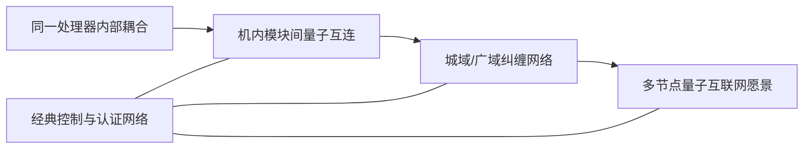
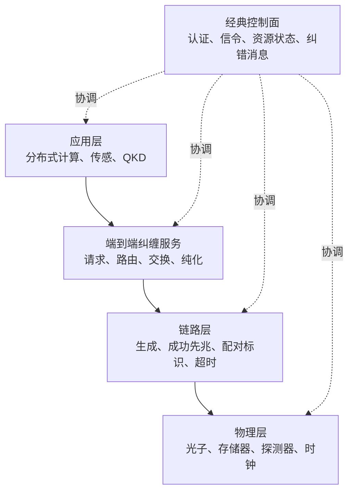
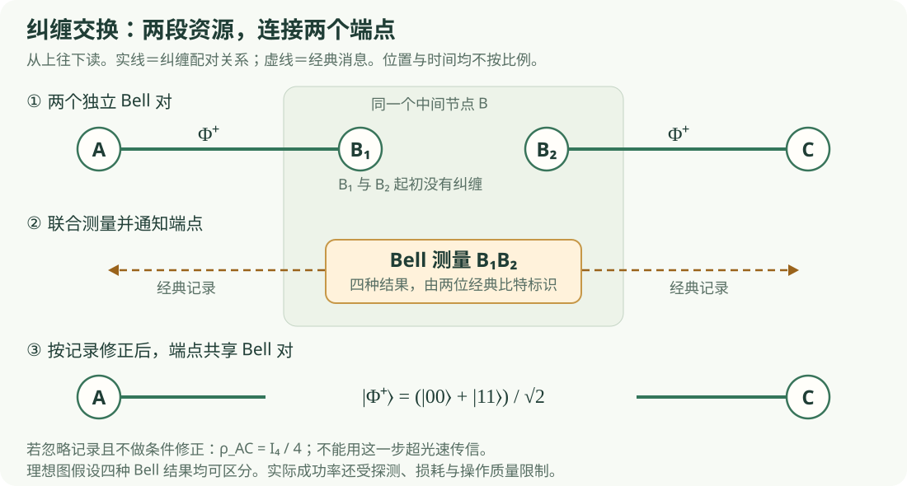

# 12｜密码、量子网络与研究前沿

读这一章不必先懂密码系统的工程细节。先把三个问题分开：未来的量子计算机会改变哪些旧密码的难度？今天可在普通计算机上迁移到什么新密码？如果真要把量子态从一地送到另一地，链路和存储器又必须做什么？前两个问题主要关乎信息安全，第三个才是量子网络。本章遇到公式时，先按紧邻的小数字例子算一遍，再看一般形式。

## 1. 先分清三个经常混在一起的主题

| 名称 | 运行硬件 | 主要目标 | 不解决什么 |
|---|---|---|---|
| 量子计算攻击 | 足够大的容错量子计算机 | 用 Shor、Grover 等改变部分密码问题的成本 | 不会自动突破终端、实现和身份管理 |
| 后量子密码（PQC） | 普通经典计算机 | 用被认为能抗经典与量子攻击的算法替换脆弱公钥方案 | 不能保护已经泄露的端点或错误协议实现 |
| 量子密钥分发（QKD） | 专用量子通信设备和经典认证信道 | 用量子态与统计检验建立共享密钥 | 不替代认证、密钥管理、业务加密和终端安全 |

PQC 不是“用量子计算机加密”，QKD 也不是一条能承载任意量子计算的“量子互联网”。安全迁移与量子网络研究有交集，但工程目标不同。

## 2. Shor、Grover 与密码迁移

### 2.1 Shor 改变哪些假设

足够大的容错量子计算机可在多项式时间内解决整数分解和离散对数，因而威胁 RSA、有限域 Diffie–Hellman 和椭圆曲线密码。这里的“足够大”包含许多纠错后的逻辑量子比特、很深的逻辑线路和可接受的失败概率；现有实验设备不能据此直接分解生产环境的长密钥。

为什么“找周期”与分解有关？用人人能手算的小数 $N=15$ 看一次。先选一个与 15 互素的数 $a=2$，不断乘 2、每次只保留除以 15 的余数：

| 指数 $x$ | $0$ | $1$ | $2$ | $3$ | $4$ |
|---|---:|---:|---:|---:|---:|
| $2^x\bmod 15$ | 1 | 2 | 4 | 8 | 1 |

第一次回到 1 是 $x=4$，所以这个序列的**周期**（更准确说 2 模 15 的阶）为 $r=4$。周期为偶数，就看一半处 $2^{r/2}=2^2=4$。因为 $2^r-1=(2^{r/2}-1)(2^{r/2}+1)$ 能被 15 整除，分别求最大公因数：

$$
\gcd(4-1,15)=\gcd(3,15)=3,\qquad
\gcd(4+1,15)=\gcd(5,15)=5.
$$

这次得到了 $15=3\times5$。在这个小例里，列表本身就能用纸笔完成，**没有量子优势**；Shor 算法真正用量子子程序加速的是大数场景下的周期寻找，之后的最大公因数由经典算法计算。若选到的数与 $N$ 不互素，先求最大公因数便可能直接找到因子；若得到奇数周期，或 $a^{r/2}\equiv-1\pmod N$，这一次不能按上面的步骤得出两个非平凡因子，需要重新选择。它不是“量子计算机一次必定分解成功”。

风险仍需现在处理，原因是密码迁移往往持续多年，长期保密数据还面临“现在收集、将来解密”。组织应先做密码资产清单，找出协议、证书、硬件、安全模块和第三方依赖，再按数据保密寿命与迁移耗时排序，而不是等量子计算机出现后一次切换。

### 2.2 截至 2026-09-24 的 NIST 状态

NIST 于 2024-08-13 发布首批三项最终标准：

- **FIPS 203：ML-KEM**，用于密钥封装；
- **FIPS 204：ML-DSA**，数字签名；
- **FIPS 205：SLH-DSA**，基于哈希的数字签名。

**FIPS** 是美国国家标准与技术研究院发布的《联邦信息处理标准》系列，不是某种加密算法本身。这里尤其要分清两种任务。**密钥封装机制（KEM）**让双方在公开网络上建立同一把秘密密钥；它一般不直接拿公钥去加密整份文件。以 ML-KEM 的抽象消息流为例：

1. 接收方生成一对密钥，把**公钥**发给发送方，私钥留在自己手里。
2. 发送方用这把公钥运行“封装”，得到一段可公开发送的**封装密文** $c$ 和自己保存的共享秘密 $K$。
3. 接收方收到未被替换的 $c$，用私钥运行“解封装”，在正确公私钥及正常传输条件下得到相同的 $K$；双方再按协议从它导出会话加密密钥，保护业务数据。若密文被改动或公钥不对应，不能想当然认为双方仍拿到了同一个秘密。

这里的 $c$ 不是业务文件，$K$ 也不该直接暴露在网络上。若攻击者能把第一步的公钥偷换成自己的，光有 KEM 仍不足以证明“我确实在和预期的人通信”，因此还要认证公钥和会话。**数字签名（DSA）**解决的是另一件事：持私钥的人对消息签名，别人用**已确认属于该人的公钥**检验内容是否被改动、签名者是否持有对应私钥；若公钥身份本来就没核实，签名也不会自动证明现实身份。它不代替会话保密加密。NIST 的 [SP 800-227](https://csrc.nist.gov/pubs/sp/800/227/final)于 2025-09-18 最终发布，专门说明 KEM 的定义与安全使用。

2025-03-11，NIST 选择 **HQC** 作为基于不同数学结构的备用密钥封装算法，并说明它不会替代 ML-KEM；当时的计划是约 2026 年形成标准草案、2027 年定稿。截至 2026-09-24，NIST 的标准化项目页仍把 HQC 列为正在标准化的额外 KEM，Selected Algorithms 页面标为“FIPS coming soon”，尚未列为已经发布的最终 FIPS。另一种已选中的签名方案 Falcon（拟标准名 FN-DSA）也仍在标准化。**选中算法、发布草案、发布最终标准**是三个不同阶段；原先预告的日期若过去了，也不能倒推标准已发布。迁移时间线和算法状态会变化，实施前必须查 NIST 正式标准、勘误和迁移项目，而不能照抄本章日期。

标准化也不等于产品自动安全。要核查参数集、随机数、侧信道、密钥/签名长度、协议协商、降级攻击、证书链和混合迁移策略。NIST 关于淘汰量子脆弱算法的时间线曾以草案形式征求意见；若引用“2035”等年份，应明确文件版本和草案/定稿状态。

已经发布的标准也会有勘误与实施指南。比如 [FIPS 203 官方页面](https://csrc.nist.gov/pubs/fips/203/final)在 2025-11-17 标注了拟于未来更新或修订的问题，并提供潜在勘误文件；这**不改变** FIPS 203 已是最终标准的状态，却说明实现时不能只保存“FIPS 203”四个字，还应保存采用的文本版本、勘误和符合性测试版本。

### 2.3 Grover 的边界

对理想黑箱密钥搜索，Grover 把 $N$ 个候选项的查询复杂度从 $O(N)$ 降到 $O(\sqrt N)$。因此对 $k$ 位理想密钥空间，常用粗略直觉是量子查询数约为 $2^{k/2}$。但一次“量子查询”要被编译成庞大的可逆电路，还受门深度、纠错、并行化和内存限制；它不等于一次普通 AES 或哈希调用。

“把对称密钥加倍”是有用的第一近似，不是完整安全证明。哈希原像、碰撞、消息认证和密码协议的量子安全性也不能统一概括成“所有安全位数减半”。

## 3. BB84：最小逻辑与真正的安全前提

Alice 随机选择 $Z$ 或 $X$ 基制备随机比特，Bob 随机选择基测量。双方通过已认证的经典信道公开比较所用基，保留同基结果；再抽样估计错误，执行信息协调与隐私放大。

“基”可以理解为一套问量子态的二选一问题。$Z$ 基直接问“是 $|0\rangle$ 还是 $|1\rangle$”；$X$ 基问“是 $|+\rangle$ 还是 $|-\rangle$”，其中 $|+\rangle=(|0\rangle+|1\rangle)/\sqrt2$、$|-\rangle=(|0\rangle-|1\rangle)/\sqrt2$。Alice 的四种准备如下：

| Alice 的比特 | 选 $Z$ 基时发送 | 选 $X$ 基时发送 |
|---|---|---|
| 0 | $|0\rangle$ | $|+\rangle$ |
| 1 | $|1\rangle$ | $|-\rangle$ |

Bob 若选对基，理想情况下能确定得到 Alice 的比特；若选错基，两个结果各占一半。例如 Alice 发 $|0\rangle$，Bob 偏用 $X$ 基，得到 $+$ 的概率是 $|\langle+|0\rangle|^2=1/2$，得到 $-$ 也是 $1/2$。这个随机结果不该拿来猜 Alice 的比特。

下面是一批**刻意列出的八次示例**，不是一次真实实验。异基时 Bob 得到的数只是一次可能的随机结果；同基时先假定没有噪声。

| 次序 | Alice 的基/比特 | Bob 的基/结果 | 同基保留？ |
|---:|---|---|---|
| 1 | $Z/0$ | $Z/0$ | 是 |
| 2 | $X/1$ | $Z/1$ | 否 |
| 3 | $Z/1$ | $X/0$ | 否 |
| 4 | $X/0$ | $X/0$ | 是 |
| 5 | $Z/1$ | $Z/1$ | 是 |
| 6 | $X/1$ | $X/1$ | 是 |
| 7 | $X/0$ | $Z/0$ | 否 |
| 8 | $Z/0$ | $X/1$ | 否 |

公开的是每次选了哪一套基，**不是**刚才的比特或测量结果。两人据此留下位置 $1,4,5,6$，此示例的筛选串都是 $0011$。八次恰好留四次只是一批示例；两人独立等概率选基时，长期平均留下一半。随后仍须抽样检查错误、协调差异、压缩隐私，不能把 $0011$ 当作已认证的最终安全密钥。

窃听者不知道制备基，直接截获、测量和重发会以一定概率选错基，从而在合法双方的统计中留下错误。这个直觉不是完整安全证明。实际安全还依赖：

- 已认证而非仅“公开”的经典信道；
- 明确的光源、探测器和攻击模型；
- 有限密钥长度，而不是只讨论无限样本极限；
- 可审计随机数、校准和密钥后处理；
- 对器件偏离理想模型和侧信道的处理。

为什么认证是硬前提？若 Eve 能冒充 Alice 向 Bob 说话、又冒充 Bob 向 Alice 说话，她可分别与两人执行协议，最后拿到两把不同密钥；两位真正用户却以为彼此直接共享一把。量子测量的扰动不会替双方验证消息是谁发的。认证可来自事先共享的短密钥，也可按特定部署使用经过验证的公钥机制，但后者的计算安全假设必须计入整体威胁模型。

测量设备无关 QKD 可关闭一类探测端攻击，但不消除全部器件假设；设备无关 QKD 借助无漏洞 Bell 违背减少器件信任，实验代价和密钥率要求更高。

### 3.1 算例：截获再发送为什么带来 25% 错误

先固定一个理想模型：Alice、Bob 和窃听者 Eve 各自独立、等概率选择 $Z$ 或 $X$ 基；没有损耗和设备噪声；Eve 截获每一个信号，测量后按自己的结果制备一个新信号发给 Bob。**只看 Alice 与 Bob 选了相同基、因而被保留的比特。**

| Eve 的基 | 在保留比特中的概率 | Bob 出错的条件概率 | 对总错误率的贡献 |
|---|---|---|---|
| 与 Alice 相同 | $1/2$ | $0$ | $0$ |
| 与 Alice 不同 | $1/2$ | $1/2$ | $1/4$ |

第二行可以直接手算。设 Alice 发 $|0\rangle$，Eve 错选 $X$ 基，就会等概率得到并重发 $|+\rangle$ 或 $|-\rangle$。Bob 用 $Z$ 基测量时，两种态都有 $|\langle1|\pm\rangle|^2=1/2$ 的概率得到错误的 1。因此，保留序列中的量子比特错误率（QBER）为

$$
Q=\Pr(\text{Eve 选错基})\Pr(\text{Bob 出错}\mid\text{Eve 选错基})
=\frac12\times\frac12=\frac14.
$$

若共发送 1000 个信号，平均约有 500 个因 Alice、Bob 同基而保留，其中平均约 125 个错误。分母不同：$125/500=25\%$ 是保留序列错误率，$125/1000=12.5\%$ 是“被保留且出错”占全部发送信号的比例。这些都是期望，不保证每批恰好等于这些数。[IBM 的 BB84 教学模块](https://quantum.cloud.ibm.com/learning/en/modules/computer-science/quantum-key-distribution)采用同样的基选择模型。

在这个独立攻击模型下，随机公开检查 20 个保留比特，恰好一个错误也没见到的概率仍有 $(3/4)^{20}\approx0.00317$。公开检查过的比特不能再当秘密密钥。若 Eve 只独立攻击比例为 $f$ 的信号，此模型给出 $Q=f/4$；但真实噪声和更一般攻击不能从一个 QBER 值唯一反推出。**25% 不是“低于它就安全”的门槛，没观察到错误也不是安全证明。**

### 3.2 筛选后的比特为什么还不能直接当密钥

“保留同基结果”只是基筛选。之后还要估计参数、用公开消息协调双方的错误，并通过隐私放大压缩掉窃听者可能知道的信息。公开纠错消息本身也会泄露信息，必须记入安全分析。

作为研究生入门的最小定量入口，在理想单光子、足够长的数据、已认证经典信道和相应 BB84 安全模型下，单向后处理的渐近秘密比特比例可由

$$
r\ge 1-h_2(e_b)-h_2(e_p),\qquad
h_2(x)=-x\log_2x-(1-x)\log_2(1-x)
$$

给出下界。这里 $r$ 的分母是进入该密钥分析的筛选比特数，不是发送的光子数；$e_b$ 是比特错误率，$e_p$ 是由互补基数据约束的相位错误率，**不能不经参数估计就把两者认作同一个数**。二元熵 $h_2$ 的详细解释见[第 13 章](13-quantum-information.md)。这个下界来自[Shor–Preskill 安全证明](https://arxiv.org/abs/quant-ph/0003004)，不是由上面的截获再发送算例推出的。

仅在可取 $e_b=e_p=Q$ 的对称例子里，下界化为 $1-2h_2(Q)$。以 $Q=5\%=0.05$ 为例，先分别计算

$$
-0.05\log_2(0.05)\approx0.21610,\qquad
-0.95\log_2(0.95)\approx0.07030.
$$

相加得到 $h_2(0.05)\approx0.28640$，再代回 $1-2h_2(0.05)\approx0.42720$。这是上述**理想渐近模型**对每个进入分析的筛选比特给出的约 $0.427$ 个秘密比特的可达比例**下界**；若只有有限的 10,000 个筛选比特，不能直接宣布实际获得 $4,272$ 个可证明安全的比特，因为有限长度统计和认证开销尚未扣除。类似地，$Q=1\%$ 时下界约为 $0.8384$；约 $11.0\%$ 时该下界降到零。这不是所有 QKD 协议或器件的通用安全阈值。有限样本、非理想纠错效率、多光子光源、诱骗态估计、认证开销和损耗都要另行处理，也不能据此把“每秒探测数”直接乘成有保证的实际密钥率。

## 4. QKD 的现实边界

光纤衰减使直接链路成功概率随距离指数下降。可信节点能延长覆盖，但节点会接触密钥，因此不等于端到端量子中继。即使量子层安全，密钥进入传统加密、身份系统或终端后仍可能泄露。

“可信节点”的含义可以用三个地点表示：Alice 与中间站建立一把密钥，中间站再与 Bob 建立另一把；若要经它转交一把端到端密钥，中间站会处理、因而原则上可以获知这把密钥，所以两端必须信任它。量子中继的目标不同：中间站用量子存储、纠缠交换等操作把端点关联起来，不靠一份由它长期持有的端到端明文密钥。不过中继本身仍有器件和协议安全条件，不是“放进去一个节点便自动端到端安全”。

距离成本可以从分贝定义算一遍。分贝（dB）不是“丢了多少个光子”的单位，而是把输入/输出功率比写成十进制对数：损耗 10 dB 表示仅有 $10^{-1}=1/10$ 的功率通过，20 dB 表示仅有 $10^{-2}=1/100$ 通过。在单光子、线性被动光纤的简化模型中，这个透过率也可视为每个已发光子的生存概率。设电信波段光纤的损耗**仅为示意**地取 $a=0.2\,\mathrm{dB/km}$，长度 $L$ 公里的总损耗为 $aL$ dB。功率透过率 $\eta=P_{\rm out}/P_{\rm in}$ 满足 $aL=-10\log_{10}\eta$，所以

$$
\eta(L)=10^{-aL/10}=10^{-0.2L/10}.
$$

在这个模型中，$L=50\,\mathrm{km}$ 时总损耗 10 dB，透过率为 $0.1$；$L=100\,\mathrm{km}$ 时总损耗 20 dB，透过率为 $0.01$。若每次理想地发出一枚单光子，并假定探测器效率为 100%、没有别的损耗或暗计数，一百万次发送中平均约一万枚穿过 100 km 光纤并被探测；再按等概率随机选基的 BB84 筛选，平均约留下五千个同基结果。这里是“发送 $1,000,000\to$ 穿过并探到约 $10,000\to$ 同基约 $5,000\to$ 最终密钥更少”的漏斗，每一步分母都要问清。它们仍**不是**五千个安全密钥比特：实际源和探测器还会引入额外损耗与暗计数，且参数估计、纠错、隐私放大和有限密钥安全开销都会减少最终密钥。

$0.2\,\mathrm{dB/km}$ 也不是所有波长和光纤的定值，实际实验须用自己的损耗曲线。例如，[一项 100 km 光纤 QKD 实验](https://www.nature.com/articles/s41534-022-00630-3)使用的**光纤本体衰减系数**为 $0.235\,\mathrm{dB/km}$，对应光纤一段约 $23.5\,\mathrm{dB}$；论文同时报告**整条实验链路的总损耗**为 $31.5\,\mathrm{dB}$。用前面的 $\eta=10^{-\mathrm{dB}/10}$ 逐项换算，前者约为 $10^{-2.35}=4.47\times10^{-3}$，后者约为 $10^{-3.15}=7.08\times10^{-4}$。这两个透过率对应不同系统边界，不能把前一个每公里系数当成包含器件在内的总链路损耗，更不能直接将任一数值当成最终安全密钥率。

进阶一点，[纯损耗直连信道的 PLOB 结果](https://www.nature.com/articles/ncomms15043)把“无量子中继时损耗限制速率”写成容量 $C=-\log_2(1-\eta)$，单位是**每次使用一个光学模式最多可建立的秘密比特数**；即使允许两端反复进行经典通信，这个模型下也不能突破它。代入示例的 $\eta=0.01$，得到 $C=-\log_2(0.99)\approx0.0145$ 比特/模式。它是特定理想纯损耗信道的理论容量，不是上面那台 BB84 装置的每秒密钥率：要换成每秒仍须说明模式使用速率、器件损耗、噪声和安全分析。

评价 QKD 不应只报最远距离，还应给：每秒秘密密钥率、总损耗/距离、有限密钥参数、安全参数、是否需要可信节点、是否共享光纤、设备假设和连续运行稳定性。远距离但极低密钥率与短距离高吞吐服务于不同场景。

## 5. “量子网络”至少有三种不同连接

1. **芯片或阱内连接**：门耦合直接、延迟低，但距离很短。
2. **模块间互连**：把物质量子比特转成飞行光子，以概率方式生成远程纠缠，用于模块化计算。
3. **城域/广域网络**：跨光纤或自由空间分发量子态或纠缠；若要进一步做到多跳、按需的端到端纠缠服务，还需要量子存储、同步、路由与中继。直接点到点链路不一定已经具备这些部件。

“已联网”可能只表示两个节点偶尔成功产生一次纠缠，并不等于用户可按需调用任意远程门。链路层、传输层和应用层的服务指标必须分开。

## 6. 从物理光子到应用：网络协议栈

量子网络不能简单照搬“把量子比特当作 IP 数据包”的图景。多数近期体系先由物理链路概率性地产生 Bell 对，再由经典控制面记录、筛选、交换和分配这些资源。一个适合初学者的最小分层如下：

层名尚未像经典互联网那样完全统一；上图是分析框架，不是宣称已经存在唯一标准栈。IETF 的量子互联网研究组文件也明确属于信息性研究文档，而非已部署互联网标准。

这里的**成功先兆（herald）**是由协议指定的探测器点击或测量记录宣布本次纠缠生成成功；它不读取纠缠所承载的未知量子信息。链路层交付的核心对象通常不是一个可无限排队的数据包，而是“两个指定存储槽共同持有的一对有寿命的纠缠”。因此最小服务记录至少需要：纠缠对标识、两端节点与存储槽、生成时间、目标态或 Bell 标签、保真度估计及方法、有效期/超时、成功先兆结果和失败原因。若没有这些元数据，上层无法判断某一对是否仍可用于交换或远程门。

经典控制面不可省略。它负责通告探测结果、确认两端对应的是同一对、分配存储器、传播 Bell 测量结果、触发 **Pauli 帧（在经典控制器中记录待施加的 Pauli 修正）**更新，以及处理超时和重试。它不传送未知量子态本身，却决定用户何时能安全使用一对纠缠。经典消息仍受光速、排队、认证和处理延迟限制。

### 6.1 可复算例：两段链路何时同时就绪

设两条链路每 $1\ \mathrm{ms}$ 独立尝试一次，每次成功概率均为 $p=0.1$；某段一旦成功便存入量子存储器，等待另一段。单段平均需 $1/p=10$ 次尝试。先看一次具体但随机的结果：左段第 3 轮成功、右段第 5 轮成功，则两段都就绪是在第 $\max(3,5)=5$ 轮，而左段的纠缠对多存了 $|3-5|=2$ 轮。换一批结果，两个数会变化；所以“完成时间”和“先成功段的储存时间”是不同随机变量。

记两段各自首次成功轮数为 $X,Y$。一段连续 $n$ 轮都没成功的概率是 $(1-p)^n$，故等到成功的平均轮数可由 $1+(1-p)+(1-p)^2+\cdots=1/p$ 算出。两段都尚未成功 $n$ 轮的概率是 $(1-p)^{2n}$，因此较早一段成功的平均轮数是 $1/[1-(1-p)^2]$。利用每一批都成立的 $\max(X,Y)=X+Y-\min(X,Y)$，直到两段都至少成功一次的期望尝试数为

$$
\mathbb E[\max(X,Y)]
=\mathbb E[X]+\mathbb E[Y]-\mathbb E[\min(X,Y)]
=\frac{2}{p}-\frac{1}{1-(1-p)^2}.
$$

代入 $p=0.1$ 得

$$
20-\frac{1}{0.19}\approx14.74,
$$

即平均约 $14.74\ \mathrm{ms}$，而顺序生成两段的平均时间是 $20\ \mathrm{ms}$。并行调度减少了等待，却没有消除存储退相干：先成功的那段仍要等待，实际协议还要计入成功先兆的经典往返、交换操作、超时和失败重试。这个例子也说明，只用单链路原始速率 $Rp$ 不能推出端到端速率。

### 6.2 等待“另一段”的时间，不等于总完成时间

上例中 $X,Y$ 分别是从 1 开始计数的几何随机变量：$\Pr(X=k)=p(1-p)^{k-1}$。先成功的那一对需要额外存储 $D=|X-Y|$ 个时隙，而不是 $\max(X,Y)$ 个时隙。由于

$$
|X-Y|=X+Y-2\min(X,Y),
$$

它的平均额外存储时间为

$$
\mathbb E[D]\tau
=\left[\frac2p-\frac{2}{1-(1-p)^2}\right]\tau
\approx9.47\ \mathrm{ms},\qquad \tau=1\ \mathrm{ms}.
$$

还要小心：对非线性的退相干函数，先取平均时间、再代入衰减公式，一般不等于平均剩余相干性。就像“平均路程 10 km”不一定对应“各次油耗的平均”，指数衰减也不能把随机等待直接换成平均等待。下面只考虑一个示意模型：较早生成的 Bell 对，其相关非对角元在额外等待时间 $t$ 后乘以 $e^{-t/T_{\rm mem}}$。$T_{\rm mem}$ 是这一对态的有效相干时间；若两端存储器都独立退相干，要先合并速率，不能把单个器件的 $T_2$ 直接代入。

令 $q=1-p$。两段同一时隙成功的概率为

$$
\Pr(D=0)=\sum_{k=1}^{\infty}p^2q^{2k-2}
=\frac{p}{2-p}.
$$

相差 $d\ge1$ 个时隙时，有 $X=Y+d$ 与 $Y=X+d$ 两种互斥情况，所以

$$
\Pr(D=d)=2\sum_{k=1}^{\infty}p^2q^{2k+d-2}
=\frac{2p q^d}{2-p}.
$$

再用等比级数，记 $a=e^{-\tau/T_{\rm mem}}$，可得

$$
\mathbb E[e^{-D\tau/T_{\rm mem}}]
=\frac{p}{2-p}\left(1+2\sum_{d=1}^{\infty}(qa)^d\right)
=\frac{p}{2-p}\frac{1+qa}{1-qa}.
$$

取 $T_{\rm mem}=20\ \mathrm{ms}$、$p=0.1$、$\tau=1\ \mathrm{ms}$，先算 $q=0.9$、$a=e^{-1/20}\approx0.95123$，所以 $qa\approx0.85611$。代入完整分布的公式得到

$$
\frac{0.1}{1.9}\frac{1+0.85611}{1-0.85611}\approx0.679.
$$

把平均等待 $9.47\ \mathrm{ms}$ 直接代入指数，却只得到 $e^{-9.47/20}\approx0.623$。两者不同不是算错，而是平均运算与非线性函数不能随意交换。此处只计算额外等待的相干因子，不是端到端保真度或秘密密钥率；交换失败、超时截断和通信延迟尚未加入。更一般的等待分布与有限存储分析见[Shchukin 等的原始研究](https://arxiv.org/abs/1710.06214)。

## 7. 纠缠交换与中继器

经典中继器可以探测、放大并重发信号；未知量子态不能被完美复制。若 $A$–$B_1$ 与 $B_2$–$C$ 各共享一对纠缠，节点 $B$ 对 $B_1B_2$ 做 Bell 测量，并把经典结果发送给端点，便可使原本未直接交互的 $A$ 与 $C$ 共享纠缠。这叫纠缠交换，不会实现超光速通信：端点仍需经典消息才能解释结果。

真正的量子中继还要解决：

- 各段纠缠生成是概率事件，需要存储成功段并等待其他段；
- 存储相干时间必须覆盖生成、通知和交换延迟；
- 每次交换、频率转换和存取都会降低保真度；
- 纯化消耗多对低质量纠缠换取少量高质量纠缠；
- 基于纠错的中继可提高吞吐，但需要更多量子比特和实时处理。

没有量子存储的“可信节点”、带存储的实验节点和完整容错中继器不可混称。尚不存在可像经典互联网路由器一样成熟、通用部署的量子中继产品体系。

### 7.1 四个量子比特怎样变成一对远程纠缠

先给图里的四个位置认名：左端 Alice 持有 $A$，右端 Charlie 持有 $C$，中间站 Bob 同时持有 $B_1$ 和 $B_2$。起初的配对是 $A$–$B_1$、$B_2$–$C$；中间测量不是单独读取一个 0/1，而是把 $B_1B_2$ **共同投影到四种 Bell 态之一**。下方端点的状态必须附上“中间站报告了哪一种结果”这个条件，不能只看图中的一条新连线。

图中的实线表示“哪两个量子比特构成一对资源”，不是信号传播轨迹。下面计算第二步如何产生第三步的条件态。

设起初有两个独立 Bell 对 $|\Phi^+\rangle_{AB_1}$ 和 $|\Phi^+\rangle_{B_2C}$。固定张量顺序为 $A,B_1,B_2,C$，联合态是

$$
|\Omega\rangle
=\frac12\bigl(|0000\rangle+|0011\rangle+|1100\rangle+|1111\rangle\bigr).
$$

中间节点只测量 $B_1B_2$。若得到 $|\Phi^+\rangle=(|00\rangle+|11\rangle)/\sqrt2$，只剩第一、第四项，因此端点的未归一化条件态为

$$
{}_{B_1B_2}\langle\Phi^+|\Omega\rangle
=\frac{|00\rangle_{AC}+|11\rangle_{AC}}{2\sqrt2}
=\frac12|\Phi^+\rangle_{AC}.
$$

范数平方为 $1/4$，就是这个测量结果的概率；除以 $\sqrt{1/4}=1/2$ 后，得到归一化的端点 Bell 态。其余结果同理。定义 $|\Phi^-\rangle=(|00\rangle-|11\rangle)/\sqrt2$、$|\Psi^\pm\rangle=(|01\rangle\pm|10\rangle)/\sqrt2$，四种情况为：

| 中间的理想 Bell 测量结果 | 概率 | 端点 $AC$ 的条件态 | 在 $C$ 上恢复为 $\Phi^+$ 的修正 |
|---|---|---|---|
| $\Phi^+$ | $1/4$ | $\Phi^+$ | $I$ |
| $\Phi^-$ | $1/4$ | $\Phi^-$ | $Z$ |
| $\Psi^+$ | $1/4$ | $\Psi^+$ | $X$ |
| $\Psi^-$ | $1/4$ | $\Psi^-$ | $XZ$，忽略全局负号 |

这里的 $XZ$ 仍按本书约定从右向左作用。四种结果若全部可区分并允许条件修正，理想交换并不只在第一种结果时成功；实际光学 Bell 测量的可区分结果、损耗和误报会另行降低成功率。

若没有收到中间节点的记录，端点不能选择相应修正。把四种结果忽略，端点无条件态为

$$
\rho_{AC}=\frac14\sum_{\beta\in\{\Phi^+,\Phi^-,\Psi^+,\Psi^-\}}
|\beta\rangle\langle\beta|=\frac{I_4}{4}.
$$

最后一个等号来自四个 Bell 态构成正交完备基。因此不能把“按测量结果条件化后纠缠”理解成“未收到消息时就能读取一个远程信号”。这个协议不复制任何未知态；中间两个量子比特已被测量，原来的两对资源也被消耗。纠缠交换的原始方案见[Żukowski 等，1993](https://doi.org/10.1103/PhysRevLett.71.4287)。

## 8. 网络性能要看一组量

| 指标 | 含义 | 容易遗漏的条件 |
|---|---|---|
| 纠缠保真度 | 生成态与目标 Bell 态的接近程度 | 是否经过背景扣除、后选择或层析假设 |
| 生成率 | 每秒成功纠缠对数 | 尝试率、链路损耗、复位时间、并发通道 |
| 成功概率 | 每次尝试成功的概率 | 成功先兆条件和误报率 |
| 量子存储寿命 | 状态可保持多久 | 存取效率、使用的回波序列、并行工作条件 |
| 存取效率 | 写入和读出存储的总效率 | 是否条件于探测、是否包含频率转换 |
| 延迟与抖动 | 请求到可用纠缠的时间分布 | 只报平均会隐藏长尾等待 |
| 可用率 | 系统稳定在线的时间比例 | 实验演示通常不会给长期运维数据 |
| 端到端质量 | 经多个交换后最终可用纠缠 | 每一段高保真不保证多跳后仍高质量 |

网络中，质量与速率不能分开。若一次成功概率为 $p$、尝试率为 $R$，最简单链路的原始生成率近似 $Rp$；多段同时就绪、存储衰减和重试会使端到端率更低。只给“跨越多少公里”与只给量子比特数一样不充分。

## 9. 分布式量子计算

模块化架构希望用网络连接较小处理器。远程门可通过预共享 Bell 对、局域操作、测量和经典通信实现；量子隐形传态传递的是未知态的信息，而不是把物质本身瞬间移动，也不绕过经典通信延迟。

编译器必须决定哪些门留在模块内、哪些跨模块。跨模块门通常消耗纠缠对，且远比局域门稀缺。因此应用性能取决于：

- 链路纠缠生成率与保真度；
- 每个模块的存储容量和寿命；
- 光—物质接口与频率转换；
- 远程门的调度、缓冲和失败重试；
- 跨模块纠错与经典解码延迟。

网络把总量子比特数相加，不会让它们自动拥有与单芯片相同的低成本全连接。一个公平的模块化基准应把远程 Bell 对的生产和纯化时间算入线路。

## 10. 截至 2026-09-24，网络实验已经证明到哪一步

- **[两存储节点纠缠](https://www.nature.com/articles/s41586-024-07252-z)，论文在线 2024-05-15**：实验把两个含多个量子比特的金刚石硅空位色心节点，通过量子频率转换接入 1350 nm 光纤，并分别在 40 km 光纤盘与 35 km 波士顿地区已铺设光纤回路上演示两端核自旋存储器之间的纠缠。硅空位的电子自旋与光子交互，核自旋较适合暂存量子态；“盘纤”和“城市已铺设光纤”是两种不同环境。尤其不能拿短距离电子自旋纠缠的“最高约 1 次/秒”当作 35 km 核自旋实验的速率：论文补充表对后者报告原始平均约 $0.23\,\mathrm{mHz}$，即约每 72 分钟一次；经错误检测选出的 $|\Phi^-\rangle$ 约 $0.10\,\mathrm{mHz}$，对应的条件态保真度为 $0.69(7)$，括号表示最后一位约 $\pm0.07$ 的报告精度。速率、筛选和保真度须成组看。这是存储与城域链路集成的重要进展，不是已经建成多跳容错量子互联网。
- **[城市光纤上的协议功能](https://www.nature.com/articles/s41534-024-00886-x)，论文在线 2024-09-14**：研究在 14.4 km 萨尔布吕肯城市暗光纤上演示光子—光子、离子—光子纠缠，以及从单个 $^{40}\mathrm{Ca}^{+}$ 离子的量子态到远端电信光子的态传送。**暗光纤**是没有承载常规业务光的专用光纤，不等于无背景噪声或无连接损耗；该实验量得用于量子信号的链路总损耗 $10.4\,\mathrm{dB}$，离子—光子纠缠保真度 $79(2)\%$（未扣背景）。这与该论文另报的“经背景校正后双光子保真度超过 $98\%$”不是同一个对象，不能挑最高数字代表整套协议。这些实验验证若干节点功能可以在同一部署链路上工作，不能替代中继率、长期可用率和多用户路由测试。
- **[跨模块量子门](https://www.nature.com/articles/s41586-024-08404-x)，论文在线 2025-02-05**：研究把两个相距约 2 m 的离子阱模块用光学链路连接，先概率性生成一对远端纠缠，再利用它在不同模块的计算比特之间传送受控 $Z$ 门，报告远程门保真度约 $86\%$，并运行一个小型分布式 Grover 搜索示例（成功率 $71\%$）。这里“门传送是确定性的”指**一旦拿到所需纠缠资源后**不再靠挑选有利门测量结果；它不表示每次光子链路尝试必定成功，也不表示 2 m 演示具有城市距离的速率与误差预算。
- **[美国能源部 2024 年量子信息科学路线图](https://quantum.gov/wp-content/uploads/2024/12/DOE_QIS_Roadmap_Final.pdf)**：它把纠缠分发视为网络核心服务，并把器件、协议、控制、测试等列为研究任务；报告还明确说时间表存在不确定性。**路线图是目标与待解难题，不是上面两项实验所达到的性能，也不是已完成部署的证书。**

这些状态高度易变。引用纪录时必须保留论文日期、光纤是盘纤还是实际部署、是否后选择、节点数、存储类型、生成率和保真度。

## 11. 模拟、退火与门模型不要混为一种机器

量子退火通过逐渐改变系统的能量函数（Hamiltonian）寻找低能态；模拟式量子模拟器直接实现某个目标多体系统的能量函数；数字门模型把操作分解成一串离散门。三者都有研究和应用价值，但可编程性、误差模型、验证方式与复杂度保证不同。

退火设备返回一个优化样本，不证明通用门模型算法已经运行；模拟器观测到新量子相也不等于能执行 Shor 算法。比较量子退火与经典优化还须控制嵌入开销、读出次数、调参和强经典启发式算法。

用同一个二变量成本函数想一想三者的差别。设 $x_1,x_2\in\{0,1\}$，成本 $F=x_1+x_2-3x_1x_2$：四个输入 $00,10,01,11$ 的成本依次是 $0,1,1,-1$，最低的是 $11$。退火机可把这四个配置映射为能量、逐渐改变机器自身的能量函数，最后**采样**一个结果；有限温度和噪声下并不保证每次都得到 $11$。即使得到最低配置，也不能宣称执行了对任意输入的通用量子线路。模拟式量子模拟器的任务反过来是研究某个物理模型本身，例如让一排相互作用的自旋演化并测磁化，未必有“最优二进制答案”。门模型则显式写出初始化、逐个门、测量与可逆子程序。即使同一台硬件可支持不止一种模式，论文仍须说清**本次完成的是哪一种任务**。

退火从输入到得到解的总耗时（time-to-solution）、纯量子与混合求解器的分别计时，以及模拟量子模拟器的 Hamiltonian 偏差和可由经典方法验证的范围，见[第 19 章第 8 节](19-engineering-architecture.md#8-量子退火和模拟器怎样公平验证)。

## 12. 量子传感、时间晶体与计算的边界

量子传感利用叠加、压缩或纠缠提高参数估计，可能比通用计算更早带来实用价值，却不等于能执行任意算法。时间晶体、拓扑物态和新材料可以帮助理解控制、存储或保护，也可能主要是基础物理成果。

例如让一个量子比特先成 $|+\rangle=(|0\rangle+|1\rangle)/\sqrt2$，再等待外部磁场使 $|1\rangle$ 相对于 $|0\rangle$ 多积累相位 $\phi$，于是态变成 $(|0\rangle+e^{i\phi}|1\rangle)/\sqrt2$。最后在 $|+\rangle$ 方向测量，得到 $+$ 的振幅是内积 $(1+e^{i\phi})/2$，概率则为

$$
P(+)=\left|\frac{1+e^{i\phi}}2\right|^2
=\frac{(1+e^{i\phi})(1+e^{-i\phi})}{4}
=\frac{1+\cos\phi}{2}.
$$

若 $\phi=0$，得到 $+$ 的概率为 1；若 $\phi=\pi/2$，概率为 $1/2$。多次重复测量可反推磁场造成的相位。**这是参数估计**，不是已经编写一个可执行 Shor 算法的处理器；要宣称“传感更好”，还须比较总测量时间、带宽、噪声和经典仪器基线。

看到“量子突破”时，先问它属于：计算、模拟、通信、传感、计量还是材料；再问结果是器件现象、受控量子比特、逻辑操作还是端到端应用。跨类别借用“量子比特”“优势”或“互联网”等词，最容易制造误解。

## 13. 面向前沿报道的事实核查清单

1. **安全**：说的是理论威胁、标准发布、产品实现，还是已经完成迁移？
2. **标准**：算法是候选、已选择、草案，还是真正的最终 FIPS？日期与版本是什么？
3. **QKD**：秘密密钥率、有限长度、安全参数、器件假设和可信节点是否公开？
4. **网络**：是单链路、纠缠交换、多跳中继，还是只是经典控制连接？
5. **距离**：盘纤、实验室铺设、城市暗纤、在用网络或卫星链路？损耗是否相当？
6. **条件**：保真度是否条件于成功先兆、探测成功、无丢失或后选择？
7. **系统**：是否计入存储等待、频率转换、重试、经典通信与长期可用率？
8. **厂商声明**：是否有可审计论文或标准支持，还是只是一张路线图和预计年份？
9. **协议栈**：是否说明了应用、端到端服务、链路、物理层与经典控制面各自承担什么？
10. **元数据**：纠缠对是否有两端槽位、生成时间、质量估计、超时和成功先兆记录？

## 14. 自检

1. PQC 与 QKD 的硬件、信任假设和用途有何不同？
2. 为什么“HQC 已被 NIST 选中”不等于“HQC 已成为最终 FIPS”？
3. 纠缠交换为何既不复制未知量子态，也不允许超光速通信？
4. 35 km 两节点实验与可扩展量子中继网络之间还缺哪些能力？
5. 为什么网络连接后的量子比特不能按芯片内全连接的成本计算？
6. 为什么 Bell 对不能直接当作普通数据包？经典控制面至少要传递哪些信息？
7. 两条成功概率均为 $0.1$ 的链路并行生成时，为什么平均等待不是简单的 $10\ \mathrm{ms}$？
8. 在第 3.1 节的理想截获再发送模型中，1000 个信号平均保留多少个、其中平均多少个错误？为什么 25% 与 12.5% 都可能出现，却不是同一个错误率定义？
9. 若独立公开检查 20 个保留比特仍未见错误，是否能证明没有窃听？计算第 3.1 节攻击模型下这一事件的概率，并说明 25% 为什么不是通用安全阈值。
10. 在第 6.2 节中，总完成时间与较早 Bell 对的额外存储时间分别对应哪个随机变量？为什么平均相干因子不能直接用平均存储时间代入指数得到？
11. 中间 Bell 测量得到 $\Psi^-$ 时，端点的条件态是什么、概率多少、怎样恢复成 $\Phi^+$？忽略结果且不修正时，端点联合态又是什么？
12. 在 $N=15,a=2$ 的小例中，列出 $2^x\bmod15$ 直到第一次回到 1。周期是多少？为什么分别计算 $\gcd(2^{r/2}-1,15)$ 与 $\gcd(2^{r/2}+1,15)$？
13. 用三个箭头写出 ML-KEM 建立共享秘密的抽象流程：谁生成公钥/私钥，谁发送封装密文，谁解封装？为什么仍要认证公钥？
14. 在理想渐近、对称的 BB84 例子里，令 $e_b=e_p=0.05$，逐项计算 $h_2(0.05)$ 和 $1-2h_2(0.05)$。若现实实验只有 10,000 个筛选比特，能否据此直接宣称产出 4,272 个安全密钥比特？
15. 为什么 2024 年波士顿 35 km 实验不能写成“1 Hz 的城市核自旋纠缠”？2025 年 2 m 跨模块门的“确定性”又限定在哪一步？
16. 对 $F(x_1,x_2)=x_1+x_2-3x_1x_2$，列出四个二进制输入的成本；退火机一次给出 $11$，为什么仍不能据此宣称执行了 Shor 算法？
17. 传感例中的态为 $(|0\rangle+e^{i\phi}|1\rangle)/\sqrt2$。求 $|+\rangle$ 结果的概率，并分别代入 $\phi=0$ 与 $\phi=\pi/2$；这个概率变化测的是什么，不证明什么？

答案见[练习与答案：第 12 章](appendices/exercises.md#第-12-章)。

## 参考资料

- NIST, [Post-Quantum Cryptography](https://www.nist.gov/pqc)（含 2024 年三项最终标准入口）。
- NIST, [NIST Selects HQC as Fifth Algorithm for Post-Quantum Encryption](https://www.nist.gov/news-events/news/2025/03/nist-selects-hqc-fifth-algorithm-post-quantum-encryption)（2025-03-11；明确为备用 KEM 选择及当时标准化计划）。
- NIST, [FIPS 203](https://csrc.nist.gov/pubs/fips/203/final)、[FIPS 204](https://csrc.nist.gov/pubs/fips/204/final)、[FIPS 205](https://csrc.nist.gov/pubs/fips/205/final)（均 2024-08-13 最终发布）；[SP 800-227](https://csrc.nist.gov/pubs/sp/800/227/final)（2025-09-18 最终发布，KEM 的安全使用）。
- NIST, [Post-Quantum Cryptography Standardization](https://csrc.nist.gov/Projects/Post-Quantum-Cryptography/Post_Quantum_Cryptography-Standardization) 与 [Selected Algorithms](https://csrc.nist.gov/projects/post-quantum-cryptography/post-quantum-cryptography-standardization/selected-algorithms)（访问于 2026-09-24；用于核对 HQC、FN-DSA 当前阶段）；[IR 8547 初始公开草案](https://csrc.nist.gov/pubs/ir/8547/ipd)（2024-11-12，引用迁移年份须标草案）。
- NIST NCCoE, [Migration to Post-Quantum Cryptography](https://pages.nist.gov/nccoe-migration-post-quantum-cryptography/)（持续更新的迁移资料；使用时记录访问日期）。
- C. H. Bennett and G. Brassard, [Quantum cryptography: Public key distribution and coin tossing](https://doi.org/10.1016/j.tcs.2014.05.025), 原会议论文 1984，重刊于 *Theoretical Computer Science* 560 (2014)。
- P. W. Shor, [Polynomial-Time Algorithms for Prime Factorization and Discrete Logarithms on a Quantum Computer](https://arxiv.org/abs/quant-ph/9508027), *SIAM Journal on Computing* 26, 1484–1509 (1997；扩展自 1994 年会议论文)；P. W. Shor and J. Preskill, [Simple Proof of Security of the BB84 Quantum Key Distribution Protocol](https://arxiv.org/abs/quant-ph/0003004), *Physical Review Letters* 85, 441–444 (2000)。
- B.-Y. Tang et al., [Free-running long-distance reference-frame-independent quantum key distribution](https://www.nature.com/articles/s41534-022-00630-3), *npj Quantum Information* 8, 117 (2022)（100 km 光纤的损耗与密钥率实验口径）。
- H. J. Kimble, [The quantum internet](https://doi.org/10.1038/nature07127), *Nature* 453, 1023–1030 (2008)。
- S. Pirandola et al., [Fundamental limits of repeaterless quantum communications](https://www.nature.com/articles/ncomms15043), *Nature Communications* 8, 15043 (2017)（纯损耗无中继直连的容量口径）。
- S. Wehner, D. Elkouss, R. Hanson, [Quantum internet: A vision for the road ahead](https://doi.org/10.1126/science.aam9288), *Science* 362, eaam9288 (2018)。
- C. M. Knaut et al., [Entanglement of nanophotonic quantum memory nodes in a telecom network](https://www.nature.com/articles/s41586-024-07252-z), *Nature* 629, 573–578 (2024)。
- S. Kucera et al., [Demonstration of quantum network protocols over a 14-km urban fiber link](https://www.nature.com/articles/s41534-024-00886-x), *npj Quantum Information* 10, 88 (2024)。
- D. Main et al., [Distributed quantum computing across an optical network link](https://www.nature.com/articles/s41586-024-08404-x), *Nature* 638, 383–388 (2025)。
- U.S. Department of Energy, [Quantum Networking Roadmap](https://quantum.gov/wp-content/uploads/2024/12/DOE_QIS_Roadmap_Final.pdf) (2024)。
- W. Kozlowski et al., [Architectural Principles for a Quantum Internet](https://www.rfc-editor.org/rfc/rfc9340), RFC 9340 (2023)（IETF 信息性文档，不是互联网标准）。
- C. Wang, A. Rahman, R. Li, M. Aelmans and K. Chakraborty, [Application Scenarios for the Quantum Internet](https://www.rfc-editor.org/rfc/rfc9583), RFC 9583 (2024)（IETF 信息性文档）。
- M. Pompili et al., [Experimental demonstration of entanglement delivery using a quantum network stack](https://doi.org/10.1038/s41534-022-00631-2), *npj Quantum Information* 8, 121 (2022)。
