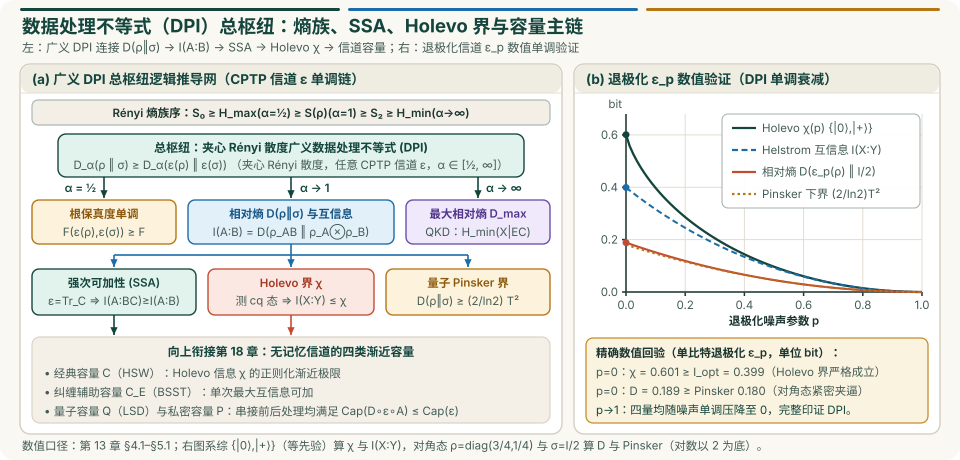
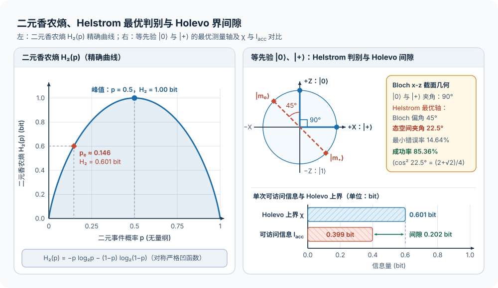
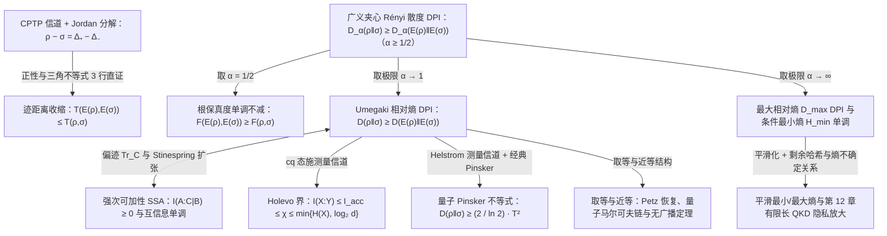

# 13｜量子信息量度：熵、距离与可提取信息

先修：[第 03 章：多量子比特、纠缠与约化态](03-multiple-qubits.md)、[第 05 章：混态、噪声与量子信道](05-noise-channels.md)。阅读路线：**必读 ★** 第 1 节、第 2.1–2.2 节、第 2.4 节、第 3.1–3.2 节、第 3.4 节、第 4.1 节、第 5 节与第 8 节；**进阶选读 ☆** 第 2.3 节（状态合并）、第 2.5 节（三元互信息）、第 3.3 节（无歧义判别）、第 4.2–4.3 节（夹心 Rényi DPI 与 Petz 恢复）、第 6 节（无广播与量子马尔可夫链）及第 7 节（单次最小/最大熵与有限长 QKD）。

第五篇先问三个可以算的问题。一个量子态有多不确定？给出一个样本时，两种候选态能分得多准？系统经过带噪信道后，这份可区分程度怎样变化？本章由熵、距离和数据处理不等式一路推到压缩、经典信息提取和有限长的安全证明。[第 12 章](12-security-network-frontiers.md)会把这些量用到密钥分发与网络中的纠缠交换。

全章核心信息量度速查（按需展开）

| 核心问题 | 主要量度 | 最小操作含义 | 所在章节 |
| :--- | :--- | :--- | :--- |
| 一个态有多混合？压缩底线是多少？ | von Neumann 熵 $S(\rho)$ | 纯态为 $0$，最大混态为 $\log_2 d$；决定 Schumacher 渐近保真量子压缩极限 | §1 |
| 子系统间有多少关联？ | 条件熵 $S(A\mid B)$、互信息 $I(A:B)$、纠缠熵 $E$ | $S(A\mid B)$ 决定状态合并净纠缠代价；cq 态互信息等于 Holevo 量 | §2 |
| 单次测量多容易区分 / 两态多相似？ | 迹距离 $T(\rho,\sigma)$、根保真度 $F(\rho,\sigma)$ | $T$ 精确决定 Helstrom 判别率；$F$ 与 $T$ 经 Fuchs–van de Graaf 互锁 | §3 |
| 经过信道后统计差异如何演化？ | 量子相对熵 $D(\rho\Vert\sigma)$ 与夹心 Rényi 散度 $\tilde D_\alpha$ | 广义数据处理不等式（DPI）与 Petz 恢复的总母定理 | §4 |
| 一组态最多传出多少经典信息？ | Holevo 量 $\chi$ 与可访问信息 $I_{\mathrm{acc}}$ | $\chi$ 约束任意单次测量互信息，也是多份联合解码的渐近极限 | §5 |
| 混态能否复制？三体关联如何恢复？ | 无广播条件、条件互信息 $I(A:C\mid B)$ | 对易才可广播；$I(A:C\mid B)=0$ 等价于量子马尔可夫链 | §6 |
| 有限长密码与单次猜测看什么熵？ | 量子 Rényi 熵 $S_\alpha$、平滑最小/最大熵 $H_{\min}^\varepsilon, H_{\max}^\varepsilon$ | $H_{\min}(X\mid E) = -\log_2 p_{\mathrm{guess}}$，直接驱动第 12 章有限长 QKD 安全证明 | §7 |

---

## 1. 不确定性与无损压缩：Shannon 熵、von Neumann 熵与 Schumacher 压缩

### 1.1 经典 Shannon 熵与二元熵

想象你在等一台随机信源吐出一个离散符号 $X$。如果某个结果发生的概率是 $1/4$，它出现时带给你的意外程度比概率为 $1/2$ 的结果更大；如果某个结果概率为 $1$，它铁定发生，看到它不会带来任何新信息。

为了让两个独立事件同时发生时的总意外程度等于各自意外程度之和，克劳德·香农（Claude Shannon, 1948）用负的以 $2$ 为底对数定义单个事件 $x$ 的**自信息**（意外程度）为 $-\log_2 p(x)$，单位是**比特**（bit）：

- $p = 1$：$-\log_2 1 = 0\text{ bit}$（毫无意外）；
- $p = 1/2$：$-\log_2(1/2) = 1\text{ bit}$；
- $p = 1/4$：$-\log_2(1/4) = 2\text{ bit}$。

前面的负号是因为 $0 < p \le 1$ 时 $\log_2 p \le 0$，加负号才让意外程度非负。在实验开箱之前，我们还不知道哪一个 $x$ 会落下来，于是把所有可能结果的意外程度按出现概率加权平均，就得到离散随机变量 $X \sim \{p(x)\}$ 的 **Shannon 熵**：

$$
H(X) = -\sum_x p(x)\log_2 p(x),
$$

其中对零概率项按极限 $\lim_{p\to 0^+} p\log_2 p = 0$ 约定 $0\log_2 0 = 0$。除平均意外程度外，Shannon 熵还有直接的工程含义：对大量独立同分布（i.i.d.）样本做无损压缩编码，每个符号渐近最少需要的二进制位数正好是 $H(X)\text{ bit}$。

全书最常碰到的特例是只有两个结果 $X \in \{0,1\}$、概率分别为 $p$ 与 $1-p$（$0 \le p \le 1$）的**二元香农熵**（本书正文记作 $h_2(p)$，部分教材与插图亦写作 $H_2(p)$）：

$$
h_2(p) = -p\log_2 p - (1-p)\log_2(1-p).
$$

我们来亲手算三个典型点：

1. **$p = 0$ 或 $p = 1$**：结果完全确定，$h_2(0) = h_2(1) = 0\text{ bit}$。
2. **$p = 1/2$**：两结果完全等可能，最难猜：

   $$
   h_2(1/2) = -\frac{1}{2}\log_2\frac{1}{2} - \frac{1}{2}\log_2\frac{1}{2} = \frac{1}{2}\cdot 1 + \frac{1}{2}\cdot 1 = 1\text{ bit}.
   $$

3. **$p = 1/4$**：把两个对数拆开算，先有 $-\log_2(1/4) = 2$，再有

   $$
   -\log_2\frac{3}{4} = \log_2 4 - \log_2 3 = 2 - \log_2 3 \approx 2 - 1.584963 = 0.415037.
   $$

   按概率加权相加：

   $$
   h_2(1/4) = \frac{1}{4}\times 2 + \frac{3}{4}\times 0.415037 \approx 0.500000 + 0.311278 = 0.811278\text{ bit}.
   $$

顺手厘清一个常见误解：**熵衡量的是概率分布的分散程度，和结果标签的数值大小毫无关系**。即便一个确定事件输出的是 $10^{100}$，只要它的概率是 $1$，熵依然严格等于 $0$；而 $0.811\text{ bit}$ 也不是说单次实验读出了“$0.811$ 个二进制位”，它度量的是分布整体的平均不确定性。

### 1.2 量子 von Neumann 熵与核心性质

转到量子世界后，麻烦来了：同一个量子态在不同测量基下会吐出完全不同的概率分布。例如纯态 $|+\rangle = (|0\rangle + |1\rangle)/\sqrt 2$，在 $X$ 基测量必然得 $+1$（输出熵 $0$），换到 $Z$ 基测量却以各 $1/2$ 的概率给出 $0$ 或 $1$（输出熵 $1\text{ bit}$）。哪一张概率表才代表量子态“自身”的混合程度？

约翰·冯·诺依曼（John von Neumann, 1927/1932）给出的办法极其干脆：**把密度矩阵 $\rho$ 旋转到它自身的特征基上对角化**。在 $d$ 维希尔伯特空间 $\mathcal H$ 中，合法密度矩阵 $\rho$ 满足厄米性（$\rho^\dagger = \rho$）、正半定性（$\rho \succeq 0$）与单位迹（$\operatorname{Tr}\rho = 1$），因此总存在谱分解

$$
\rho = \sum_{j=1}^d \lambda_j |j\rangle\langle j|,
\qquad \lambda_j \ge 0,\quad \sum_{j=1}^d \lambda_j = 1,
$$

其中 $\{|j\rangle\}$ 是正交归一特征基。特征值 $\{\lambda_j\}$ 构成一组合法概率分布，它们的 Shannon 熵就是 **von Neumann 熵**：

$$
S(\rho) = -\operatorname{Tr}\bigl(\rho\log_2\rho\bigr) = -\sum_{j=1}^d \lambda_j\log_2\lambda_j \in [0,\ \log_2 d].
$$

注意：**矩阵对数 $\log_2\rho$ 是在谱分解的特征值上分别取 $\log_2\lambda_j$，绝不是把矩阵里的每个元素逐格取对数**。同样沿用 $0\log_2 0 = 0$。

von Neumann 熵在量子信息论里拥有一组干净利落的核心性质：

1. **酉不变性**：对任意酉算符 $U$，有 $S(U\rho U^\dagger) = S(\rho)$。因为酉变换只旋转特征基，不改变特征值，所以量子门不会凭空制造或消灭态的混合度。
2. **极值边界**：$S(\rho) = 0$ 当且仅当 $\rho$ 是纯态（单个特征值为 $1$，其余为 $0$）；$S(\rho) = \log_2 d$ 当且仅当 $\rho = I/d$ 为最大混态。
3. **凹性**（Concavity）：把若干态按概率 $\{p_x\}$ 经典混合，不确定性不会减少：

   $$
   S\!\left(\sum_x p_x \rho_x\right) \ge \sum_x p_x S(\rho_x).
   $$

4. **投影测量不减熵**：对任意完备正交投影测量 $\{P_k\}$（$\sum_k P_k = I$），丢弃测量记录后的非选择后态 $\rho' = \sum_k P_k\rho P_k$ 满足 $S(\rho') \ge S(\rho)$，等号成立当且仅当 $\rho$ 本身已在测量基下块对角（$\rho' = \rho$）。这正好解释了为什么 $|+\rangle$ 在 $Z$ 基测量后输出熵从 $0$ 涨到了 $1$。
5. **有限维连续性与无限维边界**：在有限维 $d \ge 2$ 中，两个接近的态熵也接近（Fannes–Audenaert 不等式：若第 3 节定义的迹距离 $T(\rho,\sigma) = \varepsilon$，则 $|S(\rho)-S(\sigma)| \le \varepsilon\log_2(d-1) + h_2(\varepsilon)$；维数 $d \ge 2$ 保证了 $\log_2(d-1)$ 有意义）。但在无限维连续变量空间中，von Neumann 熵在迹范数下不再连续，必须附加平均能量上限才能稳定讨论（详见[第 18 章](18-channels-capacities-complexity.md)）。

#### 算例：三个单比特态的 von Neumann 熵

- **纯态 $|+\rangle\langle +| = \frac{1}{2}\begin{bmatrix}1&1\\1&1\end{bmatrix}$**：矩阵秩为 $1$、迹为 $1$，特征值是 $1$ 和 $0$，故

  $$
  S(|+\rangle\langle +|) = -1\log_2 1 - 0\log_2 0 = 0\text{ bit}.
  $$

  尽管如此，在计算基 $\{|0\rangle,|1\rangle\}$ 测量 $|+\rangle$ 依然各以 $1/2$ 出现，说明“态的熵为零”绝不等同于“任何测量都给出确定结果”。
- **最大混态 $I/2 = \operatorname{diag}(1/2, 1/2)$**：特征值直接读作 $1/2, 1/2$，故

  $$
  S(I/2) = h_2(1/2) = 1\text{ bit}.
  $$

- **偏置对角混态 $\rho = \operatorname{diag}(3/4, 1/4)$**：已是对角矩阵，特征值为 $3/4$ 与 $1/4$，直接复用上节结果：

  $$
  S(\rho) = h_2(1/4) \approx 0.811278\text{ bit}.
  $$

> **工程衔接：从有限测量估算纯度与熵时的非线性偏差**
>
> 在真实实验里，我们只能从有限次测量重构态估计 $\widehat\rho$。许多对线性期望严格无偏的估计器（例如[第 16 章](16-advanced-algorithms-verification.md)的随机 Pauli 经典阴影单次快照 $\hat\rho_s = 3|0\rangle\langle 0| - I = \operatorname{diag}(2, -1)$）虽然迹为 $1$ 且期望等于真实 $\rho$，单次却带有负特征值，根本不能直接代进 $\log_2\hat\rho_s$ 计算熵。即使先求 $N$ 轮样本均值 $\widehat\rho$，直接代入二次纯度 $\operatorname{Tr}(\widehat\rho^2)$ 这类非线性公式也会因自乘方差项引入系统性向上偏差（对 $|0\rangle$ 做 $N$ 轮随机 Pauli 测量，插件纯度期望高达 $1 + 1/N$，高于物理上限 $1$！）。消除二次插件偏差需改用不同独立快照的交叉乘积（$U$ 统计量），而强非线性函数 $S(\rho)$ 更需结合物理正半定约束与有限样本不确定度分析——完整的 $U$ 统计量推导与实验验证见[第 16 章](16-advanced-algorithms-verification.md)与[第 15 章](15-practice-research.md)（离线穷举校验见章末实验入口）。

### 1.3 Schumacher 量子数据压缩与典型子空间

经典信息论中，Shannon 熵 $H(X)$ 的灵魂在于无损数据压缩：把 $n$ 个独立同分布符号打包，压缩率只要大于 $H(X)$ 就能几乎无损还原。那么量子世界里的 von Neumann 熵 $S(\rho)$ 是否也有一模一样的操作地位？1995 年，Benjamin Schumacher 给出了奠基性的肯定回答。

设纯态信源 $\mathscr S=\{p_x,|\psi_x\rangle\}$ 每次独立按 $p_x$ 发射一份单比特态。盲压缩的编码器只拿到量子系统，看不到经典标签；可见压缩的编码器知道标签。恢复整个标签串的经典任务每符号需要 $H(X)$ bit，量子压缩则要恢复原量子态。多个独立信号的平均态可以把大部分概率权重集中到一个比 $2^n$ 小得多的典型子空间。

**严格定义与 Schumacher 压缩定理（1995）**：先写出单份信源的平均密度矩阵及其谱分解

$$
\rho = \sum_x p_x |\psi_x\rangle\langle\psi_x| = \sum_j \lambda_j |e_j\rangle\langle e_j|.
$$

连续发射 $n$ 份独立状态，整体平均态为 $\rho^{\otimes n} = \sum_{j_1\cdots j_n} \lambda_{j_1}\cdots\lambda_{j_n}\,|e_{j_1}\cdots e_{j_n}\rangle\langle e_{j_1}\cdots e_{j_n}|$。给定任意小容差 $\delta > 0$，定义 **$\delta$-典型子空间** $\mathcal T_{n,\delta}$ 为由所有满足

$$
2^{-n\bigl(S(\rho)+\delta\bigr)} \;\le\; \lambda_{j_1}\lambda_{j_2}\cdots\lambda_{j_n} \;\le\; 2^{-n\bigl(S(\rho)-\delta\bigr)}
$$

的乘积特征基 $|e_{j_1}\cdots e_{j_n}\rangle$ 张成的子空间，并记该子空间上的正交投影算符为 $\Pi_{n,\delta}$。随着 $n$ 增大，由弱大数定律可直接得到典型子空间的两条基石性质（对任意 $\varepsilon, \delta > 0$ 与足够大的 $n$）：

1. **概率高度集中**：$\operatorname{Tr}(\Pi_{n,\delta}\rho^{\otimes n}) \ge 1 - \varepsilon$；
2. **维数指数收缩**：$(1-\varepsilon)\,2^{n(S(\rho)-\delta)} \le \dim\mathcal T_{n,\delta} \le 2^{n(S(\rho)+\delta)}$。

由此立刻拼出极简的**压缩—解压协议**：

- **压缩端。** 测量 $\{\Pi_{n,\delta},I-\Pi_{n,\delta}\}$。若通过，用约定的等距编码把典型子空间装进 $m=\lceil n(S(\rho)+\delta)\rceil$ 个比特；未通过则发送固定哑态的编码。这个方案用于 $S(\rho)+\delta<1$；若该和达到或超过 $1$，可直接传原来的 $n$ 个比特。
- **解压端。** 把通过和替换分支的编码嵌回原空间。综合信道为 $\mathcal E_{\mathrm{comp}}(\sigma)=\Pi_{n,\delta}\sigma\Pi_{n,\delta}+\operatorname{Tr}[(I-\Pi_{n,\delta})\sigma]|\phi_0\rangle\langle\phi_0|$，其中哑态 $|\phi_0\rangle$ 在典型子空间内。

接受率 $1-\varepsilon$ 是关于发射标签串的平均下界。比如正交源以 $0.9,0.1$ 发射 $|0\rangle,|1\rangle$，$S=h_2(0.1)\approx0.4690$ bit。取 $\delta=0.1$ bit，全零码字每份自信息 $-\log_2 0.9\approx0.1520$ bit，永远在典型窗口之外。该串被发射的概率 $0.9^n$ 趋于零，平均通过率仍趋于 1。

**三个保真度口径。** 令 $|\psi_{x^n}\rangle$ 为输入、$\sigma_{x^n}$ 为解压输出。码字平方重叠为 $f_{x^n}=\langle\psi_{x^n}|\sigma_{x^n}|\psi_{x^n}\rangle$，平均平方重叠是 $\sum_{x^n}p_{x^n} f_{x^n}$，平均根保真度是 $\sum_{x^n}p_{x^n}\sqrt{f_{x^n}}$。另一项是把平均态 $\rho^{\otimes n}$ 与参考 $R_{\mathrm{ref}}$ 一起纯化得到 $|\Psi\rangle$，比较 $|\Psi\rangle\langle\Psi|$ 和 $(\mathrm{id}_{R_{\mathrm{ref}}}\otimes\mathcal E_{\mathrm{comp}})(|\Psi\rangle\langle\Psi|)$ 的根保真度 $F_e$，检验外部相关性是否保留。

**渐近极限。** 对独立同分布纯态源、固定最大压缩空间维数 $2^m$，当每信号压缩率 $r=m/n>S(\rho)$ 时可使平均重叠和盲压缩的 $F_e$ 趋于 1。固定率 $r<S(\rho)$ 时，强反定理给出即使编码器知道标签，平均平方重叠仍趋于 0。平均根保真度由 Jensen 不等式也趋于 0；盲压缩的 $F_e^2$ 可由平均平方重叠上界。非正交态的 $S(\rho)$ 可能严格低于 $H(X)$，两数衡量的是恢复量子信号和恢复原始标签这两项任务。[Schumacher 1995](https://doi.org/10.1103/PhysRevA.51.2738) · [Winter 定理 I.19](https://arxiv.org/pdf/quant-ph/9907077)

#### 8 维具体手算例：把 $\{|0\rangle, |+\rangle\}^{\otimes 3}$ 压进 2 个量子比特

空谈 $n \to \infty$ 往往显得抽象。我们来亲手算一个仅仅打包 **$n = 3$ 个量子比特**（$2^3 = 8$ 维）的完整极简教学压缩算例，亲眼看看典型子空间怎样把 3 个量子比特稳稳塞进 2 个量子比特里。

设信源每次以等概率 $1/2$ 发射 $|0\rangle$ 或 $|+\rangle$（经典标签熵 $H(X) = 1\text{ bit}$）。先求单比特平均态 $\rho$ 的矩阵与特征值：

$$
\rho = \frac{1}{2}|0\rangle\langle 0| + \frac{1}{2}|+\rangle\langle +|
= \frac{1}{2}\begin{bmatrix}1 & 0\\ 0 & 0\end{bmatrix}
+ \frac{1}{2}\begin{bmatrix}1/2 & 1/2\\ 1/2 & 1/2\end{bmatrix}
= \begin{bmatrix}3/4 & 1/4\\ 1/4 & 1/4\end{bmatrix}.
$$

算迹与行列式：$\operatorname{Tr}\rho = \frac{3}{4} + \frac{1}{4} = 1$，$\det\rho = \frac{3}{16} - \frac{1}{16} = \frac{1}{8}$。解特征方程 $\lambda^2 - \lambda + \frac{1}{8} = 0$，判别式为 $1 - \frac{1}{2} = \frac{1}{2}$，得两个特征值与对应的正交归一特征基 $\{|e_+\rangle, |e_-\rangle\}$：

$$
\lambda_+ = \frac{1 + 1/\sqrt 2}{2} = \cos^2\frac{\pi}{8} \approx 0.853553, \qquad
\lambda_- = \frac{1 - 1/\sqrt 2}{2} = \sin^2\frac{\pi}{8} \approx 0.146447,
$$

$$
|e_+\rangle = \cos\frac{\pi}{8}|0\rangle + \sin\frac{\pi}{8}|1\rangle, \qquad
|e_-\rangle = -\sin\frac{\pi}{8}|0\rangle + \cos\frac{\pi}{8}|1\rangle.
$$

（顺手检查对称性：$|\langle 0|e_+\rangle|^2 = \cos^2(\pi/8) = \lambda_+$，且 $\langle +|e_+\rangle = \frac{1}{\sqrt 2}(\cos\frac{\pi}{8}+\sin\frac{\pi}{8}) = \cos\frac{\pi}{8}$，故 $|\langle +|e_+\rangle|^2 = \lambda_+$ 也完全相同！）单份态的 von Neumann 熵为

$$
S(\rho) = h_2(\lambda_+) \approx -0.853553\log_2(0.853553) - 0.146447\log_2(0.146447) \approx 0.600876\text{ bit} < 1\text{ bit}.
$$

现在一次打包 $n = 3$ 份量子比特，总希尔伯特空间是 $8$ 维。$\rho^{\otimes 3}$ 在乘积特征基 $\{|e_\pm e_\pm e_\pm\rangle\}$ 下完全对角，8 个特征值按“含有几个小权重 $|e_-\rangle$ 翻转”整齐分成 4 档：

| 含 $\lvert e_-\rangle$ 的个数 | 对应特征基个数 | 单个特征值公式与数值 | 本档总概率权重 | 是否保留进 2 比特子空间 |
|---:|---:|---:|---:|---|
| $0$ 个（$\lvert e_+e_+e_+\rangle$） | $1$ | $\lambda_+^3 \approx 0.621859$ | $0.621859$ | **保留**（典型） |
| $1$ 个（如 $\lvert e_-e_+e_+\rangle$） | $3$ | $\lambda_+^2\lambda_- \approx 0.106694$ | $0.320083$ | **保留**（典型） |
| $2$ 个（如 $\lvert e_-e_-e_+\rangle$） | $3$ | $\lambda_+\lambda_-^2 \approx 0.018306$ | $0.054917$ | 丢弃（非典型） |
| $3$ 个（$\lvert e_-e_-e_-\rangle$） | $1$ | $\lambda_-^3 \approx 0.003141$ | $0.003141$ | 丢弃（非典型） |

验算归一化：$0.621859 + 0.320083 + 0.054917 + 0.003141 = 1.000000$，严丝合缝！

我们的目标是把 $3$ 个量子比特压进 $m = 2$ 个量子比特（压缩率 $2/3 \approx 0.6667 > S(\rho) \approx 0.6009$）。$2$ 个量子比特刚好容纳 $2^2 = 4$ 维子空间，于是直接选取特征值最大的前 $4$ 个特征基（$0$ 翻转 $1$ 个 $+$ $1$ 翻转 $3$ 个）作为投影子空间 $\Pi_{\mathrm{top4}}$。这一半维数竟然捕获了绝大部分概率权重：

$$
p_{\mathrm{typ}} = \operatorname{Tr}\bigl(\Pi_{\mathrm{top4}}\,\rho^{\otimes 3}\bigr) = \lambda_+^3 + 3\lambda_+^2\lambda_- \approx 0.621859 + 0.320083 = 0.941942 \quad (94.19\%).
$$

仅占 $5.81\%$ 的非典型分支被替换成哑态 $|\phi_0\rangle = |e_+e_+e_+\rangle$。我们分别算码字平方重叠、平均根保真度及参考系保真度：

1. **平均码字保真度**（对全部 $2^3 = 8$ 种等概率输入纯态 $|\psi_x\rangle \in \{|0\rangle, |+\rangle\}^{\otimes 3}$）：因为 $|\langle 0|e_+\rangle|^2 = |\langle +|e_+\rangle|^2 = \lambda_+$，每一条码字落在典型子空间里的权重都精确等于 $p_{\mathrm{typ}}$，与哑态 $|e_+e_+e_+\rangle$ 的平方重叠都精确等于 $\lambda_+^3$！于是每一条码字压缩解压后的平方重叠都是

   $$
   \bar f = \langle\psi_x|\mathcal E_{\mathrm{comp}}(|\psi_x\rangle\langle\psi_x|)|\psi_x\rangle
   = p_{\mathrm{typ}}^2 + \lambda_+^3(1 - p_{\mathrm{typ}})
   \approx 0.887254 + 0.621859 \times 0.058058
   \approx 0.923358,
   $$

   本例每条码字的平方重叠相同，故平均根保真度 $\bar F=\sqrt{\bar f}\approx0.960915$。一般须分别平均，不能交换开方和平均。
2. **纠缠保真度**（纯化参考系统口径，检验压缩是否完整保留信源与外界的纠缠）：写出综合信道的 Kraus 算符 $K_0 = \Pi_{\mathrm{top4}}$ 与 4 个非典型替换算符 $K_j = |e_+e_+e_+\rangle\langle e_j|$（$j$ 遍历 4 个非典型特征基）。由于每个非典型 $|e_j\rangle$ 都与 $|e_+e_+e_+\rangle$ 正交，有 $\operatorname{Tr}(\rho^{\otimes 3}K_j) = \lambda_+^3\langle e_j|e_+e_+e_+\rangle = 0$，只剩 $K_0$ 贡献，因此纠缠平方保真度为 $F_e^2 = |\operatorname{Tr}(\rho^{\otimes 3}\Pi_{\mathrm{top4}})|^2 = p_{\mathrm{typ}}^2 \approx 0.887254$，按本书根保真度口径为 **$F_e = p_{\mathrm{typ}} \approx 0.9419$**（严格满足 $\bar f \ge F_e^2$）。两项根保真度分别约为 $0.9609$ 与 $0.9419$；后者检验的是与参考系统的相干性。

**鲜明反差对照**：如果换成经典正交信源 $\{|0\rangle, |1\rangle\}$（$S(\rho) = 1\text{ bit}$），$\rho^{\otimes 3} = I_8/8$ 的 8 个特征值全都是 $1/8 = 0.125$。强行压进 2 个量子比特（4 维子空间）只能保住 $4/8 = 50\%$ 的权重，纠缠根保真度暴跌至 $F_e = 0.50$（$F_e^2 = 0.25$），平均码字平方重叠也只有 $4/8 = 0.50$，压缩失效。只需一个 8 维手算例，von Neumann 熵决定量子压缩极限的几何本质就清晰明了。

> **就地练习｜练 13-A（非正交信源的 $n=2$ 量子压缩）**
>
> 设单比特量子信源等概率发射 $|0\rangle$ 或 $|\phi\rangle = \frac{\sqrt 3}{2}|0\rangle + \frac{1}{2}|1\rangle$（两态重叠 $|\langle 0|\phi\rangle| = \frac{\sqrt 3}{2}$）。请计算单份平均态 $\rho$ 的特征值 $\lambda_\pm$ 与 von Neumann 熵 $S(\rho)$；若将 $n = 2$ 个量子比特（4 维）压缩进 $1$ 个量子比特（保留最大的 2 个特征态），计算典型子空间捕获的概率权重 $p_{\mathrm{typ}}$。
>
> **参考核对**：$\rho = \begin{bmatrix}7/8 & \sqrt 3/8\\ \sqrt 3/8 & 1/8\end{bmatrix}$，迹为 $1$、行列式为 $\frac{7 - 3}{64} = \frac{1}{16}$，得 $\lambda_\pm = \frac{1 \pm \sqrt 3/2}{2} \approx 0.933013,\ 0.066987$，$S(\rho) = h_2(\lambda_+) \approx 0.354579\text{ bit}$。打包 $n = 2$ 时，4 个特征值为 $\lambda_+^2 \approx 0.870513$、两重 $\lambda_+\lambda_- = 1/16 = 0.062500$ 与 $\lambda_-^2 \approx 0.004487$；保留最大 2 维子空间捕获总权重 $p_{\mathrm{typ}} = \lambda_+^2 + \lambda_+\lambda_- = \lambda_+(\lambda_+ + \lambda_-) = \lambda_+ \approx 93.30\%$（$2 \to 1$ 压缩率 $0.5 > 0.355$，保留权重约 $93.3\%$，第二个保留特征向量可从二重简并空间任取）。

---

## 2. 量子关联与负条件熵：三层态图景、状态合并与三元互信息

### 2.1 联合熵、条件熵与两体互信息

回到经典概率：若有两个离散随机变量 $X,Y$，联合分布为 $p(x,y)$，边缘分布为 $p(x), p(y)$，那么知道 $Y$ 以后对 $X$ 剩下的不确定性叫**条件熵**：

$$
H(X\mid Y) = H(X,Y) - H(Y) \ge 0.
$$

它永远非负——经典世界里，知道额外线索 $Y$ 最多把对 $X$ 的不确定性降到 $0$，绝不会变成负数。把知道 $Y$ 前后的不确定性相减，就是衡量 $X$ 与 $Y$ 共享信息量的**经典互信息**：

$$
I(X:Y) = H(X) - H(X\mid Y) = H(X) + H(Y) - H(X,Y) = \sum_{x,y} p(x,y)\log_2\frac{p(x,y)}{p(x)p(y)} \ge 0.
$$

当且仅当 $X$ 与 $Y$ 相互独立（$p(x,y) = p(x)p(y)$）时，$I(X:Y) = 0$。

现在把这套结构搬到二分量子态 $\rho_{AB} \in L(\mathcal H_A \otimes \mathcal H_B)$ 上。先记两个边缘约化态为 $\rho_A = \operatorname{Tr}_B\rho_{AB}$、$\rho_B = \operatorname{Tr}_A\rho_{AB}$，简写各部分 von Neumann 熵：

$$
S(A) = S(\rho_A),
\qquad
S(B) = S(\rho_B),
\qquad
S(AB) = S(\rho_{AB}).
$$

仿照经典公式，定义**量子条件熵**与**量子互信息**：

$$
S(A\mid B) = S(AB) - S(B),
$$

$$
I(A:B) = S(A) + S(B) - S(AB) = S(A) - S(A\mid B).
$$

量子互信息 $I(A:B)$ 依然永远非负，它把子系统 $A$ 与 $B$ 之间的**全部总关联**（经典关联加量子关联）一网打尽。但量子条件熵 $S(A\mid B)$ 却打破了经典直觉——**它可以严格小于零**！

#### 算例对比：Bell 纠缠态 vs 经典相关混态

**情形一：Bell 态 $|\Phi^+\rangle_{AB} = \frac{1}{\sqrt 2}(|00\rangle + |11\rangle)$。**

先把完整密度矩阵按四项展开（基序遵循全书约定 $|00\rangle,|01\rangle,|10\rangle,|11\rangle$）：

$$
\rho_{AB} = |\Phi^+\rangle\langle\Phi^+|
= \frac{1}{2}\Bigl(|00\rangle\langle 00| + |00\rangle\langle 11| + |11\rangle\langle 00| + |11\rangle\langle 11|\Bigr).
$$

对子系统 $B$ 做偏迹，用规则 $\operatorname{Tr}_B(|ij\rangle\langle k\ell|) = \delta_{j\ell}|i\rangle\langle k|$（只保留 $B$ 侧左右下标相同的项）：

$$
\rho_A = \operatorname{Tr}_B\rho_{AB}
= \frac{1}{2}\bigl(|0\rangle\langle 0| + 0 + 0 + |1\rangle\langle 1|\bigr) = \frac{I}{2}.
$$

对称地 $\rho_B = I/2$。整体是纯态，所以 $S(AB) = 0$；各自局部却是最大混态，所以 $S(A) = S(B) = 1\text{ bit}$。代入定义：

$$
S(A\mid B) = S(AB) - S(B) = 0 - 1 = -1\text{ bit},
$$

$$
I(A:B) = S(A) + S(B) - S(AB) = 1 + 1 - 0 = 2\text{ bit}.
$$

**情形二：经典相关混态 $\rho_{AB}^{\mathrm{cl}} = \frac{1}{2}|00\rangle\langle 00| + \frac{1}{2}|11\rangle\langle 11|$。**

这个态表示 $A$ 与 $B$ 共享一枚抛完后密封在两份信封里的随机比特：要么都是 $0$，要么都是 $1$，各占一半。它已在计算基下对角，非零特征值为 $1/2, 1/2$，故 $S(AB) = h_2(1/2) = 1\text{ bit}$；偏迹掉任意一边同样得到 $\rho_A = \rho_B = I/2$，故 $S(A) = S(B) = 1\text{ bit}$。代入定义：

$$
S(A\mid B) = 1 - 1 = 0\text{ bit},
\qquad
I(A:B) = 1 + 1 - 1 = 1\text{ bit}.
$$

两相对照，一目了然：对任何经典分布或可分经典–经典态，必有 $S(A\mid B) \ge 0$，从而互信息被封死在 $I(A:B) \le \min\{S(A), S(B)\}$；而对一般量子态，由 Araki–Lieb 不等式 $|S(A)-S(B)| \le S(AB)$ 可得上界放宽了一倍：

$$
I(A:B) \le 2\min\{S(A), S(B)\} \le 2\min\{\log_2 d_A,\ \log_2 d_B\}.
$$

Bell 态互信息从 $1\text{ bit}$ 跳到 $2\text{ bit}$，多出来的那 $1\text{ bit}$ 正是由 $S(A\mid B) = -1$ 贡献的量子关联。同时别误解这个数字：$I(A:B) = 2\text{ bit}$ 不表示单独测一个量子比特能读出两比特经典信息；[第 04 章](04-circuits-protocols.md)的超密编码能传 $2\text{ bit}$，靠的是“预共享 $1$ 个 Bell 对 $+$ 实际发送 $1$ 个量子比特”两份资源合用。

### 2.2 经典–经典、经典–量子与量子–量子态的统一图景

在量子通信与密码学里，除了完全经典的关联（cc 态）和完全量子的纠缠（qq 态），还有一类极其重要的中间桥梁——**经典–量子态**（classical–quantum state，简称 **cq 态**）：一个子系统存放经典随机变量 $X \sim \{p_x\}$（用一组互相正交的基 $|x\rangle_X$ 标记），另一个子系统存放与之对应的量子态 $\rho_x$：

$$
\rho_{XA} = \sum_x p_x\,|x\rangle\langle x|_X \otimes \rho_x.
$$

我们先逐步算出 cq 态的全部熵性质——这一步推导既为后面第 5 节的 Holevo 定理提前扫清障碍，也直接打通[第 12 章](12-security-network-frontiers.md)的 QKD 安全框架：

1. **边缘态与联合熵**：$\rho_X = \sum_x p_x |x\rangle\langle x|_X$ 的熵为 $S(X) = H(X)$，$\rho_A = \bar\rho = \sum_x p_x\rho_x$ 的熵为 $S(A) = S(\bar\rho)$。由于不同 $x$ 对应的对角块互相正交，若 $\rho_x$ 的特征值为 $\{\lambda_{x,j}\}$，则 $\rho_{XA}$ 的整体特征值集合就是 $\{p_x\lambda_{x,j}\}$，逐项展开对数立得

   $$
   \begin{aligned}
   S(XA)
   &= -\sum_{x,j} p_x\lambda_{x,j}\log_2(p_x\lambda_{x,j}) \\
   &= -\sum_x p_x\log_2 p_x \left(\sum_j \lambda_{x,j}\right) - \sum_x p_x \sum_j \lambda_{x,j}\log_2\lambda_{x,j} \\
   &= H(X) + \sum_x p_x S(\rho_x).
   \end{aligned}
   $$

2. **两个条件熵都严格非负**：立刻读出 $S(A\mid X) = S(XA) - S(X) = \sum_x p_x S(\rho_x) \ge 0$。更关键的是，另一个方向的条件熵 $S(X\mid A) = S(XA) - S(A)$ **同样恒非负**（即对任意 cq 态必有 $S(XA) \ge S(A)$，绝不会像纠缠 qq 态那样变成负数）！只需三行初等证明：写出 $\rho_x = \sum_j \lambda_{x,j}|\psi_{x,j}\rangle\langle\psi_{x,j}|$，引入带正交基 $\{|x,j\rangle_E\}$ 的辅助系统构造联合纯态 $|\Phi\rangle_{AE} = \sum_{x,j}\sqrt{p_x\lambda_{x,j}}\,|\psi_{x,j}\rangle_A|x,j\rangle_E$。对 $E$ 求偏迹得 $\operatorname{Tr}_E|\Phi\rangle\langle\Phi| = \sum_x p_x\rho_x = \rho_A$，而由整体纯态性质知 $S(E) = S(A)$；若在 $E$ 上沿正交基 $\{|x,j\rangle_E\}$ 做投影测量，非选择后态 $\rho_E' = \sum_{x,j}p_x\lambda_{x,j}|x,j\rangle\langle x,j|_E$ 的熵恰好等于 $S(XA)$。套用第 1.2 节“投影测量不减熵”性质，立得

   $$
   S(A) = S(E) \le S(\rho_E') = S(XA) \implies S(X\mid A) = S(XA) - S(A) \ge 0!
   $$

3. **cq 态的互信息就是 Holevo 量**：把 $S(XA)$ 代回互信息定义，得

   $$
   I(X:A)_{\rho_{XA}} = S(X) + S(A) - S(XA) = S(\bar\rho) - \sum_x p_x S(\rho_x) \equiv \chi(\{p_x, \rho_x\}),
   $$

   且由 $S(X\mid A) \ge 0$ 立刻受限于 $I(X:A) \le H(X)$，由 $S(\bar\rho) \le \log_2 d_A$ 立刻受限于 $I(X:A) \le \log_2 d_A$。

把三类二分态并排摆成一张统一对照表，关联结构的层次豁然开朗：

| 二分态类型 | 标准密度矩阵形式 | 联合熵 $S(AB)$ | 条件熵 $S(A\mid B)$ 与 $S(B\mid A)$ | 互信息 $I(A:B)$ 含义与上界 | 典型物理 / 密码角色 |
| :--- | :--- | :--- | :--- | :--- | :--- |
| **经典–经典态**（cc） | $\sum_{x,y} p(x,y)\lvert x\rangle\langle x\rvert\otimes\lvert y\rangle\langle y\rvert$ | $H(X,Y)$ | 双向恒 $\ge 0$ | $I(X:Y) \le \min\{H(X), H(Y)\}$ | 经典信道、随机共享密钥 |
| **经典–量子态**（cq） | $\sum_x p_x \lvert x\rangle\langle x\rvert_X \otimes \rho_x$ | $H(X) + \sum_x p_x S(\rho_x)$ | $S(A\mid X) = \sum_x p_x S(\rho_x) \ge 0$；$S(X\mid A) = H(X) - \chi \ge 0$ | $I(X:A) = \chi(\{p_x,\rho_x\})$，上界 $\min\{H(X),\log_2 d_A\}$ | 量子编码通信；第 12 章 QKD 密钥–窃听者联合态 $\rho_{KE}$ |
| **一般量子–量子态**（qq） | 任意 $\rho_{AB}$（可含纠缠） | 可小于边缘熵 | **可严格为负**（最低 $-\log_2 d_A$） | $I(A:B) \le 2\min\{\log_2 d_A, \log_2 d_B\}$ | 量子状态合并、超密编码、纠缠辅助通信 |

**直连第 12 章 QKD 安全定义**：在[第 12 章](12-security-network-frontiers.md)的量子密钥分发结束后，合法密钥 $K$ 是经典比特串，而窃听者 Eve 手里攥着可能与密钥相关的量子存储器 $E$——双方联合态正是一个经典的 **cq 态** $\rho_{KE} = \sum_k p_k |k\rangle\langle k|_K \otimes \rho_E^k$！理想安全密钥态则是与窃听者完全退耦的均匀 cq 态 $\rho_{KE}^{\mathrm{ideal}} = \frac{I_K}{|K|}\otimes \rho_E$。现代**可组合 $\varepsilon$-安全**（Renner, 2005）正是用下一节的迹距离定义为 $T(\rho_{KE}, \rho_{KE}^{\mathrm{ideal}}) \le \varepsilon$；而渐近 Devetak–Winter 秘密密钥率公式 $r = S(K\mid E) - S(K\mid B) = I(K:B) - \chi(K:E)$，一下子就把第 12 章的 Shor–Preskill 界与本章的条件熵、Holevo 量拧成了一股绳！

### 2.3 进阶选读：负条件熵到底意味着什么？量子状态合并（State Merging）

算完 $S(A\mid B) = -1\text{ bit}$，几乎每一位初学者都会忍不住皱眉：“不确定性最低不就是 $0$ 吗？负 $1$ 比特信息到底是什么物理东西，难道不是硬套减法公式凑出来的数学符号游戏？”

这个问题困扰了量子信息学界多年，直到 2005 年霍罗德茨基、奥本海姆与温特（M. Horodecki, J. Oppenheim, A. Winter, 2005/2007）提出**量子状态合并**（Quantum State Merging）协议，才给负条件熵装上了严丝合缝的物理操作意义。

先看经典版的任务——**Slepian–Wolf 定理**（1973）：Alice 手里拿着 $n$ 份离散信源 $X^n$，Bob 手里已经有一份相关的边信息 $Y^n$。Alice 要把 $X^n$ 无损传给 Bob，渐近每份最少需要发送多少经典比特？答案正好是条件熵 $H(X\mid Y)$。因为经典边信息再好用，最多省到“一比特都不用发”，所以代价永远 $\ge 0$。

现在把同一个任务搬进量子世界：

- **三方设定**：考虑二分态 $\rho_{AB}$ 的 $n$ 份独立拷贝，记其整体纯化为三方纯态 $|\psi\rangle_{RAB}^{\otimes n}$。这里 Alice 持有 $A^n$，Bob 持有 $B^n$，外部参考系统 $R^n$ 代表 $AB$ 与宇宙其余部分可能保持的量子纠缠——**整个传输过程谁也不能碰 $R^n$，且最终必须完整保留与 $R^n$ 的全部量子关联**。
- **允许操作**（LOCC $+$ 纠缠银行）：Alice 与 Bob 之间允许免费的局域量子操作与双向经典通信（LOCC），但没有免费量子信道；如果需要传递量子相干性，两人可以按需**支取**预共享的 Bell 对（通过隐形传态送量子态），如果协议结束时反而多出了崭新的共享 Bell 对，就可以**存进**两人的纠缠银行留待后用。
- **目标**：把 Alice 的子系统 $A^n$ 完整合并到 Bob 的实验室（变成 $B'^n B^n$），使最终态与 $|\psi\rangle_{RB'B}^{\otimes n}$ 的保真度在 $n\to\infty$ 时趋近于 $1$。

**量子状态合并定理**（Horodecki–Oppenheim–Winter, 2005/2007）给出了一个令人拍案叫绝的答案：完成这项任务所需的**渐近净纠缠代价**（每份消耗的 Bell 对数，单位 ebit）恰好等于量子条件熵 $S(A\mid B)_\rho$：

- **当 $S(A\mid B) > 0$**：两人必须**净消耗**每份 $S(A\mid B)$ 个预共享 Bell 对，才能把 $A$ 完好并入 Bob 手中；
- **当 $S(A\mid B) = 0$**：只需免费 LOCC，**零纠缠消耗**即可完成合并；
- **当 $S(A\mid B) < 0$**：不仅**零纠缠消耗**就能把 $A$ 合并给 Bob，合并结束后两人手里还会**净赚** $|S(A\mid B)| = -S(A\mid B)$ 个高纯度 Bell 对（ebit）！

光听定理还不够过瘾，我们亲手用三组最简单的态把 $+1$、$0$、$-1$ 三种情形逐个跑通，立刻就能看透它的全部奥秘：

| 初始态 $\rho_{AB}$ | 纯化 $\lvert\psi\rangle_{RAB}$ | $S(AB)$ | $S(B)$ | $S(A\mid B)$ | 显式合并协议与净纠缠账单 |
| :--- | :--- | ---: | ---: | ---: | :--- |
| 无边信息混态 $\frac{I_A}{2}\otimes \lvert 0\rangle\langle 0\rvert_B$ | $\lvert\Phi^+\rangle_{RA}\lvert 0\rangle_B$ | $1$ | $0$ | $+1$ | Bob 与 $R$ 毫无关联，Alice 必须消耗 $1$ 个 Bell 对做隐形传态将 $A$ 送给 Bob（净花 $1$ ebit） |
| 经典相关混态 $\frac{1}{2}(\lvert 00\rangle\langle 00\rvert+\lvert 11\rangle\langle 11\rvert)$ | $\lvert\mathrm{GHZ}\rangle_{RAB}=\frac{\lvert 000\rangle+\lvert 111\rangle}{\sqrt 2}$ | $1$ | $1$ | $0$ | Alice 在 $X$ 基测 $A$ 发 $1\text{ bit}$ 给 Bob，Bob 条件施 $Z$ 再用 CNOT 复制到 $B'$（净花 $0$ ebit） |
| Bell 纠缠态 $\lvert\Phi^+\rangle\langle\Phi^+\rvert_{AB}$ | $\lvert 0\rangle_R\otimes\lvert\Phi^+\rangle_{AB}$ | $0$ | $1$ | $-1$ | $AB$ 已与 $R$ 退耦，Bob 直接在本地新建一份 $\lvert\Phi^+\rangle_{B'B''}$，原共享 Bell 对原封不动留下（净赚 $1$ ebit） |

我们专门把中间那一行（$S(A\mid B) = 0$）的每一步代数写扎实，免得读者疑惑“不花纠缠怎么就把与 $R$ 的三方纠缠完整搬到 Bob 家里了？”

把三方纯化 $|\mathrm{GHZ}\rangle_{RAB} = \frac{1}{\sqrt 2}(|000\rangle_{RAB} + |111\rangle_{RAB})$ 中的子系统 $A$ 用 $X$ 基展开（$|0\rangle_A = \frac{|+\rangle_A+|-\rangle_A}{\sqrt 2}$，$|1\rangle_A = \frac{|+\rangle_A-|-\rangle_A}{\sqrt 2}$）：

$$
\begin{aligned}
|\mathrm{GHZ}\rangle_{RAB}
&= \frac{1}{\sqrt 2}|0\rangle_R\frac{|+\rangle_A+|-\rangle_A}{\sqrt 2}|0\rangle_B
 + \frac{1}{\sqrt 2}|1\rangle_R\frac{|+\rangle_A-|-\rangle_A}{\sqrt 2}|1\rangle_B \\
&= \frac{1}{\sqrt 2}|+\rangle_A\left(\frac{|00\rangle_{RB}+|11\rangle_{RB}}{\sqrt 2}\right)
 + \frac{1}{\sqrt 2}|-\rangle_A\left(\frac{|00\rangle_{RB}-|11\rangle_{RB}}{\sqrt 2}\right).
\end{aligned}
$$

现在看操作步骤：

1. Alice 在 $X$ 基测量 $A$，并将 $1\text{ bit}$ 经典结果发给 Bob；
2. 若结果为 $|+\rangle_A$，$RB$ 已经是 $\frac{|00\rangle+|11\rangle}{\sqrt 2}$；若结果为 $|-\rangle_A$，Bob 在 $B$ 上施一个局域 $Z$ 门，把相对负号翻正，同样得到 $\frac{|00\rangle_{RB}+|11\rangle_{RB}}{\sqrt 2}$；
3. Bob 在自己实验室准备一个新量子比特 $|0\rangle_{B'}$，以 $B$ 为控制位、$B'$ 为目标位施一次 $\mathrm{CNOT}_{B\to B'}$：

   $$
   \mathrm{CNOT}_{B\to B'}\left(\frac{|00\rangle_{RB}+|11\rangle_{RB}}{\sqrt 2}|0\rangle_{B'}\right)
   = \frac{|000\rangle_{RB'B} + |111\rangle_{RB'B}}{\sqrt 2} = |\mathrm{GHZ}\rangle_{RB'B}.
   $$

全程没用一丁点预共享纠缠，也没剩多余纠缠，精准对应 $S(A\mid B) = 0$。

再看最后一行 Bell 态（$S(A\mid B) = -1$）：由于 $|\Phi^+\rangle_{AB}$ 本身已是纯态，它与外部参考系统 $R$ 没有任何纠缠（纯化就是 $|0\rangle_R\otimes|\Phi^+\rangle_{AB}$）。Bob 只要在本地按 $H$ 加 $\mathrm{CNOT}$ 重新制备一对 $|\Phi^+\rangle_{B'B''}$，就已经独自持有和原态一模一样的整体纯化 $|0\rangle_R\otimes|\Phi^+\rangle_{B'B''}$；而原来握在 Alice 和 Bob 手里的那对 $|\Phi^+\rangle_{AB}$ 根本没动过，白白净赚 $1$ 个 Bell 对，净消耗就是 $-1\text{ ebit}$！

最后补两条重要边界：

- **负条件熵绝不意味着负概率或超光速通信**：状态合并依然需要经典通信通道，只是省下了昂贵的量子传输并盈余出纠缠资源。
- **$S(A\mid B) < 0$ 是纠缠的充分条件，但不是必要条件**：对所有可分态必有 $S(A\mid B) \ge 0$，因此只要算得 $S(A\mid B) < 0$，就能严格断定 $\rho_{AB}$ 一定纠缠；但反过来存在明明纠缠却仍有 $S(A\mid B) \ge 0$ 的混态。例如两比特白噪声 Werner 态 $\rho_p = p|\Phi^+\rangle\langle\Phi^+| + (1-p)\frac{I}{4}$（本节可见度参数 $p$ 对应[第 12 章](12-security-network-frontiers.md)的 $v = (4f - 1)/3$，且局域酉变换连接 $|\Phi^+\rangle$ 与 $|\Psi^-\rangle$，不改变一切纠缠与熵量度；特征值为 $\frac{1+3p}{4}$ 一重与 $\frac{1-p}{4}$ 三重，约化态恒为 $I/2$，故 $S(B) = 1$）：按[第 03 章](03-multiple-qubits.md)的 PPT 判据，只要 $p > 1/3$ 它就已经纠缠；可它的条件熵 $S(A\mid B) = S(\rho_p) - 1$ 在 $p = 0.5$ 时仍为 $+0.5488\text{ bit} > 0$，一直要到 $p > p_* \approx 0.7476$ 才会跌破 $0$ 变为负数。

### 2.4 纯二分态的纠缠熵与 LOCC 渐近浓缩

当二分系统 $AB$ 整体处于**纯态** $|\psi\rangle_{AB}$ 时，由[第 03 章](03-multiple-qubits.md)的 Schmidt 分解，总能找到两侧的正交归一基 $\{|u_j\rangle_A\}$ 和 $\{|v_j\rangle_B\}$，写成

$$
|\psi\rangle_{AB} = \sum_j \sqrt{\lambda_j}\,|u_j\rangle_A |v_j\rangle_B,
\qquad \lambda_j \ge 0,\quad \sum_j \lambda_j = 1.
$$

对 $B$ 和对 $A$ 分别做偏迹，得到两个约化密度矩阵：

$$
\rho_A = \sum_j \lambda_j |u_j\rangle\langle u_j|,
\qquad
\rho_B = \sum_j \lambda_j |v_j\rangle\langle v_j|.
$$

它们的非零特征值完全相同，因此 $S(\rho_A) = S(\rho_B)$。这个共同值就是纯二分态的**纠缠熵**（entanglement entropy）：

$$
E(|\psi\rangle_{AB}) = S(\rho_A) = S(\rho_B) = -\sum_j \lambda_j \log_2 \lambda_j,
$$

常用单位是 **ebit**（$1$ 个理想 Bell 对含 $1\text{ ebit}$）。

#### 算例：部分纠缠纯态的纠缠熵

取两比特纯态 $|\psi\rangle = \sqrt{0.9}\,|00\rangle + \sqrt{0.1}\,|11\rangle$。这里 Schmidt 系数是 $\sqrt{0.9}$ 与 $\sqrt{0.1}$，平方后的 Schmidt 概率权重（即 $\rho_A = \operatorname{diag}(0.9, 0.1)$ 的特征值）才是 $0.9$ 与 $0.1$。代入公式：

$$
\begin{aligned}
E(|\psi\rangle)
&= h_2(0.1) = -0.9\log_2(0.9) - 0.1\log_2(0.1) \\
&\approx 0.136803 + 0.332193 = 0.468996\text{ ebit}.
\end{aligned}
$$

这个 $0.469\text{ ebit}$ 怎么理解？它并不是说“能把单份 $|\psi\rangle$ 确定性地劈成 $0.469$ 个 Bell 对”。贝内特等人（Bennett, Bernstein, Popescu, Schumacher, 1996）证明了**纯态纠缠浓缩定理**：在免费 LOCC 下，如果 Alice 和 Bob 共享 $n$ 份相同的 $|\psi\rangle$，当 $n\to\infty$ 时，他们可以把这 $n$ 份部分纠缠态渐近可逆地提炼成大约 $n E(|\psi\rangle) \approx 0.469n$ 个高纯度 Bell 对（输出与理想 Bell 对的迹距离趋于 $0$）。所以 $0.469\text{ ebit}$ 是一个**渐近资源兑换率**。

再次提醒边界：**约化熵 $S(\rho_A)$ 只对整体纯态等于纠缠量**。一旦 $\rho_{AB}$ 是混态（比如前面算过的经典相关混态 $\frac{1}{2}|00\rangle\langle 00| + \frac{1}{2}|11\rangle\langle 11|$），$S(\rho_A) = 1\text{ bit}$ 却一丁点纠缠也没有，因为这 $1\text{ bit}$ 混度来自经典随机混合而非量子纠缠。混态纠缠需要连同任务和免费操作一起选量度（如可蒸馏纠缠、形成纠缠与负性），我们在[第 18 章](18-channels-capacities-complexity.md)系统展开。

### 2.5 进阶选读：三元相关：经典复制、经典 XOR、GHZ 态、W 态与纠缠单配

只有两个子系统时，相关性还比较直观；一旦引入第三个子系统 $C$，信息可以呈现出截然不同的分布结构——有的像复印件一样到处冗余，有的像密码锁一样必须凑齐两把钥匙才能解开。

为了刻画这种三元结构，定义**三元互信息**（tripartite mutual information）：

$$
I_3(A:B:C) = I(A:B) + I(A:C) - I(A:BC).
$$

用第 6 节详讲的条件互信息 $I(A:C\mid B) = S(AB) + S(BC) - S(B) - S(ABC) = I(A:BC) - I(A:B)$ 改写，它也等于

$$
I_3(A:B:C) = I(A:C) - I(A:C\mid B) = I(A:B) - I(A:B\mid C).
$$

它的正负号自带鲜明的物理直觉：

- **$I_3 > 0$（冗余主导）**：$A$ 分别与 $B$、$C$ 的信息有重叠，合起来看 $BC$ 反而小于单独相加；
- **$I_3 < 0$（协同 / 秘密分享主导）**：信息被分散藏在 $B$ 与 $C$ 的联合关联里，单看 $B$ 或单看 $C$ 看到的比合起来看少得多。

下面亲手算四类最具代表性的三比特态，把经典与量子的三元关联一次看清。

1. **经典复制态** $\rho_{\mathrm{copy}} = \frac{1}{2}|000\rangle\langle 000| + \frac{1}{2}|111\rangle\langle 111|$：三者共享同一枚随机硬币，任取一个、两个或三个子系统都只有两个等概率取值，故 $S(A)=S(B)=S(C)=S(AB)=S(BC)=S(AC)=S(ABC)=1$。于是 $I(A:B)=I(A:C)=I(A:BC)=1$，得 $I_3 = 1+1-1 = +1\text{ bit}$。
2. **经典 XOR 秘密分享**（$A,B$ 独立等概率取 $0,1$，令 $C = A \oplus B$）：四个等概率经典串是 `000`、`011`、`101`、`110`，概率各 $1/4$。任看一个比特都是均匀分布（熵 $1$）；任看两个比特（如 $AB$、$AC$、$BC$）都正好覆盖全部四种两位串且各占 $1/4$（熵 $2$）；整体也只有 $4$ 种等概率串（$S(ABC) = 2$）。于是

   $$
   I(A:B) = 1+1-2 = 0, \qquad I(A:C) = 1+1-2 = 0,
   $$

   $$
   I(A:BC) = S(A) + S(BC) - S(ABC) = 1 + 2 - 2 = 1\text{ bit},
   $$

   $$
   I_3(A:B:C) = 0 + 0 - 1 = -1\text{ bit}.
   $$

   单拿 $B$ 或单拿 $C$ 对 $A$ 一无所知，凑齐 $BC$ 却能由 $A = B \oplus C$ 百分之百算出 $A$！
3. **三比特 GHZ 态** $|\mathrm{GHZ}\rangle = \frac{1}{\sqrt 2}(|000\rangle + |111\rangle)$：整体纯态 $S(ABC) = 0$。对 $C$ 做偏迹，交叉项 $|000\rangle\langle 111|$ 因 $C$ 侧 $0 \ne 1$ 归零，剩下

   $$
   \rho_{AB}^{\mathrm{GHZ}} = \operatorname{Tr}_C |\mathrm{GHZ}\rangle\langle\mathrm{GHZ}|
   = \frac{1}{2}|00\rangle\langle 00| + \frac{1}{2}|11\rangle\langle 11|.
   $$

   丢掉任意一个量子比特后，剩下两比特瞬间坍塌成纯经典相关混态，两体纠缠归零！此时 $S(A)=S(B)=S(C)=1$，$S(AB)=S(AC)=S(BC)=1$，故 $I(A:B)=I(A:C)=1$，$I(A:BC)=1+1-0=2$，从而 $I_3 = 1+1-2 = 0$。
4. **三比特 W 态** $|W\rangle = \frac{1}{\sqrt 3}(|100\rangle + |010\rangle + |001\rangle)$：整体纯态 $S(ABC) = 0$。把 $|W\rangle$ 按 $C$ 的状态分组：

   $$
   |W\rangle = \sqrt{\frac{2}{3}}\,\frac{|10\rangle + |01\rangle}{\sqrt 2}|0\rangle_C + \sqrt{\frac{1}{3}}\,|00\rangle|1\rangle_C
   = \sqrt{\frac{2}{3}}\,|\Psi^+\rangle_{AB}|0\rangle_C + \sqrt{\frac{1}{3}}\,|00\rangle_{AB}|1\rangle_C.
   $$

   由于 $|0\rangle_C$ 与 $|1\rangle_C$ 正交，对 $C$ 做偏迹直接消除交叉项，一眼读出约化态的谱分解：

   $$
   \rho_{AB}^{W} = \frac{2}{3}|\Psi^+\rangle\langle\Psi^+|_{AB} + \frac{1}{3}|00\rangle\langle 00|_{AB}.
   $$

   注意 $|\Psi^+\rangle$ 与 $|00\rangle$ 正交，所以 $\rho_{AB}^W$ 的特征值就是 $2/3, 1/3, 0, 0$，且它依然保留了明显的**两体量子纠缠**——即使丢掉一颗粒子，剩下两颗仍然纠缠，比 GHZ 态对粒子丢失稳健得多。继续对 $B$ 做偏迹得 $\rho_A^W = \frac{2}{3}|0\rangle\langle 0| + \frac{1}{3}|1\rangle\langle 1|$，特征值同样是 $2/3, 1/3$。于是：

   $$
   S(A) = S(AB) = h_2(1/3) = -\frac{2}{3}\log_2\frac{2}{3} - \frac{1}{3}\log_2\frac{1}{3} \approx 0.918296\text{ bit},
   $$

   $$
   I(A:B) = I(A:C) = h_2(1/3) \approx 0.9183, \qquad I(A:BC) = 2h_2(1/3), \qquad I_3 = 0.
   $$

把四类三元态汇总到一张对照表里，结构差异立现：

| 三方态 | $S(A)$ | $S(AB)$ | $S(ABC)$ | $I(A:B)$ | $I(A:C\mid B)$ | $I_3(A:B:C)$ | 物理结构解读 |
| :--- | ---: | ---: | ---: | ---: | ---: | ---: | :--- |
| 经典复制 $\frac{1}{2}(\lvert 000\rangle\langle 000\rvert+\lvert 111\rangle\langle 111\rvert)$ | $1$ | $1$ | $1$ | $1$ | $0$ | $+1$ | 经典冗余复制（$A$-$B$-$C$ 构成马尔可夫链） |
| 经典 XOR（$C = A\oplus B$，均匀分布） | $1$ | $2$ | $2$ | $0$ | $1$ | $-1$ | 秘密分享：两两独立，三者协同决定 |
| 三比特 GHZ 态 $\frac{\lvert 000\rangle+\lvert 111\rangle}{\sqrt 2}$ | $1$ | $1$ | $0$ | $1$ | $1$ | $0$ | 丢掉任意一比特后剩余两比特退化为经典关联 |
| 三比特 W 态 $\frac{\lvert 100\rangle+\lvert 010\rangle+\lvert 001\rangle}{\sqrt 3}$ | $0.9183$ | $0.9183$ | $0$ | $0.9183$ | $0.9183$ | $0$ | 丢掉任意一比特后剩余两比特仍保有两体纠缠 |

从这张表里还能顺手收获两条深层洞察：

1. **任意三体纯态恒有 $I_3 = 0$**：因为纯态的互补子系统熵相等（$S(AB) = S(C)$、$S(AC) = S(B)$、$S(BC) = S(A)$ 且 $S(ABC) = 0$），代入即全部抵消。要让纯量子态出现 $I_3 < 0$（代表信息被非局域地搅散进多体纠缠，例如纠错码或量子信息扰频），至少需要**四体**系统。尽管 GHZ 态与 W 态的 $I_3$ 都是 $0$，Dür、Vidal 与 Cirac（2000）证明它们属于两类**无法通过随机局域操作与经典通信（SLOCC）互相转化**的本质不同的三体纠缠。
2. **纠缠单配性**（Monogamy of Entanglement）：经典复制态告诉我们，经典关联可以无限制地分给无数个第三方。量子纠缠恰恰相反——**纠缠是排他的**。如果 $A$ 和 $B$ 已经处于最大纠缠 Bell 态 $|\Phi^+\rangle_{AB}$，因为 $|\Phi^+\rangle_{AB}$ 是纯态，任何包含 $AB$ 的更大系统必然是乘积态 $\rho_{ABC} = |\Phi^+\rangle\langle\Phi^+|_{AB} \otimes \rho_C$，从而 $I(A:C) = 0$：$A$ 根本分不出一丁点纠缠（甚至经典关联）给第三者 $C$！这正是量子密钥分发（见[第 12 章](12-security-network-frontiers.md)）安全性的物理靠山：只要 Alice 和 Bob 测得两人共享高度纯净的纠缠，窃听者 Eve 就不可能同时与他们高度纠缠。对于一般部分纠缠态，定量单配不等式可以写成 Coffman–Kundu–Wootters（2000）的三比特平方共生度不等式，而在任意维度混态上则由**压扁纠缠**（squashed entanglement）$E_{\mathrm{sq}}(A:B) = \frac{1}{2}\inf_{\rho_{ABE}} I(A:B\mid E)$（定义见 Christandl & Winter, 2004；单配性证明见 Koashi & Winter, 2004）严格满足 $E_{\mathrm{sq}}(A:B) + E_{\mathrm{sq}}(A:C) \le E_{\mathrm{sq}}(A:BC)$（衔接[第 18 章](18-channels-capacities-complexity.md)）。

---

## 3. 量子态的区分与相似：迹距离、Helstrom/USD 与根保真度

### 3.1 迹距离及其操作意义

想象一个最简单的量子猜谜游戏：实验助手按已知先验概率秘密制备了候选态 $\rho$ 或 $\sigma$ 中的一个，把这**唯一一份**量子系统递给你，让你设计一次测量去猜是哪一个。到底什么数字决定你最多能猜多准？

先把两个密度矩阵之差的大小定下来。对任意线性算符 $A$，定义其**迹范数**（trace norm）为

$$
\|A\|_1 = \operatorname{Tr}\sqrt{A^\dagger A}.
$$

当 $A$ 是厄米矩阵（例如两个密度矩阵之差 $\rho - \sigma$）时，谱分解 $A = \sum_j \mu_j |j\rangle\langle j|$ 给出 $\sqrt{A^\dagger A} = \sum_j |\mu_j|\,|j\rangle\langle j|$，因此**厄米矩阵的迹范数就是所有特征值绝对值之和**：$\|A\|_1 = \sum_j |\mu_j|$。

两个密度矩阵 $\rho,\sigma$ 之间的**迹距离**（trace distance）定义为差矩阵迹范数的一半：

$$
T(\rho,\sigma) = \frac{1}{2}\|\rho - \sigma\|_1 \in [0, 1].
$$

它满足距离的全部公理（非负、对称、三角不等式），并且具有直截了当的统计操作意义——**变分刻画**：

$$
T(\rho,\sigma) = \max_{0 \preceq \Lambda \preceq I} \operatorname{Tr}\!\bigl[\Lambda(\rho - \sigma)\bigr].
$$

其中 $0 \preceq \Lambda \preceq I$ 可以是任意广义测量（POVM）中对应某个结果事件的效应算符。这个等式说的是：**无论你采用什么物理测量，同一个测量结果在态 $\rho$ 与态 $\sigma$ 下出现的概率之差，绝对值绝不会超过 $T(\rho,\sigma)$**；而且只要把 $\Lambda$ 选为投影到 $\rho - \sigma$ 所有正特征子空间的投影算符 $\Pi_+$，就能恰好达到这个上限。

#### 完整推导：任意两纯态的迹距离

设两个归一化纯态为 $|\psi\rangle, |\phi\rangle$，令复内积 $c = \langle\psi|\phi\rangle$。在它们张成的二维子空间内选取一组正交归一基 $\{|e_0\rangle, |e_1\rangle\}$，使

$$
|\psi\rangle = |e_0\rangle = \begin{bmatrix}1\\0\end{bmatrix},
\qquad
|\phi\rangle = c|e_0\rangle + s|e_1\rangle = \begin{bmatrix}c\\s\end{bmatrix},
$$

由 $|\phi\rangle$ 归一化知 $|c|^2 + |s|^2 = 1$，故 $|s|^2 = 1 - |\langle\psi|\phi\rangle|^2$。写出密度矩阵之差：

$$
|\psi\rangle\langle\psi| - |\phi\rangle\langle\phi|
= \begin{bmatrix}1 & 0\\ 0 & 0\end{bmatrix} - \begin{bmatrix}|c|^2 & cs^*\\ c^*s & |s|^2\end{bmatrix}
= \begin{bmatrix}|s|^2 & -cs^*\\ -c^*s & -|s|^2\end{bmatrix}.
$$

算它的迹与行列式：

$$
\operatorname{Tr} = |s|^2 - |s|^2 = 0,
\qquad
\det = -|s|^4 - |c|^2|s|^2 = -|s|^2\bigl(|s|^2+|c|^2\bigr) = -|s|^2.
$$

特征方程 $\lambda^2 - |s|^2 = 0$ 直接给出两个特征值 $\lambda_\pm = \pm|s|$。迹范数是 $|\lambda_+| + |\lambda_-| = 2|s|$，除以 $2$ 即得纯态迹距离公式：

$$
T(|\psi\rangle\langle\psi|,\ |\phi\rangle\langle\phi|) = |s| = \sqrt{1 - |\langle\psi|\phi\rangle|^2}.
$$

核对两个极端：两态正交时 $\langle\psi|\phi\rangle = 0 \implies T = 1$；两态只差全局相位时 $|\langle\psi|\phi\rangle| = 1 \implies T = 0$。

### 3.2 加权 Holevo–Helstrom 定理与 Q1 Englert 互补恒等式的闭合

现在回到开头的单次猜谜问题，并把条件放宽到最一般的情形：助手以先验概率 $\eta \in [0,1]$ 制备 $\rho$、以 $1-\eta$ 制备 $\sigma$。我们允许做任意二元 POVM $\{M,\ I-M\}$（$0 \preceq M \preceq I$），看到结果 $M$ 就猜 $\rho$，看到 $I-M$ 就猜 $\sigma$。

先写出猜对总概率，然后做两步极其干净的恒等变形：

$$
\begin{aligned}
p_{\mathrm{guess}}(M)
&= \eta\operatorname{Tr}(M\rho) + (1-\eta)\operatorname{Tr}\!\bigl[(I-M)\sigma\bigr] \\
&= \eta\operatorname{Tr}(M\rho) + (1-\eta)\operatorname{Tr}(\sigma) - (1-\eta)\operatorname{Tr}(M\sigma) \\
&= (1-\eta) + \operatorname{Tr}\!\bigl[M\bigl(\eta\rho - (1-\eta)\sigma\bigr)\bigr].
\end{aligned}
$$

记括号里的加权厄米差算符为 $\Delta = \eta\rho - (1-\eta)\sigma$。把 $\Delta$ 按正特征值与负特征值拆成两个正半定、支撑集正交的部分（Jordan 分解）：

$$
\Delta = \Delta_+ - \Delta_-,
\qquad \Delta_+ \succeq 0,\quad \Delta_- \succeq 0,\quad \Delta_+\Delta_- = 0.
$$

因为 $0 \preceq M \preceq I$，对正半定算符有 $\operatorname{Tr}(M\Delta_+) \le \operatorname{Tr}(\Delta_+)$ 与 $\operatorname{Tr}(M\Delta_-) \ge 0$，于是

$$
\operatorname{Tr}(M\Delta) = \operatorname{Tr}(M\Delta_+) - \operatorname{Tr}(M\Delta_-) \le \operatorname{Tr}(\Delta_+).
$$

等号只要选取 $M^* = \Pi_{\Delta_+}$（投影到 $\Delta$ 的正特征子空间）就能精确达到！再把 $\operatorname{Tr}(\Delta_+)$ 用迹和迹范数表示出来：一方面 $\operatorname{Tr}(\Delta_+) - \operatorname{Tr}(\Delta_-) = \operatorname{Tr}(\Delta) = \eta\cdot 1 - (1-\eta)\cdot 1 = 2\eta - 1$，另一方面 $\operatorname{Tr}(\Delta_+) + \operatorname{Tr}(\Delta_-) = \|\Delta\|_1$。两式相加除以 $2$，得到

$$
\operatorname{Tr}(\Delta_+) = \frac{1}{2}\bigl(\|\Delta\|_1 + 2\eta - 1\bigr).
$$

代回 $p_{\mathrm{guess}}(M^*) = (1-\eta) + \operatorname{Tr}(\Delta_+)$，常数 $1-\eta$ 与 $\eta$ 恰好合并，我们就严密证明了**加权 Holevo–Helstrom 定理**（Helstrom, 1969/1976；Holevo, 1972）：

$$
p_{\mathrm{guess}}^{\max} = \frac{1}{2}\Bigl(1 + \bigl\|\eta\rho - (1-\eta)\sigma\bigr\|_1\Bigr).
$$

马上检验两个极端退化情况：

- **等先验**（$\eta = 1/2$）：$\|\frac{1}{2}\rho - \frac{1}{2}\sigma\|_1 = \frac{1}{2}\|\rho-\sigma\|_1 = T(\rho,\sigma)$，公式回退为熟悉的等先验 Helstrom 界

  $$
  p_{\mathrm{guess}}^{\max} = \frac{1}{2}\bigl(1 + T(\rho,\sigma)\bigr).
  $$

- **先验极度偏斜**（$\Delta = \eta\rho - (1-\eta)\sigma \succeq 0$）：所有特征值都非负，此时 $\Delta_- = 0$，$\|\Delta\|_1 = \operatorname{Tr}(\Delta) = 2\eta - 1$，代回公式得 $p_{\mathrm{guess}}^{\max} = \frac{1}{2}(1 + 2\eta - 1) = \eta$。最优测量退化成 $M^* = I$——**干脆不做任何测量，每次闭着眼都猜更常见的 $\rho$**！这说明盲猜概率 $\max(\eta, 1-\eta)$ 永远是合法的基准下界。

#### 跨章闭合：兑现 Q1 的 Englert 波粒二象性恒等式

读过[Q1：从实验认识量子态 §6.2](quantum-mechanics/01-experiments-states.md#62-波粒二象性的定量天平englert-互补关系)的读者，此刻可以把两条主线接上了。在 Q1 的不平衡 Mach–Zehnder 干涉仪中，粒子走上路和下路的权重分别是 $w_0$ 和 $w_1 = 1-w_0$，对应的路径探测器条件态是 $\rho_0^{(d)}$ 和 $\rho_1^{(d)}$。Q1 定义了**路径可区分度 $D$**——把最优判别路径的猜对概率 $p_{\mathrm{guess}}^{\max}$ 从 $[1/2, 1]$ 线性拉伸到 $[0, 1]$：

$$
D = 2p_{\mathrm{guess}}^{\max} - 1 = \bigl\|w_0\rho_0^{(d)} - w_1\rho_1^{(d)}\bigr\|_1 \in [0, 1].
$$

我们刚刚证明的加权 Holevo–Helstrom 定理，正是 Q1 里那句“$D = 2p_{\mathrm{guess}}^{\max} - 1 = \|w_0\rho_0^{(d)} - w_1\rho_1^{(d)}\|_1$”的严格出处！等权分束（$w_0 = w_1 = 1/2$）时，$D$ 就是两个路径记录态之间的迹距离 $T(\rho_0^{(d)}, \rho_1^{(d)})$；对纯探测器态 $\rho_k^{(d)} = |d_k\rangle\langle d_k|$（重叠 $\gamma = \langle d_1|d_0\rangle$），Q1 算出了条纹可见度 $\mathcal V = 2\sqrt{w_0 w_1}\,|\gamma|$ 与 $D^2 = 1 - 4w_0 w_1|\gamma|^2$，两式相加严丝合缝地闭合为

$$
\mathcal V^2 + D^2 = 1\qquad(\text{纯探测器态}),
$$

而一般混态探测器满足 $\mathcal V^2 + D^2 \le 1$。物理上“波粒二象性的互补天平”，在数学上就是加权 Helstrom 最优判别与非对角相干度之间的精确勾股约束。

#### 算例一：等先验区分 $|0\rangle$ 与 $|+\rangle$（几何直觉 + 最优测量基）

取等先验 $\eta = 1/2$，$\rho = |0\rangle\langle 0|$、$\sigma = |+\rangle\langle +|$。两态内积 $\langle 0|+\rangle = 1/\sqrt 2$，模平方为 $1/2$，立刻得

$$
T(|0\rangle\langle 0|,\ |+\rangle\langle +|) = \sqrt{1 - \frac{1}{2}} = \frac{1}{\sqrt 2} \approx 0.707107,
$$

$$
p_{\mathrm{guess}}^{\max} = \frac{1}{2}\left(1 + \frac{1}{\sqrt 2}\right) = \frac{2+\sqrt 2}{4} = \cos^2\frac{\pi}{8} \approx 0.853553.
$$

对应的最优投影测量基 $|m_0\rangle, |m_+\rangle$ 就是差矩阵 $\Delta_{\mathrm{eq}} = \frac{1}{2}(|0\rangle\langle 0| - |+\rangle\langle +|) = \frac{1}{4}\begin{bmatrix}1 & -1\\ -1 & -1\end{bmatrix}$ 的正、负特征向量：

$$
|m_0\rangle = \cos\frac{\pi}{8}|0\rangle - \sin\frac{\pi}{8}|1\rangle,
\qquad
|m_+\rangle = \sin\frac{\pi}{8}|0\rangle + \cos\frac{\pi}{8}|1\rangle.
$$

代进去逐行验算 $|m_0\rangle$ 确实是正特征值 $+\frac{1}{2\sqrt 2}$ 的特征向量：

$$
\begin{aligned}
\Delta_{\mathrm{eq}}|m_0\rangle
&= \frac{1}{4}\begin{bmatrix}1 & -1\\ -1 & -1\end{bmatrix}
   \begin{bmatrix}\cos(\pi/8)\\ -\sin(\pi/8)\end{bmatrix}
 = \frac{1}{4}\begin{bmatrix}\cos(\pi/8) + \sin(\pi/8)\\ -\cos(\pi/8) + \sin(\pi/8)\end{bmatrix} \\
&= \frac{1}{4}\begin{bmatrix}\sqrt 2\cos(\pi/8)\\ -\sqrt 2\sin(\pi/8)\end{bmatrix}
 = \frac{1}{2\sqrt 2}|m_0\rangle.
\end{aligned}
$$

（中间一步用了 $\cos\frac{\pi}{8}+\sin\frac{\pi}{8} = \sqrt 2\cos(\frac{\pi}{8}-\frac{\pi}{4}) = \sqrt 2\cos\frac{\pi}{8}$ 与 $\sin\frac{\pi}{8}-\cos\frac{\pi}{8} = -\sqrt 2\sin\frac{\pi}{8}$。）

在 Bloch 球的 $x$-$z$ 截面上看这组最优测量基，美感扑面而来：$|0\rangle$ 指向 $+Z$ 轴，$|+\rangle$ 指向 $+X$ 轴，两者在 Bloch 球上夹角 $90^\circ$；而最优测量轴 $\{|m_0\rangle, |m_+\rangle\}$ 把轴向往两侧对称外推，$|m_0\rangle$ 落在 $(-X, +Z)$ 象限、距 $+Z$ 轴 Bloch 夹角 $45^\circ$（对应态空间半角 $\pi/8 = 22.5^\circ$），$|m_+\rangle$ 落在 $(+X, -Z)$ 象限、距 $+X$ 轴同样是 Bloch 夹角 $45^\circ$。对称地，两种输入被猜对的概率都是 $|\langle m_0|0\rangle|^2 = |\langle m_+|+\rangle|^2 = \cos^2 22.5^\circ \approx 85.36\%$，最小错误率 $p_e = \sin^2 22.5^\circ \approx 14.64\%$。在 §5.2 的双栏配图中，我们还会把这组几何轴与 Holevo 信息间隙放在同一张画布上对照。

#### 算例二：先验不相等时，“0.8536”不再是答案

候选态保持 $\rho = |0\rangle\langle 0|$ 与 $\sigma = |+\rangle\langle +|$ 不变，但现在把先验改成 $\eta = 0.9$、$1-\eta = 0.1$。如果直接套等先验答案 $0.8536$，连“不测量永远猜 $|0\rangle$”的 $0.90$ 都打不过，明显不对。按加权定理一步一步算：

**第一步：构造加权差矩阵 $\Delta$。**

$$
\Delta = 0.9\begin{bmatrix}1 & 0\\ 0 & 0\end{bmatrix} - 0.1\begin{bmatrix}0.5 & 0.5\\ 0.5 & 0.5\end{bmatrix}
= \begin{bmatrix}0.85 & -0.05\\ -0.05 & -0.05\end{bmatrix}.
$$

**第二步：解特征方程求两个特征值。** 先算迹与行列式：

$$
\operatorname{Tr}(\Delta) = 0.85 + (-0.05) = 0.80,
$$

$$
\det(\Delta) = (0.85)(-0.05) - (-0.05)^2 = -0.0425 - 0.0025 = -0.045 < 0.
$$

特征方程 $\lambda^2 - 0.80\lambda - 0.045 = 0$ 的判别式为 $0.80^2 - 4(1)(-0.045) = 0.64 + 0.18 = 0.82$，两根为

$$
\lambda_\pm = \frac{0.80 \pm \sqrt{0.82}}{2} \approx 0.852769,\ -0.052769.
$$

**第三步：算迹范数与最优猜对概率。** 由于行列式为负，两特征值一正一负，绝对值之和恰好等于两根之差：

$$
\|\Delta\|_1 = |\lambda_+| + |\lambda_-| = \lambda_+ - \lambda_- = \sqrt{0.82} \approx 0.905539,
$$

$$
p_{\mathrm{guess}}^{\max} = \frac{1 + \sqrt{0.82}}{2} \approx 0.952769.
$$

不仅远高于误用等先验公式得到的 $0.8536$，也实打实超过了“不测盲猜 $|0\rangle$”的 $0.90$。这说明即便先验已经高度偏向 $|0\rangle$，只要 $\Delta$ 还有负特征值，精心偏向调整过的量子测量依然能额外挤出超过 $5$ 个百分点的准确率。

### 3.3 进阶选读：无歧义态判别（USD）：宁可放弃，绝不猜错

Helstrom 判别要求测量每轮必须给一个明确标签，因此只要两个态非正交，就免不了偶尔判错。但在量子密码或某些高精度判定协议里，你可能更希望换一种规则：**允许测量输出第三种结果“无法判断（$?$）”，但只要给出了确定标签，就必须保证错误率严格为零**。在零错误约束下最大化成功给出确定标签的概率，称为**无歧义态判别**（Unambiguous State Discrimination, USD）。

#### 等先验两纯态：IDP 界与显式三结果 POVM

对等先验的两个归一化纯态 $|\psi_0\rangle, |\psi_1\rangle$，记重叠 $s = |\langle\psi_0|\psi_1\rangle| \in [0,1)$。伊万诺维奇、迪克斯与佩雷斯先后证明了著名的 **IDP 界**（Ivanovic, 1987；Dieks, 1988；Peres, 1988）：最优成功概率与最小放弃概率分别是

$$
p_{\mathrm{succ}}^{\max} = 1 - s,
\qquad
Q_{\mathrm{opt}} = s.
$$

我们直接以 $|0\rangle$ 与 $|+\rangle$（$s = 1/\sqrt 2 \approx 0.707107$）为例，不仅把达到上限的三元 POVM 亲手写出来，再把“为什么任何方案都不可能更好”也一步步证完。

**显式构造。** 令

$$
s = |\langle 0|+\rangle| = \frac{1}{\sqrt 2},
\qquad
c = \frac{1}{1+s} = \frac{1}{1 + 1/\sqrt 2} = 2 - \sqrt 2 \approx 0.585786.
$$

构造三个算符（结果 $0$ 表示认定输入为 $|0\rangle$，结果 $+$ 表示认定输入为 $|+\rangle$，结果 $?$ 表示放弃）：

$$
E_0 = c|-\rangle\langle -|,
\qquad
E_+ = c|1\rangle\langle 1|,
\qquad
E_? = I - E_0 - E_+.
$$

按三步验证它的合法性与性能：

1. **严格零误判**：由于 $\langle -|+\rangle = 0$、$\langle 1|0\rangle = 0$，立刻有

   $$
   \langle +|E_0|+\rangle = 0,
   \qquad
   \langle 0|E_+|0\rangle = 0.
   $$

   一旦探测器报告 $0$，输入绝不可能是 $|+\rangle$，百分之百是 $|0\rangle$；报告 $+$ 同理。
2. **正半定与完备性**：$c > 0$，故 $E_0, E_+ \succeq 0$。在计算基中显式展开 $E_?$（利用 $|-\rangle\langle -| = \frac{1}{2}\begin{bmatrix}1&-1\\-1&1\end{bmatrix}$ 与 $c/2 = 1 - 1/\sqrt 2$）：

   $$
   E_?
   = \begin{bmatrix}1 & 0\\ 0 & 1\end{bmatrix}
   - \frac{c}{2}\begin{bmatrix}1 & -1\\ -1 & 1\end{bmatrix}
   - c\begin{bmatrix}0 & 0\\ 0 & 1\end{bmatrix}
   = \begin{bmatrix}1 - c/2 & c/2\\ c/2 & 1 - 3c/2\end{bmatrix}
   = \begin{bmatrix}\frac{1}{\sqrt 2} & 1 - \frac{1}{\sqrt 2}\\ 1 - \frac{1}{\sqrt 2} & \frac{3}{\sqrt 2} - 2\end{bmatrix}.
   $$

   算它的迹与行列式：

   $$
   \operatorname{Tr}(E_?) = \frac{4}{\sqrt 2} - 2 = 2\sqrt 2 - 2 = 2(\sqrt 2 - 1) \approx 0.828427,
   $$

   $$
   \det(E_?) = \frac{1}{\sqrt 2}\left(\frac{3}{\sqrt 2} - 2\right) - \left(1 - \frac{1}{\sqrt 2}\right)^2
   = \left(\frac{3}{2} - \sqrt 2\right) - \left(\frac{3}{2} - \sqrt 2\right) = 0.
   $$

   因此 $E_?$ 的两个特征值是 $0$ 和 $2(\sqrt 2 - 1) > 0$，均非负！且 $E_0 + E_+ + E_? = I$，这是一组完全合法的三结果 POVM。
3. **成功概率**：

   $$
   \langle 0|E_0|0\rangle = c|\langle -|0\rangle|^2 = \frac{c}{2} = 1 - \frac{1}{\sqrt 2} \approx 29.29\%,
   $$

   $$
   \langle +|E_+|+\rangle = c|\langle 1|+\rangle|^2 = \frac{c}{2} = 1 - \frac{1}{\sqrt 2} \approx 29.29\%.
   $$

   其余约 $70.71\%$ 的轮次必须老老实实报告“无法判断”。

**最优性证明（仅用四行代数）。** 设 $\{E_0, E_+, E_?\}$ 是任意零误判的三元 POVM，记两态落入放弃结果的概率为 $f_0 = \langle 0|E_?|0\rangle$ 与 $f_+ = \langle +|E_?|+\rangle$。零误判条件 $\langle +|E_0|+\rangle = 0$ 结合 $E_0 \succeq 0$ 意味着 $\sqrt{E_0}|+\rangle = 0$，从而 $E_0|+\rangle = 0$；同理 $\langle 0|E_+ = 0$。于是利用完备性 $E_? = I - E_0 - E_+$ 计算交叉矩阵元：

$$
\langle 0|E_?|+\rangle = \langle 0|(I - E_0 - E_+)|+\rangle = \langle 0|+\rangle = s.
$$

因为 $E_? \succeq 0$，对向量 $|\tilde u\rangle = \sqrt{E_?}|0\rangle$ 和 $|\tilde v\rangle = \sqrt{E_?}|+\rangle$ 应用柯西–施瓦茨不等式 $|\langle\tilde u|\tilde v\rangle|^2 \le \langle\tilde u|\tilde u\rangle\langle\tilde v|\tilde v\rangle$，再用算术–几何平均不等式：

$$
f_0 f_+ = \langle 0|E_?|0\rangle\langle +|E_?|+\rangle \ge |\langle 0|E_?|+\rangle|^2 = s^2,
$$

$$
Q = \frac{f_0 + f_+}{2} \ge \sqrt{f_0 f_+} \ge s.
$$

因此任意零误判方案的平均放弃概率都不可能低于 $s$，成功概率绝不超过 $1 - s$，而刚才构造的 POVM 恰好严丝合缝达到了它。

#### 不等先验的三区段公式与多态线性无关边界

如果两个候选纯态的先验不再相等（设为 $\eta_0, \eta_1$，$\eta_0+\eta_1=1$），还能只把算术–几何平均改成加权形式 $Q = \eta_0 f_0 + \eta_1 f_+ \ge 2\sqrt{\eta_0\eta_1 f_0 f_+} \ge 2\sqrt{\eta_0\eta_1}\,s$ 吗？**这里需要留心**：当先验非常偏斜时，让等号成立所需的 $f_0$ 或 $f_+$ 可能会超过 $1$，这在概率上是不可能的！

耶格与希莫尼（Jaeger & Shimony, 1995）把所有先验比 $\eta_1/\eta_0$ 按重叠 $s = |\langle\psi_0|\psi_1\rangle|$ 划分成**三个区段**，给出了不等先验 USD 的完整精确解：

$$
Q_{\mathrm{opt}} = \begin{cases}
\eta_1 + \eta_0 s^2, & \dfrac{\eta_1}{\eta_0} \le s^2 \quad (\text{单态投影区：放弃识别 }|\psi_1\rangle,\ E_1 = 0),\\[8pt]
2\sqrt{\eta_0\eta_1}\,s, & s^2 \le \dfrac{\eta_1}{\eta_0} \le \dfrac{1}{s^2} \quad (\text{双态三元 POVM 区}),\\[8pt]
\eta_0 + \eta_1 s^2, & \dfrac{\eta_1}{\eta_0} \ge \dfrac{1}{s^2} \quad (\text{单态投影区：放弃识别 }|\psi_0\rangle,\ E_0 = 0).
\end{cases}
$$

（分界条件的由来一目了然：无界算术–几何平均最优解要求 $f_0^* = \sqrt{\frac{\eta_1}{\eta_0}}\,s \le 1$ 且 $f_1^* = \sqrt{\frac{\eta_0}{\eta_1}}\,s \le 1$，两边平方立得双态可行区 $s^2 \le \frac{\eta_1}{\eta_0} \le \frac{1}{s^2}$，且三段函数在 $\frac{\eta_1}{\eta_0} = s^2$ 与 $\frac{1}{s^2}$ 两处均光滑连续衔接；例如对 $|0\rangle, |+\rangle$（$s^2 = 0.5$）取 $\eta_0 = 5/8,\ \eta_1 = 3/8$，先验比 $\frac{\eta_1}{\eta_0} = 0.6 \in [0.5, 2]$ 仍在双态区内，此时 $f_0^* = \sqrt{0.3} \approx 0.5477 \le 1$、$f_1^* = \sqrt{5/6} \approx 0.9129 \le 1$，双态三元 POVM 达到 $Q_{\mathrm{opt}} = 2\sqrt{\frac{15}{64}}\cdot\frac{1}{\sqrt 2} = \sqrt{\frac{15}{32}} \approx 0.6847$，严格优于单态投影区的 $0.6875$。）

拿前面加权 Helstrom 用过的**同一组参数**检验一下——候选态 $|0\rangle, |+\rangle$（$s = 1/\sqrt 2 \approx 0.7071,\ s^2 = 0.5$），先验 $\eta_0 = 0.9, \eta_1 = 0.1$：

- 先算先验比：$\frac{\eta_1}{\eta_0} = \frac{1}{9} \approx 0.1111 < s^2 = 0.5$，**一头扎进了左边界区段！**
- 如果盲目套中间公式，会算出 $Q_{\mathrm{wrong}} = 2\sqrt{0.09}\cdot\frac{1}{\sqrt 2} = \frac{0.6}{\sqrt 2} \approx 0.4243$，误以为成功率高达 $57.57\%$——其实根本造不出来（强行解 $f_0 f_+ = s^2$ 会迫使 $f_+ = \sqrt{\frac{\eta_0}{\eta_1}}s = 3/\sqrt 2 \approx 2.12 > 1$，导致 $E_+$ 出现负特征值）。
- 左区段的真正最优方案简单得令人吃惊：直接做普通两结果正交投影测量 $E_0 = |-\rangle\langle -|$、$E_+ = 0$、$E_? = |+\rangle\langle +|$！既然 $|+\rangle$ 太罕见，索性永远不去认 $|+\rangle$，专心在测到 $|-\rangle$ 时百分之百确认输入是 $|0\rangle$。此时

  $$
  p_{\mathrm{succ}}^{\max} = \eta_0\,|\langle -|0\rangle|^2 = 0.9 \times \frac{1}{2} = 0.45,
  \qquad
  Q_{\mathrm{opt}} = 0.1 + 0.9\times\frac{1}{2} = 0.55.
  $$

最后如果把候选纯态从 $2$ 个扩到 $m$ 个 $\{|\psi_1\rangle,\dots,|\psi_m\rangle\}$，切夫莱斯（Anthony Chefles, 1998）给出了一个极其利落的充要条件：**$m$ 个纯态存在非平凡的无歧义判别方案，当且仅当它们在希尔伯特空间中线性无关**。这个定理立刻划出一条硬红线：在二维单比特空间 $\mathbb C^2$ 里，最多只有 $2$ 个向量可以线性无关，因此**任意 $3$ 个单比特纯态（例如平面上互成 $120^\circ$ 的三叉态）绝对不可能无歧义区分**。

### 3.4 根保真度、Fuchs–van de Graaf 双向不等式与非对角退相干陷阱

迹距离站在“能否区分”的角度给两个态打分；而实验室里校准量子门、验证量子态制备时，更习惯从反面问：“我实际造出来的态 $\sigma$，离理想目标态 $\rho$ 有多**相似**？”这就是**保真度**（fidelity）。

阅读论文和调用软件库时，保真度是全领域最容易搞混的符号，因为学界同时流行开根号和不开根号（平方）两种口径。**本书与 Watrous（2018）、Nielsen–Chuang 严格统一采用根保真度**（root fidelity）：

$$
F(\rho,\sigma) = \operatorname{Tr}\sqrt{\sqrt\rho\,\sigma\sqrt\rho} = \bigl\|\sqrt\rho\sqrt\sigma\bigr\|_1 \in [0, 1].
$$

它在最常见的两种情形下会瞬间简化：

- **其中一个是纯态 $\rho = |\psi\rangle\langle\psi|$**：$F(|\psi\rangle\langle\psi|,\ \sigma) = \sqrt{\langle\psi|\sigma|\psi\rangle}$（平方根里的 $f = \langle\psi|\sigma|\psi\rangle$ 是测量重叠概率，本书一律与根保真度 $F = \sqrt f$ 明确分开写）；
- **两者都是纯态 $|\psi\rangle, |\phi\rangle$**：$F(|\psi\rangle\langle\psi|,\ |\phi\rangle\langle\phi|) = |\langle\psi|\phi\rangle|$。

根保真度对称（$F(\rho,\sigma) = F(\sigma,\rho)$）、在酉变换下不变，而且背后藏着优美的 **Uhlmann 定理**：任意两混态的根保真度等于把它们纯化到更大系统后，两纯态所能达到的最大内积模长（详见[第 18 章](18-channels-capacities-complexity.md)）。跨文献或 SDK 核对口径时，随时查阅下表：

| 口径名称 | 数学定义 | 纯态间形式 | 与迹距离的关系（Fuchs–van de Graaf） | 常见采用方 |
| :--- | :--- | :--- | :--- | :--- |
| **根保真度 $F$**（本书统一） | $\operatorname{Tr}\sqrt{\sqrt\rho\,\sigma\sqrt\rho}$ | $\lvert\langle\psi\mid\phi\rangle\rvert$ | $1 - F \le T \le \sqrt{1 - F^2}$ | 本手册、Watrous (2018)、Nielsen–Chuang |
| **平方保真度 $F_{\mathrm{sq}} = F^2$** | $\bigl(\operatorname{Tr}\sqrt{\sqrt\rho\,\sigma\sqrt\rho}\bigr)^2$ | $\lvert\langle\psi\mid\phi\rangle\rvert^2$ | $1 - \sqrt{F_{\mathrm{sq}}} \le T \le \sqrt{1 - F_{\mathrm{sq}}}$ | Wilde (2017)、Jozsa (1994)、多数 SDK 的 `fidelity` |

#### Fuchs–van de Graaf 双向不等式与 qutrit 紧致反例

福克斯与范德格拉夫（Fuchs & van de Graaf, 1999）把迹距离与根保真度严密锁进了一对双向不等式：

$$
1 - F(\rho,\sigma) \;\le\; T(\rho,\sigma) \;\le\; \sqrt{1 - F(\rho,\sigma)^2}.
$$

先用一个单比特算例核对：令 $\rho = |0\rangle\langle 0|$、$\sigma = I/2$，则 $F = \sqrt{\langle 0|(I/2)|0\rangle} = 1/\sqrt 2 \approx 0.707107$，$T = \frac{1}{2}\bigl\|\operatorname{diag}(1/2,-1/2)\bigr\|_1 = 0.5$，满足 $0.2929 \le 0.5 \le 0.7071$。

两条边界都能真正取到等号吗？
- **上界 $T \le \sqrt{1 - F^2}$**：对**任意一对纯态**精确取等（§3.1 已证 $T = \sqrt{1 - |\langle\psi|\phi\rangle|^2} = \sqrt{1 - F^2}$）；
- **下界 $1 - F \le T$**：在单比特（$d = 2$）除平凡端点外总是严格松的，但维数一升到 **$d = 3$**（qutrit）就能对任意 $\varepsilon \in [0,1]$ **精确饱和下界**！取对角态 $\rho = \operatorname{diag}(0.7, 0.3, 0)$ 与 $\sigma = \operatorname{diag}(0.7, 0, 0.3)$，得 $F = \operatorname{Tr}\operatorname{diag}(0.7, 0, 0) = 0.7$，而 $T = \frac{1}{2}(0 + 0.3 + 0.3) = 0.3 = 1 - F$！（同一组态的上界高达 $\sqrt{1 - 0.7^2} \approx 0.7141$。）

这对工程误差分析给出一条**极其要紧的平方根警示**：当不保真度 $\delta = 1 - F \ll 1$ 时，$1 - F^2 = (1-F)(1+F) \approx 2\delta$，上界只保证 $T \le \sqrt{2\delta}$。哪怕把态制备不保真度压到 $1 - F = 10^{-4}$，最坏情况下的迹距离（测量概率最大偏差）仍可能高达 $\sqrt{2\times 10^{-4}} \approx 0.0141$——放大了两个数量级！绝不能把 $1 - F$ 与迹距离 $T$ 当成 $1:1$ 线性互换。

#### 算例：计算基概率分毫不差，为什么根保真度却掉下来了？

检查量子线路或算法输出（例如[第 07 章](07-algorithms.md) HHL 未彻底反计算辅助寄存器）时，只看计算基 $\{|0\rangle, |1\rangle\}$ 柱状图极其危险。设“系统 $+$ 未读环境/辅助寄存器”处于归一化联合纯态

$$
|\Psi_{\mathrm{sys,anc}}\rangle = \sqrt{p}\,|0\rangle|g_0\rangle + \sqrt{1-p}\,|1\rangle|g_1\rangle,
\qquad p = 0.6,
$$

其中 $|g_0\rangle, |g_1\rangle$ 归一化且实内积 $\langle g_1|g_0\rangle = c = 0.6$，理想目标纯态是退耦后的 $|x\rangle = \sqrt{0.6}\,|0\rangle + \sqrt{0.4}\,|1\rangle$。对未读辅助寄存器求偏迹（利用 $\operatorname{Tr}(|g_0\rangle\langle g_1|) = \langle g_1|g_0\rangle = c$）：

$$
\rho = \operatorname{Tr}_{\mathrm{anc}}|\Psi_{\mathrm{sys,anc}}\rangle\langle\Psi_{\mathrm{sys,anc}}|
= \begin{bmatrix}p & c\sqrt{p(1-p)}\\ c\sqrt{p(1-p)} & 1-p\end{bmatrix}
= \begin{bmatrix}0.6 & 0.6\sqrt{0.24}\\ 0.6\sqrt{0.24} & 0.4\end{bmatrix}.
$$

主对角线是 $0.6$ 与 $0.4$——**与理想态 $|x\rangle\langle x|$ 在 $Z$ 基下的测量概率完全一样**！可一算纯度与根保真度，非对角退相干立现原形：

$$
\operatorname{Tr}(\rho^2) = p^2 + (1-p)^2 + 2c^2 p(1-p) = 0.52 + 2(0.36)(0.24) = 0.6928 < 1,
$$

$$
f = \langle x|\rho|x\rangle = p^2 + (1-p)^2 + 2c\,p(1-p) = 0.52 + 2(0.6)(0.24) = 0.808,
\qquad
F(|x\rangle\langle x|,\ \rho) = \sqrt{0.808} \approx 0.898888.
$$

当辅助态完全正交（$c = 0$）时，$f$ 更是暴跌到 $0.52$（$F \approx 0.7211$），而 $Z$ 基柱状图依然纹丝不动！要在实验室把藏在非对角元里的退相干抓出来，只需补测 $X$ 基（以及复内积时的 $Y$ 基）：$\langle X\rangle_{|x\rangle} = 2\sqrt{0.24} \approx 0.9798$，而 $\langle X\rangle_\rho = 1.2\sqrt{0.24} \approx 0.5879$，缺口近 $0.4$。

---

## 4. 量子相对熵与广义数据处理不等式（DPI）：全章的总母定理

### 4.1 量子相对熵、Klein 不等式与热力学非平衡自由能

在经典统计学里，假设真实分布是 $p$，你却误用模型分布 $q$ 来做压缩编码，每个符号平均多花的冗余比特数就是 **Kullback–Leibler（KL）散度** $D(p\Vert q) = \sum_x p(x)\log_2\frac{p(x)}{q(x)}$。它的量子对应称为**量子相对熵**（quantum relative entropy，Umegaki, 1962）：对同维度的两个密度矩阵 $\rho,\sigma$，

$$
D(\rho\Vert\sigma) = \begin{cases}
\operatorname{Tr}\!\Bigl[\rho\bigl(\log_2\rho - \log_2\sigma\bigr)\Bigr], & \operatorname{supp}(\rho) \subseteq \operatorname{supp}(\sigma),\\[4pt]
+\infty, & \text{否则。}
\end{cases}
$$

支撑集条件 $\operatorname{supp}(\rho) \subseteq \operatorname{supp}(\sigma)$ 译成大白话就是：**凡是 $\sigma$ 判定概率为零的方向，$\rho$ 也必须为零**；只要 $\rho$ 在 $\sigma$ 认为绝不可能发生的方向上放了一丁点权重，单次看到那个结果就能直接排除 $\sigma$，相对熵便发散为 $+\infty$。

量子相对熵满足两条基础性质：第一，**Klein 不等式**（非负性）：$D(\rho\Vert\sigma) \ge 0$，且 $D(\rho\Vert\sigma) = 0$ 当且仅当 $\rho = \sigma$；第二，**不对称性**：一般而言 $D(\rho\Vert\sigma) \ne D(\sigma\Vert\rho)$，且不满足三角不等式，因此不是数学意义上的距离。

#### 算例：对角态的相对熵与不对称性

令 $\rho = \operatorname{diag}(3/4, 1/4)$、$\sigma = I/2 = \operatorname{diag}(1/2, 1/2)$。两者同时对角，量子相对熵化为特征值的经典 KL 散度：

$$
\begin{aligned}
D(\rho\Vert\sigma)
&= \frac{3}{4}\log_2\frac{3/4}{1/2} + \frac{1}{4}\log_2\frac{1/4}{1/2}
 = \frac{3}{4}(\log_2 3 - 1) - \frac{1}{4}
 = 1 - h_2(1/4) \approx 0.188722\text{ bit}.
\end{aligned}
$$

把 $\rho$ 和 $\sigma$ 调换位置再算一次：

$$
\begin{aligned}
D(\sigma\Vert\rho)
&= \frac{1}{2}\log_2\frac{1/2}{3/4} + \frac{1}{2}\log_2\frac{1/2}{1/4}
 = \frac{1}{2}(1 - \log_2 3) + \frac{1}{2}
 = 1 - \frac{1}{2}\log_2 3 \approx 0.207519\text{ bit}.
\end{aligned}
$$

清楚看到 $D(\rho\Vert\sigma) \approx 0.1887 \ne D(\sigma\Vert\rho) \approx 0.2075$，当场坐实不对称性。此外，第 2 节定义的互信息和条件熵都可以统一写成量子相对熵的特例（把矩阵对数展开即可直接验证）：

$$
I(A:B) = D(\rho_{AB}\Vert \rho_A \otimes \rho_B),
\qquad
S(A\mid B) = \log_2 d_A - D\!\left(\rho_{AB}\,\middle\Vert\,\frac{I_A}{d_A}\otimes\rho_B\right).
$$

#### 物理延伸：量子相对熵与热力学非平衡自由能

量子相对熵不仅是信息论工具，还把信息与热力学第二定律严密焊在了一起。考虑一个哈密顿量为 $H$ 的量子系统，与温度为 $T$（逆温度 $\beta = \frac{1}{k_B T}$）的热库接触，其热平衡 Gibbs 态为 $\gamma_\beta = \frac{e^{-\beta H}}{Z}$（配分函数 $Z = \operatorname{Tr}(e^{-\beta H})$）。定义态 $\rho$ 的**非平衡亥姆霍兹自由能**为 $F_{\mathrm{th}}(\rho) = \operatorname{Tr}(H\rho) - k_B T(\ln 2)\,S(\rho)$（此处加下标 $\mathrm{th}$ 以严格区别于根保真度 $F(\rho,\sigma)$；因子 $\ln 2$ 把以 $2$ 为底的熵换成自然对数单位）。把 $\log_2\gamma_\beta = \frac{-\beta H - (\ln Z)I}{\ln 2}$ 直接代入相对熵定义：

$$
\begin{aligned}
D(\rho\Vert\gamma_\beta)
&= \operatorname{Tr}(\rho\log_2\rho) - \operatorname{Tr}\!\left(\rho\,\frac{-\beta H - (\ln Z)I}{\ln 2}\right) \\
&= -S(\rho) + \frac{\operatorname{Tr}(H\rho) + k_B T\ln Z}{k_B T\ln 2}
 = \frac{F_{\mathrm{th}}(\rho) - F_{\mathrm{th}}(\gamma_\beta)}{k_B T\ln 2}.
\end{aligned}
$$

（中间一步用了平衡自由能恒等式 $F_{\mathrm{th}}(\gamma_\beta) = -k_B T\ln Z$。）由此立刻读出两条深刻的热力学定律：首先，由 Klein 不等式 $D(\rho\Vert\gamma_\beta) \ge 0$ 知平衡态 $\gamma_\beta$ 严格最小化自由能；其次，任何不消耗额外功、保持热平衡态不变的热力学操作 $\mathcal E_{\mathrm{th}}$（满足 $\mathcal E_{\mathrm{th}}(\gamma_\beta) = \gamma_\beta$），套用下一节的数据处理不等式立得 $D(\mathcal E_{\mathrm{th}}(\rho)\Vert\gamma_\beta) \le D(\rho\Vert\gamma_\beta)$，也就是

$$
F_{\mathrm{th}}\bigl(\mathcal E_{\mathrm{th}}(\rho)\bigr) \;\le\; F_{\mathrm{th}}(\rho).
$$

非平衡自由能永不自发增加——它与[第 05 章](05-noise-channels.md)的 Landauer 擦除热力学下限遥相呼应，构成现代量子热力学的核心基石。

进一步将这一热力学视角嵌入资源理论框架（衔接[第 18 章第 6 节](18-channels-capacities-complexity.md)资源论三要素），就得到现代**量子热力学资源论（Resource Theory of Athermality）**：

- **免费态**是处于环境逆温度 $\beta$ 的热平衡 Gibbs 态 $\gamma_\beta = e^{-\beta H_S}/Z_S$；
- **免费操作**是**热操作（Thermal Operations, TO）**：允许接入任意同温热库 $\gamma_B = e^{-\beta H_B}/Z_B$ 并施加严格能量守恒的联合酉演化 $[U, H_S + H_B] = 0$，再偏迹掉热库：
  $$
  \mathcal E_{\mathrm{th}}(\rho) = \operatorname{Tr}_B\!\bigl[U(\rho \otimes \gamma_B)U^\dagger\bigr].
  $$
- **无催化、对角态。** 分别将初、末态布居按其与 Gibbs 布居之比从大到小排列。以累积 Gibbs 布居为横坐标、累积实际布居为纵坐标连线，得到热优超曲线。初态曲线始终在末态曲线上方才满足相应热操作的判据。简并到 $H=0$ 时，Gibbs 分布均匀，此判据就是比较降序布居的所有前缀和。
- **带催化、对角态。** 把催化剂加到联合系统，要求返回的催化态与目标态无相关；对角 Rényi 自由能为 $F_\alpha=k_BT\ln2\,D_\alpha(p\Vert g)+F_{\rm th}(\gamma_\beta)$，其中 $g$ 是正的 Gibbs 概率。充要条件取决于归还要求。例如原文定理 20 的 $\alpha\ge0$ 充分性允许近似系统目标，并额外借用一枚可近似归还的纯态比特。固定阶的 Rényi 散度对乘积可加，逐份数值不会仅因复制 $n$ 份而变成 $D_1$；宏观可逆结论涉及平滑及误差趋零。能级间相干还受时间平移协变性约束。[Horodecki 与 Oppenheim](https://arxiv.org/abs/1111.3834) · [Brandão 等，定理 20](https://arxiv.org/abs/1305.5278)

**可复算的催化差别。** 取系统和催化剂的哈密顿量均为零，布居 $p=(1/2,1/4,1/4,0)$、$q=(2/5,2/5,1/10,1/10)$。裸系统的第二项前缀由 $3/4$ 升到 $4/5$，故 $p$ 无法普通优超 $q$。加上 $c=(3/5,2/5)$ 后，比较降序前缀：

| 联合分布 | 第 1 至第 8 项的累积和 |
| --- | --- |
| $p\otimes c$ | $.30,\ .50,\ .65,\ .80,\ .90,\ 1,\ 1,\ 1$ |
| $q\otimes c$ | $.24,\ .48,\ .64,\ .80,\ .86,\ .92,\ .96,\ 1$ |

联合优超成立，末态可取乘积 $q\otimes c$，精确归还 $c$。由于乘积上 Rényi 熵可加，优超时熵不降，故全部非负阶满足 $D_\alpha(p\Vert u_4)\ge D_\alpha(q\Vert u_4)$；裸系统的第二前缀仍然失败。[Jonathan 与 Plenio 的原始概率例](https://arxiv.org/abs/quant-ph/9905071)

### 4.2 进阶选读：广义夹心 Rényi 散度 DPI、Jordan 分解收缩与后选择辨析

经过一条合法确定性量子信道（CPTP 映射）$\mathcal E$ 后，两个候选态之间的统计可区分度绝不会凭空增大。为了把全章所有单调性、收缩性与不等式严密地挂在同一套无漏洞逻辑框架下，我们需要分清两条并行而互补的证明主干。

#### 主干一：三行 Jordan 分解初等证明迹距离收缩

先证第 3.1 节迹距离在任意 CPTP 信道 $\mathcal E$ 下单调不增——**不需要任何高深矩阵分析工具，三行初等代数就足够**！把厄米差矩阵按正负特征子空间做 Jordan 分解：$\rho - \sigma = \Delta_+ - \Delta_-$，其中 $\Delta_\pm \succeq 0$ 且支撑正交（故 $\|\rho-\sigma\|_1 = \operatorname{Tr}\Delta_+ + \operatorname{Tr}\Delta_-$）。将线性 CPTP 信道 $\mathcal E$ 作用上去：因为 $\mathcal E$ 保正性，必有 $\mathcal E(\Delta_\pm) \succeq 0$（于是 $\|\mathcal E(\Delta_\pm)\|_1 = \operatorname{Tr}\mathcal E(\Delta_\pm)$）；再用迹范数三角不等式与保迹性（$\operatorname{Tr}\mathcal E(X) = \operatorname{Tr}X$）一气呵成：

$$
\begin{aligned}
\bigl\|\mathcal E(\rho) - \mathcal E(\sigma)\bigr\|_1
&= \bigl\|\mathcal E(\Delta_+) - \mathcal E(\Delta_-)\bigr\|_1 \\
&\le \bigl\|\mathcal E(\Delta_+)\bigr\|_1 + \bigl\|\mathcal E(\Delta_-)\bigr\|_1 \\
&= \operatorname{Tr}\mathcal E(\Delta_+) + \operatorname{Tr}\mathcal E(\Delta_-)
 = \operatorname{Tr}\Delta_+ + \operatorname{Tr}\Delta_- = \|\rho - \sigma\|_1.
\end{aligned}
$$

两边同除以 $2$，立得**迹距离收缩定理**：

$$
T\bigl(\mathcal E(\rho),\ \mathcal E(\sigma)\bigr) \;\le\; T(\rho, \sigma).
$$

#### 主干二：夹心量子 Rényi 散度的广义数据处理不等式（真正的总母定理）

很多入门书会把“Umegaki 相对熵 DPI”直接说成能推出根保真度单调不减，这在逻辑上是**不严密**的——$D(\rho\Vert\sigma)$ 本身无法直接导出 $F(\mathcal E(\rho),\mathcal E(\sigma)) \ge F(\rho,\sigma)$。真正能一次收割根保真度单调、Umegaki 相对熵 DPI、强次可加性、Holevo 界、量子 Pinsker 以及有限长最小熵 DPI 的统一母定理，是**夹心量子 Rényi 散度**（Sandwiched Quantum Rényi Divergence，Müller-Lennert 等 2013；Wilde–Winter–Yang 2014；Frank–Lieb 2013）：对参数 $\alpha \in [1/2, \infty]$（$\alpha \ne 1$；当 $\alpha > 1$ 且 $\operatorname{supp}(\rho) \not\subseteq \operatorname{supp}(\sigma)$ 时定义为 $+\infty$），定义

$$
\tilde D_\alpha(\rho\Vert\sigma)
= \frac{1}{\alpha - 1}\log_2\operatorname{Tr}\!\left[\left(\sigma^{\frac{1-\alpha}{2\alpha}}\,\rho\,\sigma^{\frac{1-\alpha}{2\alpha}}\right)^\alpha\right].
$$

**广义数据处理不等式**（Generalized DPI）指出：对任意 $\alpha \in [1/2, \infty]$ 与任意 CPTP 信道 $\mathcal E$，夹心 Rényi 散度单调不增：

$$
\tilde D_\alpha(\rho\Vert\sigma) \;\ge\; \tilde D_\alpha\bigl(\mathcal E(\rho)\,\big\Vert\,\mathcal E(\sigma)\bigr).
$$

只需给 $\alpha$ 依次取三个特征值，量子信息论的三大支柱便尽收囊中：

1. **取 $\alpha = 1/2 \implies$ 根保真度单调不减**：把 $\alpha = 1/2$ 代入指数 $\frac{1 - 1/2}{2(1/2)} = \frac{1}{2}$ 与前系数 $\frac{1}{1/2 - 1} = -2$，立得

   $$
   \tilde D_{1/2}(\rho\Vert\sigma) = -2\log_2\operatorname{Tr}\sqrt{\sqrt\sigma\,\rho\sqrt\sigma} = -2\log_2 F(\rho,\sigma).
   $$

   因 $-2\log_2 x$ 严格单调递减，$\tilde D_{1/2}$ 不增精确等价于**根保真度单调不减**：

   $$
   F\bigl(\mathcal E(\rho),\ \mathcal E(\sigma)\bigr) \;\ge\; F(\rho,\sigma).
   $$

   （再次防备常见误解：噪声后 $F(\mathcal E(\rho),\mathcal E(\sigma))$ 变大绝不是设备变好了，而是噪声把两个原本不同的态一齐抹向了同一团废态。）
2. **取极限 $\alpha \to 1 \implies$ Umegaki 相对熵 DPI**（Lindblad, 1975；Uhlmann, 1977）：$\lim_{\alpha\to 1}\tilde D_\alpha(\rho\Vert\sigma) = D(\rho\Vert\sigma)$，给出经典的

   $$
   D(\rho\Vert\sigma) \;\ge\; D\bigl(\mathcal E(\rho)\,\big\Vert\,\mathcal E(\sigma)\bigr).
   $$

   例如将 $\rho = \operatorname{diag}(3/4,1/4)$ 与 $\sigma = I/2$ 同时送入复位信道 $\mathcal E_{\mathrm{reset}}(\tau) = |0\rangle\langle 0|$，输出完全重合，相对熵从 $0.1887\text{ bit}$ 降成 $0$。从 Umegaki DPI 出发，立刻逐步推出三条核心定理：
   - **双向等价强次可加性（SSA）**：取偏迹信道 $\mathcal E = \operatorname{Tr}_C$ 作用于 $\rho_{ABC}$ 与 $\rho_A \otimes \rho_{BC}$，立得 $I(A:BC) = D(\rho_{ABC}\Vert\rho_A\otimes\rho_{BC}) \ge D(\rho_{AB}\Vert\rho_A\otimes\rho_B) = I(A:B)$，即 $I(A:C\mid B) \ge 0$；反过来，借 Stinespring 扩张 $\mathcal E(\tau) = \operatorname{Tr}_E[V\tau V^\dagger]$ 把任意 CPTP 信道化归为“酉等距 $+$ 偏迹丢弃环境”，亦可由 SSA 推回 Umegaki DPI，二者本质同源。
   - **两行推出量子 Pinsker 不等式**：取第 3.1 节使迹距离 $T(\rho,\sigma)$ 饱和的 Helstrom 最优二元投影测量信道 $\mathcal M^*(\tau) = \operatorname{Tr}(\Pi_+\tau)|0\rangle\langle 0| + \operatorname{Tr}((I-\Pi_+)\tau)|1\rangle\langle 1|$，它把两态映为两个经典伯努利分布，其经典全变差距离恰好等于 $T(\rho,\sigma)$。先套 Umegaki DPI，再套经典 Pinsker 不等式，两行严密闭合：

     $$
     D(\rho\Vert\sigma)
     \;\ge\; D\bigl(\mathcal M^*(\rho)\,\big\Vert\,\mathcal M^*(\sigma)\bigr)
     \;\ge\; \frac{2}{\ln 2}\,T_{\mathrm{cl}}\bigl(\mathcal M^*(\rho), \mathcal M^*(\sigma)\bigr)^2
     \;=\; \frac{2}{\ln 2}\,T(\rho,\sigma)^2.
     $$

     （系数 $\frac{1}{\ln 2} \approx 1.4427$ 来自以 $2$ 为底的换底公式 $D = D_{\ln}/\ln 2$。）回头用 §4.1 的对角态 $\rho = \operatorname{diag}(3/4,1/4)$、$\sigma = I/2$ 验算：$T = 1/4$，右边 $\frac{2}{\ln 2}(1/4)^2 = \frac{1}{8\ln 2} \approx 0.180337\text{ bit} \le 0.188722\text{ bit} = D(\rho\Vert\sigma)$，界紧得非常漂亮！
   - **一行推出 Holevo 界**：对 cq 态施加测量信道 $\mathrm{id}_X \otimes \mathcal M$（第 5.1 节完整展开）。
3. **取极限 $\alpha \to \infty \implies$ 最大相对熵与最小熵 DPI**：$\tilde D_\infty(\rho\Vert\sigma) = D_{\max}(\rho\Vert\sigma) = \log_2\inf\{\lambda : \rho \preceq \lambda\sigma\}$ 同样服从 DPI，它直接奠定了第 7 节条件最小熵 $H_{\min}(A\mid B)$ 的数据处理不等式与有限长量子密码证明！

图注：一图串起量子 Rényi 熵族（$S_0 \ge H_{\max} \ge S \ge S_2 \ge H_{\min}$）、夹心 Rényi 散度广义数据处理不等式（$\alpha = 1/2, 1, \infty$ 三分支）如何向下导出保真度单调、强次可加性、Holevo 界与单次密码安全界，并向上衔接第 18 章四类量子信道容量。查看[原尺寸 SVG](assets/v4-13-entropy-dpi-chain.svg)。

#### 后选择辨析：为什么筛选成功样本会让迹距离反增？

刚证完 CPTP 迹距离收缩定理，很多同学会立刻撞上一个反常现象：**如果在电路里放一个带成功/失败标记的量子滤波器，只挑出标记为成功的样本来比较，两个条件态之间的迹距离竟然比滤波之前还大了！这难道推翻了收缩定理？**

拿一组能完全手算的数字把迷雾一次吹散。设两个等先验纯态为

$$
|a\rangle = |0\rangle,
\qquad
|b\rangle = 0.6|0\rangle + 0.8|1\rangle.
$$

滤波前重叠为 $\langle a|b\rangle = 0.6$，迹距离是 $T = \sqrt{1 - 0.6^2} = 0.8$。现在施加一个带成功（$s$）与失败（$f$）两路标记的量子仪器（见[第 02 章](02-single-qubit.md)）：

$$
K_s = \begin{bmatrix}1/2 & 0\\ 0 & 1\end{bmatrix},
\qquad
K_f = \begin{bmatrix}\sqrt 3/2 & 0\\ 0 & 0\end{bmatrix},
\qquad K_s^\dagger K_s + K_f^\dagger K_f = I.
$$

**第一步：算条件成功概率与条件后态的迹距离。** 两态通过 $K_s$ 后的未归一化向量为 $K_s|a\rangle = 0.5|0\rangle$ 与 $K_s|b\rangle = 0.3|0\rangle + 0.8|1\rangle$，成功概率分别为 $p(s\mid a) = 0.25$、$p(s\mid b) = 0.09 + 0.64 = 0.73$，等先验平均成功率为 $p(s) = \frac{0.25 + 0.73}{2} = 0.49$（超过一半样本被扔掉了！）。归一化得条件纯态 $|a_s\rangle = |0\rangle$、$|b_s\rangle = \frac{3|0\rangle + 8|1\rangle}{\sqrt{73}}$，其迹距离为

$$
T_s = \sqrt{1 - |\langle a_s|b_s\rangle|^2} = \sqrt{1 - \frac{9}{73}} = \frac{8}{\sqrt{73}} \approx 0.936329 > 0.8!
$$

**第二步：为什么没有违背收缩定理？** 第一，条件更新 $\rho \mapsto \frac{K_s\rho K_s^\dagger}{\operatorname{Tr}(K_s\rho K_s^\dagger)}$ 的分母依赖输入态，是**非线性**后选择且丢弃了 $51\%$ 样本，根本不是确定性 CPTP 信道；第二，后选择悄悄改写了贝叶斯条件先验：$\Pr(a\mid s) = \frac{0.5\times 0.25}{0.49} = \frac{25}{98}$、$\Pr(b\mid s) = \frac{73}{98}$，对应加权差矩阵 $D_s = \frac{25}{98}|a_s\rangle\langle a_s| - \frac{73}{98}|b_s\rangle\langle b_s| = \frac{1}{98}\begin{bmatrix}16 & -24\\ -24 & -64\end{bmatrix}$，算得 $\|D_s\|_1 = \frac{\sqrt{8704}}{98} \approx 0.951992$，条件最优猜对率高达 $0.9760$——代价是只覆盖 $49\%$ 样本。

**第三步：保留双标记，验证整体 CPTP 严格收缩。** 完整仪器信道 $\mathcal I(\rho) = |s\rangle\langle s|\otimes K_s\rho K_s^\dagger + |f\rangle\langle f|\otimes K_f\rho K_f^\dagger$ 是合法 CPTP，输出差矩阵呈块对角：成功块迹范数为 $0.98\|D_s\|_1 = \sqrt{0.8704} \approx 0.932952$，失败块 $K_f(|a\rangle\langle a| - |b\rangle\langle b|)K_f^\dagger = \operatorname{diag}(0.48, 0)$ 迹范数为 $0.48$。相加除以 $2$ 得整体迹距离：

$$
T_{\mathrm{all}} = \frac{\sqrt{0.8704} + 0.48}{2} \approx 0.706476 \le 0.8!
$$

收缩定理安然无恙！这给论文审读立下一条铁律：**凡做后选择筛选，必须同时报出条件指标、接受率与无条件总资源开销**。

### 4.3 进阶选读：Petz 恢复映射与量子 Stein 引理预告

什么时候 Umegaki 相对熵 DPI 恰好**取等号**，一点信息也没丢？佩茨（Dénes Petz, 1986/1988/2002）给出了一个两层递进的深刻刻画（设 $\operatorname{supp}(\rho) \subseteq \operatorname{supp}(\sigma)$）：

1. **存在性等价**：存在某条物理恢复信道 $\mathcal R$ 同时满足 $\mathcal R(\mathcal E(\rho)) = \rho$ 与 $\mathcal R(\mathcal E(\sigma)) = \sigma$，**当且仅当** $D(\rho\Vert\sigma) = D(\mathcal E(\rho)\Vert\mathcal E(\sigma))$；
2. **显式构造**：只要上述等号成立，以下显式构造的 **Petz 恢复映射**必然能够毫发无损地实现还原：

$$
\mathcal R_{\sigma,\mathcal E}(Y)
= \sigma^{1/2}\,\mathcal E^\dagger\!\Bigl(\mathcal E(\sigma)^{-1/2}\,Y\,\mathcal E(\sigma)^{-1/2}\Bigr)\,\sigma^{1/2},
$$

其中 $\mathcal E^\dagger$ 是信道 $\mathcal E$ 的伴随映射（若 $\mathcal E(\tau) = \sum_k K_k\tau K_k^\dagger$，则 $\mathcal E^\dagger(O) = \sum_k K_k^\dagger O K_k$）。

**必须补清的退化边界条件（Moore–Penrose 广义逆）**：哪怕输入参考态满秩（$\sigma > 0$），经过信道后的输出态 $\mathcal E(\sigma)$ 仍可能是奇异不可逆的——例如上一节刚举过的复位信道 $\mathcal E_{\mathrm{reset}}(\tau) = |0\rangle\langle 0|$，哪怕输入 $\sigma = I/2 > 0$，输出 $\mathcal E(\sigma) = |0\rangle\langle 0|$ 也存在零特征值，根本没有普通矩阵逆！因此式中的 $\mathcal E(\sigma)^{-1/2}$ 严格定义为**限制在输出支撑子空间 $\operatorname{supp}(\mathcal E(\sigma))$ 上的 Moore–Penrose 广义逆**（在零特征值方向上取 $0$）。若要让 $\mathcal R_{\sigma,\mathcal E}$ 在整个输出希尔伯特空间上构成全局严格保迹的 CPTP 信道，只需在正交补投影 $P_\perp = I - \Pi_{\operatorname{supp}(\mathcal E(\sigma))}$ 上附加一项保迹补项（如 $+\operatorname{Tr}(P_\perp Y)\,\sigma$）；这一补项对所有落在 $\operatorname{supp}(\mathcal E(\sigma))$ 内的态 $\mathcal E(\rho), \mathcal E(\sigma)$ 作用为零，完全不影响恢复性质。在经典对角情形下，$\mathcal R_{\sigma,\mathcal E}$ 退化为教科书里的贝叶斯反演公式；在量子世界里，它成了非对易版本的“物理倒带键”。

量子 Stein 引理给出相对熵的操作含义。用 $0\preceq M_n\preceq I$ 接受原假设 $\rho^{\otimes n}$，两种独立同分布假设下的错误分别为 $\alpha_n=1-\operatorname{Tr}(M_n\rho^{\otimes n})$ 和 $\beta_n=\operatorname{Tr}(M_n\sigma^{\otimes n})$。固定 $0<\varepsilon<1$，在 $\alpha_n\le\varepsilon$ 的集体检验中求最小 $\beta_n^*(\varepsilon)$，则 $-\log_2\beta_n^*(\varepsilon)/n$ 趋于 $D(\rho\Vert\sigma)$，单位是 bit/副本。端点有别：取满秩 $\rho=\operatorname{diag}(3/4,1/4)$、$\sigma=I/2$，$D\approx0.188722$；若要求 $\alpha_n=0$，则 $M_n=I$，$\beta_n^*=1$，指数为零。[第 18 章第 4 节](18-channels-capacities-complexity.md) · [Ogawa 与 Nagaoka 正式刊文](https://doi.org/10.1109/18.887855)

---

## 5. Holevo 界：一组量子态最多能传出多少经典信息？

### 5.1 Holevo 信息与用 DPI 一行推导 Holevo 界

前面四节已经建立了“不确定性/压缩、关联、判别/相似与广义 DPI”四大支柱，现在来回答量子信息论的第五问：**一个 $n$ 量子比特纯态需要 $2^n$ 个复振幅才能写下来，既然参数是指数级的，能不能把海量经典信息塞进这 $n$ 个量子比特里，发给朋友让他一次性全读出来？**

把通信任务写精确：Alice 手头有一条经典随机消息 $X \sim \{p_x\}$。每选中一个消息 $x$，她就制备对应的量子态 $\rho_x$ 发给 Bob。为严格遵守全书符号契约（以 $\mathcal E, \mathcal F$ 专指量子信道），我们把这组态系综记为 $\mathscr E = \{p_x, \rho_x\}$。Bob 不知道具体是哪个 $x$，他眼里的平均态是

$$
\bar\rho = \sum_x p_x \rho_x.
$$

Bob 可以在收到的量子态上施任何合法 POVM $\{M_y\}$，记测量得到的经典输出为 $Y$（条件概率 $p(y\mid x) = \operatorname{Tr}(M_y\rho_x)$）。在所有可能的测量方案中，Bob 能榨取出的最大经典互信息称为该态系综 $\mathscr E$ 的**可访问信息**（accessible information）：

$$
I_{\mathrm{acc}}(\mathscr E) = \max_{\{M_y\}} I(X:Y).
$$

亚历山大·霍列沃（Alexander Holevo, 1973）定义了一个只依赖发送态系综、完全不必遍历无穷种测量的上界——**Holevo 信息**（Holevo quantity）：

$$
\chi(\mathscr E) = S(\bar\rho) - \sum_x p_x S(\rho_x).
$$

借助第 2.2 节建立的经典–量子（cq）联合态与第 4.2 节的 Umegaki 相对熵 DPI，我们可以**一行之内**把著名的 **Holevo 界**严密证出来！

**第一步：复用第 2.2 节的 cq 联合态。** 把系综 $\mathscr E$ 打包成 $\rho_{XA} = \sum_x p_x |x\rangle\langle x|_X \otimes \rho_x$。我们在第 2.2 节已经逐步算出 $S(XA) = H(X) + \sum_x p_x S(\rho_x)$，因此

$$
I(X:A)_{\rho_{XA}} = S(X) + S(A) - S(XA) = S(\bar\rho) - \sum_x p_x S(\rho_x) = \chi(\mathscr E).
$$

**第二步：对子系统 $A$ 施加测量信道，直接套 DPI。** 任意 POVM $\{M_y\}$ 对应一条量子–经典测量信道 $\mathcal M(\tau) = \sum_y \operatorname{Tr}(M_y\tau)|y\rangle\langle y|_Y$，把 $\mathrm{id}_X \otimes \mathcal M$ 作用在 $\rho_{XA}$ 上得到经典联合分布态 $\sum_{x,y} p_x p(y\mid x)\,|x\rangle\langle x|_X \otimes |y\rangle\langle y|_Y$，其互信息正是 $I(X:Y)$。由第 4.2 节 Umegaki DPI 立得：

$$
I(X:Y)
= D\Bigl((\mathrm{id}_X\otimes\mathcal M)(\rho_{XA})\,\Big\Vert\,\rho_X\otimes\mathcal M(\bar\rho)\Bigr)
\le D\bigl(\rho_{XA}\,\big\Vert\,\rho_X\otimes\bar\rho\bigr)
= I(X:A)_{\rho_{XA}}
= \chi(\mathscr E).
$$

**第三步：收紧维数与信源熵上界（厘清负条件熵边界）。** 一方面 $S(\bar\rho) \le \log_2 d$ 且 $\sum_x p_x S(\rho_x) \ge 0$，故 $\chi(\mathscr E) \le \log_2 d$；另一方面，对一般纠缠量子态（qq 态）而言 $S(AB)$ 可以严格小于 $S(B)$，但**因为 $\rho_{XA}$ 是经典–量子（cq）态**，我们在第 2.2 节已严格证明 $S(X\mid A) = S(XA) - S(A) \ge 0$（即 $S(XA) \ge S(A)$ 仅依赖 cq 态结构，绝不与负条件熵冲突！），从而 $\chi(\mathscr E) = S(X) - S(X\mid A) \le H(X)$。合并即得完整的 **Holevo 定理**：

$$
I(X:Y) \;\le\; I_{\mathrm{acc}}(\mathscr E) \;\le\; \chi(\mathscr E) \;\le\; \min\bigl\{H(X),\ \log_2 d\bigr\}.
$$

没有预共享纠缠时，$n$ 比特量子寄存器使接收方得到的经典互信息至多 $n$ bit。若考察实际解码的消息数，设 $M\ge2$ 条消息等先验、平均错误率 $\varepsilon$。Fano 不等式给 $\log_2 M\le I(X:Y)+h_2(\varepsilon)+\varepsilon\log_2(M-1)$，进而 $(1-\varepsilon)\log_2M\le n+h_2(\varepsilon)$。预共享 Bell 对改变了接收者的有效系统和通信模型，超密编码使用的正是这种辅助资源。

对有限系综的一次测量，$I_{\rm acc}(\mathscr E)=\chi(\mathscr E)$ 当且仅当所有 $p_x>0$ 的信号态彼此对易。对易时在共同本征基测量即可。零权重标签从未发送，例如 $(|0\rangle,|1\rangle,|+\rangle)$ 配权重 $(1/2,1/2,0)$，计算基测量仍达到 $\chi=1$ bit。[Ruskai 2002](https://arxiv.org/abs/quant-ph/0205064)

### 5.2 算例对比：正交编码 vs 非正交 $\{|0\rangle, |+\rangle\}$ 的严格间隙

先看**正交编码**基准：Alice 以各 $1/2$ 的概率发送 $|0\rangle$ 或 $|1\rangle$。两个条件态都是纯态（$S(|0\rangle) = S(|1\rangle) = 0$），平均态为 $\bar\rho = \frac{1}{2}|0\rangle\langle 0| + \frac{1}{2}|1\rangle\langle 1| = I/2$，故

$$
\chi = S(I/2) - 0 = 1\text{ bit}.
$$

Bob 在计算基 $\{|0\rangle, |1\rangle\}$ 测量即可零错误区分，$I(X:Y) = 1\text{ bit}$，严丝合缝达到 Holevo 上界。

再看**非正交编码**的经典试金石：Alice 以各 $1/2$ 的概率发送 $|0\rangle$ 或 $|+\rangle$。我们把 $\chi$ 和单次可访问信息 $I_{\mathrm{acc}}$ 逐行算到底，亲眼看一看这道著名的“量子间隙”。

**第一步：直接复用第 1.3 节算过的平均态特征值与 Holevo 上界 $\chi$。**

平均态 $\bar\rho = \frac{1}{2}|0\rangle\langle 0| + \frac{1}{2}|+\rangle\langle +| = \begin{bmatrix}3/4 & 1/4\\ 1/4 & 1/4\end{bmatrix}$ 的两个特征值已算得 $\lambda_\pm = \frac{1 \pm 1/\sqrt 2}{2} \approx 0.853553,\ 0.146447$。由于 $|0\rangle$ 和 $|+\rangle$ 都是纯态，条件熵均值 $\sum_x p_x S(\rho_x) = 0$，因此 Holevo 信息等于二元熵：

$$
\chi = S(\bar\rho) = h_2(\lambda_+) = h_2(\lambda_-) \approx 0.600876\text{ bit}.
$$

**第二步：计算最优单次测量能拿到的可访问信息 $I_{\mathrm{acc}}$。**

对等先验的二元纯态系综，莱维京（Lev Levitin, 1995）证明最大化经典互信息的最优单次测量恰好就是第 3.2 节算过的那组对称 Helstrom 投影基：

$$
|m_0\rangle = \cos\frac{\pi}{8}|0\rangle - \sin\frac{\pi}{8}|1\rangle,
\qquad
|m_+\rangle = \sin\frac{\pi}{8}|0\rangle + \cos\frac{\pi}{8}|1\rangle.
$$

把结果 $m_0$ 记为 $Y = 0$、结果 $m_+$ 记为 $Y = +$。先算四个转移概率（直接取内积模平方）：

$$
\Pr(Y=0\mid X=0) = |\langle m_0|0\rangle|^2 = \cos^2\frac{\pi}{8} = \frac{1 + 1/\sqrt 2}{2} = \lambda_+ \approx 0.853553,
$$

$$
\Pr(Y=+\mid X=0) = |\langle m_+|0\rangle|^2 = \sin^2\frac{\pi}{8} = \frac{1 - 1/\sqrt 2}{2} = \lambda_- \approx 0.146447.
$$

对输入 $X = +$ 同理得完全对称的条件概率表（记正确率 $q = \lambda_+ \approx 0.8536$、错误率 $p_e = \lambda_- \approx 0.1464$）：

| 发送消息 $X$ | 测得 $Y = 0$ | 测得 $Y = +$ |
| :--- | ---: | ---: |
| $X = 0$（发送 $\lvert 0\rangle$） | $q \approx 0.8536$ | $p_e \approx 0.1464$ |
| $X = +$（发送 $\lvert +\rangle$） | $p_e \approx 0.1464$ | $q \approx 0.8536$ |

由于输入等先验且过渡矩阵对称，输出 $Y$ 也是等概率（各 $1/2$），所以 $H(Y) = 1\text{ bit}$；给定任意输入 $X$，输出的条件熵都是 $H(Y\mid X) = h_2(p_e) = h_2(\lambda_-) \approx 0.600876\text{ bit}$。相减立得该系综的可访问信息：

$$
I_{\mathrm{acc}} = H(Y) - H(Y\mid X) = 1 - h_2(p_e) \approx 1 - 0.600876 = 0.399124\text{ bit}.
$$

**第三步：盯紧这个严格间隙，并看懂为什么 $\chi$ 依然至关重要。**

对比两个数字：

$$
I_{\mathrm{acc}} \approx 0.399124\text{ bit} \;<\; \chi \approx 0.600876\text{ bit},
\qquad
\chi - I_{\mathrm{acc}} \approx 0.201752\text{ bit} > 0.
$$

还有一个只在这组对称纯态里出现的巧合恒等式：因为错误率 $p_e$ 刚好等于平均态的小特征值 $\lambda_-$，所以 $\chi + I_{\mathrm{acc}} = h_2(\lambda_-) + [1 - h_2(\lambda_-)] = 1\text{ bit}$！下面这张双栏科学图把本节和第 1、3 节的三条核心结论定格在了同一张画布上（图中纵轴记二元熵为 $H_2(p)$，与正文 $h_2(p)$ 完全相同）：

对照这张图，先看左栏：二元香农熵曲线在 $p = 0.5$ 达到 $1.00\text{ bit}$ 峰值，在错误率 $p_e \approx 0.146$ 处高度恰好是 $0.601\text{ bit}$；再看右栏上部：$|0\rangle$ 与 $|+\rangle$ 在 Bloch $x$-$z$ 截面呈 $90^\circ$，最优 Helstrom 测量轴 $\{|m_0\rangle, |m_+\rangle\}$ 向两侧各偏转 $45^\circ$（对应态空间 $22.5^\circ$），锁定 $85.36\%$ 最高单次猜对率；最后看右栏下部柱状图：单次测量能读出的极限 $I_{\mathrm{acc}} = 0.399\text{ bit}$ 距离 Holevo 上界 $\chi = 0.601\text{ bit}$ 实实在在差了 $0.202\text{ bit}$。

**独立信源与编码通信。** 若要从联合测量 $Y$ 读取原本独立发射的一串随机标签 $X^n$，链式法则给 $I(X^n:Y)=\sum_iI(X_i:Y\mid X_{<i})$。固定前缀 $x_{<i}$ 后，除第 $i$ 位外的寄存器状态 $\tau$ 与 $x_i$ 无关。将联合 POVM 的每个 $M_y$ 用 $I_i\otimes\sqrt{\tau}$ 夹住，再对其他寄存器取偏迹，得到第 $i$ 位上的等效 POVM。每项遂至多为单份 $I_{\rm acc}$，逐份最优测量可取到总和。

HSW 给出另一项任务的可达速率。Alice 从积态序列里挑出一批码字，发送的消息是码本索引，Bob 作联合测量恢复这个索引。码本对各符号诱导的标签通常不再独立。对固定输入系综的无记忆经典–量子信道，每符号任意 $r<\chi$ 可达到任意小的平均块错误率。本例 $\chi\approx0.601$ bit/信号，而单份 $I_{\rm acc}\approx0.399$ bit。一般量子信道还须优化输入系综，见[第 18 章](18-channels-capacities-complexity.md)。[Holevo 1998](https://arxiv.org/abs/quant-ph/9611023) · [Schumacher 与 Westmoreland 1997](https://doi.org/10.1103/PhysRevA.56.131)

（顺手补一句防误推提示：在等先验二元纯态情形下，最大化互信息与最小化猜测错误率碰巧由同一组测量达到；对一般多态或不等先验系综，这两个优化目标对应的最优测量并不相同。）

---

## 6. 进阶选读：无广播定理、强次可加性与量子马尔可夫链

### 6.1 无广播定理：不可克隆在混态上的真正推广

[第 04 章](04-circuits-protocols.md)证明了不可克隆定理：不存在一台通用量子复印机，能把任意未知纯态 $|\psi\rangle$ 完美复制成 $|\psi\rangle\otimes|\psi\rangle$。但到了混态的世界，一个自然的问题冒了出来：**如果放宽要求——不强求两个输出副本彼此独立（即不要求输出等于 $\rho\otimes\rho$），只要求两份输出各自单独拿来看时的约化态都等于原态 $\rho$，允许两份之间存在关联——能做到吗？**

把这两种任务写成严格定义（Barnum, Caves, Fuchs, Jozsa, Schumacher, 1996）：

- **克隆**（Cloning）：存在 CPTP 信道 $\mathcal C: A \to A_1 A_2$，使集合 $\mathcal S$ 中每个态 $\rho$ 满足 $\mathcal C(\rho) = \rho \otimes \rho$。
- **广播**（Broadcasting）：存在 CPTP 信道 $\mathcal B: A \to A_1 A_2$，使集合 $\mathcal S$ 中每个态 $\rho$ 满足两个边缘态同时还原为 $\rho$：

  $$
  \operatorname{Tr}_{A_2}\bigl[\mathcal B(\rho)\bigr] = \rho,
  \qquad
  \operatorname{Tr}_{A_1}\bigl[\mathcal B(\rho)\bigr] = \rho.
  $$

**无广播定理**（No-Broadcasting Theorem, Barnum et al., 1996）给出了精确的充要条件：一组密度矩阵 $\mathcal S = \{\rho_i\}$ 能够被同一条量子信道完美广播，**当且仅当集合中所有态两两对易**（即对任意 $i,j$ 有 $[\rho_i, \rho_j] = \rho_i\rho_j - \rho_j\rho_i = 0$）。

把纯态、对易混态与非对易混态排成三层，克隆与广播的界线一下就清晰透彻：

| 候选态集合 $\mathcal S$ | 能否完美克隆？ | 能否完美广播？ | 物理原因与最小例证 |
| :--- | :--- | :--- | :--- |
| 两两正交的纯态（如 $\{\lvert 0\rangle,\lvert 1\rangle\}$） | 能 | 能 | 用 $\mathrm{CNOT}$ 复制计算基即可同时实现克隆与广播 |
| 彼此对易的混态（如 $\{\lvert 0\rangle\langle 0\rvert,\ I/2\}$） | **一般不能** | **能** | $\mathrm{CNOT}$ 产生经典相关副本（边缘均正确），但非独立乘积态 |
| 非对易纯态或混态（如 $\{\lvert 0\rangle\langle 0\rvert,\ \lvert +\rangle\langle +\rvert\}$） | 不能 | 不能 | 两侧偏迹均保持适当的相对熵，原论文的取等条件推出候选态对易 |

表里最值得细品的是中间那一行：**对易混态可以广播，但通常不能克隆！** 动手验证一个 2 比特例子：取彼此对易的两个态 $\rho_0 = |0\rangle\langle 0|$ 与 $\rho_1 = I/2 = \frac{1}{2}|0\rangle\langle 0| + \frac{1}{2}|1\rangle\langle 1|$。引入初始化在 $|0\rangle_{A_2}$ 的辅助比特，施加一次 $\mathrm{CNOT}_{A_1\to A_2}$：

- 输入 $\rho_0$：$|00\rangle\langle 00| \mapsto |00\rangle\langle 00|$，两个边缘态都是 $|0\rangle\langle 0| = \rho_0$；
- 输入 $\rho_1$：

  $$
  \rho_1 \otimes |0\rangle\langle 0|
  = \frac{1}{2}|00\rangle\langle 00| + \frac{1}{2}|10\rangle\langle 10|
  \;\xrightarrow{\mathrm{CNOT}}\;
  \frac{1}{2}|00\rangle\langle 00| + \frac{1}{2}|11\rangle\langle 11|.
  $$

  对 $A_2$ 或 $A_1$ 求偏迹，两个边缘态确实都是 $I/2 = \rho_1$——这就实现了**完美广播**！但输出联合态是完全相关的经典相关态，绝不是两个独立掷硬币的乘积态 $\rho_1 \otimes \rho_1 = I/4$。其实连经典世界都无法“克隆”一个未知经典概率分布的独立新样本：把一个已经掷完盖住的骰子复印两份，两份点数必然完全绑定，不会变成独立掷两次骰子。

**为何对易是必要条件。** 纯态边缘迫使联合态因式分解，所以非正交、不同的纯态若能广播，就会令根保真度由 $F$ 降到 $F^2<F$，违反信道单调性。

一般情形取 $\tau=(\rho+\sigma)/2$，它在两候选态的联合支撑上严格为正。设 $\mathcal B$ 能广播二者，线性性随即保证两侧偏迹也还原 $\tau$。对 $\eta=\rho,\sigma$，分别对广播和任一侧偏迹使用 DPI：

$$
D(\eta\Vert\tau)\ \ge\
D(\mathcal B(\eta)\Vert\mathcal B(\tau))\ \ge\
D(\operatorname{Tr}_{A_j}\mathcal B(\eta)\Vert\operatorname{Tr}_{A_j}\mathcal B(\tau))
= D(\eta\Vert\tau).
$$

两侧等号满足原始无广播证明的假设。证明的其余部分用两侧偏迹的相对熵取等算子条件及联合输出的支撑，由同一输出的两种表示导出 $[\rho,\sigma]=0$。这里偏迹复合广播只在候选态及其线性张成上等效于恒等；一般算符不需要满足这个条件。完整的算子论证见原论文。充分性则由共同本征基上的等距映射 $|j\rangle\mapsto|j,j\rangle$ 直接给出：输入对角分布 $p_j$ 的两个边缘都为 $\sum_jp_j|j\rangle\langle j|$。[Barnum 等 1996](https://arxiv.org/abs/quant-ph/9511010)

### 6.2 强次可加性（SSA）、条件互信息与反直觉的 XOR 反例

把全章最重要的四条熵不等式收成一张速查表：

| 性质名称 | 公式 | 物理直觉 |
| :--- | :--- | :--- |
| 次可加性 | $S(AB) \le S(A) + S(B)$ | 联合不确定性不超过各自不确定性之和（等价于 $I(A:B) \ge 0$） |
| Araki–Lieb 不等式 | $\lvert S(A) - S(B)\rvert \le S(AB)$ | 两边缘熵之差受联合熵制约（纯化后由次可加性推出） |
| **强次可加性**（SSA） | $S(ABC) + S(B) \le S(AB) + S(BC)$ | 量子条件互信息非负：$I(A:C\mid B) \ge 0$ |
| 互信息数据处理 | $I(A:C) \ge I(A:\mathcal E(C))$ | 只在本地折腾 $C$，绝不会增加它与远方 $A$ 的总关联 |

其中**强次可加性**（Strong Subadditivity, SSA）由利布与拉斯凯（Elliott Lieb & Mary Beth Ruskai, 1973）率先证明，堪称量子信息论的顶梁柱。把它改写成**量子条件互信息**（conditional mutual information）：

$$
I(A:C\mid B) = S(AB) + S(BC) - S(B) - S(ABC) = S(A\mid B) - S(A\mid BC) \ge 0.
$$

请注意两种等价读法：

1. $S(A\mid BC) \le S(A\mid B)$：多给一份边信息 $C$，只会让对 $A$ 的条件熵降低或持平（丢弃子系统永远不会减少条件熵）；
2. $I(A:BC) \ge I(A:B)$：丢弃子系统 $C$，互信息只能减少或不变（这正是我们在第 4.2 节由 DPI 取 $\mathcal E = \operatorname{Tr}_C$ 一行推出的形式！）。

哪怕单个量子条件熵 $S(A\mid B)$ 可以是负数，两个条件熵的差值 $I(A:C\mid B) = S(A\mid B) - S(A\mid BC)$ 依然铁板钉钉非负。为了防止初学者把条件互信息误解成“条件化以后，互信息肯定比原来小”，我们把两条经典三比特联合分布并排手算对照——它们都在计算基下对角，所以 von Neumann 熵直接等于 Shannon 熵。

#### 对照例一：经典马尔可夫链 $A - B - C$（条件化清零原有相关）

设 $B$ 是等概率取 $0,1$ 的公平比特；$A$ 完整复制 $B$（$A = B$）；$C$ 由 $B$ 经过一条翻转概率为 $1/4$ 的独立噪声信道生成（$3/4$ 概率等于 $B$，$1/4$ 概率翻转）。按 $A,B,C$ 顺序，所有非零联合概率只有四项：

| 三比特串 $ABC$ | `000` | `001` | `110` | `111` |
| :--- | ---: | ---: | ---: | ---: |
| 联合概率 $p(a,b,c)$ | $3/8$ | $1/8$ | $1/8$ | $3/8$ |

逐项算边缘熵与联合熵：$S(B) = 1\text{ bit}$，$S(AB) = 1\text{ bit}$，$BC$ 等价于 $1\text{ bit}$ 选 $B$ 再加独立翻转熵 $h_2(1/4)$：

$$
S(BC) = 2\left(-\frac{3}{8}\log_2\frac{3}{8} - \frac{1}{8}\log_2\frac{1}{8}\right)
= 1 + h_2(1/4) \approx 1.811278\text{ bit},
$$

而 $A$ 完全由 $B$ 决定，故 $S(ABC) = S(BC) = 1 + h_2(1/4)$。代入条件互信息得

$$
I(A:C\mid B) = 1 + \bigl[1 + h_2(1/4)\bigr] - 1 - \bigl[1 + h_2(1/4)\bigr] = 0\text{ bit}.
$$

可是如果不条件化 $B$，只看 $A$ 和 $C$：$A,C$ 的联合分布和 $BC$ 完全一样，因此

$$
I(A:C) = 1 + 1 - \bigl[1 + h_2(1/4)\bigr] = 1 - h_2(1/4) \approx 0.188722\text{ bit} > 0.
$$

$A$ 和 $C$ 之间的一切联系全都通过中间站 $B$ 传递；一旦固定 $B$，$A$ 和 $C$ 之间再无半点额外瓜葛，于是 $I(A:C\mid B) = 0$。

#### 对照例二：经典 XOR 反例（条件化反倒把 $0$ 变成了 $1$！）

现在把生成规则改成第 2.5 节见过的 XOR 秘密分享：$A$ 与 $B$ 独立等概率取 $0,1$，令 $C = A \oplus B$。非零联合概率表为：

| 三比特串 $ABC$ | `000` | `011` | `101` | `110` |
| :--- | ---: | ---: | ---: | ---: |
| 联合概率 $p(a,b,c)$ | $1/4$ | $1/4$ | $1/4$ | $1/4$ |

不知道 $B$ 时，$AC$ 四种组合各占 $1/4$，$A$ 与 $C$ 严格独立：$I(A:C) = 1 + 1 - 2 = 0\text{ bit}$；知道 $B$ 以后，$S(AB) = S(BC) = S(ABC) = 2$、$S(B) = 1$，立得

$$
I(A:C\mid B) = 2 + 2 - 1 - 2 = 1\text{ bit} \;>\; I(A:C) = 0!
$$

因为 $B$ 就像一次性密码本的密钥——单看密文 $C$ 对明文 $A$ 一无所知，拿到密钥 $B$ 后立刻通过 $A = C \oplus B$ 把明文全盘托出。这个极简反例永久破除了“知道的边信息越多，条件互信息一定越小”的直觉错觉。

### 6.3 量子马尔可夫链与近似恢复直觉

经典世界里，条件互信息为零（$I(X:Z\mid Y) = 0$）等价于经典马尔可夫链 $p(x,y,z) = p(y)p(x\mid y)p(z\mid y)$——只要留着中间站 $Y$，就能按转移概率 $p(z\mid y)$ 从 $XY$ 完美重建出整条三方分布。转到量子世界，**如果中间系统 $B$ 与 $A$、$C$ 都存在货真价实的量子纠缠，还能满足 $I(A:C\mid B) = 0$ 吗？**

海登、约萨、佩茨与温特（Hayden, Jozsa, Petz, Winter, 2004）用**量子马尔可夫链结构定理**解开了谜底：$I(A:C\mid B) = 0$ 成立，**当且仅当中间系统在 $\rho_B$ 的支撑子空间上（或容许附带一个零权重正交补空间 $\oplus\,\mathcal H_{B_0}$）可以分解为一组互相正交的经典扇区直和，而在每个扇区 $j$ 内部自动裂成左右两半张量积**

$$
\operatorname{supp}(\rho_B) = \bigoplus_j \bigl(\mathcal H_{B_j^L} \otimes \mathcal H_{B_j^R}\bigr),
$$

使得三方量子态具有精确的块对角乘积结构：

$$
\rho_{ABC} = \bigoplus_j p_j\;\rho_{A B_j^L} \otimes \rho_{B_j^R C}.
$$

在每个经典标签 $j$（权重 $p_j$）里，$B$ 的左半边自由度 $B_j^L$ 只和 $A$ 纠缠，右半边自由度 $B_j^R$ 只和 $C$ 纠缠，**绝没有任何单个量子自由度同时与 $A$ 和 $C$ 纠缠**，完美顺从了纠缠单配性！

#### 算例：不含任何经典混合的纯量子马尔可夫链

让中间系统 $B = B_1 B_2$ 包含两个量子比特，取四比特纯态（两对独立的 Bell 对）：

$$
|\Psi\rangle_{A B_1 B_2 C} = |\Phi^+\rangle_{A B_1} \otimes |\Phi^+\rangle_{B_2 C}.
$$

逐项计算所有熵：$S(ABC) = 0$；$\rho_A = \rho_C = I/2 \implies S(A) = S(C) = 1$；$\rho_B = I_4/4 \implies S(B) = 2$；$AB = (AB_1)B_2$ 中 $AB_1$ 为纯态、$B_2$ 为 $I/2$，故 $S(AB) = 1$，同理 $S(BC) = 1$。代入条件互信息：

$$
I(A:C\mid B) = S(AB) + S(BC) - S(B) - S(ABC) = 1 + 1 - 2 - 0 = 0\text{ bit}!
$$

它携带着整整 $2\text{ ebit}$ 的真量子纠缠，却严格满足 $I(A:C\mid B) = 0$，而且丢掉 $C$ 后只需在本地重置 $B_2$ 并重新制备一对 $|\Phi^+\rangle_{B_2 C}$（完全不碰 $B_1$ 和远方的 $A$），就能 $100\%$ 无损重建完整的四比特态。

最后把精确等号推广到真实世界的近似情形：法齐与雷纳（Omar Fawzi & Renato Renner, 2015）证明了著名的**近似恢复不等式**（按本书根保真度 $F$ 口径，系数 $2$ 来自 $-\log_2 F^2 = -2\log_2 F$）：对任意三方态 $\rho_{ABC}$，总存在只作用在 $B$ 上的恢复信道 $\mathcal R_{B\to BC}$（后续研究进一步证明可取旋转 Petz 恢复映射），满足

$$
I(A:C\mid B) \;\ge\; -2\log_2 F\!\Bigl(\rho_{ABC},\ (\mathrm{id}_A \otimes \mathcal R_{B\to BC})(\rho_{AB})\Bigr).
$$

**条件互信息 $I(A:C\mid B)$ 越小，就越说明丢掉 $C$ 之后，仅靠对中间系统 $B$ 施加局域恢复操作，就能以越高的保真度把整幅三方量子态重新拉回来。**

---

## 7. 进阶选读：量子 Rényi 熵与平滑最小/最大熵：现代有限长密码的基石

### 7.1 单次安全为什么不能只看 Shannon / von Neumann 熵？

前面六节几乎全都围绕 Shannon 熵与 von Neumann 熵展开。它们在 $n \to \infty$ 独立同分布（i.i.d.）的渐近极限下威力无穷，可一旦跨进**单次实验或有限块长密码协议**（比如[第 12 章](12-security-network-frontiers.md)只收集了几十万个脉冲的真实 QKD 密钥），平均熵竟然会给出致命误判！

看一个两行就能算清的经典反例。假设一台有缺陷的随机数发生器吐出一把 $100$ 比特的密钥 $K$：它有 $10\%$ 的概率卡死，直接输出全零串 `00...0`；其余 $90\%$ 的概率才在全部 $2^{100}$ 个比特串里完全均匀随机。算一下这把密钥的 Shannon 熵：

$$
H(K) = h_2(p_0) + (1-p_0)\log_2(2^{100}-1) \approx 90.4690\text{ bit}, \qquad p_0=0.1+0.9\,2^{-100}.
$$

看平均熵高达 $90.5\text{ bit}$，似乎随机得不得了。可攻击者第一次上来就瞎猜全零串 `00...0`，**猜中整把密钥的概率为 $p_0\approx10\%$。** 真正刻画单次最坏猜测安全性的量，不是平均意外程度，而是最大概率的负对数——**最小熵**：

$$
H_{\min}(K) = -\log_2\max_k p(k) = -\log_2 p_0 \approx 3.3219\text{ bit}.
$$

从 $90.47\text{ bit}$ 暴跌到 $3.32\text{ bit}$，这就是单次与渐近之间的鸿沟。为了把平均熵、最小熵与纯度统进同一根标尺，引入**量子 Rényi 熵族**（Rényi, 1961）：对参数 $\alpha \in (0, 1) \cup (1, \infty)$，定义

$$
S_\alpha(\rho) = \frac{1}{1 - \alpha}\log_2\operatorname{Tr}\bigl(\rho^\alpha\bigr) = \frac{1}{1 - \alpha}\log_2\left(\sum_j \lambda_j^\alpha\right).
$$

按 $\alpha$ 递增，量子 Rényi 熵单调不增：$S_0(\rho) \ge S_{1/2}(\rho) \ge S_1(\rho) \ge S_2(\rho) \ge S_\infty(\rho)$。拿贯穿全章的平均态 $\bar\rho = \frac{1}{2}|0\rangle\langle 0| + \frac{1}{2}|+\rangle\langle +|$（特征值 $\lambda_+ \approx 0.853553,\ \lambda_- \approx 0.146447$）把五个关键节点全部亲手算一遍：

| 阶数 $\alpha$ | 名称与闭式公式 | 对 $\bar\rho$ 的精确数值 | 核心物理 / 操作意义 |
| :--- | :--- | ---: | :--- |
| $\alpha \to 0^+$ | 哈特利熵 $S_0(\rho) = \log_2\operatorname{rank}(\rho)$ | $\log_2 2 = 1.0000\text{ bit}$ | 支撑空间维数的对数（最宽松压缩上界） |
| $\alpha = 1/2$ | **单次最大熵** $H_{\max}(\rho) = 2\log_2\operatorname{Tr}\sqrt{\rho}$ | $2\log_2(\sqrt{\lambda_+}+\sqrt{\lambda_-}) \approx 0.7716\text{ bit}$ | 单次近似压缩的界，须交代误差指标与容差 |
| $\alpha \to 1$ | **von Neumann 熵** $S(\rho) = -\operatorname{Tr}(\rho\log_2\rho)$ | $h_2(\lambda_+) \approx 0.6009\text{ bit}$ | $n \to \infty$ 渐近 i.i.d. 压缩极限 |
| $\alpha = 2$ | **碰撞熵** $S_2(\rho) = -\log_2\operatorname{Tr}(\rho^2)$ | $-\log_2(\lambda_+^2+\lambda_-^2) = -\log_2(3/4) \approx 0.4150\text{ bit}$ | 直接挂钩态纯度 $\operatorname{Tr}(\rho^2)$，隐私放大分析核心 |
| $\alpha \to \infty$ | **单次最小熵** $H_{\min}(\rho) = -\log_2\lambda_{\max}(\rho)$ | $-\log_2(0.853553) \approx 0.2284\text{ bit}$ | 经典标签的猜测难度及隐私放大界 |

### 7.2 条件最小熵、最大熵与最优猜测概率

把单系统推广到带**量子边信息**的二分态 $\rho_{AB}$（例如密钥 $A$ 与窃听者量子存储器 $B$），借助第 4.2 节的最大相对熵 $D_{\max}$ 与第 3.4 节的根保真度 $F$，定义**条件最小熵**与**条件最大熵**（Renner, 2005；Tomamichel, 2016）：

$$
H_{\min}(A\mid B)_\rho = -\inf_{\sigma_B} D_{\max}\bigl(\rho_{AB}\,\big\Vert\,I_A \otimes \sigma_B\bigr),
\qquad
H_{\max}(A\mid B)_\rho = \sup_{\sigma_B} 2\log_2 F\bigl(\rho_{AB},\ I_A \otimes \sigma_B\bigr).
$$

优化遍历所有 $\sigma_B\succeq0$ 且 $\operatorname{Tr}\sigma_B=1$ 的密度算符。根保真度公式 $F(P,Q)=\|\sqrt{P}\sqrt{Q}\|_1$ 此处按同一形式扩展到一般正半定算符，因为 $I_A\otimes\sigma_B$ 的迹为 $d_A$。对任意三方纯态 $|\psi\rangle_{ABC}$，存在三方对偶关系

$$
H_{\min}(A\mid B) + H_{\max}(A\mid C) = 0,
$$

若 $\rho_{AB}\preceq\lambda I_A\otimes\sigma_B$，对条件系统 $B$ 作用 CPTP 信道 $\mathcal E_B:B\to B^\prime$，就得到新约束 $\rho_{AB^\prime}\preceq\lambda I_A\otimes\mathcal E_B(\sigma_B)$。右边的条件态仍归一化，故最优 $\lambda$ 只能减小或相等，取负对数得到 $H_{\min}(A\mid B^\prime)\ge H_{\min}(A\mid B)$。若改在 $A$ 上把均匀经典比特复位，最小熵反而从 1 bit 降到 0。[König、Renner 与 Schaffner 2009](https://arxiv.org/abs/0807.1338)

更令人拍案叫绝的是柯尼希、雷纳与沙夫纳（König, Renner, Schaffner, 2009）证明的**操作等价定理**：对任意经典–量子态（cq 态）$\rho_{XE} = \sum_x p_x |x\rangle\langle x|_X \otimes \rho_E^x$，条件最小熵**精确等于**持有量子存储器 $E$ 的窃听者执行最优单次 POVM 猜中 $X$ 的概率之负对数：

$$
H_{\min}(X\mid E)_{\rho_{XE}} = -\log_2 p_{\mathrm{guess}}(X\mid E)!
$$

立刻拿贯穿全章的等先验 $\{|0\rangle, |+\rangle\}$ cq 态 $\rho_{XE} = \frac{1}{2}|0\rangle\langle 0|_X \otimes |0\rangle\langle 0|_E + \frac{1}{2}|1\rangle\langle 1|_X \otimes |+\rangle\langle +|_E$ 验算！我们在第 3.2 节已由 Helstrom 定理算出最优猜对概率 $p_{\mathrm{guess}}(X\mid E) = \cos^2(\pi/8) \approx 0.853553$，在第 5.2 节算出 Holevo 量 $\chi \approx 0.600876\text{ bit}$。于是：

$$
H_{\min}(X\mid E) = -\log_2(0.853553) \approx 0.228447\text{ bit}
\;<\;
S(X\mid E) = H(X) - \chi = 1 - 0.600876 \approx 0.399124\text{ bit}!
$$

这一行数字一举把第 3 节的 Helstrom 判别、第 5 节的 Holevo 量与现代单次密码熵严丝合缝地焊接在了一起！

### 7.3 平滑熵、剩余哈希引理与第 12 章有限长 QKD 闭环

有限长分析可以在误差球内平滑态。对于可能子归一化的 $P,Q$，采用广义根保真度 $\bar F(P,Q)=\|\sqrt P\sqrt Q\|_1+\sqrt{(1-\operatorname{Tr}P)(1-\operatorname{Tr}Q)}$ 和纯化距离 $\sqrt{1-\bar F^2}$。当二者都归一化时退回本书原来的 $F$。在距离不超过 $\varepsilon$ 的球内定义

$$
H_{\min}^\varepsilon(A\mid B)_\rho = \sup_{\tilde\rho \in \mathcal B^\varepsilon(\rho)} H_{\min}(A\mid B)_{\tilde\rho},
\qquad
H_{\max}^\varepsilon(A\mid B)_\rho = \inf_{\tilde\rho \in \mathcal B^\varepsilon(\rho)} H_{\max}(A\mid B)_{\tilde\rho}.
$$

量子渐近均分性质把独立同分布态的每份平滑最小、最大熵与 $S(A\mid B)$ 联系起来。在固定非零误差容差和有限维条件下，每份有限长修正量可为 $O(1/\sqrt n)$。在[第 12 章第 3.2 节](12-security-network-frontiers.md)的有限长 QKD 模型中，需要以下工具。

1. **量子剩余哈希引理。** 令 $E$ 是公开纠错之前的边信息，$C$ 是之后公开的纠错记录，$F$ 是独立且公开的二通用哈希种子，$K$ 是 $\ell$ 位输出。与理想均匀密钥的保守比较为

   $$
   T\!\left(\rho_{KECF},\frac{I_K}{2^\ell}\otimes\rho_{ECF}\right)
   \le 2\varepsilon'+\frac12\,2^{(\ell-H_{\min}^{\varepsilon'}(X\mid EC))/2}.
   $$

   若链式界给出 $H_{\min}^{\varepsilon'}(X\mid EC)\ge H_{\min}^{\varepsilon'}(X\mid E)-\mathrm{leak}_{\mathrm{EC}}$，就可用右边的熵下界计算长度。若输入的熵已经以 $EC$ 为条件，同一记录不用再扣一次。令哈希贡献最多为 $\varepsilon_{\rm PA}$，则证书允许

   $$
   \ell\le H_{\min}^{\varepsilon'}(X\mid E)-\mathrm{leak}_{\mathrm{EC}}
          -2\log_2\frac1{2\varepsilon_{\rm PA}},
   \qquad \varepsilon_{\rm sec}=2\varepsilon'+\varepsilon_{\rm PA}.
   $$

   这里采用直接比较真实边缘的距离；若具体协议有中止、正确性或其他公开记录，还需纳入对应的协议安全口径。例如均匀位 $K$ 若已被公开为 $C=K$，没有 $C$ 时距离为零。纳入 $C$ 后联合分布为 $(1/2,0,0,1/2)$，理想联合分布的四个分量都是 $1/4$，距离为 $1/2$。[Tomamichel 等 2011](https://arxiv.org/abs/1002.2436)

2. **带量子存储的熵不确定关系**（Berta 等，*Nature Physics* 2010；Tomamichel & Renner，*PRL* 2011）：在 BB84 协议中，用互补基 $Z$ 与 $X$（最大基重叠 $c = \max_{j,k}|\langle z_j|x_k\rangle|^2 = 1/2 \implies \log_2(1/c) = 1$）测量 $n$ 个量子比特，无论窃听者 Eve 采取多么复杂的一般相干攻击，平滑最小熵与平滑最大熵必满足

   $$
   H_{\min}^\varepsilon(Z^n\mid E) + H_{\max}^\varepsilon(X^n\mid B) \;\ge\; n.
   $$

看清这两行公式合在一起的核心威力：**Alice 和 Bob 根本不需要猜测或假设 Eve 做了什么攻击**——他们只需在互补 $X$ 基抽样测出相位误码率统计上界 $\phi^u$，由此封顶 Bob 在 $X$ 基下的平滑最大熵 $H_{\max}^\varepsilon(X^n\mid B) \lesssim n\,h_2(\phi^u)$，熵不确定关系立刻严格给 $Z$ 基密钥相对 Eve 的最小熵托底 $H_{\min}^\varepsilon(Z^n\mid E) \gtrsim n\bigl[1 - h_2(\phi^u)\bigr]$，再送入量子剩余哈希引理，正好严丝合缝导出第 12 章的有限长安全密钥公式 $\ell \le n_1^z[1 - h_2(\phi_1^u)] - \mathrm{leak}_{\mathrm{EC}} - \Delta(\varepsilon)$！

> **就地练习｜练 13-B（cq 态的 $H_{\min}(X\mid E)$ 与 $S(X\mid E)$ 对照）**
>
> 考虑等先验 cq 态 $\rho_{XE} = \frac{1}{2}|0\rangle\langle 0|_X \otimes |0\rangle\langle 0|_E + \frac{1}{2}|1\rangle\langle 1|_X \otimes |\phi\rangle\langle\phi|_E$，其中 $|\phi\rangle = \frac{\sqrt 3}{2}|0\rangle + \frac{1}{2}|1\rangle$。请借助第 3 节 Helstrom 界与练 13-A 已算得的 $\chi = S(\bar\rho) \approx 0.354579\text{ bit}$，分别计算最优单次猜对概率 $p_{\mathrm{guess}}(X\mid E)$、条件最小熵 $H_{\min}(X\mid E)$ 与条件 von Neumann 熵 $S(X\mid E)$，并比较两者大小。
>
> **参考核对**：两纯态重叠 $|\langle 0|\phi\rangle| = \sqrt 3/2$，迹距离 $T = \sqrt{1 - 3/4} = 1/2$，故 $p_{\mathrm{guess}}(X\mid E) = \frac{1 + 1/2}{2} = \frac{3}{4} = 0.75$。于是 $H_{\min}(X\mid E) = -\log_2(3/4) = 2 - \log_2 3 \approx 0.415037\text{ bit}$，严格小于渐近条件熵 $S(X\mid E) = 1 - \chi \approx 0.645421\text{ bit}$——这也再次说明单次/有限长隐私放大必须以 $H_{\min}^\varepsilon$ 而非渐近 $S$ 为安全底线。

---

## 8. 全章不等式总图、实战速查与通向第 18 章

### 8.1 全章核心不等式的统一地图

走到这里，全章所有看似分散的熵、距离、保真度、传信极限与有限长密码安全工具，全部严密收束在两条清晰无漏洞的逻辑总干上（**广义夹心 Rényi 散度 DPI** 与 **CPTP 信道 Jordan 分解**——特别纠正了入门资料中常把 Umegaki 相对熵直接拉箭头去推迹距离收缩或保真度单调的不严密画法）：

### 8.2 指标选择清单、常见误区与通向第 18 章路线图

#### 指标选择清单

拿到一个具体问题，先对号入座选对尺子，再动手算：

- **问“量子态本身有多混合 / 无损量子压缩底线是多少”**：用 von Neumann 熵 $S(\rho)$ 与典型子空间（§1.2–§1.3）；快速衡量线性混合度可用纯度 $\operatorname{Tr}(\rho^2)$ 或碰撞熵 $S_2(\rho)$，但有限采样时须防非线性插件偏差。
- **问“单份样本下两个态有多容易猜对”**：等先验看迹距离 $T(\rho,\sigma)$ 与 $\frac{1}{2}(1+T)$；不等先验必须用加权差矩阵的迹范数 $\frac{1}{2}(1+\|\eta\rho-(1-\eta)\sigma\|_1)$（§3.2）。
- **问“允许放弃，但一旦猜就必须零错误”**：用无歧义态判别（USD），等先验用 IDP 界 $1-s$，不等先验先查 $\eta_1/\eta_0$ 落在 Jaeger–Shimony 哪一区段，多态先检查线性无关（§3.3）。
- **问“实际态离理想目标有多接近”**：用根保真度 $F(\rho,\sigma)$，阅读外部文献与 SDK 时立刻核对是否平方，并用 Fuchs–van de Graaf 把不保真度 $1-F$ 换算到最坏迹距离（牢记平方根放大，§3.4）。
- **问“两子系统总共有多少关联”**：用量子互信息 $I(A:B)$；纯二分态可浓缩纠缠用约化熵 $S(\rho_A)$；状态合并净纠缠代价看条件熵 $S(A\mid B)$（§2）。
- **问“一组量子态最多能传出多少经典信息”**：单份测量看可访问信息 $I_{\mathrm{acc}}$，固定系综的长码本通信看 Holevo 量 $\chi$（§5）。
- **问“有限长 QKD 密钥或单次猜测有多安全”**：用量子 Rényi 熵、条件最小熵 $H_{\min}(X\mid E) = -\log_2 p_{\mathrm{guess}}$ 与平滑最小/最大熵（§7）。

#### 初学者最容易踩的七个误区

- **误区 1：“纯态的 von Neumann 熵为零，说明测量结果一定确定。”**  
  $|+\rangle$ 是纯态、$S(|+\rangle\langle +|) = 0$，但在计算基下测得 $0,1$ 的概率依然各占一半。$S(\rho)$ 刻画的是态在自身特征基下的固有混合度，不是任意指定测量的输出熵。
- **误区 2：“Bell 态互信息是 $2\text{ bit}$，说明测一个量子比特能读出 $2\text{ bit}$ 信息。”**  
  单份孤立量子比特受 Holevo 维数界限制最多传 $1\text{ bit}$；互信息 $2\text{ bit}$ 度量的是二分联合态的总关联（其中 $1\text{ bit}$ 来自负条件熵）。超密编码必须同时动用预共享 Bell 对与发送 $1$ 个量子比特。
- **误区 3：“量子条件熵 $S(A\mid B) = -1$ 是数学凑数，或者意味着负概率。”**  
  负条件熵有着精确的物理账本：在量子状态合并任务中，$S(A\mid B) < 0$ 表示只靠免费 LOCC 就能合并量子态并**净赚** $|S(A\mid B)|$ 个高纯度 Bell 对；它从不涉及负概率或超光速通信。
- **误区 4：“计算基柱状图完全吻合目标，说明输出态保真度就是 $100\%$。”**  
  §3.4 的算例清楚证明，与未读辅助寄存器的残余纠缠只削弱密度矩阵的非对角元，计算基对角概率可以分毫不差，纯度与根保真度却已大幅下跌；必须补测 $X,Y$ 基或做完整层析。
- **误区 5：“噪声信道让两个候选态的保真度提高了，说明噪声帮了忙。”**  
  $F(\mathcal E(\rho),\mathcal E(\sigma)) \ge F(\rho,\sigma)$ 意味着噪声把两个原本不同的态抹得更像同一团废态（比如都推向 $I/2$），结果只是更难区分，不是系统性能提升。
- **误区 6：“把不保真度做到 $1 - F = 10^{-4}$，测量概率误差就也在 $10^{-4}$ 量级。”**  
  Fuchs–van de Graaf 上界是 $T \le \sqrt{1-F^2} \approx \sqrt{2(1-F)}$，存在平方根放大：$1-F = 10^{-4}$ 对应的最坏迹距离可达 $0.0141$。
- **误区 7：“知道更多边信息，条件互信息一定比原来的互信息更小。”**  
  经典 XOR 秘密分享（$C = A \oplus B$）中 $I(A:C) = 0$，条件化 $B$ 之后反倒跳到 $I(A:C\mid B) = 1\text{ bit}$；条件化既可以屏蔽间接相关（马尔可夫链），也可以解锁隐藏协同相关（秘密分享）。

#### 通向第 18 章的理论阶梯

本章建立了**态级**量子信息论的全部核心标尺（$S,\ T,\ F,\ D,\ \tilde D_\alpha,\ \chi,\ H_{\min}$）。当你准备好把视角从“静态量子态”升级到“动态噪声信道与无限维相空间”时，可以直接衔接姊妹篇[第 18 章](18-channels-capacities-complexity.md)：那里将从纯化与 Uhlmann 定理出发，用 Choi 矩阵与钻石范数刻画信道差异，由量子 Stein 引理赋予相对熵渐近操作意义，并展开经典容量 $C$、量子容量 $Q$（含第 12 章引用的 $50\%$ 擦除容量）、私密容量 $P$、纠缠辅助容量 $C_E$ 以及连续变量相空间理论。

---

## 本章一页速记卡

**核心逻辑主链**（完整推导网络见上方总图与[熵族–DPI 主链图](assets/v4-13-entropy-dpi-chain.svg)）：von Neumann 熵与 Schumacher 压缩 $\longrightarrow$ 负条件熵与状态合并 $\longrightarrow$ 迹距离 / Helstrom / 根保真度 $\longrightarrow$ 夹心 Rényi 散度 DPI（与热力学多条第二定律）$\longrightarrow$ Holevo 界、无广播与平滑最小熵有限长 QKD。

| 概念 / 工具 | 核心公式 | 维数 / 单位 / 适用条件 | 最常见误用 |
| :--- | :--- | :--- | :--- |
| **von Neumann 熵** | $S(\rho) = -\operatorname{Tr}(\rho\log_2\rho) = -\sum_j\lambda_j\log_2\lambda_j$ | bit；$\in [0, \log_2 d]$，Schumacher 压缩极限 | 以为 $S(\rho)=0$ 代表任意基测量都确定，或逐元素取对数 |
| **条件熵与互信息** | $S(A\mid B)=S(AB)-S(B)$；$I(A:B)=S(A)+S(B)-S(AB)$ | bit / ebit；qq 态可负（状态合并净赚纠缠），cq 态恒 $\ge 0$ | 拿混态的局部熵 $S(\rho_A)$ 直接当纠缠量 |
| **Helstrom 判别与保真度** | $p_{\mathrm{guess}}^{\max}=\frac{1}{2}(1+\|\eta\rho-(1-\eta)\sigma\|_1)$；$1-F\le T\le\sqrt{1-F^2}$ | 无量纲；全书用**根保真度** $F=\operatorname{Tr}\sqrt{\sqrt\rho\sigma\sqrt\rho}$ | 不等先验误套等先验公式，或忽略 $T\le\sqrt{2(1-F)}$ 平方根放大 |
| **广义 DPI 与热力学资源论** | $\tilde D_\alpha(\rho\Vert\sigma)\ge\tilde D_\alpha(\mathcal E(\rho)\Vert\mathcal E(\sigma))$；$F_\alpha(\rho)=k_B T(\ln 2)D_\alpha(\rho\Vert\gamma_\beta)+F_{\mathrm{th}}(\gamma_\beta)$ | $\alpha\in[1/2,\infty]$；$\alpha=1/2,1,\infty$ 分支分别推出 $F$、$D$、$D_{\max}$ | 忽略热操作能量守恒 $[U,H_S+H_B]=0$ 或混淆后选择非线性过滤与 CPTP |
| **Holevo 界** | $I(X:Y)\le I_{\mathrm{acc}}\le \chi = S(\bar\rho)-\sum_x p_x S(\rho_x)\le\min\{H(X),\log_2 d\}$ | bit；无预共享纠缠模型，单份仅对易态取等 | 把 $n$ 比特复振幅维数 $2^n$ 误当作可传经典比特数 |
| **单次最小熵与剩余哈希** | $H_{\min}(X\mid E)=-\log_2 p_{\mathrm{guess}}(X\mid E)$；$\ell\le H_{\min}^{\varepsilon'}-\mathrm{leak}_{\mathrm{EC}}-2\log_2\frac{1}{2\varepsilon_{\mathrm{PA}}}$ | bit；$\varepsilon=2\varepsilon'+\varepsilon_{\mathrm{PA}}$，有限长 QKD 隐私放大基石 | 在有限长密码中拿平均香农/冯·诺依曼熵代替最小熵 |

**首遍通关自测三句话**：
1. 我能算出简单混合态的 von Neumann 熵，解释为何 Bell 态 $S(A\mid B)=-1$ 对应状态合并净赚 $1\text{ ebit}$ 而经典相关混态不是纠缠；
2. 我能区分迹距离、根保真度与平方保真度，算清加权 Helstrom 最优猜对率，并说明为何 $\{|0\rangle,|+\rangle\}$ 存在 $I_{\mathrm{acc}} < \chi$ 间隙；
3. 我能画出夹心 Rényi DPI 统领保真度单调、SSA、Holevo 界与平滑最小熵的主链，并解释有限长 QKD 为何必须使用量子剩余哈希引理。

[第 12 章](12-security-network-frontiers.md)会把二元熵和纠缠单配性用到量子密钥分发，把态的相似程度用到链路保真度。若想跟踪保密证明中有限样本的代价，可按需在本章第 7 节查最小熵。

---

## 自检题

1. 求 $\rho = \operatorname{diag}(0.8, 0.2)$ 的 von Neumann 熵。 <!-- exercise-id: 13-01 -->
2. 对 Bell 态和经典相关混态分别计算 $S(AB)$、$S(A\mid B)$ 与 $I(A:B)$。 <!-- exercise-id: 13-02 -->
3. 等概率区分 $|0\rangle$ 与 $(\sqrt 3\,|0\rangle + |1\rangle)/2$，求最优成功概率。 <!-- exercise-id: 13-03 -->
4. 在本书约定下，求 $|+\rangle$ 与 $I/2$ 的根保真度和迹距离。 <!-- exercise-id: 13-04 -->
5. 计算等概率 $|0\rangle, |1\rangle$ 编码的 Holevo 量，并说明哪种测量达到它。 <!-- exercise-id: 13-05 -->
6. 为什么对混合 $\rho_{AB}$，$S(\rho_A)$ 一般不能直接称为纠缠量？ <!-- exercise-id: 13-06 -->

答案与分步推导见[练习与答案：第 13 章](appendices/exercises.md#第-13-章)。

---

## 动手实验与延伸阅读

本章部分数值算例与反例配有离线可运行的 Python 复核脚本（详细题目与说明见[基础实验册](labs/foundations.md)、[基础实验代码说明](../codes/foundations/README.md)与[代码总说明](../codes/README.md)）：

- **压缩、催化与公开记录**。运行 [第 13、18 章边界算例](../codes/foundations/information_capacity_boundaries.py) `python3 codes/foundations/information_capacity_boundaries.py`，核对三种压缩指标、裸系统与催化联合系统的优超前缀，以及有无公开记录的安全距离。
- **不等先验 Helstrom 与保真度口径核对**：运行 `python3 codes/foundations/foundations_lab.py --case 13`，复算先验 $0.9/0.1$ 下的加权差矩阵特征值、最优猜对率 $0.952769$，以及根保真度与平方保真度的换算。
- **后选择滤波与整体 CPTP 收缩检验**：运行 `python3 codes/foundations/diagnostic_lab.py --case 13`，对比滤波后条件迹距离 $T_s \approx 0.9363$、贝叶斯加权条件最优成功率 $0.9760$ 与保留双标记后的整体迹距离 $T_{\mathrm{all}} \approx 0.7065 \le 0.8$。
- **经典马尔可夫链与 XOR 条件互信息**：运行[条件互信息验算脚本](../codes/algorithms/round71_checks.py)（或通过总入口 `python3 codes/run_all.py` 一并执行），从两张联合概率表直接边缘化求各子系统熵，核验 $I(A:C\mid B) = 0$ 与 XOR 的 $I(A:C\mid B) = 1 > I(A:C) = 0$。
- **经典阴影插件纯度偏差与 $U$ 统计量穷举**：运行[插件纯度偏差验算脚本](../codes/algorithms/round72_checks.py)，对 $N = 6$ 轮抽样按二项分布穷举全部结果，核验插件均值 $7/6$ 与交叉乘积无偏均值 $1$。
- **反计算残余纠缠与计算基同分布反例**：运行[非对角退相干验算脚本](../codes/algorithms/round73_checks.py)，从偏迹密度矩阵与纯态重叠两条路径独立复算纯度 $0.6928$、平方重叠 $0.808$、根保真度 $0.8989$ 与 $X$ 期望衰减。

### 参考资料

- J. Watrous, *The Theory of Quantum Information*（Cambridge Univ. Press, 2018；[作者公开手稿](https://cs.uwaterloo.ca/~watrous/TQI/)），Ch. 3、Ch. 5、Ch. 6：本书根保真度、迹距离、加权 Helstrom 定理、相对熵、DPI 与 SSA 的核心约定依据。
- M. M. Wilde, *Quantum Information Theory*, 2nd ed.（Cambridge Univ. Press, 2017；[arXiv:1106.1445](https://arxiv.org/abs/1106.1445)），Ch. 9、Ch. 11、Ch. 12、Ch. 14：von Neumann 熵、Schumacher 压缩、量子状态合并、Holevo 界与近似恢复的系统教材（阅读时注意其采用平方保真度）。
- C. E. Shannon, *Bell Syst. Tech. J.* **27**, 379–423, 623–656 (1948)；B. Schumacher, “Quantum coding,” *Phys. Rev. A* **51**, 2738–2747 (1995)；M. Fannes, *Commun. Math. Phys.* **31**, 291–294 (1973) 与 K. M. R. Audenaert, *J. Phys. A* **40**, 8127 (2007)：无损压缩极限与熵连续性界。
- H. Araki & E. H. Lieb, *Commun. Math. Phys.* **18**, 160–170 (1970)；D. Slepian & J. K. Wolf, *IEEE Trans. Inf. Theory* **19**, 471–480 (1973)；M. Horodecki, J. Oppenheim & A. Winter, “Partial quantum information,” *Nature* **436**, 673–676 (2005)，DOI：[10.1038/nature03909](https://doi.org/10.1038/nature03909)（完整证明见 *Commun. Math. Phys.* **269**, 107–136, 2007）；C. H. Bennett 等，*Phys. Rev. A* **53**, 2046–2052 (1996)：Araki–Lieb 不等式、经典与量子状态合并及纯态纠缠浓缩。
- O. Klein, *Z. Phys.* **72**, 767 (1931)；H. Umegaki, *Kodai Math. Sem. Rep.* **14**, 59–85 (1962)；M. S. Pinsker, *Information and Information Stability of Random Variables and Processes* (1964) 与 F. Hiai, M. Ohya & M. Tsukada, *Pacific J. Math.* **96**, 99–109 (1981)；G. Lindblad, *Commun. Math. Phys.* **40**, 147–151 (1975)；A. Uhlmann, *Commun. Math. Phys.* **54**, 21–32 (1977)；D. Petz, *Q. J. Math.* **39**, 97–108 (1988) 与 [arXiv:quant-ph/0209053](https://arxiv.org/abs/quant-ph/0209053) (2002)；F. Brandão, M. Horodecki, N. Ng, J. Oppenheim & S. Wehner, *The second laws of quantum thermodynamics*, *PNAS* **112**, 3275–3279 (2015)：量子相对熵、Pinsker、Umegaki DPI、Petz 恢复映射与量子热力学资源论。
- M. Müller-Lennert 等，*J. Math. Phys.* **54**, 122203 (2013)；M. M. Wilde, A. Winter & D. Yang, *Commun. Math. Phys.* **331**, 593–622 (2014)；R. L. Frank & E. H. Lieb, *J. Math. Phys.* **54**, 122201 (2013)：夹心量子 Rényi 散度与广义数据处理不等式。
- C. W. Helstrom, *Quantum Detection and Estimation Theory*（Academic Press, 1976）；A. S. Holevo, *Probl. Inf. Transm.* **9**, 177–183 (1973) 与 *IEEE Trans. Inf. Theory* **44**, 269–273 (1998)；B. Schumacher & M. D. Westmoreland, *Phys. Rev. A* **56**, 131–138 (1997)；L. B. Levitin, in *Quantum Communications and Measurement*, pp. 439–448 (1995)；M. B. Ruskai, *J. Math. Phys.* **43**, 4358–4375 (2002), [arXiv:quant-ph/0205064](https://arxiv.org/abs/quant-ph/0205064)：最优判别、Holevo 界、HSW 编码定理与等号条件。
- I. D. Ivanovic, *Phys. Lett. A* **123**, 257–259 (1987)；D. Dieks, *Phys. Lett. A* **126**, 303–306 (1988)；A. Peres, *Phys. Lett. A* **128**, 19 (1988)；G. Jaeger & A. Shimony, *Phys. Lett. A* **197**, 83–87 (1995)；A. Chefles, *Phys. Lett. A* **239**, 339–347 (1998)；C. A. Fuchs & J. van de Graaf, *IEEE Trans. Inf. Theory* **45**(4), 1216–1227 (1999)：无歧义态判别与 Fuchs–van de Graaf 双向不等式。
- H. Barnum, C. M. Caves, C. A. Fuchs, R. Jozsa & B. Schumacher, *Phys. Rev. Lett.* **76**, 2818 (1996)；A. Kalev & I. Hen, *Phys. Rev. Lett.* **100**, 210502 (2008)；E. H. Lieb & M. B. Ruskai, *J. Math. Phys.* **14**, 1938–1941 (1973)；P. Hayden, R. Jozsa, D. Petz & A. Winter, *Commun. Math. Phys.* **246**, 359–374 (2004)；O. Fawzi & R. Renner, *Commun. Math. Phys.* **340**, 575–611 (2015)：无广播定理、SSA、量子马尔可夫链与近似恢复界。
- R. Renner, *Security of Quantum Key Distribution*（PhD Thesis, ETH Zurich, 2005，[arXiv:quant-ph/0512258](https://arxiv.org/abs/quant-ph/0512258)）；R. König, R. Renner & C. Schaffner, *IEEE Trans. Inf. Theory* **55**, 4337–4347 (2009)；M. Tomamichel, R. Colbeck & R. Renner, *IEEE Trans. Inf. Theory* **55**, 5840–5847 (2009)；M. Berta 等，*Nature Physics* **6**, 659–662 (2010)；M. Tomamichel & R. Renner, *Phys. Rev. Lett.* **106**, 110506 (2011)；M. Tomamichel, *Quantum Information Processing with Finite Resources*（Springer, 2016，[arXiv:1504.00233](https://arxiv.org/abs/1504.00233)）：平滑最小/最大熵、量子剩余哈希引理与带量子存储的熵不确定关系。
- W. Dür, G. Vidal & J. I. Cirac, *Phys. Rev. A* **62**, 062314 (2000)；M. Christandl & A. Winter, *J. Math. Phys.* **45**, 829–840 (2004)；M. Koashi & A. Winter, *Phys. Rev. A* **69**, 022309 (2004)；H.-Y. Huang, R. Kueng & J. Preskill, *Nature Physics* **16**, 1050–1057 (2020)，[arXiv:2002.08953](https://arxiv.org/abs/2002.08953)：三比特纠缠分类、压扁纠缠单配性与经典阴影理论。
