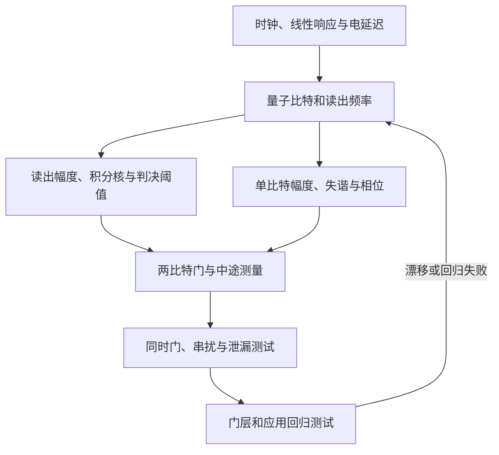
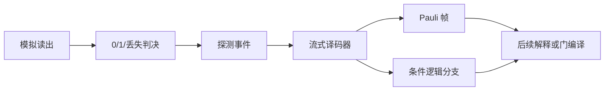

# 14｜从算法电路到物理执行：编译、调度与控制

算法论文常画出理想的 $H$、CNOT 和任意旋转门；硬件只能执行有限的原生操作，并受连接、时序、串扰和反馈延迟约束。本章把中间链条完整展开。

物理先修可读 [Q2：从薛定谔方程到旋转门](quantum-mechanics/02-observables-dynamics.md)与 [Q3：能级、共振和驱动](quantum-mechanics/03-levels-control.md)。本章侧重编译与控制组织，不再把这些物理推导当作读者已经自行掌握的前提。

第一次阅读可先走 §1–5，再跳到 §12 的 Bell 电路完整例子：一条算法线路先分解成设备认识的操作，再安排到真正相连的物理比特和时间槽。若要知道“设备认识的操作怎样变成模拟波形”，再读 §6–7；若研究测量质量或中途反馈，再读 §8–11。§13 是实验记录模板，可随时查用。这样读不要求你在看流程图前先会旋转坐标系或门集层析。

## 1. 从算法到实验的表示层不要混在一起

- **逻辑量子比特**在算法和错误校正语境中可能指编码比特；编译器文档有时也把尚未映射的线路线称为 logical/virtual qubit。阅读时必须看上下文。
- **ISA** 是目标设备可执行的指令集合与约束，包括原生门、测量、复位、连接、时长和控制流能力。
- 脉冲不是“更低级的门名”，而是有幅度、相位、频率、包络和时长的模拟控制信号。

同一个 `CNOT` 在三层上可能分别是数学矩阵、已映射到特定物理比特的 ISA 指令，以及若干同时或顺序播放的微波、激光或电压波形。只有最后一层直接驱动物理系统。09 章比较这些控制链背后的[硬件路线](09-hardware.md)；本章只解释表示如何逐层下降。

## 2. 门分解：任意门怎样落到有限门集

任意单比特酉矩阵忽略全局相位后可写成 Euler 分解，例如

$$
U=R_z(\alpha)R_y(\beta)R_z(\gamma).
$$

一种常见的单比特通用组合是任意角度的 $R_z$ 加固定角度的 $R_x(\pi/2)$；并非任取一个固定角度的 $X$ 旋转都自动足够。多比特通用计算还需要纠缠门，后端须给出完整门基和分解规则。超导平台中的 $R_z$ 常能作为“虚拟 Z”实现：不发额外物理脉冲，只更新后续驱动的相位参考。这通常很快且误差小，但仍需在控制器的相位记录中正确传播。

常见门名 $\sqrt X$ 或 SX 与 $R_x(\pi/2)$ 只在忽略全局相位时等价。按 [IBM 的 SX 门定义](https://quantum.cloud.ibm.com/docs/en/api/qiskit/2.3/qiskit.circuit.library.SXGate)所采用的矩阵约定，

$$
\mathrm{SX}=\frac12\begin{bmatrix}1+i&1-i\\1-i&1+i\end{bmatrix}
=e^{i\pi/4}R_x(\pi/2),
\qquad \mathrm{SX}^2=X.
$$

而 $R_x(\pi/2)^2=R_x(\pi)=-iX$。作为无条件单比特门，这个共同相位不改变测量统计；把操作放入受控分支后，它可能成为控制端可见的相对相位，不能直接把两个受控门当成同一个矩阵。

离散容错门集则需要近似综合。例如 Clifford+$T$ 表示中，逼近任意 $Z$ 旋转的 $T$ 数随目标精度增长；所以“一个任意旋转门”在资源估算中不能永远算作一步。

## 3. 连接约束与布局

逻辑线路可能要求任意两比特相互作用，物理芯片却只有连接图 $G=(V,E)$。布局把线路量子比特映射到物理顶点，路由再插入 SWAP 或使用原生搬运机制。

### 线形三比特例子

物理连接为 $0-1-2$，线路需要在逻辑 $q_0$ 与 $q_2$ 间做 CNOT。若当前映射为 $q_j\mapsto j$，一种方案是：

1. SWAP 物理 0、1；
2. 在物理 1、2 执行 CNOT；
3. 若后续需要恢复原映射，再 SWAP 0、1。

若 SWAP 分解成 3 个 CNOT，来回路由可能增加 6 个双比特门。更好的全局布局也许能省去恢复步骤；因此不能只逐门贪心地插 SWAP。

把这个代价算成时间：假设双比特 CNOT 各需 200 ns、单比特 $H$ 需 20 ns、三比特可同时在 800 ns 内读完，且所有相关门在这条路径上串行。若先做 $H(q_0)$、再执行上述端点 CNOT 并恢复映射，总共是 $1+3+3=7$ 个 CNOT，理想关键路径为

$$
20+7\times200+800=2220\,\mathrm{ns}.
$$

若两比特原本相邻，在同一简化条件下只需 $20+200+800=1020\,\mathrm{ns}$。再假设每个 CNOT 独立地以 $0.99$ 概率**不发生所建模的故障**，七门全部无故障的概率为 $0.99^7\approx0.932$，而一门为 $0.99$。这只是“无故障路径”概率，不能直接称作最终 Bell 态保真度；真实线路还会受到单比特门、读出、等待、串扰和编译优化影响。

某些平台通过离子搬运、可重构原子排列、光子交换或远程纠缠改变“连接”的含义，但搬运与链路生成仍有时间、损耗和错误成本。

### 3.1 练习与实验：省掉恢复 SWAP 后，答案怎样读

**题目。** 在 $0$—$1$—$2$ 上先 SWAP$(0,1)$，再做物理 CNOT$(1,2)$，不把映射恢复。逻辑输入为 $|q_0q_1q_2\rangle=|100\rangle$，目标是逻辑 CNOT$(q_0,q_2)$。为什么物理读数 $011$ 与理想逻辑读数 $101$ 都可能正确？

**逐步答案。** 第一次 SWAP 后，逻辑到物理映射从 $(0,1,2)$ 变成 $(1,0,2)$，意思是 $q_0$ 现在在物理位置 1，$q_1$ 在位置 0。原来的物理串 $100$ 变成 $010$；物理位置 1 是 1，因此 CNOT$(1,2)$ 把位置 2 翻为 1，得到物理串 $011$。

读取逻辑输出必须按映射取位：先读物理位置 1，再读位置 0，最后读位置 2，所以得到 $101$。这正是逻辑 CNOT$(q_0,q_2)$ 对 $100$ 的作用。若把物理串直接当逻辑串，就会制造一个纯软件解释错误，即使门操作完全理想。

| 时刻 | 物理顺序下的状态 | $(q_0,q_1,q_2)$ 所在物理位置 |
|---|---|---|
| 初态 | $100$ | $(0,1,2)$ |
| SWAP 后 | $010$ | $(1,0,2)$ |
| CNOT 后 | $011$ | $(1,0,2)$ |
| 按逻辑顺序解释 | $101$ | 已把标签转换回逻辑顺序 |

运行 [routing_mapping.py](../codes/systems/routing_mapping.py)。脚本固定基顺序 $|q_0q_1q_2\rangle$、$q_0$ 为最高有效位，并对全部八个基向量逐一验证：四个相邻 CNOT（一个 SWAP 的三个，加目标 CNOT 的一个）加映射解释，等于理想端点 CNOT。由于操作都是线性的，逐个基向量相等便保证任意叠加态相等；脚本还用种子 `69014` 生成一个归一化复振幅态额外交叉检查，最大振幅差为 0。它同时检查省略映射解释时确实出现反例，而不只检查一个恰好对称的 Bell 态。

若量子输出还要交给只接受原物理布局的下一模块，就可能确实需要恢复 SWAP，成本回到七个 CNOT。若后续门和测量能继续跟踪布局，则四个足够完成本例。Qiskit 的目标编译可通过 [pass manager](https://quantum.cloud.ibm.com/docs/en/guides/transpile-with-pass-managers) 组织；正式实验须保存最终布局、测量到经典位的映射与输出解释规则。这里的四门是所选路由策略的计数，没有证明全局门数最优，也没有模拟门噪声。

## 4. 目标机编译流水线

典型编译包括：

1. **规范化与逻辑优化**：展开宏、自定义门和高层控制，消去与硬件无关的冗余；
2. **门分解与酉综合**：把目标操作写成后端可继续处理的较小门；
3. **初始布局**：把线路中的虚拟量子比特放到具体物理比特；
4. **路由**：插入 SWAP、离子搬运、原子移动或远程纠缠，使所需相互作用可实现；
5. **本征门翻译**：改写为目标 ISA 的原生门、测量、复位和控制流；
6. **资源约束调度**：满足操作时长、端口互斥、读出总线、串扰禁配和反馈依赖；
7. **校准与脉冲绑定**：选择带时间戳、适用于具体物理比特的门实现，必要时在空闲区插入动态解耦。

阶段顺序会影响结果。例如先做局部门消去可能改变路由机会；路由后又会暴露新的抵消。编译是多目标优化：门数少、深度小、在高质量量子比特上运行和减少串扰可能互相冲突。

不同平台的“路由”不是同一种动作。二维固态芯片常用 SWAP；QCCD 离子机要调度分裂、搬运、合并和再冷却；中性原子可改变阵列几何；模块化机器可能等待并消耗 Bell 对。只给一张无权连接图，会漏掉方向、并行限制、共享控制资源和操作时间。

OpenQASM 3 可表示门、测量、经典控制、时间和校准入口；`defcal` 把门实现绑定到具体物理量子比特。OpenPulse 用 port、frame、waveform、play 与 capture 表示一种脉冲层语法，但仍在发展，后端也可只支持子集。QIR 是基于 LLVM 的中间表示，同样不要求所有后端共享物理门集。能读同一种文件不等于能无损移植同一个实验。

## 5. 关键路径与调度

门数不等于运行时间。设两条不冲突的单比特门各需 20 ns，可并行时只贡献 20 ns 深度；若共享控制资源或有串扰限制，也许必须串行成 40 ns。

调度通常有两种基本方向：

- ASAP：在依赖满足后尽早执行；
- ALAP：在不推迟总结束时间的前提下尽晚执行。

ALAP 可能缩短状态在门后等待测量的时间；ASAP 可能更早释放依赖。哪个更好取决于噪声、复位、测量和后续脉冲。

### 简单关键路径

若线路有：

- $H(q_0)$：20 ns；
- CNOT$(q_0,q_1)$：200 ns，依赖 $H$；
- $X(q_2)$：20 ns，与前两者独立；
- 三比特测量：800 ns，等待所有量子操作；

理想调度时间为

$$20+200+800=1020\text{ ns},$$

而不是 $20+200+20+3\times800$。但读出若不能完全并行，真实时间会改变。

### 5.1 练习与实验：门不共用量子比特，也可能不能并行

**题目。** 四个量子比特上，门 A 用 $(q_0,q_1)$、门 B 用 $(q_2,q_3)$，各耗时 200 ns；门 C 用 $(q_1,q_2)$，耗时 100 ns，必须等待 A、B；最后四位同时测量 800 ns。若 A、B 共享一条每次只能服务一个门的控制通道，关键路径多长？若只看量子比特是否重叠，会漏掉多少时间？

**逐步答案。** 操作的资源集合不仅包含量子比特，还可包含驱动总线、读出组、搬运结点或互斥区。这里把共享控制通道记为 $r$，就有 $R_A=\{q_0,q_1,r\}$、$R_B=\{q_2,q_3,r\}$。虽然两组比特不相交，资源集合仍相交，必须串行。

| 操作 | 只考虑量子比特（ns） | 加入共享控制通道（ns） |
|---|---|---|
| A | $[0,200)$ | $[0,200)$ |
| B | $[0,200)$ | $[200,400)$ |
| C | $[200,300)$ | $[400,500)$ |
| 测量 | $[300,1100)$ | $[500,1300)$ |

按依赖和资源均可用的最早时刻安排，每个操作开始时间为 $a_j=\max(\max_{i\prec j}f_i,\max_{r\in R_j}u_r)$；$f_i$ 是前驱完成时刻，$u_r$ 是资源下次空闲时刻，空集合的最大值在此取 0。完成时刻为 $f_j=a_j+t_j$，并把所用资源的 $u_r$ 更新为 $f_j$。这是给定列表顺序下的可行贪心调度，通常不保证全局最优。

本例共享通道至少要执行 $200+200=400$ ns，之后 C 和测量又依赖它们，故 $400+100+800=1300$ ns 是下界；表中达到了该下界。因此此例可以证明最短时间，而不能把这个结论推广为贪心调度算法总是最优。若漏掉共享通道，就会错误预测 1100 ns，少计 200 ns。

运行 [resource_schedule.py](../codes/systems/resource_schedule.py)，程序同时检查每项前驱已完成、任何共享资源的时间区间不相交，并拒绝未定义前驱。真实设备还可能规定脉冲对齐、持续时间粒度和可组合控制方式，必须再查目标后端。[IBM 官方编译阶段文档](https://quantum.cloud.ibm.com/docs/en/guides/transpiler-stages)将调度分析、约束处理和填充区分为不同步骤（访问 2026-09-26）；本例并未声称普通连接图已能表达所有硬件约束。对于混合门与脉冲时序，可研究 [Quantify Scheduler 官方仓库](https://gitlab.com/quantify-os/quantify-scheduler)的编译设计；它是控制软件入口，不是跨平台零修改兼容的保证。

## 6. 从 Hamiltonian 到脉冲

受控系统常写成

$$
H(t)=H_0+\sum_k u_k(t)H_k,
$$

$H_0$ 是漂移 Hamiltonian，$H_k$ 是控制耦合，$u_k(t)$ 是时间依赖控制波形。目标是选择 $u_k(t)$，使时间有序演化

$$
U(T)=\mathcal T\exp\left[-\frac{i}{\hbar}\int_0^T H(t)\,dt\right]
$$

接近目标门。

实际约束包括最大幅度、带宽、采样率、频率选择性、脉冲畸变和邻近通道串扰。最优控制可在模型中搜索波形，但模型失配会使仿真最优不等于实验最优。

### 旋转坐标系中的最小受驱模型

对接近共振的两能级系统，在旋转坐标系和旋波近似下可写成

$$
H_{\rm rot}=\frac{\hbar}{2}
\left(\Delta Z+\Omega_x X+\Omega_y Y\right).
$$

$\Delta$ 是驱动与量子比特的失谐，$\Omega_x,\Omega_y$ 是同相与正交包络对应的驱动强度。共振且 $\Omega_y=0$ 时，矩形脉冲产生

$$
U(T)=R_x(\theta),\qquad \theta=\Omega_xT.
$$

因此“旋转角”在这个理想模型中就是脉冲面积。若 $\Delta\ne0$，旋转轴从 $X$ 轴倾向 $Z$ 轴，角速度也变为 $\sqrt{\Omega_x^2+\Delta^2}$；幅度校准正确并不能补偿频率漂移。真实 transmon 还是多能级系统，过短的宽频脉冲会激发 $|2\rangle$；DRAG 在正交通道加入与主包络导数相关的分量以抑制这类泄漏，但参数仍需在实验中调整。

### 可复算例：从 Rabi 频率得到门时长

若实验测得 $\Omega_x/2\pi=10\,\mathrm{MHz}$，则 $\Omega_x=2\pi\times10^7\,\mathrm{rad/s}$。理想 $X_\pi$ 门满足

$$
T_\pi=\frac{\pi}{\Omega_x}=50\,\mathrm{ns},
$$

而 $X_{\pi/2}$ 为 25 ns。若驱动失谐 $\Delta/2\pi=1\,\mathrm{MHz}$，有效旋转轴的 $Z/X$ 分量比为 $\Delta/\Omega_x=0.1$，已经不是纯 $X$ 旋转。

还能算出一个可观察的后果。令 $\Omega_{\rm eff}=\sqrt{\Omega_x^2+\Delta^2}$。在上面的恒定、无退相干两能级模型中，初态 $|0\rangle$ 经过时长 $T$ 后，振幅是 $\langle1|U(T)|0\rangle=-i(\Omega_x/\Omega_{\rm eff})\sin(\Omega_{\rm eff}T/2)$，因此

$$
P_1(T)=\frac{\Omega_x^2}{\Omega_x^2+\Delta^2}
\sin^2\!\left(\frac{\sqrt{\Omega_x^2+\Delta^2}\,T}{2}\right).
$$

沿用按**共振条件**设定的 $T=50\,\mathrm{ns}$，代入 $\Delta/\Omega_x=0.1$ 得

$$
P_1(T)=\frac{1}{1.01}\sin^2\!\left(\frac{\pi\sqrt{1.01}}{2}\right)
\approx0.99004.
$$

也就是说，单看这个输入态的计算基读数，离理想 $X_\pi|0\rangle=|1\rangle$ 约差 $0.996\%$。这只是由失谐造成的一个理想化**态转移概率**，不是该门对所有输入态的平均不保真度，更未包含泄漏、噪声或读出误差。

## 7. Rabi、Ramsey 与门校准

以两能级近似为例：

- **Rabi 实验**：扫描驱动时长或幅度，观察激发态占据概率随之振荡；可校准 $X$、$X/2$ 脉冲面积。
- **Ramsey 实验**：两个 $\pi/2$ 脉冲之间自由演化；振荡频率反映失谐，包络给出 $T_2^*$ 的信息。
- **回波实验**：中间加入 $\pi$ 脉冲，部分抵消慢噪声，估计回波相干时间。
- **DRAG 等整形**：抑制超导弱非谐系统向更高能级泄漏，但参数需实验调优。

校准不是一次性把“理论角度”换成“电压”。硬件漂移要求周期性重估，且单独校准的门在并行运行时可能因串扰而改变。实际依赖常近似为：

上游参数一旦改变，下游结果可能失效。校准数据库因此需要时间戳、适用物理比特、依赖关系和不确定度，而不只是“一张最新保真度表”。还要区分四件事：**校准**改变控制参数；**表征**估计噪声或过程模型；**验证**检验预先规定的性质；**基准**用约定工作负载比较能力。它们可以共用数据，却回答不同问题。

### 软件边界：历史脉冲教程须与当前版本区分

能够阅读 OpenQASM/OpenPulse 的时序定义，不意味着某个 SDK 或云设备当前开放用户脉冲控制。核查于 2026-09-26：[Qiskit Experiments 官方发布说明](https://qiskit-community.github.io/qiskit-experiments/dev/release_notes.html)明确记载 0.9 删除此前弃用的脉冲实验与校准支持，原因是 Qiskit 2.0 移除了 Qiskit Pulse。因而旧版 `BaseCalibrationExperiment`、脉冲 schedule 管理教程只能按其历史版本复现，不能直接当成当前 SDK 接口。

这不否定 Rabi/Ramsey、最优控制或校准依赖这些方法；它说明应分别保存“物理方法”“本地求解器版本”“硬件接受的指令和权限”。例如在本地算出 GRAPE 波形，只完成了模型优化；还需确认控制器采样率、滤波与振幅限制，并由设备支持的接口加载和重新表征。

## 8. 门表征与层析

### 状态层析

对单比特态，测量 $X,Y,Z$ 期望值，可重构

$$
\rho=\frac12(I+\langle X\rangle X+\langle Y\rangle Y+\langle Z\rangle Z).
$$

若测得 $(\langle X\rangle,\langle Y\rangle,\langle Z\rangle)=(0.6,0,0.8)$，Bloch 向量长度为 1，对应纯态。若有限采样给出长度略大于 1，直接线性反演会产生非物理矩阵；最大似然或贝叶斯方法可施加正性约束。

完整层析的设置数随比特数指数增长，不能作为大处理器的常规全局体检。

### 过程层析、GST 与 RB

- 过程层析重构信道，但受 SPAM 误差污染且不可扩展；
- gate set tomography 同时估计门与 SPAM，并处理表示规范自由度，但实验和拟合更重；
- randomized benchmarking 更可扩展地估计平均衰减，却不提供完整噪声机制。

选择工具取决于问题：调一个具体脉冲、验证小门集，还是监控大系统平均性能。

| 问题 | 较合适的工具 | 主要边界 |
|---|---|---|
| 快速追踪平均门退化 | RB、直接 RB | 平均值会隐藏少数坏门和相干方向 |
| 检查并行串扰或整层质量 | 同时 RB、循环/层基准 | 结果依赖被抽样的门层 |
| 重建小门集并分离 SPAM | GST | 计算与实验重；有 gauge 自由度，并常假设平稳、马尔可夫和固定维数 |
| 重建一个小系统的过程 | 过程层析 | 制备和测量误差会进入结果，设置数快速增长 |
| 预测目标任务 | 镜像线路、应用基准 | 只对选定线路族有代表性 |

门表征和资源基准的更完整边界见[第 11 章](11-resources-benchmarks.md)。

## 9. 读出链与判决

物理测量先产生模拟信号，例如随时间变化的谐振腔响应或光子计数。经典链执行放大、滤波、积分和分类，才得到 0/1。

读出混淆矩阵可写成

$$
M_{ij}=\Pr(\text{报告 }i\mid\text{制备 }j).
$$

理想情况下 $M=I$。若

$$
M=\begin{bmatrix}0.97&0.08\\0.03&0.92\end{bmatrix},
$$

第一列表示制备 0 时 97% 报 0、3% 报 1；第二列表示制备 1 时 8% 报 0、92% 报 1。用 $M^{-1}$ 修正频率会放大统计噪声，并依赖校准稳定性；它不是免费的“消除读出错误”。

混淆矩阵仍只描述经典判决。中途测量还要报告 QND 性、测量诱导跃迁或泄漏、旁观串扰、死时间和测后复位；不同平台的物理链见[第 19 章第 2—3 节](19-engineering-architecture.md#2-五类平台的控制链)。

## 10. 动态电路

动态电路在一次量子程序中加入中途测量、经典条件分支、复位和反馈。典型用途包括：

- 隐形传态中的条件 Pauli 修正；
- 错误校正综合征处理；
- 量子比特复用与主动复位；
- 迭代相位估计。

它需要完整延迟预算：

$$
t_{\rm fb}=t_{\rm meas}+t_{\rm classify}+t_{\rm transport}
+t_{\rm classical}+t_{\rm dispatch}+t_{\rm pulse}.
$$

六项分别是测量积分、状态判别、控制系统内传输、条件计算、指令下发和条件脉冲。云端 API 的网络往返通常不能放进这条实时路径；分支必须在靠近设备的控制器上完成。软件语法支持 `if` 不等于硬件能以足够低延迟执行任意控制流，测量还可能使旁观量子比特退相干或受到串扰。

### 可复算例：反馈等待本身会带来多少弛豫

设测量 800 ns、判别 150 ns、传输 300 ns、条件计算 200 ns、指令下发 150 ns、条件脉冲本身 50 ns。完整反馈路径为

$$
t_{\rm fb}=0.8+0.15+0.3+0.2+0.15+0.05
=1.65\,\mu\mathrm{s}.
$$

条件脉冲开始前，**另一个等待反馈的数据比特**已空闲 $t_{\rm wait}=1.60\,\mu\mathrm{s}$；它与刚刚被测量的辅助比特不是同一个对象。若这个数据比特处于 $|1\rangle$ 且 $T_1=100\,\mu\mathrm{s}$，只考虑它在**空闲期间**的振幅阻尼，等待期间衰减概率为

$$
1-e^{-t_{\rm wait}/T_1}=1-e^{-0.016}\approx1.59\%.
$$

条件脉冲期间的演化和错误应按脉冲模型另算；这个数还没有计入退相位、辅助比特测量带给数据比特的串扰或条件门错误。若协议要求**对被测辅助比特自身复位**，就要另建测后状态与复位模型，不能把上面“数据比特保持 $|1\rangle$”的衰减公式照搬到已被测量的对象。缩短计算代码却不缩短读出和传输，未必能显著改善整条反馈路径。

### 实时译码有两个速度条件

错误校正还要把测量结果转换为**探测事件（detector events，即相邻检查结果之间提示错误发生位置与时间的变化）**，再送入译码器，最后更新 **Pauli 帧（在经典控制器中跟踪待施加的 Pauli 修正）**或触发逻辑分支：

- **吞吐**必须高于综合征产生率，否则会形成未处理数据积压（backlog）；并行化可以提高吞吐。
- **响应时延**是从相关测量结束到条件逻辑可执行的总时间，含数据搬运、译码和控制通信；并行化不一定缩短单次响应。

离线译码可以利用未来轮次并花更长时间，准确率高也不等于能及时完成实时反馈。小码距查找表的低时延同样不能外推到大码距。2026 年一个 8 比特稳定性实验在 9 个测量轮次后报告完整响应 9.6 μs，其中译码 6.5 μs、通信与控制 3.1 μs；这是小规模集成实例，不是任意码距已经满足实时性。

## 11. 参数化线路与批处理

VQE/QAOA 会反复运行拓扑相同、参数不同的线路。若每次都重新编译和网络往返，经典开销可能主导。运行系统可将参数绑定、线路批处理和经典优化循环尽量靠近硬件。

报告吞吐时应区分：

- 量子处理时间；
- 每次 shot 的复位与测量时间；
- 批次间参数更新；
- 编译时间；
- 排队和网络时间。

## 12. 一个完整例子：Bell 电路的物理执行

理想线路：$H(q_0)$，随后 CNOT$(q_0,q_1)$，最后测量。

从编译到测量依次检查：

1. 选择误差较低且相连的物理比特；
2. 将 $H$ 与 CNOT 翻译为原生单/双比特门；
3. 检查控制—目标方向是否原生，是否需共轭或额外门；
4. 调度并考虑读出并行约束；
5. 记录校准时间、门时长、读出混淆和 shots；
6. 除了 $ZZ$ 计数，还测 $XX$；只见 00/11 不能证明纠缠；
7. 给出统计区间，必要时做小规模层析或纠缠见证；
8. 报告抽象线路和编译后线路，而非只贴最终直方图。

## 13. 可复现实验记录模板

| 类别 | 最少记录 |
|---|---|
| 身份与时间 | provider、backend ID、job ID、提交与实际执行的 UTC 时间 |
| 软件 | SDK、编译器、插件、接口和结果 schema 版本；代码提交或归档哈希 |
| 目标机 | ISA/Target 快照、连接、原生门、时长、控制流能力 |
| 编译 | 初始布局、各阶段方法、优化级别、随机种子、编译后线路与哈希 |
| 执行 | shots、批次、参数绑定、动态控制、抑噪与缓解设置 |
| 校准 | 与执行最近的快照或获取时间、门/读出指标及其定义 |
| 统计 | 原始计数、置信区间、剔除、后选择和数据清洗规则 |
| 结论 | 可行性、质量改善或优势分别陈述；分析脚本和输出哈希 |

保存随机种子只能让含随机启发式的**编译**更容易复现，不能冻结设备漂移。应区分三层目标：同一输入得到相同编译线路；编译线路仍满足目标 ISA；不同日期的物理结果统计相容。第三层还取决于重新校准、固件、维护和环境，种子不能保证。

## 14. 常见误区

- 高层一个门不等于硬件一个脉冲。
- 优化级别更高不保证实验结果更好；它可能改变布局、编译时间和噪声暴露。
- 最少门数不一定是最短时间或最低错误。
- 线路模拟正确不代表脉冲实现正确。
- 读出校正会放大方差，并依赖校准矩阵未漂移。
- 动态电路的关键不只是语法，而是反馈延迟和等待错误。

## 15. 自检

1. 在三节点线形连接上实现端点 CNOT，为什么可能需要额外双比特门？
2. 一个 SWAP 分解为三个 CNOT。来回做两次 SWAP 会增加多少个 CNOT？
3. 给定本章四操作例子，说明为什么门时长相加会高估理想调度时间。
4. 状态层析得到 Bloch 向量长度 1.03，为什么不能直接把线性反演矩阵当作物理态？
5. 读出混淆矩阵求逆为什么会放大采样噪声？
6. 动态电路的延迟预算包含哪六项？
7. 为什么译码吞吐足够快，仍可能无法及时执行逻辑分支？
8. 保存编译随机种子为什么不能保证下周真机结果完全相同？

答案见[练习与答案：第 14 章](appendices/exercises.md#第-14-章)。

## 参考起点

- IBM Quantum Documentation, [Introduction to transpilation](https://quantum.cloud.ibm.com/docs/en/guides/transpile)，包括布局、路由、翻译、优化与调度阶段。
- IBM Quantum Documentation, [Represent quantum computers for the transpiler](https://quantum.cloud.ibm.com/docs/en/guides/represent-quantum-computers)（连接图约束与 SWAP 分解）。
- IBM Quantum Documentation, [Execute dynamic circuits](https://quantum.cloud.ibm.com/docs/en/guides/execute-dynamic-circuits)。
- [OpenQASM 3 specification](https://openqasm.com/)，量子—经典控制流与时序表示。
- [OpenQASM pulse-level descriptions](https://openqasm.com/language/pulses.html) 与 [OpenPulse 3.1 grammar](https://openqasm.com/versions/3.1/language/openpulse.html)，物理比特校准、port、frame、waveform 与时序；OpenPulse 仍在发展。
- QIR Alliance, [QIR specification](https://github.com/qir-alliance/qir-spec/blob/main/specification/README.md)，基于 LLVM 的前端、通用变换与目标后端 lowering。
- N. Khaneja et al., [Optimal control of coupled spin dynamics: design of NMR pulse sequences by gradient ascent algorithms](https://doi.org/10.1016/j.jmr.2004.11.004), *Journal of Magnetic Resonance* 172, 296–305 (2005)。
- F. Motzoi et al., [Simple pulses for elimination of leakage in weakly nonlinear qubits](https://doi.org/10.1103/PhysRevLett.103.110501), *Physical Review Letters* 103, 110501 (2009)。
- D. Greenbaum, [Introduction to quantum gate set tomography](https://arxiv.org/abs/1509.02921) (2015)。
- [Demonstrating real-time and low-latency quantum error correction with superconducting qubits](https://www.nature.com/articles/s41467-026-73331-6), *Nature Communications* (2026)。
