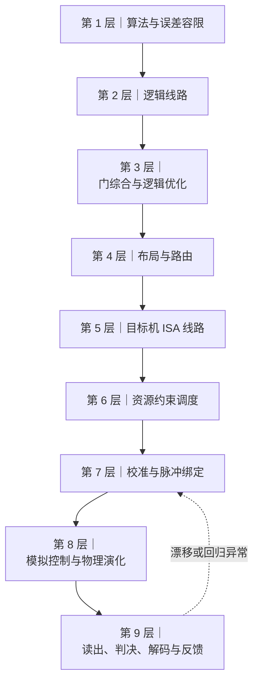
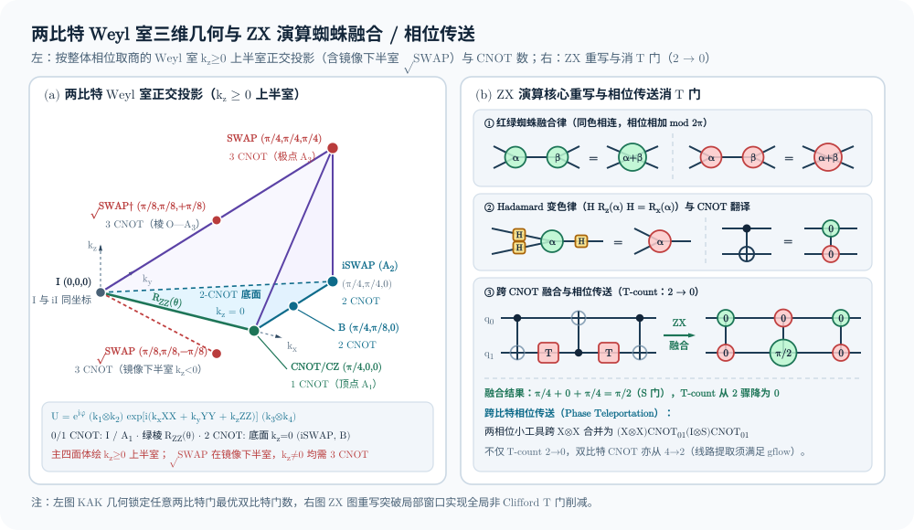
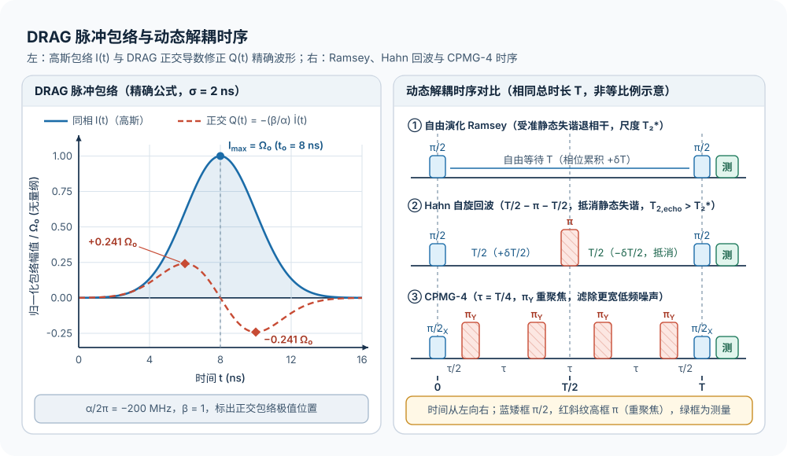
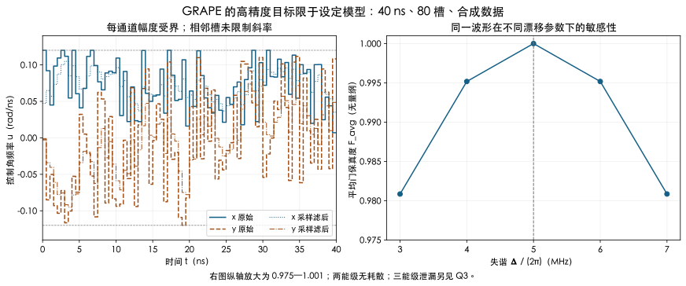
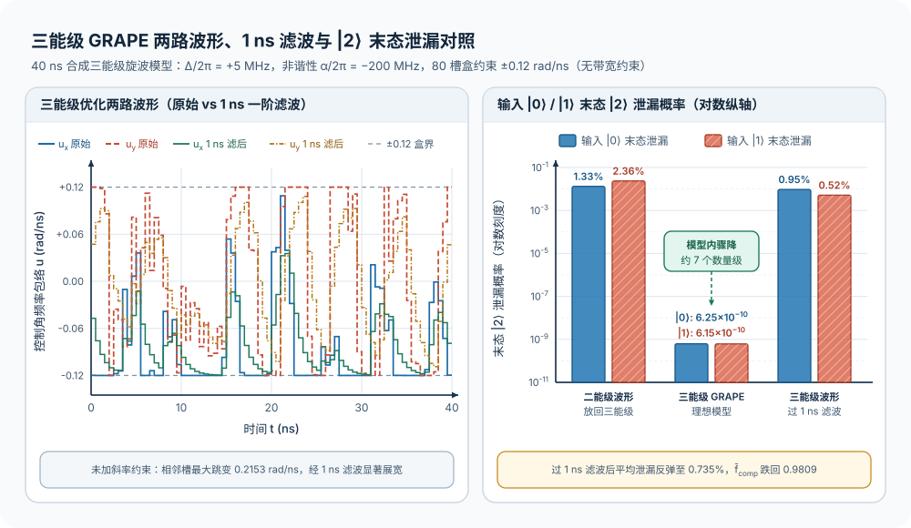
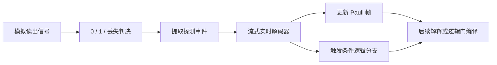

# 14｜从算法电路到物理执行：编译、调度与控制

算法论文里的量子线路看起来总是干干净净：纸上画着理想的 Hadamard 门 $H$、任意角度旋转门 $R_z(\theta)$，以及可以跨过整排量子比特直接相连的 $\mathrm{CNOT}$。然而真正把这段程序送进稀释制冷机或真空腔时，硬件能听懂的语言却苛刻得多——它只认识屈指可数的几个原生操作，比特之间只有稀疏的物理连线，控制线还会彼此共用、互相串扰，而真正作用在量子比特上的根本不是方块和线条，而是几纳秒到几百纳秒长的微波、激光或电压模拟脉冲。

这一章紧承[Q3：从能级到物理量子比特](quantum-mechanics/03-levels-control.md)与[第 09 章：硬件平台](09-hardware.md)，把“纸上的算法线路”到“芯片上的模拟波形、读出判决与容错逻辑操作”之间这条链条一层层摊开，并为后面的[第 10 章：量子纠错](10-error-correction.md)、[第 11 章：资源估算](11-resources-benchmarks.md)与[第 19 章：可维护系统工程](19-engineering-architecture.md)搭好编译器与控制层桥梁。

- **首遍必读（★）**：§1、§2.1、§2.5、§3–§6、§8–§10 与 §13（中间表示、单比特综合与 `gridsynth`、虚拟 Z、SABRE 路由调度、DRAG/DD 与随机编译 Pass、读出缓解、动态反馈与 Bell 落地清单）；
- **进阶选读（☆）**：§2.2–§2.4（KAK/Weyl 室、ZX 演算与 Solovay–Kitaev）、§7（二/三能级 GRAPE）、§11（线路切割）与 §12（Litinski 容错编译）——可按研究方向按需深入。

---

## 1. 九层表示、七步编译流水线与现代中间表示标准

初学者读量子软件文档时，最容易犯晕的地方是同一个词在不同语境里指向完全不同的对象。比如同样写着一个 `CNOT`，在算法论文里它是一个 $4\times 4$ 数学酉矩阵；在编译器输出里它变成绑定到物理比特 $(p_1, p_2)$ 的设备指令；到了控制机柜里，它又被展开成几条同时或错峰播放的微波与磁通包络波形。如果把这几层混成一谈，就很容易以为“线路少写了一个门，运行一定更快”，或者以为“门级模拟过了，真机脉冲就不会出错”。

下面这张流程图把从算法需求到物理执行的九层表示串成一条完整链路，末端的读出与漂移监测还会反向触发校准与脉冲更新：



在动手做任何推导之前，先厘清三个高频名词的边界：

- **逻辑量子比特（logical / virtual qubit）**：在量子纠错语境（见[第 10 章](10-error-correction.md)）里，它指由几十甚至上千个物理比特共同编码出的抗错比特；而在量子编译器文档里，它常用来指代“尚未绑定到具体芯片编号的抽象线路线（虚拟比特）”。读文献时必须先看上下文。
- **指令集架构（ISA，Instruction Set Architecture）**：目标量子设备实际支持的操作清单与物理约束，包含原生单/双比特门、测量、复位、比特连接拓扑、操作时长粒度以及实时经典控制流能力。
- **物理脉冲（pulse）**：不是“更底层的门名称”，而是具备载波频率、幅度包络、相位、持续时间与采样率的模拟控制信号，只有它才直接进入芯片驱动量子态演化。

下表对照了九层表示中的关键对象与常见中间格式。各硬件路线的底层物理架构比较见[第 09 章](09-hardware.md)，本章聚焦程序表示如何逐层下降。

| 层次阶段 | 核心操作对象 | 典型表示或工业格式 | 跨设备迁移边界 |
| :--- | :--- | :--- | :--- |
| 算法与逻辑线路（第 1–3 层） | 抽象酉门、预言机、误差预算 $\varepsilon$ | 高级电路 SDK、OpenQASM 3 逻辑子集、QIR、MLIR | 硬件无关，但尚未反映连接、路由与原生门开销 |
| 目标机编译层（第 4–6 层） | 物理比特映射、SWAP、原生门、时间槽 | 目标机 ISA 线路、带时序约束的 OpenQASM 3 | 强绑定特定芯片的耦合图、门时长与并发规则 |
| 脉冲与控制层（第 7–8 层） | 端口（port）、参考帧（frame）、波形包络 | `defcal` 校准绑定、OpenPulse 语法、底层 FPGA 指令 | 高度绑定具体器件频率、带宽与当日校准快照 |
| 读出与反馈层（第 9 层） | 模拟积分波形、0/1/丢失判决、探测事件 | 经典判别阈值、流式解码器、实时控制流 | 依赖控制器内部互联延迟与实时反馈固件 |

在工程编译器（如 Qiskit Pass Manager）中，从第 2 层“逻辑线路”下放到第 7 层“校准与脉冲绑定”，通常拆成**七个核心编译阶段**：

1. **规范化与逻辑优化**：展开自定义门与高层控制块，消去相邻互逆门（如 $HH = I$）、合并连续单比特旋转，或借助图重写（如第 2.3 节的 ZX 演算）做全局化简。
2. **门分解与酉综合**：把多比特门或任意连续单/双比特酉门拆成后续阶段可处理的标准基本门。
3. **初始布局（Layout）**：挑选质量较好、连通性匹配的子图，把线路里的虚拟比特绑定到具体物理比特。
4. **路由（Routing）**：针对未直接相连的相互作用比特，插入 SWAP 门、离子搬运、中性原子光镊重排或远程纠缠消耗。
5. **原生门翻译（Translation）**：把所有门改写为目标机 ISA 原生支持的门集合，并做一轮局部化简。
6. **资源约束调度（Scheduling）**：在满足数据依赖、门时长对齐、共享总线互斥、串扰禁配与反馈窗口的前提下确定每个操作的起止时刻。
7. **校准与脉冲绑定（Calibration & Pulse Binding）**：查表绑定带时间戳的物理脉冲参数，并在空闲窗口按需插入动态解耦脉冲。

这七个步骤并非单向孤立。先做局部门抵消可能改变后续路由需求，而路由插完 SWAP 后又会在接口处产生新的门抵消机会；同时，“门数最少”“深度最短”“选在保真度最高的物理比特上”“避开强串扰并发”这四个目标经常彼此拉扯，因此真实量子编译永远是多目标权衡。

### 1.1 中间表示与现代编译软件栈标准：OpenQASM 3.0 vs QIR vs MLIR

随着 2024–2026 年量子软件逐渐走向混合计算与实时动态反馈，编译器生态不再满足于只传递一张静态门列表，而是收敛到**三大中间表示（IR，Intermediate Representation）支柱**——**OpenQASM 3.0**、基于 LLVM 的 **QIR（Quantum Intermediate Representation）** 以及基于 **MLIR** 的量子方言（如 Xanadu Catalyst 与 NVIDIA CUDA-Q Quake）。把它们和硬件专有 ISA 放在同一张标尺上对照，就能避开“支持同一种语法文件 = 可以无损移植运行”的误区：

| 对比维度 | OpenQASM 3.0（IEEE/开源规范） | QIR（QIR Alliance / LLVM IR） | MLIR 量子方言（Catalyst / Quake） | 硬件专有 ISA / 固件码 |
| :--- | :--- | :--- | :--- | :--- |
| **抽象层级与定位** | 人类可读的量子汇编与电路交换语言（逻辑到脉冲 `defcal` 均可表达） | 面向编译后端的机器级 SSA 中间表示，直接复用 LLVM 优化与代码生成生态 | 多层渐进降级（progressive lowering）框架，同时保有高层线性代数/图结构与底层控制流 | 直接下发给 FPGA/AWG 控制器的时序波形与硬件寄存器微码 |
| **实时控制流能力** | 原生支持经典变量、`if`/`else`、`for`/`while` 与 `delay` 时序约束 | 按能力分级：**Base Profile** 仅限静态电路；**Adaptive Profile** 支持中段测量、分支与循环 | 完整支持混合控制流、动态量子比特分配、自动微分（量子伴随/参数移位）与混合 QJIT | 严格受限于具体机柜 FPGA 的微秒级分支宽度与缓冲区深度 |
| **经典混合编译能力** | 偏轻量经典算术与实时反馈逻辑，重型科学计算仍在宿主机执行 | 与 C/C++/Rust 生成的 LLVM IR 无缝内联，适合紧耦合混合执行 | 最强：把经典循环、数组张量与量子核整段编译为单一原生二进制，消除 Python 解释器开销 | 仅负责微秒级查表、条件门触发与流式解码接口 |
| **跨设备互操作边界** | 不同后端支持的指令子集与控制流深度不同，含 `defcal` 时立即锁死单机 | 必须声明并核对 Profile；将 Adaptive 程序送往仅支持 Base 的后端会直接拒收 | 需经特定硬件后端 pass 降级到 QIR / OpenQASM / 原生控制指令后才能真机执行 | 零跨厂商移植性，强绑定单机当日校准快照 |

特别要厘清 QIR 规范中最常被忽略的分界——**Base Profile 与 Adaptive Profile**：

- **QIR Base Profile**：严格限定为静态线路模型——**禁止中段测量后的量子门操作，禁止依赖测量结果的条件分支，禁止运行期循环**，所有测量必须排在电路末尾。它换来的是极广泛的早期硬件兼容性；
- **QIR Adaptive Profile**：放开中段测量、实时经典读取（`read_result`）、整数/布尔运算与条件跳转分支，专门服务于第 10 节的动态电路与容错反馈。

下面用一段仅 6 行的极简任务——“测量 $q_0$，若读出为 `1` 则对 $q_1$ 施加条件 $X$ 修正”——并排展示 OpenQASM 3.0 与 QIR Adaptive Profile（LLVM IR 风格）的写法差异：

```qasm
// OpenQASM 3.0：面向电路作者与汇编交换
OPENQASM 3.0;
include "stdgates.inc";
qubit[2] q;
bit c = measure q[0];
if (c == 1) { x q[1]; }
```

```llvm
; QIR Adaptive Profile（LLVM IR 片段）：面向编译器后端与经典联编
call void @__quantum__qis__mz__body(ptr null, ptr null)                ; 测量 q0 -> result0
%c = call i1 @__quantum__rt__read_result(ptr null)                     ; 读取实时 1-bit 结果
br i1 %c, label %then, label %merge                                    ; LLVM 原生条件分支
then:
  call void @__quantum__qis__x__body(ptr inttoptr (i64 1 to ptr))      ; 条件施加 X(q1)
  br label %merge
merge:
  ret void
```

看清这两段代码的共同现实边界：**能通过语法解析，只说明前端编译器读懂了你的意图，绝不等于任意物理芯片都支持该实时控制流子集**。硬件能不能在退相干之前把 `%c` 传回脉冲发生器，最终还要过第 10 节的微秒级延迟门槛。

---

## 2. 门综合与电路优化：从单比特 Euler、两比特 KAK 到 ZX 演算与容错离散逼近

纸上算法随手就能写出任意角度的单比特旋转 $R_y(0.73)$、任意 $4\times 4$ 两比特酉门，或者一大串掺杂着冗余 $T$ 门的逻辑电路；而物理硬件要么只精调极少数原生门脉冲，要么在容错阶段只能执行有限的离散门集（如 Clifford+$T$）。如何把任意目标酉门精确或最优近似地拼成硬件原生门，并压低最昂贵的门数（NISQ 阶段的 CNOT/CZ 数，或容错阶段的 $T$ 门数），正是**门综合与电路优化**的核心任务。

### 2.1 单比特 Euler ZYZ 分解、奇异点处理与“至多两个物理微波脉冲”恒等式

在三维空间里，想让一架飞机从任意姿态转到另一个任意姿态，不需要给每个方向都装一套引擎，只要依次绕机身主轴转三次（欧拉角）就能到达任意朝向。单比特态对应 Bloch 球面上的方向，这个几何直觉同样成立，只是因为量子态带有全局相位和半角表示，需要通过严格的 $2\times 2$ 矩阵乘法来落实。

**定理（Euler ZYZ 分解，Nielsen & Chuang, 2010）**：任意单比特酉算符 $U \in \mathrm{U}(2)$ 都存在实角 $\delta \in [0, 2\pi)$、$\alpha, \gamma \in [0, 2\pi)$、$\beta \in [0, \pi]$，使得

$$
U = e^{i\delta} R_z(\alpha)\, R_y(\beta)\, R_z(\gamma).
$$

（注：本章将全局相位记作 $\delta$、三个欧拉角依次记作 $\alpha,\beta,\gamma$，与[第 02 章第 5.3 节](02-single-qubit.md#53-进阶回看矩阵指数2pi-负号反例与-zyz-欧拉分解)沿用 Nielsen–Chuang 的字母排布 $e^{i\alpha}R_z(\beta)R_y(\gamma)R_z(\delta)$ 仅符号名不同，物理含义完全等价。）

我们先一步不跳地把右端乘开，看看四个角度怎样从矩阵元里反解出来。全书采用计算基 $\{|0\rangle, |1\rangle\}$ 与标准旋转门定义 $R_j(\theta) = e^{-i\theta \sigma_j / 2}$：

$$
R_z(\theta) = \begin{bmatrix} e^{-i\theta/2} & 0 \\ 0 & e^{i\theta/2} \end{bmatrix},
\qquad
R_y(\beta) = \begin{bmatrix} \cos(\beta/2) & -\sin(\beta/2) \\ \sin(\beta/2) & \cos(\beta/2) \end{bmatrix}.
$$

先算后两项乘积 $R_y(\beta) R_z(\gamma)$（对角阵右乘即把第 1 列乘 $e^{-i\gamma/2}$、第 2 列乘 $e^{i\gamma/2}$）：

$$
R_y(\beta) R_z(\gamma)
= \begin{bmatrix}
e^{-i\gamma/2}\cos(\beta/2) & -e^{i\gamma/2}\sin(\beta/2) \\
e^{-i\gamma/2}\sin(\beta/2) & e^{i\gamma/2}\cos(\beta/2)
\end{bmatrix}.
$$

再左乘 $R_z(\alpha)$（把第 1 行乘 $e^{-i\alpha/2}$、第 2 行乘 $e^{i\alpha/2}$）并带上全局相位 $e^{i\delta}$：

$$
U = e^{i\delta}
\begin{bmatrix}
e^{-i(\alpha+\gamma)/2}\cos(\beta/2) & -e^{-i(\alpha-\gamma)/2}\sin(\beta/2) \\
e^{i(\alpha-\gamma)/2}\sin(\beta/2) & e^{i(\alpha+\gamma)/2}\cos(\beta/2)
\end{bmatrix}.
$$

观察四个矩阵元的模长和辐角，就能立刻写出提取配方与边界处理：

1. **求转角 $\beta$**：因为 $|U_{00}| = \cos(\beta/2) \ge 0$ 且 $|U_{10}| = \sin(\beta/2) \ge 0$，数值最稳定的写法是 $\beta = 2\operatorname{atan2}(|U_{10}|, |U_{00}|) \in [0, \pi]$。
2. **一般情形（$0 < \beta < \pi$）**：不能直接把各矩阵元主辐角相减取 $\bmod\,2\pi$ 后再除以 $2$——因为给 $\alpha - \gamma$ 额外平移 $2\pi$ 再除以 $2$ 会让 $\alpha \mapsto \alpha + \pi,\; \gamma \mapsto \gamma - \pi$，从而保持对角元不变却反转非对角元符号，把目标门 $U$ 错算成非全局相位的物理错误门 $ZUZ$！稳健的零分支割线做法是先由行列式归入 $\mathrm{SU}(2)$：因为 $\det(R_z R_y R_z) = 1$，必有 $\det U = e^{2i\delta}$。先取一个分支 $\delta_0 = \frac{1}{2}\arg(\det U)$ 并令 $\tilde U = e^{-i\delta_0} U \in \mathrm{SU}(2)$。此时 $\tilde U_{00} = e^{-i(\alpha+\gamma)/2}\cos(\beta/2)$、$\tilde U_{10} = e^{+i(\alpha-\gamma)/2}\sin(\beta/2)$（且 $\mathrm{SU}(2)$ 结构自动保证 $\tilde U_{11} = \tilde U_{00}^*$、$\tilde U_{01} = -\tilde U_{10}^*$），直接读取两个**半角**即可彻底避开除以 $2$ 的分支翻转：

   $$
   \frac{\alpha + \gamma}{2} = -\arg(\tilde U_{00}),
   \qquad
   \frac{\alpha - \gamma}{2} = \arg(\tilde U_{10}).
   $$

   将两式直接相加、相减即得

   $$
   \alpha = \arg(\tilde U_{10}) - \arg(\tilde U_{00}),
   \qquad
   \gamma = -\arg(\tilde U_{10}) - \arg(\tilde U_{00}).
   $$

   若后续需要把 $\alpha, \gamma$ 归约到 $[0, 2\pi)$，设两者分别平移了 $2\pi k_\alpha$ 与 $2\pi k_\gamma$（$k_\alpha, k_\gamma \in \mathbb{Z}$），由于 $R_z(\theta + 2\pi) = -R_z(\theta)$，只需同步更新全局相位 $\delta = \big(\delta_0 + (k_\alpha + k_\gamma)\pi\big)\bmod 2\pi$（注意当 $k_\alpha$ 与 $k_\gamma$ **同时**为奇数时，两个负号恰好抵消，$k_\alpha + k_\gamma$ 为偶数，全局相位无需多加 $\pi$），即可保证 $e^{i\delta} R_z(\alpha) R_y(\beta) R_z(\gamma) = U$ 逐矩阵元精确相等。
3. **万向节奇异点（Gimbal Lock）**：当 $\beta = 0$（对角门）时，上式非对角元为零，$R_z(\alpha) I R_z(\gamma) = R_z(\alpha+\gamma)$，只有和 $\alpha+\gamma$ 唯一（在 $\tilde U \in \mathrm{SU}(2)$ 口径下可令 $\gamma = 0,\; \alpha = -2\arg(\tilde U_{00})$）；当 $\beta = \pi$（反对角翻转门）时，对角元为零，$R_z(\alpha) R_y(\pi) R_z(\gamma) = R_y(\pi) R_z(\gamma - \alpha)$，只有差 $\alpha - \gamma$ 唯一（可令 $\gamma = 0,\; \alpha = 2\arg(\tilde U_{10})$）。工程编译器在这两个边界必须显式分支，将多余自由度设为 $0$，从而直接省去无意义的旋转。

不过，超导硬件并不想单独为任意角度的 $R_y(\beta)$ 校准脉冲——它更愿意只精调**一个固定角度的物理微波脉冲** $R_x(\pi/2)$（或者等价的 $\mathrm{SX}$ 门），再配合软件零成本实现的任意角度 $R_z$。问题来了：只靠一个固定角度的 $R_x(\pi/2)$ 和任意 $R_z$，真的能拼出任意 $\beta$ 的 $R_y(\beta)$ 吗？答案是肯定的，而且**至多只需要两个 $R_x(\pi/2)$ 脉冲**！下面一步不跳地把它推出来。

**第一步**：证明共轭恒等式 $R_x(-\pi/2)\, Z\, R_x(\pi/2) = Y$。

展开 $R_x(\pm\pi/2) = \cos(\pi/4) I \mp i\sin(\pi/4) X = \frac{1}{\sqrt 2}(I \mp iX)$，逐项相乘（利用 $X^2 = I$、$XZ = -iY$、$ZX = iY$）：

$$
\begin{aligned}
R_x(-\pi/2)\, Z\, R_x(\pi/2)
&= \frac{1}{2}(I + iX)\, Z\, (I - iX) \\
&= \frac{1}{2}\big(Z + iXZ - iZX + XZX\big) \\
&= \frac{1}{2}\big(Z + i(-iY) - i(iY) - Z\big) \\
&= \frac{1}{2}(2Y) = Y.
\end{aligned}
$$

对矩阵指数取共轭（$U e^A U^\dagger = e^{U A U^\dagger}$），马上得到对任意实角 $\theta$ 成立的换轴公式：

$$
R_x(-\pi/2)\, R_z(\theta)\, R_x(\pi/2)
= \exp\!\left(-i\frac{\theta}{2}\, R_x(-\pi/2)\, Z\, R_x(\pi/2)\right)
= \exp\!\left(-i\frac{\theta}{2} Y\right)
= R_y(\theta).
$$

**第二步**：把 $R_x(-\pi/2)$ 统一换成同一个硬件脉冲 $R_x(\pi/2)$。

因为 $R_x(\pi/2) = R_x(\pi)\, R_x(-\pi/2) = (-iX)\, R_x(-\pi/2)$，而且 $R_y(\beta + \pi) = R_y(\pi)\, R_y(\beta) = (-iY)\, R_y(\beta)$，于是把上式中的 $\theta$ 取成 $\beta + \pi$ 并左乘 $(-iX)$：

$$
\begin{aligned}
R_x(\pi/2)\, R_z(\beta + \pi)\, R_x(\pi/2)
&= (-iX)\, \big[R_x(-\pi/2)\, R_z(\beta + \pi)\, R_x(\pi/2)\big] \\
&= (-iX)\, R_y(\beta + \pi) \\
&= (-iX)(-iY)\, R_y(\beta) \\
&= (-XY)\, R_y(\beta) = (-iZ)\, R_y(\beta) = R_z(\pi)\, R_y(\beta).
\end{aligned}
$$

注意上式最后一步用了 $XY = iZ$ 以及 $R_z(\pi) = \cos(\pi/2)I - i\sin(\pi/2)Z = -iZ$。现在两边同时左乘 $R_z(\alpha - \pi)$、右乘 $R_z(\gamma)$，由于 $R_z(\alpha - \pi) R_z(\pi) = R_z(\alpha)$，我们得到了**不遗漏任何全局相位的严格矩阵恒等式**：

$$
R_z(\alpha)\, R_y(\beta)\, R_z(\gamma)
= R_z(\alpha - \pi)\, R_x(\pi/2)\, R_z(\beta + \pi)\, R_x(\pi/2)\, R_z(\gamma).
$$

**第三步**：换算成超导原生门 $\mathrm{SX} = \sqrt X$，并小心全局相位陷阱。

在 IBM 等超导平台上，原生 $\pi/2$ 脉冲记作 $\mathrm{SX}$，定义为

$$
\mathrm{SX} = \frac{1}{2}\begin{bmatrix} 1+i & 1-i \\ 1-i & 1+i \end{bmatrix}
= e^{i\pi/4} \cdot \frac{1}{\sqrt 2}\begin{bmatrix} 1 & -i \\ -i & 1 \end{bmatrix}
= e^{i\pi/4}\, R_x(\pi/2).
$$

把 $R_x(\pi/2) = e^{-i\pi/4}\,\mathrm{SX}$ 代入上面的五因子恒等式（两个 $e^{-i\pi/4}$ 合为 $e^{-i\pi/2}$），再顺手利用 $R_z(\alpha + 3\pi) = e^{-i\cdot 2\pi Z}\, R_z(\alpha - \pi) = R_z(\alpha - \pi)$（把负角转成正角），就得到编译器常用的标准展开：

$$
R_z(\alpha)\, R_y(\beta)\, R_z(\gamma)
= e^{-i\pi/2}\, R_z(\alpha + 3\pi)\, \mathrm{SX}\, R_z(\beta + \pi)\, \mathrm{SX}\, R_z(\gamma).
$$

这里藏着一个非常实用的细节：$\mathrm{SX}^2 = X$，而 $R_x(\pi/2)^2 = R_x(\pi) = -iX$。如果它只是独立作用在一个比特上的无条件单比特门，这多出来的全局相位 $e^{i\pi/4}$ 不会改变任何测量概率；可一旦把它放进**受控分支**（比如构造受控 $\mathrm{SX}$ 门），全局相位就会变成控制位上的相对相位，两者的矩阵不再等价！

**手算算例：Hadamard 门 $H$ 只需要一个物理 $\mathrm{SX}$ 脉冲。**

对于 $H = \frac{1}{\sqrt 2}\begin{bmatrix} 1 & 1 \\ 1 & -1 \end{bmatrix}$，一般公式看起来要放两个 $\mathrm{SX}$，但因为它的 $\beta = \pi/2$ 恰好落在赤道特殊位置，我们可以直接检验只需 1 个 $\mathrm{SX}$ 的分解 $e^{i\pi/4} R_z(\pi/2)\,\mathrm{SX}\,R_z(\pi/2)$。先算 $R_z(\pi/2) = \mathrm{diag}(e^{-i\pi/4}, e^{i\pi/4})$，逐项展开矩阵乘法：

$$
\begin{aligned}
e^{i\pi/2} R_z(\pi/2)\, R_x(\pi/2)\, R_z(\pi/2)
&= i \begin{bmatrix} e^{-i\pi/4} & 0 \\ 0 & e^{i\pi/4} \end{bmatrix}
   \frac{1}{\sqrt 2}\begin{bmatrix} 1 & -i \\ -i & 1 \end{bmatrix}
   \begin{bmatrix} e^{-i\pi/4} & 0 \\ 0 & e^{i\pi/4} \end{bmatrix} \\
&= \frac{i}{\sqrt 2}
   \begin{bmatrix} e^{-i\pi/2} & -i \\ -i & e^{i\pi/2} \end{bmatrix}
 = \frac{i}{\sqrt 2}
   \begin{bmatrix} -i & -i \\ -i & i \end{bmatrix}
 = \frac{1}{\sqrt 2}
   \begin{bmatrix} 1 & 1 \\ 1 & -1 \end{bmatrix} = H.
\end{aligned}
$$

把 $R_x(\pi/2) = e^{-i\pi/4}\mathrm{SX}$ 代回，即得 $H = e^{i\pi/4} R_z(\pi/2)\,\mathrm{SX}\,R_z(\pi/2)$。因为两侧的 $R_z(\pi/2)$ 可以零时长软件实现（见第 3 节），在超导芯片上执行一个 Hadamard 门，物理上只需发射**一次** $\mathrm{SX}$ 微波脉冲；而任意一般单比特酉门，最多也只需发射**两次** $\mathrm{SX}$ 微波脉冲！

### 2.2 进阶选读：两比特最优门综合：KAK（Cartan）分解与 Weyl 室几何

单比特门分解告一段落，紧接着就是现代编译器（如 Qiskit `TwoQubitBasisDecomposer`、TKET、Cirq）里的核心引擎：**给定任意一个 $4\times 4$ 两比特酉门 $U \in \mathrm{SU}(4)$，究竟最少需要多少个 $\mathrm{CNOT}$ 才能拼出它？**

许多同学背过一条经验结论“$\mathrm{SWAP}$ 需要 3 个 $\mathrm{CNOT}$”，但往往答不上来三个更关键的问题：为什么 $\mathrm{iSWAP}$ 只要 **2 个** $\mathrm{CNOT}$？为什么看似只有半个交换角的 $\sqrt{\mathrm{SWAP}}$ 反而还要 **3 个** $\mathrm{CNOT}$？以及，会不会存在某个极其扭曲的 $4\times 4$ 酉门需要 4 个甚至 10 个 $\mathrm{CNOT}$？

答案非常简洁：**任何两比特酉门，绝不需要超过 3 个 $\mathrm{CNOT}$！** 直觉就像把单比特 Euler 分解升级到两比特：$\mathrm{SU}(4)$ 一共有 $4^2 - 1 = 15$ 个实自由度，其中左右两头各贴一层两比特局域单比特门（$k_1 \otimes k_2$ 与 $k_3 \otimes k_4$，共 $4 \times 3 = 12$ 个自由度），剥掉这些不改变纠缠能力的单比特旋转后，**任意两比特门的本质非局域相互作用只剩下区区 $15 - 12 = 3$ 个实参数**，全部整整齐齐地装在一个三维四面体——**Weyl 室**（Weyl Chamber）里！

**定理（两比特 KAK / Cartan 分解，Zhang–Vala–Sastry–Whaley 2003；Vidal–Dawson 2004；Vatan–Williams 2004）**：任意两比特特殊酉算符 $U \in \mathrm{SU}(4)$ 均可写成

$$
U = (k_1 \otimes k_2)\, \exp\!\Big[i\big(k_x\, X\otimes X + k_y\, Y\otimes Y + k_z\, Z\otimes Z\big)\Big]\, (k_3 \otimes k_4),
$$

其中 $k_1, k_2, k_3, k_4 \in \mathrm{SU}(2)$ 为局域单比特门，三个实数 $(k_x, k_y, k_z)$ 称为 $U$ 的 **Cartan（或 Weyl）坐标**。由于 $XX, YY, ZZ$ 两两对易且通过局域单比特门可以重排坐标轴并成对翻号，为消除对称冗余，所有局域等价类唯一对应于四面体 **Weyl 室**内的一个点：

$$
\frac{\pi}{4} \ge k_x \ge k_y \ge |k_z|, \qquad \text{且在边界 } k_x = \frac{\pi}{4} \text{ 上取 } k_z \ge 0.
$$

在三维坐标空间中，完整的 Qiskit Weyl 室是以 $O(0,0,0)$、$A_1(\frac{\pi}{4},0,0)$、$A_3(\frac{\pi}{4},\frac{\pi}{4},+\frac{\pi}{4})$ 与 $A_3'(\frac{\pi}{4},\frac{\pi}{4},-\frac{\pi}{4})$ 为顶点的四面体（按边界约定，$k_x = \frac{\pi}{4}$ 侧面上的点 $(\frac{\pi}{4}, k_y, -k_z)$ 与 $(\frac{\pi}{4}, k_y, +k_z)$ 局域等价，仅保留 $k_z \ge 0$ 一侧）；赤道平面 $k_z = 0$ 将四面体平分为上下对称的两半，其中 $A_2(\frac{\pi}{4},\frac{\pi}{4},0)$ 正是棱 $A_3 A_3'$ 的中点。

**跨文献 2 倍与正负号对齐提醒**：上式严格对齐 Qiskit `TwoQubitWeylDecomposition` 所采用的 $+i(k_x XX + k_y YY + k_z ZZ)$ 口径（顶点刻度为 $\pi/4$）。而经典论文 Zhang 等（2003）写作 $\exp\!\big[-\frac{i}{2}(c_1 XX + c_2 YY + c_3 ZZ)\big]$（或取正号 $\frac{i}{2}$），其坐标尺度是 Qiskit 口径的 **2 倍**（$|c_j| = 2|k_j|$，顶点刻度为 $\pi/2$），且对 $k_z \ne 0$ 的非自反门（如 $\sqrt{\mathrm{SWAP}}$ 与 $\sqrt{\mathrm{SWAP}}^\dagger$）两者相差 $k_z$ 的正负号。读论文核对坐标时，务必先看清指数前是 $i$ 还是 $\pm\frac{i}{2}$。

判断两个 $4\times 4$ 酉门是否只需加减单比特门就能互相转换，不必手工解 $k_1, k_2, k_3, k_4$——Makhlin（2002）证明只要把 $U \in \mathrm{SU}(4)$ 换到 Bell 魔术基 $U_B = Q^\dagger U Q$，令 $m = U_B^T U_B$，其**局域不变量** $g_1 = \frac{1}{16}(\operatorname{Tr} m)^2$（复数）与 $g_2 = \frac{1}{4}\big[(\operatorname{Tr} m)^2 - \operatorname{Tr}(m^2)\big]$（实数）完全锁定了 Weyl 室坐标。下表列出最常见双比特门的精确坐标、Makhlin 不变量与最优双比特门数：

| 标准双比特门 | Qiskit Cartan 坐标 $(k_x, k_y, k_z)$ | Zhang 口径 $(c_1, c_2, c_3)$（按 $-i/2$ 指数） | Makhlin 不变量 $(g_1, g_2)$ | 最少 CNOT 数 | 最少 iSWAP 数 | Weyl 室几何位置与物理意义 |
| :--- | :---: | :---: | :---: | :---: | :---: | :--- |
| $I$（恒等或局域门） | $(0, 0, 0)$ | $(0, 0, 0)$ | $(1, 3)$ | $0$ | $0$ | 原点 $O$；零纠缠能力 |
| $\mathrm{CNOT},\, \mathrm{CZ}$ | $(\frac{\pi}{4}, 0, 0)$ | $(\frac{\pi}{2}, 0, 0)$ | $(0, 1)$ | $1$ | $2$ | 顶点 $A_1$；彼此仅差局域门 $I\otimes H$ |
| $\mathrm{iSWAP}$ | $(\frac{\pi}{4}, \frac{\pi}{4}, 0)$ | $(\frac{\pi}{2}, \frac{\pi}{2}, 0)$ | $(0, -1)$ | **$2$** | $1$ | 赤道截面 $k_z=0$ 的角点 $A_2$（棱 $A_3 A_3'$ 中点） |
| $\mathrm{SWAP}$ | $(\frac{\pi}{4}, \frac{\pi}{4}, \frac{\pi}{4})$ | $(\frac{\pi}{2}, \frac{\pi}{2}, \frac{\pi}{2})$ | $(-1, -3)$ | **$3$** | $3$ | 顶点 $A_3$；不生纠缠却需 3 CNOT 的极点 |
| $\sqrt{\mathrm{SWAP}}$（常规定义 $\frac{1+i}{2}$） | $(\frac{\pi}{8}, \frac{\pi}{8}, -\frac{\pi}{8})$ | $(\frac{\pi}{4}, \frac{\pi}{4}, \frac{\pi}{4})$ | $(-i/4, 0)$ | **$3$** | **$3$** | 位于下半室对称棱 $O\text{—}A_3'$ 中点（$\sqrt{\mathrm{SWAP}}^\dagger$ 在上半室棱 $O\text{—}A_3$ 中点 $(\frac{\pi}{8},\frac{\pi}{8},+\frac{\pi}{8})$，$g_1=+i/4$）；因 $k_z \ne 0$，CNOT 与 iSWAP 均至少需 3 个 |
| $B$ 门（Zhang et al., 2004） | $(\frac{\pi}{4}, \frac{\pi}{8}, 0)$ | $(\frac{\pi}{2}, \frac{\pi}{4}, 0)$ | $(0, 0)$ | $2$ | $2$ | 任意 $\mathrm{SU}(4)$ 至多仅需 **2 个 $B$ 门** |

有了这张几何地图，开篇的三个困惑迎刃而解：

1. **为什么任意 $\mathrm{SU}(4)$ 至多只需 3 个 $\mathrm{CNOT}$？** Vatan 与 Williams（2004）证明，用 3 个固定 $\mathrm{CNOT}$ 交替夹住 4 层共计 15 个有效单比特旋转参数，恰好覆盖整个 15 维流形 $\mathrm{SU}(4)$（且当目标门落在 $k_z=0$ 平面或特殊点时自动退化为 2、1 或 0 个 $\mathrm{CNOT}$）。
2. **为什么 $\mathrm{iSWAP}$ 只要 2 个 $\mathrm{CNOT}$，而 $\mathrm{SWAP}$ 与 $\sqrt{\mathrm{SWAP}}$ 不论用 $\mathrm{CNOT}$ 还是 $\mathrm{iSWAP}$ 都必须 3 个？** 单个 $\mathrm{CNOT}$ 加上任意单比特门只能到达单个点 $A_1(\frac{\pi}{4}, 0, 0)$；**2 个 $\mathrm{CNOT}$ 或 2 个 $\mathrm{iSWAP}$ 配合局域单比特门，都恰好能无缝扫满整个赤道底面 $k_z = 0$**（包括坐标 $(\frac{\pi}{4}, \frac{\pi}{4}, 0)$ 的 $\mathrm{iSWAP}$、$\mathrm{CNOT}/\mathrm{CZ}$、$B$ 门以及全部连续角度 $R_{ZZ}(\theta)$ 族），却一步也离不开 $k_z = 0$ 平面。
   
   背后的严格判据只需两行 Makhlin 不变量：在 Bell 魔术基 $Q$ 下，任意单比特局域层 $k_a\otimes k_b \in \mathrm{SU}(2)\otimes\mathrm{SU}(2)$ 都是实正交阵 $O \in \mathrm{SO}(4)$，而规范生成门 $A_{\mathrm{CNOT}} = \exp(i\frac{\pi}{4}XX)$ 与 $A_{\mathrm{iSWAP}} = \exp(i\frac{\pi}{4}(XX+YY))$ 在魔术基下均对角化为 $D$，且 $D_{\mathrm{CNOT}}^2 = i\,\mathrm{diag}(1,1,-1,-1)$、$D_{\mathrm{iSWAP}}^2 = \mathrm{diag}(1,-1,-1,1)$（至多差常数因子 $i$，平方 $D^2 O_2^T D^2 O_2$ 均为实阵）。
   
   因此任意含 2 个 $\mathrm{CNOT}$ 或 2 个 $\mathrm{iSWAP}$ 的两比特线路 $U_B = O_1 D O_2 D O_3$ 均满足 $\operatorname{Tr}(m) = \operatorname{Tr}(D^2 O_2^T D^2 O_2) \in \mathbb{R}$，强迫 **$g_1(U) = \frac{1}{16}(\operatorname{Tr} m)^2 \in \mathbb{R}_{\ge 0}$**！而在整个 Weyl 室内，$g_1 = (\cos 2k_x\cos 2k_y\cos 2k_z + i\sin 2k_x\sin 2k_y\sin 2k_z)^2$，凡 $k_z \ne 0$ 必有 $\operatorname{Im}(g_1) \ne 0$ 或 $g_1 < 0$（如 $\sqrt{\mathrm{SWAP}}$ 的 $g_1 = -i/4$、$\mathrm{SWAP}$ 的 $g_1 = -1$，即便末尾乘以 $\mathrm{SWAP}$ 重标比特仍得 $g_1 = +i/4 \notin \mathbb{R}_{\ge 0}$）。故合成 $\mathrm{SWAP}$ 与 $\sqrt{\mathrm{SWAP}}$ 必须动用第 3 个双比特门（区别于 $B$ 门：2 个 $B$ 门可覆盖全部 $\mathrm{SU}(4)$）。反过来，硬件若原生支持连续 $R_{ZZ}(\theta)$ 或连续 $\mathrm{iSWAP}$ 族，编译器就能用更浅的脉冲直达底面与棱上的目标点。

**完整验证：为什么 $\mathrm{iSWAP}$ 可以省掉 1 个 $\mathrm{CNOT}$，只用 2 个 $\mathrm{CNOT}$ 精确实现？**

初看定义 $\mathrm{iSWAP} = \mathrm{diag}(1, i, i, 1)\,\mathrm{SWAP}$ 似乎要先做一个 $\mathrm{SWAP}$（3 个 $\mathrm{CNOT}$）再加一个 $\mathrm{CZ}$（1 个 $\mathrm{CNOT}$），总共要 4 个 $\mathrm{CNOT}$。但因为 $\mathrm{iSWAP}$ 落在 Weyl 室底面 $k_z=0$，下面这个仅含 **2 个 $\mathrm{CNOT}$** 的线路（矩阵从右向左作用，大端序 $|q_0 q_1\rangle$）与 $\mathrm{iSWAP}$ 逐矩阵元精确相等（连全局相位都完全为 $1$）：

$$
\mathrm{iSWAP} = (I \otimes H)\,\mathrm{CNOT}_{10}\,\mathrm{CNOT}_{01}\,(H \otimes I)\,(S \otimes S).
$$

我们把全部四个计算基态一步不跳地送进去检验（其中 $S|0\rangle = |0\rangle,\; S|1\rangle = i|1\rangle$，$\mathrm{CNOT}_{01}$ 为高位 $q_0$ 控低位 $q_1$，$\mathrm{CNOT}_{10}$ 为低位 $q_1$ 控高位 $q_0$）：

- **输入 $|00\rangle$**：

  $$
  |00\rangle \xrightarrow{S\otimes S} |00\rangle \xrightarrow{H\otimes I} \frac{|00\rangle + |10\rangle}{\sqrt 2} \xrightarrow{\mathrm{CNOT}_{01}} \frac{|00\rangle + |11\rangle}{\sqrt 2} \xrightarrow{\mathrm{CNOT}_{10}} \frac{|00\rangle + |01\rangle}{\sqrt 2} \xrightarrow{I\otimes H} |00\rangle.
  $$

- **输入 $|01\rangle$**：

  $$
  |01\rangle \xrightarrow{S\otimes S} i|01\rangle \xrightarrow{H\otimes I} i\frac{|01\rangle + |11\rangle}{\sqrt 2} \xrightarrow{\mathrm{CNOT}_{01}} i\frac{|01\rangle + |10\rangle}{\sqrt 2} \xrightarrow{\mathrm{CNOT}_{10}} i\frac{|11\rangle + |10\rangle}{\sqrt 2} \xrightarrow{I\otimes H} i|10\rangle.
  $$

- **输入 $|10\rangle$**：

  $$
  |10\rangle \xrightarrow{S\otimes S} i|10\rangle \xrightarrow{H\otimes I} i\frac{|00\rangle - |10\rangle}{\sqrt 2} \xrightarrow{\mathrm{CNOT}_{01}} i\frac{|00\rangle - |11\rangle}{\sqrt 2} \xrightarrow{\mathrm{CNOT}_{10}} i\frac{|00\rangle - |01\rangle}{\sqrt 2} \xrightarrow{I\otimes H} i|01\rangle.
  $$

- **输入 $|11\rangle$**：

  $$
  |11\rangle \xrightarrow{S\otimes S} -|11\rangle \xrightarrow{H\otimes I} -\frac{|01\rangle - |11\rangle}{\sqrt 2} \xrightarrow{\mathrm{CNOT}_{01}} -\frac{|01\rangle - |10\rangle}{\sqrt 2} \xrightarrow{\mathrm{CNOT}_{10}} \frac{|10\rangle - |11\rangle}{\sqrt 2} \xrightarrow{I\otimes H} |11\rangle.
  $$

四个基态的输出依次为 $|00\rangle, i|10\rangle, i|01\rangle, |11\rangle$，与 $\mathrm{iSWAP}$ 的定义矩阵分毫不差！相比朴素拼法，双比特门直接砍半。

### 2.3 进阶选读：ZX 演算（ZX-calculus）直觉入门与 $T$-count 优化

单比特 Euler 和两比特 KAK 都是“切局部小块”的手术刀。可当整条线路拉长到几百个门时，两个原本可以抵消或合并的门（尤其是容错时代最昂贵的非 Clifford **$T$ 门**），常常被一连串 $\mathrm{CNOT}$ 与 $H$ 门隔在相距很远的不同导线上。传统的局部模板匹配（peephole optimization）每次只盯紧邻的 2–3 个门，根本看不穿中间的跨线纠缠。

现代编译器（如 **PyZX**、Quantinuum **TKET** 与 Graphix）因此广泛引入了 Coecke 与 Duncan（2011）创立的图形语言——**ZX 演算（ZX-calculus）**。你可以这样建立直观：传统门电路像一套**硬塑料乐高**，每个门被焊死在特定导线和时间切片上；ZX 演算则把电路拆解成由**绿蜘蛛**（$Z$ 基节点）与**红蜘蛛**（$X$ 基节点）用柔性橡皮筋连成的拓扑图——**只要节点之间的连接关系不变，导线可以任意弯折、拉长、交叉甚至倒置（only connectivity matters）**！

严格来说，带有 $m$ 条输入腿、$n$ 条输出腿和相位角 $\alpha \in [0, 2\pi)$ 的两类蜘蛛，就是两个极简单的张量（忽略常数归一化因子）：

- **绿蜘蛛（$Z$-spider）**：$|0\rangle^{\otimes n}\langle 0|^{\otimes m} + e^{i\alpha}|1\rangle^{\otimes n}\langle 1|^{\otimes m}$。特别地，1 进 1 出的绿蜘蛛就是相位门 $R_z(\alpha)$（忽略全局相位），$\alpha = \pi/4$ 即 $T$ 门；
- **红蜘蛛（$X$-spider）**：$|+\rangle^{\otimes n}\langle +|^{\otimes m} + e^{i\alpha}|-\rangle^{\otimes n}\langle -|^{\otimes m}$。1 进 1 出的红蜘蛛就是 $R_x(\alpha)$；
- **标准门翻译**：$H$ 门画成方框（或蓝色虚线 Hadamard 边）；$\mathrm{CNOT}$ 就是**控制位一个 0 相位绿蜘蛛**用一条横线连到**目标位一个 0 相位红蜘蛛**！



图注：左面板为简化三维透视仅着色展示完整 Weyl 室四面体 $O\text{—}A_1\text{—}A_3\text{—}A_3'$ 的**上半室** $O\text{—}A_1\text{—}A_2\text{—}A_3$（$k_z \ge 0$；完整 Qiskit 四面体还包含关于 $k_z = 0$ 赤道面对称延伸至 $A_3'(\frac{\pi}{4},\frac{\pi}{4},-\frac{\pi}{4})$ 的下半室，$A_2$ 为棱 $A_3 A_3'$ 中点），标出 2-CNOT / 2-iSWAP 可达的 $k_z = 0$ 赤道截面（含 $\mathrm{CNOT}/\mathrm{CZ}$、$\mathrm{iSWAP}$、$B$ 门，以及图中绿色加粗棱 $O\text{—}A_1$ 所对应的连续 $R_{ZZ}(\theta)$ 轨迹）与必须动用 3-CNOT（亦需 3-iSWAP）的 $k_z \ne 0$ 区域——其中 $\sqrt{\mathrm{SWAP}}^\dagger(\frac{\pi}{8},\frac{\pi}{8},+\frac{\pi}{8})$ 位于上半室棱 $O\text{—}A_3$ 中点，常规 $\sqrt{\mathrm{SWAP}}(\frac{\pi}{8},\frac{\pi}{8},-\frac{\pi}{8})$ 则以红色虚线标示在未填充的下半室对称棱 $O\text{—}A_3'$ 中点；右面板展示 ZX 演算四条核心重写规则，以及两个被 $\mathrm{CNOT}$ 隔开的 $T$ 门通过绿蜘蛛融合/相位传送合并为 Clifford $S$ 门（$T$-count 从 $2 \to 0$）。查看[原尺寸图](assets/v3-14-weyl-chamber-zx.svg)。

ZX 演算之所以能超越局部模板，靠的是四条既直观又完备的核心重写规则：

1. **蜘蛛融合律（Spider Fusion）**：任意两个**同色相连**的蜘蛛，不管各有多少条腿，都能直接融合成一颗蜘蛛，相位相加（$\alpha + \beta \bmod 2\pi$）。当各有 1 进 1 出时，它就是 $R_z(\alpha)R_z(\beta) = R_z(\alpha+\beta)$ 的多腿张量推广。
2. **色变律（Color Change）**：在一颗蜘蛛的**全部**腿上各挂一个 $H$ 盒，绿蜘蛛立即变成同相位的红蜘蛛（反之亦然）——这正是 $H R_z(\alpha) H = R_x(\alpha)$ 的图语言版本。
3. **双代数律与拷贝律（Bialgebra & Copy）**：一对绿蜘蛛与一对红蜘蛛组成的完全二分 $2\times 2$ 格子可以坍缩成一条红连绿单桥，并且基态 $|0\rangle$ 撞上红蜘蛛会沿各输出腿复制；它们在图上刻画了 $X$ 基与 $Z$ 基的量子互补性，能大面积消除冗余 $\mathrm{CNOT}$ 回路。
4. **身份消除与欧拉分解**：0 相位的 2 腿绿/红蜘蛛就是恒等导线可直接擦除；任意 $H$ 盒可拆成三颗 $\pi/2$ 蜘蛛的欧拉展开，方便把全图归约为统一的图态（graph-like diagram）。

**完整小例：跨 $\mathrm{CNOT}$ 融合与相位传送，把 $T$-count 从 2 压成 0**

先看一个最简洁的 5 门 2 比特电路（时间从左向右）：

$$
\mathrm{CNOT}_{01} \longrightarrow (I \otimes T) \longrightarrow \mathrm{CNOT}_{10} \longrightarrow (I \otimes T) \longrightarrow \mathrm{CNOT}_{01}.
$$

在传统门电路视图里，两个 $T$ 门虽都在 $q_1$ 上，却被反向双比特门 $\mathrm{CNOT}_{10}$ 隔开，普通相邻门合并器完全束手无策。把它翻译成 ZX 图，关键化简立刻显现：$\mathrm{CNOT}_{10}$ 的控制端落在 $q_1$ 上，而控制端在 ZX 图里正是一颗 **0 相位绿蜘蛛**！于是导线 $q_1$ 上排着“绿 $\pi/4$ — 绿 $0$ — 绿 $\pi/4$”三颗直接相连的同色蜘蛛——套用**蜘蛛融合律**，三者融成一颗相位为 $\pi/4 + 0 + \pi/4 = \pi/2$ 的绿蜘蛛，再拆回门电路就是免费 Clifford 门 $S$：

$$
\mathrm{CNOT}_{01}\,(I\otimes T)\,\mathrm{CNOT}_{10}\,(I\otimes T)\,\mathrm{CNOT}_{01}
= \mathrm{CNOT}_{01}\,(I\otimes S)\,\mathrm{CNOT}_{10}\,\mathrm{CNOT}_{01}.
$$

再看一个更具代表性的**跨比特相位传送**（Phase Teleportation，Kissinger & van de Wetering 2020）例子——两个 $T$ 门甚至分别落在**不同比特** $q_1$ 与 $q_0$ 上，中间还夹着非对角门 $X \otimes X$：

$$
U_{\mathrm{PT}}
= \underbrace{\mathrm{CNOT}_{10}\,(T \otimes I)\,\mathrm{CNOT}_{10}}_{e^{i\pi/8} R_{ZZ}(\pi/4)}\;
  (X \otimes X)\;
  \underbrace{\mathrm{CNOT}_{01}\,(I \otimes T)\,\mathrm{CNOT}_{01}}_{e^{i\pi/8} R_{ZZ}(\pi/4)}.
$$

按单门看，$q_1$ 上的 $T$ 与 $q_0$ 上的 $T$ 隔着 $\mathrm{CNOT}_{01}$、$X\otimes X$ 与 $\mathrm{CNOT}_{10}$，谁也够不着谁。但在 ZX 图里，左右两段三明治都是挂在 $\{q_0, q_1\}$ 上的**相位小工具（phase gadget）**——它们通过 $\mathrm{CNOT}$ 奇偶计算 $q_0 \oplus q_1$，等价于 $e^{i\pi/8}\exp(-i\frac{\pi}{8} Z\otimes Z)$。由于 $(X\otimes X)(Z\otimes Z)(X\otimes X) = (-Z)\otimes(-Z) = +Z\otimes Z$，在 ZX 图中经局域补图与枢轴重写（local complementation & pivoting），$q_0$ 上的 $\pi/4$ 相位直接跨线“传送”并融合到 $q_1$ 的 $\pi/4$ 相位上，生成 $\pi/2$ 的 Clifford 门 $S$：

$$
U_{\mathrm{PT}}
= (X \otimes X)\,\mathrm{CNOT}_{01}\,(I \otimes S)\,\mathrm{CNOT}_{01}.
$$

不仅昂贵的 $T$-count 从 **$2$ 骤降到 $0$**，连双比特 $\mathrm{CNOT}$ 数也顺带从 $4$ 个减到了 $2$ 个！

**工程边界不可忽略**：ZX 图化简后得到的是带有丰富连边的一般图态张量，要把这张图无辅助比特地重新翻译回按时间切片执行的酉电路——称为**线路提取（circuit extraction）**——必须保证化简全程维持**广义流条件**（gflow 或 Pauli flow，衔接[第 17 章](17-computation-models.md)基于测量的量子计算）。

此外，PyZX 等优化器在大力削减 $T$-count 时，线路提取阶段有时会轻微增加双比特 $\mathrm{CNOT}$ 门数：对容错编译器（第 12 节）这是巨额净赚，但在双比特门最贵的 NISQ 芯片上，则必须配合后续 KAK 与 CNOT 化简 pass 权衡取舍。

### 2.4 进阶选读：离散容错门集的近似综合：Solovay–Kitaev 递归直觉与三次壁垒的打破

在含噪中等规模硬件上，我们可以自由调节连续角 $R_z(\theta)$ 的软件相位。但进入容错量子计算（见[第 10 章](10-error-correction.md)）后，情况彻底变了：表面码等主流纠错码只能用有限的离散门集（最经典的是 Clifford+$T$，即 $\{H, S, T, \mathrm{CNOT}\}$）做容错逻辑操作，不再允许任意连续角。于是编译器面临一个新问题：给定任意目标单比特门 $U \in \mathrm{SU}(2)$ 和算符范数误差容限 $\varepsilon > 0$，如何用尽量短的离散门序列 $\tilde U$ 满足 $\|U - \tilde U\|_\infty \le \varepsilon$？

先看看如果不动脑筋直接暴力搜索会发生什么。三维群流形 $\mathrm{SU}(2)$ 的体积随半径按三次方缩放，要铺满精度为 $\varepsilon$ 的网格（$\varepsilon$-网），至少需要 $\Theta(\varepsilon^{-3})$ 个格点；把目标精度从 $10^{-2}$ 压到 $10^{-6}$，暴力枚举的搜索规模要暴增 $10^{12}$ 倍，彻底撞上指数墙。

**Solovay–Kitaev 定理**给出了突破性的回答：只要有限通用门集 $\mathcal G \subset \mathrm{SU}(2)$ 在群中稠密，就不必花多项式于 $1/\varepsilon$ 的门数，而只需**误差倒数的多对数级** $O(\log_2^c(1/\varepsilon))$ 个门，并且存在经典多项式时间算法把这串门构造出来。

为什么一个看似离散的拼图问题能做到指数级加速？我们可以用走路修正偏差的直觉来拆解 Dawson 与 Nielsen（2006）给出的经典递归构造：假设你想把一枚指针转到一个极细微的目标角度 $\varepsilon$，手里却只有步长约为 $\sqrt\varepsilon$ 的粗尺子。单靠直走永远凑不准，可如果你沿着两个不同方向走一个闭合小方框——先朝东走 $\sqrt\varepsilon$、再朝北走 $\sqrt\varepsilon$、再朝西退 $\sqrt\varepsilon$、再朝南退 $\sqrt\varepsilon$——在平坦平面上你会精准回到原点，但在**弯曲的球面**（非交换群 $\mathrm{SU}(2)$）上，这四步合起来会留下一个大小恰为 $(\sqrt\varepsilon)^2 = \varepsilon$ 的微小错位！

我们用矩阵泰勒展开把这四步“群对易子（group commutator）”精确算一遍。设 $A, B$ 是反厄米生成元（满足 $A^\dagger = -A, B^\dagger = -B$），步长取 $s = \sqrt{\varepsilon} \ll 1$。展开到 $s^2 = \varepsilon$ 阶：

$$
e^{sA} = I + sA + \frac{s^2}{2}A^2 + O(s^3), \qquad
e^{-sA} = I - sA + \frac{s^2}{2}A^2 + O(s^3).
$$

先乘前两项 $e^{sA} e^{sB}$ 与后两项 $e^{-sA} e^{-sB}$：

$$
e^{sA} e^{sB} = I + s(A+B) + s^2\!\left(\frac{A^2+B^2}{2} + AB\right) + O(s^3),
$$

$$
e^{-sA} e^{-sB} = I - s(A+B) + s^2\!\left(\frac{A^2+B^2}{2} + AB\right) + O(s^3).
$$

再把这两块相乘，收集到 $s^2$ 阶：一次项 $+s(A+B)$ 与 $-s(A+B)$ 彻底抵消，而二次项是

$$
s^2\!\left[A^2 + B^2 + 2AB - (A+B)^2\right]
= s^2\!\left[A^2 + B^2 + 2AB - (A^2 + AB + BA + B^2)\right]
= s^2(AB - BA) = \varepsilon[A, B].
$$

所以四步乘积精确满足

$$
e^{\sqrt\varepsilon\, A}\, e^{\sqrt\varepsilon\, B}\, e^{-\sqrt\varepsilon\, A}\, e^{-\sqrt\varepsilon\, B}
= I + \varepsilon[A, B] + O(\varepsilon^{3/2})
= e^{\varepsilon[A, B] + O(\varepsilon^{3/2})}.
$$

有了这个神来之笔，Solovay–Kitaev 递归算法只需四步就能自动把误差“平方根级加速坍缩”：

1. **基础层（$n=0$）**：预先用有限深度枚举生成一张常数粗精度 $\varepsilon_0$-网，直接查表拿到满足 $\|U - U_0\|_\infty \le \varepsilon_0$ 的粗略近似 $U_0$。
2. **剩余误差做群对易子分解**：定义待补的微小残差 $\Delta = U U_{n-1}^\dagger$，其偏离单位阵的大小为 $\|\Delta - I\|_\infty \le \varepsilon_{n-1}$。利用 $\mathrm{SU}(2)$ 上已知的几何解析公式，把 $\Delta$ 精确分解为两个尺度为 $O(\sqrt{\varepsilon_{n-1}})$ 的平衡群对易子：

   $$
   \Delta = V W V^\dagger W^\dagger, \qquad \|V - I\|_\infty, \|W - I\|_\infty = O(\sqrt{\varepsilon_{n-1}}).
   $$

3. **递归逼近并相消一阶误差**：递归调用 $(n-1)$ 阶算法，分别以精度 $\varepsilon_{n-1}$ 逼近 $V$ 和 $W$，得到 $\tilde V, \tilde W$（要求门集逆封闭，于是 $\tilde V^\dagger, \tilde W^\dagger$ 可直接倒序取逆得到）。令近似对易子 $\tilde\Delta = \tilde V \tilde W \tilde V^\dagger \tilde W^\dagger$。因为一阶误差项在对易子结构里再次两两抵消，新残差变成了“逼近误差 $\varepsilon_{n-1}$”与“因子尺度 $\sqrt{\varepsilon_{n-1}}$”的乘积：

   $$
   \|\tilde\Delta - \Delta\|_\infty \le c_{\mathrm{approx}}\, \varepsilon_{n-1}^{3/2}.
   $$

4. **拼回目标并核算指数**：令 $U_n = \tilde\Delta U_{n-1}$，它的门序列长度每次递归乘以 **5**（$\tilde V, \tilde W, \tilde V^\dagger, \tilde W^\dagger$ 加上 $U_{n-1}$），即 $L_n = 5^n L_0$；而误差经过 $n$ 层后按超指数级坍缩为 $\varepsilon_n \sim \varepsilon_0^{(3/2)^n}$。从 $\varepsilon_n \le \varepsilon$ 反解递归深度，得 $n \approx \frac{\ln\ln(1/\varepsilon)}{\ln(3/2)}$（只要 $\varepsilon_0$ 足够小），代入门长 $L_n = 5^n L_0$：

$$
L_n = L_0 \cdot 5^{\frac{\ln\ln(1/\varepsilon)}{\ln(3/2)}}
= L_0 \cdot \big(\ln(1/\varepsilon)\big)^{\frac{\ln 5}{\ln(3/2)}}
= O\!\left(\log_2^{3.97}\!\left(\frac{1}{\varepsilon}\right)\right).
$$

这里精确指数为 $\frac{\ln 5}{\ln(3/2)} \approx 3.9694$（改变对数底数只影响常数系数，不改变幂指数）。

过去二十多年间，理论计算机与量子编译界一直向信息论体积计数下界 $\Omega(\log_2(1/\varepsilon))$ 逼近，其中 2021 年和 2023 年接连攻克了两座长期悬案：

| 代表工作（年份） | 对门集的假设 | 近似门长上界 $L(\varepsilon)$ | 核心突破 |
| :--- | :--- | :--- | :--- |
| **Harrow–Recht–Chuang**（2002） | 任意有限通用门集（下界）与特定扩张图构造 | 下界 $\Omega(\log_2(1/\varepsilon))$ | 用球体积计数证明对数级是无法逾越的理论底线 |
| **Kitaev–Shen–Vyalyi**（2002） | 逆封闭有限通用门集 | $O(\log_2^{3+\delta}(1/\varepsilon))$ | 给出高阶群论近似框架，确立所谓“三次方壁垒” |
| **Dawson & Nielsen**（2006） | 逆封闭有限通用门集 | $O(\log_2^{3.97}(1/\varepsilon))$ | 教学与实现最清晰的平衡群对易子递归，经典耗时 $O(\log_2^{2.71}(1/\varepsilon))$（按 3 路递归调用与压缩树计；显式展开输出整串门仍需 $O(\log_2^{3.97}(1/\varepsilon))$） |
| **Bouland & Giurgica-Tiron**（2021） | **取消逆封闭假设**的任意有限通用门集 | $O(\log_2^{8.62}(1/\varepsilon))$（单比特） | 解决二十年公开难题：靠自校正序列动态造出近似逆门 |
| **Kuperberg**（2023） | 逆封闭有限通用门集 | $O(\log_2^{1.44042+\delta}(1/\varepsilon))$ | 用高阶对易子与非平衡递推彻底**打破三次方壁垒**，指数降至 $\frac{\ln 2}{\ln\phi}+\delta$（$\phi=\frac{1+\sqrt 5}{2}$）；后续工作将其思路进一步推广至无逆封闭门集 |

### 2.5 工业容错首选：Ross–Selinger 最优 $T$ 门数论综合

尽管 Kuperberg（2023）的通用定理已经极其接近对数下界，真实容错量子编译器（面向 Clifford+$T$ 门集）却很少直接跑 Solovay–Kitaev。原因很现实：在表面码等容错架构里，Clifford 门（$H, S, \mathrm{CNOT}$）可以通过横向操作或晶格手术低代价实现，真正烧掉绝大部分物理比特与时间的，是非 Clifford 的 **$T$ 门**（需要庞大的魔法态蒸馏或培育工厂，见[第 10 章](10-error-correction.md)与[第 11 章](11-resources-benchmarks.md)）。我们想要的不仅是对数级标度，而是**连常数因子都压到理论极致的最小 $T$ 门数**。

针对特定门集 Clifford+$T$，代数数论提供了一把精确手术刀。Kliuchnikov、Maslov 与 Mosca（2013）证明：单比特 Clifford+$T$ 能精确拼出的所有矩阵，恰好等价于元素落在代数数环 $\mathbb{Z}[\frac{1}{\sqrt 2}, i]$ 上的酉矩阵，而且合成它所需的最小 $T$ 门数完全由矩阵元分母里 $\sqrt 2$ 的最小幂次（最小分母指数 $\mathrm{sde}$）决定。

**为什么叫 `gridsynth`？看清 $\sqrt 2$ 分母与平面格点的直觉**：令 $\omega \equiv e^{i\pi/4} = \frac{1+i}{\sqrt 2}$（满足 $\omega^2 = i$），逐项写出单块 $HT$ 及其平方 $(HT)^2$：

$$
HT = \frac{1}{\sqrt 2}\begin{pmatrix} 1 & \omega \\ 1 & -\omega \end{pmatrix},
\qquad
(HT)^2 = \frac{1}{(\sqrt 2)^2}\begin{pmatrix} 1+\omega & \omega-\omega^2 \\ 1-\omega & \omega+\omega^2 \end{pmatrix}.
$$

由于 $H$ 带来分母 $\sqrt 2$、而连续 Clifford+$T$ 词可化为 $HT$ 与 $SHT$ 的交替串，每追加一个 $T$ 门块，矩阵元分母中的 $\sqrt 2$ 幂次 $\mathrm{sde}$ 至多加 $1$，从而把最小 $T$-count 精确锁死在 $\mathrm{sde}$ 上。在此基础上，**Ross 与 Selinger**（2016，工具名 `gridsynth`）把逼近 $R_z(\theta) = \mathrm{diag}(e^{-i\theta/2}, e^{i\theta/2})$ 等价转化为：在复平面单位圆盘边缘一条面积 $\sim \varepsilon^2$ 的极窄弯月形凸区域内，枚举环 $\mathbb{Z}[\omega]$ 上的格点 $u$（即 **grid problem**），并求解范数方程 $|u|^2 + |t|^2 = 1$ 以补出矩阵第二列 $t$。该算法在多项式期望时间内给出了无辅助比特、确定性酉逼近的最优 $T$ 门标度：

$$
\text{T-count}\big(R_z(\theta), \varepsilon\big) = 3\log_2\!\left(\frac{1}{\varepsilon}\right) + O\!\left(\log_2\log_2\frac{1}{\varepsilon}\right).
$$

我们来手算一个真实容错算法的典型目标精度 $\varepsilon = 10^{-10}$，感受数论综合与通用递归的量级悬殊：

- 先算比特精度：$\log_2(10^{10}) = 10 \log_2 10 \approx 10 \times 3.32193 = 33.219$；
- **Ross–Selinger（`gridsynth`）**：$3\log_2(1/\varepsilon) \approx 3 \times 33.219 \approx 99.66$，实际对典型旋转角约需 **100–105 个 $T$ 门**；
- **Kuperberg（2023）标度项**：$(\log_2(1/\varepsilon))^{1.44042} \approx 33.219^{1.44042} \approx 155$（实际还需乘以与门集相关的渐近常数）；
- **Dawson–Nielsen（2006）标度项**：$(\log_2(1/\varepsilon))^{3.9694} \approx 33.219^{3.9694} \approx 1.09 \times 10^6$，即使带上较小的经验前置系数，其总门数仍比 `gridsynth` 高出约两个数量级以上。

这也划清了两类工具的适用边界：Solovay–Kitaev 适用于**任意未知或非标准有限通用门集**的普适构造性保证；而 `gridsynth` 是专为 Clifford+$T$ 打造的数论最优综合器。另外，如果允许额外引入辅助量子比特并配合中段测量反馈（如 Repeat-Until-Success 协议，Bocharov–Roetteler–Svore 2015）或概率混合综合（Campbell 2017），$T$ 门数还可以进一步压低到约 $1\text{--}1.5\log_2(1/\varepsilon)$，但代价是引入额外的空间比特、采样开销或实时经典反馈延迟。

> **练 14-A（KAK 坐标判据与 `gridsynth` 预算）**
> 1. 根据第 2.2 节的 Weyl 室坐标表，解释为什么在原生门是 $\mathrm{iSWAP}$ 的超导处理器上，合成 1 个 $\mathrm{CNOT}$ 至少需要 **2 个** $\mathrm{iSWAP}$，而合成 1 个 $\mathrm{SWAP}$ 需要 **3 个** $\mathrm{iSWAP}$。
> 2. 某容错算法要求单比特 $R_z(\theta)$ 逼近精度达到 $\varepsilon = 10^{-8}$。按 Ross–Selinger 主导项 $3\log_2(1/\varepsilon)$ 估算所需 $T$ 门数，并与 Dawson–Nielsen 标度项 $(\log_2(1/\varepsilon))^{3.9694}$ 对比数量级。
>
> *自核要点*：① $\mathrm{CNOT}$ 坐标 $(\frac{\pi}{4}, 0, 0)$ 与 $\mathrm{iSWAP}$ 坐标 $(\frac{\pi}{4}, \frac{\pi}{4}, 0)$ 的 Makhlin 不变量不同（$(0,1)$ vs $(0,-1)$），故 1 个 $\mathrm{iSWAP}$ 无法局域等价于 $\mathrm{CNOT}$，而 2 个 $\mathrm{iSWAP}$ 夹局域单比特门即可扫满 $k_z = 0$ 平面并抵达 $(\frac{\pi}{4}, 0, 0)$；由第 2.2 节的 Makhlin 判据，任意 2-$\mathrm{iSWAP}$ 线路在魔术基下因 $D_{\mathrm{iSWAP}}^2 = \mathrm{diag}(1,-1,-1,1)$ 为实阵而强迫 $g_1(U) \in \mathbb{R}_{\ge 0}$（被锁死在 $k_z = 0$ 底面），无法够到 $k_z \ne 0$ 的 $\mathrm{SWAP}$（$g_1 = -1 < 0$）以及 $\sqrt{\mathrm{SWAP}}$（$g_1 = -i/4 \notin \mathbb{R}_{\ge 0}$），因此必须 3 个。② $\log_2(10^8) \approx 26.575$，`gridsynth` 主导项 $3 \times 26.575 \approx 79.7$（约 80–85 个 $T$ 门），而 Dawson–Nielsen 标度项 $26.575^{3.9694} \approx 4.51 \times 10^5$，相差超过三个数量级。

---

## 3. 原生门集与虚拟 Z（Virtual-Z）零时长软件帧更新

离开容错离散门集，回到当前含噪物理处理器上，编译器需要把优化后的逻辑线路翻译成目标芯片的**原生指令集（ISA）**。不同硬件路线长出的原生门差异巨大，决定了同一条算法线路在不同机器上的真实深度。

下表汇总了截至 2026 年主流硬件平台公开文档中的典型原生门集与编译特征：

| 硬件路线与代表平台 | 典型原生单比特门 | 典型原生双比特纠缠门 | 关键编译与相位帧特征 |
| :--- | :--- | :--- | :--- |
| **超导（IBM Eagle，127 比特，前代历史对照）** | `RZ(θ)`、`SX`、`X` | `ECR`（回波交叉共振，方向固定） | `RZ` 为零时长虚拟 Z；`ECR` 需配合固定方向共轭与回波 |
| **超导（IBM Heron r1–r3，133/156 比特；Nighthawk r1–r3，120/520 可编程比特）** | `RZ(θ)`、`SX`、`X`；可选分数门 `RX(θ)`（任意实角） | `CZ`（可调耦合器，约 68 ns）；可选分数门 `RZZ(θ)`（严格限 $0 < \theta < \pi/2$） | Heron r1 为 133 比特、r2/r3 为 156 比特（重六角格）；Nighthawk 升级为度-4 方格拓扑（r1/r2 为 120 比特，2026-11 发布 r3 为 520 可编程比特 [厂商公告]），大幅压低路由 SWAP；`CZ` 与 `RZ` 严格对易 |
| **超导（Google Sycamore / Willow）** | `PhasedXZ`（微波包络加相位） | `CZ`、Sycamore / 连续 `iSWAP` 族 | 连续双比特门族适合用更浅深度合成模拟与 QAOA 线路 |
| **离子阱（Quantinuum H 系列 / Helios）** | 任意轴赤道旋转 $U_{1q}(\theta, \phi)$ + 虚拟 Z | `ZZPhase(θ)`（任意角 $R_{ZZ}(\theta)$） | 借助离子搬运实现全连接，但搬运时长与再冷却是主要调度成本 |
| **中性原子（QuEra / Atom Computing / Pasqal）** | 全局/局域拉曼旋转 + 虚拟 Z | Rydberg 阻塞原生 `CZ` 与原生 `CCZ` | 光镊可动态重排阵列几何减少 SWAP，但受 AOD 行列不可交叉与搬运加热约束 |

几乎所有主流物理平台都在单比特原生门里把 `RZ(θ)` 做成了**零时长、无物理脉冲**的操作，也就是 McKay 等（2017）系统总结的**虚拟 Z 门（Virtual-Z）**。

它凭什么能“不发任何脉冲就完成一个量子门”？打个生活比方：你在旋转木马上盯着地面上一根固定指针看，如果要让指针相对你的视野逆时针转过 $\alpha$ 角，你有两种做法——费力下木马去掰动指针（发射物理脉冲），或者指针原地不动，你自己在心里把“前方 12 点钟方向”的刻度顺时针改写 $\alpha$（更新软件相位参考帧）。后续所有以你为参考系的动作，只要按新刻度去推，物理效果就和真的掰动了指针一模一样！

当然，比方必须落回精确矩阵，而且**最容易翻车的正是“顺时针还是逆时针”的加减号**。下面我们通过完整矩阵推导出帧更新符号，并用一个具体算例亲手验证写反符号的灾难后果。

### 3.1 虚拟 Z 的精确推导与符号反例

在共振旋转坐标系中，**Bloch 球赤道旋转轴方位角**为 $\varphi$（对应 McKay 等 2017 所写的带负号实验室载波 $\cos(\omega_d t - \varphi)$）、脉冲面积为 $\theta$ 的微波脉冲实现绕赤道平面上 $\varphi$ 方向轴的旋转：

$$
R_\varphi(\theta)
= \exp\!\left[-i\frac{\theta}{2}\big(\cos\varphi\, X + \sin\varphi\, Y\big)\right]
= \begin{bmatrix}
\cos(\theta/2) & -i e^{-i\varphi}\sin(\theta/2) \\
-i e^{i\varphi}\sin(\theta/2) & \cos(\theta/2)
\end{bmatrix}.
$$

特别地，当 $\varphi = 0$ 时它就是 $R_x(\theta)$；当 $\varphi = \pi/2$ 时它就是 $R_y(\theta)$。

现在把 $R_z(\alpha) = \mathrm{diag}(e^{-i\alpha/2}, e^{i\alpha/2})$ 分别乘在 $R_\varphi(\theta)$ 的左、右两侧，逐矩阵元检验它的共轭作用：

$$
\begin{aligned}
R_z(\alpha)\, R_\varphi(\theta)\, R_z(-\alpha)
&= \begin{bmatrix} e^{-i\alpha/2} & 0 \\ 0 & e^{i\alpha/2} \end{bmatrix}
   \begin{bmatrix} \cos(\theta/2) & -i e^{-i\varphi}\sin(\theta/2) \\ -i e^{i\varphi}\sin(\theta/2) & \cos(\theta/2) \end{bmatrix}
   \begin{bmatrix} e^{i\alpha/2} & 0 \\ 0 & e^{-i\alpha/2} \end{bmatrix} \\
&= \begin{bmatrix}
\cos(\theta/2) & -i e^{-i(\varphi+\alpha)}\sin(\theta/2) \\
-i e^{i(\varphi+\alpha)}\sin(\theta/2) & \cos(\theta/2)
\end{bmatrix}
= R_{\varphi+\alpha}(\theta).
\end{aligned}
$$

看清目标线路的执行顺序：线路要求**先执行 $R_z(\alpha)$，再执行赤道脉冲 $R_\varphi(\theta)$**，矩阵从右向左写为 $R_\varphi(\theta)\, R_z(\alpha)$。我们想把早先的 $R_z(\alpha)$ “拖到左边”存进软件帧里暂不发射，也就是说希望物理态满足“逻辑态 $= R_z(\alpha) \times$ 物理态”。在上面的共轭等式里把 $\varphi$ 替换为 $\varphi - \alpha$，两边同时右乘 $R_z(\alpha)$，马上得到核心传播公式：

$$
R_\varphi(\theta)\, R_z(\alpha) = R_z(\alpha)\, R_{\varphi - \alpha}(\theta).
$$

**关键结论**：把先执行的 $R_z(\alpha)$ 记入软件帧，意味着后续所有赤道微波脉冲的 Bloch 球旋转轴方位角必须减去 $\alpha$（即从 $\varphi$ 改为 $\varphi - \alpha$），而不是加上 $\alpha$！

**跨章相位符号对齐（$\varphi = -\phi$）**：上述 $\varphi$ 是 Bloch 球赤道轴方位角，对应实验室载波 $\cos(\omega_d t - \varphi)$；若改用[Q3 第 6.1 节](quantum-mechanics/03-levels-control.md#61-一步不跳推完旋转坐标系与旋转波近似rwa)与本章第 5.1 节的带正号载波 $\cos(\omega_d t + \phi)$（其旋转坐标系有效驱动轴为 $\cos\phi\,X - \sin\phi\,Y$），两者满足严格反号关系 $\varphi = -\phi$。代入核心公式立得 $R_{-\phi}(\theta)\,R_z(\alpha) = R_z(\alpha)\,R_{-(\phi+\alpha)}(\theta)$——在 $\phi$ 口径下，同一帧更新等价于把实验室载波初相位**加上** $\alpha$（$\phi \to \phi + \alpha$）。两套记法描述的是完全相同的物理相位前移（$\cos(\omega_d t - (\varphi - \alpha)) = \cos(\omega_d t + \phi + \alpha)$），动手编写 FPGA/AWG 相位累加器前务必先确认波形发生器的余弦相位正负号！

**手算反例：如果软件把 $-\alpha$ 错写成 $+\alpha$，会发生什么？**

设输入态为 $|+\rangle = \frac{1}{\sqrt 2}\begin{bmatrix} 1 \\ 1 \end{bmatrix}$，线路要求先做 $R_z(\pi/2)$，再做 $R_x(\pi/2)$（这里 $\varphi = 0, \alpha = \theta = \pi/2$）。

- **理想目标态（先算真实物理演化）**：
  先算 $R_z(\pi/2)|+\rangle$：

  $$
  R_z(\pi/2)|+\rangle = \begin{bmatrix} e^{-i\pi/4} & 0 \\ 0 & e^{i\pi/4} \end{bmatrix} \frac{1}{\sqrt 2}\begin{bmatrix} 1 \\ 1 \end{bmatrix} = \frac{e^{-i\pi/4}}{\sqrt 2}\begin{bmatrix} 1 \\ i \end{bmatrix} = e^{-i\pi/4}|+i\rangle.
  $$

  （在 Bloch 球上，向量从 $+X$ 转到 $+Y$。）再左乘 $R_x(\pi/2) = \frac{1}{\sqrt 2}\begin{bmatrix} 1 & -i \\ -i & 1 \end{bmatrix}$：

  $$
  R_x(\pi/2) R_z(\pi/2)|+\rangle = \frac{e^{-i\pi/4}}{2}\begin{bmatrix} 1 & -i \\ -i & 1 \end{bmatrix}\begin{bmatrix} 1 \\ i \end{bmatrix} = \frac{e^{-i\pi/4}}{2}\begin{bmatrix} 1 - i^2 \\ -i + i \end{bmatrix} = e^{-i\pi/4}\begin{bmatrix} 1 \\ 0 \end{bmatrix} = e^{-i\pi/4}|0\rangle.
  $$

  （向量绕 $+X$ 转 $\pi/2$ 到达北极 $+Z$。）计算基测得 $0$ 的概率为 $P_{\mathrm{ideal}}(0) = |e^{-i\pi/4}|^2 = 1$。

- **正确虚拟 Z 实现（物理发脉冲 $R_{-\pi/2}(\pi/2)$，软件帧留存 $R_z(\pi/2)$）**：
  代入 $\varphi = -\pi/2, \theta = \pi/2$，注意 $e^{-i(-\pi/2)} = i$、$e^{i(-\pi/2)} = -i$，所以 $-i e^{-i\varphi} = +1$、$-i e^{i\varphi} = -1$：

  $$
  R_{-\pi/2}(\pi/2) = \frac{1}{\sqrt 2}\begin{bmatrix} 1 & 1 \\ -1 & 1 \end{bmatrix}.
  $$

  作用在 $|+\rangle$ 上，物理态变成

  $$
  R_{-\pi/2}(\pi/2)|+\rangle = \frac{1}{2}\begin{bmatrix} 1 & 1 \\ -1 & 1 \end{bmatrix}\begin{bmatrix} 1 \\ 1 \end{bmatrix} = \begin{bmatrix} 1 \\ 0 \end{bmatrix} = |0\rangle.
  $$

  最后补上记在软件帧里的 $R_z(\pi/2)$，只给 $|0\rangle$ 乘了一个全局相位 $e^{-i\pi/4}$，逻辑态与理想态分毫不差，$P_{\mathrm{good}}(0) = 1$！

- **错误符号实现（误发脉冲 $R_{+\pi/2}(\pi/2)$）**：
  代入 $\varphi = +\pi/2, \theta = \pi/2$，得 $R_{+\pi/2}(\pi/2) = \frac{1}{\sqrt 2}\begin{bmatrix} 1 & -1 \\ 1 & 1 \end{bmatrix}$，作用在 $|+\rangle$ 上：

  $$
  R_{+\pi/2}(\pi/2)|+\rangle = \frac{1}{2}\begin{bmatrix} 1 & -1 \\ 1 & 1 \end{bmatrix}\begin{bmatrix} 1 \\ 1 \end{bmatrix} = \begin{bmatrix} 0 \\ 1 \end{bmatrix} = |1\rangle.
  $$

  再乘上软件帧 $R_z(\pi/2)$ 得 $e^{i\pi/4}|1\rangle$，测得 $0$ 的概率瞬间跌成**零**（$P_{\mathrm{bad}}(0) = 0$），与理想答案完全颠倒！

这个反例的逐矩阵元核验与正、负、零角测试打包在[虚拟 Z 相位符号反例验算脚本](../codes/systems/round71_checks.py)（运行 `--case 14`）中。

### 3.2 虚拟 Z 穿过双比特门与测量的三条规则

“虚拟 Z 零时长、无物理错误”绝不意味着“编译器直接把 `RZ` 删掉即可”。当软件帧沿着线路继续往右走，遇到不同操作时必须严格遵循三条传播规则：

1. **遇到计算基（$Z$ 基）测量**：$|0\rangle$ 与 $|1\rangle$ 本身就是 $R_z(\alpha)$ 的本征态，相位差只体现在全局相位上，不改变计算基测量概率，因此累积到末尾的 Z 帧可以直接丢弃。但若后续要在 $X$ 基或 $Y$ 基下测量，必须把对应旋转脉冲的赤道轴角 $\varphi$ 也按当前 Z 帧减去 $\alpha$（等价于 Q3 载波相位 $\phi$ 加上 $\alpha$），否则测量基会偏转。
2. **遇到对角双比特门（`CZ`、`RZZ`）**：因为 $[R_z(\alpha)\otimes I, \mathrm{CZ}] = 0$，软件 Z 帧可以**无损直接穿过**对角门，完全不需要改动双比特波形！这也是 IBM Heron 从定向 `ECR` 切换为可调耦合器 `CZ` 在编译器层面收获的额外红利。
3. **遇到非对角双比特门（`CNOT`、`ECR`、`iSWAP`）**：必须依据具体物理相互作用传播帧相位。例如对理想 $\mathrm{CNOT}$（高位控低位），控制位上的 $R_z(\alpha)$ 可以穿过，但目标位上的 $R_z(\alpha)$ 与 $X$ 不对易；对参量 `iSWAP` 门，交换作用还会把两个比特各自的软件 Z 帧彼此互换；在动态电路的条件 `if`/`else` 分支汇合处，控制器更必须确保两条路径的软件相位寄存器同步对齐，避免纯软件相干错误。

---

## 4. 布局、路由与串扰感知调度

把所有门翻译成原生单/双比特门之后，紧接着要面对芯片的物理拓扑约束：逻辑线路往往假设任意两个比特都能做 $\mathrm{CNOT}$，而二维超导芯片上每个物理比特通常只连着 2 到 4 个邻居（由无向耦合图 $G=(V, E_G)$ 描述）。这一节讲清编译器如何通过**布局**（Layout）、**路由**（Routing）与**资源及串扰感知调度**（Scheduling）把线路安全塞进真实芯片。

### 4.1 线形三比特路由手算：省掉恢复 SWAP 后为什么必须重排输出

先看一个最简教学场景：三个物理比特排成一条直线 $0 - 1 - 2$，只有 $(0,1)$ 和 $(1,2)$ 相连。全书统一采用高位在左的大端基序 $|q_0 q_1 q_2\rangle$，初始逻辑到物理映射为 $(q_0, q_1, q_2) \mapsto (0, 1, 2)$。现在线路需要执行逻辑端点门 $\mathrm{CNOT}(q_0, q_2)$（$q_0$ 控 $q_2$）。

因为物理 $0$ 和 $2$ 不直接相连，一种最直白的办法是“借道并归位”：

1. 先用 $\mathrm{SWAP}(0, 1)$ 把 $q_0$ 挪到物理位置 $1$；
2. 在相邻的物理 $(1, 2)$ 上执行 $\mathrm{CNOT}(1, 2)$；
3. 再做一次 $\mathrm{SWAP}(0, 1)$，把 $q_0$ 换回物理位置 $0$。

算一算这笔账有多贵。每个 SWAP 需要分解成 **3 个 CNOT**，来回两次 SWAP 直接白白多出 $3 + 3 = 6$ 个双比特门，总计 $1 + 6 = 7$ 个 CNOT！如果先做一个 $20\ \mathrm{ns}$ 的单比特门 $H(q_0)$，每个 CNOT 耗时 $200\ \mathrm{ns}$，末尾三比特并行测量耗时 $800\ \mathrm{ns}$，且路径上串行执行，那么这套“借道归位”方案的理想关键路径长达

$$
20 + 7 \times 200 + 800 = 2220\ \mathrm{ns},
$$

而如果 $q_0, q_2$ 原本就放在相邻物理比特上，同样的操作只需 $20 + 200 + 800 = 1020\ \mathrm{ns}$——耗时直接翻了一倍多。如果再假设每个 CNOT 独立地以 $0.99$ 的概率不发生故障，七个门全部无故障通过的概率会跌到 $0.99^7 \approx 0.932$，远低于单个门的 $0.99$（这里算的是简化独立模型下的无故障路径概率，真实最终态保真度还要计入单比特门、等待退相干、串扰与读出误差）。

有没有办法省掉第二次“恢复 SWAP”？如果后面马上就是测量，或者后续门可以跟着新位置继续编译，答案是**可以省掉**，双比特门数立刻从 **7 个降到 4 个**！但天底下没有白省的门——省掉恢复 SWAP 的代价是**芯片末尾的物理比特编号与逻辑比特编号不再一一对应，必须在软件读取结果时按最终映射重排位序**。

我们拿具体逻辑初态 $|q_0 q_1 q_2\rangle = |100\rangle$ 逐拍跟踪一遍。按控制位 $q_0 = 1$ 翻转目标位 $q_2$，逻辑目标 $\mathrm{CNOT}(q_0, q_2)|100\rangle$ 应输出 $|101\rangle$。现在看芯片上物理比特 $(p_0, p_1, p_2)$ 的实际变化：

| 演化时刻 | 物理顺序下的比特串 $|p_0 p_1 p_2\rangle$ | 逻辑比特 $(q_0, q_1, q_2)$ 所在物理位置 |
| :--- | :--- | :--- |
| 初态 | $100$ | $(0, 1, 2)$ |
| 执行 $\mathrm{SWAP}(0, 1)$（3 个 CNOT） | $010$ | $(1, 0, 2)$ |
| 执行物理 $\mathrm{CNOT}(1, 2)$（1 个 CNOT） | $011$ | $(1, 0, 2)$ |
| **按最终映射重排读出** | 依次取位置 $(1, 0, 2)$ 得逻辑串 **$101$** | 已将物理读数还原回逻辑序 |

物理芯片末尾实实在在吐出的读数是 `011`，而逻辑正确答案是 `101`——两者看起来截然不同，其实描述的是同一个物理状态，只是 $q_0$ 搬到了物理 1 号位、$q_1$ 搬到了物理 0 号位。如果编译器把最终布局丢了，直接拿物理位串 `011` 当逻辑答案，就会在零物理噪声的理想机器上凭空造出一个 $100\%$ 必错的软件 bug！

完整程序 [routing_mapping.py](../codes/systems/routing_mapping.py) 在高位在左基序 $|q_0 q_1 q_2\rangle$ 下逐一检验了全部 8 个计算基态，并用随机归一化复振幅叠加态交叉核对（最大振幅差为 $0$），同时演示了遗漏输出重排时的反例。当然，如果这片电路的输出量子态还要原封不动地交给下一个写死物理引脚的硬件模块，那就还是老老实实需要那次恢复 SWAP。

### 4.2 工业级路由引擎：SABRE 与 LightSABRE（附 4 比特完整手算例）

三比特直线可以手算，面对上百比特、上万个门的真实线路，寻找最优初始布局与最少 SWAP 序列都已被证明是 NP-hard 问题。现代主流编译器（如 Qiskit 默认路由引擎）广泛采用的是 Li、Ding 与 Xie（2019）提出的 **SABRE（SWAP-based Bidirectional Heuristic Search）** 及其新一代高性能实现 **LightSABRE**（Zou et al., 2024）。

为什么简单的“逐门贪心推近”常常效果很差？因为只盯着眼前这一个双比特门往一起凑，很可能顺手把后面马上要互动的一对邻居拆到芯片两端。SABRE 用三招极其漂亮的设计化解了短视陷阱：

1. **前沿层 $F$（Front Layer）与前瞻扩展集 $E_{\mathrm{ext}}$（Extended Set）**：
   编译器先把线路表示成有向无环图（DAG），同时明确区分**逻辑比特** $i, j$ 与芯片耦合图 $G = (V, E_G)$ 上的**物理节点** $u, v \in V$（当前映射记为 $\pi: q_i \mapsto u$）。当前所有前驱门均已完成、正等着上场执行的逻辑双比特门集合叫做**前沿层 $F$**。只要 $F$ 里有哪一门 $(i, j)$ 的物理位置 $(\pi(i), \pi(j)) \in E_G$ 已经相邻，就直接执行并从 DAG 中剥离。一旦 $F$ 里剩下的门全都不相邻，就从与 $F$ 活跃物理节点相连的耦合图边 $(u, v) \in E_G$ 中挑选候选物理交换 $\mathrm{SWAP}(u, v)$。为了避免短视，SABRE 同时往后看紧跟在 $F$ 之后的下一批逻辑双比特门，组成**前瞻扩展集 $E_{\mathrm{ext}}$**，给它一个小于 $1$ 的前瞻权重 $W$（常见取值 $W = 0.5$）。

2. **带衰减惩罚与防除零保护的启发式代价函数**：
   预先算好耦合图任意两物理节点间的最短路径矩阵 $D[u][v]$。如果只按最短距离总和选 SWAP，某些物理节点对可能会来回反复交换陷入死循环，而且也不利于缩短并行深度。SABRE 为每个**物理比特** $u \in V$ 维护一个**衰减系数** $\mathrm{decay}(u)$（初始为 $1.0$，每次参与物理 SWAP 后增加一个小步长 $\delta_{\mathrm{dec}}$，如 $0.001$，推进若干层后重置为 $1.0$）。对每个候选交换 $\mathrm{SWAP}(u, v)$（试探施加后得到新映射 $\pi'$），定义带空集保护的前瞻均值

   $$
   \Phi_{\mathrm{ext}}(\pi')
   = \begin{cases}
   \dfrac{1}{|E_{\mathrm{ext}}|}\displaystyle\sum_{(i,j)\in E_{\mathrm{ext}}} D[\pi'(i)][\pi'(j)], & |E_{\mathrm{ext}}| > 0, \\
   0, & E_{\mathrm{ext}} = \emptyset,
   \end{cases}
   $$

   综合启发式代价写作

   $$
   H_{\mathrm{decay}}\big(\mathrm{SWAP}(u, v)\big)
   = \max\!\big(\mathrm{decay}(u),\, \mathrm{decay}(v)\big)
     \times
     \left[
       \frac{1}{|F|}\sum_{(i,j)\in F} D[\pi'(i)][\pi'(j)]
       + W \cdot \Phi_{\mathrm{ext}}(\pi')
     \right].
   $$

   每次选取令 $H_{\mathrm{decay}}$ 最小的候选 $\mathrm{SWAP}(u, v)$。当线路临近尾声、后续已无待排双比特门（$E_{\mathrm{ext}} = \emptyset$）时，分段定义让 $\Phi_{\mathrm{ext}} = 0$，避免出现 $0/0$ 未定义错误；前置因子 $\max(\mathrm{decay}(u), \mathrm{decay}(v))$ 则鼓励编译器“雨露均沾”地动用空闲物理比特，同时防乒乓死循环并压低线路深度。

3. **正—反—正双向遍历优化初始布局（Reverse Traversal）**：
   怎样在不动用昂贵全局求解器的前提下找到靠谱的初始布局？SABRE 借用了量子线路的可逆对称性，走了三趟：
   - **第一趟（正向）**：从随机初始布局 $\pi_{\mathrm{init}}$ 出发，正向跑完一遍 SABRE 路由，拿到结束时的末态布局 $\pi_{\mathrm{final}}$；
   - **第二趟（反向）**：把整条线路的 DAG **时间反演**，拿刚才的 $\pi_{\mathrm{final}}$ 当作起点，反向跑完一遍 SABRE，回到线路开头时得到焕然一新的改良初始布局 $\pi'_{\mathrm{init}}$；
   - **第三趟（正式正向）**：以 $\pi'_{\mathrm{init}}$ 为初始布局，正式正向路由整条线路。

   经过一去一回，整条线路中频繁交互的比特群落自然就被“揉”到芯片上的紧邻区域里了。

**完整手算例：4 比特线形耦合图上，前瞻项 $W$ 怎样打破平局？**

设芯片为 4 比特直线 $0 - 1 - 2 - 3$（物理边集 $E_G = \{(0,1), (1,2), (2,3)\}$，最短距离 $D[u][v] = |u - v|$），当前映射为恒等映射 $\pi(q_k) = k$，所有物理比特初始 $\mathrm{decay}(u) = 1.0$。假设前沿层与前瞻扩展集分别为

$$
F = \big\{\mathrm{CNOT}(q_0, q_2)\big\},
\qquad
E_{\mathrm{ext}} = \big\{\mathrm{CNOT}(q_1, q_3),\; \mathrm{CNOT}(q_0, q_3)\big\},
\qquad
W = 0.5.
$$

此时 $F$ 中唯一的门距离为 $D[0][2] = 2$（不能直接执行），活跃物理节点为 $0$ 和 $2$，因此所有与 $\{0, 2\}$ 相连的物理边共有三条候选：$\mathrm{SWAP}(0,1)$、$\mathrm{SWAP}(1,2)$ 与 $\mathrm{SWAP}(2,3)$。初始总分为 $H_0 = 2 + 0.5 \times \frac{D[1][3] + D[0][3]}{2} = 2 + 0.5 \times \frac{2 + 3}{2} = 3.25$。逐一算出三条候选交换后的新映射与得分：

| 候选物理交换 | 新映射 $(\pi'(q_0),\pi'(q_1),\pi'(q_2),\pi'(q_3))$ | $F$ 均值（仅 $W=0$） | $E_{\mathrm{ext}}$ 两门距离与均值 | 综合得分 $H_{\mathrm{decay}}$（$W=0.5$） | 决策结果 |
| :--- | :---: | :---: | :---: | :---: | :--- |
| $\mathrm{SWAP}(0, 1)$ | $(1, 0, 2, 3)$ | $D[1][2] = \mathbf{1.00}$ | $D[0][3]+D[1][3] = 3+2=5$（均值 $2.50$） | $1.00 + 0.5\times 2.50 = 2.25$ | 落选（把 $q_1$ 推远了） |
| **$\mathrm{SWAP}(1, 2)$** | $(0, 2, 1, 3)$ | $D[0][1] = \mathbf{1.00}$ | $D[2][3]+D[0][3] = 1+3=4$（均值 $2.00$） | $1.00 + 0.5\times 2.00 = \mathbf{2.00}$ | **胜出！顺手拉邻下一门** |
| $\mathrm{SWAP}(2, 3)$ | $(0, 1, 3, 2)$ | $D[0][3] = 3.00$ | $D[1][2]+D[0][2] = 1+2=3$（均值 $1.50$） | $3.00 + 0.5\times 1.50 = 3.75$ | 落选（把当前门推远） |

看看前瞻项的决定性作用：如果只盯着眼前的前沿层（$W = 0$），$\mathrm{SWAP}(0, 1)$ 与 $\mathrm{SWAP}(1, 2)$ 都把 $(q_0, q_2)$ 拉成相邻（得分同为 $1.00$），**彻底打平**！一旦打开前瞻权重 $W = 0.5$，编译器立刻发现 $\mathrm{SWAP}(1, 2)$ 在把 $q_2$ 推向 $q_0$ 的同时，顺手把位于位置 $1$ 的 $q_1$ 挪到了位置 $2$，正好让下一层的 $\mathrm{CNOT}(q_1, q_3)$ 一步就位（距离从 $2$ 变成 $1$）——最终 $2.00 < 2.25$，果断选择 $\mathrm{SWAP}(1, 2)$，整条线路少花一次完整 SWAP（省下 3 个 CNOT）！

到了 2024–2026 年，Qiskit 1.2 至 2.x 将 SABRE 核心用 Rust 重写并演进为 **LightSABRE**（Zou et al., 2024）：它用常数时间的**增量相对评分**取代全表重扫——以上例 $\mathrm{SWAP}(1, 2)$ 为例，只需算受影响边的距离差值 $\Delta D_F = 1 - 2 = -1$、$\Delta D_{\mathrm{ext}} = 1 - 2 = -1$，立得 $\Delta H = -1 + 0.5\times(-1/2) = -1.25$，直接从 $H_0 = 3.25$ 一步减出 $2.00$。

此外，LightSABRE 加入了防止启发式卡死的**泄压阀**（连续插 SWAP 无法剥离前沿层门时强制沿最短路推进），并支持多线程并行尝试多组随机种子择优输出，在百万门级大电路上较早期 Qiskit 0.20 提速约两百倍。

还需要牢记两点边界：第一，SABRE 是启发式算法，高优化级别常结合 VF2++ / Mapomatic 等噪声感知布局（把边权换为 $-\ln F_{\mathrm{edge}}$）；第二，在**中性原子分区架构**（见[第 09 章 §4.3](09-hardware.md)）中，编译器不再插物理 `SWAP`，而是将原子编队通过声光偏转器（AOD）在存储区与纠缠区之间动态搬运——其路由优化目标转为在**AOD 行列同步平移、行不交叉且列不交叉**的矩形刚性约束下，最小化搬运步数与运动加热，配合全局 Rydberg 脉冲并行执行横向逻辑门。

### 4.3 资源约束、关键路径与串扰感知调度

路由完成后，逻辑依赖已经全落在芯片的合法连边上，但这还不等于门数少就跑得快、保真度就高。接下来要排时间表——也就是**调度（Scheduling）**。

调度有两个基本方向：**尽早调度**（ASAP，As Soon As Possible）在依赖一满足就立刻发脉冲，适合尽快释放下游依赖；**尽晚调度**（ALAP，As Late As Possible）在不推迟整体完工时间的前提下把前段操作往后压，让量子态尽可能晚地离开稳态 $|0\rangle$、缩短暴露在退相干环境里的空闲窗口。

**基础算例：为什么总时长不是所有门时长相加？**

假设一条三比特线路包含四个操作：$H(q_0)$ 耗时 $20\ \mathrm{ns}$；$\mathrm{CNOT}(q_0, q_1)$ 耗时 $200\ \mathrm{ns}$ 且依赖 $H(q_0)$；$X(q_2)$ 耗时 $20\ \mathrm{ns}$ 且与前两者无关；最后三比特可同时测量，耗时 $800\ \mathrm{ns}$，须等待全部量子门完成。

由于 $X(q_2)$ 可以与 $H(q_0)$ 或 $\mathrm{CNOT}(q_0, q_1)$ 并行，而三比特测量也并行执行，整条线路的理想完工时间由最长依赖链（**关键路径**）决定：

$$
T_{\mathrm{crit}} = 20 + 200 + 800 = 1020\ \mathrm{ns},
$$

远小于把所有耗时机械累加的 $20 + 200 + 20 + 3 \times 800 = 2640\ \mathrm{ns}$。

**进阶算例：两个门完全不共用量子比特，为什么还是不能并行？**

很多初学者以为调度只看“两组量子比特有没有交集”。事实并非如此：真实芯片里，多个比特可能共用同一条微波驱动总线、同一个频率复用读出腔、同一个离子搬运节点或互斥物理区。

来看一个四比特例子：门 $A$ 作用在 $(q_0, q_1)$，耗时 $200\ \mathrm{ns}$；门 $B$ 作用在 $(q_2, q_3)$，耗时 $200\ \mathrm{ns}$；门 $C$ 作用在 $(q_1, q_2)$，耗时 $100\ \mathrm{ns}$，必须等 $A$ 和 $B$ 都完成；最后四比特同时测量，耗时 $800\ \mathrm{ns}$。现在加上一条真实硬件限制：**门 $A$ 和门 $B$ 共用同一条每次只能服务一个门的控制通道 $r$**。

于是每个操作的占用资源集合应当写成 $R_A = \{q_0, q_1, r\}$、$R_B = \{q_2, q_3, r\}$。尽管量子比特完全不相交，$R_A \cap R_B = \{r\} \ne \emptyset$，它们必须串行！

按依赖与资源均可用的最早时刻排程，记操作 $j$ 的开始时刻为 $a_j$、完成时刻为 $f_j = a_j + t_j$、资源 $r$ 下次空闲时刻为 $u_r$（初始为 $0$），则递推式为

$$
a_j = \max\!\left(\max_{i \prec j} f_i,\; \max_{r \in R_j} u_r\right), \qquad f_j = a_j + t_j,
$$

并把 $R_j$ 中所有资源的 $u_r$ 更新为 $f_j$。把两种视角排出的时间表并排对照：

| 操作 | 仅考虑量子比特冲突（ns） | 计入共享控制通道 $r$（ns） |
| :--- | :--- | :--- |
| 门 $A(q_0, q_1)$ | $[0,\; 200)$ | $[0,\; 200)$ |
| 门 $B(q_2, q_3)$ | $[0,\; 200)$ | $[200,\; 400)$ |
| 门 $C(q_1, q_2)$ | $[200,\; 300)$ | $[400,\; 500)$ |
| 四比特并行测量 | $[300,\; 1100)$ | $[500,\; 1300)$ |

在这个特例中，共享通道 $r$ 独自就要串行吃掉 $200 + 200 = 400\ \mathrm{ns}$，而 $C$ 与测量依次依赖其后，因此 $400 + 100 + 800 = 1300\ \mathrm{ns}$ 是严格的完工时间下界，贪心排程恰好达到了这个下界（对于一般复杂依赖图，简单列表贪心并不总能保证全局最短）。如果调度器漏掉了共享控制总线，就会错误预测 $1100\ \mathrm{ns}$，整整漏掉 $200\ \mathrm{ns}$！可运行 [resource_schedule.py](../codes/systems/resource_schedule.py) 复核每条前驱依赖与共享资源互斥区间。

**超越硬冲突：串扰感知调度（Murali et al., 2020）**

即使两个门既不共用量子比特、也不共用控制通道，强行把它们塞在同一个时间槽里并行，有时反而会毁掉整条电路。罪魁祸首是**物理串扰（crosstalk）**，主要来自两股力量：

- **经典微波串扰**：驱动比特 $A$ 的高频电磁信号通过片上布线泄漏耦合到频率相近的邻居 $B$；
- **量子残余 $ZZ$ 串扰**：相邻超导比特之间常常存在静态残余耦合 $H_{ZZ} = \frac{\hbar\zeta_{ZZ}}{4} Z_i Z_j$，意思是只要邻居 $j$ 处于 $|1\rangle$，比特 $i$ 的跃迁频率就会偏移 $\zeta_{ZZ}$，导致双方同时执行双比特门时错误率暴涨。

Murali 等（2020）提出了一套经典的**串扰感知调度两步法**：第一步，先在芯片上跑快速的**同时随机基准（Simultaneous RB）**，挑出那些“一并行错误率就显著恶化”的高危门对（无需穷举所有 $O(N^2)$ 组合）；第二步，把调度写成约束优化问题（SMT 或整数规划），对每一对高危并发门做定量算账——比较“**强行并行引入的串扰错误率增量**”与“**刻意错峰串行拉长电路引入的 $T_1 / T_2$ 退相干错误率增量**”。

这背后藏着一个极重要的物理直觉：盲目追求最浅深度（全并行）会死于串扰，盲目全串行又会死于退相干，最优调度恰恰落在两者的折中前沿上。更妙的是，当错峰调度或 ALAP 调度不可避免地留出一段空闲窗口时，编译器可以在窗口里自动插上一串**动态解耦（DD）脉冲**（见第 6.2 节），既滤除环境低频漂移，又能靠翻转旁观比特的 $Z$ 符号主动抵消静态 $ZZ$ 串扰！

---

## 5. 从哈密顿量到微波波形：旋转坐标系与失谐误差

到了编译链的第 7–8 层，逻辑门已经全部变成“在某个时间窗口内施加什么模拟波形”的物理控制问题。受控量子系统的总哈密顿量通常拆成自由漂移项与可控驱动项之和：

$$
H(t) = H_0 + \sum_k u_k(t)\, H_k,
$$

其中 $H_0$ 是不受控制的内部漂移哈密顿量，$H_k$ 是各路控制耦合算符，$u_k(t)$ 是随时间变化的模拟控制包络（微波同相/正交幅度、激光拉比频率或磁通偏置电流）。系统在时长 $T$ 内生成的完整酉演化算符由时间有序矩阵指数给出：

$$
U(T) = \mathcal{T}\exp\!\left[-\frac{i}{\hbar}\int_0^T H(t)\,dt\right].
$$

物理控制的任务，就是在满足硬件最大幅度、带宽、采样率和邻道串扰限制的前提下，设计波形 $u_k(t)$ 使 $U(T)$ 尽可能贴近目标量子门。

### 5.1 旋转坐标系模型与跨章符号对齐

我们在[Q3 第 6 节](quantum-mechanics/03-levels-control.md#6-从实验室微波驱动到-rabi-振荡)已经一步步推导了弱驱动、近共振两能级系统在旋转坐标系与旋转波近似（RWA）下的有效哈密顿量：

$$
H_{\mathrm{rot}} = \frac{\hbar}{2}\big(\Delta\, Z + \Omega_x X + \Omega_y Y\big),
\qquad \Delta \equiv \omega_d - \omega_0.
$$

这里各个变量的单位和符号必须交代得一清二楚：

- 全书统一采用**计算基约定** $Z = |0\rangle\langle 0| - |1\rangle\langle 1|$，失谐 $\Delta = \omega_d - \omega_0$ 表示**驱动角频率减去比特跃迁角频率**，单位为 $\mathrm{rad/s}$ 或 $\mathrm{rad/ns}$；
- $\Omega_x, \Omega_y$ 是有符号的同相与正交驱动角频率包络（单位同样是 $\mathrm{rad/s}$ 或 $\mathrm{rad/ns}$，不是 Hz 也不是伏特）；若沿用[Q3 第 6.2 节](quantum-mechanics/03-levels-control.md#62-计算基与能量基的失谐符号等价对照表)中的驱动场相位 $\phi$，则 $\Omega_x = \Omega\cos\phi$、$\Omega_y = -\Omega\sin\phi$（与第 3.1 节的 Bloch 赤道旋转轴方位角 $\varphi$ 满足严格反号关系 $\varphi = -\phi$）；
- **能量基文献换算提示**：不少原子物理与核磁共振教材采用能量基 $Z_E = |1\rangle\langle 1| - |0\rangle\langle 0| = -Z$ 与 $Y_E = -Y$，并把失谐记作 $\delta_E = \omega_0 - \omega_d = -\Delta$。因为 $\Delta Z = (-\delta_E)(-Z_E) = \delta_E Z_E$ 且 $(-\sin\phi)Y = (+\sin\phi)Y_E$，两套记法写出的每一个矩阵元完全相同。跨教材查阅公式时，先核对 $H_0$ 写的是 $-\frac{\hbar\omega_0}{2}Z$ 还是 $+\frac{\hbar\omega_0}{2}Z_E$，就不会抄错正负号。

当驱动精准共振（$\Delta = 0$）且只开同相通道（$\Omega_y = 0$）时，持续时间为 $T$ 的常幅矩形脉冲生成

$$
U(T) = \exp\!\left(-i\frac{\Omega_x T}{2} X\right) = R_x(\theta), \qquad \theta = \Omega_x T.
$$

在这个最简理想模型里，旋转角 $\theta$ 恰等于脉冲包络的面积 $\int_0^T \Omega_x(t)\,dt$。

### 5.2 失谐误差算例：1 MHz 频率漂移如何歪掉 $50\ \mathrm{ns}$ $\pi$ 脉冲

直接引用[Q3 第 6.4 节](quantum-mechanics/03-levels-control.md)推导的共振与失谐 Rabi 公式：对拉比频率 $\Omega_x/(2\pi) = 10\ \mathrm{MHz}$，共振 $X_\pi$ 矩形脉冲时长 $T_\pi = \pi/\Omega_x = 50\ \mathrm{ns}$（$X_{\pi/2}$ 为 $25\ \mathrm{ns}$）。若芯片频率漂移 $\Delta/(2\pi) = 1\ \mathrm{MHz}$（$\Delta/\Omega_x = 0.1$），则 $\Omega_{\mathrm{eff}}/\Omega_x = \sqrt{1 + 0.1^2} = \sqrt{1.01} \approx 1.004988$，沿用 $T = 50\ \mathrm{ns}$ 脉冲时，由 $|0\rangle$ 翻到 $|1\rangle$ 的布居数转移概率跌至

$$
P_1(T)
= \frac{\Omega_x^2}{\Omega_x^2 + \Delta^2}\sin^2\!\left(\frac{\Omega_{\mathrm{eff}} T}{2}\right)
= \frac{1}{1.01}\sin^2\!\left(\frac{\pi\sqrt{1.01}}{2}\right)
\approx 0.99004.
$$

仅单初态转移就偏离理想值约 $0.996\%$，且因旋转轴向 $Z$ 轴倾歪，最大翻转概率被锁死在 $1/1.01 \approx 0.9901$（注：$P_1(T)$ 是单初态转移概率，不能等同于全 Bloch 球平均门保真度 $F_{\mathrm{avg}}$）。要同时对付频率漂移与弱非谐 $|2\rangle$ 泄漏，必须引入下一节的 DRAG、动态解耦与最优控制。

---

## 6. 物理脉冲抗泄漏与抗低频噪声：DRAG 整形与动态解耦

上一节的两能级矩形脉冲在真实芯片上很快会碰到两道绕不开的物理墙：第一，像超导 transmon 这样的物理比特其实是弱非谐多能级系统（见[Q3 第 4 节](quantum-mechanics/03-levels-control.md#4-等间距谐振子的困境约瑟夫森结与-transmon-非谐性)），脉冲做得越短，频谱越宽，能量越容易“溢”到第三能级 $|2\rangle$；第二，即使门本身做得再准，量子比特在电路空闲等待期间也会被缓慢起伏的环境噪声（磁通 $1/f$ 噪声、准静态频率漂移与残余 $ZZ$ 串扰）不断抹掉相位。

解决这两大顽疾的工业标准武器，分别是控制脉冲期间的 **DRAG 波形整形** 与空闲等待期间的 **动态解耦（DD）脉冲序列**。先把两者的波形与时序并排印在脑子里：



图注：左面板由精确公式绘制高斯同相包络 $I(t) = \Omega_0 \exp[-(t-t_0)^2/(2\sigma^2)]$（实线，$t_0 = 8\ \mathrm{ns},\, \sigma = 2\ \mathrm{ns}$）与 DRAG 正交导数修正 $Q(t) = -(\beta/\alpha)\dot I(t)$（虚线，$\alpha/(2\pi) = -200\ \mathrm{MHz},\, \beta = 1$，正负极值位于 $t_0 \pm \sigma = 6,\, 10\ \mathrm{ns}$，幅值 $\pm 0.241\,\Omega_0$）；右面板对比相同总时长 $T$ 下的自由演化 Ramsey、Hahn 自旋回波（$T/2 - \pi - T/2$，单段自由演化间隔为 $T/2$）与 CPMG 四脉冲序列（$\tau/2 - \pi_Y - \tau - \pi_Y - \tau - \pi_Y - \tau - \pi_Y - \tau/2$，其中脉冲间隔 $\tau = T/4$，首尾蓝框为沿 $X$ 轴制备与读出的 $\pi/2_X$ 脉冲）。查看[原尺寸图](assets/v2-14-drag-dd-pulses.svg)。

### 6.1 DRAG 波形推导：为什么正交通道要加主包络的时间导数

设想你在推一个装满水的平底碗迅速滑过桌面：如果只是直推（纯同相脉冲 $I(t)$），加速起步和减速刹车时的惯性会让水面剧烈晃荡甚至泼出碗外（对应 $|1\rangle \to |2\rangle$ 泄漏）。如果起步时顺势把碗沿稍微前倾、刹车时再稍微后仰——倾斜角恰好正比于推力的**变化率（时间导数）**——水面就能稳稳留在碗里。Motzoi 等（2009）提出的 **DRAG（Derivative Removal by Adiabatic Gate）** 正是用正交通道的导数脉冲完成这种“绝热防泼洒”。

下面在三能级计算基 $\{|0\rangle, |1\rangle, |2\rangle\}$ 上完整写出它的数学机制。取驱动与基态跃迁共振 $\omega_d = \omega_{01} = (E_1 - E_0)/\hbar$，非谐性定义为

$$
\alpha \equiv \frac{E_2 - E_1}{\hbar} - \frac{E_1 - E_0}{\hbar} = \omega_{12} - \omega_{01} < 0
$$

（典型 transmon 为 $\alpha/(2\pi) \approx -200\text{ 至 }-300\ \mathrm{MHz}$）。截断升降算符 $a = |0\rangle\langle 1| + \lambda |1\rangle\langle 2|$（弱非谐近似下矩阵元比 $\lambda = \sqrt 2$），定义三能级正交算符 $X_3 = a + a^\dagger$、$Y_3 = -i a + i a^\dagger$（它们在 $\{|0\rangle, |1\rangle\}$ 二维块里恰好退化为标准 Pauli $X, Y$）。在共振旋转坐标系中，三个能级的有效旋转坐标频率分别为 $\tilde E_0/\hbar = 0$、$\tilde E_1/\hbar = 0$、$\tilde E_2/\hbar = \alpha$，总哈密顿量为

$$
\frac{H_{\mathrm{rot}}(t)}{\hbar}
= \alpha |2\rangle\langle 2| + \frac{I(t)}{2} X_3 + \frac{Q(t)}{2} Y_3
= \alpha |2\rangle\langle 2| + \frac{1}{2}\Big(\big[I(t) + i Q(t)\big] a^\dagger + \big[I(t) - i Q(t)\big] a\Big),
$$

其中 $I(t)$ 与 $Q(t)$ 分别是同相与正交角频率包络（单位 $\mathrm{rad/s}$），且在脉冲起止两端平滑归零：$I(0) = I(T) = 0$。

**DRAG 波形定义**：在主脉冲 $I(t)$ 之外，正交通道注入与主包络时间导数成正比的分量：

$$
Q(t) = -\frac{\beta}{\alpha}\,\dot I(t),
$$

其中无量纲常数 $\beta$ 称为 DRAG 缩放系数（许多文献记为 $\lambda_{\mathrm{DRAG}}$ 或 $\alpha_{\mathrm{DRAG}}$；本章统一写作 $\beta$，避免与非谐性 $\alpha$ 和矩阵元比 $\lambda = \sqrt 2$ 混淆）。

先拿上图左面板的参数手算一次 $Q(t)$ 的形状与极值：设高斯包络 $I(t) = \Omega_0 \exp\!\left[-\frac{(t-t_0)^2}{2\sigma^2}\right]$，求一阶导数得

$$
\dot I(t) = -\frac{t - t_0}{\sigma^2}\, I(t),
\qquad
Q(t) = -\frac{\beta}{\alpha}\dot I(t) = \frac{\beta}{\alpha}\frac{t - t_0}{\sigma^2}\, I(t).
$$

（工程端点注记：纯高斯包络在 $t_0 \pm 4\sigma$ 端点处仍有微小残值 $e^{-8} \approx 3.35 \times 10^{-4}\,\Omega_0$，仅近似满足 $I(0)=I(T)=0$；数值工程与硬件固件通常会减去端值得到抬零截断高斯以令 $I$ 严格归零，此时一阶导数 $Q(t)$ 在端点仍有小跳变，若要求 $I$ 与 $\dot I$ 同时严格归零则可改用余弦/Hann 窗。）

因为 $\alpha < 0$，前半段 $t < t_0$ 时 $t - t_0 < 0$，负负得正故 $Q(t) > 0$；后半段 $t > t_0$ 时 $Q(t) < 0$。令二阶导数 $\ddot I(t) = \frac{(t-t_0)^2 - \sigma^2}{\sigma^4} I(t) = 0$，立刻解出两个极值点恰在 $t = t_0 \pm \sigma$，极值幅值为

$$
\big|Q(t_0 \pm \sigma)\big| = \frac{\beta}{|\alpha|\sigma\sqrt{e}}\,\Omega_0.
$$

代入左图参数 $\alpha/(2\pi) = -200\ \mathrm{MHz}$（即 $|\alpha| = 2\pi \times 0.2\ \mathrm{rad/ns} \approx 1.2566\ \mathrm{rad/ns}$）、$t_0 = 8\ \mathrm{ns}$、$\sigma = 2\ \mathrm{ns}$、$\beta = 1$：极值位置在 $8 \pm 2 = 6\ \mathrm{ns}$ 和 $10\ \mathrm{ns}$，极值幅值比为

$$
\frac{e^{-1/2}}{2\pi \times 0.2 \times 2} \approx \frac{0.60653}{2.51327} \approx 0.2413,
$$

与左图实测标注 $\pm 0.241\,\Omega_0$ 完全吻合！

**机制一：用分部积分一步看穿 $\beta = 1$ 为何在 $|1\rangle \to |2\rangle$ 频率处挖出频谱零点。**

以 $H_0/\hbar = \alpha|2\rangle\langle 2|$ 变换到相互作用绘景，$|1\rangle \leftrightarrow |2\rangle$ 跃迁的矩阵元带上了相位因子 $e^{i\alpha t}$：

$$
\langle 2|\frac{H_{\mathrm{int}}(t)}{\hbar}|1\rangle
= \frac{\lambda}{2}\big[I(t) + i Q(t)\big] e^{i\alpha t}.
$$

一阶含时微扰论告诉我们，脉冲结束后 $|1\rangle \to |2\rangle$ 的泄漏振幅正比于复包络在失谐频率 $\omega = \alpha$ 处的傅里叶积分 $\int_0^T [I(t) + i Q(t)] e^{i\alpha t}\,dt$。把 $Q(t) = -\frac{\beta}{\alpha}\dot I(t)$ 代入正交项，做一次标准**分部积分**：

$$
\begin{aligned}
\int_0^T i Q(t)\, e^{i\alpha t}\,dt
&= -\frac{i\beta}{\alpha}\int_0^T \dot I(t)\, e^{i\alpha t}\,dt \\
&= -\frac{i\beta}{\alpha}\left(\Big[I(t) e^{i\alpha t}\Big]_0^T - i\alpha \int_0^T I(t)\, e^{i\alpha t}\,dt\right).
\end{aligned}
$$

由于脉冲在起止端点平滑归零（$I(0) = I(T) = 0$），边界项严格为零；剩下两项里的系数相乘得 $\left(-\frac{i\beta}{\alpha}\right)(-i\alpha) = i^2\beta = -\beta$！于是合并同相项与正交项，立即得到精确的频谱关系：

$$
\int_0^T \big[I(t) + i Q(t)\big] e^{i\alpha t}\,dt
= (1 - \beta)\int_0^T I(t)\, e^{i\alpha t}\,dt.
$$

结果干净得令人惊叹：**只要取 $\beta = 1$，驱动复包络的频谱就在 $|1\rangle \leftrightarrow |2\rangle$ 跃迁频率 $\omega = \alpha$ 处精确归零，一阶泄漏振幅被整根拔掉！**

**机制二：AC Stark 相移从哪来？为什么会出现 $\beta = 1/2$ 与 $\beta = 1$ 的著名权衡？**

事情如果只到这里，全世界的芯片只要把 $\beta$ 锁死在 $1$ 就万事大吉了。但实验物理学家在调参时发现一个令人意外的现象：如果不改驱动频率也不加虚拟 Z，把 $\beta$ 调到 $1$ 确实让泄漏暴跌，整个门的总保真度却几乎没有改善，反而在 $\beta = 1/2$ 时达到最优！原因来自两条二阶相位效应（Gambetta et al., 2011）：

1. **$|1\rangle \leftrightarrow |2\rangle$ 虚拟跃迁引发的 AC Stark 相移**：虽然驱动对 $|1\rangle \leftrightarrow |2\rangle$ 失谐了 $\alpha$，二阶微扰仍会把 $|1\rangle$ 能级向外推开，产生随脉冲瞬时强度变化的角频率移位。在共振旋转坐标系中，$|1\rangle$ 与 $|2\rangle$ 的有效能量差除以 $\hbar$ 恰为 $(\tilde E_1 - \tilde E_2)/\hbar = 0 - \alpha = -\alpha$（与角频率量纲的驱动包络 $I(t)$ 严格对齐）：

   $$
   \frac{\delta E_1(t)}{\hbar}
   = \frac{\big|\langle 2|\frac{I(t)}{2}X_3|1\rangle\big|^2}{(\tilde E_1 - \tilde E_2)/\hbar}
   = \frac{(\lambda I(t)/2)^2}{-\alpha}
   = -\frac{I(t)^2}{2\alpha} > 0
   \qquad (\lambda = \sqrt 2,\; \alpha < 0).
   $$

   在计算子空间 $\{|0\rangle, |1\rangle\}$ 中，$|1\rangle\langle 1| = \frac{I_2 - Z}{2}$，这个动态频移等价于在门脉冲期间偷偷加了一段不需要的 $Z$ 轴相位旋转（AC Stark 相移）。
2. **正交导数项在 $0 \leftrightarrow 1$ 跃迁上的反向相位抵消**：$Q(t) = -\frac{\beta}{\alpha}\dot I(t)$ 不会只作用在 $|1\rangle \leftrightarrow |2\rangle$，它同样以 $\frac{Q(t)}{2}Y_{01}$ 驱动计算子空间。由于 $I(t)$ 关于脉冲中点 $T/2$ 为偶函数而 $\dot I(t)$ 为奇函数，二阶 Magnus 展开里的对易子项 $[I(t_1) X_{01},\, Q(t_2) Y_{01}] \propto Z_{01}$ 恰好在计算子空间中产生一个与 AC Stark 相移**符号相反**、大小正比于 $\beta\frac{I^2}{\alpha}$ 的 $Z$ 相位修正。

两股 $Z$ 相位误差合并在一起，净残留相移近似正比于 $(1 - 2\beta)\frac{1}{\alpha}\int_0^T I(t)^2\,dt$！这就把实验上所有看似矛盾的现象瞬间串通：

- **$\beta = 1/2$**：两股相位误差正好一阶完全抵消，在不另配失谐或虚拟 Z 时能拿到最高的单脉冲门保真度，但泄漏率只降到无 DRAG 的约 $1/4$（因为 $(1-\beta)^2 = 1/4$）；
- **$\beta = 1$（无相位补偿）**：泄漏率暴降 5–6 个数量级，但残留 $Z$ 相位误差变成了与 $\beta = 0$ **等大反号**，把总保真度重新拖回去；
- **现代工业双消方案（Chen et al., 2016；McKay et al., 2017）**：锁定 $\beta \approx 1$ 先把泄漏彻底清零，再在门前后两侧对称叠加上零时长的**虚拟 Z 修正**（称为 DRAGZ），或者给脉冲加上一个微小的**恒定驱动失谐** $\Delta$，从而把泄漏和 AC Stark 相位误差一锅端！

我们换用一组更贴近真实芯片单比特门的典型参数（抬零截断高斯包络 $I(t) \propto e^{-(t-T/2)^2/(2\sigma^2)} - e^{-T^2/(8\sigma^2)}$，$T = 20\ \mathrm{ns},\, \sigma = 5\ \mathrm{ns}$，$\alpha/(2\pi) = -250\ \mathrm{MHz}$，目标门 $V = R_x(\pi/2)$），用三能级含时薛定谔方程（2000 步时间有序矩阵指数积分）做了独立数值验算。下表列出五种方案的平均泄漏率 $L_1$ 与非后选择计算子空间门不保真度 $1 - \bar f_{\mathrm{comp}}$（严格定义见第 7.2 节）：

| 控制方案 | 平均泄漏率 $L_1$ | 非后选择门不保真度 $1 - \bar f_{\mathrm{comp}}$ | 物理机制解读 |
| :--- | ---: | ---: | :--- |
| 无 DRAG（$\beta = 0$） | $1.16 \times 10^{-5}$ | $4.47 \times 10^{-4}$ | 总误差被 AC Stark 相移主导 |
| DRAG（$\beta = 0.5$） | $2.89 \times 10^{-6}$ | $3.08 \times 10^{-6}$ | 相移精确抵消，泄漏降至约 $1/4$，总不保真度降 145 倍 |
| DRAG（$\beta = 1.0$，无相位补偿） | $1.76 \times 10^{-11}$ | $4.31 \times 10^{-4}$ | 泄漏压低逾 60 万倍，但残留反号 $Z$ 相移拖累保真度 |
| DRAG（$\beta = 1.0$）+ 对称虚拟 Z（两侧各 $-0.0359\ \mathrm{rad}$） | $1.76 \times 10^{-11}$ | $1.00 \times 10^{-6}$ | 零硬件成本同步压低泄漏与相位误差 |
| DRAG（$\beta = 1.0$）+ 恒定失谐（$\Delta/(2\pi) = -0.483\ \mathrm{MHz}$） | $3.68 \times 10^{-11}$ | $1.28 \times 10^{-7}$ | 泄漏与相移双双逼近极限 |

（上表末行的恒定失谐沿用与[Q3 第 8.1 节](quantum-mechanics/03-levels-control.md#81-把二能级最优波形放进三能级模型)一致的计算基约定：在三能级旋转坐标系 $H_{\mathrm{rot}}/\hbar$ 中加入 $-\Delta\,n$，其中 $\Delta = \omega_d - \omega_{01}$、$n = \operatorname{diag}(0, 1, 2)$；若误取反号 $\Delta/(2\pi) = +0.483\ \mathrm{MHz}$，残留相移反会加倍，不保真度劣化至 $1.72 \times 10^{-3}$。）

在真实芯片上，控制线低通滤波、DAC 脉冲畸变以及更高能级 $|3\rangle$ 的耦合会让最佳 $\beta$ 略微偏离解析值 $0.5$ 或 $1.0$，因此工程上总是用 AllXY 或放大相干误差序列（如重复 $X_\pi - Y_{\pi/2}$ 链）在真机上直接扫出实测最佳 $\beta$。

### 6.2 动态解耦（DD）：Hahn 自旋回波、CPMG 与 XY4

门脉冲打完之后，比特经常不得不原地等待其他比特完成双比特门或测量。在空闲期里，磁通 $1/f$ 噪声、准静态电荷漂移和邻居的残余 $ZZ$ 耦合会表现为缓慢起伏的 $Z$ 轴随机失谐（本节将随机失谐角频率噪声记作 $\delta(t)$，单位 $\mathrm{rad/s}$，既避开第 6.1 节的无量纲 DRAG 缩放系数 $\beta$，也与上方配图右面板的 $\delta$ 标注严格一致）：

$$
H_{\mathrm{noise}}(t) = \frac{\hbar}{2}\,\delta(t)\, Z,
$$

导致量子叠加态在时长 $T$ 内积累一个未知随机相位 $\phi(T) = \int_0^T \delta(t)\,dt$，相干性按退相位时间 $T_2^*$ 迅速衰减。

怎么在不知道 $\delta(t)$ 具体数值的前提下把它消掉？**动态解耦**（Dynamical Decoupling, DD）的直觉就像跑道上的折返跑：假设两名跑者起跑速度不同但各自恒定，跑了一半时间 $T/2$ 后，裁判吹哨让所有人立刻掉头按原速往回跑，那么在 $T$ 时刻不管每个人原本跑得多快，全都会在同一瞬间精准回到起跑线！在量子比特里，“掉头”就是打一发快速的 $\pi$ 脉冲把 $|0\rangle$ 与 $|1\rangle$ 互换，让后半段累积的相位带上负号，与前半段精确抵消。这个比方也有清楚的失效边界：如果跑者每一步都在完全无记忆地乱改速度（马尔可夫白噪声），或者跑者干脆退赛离场（$T_1$ 自发辐射能量弛豫），中途吹哨掉头就无能为力了。

**滤波函数精确理论与零跳步推导（Cywiński et al., 2008；Biercuk et al., 2011）**

设在 $[0, T]$ 内于时刻 $0 < t_1 < \dots < t_n < T$ 施加 $n$ 个理想瞬时 $\pi$ 脉冲。每经过一发 $\pi$ 脉冲，算符 $Z$ 翻号一次（$X Z X = -Z$、$Y Z Y = -Z$），于是累积随机相位写成带**开关函数** $s(t) \in \{+1, -1\}$ 的积分：

$$
\phi(T) = \int_0^T s(t)\,\delta(t)\,dt.
$$

对平稳零均值高斯经典噪声，记双边功率谱密度为 $S_\delta(\omega) = \int_{-\infty}^\infty e^{i\omega\tau}\langle\delta(0)\delta(\tau)\rangle\,d\tau$。利用高斯随机变量的特征函数 $\langle e^{i\phi}\rangle = e^{-\langle\phi^2\rangle/2}$，把相干性衰减写为 $W(T) = |\langle e^{i\phi(T)}\rangle| = e^{-\chi(T)}$，代入维纳—辛钦定理即得精确的**噪声谱—滤波函数重叠积分**：

$$
\chi(T) = \frac{1}{2}\langle\phi(T)^2\rangle
= \int_0^\infty \frac{d\omega}{2\pi}\,\frac{S_\delta(\omega)}{\omega^2}\,F(\omega T),
\qquad
F(\omega T) \equiv \omega^2\left|\int_0^T s(t)\,e^{i\omega t}\,dt\right|^2.
$$

（提示：Cywiński 等 2008 年原论文把因子 $1/2$ 吸收进滤波函数定义中并把积分前置系数写作 $1/\pi$，两式乘积完全等价。）

下面一步不跳地手算两条最基础序列的精确滤波函数（令无量纲频率 $z \equiv \omega T$）：

1. **自由演化 Ramsey（FID，无 $\pi$ 脉冲，$s(t) \equiv +1$）**：

   $$
   \int_0^T e^{i\omega t}\,dt = \frac{e^{i\omega T} - 1}{i\omega} = \frac{e^{iz/2}(e^{iz/2} - e^{-iz/2})}{i\omega} = \frac{2 e^{iz/2}\sin(z/2)}{\omega}.
   $$

   取模平方再乘 $\omega^2$，得

   $$
   F_{\mathrm{FID}}(z) = 4\sin^2\!\left(\frac{z}{2}\right) \approx z^2 \qquad (z \ll 1).
   $$

   低频区 $F_{\mathrm{FID}}(z)/\omega^2 \approx T^2$ 是个非零常数，准静态噪声长驱直入。

2. **Hahn 自旋回波（在 $T/2$ 插入 1 个 $\pi$ 脉冲，$s(t) = +1$ 于 $[0, T/2)$、$-1$ 于 $(T/2, T]$）**：
   分段积分并提取公因子 $(e^{iz/2} - 1)$：

   $$
   \begin{aligned}
   \int_0^T s(t)\,e^{i\omega t}\,dt
   &= \int_0^{T/2} e^{i\omega t}\,dt - \int_{T/2}^T e^{i\omega t}\,dt \\
   &= \frac{e^{iz/2} - 1}{i\omega} - \frac{e^{iz} - e^{iz/2}}{i\omega}
    = -\frac{(e^{iz/2} - 1)^2}{i\omega}
    = -\frac{\big(2i\, e^{iz/4}\sin(z/4)\big)^2}{i\omega}.
   \end{aligned}
   $$

   取模平方再乘 $\omega^2$，立即得到

   $$
   F_{\mathrm{Hahn}}(z) = 16\sin^4\!\left(\frac{z}{4}\right) \approx \frac{z^4}{16} \qquad (z \ll 1).
   $$

   在低频端，$F_{\mathrm{Hahn}}(z)/\omega^2 \propto \omega^2 T^4 \to 0$，直流静态失谐被彻底拦截，回波相干时间 $T_{2,\mathrm{echo}}$ 因此显著长于 $T_2^*$！

把上述方法推广到多脉冲序列，下表汇总了五种最常用的动态解耦方案（与上方图右面板直接对应）：

| 脉冲序列 | 脉冲排布（总空闲时长 $T$） | 精确滤波函数 $F(z)$（$z=\omega T$） | 低频抑制特征与物理定位 |
| :--- | :--- | :--- | :--- |
| **Ramsey / FID** | 无 $\pi$ 脉冲 | $4\sin^2(z/2)$ | $\sim z^2$：直接通过准静态低频噪声，对应 $T_2^*$ |
| **Hahn 自旋回波**（1950） | 1 个 $\pi$ 脉冲在 $T/2$ | $16\sin^4(z/4)$ | $\sim z^4/16$：消去静态失谐，对应 $T_{2,\mathrm{echo}}$ |
| **CPMG-$n$**（Carr–Purcell 1954；Meiboom–Gill 1958） | $n$ 个等距同轴 $\pi$ 脉冲在 $t_k = \frac{2k-1}{2n}T$（如右图 $\pi_Y$ 重聚焦） | 偶数 $n$：$\dfrac{16\sin^4(z/(4n))\sin^2(z/2)}{\cos^2(z/(2n))}$（奇数 $n$ 分子 $\sin^2$ 换 $\cos^2$） | 滤波通带主峰被推高至 $\omega_{\mathrm{peak}} \approx \pi n / T$，强力压制 $1/f^\alpha$ 低频噪声 |
| **XY4**（Maudsley 1986；Viola–Knill–Lloyd 1999） | $\tau/2 - X_\pi - \tau - Y_\pi - \tau - X_\pi - \tau - Y_\pi - \tau/2$（$T = 4\tau$） | 对理想纯 $Z$ 噪声同 CPMG-4 | **通用态保护**：正交轴交替使脉冲自身角度误差与失谐误差对**任意初态**一阶自抵消 |
| **Uhrig DD（UDD-$n$）**（2007） | 非等距 $t_k = T\sin^2\!\big(\frac{\pi k}{2n+2}\big)$ | $z \to 0$ 时按 $O(z^{2n+2})$ 消失 | 对陡峭高频截断谱最优；对缓衰减 $1/f$ 噪声通常不如 CPMG / XY4 |

**为什么在真实量子线路里保护未知量子态，XY4 远胜单轴 CPMG？**

在右图展示的 CPMG 四脉冲序列（脉冲间隔 $\tau = T/4$，区别于 Hahn 回波的单段间隔 $T/2$）实验中，初态先经首脉冲 $\pi/2_X$ 转到 $Y$ 轴，再沿 $Y$ 轴不断打 $\pi_Y$ 脉冲——由于脉冲旋转轴恰好平行于量子态本身，就算每个 $\pi_Y$ 脉冲都有一点过旋转误差 $\epsilon$，它也几乎碰不到这个特定初态。但在真实量子算法线路的空闲窗口里，比特可能处于**任意未知叠加态**！

拿一个具体数字算一下脉冲自身存在 $\epsilon = 0.05\ \mathrm{rad}$（约 $2.86^\circ$）过旋转误差时的惨烈差距：

- **单轴 CPMG-4**（连续 4 发 $R_x(\pi+\epsilon)$）：同轴旋转角直接相加，

  $$
  U_{\mathrm{CPMG4}} = R_x(\pi + \epsilon)^4 = R_x(4\pi + 4\epsilon) = R_x(4\epsilon).
  $$

  原本想做恒等门 $I$，结果误差被相干放大了 **4 倍**！归一化迹重叠 $|\operatorname{Tr}(U_{\mathrm{CPMG4}})|/2 = \cos(2\epsilon) = \cos(0.10) \approx 0.995004$，误差高达 $5.0 \times 10^{-3}$。

- **正交交替 XY4**（$R_y(\pi+\epsilon)\, R_x(\pi+\epsilon)\, R_y(\pi+\epsilon)\, R_x(\pi+\epsilon)$）：利用 $Y X Y = -X$，把两个 $R_y(\pi)$ 夹在中间的 $R_x(\epsilon)$ 误差翻了负号，和另一发 $R_x(\epsilon)$ 迎头相撞；同理两个 $R_x(\pi)$ 夹住的 $R_y(\epsilon)$ 误差也彼此翻号抵消！精确矩阵相乘给出

  $$
  \frac{1}{2}\big|\operatorname{Tr}(U_{\mathrm{XY4}})\big| = 0.9999992,
  $$

  剩余误差跌到仅 $7.8 \times 10^{-7}$——**单靠把其中两发 $X$ 脉冲的软件相位旋转 $90^\circ$ 改成 $Y$，脉冲误差就被压低了近四个数量级**！

最后记住一条重要的实验边界：Ezzell 等（2023）在 IBM 超导处理器上系统实测了 10 大类共 60 种动态解耦序列，发现因为真实微波脉冲有有限脉宽（几十纳秒）、残留泄漏与控制串扰，**并不是往空闲期里塞越多 $\pi$ 脉冲越好**。脉冲过密时，脉冲自身累积的误差会反超节省下来的低频退相位；合理拉宽间距的 XY4 或通用鲁棒序列（UR）往往比高度嵌套的复杂序列更稳健。

**编译器里的免费抗相干武器：Pauli 随机编译（RC）Pass**

除了在空闲窗口插 DD 脉冲，工业编译器（如 Qiskit `EstimatorV2` 后端与 True-Q）还在第 6–7 编译阶段标配了 **Pauli Twirling / 随机编译（Randomized Compiling, RC）Pass**（Wallman & Emerson, *PRA* 2016）：在每层双比特硬门（如 `CZ`/`CNOT`）前后插入随机单比特 Pauli 层及其共轭补偿，并将它们直接合并进相邻单比特旋转层——**零额外电路深度**，却能把双比特门相干过旋转与寄生 $ZZ$ 串扰平均打散为对角随机 Pauli 噪声（防止误差按深度 $m^2$ 相干累积），同时与 TREX、PEC、ZNE 等缓解手段无缝协同（完整数学推导见[第 11 章 §4.1](11-resources-benchmarks.md)）。

---

## 7. 进阶选读：数值最优控制：二能级与三能级 GRAPE 及泄漏子空间验收

DRAG 只需要调两三个物理参数，最适合单比特门；可一旦面对短时长双比特纠缠门、非标准耦合哈密顿量，或者要求同时抵抗失谐与高能级泄漏，靠纸笔猜解析包络就不够用了。此时就需要**数值最优控制**——其中最经典、应用最广的算法就是 Khaneja 等（2005）提出的 **GRAPE（Gradient Ascent Pulse Engineering，梯度上升脉冲工程）**。

### 7.1 二能级 GRAPE 与非对易矩阵指数的 Fréchet 梯度

先把问题具体化：一个两能级系统存在无法消除的恒定失谐 $\Delta/(2\pi) = 5\ \mathrm{MHz}$（即 $\Delta = 2\pi \times 0.005\ \mathrm{rad/ns}$），目标是在 $T = 40\ \mathrm{ns}$ 内高保真实现 $U_{\mathrm{tar}} = R_x(\pi) = -iX$。如果直接套用共振矩形脉冲，所需幅度为 $u_x = \pi / 40 \approx 0.07854\ \mathrm{rad/ns}$，在 $5\ \mathrm{MHz}$ 失谐下它的表现会非常糟糕。

GRAPE 的思路是把 $40\ \mathrm{ns}$ 切成 $M = 80$ 个宽度 $\Delta t = 0.5\ \mathrm{ns}$ 的时间槽，在每个时间槽 $j \in \{0, 1, \dots, 79\}$ 里分别调节同相与正交控制旋钮 $u_{x,j}, u_{y,j}$，每个旋钮受独立硬件盒约束 $u_{x,j}, u_{y,j} \in [-0.12,\; 0.12]\ \mathrm{rad/ns}$（单通道约 $\pm 19.10\ \mathrm{MHz}$；注意盒约束允许合成幅度 $\sqrt{u_x^2 + u_y^2}$ 达到 $0.12\sqrt 2$）。第 $j$ 槽的哈密顿量与单槽传播器为

$$
\frac{H_j}{\hbar} = \frac{1}{2}\big(\Delta Z + u_{x,j} X + u_{y,j} Y\big),
\qquad
V_j = \exp\!\left(-i\Delta t\,\frac{H_j}{\hbar}\right).
$$

整段波形生成的完整门（先执行的 $V_0$ 放在最右侧）与忽略全局相位的归一化迹重叠 $g$ 分别为

$$
U = V_{M-1}\cdots V_1 V_0,
\qquad
g = \frac{1}{2}\big|\operatorname{Tr}(U_{\mathrm{tar}}^\dagger U)\big|.
$$

优化器最小化的目标函数是 $\varepsilon_{\mathrm{qtrl}} = 1 - g$。这里再次对齐全书保真度口径：$g$ 是无相位迹重叠，酉门过程重叠为 $g^2$，单比特平均门保真度为 $F_{\mathrm{avg}} = (2g^2 + 1)/3$，三者各司其职，不可混称。

**核心算法细节：为什么对时间槽求导不能把矩阵指数当普通数？**

改变第 $j$ 槽的旋钮 $u_{x,j}$ 时，全门导数为

$$
\frac{\partial U}{\partial u_{x,j}}
= V_{M-1}\cdots V_{j+1}\,\frac{\partial V_j}{\partial u_{x,j}}\,V_{j-1}\cdots V_0.
$$

记 $A_j = -i\Delta t H_j / \hbar$、$E = -i\Delta t X / 2$。因为 $H_j$ 里同时含 $Z, X, Y$，$A_j$ 与 $E$ **彼此不对易**（$[A_j, E] \ne 0$），所以 $\frac{\partial e^{A_j}}{\partial u_{x,j}}$ 不能机械写成 $E e^{A_j}$，而必须用矩阵指数的精确 **Fréchet 导数积分公式**：

$$
\frac{\partial e^{A_j}}{\partial u_{x,j}}
= \int_0^1 e^{(1-s)A_j}\, E\, e^{sA_j}\,ds.
$$

把这段局部导数配上前向传播 $X_j = V_j\cdots V_0$ 与后向传播 $P_j = U_{\mathrm{tar}}^\dagger V_{M-1}\cdots V_{j+1}$ 的缓存复用，就能在一次正反扫描内同时拿到全部 $2M = 160$ 个控制变量的精确梯度，复杂度仅 $O(M)$ 而非 $O(M^2)$。

在典型非对易测试点（$\Delta t = 0.5\ \mathrm{ns},\; \Delta/(2\pi) = 5\ \mathrm{MHz},\; u_x = 0.081\ \mathrm{rad/ns},\; u_y = -0.034\ \mathrm{rad/ns}$，复算脚本见[非对易 Fréchet 梯度核验脚本](../codes/systems/sdk/systems_calculations.py)）用步长 $10^{-6}$ 的中心差分与 SciPy 的精确 Fréchet 导数核查单个时间槽：两者最大偏差仅约 $6.1 \times 10^{-12}$；而如果把矩阵当普通数直接套用可交换导数 $E e^{A_j}$，单槽梯度误差竟高达 **$0.00211$**，足以把高阶拟牛顿优化器（L-BFGS-B）带偏。

在 QuTiP 5.2.3 与 `qutip-qtrl` 0.2.0 中运行配套脚本[二能级受界 GRAPE 脚本](../codes/systems/sdk/grape_control.py)（固定种子 `72014`，受界 L-BFGS-B 优化，5 次迭代即收敛；另以 SciPy `expm` 独立顺序连乘验证，与求解器最终矩阵最大差仅 $3.81 \times 10^{-15}$），再把优化波形送过一个时间常数 $1\ \mathrm{ns}$ 的离散一阶低通滤波器 $v_j = a v_{j-1} + (1 - a) u_j$（$a = e^{-0.5/1},\, v_{-1} = 0$，无尾部补偿），得到以下鲜明对比：

| 同一 $40\ \mathrm{ns}$ 两能级失谐模型（$\Delta/(2\pi)=5\ \mathrm{MHz}$） | 迹重叠 $g$ | 优化误差 $1 - g$ | 平均门保真度 $F_{\mathrm{avg}}$ |
| :--- | ---: | ---: | ---: |
| 按共振面积设定的矩形脉冲（$u_x \approx 0.07854\ \mathrm{rad/ns}$） | $0.92168772$ | $0.07831228$ | $0.89967217$ |
| 二能级 GRAPE 优化后 | $0.999999999993$ | $6.63 \times 10^{-12}$ | $0.999999999991$ |
| 同份 GRAPE 波形通过 $1\ \mathrm{ns}$ 一阶滤波后 | $0.99944413$ | $0.00055587$ | $0.99925904$ |



观察上图与表格（放大见[原尺寸图](assets/round72-systems-control.svg)，完整数据归档于[二能级 GRAPE 结果归档](../codes/systems/sdk/grape-results.json)），可以得到两条极实在的工程教训：第一，优化器虽然把设定点 $5\ \mathrm{MHz}$ 处的模型误差压到了 $6.63 \times 10^{-12}$，但因为目标函数里没有限制波形斜率，相邻时间槽的最大跳变高达 **$0.19163\ \mathrm{rad/ns}$**——一旦经过哪怕只有 $1\ \mathrm{ns}$ 时间常数的硬件低通滤波，误差瞬间反弹八个数量级到 $5.56 \times 10^{-4}$；第二，右图的失谐扫描表明，未加鲁棒集约束的波形只在 $5\ \mathrm{MHz}$ 处尖锐最优，偏离 $1\text{--}2\ \mathrm{MHz}$ 时保真度就会明显下滑。

### 7.2 三能级 GRAPE 与非酉计算子空间的平均目标重叠

把上一节那份在两能级模型里近乎完美的波形放回真实的三能级 transmon（加入非谐性 $\alpha/(2\pi) = -200\ \mathrm{MHz}$），会发生什么？我们在[Q3 第 8 节](quantum-mechanics/03-levels-control.md#8-当二能级最优脉冲放回三能级器件泄漏的矩阵视角与相干翻倍反例)已经从矩阵截断视角看到：因为两能级模型里根本没有 $|2\rangle$，优化器肆无忌惮地使用高频跳变，导致输入 $|0\rangle$ 与 $|1\rangle$ 的末态泄漏分别飙升到 **$1.326\%$** 和 **$2.363\%$**！

解药很直接：把第三能级 $|2\rangle$ 直接放进 GRAPE 的物理模型与目标矩阵里！我们沿用相同的 $40\ \mathrm{ns}$、80 时间槽、$\Delta/(2\pi) = 5\ \mathrm{MHz}$、$\alpha/(2\pi) = -200\ \mathrm{MHz}$ 与 $\pm 0.12\ \mathrm{rad/ns}$ 盒约束，将三维目标矩阵设为计算子空间上的 $-iX$ 与第三能级上的恒等块：

$$
U_{\mathrm{tar},3} = \begin{bmatrix} 0 & -i & 0 \\ -i & 0 & 0 \\ 0 & 0 & 1 \end{bmatrix},
\qquad
g_3 = \frac{1}{3}\big|\operatorname{Tr}(U_{\mathrm{tar},3}^\dagger U_3)\big|.
$$

注意分母必须从二维的 $2$ 改成三维的 $3$。运行配套脚本[三能级 GRAPE 优化脚本](../codes/systems/sdk73/grape_three.py)（固定种子 `73014`，受界 L-BFGS-B），经过 16 次迭代将三维误差压至 $1 - g_3 \approx 9.57 \times 10^{-10}$（独立 SciPy 整矩阵指数连乘核验最大差 $8.10 \times 10^{-14}$）。

**如何公正验收带有泄漏风险的三能级门？推导非酉计算子空间平均目标重叠**

虽然完整的三维演化矩阵 $U_3$ 始终是酉矩阵，我们真正关心的往往是“把计算子空间 $\{|0\rangle, |1\rangle\}$ 里的任意纯态 $|\psi\rangle$ 送进去，输出态落在目标计算态 $V|\psi\rangle$ 上的概率有多大”。把 $U_3$ 截断到左上角 $2 \times 2$ 块，记为

$$
M = P_{\mathrm{comp}}\, U_3\, P_{\mathrm{comp}}, \qquad V = -iX.
$$

只要存在任何向 $|2\rangle$ 的泄漏，$M$ 就**不再是酉矩阵**（$M^\dagger M \preceq I_2$），因此不能盲目套用无泄漏二维酉信道的公式 $(2g^2 + 1)/3$。

令 $A \equiv V^\dagger M$。对于任意归一化计算纯态 $|\psi\rangle \in \mathbb{C}^2$，**不做后选择**（泄漏进 $|2\rangle$ 的分支直接计 0 分，绝不删掉再重新归一化）的目标重叠为

$$
f(|\psi\rangle)
= \big|\langle\psi|V^\dagger M|\psi\rangle\big|^2
= \langle\psi|A|\psi\rangle\,\langle\psi|A^\dagger|\psi\rangle
= \operatorname{Tr}\!\Big[(A \otimes A^\dagger)\,\big(|\psi\rangle\langle\psi| \otimes |\psi\rangle\langle\psi|\big)\Big].
$$

现在对整个 Bloch 球（维度 $d = 2$）上的 Haar 随机纯态求均匀平均。利用两份相同纯态的 Haar 二阶矩恒等式（这等价于对六个 Bloch 坐标轴纯态 $\{|0\rangle, |1\rangle, |+\rangle, |-\rangle, |+i\rangle, |-i\rangle\}$ 取算术平均，因为它们构成精确的量子 2-设计）：

$$
\mathbb{E}_\psi\Big[|\psi\rangle\langle\psi| \otimes |\psi\rangle\langle\psi|\Big]
= \frac{I + \mathsf{S}}{d(d+1)},
$$

其中 $\mathsf{S}$ 是交换两份子系统的 SWAP 算符（满足 $\operatorname{Tr}[(P\otimes Q)\mathsf{S}] = \operatorname{Tr}(PQ)$）。把上式代入求迹，分别算两项：

1. 恒等项：$\operatorname{Tr}\!\big[(A \otimes A^\dagger) I\big] = \operatorname{Tr}(A)\,\operatorname{Tr}(A^\dagger) = |\operatorname{Tr}(A)|^2 = |\operatorname{Tr}(V^\dagger M)|^2$；
2. 交换项：$\operatorname{Tr}\!\big[(A \otimes A^\dagger)\mathsf{S}\big] = \operatorname{Tr}(A A^\dagger) = \operatorname{Tr}(V^\dagger M M^\dagger V) = \operatorname{Tr}(M M^\dagger) = \operatorname{Tr}(M^\dagger M)$（用了 $V$ 的酉性与迹的循环不变性）。

相加除以 $d(d+1) = 2 \times 3 = 6$，便得到 Wood 与 Gambetta（2018）的**非后选择计算子空间平均目标重叠**与平均泄漏率公式：

$$
\bar f_{\mathrm{comp}} = \frac{\operatorname{Tr}(M^\dagger M) + |\operatorname{Tr}(V^\dagger M)|^2}{6},
\qquad
L_1 = 1 - \frac{\operatorname{Tr}(M^\dagger M)}{2} = \frac{L_0 + L_{1,\mathrm{basis}}}{2}.
$$

做一个立刻见效的极限自检：如果没有泄漏（$M^\dagger M = I_2$），则 $\operatorname{Tr}(M^\dagger M) = 2$，代入上式恰好化为 $\frac{2 + (2g)^2}{6} = \frac{2g^2 + 1}{3}$，无缝退回标准单比特平均门保真度！

把二能级优化波形、三能级优化波形，以及三能级波形经过 $1\ \mathrm{ns}$ 一阶离散滤波后的表现放进同一个三能级模型横向比对（数值与波形归档见[三能级 GRAPE 结果归档](../codes/systems/sdk73/grape-three-results.json)与[三能级泄漏验收与 2-设计复算脚本](../codes/systems/round73_checks.py) `--case 14`）：

| 同一三能级模型（$\Delta/(2\pi)=5\ \mathrm{MHz},\; \alpha/(2\pi)=-200\ \mathrm{MHz}$） | 输入 $|0\rangle$ 泄漏 | 输入 $|1\rangle$ 泄漏 | 非后选择计算态平均目标重叠 $\bar f_{\mathrm{comp}}$ |
| :--- | ---: | ---: | ---: |
| 二能级 GRAPE 波形直接放回三能级 | $0.0132566$ | $0.0236287$ | $0.9802120$ |
| 三能级 GRAPE 优化波形 | $6.2512 \times 10^{-10}$ | $6.1539 \times 10^{-10}$ | $0.9999999984$ |
| 三能级波形通过 $1\ \mathrm{ns}$ 采样滤波后 | $0.0095320$ | $0.0051733$ | $0.9809241$ |



放大检视[原尺寸图](assets/round73-systems-control.svg)可以一目了然地看到三能级优化的成果与脆弱点：将 $|2\rangle$ 纳入优化后，理论模型里的泄漏骤降了七个数量级（平均约 $6.20 \times 10^{-10}$），可由于优化时仍未加入斜率与带宽约束（相邻槽最大跳变高达 $0.2153\ \mathrm{rad/ns}$），一过 $1\ \mathrm{ns}$ 滤波器，平均泄漏立刻反弹回 $(0.0095320 + 0.0051733)/2 = 0.00735265$，$\bar f_{\mathrm{comp}}$ 跌回 $0.9809$！这再次提醒我们：实际可用的脉冲优化必须把硬件传递函数、端点归零、带宽/斜率罚项与参数鲁棒集一并写进目标函数。

最后把三种主流物理控制路线的工程定位放进一张简明对照表，方便选型：

| 控制路线 | 代表方法 | 核心优势 | 主要代价与适用场景 |
| :--- | :--- | :--- | :--- |
| **解析波形整形** | DRAG + 虚拟 Z | 仅需 2–3 个物理参数，极易在真机上做反馈实验扫描微调，抗模型失配强 | 灵活性有限；是单比特门的绝对工业标配 |
| **分段数值最优控制** | GRAPE / 二阶 BFGS-GRAPE | 自由度极高，可压缩门时长、设计复杂双比特与抗泄漏脉冲 | 强依赖精确物理模型与传递函数，容易过拟合高频跳变 |
| **有限基函数优化** | CRAB（Caneva 2011）/ GOAT（Machnes 2018） | 用少量傅里叶或切比雪夫基展开波形，天然限带平滑 | 适合与硬件实验联合做少参数微调 |

---

## 8. 门校准、表征工具与门集层析（GST）的定位

就算理论波形设计得严丝合缝，芯片上的物理参数每天都在缓慢漂移：谐振腔频率会因两能级缺陷（TLS）跳变，微波线衰减会随温漂微调，单独校准好的门在并行运行时也会因串扰偏离原位。因此，物理层需要持续运转的**校准与表征**流程。

### 8.1 编译器如何消费带时间戳的校准快照

底层的单比特物理体检（$T_1$ 反转恢复、Rabi 振荡、Ramsey 干涉、Hahn 回波与 DRAG 扫描）见[Q3 第 6–7 节](quantum-mechanics/03-levels-control.md#6-从实验室微波驱动到-rabi-振荡)，上游频率变更沿校准依赖有向无环图（DAG）触发回归与快照原子晋级的系统架构见[第 19 章第 6.2 节](19-engineering-architecture.md#6-制造良率自动校准依赖图与变更控制)。站在编译器视角，脉冲绑定与噪声感知路由依赖的是一份**带时间戳、适用物理比特编号、拟合不确定度与依赖版本号的校准快照**，而非一张孤立的“历史平均保真度表”。

日常讨论中还要分清四个容易混用的动作：**校准**（calibration）主动改写控制参数；**表征**（characterization）估计未知态、噪声或门过程模型；**验证**（verification）检查某个预先规定的性质是否达标；**基准测试**（benchmarking）用统一工作负载横向比较系统能力。它们常常共用同一批测量数据，回答的问题却截然不同。

顺带提一条截至 2026 年的软件接口变迁：看懂 OpenPulse 波形语义并不意味着云端处理器默认开放底层脉冲编程权限。例如 Qiskit 2.0（2025 年 3 月底发布）移除了历史 `qiskit.pulse` 模块，Qiskit Experiments 0.9 也随之移除脉冲校准实验类。主流云平台逐步把底层脉冲校准封装进后端固件，向上提供高度校准的原生门集与可选分数门（如 IBM Heron/Nighthawk 的 `RX(θ)` 与限角 $0 < \theta < \pi/2$ 的 `RZZ(θ)`），查阅早期教程时须区分物理原理与软件接口版本。

### 8.2 表征工具定位与路由速查（QST / QPT / RB / GST）

当校准完毕后，如何确认一个量子态或一组量子门究竟做得有多准？单比特量子态层析（QST）的线性反演与正半定边界已在[第 02 章第 8.2 节](02-single-qubit.md)完整推导（需牢记：合法单比特密度矩阵的特征值为 $\lambda_\pm = (1 \pm |\vec r|)/2$，若有限采样波动把经验 Bloch 向量推至球外——例如 $|\hat{\vec r}| = 1.03$——则线性反演会给出负特征值 $\lambda_- = -0.015 < 0$，必须改用带物理正半定约束的最大似然估计并报告不确定度）；而过程层析（QPT）和基准测试（RB/GST）的详细算法分别归口于[第 05 章第 8 节](05-noise-channels.md)与[第 11 章第 3 节](11-resources-benchmarks.md)。本节用一张路由速查表把四类标准表征工具在编译控制链中的选型边界一次摆清：

| 表征方法 | 代表文献 | 实验设置数随 $n$ 比特标度 | 对 SPAM 误差敏感度 | 输出物理对象 | 核心局限与适用定位 |
| :--- | :--- | :--- | :--- | :--- | :--- |
| **量子态层析（QST）** | James et al.（2001） | $3^n$（Pauli 基），重构 $4^n - 1$ 个实参数 | **强敏感**（测量误差直接混入重构态） | 密度矩阵 $\rho$ | 仅限小系统（$n \le 4\text{--}6$）诊断制备态；大系统改用经典阴影（[第 16 章](16-advanced-algorithms-verification.md)） |
| **量子过程层析（QPT）** | Chuang & Nielsen（1997） | 输入 $4^n \times$ 测量 $3^n$，重构 $16^n - 4^n$ 个实参数 | **极强敏感**（制备、门、测量误差无法剥离） | 完整 CPTP 信道（Choi 矩阵 / 过程矩阵） | 指数不可扩展且容易把 SPAM 错算成门误差，仅适合极小系统初步排查 |
| **随机基准测试（RB / IRB / Direct RB）** | Emerson（2005）；Magesan et al.（2011, 2012） | 多项式级（最常用于 1–2 比特及并行门层） | **稳健剥离 SPAM**（SPAM 仅进入截距 $A, B$，不污染衰减率 $p$） | 平均门错误率 $r = \frac{d-1}{d}(1-p)$（由 $A p^m + B$ 拟合） | 只给出标量平均值，对相干过旋转方向与随机退相干的区分不敏感，也会隐藏泄漏（需专用泄漏 RB） |
| **门集层析（GST）** | Blume-Kohout et al.（2017）；Nielsen et al.（2021） | 密集长序列（通常限于 1–2 比特） | **自洽分离 SPAM**（同时求解初态、测量与全套门） | 全套门集超算符（明确区分相干旋转轴偏斜与随机耗散） | 计算与采样沉重；存在**规范自由度**；默认马尔可夫平稳且固定维数 |

工程调试里特别要明确 **GST 的定位**：它把初态、测量 POVM 与整套原生门打包联立求解，并用指数加长的胚芽电路（germs）放大微小相干旋转误差（详推见[第 11 章第 3.3 节](11-resources-benchmarks.md#33-门集层析gst如何打破-spam-与门误差的循环依赖)），从而打破“用不完美的门去标定门”的循环依赖。但它受制于规范自由度（优先看特征值等规范不变量）、马尔可夫平稳假设（慢漂移会推高拟合 $\chi^2$）与参数爆炸，定位永远是**单/双比特物理门的超高倍诊断显微镜，而非整片百比特芯片的全局打分器**。

---

## 9. 读出链、混淆矩阵求逆与可扩展缓解（M3 与 TREX）

经过编译、脉冲演化到达线路末尾后，测量同样不是一步到位。以超导比特为例，读出脉冲先穿过耦合谐振腔产生微弱的模拟微波响应，再经过低温放大器、室温混频、滤波、时间积分与二维 $IQ$ 平面分类判决，最后才吐出一个经典的 `0` 或 `1`。这个过程难免出错（尤其是 $|1\rangle$ 在几百纳秒的读出积分期间提前弛豫回 $|0\rangle$，导致错误不对称）。本节是全书**读出混淆矩阵反演与可扩展缓解（M3 / TREX）的统一主讲节**；标定矩阵自身有限采样误差的 Delta 传播详见[第 09 章第 5.3 节](09-hardware.md)。

### 9.1 列随机读出混淆矩阵与单比特方差放大推导

全书统一将**读出混淆矩阵**定义为**列随机矩阵**（每列之和为 $1$；本节按读出缓解文献习惯记作 $M$，与[符号表](appendices/notation.md)和[第 02 章](02-single-qubit.md)中的 $A$ 定义完全相同，勿与第 7.2 节的三能级截断演化块混淆）：

$$
M_{ij} = \Pr(\text{硬件报告 } i \mid \text{真实制备 } j), \qquad \mathbf{q} = M \mathbf{p},
$$

其中 $\mathbf{p}$ 是真实量子态在计算基上的概率向量，$\mathbf{q}$ 是读出硬件报告的含噪概率向量（提醒：部分软件库按行存储，与本定义互为转置，调用前务必先查文档）。

对单个量子比特，记 $e_0 = \Pr(\text{报 } 1 \mid 0)$、$e_1 = \Pr(\text{报 } 0 \mid 1)$，满足 $e_0 + e_1 < 1$，混淆矩阵写作

$$
M = \begin{bmatrix} 1 - e_0 & e_1 \\ e_0 & 1 - e_1 \end{bmatrix},
\qquad
\det M = (1 - e_0)(1 - e_1) - e_0 e_1 = 1 - e_0 - e_1.
$$

按 $2 \times 2$ 矩阵求逆公式直接写出逆矩阵：

$$
M^{-1} = \frac{1}{1 - e_0 - e_1}
\begin{bmatrix} 1 - e_1 & -e_1 \\ -e_0 & 1 - e_0 \end{bmatrix}.
$$

实验跑完 $N$ 次独立 shots 后，测得经验频率向量 $\hat{\mathbf{q}} = (\hat q_0,\, 1 - \hat q_0)^T$。如果我们直接做线性求逆校正 $\hat{\mathbf{p}}_{\mathrm{mit}} = M^{-1}\hat{\mathbf{q}}$，把第一行乘开化简：

$$
\hat p_{0,\mathrm{mit}}
= \frac{(1 - e_1)\hat q_0 - e_1(1 - \hat q_0)}{1 - e_0 - e_1}
= \frac{\hat q_0 - e_1}{1 - e_0 - e_1}.
$$

因为 $M^{-1}$ 的元素大于 $1$ 且带有负号，对 $\hat q_0$ 取方差时，常数分母的平方立刻把采样方差整体放大了 **$(1 - e_0 - e_1)^{-2}$ 倍**：

$$
\operatorname{Var}(\hat p_{0,\mathrm{mit}})
= \frac{\operatorname{Var}(\hat q_0)}{(1 - e_0 - e_1)^2}
= \frac{q_0(1 - q_0)}{N(1 - e_0 - e_1)^2}.
$$

代入一组贴近真实超导器件的不对称数字看看后果：设

$$
M = \begin{bmatrix} 0.97 & 0.08 \\ 0.03 & 0.92 \end{bmatrix},
$$

第一列表示制备 $|0\rangle$ 时 $97\%$ 报 `0`、$3\%$ 报 `1`（$e_0 = 0.03$）；第二列表示制备 $|1\rangle$ 时 $8\%$ 错报 `0`、$92\%$ 报 `1`（$e_1 = 0.08$）。算得 $\det M = 1 - 0.03 - 0.08 = 0.89$，逆矩阵为

$$
M^{-1} = \frac{1}{0.89}\begin{bmatrix} 0.92 & -0.08 \\ -0.03 & 0.97 \end{bmatrix}
\approx \begin{bmatrix} 1.0337 & -0.0899 \\ -0.0337 & 1.0899 \end{bmatrix}.
$$

此时单比特方差放大倍数为 $1 / 0.89^2 \approx 1.2625$ 倍，还算温和；但如果某比特读出恶化到 $e_0 = e_1 = 0.25$，分母缩水为 $0.50$，方差立刻暴涨 **4 倍**（要多花 4 倍 shots 才能维持原有统计精度），而且只要实测频率 $\hat q_0 < 0.25$，公式就会吐出**负概率**（必须投影回概率单纯形，且投影本身会引入轻微偏差）。到多比特系统里，方差放大不仅看逆矩阵的奇异值，还取决于各输出频率分量之间的协方差；更现实的风险是，如果校准矩阵 $M$ 从标定时刻到运行时刻发生了漂移，$M^{-1}$ 反而会把系统偏差硬生生注进结果里。因此读出校正从来不是“免费消除测量错误”。

### 9.2 突破 $2^n$ 指数墙：M3 与 TREX

单比特混淆矩阵只有 $2 \times 2$，到了 $n$ 比特系统，完整混淆矩阵尺寸高达 $2^n \times 2^n$——仅仅 $n = 20$ 比特就需要存储超过 $10^{12}$ 个矩阵元，既标定不出来也存不进内存。2021 年以来，百比特级芯片上的读出缓解主要走两条可扩展路线：

1. **M3（Matrix-free Measurement Mitigation，Nation et al., 2021）**：即使有 100 个比特，一次实验跑 $N_{\mathrm{shots}} = 10^4$ 次采样，实际观测到的非零比特串集合 $\mathcal{S}$ 顶多只有 $|\mathcal{S}| \le 10^4 \ll 2^{100}$ 个！M3 只在这片极稀疏的约化子空间 $\mathcal{S}$ 上，用无矩阵（matrix-free）Krylov 迭代法（如 BiCGSTAB）求解张量积或局域相关读出方程，彻底绕开了 $2^n$ 内存墙。
2. **TREX（Twirled Readout Error Extinction，van den Berg et al., 2022）**：如果你的目标不是还原整张概率直方图，而是估计 Pauli 可观测量期望值 $\langle O \rangle$（比如 VQE 能量），TREX 提供了简洁的无偏方案——在最终测量前对每个比特独立随机施加 $I$ 或 $X$ 门，并在经典后处理里把被翻转比特的读数再翻回来。
   
   这番随机化把任意复杂、不对称甚至带相关的读出信道严格对角化为一个简单的乘性衰减系数 $\langle O \rangle_{\mathrm{noisy}} = \gamma_O \langle O \rangle_{\mathrm{ideal}}$，只需一次低成本标定测出 $\gamma_O$ 相除即可无偏恢复期望值（已成为 Qiskit `EstimatorV2` 的标准缓解选项）。

最后强调一条物理边界：混淆矩阵和 M3/TREX 都只处理**经典读出判决**。一旦涉及中途测量，我们还必须评估测量的量子非破坏性（QND）、测量诱导的高能级泄漏、对旁观比特的串扰、谐振腔光子清空死时间与主动复位质量（各平台完整物理读出链见[第 19 章第 2–3 节](19-engineering-architecture.md#2-五类平台的控制链)）。

---

## 10. 动态电路、实时反馈延迟与纠错解码接口

传统量子程序像一张单程车票：初始化、跑完所有门、末尾一次性测量。而**动态电路**（dynamic circuits）在一次量子程序尚未结束时就插入**中途测量**，由经典控制器在微秒之内算出结果，并实时决定接下来要不要施加条件门或主动复位。隐形传态中的条件 Pauli 修正、量子纠错的**纠错症状**（syndrome）处理、迭代相位估计以及量子比特按需复用，全都依赖动态电路。

在软件层，OpenQASM 3（Cross et al., 2022）原生定义了经典类型与 `if` / `else` / `while` 实时控制流；Qiskit 2.0 也彻底废弃了旧版单门 `.c_if()` 写法，统一采用与 OpenQASM 3 语义对应的结构化控制块 `with qc.if_test((clbit, 1)):`。但软件语法能写得出 `if`，远远不等于硬件能赶在量子比特退相干之前把分支跑完！

### 10.1 六项实时反馈延迟预算与等待弛豫算例

一次完整的中途测量加条件反馈必须跨越六个依次串联的时间环节，总反馈时延写作

$$
t_{\mathrm{fb}}
= t_{\mathrm{meas}}
+ t_{\mathrm{classify}}
+ t_{\mathrm{transport}}
+ t_{\mathrm{classical}}
+ t_{\mathrm{dispatch}}
+ t_{\mathrm{pulse}},
$$

六项分别代表：① 读出模拟信号积分时间 $t_{\mathrm{meas}}$；② 状态分类判别时间 $t_{\mathrm{classify}}$；③ 控制系统内部总线传输时间 $t_{\mathrm{transport}}$；④ 经典条件逻辑计算时间 $t_{\mathrm{classical}}$；⑤ 指令解码与波形下发时间 $t_{\mathrm{dispatch}}$；⑥ 条件物理脉冲本身时长 $t_{\mathrm{pulse}}$。由此可见，云端 API 的毫秒级网络往返根本塞不进这条微秒级实时路径，所有条件分支必须在紧贴稀释制冷机或真空腔的 FPGA 实时控制器上就地完成。

**手算算例：等待反馈本身会吃掉多少相干性？**

取一组贴近超导实时控制器的教学预算：测量积分 $t_{\mathrm{meas}} = 800\ \mathrm{ns}$、状态判别 $t_{\mathrm{classify}} = 150\ \mathrm{ns}$、控制内网传输 $t_{\mathrm{transport}} = 300\ \mathrm{ns}$、经典条件计算 $t_{\mathrm{classical}} = 200\ \mathrm{ns}$、指令下发 $t_{\mathrm{dispatch}} = 150\ \mathrm{ns}$、条件脉冲本身 $t_{\mathrm{pulse}} = 50\ \mathrm{ns}$。

先算整条反馈链总耗时：

$$
t_{\mathrm{fb}} = 0.80 + 0.15 + 0.30 + 0.20 + 0.15 + 0.05 = 1.65\,\mu\mathrm{s}.
$$

注意把“被测量的辅助比特”与“一旁干等反馈的数据比特”分清！在条件脉冲真正开始作用之前，**等待反馈的另一枚数据比特**已经原地空闲了

$$
t_{\mathrm{wait}} = t_{\mathrm{fb}} - t_{\mathrm{pulse}} = 1.65 - 0.05 = 1.60\,\mu\mathrm{s}.
$$

假设这枚数据比特正处于激发态 $|1\rangle$，能量弛豫时间为 $T_1 = 100\,\mu\mathrm{s}$。仅计入它在空闲等待期间的振幅阻尼，从 $|1\rangle$ 掉回 $|0\rangle$ 的弛豫概率为

$$
p_{\mathrm{relax}} = 1 - e^{-t_{\mathrm{wait}} / T_1} = 1 - e^{-1.60 / 100} = 1 - e^{-0.016} \approx 1.59\%.
$$

一个条件分支光是“原地等消息”，还没算上退相位（$T_2$）、读出串扰和条件门自身错误，就已经白白损失了 $1.59\%$ 的存活概率！（而且如果协议是要对**刚刚被测量的辅助比特自身**做主动复位，就不能直接套用数据比特维持 $|1\rangle$ 的衰减公式，而需单独建模测后状态与复位过程。）从六项数字占比也能看出优化瓶颈：就算把经典代码耗时 $t_{\mathrm{classical}}$ 压成 $0$，总等待时间也只减少 $0.20\,\mu\mathrm{s}$；不缩短读出积分与控制传输，整条路径就快不起来。

横向对比不同平台会看到极有意思的格局：超导芯片的反馈时延大约在 $0.6\text{--}2\,\mu\mathrm{s}$ 量级，相对 $100\text{--}300\,\mu\mathrm{s}$ 的相干时间，单次反馈延迟相干比约为 $0.5\%\text{--}2\%$；离子阱（如 Quantinuum QCCD 平台）的荧光探测加离子搬运耗时达数十至数百微秒，绝对速度慢得多，但得益于秒级相干时间（$T_2 \sim 1\text{--}10\ \mathrm{s}$），它的延迟相干比反而低至 $10^{-4}$ 量级，因此非常擅长多轮复杂条件反馈实验。

### 10.2 实时纠错解码器的控制接口与双门槛

进入容错量子纠错（见[第 10 章](10-error-correction.md)）后，实时控制链还要接上一台流式解码器。每一轮稳定子测量都会吐出原始模拟读出，经判决转化为**探测事件（detector events，即相邻两轮检查结果发生变化、标示疑似出错时空位置的差分信号）**，送入流式解码器，进而更新经典内存里的 **Pauli 帧（Pauli frame，软件跟踪的待修正 Pauli 算符）** 或触发非 Clifford 逻辑门的条件分支：



从编译器与控制器接口视角看，实时解码器必须同时满足两项硬约束：**稳态吞吐不低于纠错症状产生率**（防止非 Clifford 门反应时间发生 Terhal 指数积压），以及**端到端响应时延及其高分位尾延迟低于逻辑等待预算**（详见[第 11 章 §7.3](11-resources-benchmarks.md)与[第 19 章 §8](19-engineering-architecture.md)）。

真实硬件实证亦印证了通信与解码耦合的挑战：L. Caune、L. Skorić、N. S. Blunt 等（Riverlane & Rigetti，*Nature Communications* 2026-06 [同行评审]）在超导 8 比特稳定性实时纠错实验中，9 个测量轮次后测得端到端完整响应为 $9.6\,\mu\mathrm{s}$（其中解码耗时 $6.5\,\mu\mathrm{s}$、通信与控制耗时 $3.1\,\mu\mathrm{s}$），证明微秒级全链路闭环已可落地，但面向大码距实用容错仍须同步压缩传输与解码尾延迟。

---

## 11. 进阶选读：跨芯片编译入口：线路切割（Circuit Cutting）与准概率重构

<span id="11-跨芯片编译入口线路切割circuit-cutting与准概率重构"></span><span id="11-跨芯片编译入口电路切割circuit-cutting与准概率重构"></span>如果一条算法电路需要 40 个量子比特，或者要求两个相距很远的子模块做少数几次跨区双比特门，而手头每块高保真芯片子区只有 20 个比特，编译器还能怎么办？除了在硬件上铺设跨芯片光子/微波量子链路（见[第 19 章第 7 节](19-engineering-architecture.md#7-模块化互连与线路切割)），编译软件还提供了一条“用经典采样时间换物理芯片宽度”的纯软件入口——**线路切割**（亦称电路切割，Circuit Cutting / Circuit Knitting）。本节为全书线路切割算法的统一主讲源。

### 11.1 准概率分解与采样开销 $\gamma^{2k}$

线路切割分为沿时间导线剪断的**线切割**（Wire Cut）与沿跨区双比特门剪断的**门切割**（Gate Cut）。两者的数学骨架完全相同，都是**准概率分解**（Quasiprobability Decomposition, QPD）：把一个跨越分区的恒等导线 $\mathcal{I}$ 或非局域双比特门信道 $\mathcal{U}$，展开成若干只含**局域测量与局域重制备**的操作信道 $\mathcal{F}_i$ 的实系数线性组合（系数 $c_i$ 允许为负）：

$$
\mathcal{U} = \sum_i c_i\,\mathcal{F}_i,
\qquad
\gamma \equiv \sum_i |c_i| \ge 1.
$$

运行实验时，编译器按合法概率分布 $q_i = |c_i| / \gamma$ 随机抽样执行局域子电路 $\mathcal{F}_i$，拿到观测结果后乘上带符号缩放因子 $\gamma\,\operatorname{sgn}(c_i)$ 再取平均，就能无偏重构原大电路的期望值。由于每次样本都乘上了大于 $1$ 的放大因子 $\gamma$，单个切口让估计方差扩大 $\gamma^2$ 倍；如果有 $k$ 个独立切口，为维持与未切割大电路相同的统计精度，所需总 shots 数必须乘以指数级的**采样开销因子 $\gamma^{2k}$**（详细手算练习见[P15-G](labs/practice.md#p15-g负权重不是负概率线路切割的代价怎样算)）。

不同切割方式对应的单切口 1-范数 $\gamma$ 与总采样开销差异巨大，直接决定了编译器该如何挑选切口：

| 切割类型与代表文献 | 是否利用实时经典通信（LOCC） | 单切口 1-范数 $\gamma$ | $k$ 个切口的采样开销 |
| :--- | :--- | :--- | :--- |
| **线切割（Wire Cut）**（Peng et al., 2020） | 否（仅局域操作） | $\gamma = 4$ | $16^k$ |
| **最优线切割**（Brenner–Piveteau–Sutter 2023；Harada et al., 2024） | 是（LOCC；Harada 等进一步省去辅助比特） | 单线 $\gamma = 3$ | 独立逐线 $9^k$；$k$ 条并行线联合 LOCC 最优可降至 $O(4^k)$ |
| **双比特门切割（CNOT / CZ）**（Mitarai & Fujii 2021；Piveteau & Sutter 2024） | 否（LO）或并行 LOCC 联合 | 单个 $\mathrm{CNOT}/\mathrm{CZ}$：$\gamma = 3$；连续 $R_{ZZ}(\theta)=e^{-i\frac{\theta}{2}Z\otimes Z}$：$\gamma = 1 + 2\lvert\sin\theta\rvert$ | 独立逐门 $9^k$；$k$ 门并行 LOCC 联合可降至 $(2^{k+1}-1)^2 = O(4^k)$；小角度 $R_{ZZ}(\theta)$ 远低于 $9^k$ |

看看连续双比特旋转门 $R_{ZZ}(\theta) = e^{-i\frac{\theta}{2}Z\otimes Z}$ 的公式 $\gamma = 1 + 2|\sin\theta|$（在局域相位门意义下，$\theta = \pi/2$ 等价于 $\mathrm{CZ}$ 恰得 $\gamma = 3$，$\theta = \pi$ 退化为乘积门 $-i Z\otimes Z$ 得 $\gamma = 1$）：当 $\theta = 0.1\ \mathrm{rad}$ 时，$\gamma \approx 1.20$，单个切口的采样开销 $\gamma^2 \approx 1.44$ 倍，比剪断一个完整 $\mathrm{CNOT}$ 的 $9$ 倍便宜得多！因此现代切割编译器不会傻傻地只找“图论边数最少”的割，而是要按总采样开销 $\prod_j \gamma_j^2$ 最小来选切口。

### 11.2 编译器四步接口与静默错序反例

在 `qiskit-addon-cutting` 等现代工具链中，线路切割以四步无缝嵌入编译流水线：

1. **自动寻切与分区（Partitioning）**：在给定每个子电路最大比特数约束下，用混合整数规划（MIP）搜索使总开销 $\prod_j \gamma_j^2$ 最小的切口位置；
2. **QPD 子实验展开**：将切口替换为测量/重制备基组合，生成一批独立的小尺寸子电路、变换后的可观测量列表与准概率权重 `weights`；
3. **各分区独立目标机编译与批执行**：每个小分区各自独立走完第 1 节的布局、SABRE 路由、原生门翻译与调度流程（由于子电路更窄、更浅，往往能避开芯片上的坏比特和长距 SWAP），再批量提交执行；
4. **严格保序经典重构（Reconstruction）**：回收所有子实验的期望值均值，按带符号权重加权求和还原原始大电路期望值。

**工程红线与手算反例（静默错序陷阱）**：重构阶段最隐蔽的 bug 根本不是量子噪声，而是把异步返回的子任务结果顺序拼错！假设某次切割展开后只有两项，精确系数权重为 $(c_1, c_2) = (1.5,\; -0.5)$，对应两组子实验测得的真实均值为 $(\mu_1, \mu_2) = (0.4,\; -0.2)$：

- **正确保序重构**：$1.5 \times 0.4 + (-0.5) \times (-0.2) = 0.6 + 0.1 = \mathbf{0.7}$；
- **错序拼接（仅交换结果顺序，未同步交换系数）**：$1.5 \times (-0.2) + (-0.5) \times 0.4 = -0.3 - 0.2 = \mathbf{-0.5}$。

两个数都规规矩矩落在合法物理区间 $[-1, 1]$ 内，单纯检查“结果没越界”根本抓不到这个错！因此在工程流水线中，每个子实验的分区标签、作业 ID、可观测量与系数对应关系必须全程绑定，绝不能按任务完成先后盲目拼接（源码阅读练习与复算脚本见[软件实践附录 §8.7](appendices/software-practice.md#87-线路切割异步作业返回乱序陷阱与权重绑定)）。

定位边界也很明确：线路切割以**指数级采样开销**换取更小的单芯片宽度与更浅的物理深度，特别适合分子碎片分区或弱连接图 QAOA 这类只有少量跨区弱耦合切口的近期问题；它不能替代真正的跨模块物理纠缠链路去支撑任意大规模容错计算。

---

## 12. 进阶选读：容错逻辑编译入口：Litinski Clifford 消除、Pauli 乘积测量与 NISQ/FTQC 编译分界

前面十一节主要盯着“物理门、物理连线与物理脉冲”展开；一旦跨过纠错阈值、进入逻辑比特时代（衔接[第 10 章](10-error-correction.md)与[第 11 章](11-resources-benchmarks.md)），编译器面临的游戏规则会发生一次翻转——**不再围绕物理 CNOT 和 SWAP 转，而是围绕魔法态消耗、晶格手术路由（或中性原子横向门调度）与 Pauli 乘积测量（PPM）转**。这一节带你推开容错逻辑编译的大门。

### 12.1 NISQ 物理编译 vs FTQC 逻辑编译：优化重心的转变

把两代编译器的核心对象、代价函数与瓶颈摆在同一张表上，就能立刻看清为什么不能拿 NISQ 编译器直接套用到表面码容错机上：

| 对比维度 | NISQ 物理编译（第 1–9 节） | FTQC 逻辑编译（表面码 / qLDPC / 中性原子横向架构） |
| :--- | :--- | :--- |
| **昂贵操作与代价重心** | 双比特物理门（`CNOT`/`CZ`/`iSWAP`）最贵；任意连续 `RZ(θ)` 几乎零成本 | 非 Clifford 门（$T$ / Toffoli / 任意角合成的 $T$ 串）最贵，占绝大部分魔法态工厂时空体积；Clifford 门在软件帧或横向操作中成本极低 |
| **比特路由方式** | 沿耦合图插入物理 `SWAP`（每步 3 CNOT）或 AOD 分区搬运 | 表面码补丁间开辟**晶格手术路由走廊**防交叉；中性原子平台借 AOD 编队做块间**横向门 + 跨块关联解码（AFT）** 以省去 $O(d)$ 轮等待（[第 10 章 §7.3](10-error-correction.md)） |
| **核心优化目标** | 压低物理双比特门数、缩短电路深度、规避强串扰并发 | 压低 $T$-count / $T$-depth（如 ZX 演算 + `gridsynth`）、最小化逻辑**时空体积** $V_{\mathrm{ST}} = (\text{物理比特数}) \times (\text{逻辑周期数})$ |
| **底层执行原语** | 原生单/双比特门脉冲、DRAG 整形、动态解耦与 RC Pass | 逻辑态初始化、**多体 Pauli 乘积测量（PPM）**、块间横向门与魔法态缓冲池调度 |
| **反馈与解码瓶颈** | 微秒级单比特动态电路反馈延迟（6 项预算） | 实时流式解码吞吐与非 Clifford 门条件分支的**反应时间** $\tau_{\mathrm{react}}$（决定逻辑时钟上限） |
| **前沿编译新难题** | 连续分数门合成与漂移感知重编译 | 高编码率 **qLDPC 码**的比特复用在一个码块内，如何在不破坏距离前提下高效编译定向逻辑门与可寻址 PPM 仍是 2025–2026 研究热点 |

### 12.2 Litinski Clifford 消除与 Pauli 乘积测量（PPM）

在表面码晶格手术架构里，执行单个逻辑 `CNOT` 也要消耗 $2d$ 个纠错周期；如果先老老实实执行成百上千个 Clifford 门，岂不是白白浪费大量时间？Litinski（2019, *Quantum* 3, 128, *A Game of Surface Codes*）给出了编译器经典变换——**把所有 Clifford 门一路向右（朝线路末尾）推过全部 $T$ 门，最后整块吸收进末端的测量基里，使电路中的 Clifford 门全部消去**。

它的数学心脏只有一条共轭恒等式。把任意 $n$ 比特 Pauli 串 $P \in \{I, X, Y, Z\}^{\otimes n}$ 生成的旋转门记作

$$
P_\theta \equiv \exp(-i\theta P) = \cos\theta\, I - i\sin\theta\, P.
$$

特别地，单比特 $T$ 门满足 $T = \mathrm{diag}(1, e^{i\pi/4}) = e^{i\pi/8}\exp\!\big(-i\frac{\pi}{8} Z\big) = e^{i\pi/8}\, Z_{\pi/8}$，也就是说忽略全局相位后，**每个 $T$ 门就是一个 $\pi/8$ Pauli 旋转**！

现在假设线路按时间顺序（从左到右）**先执行一个 Clifford 门 $C$，再执行 Pauli 旋转 $P_\theta$**。写成从右向左作用的矩阵乘积是 $P_\theta\, C$。插入 $C C^\dagger = I$ 把 $C$ 推到左边（即时间上推到旋转门之后）：

$$
P_\theta\, C
= C\,\big(C^\dagger P_\theta C\big)
= C\,\exp\!\big(-i\theta\, C^\dagger P C\big)
= C\,\big(C^\dagger P C\big)_\theta.
$$

**务必看准共轭方向**：矩阵从右向左读时，$P_\theta$ 在左、$C$ 在右；把 $C$ 往时间末尾推过去，生成元 $P$ 变成的是 **$C^\dagger P C$**（而不是 $C P C^\dagger$——当 $C \ne C^\dagger$ 时弄反顺序会算错正负号！）。由于 $C$ 是 Clifford 门，共轭后的 $P' \equiv C^\dagger P C$ 必然仍是单个带 $\pm$ 号的 Pauli 串！

而当 $C$ 一路被推到电路最末尾、撞上测量可观测量 $M$（比如计算基测量 $Z_j$）时，在末态 $C|\phi\rangle$ 上测 $M$ 的期望与结果分布完全等价于**不执行 $C$，直接在 $|\phi\rangle$ 上测量变换后的多体 Pauli 算符 $M' = C^\dagger M C$**——这正是晶格手术原生支持的**Pauli 乘积测量（Pauli Product Measurement, PPM）**！

**2 比特手算例：把 `T`–`CNOT`–`H` 线路化为纯 $\pi/8$ 多体旋转与 PPM**

考虑如下 2 比特 Clifford+$T$ 线路（时间顺序从左到右，大端序 $|q_0 q_1\rangle$）：

1. 第 1 拍：在 $q_0$ 施 $T_0$（即 $(Z_0)_{\pi/8}$，略全局相位 $e^{i\pi/8}$）；
2. 第 2 拍：施 $\mathrm{CNOT}_{01}$；
3. 第 3 拍：在 $q_0$ 施 $H_0$；
4. 第 4 拍：并行施 $T_0$ 与 $T_1$（即 $(Z_0)_{\pi/8}$ 与 $(Z_1)_{\pi/8}$）；
5. 第 5 拍：在计算基测量 $Z_0$ 与 $Z_1$。

把前 4 拍写成矩阵乘积（从右向左作用），并将中间的 Clifford 块记作 $C \equiv H_0\,\mathrm{CNOT}_{01}$（注意 $C^\dagger = \mathrm{CNOT}_{01}\, H_0 \ne C$，正好用来检验共轭方向！）：

$$
U = e^{i\frac{3\pi}{8}}\,(Z_0)_{\pi/8}\,(Z_1)_{\pi/8}\,\underbrace{H_0\,\mathrm{CNOT}_{01}}_{C}\,(Z_0)_{\pi/8}.
$$

**第一步：把 $C$ 推过第 4 拍的两个 $\pi/8$ 旋转。**
逐一计算 $C^\dagger Z_0 C$ 与 $C^\dagger Z_1 C$（利用 $H Z H = X$、$H X H = Z$，以及 $\mathrm{CNOT}_{01}$ 的共轭规则 $\mathrm{CNOT}_{01}\, X_0\, \mathrm{CNOT}_{01} = X_0 X_1$、$\mathrm{CNOT}_{01}\, Z_1\, \mathrm{CNOT}_{01} = Z_0 Z_1$）：

$$
C^\dagger Z_0 C = \mathrm{CNOT}_{01}\,(H_0 Z_0 H_0)\,\mathrm{CNOT}_{01} = \mathrm{CNOT}_{01}\, X_0\, \mathrm{CNOT}_{01} = X_0 X_1,
$$

$$
C^\dagger Z_1 C = \mathrm{CNOT}_{01}\,(H_0 Z_1 H_0)\,\mathrm{CNOT}_{01} = \mathrm{CNOT}_{01}\, Z_1\, \mathrm{CNOT}_{01} = Z_0 Z_1.
$$

代回矩阵乘积（忽略全局相位 $e^{i 3\pi/8}$），得到

$$
U \propto C\,(X_0 X_1)_{\pi/8}\,(Z_0 Z_1)_{\pi/8}\,(Z_0)_{\pi/8}.
$$

**第二步：把 $C$ 吸收进第 5 拍测量基，化为 PPM。**
将末端的单比特测量 $Z_0, Z_1$ 经同一共轭 $M' = C^\dagger M C$ 更新，立得两个彼此对易（$[X_0 X_1, Z_0 Z_1] = 0$）的多体测量算符：

$$
M'_0 = C^\dagger Z_0 C = X_0 X_1,
\qquad
M'_1 = C^\dagger Z_1 C = Z_0 Z_1.
$$

于是整条电路被容错编译器彻底重写为**零 Clifford 门**的纯非 Clifford + PPM 流水线（时间顺序从左到右）：

$$
(Z_0)_{\pi/8} \longrightarrow (Z_0 Z_1)_{\pi/8} \longrightarrow (X_0 X_1)_{\pi/8} \longrightarrow \text{PPM}(X_0 X_1,\; Z_0 Z_1).
$$

对任意 2 比特输入态 $|\psi\rangle$，这套重写线路的 4 路联合测量结果概率分布与原电路逐项精确相等！每个多体 $\pi/8$ 旋转（如 $(X_0 X_1)_{\pi/8}$）在表面码芯片上需消耗一枚来自魔法态工厂的 $|m\rangle = T|+\rangle$：先通过一次跨补丁多体晶格手术测量 $P \otimes Z_a$（结果 $m_1 \in \{+1, -1\}$）并读出辅助位 $X_a$（结果 $m_2 \in \{+1, -1\}$）。

当 $m_1 = +1$（$50\%$ 概率）时，数据态只差由 $m_2$ 决定的纯 Pauli 因子 $I$ 或 $P$，可直接吸收进经典 Pauli 帧；**但当 $m_1 = -1$（另外 $50\%$ 概率）时，数据态得到的是反向旋转 $P_{-\pi/8}$，所需修正是非 Pauli 的 Clifford $\pi/4$ 旋转 $P_{\pi/4} = \exp\!\big(-i\frac{\pi}{4}P\big)$（或其与 $P$ 的乘积），无法由纯 Pauli 帧在软件中无代价吸收**。这项条件 Clifford $\pi/4$ 修正必须通过以下三种机制之一落实（最后再更新 Pauli 帧）：① 追加一次条件 Clifford $P_{\pi/4}$ 晶格手术；② 将 $P_{\pi/4}$ 沿软件前推并动态改写后续互不对易旋转的测量轴 $Q \mapsto P_{\pi/4}^\dagger Q P_{\pi/4}$（这正是下文串行等待解码反应时间 $\tau_{\mathrm{react}}$ 的根源）；或 ③ 在 Litinski 自动修正块中引入第二枚辅助比特，依据解出的 $m_1$ 实时自适应切换单比特测量基（同样受制于 $\tau_{\mathrm{react}}$）。

**边界清醒提示**：Litinski 变换把 Clifford 门完全“变没”了，但代价是原本局域的单比特 $T$ 门膨胀成了跨越多个逻辑补丁的高权重多体 Pauli 旋转。在二维平面芯片上，若相邻 $\pi/8$ 旋转争夺同一路由走廊就会引发空间拥堵，而互不对易的多体旋转（如上例的 $Z_0$ 与 $X_0 X_1$）必须串行等待解码反应时间 $\tau_{\mathrm{react}}$，因此编译器需在全量消除与适度保留局域 Clifford 之间权衡时空体积。

> **练 14-B（Litinski 推门符号检验与动态反馈弛豫）**
> 1. 设单比特线路按时间顺序（从左到右）先执行相位门 $S = \mathrm{diag}(1, i)$，再执行旋转 $X_{\pi/8} = \exp(-i\frac{\pi}{8} X)$。写出把 $S$ 推到 $X_{\pi/8}$ 之后（即矩阵式 $X_{\pi/8} S = S\, P'_{\pi/8}$）所得到的精确生成元 $P'$，并指出若误用 $S X S^\dagger$ 会犯什么错。
> 2. 某动态反馈分支的数据比特等待时长 $t_{\mathrm{wait}} = 2.0\,\mu\mathrm{s}$，其能量弛豫时间 $T_1 = 80\,\mu\mathrm{s}$。仅计振幅阻尼，求处于 $|1\rangle$ 态的比特在等待期间弛豫回 $|0\rangle$ 的概率；若在等待期插入动态解耦保护未知叠加态，为何应优先选 XY4 而非同轴 CPMG-4？
>
> *自核要点*：① 逐矩阵相乘得 $S^\dagger X S = \begin{bmatrix}1&0\\0&-i\end{bmatrix}\begin{bmatrix}0&1\\1&0\end{bmatrix}\begin{bmatrix}1&0\\0&i\end{bmatrix} = \begin{bmatrix}0&i\\-i&0\end{bmatrix} = -Y$，故 $P' = -Y$（旋转角反向）；若误算 $S X S^\dagger = +Y$，旋转方向将完全颠倒。② $p_{\mathrm{relax}} = 1 - e^{-2.0/80} = 1 - e^{-0.025} \approx 2.47\%$；动态解耦对未知叠加态优先选 XY4，是因为正交交替 $X\text{—}Y\text{—}X\text{—}Y$ 让脉冲自身的过旋转误差对任意初态一阶自抵消（第 6.2 节算例中误差直降近四个数量级），而同轴 CPMG-4 会把过旋转误差相干放大 4 倍（且注意 DD 只能抑制低频退相位，不能阻止 $T_1$ 弛豫）。

---

## 13. 参数化批处理、Bell 电路落地与常见误区

把前面十二节的全部环节拼回日常科研与工程工作流，还剩最后几块实用拼图：参数化线路批处理、端到端 Bell 电路落地清单、随机种子的三层可复现边界，以及一份避坑速查。

### 13.1 参数化线路批处理与五类时间口径

VQE 和 QAOA 等变分算法会反复执行**拓扑结构完全相同、仅旋转角参数变化**的线路。如果经典优化器每迭代一步都把电路重新走一遍 SABRE 路由、调度和云端网络排队，99% 的墙上时间都会白白耗在经典开销里。现代运行时系统通常先编译一份带符号参数的 ISA 线路模板，在靠近控制器的执行会话中做参数绑定与批量提交。

报告这类实验的吞吐速度时，务必把五段耗时拆开记账：

1. **纯量子门演化时间**（单次 shot 内物理门脉冲总时长）；
2. **每次 shot 的读出与复位时间**（常常远长于量子门本身）；
3. **批次间的参数绑定与经典优化时间**；
4. **一次性编译与路由时间**；
5. **云端作业排队与网络往返时间**。

### 13.2 端到端落地清单：一条 Bell 电路的物理执行

拿最经典的纠缠电路——先对 $q_0$ 做 $H(q_0)$，再做 $\mathrm{CNOT}(q_0, q_1)$，最后测量——完整过一遍从纸面到实验报告的八步核查：

1. **选址布局**：根据最近一次校准快照，挑出一对直接相连、单/双比特门与读出误差都较低的物理比特；
2. **原生门翻译**：把 $H$ 翻译成 $R_z(\pi/2)\,\mathrm{SX}\,R_z(\pi/2)$（仅 1 个物理脉冲），把 $\mathrm{CNOT}$ 翻译为目标机原生双比特门（如 `CZ` 配两侧 $H$，或定向 `ECR`）；
3. **核对门方向与虚拟 Z 帧**：确认目标双比特门是否支持当前控制—目标方向，必要时加单比特共轭并核查 Z 帧传播；
4. **调度与空闲保护**：确定 ASAP/ALAP 时序，检查两比特读出是否支持并行，必要时在空闲窗填动态解耦脉冲；
5. **冻结元数据**：记录精确校准时间戳、门时长、读出混淆矩阵、shots 数与编译随机种子；
6. **不止测 $ZZ$，还要测 $XX$**：只看到 `00` 和 `11` 各占一半，无法区分真正的量子纠缠态 $|\Phi^+\rangle$ 与经典等概率混态 $\frac{1}{2}(|00\rangle\langle 00| + |11\rangle\langle 11|)$，必须补测 $XX$（及 $YY$）基关联或计算纠缠见证；
7. **带置信区间与边界报告**：给出原始计数、统计区间（Wilson 或 Clopper–Pearson，见[第 15 章](15-practice-research.md)）及读出缓解前后的对照；
8. **同时存档前后线路**：在报告里一并附上抽象逻辑线路与编译后的物理 ISA 线路，绝不只贴一张漂亮直方图。

### 13.3 随机种子的三层可复现边界

通用硬件实验报告的八段完整元数据模板（涵盖身份时间、软硬件快照、编译产物哈希、原始计数与统计区间）已统一归口至[第 15 章第 8.2 节](15-practice-research.md)。在编译与控制环节，还要额外守住一条初学者最常误解的界线：**保存编译随机种子（如 SABRE 种子），绝对不能保证下周在同一台真机上复现出完全一致的物理结果！** 真正严谨的可复现性分为三层：

1. **编译可复现**：相同逻辑线路、软件版本、目标机快照与随机种子，产生逐门一致的编译后线路；
2. **接口合规可复现**：这份保存下来的编译线路在更新后的后端仍满足目标 ISA 与物理拓扑约束；
3. **物理统计相容**：不同日期在真机上重跑的结果在统计误差范围内彼此相容。

随机种子只管得住第一层；至于第三层，硬件在几天内必然经历重校准、固件升级、两能级缺陷漂移与维护换线，必须靠完整的校准快照、编译产物和统计检验共同把关。

### 13.4 常见误区速查

- **误区一：“线路图上一个门，硬件就发一个脉冲。”** 虚拟 Z 门零脉冲，任意单比特旋转常拆成 1–2 个 $\mathrm{SX}$ 脉冲，任意两比特酉门按 KAK 分解至多 3 个 $\mathrm{CNOT}$，而跨区 $\mathrm{CNOT}$ 经路由与翻译后可能膨胀成十几个脉冲。
- **误区二：“编译器优化级别开得越高，真机结果一定越好。”** 更高优化级别会改变随机布局、拉长经典编译时间，若未感知串扰或实时校准质量，压缩深度反而可能把高危门对挤在同一时间槽里并行。
- **误区三：“门数最少就等于运行最快、保真度最高。”** 共享控制总线、串扰禁配、门时长差异和读出并行度都会打破门数与总时长的对应关系。
- **误区四：“把虚拟 Z 当成删掉 Z 门，或者弄反加减号无所谓。”** 如第 3.1 节算例所示，相位符号写反会让输出概率从 $1$ 瞬间翻转成 $0$，且非 $Z$ 基测量与非对角双比特门必须严格传播相位帧。
- **误区五：“门级模拟零误差，波形直接下发到硬件也一定零误差。”** 第 7 节二/三能级 GRAPE 反例已经清楚展示：忽略非谐第三能级和 $1\ \mathrm{ns}$ 控制线低通滤波，模型里 $10^{-10}$ 的误差会瞬间反弹到 $10^{-2}$ 量级。
- **误区六：“读出混淆矩阵求逆能免费消除测量错误。”** 求逆会按 $(1 - e_0 - e_1)^{-2}$ 量级放大采样方差，在强噪声下甚至吐出负概率，且对校准漂移极度敏感。
- **误区七：“动态电路只要软件支持 `if` 语法就能跑实时纠错。”** 实时路径卡在六项微秒级硬件延迟和解码器的吞吐/尾延迟双门槛上，与高层语法完全是两回事。
- **误区八：“线路切割重构出的结果落在 $[-1, 1]$ 内，就说明拼接没错。”** 只要子实验返回顺序与带符号准概率权重错位，完全可能得出落在物理区间内却彻底错误的静默假答案。
- **误区九：“容错编译就是把物理 SABRE 再跑一遍。”** 容错时代 Clifford 门可经 Litinski 变换推入末态 PPM，真正的优化货币变成 $T$-count、晶格手术路由走廊与解码反应时间。

---

## 本章一页速记卡

| 核心概念 / 工具 | 核心公式 / 规则 | 参数 / 单位 / 适用条件 | 最常见误用 |
| :--- | :--- | :--- | :--- |
| **单比特与容错离散综合** | $U=e^{i\delta}R_z(\alpha)R_y(\beta)R_z(\gamma)$；`gridsynth` $T\text{-count}\approx 3\log_2(1/\varepsilon)$ | 任意 1Q 至多 2 个物理 $\mathrm{SX}$；`gridsynth` 仅限 Clifford+$T$ | 把无条件 $\mathrm{SX}$ 与受控 $\mathrm{SX}$ 的全局相位 $e^{i\pi/4}$ 混用 |
| **虚拟 Z 相位帧传播** | $R_\varphi(\theta)R_z(\alpha)=R_z(\alpha)R_{\varphi-\alpha}(\theta)$ | Bloch 赤道轴角 $\varphi=-\phi$（对应载波 $\cos(\omega_d t+\phi)$） | 帧更新加减号写反；跨非对角双比特门漏传相位帧 |
| **路由、调度与 RC Pass** | SABRE $H_{\mathrm{decay}}$ 含前沿 $F$ 与前瞻 $E_{\mathrm{ext}}$；串扰错峰 vs $T_1/T_2$；Pauli RC 零深度 | 省恢复 SWAP 须按最终映射重排比特串；中性原子受 AOD 不交叉约束 | 漏排输出映射造成无噪 $100\%$ 软件错；忽略共享控制总线 |
| **DRAG 与动态解耦（DD）** | $Q(t)=-\frac{\beta}{\alpha}\dot I(t)$；$F_{\mathrm{Hahn}}(z)=16\sin^4(z/4)$；未知态选 XY4 | $\beta=1$ 消一阶泄漏，需配虚拟 Z 或恒定失谐消 AC Stark 相移 | 只设 $\beta=1$ 不补相位；空闲期塞过密 $\pi$ 脉冲引入净误差 |
| **读出混淆求逆与反馈** | $\operatorname{Var}(\hat p_{0,\mathrm{mit}})=\frac{\operatorname{Var}(\hat q_0)}{(1-e_0-e_1)^2}$；$t_{\mathrm{fb}}=\sum_{k=1}^6 t_k$ | 混淆矩阵 $M$ 列随机；大系统用 M3/TREX；在线反馈受限于 6 项硬件延迟 | 以为矩阵求逆免费降噪；用云端 API 延迟混谈微秒级 FPGA 反馈 |

**首遍通关自测三句话**：
1. 我能说出单比特门为何至多只需两次 $\mathrm{SX}$ 微波脉冲，以及虚拟 Z 门相位帧符号写反的后果；
2. 我能算清线形三比特路由省掉恢复 SWAP 后的输出重排，并理解共享通道、串扰调度、XY4 动态解耦与 Pauli RC Pass 的各自定位；
3. 我能列出动态电路六项反馈延迟预算，并区分编译随机种子可复现与真机物理统计相容这两层边界。

---

## 自检题

1. 在三节点线形连接上实现端点 CNOT，为什么可能需要额外双比特门？
2. 一个 SWAP 分解为三个 CNOT。来回做两次 SWAP 会增加多少个 CNOT？
3. 给定本章四操作例子，说明为什么门时长相加会高估理想调度时间。
4. 状态层析得到 Bloch 向量长度 $1.03$，为什么不能直接把线性反演矩阵当作物理态？
5. 读出混淆矩阵求逆为什么会放大采样噪声？
6. 动态电路的延迟预算包含哪六项？
7. 为什么解码吞吐足够快，仍可能无法及时执行逻辑分支？
8. 保存编译随机种子为什么不能保证下周真机结果完全相同？

参考答案见[练习与答案：第 14 章](appendices/exercises.md#第-14-章)。

---

## 动手实验与延伸阅读

### 配套代码与本地可复算实验

| 主题内容 | 本地运行脚本 | 核验内容与产物 |
| :--- | :--- | :--- |
| 虚拟 Z 相位符号反例与矩阵核验 | [虚拟 Z 符号反例验算脚本](../codes/systems/round71_checks.py)（`--case 14`） | 逐矩阵元验证 $R_x(\theta)R_z(\alpha)=R_z(\alpha)R_{-\alpha}(\theta)$ 及正负符号概率反例 |
| 三比特省恢复 SWAP 与输出映射重排 | [三比特路由映射验算脚本](../codes/systems/routing_mapping.py) | 8 个计算基态与随机叠加态等价性验证及漏重排反例 |
| 共享控制通道资源约束调度 | [共享资源调度验算脚本](../codes/systems/resource_schedule.py) | 检验前驱依赖、共享资源互斥及 $1100\ \mathrm{ns}$ 与 $1300\ \mathrm{ns}$ 对照 |
| 二能级受界 GRAPE 与 1 ns 滤波 | [二能级受界 GRAPE 脚本](../codes/systems/sdk/grape_control.py) | QuTiP / `qutip-qtrl` 优化波形、失谐敏感性扫描与[二能级结果归档](../codes/systems/sdk/grape-results.json) |
| 三能级 GRAPE、泄漏验收与 2-设计核验 | [三能级 GRAPE 脚本](../codes/systems/sdk73/grape_three.py)与[三能级泄漏验收脚本](../codes/systems/round73_checks.py)（`--case 14`） | 三能级优化、非后选择平均重叠 $\bar f_{\mathrm{comp}}$ 与[三能级结果归档](../codes/systems/sdk73/grape-three-results.json) |
| 线路切割权重与保序重构练习 | [线路切割源码核验脚本](../codes/practice/source_reading_checks.py) | 衔接[软件实践附录 §8.7](appendices/software-practice.md#87-线路切割异步作业返回乱序陷阱与权重绑定)与[P15-G](labs/practice.md#p15-g负权重不是负概率线路切割的代价怎样算) |

### 权威教材、规范与一手文献

- **单/双比特门综合与数论近似**：M. A. Nielsen & I. L. Chuang, *Quantum Computation and Quantum Information* (10th Anniv. Ed., 2010), Ch. 4；Y. Makhlin, *Nonlocal properties of two-qubit gates and mixed states*, *Quantum Inf. Process.* **1**, 243–252 (2002)；J. Zhang, J. Vala, S. Sastry & K. B. Whaley, *Geometric theory of nonlocal two-qubit operations*, *Phys. Rev. A* **67**, 042313 (2003)；G. Vidal & C. M. Dawson, *Universal quantum circuit for two-qubit transformations with three controlled-NOT gates*, *Phys. Rev. A* **69**, 010301(R) (2004)；F. Vatan & C. Williams, *Optimal quantum circuits for general two-qubit gates*, *Phys. Rev. A* **69**, 032315 (2004)；C. M. Dawson & M. A. Nielsen, *The Solovay–Kitaev algorithm*, *QIC* **6**(1), 81–95 (2006)；A. Bouland & T. Giurgica-Tiron, `arXiv:2112.02040` (2021)；G. Kuperberg, *Breaking the cubic barrier in the Solovay–Kitaev algorithm*, `arXiv:2306.13158` (2023)；N. J. Ross & P. Selinger, *Optimal ancilla-free Clifford+$T$ approximation of $z$-rotations*, *QIC* **16**(11&12), 901–953 (2016)。
- **ZX 演算与容错逻辑编译**：B. Coecke & R. Duncan, *Interacting quantum observables: categorical algebra and diagrammatics*, *New J. Phys.* **13**, 043016 (2011)；A. Kissinger & J. van de Wetering, *Reducing the number of non-Clifford gates in quantum circuits*, *Phys. Rev. A* **102**, 022406 (2020)；J. van de Wetering, *ZX-calculus for the working quantum computer scientist*, `arXiv:2012.13966` (2020)；D. Litinski, *A game of surface codes: Large-scale quantum computing with lattice surgery*, *Quantum* **3**, 128 (2019)。
- **虚拟 Z、路由与串扰调度**：D. C. McKay et al., *Efficient Z gates for quantum computing*, *Phys. Rev. A* **96**, 022330 (2017)；G. Li, Y. Ding & Y. Xie, *Tackling the qubit mapping problem for NISQ-era quantum devices* (SABRE), *ASPLOS* (2019)；H. Zou et al., *LightSABRE: A lightweight and enhanced SABRE algorithm*, `arXiv:2409.08368` (2024)；P. Murali et al., *Software mitigation of crosstalk on noisy intermediate-scale quantum computers*, *ASPLOS* (2020)。
- **脉冲整形、动态解耦与最优控制**：F. Motzoi et al., *Simple pulses for elimination of leakage in weakly nonlinear qubits* (DRAG), *Phys. Rev. Lett.* **103**, 110501 (2009)；J. M. Gambetta et al., *Analytic control methods for high-fidelity unitary operations in a weakly nonlinear oscillator*, *Phys. Rev. A* **83**, 012308 (2011)；Z. Chen et al., *Measuring and suppressing quantum state leakage in a superconducting qubit*, *Phys. Rev. Lett.* **116**, 020501 (2016)；Ł. Cywiński et al., *How to enhance dephasing time in superconducting qubits*, *Phys. Rev. B* **77**, 174509 (2008)；N. Ezzell et al., *Dynamical decoupling for superconducting qubits: A performance survey*, *Phys. Rev. Applied* **20**, 064027 (2023)；N. Khaneja et al., *Optimal control of coupled spin dynamics* (GRAPE), *J. Magn. Reson.* **172**, 296–305 (2005)；T. Caneva, T. Calarco & S. Montangero, *Chopped random-basis quantum optimization* (CRAB), *Phys. Rev. A* **84**, 022326 (2011)；S. Machnes et al., *Tunable, flexible, and efficient optimization of control pulses for practical qubits* (GOAT), *Phys. Rev. Lett.* **120**, 150401 (2018)；C. J. Wood & J. M. Gambetta, *Quantification and characterization of leakage errors*, *Phys. Rev. A* **97**, 032306 (2018)。
- **表征、读出缓解与动态反馈**：R. Blume-Kohout et al., *Demonstration of qubit operations below a rigorous fault tolerance threshold with gate set tomography*, *Nat. Commun.* **8**, 14485 (2017)；E. Nielsen et al., *Gate Set Tomography*, *Quantum* **5**, 557 (2021)；P. D. Nation et al., *Scalable mitigation of measurement errors on quantum computers* (M3), *PRX Quantum* **2**, 040326 (2021)；E. van den Berg, Z. K. Minev & K. Temme, *Model-free readout-error mitigation for quantum expectation values* (TREX), *Phys. Rev. A* **105**, 032620 (2022)；L. Caune, L. Skorić, N. S. Blunt et al. (Riverlane & Rigetti), [Demonstrating real-time and low-latency quantum error correction with superconducting qubits](https://www.nature.com/articles/s41467-026-73331-6), *Nature Communications* (2026-06)。
- **线路切割与开放标准**：T. Peng et al., *Simulating large quantum circuits on a small quantum computer*, *Phys. Rev. Lett.* **125**, 150504 (2020)；K. Mitarai & K. Fujii, *Constructing a virtual two-qubit gate by sampling single-qubit operations*, *New J. Phys.* **23**, 023021 (2021)；L. Brenner, C. Piveteau & D. Sutter, *Optimal wire cutting with classical communication*, `arXiv:2302.03366` (2023)；C. Piveteau & D. Sutter, *Circuit knitting with classical communication*, *IEEE Trans. Inf. Theory* **70**, 2734–2745 (2024；2023 在线)；H. Harada, K. Wada & N. Yamamoto, *Doubly optimal parallel wire cutting without ancilla qubits*, *PRX Quantum* **5**, 040308 (2024)；A. W. Cross et al., *OpenQASM 3: A broader and deeper quantum assembly language*, *ACM Trans. Quantum Comput.* **3**(3), Article 12 (2022)；[OpenQASM 3 Specification](https://openqasm.com/)；[QIR Specification](https://github.com/qir-alliance/qir-spec/blob/main/specification/README.md)；[MLIR / Catalyst & CUDA-Q Docs](https://docs.pennylane.ai/projects/catalyst/)；[IBM Quantum Transpilation Guides](https://quantum.cloud.ibm.com/docs/en/guides/transpile)。
