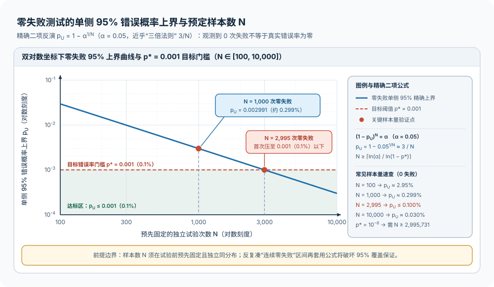
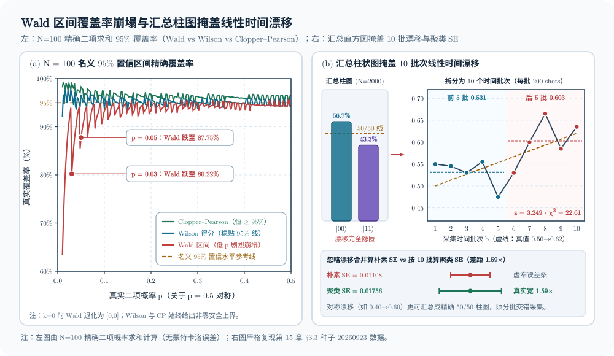
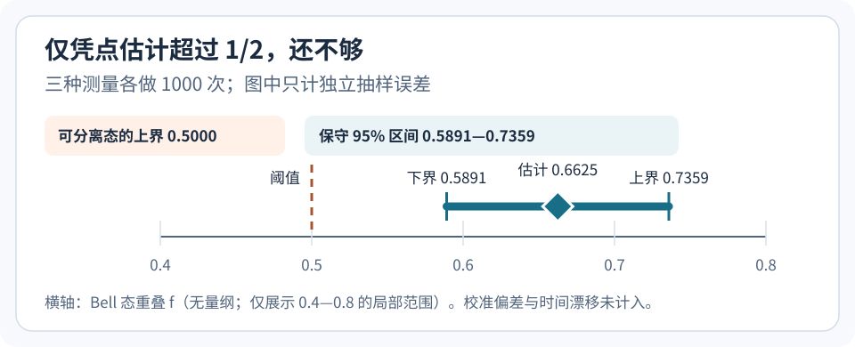

# 15｜实践路线：从手算、模拟到真机实验与论文复核

学完[第 06 章](06-algorithmic-primitives.md)到[第 08 章](08-applications.md)的核心算法原语、经典量子算法与变分应用，很多同学真正打开编辑器或者连上云端量子处理器时，心里反而会发虚：程序吐出来的数字和脑子里的直觉对不上，究竟是自己把矩阵乘反了、比特端序弄颠倒了、采样次数不够，还是芯片正在悄悄漂移？

作为第二篇“核心算法与动手实践”的压轴章，这一章把实践手艺彻底前移：在迈入后续硬件物理（[Q3](quantum-mechanics/03-levels-control.md)与[第 09 章](09-hardware.md)）、编译控制（[第 14 章](14-compilation-control.md)）、量子纠错（[第 10 章](10-error-correction.md)—[第 11 章](11-resources-benchmarks.md)）与高阶理论深水区之前，先为你配齐四件可迁移到任何框架、任何硬件的**实验室基础武器**——从纸笔起步的 $O(2^n)$ 态矢量模拟与单元测试、经得起追问的有限样本统计工具箱、四大现代开源 SDK 的同题并排实战，以及像审稿人一样拆解论文与上游软件缺陷的核验心法。

哪怕你还没怎么写过 Python，也完全可以先读懂第 1 节的验证阶梯、第 3 节的统计核验和第 5 节的读论文心法——代码是帮我们核对的工具，不是理解实验的入场券。文中标有 `进阶选读：` 的小节（Bootstrap 与 BCa 区间、线路等价性形式化验证 QCEC）第一遍可以先跳过，需要补齐数组和矩阵乘法基础时，随时可以翻回[第 01 章：数学工具](01-math.md)和[入门先修](appendices/prerequisites.md)。

---

## 1. 四级验证阶梯与最小研究循环

新手做量子实验最容易犯的一个错误，就是一上来就把 6 比特电路直接丢上真机或大型云端模拟器，看着直方图抓耳挠腮地反推理论。一旦结果不对，数学错、端序错、编译错、统计波动和硬件噪声全都搅在一起，你根本无从下手。

老老实实走**四级验证阶梯**，每爬一层只放进一类新变量，排错速度反而快上一个数量级：

1. **第一级：纸笔小例**——把问题缩到 1–2 比特，亲手写出输入态、每一步矩阵和理想输出概率。
2. **第二级：无噪声态矢量模拟**——检查复振幅、相对相位、端序和归一化，把所有数学和代码 bug 消灭在这一层。
3. **第三级：有限次采样（shots）模拟**——在理想概率上加入有限重复抽样，亲眼看清纯随机波动有多大，定好区间与判定阈值。
4. **第四级：噪声模型与真机实验**——最后才引入编译映射、门误差、读出混淆、退相干与时间漂移，把前面三层建立的基线拿来对照。


每往上走一层，都要锁死同一个可证伪的问题，不要看到实验结果不太好看就临时改口。下表是每个项目开工前都值得写在实验记录本第一页的**最小研究循环**：

| 环节 | 动手前要写清楚的内容 | 出异常时最先查什么 |
| :--- | :--- | :--- |
| **假设** | 一句能被证伪的预测，例如“$|+\rangle$ 在 $X$ 基测得 `+`（经 $H$ 门旋转回计算基后读出 `0`）的概率为 $1$” | 问题是否模糊、符号与基有没有先约定 |
| **理想预测** | 精确的复振幅、概率分布、期望值或资源标度 | 纸笔手算、比特端序、矩阵从右向左的次序 |
| **观测规则** | 采样次数（shots）、接受条件、统计量和置信区间公式 | 是否事后改了筛选阈值、分母有没有悄悄变化 |
| **对照实验** | 空线路、经典混态对照、已知解析解或强经典基线 | 对照组与实验组是不是只改变了一个变量 |
| **结论边界** | 这批数据能支持什么，又不能外推到什么 | 是否把相关性说成因果、把 3 比特演示外推到百比特 |

动手前把统计量和剔除规则写下来，听起来有点繁琐，却是科研里最管用的“防自欺”护栏——它把事后专挑好看数据的念头直接关在了门外。

---

## 2. 从零手写 Python 态矢量模拟器

想要真正吃透量子电路在计算机里怎样运转，最好的办法不是立刻安装几百兆的大型 SDK，而是只用 `NumPy` 亲手写一个几十行的模拟器。先从小矩阵对照纸笔起步，再把它升级成能轻松跑 20 比特以上的张量引擎。

### 2.1 先用显式矩阵核对 1–2 比特小例

先拿草稿纸算一道单比特热身题：从 $|0\rangle = [1, 0]^T$ 出发，依次经过 $H$ 门、$Z$ 门、再经过 $H$ 门。因为矩阵作用从右向左，整体表达式是 $H Z H |0\rangle$：

$$
|0\rangle
\xrightarrow{\;H\;}
\frac{1}{\sqrt{2}}\begin{bmatrix}1 \\ 1\end{bmatrix} = |+\rangle
\xrightarrow{\;Z\;}
\frac{1}{\sqrt{2}}\begin{bmatrix}1 \\ -1\end{bmatrix} = |-\rangle
\xrightarrow{\;H\;}
\begin{bmatrix}0 \\ 1\end{bmatrix} = |1\rangle.
$$

所以最终振幅必为 $(0, 1)^T$，计算基测量概率必为 $(0, 1)$。刚接触 `NumPy` 的同学，可以先认一下下面代码里最常用的五个记号：

| 代码写法 | 在模拟器里的物理含义 |
| :--- | :--- |
| `np.array([1, 0], dtype=complex)` | 创建复双精度（`complex128`）向量，避免遇到 $i$ 时静默丢掉虚部 |
| `A @ v` | 矩阵 $A$ 乘列向量 $v$（不是逐格相乘 `A * v`） |
| `np.vdot(u, v)` | 自动对第一个参数取复共轭再求和，精确对应物理内积 $\langle u\vert v\rangle$ |
| `np.abs(psi) ** 2` | 对每个复振幅取模再平方，得到 Born 规则概率分布 |
| `np.allclose(a, b)` | 在浮点舍入容差内比较数组是否相等 |

现在把纸笔推导搬进 Python，用断言自动验收：

```python
import numpy as np

zero = np.array([1, 0], dtype=complex)
one = np.array([0, 1], dtype=complex)

H = np.array([[1, 1],
              [1, -1]], dtype=complex) / np.sqrt(2)
Z = np.array([[1, 0],
              [0, -1]], dtype=complex)

# 矩阵从右向左作用：先 H，再 Z，最后 H
psi = H @ Z @ H @ zero
probabilities = np.abs(psi) ** 2

assert np.allclose(np.vdot(psi, psi), 1.0)
assert np.allclose(psi, one)
print(np.round(probabilities, 6))  # [0. 1.]
```

这里有一个新手常踩的暗坑：**算复向量的内积一定要用 `np.vdot(u, v)`，不要用 `np.dot(u, v)`**。`np.dot` 不会对左向量取共轭，碰到实向量 $|+\rangle$ 时风平浪静，一换成复向量 $|{+i}\rangle = (|0\rangle + i|1\rangle)/\sqrt{2}$ 就会把 $\langle +i|+i\rangle$ 算成 $0$！

接下来把同样的方法扩展到两比特 Bell 态 $|\Phi^+\rangle = \mathrm{CNOT}(H\otimes I)|00\rangle$。遵循全书统一的大端序（高位在左）约定，四个计算基按 $|00\rangle, |01\rangle, |10\rangle, |11\rangle$ 排列：

```python
import numpy as np

I = np.eye(2, dtype=complex)
H = np.array([[1, 1], [1, -1]], dtype=complex) / np.sqrt(2)
CNOT = np.array([
    [1, 0, 0, 0],
    [0, 1, 0, 0],
    [0, 0, 0, 1],
    [0, 0, 1, 0],
], dtype=complex)  # 高位控低位：|10> <-> |11>

zero_zero = np.array([1, 0, 0, 0], dtype=complex)
bell = CNOT @ np.kron(H, I) @ zero_zero
target = np.array([1, 0, 0, 1], dtype=complex) / np.sqrt(2)

assert np.allclose(bell, target)
print(np.abs(bell) ** 2)  # [0.5 0.  0.  0.5]
```

`np.kron(H, I)` 算出 $4\times 4$ 的张量积矩阵 $H\otimes I$，把 $H$ 作用在左边的高位比特 $q_0$、把 $I$ 留在右边的低位比特 $q_1$，最后再由左边的 `CNOT` 收尾。输出四个概率依次对应 `00, 01, 10, 11`。

### 2.2 为什么 `np.kron` 会在 14 比特撞墙？改用 $O(2^n)$ 张量切片法

`np.kron` 写起来很直观，但只要你试着把上面的代码扩到 14 个比特，电脑内存瞬间就会报警。算一笔简单的账就明白了：

复双精度数（`complex128`，由两个 64 位浮点数组成实部和虚部）每个占 **16 字节**。$n$ 个量子比特的态矢量有 $2^n$ 个复振幅，只占 $16 \times 2^n$ 字节；可如果你用 `np.kron` 把单比特门拼成整张 $2^n \times 2^n$ 的稠密矩阵，需要存 $2^n \times 2^n = 4^n$ 个复数，内存和乘法次数都是 **$O(4^n)$**！

| 比特数 $n$ | 态矢量内存 $16\times 2^n$ | 稠密全矩阵内存 $16\times 4^n$ | 笔记本电脑能否直接跑？ |
| :---: | :---: | :---: | :--- |
| $10$ | $16\,\mathrm{KiB}$ | $16\,\mathrm{MiB}$ | 两种方法都很轻松 |
| $14$ | **$256\,\mathrm{KiB}$** | **$4\,\mathrm{GiB}$** | `np.kron` 单矩阵已撞上内存墙 |
| $20$ | **$16\,\mathrm{MiB}$** | **$16\,\mathrm{TiB}$** | 态矢量很轻，全矩阵完全不可存 |
| $24$ | **$256\,\mathrm{MiB}$** | **$4\,\mathrm{PiB}$** | 张量法仍可运行，全矩阵天方夜谭 |

解决方法非常优雅，而且只需要几行 `NumPy`：**根本不要构造 $2^n\times 2^n$ 的大矩阵！**

把长度为 $2^n$ 的一维态矢量用 `reshape((2,) * n)` 零拷贝地看成一个 $n$ 阶张量 `psi`，第 `q` 条轴专门对应第 $q$ 个量子比特（下标 `0` 和 `1`）。给第 $q$ 个比特施加 $2\times 2$ 门 $U$，只需让 $U$ 沿着第 `q` 条轴收缩（`np.tensordot`），再把生成的新轴移回位置 `q`（`np.moveaxis`）。每次门操作只扫一遍态矢量，时间和内存复杂度瞬间从 $O(4^n)$ 降回 **$O(2^n)$**，普通笔记本也能顺滑跑通 20 比特以上的电路。

下面这份 40 行左右的骨架既保留了全书大端序 $|q_0 q_1 \cdots q_{n-1}\rangle$，又示范了三个工程好习惯：张量收缩施门（含同比特下标断言护栏）、**不建大矩阵直接算 Pauli 期望值**，以及带浮点截断保护的**中段投影测量坍缩**：

```python
import numpy as np

def apply_1q(state, U, q, n):
    """在大端序 |q_0 q_1 ... q_{n-1}> 态矢量上，对第 q 比特施加 2x2 门 U。"""
    psi = state.reshape((2,) * n)
    res = np.tensordot(U, psi, axes=([1], [q]))
    return np.moveaxis(res, 0, q).reshape(-1)

def apply_2q(state, U4, q1, q2, n):
    """对 (q1, q2) 施加 4x4 门 U4（按 |q1 q2> 顺序排列）。"""
    assert q1 != q2, "双比特门的两个目标比特不能相同"
    psi = state.reshape((2,) * n)
    res = np.tensordot(U4.reshape(2, 2, 2, 2), psi, axes=([2, 3], [q1, q2]))
    return np.moveaxis(res, [0, 1], [q1, q2]).reshape(-1)

def measure_qubit_collapse(state, q, n, rng):
    """单次投影测量第 q 比特，返回 (测量结果 0/1, 坍缩并重新归一化后的后态)。"""
    psi = state.reshape((2,) * n).copy()
    p0 = float(np.clip(np.sum(np.abs(np.take(psi, 0, axis=q)) ** 2), 0.0, 1.0))
    if p0 <= 0.0:
        outcome = 1
    elif p0 >= 1.0:
        outcome = 0
    else:
        outcome = 0 if rng.random() < p0 else 1
    slc = [slice(None)] * n
    slc[q] = 1 - outcome
    psi[tuple(slc)] = 0.0  # 清零未命中的分支
    flat = psi.reshape(-1)
    norm = float(np.linalg.norm(flat))
    assert norm > 1e-12, "测量坍缩后范数过小，请检查输入态是否已归一化"
    return outcome, flat / norm

# 演示：用 O(2^n) 引擎制备 Bell 态并计算 <XX>，全程不构造 2^n x 2^n 矩阵
H = np.array([[1, 1], [1, -1]], dtype=np.complex128) / np.sqrt(2)
X = np.array([[0, 1], [1, 0]], dtype=np.complex128)
CNOT = np.array([[1,0,0,0],[0,1,0,0],[0,0,0,1],[0,0,1,0]], dtype=np.complex128)

n = 2
state = np.zeros(1 << n, dtype=np.complex128)
state[0] = 1.0  # |00>
state = apply_1q(state, H, q=0, n=n)
state = apply_2q(state, CNOT, q1=0, q2=1, n=n)

# 计算 <psi| X_0 X_1 |psi>：只需复制态矢量施加门，再做 vdot
phi = apply_1q(apply_1q(state, X, 0, n), X, 1, n)
exp_xx = np.vdot(state, phi).real
assert np.isclose(exp_xx, 1.0)
print(f"Bell state = {np.round(state.real, 4)}, <XX> = {exp_xx:.4f}")
```

仔细对比两种模拟测量的方式：如果只需要在电路末尾读出 1000 次统计结果，直接算完概率分布 `p = np.abs(state) ** 2` 后用 `rng.choice` 批量抽样即可（非破坏抽样，极快）；但如果要模拟**中段测量与条件反馈**（见[第 04 章](04-circuits-protocols.md)隐形传态或[第 14 章](14-compilation-control.md)动态电路），就必须像上面 `measure_qubit_collapse` 那样先对 `p0` 做 `[0.0, 1.0]` 截断防浮点漂移，清零另一分支后再按范数归一化，把坍缩后的条件态送进后面的门。

### 2.3 上手任何模拟器前必跑的五条自检清单

不管是自己写的代码，还是第一次切换到一个新开源框架，开工前花两分钟跑完这五条冒烟测试，能帮你省下日后大半天怀疑人生的排错时间：

1. **端序冒烟测试（Endianness Smoke Test）**：只对第 0 号比特 $q_0$ 施加一次 $X$ 门，其余比特保持 $|0\rangle$，打印非零振幅下标和测量计数串。
   - **大端序（$q_0$ 居左作最高位，$|q_0 q_1\rangle$）**：本书、`Cirq`、`PennyLane` 默认如此——$X(q_0)|00\rangle = |10\rangle$，非零下标为 `2`，计数串显示 `'10'`。
   - **小端序（$q_0$ 居右作最低位，$|q_1 q_0\rangle$）**：`Qiskit` 默认如此——$X(q_0)|00\rangle = |01\rangle$，非零下标为 `1`，计数串显示 `'01'`。
   - 端序没对齐前，绝不要继续写多比特纠缠门！
2. **酉性与归一化断言**：每定义一个新门矩阵，先断言 `np.allclose(U.conj().T @ U, np.eye(d))`；每跑完一段电路，断言 `np.isclose(np.vdot(psi, psi).real, 1.0, atol=1e-12)`。
3. **全局相位无关比较**：比对两个电路输出的纯态是否物理等价时，别盲目直接 `np.allclose(psi1, psi2)`。例如 $R_x(\pi) = -iX$ 与 $X$ 差一个全局相位 $-i$，直接比较数组会报错；正确做法是检验根保真度重叠 `np.isclose(abs(np.vdot(psi1, psi2)), 1.0)`，或把首个非零分量相位对齐后再比。但请留神：**一旦把门放进受控分支（如受控 $R_x(\pi)$ vs 受控 $X$），全局相位就会变成相对相位**，此时必须核对精确矩阵相等。
4. **已知解析恒等式回归测试**：至少用四个手算已知答案校验你的引擎——单比特 $HZH = X$、两比特 $|\Phi^+\rangle$ 的 $\langle ZZ\rangle = \langle XX\rangle = 1$、三比特 GHZ 态 $(|000\rangle+|111\rangle)/\sqrt{2}$，以及 3 比特 QFT（**含电路末尾的比特反转 SWAP 层**）对照 `np.fft.ifft(psi, norm="ortho")`（与[第 06 章](06-algorithmic-primitives.md)正指数 $\operatorname{QFT}_N$ 精确相等至浮点舍入精度 $\sim 10^{-16}$；漏掉末尾比特反转 SWAP 会导致振幅下标错位、核验必败）。
5. **固定独立随机流并记版本**：统一用 `rng = np.random.default_rng(seed)`（现代 PCG64 生成器），别再使用会污染全局状态的旧接口 `np.random.seed()`；并且永远把随机种子与 Python、`NumPy` 精确版本号一起记进日志。

**突破态矢量墙的进阶路标**：$O(2^n)$ 态矢量引擎在普通电脑上大约止步于 25–30 比特，而且无法直接演化混态噪声。当你后续研究大规模 Clifford 纠错电路（$O(n^2)$ 稳定子表格法）、低纠缠一维多体系统（$O(n\chi^2)$ 矩阵乘积态 MPS）或含噪算符海森堡演化（稀疏 Pauli 动力学 SPD）时，这些专门引擎的分步手算与纯 Python 迷你实现都将在[第 21 章：稳定子形式、经典模拟引擎与量子优势边界](21-stabilizer-classical-simulation.md)中完整展开。

---

## 3. 有限样本统计实用工具箱

从第 2 级（精确态矢量）迈进第 3 级（有限次采样）后，你手里的不再是精确概率 $p$，而是 $N$ 次抽样数出来的原始计数 $k$。很多看似“发现物理新现象”的波动，其实只是有限样本统计跟你开的玩笑。

### 3.1 从理想概率到有限 shots：为什么 Wald 区间会崩溃，改用 Wilson 区间

继续看上一节的 Bell 态，理想概率是 $p = (0.5, 0, 0, 0.5)$。下面用 `NumPy`（2.x 版本复算确认）固定种子 `20260922` 模拟 $N = 1000$ 次独立测量：

```python
import numpy as np

rng = np.random.default_rng(20260922)
outcomes = rng.choice(4, size=1000, p=[0.5, 0, 0, 0.5])
counts = np.bincount(outcomes, minlength=4)

assert counts.sum() == 1000
assert counts[1] == counts[2] == 0
print(counts)  # [463   0   0 537]
```

先看两个直觉判断：第一，理想概率为零的 `01` 和 `10` 在无噪声抽样里必然严格是 `0`；如果真机上冒出了 `01` 或 `10`，不要甩锅给“有限采样波动”，而要去查门错误、读出混淆或端序。第二，理想概率为 $0.5$ 的 `00` 这次只抽到了 $463$ 次（$\hat p = 0.463$），差了整整 $37$ 次，算异常吗？

对 $N$ 次独立同分布的二元事件，观测频率 $\hat p = k/N$ 的粗略标准误差为

$$
\mathrm{SE}(\hat p) = \sqrt{\frac{\hat p(1-\hat p)}{N}}.
$$

代入 $N = 1000, p = 0.5$，标准误约 $\sqrt{0.25/1000} \approx 0.0158$（约 1.6 个百分点）。因此两次千次实验相差 $0.01$ 时，连一个标准误都不到，根本说明不了硬件变好或变坏。

但不要直接套用教科书最简陋的对称正态区间 $\hat p \pm z\sqrt{\hat p(1-\hat p)/N}$（学名 **Wald 区间**）：只要 $k$ 贴近 $0$ 或 $N$，Wald 区间就会彻底失灵——比如做了 1000 次实验零失败（$k=0$），Wald 区间给出的宽度是 $0$，区间缩成 $[0, 0]$，荒谬地告诉你“误差为零”；即使在 $N=100, p=0.05$ 这样很常见的设置下，名义 95% 的 Wald 区间实际覆盖率也仅为 $87.75\%$（降到 $p=0.03$ 时更跌至 $80.22\%$）。

日常实验请默认换用 **Wilson 得分区间**（Wilson, 1927）。给定显著性水平 $\alpha$ 和标准正态双侧分位数 $z = \Phi^{-1}(1 - \alpha/2)$（95% 置信度对应 $z \approx 1.959964$），区间端点为：

$$
\frac{\hat p + \dfrac{z^2}{2N} \pm z\sqrt{\dfrac{\hat p(1-\hat p)}{N} + \dfrac{z^2}{4N^2}}}{1 + \dfrac{z^2}{N}}.
$$

它有两个讨喜的优点：端点永远安全落在 $[0, 1]$ 内，且在 $k=0$ 时自动给出非零上界 $\frac{z^2}{N+z^2}$（$N=1000$ 时约 $0.00383$）。我们拿上面的 $k = 463, N = 1000$ 一步不跳地手算一遍：

1. 先算修正因子：$z^2 \approx 1.959964^2 \approx 3.841459$，故 $\frac{z^2}{N} \approx 0.003841$，分母为 $1 + \frac{z^2}{N} \approx 1.003841$。
2. 算区间中心：

   $$
   \text{center} = \frac{0.463 + \frac{3.841459}{2000}}{1.003841} = \frac{0.463 + 0.001921}{1.003841} \approx 0.46314.
   $$

3. 算半宽：$\frac{\hat p(1-\hat p)}{N} = \frac{0.463 \times 0.537}{1000} = 0.000248631$，$\frac{z^2}{4N^2} \approx 0.000000960$，相加开根号得 $\sqrt{0.000249591} \approx 0.015798$，再乘 $z$ 除分母：

   $$
   \text{half} = \frac{1.959964 \times 0.015798}{1.003841} \approx 0.03085.
   $$

4. 合并得到 95% Wilson 区间：$[0.46314 - 0.03085,\; 0.46314 + 0.03085] = \mathbf{[0.4323,\; 0.4940]}$。

用几行代码验证每一步：

```python
n = int(counts.sum())
k = int(counts[0])
phat = k / n
z = 1.959963984540054  # 标准正态分布的 97.5% 分位数

den = 1 + z**2 / n
center = (phat + z**2 / (2 * n)) / den
half = z * np.sqrt(phat * (1 - phat) / n + z**2 / (4 * n**2)) / den

print(f"p00={phat:.3f}, 95% Wilson=[{center-half:.4f}, {center+half:.4f}]")
# p00=0.463, 95% Wilson=[0.4323, 0.4940]
```

**停下来看一个极其宝贵的“翻车现场”**：生成这段代码的真实概率明明是 $p_{00} = 0.5000$，可我们用固定种子 `20260922` 算出来的 95% Wilson 区间 $[0.4323, 0.4940]$ 竟然**没有盖住 0.5**！

这绝不是代码写错了，恰恰是最生动的一堂统计课：
- **95% 置信水平指的是长期重复抽样时的覆盖频率**（Wilson 方法还带有渐近近似，是名义 95% 水平），它本来就意味着平均每 20 次独立实验里约有 1 次区间会与真值擦肩而过。如果改用贝叶斯框架下的 Jeffreys 区间，则要写明它基于 $\operatorname{Beta}(1/2, 1/2)$ 先验给出的是后验可信区间，不要把频率覆盖率和贝叶斯后验概率混为一谈。
- **不要为了“让图更好看”而偷偷换种子重跑。** 一旦你换了五六个种子直到区间盖住 0.5 才贴进报告，又只报最后那一次，你就亲手把无偏抽样变成了**选择偏差**。在真实实验里，这样一次边缘结果足以触发一轮预先规定好的独立复测，但不足以单凭它就宣布芯片已经漂移。

### 3.2 零失败不等于零错误：Clopper–Pearson 精确上界与“三倍法则”

做容错解码或高保真门验证时，你经常会碰上“连跑 $N$ 次、一次都没错（$k=0$）”的好消息。这时候怎样把“零失败”诚实地翻译成错误率上界？

如果需要严格保守的频率覆盖保证（对任意真实 $p\in[0,1]$ 实际覆盖率都 $\ge 1-\alpha$），就用 **Clopper–Pearson 精确二项区间**（Clopper & Pearson, 1934）。一般地，对 $N$ 次独立试验观察到 $k$ 次失败，它的双侧 $(1-\alpha)$ 区间端点由 Beta 分布分位数给出：

$$
p_L = B\!\left(\frac{\alpha}{2};\, k,\, N-k+1\right)\;(k>0;\; k=0\text{ 时为 }0),
\qquad
p_U = B\!\left(1-\frac{\alpha}{2};\, k+1,\, N-k\right)\;(k<N;\; k=N\text{ 时为 }1).
$$

到了零失败（$k=0$）的情形，单侧 $(1-\alpha)$ 精确上界连 Beta 函数都用不着，拿高中数学就能一行解出来！设单次真实失败概率为 $p$，连续 $N$ 次全不失败的概率是 $(1-p)^N$。令它刚好等于容许的误判水平 $\alpha$：

$$
(1 - p_U)^N = \alpha
\quad\Longrightarrow\quad
p_U = 1 - \alpha^{1/N} = 1 - e^{\frac{\ln\alpha}{N}}.
$$

当 $N$ 较大时，$\frac{\ln\alpha}{N}$ 很小，利用 $1 - e^{-x} \approx x$，立刻得到简洁近似：

$$
p_U \approx \frac{\ln(1/\alpha)}{N}.
$$

代入最常用的 95% 单侧置信度（$\alpha = 0.05$），因为 $\ln(1/0.05) = \ln 20 \approx 2.9957 \approx 3$，就推出了实验物理与工程界人手一条的心算口诀——**三倍法则（Rule of Three）**：

$$
p_U \approx \frac{3}{N} \qquad (\text{零失败，单侧 }95\%\text{ 置信上界}).
$$

拿具体数字算两笔账，立刻能感受到它的威力：
- **做 1000 次独立测试零失败**：精确公式给出 $p_U = 1 - 0.05^{1/1000} \approx 0.002991$（约 $0.299\%$），三倍法则心算 $3/1000 = 0.30\%$，两者相差不到 0.001 个百分点。也就是说，一千次零失败只够支持“错误率低于 $0.3\%$”，远远不能说“错误率为零”。
- **反解实验前要准备多少样本**：若想在零失败的情况下把单侧 95% 上界压到目标门槛 $p_*$ 以下，两边取自然对数（注意 $\ln(1-p_*) < 0$，除过去不等号反转）：

  $$
  N \ge \left\lceil\frac{\ln\alpha}{\ln(1-p_*)}\right\rceil \approx \left\lceil\frac{3}{p_*}\right\rceil.
  $$

  要认证 $p_* = 10^{-3}$，至少要提前排满 $\mathbf{N = 2995}$ 次独立运行；若要认证容错时代常见的百万分之一逻辑错误率 $p_* = 10^{-6}$，至少需要 $\mathbf{2\,995\,731}$ 次（约三百万次）独立运行！



完整的精确覆盖率网格验证与标准库代码见[零失败上界练习](labs/practice.md#p15-e一千次零失败不等于错误率为零)。

### 3.3 进阶选读：非线性统计量用 Bootstrap（含 BCa 与 Cluster Bootstrap），边界比例坚持 Wilson

Wilson 与 Clopper–Pearson 区间只适用于单一二元比例。可量子实验里到处都是**非线性观测量**——根保真度 $F = \sqrt{f_{\Phi^+}}$、纠缠熵、态纯度 $\operatorname{Tr}(\rho^2)$、能量差比值或 ZNE 指数拟合斜率——这时二项公式统统失灵，必须请出非参数重采样利器 **Bootstrap**（Efron, 1979；Efron & Tibshirani, 1993）。但新手也极易把 Bootstrap 用错地方，尤其是以下三类分工必须写清：

| 统计目标与数据结构 | 推荐区间方法 | 原因与典型失效反例 |
| :--- | :--- | :--- |
| **单一二元比例（尤其 $k=0$ 或贴近 $0/1$）** | **Wilson / Clopper–Pearson** | **零失败崩溃反例**：当 $N = 1000, k = 0$ 时，原始样本全是 `0`，朴素 Bootstrap 每次有放回重采样抽出来的仍是 1000 个 `0`，区间直接崩成 **`[0, 0]`**（与 Wald 区间同样失效！）；Wilson 给出 $[0, 0.00383]$，单侧 Clopper–Pearson 给出 $0.00299$ |
| **独立采样下的复杂非线性统计量**（如 $F = \sqrt{f}$、纠缠熵、曲线拟合） | **BCa Bootstrap**（偏差校正与加速，Efron 1987） | 相比朴素百分位 Bootstrap，BCa 通过中位偏移校正 $z_0$ 与留一 Jackknife 加速系数 $a$ 自动修正非线性变换引起的偏态与方差随均值变化 |
| **分批漂移或随机化线路（如 PEC / Pauli twirling）** | **Cluster Bootstrap**（整簇重采样） | 必须把每个批次或每条随机电路当成一个不可分割的整簇有放回重抽；若拆散按单个 shot 重抽，会严重低估区间宽度 |

**实操对照（沿用 4.2 节 Bell 三基原始计数）**：三组测量计数为 $XX:(775, 225)$、$YY:(250, 750)$、$ZZ:(800, 200)$，根保真度点估计 $\hat F = \sqrt{0.6625} \approx 0.8139$。下面 18 行纯 `NumPy` 代码对三组二项计数并行做 $B = 5{,}000$ 次有放回重采样（对应纯标准库含精确 BCa 校正的独立实现见[实践统计验证脚本](../codes/practice/v4_practice_lab.py)）：

```python
import numpy as np

rng = np.random.default_rng(20261125)
counts = np.array([[775, 225], [250, 750], [800, 200]])  # (N_+, N_-) for XX, YY, ZZ
ns = counts.sum(axis=1)
ps = counts[:, 0] / ns

B = 5000
k_boot = rng.binomial(ns, ps, size=(B, 3))               # 独立并行重采样三组二项计数
corrs = (2 * k_boot - ns) / ns                           # 每组 Pauli 关联估计
f_sq_boot = 0.25 * (1.0 + corrs[:, 0] - corrs[:, 1] + corrs[:, 2])
F_boot = np.sqrt(np.clip(f_sq_boot, 0.0, 1.0))           # 非线性根保真度重采样分布

lo, hi = np.percentile(F_boot, [2.5, 97.5])
print(f"F_hat={np.sqrt(0.6625):.4f}, 95% Bootstrap=[{lo:.4f}, {hi:.4f}]")
```

把三种区间并排放在一起，松紧与假设边界一目了然（固定种子 `20261125` 复算）：
- **95% 百分位 Bootstrap**：$[0.8000,\; 0.8270]$；
- **95% BCa Bootstrap**（计入开根号非线性偏移 $z_0$ 与 Jackknife 加速系数 $a$）：$[0.7997,\; 0.8267]$；
- **4.2 节无分布假设 Hoeffding 保守下界**：$0.7675$（无需渐近近似但明显更宽）。

### 3.4 总直方图会掩盖时间漂移：分批检测与聚类标准误

真实量子处理器可不是教科书里纹丝不动的理想硬币。芯片里的两能级缺陷（TLS）跳变、微波温漂和校准衰减，会让成功概率在几分钟或几小时内悄悄滑坡。**如果你只把一整晚跑完的总直方图存下来，时间漂移就被彻底抹平了。**

用一段 10 批、每批 200 shots 的模拟亲自看一眼（设真实 $p_{00}$ 在 10 个批次里从 $0.50$ 线性漂移到 $0.62$）：

```python
import numpy as np

rng = np.random.default_rng(20260923)
shots_per_batch = 200
p00_by_batch = np.linspace(0.50, 0.62, 10)
k00 = np.array([rng.binomial(shots_per_batch, p) for p in p00_by_batch])

first = int(k00[:5].sum())
last = int(k00[5:].sum())
n_half = 5 * shots_per_batch
pooled = (first + last) / (2 * n_half)
se_diff = np.sqrt(pooled * (1 - pooled) * (2 / n_half))
z_diff = (last / n_half - first / n_half) / se_diff

print("每批计数:", k00.tolist())
print(f"前半={first/n_half:.3f}, 后半={last/n_half:.3f}, z={z_diff:.3f}")
# 每批计数: [110, 109, 106, 111, 95, 106, 120, 133, 117, 127]
# 前半=0.531, 后半=0.603, z=3.249
```

把这 2000 次合并成一张总直方图，你只会看见一个平平无奇的总体频率 $\hat p_{00} = (531+603)/2000 = 0.567$。可一旦按事先规定的时间顺序切开前半 5 批（$531/1000 = 0.531$）与后半 5 批（$603/1000 = 0.603$），差值高达 $0.072$。

在“所有 shot 独立同分布且概率恒定”的零假设下，两半频率之差的合并标准误为

$$
\mathrm{SE}_{\mathrm{diff}} = \sqrt{0.567 \times (1 - 0.567) \times \left(\frac{1}{1000} + \frac{1}{1000}\right)} \approx 0.02216,
$$

于是检验统计量

$$
z = \frac{0.603 - 0.531}{0.02216} \approx \mathbf{3.249}.
$$

同时对这 10 个批次算一次 Pearson $\chi^2$ 齐性统计量 $\chi^2 = \sum_{b=1}^{10} \frac{(k_b - 200\hat p)^2}{200\hat p(1-\hat p)} \approx 22.61$（自由度 $9$，$p \approx 0.0071$），漂移立刻露了馅。

顺着这个例子，还有一条在实际科研里极容易踩雷的**聚类标准误**（Clustered Standard Error）原则。在随机编译、Pauli 旋转平均（twirling）、准概率误差缓解或存在批次漂移的实验里，同一随机电路实例或同一时间块内部的多次 shots 共享同一个系统条件，它们**并不彼此独立**。拿上面这 10 批数据直接对比一下两种算法：

- 如果无视批次差异、把 2000 次一股脑塞进独立公式，得到的标准误只有 $\sqrt{0.567\times 0.433 / 2000} \approx \mathbf{0.01108}$；
- 如果把每一批的均值 $\hat p_b = k_b/200$ 当作一个聚类单元，用 10 个批次均值的样本标准差除以 $\sqrt{10}$，得到的聚类标准误是 $\mathbf{0.01756}$——比朴素公式足足宽了 **1.59 倍**！
- **少聚类构造 95% 置信区间必须改用自由度 $B - 1$ 的学生 $t$ 分位数**：当独立聚类数 $B$ 不大（例如本例 $B = 10$ 或练 15-A 的 $B = 4$）时，绝不能直接拿聚类标准误乘正态分位数 $1.96$，而必须乘自由度为 $B - 1$ 的学生 $t$ 分布分位数 $t_{B-1,\, 0.975}$——$B = 10$ 时 $t_{9,\, 0.975} \approx \mathbf{2.262}$（区间须再加宽 $15.4\%$），$B = 4$ 时更高达 $t_{3,\, 0.975} \approx \mathbf{3.182}$（须加宽 $62.4\%$！）。在[实践统计验证脚本](../codes/practice/v4_practice_lab.py)的 10,000 次蒙特卡洛检验中，$B = 4$ 下错用 $1.96$ 会让名义 95% 置信区间的真实覆盖率骤降至 **$84.9\%$**（$B = 10$ 时降至 $91.5\%$），换用 $t_{B-1}$ 后覆盖率立刻精确恢复至 **$94.7\%\text{–}94.8\%$**。若对上述 10 批做整簇 **Cluster Bootstrap**（整批有放回重采样），测得的标准误为 $0.01676$，同样显著宽于朴素公式的 $0.01108$。



图注：左面板按精确二项分布计算 $N = 100$、名义 95% 置信水平下 Wald 区间覆盖率在低概率端的剧烈崩塌（$p=0.05$ 处仅 $87.75\%$，$p=0.03$ 处跌至 $80.22\%$），并与紧贴名义线的 Wilson 区间及恒 $\ge 95\%$ 的 Clopper–Pearson 区间对照；右面板还原上述 10 批时间漂移轨迹（种子 `20260923`，前半 $0.531$ vs 后半 $0.603$，$z = 3.249$），对比合并直方图掩盖趋势后朴素标准误（$0.01108$）与真实聚类标准误（$0.01756$）的 1.59 倍差距。查看[原尺寸图](assets/v3-15-wilson-wald-drift.svg)。

把四条工程习惯总结成一张日常防漂移对照表：

| 诊断或设计手段 | 用来抓什么问题 | 实用提醒 |
| :--- | :--- | :--- |
| **预定义前后两半 $z$ 检验** | 单调趋势性漂移 | 切分点必须事先写好，绝不能看完曲线再挑落差最大处下刀 |
| **$B$ 批次 Pearson $\chi^2$ 与游程检验** | 任意批次间跳变（如 TLS 切换）或连续聚集 | 至少切出 10–20 个时间块，并把批次曲线直接画出来看 |
| **随机交错采集（A-B-A-B）** | 比较两种编译方案、两种缓解方法或实验/对照 | 把预算拆成多轮微批次，每轮随机交替跑 A 与 B，比“先跑完 A 再跑 B”抗漂移强一个量级 |
| **聚类标准误（Clustered SE）** | 同一随机电路内共享多次 shots 的相关性 | 以每个独立随机电路（或时间块）的均值为独立单元，不拿总 shots 虚降误差条 |

### 3.5 多重比较与“边跑边偷看”陷阱

实验室里还有两类最隐蔽的统计翻车：一是**同时检验太多项却不校正**，二是**边采样边偷看、刚过线就叫停**。

#### 陷阱一：同时做 20 次检验，再只挑显著的那一次报喜

假设芯片上有 20 对毫无异常的物理比特，你在每对上各做一次独立的 $\alpha = 0.05$ 显著性检验。单次不误报的概率是 $0.95$，20 次全都不误报的概率只有 $0.95^{20} \approx 0.3585$，也就是说**至少错报一次假阳性的概率高达** $1 - 0.95^{20} \approx \mathbf{64.15\%}$！反复换超参数、换编译种子、换观测量再挑最亮眼的贴进论文，其实就是亲手在制造这种假阳性。

针对同时做的 $m$ 项检验，科研里有三种最实用的校正工具：
1. **Bonferroni 校正**：把每次阈值统一压到 $\alpha/m$（例如 $m=20$ 时门槛降为 $0.0025$）。它由概率并合界保证整体至少误报一次的概率（家族错误率 FWER）不超过 $\alpha$，**不要求检验之间互相独立**，缺点是略保守。
2. **Holm–Bonferroni 逐步下降法（Holm, 1979）**：把 $m$ 个 $p$ 值从小到大排序 $p_{(1)} \le p_{(2)} \le \dots \le p_{(m)}$，依次核对 $p_{(k)} \le \frac{\alpha}{m - k + 1}$；遇到第一个不满足的下标立刻停止，后面的全部不拒绝。**它同样不要求检验独立，而且检验力严格优于普通 Bonferroni**，日常控制 FWER 时推荐直接用它替代 Bonferroni。
3. **Benjamini–Hochberg 流程（BH-FDR，1995）**：如果你在一块百比特芯片上做探索性筛查（比如找出高串扰边对），目标往往不是“一个假警报都不能有”，而是控制宣称异常项里假警报的期望比例（错误发现率 FDR）不超过 $q$。排序后找到满足 $p_{(k)} \le \frac{k}{m}q$ 的**最大**下标 $k^*$，把 $1, \dots, k^*$ 全部标为显著（标准 BH 要求检验独立或满足正回归依赖 PRDS；任意相关性下可用 Benjamini–Yekutieli 因子 $\sum_{i=1}^m 1/i$）。

拿一组 5 个排序后的 $p$ 值（`0.008, 0.011, 0.025, 0.042, 0.210`，取 $\alpha = q = 0.05$）手算一遍，三者宽严立见分晓：

| 排序 $k$ | 观测 $p_{(k)}$ | Bonferroni 门槛 $\alpha/5$ | Holm 门槛 $\alpha/(5-k+1)$ | BH-FDR 门槛 $(k/5)q$ |
| :---: | :---: | :---: | :---: | :---: |
| $1$ | `0.008` | `0.0100`（拒绝） | `0.0100`（拒绝） | `0.0100`（拒绝） |
| $2$ | `0.011` | `0.0100`（不拒绝） | `0.0125`（拒绝） | `0.0200`（拒绝） |
| $3$ | `0.025` | `0.0100`（不拒绝） | `0.0167`（停止） | `0.0300`（拒绝） |
| $4$ | `0.042` | `0.0100`（不拒绝） | — | `0.0400`（不拒绝） |
| $5$ | `0.210` | `0.0100`（不拒绝） | — | `0.0500`（不拒绝） |

同样五组数据：Bonferroni 只敢放行 1 项，Holm 无损多救回第 2 项（仍严格守住 5% FWER），BH-FDR 放行前 3 项（守住 5% FDR）。

#### 陷阱二：边采样边偷看，看到显著就立刻停机

固定样本量公式算出的 95% 区间，**只对你事先定好 $N$、跑完一次结算时有效**。如果你每隔 100 shots 就盯一眼屏幕，“只要下界越过 0.5 就立刻宣布成功停机，没越过就继续加 shots”，真实假阳性率会从 5% 迅速膨胀到 25% 以上；按重对数律，只要你愿意无限偷看下去，哪怕零假设完全为真，最终也几乎必然撞线一次。

要是实验机时昂贵，我们确实希望早点看到强证据就提前停，有没有严谨的办法？有，而且只需要初等代数就能手算一套**望远镜预算分配**。

设我们测试同一稳定电路中的二元成功事件（每次 shot 独立且成功概率恒为 $p$），事先约定只在累计样本量 $N_1 = 100,\; N_2 = 400,\; N_3 = 1600$ 处查看（并允许未来按同一规则继续加查看点），总误判预算锁定为 $\alpha = 0.05$。

**第一步**：给第 $j$ 次查看分配望远镜预算

$$
\alpha_j = \frac{\alpha}{j(j+1)} = \alpha\left(\frac{1}{j} - \frac{1}{j+1}\right).
$$

把前 $J$ 次的预算裂项相加，中间项全部两两抵消，总和为 $\alpha\left(1 - \frac{1}{J+1}\right) < \alpha$——即使未来把查看次数排到无穷多，总预算也永远不会爆表！

**第二步**：每次查看用对应的 $\alpha_j$ 算单侧 Hoeffding 下界

对独立二元观测，Hoeffding 不等式保证 $\Pr(\hat p_j - p \ge \varepsilon_j) \le e^{-2N_j\varepsilon_j^2}$。令右端等于 $\alpha_j$，解出 $\varepsilon_j = \sqrt{\frac{\ln(1/\alpha_j)}{2N_j}}$，得到单侧下界：

$$
L_j = \max\!\left(0,\; \hat p_j - \sqrt{\frac{\ln(1/\alpha_j)}{2N_j}}\right).
$$

所有预定查看点里“至少一次出现 $L_j > p$”的概率，由概率并合界至多为 $\sum_j \alpha_j \le 0.05$——注意**并合界并不要求各次累计数据之间互相独立**（它们本来就是重叠累加的），只需要每次查看点内部各 shot 独立即可。

代入一组示例累计计数（三次成功数分别为 $70,\; 280,\; 1120$，点估计始终是 $\hat p = 0.70$），逐行算完结果如下：

| 查看次序 $j$ | 累计样本 $N_j$ | 累计成功数 | 本次预算 $\alpha_j$ | 误差半径 $\sqrt{\frac{\ln(1/\alpha_j)}{2N_j}}$ | 单侧下界 $L_j$ |
| :---: | :---: | :---: | :---: | :---: | :---: |
| $1$ | $100$ | $70$ | $0.025000$ | $0.135810$ | **$0.564190$** |
| $2$ | $400$ | $280$ | $0.008333$ | $0.077359$ | **$0.622641$** |
| $3$ | $1600$ | $1120$ | $0.004167$ | $0.041385$ | **$0.658615$** |

如果预设门槛是 $p > 0.5$，第 1 次查看时下界 $0.5642$ 已经稳稳越线，按预定规则现在就可以放心停机，同时覆盖保证已经把“挑时机停机”的代价算进去了；前三次合计只花掉 $0.0375$ 预算，还给未来留了 $0.0125$ 的余量。倘若你事先确定**最多只看三次**，也可以把预算平分成每次 $\alpha/3 \approx 0.016667$（第一次稍紧、后两次稍宽），但不允许把只在这三个时刻有效的下界拿去插值到没预定的中途样本量（比如偷偷在 $N=250$ 偷看）。想动手复算这三组数，可以运行[望远镜序贯预算复算脚本](../codes/systems/round71_checks.py)（运行参数 `--case 15`）。

> **进阶注记（安全随时有效推断 SAVI 与 $e$-value）**：如果云端实验实在想“每来一批数据就随时看、随时决定停或加跑”，2021–2026 年统计学界已发展出更紧凑的现代工具——**时间一致置信序列**（Howard et al., 2021）和基于“打赌检验”的 **$e$-value / 检验鞅**（Ramdas et al., 2023）。它的直觉很像带本金 $E_0 = 1$ 的公平赌局：只要构造一个满足零假设期望 $\mathbb{E}_{H_0}[E_t \mid \mathcal{F}_{t-1}] \le 1$ 的非负财富过程 $E_t$，由 Ville 不等式，无论你在什么时候盯着数据临时叫停，整个过程中财富曾经翻到 $1/\alpha$ 倍以上的概率永远不超过 $\alpha$，即 $\Pr_{H_0}(\exists t \ge 1:\; E_t \ge 1/\alpha) \le \alpha$。

> **练 15-A（零失败上界与分批漂移聚类 SE）**
> 1. 对 $N = 500$ 次独立运行且观察到零失败（$k = 0$），分别计算名义 95% Wald 区间、双侧 95% Wilson 区间与单侧 95% Clopper–Pearson 精确上界，并与三倍法则 $3/N$ 对照。
> 2. 某真机连续采集 4 个时间批次、每批 $200$ shots，测得 `00` 计数依次为 $[90, 96, 114, 120]$。分别计算前后两半合并 $z$ 统计量、把 800 shots 混算的朴素标准误，以及按 4 个批次均值计算的聚类标准误（及其放大倍数）。
>
> *自核要点*：① Wald 区间退化为 $[0, 0]$（朴素 Bootstrap 同样退化为 $[0, 0]$）；双侧 95% Wilson 上界为 $\frac{z^2}{N + z^2} \approx \frac{3.8415}{503.8415} \approx 0.00762$，区间为 $[0, 0.00762]$；单侧 95% Clopper–Pearson 上界为 $1 - 0.05^{1/500} \approx 0.00597$（三倍法则 $3/500 = 0.00600$）。② 前半频率 $186/400 = 0.4650$、后半 $234/400 = 0.5850$、合并 $\hat p = 0.5250$，得 $z \approx 3.398$；朴素标准误 $\sqrt{0.525\times 0.475 / 800} \approx 0.01766$，4 批次频率 $[0.45, 0.48, 0.57, 0.60]$ 的样本标准差除以 $\sqrt{4}$ 得聚类标准误 $\approx 0.03571$（足足是朴素公式的 **$2.02$ 倍**）；若据此构造 95% 置信区间，因仅 $B = 4$ 个独立聚类（自由度 $B - 1 = 3$），必须使用学生 $t$ 分位数 $t_{3,\,0.975} \approx \mathbf{3.182}$ 而非 $1.96$，半宽为 $3.182 \times 0.03571 \approx 0.1136$！

---

## 4. 五个递进教学实验：从单比特相位到误差缓解代价

有了模拟器骨架和统计工具箱，就可以把这套方法落到五个层层递进的实验上了。每个实验都先在纸上写好理想预测，再上模拟器或真机核对。

### 4.1 实验一：相对相位干涉与三道真机排错对照

**要检验的问题**：$|+\rangle$ 与 $|-\rangle$ 在计算基下统计完全相同（`0`/`1` 各半），但在 $X$ 基（测量前补施 $H$ 门）下分别以概率 $1$ 给出 `0` 与 `1`（数学推导见第 2.1 节与[第 02 章](02-single-qubit.md)）。

**真机三道对照排错法**：如果在硬件上测 $X$ 基时没拿到接近 100% 的确定结果，不要笼统归结为“有噪声”，而是拆成三道递进对照——① 跑一条不加任何门的空线路量出读出混淆矩阵；② 跑连续两个 $H$ 门（$H^2 = I$）测单比特门误差；③ 在两个 $H$ 之间插入逐渐拉长的等待时间看退相干，一步步把误差源剥离出来。

如果你想用耳朵感受“先加振幅再平方”和“对比度衰减”的区别，可以配合听一下[声音实验](labs/audio.md)里的五段教学合成音频（同相、120 度、反相与理想/衰减 Ramsey 条纹）；音频类比能帮大脑抓住干涉相位，但声波不是量子硬件录音，定性直觉之外定量判断仍要回到公式与计数。

### 4.2 实验二：Bell 相关不等于纠缠证明（三基计数与 Hoeffding 下界）

很多入门教程演完 Bell 电路 $|\Phi^+\rangle = \frac{|00\rangle + |11\rangle}{\sqrt{2}}$，在 $ZZ$ 基下看见直方图里两根高高的 `00` 和 `11` 柱子，就欢呼“我们造出了量子纠缠”。

且慢！一个毫无纠缠的**经典相关混态**

$$
\rho_{\mathrm{cl}} = \frac{1}{2}|00\rangle\langle 00| + \frac{1}{2}|11\rangle\langle 11|
$$

在 $ZZ$ 基下会吐出**一模一样**的 `00/11` 柱子（就像提前把一双红手套或一双蓝手套随机装进两个黑盒子里寄给两人，打开当然永远同色）。真正把量子纠缠和经典配对劈开的是**换基测量**：在 $XX$ 基下，理想 $|\Phi^+\rangle$ 依然完全同号，满足 $\langle X\otimes X\rangle = +1$；而经典混态 $\rho_{\mathrm{cl}}$ 的四种 $XX$ 结果完全均匀，关联 $\langle X\otimes X\rangle = 0$。

对理想 $|\Phi^+\rangle$，三个同轴 Pauli 关联分别是：

$$
\langle XX\rangle = +1, \qquad \langle YY\rangle = -1, \qquad \langle ZZ\rangle = +1.
$$

把 Bell 态投影算符展开到 Pauli 基，就得到极其好用的 **Bell 重叠见证**：

$$
f_{\Phi^+} = \langle\Phi^+|\rho|\Phi^+\rangle = \frac{1}{4}\Big(1 + \langle XX\rangle - \langle YY\rangle + \langle ZZ\rangle\Big).
$$

请顺手核对全书统一的保真度口径：这里 $f_{\Phi^+}$ 是测量重叠概率（平方保真度），而[第 13 章](13-quantum-information.md)定义的**根保真度**是 $F(\rho, |\Phi^+\rangle\langle\Phi^+|) = \sqrt{f_{\Phi^+}}$。特意用小写 $f$ 和大写 $F$ 分开写，正是为了避免把 $0.66$ 和 $\sqrt{0.66}\approx 0.81$ 混成一个数。

**为什么 $f_{\Phi^+} > 1/2$ 就能见证纠缠？** 两行就能证完：任取两个归一化的单比特纯态 $|a\rangle = a_0|0\rangle + a_1|1\rangle$ 与 $|b\rangle = b_0|0\rangle + b_1|1\rangle$（满足 $|a_0|^2+|a_1|^2 = |b_0|^2+|b_1|^2 = 1$），它们的乘积态 $|a, b\rangle = a_0 b_0|00\rangle + a_0 b_1|01\rangle + a_1 b_0|10\rangle + a_1 b_1|11\rangle$ 与 $|\Phi^+\rangle$ 的重叠满足

$$
|\langle\Phi^+|a,b\rangle|^2 = \left|\frac{a_0 b_0 + a_1 b_1}{\sqrt{2}}\right|^2 = \frac{|a_0 b_0 + a_1 b_1|^2}{2} \le \frac{(|a_0|^2 + |a_1|^2)(|b_0|^2 + |b_1|^2)}{2} = \frac{1}{2},
$$

不等号用的正是复向量的柯西—施瓦茨不等式。因为任意可分离混态都是乘积纯态的概率凸组合，而 $f_{\Phi^+} = \operatorname{Tr}(|\Phi^+\rangle\langle\Phi^+|\rho)$ 关于 $\rho$ 是线性的，所以一切可分离态的 $f_{\Phi^+}$ 都不可能超过 $1/2$！只要在可信测量模型下证实真实 $f_{\Phi^+} > 1/2$，就能断定状态处于纠缠（注意反过来不成立：$f_{\Phi^+} \le 1/2$ 只说明这个特定见证没检出纠缠，例如 $|\Psi^+\rangle$ 的 $f_{\Phi^+}=0$；此外它依赖已校准的测量基，不是设备无关的 Bell 检验）。

**现在把有限样本算账落到实处**。假设我们对同一制备状态分别在 $XX, YY, ZZ$ 三组基下各测 $N = 1000$ 次，每次把两个比特读出的 $\pm 1$ 乘起来记录，得到下面这组原始计数：

| 测量组 | 乘积为 $+1$ 的次数 | 乘积为 $-1$ 的次数 | 关联估计 $(N_+ - N_-)/N$ |
| :--- | :---: | :---: | :---: |
| $XX$ | $775$ | $225$ | $+0.55$ |
| $YY$ | $250$ | $750$ | $-0.50$ |
| $ZZ$ | $800$ | $200$ | $+0.60$ |

1. **算点估计**：把三组估计代入投影公式（留神 $YY$ 前面自带一个负号！）：

   $$
   \hat f_{\Phi^+} = \frac{1 + 0.55 - (-0.50) + 0.60}{4} = \frac{2.65}{4} = \mathbf{0.6625}
   $$

   （对应的根保真度点估计为 $\hat F = \sqrt{0.6625} \approx 0.8139$）。

2. **算有限抽样保守下界**：光看 $0.6625 > 0.5$ 还不够，得给随机波动留够安全垫。每组内每次读数落在 $[-1, 1]$（跨度为 $2$），在同组 shots 独立的假设下，Hoeffding 不等式给出单组偏差界

   $$
   \Pr(|\hat c - c| \ge \varepsilon) \le 2 e^{-N\varepsilon^2 / 2}.
   $$

   三组里至少有一组越界的概率，由并合界至多是三倍上界 $6 e^{-N\varepsilon^2 / 2}$。令总失误率等于 $\alpha = 0.05$，代入 $N = 1000$ 解出单组误差半径：

   $$
   \varepsilon = \sqrt{\frac{2\ln(6 / 0.05)}{1000}} = \sqrt{\frac{2\ln(120)}{1000}} \approx \sqrt{\frac{2 \times 4.78749}{1000}} \approx \mathbf{0.09785}.
   $$

3. **传回 Bell 重叠**：三项各自乘了系数 $\pm 1/4$，只要三组真值都在各自 $\pm \varepsilon$ 范围内，总偏差至多为 $\frac{3\varepsilon}{4} \approx 0.07339$，因此至少 95% 覆盖保证的保守区间是：

   $$
   f_{\Phi^+} \ge 0.6625 - 0.07339 = \mathbf{0.5891} > \frac{1}{2},
   \qquad
   f_{\Phi^+} \le 0.6625 + 0.07339 = \mathbf{0.7359}.
   $$

   换算成根保真度下界则是 $\sqrt{0.5891} \approx 0.7675$。



整条区间都清晰地落在阈值 $0.5$ 右侧（留意图轴只放大展示了 $0.4$ 到 $0.8$ 区间）。实际在硬件上做这 3000 次测量时，别忘了**交错采集 $XX, YY, ZZ$ 三组**来对抗时间漂移，并把读出混淆矩阵带来的系统误差单独列账——上图的 `0.5891` 只包住了独立抽样误差。若三组样本量不同（比如某一组漏采只剩 100 次），必须分别代入各自的 $N_i$ 计算半径，详细对照见[Bell 下界分母练习](labs/practice.md#p15-a同一个-bell-点估计为什么下界不同)。

### 4.3 实验三：弛豫与退相位的三轴排错与拟合上报规范

想摸清一颗物理量子比特的退相干脾气，只测一条衰减曲线远远不够，要把三个正交方向配成一套组合拳：

- **输入 $|1\rangle$，等待时间 $t$，测 $Z$ 基**：观察能量弛豫 $T_1$；
- **输入 $|+\rangle$，等待时间 $t$，测 $X$ 基**：观察 Ramsey 干涉条纹与自由演化相干衰减 $T_2^*$；
- **输入 $|{+i}\rangle$，等待时间 $t$，测 $Y$ 基**：核对赤道面上正交方向的相位演化与漂移。

实验数据常用的拟合模型与[第 09 章](09-hardware.md)的 $P_1(t)$ 形式等价（本节改写为观测 $|0\rangle$ 并显式采用 $\mathrm{Hz}$ 失谐 $\Delta f$）：

$$
P_1(t) = A e^{-t/T_1} + B,
\qquad
P_0(t) = A e^{-(t/T_2^*)^\alpha}\cos(2\pi \Delta f\, t + \phi) + B.
$$

做实验排错与拟合汇报时，必须盯紧四条规范：

1. **分清频率 $\Delta f$（Hz）与角频率 $\Delta = 2\pi\Delta f$（$\mathrm{rad/s}$）**：漏掉 $2\pi$ 会把失谐估计直接算错六倍多；
2. **完整上报拟合参数**：把拉伸指数 $\alpha$（区别指数马尔可夫衰减与高斯 $1/f$ 慢噪声）、稳态偏置 $B$、失谐 $\Delta f$ 及其拟合置信区间一并报告，绝不只甩出一个孤零零的“相干时间”；
3. **先测 $T_1$ 再解耦纯退相位与回波**：能量弛豫与纯退相位通过 $1/T_2 = 1/(2T_1) + 1/T_\phi$ 耦合（完整信道推导与脉冲机制见[第 05 章第 6 节](05-noise-channels.md)与[Q3 第 7 节](quantum-mechanics/03-levels-control.md)），因此不先独立标定 $T_1$ 就无法剥离纯退相位，且 Ramsey 测出的 $T_2^*$（混入慢频漂）不可与自旋回波 $T_2$ 混报；
4. **不要把三轴体检当成完整层析，警惕负特征值**：三轴曲线只能快速体检，完整重构单比特信道需要量子过程层析（至少 4 个线性独立输入态 $\times$ 3 组测量基）。在有限次采样下，**直接用朴素线性反演重构密度矩阵很容易撞出负特征值**——因为各 Pauli 期望的统计误差（甚至共享校准引起的关联误差）可能把经验 Bloch 向量推到单位球外（长度 $|\hat{\vec r}| > 1$），破坏正半定性，工程上必须用带物理约束的最大似然估计（MLE）并附上统计区间。

### 4.4 实验四：编译前后的真实代价

选一条包含非相邻 $\mathrm{CNOT}$ 的 3–5 比特逻辑电路，丢给目标芯片的连接图和原生门集，把编译前后的一整张账单摊开记录：

- 编译前的抽象门数与电路深度；
- 编译后的原生单比特门数、双比特纠缠门数与插入的 `SWAP` 数；
- 初始布局与路由后的末态逻辑—物理比特映射；
- 考虑并行约束后的总调度时长；
- 换 10–20 个编译器随机种子后，双比特门数与深度的分布范围。

对比一下“双比特门最少”“调度时长最短”“挑中校准质量最好物理边”这三种编译目标，你很快会发现它们常常**不是同一个方案**——背后涉及的 KAK 综合、SABRE 路由启发式、串扰感知调度与硬件约束，都在[第 14 章](14-compilation-control.md)给出了完整推导。

#### 进阶选读：编译正确性验收——线路等价性形式化验证（QCEC）

只统计编译后的门数与深度还漏了一道关键门禁：**编译、布局置换、SWAP 路由与优化重写之后的电路 $C'$，在数学上真的与原电路 $C$ 等价吗？** 当比特数 $n > 25$ 时，直接算两者的 $2^n \times 2^n$ 酉矩阵早已内存溢出。现代量子编译验证工程采用三层递进流水线：

1. **第一层（毫秒级随机态 / 稳定子证伪）**：生成 16 个随机计算基或单比特随机乘积纯态，分别送入原电路 $C$ 与编译电路 $C'$（严格按编译报告的**最终逻辑—物理比特布局置换**对齐输出位，并按根保真度 $|\langle\psi_C|\psi_{C'}\rangle|$ 忽略无关全局相位）。几乎所有常见的路由错位、CNOT 方向写反或 $S/S^\dagger$ 符号 Bug 都会在第一条随机乘积探针上瞬间露馅（[实践统计与等价性验证脚本](../codes/practice/v4_practice_lab.py)中已实现纯标准库 3 比特路由验证原型，16/16 探针全部秒抓错误映射）。
2. **第二层（精确形式化等价验证）**：随机态只能证伪、不能穷尽证明全空间等价。精确验证有两条主力引擎——① **量子多值决策图（QMDD / Alternating DD）**：从两侧交替推进乘积 $C'^\dagger C$，只要编译正确，大量门对会在中途即时抵消，使中间决策图始终保持极小节点数并最终化为单位阵 $e^{i\phi}I$；② **ZX 演算图形化简**（衔接[第 14 章](14-compilation-control.md)）：将 $C'^\dagger C$ 转为 ZX 图并用局域蜘蛛融合与双代数规则约简至空图。
3. **第三层（工业工具与边界）**：慕尼黑工业大学开源的 **MQT QCEC**（Burgholzer & Wille, *IEEE TCAD* **40**, 2021 [A]）将“随机仿真快速证伪 + Alternating DD + ZX 演算”并行编排，可直接解析 Qiskit 编译布局与辅助位：

```python
# 工业级编译等价性验证骨架（需安装 mqt.qcec 与 qiskit）
from mqt import qcec

# 自动解析 compiled_qc 的初始/最终布局置换与全局相位，判定是否数学等价
result = qcec.verify_compilation(orig_qc, compiled_qc)
print(result.equivalence)  # 期望输出 EquivalenceCriterion.equivalent_up_to_global_phase
```

必须同时清楚理论边界：一般量子线路等价性验证在最坏情形下是 **$\mathrm{QMA}$-完全**问题（因此对高度混沌、深度未对齐的任意双电路，决策图节点数仍可能指数膨胀）；此外，当编译引入未清理的垃圾辅助位或近似综合误差 $\epsilon > 0$ 时，不能套用严格全局酉等价，而须改用局部子空间等价或容差判据。

### 4.5 实验五：误差缓解的越界报告、后选择分母与成本预算

很多同学第一次跑零噪声外推（ZNE）或读出缓解，看到曲线离理想值近了一大截，立刻觉得“白捡了精度”。关于 ZNE 两点 $c=(1, 2)$ 与三点 Richardson 外推（固定总 shots 预算下最优分别放大 $9\times / 49\times$，均分 $10\times / 57\times$）及 PEC 指数代价的完整推导，已在[第 08 章第 7 节](08-applications.md#7-误差缓解qem用方差与样本换偏差)统一给出；而两点 $c=(1, 3)$ 线性外推在固定总预算下均分 $5\times$、最优 $3:1$ 分配仍 $4\times$ 的详细演算见[实验 P15-B](labs/practice.md#p15-b为什么外推到-110-不代表测出了超物理态)。做实验落盘时，还必须亲手管好下面四条极易遗漏的统计与报告细节：

1. **诚实报告越出物理边界的外推值**：假设噪声倍率 $\lambda = 1$ 与 $\lambda = 3$ 测得期望估计分别为 $0.90$ 和 $0.50$，线性外推公式 $\hat E_0 = \frac{3}{2}\hat E(1) - \frac{1}{2}\hat E(3) = 1.5 \times 0.90 - 0.5 \times 0.50 = \mathbf{1.10} > 1$。它不是某个量子态直接测出的期望值，而是带负权统计外推的必然副产品——实验报告中应如实记录 $1.10$ 及其标准误，绝不悄悄硬截断成 `1.0` 了事；并在固定总预算下把未缓解与缓解后的均方误差（MSE = 偏差平方 + 方差）同台比拼。
2. **后选择（Post-selection）必须同时报接受率和每尝试交付率**：在[后选择分母反例](labs/practice.md#p15-d后选择更准确为什么每次尝试反而更少成功)里，方法 B 把接受后的条件正确率从方法 A 的 $90\%$ 提到了 $96\%$，代价却是接受率从 $80\%$ 暴跌到 $25\%$——算上被丢弃的尝试，每次原始尝试交付的正确结果反而从 $0.80\times 0.90 = 72\%$ 跌到了 $0.25\times 0.96 = 24\%$！
3. **不同电路耗时不同时，按总墙钟预算而不是总 shots 分配**：更深的折叠电路单次耗时 $c_i$ 更长，最优样本分配遵循 $N_i \propto |a_i|/\sqrt{c_i}$（详见[按耗时分配预算](labs/practice.md#p15-f每个-shot-耗时不同最优预算怎样变)）。
4. **线路切割和准概率消除（PEC）的负权重代价**：负权重不能当概率抽样，而要归一化成 $q_j = |a_j|/\gamma$（$\gamma = \sum_j |a_j|$）并给结果乘上 $\gamma\,\operatorname{sgn}(a_j)$；对 $k$ 个独立切口或噪声门，总放大因子为 $\Gamma = \gamma^k$，方差开销随之按 $\Gamma^2 = \gamma^{2k}$ 指数增长（详见[准概率与线路切割代价](labs/practice.md#p15-g负权重不是负概率线路切割的代价怎样算)与[第 14 章第 11 节](14-compilation-control.md)）。

---

## 5. 像审稿人一样读论文与看图表

量子计算领域每天都有大量新预印本涌出，标题一个比一个抓人眼球。本节作为全书统一的**通用论文审计与图表红旗总表**，把常见套路一次浓缩成“四遍读法 + 十大红旗 + 图表七问”——无论读算法、硬件、纠错、传感还是系统工程论文，二十分钟就能摸清一篇工作的真实含金量（各细分领域的专有技术门槛则分见对应章节）。

### 5.1 四遍读论文法

1. **第一遍：定性主张**——它到底要解决什么任务？核心结论是严格数学定理、经典数值模拟、噪声硬件演示，还是未来路线图？对比的基线是谁？结论是不是只在特定噪声、特定输入或强后选择下成立？
2. **第二遍：核对端到端资源账本**——问题规模 $n$ 怎么定义的？数据装载（状态制备 / QRAM）和预言机（oracle）内部电路算进去了吗？编译后的双比特门数、重复 shots、经典后处理、解码耗时和置信区间有没有漏项？
3. **第三遍：亲手复算最小非平凡实例**——挑出论文里最简单的一个 2–4 维公式、小表格或小图，自己拿笔或写二十行 Python 独立算一遍。如果连作者给的最小例子都复算不对，先别急着相信文末那张几百比特的大图。
4. **第四遍：精读补充材料（Supplementary Information）**——门定义、比特端序、异常数据剔除规则、拟合模型、误差条口径以及经典基线的调参细节，十有八九藏在补充材料里。正文标题里响亮的“优势”，往往在补充材料里加上了一连串限定条件。

### 5.2 量子计算论文十大高频误导红旗速查表

碰到下面任何一条信号，心里立刻亮起黄灯，去正文和补充材料里把缺失的数字补齐：

| 序号 | 常见误导话术或手法 | 背后的物理或统计真相 | 审读自查动作 |
| :---: | :--- | :--- | :--- |
| **1** | **后选择隐匿接受率** | 只报“筛掉错误后的保真度 98%”，但接受率仅 2% 且随比特数指数衰减 | 追查原始总尝试数、接受率与每原始尝试有效交付率 |
| **2** | **选优展示（Cherry-picking）** | 跑 50 个随机图或挑芯片上状态最好的 4 颗比特，只贴成绩最亮眼的一例 | 查全部实例的分布、中位数、最差值及物理比特编号是否事先锁定 |
| **3** | **弱经典基线（稻草人对比）** | 拿硬件或缓解结果对比单核朴素态矢量，忽略张量网络（MPS/PEPS）或 Pauli 传播等现代经典算法 | 核对经典基线是否为当前强算法，且在相同精度与硬件/能耗预算下对比 |
| **4** | **把查询复杂度当墙钟提速** | 把“$O(\sqrt{N})$ 次 oracle 查询”直接写成实际加速，略去数据装载、oracle 门分解、纠错与读出 | 补齐端到端账单：装载 + 深度 + shots + 解码/后处理 + 总墙钟时间 |
| **5** | **混淆五层技术成熟度** | 把小规模模拟或特定随机线路采样演示拔高成“实现实用/商业量子优势” | 明确贴标签：数学定理 / 经典模拟 / 噪声演示 / 容错验证 / 端到端实用优势 |
| **6** | **偷换保真度口径** | 根保真度 $F = 0.95$ 对应的平方重叠只有 $F^2 = 0.9025$；单比特门 $10^{-4}$ 掩盖双比特门 $10^{-2}$ 或读出 $3\%$ | 核对公式是否开根号，分列单门、双门、读出、空闲与逻辑错误率 |
| **7** | **误差缓解只报偏差不报方差** | ZNE/PEC/切割在固定 shots 下会放大方差 $\Gamma^2$，且常静默裁剪越界值 | 对比同总 shots 或同总耗时下的均方误差（MSE）与额外标定电路数 |
| **8** | **误差条口径模糊** | 用 $1\sigma$ 标准误（SE）冒充 95% 置信区间（视觉缩窄近一半），或在有漂移/聚类数据时套用 $1/\sqrt{N}$ | 查清误差条是 SD、SE 还是 95% CI，有没有计入系统偏差与聚类方差 |
| **9** | **视觉操控与超区间外推** | 截断纵轴（如只画 0.90–0.94）把无统计差异的起伏拉成悬崖；用 3 个小码距点画直线外推百万比特 | 检查坐标原点、对数刻度、误差条是否重叠，以及外推是否跨越了噪声机制变化点 |
| **10** | **把路线图或预印本当实测事实** | 引用厂商路线图规划或未经复现的预印本作为当前器件性能基线 | 标清证据级别（同行评审论文 / arXiv 预印本 / 技术博客 / 路线图）与发布日期 |

### 5.3 读懂科研图表的七个问题

拿到一张实验曲线图，不用一上来就记数字，按这七个问题扫一圈：

1. **纵轴从零开始吗？** 如果截断了纵轴，肉眼看到的“暴涨”是不是其实只有半个百分点？
2. **误差条到底代表什么？** 是样本标准差（SD）、均值标准误（SE），还是 95% 置信区间（CI）？
3. **坐标轴是不是对数刻度？** 同样一段视觉距离，在对数轴上可能差了一个数量级。
4. **画的是全部实例还是挑出来的成功实例？**
5. **做过后选择后，每个点背后还剩多少有效样本？**
6. **同一张图里的几条曲线，用的是同一种误差定义和资源预算吗？**
7. **拟合直线或虚线外推，有没有远远冲出实测数据的横轴范围？**

顺带一提，看到同一张图里对比“实验组 vs 对照组”时，再多问一句：**这两组是随机交错采集的，还是先跑完 A 再跑 B？** 在会漂移的真机上，先后顺序本身就可能制造出看似漂亮的假改善。

---

## 6. 别盲信软件的 `passed`：独立核验与上游陷阱

用上成熟开源 SDK 之后，很多同学会松一口气，觉得只要终端绿字打出 `passed` 或 `fidelity = 1.0`，实验就算大功告成了。其实，在工程和科研里，“能看懂源码片段”“完整包能装上”“官方示例能跑”“目标实验通过独立核验”是**四个逐级变强的结论**，谁都不能替谁打包票。

下面两条来自真实量子软件生态的检验经验，最能帮你在研究起步阶段避开“静默翻车”。

### 6.1 独立重算归档数据，而不是重跑一遍原作者脚本

如果验证一段仿真结果的办法只是把原作者的脚本再跑一遍、再打印一次 `passed`，那你几乎什么新信息都没拿到——如果作者的脚本本身写反了端序、漏算了时间窗、或者调用了有问题的库字段，重跑一百遍照样绿字通过。

更扎实的做法是**落盘原始中间产物，再写一段完全不依赖原求解器的独立脚本去复算**：

- **量子纠错采样与解码**：把探测事件（detector events）和真实逻辑翻转位按明确的位打包（bit-packing）格式连同 SHA-256 校验和一并归档；复核脚本直接按小端位序解包、逐条比对解码预测与真实逻辑位并重新计数，立刻就能抓住“打包端序写反”或“报告与原始样本脱节”的问题。
- **最优脉冲控制（GRAPE）**：不要只看优化器返回对象里的 `fid_err` 字段！把导出的各通道控制波形 CSV 读出来，用独立编写的矩阵指数时间有序连乘重建完整酉矩阵并核对目标保真度。这样做还能顺带揪出上游版本兼容隐患——例如某版 `qutip-qtrl` 的通用 `L-BFGS-B` 接口向新版 SciPy 传入了不被识别的 `maxfev` 选项，改用该库显式支持的专用 `FMIN_L_BFGS_B` 路径后重跑，才让优化日志与独立波形演化严丝合缝地对上。
- **量子网络事件模拟**：从完整事件日志里按序号逐一配对“光子发射—到达—经典确认”三个时间戳，手工验算往返延迟（例如单程 $50\,\mu\mathrm{s}$ 加确认 $60\,\mu\mathrm{s}$ 恰为 $110\,\mu\mathrm{s}$），才能确保没有丢包统计错位或时间窗截断。

### 6.2 实战反例：日志报 `ENTANGLED` 且 `fidelity = 1`，真实重叠却是 0——揪出零迹非厄米的源码比对矩阵

看一个只靠草稿纸就能抓住真实上游 SDK 缺陷的绝佳例子。

假设一款量子网络模拟器在密度矩阵模式下完成了一次纠缠交换，日志里清清楚楚地打印出端点状态 `ENTANGLED` 且标量保真度 `fidelity = 1.0`。但如果你把实际产出的端点后态矩阵打印出来做独立重叠检验，会惊愕地发现它其实是合法却与目标态 $|\Phi^+\rangle$ 正交的 $|\Phi^-\rangle\langle\Phi^-|$（真实重叠为 $0$！）；再顺藤摸瓜翻进源码，才看到中间站 Bell 态测量（BSM）密度矩阵分支里用来比对 $|\Psi^+\rangle\langle\Psi^+|$（其中 $|\Psi^+\rangle = \frac{|01\rangle + |10\rangle}{\sqrt{2}}$）的硬编码目标矩阵，竟被误写成了两个不同 Bell 态的外积：

$$
C = |\Phi^+\rangle\langle\Psi^+|.
$$

不需要连任何服务器，拿出[第 05 章](05-noise-channels.md)密度矩阵的两条基本红线，三秒就能把这个错误比对目标判死刑：

1. **检查迹是否为 $1$**：因为 $|\Phi^+\rangle$ 与 $|\Psi^+\rangle$ 正交（$\langle\Psi^+|\Phi^+\rangle = 0$），

   $$
   \operatorname{Tr}(C) = \operatorname{Tr}(|\Phi^+\rangle\langle\Psi^+|) = \langle\Psi^+|\Phi^+\rangle = \mathbf{0} \ne 1.
   $$

2. **检查是否厄米**：

   $$
   C^\dagger = |\Psi^+\rangle\langle\Phi^+| \ne |\Phi^+\rangle\langle\Psi^+| = C.
   $$

它连厄米矩阵都不是，更不可能是合法的量子密度矩阵！真正的比对目标矩阵 $\rho_+ = |\Psi^+\rangle\langle\Psi^+|$ 按 $|00\rangle, |01\rangle, |10\rangle, |11\rangle$ 排序应为

$$
\rho_+ = \begin{bmatrix}
0 & 0 & 0 & 0 \\
0 & 1/2 & 1/2 & 0 \\
0 & 1/2 & 1/2 & 0 \\
0 & 0 & 0 & 0
\end{bmatrix},
$$

满足厄米、迹为 $1$、特征值为 $1, 0, 0, 0$（正半定）。

这并不是编出来的假想题——开源量子网络框架 SeQUeNCe `0.8.5` 版本的 Bell 态测量（`sequence/components/bsm.py` 中的 `_eq_psi_plus`）密度矩阵分支里，就真实出现过这一处硬编码外积写错，导致未防护运行（如种子 `730190`）实际产出的合法端点后态是 $|\Phi^-\rangle\langle\Phi^-|$、与目标态 $|\Phi^+\rangle$ 真实重叠为 $0$，而日志元数据仍谎报 `ENTANGLED` 和 `fidelity = 1`（与[第 12 章](12-security-network-frontiers.md)第 7.2 节的工程验算教训完全对应）。如果只盯着软件返回的元数据字段，这个错误会被完美漏过；唯有拿真实目标 Bell 态去做独立重叠与密度矩阵合法性检验，才能准确地将其拦下来。

一旦在科研里撞见这类上游库缺陷，请坚持三条工程铁律：
1. **先存档原失败**：用固定种子完整保存未加防护时的报错或异常输出，绝不把踩过的坑擦掉伪装成“一次通过”；
2. **不私改第三方源码**：不要直接去改 `site-packages` 或第三方快照的原字节，而是在自己的调用层添加边界清晰的显式防护（或切换至上游已修复的固定版本）；
3. **从零重跑并锁死环境**：补上独立数学断言、记录完整依赖锁文件（`requirements-lock.txt`）与文件哈希，再从头复跑全流程。

本书对 31 个开源量子项目（含 26 个基础核心发行包及后续扩展工作流）的完整安装实跑、独立复核脚本与上述案例的详细日志，全部归档在[完整 SDK 实验册](labs/sdk-validation.md)、[算法、工业实践与开源代码对照](appendices/software-practice.md)，以及[基础系统归档独立复核脚本](../codes/systems/sdk/verify_saved_results.py)与[进阶系统反例独立复核脚本](../codes/systems/round73_checks.py)中，有兴趣的读者可以直接对照复现。

---

## 7. 2025–2026 主流开源量子软件栈速览与选型

软件 API 迭代得比教材快得多。读这一节时请牢记一个原则：**把不会过时的数学模型和会变化的代码接口分开**；凡是跑过代码的实验，务必同时记下五个快照字段——**语言与包精确版本、依赖锁文件、后端或噪声快照、随机种子、运行日期**。

下面按 **2026 年 11 月核验**的官方发布状态，带你快速认清当下最核心的五大开源生态——每个工具最擅长干什么、近两年有哪些容易让旧教程报错的大改动，并通过第 7.3 节的同题四范式并排实战亲手避开最致命的跨框架暗坑。

### 7.1 五大核心工具逐项速览

1. **Qiskit 2.x（v2.0–v2.6，IBM 主导，Apache-2.0）**
   - **定位**：硬件编译（Rust 化 LightSABRE 路由与 C-API 超算集成）、百比特级电路转译与云真机执行的工业主力。
   - **2025–2026 必知断代变化（照抄 2022–2024 旧教程容易报错）**：
     - 全面转向 **Primitives V2（`SamplerV2` / `EstimatorV2`）** 与向量化 **PUB（Primitive Unified Bloc）** 提交格式，移除了旧版 `backend.run()` 与 `BackendV1`；
     - 彻底移除旧的 `.c_if()` 单指令条件接口，统一改用符合 OpenQASM 3 语义的结构化控制流 `with qc.if_test(...):`；
     - **彻底移除 `qiskit.pulse` 模块**（百比特规模下旧脉冲对象模型难以扩展）；在 IBM Heron 等硬件上改用原生分数门（`use_fractional_gates=True`，支持任意实角 `RX(θ)` 与严格限角 $0 < \theta < \pi/2$ 的 `RZZ(θ)`），若需研究底层连续脉冲动力学请转向 QuTiP。
   - **最易踩的坑**：默认采用**小端序**（比特串最右边是 $q_0$），向 V2 原语或真机提交前必须先编译为目标机的 ISA 电路，且 Qiskit Aer 的退极化噪声参数与 Cirq / PennyLane / Stim 相差 $4/3$ 换算因子（详见第 7.3 节！）。

2. **PennyLane + Catalyst（v0.40–v0.45 / Catalyst v0.10–v0.15，Xanadu 主导，Apache-2.0）**
   - **定位**：**可微量子编程**与量子化学的首选生态。无缝对接 JAX 与 PyTorch，内置伴随微分（模拟器极速反传）与真机可用的参数移位法则；`qml.qchem` 提供完善的分子与振动哈密顿量工具链。
   - **2025–2026 新亮点**：**Catalyst QJIT（基于 MLIR/LLVM）** 可把混合量子—经典循环与自动微分整段编译为原生代码，告别 Python 循环瓶颈；近期版本还陆续补齐了图门分解、动态量子比特分配（`qml.allocate`）和容错算法资源模板（如 QSP/QSVT 与 QRAM）。
   - **边界**：默认**大端序**；面向特定物理芯片的底层布局调度与硬件运维粒度不如 Qiskit 或 Cirq 贴近芯片 ISA。

3. **Cirq（v1.5–v1.7，Google Quantum AI 主导，Apache-2.0）**
   - **定位**：科研向电路设计与硬件感知算法原型利器。它把**并行时间片**（`Moment`）和**二维网格拓扑**（`GridQubit`）做成了电路的一等公民，极适合亲手研究门层调度、串扰与精确时序。
   - **协同全家桶**：与 **Qualtran**（容错算术子程序、块编码与 $T$/Toffoli 资源分解）、**OpenFermion**（费米子映射与化学模拟）、**qsim**（C++/GPU 高性能态矢量）配合流畅。
   - **边界**：默认**大端序**；开箱即用的通用黑盒编译 pass 生态小于 Qiskit，更偏透明、精细的科研定制。

4. **Stim（v1.15–v1.16）+ PyMatching（v2.2–v2.4）+ Sinter（Apache-2.0）**
   - **定位**：**量子纠错（QEC）电路级仿真的绝对事实标准**。Stim 用稳定子表与 SIMD 位打包 Pauli 帧传播，在普通笔记本上就能每秒跑百万级门、几秒采出数百万轮高码距表面码样本并自动导出探测错误模型（DEM）；PyMatching 以 **Sparse Blossom**（含两遍相关匹配处理 $Y$ 类超边错误）实现亚微秒/轮的最小权重完美匹配解码；Sinter 负责多核并行画阈值曲线。
   - **核心边界红线**：Stim **严格限于 Clifford 门与随机 Pauli（含擦除/相关 Pauli）噪声**！如果你要模拟非 Clifford $T$ 门通用电路、相干小角过旋转（如 $R_z(0.01)$）或真实物理振幅阻尼与三能级泄漏，必须换用态矢量或开放系统密度矩阵工具（或先做 Pauli 旋转近似再导入 Stim）。

5. **QuTiP 5.x（v5.0–v5.3，开源科学社区，BSD-3-Clause）**
   - **定位**：**开放量子系统与物理脉冲动力学仿真的金标准**。涵盖 Lindblad 主方程（`mesolve`）、量子蒙特卡洛轨迹（`mcsolve`）、Floquet 周期驱动、Bloch–Redfield 与非马尔可夫强耦合热库（`heom`）。5.x 版本重写了可插拔稀疏/稠密数据层，并拆出模块化的家族包——门与脉冲器件模拟用 **`qutip-qip`**，新一代脉冲最优控制转向 **`qutip-qoc`**（接替遗留的 `qutip-qtrl`）。
   - **边界**：密度矩阵维度按 $4^n$ 增长，强项在于 **1–6 个量子比特或多能级 transmon / 腔 QED 的精细真实物理建模**（如 DRAG 泄漏、动态解耦与读出谐振腔），不适合拿来跑 20+ 比特纯门级算法。

### 7.2 横向选型速查矩阵

| 维度 | Qiskit 2.x | PennyLane + Catalyst | Cirq (+ Qualtran) | Stim + PyMatching | QuTiP 5.x (+ 家族包) |
| :--- | :--- | :--- | :--- | :--- | :--- |
| **核心专长** | 硬件编译（LightSABRE）、V2 原语、云真机、HPC C-API | 可微电路、QJIT 混合编译、量子化学、QSVT/FTQC | 显式时间片（`Moment`）、网格拓扑、容错资源估算 | 大规模稳定子 QEC 电路采样与亚微秒 MWPM 解码 | 开放系统主方程、多能级 Hamiltonian、连续脉冲动力学 |
| **默认端序** | **小端序**（$q_0$ 在右） | 大端序（$q_0$ 在左） | 大端序（$q_0$ 在左） | 0-基索引数组（左到右；注意 `bit_packed=True` 为字节内小端序） | 张量积按参数顺序（左高位） |
| **典型规模** | 编译至百—千比特；Aer 态矢量约 25–30 比特 | `lightning` 态矢量约 25–30 比特；MPS 更大 | 态矢量 / `qsim` 约 25–35 比特 | **数千至数万比特**（仅 Clifford + Pauli） | 密度矩阵约 4–6 比特；纯态/轨迹约 10–14 比特 |
| **脉冲 / 物理层** | 2.0 已移除 `qiskit.pulse`（改用分数门） | 少量模拟脉冲工具 | 偏门层与时序层 | 无（离散门与随机噪声信道） | **最强**（完整含时 $H(t)$、DRAG、泄漏、`qutip-qoc`） |
| **首选科研场景** | 编译路由对比、误差缓解、云硬件基准 | VQE/QAOA 梯度优化、分子基态、混合 QJIT | 算法原型、调度串扰、容错算术开销拆解 | 表面码 / qLDPC 阈值曲线与解码器对比 | 物理比特体检、DRAG 整形、$T_1/T_2$ 与非马尔可夫噪声 |

### 7.3 现代量子编程实战：同题四范式对照与自动化单元测试

只看选型表很难真正体会不同范式的接口差异和隐蔽暗坑。下面我们锁定**同一道公共实战题**，在 **OpenQASM 3.0 / Qiskit 2.x (V2 Primitives + Aer) / PennyLane 0.45 / Stim 1.16** 四种现代范式里并排写出极简可运行骨架，再把最容易静默算错的退极化噪声参数换算和自动化单元测试彻底讲透。

**公共任务**：制备 2 比特 Bell 态 $|\Phi^+\rangle$，在 $q_0$ 上施加**总非恒等 Pauli 翻转率 $q = 0.03$** 的等价单比特退极化噪声，随后测量 $\langle ZZ\rangle$ 与 $\langle XX\rangle$，并示范一次“测 $q_0$ 若为 `1` 则对 $q_1$ 施条件 $X$”的动态反馈写法。

**先算解析基准值（防静默算错的基准核对）**：对单比特施加总翻转率 $q$ 的退极化信道，是以概率 $1-q$ 什么都不做、分别以概率 $q/3$ 施加 $X_0, Y_0, Z_0$：

$$
\mathcal{E}_{\mathrm{flip}}(\rho)
= (1 - q)\rho + \frac{q}{3}\big(X\rho X + Y\rho Y + Z\rho Z\big).
$$

将其作用在 Bell 态 $|\Phi^+\rangle$ 的 $q_0$ 上：$X_0$ 保持 $\langle XX\rangle = +1$ 但翻转 $\langle ZZ\rangle \to -1$；$Z_0$ 保持 $\langle ZZ\rangle = +1$ 但翻转 $\langle XX\rangle \to -1$；$Y_0$ 同时翻转两者为 $-1$。于是精确解析期望为

$$
\langle ZZ\rangle_{\mathrm{noisy}} = \langle XX\rangle_{\mathrm{noisy}}
= (1 - q) + \frac{q}{3} - \frac{q}{3} - \frac{q}{3}
= 1 - \frac{4}{3}q.
$$

代入 $q = 0.03$，精确理论答案必为 **$\langle ZZ\rangle = \langle XX\rangle = 1 - 0.04 = \mathbf{0.96}$**！

**高危暗坑揭露：为什么 Qiskit Aer `depolarizing_error(λ, 1)` 直接传 `0.03` 会凭空少算 25% 物理错误？**

Cirq（`cirq.depolarize(q)`）、PennyLane（`qml.DepolarizingChannel(q, wires=0)`）与 Stim（`DEPOLARIZE1(q)`）全部直接按上面的 $\mathcal{E}_{\mathrm{flip}}$ 定义参数 $q$。唯独 **Qiskit Aer** 的 `depolarizing_error(λ, 1)` 按“完全混合态比例 $\lambda$”定义：

$$
\mathcal{E}_{\mathrm{Aer}}(\rho) = (1 - \lambda)\rho + \lambda\,\frac{I}{2}.
$$

利用单比特 Pauli 旋转恒等式 $\frac{I}{2} = \frac{1}{4}(\rho + X\rho X + Y\rho Y + Z\rho Z)$（因为对任意 $\rho = \frac{1}{2}(I + r_x X + r_y Y + r_z Z)$，有 $X\rho X + Y\rho Y + Z\rho Z = \frac{1}{2}(3I - r_x X - r_y Y - r_z Z)$，与 $\rho$ 相加恰得 $2I$），代入上式立刻得到：

$$
\mathcal{E}_{\mathrm{Aer}}(\rho)
= \left(1 - \frac{3}{4}\lambda\right)\rho + \frac{\lambda}{4}\big(X\rho X + Y\rho Y + Z\rho Z\big).
$$

逐项对比系数，可见 Qiskit Aer 的参数 $\lambda$ 与真实非恒等 Pauli 翻转率 $q$ 满足严格换算：

$$
q = \frac{3}{4}\lambda \quad\Longleftrightarrow\quad \lambda = \frac{4}{3}q.
$$

这意味着：**要模拟等价于 $q = 0.03$ 的退极化噪声，PennyLane / Cirq / Stim 传 `0.03`，而 Qiskit Aer 必须传 `λ = 0.04`！** 如果你照抄同一个数字 `0.03` 塞进 `depolarizing_error(0.03, 1)`，实际非恒等翻转率只有 $0.75 \times 0.03 = 0.0225$（**静默少算了 25% 的物理错误**），算出的 Bell 关联变成 $1 - 0.03 = 0.97$ 而非真实的 $0.96$——拿它去跨框架基准比对时，会白白制造出整整 1 个百分点的虚假误差！

下面四段极简代码并排演示同一任务（均为可对照运行的现代 2025–2026 写法，统一设定目标翻转率 $q = 0.03$，动态反馈演示独立列出以保持无混杂）：

```qasm
// 范式 1：OpenQASM 3.0（中立汇编语法；噪声模型由后端独立附着）
OPENQASM 3.0;
include "stdgates.inc";
qubit[2] q;
bit[2] c;
h q[0];
cx q[0], q[1];
// 测 <ZZ> 直接测计算基；测 <XX> 在测量前对 q[0], q[1] 各补一次 h
c[0] = measure q[0];
if (c[0] == 1) { x q[1]; } // 动态条件反馈：把 |11> 复位回 |10>
c[1] = measure q[1];
```

```python
# 范式 2：Qiskit 2.x (V2 Primitives + Aer；注意小端序、density_matrix 与 lambda = 4*q/3 = 0.04！)
from qiskit import QuantumCircuit
from qiskit.quantum_info import SparsePauliOp
from qiskit_aer.noise import NoiseModel, depolarizing_error
from qiskit_aer.primitives import EstimatorV2

qc = QuantumCircuit(2)
qc.h(0); qc.cx(0, 1)
qc.barrier(0); qc.id(0); qc.barrier(0)  # 仅作未转译直跑示例；若经 optimization_level>=1 转译，
                                        # RemoveIdentityEquivalent 会删掉 id 门导致噪声静默消失！
q_flip = 0.03
nm = NoiseModel()
nm.add_quantum_error(depolarizing_error(4 * q_flip / 3, 1), ["id"], [0])  # 必须填 0.04！

est = EstimatorV2(
    options={
        "backend_options": {"method": "density_matrix", "noise_model": nm},
        "default_precision": 0.0,
    }
)
res = est.run([(qc, [SparsePauliOp("ZZ"), SparsePauliOp("XX")])]).result()[0]
print(res.data.evs)  # 精确密度矩阵期望：[0.96, 0.96]

# 工程提醒：经 generate_preset_pass_manager(optimization_level>=1) 转译为 ISA 电路时，
# 请勿把噪声挂在易被优化 pass 删掉的 id 门上，而应直接绑定真实原生门或显式插入自定义 Kraus 指令。
# 动态反馈语法（Qiskit 2.x 统一块结构，已废除 .c_if）：
# with qc.if_test((qc.clbits[0], 1)): qc.x(1)
```

```python
# 范式 3：PennyLane 0.45（大端序；default.mixed 精确演化，支持自动微分与动态反馈）
import pennylane as qml

dev = qml.device("default.mixed", wires=2)

@qml.qnode(dev)
def noisy_bell(q_flip=0.03):
    qml.Hadamard(0)
    qml.CNOT([0, 1])
    qml.DepolarizingChannel(q_flip, wires=0)  # 直接填 0.03！
    return qml.expval(qml.Z(0) @ qml.Z(1)), qml.expval(qml.X(0) @ qml.X(1))

print(noisy_bell(0.03))  # 精确解析期望：(0.96, 0.96)
# 有限 shots 采样（对应下表 qml.set_shots 推荐接口）：qml.set_shots(noisy_bell, shots=10_000)(0.03)
# 动态反馈（中段测量 + qml.cond）：m0 = qml.measure(0); qml.cond(m0, qml.X)(1)
```

```python
# 范式 4：Stim 1.16（稳定子表极速采样，支持直接反馈记录 rec[-1]）
import numpy as np, stim

def sample_bell_corr(basis="ZZ", q_flip=0.03, shots=100_000, seed=2026):
    rot = "H 0 1\n" if basis == "XX" else ""
    c = stim.Circuit(f"H 0\nCNOT 0 1\nDEPOLARIZE1({q_flip}) 0\n{rot}M 0 1")  # 直接填 0.03！
    s = c.compile_sampler(seed=seed).sample(shots=shots)  # 布尔数组 (shots, 2)
    parity = 1 - 2 * (s[:, 0] ^ s[:, 1])                  # 同号 +1，异号 -1
    return float(np.mean(parity))

print(sample_bell_corr("ZZ"), sample_bell_corr("XX"))  # 均贴近 0.96 ± 0.002
# 动态反馈（Clifford 经典前馈）：c_fb = stim.Circuit("H 0\nCNOT 0 1\nM 0\nCX rec[-1] 1\nM 1")
```

把四套范式的核心口径并排压缩成一张速查表，写代码前花十秒对照一遍：

| 对比维度 | OpenQASM 3.0 | Qiskit 2.x (+ Aer) | PennyLane 0.45 | Stim 1.16 |
| :--- | :--- | :--- | :--- | :--- |
| **端序约定** | 显式下标 `q[0]`；位串按后端约定 | **小端序**（`'01'` 表示 $q_0=1$） | **大端序**（$q_0$ 在左） | 0-基数组（`bit_packed=True` 为字节内小端序） |
| **退极化参数口径（高危！）** | 不内置具体噪声参数 | `depolarizing_error(λ, 1)` 满足 $q = \frac{3}{4}\lambda$（**传 `4*q/3`**） | `DepolarizingChannel(q)` 直接传 $q$ | `DEPOLARIZE1(q)` 直接传 $q$ |
| **动态条件反馈语法** | `if (c[0] == 1) { x q[1]; }` | `with qc.if_test((c[0], 1)): qc.x(1)` | `m = qml.measure(0); qml.cond(m, qml.X)(1)` | `M 0` 后接 `CX rec[-1] 1`（Clifford 前馈） |
| **首选执行接口（2026）** | 作为 IR 交给下层编译器 | `SamplerV2` / `EstimatorV2` + PUB | `@qml.qnode` + `qml.set_shots` / Catalyst QJIT | `compile_sampler()` / `compile_detector_sampler()` |

**把核对写成自动化单元测试（`pytest` 风格骨架）**

科研代码最怕“昨天改了一个参数，今天全盘静默错位”。与其靠肉眼看输出，不如像软件工程师一样，给任何新项目配一份 25 行的 `test_quantum_invariants.py`，每次改动一键跑 `pytest`：

```python
import numpy as np

def test_endianness_unitarity_and_depolarizing_contract():
    # 1. 酉性断言
    H = np.array([[1, 1], [1, -1]], dtype=complex) / np.sqrt(2)
    assert np.allclose(H.conj().T @ H, np.eye(2), atol=1e-12)

    # 2. 端序冒烟断言（大端序：X_0 |00> = |10>，下标必为 2）
    X = np.array([[0, 1], [1, 0]], dtype=complex)
    psi = np.kron(X, np.eye(2)) @ np.array([1, 0, 0, 0], dtype=complex)
    assert int(np.argmax(np.abs(psi) ** 2)) == 2

    # 3. 根保真度 vs 平方重叠口径断言（绝不漏开平方根）
    f_sq = 0.6625
    F_root = np.sqrt(f_sq)
    assert np.isclose(F_root ** 2, f_sq) and F_root > f_sq

    # 4. 退极化信道合法性与 4/3 口径恒等式断言
    q = 0.03
    lam = 4 * q / 3
    bell = np.array([1, 0, 0, 1], dtype=complex) / np.sqrt(2)
    rho = np.outer(bell, bell.conj())
    Y, Z, I2 = np.array([[0, -1j], [1j, 0]]), np.diag([1, -1]), np.eye(2)
    rho_noisy = (1 - q) * rho + (q / 3) * sum(
        np.kron(P, I2) @ rho @ np.kron(P, I2) for P in (X, Y, Z)
    )
    assert np.isclose(np.trace(rho_noisy), 1.0)                       # 保迹
    assert np.allclose(rho_noisy, rho_noisy.conj().T)                 # 厄米
    assert np.min(np.linalg.eigvalsh(rho_noisy)) >= -1e-12            # 正半定
    exp_zz = np.real(np.trace(np.kron(Z, Z) @ rho_noisy))
    assert np.isclose(exp_zz, 1.0 - lam, atol=1e-12)                  # 精确 0.96
```

**向大规模经典模拟引擎延伸**：本节示范的 Qiskit / PennyLane 精确模拟与自写态矢量引擎底层均为稠密态或密度矩阵，而 Stim 则靠**稳定子表格法**（Tableau）把千比特纠错电路压成多项式开销。如果你想亲手写懂这背后的算法机制——包括 Aaronson–Gottesman 二进制辛表格法、低纠缠矩阵乘积态（MPS）截断 SVD 以及海森堡绘景稀疏 Pauli 动力学（SPD）——可继续前往[第 21 章：稳定子形式、经典模拟引擎与量子优势边界](21-stabilizer-classical-simulation.md)。更多算法与工程模块的源码阅读路线、本地固定快照索引及接口核对要点，见附录[算法、工业实践与开源代码对照](appendices/software-practice.md)。

> **练 15-B（跨 SDK 端序、退极化口径换算与内存上限）**
> 1. 在 2 比特电路上仅对 $q_0$ 施加 $X$ 门（从 $|00\rangle$ 出发），并在制备 Bell 态后对 $q_0$ 注入总非恒等 Pauli 翻转率 $q = 0.03$ 的单比特退极化噪声。分别写出 **Qiskit 2.x + Aer** 与 **Stim** 的测量串/数组输出，以及两者填入退极化接口的精确参数值（解释 $4/3$ 系数的代数来源）。
> 2. 计算 $n = 16$ 比特时，复双精度（`complex128`，每数 $16\,\mathrm{B}$）态矢量、完整密度矩阵与稳定子表格（$n \times (2n+1)$ 比特）各自的内存占用，判断一台 $16\,\mathrm{GiB}$ 内存的笔记本电脑哪一类会直接内存溢出。
>
> *自核要点*：① $X(q_0)|00\rangle$ 在 Qiskit（小端序）输出计数串 `'01'`，在 Stim 输出布尔行 `[True, False]`（即 `[1, 0]`）；等价 $q = 0.03$ 时 Stim 填 `DEPOLARIZE1(0.03)`，而 Qiskit Aer 必须填 `depolarizing_error(0.04, 1)`，因 $(1-\lambda)\rho + \lambda\frac{I}{2} = (1-\frac{3}{4}\lambda)\rho + \frac{\lambda}{4}(X\rho X+Y\rho Y+Z\rho Z)$ 给出 $q = \frac{3}{4}\lambda$。② $n = 16$ 时：态矢量占 $16 \times 2^{16}\,\mathrm{B} = \mathbf{1.0\,\mathrm{MiB}}$（极轻）；完整密度矩阵占 $16 \times 4^{16}\,\mathrm{B} = \mathbf{64\,\mathrm{GiB}}$（在 $16\,\mathrm{GiB}$ 笔记本上直接溢出）；稳定子表仅占 $16 \times 33 = 528\,\mathrm{bit} = \mathbf{66\,\mathrm{B}}$！

---

## 8. 初学者实战项目与诚实的实验报告模板

看完工具，趁热打铁挑一个小项目亲手做一遍，收获比再读三遍教材大得多。

### 8.1 五个新手能独立跑完的小研究项目

- **项目 A：端序核对对照表**——在两个不同框架（例如自写 $O(2^n)$ NumPy 模拟器与 Qiskit 2.x）里分别制备全部四个两比特计算基态 $|00\rangle, |01\rangle, |10\rangle, |11\rangle$，对照记录线路编号、态矢量非零下标和计数字符串，整理成一份自己的跨框架转换速查卡。
- **项目 B：Grover 真实资源成长曲线**——对 $n = 2, \dots, 10$，不只是画理想的 $\lfloor\frac{\pi}{4}\sqrt{2^n}\rfloor$ 查询次数，而是把 oracle、扩散算子和映射到受限连接图后的真实双比特门数一起画成曲线。
- **项目 C：Bell 见证的采样门槛曲线**——在模拟里系统扫过不同的总 shots（如每基 $50$ 到 $5000$）和不对称读出误差，测算“$f_{\Phi^+} > 1/2$ 保守下界判定”的假阳性率与检出率。
- **项目 D：编译器随机性的波动体检**——固定同一条 5 比特线路和同一后端拓扑，换 50 个随机布局/路由种子，画出编译后双比特门数、深度与预估成功率的直方图，感受单次编译结果有多大偶然性。
- **项目 E：给小规模 QAOA 建三条硬核经典基线**——选一个 6–8 节点的 MaxCut 问题，先写出穷举精确解、随机采样和简单局部翻点搜索三条经典基线，再把 $p=1, 2$ 的 QAOA 放上同一张标尺比较解质量与总耗时。

### 8.2 八段诚实清晰的实验报告模板

不管写课程大作业、组会汇报还是正式投稿，本节提供全书统一的**八段可复现实验报告模板**（同时覆盖纯模拟与云真机硬件/编译实验记录，避免跨章重复建表）：

1. **问题与可证伪假设**：一句话交代要检验什么，明确通过或失败的定量门槛。
2. **理想推导与纸笔基线**：给出解析值或无噪声态矢量参考，写明基序、单位与保真度口径（根保真度 $F$ vs 平方重叠 $f$）。
3. **软硬件与编译环境快照**：记录服务商、后端 ID、作业 ID、执行 UTC 时间戳、语言与 SDK 精确版本、依赖锁文件、目标机 ISA/耦合图/原生门快照、当日校准快照、初始布局、路由调度方法、优化级别、编译随机种子以及编译后线路哈希。
4. **执行配置、原始数据与清洗规则**：注明 shots 数、批处理与动态解耦/缓解开关，保留原始比特串计数或批次时间序列，写明剔除、后选择接受率与读出校正的全部规则及分母。
5. **统计不确定度**：给清区间方法（Wilson / Clopper–Pearson / Hoeffding / 聚类 SE）、置信水平与多重比较校正。
6. **分清“观察—解释—外推”**：把实验记录、依赖模型的物理阐释和对更大规模的推测清清楚楚地拆开写。
7. **失败实例与适用局限**：老实列出没跑好、超预算或假设失效的情形——这往往是审稿人最加分的地方。
8. **可复现材料清单**：提供代码提交哈希、原始数据归档、校验哈希与一键复核命令。

对照看看同一份实验的两种写法：

- ❌ **空话写法**：“我们的 3 比特实验成功验证了量子算法在真实芯片上的巨大潜力。”（没有可检验对象，也没有误差和边界。）
- ✅ **扎实写法**：“在 2026-09-22 的校准快照上，3 比特线路经 4000 shots 交错采样测得目标期望 $\hat E = 0.742$（95% 聚类置信区间 $[0.715, 0.769]$），相对无噪声理想值 $0.850$ 偏低 $0.108$；该偏差与附表给出的双比特门及读出噪声模型预测（$0.755$）在误差范围内相容，尚不足以外推到更深线路。”

---

## 本章一页速记卡

- **主干概念链**：四级验证阶梯（纸笔 $\to$ 态矢量 $\to$ 有限 shots $\to$ 含噪真机）$\longrightarrow$ $O(2^n)$ 张量切片引擎与五条自检 $\longrightarrow$ 统计工具箱（Wilson / Clopper–Pearson / BCa Bootstrap / 聚类 $t_{B-1}$ / Holm & BH-FDR / 望远镜序贯）$\longrightarrow$ 线路等价性验证（QCEC）与跨 SDK 口径对齐（端序 + $4/3$ 退极化换算）$\longrightarrow$ 审稿人十大红旗与独立复核。

| 实践模块 | 核心公式或接口 | 适用条件与关键数值 | 最常见误用 |
| :--- | :--- | :--- | :--- |
| **$O(2^n)$ 张量模拟** | `tensordot` + `moveaxis`；内积 `np.vdot(u, v)` | $n = 20$ 态矢量仅 $16\,\mathrm{MiB}$；`np.kron` 需 $16\,\mathrm{TiB}$ | 用 `np.dot` 漏左共轭，或漏判 Qiskit 小端序 vs Cirq/PennyLane 大端序 |
| **比例与零失败上界** | Wilson 区间；零失败 $p_U = 1 - \alpha^{1/N} \approx 3/N$ | $k = 0, N = 1000$：Wilson $\le 0.383\%$，单侧 CP $\le 0.299\%$ | 在 $k = 0$ 或低概率端用 Wald 或朴素 Bootstrap 得出虚假 $[0, 0]$ |
| **非线性量与漂移聚类** | BCa Bootstrap；聚类 95% CI 用 $t_{B-1,\,0.975}\cdot\mathrm{SE}_{\mathrm{cluster}}$ | $B = 4 \implies t_3 = 3.182$（错用 $1.96$ 覆盖率跌至 $84.9\%$） | 合并总直方图抹平时间漂移，或把随机化线路总 shots 塞进 $1/\sqrt{N}$ |
| **多重比较与序贯停机** | Holm $\alpha/(m-k+1)$；BH-FDR $(k/m)q$；望远镜 $\alpha/(j(j+1))$ | 20 次未校正独立检验假阳性高达 $64.15\%$ | 边跑边偷看刚过线就停机，或挑最优种子重跑后隐匿失败批 |
| **编译验收（QCEC）** | 随机乘积态证伪 $\to$ Alternating DD / ZX $\to$ `mqt.qcec` | 需按末态逻辑—物理置换对齐并剥离全局相位 | 只看编译门数与深度，漏验路由/优化 pass 是否静默改写电路语义 |
| **跨 SDK 噪声口径** | Qiskit Aer $\lambda = \frac{4}{3}q$；`method="density_matrix"` | $q = 0.03 \implies$ Aer 填 `0.04`，PennyLane/Stim 填 `0.03` | 跨框架照抄 `0.03` 少算 25% 误差，或把噪声挂在被优化器删掉的 `id` 门上 |

- **首遍通关自测三句话**：① 为什么零失败（$k=0$）时 Wald 与朴素 Bootstrap 都会崩溃成 $[0,0]$，而非线性根保真度又为何要用 BCa Bootstrap？② 为什么少聚类（如 $B=4$）构造 95% 置信区间必须改用 $t_{B-1}$ 而非 $1.96$？③ 为什么跨框架对比 Qiskit Aer 与 PennyLane/Stim 退极化噪声时，参数要换算 $4/3$ 且不能把噪声挂在会被优化删掉的 `id` 门上？

---

## 自检题

先做第 1–4 题巩固模拟、纠缠见证与层析基础，再做第 5–8 题练习资源记账、报告写作与完整 Hoeffding 数值计算。

1. 为什么应先做态矢量模拟，再做 shots 模拟？
2. 只观察 Bell 电路的 `00/11` 相关，为什么不能证明纠缠？
3. 写出 $|\Phi^+\rangle$ 的三个 Pauli 关联，计算理想 Bell 重叠 $f_{\Phi^+}$，并换算成本书约定的根保真度。
4. 为什么线性反演层析可能给出负特征值？
5. 比较编译方案时，至少要同时报告哪四项资源？
6. 一篇论文只报告后选择后的保真度，还缺什么信息？
7. 给出“观察”“解释”“外推”各一句示例，并说明它们的证据强度不同。
8. 两次 Bell 见证实验的 $XX, YY, ZZ$ 相关量估计都为 $0.50, -0.50, 0.60$。第一次每组做 $100$ 次，第二次每组做 $400$ 次。用本章的三组并合 Hoeffding 界和整体 95% 覆盖规则，分别算 $f_{\Phi^+}$ 的保守下界；哪一次能越过 $1/2$？先假设状态与测量模型稳定。

完整参考答案见[练习与答案（第 15 章）](appendices/exercises.md#第-15-章)。

---

## 延伸阅读与动手实验

- **配套统计、ZNE 倍率与等价性验证脚本**：[有限样本、外推代价与多重比较](labs/practice.md)覆盖 Bell 分母对比、ZNE shots 分配、多重比较、后选择分母、零失败精确上界、按耗时分配与准概率估计七组可手算练习，对应纯 Python 标准库代码 [experiments.py](../codes/practice/experiments.py)、[research_checks.py](../codes/practice/research_checks.py) 以及覆盖 Bootstrap/BCa 零失败反例、少聚类 $t_{B-1}$ 覆盖率、ZNE 固定总预算倍率与 QCEC 随机态证伪的 [v4_practice_lab.py](../codes/practice/v4_practice_lab.py)（完整目录与运行边界见[实践脚本说明](../codes/practice/README.md)）。
- **相位听觉实验**：[声音实验](labs/audio.md)用五段相同数字增益的合成音频对比同相、120 度、反相与 Ramsey 对比度衰减，附公式、科学图与类比边界。
- **软件栈与独立复核日志**：
  - [完整 SDK 实验册](labs/sdk-validation.md)汇总 31 个开源量子项目（含 26 个基础核心发行包与扩展工作流）的独立安装实跑、数学对照与上游缺陷防护过程；
  - [算法、工业实践与开源代码对照](appendices/software-practice.md)给出各算法族的实现入口与核对要点；
  - 全部章节实验总目录见[逐章实验映射](labs/README.md)；本章望远镜序贯预算与密度矩阵反例复算见[望远镜序贯预算复算脚本](../codes/systems/round71_checks.py)（运行参数 `--case 15`）与[进阶系统反例独立复核脚本](../codes/systems/round73_checks.py)（运行参数 `--case 15`），两套归档的独立核查分别见[基础系统安装与运行说明](../codes/systems/sdk/README.md)（配合[基础系统归档复核脚本](../codes/systems/sdk/verify_saved_results.py)）与[进阶系统归档复核脚本](../codes/systems/sdk73/verify_saved_results.py)。
- **权威参考起点**：
  - E. B. Wilson, *Probable inference, the law of succession, and statistical inference*, *Journal of the American Statistical Association* **22**, 209–212 (1927)；C. J. Clopper & E. S. Pearson, *The use of confidence or fiducial limits illustrated in the case of the binomial*, *Biometrika* **26**, 404–413 (1934)；以及 NIST/SEMATECH, [Confidence intervals for a binomial proportion](https://www.itl.nist.gov/div898/handbook/prc/section2/prc241.htm)。
  - S. Holm, *A simple sequentially rejective multiple test procedure*, *Scandinavian Journal of Statistics* **6**, 65–70 (1979)；Y. Benjamini & Y. Hochberg, *Controlling the false discovery rate*, *JRSS-B* **57**, 289–300 (1995)；B. Efron & R. J. Tibshirani, *An Introduction to the Bootstrap*, Chapman & Hall (1993)；L. Burgholzer & R. Wille, *Advanced Equivalence Checking for Quantum Circuits*, *IEEE TCAD* **40**(9), 1810–1824 (2021，MQT QCEC)。
  - W. Hoeffding, [Probability inequalities for sums of bounded random variables](https://doi.org/10.1080/01621459.1963.10500830), *JASA* **58**, 13–30 (1963)；S. R. Howard, A. Ramdas, J. McAuliffe & J. Sekhon, [Time-uniform, nonparametric, nonasymptotic confidence sequences](https://arxiv.org/abs/1810.08240), *Annals of Statistics* **49**(2), 1055–1080 (2021)；A. Ramdas, P. Grünwald, V. Vovk & G. Shafer, *Game-theoretic statistics and safe anytime-valid inference*, *Statistical Science* **38**(4), 576–601 (2023)。
  - O. Gühne & G. Tóth, [Entanglement detection](https://arxiv.org/abs/0811.2803), *Physics Reports* **474**, 1–75 (2009)；M. Paris & J. Řeháček (eds.), *Quantum State Estimation*, Springer (2004)；M. C. Tichy et al., [Stringent and efficient assessment of boson-sampling devices](https://doi.org/10.1103/PhysRevLett.113.020502), *Physical Review Letters* **113**, 020502 (2014)。
  - 开源框架官方文档（2025–2026）：[IBM Quantum Learning & Qiskit Docs](https://quantum.cloud.ibm.com/docs/en/guides/transpile)、[PennyLane & Catalyst Docs](https://docs.pennylane.ai/)、[Cirq & Qualtran](https://quantumai.google/cirq)、[Stim & PyMatching](https://github.com/quantumlib/Stim)（O. Higgott & C. Gidney, *Sparse Blossom*, *Quantum* **9**, 1600, 2025）、[QuTiP 5 Documentation](https://qutip.org/)。
