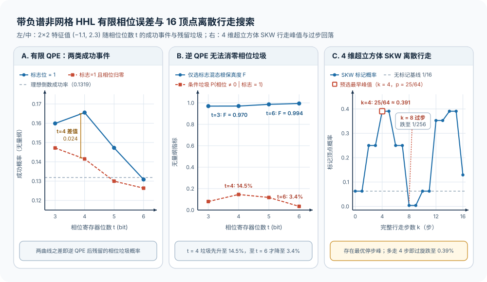
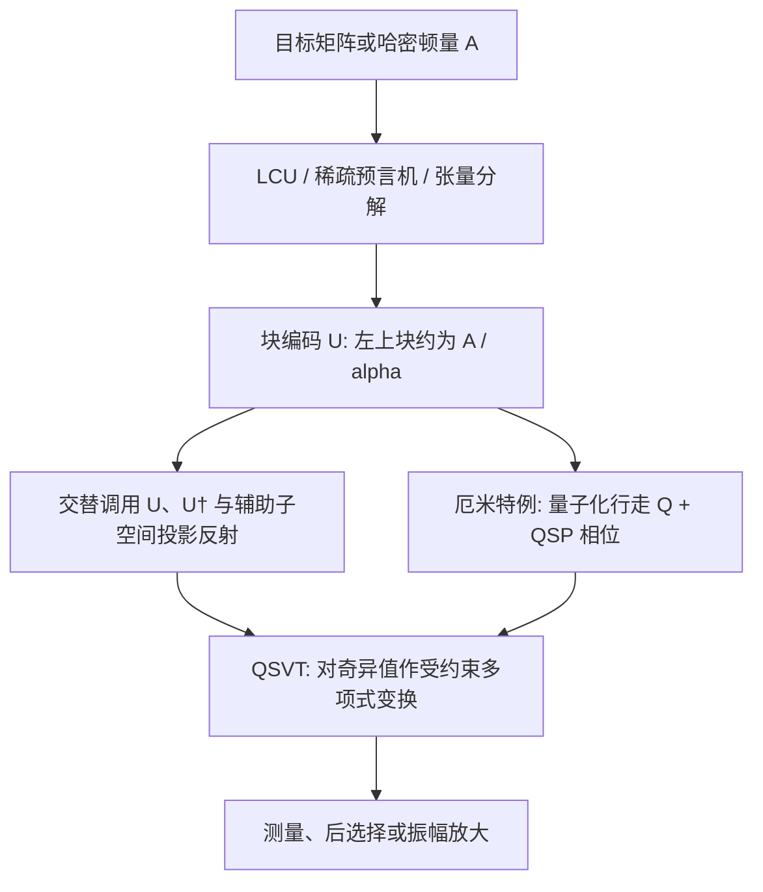
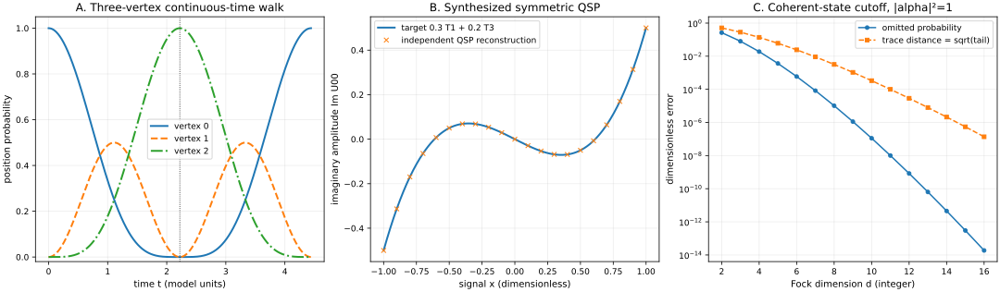
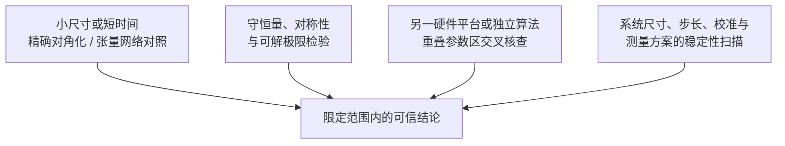

# 16｜高级算法与验证：从查询下界、统一框架到可信输出

读完前面十几章后，你已经熟悉了量子门线路怎样运转，也手算过 Deutsch–Jozsa、Grover、Shor、HHL 和 VQE 等代表算法。可一旦真正打开一篇量子算法或量子优势的现代研究论文，面前很快会冒出五个更深一层的问题：

1. 既然 Grover 给出了 $O(\sqrt{N})$ 的黑箱搜索上界，我们凭什么断定**没有任何更聪明的量子算法**能把查询次数压得更低？
2. Simon 与 Shor 看似在解两类完全不同的问题，它们背后有没有一套共同的群论骨架？为什么换一个非交换群（比如和格密码、图同构相关的群），这套骨架就会卡住？
3. 当候选解之间存在邻接关系或可复用的数据结构时，量子行走怎样打破朴素 Grover 的局限，甚至在元素互异性上做到 $O(N^{2/3})$？
4. 论文里频繁出现的 LCU、块编码（block encoding）、量子化（qubitization）、QSP、QSVT 与 2024 年兴起的 GQSP，到底是一堆零散技巧，还是同一条统一流水线上的不同环节？
5. 算法在量子处理器上输出一个多比特态或一串采样结果后，全态层析早已指数爆炸——我们怎样用可承受的测量成本验证输出可信，又拿哪四类现代经典模拟器作真实标尺？

这一章就把这五块拼图系统接起来。第一次阅读不必一口气吞下全部证明：建议先读第 1 节建立读论文的“六空核查表”，再顺着第 3 节的四元素隐藏子群、第 4 节的四环、三顶点与 Szegedy 量子行走、第 5 节的 $2\times 2$ 与 $4\times 4$ 统一矩阵链、第 7 节的单比特与全局 Clifford 经典阴影拿草稿纸逐行算一遍——这些算例只用到前面章节的叠加、测量与矩阵乘法。第 2 节的查询下界定理与第 5.7 节的广义量子信号处理，可以在准备细读前沿论文时反复回看；至于第 8 节的四大经典模拟器基线，本章只留核查速查表，完整表象手算与可运行引擎将系统交接给[第 21 章：稳定子形式、经典模拟引擎与量子优势边界](21-stabilizer-classical-simulation.md)。

动手之前，先把本章最容易撞车的符号与口径钉死，并与[附录：符号表](appendices/notation.md)显式对齐：

| 符号 / 约定 | 本章含义与维度 / 单位口径 | 跨章与软件对照说明 |
| :--- | :--- | :--- |
| 多比特基序与算符次序 | 高位在左的大端序（两比特依次为 $\lvert 00\rangle,\lvert 01\rangle,\lvert 10\rangle,\lvert 11\rangle$）；线路图从左到右，矩阵乘积从右到左 | 与全书统一约定及 `np.vdot(u,v)` 左反线性共轭内积一致 |
| $H$ 的三重语境 | 门线路中为 Hadamard 门；第 3 节中为群 $G$ 的隐藏子群（为免撞车，两比特 Hadamard 门在同处写作 $H_{\mathrm{gate}}^{\otimes 2}$ 或显式注明）；第 4—7 节中为厄米哈密顿量 | 本章算法与行走模型沿用[第 07 章](07-algorithms.md)的 $\hbar = 1$ 约定（$\alpha t$ 无量纲）；若 $H$ 带物理能量单位，需恢复 $Ht/\hbar$ |
| $\log_2$ 与 $\ln$ | 比特长度、群规模位数与信息量一律写 $\log_2$；指数衰减、概率集中界与渐近复杂度中的自然对数一律写 $\ln$ | 全章绝不使用不标底数的裸对数 |
| 奇异值分解 $A = W\Sigma V^\dagger$ | $W, V$ 为酉矩阵（列分别为左、右奇异向量），$\Sigma = \operatorname{diag}(\sigma_1,\sigma_2,\dots)$ 含非负奇异值 $\sigma_j \ge 0$ | [符号表](appendices/notation.md)中线性代数常规写法为 $A = U\Sigma V^\dagger$；本章改用 $W$ 表示左奇异基，避免与块编码酉矩阵 $U$ 撞名 |
| $\delta_{\mathrm{walk}}$ 与 $\delta$ | $\delta_{\mathrm{walk}}$ 专指可逆经典马尔可夫链的谱隙；$\delta$ 指统计检验或采样估计的允许失败概率 | 两者量纲虽均无量纲，但物理与统计对象完全不同，绝不混用 |
| 保真度 $F$ 与 $f = F^2$ | 态保真度一律指根保真度 $F(\rho,\sigma)=\operatorname{Tr}\sqrt{\sqrt{\rho}\sigma\sqrt{\rho}}$；与纯态的测量重叠概率 / 平方保真度明确写作 $f = F^2 = \langle\psi\vert\rho\vert\psi\rangle$ | 直接保真度估计（DFE）与部分 SDK 常把平方量 $f$ 直接称作 fidelity，引用数据时务必核对是否开根号 |

---

## 1. 读算法论文前，先填齐六个空

面对任何一篇宣称“实现量子加速”的论文，在激动或质疑之前，先把它的真实声明整理成一个六元组：

$$
(\text{输入规模},\ \text{访问模型},\ \text{输出形式},\ \text{误差与成功率},\ \text{量子资源},\ \text{经典基线}).
$$

缺掉其中任何一格，都可能把一个严谨的理论定理误读成不切实际的工程承诺。下表把这六个空各自要填什么、漏填后会出什么错一并摊开：

| 需要填清的空 | 必须写明的具体要素 | 省略后最常见的误读 |
| :--- | :--- | :--- |
| **输入规模** | 输入位长 $n$、矩阵维数 $N=2^n$、图顶点数、精度倒数 $1/\varepsilon$ 或演化时长 $t$ | 把指数级维数 $N$ 与多项式位长 $\log_2 N$ 混为一谈 |
| **访问模型** | 显式经典数组、布尔预言机（oracle）、稀疏矩阵预言机、QRAM、态制备线路或块编码 | 把数据装载电路或 QRAM 当成零成本免费午餐 |
| **输出形式** | 完整经典比特串、单个标量期望值、概率分布样本、局域可观测量，还是未读出的量子态 | 把振幅编码在量子态里当成“已经打印出完整经典数组” |
| **误差与成功率** | 加性误差还是相对误差、合法输入之间的承诺间隙（promise gap）、失败概率 $\delta$ | 拿粗精度算法和严苛精度基线做不公平对比 |
| **量子资源** | 预言机查询数、基本逻辑门数、辅助比特数、采样次数（shots）、$T$ 门数与验证成本 | 用单个渐近查询记号 $O(\cdot)$ 盖过全部电路与纠错账单 |
| **经典基线** | 最坏情形还是平均情形、经典算法是否取到已知最优、硬件并行度与可接受近似误差 | 拿最新量子算法去和最笨的经典穷举或过时软件赛跑 |

查询复杂度、门复杂度、样本复杂度、通信复杂度、空间复杂度和物理墙钟时间，好比六种不同国家的货币：汇率随输入编码与硬件架构剧烈波动。一个算法在“预言机查询次数”上拿到指数或二次加速，并不自动意味着它在“逻辑门数”或“机房墙钟时间”上占优——具体怎么把抽象查询翻译到硬件账单，还可以对照[第 11 章：资源估算与基准测试](11-resources-benchmarks.md)与[第 17 章：量子计算模型](17-computation-models.md)里的密码学口径案例。

---

## 2. 查询复杂度下界：怎样证明“不可能更少查询”

设计一个新算法，只要构造出一条行得通的线路就行；可要证明一个**下界（lower bound）**——比如“任何量子算法解无结构搜索都至少要查询 $\Omega(\sqrt{N})$ 次”——你面对的不是某一条具体线路，而是**无穷多条你还没想出来的未来量子线路**。这怎么可能证明呢？

办法是抓住所有量子算法共同遵守的铁律：**线性酉演化**与**局限于预言机的信息入口**。只要每次查询带进系统的信息增量有严格天花板，无论你在两次查询之间插多少精巧的酉门，总推进速度都突破不了那道天花板。围绕这个思路，量子计算理论发展出了“查询下界三板斧”：**混合法**（Hybrid Method）、**多项式法**（Polynomial Method）与**敌手法**（Adversary Method）。

### 2.1 先锁死预言机模型

讨论查询下界前，必须先固定预言机到底把什么信息交给算法。设输入是一个长度为 $N$ 的比特串 $z = (z_0, \dots, z_{N-1}) \in \{0, 1\}^N$（等价地写成布尔函数 $f: \{0, \dots, N-1\} \to \{0,1\}$，令 $z_x = f(x)$；在部分文献与后文按位置计数时，下标也常记作 $1, \dots, N$）。

最标准的**比特预言机**（bit oracle）作用在“下标寄存器 + 回答比特”上：

$$
O_f |x\rangle |y\rangle = |x\rangle |y \oplus f(x)\rangle,
\qquad x \in \{0, \dots, N-1\},\quad y \in \{0, 1\}.
$$

只要把第二个寄存器预先准备好在 $|-\rangle = \frac{|0\rangle - |1\rangle}{\sqrt{2}}$，然后施加一次 $O_f$，逐步展开就能看到著名的相位回踢：

$$
\begin{aligned}
O_f |x\rangle |-\rangle
&= \frac{1}{\sqrt{2}}\Bigl(|x\rangle |0 \oplus f(x)\rangle - |x\rangle |1 \oplus f(x)\rangle\Bigr) \\
&= \begin{cases}
|x\rangle \dfrac{|0\rangle - |1\rangle}{\sqrt{2}} = +|x\rangle |-\rangle, & f(x) = 0, \\[8pt]
|x\rangle \dfrac{|1\rangle - |0\rangle}{\sqrt{2}} = -|x\rangle |-\rangle, & f(x) = 1,
\end{cases} \\
&= (-1)^{f(x)} |x\rangle |-\rangle.
\end{aligned}
$$

丢掉不再纠缠的辅助位 $|-\rangle$，我们就得到等价的**相位预言机（phase oracle）**：

$$
S_f |x\rangle = (-1)^{f(x)} |x\rangle.
$$

如果算法还带一块不参与查询的工作区寄存器 $|w\rangle$，查询操作完整写作 $S_f \otimes I_W$，即 $(S_f \otimes I_W)|x, w\rangle = (-1)^{f(x)}|x, w\rangle$。在查询复杂度模型里，调用一次 $O_f$ 或 $S_f$ 算作 1 个单位成本，两次查询之间插入任意与输入 $z$ 无关的酉门 $U_t$ 全部免费。正因为如此，**在查询模型里证出的下界对所有门线路同样有效**（门数不可能比它更少），但一旦换了预言机接口（例如允许一次查询同时读出连续实数或整个子块），原有下界就必须重新检验。

### 2.2 混合法（Hybrid Method）：为什么无结构搜索逃不出 $\Omega(\sqrt{N})$

先用日常直觉想一想：面前摆着 $N$ 只一模一样的黑盒子，里面至多有一只藏着金球。哪怕你是个能同时把手伸向所有盒子的量子探员，你的总“注意力”（归一化振幅的模平方之和）也只有 1 份。在完全不知道金球藏在哪只盒子里的情况下，你在每一轮最多只能把平均约 $1/\sqrt{N}$ 的振幅分给那只真正的目标盒子；既然每次触碰目标盒子带来的状态改变量只有 $O(1/\sqrt{N})$，想要把“有金球”和“全空盒”两个末态拉开到常数量级，查询轮数 $T$ 至少就得是 $\Omega(\sqrt{N})$。

这就是 Bennett、Bernstein、Brassard 与 Vazirani（BBBV，1997）提出的**混合法**。下面我们一步不跳地把它写成严格证明。

设 $O_0 = I$ 代表全零输入（没有任何标记项）的相位预言机，$O_j$ 代表只有第 $j$ 项被标记（$f(j)=1$，其余全为 $0$）的相位预言机。任意一个进行 $T$ 次查询的量子算法，从同一个与输入无关的初态 $|\psi_0\rangle$ 出发，交替施加预言机与输入无关酉门 $U_1, \dots, U_T$。记在 $O_0$ 下第 $t$ 步的态为

$$
|\psi_t^{(0)}\rangle = U_t O_0 \cdots U_1 O_0 |\psi_0\rangle,
\qquad
|\psi_t^{(j)}\rangle = U_t O_j \cdots U_1 O_j |\psi_0\rangle,
\qquad t = 0, 1, \dots, T.
$$

把 $|\psi_t^{(0)}\rangle$ 按查询下标 $x \in \{1, \dots, N\}$ 与工作区基 $|w\rangle$ 展开，记落在下标 $j$ 子空间上的总振幅模长为

$$
q_{t,j} = \sqrt{\sum_w \bigl|\langle j, w | \psi_t^{(0)}\rangle\bigr|^2},
\qquad \text{满足}\ \sum_{j=1}^N q_{t,j}^2 = \langle\psi_t^{(0)}|\psi_t^{(0)}\rangle = 1.
$$

**第一步：逐轮替换预言机（混合伸缩）。** 定义“混合态” $|\phi_t^{(j)}\rangle$：前 $t$ 次查询用 $O_0$，后 $T-t$ 次查询改用 $O_j$。那么 $|\phi_0^{(j)}\rangle = |\psi_T^{(j)}\rangle$，$|\phi_T^{(j)}\rangle = |\psi_T^{(0)}\rangle$。利用向量范数的三角不等式，把首尾之差拆成 $T$ 段相邻混合态的差：

$$
\bigl\|\,|\psi_T^{(j)}\rangle - |\psi_T^{(0)}\rangle\,\bigr\|
= \left\|\sum_{t=0}^{T-1}\bigl(|\phi_t^{(j)}\rangle - |\phi_{t+1}^{(j)}\rangle\bigr)\right\|
\le \sum_{t=0}^{T-1} \bigl\|\,|\phi_t^{(j)}\rangle - |\phi_{t+1}^{(j)}\rangle\,\bigr\|.
$$

比较相邻两个混合态 $|\phi_t^{(j)}\rangle$ 与 $|\phi_{t+1}^{(j)}\rangle$：它们在第 $t+1$ 次查询之前完全一致，都是 $|\psi_t^{(0)}\rangle$；在第 $t+1$ 次查询之后，又都经历完全相同的酉算符 $V_{t+1} = U_T O_j \cdots U_{t+2} O_j U_{t+1}$。因为酉算符严格保持欧几里得范数不变（$\|V_{t+1}|u\rangle\| = \||u\rangle\|$），所以

$$
\bigl\|\,|\phi_t^{(j)}\rangle - |\phi_{t+1}^{(j)}\rangle\,\bigr\|
= \bigl\|V_{t+1}(O_j - O_0)|\psi_t^{(0)}\rangle\bigr\|
= \bigl\|(O_j - O_0)|\psi_t^{(0)}\rangle\bigr\|.
$$

而相位预言机 $O_j$ 和 $O_0$ 只在 $|j, w\rangle$ 分量上不同——前者给它乘 $-1$，后者乘 $+1$，差值恰好是 $-2$；在所有 $x \neq j$ 分量上差值为 $0$。因此

$$
\bigl\|(O_j - O_0)|\psi_t^{(0)}\rangle\bigr\|
= \sqrt{\sum_w \bigl|(-2)\langle j, w|\psi_t^{(0)}\rangle\bigr|^2}
= 2\,q_{t,j}.
$$

代回求和，对每一个固定标记位置 $j$ 都有

$$
\bigl\|\,|\psi_T^{(j)}\rangle - |\psi_T^{(0)}\rangle\,\bigr\| \le 2\sum_{t=0}^{T-1} q_{t,j}.
$$

**第二步：对所有 $N$ 个位置求平均并应用柯西—施瓦茨不等式。** 把上式对 $j = 1, \dots, N$ 求平均，并交换求和顺序：

$$
\frac{1}{N}\sum_{j=1}^N \bigl\|\,|\psi_T^{(j)}\rangle - |\psi_T^{(0)}\rangle\,\bigr\|
\le \frac{2}{N}\sum_{t=0}^{T-1}\left(\sum_{j=1}^N 1 \cdot q_{t,j}\right).
$$

对内层求和用柯西—施瓦茨不等式 $\left(\sum_{j=1}^N 1\cdot q_{t,j}\right)^2 \le \left(\sum_{j=1}^N 1^2\right)\left(\sum_{j=1}^N q_{t,j}^2\right) = N \cdot 1$，立刻得到 $\sum_{j=1}^N q_{t,j} \le \sqrt{N}$。于是

$$
\frac{1}{N}\sum_{j=1}^N \bigl\|\,|\psi_T^{(j)}\rangle - |\psi_T^{(0)}\rangle\,\bigr\|
\le \frac{2}{N}\sum_{t=0}^{T-1}\sqrt{N}
= \frac{2T}{\sqrt{N}}.
$$

**第三步：连接态距离与输出概率差。** 既然平均值不超过 $2T/\sqrt{N}$，那么至少存在一个标记项 $j^*$，其末态与空盒末态的欧氏距离满足 $\||\psi_T^{(j^*)}\rangle - |\psi_T^{(0)}\rangle\| \le 2T/\sqrt{N}$。由[第 13 章](13-quantum-information.md)的迹距离结论，对任意两个归一化纯态 $|u\rangle, |v\rangle$，任何测量给出同一接受结果的最大概率差都不超过迹距离 $\sqrt{1 - |\langle u|v\rangle|^2}$；再由 $|\langle u|v\rangle| \le 1$ 与 $\operatorname{Re}\langle u|v\rangle \le |\langle u|v\rangle|$ 做一步直接放缩：

$$
1 - |\langle u|v\rangle|^2
= (1 - |\langle u|v\rangle|)(1 + |\langle u|v\rangle|)
\le 2(1 - |\langle u|v\rangle|)
\le 2(1 - \operatorname{Re}\langle u|v\rangle)
= \bigl\|\,|u\rangle - |v\rangle\,\bigr\|^2,
$$

开方立得两纯态的接受概率之差不超过欧氏距离 $\||u\rangle - |v\rangle\|$。要让算法以至少 $2/3$ 概率接受有标记输入、至多 $1/3$ 概率误接受全零输入，两种输出概率之差至少须达到 $2/3 - 1/3 = 1/3$，代入 $|u\rangle = |\psi_T^{(j^*)}\rangle$、$|v\rangle = |\psi_T^{(0)}\rangle$ 即得

$$
\frac{2T}{\sqrt{N}} \ge \bigl\|\,|\psi_T^{(j^*)}\rangle - |\psi_T^{(0)}\rangle\,\bigr\| \ge \frac{1}{3}
\quad\Longrightarrow\quad
T \ge \frac{\sqrt{N}}{6} = \Omega(\sqrt{N}).
$$

Grover 搜索给出 $O(\sqrt{N})$ 的上界，两头严丝合缝，于是黑箱无结构搜索的量子查询复杂度被牢牢钉死在 $\Theta(\sqrt{N})$。混合法画面感极强，但缺点也很明显：当不同输入之间存在复杂对称结构（比如判断数组里有没有重复元素）时，很难直接挑出一个像 $O_0$ 这样好用的“基准空输入”。这时就要请出另外两把利器。

### 2.3 多项式法（Polynomial Method）：把量子线路变成多元多项式

Beals、Buhrman、Cleve、Mosca 与 de Wolf（1998/2001）换了一个极其精妙的代数视角：**干脆把末态振幅看成输入比特 $z_1, \dots, z_N \in \{0,1\}$ 的多项式，盯着它的最高次数看！**

这个想法听上去神奇，底层代数却干净得像小学乘法：

1. **查询前（$t=0$）**：初态 $|\psi_0\rangle$ 与输入 $z$ 无关，每个基态 $|x,w\rangle$ 上的振幅都是常数，即关于 $z_1,\dots,z_N$ 的 **$0$ 次**多项式。
2. **施加一次预言机**：在比特预言机 $O_f|x, y, w\rangle = |x, y\oplus z_x, w\rangle$ 下，由于布尔变量 $z_x$ 只能取 $0$ 或 $1$，新的振幅满足精确线性变换：

   $$
   \begin{aligned}
   \alpha'_{x,0,w}(z) &= (1 - z_x)\,\alpha_{x,0,w}(z) + z_x\,\alpha_{x,1,w}(z), \\
   \alpha'_{x,1,w}(z) &= z_x\,\alpha_{x,0,w}(z) + (1 - z_x)\,\alpha_{x,1,w}(z).
   \end{aligned}
   $$

   若是相位预言机，写法更简练：因为 $z_x \in \{0,1\}$，所以

   $$
   (-1)^{z_x} = 1 - 2z_x,
   $$

   乘上去同样是把原振幅乘了一个关于 $z_x$ 的**一次式**！无论哪一种预言机，每查询一次，振幅作为 $z_1,\dots,z_N$ 多元多项式的总次数最多加 $1$。而且在 $\{0,1\}^N$ 上恒有 $z_x^2 = z_x$，重复出现同一个变量会自动降幂，不会把次数抬高。
3. **施加与输入无关的酉门 $U_t$**：矩阵乘向量只对各个振幅做常系数线性组合，绝不会提高多项式的最高次数。

按步数 $t = 0, 1, \dots, T$ 数学归纳，立刻得到：**经过 $T$ 次查询后，每个计算基态 $|b\rangle$ 的复振幅 $a_b(z)$ 都是关于 $z_1, \dots, z_N$ 的次数至多为 $T$ 的复系数多元多项式。**

最后测量并把属于“接受集合 $A$”的结果概率加起来：

$$
P(z) = \sum_{b \in A} |a_b(z)|^2 = \sum_{b \in A} a_b(z)^* a_b(z).
$$

因为每个 $a_b(z)$ 和它的共轭 $a_b(z)^*$ 次数都不超过 $T$，两者相乘后次数至多翻倍为 **$2T$**；多个实多项式相加不提高最高次数。因此，**任何 $T$ 次查询的量子算法，其接受概率 $P(z)$ 必然是一个次数至多为 $2T$ 的实多元多项式！**

由此立刻推出一条硬下界：记 $\widetilde{\deg}_{1/3}(f)$ 为在所有合法输入上以不超过 $1/3$ 的误差逼近布尔函数 $f$ 所需的最低实多项式次数，那么任何有界错误（错误率 $\le 1/3$）量子查询算法所需的查询数 $Q_{1/3}(f)$ 必满足

$$
Q_{1/3}(f) \ge \frac{1}{2}\,\widetilde{\deg}_{1/3}(f).
$$

#### 手算算例：一次 Deutsch 查询为什么刚好容纳 XOR

取 $N = 2$，输入比特记为 $z_0 = f(0)$、$z_1 = f(1) \in \{0, 1\}$。Deutsch 算法要判断“两个函数值是否不同”，即异或函数 $\mathrm{XOR}(z_0, z_1) = z_0 \oplus z_1$。把它写成实多项式：

$$
p(z_0, z_1) = z_0 + z_1 - 2z_0 z_1.
$$

逐个代入全部四组布尔输入核验：

| 输入 $(z_0, z_1)$ | $z_0 \oplus z_1$ | $p(z_0, z_1) = z_0 + z_1 - 2z_0 z_1$ | 是否吻合 |
| :---: | :---: | :---: | :---: |
| $(0, 0)$ | $0$ | $0 + 0 - 2\cdot 0\cdot 0 = 0$ | 完全一致 |
| $(0, 1)$ | $1$ | $0 + 1 - 2\cdot 0\cdot 1 = 1$ | 完全一致 |
| $(1, 0)$ | $1$ | $1 + 0 - 2\cdot 1\cdot 0 = 1$ | 完全一致 |
| $(1, 1)$ | $0$ | $1 + 1 - 2\cdot 1\cdot 1 = 0$ | 完全一致 |

这个多项式含交叉项 $-2z_0 z_1$，所以次数为 $2$。根据多项式法下界 $2T \ge 2$，推得 $T \ge 1$；而[第 06 章](06-algorithmic-primitives.md)里的 Deutsch 算法恰恰用 $T = 1$ 次查询就零误差算出了它——单次查询对应的 $2T = 2$ 刚刚好放得下这个二次多项式！反过来，要提醒自己：多项式次数 $\le 2T$ 只是**必要条件**，并不意味着你随手写出一个二次布尔函数就一定能靠 1 次查询算出来。

把这套方法推到一般的 $N$ 位 $\mathrm{OR}_N$ 函数（判断 $z$ 中是否至少有一个 $1$）：先把多元接受概率 $P(z)$ 对所有下标排列求平均（Minsky–Papert 对称化），压缩成一个只依赖汉明重量 $|z| = \sum_{j=1}^N z_j$ 的一元多项式 $q(k)$（次数仍 $\le 2T$）。它必须在 $k = 0$ 处 $\le 1/3$，而在 $k = 1, 2, \dots, N$ 处全部落在 $[2/3, 1]$ 内——也就是说，它在 $0$ 到 $1$ 之间骤升至少 $1/3$，却在后面长达 $N-1$ 的区间上被死死按在 $[0, 1]$ 之间！经典逼近论中的马尔可夫不等式与 Paturi 定理证明，能做到这一点的多项式次数至少是 $\Omega(\sqrt{N})$，于是同样独立证得 $Q_{1/3}(\mathrm{OR}_N) = \Omega(\sqrt{N})$。

更震撼的是，Beals 等人用多项式法证明了一个涵盖**所有全布尔函数**（total Boolean function）的大定理：只要每个 $N$ 位输入串都合法，经典确定性查询复杂度 $D(f)$ 与有界错误量子查询复杂度 $Q(f)$ 之间**至多相差多项式倍**（原始论文证得 $D(f) = O(Q(f)^6)$；2021 年 Aaronson、Ben-David、Kothari、Rao 与 Tal 进一步推进到四次方关系 $D(f) = O(Q(f)^4)$）。换句话说，**在没有任何输入承诺的黑箱全布尔函数上，量子计算永远不可能获得指数级查询加速！**

### 2.4 敌手法（Adversary Method）与张成程序（Span Program）

多项式法威力巨大，但遇到某些高度组合化的问题（例如求函数复合或图性质）时，直接估出精确的逼近多项式次数 $\widetilde{\deg}_{1/3}(f)$ 非常棘手。Ambainis（2002）提出了第三把板斧——**敌手法**：与其把所有输入塞进同一个多项式，不如扮演一个狡猾的“敌手”，专门挑出一批函数值不同（$f(x) \neq f(y)$）却极难分辨的输入对 $(x, y)$，构造对称敌手矩阵 $\Gamma$（仅在 $f(x)\neq f(y)$ 处非零），取 $\Gamma$ 对应最大绝对本征值 $\|\Gamma\|$ 的归一化主特征向量 $|\delta\rangle$（满足 $\sum_x |\delta_x|^2 = 1$ 与 $\Gamma|\delta\rangle = \|\Gamma\||\delta\rangle$），然后追踪一个由主特征向量加权的“尚待区分内积进度函数”：

$$
W_t = \sum_{x, y} \Gamma_{xy}\,\delta_x^*\delta_y\,\langle \psi_t^{(x)} | \psi_t^{(y)} \rangle.
$$

算法刚开始时，所有输入都从同一个初态出发，$\langle\psi_0^{(x)}|\psi_0^{(y)}\rangle = 1$，因此初始进度恰好等于谱范数：

$$
W_0 = \sum_{x, y} \Gamma_{xy}\,\delta_x^*\delta_y = \langle\delta|\Gamma|\delta\rangle = \|\Gamma\|.
$$

这里的主特征向量权重 $\delta_x^*\delta_y$ 绝不是可有可无的装饰：在后续允许 $\Gamma_{xy}$ 取负值的广义敌手法里，如果省掉 $\delta_x^*\delta_y$ 而只对所有项等权求和，正负权重可能互相抵消导致 $W_0 = \sum_{x,y}\Gamma_{xy} = 0$，整个下界分子就会直接崩塌；加上主特征向量权重后，$W_0$ 始终牢牢锁定在 $\|\Gamma\| > 0$。算法结束时，为了以不超过 $\epsilon$ 的错误率可靠区分 $f(x) \neq f(y)$，每对末态必须几乎正交，从而迫使 $W_T \le 2\sqrt{\epsilon(1-\epsilon)}\,\|\Gamma\|$。另一方面，每次查询最多只改变那些在第 $i$ 位取值不同的输入对（记指示矩阵 $(D_i)_{xy} = 1$ 当且仅当 $x_i \neq y_i$，其余为 $0$），由此可证明单步进度改变量满足 $|W_t - W_{t+1}| \le 2\max_i \|\Gamma \circ D_i\|$（其中 $\circ$ 表示逐元 Hadamard 乘积）。于是总查询次数下界 $T \ge (W_0 - W_T)/\max_t |W_t - W_{t+1}|$ 水落石出，并自然导出**广义负权敌手界**：

$$
\mathrm{Adv}^\pm(f) = \max_{\Gamma \neq 0} \frac{\|\Gamma\|}{\max_i \|\Gamma \circ D_i\|}.
$$

早期的正权敌手法（要求 $\Gamma_{xy} \ge 0$，由 Perron–Frobenius 定理其主特征向量也可取非负实向量）有一个著名的天花板叫**证书障碍（certificate barrier）**——遇到像元素互异性或碰撞问题那样“单点修改就能翻答案”的问题时，正权下界会被卡死在 $\sqrt{N}$ 附近，摸不到真正的 $\Omega(N^{2/3})$。

转机出现在 2007—2011 年：Høyer、Lee 与 Špalek（2007）放开符号限制，正式允许敌手矩阵 $\Gamma$ 带有**负权重**并采用上述主特征向量加权的 $\mathrm{Adv}^\pm(f)$；随后 Reichardt（2009/2011）把 $\mathrm{Adv}^\pm(f)$ 写成半定规划（SDP），并证明它的对偶问题恰好对应一种叫**张成程序**（Span Program）的量子算法构造！由此得到了查询复杂度理论的里程碑结论：**对任意布尔函数 $f$，广义负权敌手界都在常数因子内紧刻画了有界错误量子查询复杂度**：

$$
Q_{1/3}(f) = \Theta\!\left(\mathrm{Adv}^\pm(f)\right).
$$

这意味着，从原则上讲，求任意布尔函数的最优量子查询算法与证明它的最优下界，已经变成了同一个半定规划问题的正反两面。

### 2.5 承诺问题与全函数的分水岭

把查询下界三板斧与输入模型的边界并排收进一张表，以后看到“指数加速”或“多项式封顶”就不会再把它们当成互相打架的结论：

| 下界方法 | 代表文献 | 核心数学机制 | 最拿手的战果与边界 |
| :--- | :--- | :--- | :--- |
| **混合法（Hybrid）** | BBBV (1997) | 逐轮把 $O_0$ 换成 $O_j$，用柯西—施瓦茨压住平均振幅增量 | 无结构搜索 $\Omega(\sqrt{N})$；证明最短最直观，但不善处理复杂组合约束 |
| **多项式法（Polynomial）** | Beals et al. (1998/2001) | $T$ 次查询后接受概率为 $\le 2T$ 次实多项式，$Q_{1/3}(f) \ge \frac{1}{2}\widetilde{\deg}_{1/3}(f)$ | 证明**全布尔函数**至多多项式加速 $D(f)=O(Q(f)^4)$；拓展后可证碰撞与元素互异性下界（Shi 2002） |
| **敌手法（Adversary）** | Ambainis (2002)；HLS (2007)；Reichardt (2009/2011) | 追踪难区分输入对的加权内积进度；负权界 $\mathrm{Adv}^\pm$ 对偶于张成程序 | $Q_{1/3}(f)=\Theta(\mathrm{Adv}^\pm(f))$ 对所有布尔函数常数因子紧刻画，绕开正权证书障碍 |

初学者读到这里常会冒出一个好问题：“Beals 定理刚说全布尔函数没有指数查询加速，那 Deutsch–Jozsa、Simon、Shor 和焊接树行走凭什么有指数加速？”答案就在两个词的区别里：

- **全函数（total function）**：全部 $2^N$ 个输入位串都合法，多项式逼近必须在整座超立方体 $\{0,1\}^N$ 上处处成立。
- **承诺问题（promise problem / partial function）**：输入被提前承诺满足高度刚性的代数或图结构（比如周期性、隐藏子群或对称二部树），算法只需在合法子集上回答正确，多项式在非法输入上可以任意剧烈震荡而不违规。

另外，Shor 大数分解讨论的根本不是黑箱查询复杂度，而是**显式整数输入下的门/时间复杂度**，自然不受黑箱全函数多项式定理约束。分清“有没有承诺”以及“数的是查询还是门”，很多看似矛盾的论文结论立刻迎刃而解。

---

## 3. 隐藏子群问题（HSP）：Simon、Shor 与非阿贝尔壁垒

[第 07 章](07-algorithms.md)里，Simon 算法用逐位异或找隐藏串 $s$，Shor 算法用模幂运算找周期 $r$，两套电路长得不大一样，其实骨子里在做同一件事：**在一个有限群里，透过一个“在每个平移小组上取常值”的黑箱函数，把藏在里面的子群挖出来**。这就是**隐藏子群问题（Hidden Subgroup Problem，简称 HSP）**。

### 3.1 群、左陪集与特征标：先用四个比特串摸透概念

先把抽象代数落到最贴地气的例子上：

- **群（group）$G$**：一组标签加上一种满足结合律的运算，存在一个“乘谁都不变”的单位元 $e$，且每个元素都有逆元。比如两位比特串 $G = \{00, 01, 10, 11\}$ 配上逐位异或 $\oplus$ 就是群 $\mathbb{Z}_2^2$：单位元是 $00$，每个串和自己异或都回到 $00$（自己是自己的逆元）。如果运算还满足交换律 $ab = ba$，就叫**阿贝尔群（Abelian group，即交换群）**。
- **子群（subgroup）$H \le G$**：从 $G$ 里挑出的一部分元素，按同一种运算自己也封闭成群。在 $\mathbb{Z}_2^2$ 中，$H = \{00, 11\}$ 就是一个子群。
- **左陪集（left coset）$gH = \{gh : h \in H\}$**：把子群 $H$ 里的所有元素统一在左边乘上同一个 $g$。不同的左陪集互不重叠、大小完全相等，像切豆腐一样把整个群 $G$ 均匀划成 $|G/H| = |G|/|H|$ 块。

现在给出 **HSP 的标准定义**：给定有限群 $G$ 与黑箱函数 $f: G \to S$，承诺存在未知子群 $H \le G$，使得对任意 $g_1, g_2 \in G$ 都有

$$
f(g_1) = f(g_2) \quad\Longleftrightarrow\quad g_1 H = g_2 H.
$$

也就是说，$f$ 在同一个左陪集上取完全相同的输出，在不同左陪集上输出互不相同。我们的目标是通过尽量少的查询与门操作，找出 $H$ 的一组生成元。

所有标准 HSP 算法的前两步一模一样：把输入寄存器准备好在群 $G$ 上的均匀叠加 $\frac{1}{\sqrt{|G|}}\sum_{g\in G}|g\rangle$，输出寄存器置于 $|0\rangle$，查询一次 $f$ 得到纠缠态

$$
|\Psi\rangle = \frac{1}{\sqrt{|G|}}\sum_{g\in G}|g\rangle|f(g)\rangle
= \frac{1}{\sqrt{|G/H|}}\sum_{gH \in G/H} |gH\rangle |f(gH)\rangle,
$$

其中每个归一化的**陪集态**（coset state）定义为

$$
|gH\rangle = \frac{1}{\sqrt{|H|}}\sum_{h \in H} |gh\rangle.
$$

这里有一处初学者极易混写的细节，必须把**测出输出**与**直接丢弃输出**分开写清：

- 如果对输出寄存器做测量并记录结果 $y = f(gH)$，输入寄存器在条件化后坍缩为对应的**条件纯陪集态** $|gH\rangle$；
- 如果根本不读输出寄存器、直接把它丢弃（求偏迹），输入寄存器就不再是某个未知纯态，而是所有左陪集态的均匀**混态**：

  $$
  \rho_H = \frac{1}{|G/H|} \sum_{gH \in G/H} |gH\rangle\langle gH|.
  $$

两者在状态层面截然不同（一个是纯态，一个是混态），但后续只要只对输入寄存器做傅里叶变换和测量，混态 $\rho_H$ 产生的概率分布恰好等于各个条件纯态分布的等权平均。因此算法分析里常常省略“显式测量输出寄存器”这一步，但写数学对象时绝不能把丢弃输出后的偏迹混态偷写成纯态。

接下来怎么把藏在陪集态里的子群 $H$ 读出来？当 $G$ 是**阿贝尔群**时，核心工具是群上的**特征标（character）**——它是一类把群运算映射成复平面单位圆乘法的函数 $\chi: G \to \mathbb{C}$，满足 $|\chi(g)| = 1$ 与 $\chi(g_1 g_2) = \chi(g_1)\chi(g_2)$。例如在异或群 $\mathbb{Z}_2^n$ 中，每个位串 $z \in \{0,1\}^n$ 都定义一个特征标 $\chi_z(x) = (-1)^{z \cdot x}$（这里 $z \cdot x = \sum_{i=1}^n z_i x_i \bmod 2$）。

对任意阿贝尔群上的陪集态 $|gH\rangle$ 施加**群量子傅里叶变换（QFT）** $\mathrm{QFT}_G|x\rangle = \frac{1}{\sqrt{|G|}}\sum_{\chi}\chi(x)|\chi\rangle$，展开系数就能一眼看出相消干涉的魔力：

$$
\mathrm{QFT}_G |gH\rangle
= \frac{1}{\sqrt{|G||H|}} \sum_{\chi} \left(\sum_{h\in H} \chi(gh)\right) |\chi\rangle
= \frac{1}{\sqrt{|G||H|}} \sum_{\chi} \chi(g)\left(\sum_{h\in H}\chi(h)\right) |\chi\rangle.
$$

括号里的和 $\sum_{h\in H}\chi(h)$ 遵守一条非黑即白的“正交律”：
- 若对所有 $h \in H$ 都有 $\chi(h) = 1$，则求和等于 $|H|$；
- 只要存在哪怕一个 $h_0 \in H$ 使 $\chi(h_0) \neq 1$，把求和变量平移成 $h' = h_0 h$ 就有 $\chi(h_0)\sum_{h\in H}\chi(h) = \sum_{h\in H}\chi(h)$，故该和**严格等于 $0$**！

所有满足“在 $H$ 上恒为 $1$”的特征标组成子群 $H$ 的**正交补（annihilator）**：

$$
H^\perp = \{\chi : \chi(h) = 1,\ \forall h \in H\}.
$$

而且不同左陪集代表元 $g$ 留下的 $\chi(g)$ 只是模长为 $1$ 的复相位，取模平方后 $|\chi(g)|^2 = 1$ 完全消失！于是无论测到哪个陪集，傅里叶采样都以完全相同的均匀概率只输出 $H^\perp$ 里的元素。反复采样几轮，收集足够多的约束，经典线性代数或连分数就能把隐藏子群 $H$ 反解出来。

#### 手算算例：四元素异或群走完一次完整 HSP 采样

取 $G = \mathbb{Z}_2^2 = \{00, 01, 10, 11\}$，隐藏子群 $H = \{00, 11\}$。整个群恰好被划成两个左陪集：

$$
C_0 = 00 \oplus H = \{00, 11\},
\qquad
C_1 = 01 \oplus H = \{01, 10\}.
$$

设函数 $f$ 在 $C_0$ 上输出 $0$，在 $C_1$ 上输出 $1$。

从两比特均匀叠加与辅助位 $|0\rangle$ 出发，查询 $f$ 得到联合纯态：

$$
\begin{aligned}
|\Psi\rangle
&= \frac{1}{2}\Bigl(|00\rangle|0\rangle + |11\rangle|0\rangle + |01\rangle|1\rangle + |10\rangle|1\rangle\Bigr) \\
&= \frac{1}{\sqrt{2}}|C_0\rangle|0\rangle + \frac{1}{\sqrt{2}}|C_1\rangle|1\rangle,
\end{aligned}
$$

其中两个归一化陪集态是

$$
|C_0\rangle = \frac{|00\rangle + |11\rangle}{\sqrt{2}},
\qquad
|C_1\rangle = \frac{|01\rangle + |10\rangle}{\sqrt{2}}.
$$

如果测量输出寄存器，测得 $0$ 或 $1$ 的概率各为 $1/2$，对应的条件纯态分别为 $|C_0\rangle$ 与 $|C_1\rangle$；如果直接丢弃输出寄存器，输入寄存器处于混态 $\rho_H = \frac{1}{2}|C_0\rangle\langle C_0| + \frac{1}{2}|C_1\rangle\langle C_1|$。

接下来对输入两比特施加 $\mathbb{Z}_2^2$ 上的量子傅里叶变换——也就是两个 Hadamard 门 $H_{\mathrm{gate}}^{\otimes 2}$（这里给门加上下标，避免和子群字母 $H$ 混淆）。回想 $H_{\mathrm{gate}}^{\otimes 2}|x_1 x_2\rangle = \frac{1}{2}\sum_{z_1, z_2}(-1)^{z_1 x_1 + z_2 x_2}|z_1 z_2\rangle$，逐项展开两条分支：

- 对 $|C_0\rangle = \frac{1}{\sqrt{2}}(|00\rangle + |11\rangle)$：

  $$
  \begin{aligned}
  H_{\mathrm{gate}}^{\otimes 2}|00\rangle &= \frac{1}{2}(|00\rangle + |01\rangle + |10\rangle + |11\rangle), \\
  H_{\mathrm{gate}}^{\otimes 2}|11\rangle &= \frac{1}{2}(|00\rangle - |01\rangle - |10\rangle + |11\rangle), \\
  H_{\mathrm{gate}}^{\otimes 2}|C_0\rangle &= \frac{1}{\sqrt{2}}\cdot\frac{1}{2}\bigl(2|00\rangle + 2|11\rangle\bigr) = \frac{|00\rangle + |11\rangle}{\sqrt{2}}.
  \end{aligned}
  $$

- 对 $|C_1\rangle = \frac{1}{\sqrt{2}}(|01\rangle + |10\rangle)$：

  $$
  \begin{aligned}
  H_{\mathrm{gate}}^{\otimes 2}|01\rangle &= \frac{1}{2}(|00\rangle - |01\rangle + |10\rangle - |11\rangle), \\
  H_{\mathrm{gate}}^{\otimes 2}|10\rangle &= \frac{1}{2}(|00\rangle + |01\rangle - |10\rangle - |11\rangle), \\
  H_{\mathrm{gate}}^{\otimes 2}|C_1\rangle &= \frac{1}{\sqrt{2}}\cdot\frac{1}{2}\bigl(2|00\rangle - 2|11\rangle\bigr) = \frac{|00\rangle - |11\rangle}{\sqrt{2}}.
  \end{aligned}
  $$

两条分支中，$|01\rangle$ 和 $|10\rangle$ 的振幅都恰好正负相消归零！无论输出寄存器测到了 $0$ 还是 $1$，也无论它被直接丢弃，最终在输入寄存器上只可能测到 $00$ 或 $11$，概率各为 $|1/\sqrt{2}|^2 = |-1/\sqrt{2}|^2 = 1/2$。验证正交条件：隐藏串 $s = 11$，对 $z = z_1 z_2$ 要求 $z \cdot s = z_1 \oplus z_2 = 0 \pmod 2$，确实只有 $00$ 和 $11$ 满足。当然，单次采到平凡串 $00$ 还提供不了非零方程，需要多轮独立采样，直到凑出线性无关的约束。

### 3.2 阿贝尔 HSP 的两大典范：Simon 与 Shor

把上面的骨架套回[第 07 章](07-algorithms.md)的两个明星算法，一切豁然开朗：

1. **Simon 算法就是 $G = \mathbb{Z}_2^n$ 上的 HSP**：承诺 $f(x) = f(x \oplus s)$，隐藏子群为 $H = \{0^n, s\}$，特征标 $\chi_z(x) = (-1)^{z\cdot x}$，所以 $\chi_z(s) = 1 \iff z \cdot s = 0 \pmod 2$。
   - **手算检验（$n=3,\ s=101$）**：约束条件是 $z_1\cdot 1 \oplus z_2\cdot 0 \oplus z_3\cdot 1 = z_1 \oplus z_3 = 0 \pmod 2$，即首末两位必须相同，中间位任意。因此正交补 $H^\perp$ 恰好有 4 个元素：

     $$
     H^\perp = \{000,\ 010,\ 101,\ 111\}.
     $$

     顺手抽查两个串：$z = 111$ 满足 $1 \oplus 1 = 0$，确实在 $H^\perp$ 内；$z = 100$ 给出 $1 \oplus 0 = 1$，在 Hadamard 变换后严格相消，绝不会出现。
2. **Shor 阶寻找算法就是整数加群 $\mathbb{Z}$（或循环群 $\mathbb{Z}_M$）上的 HSP**：模幂函数 $x \mapsto a^x \bmod N$ 的隐藏子群是 $r\mathbb{Z} = \{0, \pm r, \pm 2r, \dots\}$。因为量子寄存器只能容纳有限大小 $Q = 2^m$，截断后标准 QFT 不一定总落在精确有理点 $k/r$ 上，而是在最接近 $k/r$ 的网格点附近形成尖峰；后续的连分数展开正是把这些带截断偏差的傅里叶样本还原成周期 $r$ 的经典后处理。

把 Simon、Shor 与一般阿贝尔 HSP 压成同一条流水线，就是下面这张共同骨架图：

### 3.3 非阿贝尔壁垒：查询高效不等于时间高效

既然阿贝尔群上这套“陪集态 + 群 QFT + 经典恢复”如此所向披靡，如果换到**非阿贝尔群**（$ab \neq ba$）呢？历史上人们曾热切期盼能靠它一口气拿下两座超级高峰：

- **二面体群 $D_N$（正 $N$ 边形的旋转与翻转对称群）**：Regev（2004）证明，如果存在多项式时间量子算法求解 $D_N$-HSP，就能在多项式时间内攻破格上的**唯一最短向量问题（$\mathrm{unique\text{-}SVP}$）**——这恰恰是[第 12 章](12-security-network-frontiers.md)介绍的现代抗量子格密码（如 NIST ML-KEM / ML-DSA）的底层安全基石之一。
- **对称群 $S_n$（$n$ 个元素的全部置换）**：图同构问题（判断两张图能否通过重排顶点编号变成同一张图）可直接归约到 $S_n$-HSP。

可现实撞上了两道截然不同的高墙——第一道墙区分了“信息论查询数”和“门线路时间”，第二道墙挡住了所有单陪集测量策略：

1. **查询高效，不等于时间高效**：Ettinger、Høyer 与 Knill（2004）证明了一个令人意外的定理——**对任意有限群 $G$（不管交不交换），HSP 的量子查询复杂度都是多项式级的 $O(\log_2 |G|)$！** 只要准备多份独立的陪集混态 $\rho_H^{\otimes k}$，它们对应的密度矩阵在信息论上已经足以高概率分辨出不同子群 $H$。但问题在于，把它们真正分辨出来的测量可能需要在多份陪集态上做极其复杂的**全局纠缠联合测量**，已知实现需要指数级量子门：

   $$
   \text{多项式查询} \not\Longrightarrow \text{多项式时间}.
   $$

2. **二面体群 $D_N$ 的亚指数突破（仍非多项式）**：Kuperberg 于 2003 年发布预印本（`quant-ph/0302112`，2005 年正式刊于 *SIAM J. Comput.*），巧妙地提出**量子重组筛法（recombination sieve）**，把多份陪集态两两做异或筛选，逐步消去不需要的相位，在 $2^{O(\sqrt{\log_2 N})}$ 的**亚指数时间与空间**内求解 $D_N$-HSP；Regev（2004，`quant-ph/0406151`）随即基于 Kuperberg 2003 年的预印本把空间压回多项式级，Kuperberg（2013）又提出准直筛法进一步优化时空权衡。但截至目前，仍未找到多项式时间算法，格密码也没有因此被 Shor 式攻破。
3. **对称群 $S_n$ 的傅里叶采样壁垒**：非阿贝尔群的不可约表示不再是一维复数，而是高维矩阵。Hallgren、Russell 与 Ta-Shma（2000/2003）先指出只测表示标签的“弱傅里叶采样”看不清对换子群；随后 **Moore、Russell 与 Schulman（2005/2008）** 证明，即便对单个陪集态施加信息论上最强的**强傅里叶采样（strong Fourier sampling）**，区分 $S_n$ 的隐藏对换仍需要**指数多份样本**；Hallgren 等人（2010）更将这道障碍推进到同时联合测量少于 $\Omega(n\log_2 n)$ 份陪集态的纠缠策略。

| 群结构 $G$ | 交换性 | 代表应用 | 已知最优量子查询复杂度 | 已知量子时间复杂度与现状 |
| :--- | :--- | :--- | :--- | :--- |
| $\mathbb{Z}_2^n$ | 阿贝尔 | Simon 问题 | $O(n)$ | 多项式时间（指数查询加速） |
| $\mathbb{Z}$ / 循环群 $\mathbb{Z}_M$ | 阿贝尔 | Shor 阶寻找与大数分解 | $O(\log_2 M)$ | 多项式时间（显式门线路） |
| 二面体群 $D_N$ | 非阿贝尔 | 归约自格上 $\mathrm{unique\text{-}SVP}$ | $O(\log_2 N)$ | 亚指数 $2^{O(\sqrt{\log_2 N})}$（Kuperberg 筛法），未知多项式算法 |
| 对称群 $S_n$ | 非阿贝尔 | 图同构（GI） | $O(n\log_2 n)$ | 单陪集强傅里叶采样需指数样本；暂无多项式量子算法 |

---

## 4. 量子行走：把图结构与邻接更新变成加速杠杆

Grover 算法把所有 $N$ 个候选对象看作一盘散沙——彼此之间毫无关系，每次只能独立检查一个标签。但在很多现实问题里，候选解天然排成一张图，而且**从当前节点挪到相邻节点时，绝大多数信息可以原地复用，更新代价极低**。利用这张图上复振幅的相干干涉来替代经典随机游走，就是**量子行走（Quantum Walk）**。

量子行走主要分两条主干路线：**离散时间带硬币行走**（DTQW）与**连续时间量子行走**（CTQW）。它们既不是彼此的简单近似，也不是“把经典随机游走放进叠加态里同时跑很多遍”——下面拿三个干净的算例亲手算透。

### 4.1 离散时间带硬币量子行走（DTQW）：四环三步里的干涉反转

在经典随机游走里，行者每到一站抛一次硬币，正面往右走一格、反面往左走一格；因为每一步都会丢掉前一步怎么来的记忆，位置方差只随步数线性增长（$\mathrm{Var}(X_t) \propto t$）。如果直接试图在位置空间上写一个“左右等权分裂”的矩阵，很快会发现它根本**不是酉矩阵**。

为了保持演化严格酉，DTQW 引入一个内部辅助自由度，称为**硬币空间（coin space）** $\mathcal{H}_C$，与位置空间 $\mathcal{H}_V$ 张成总希尔伯特空间 $\mathcal{H}_V \otimes \mathcal{H}_C$。在 4 个顶点组成的环 $\{0, 1, 2, 3\}$ 上，用 $|v, R\rangle$ 和 $|v, L\rangle$ 表示“位于顶点 $v$、内部方向朝右或朝左”。每走一步 $W_{\mathrm{step}} = S (I_V \otimes C)$ 包含两个严格酉的操作：

1. **硬币旋转 $C$**（这里取 Hadamard 硬币）：

   $$
   C|R\rangle = \frac{|R\rangle + |L\rangle}{\sqrt{2}},
   \qquad
   C|L\rangle = \frac{|R\rangle - |L\rangle}{\sqrt{2}}.
   $$

2. **条件移位 $S$**：

   $$
   S|v, R\rangle = |v + 1 \bmod 4,\ R\rangle,
   \qquad
   S|v, L\rangle = |v - 1 \bmod 4,\ L\rangle.
   $$

让我们从 $|\psi_0\rangle = |0, R\rangle$ 出发，一步不跳地算完前三步：

- **第 1 步**：先对方向做 $C$，得到 $\frac{1}{\sqrt{2}}(|0,R\rangle + |0,L\rangle)$；再做条件移位 $S$（$0+1=1$，$0-1 \equiv 3 \pmod 4$）：

  $$
  |\psi_1\rangle = \frac{|1, R\rangle + |3, L\rangle}{\sqrt{2}}.
  $$

  归一化核验：$(1/\sqrt{2})^2 + (1/\sqrt{2})^2 = 1$。此时位置在 $1$ 和 $3$ 的概率各为 $1/2$，看起来还和经典随机游走一模一样。

- **第 2 步**：对两条分支分别施加 $S(I_V \otimes C)$：

  $$
  \begin{aligned}
  |1, R\rangle &\xrightarrow{C} \frac{|1, R\rangle + |1, L\rangle}{\sqrt{2}} \xrightarrow{S} \frac{|2, R\rangle + |0, L\rangle}{\sqrt{2}}, \\
  |3, L\rangle &\xrightarrow{C} \frac{|3, R\rangle - |3, L\rangle}{\sqrt{2}} \xrightarrow{S} \frac{|0, R\rangle - |2, L\rangle}{\sqrt{2}}.
  \end{aligned}
  $$

  合起来得到第 2 步总态：

  $$
  |\psi_2\rangle = \frac{1}{2}\Bigl(|0, R\rangle + |0, L\rangle + |2, R\rangle - |2, L\rangle\Bigr).
  $$

  归一化核验：$4 \times (1/2)^2 = 1$。此刻如果你去测位置，顶点 $0$ 的概率是 $|1/2|^2 + |1/2|^2 = 1/2$，顶点 $2$ 的概率是 $|1/2|^2 + |-1/2|^2 = 1/2$——**表面上看，$|2, L\rangle$ 前面的那个负号在当前位置概率里完全隐身了！**

- **第 3 步（见证负号的威力）**：把 $|\psi_2\rangle$ 写成顶点 $0$ 与顶点 $2$ 两对组合，再施加一次 $C$：
  - 顶点 $0$ 处是 $|R\rangle + |L\rangle$，经过 $C$ 变成 $\frac{(|R\rangle+|L\rangle)+(|R\rangle-|L\rangle)}{\sqrt{2}} = \sqrt{2}|R\rangle$（朝左分支完全抵消！）；
  - 顶点 $2$ 处因为带负号是 $|R\rangle - |L\rangle$，经过 $C$ 变成 $\frac{(|R\rangle+|L\rangle)-(|R\rangle-|L\rangle)}{\sqrt{2}} = \sqrt{2}|L\rangle$（朝右分支完全抵消！）。
  随后条件移位 $S$ 把 $|0, R\rangle$ 送到 $|1, R\rangle$，把 $|2, L\rangle$ 送到 $|1, L\rangle$，于是

  $$
  |\psi_3\rangle = \frac{1}{2}\bigl(\sqrt{2}|1, R\rangle + \sqrt{2}|1, L\rangle\bigr) = \frac{|1, R\rangle + |1, L\rangle}{\sqrt{2}}.
  $$

结果令人拍案叫绝：经典随机游走走到第 3 步，会以各 $50\%$ 的概率散落在顶点 $1$ 和顶点 $3$；而四环量子行走在第 3 步把 **$100\%$ 的概率全部汇聚到了顶点 $1$**，顶点 $3$ 的概率精准相消为 $0$！正是这种依靠相对相位持续叠加的相干干涉，让无限直线上带硬币量子行走的扩散速度达到“弹道式”标度（位置标准差 $\propto t$、方差 $\propto t^2$），比经典随机游走的扩散快了一个平方根级。

### 4.2 连续时间量子行走（CTQW）：三顶点路径上的相干完美转移

如果不引入额外硬币空间，有没有办法直接在图顶点上定义酉演化？Farhi 与 Gutmann（1998）给出的方案直截了当：把无向图的实对称邻接矩阵（或图拉普拉斯矩阵）直接当成哈密顿量 $H$（令 $H_{uv} = w_{uv} = w_{vu}$），按薛定谔方程连续演化（取无量纲模型单位 $\hbar = 1$；若 $w_{uv}$ 带能量单位则恢复 $Ht/\hbar$）：

$$
|\psi(t)\rangle = e^{-iHt} |s\rangle.
$$

这种模型叫**连续时间量子行走（CTQW）**。它没有硬币寄存器，也不是把 DTQW 拿掉测量后取极限那么简单。下面拿最简单的三顶点路径图 $0 - 1 - 2$（两条边权重均为 $1$）完整手算一次：

$$
H = \begin{pmatrix} 0 & 1 & 0 \\ 1 & 0 & 1 \\ 0 & 1 & 0 \end{pmatrix}.
$$

先算 $H^2$ 与 $H^3$，逐格手乘：

$$
H^2 = \begin{pmatrix} 0 & 1 & 0 \\ 1 & 0 & 1 \\ 0 & 1 & 0 \end{pmatrix}
      \begin{pmatrix} 0 & 1 & 0 \\ 1 & 0 & 1 \\ 0 & 1 & 0 \end{pmatrix}
    = \begin{pmatrix} 1 & 0 & 1 \\ 0 & 2 & 0 \\ 1 & 0 & 1 \end{pmatrix},
$$

$$
H^3 = H \cdot H^2 = \begin{pmatrix} 0 & 1 & 0 \\ 1 & 0 & 1 \\ 0 & 1 & 0 \end{pmatrix}
                    \begin{pmatrix} 1 & 0 & 1 \\ 0 & 2 & 0 \\ 1 & 0 & 1 \end{pmatrix}
                  = \begin{pmatrix} 0 & 2 & 0 \\ 2 & 0 & 2 \\ 0 & 2 & 0 \end{pmatrix} = 2H.
$$

这条性质 $H^3 = 2H$（对应特征值 $0, +\sqrt{2}, -\sqrt{2}$）让矩阵指数 $e^{-iHt} = \sum_{k=0}^{\infty}\frac{(-it)^k}{k!}H^k$ 可以一举闭合！把 $k=0$ 单独留出，把其余奇数次幂 $H^{2m+1} = 2^m H$ 与偶数次幂 $H^{2m} = 2^{m-1} H^2$（$m \ge 1$）分别合并：

$$
\begin{aligned}
e^{-iHt}
&= I + \sum_{m=0}^{\infty}\frac{(-it)^{2m+1}}{(2m+1)!}\,2^m H
     + \sum_{m=1}^{\infty}\frac{(-it)^{2m}}{(2m)!}\,2^{m-1} H^2 \\
&= I - \frac{i}{\sqrt{2}}\left(\sum_{m=0}^{\infty}\frac{(-1)^m (\sqrt{2}t)^{2m+1}}{(2m+1)!}\right) H
     + \frac{1}{2}\left(\sum_{m=1}^{\infty}\frac{(-1)^m (\sqrt{2}t)^{2m}}{(2m)!}\right) H^2 \\
&= I - i\frac{\sin(\sqrt{2}t)}{\sqrt{2}}\,H + \frac{\cos(\sqrt{2}t) - 1}{2}\,H^2.
\end{aligned}
$$

为了版面清爽，记 $c = \cos(\sqrt{2}t)$、$s_t = \sin(\sqrt{2}t)$。让 $e^{-iHt}$ 作用在起点 $|0\rangle = [1, 0, 0]^T$ 上——也就是直接取矩阵的第 1 列！因为 $I|0\rangle = [1,0,0]^T$、$H|0\rangle = [0,1,0]^T$、$H^2|0\rangle = [1,0,1]^T$，逐分量相加得到

$$
|\psi(t)\rangle = e^{-iHt}|0\rangle = \begin{pmatrix}
1 + \dfrac{c-1}{2} \\[8pt]
-i\dfrac{s_t}{\sqrt{2}} \\[8pt]
\dfrac{c-1}{2}
\end{pmatrix}
= \begin{pmatrix}
\dfrac{1+c}{2} \\[8pt]
-\dfrac{is_t}{\sqrt{2}} \\[8pt]
\dfrac{c-1}{2}
\end{pmatrix}.
$$

对每个分量取复数模平方（注意 $|-i s_t/\sqrt{2}|^2 = s_t^2/2$），得到三个顶点的瞬时概率：

$$
p_0(t) = \frac{(1+c)^2}{4},
\qquad
p_1(t) = \frac{s_t^2}{2},
\qquad
p_2(t) = \frac{(1-c)^2}{4}.
$$

独立核验概率守恒：

$$
p_0(t) + p_1(t) + p_2(t) = \frac{(1 + 2c + c^2) + 2s_t^2 + (1 - 2c + c^2)}{4} = \frac{2 + 2(c^2 + s_t^2)}{4} = 1.
$$

看看两个标志性时刻：
- 当 $t = \pi/(2\sqrt{2})$ 时，$\sqrt{2}t = \pi/2$，于是 $c = 0, s_t = 1$，振幅为 $\left(\frac{1}{2}, -\frac{i}{\sqrt{2}}, -\frac{1}{2}\right)$，概率为 $(1/4, 1/2, 1/4)$。此时绝不能把这三个概率当成下一刻继续经典随机跳转的起点——因为振幅里的虚数 $-i/\sqrt{2}$ 和负号 $-1/2$ 携带着相位信息，若在此时中途测量位置，相干转移就会立刻被打断。
- 当 $t = \pi/\sqrt{2}$ 时，$\sqrt{2}t = \pi$，于是 $c = -1, s_t = 0$，态矢量精确变成 $|\psi(\pi/\sqrt{2})\rangle = [0, 0, -1]^T = -|2\rangle$，以 **$100\%$ 概率完美转移到路径另一端**（这一曲线展示在后文第 5.5 节的[三联科学图](assets/round72-algorithms.svg)左子图中）。

完美状态转移依赖路径图的特殊对称性，不是任意图都具备。但 CTQW 的算法潜力远不止于此：Childs 等人（STOC 2003）构造了一类将两棵深度为 $n$ 的二叉树在叶节点随机粘连的**焊接树**（glued trees）预言机图，证明 CTQW 能在多项式时间从入口走到出口，而任何经典随机算法都需要指数次查询；Childs（*PRL* 2009）更进一步证明，CTQW 本身在合适构造的图上具备**通用量子计算能力**。

### 4.3 离散空间搜索（SKW）：4 维超立方体如何走到 $25/64$ 首峰

上面两个例子都在“没有目标”的图上漫步；要想把量子行走变成**空间搜索算法**，核心办法正如 Shenvi、Kempe 与 Whaley（SKW，*Phys. Rev. A* 2003）所提出的那样：**给未标记顶点和标记目标配上不同的硬币算符**。

来看一个既能手算第一步、又能精确求出每一步概率的 4 维超立方体小实例：

- **寄存器与基序**：位置 $x \in \{0, 1\}^4$ 共 $N = 2^4 = 16$ 个顶点；每个顶点连着 4 条边，用两位方向寄存器 $j \in \{0, 1, 2, 3\}$ 编号（$e_0$ 翻转最高位，$e_3$ 翻转最低位）。系统共 6 个比特，大端序方向在前、位置在后 $|j, x\rangle$，总维度 $2^6 = 64$。
- **条件移位酉算符**：$S|j, x\rangle = |j, x \oplus e_j\rangle$。
- **双硬币机制**：定义方向均匀态 $|s_c\rangle = \frac{1}{2}(|0\rangle + |1\rangle + |2\rangle + |3\rangle)$ 和四维 Grover 扩散硬币

  $$
  G_c = 2|s_c\rangle\langle s_c| - I_4 = \frac{1}{2}\begin{pmatrix}
  -1 & 1 & 1 & 1 \\
  1 & -1 & 1 & 1 \\
  1 & 1 & -1 & 1 \\
  1 & 1 & 1 & -1
  \end{pmatrix}.
  $$

  直接把矩阵乘开可以验证 $G_c^2 = I_4$ 且 $G_c|s_c\rangle = |s_c\rangle$。SKW 搜索规定：所有未标记顶点使用 $G_c$，唯一目标顶点 $x^* = 0000$ 改用 $-I_4$。在量子线路里，这通过“先全局做 $G_c$，再仅在位置为 $0000$ 时对方向做 $-G_c$”实现——因为 $(-G_c)G_c = -I_4$。
- **一步搜索算符**：$W_{\mathrm{SKW}} = S C'$，初态为 6 比特均匀叠加 $|\psi_0\rangle = \frac{1}{8}\sum_{j,x}|j, x\rangle$（每个分量振幅均为 $1/8$）。

**零跳步手算第 1 步（为什么走一步还看不出概率提升）：**
1. 施加硬币 $C'$：对所有 15 个未标记顶点，方向态本就是 $|s_c\rangle$，被 $G_c$ 保持原样，振幅仍是 $+1/8$；唯有目标顶点 $0000$ 上的 4 个方向态被 $-I_4$ 翻转符号，振幅全部变成 $-1/8$。
2. 施加移位 $S$：这仅仅是对 64 个计算基态做一次一一置换！它把目标顶点上的四个 $-1/8$ 搬到四个海明重量为 1 的邻居（`1000, 0100, 0010, 0001`）的对应方向上，同时把四个邻居原本的 $+1/8$ 搬进目标顶点 `0000`。
3. 计算第 1 步目标位置概率：$p_1(0000) = 4 \times |+1/8|^2 = 4/64 = 1/16$，和出发时一模一样！

真正的振幅放大从**第 2 步**才爆发：当那四个邻居各自带着 3 个 $+1/8$ 和 1 个 $-1/8$ 再次经过 Grover 硬币 $G_c$ 时，均值变成 $\frac{3/8 - 1/8}{4} = \frac{1}{16}$，关于均值反射把那个 $-1/8$ 一举推高到 $2\times\frac{1}{16} - (-\frac{1}{8}) = +\frac{1}{4}$！接着移位 $S$ 恰好把这四个翻倍的 $+1/4$ 全部推回目标顶点 `0000`，目标位置概率瞬间跃升至 $4 \times (1/4)^2 = 1/4$！

继续精确迭代 64 维酉矩阵 $W_{\mathrm{SKW}}$，可以得到前 8 步标记顶点 `0000` 的精确解析概率：

| 步数 $k$ | 0 | 1 | 2 | 3 | 4 | 5 | 6 | 7 | 8 |
| :---: | :---: | :---: | :---: | :---: | :---: | :---: | :---: | :---: | :---: |
| **目标顶点精确概率** | $\dfrac{1}{16}$ | $\dfrac{1}{16}$ | $\dfrac{1}{4}$ | $\dfrac{1}{4}$ | **$\dfrac{25}{64}$** | **$\dfrac{25}{64}$** | $\dfrac{1}{4}$ | $\dfrac{1}{4}$ | $\dfrac{1}{256}$ |
| 小数近似 | $0.0625$ | $0.0625$ | $0.2500$ | $0.2500$ | **$0.390625$** | **$0.390625$** | $0.2500$ | $0.2500$ | $0.003906$ |

看这张表就能抓住量子行走搜索的三个要害：
1. **存在最优停步峰，走多了同样会过旋转回落**：最早峰值出现在第 4 步，$p_4 = 25/64 = 0.390625$（在固定随机种子的 20,000 次离散模拟采样中命中 7,618 次，经验频率 $0.3809$；按二项分布标准误 $\mathrm{SE} = \sqrt{p_4(1-p_4)/20000} \approx 0.00345$ 计算，此次偏差对应 $z = (0.3809 - 0.390625)/0.00345 \approx -2.82\sigma$、双侧 $p \approx 0.0048$，属单次有限抽样的正常统计涨落而非电路系统误差，态矢量精确模拟与 $25/64$ 吻合至机器精度）；若贸然走到第 8 步，成功率会暴跌到 $1/256$。
2. **预期重试与验证成本必须算齐**：在第 4 步停下测量并经典核验，理想期望重试次数为 $64/25 = 2.56$ 次；如果每次尝试计 4 次标记硬币调用加最后 1 次结果核验，平均标记查询账单是 $2.56 \times 5 = 12.8$ 次（移位门、硬币门与初态制备另算）。
3. **无标记硬币不会自动搜索，且不能混淆经典统计口径**：如果把目标点的 $-I_4$ 换回 $G_c$，初态 $|\psi_0\rangle$ 就是 $W_{\mathrm{SKW}}$ 的本征态，概率永远定格在 $1/16$。在和经典随机游走对照时，均匀初态下经典链每步停在目标的**边际概率**也是 $1/16$；至于“前 $k$ 步内曾经路过目标”的吸收链累计命中率，则是完全不同的随机事件，绝不能张冠李戴。

右子图直观画出了上述 4 维超立方体搜索概率随步数先升至 $25/64$ 再骤降至 $1/256$ 的周期性起伏（左、中两图呼应[第 07 章](07-algorithms.md)的有限相位位数 HHL 分析）。[查看原尺寸科学图](assets/round73-algorithms.svg)与[生成脚本](../codes/algorithms/round73_figures.py)。

### 4.4 Szegedy 量子行走、MNRS 框架与元素互异性 $O(N^{2/3})$

SKW 利用的是超立方体高度对称的硬币结构。更一般地，给定任意一条可逆经典马尔可夫链 $P$（$P_{xy}$ 表示从顶点 $x$ 跳到 $y$ 的转移概率，平稳分布 $\pi$ 满足细致平衡条件 $\pi_x P_{xy} = \pi_y P_{yx}$，谱隙为 $\delta_{\mathrm{walk}} = 1 - \lambda_1$），怎样把它严格“酉化”成一条量子行走，又为什么量子谱隙能从 $\delta_{\mathrm{walk}}$ 平方放大到 $\sqrt{\delta_{\mathrm{walk}}}$？答案正是 **Szegedy（FOCS 2004）** 构造的**双反射量子行走**。

#### 零跳步推导：Szegedy 反射算符、判别式谱分解与因子 2 辨析

因为经典转移矩阵 $P$ 本身不是酉矩阵，Szegedy 把行走搬到由“当前顶点 $\otimes$ 邻居顶点”张成的边空间 $\mathcal{H}_V \otimes \mathcal{H}_V$ 上，构造两组归一化星态（star states）：

$$
|\psi_x\rangle = |x\rangle \otimes \sum_{y} \sqrt{P_{xy}}\,|y\rangle,
\qquad
|\phi_y\rangle = \sum_{x} \sqrt{P_{yx}}\,|x\rangle \otimes |y\rangle.
$$

逐项检查正交归一性：$\langle\psi_x|\psi_{x'}\rangle = \delta_{xx'}\sum_y P_{xy} = \delta_{xx'}$，同理 $\langle\phi_y|\phi_{y'}\rangle = \delta_{yy'}$。两组基之间的内积构成**判别式矩阵（discriminant matrix）** $D$：

$$
D_{xy} \equiv \langle\psi_x|\phi_y\rangle = \sqrt{P_{xy} P_{yx}}.
$$

当 $P$ 满足细致平衡 $\pi_x P_{xy} = \pi_y P_{yx}$（即 $P_{yx} = \frac{\pi_x}{\pi_y} P_{xy}$）时，把 $P_{yx}$ 代进去立得

$$
D_{xy} = \sqrt{P_{xy}\cdot\frac{\pi_x}{\pi_y}P_{xy}} = \sqrt{\pi_x}\,P_{xy}\,\frac{1}{\sqrt{\pi_y}}
\quad\Longrightarrow\quad
D = \operatorname{diag}(\sqrt{\pi})\,P\,\operatorname{diag}(\sqrt{\pi})^{-1}.
$$

这一步非常关键：$D$ 既**实对称**（必可正交对角化），又与经典转移矩阵 $P$ **严格相似**，因此 $D$ 与 $P$ 共享完全相同的实本征值 $1 = \lambda_0 \ge \lambda_1 \ge \cdots \ge \lambda_{N-1} \ge -1$！平稳分布对应的本征向量是 $|\pi^{1/2}\rangle = \sum_x \sqrt{\pi_x}|x\rangle$（对应 $\lambda_0 = 1$）。

接下来定义两个子空间投影算符 $\Pi_{\mathcal A} = \sum_x |\psi_x\rangle\langle\psi_x|$、$\Pi_{\mathcal B} = \sum_y |\phi_y\rangle\langle\phi_y|$，以及围绕两子空间的反射算符和寄存器交换算符 $S|x,y\rangle = |y,x\rangle$：

$$
R_{\mathcal A} = 2\Pi_{\mathcal A} - I,
\qquad
R_{\mathcal B} = 2\Pi_{\mathcal B} - I = S R_{\mathcal A} S.
$$

（最后一步直接由 $S|\psi_x\rangle = |\phi_x\rangle \implies \Pi_{\mathcal B} = S\Pi_{\mathcal A} S$ 得出。）为了看清谱分解，把映射 $T_{\mathcal A}|x\rangle = |\psi_x\rangle$、$T_{\mathcal B}|y\rangle = |\phi_y\rangle$ 作用到 $D$ 的每个归一化本征向量 $|v_k\rangle$（$D|v_k\rangle = \lambda_k |v_k\rangle$）上，记 $|a_k\rangle = T_{\mathcal A}|v_k\rangle$、$|b_k\rangle = T_{\mathcal B}|v_k\rangle = S|a_k\rangle$。直接算内积：

$$
\langle a_k | b_k \rangle = \langle v_k | T_{\mathcal A}^\dagger T_{\mathcal B} | v_k \rangle = \langle v_k | D | v_k \rangle = \lambda_k.
$$

对每个满足 $\lambda_k \in (-1, 1)$ 的本征值，令 $\theta_k = \arccos(\lambda_k) \in (0, \pi)$（于是 $\cos\theta_k = \lambda_k$），并用施密特正交化构造与 $|a_k\rangle$ 正交的单位向量：

$$
|a_k^\perp\rangle = \frac{|b_k\rangle - \cos\theta_k\,|a_k\rangle}{\sin\theta_k}.
$$

现在在二维正交基 $\{|a_k\rangle, |a_k^\perp\rangle\}$ 中逐格写出 $R_{\mathcal A}$ 与 $S$ 的矩阵：因为 $|a_k\rangle \in \mathcal A$ 而 $|a_k^\perp\rangle \perp \mathcal A$，所以 $R_{\mathcal A} = \operatorname{diag}(1, -1)$；又因 $S|a_k\rangle = |b_k\rangle = \cos\theta_k|a_k\rangle + \sin\theta_k|a_k^\perp\rangle$ 且 $S^2 = I$，立刻解得 $S|a_k^\perp\rangle = \sin\theta_k|a_k\rangle - \cos\theta_k|a_k^\perp\rangle$。把两个 $2\times 2$ 矩阵相乘，就能一眼看破跨文献里最容易混用的**因子 2 陷阱**：

1. **单步交换反射形式（MNRS 常用记号）**：定义 $U_{\mathrm{walk}} = S R_{\mathcal A}$，在 $\{|a_k\rangle, |a_k^\perp\rangle\}$ 基下为

   $$
   U_{\mathrm{walk}}|_{\{|a_k\rangle, |a_k^\perp\rangle\}}
   = \begin{pmatrix} \cos\theta_k & \sin\theta_k \\ \sin\theta_k & -\cos\theta_k \end{pmatrix}
     \begin{pmatrix} 1 & 0 \\ 0 & -1 \end{pmatrix}
   = \begin{pmatrix} \cos\theta_k & -\sin\theta_k \\ \sin\theta_k & \cos\theta_k \end{pmatrix},
   $$

   它是一个角度为 $\theta_k$ 的二维平面旋转，本征相位为 **$e^{\pm i\arccos(\lambda_k)}$**！
2. **Szegedy 原始双反射形式**：定义 $W_{\mathrm{Sz}} = R_{\mathcal B} R_{\mathcal A}$。代入 $R_{\mathcal B} = S R_{\mathcal A} S$，立刻看到

   $$
   W_{\mathrm{Sz}} = R_{\mathcal B} R_{\mathcal A} = (S R_{\mathcal A} S) R_{\mathcal A} = (S R_{\mathcal A})^2 = U_{\mathrm{walk}}^2!
   $$

   因此 $W_{\mathrm{Sz}}$ 在每个二维不变子空间中旋转**两倍**夹角，本征相位为 **$e^{\pm 2i\arccos(\lambda_k)}$**（代价也正好是调用两次 $R_{\mathcal A}$）。另外留意二部图边界：若原链存在 $\lambda = -1$（$\theta = \pi$），单步 $U_{\mathrm{walk}}$ 给出本征值 $-1$，但平方后的 $W_{\mathrm{Sz}}$ 会把 $(-1)^2$ 映成 $+1$ 而与平稳态相位 $0$ 混叠——因此实际应用中常先取**懒惰马尔可夫链** $P_{\mathrm{lazy}} = \frac{1}{2}(I + P)$，把全部本征值拉入 $[0, 1]$，彻底消除 $\lambda = -1$ 混叠。

**平方根谱隙放大的精确来源**：平稳态 $|a_0\rangle = T_{\mathcal A}|\pi^{1/2}\rangle$ 对应 $\lambda_0 = 1$，相位为 $0$；次大本征值 $\lambda_1 = 1 - \delta_{\mathrm{walk}}$ 对应的旋转角按泰勒展开满足

$$
\cos\theta_1 = 1 - \frac{\theta_1^2}{2} + O(\theta_1^4) = 1 - \delta_{\mathrm{walk}}
\quad\Longrightarrow\quad
\theta_1 = \arccos(1 - \delta_{\mathrm{walk}}) = \sqrt{2\delta_{\mathrm{walk}}} + O(\delta_{\mathrm{walk}}^{3/2}).
$$

经典马尔可夫链需要 $O(1/\delta_{\mathrm{walk}})$ 步才把非平稳分量压小；而在量子行走里，只要用量子相位估计（QPE）分辨相位 $0$ 与 $\pm\theta_1 \approx \pm\sqrt{2\delta_{\mathrm{walk}}}$，所需量子行走步数瞬间从 $O(1/\delta_{\mathrm{walk}})$ 降至 **$O(1/\sqrt{\delta_{\mathrm{walk}}})$**！

#### MNRS 通用搜索框架与成本账单

Magniez、Nayak、Roland 与 Santha（MNRS，STOC 2007 / *SIAM J. Comput.* 2011）正是把上述 Szegedy 量子行走反射与量子相位估计组装成一套通用搜索引擎：给定平稳分布中标记顶点占比为 $\varepsilon$、谱隙为 $\delta_{\mathrm{walk}}$ 的可逆链，总成本满足如下框架：

$$
\mathcal{C}_{\mathrm{MNRS}}
= \mathcal{S} + \frac{1}{\sqrt{\varepsilon}}\left(\frac{\mathcal{U}}{\sqrt{\delta_{\mathrm{walk}}}} + \mathcal{C}\right).
$$

四个字母各自对应一个不可省略的物理或查询操作：
- $\mathcal{S}$：**建立成本（Setup）**，制备平稳分布对应的量子叠加态；
- $\mathcal{U}$：**相干更新成本（Update）**，在叠加态上可逆地走一步量子行走（绝不是经典地随机抽一个邻居）；
- $\mathcal{C}$：**检查成本（Check）**，相干判定当前顶点是否属于标记集合 $M$；
- $\delta_{\mathrm{walk}}$ 与 $\varepsilon$：分别是**经典可逆马尔可夫链的谱隙**与平稳分布中的标记占比。

（顺带一提，Apers、Gilyén 与 Jeffery 在 STOC 2021 提出了更统一的量子行走搜索框架，将 MNRS、击中时间框架与电网络框架收归一体，解决了早期方法只能“探测存在性”却难直接“定位标记点”的缺口。）

先拿一组简单数字感受更新成本 $\mathcal{U}$ 的杠杆效应：设同一抽象成本单位下 $\varepsilon = 1/16$、$\delta_{\mathrm{walk}} = 1/4$、$\mathcal{S} = 10$、$\mathcal{C} = 3$。
- 若邻居更新很便宜（$\mathcal{U} = 2$），则 $\mathcal{C}_{\mathrm{MNRS}} = 10 + 4\times\left(\frac{2}{1/2} + 3\right) = 10 + 4\times 7 = 38$；
- 若更新成本涨十倍（$\mathcal{U} = 20$），同一公式立刻飙升到 $10 + 4\times(40 + 3) = 182$。

#### 手算算例：亲手推出元素互异性的 $O(N^{2/3})$ 指数

**问题**：给定一个藏在预言机里的长度 $N$ 数组 $x_1, \dots, x_N \in \{1, \dots, K\}$（元素值域大小为 $K$），判断是否存在一对不同下标 $i \neq j$ 满足 $x_i = x_j$（**元素互异性**，Element Distinctness）。

如果你对全部 $\binom{N}{2} = \Theta(N^2)$ 个数对直接套用 Grover 搜索，查询次数是 $\Theta(\sqrt{N^2}) = \Theta(N)$——和把数组从头到尾经典读一遍没有任何查询优势！

Ambainis（FOCS 2004 / *SIAM J. Comput.* 2007）的天才设计是：不要在“单个元素”或“元素对”上搜索，而是把行走的每一个**顶点**定义为一个大小为 $r$ 的下标子集 $S \subset \{1, \dots, N\}$（同时把这 $r$ 个位置查出来的数组值缓存进量子寄存器），两条边相连当且仅当两个子集**只相差一个元素**（删一个旧下标、换一个新下标）。这就是组合数学里的 **Johnson 图 $J(N, r)$**。

下面把 MNRS 公式里的五个量逐一算清（考虑最难的“恰有一对相等值 $\{i, j\}$”情形）：

1. **标记顶点占比 $\varepsilon$**：一个大小为 $r$ 的子集 $S$ 被标记，当且仅当它同时包含 $i$ 和 $j$。从 $N$ 个下标中均匀选 $r$ 个时，

   $$
   \varepsilon = \Pr(i, j \in S) = \frac{\binom{N-2}{r-2}}{\binom{N}{r}} = \frac{r(r-1)}{N(N-1)} = \Theta\!\left(\frac{r^2}{N^2}\right).
   $$

   拿 $N = 4,\ r = 2$ 动手核对一下：从 4 个元素里选 2 个共有 $\binom{4}{2} = 6$ 个子集，其中只有 $\{i, j\}$ 这 1 个子集被标记，占比 $1/6$；代入公式得 $\frac{2\times 1}{4\times 3} = \frac{2}{12} = \frac{1}{6}$，完全吻合。
2. **建立成本 $\mathcal{S}$**：初次为包含 $r$ 个下标的子集查出对应的 $r$ 个数组值，需要 $\mathcal{S} = O(r)$ 次值查询。
3. **相干更新成本 $\mathcal{U}$**：走到 Johnson 图的一个邻居，只需逆向擦除 1 个被移出下标的缓存值、再查询 1 个新加入下标的值，故只需 $\mathcal{U} = O(1)$ 次值查询！这正是复用缓存省出巨大成本的关键。
4. **检查成本 $\mathcal{C}$**：当前子集的 $r$ 个值都已经躺在寄存器里，判定其中有没有重复值不需要再问预言机，所以在**值查询口径**下 $\mathcal{C} = 0$。
5. **经典谱隙 $\delta_{\mathrm{walk}}$**：对 $r = o(N)$ 的 Johnson 图随机游走，标准谱分析给出 $\delta_{\mathrm{walk}} = \Theta(1/r)$。

把这五项代进 MNRS 成本公式：

$$
\mathcal{C}_{\mathrm{MNRS}}
= O\!\left(r + \frac{1}{\sqrt{r^2/N^2}}\left(\frac{1}{\sqrt{1/r}} + 0\right)\right)
= O\!\left(r + \frac{N}{r}\cdot\sqrt{r}\right)
= O\!\left(r + \frac{N}{\sqrt{r}}\right).
$$

前一项随缓存尺寸 $r$ 上升，后一项随 $r$ 下降。令两项平衡即可取到最小值：

$$
r = \frac{N}{\sqrt{r}}
\quad\Longrightarrow\quad
r^{3/2} = N
\quad\Longrightarrow\quad
r = \Theta\!\left(N^{2/3}\right).
$$

代回总成本，总查询次数恰好是 $O(N^{2/3})$，与 Shi（FOCS 2002）用多项式法证明的 $\Omega(N^{2/3})$ 下界严丝合缝！不过在合上草稿纸前，别忘了拿第 1 节的六空表照一下：这里优化的是**预言机值查询次数**；缓存 $r = \Theta(N^{2/3})$ 个数值需要 $O(N^{2/3}\lceil\log_2 K\rceil)$ 规模的相干量子内存（$K$ 为数组元素值域大小，另需维持下标有序的量子数据结构和查重门线路），在考虑门复杂度与空间成本时，这笔账绝不能漏掉。

> **练 16-A｜Szegedy 判别式谱与因子 2 辨析（就地练习）**
>
> 考虑 3 顶点路径 $0\text{--}1\text{--}2$ 上的标准可逆随机游走 $P = \begin{pmatrix}0 & 1 & 0 \\ 1/2 & 0 & 1/2 \\ 0 & 1 & 0\end{pmatrix}$ 及其懒惰版本 $P_{\mathrm{lazy}} = \frac{1}{2}(I + P)$（平稳分布均为 $\pi = (\frac{1}{4}, \frac{1}{2}, \frac{1}{4})$）。
> 1. 写出 $P$ 与 $P_{\mathrm{lazy}}$ 的判别式矩阵 $D_{xy} = \sqrt{P_{xy}P_{yx}}$，并求出两者的全部三个实本征值；
> 2. 分别写出 $P_{\mathrm{lazy}}$ 在次大本征值 $\lambda_1$ 对应二维子空间上，单步 $U_{\mathrm{walk}} = S R_{\mathcal A}$ 与双反射 $W_{\mathrm{Sz}} = R_{\mathcal B} R_{\mathcal A}$ 的本征相位，解释为什么非懒惰链的 $\lambda_2 = -1$ 会在 $W_{\mathrm{Sz}}$ 下与平稳态相位混叠。
>
> **核验要点**：$P$ 的判别式 $D = \frac{1}{\sqrt 2}\begin{pmatrix}0&1&0\\1&0&1\\0&1&0\end{pmatrix}$，本征值为 $1, 0, -1$；$P_{\mathrm{lazy}}$ 的判别式 $D_{\mathrm{lazy}} = \frac{1}{2}(I + D)$，本征值为 $1, \frac{1}{2}, 0$（谱隙 $\delta_{\mathrm{walk}} = \frac{1}{2}$）。对 $\lambda_1 = \frac{1}{2}$，$\arccos(\frac{1}{2}) = \frac{\pi}{3}$，故 $U_{\mathrm{walk}}$ 本征相位为 $e^{\pm i\pi/3}$，而 $W_{\mathrm{Sz}} = U_{\mathrm{walk}}^2$ 本征相位为 $e^{\pm i 2\pi/3}$。对非懒惰链的 $\lambda_2 = -1$，$\arccos(-1) = \pi$，$U_{\mathrm{walk}}$ 给出本征值 $-1$，但 $W_{\mathrm{Sz}}$ 给出 $(-1)^2 = +1$，与平稳态 $\lambda_0 = 1$ 同相位。

---

## 5. 现代统一算法栈：从 LCU、块编码到 QSVT 与 GQSP

早期量子算法教科书读起来像一本“兵器谱”：搜索有 Grover，求特征值有 QPE，解线性方程有 HHL，模拟演化有 Trotter，每一种看起来都是各自独立的精巧发明。

直到 2016—2021 年，一条宏大的统一主线浮出水面——Low 与 Chuang 提出**量子信号处理**（QSP）与**量子化**（Qubitization），Gilyén、Su、Low 与 Wiebe（STOC 2019）将其推广为**量子奇异值变换**（QSVT），Martyn、Rossi、Tan 与 Chuang（*PRX Quantum* 2021）更以《量子算法的大统一》为题，把振幅放大、哈密顿量模拟、线性方程求解与本征态滤波全部收归同一台数学引擎：**先用块编码把目标矩阵装进一个更大酉矩阵的左上角，再用交替投影相位旋转，对矩阵的奇异值施加你想要的多项式函数**。

打个贴近生活的比方：块编码像把一块形状不规则的金属毛坯（任意非酉矩阵 $A$）稳稳夹进一台精密车床的卡盘里（更大的酉矩阵 $U$）；量子化与 QSVT 就像一组角度精确排布的车刀（一连串单比特相位旋转），每转一圈就把毛坯削成高一阶的多项式 $P(A)$。不过这个比方在两处会失效：第一，车床本身只允许“保长度”的酉操作，所以目标多项式在 $[-1, 1]$ 上的幅值绝不能超过 $1$；第二，成品藏在卡盘的“辅助位全为 $0$”子空间里，取出来时要经历概率性的**后选择（postselection）**，把成品抠出来的成功率与误差放大都得算进总账。

下面我们用同一个具体算例 $H = 0.6X + 0.8Z$ 贯穿 LCU → 块编码 → 量子化的完整 $4\times 4$ 矩阵演算，再一路走通 QSP、QSVT 与 2024 年的 GQSP。

### 5.1 四种哈密顿量输入模型与无快进边界

在进入构造前，先明确矩阵或哈密顿量 $H$ 是以哪种接口交给算法的（本节继续沿用 $\hbar = 1$ 的无量纲演化约定；若 $H$ 取物理能量单位，则所有出现 $\alpha t$ 的位置均需写作 $\alpha t / \hbar$）：

| 输入模型 | 算法看到的接口 | 决定成本的核心参数 |
| :--- | :--- | :--- |
| **局域项之和** | 逐项实现 $e^{-iH_j t}$（Trotter / qDRIFT） | 项数、各局域项对易子范数、时间步数 |
| **稀疏预言机** | 给定行号查询非零列号与矩阵元数值 | 每行最大稀疏度 $s$ 与最大矩阵元范数 $\lVert H\rVert_{\max}$ |
| **酉线性组合（LCU）** | $\operatorname{PREPARE}$ 制备系数态、$\operatorname{SELECT}$ 受控选酉项 | 系数 $1$-范数 $\lambda = \sum_\ell \lvert\alpha_\ell\rvert$ 与受控门成本 |
| **块编码（Block Encoding）** | 给出更大酉矩阵 $U$，使其左上块近似 $A/\alpha$ | 归一化因子 $\alpha$、辅助位数 $a$、编码误差 $\epsilon$ |

还要记住一条贯穿所有模型的物理底线——**无快进定理（no-fast-forwarding theorem）**：对一般的黑箱哈密顿量，演化时间模拟的查询复杂度不可能普遍次线性于归一化时长 $\alpha t$（至少为 $\Omega(\alpha t)$）。少数特殊哈密顿量可以“快进”（比如可对角化或满足特殊代数结构），但那必须作为显式输入承诺，绝非普遍规律。

### 5.2 酉线性组合（LCU）：用完整 $4\times 4$ 矩阵跑通 $H = 0.6X + 0.8Z$

量子门只能做乘法和张量积，天生不支持把两个酉门直接“相加”——两个酉矩阵的和通常根本不再酉。**酉线性组合**（Linear Combination of Unitaries，简称 LCU）解决的正是“怎么在量子线路里合法地把一串酉矩阵加起来”。

设目标矩阵可写成 $L$ 个已知酉矩阵的线性组合：

$$
H = \sum_{\ell=0}^{L-1} \alpha_\ell U_\ell,
\qquad \alpha_\ell > 0,
\qquad \lambda = \sum_{\ell=0}^{L-1} \alpha_\ell.
$$

（若原系数带负号或复相位，先把符号或相位吸收进对应的 $U_\ell$ 即可。）引入一个维度至少为 $L$ 的辅助寄存器，构造两个酉操作：

1. **系数制备酉门 $\operatorname{PREPARE}$**：要求它把全零辅助态映成平方根权重叠加态：

   $$
   \operatorname{PREPARE}|0\rangle = \sum_{\ell=0}^{L-1}\sqrt{\frac{\alpha_\ell}{\lambda}}\,|\ell\rangle.
   $$

   只写出它对 $|0\rangle$ 的作用还不够——实际线路必须把 $\operatorname{PREPARE}$ **补全成一个完整的酉矩阵**，使它作用在其他辅助基态上也有明确定义，否则根本无法在线路末端执行它的逆操作 $\operatorname{PREPARE}^\dagger$。因为目标列向量已经归一化，总能选出一组与它正交归一的其余列完成补全。
2. **受控选择酉门 $\operatorname{SELECT}$**：按辅助寄存器的编号 $\ell$，在系统寄存器上施加对应的 $U_\ell$：

   $$
   \operatorname{SELECT} = \sum_{\ell=0}^{L-1} |\ell\rangle\langle\ell| \otimes U_\ell.
   $$

把三者像三明治一样夹起来，定义联合空间上的大酉矩阵：

$$
W_{\mathrm{LCU}} = \bigl(\operatorname{PREPARE}^\dagger \otimes I\bigr)\,\operatorname{SELECT}\,\bigl(\operatorname{PREPARE} \otimes I\bigr).
$$

现在把辅助寄存器的 $|0\rangle$ 分量从左右两头夹出来，逐行展开：

$$
\begin{aligned}
(\langle 0| \otimes I)\,W_{\mathrm{LCU}}\,(|0\rangle \otimes I)
&= \left(\sum_{k=0}^{L-1}\sqrt{\frac{\alpha_k}{\lambda}}\,\langle k| \otimes I\right)
   \left(\sum_{\ell=0}^{L-1} |\ell\rangle\langle\ell| \otimes U_\ell\right)
   \left(\sum_{m=0}^{L-1}\sqrt{\frac{\alpha_m}{\lambda}}\,|m\rangle \otimes I\right) \\
&= \sum_{\ell=0}^{L-1}\frac{\alpha_\ell}{\lambda}\,U_\ell
 = \frac{H}{\lambda}.
\end{aligned}
$$

整个 $W_{\mathrm{LCU}}$ 百分之百是酉矩阵，而我们想要的非酉加法 $H/\lambda$ 就工工整整地躺在它的左上角子块里！

#### 手算算例：$H = 0.6X + 0.8Z$ 的完整 $4\times 4$ 块编码矩阵

取单比特厄米矩阵 $H = 0.6X + 0.8Z = \begin{pmatrix} 0.8 & 0.6 \\ 0.6 & -0.8 \end{pmatrix}$。这里 $L = 2$，$\alpha_0 = 0.6$（对应 $U_0 = X$）、$\alpha_1 = 0.8$（对应 $U_1 = Z$），系数 $1$-范数为 $\lambda = 0.6 + 0.8 = 1.4$，因此归一化权重是

$$
\frac{\alpha_0}{\lambda} = \frac{0.6}{1.4} = \frac{3}{7},
\qquad
\frac{\alpha_1}{\lambda} = \frac{0.8}{1.4} = \frac{4}{7}.
$$

用一个辅助比特（2 维）配一个系统比特（2 维），按大端序 $|\text{辅助}\rangle|\text{系统}\rangle$（基序 $|00\rangle, |01\rangle, |10\rangle, |11\rangle$）写出全部显式矩阵：

1. **补全的 $2\times 2$ 实正交酉矩阵 $\operatorname{PREPARE}$**：

   $$
   \operatorname{PREPARE} = \begin{pmatrix} \sqrt{3/7} & -\sqrt{4/7} \\ \sqrt{4/7} & \sqrt{3/7} \end{pmatrix}.
   $$

   核验酉性：第一列模平方为 $3/7 + 4/7 = 1$，第二列模平方为 $4/7 + 3/7 = 1$，两列内积为 $-\sqrt{12}/7 + \sqrt{12}/7 = 0$。因此 $\operatorname{PREPARE}^\dagger = \operatorname{PREPARE}^T$ 是完全合法的可执行单比特门。
2. **$4\times 4$ 分块矩阵 $\operatorname{SELECT}$**：

   $$
   \operatorname{SELECT} = |0\rangle\langle 0| \otimes X + |1\rangle\langle 1| \otimes Z
   = \begin{pmatrix} X & 0 \\ 0 & Z \end{pmatrix}.
   $$

3. **分块相乘算出完整的 $4\times 4$ 矩阵 $W_{\mathrm{LCU}}$**：把 $\operatorname{PREPARE} \otimes I$ 写成 $2\times 2$ 分块形式 $\begin{pmatrix}\sqrt{3/7}\,I & -\sqrt{4/7}\,I \\ \sqrt{4/7}\,I & \sqrt{3/7}\,I\end{pmatrix}$，按矩阵乘法逐块展开：

   $$
   \begin{aligned}
   W_{\mathrm{LCU}}
   &= \begin{pmatrix}\sqrt{3/7}\,I & \sqrt{4/7}\,I \\ -\sqrt{4/7}\,I & \sqrt{3/7}\,I\end{pmatrix}
      \begin{pmatrix}X & 0 \\ 0 & Z\end{pmatrix}
      \begin{pmatrix}\sqrt{3/7}\,I & -\sqrt{4/7}\,I \\ \sqrt{4/7}\,I & \sqrt{3/7}\,I\end{pmatrix} \\
   &= \begin{pmatrix}\sqrt{3/7}\,X & \sqrt{4/7}\,Z \\ -\sqrt{4/7}\,X & \sqrt{3/7}\,Z\end{pmatrix}
      \begin{pmatrix}\sqrt{3/7}\,I & -\sqrt{4/7}\,I \\ \sqrt{4/7}\,I & \sqrt{3/7}\,I\end{pmatrix} \\
   &= \begin{pmatrix}
      \frac{3}{7}X + \frac{4}{7}Z & \frac{2\sqrt{3}}{7}(Z - X) \\[6pt]
      \frac{2\sqrt{3}}{7}(Z - X) & \frac{4}{7}X + \frac{3}{7}Z
      \end{pmatrix}.
   \end{aligned}
   $$

   把 $X = \begin{pmatrix}0&1\\1&0\end{pmatrix}$、$Z = \begin{pmatrix}1&0\\0&-1\end{pmatrix}$、$Z - X = \begin{pmatrix}1&-1\\-1&-1\end{pmatrix}$ 代进去，全部 16 个数字一览无余：

   $$
   W_{\mathrm{LCU}} = \frac{1}{7}\begin{pmatrix}
   4 & 3 & 2\sqrt{3} & -2\sqrt{3} \\
   3 & -4 & -2\sqrt{3} & -2\sqrt{3} \\
   2\sqrt{3} & -2\sqrt{3} & 3 & 4 \\
   -2\sqrt{3} & -2\sqrt{3} & 4 & -3
   \end{pmatrix}.
   $$

看左上角那个 $2\times 2$ 子块：$\frac{1}{7}\begin{pmatrix}4 & 3 \\ 3 & -4\end{pmatrix} = \frac{1}{1.4}\begin{pmatrix}0.8 & 0.6 \\ 0.6 & -0.8\end{pmatrix} = \frac{H}{1.4}$！而且因为 $\operatorname{SELECT}$ 的两项 $X, Z$ 都是实厄米矩阵，整张 $4\times 4$ 大矩阵满足 $W_{\mathrm{LCU}}^\dagger = W_{\mathrm{LCU}}$ 且 $W_{\mathrm{LCU}}^2 = I_4$——这个性质下一节马上会派上大用场。

现在拿系统初态 $|0\rangle$ 真正送进去走一遍：输入为 $|0\rangle_{\mathrm{anc}}|0\rangle_{\mathrm{sys}} = [1, 0, 0, 0]^T$，乘以 $W_{\mathrm{LCU}}$ 就是直接读出它的第 1 列：

$$
W_{\mathrm{LCU}}|00\rangle
= |0\rangle_{\mathrm{anc}} \otimes \left(\frac{4}{7}|0\rangle + \frac{3}{7}|1\rangle\right)
+ |1\rangle_{\mathrm{anc}} \otimes \left(\frac{2\sqrt{3}}{7}|0\rangle - \frac{2\sqrt{3}}{7}|1\rangle\right).
$$

- **辅助位测得 $0$ 的概率**：由第一条未归一化分支的模平方给出，

  $$
  p_0 = \left(\frac{4}{7}\right)^2 + \left(\frac{3}{7}\right)^2 = \frac{16 + 9}{49} = \frac{25}{49} \approx 0.5102.
  $$

- **辅助位测得 $1$ 的概率**：$\left(\frac{2\sqrt{3}}{7}\right)^2 + \left(-\frac{2\sqrt{3}}{7}\right)^2 = \frac{12+12}{49} = \frac{24}{49}$，两者相加恰好等于 $49/49 = 1$！
- **测得辅助位 $0$ 后的归一化条件系统态**：把 $\frac{4}{7}|0\rangle + \frac{3}{7}|1\rangle$ 除以它的范数 $\sqrt{25/49} = 5/7$，得到

  $$
  |\psi_{\mathrm{cond}}\rangle = \frac{4}{5}|0\rangle + \frac{3}{5}|1\rangle.
  $$

请把两件事分得清清楚楚：第一，整块 $W_{\mathrm{LCU}}$ 是完全确定执行的酉线路，真正产生概率性的是末尾对辅助位做测量并筛选 $0$ 的后选择步骤；第二，权重 $3/7$ 和 $4/7$ 是线性组合系数，既不是测量概率，也不能把未归一化振幅 $4/7$、$3/7$ 直接当概率。

### 5.3 块编码（Block Encoding）：归一化因子 $\alpha$ 是真金白银的成本

把 LCU 抽离出具体构造细节，只盯住“大酉矩阵的左上角藏着缩放后的目标矩阵”这一接口，就得到了现代量子算法的通用数据格式——**块编码（block encoding）**。

设 $A$ 是系统空间上的目标矩阵，$\alpha > 0$，$a \in \mathbb{Z}_{\ge 0}$，$\epsilon \ge 0$，$\|\cdot\|$ 表示谱范数（算符 $2$-范数）。如果作用在“$a$ 个辅助比特 + 系统寄存器”上的酉矩阵 $U$ 满足

$$
\bigl\| A - \alpha\,(\langle 0^a| \otimes I)\,U\,(|0^a\rangle \otimes I) \bigr\| \le \epsilon,
$$

我们就称 $U$ 是 $A$ 的一个 **$(\alpha, a, \epsilon)$-块编码**。分块写出来非常直观：

$$
U = \begin{pmatrix} A/\alpha & * \\ * & * \end{pmatrix}
\qquad (\text{精确编码 }\epsilon = 0\text{ 时}).
$$

因为酉矩阵的任何子块谱范数都不能超过 $1$，所以必然要求 $\alpha \ge \|A\|$。但 $\alpha$ 绝不是可以随手忽略的“无关常数”！回顾刚才的算例 $H = 0.6X + 0.8Z$：它的真实谱范数其实只有 $\|H\| = \sqrt{0.6^2 + 0.8^2} = 1$（本征值为 $\pm 1$，实际上 $H$ 自己本身就已经是酉矩阵了），可套用朴素 LCU 却付出了 $\alpha = \lambda = 1.4$ 的缩放因子，白白把成功概率拉低到 $(1/1.4)^2 = 25/49$。

在更大型的量子模拟、线性求解和谱滤波算法里，调用次数直接正比于 $\alpha t$、$\alpha\kappa$ 或 $\alpha/\Delta$。对同一块化学哈密顿量矩阵，换一种更紧凑的张量分解块编码把 $\alpha$ 压低 5 倍，整台容错量子计算机的总门数就能直接省掉 5 倍；反过来，若矩阵既稠密又缺乏高效结构，构造块编码本身所需的 $\operatorname{PREPARE}/\operatorname{SELECT}$ 门数与 $\alpha$ 可能直接吃光全部量子加速。

### 5.4 量子化（Qubitization）：把本征值变成二维平面旋转角

手里已经握着厄米矩阵 $A = A^\dagger$ 的精确块编码 $U$，怎样把 $A$ 的每个本征值 $\lambda$ 变成量子线路最擅长操控的**旋转角 $\theta_\lambda = \arccos(\lambda/\alpha)$**？这就是 Low 与 Chuang（*Quantum* 2019）提出的**量子化（Qubitization）**。

它的核心惊喜在于：虽然整个系统有成千上万维，但在满足合适条件时，**$A$ 的每一个本征态 $|\lambda\rangle$ 都会各自锁进一个彼此完全隔离的二维不变子空间**，就像整个高维希尔伯特空间裂解成一堆互不干扰的单比特旋转！

让我们先给出一套可以逐行验证的充分条件：设 $A = A^\dagger$，$U$ 是 $A$ 的**精确**块编码（$\epsilon = 0$），且 $U$ 本身也满足厄米性 $U = U^\dagger$（因为 $U$ 酉，故 $U^2 = I$）。记辅助位全零投影算符为 $\Pi = |0^a\rangle\langle 0^a| \otimes I$，并定义关于该子空间的反射算符

$$
R_\Pi = 2\Pi - I.
$$

取 $A$ 的任意一个归一化本征态 $A|\lambda\rangle = \lambda|\lambda\rangle$，令归一化本征值 $x = \lambda/\alpha \in (-1, 1)$，定义两个向量：

$$
|g\rangle = |0^a\rangle|\lambda\rangle,
\qquad
|b\rangle = \frac{U|g\rangle - x|g\rangle}{\sqrt{1 - x^2}}.
$$

一步不跳地验证四个事实：
1. **$|b\rangle$ 与 $|g\rangle$ 正交且位于辅助位非零子空间**：因为精确编码给出 $\Pi U|g\rangle = |0^a\rangle\frac{A}{\alpha}|\lambda\rangle = x|g\rangle$，所以 $\Pi|b\rangle = \frac{x|g\rangle - x|g\rangle}{\sqrt{1-x^2}} = 0$，自然有 $\langle g|b\rangle = 0$。
2. **$|b\rangle$ 严格归一化**：由酉性 $\langle g|U^\dagger U|g\rangle = 1$ 与 $\langle g|U|g\rangle = x$，

   $$
   \bigl\|U|g\rangle - x|g\rangle\bigr\|^2 = \|U|g\rangle\|^2 - 2x\,\operatorname{Re}\langle g|U|g\rangle + x^2\|g\|^2 = 1 - 2x^2 + x^2 = 1 - x^2,
   $$

   除以 $\sqrt{1-x^2}$ 后恰好长度为 $1$。
3. **$\operatorname{span}\{|g\rangle, |b\rangle\}$ 在 $U$ 作用下完全封闭**：由定义立得 $U|g\rangle = x|g\rangle + \sqrt{1-x^2}|b\rangle$。再把 $U$ 作用在 $|b\rangle$ 上，并利用关键条件 $U^2 = I$：

   $$
   U|b\rangle = \frac{U^2|g\rangle - x\,U|g\rangle}{\sqrt{1-x^2}}
   = \frac{|g\rangle - x\bigl(x|g\rangle + \sqrt{1-x^2}|b\rangle\bigr)}{\sqrt{1-x^2}}
   = \sqrt{1-x^2}\,|g\rangle - x|b\rangle.
   $$

4. **合成量子化行走算符 $Q = R_\Pi U$**：在正交基 $\{|g\rangle, |b\rangle\}$ 下，$R_\Pi|g\rangle = +|g\rangle$、$R_\Pi|b\rangle = -|b\rangle$，把两个 $2\times 2$ 矩阵显式写出并相乘：

   $$
   U|_{\{|g\rangle,|b\rangle\}} = \begin{pmatrix} x & \sqrt{1-x^2} \\ \sqrt{1-x^2} & -x \end{pmatrix},
   \qquad
   R_\Pi|_{\{|g\rangle,|b\rangle\}} = \begin{pmatrix} 1 & 0 \\ 0 & -1 \end{pmatrix},
   $$

   $$
   Q = R_\Pi U|_{\{|g\rangle,|b\rangle\}}
   = \begin{pmatrix} 1 & 0 \\ 0 & -1 \end{pmatrix}
     \begin{pmatrix} x & \sqrt{1-x^2} \\ \sqrt{1-x^2} & -x \end{pmatrix}
   = \begin{pmatrix} x & \sqrt{1-x^2} \\ -\sqrt{1-x^2} & x \end{pmatrix}.
   $$

这是一个实打实的二维平面旋转矩阵！求解它的特征方程 $\det(Q - \mu I) = (\mu - x)^2 + (1 - x^2) = 0$，立得两个本征值：

$$
\mu_\pm = x \pm i\sqrt{1 - x^2} = e^{\pm i\theta_\lambda},
\qquad \theta_\lambda = \arccos\!\left(\frac{\lambda}{\alpha}\right).
$$

（当边界 $x = \pm 1$ 时无需构造 $|b\rangle$，$|g\rangle$ 本身已是 $Q$ 的一维本征态，本征相位分别为 $0$ 或 $\pi$。）把 $Q$ 送进量子相位估计（QPE）就能精确读出 $\theta_\lambda$，且再也不受 Trotter 分裂误差折磨！

#### 把 5.2 节的 $4\times 4$ 矩阵 $W_{\mathrm{LCU}}$ 直接推进量子化

回头看 5.2 节我们手算好的 $H = 0.6X + 0.8Z$：它已经满足 $W_{\mathrm{LCU}} = W_{\mathrm{LCU}}^\dagger$。求 $H = \begin{pmatrix}0.8 & 0.6 \\ 0.6 & -0.8\end{pmatrix}$ 的本征值 $+1$ 对应本征态：由 $(0.8-1)a + 0.6b = 0 \implies a = 3b$，归一化得 $|\lambda = +1\rangle = \frac{3|0\rangle + |1\rangle}{\sqrt{10}}$，归一化本征值 $x = 1/1.4 = 5/7$，$\sqrt{1-x^2} = \frac{2\sqrt{6}}{7}$。

令 $|g\rangle = |0\rangle|\lambda=+1\rangle = \frac{1}{\sqrt{10}}[3, 1, 0, 0]^T$，用 5.2 节的 $4\times 4$ 矩阵 $W_{\mathrm{LCU}}$ 直接右乘 $|g\rangle$：
- 上两行给出 $\frac{1}{7\sqrt{10}}\begin{pmatrix}4\cdot 3 + 3\cdot 1 \\ 3\cdot 3 - 4\cdot 1\end{pmatrix} = \frac{1}{7\sqrt{10}}\begin{pmatrix}15 \\ 5\end{pmatrix} = \frac{5}{7}|g\rangle$；
- 下两行给出 $\frac{2\sqrt{3}}{7\sqrt{10}}\begin{pmatrix}3 - 1 \\ -3 - 1\end{pmatrix} = \frac{2\sqrt{3}}{7\sqrt{10}}\begin{pmatrix}2 \\ -4\end{pmatrix} = \frac{2\sqrt{6}}{7}\,|1\rangle\otimes\frac{|0\rangle - 2|1\rangle}{\sqrt{5}}$。

看！那个正交伴随态干干净净地落了出来：$|b\rangle = |1\rangle \otimes \frac{|0\rangle - 2|1\rangle}{\sqrt{5}}$，模平方 $\frac{1^2+(-2)^2}{5} = 1$，而且完全位于辅助位为 $|1\rangle$ 的子空间中。对它做 $R_\Pi W_{\mathrm{LCU}}$，就在二维平面 $\operatorname{span}\{|g\rangle, |b\rangle\}$ 内严格旋转角度 $\theta = \arccos(5/7) \approx 0.775\,\mathrm{rad}$！

#### 关键反例：块编码非厄米时，直接乘 $Z$ 为什么彻底失效？

初学者读到这里常会顺手省略“$U = U^\dagger$”这条前提，以为只要左上角是厄米矩阵，直接拿 $R_\Pi U$ 就能旋转出 $\arccos x$。下面用一个 $2\times 2$ 反例当场拆穿这个坑：

考虑标量厄米矩阵 $A = [x]$（$x \in [-1, 1]$），它有一个完全合法的精确块编码（辅助位 1 比特，$\Pi = |0\rangle\langle 0|$，$R_\Pi = Z$）：

$$
U_o(x) = \begin{pmatrix} x & i\sqrt{1-x^2} \\ i\sqrt{1-x^2} & x \end{pmatrix}.
$$

核验酉性：$U_o^\dagger U_o = \begin{pmatrix}x & -is \\ -is & x\end{pmatrix}\begin{pmatrix}x & is \\ is & x\end{pmatrix} = \begin{pmatrix}x^2+s^2 & 0 \\ 0 & x^2+s^2\end{pmatrix} = I$（其中 $s = \sqrt{1-x^2}$），左上元也确实精确等于 $x$。但注意 $U_o^\dagger \neq U_o$（非对角元共轭后变号）！

如果不做处理直接计算 $Q_o = Z U_o$：

$$
Q_o = \begin{pmatrix} 1 & 0 \\ 0 & -1 \end{pmatrix}
      \begin{pmatrix} x & is \\ is & x \end{pmatrix}
    = \begin{pmatrix} x & is \\ -is & -x \end{pmatrix}.
$$

算一下它的平方 $Q_o^2$ 与迹 $\operatorname{Tr}(Q_o)$：

$$
Q_o^2 = \begin{pmatrix} x & is \\ -is & -x \end{pmatrix}
        \begin{pmatrix} x & is \\ -is & -x \end{pmatrix}
      = \begin{pmatrix} x^2 + s^2 & ixs - ixs \\ -ixs + ixs & s^2 + x^2 \end{pmatrix}
      = \begin{pmatrix} 1 & 0 \\ 0 & 1 \end{pmatrix} = I,
\qquad \operatorname{Tr}(Q_o) = x - x = 0.
$$

平方等于单位阵且迹为零，意味着无论 $x$ 取什么值，$Q_o$ 的本征值**永远锁死在 $+1$ 和 $-1$（相位永远只有 $0$ 和 $\pi$）**！取 $x = 1/2$ 时，我们苦苦等待的目标相位 $\pm\arccos(1/2) = \pm\pi/3$ 压根没有出现。

怎么补救一般的非厄米块编码 $U$？Low 与 Chuang 给出的标准方案是添 1 个控制辅助位做**厄米化扩张**（对本例得到 $4\times 4$ 酉矩阵）：

$$
U_h = \begin{pmatrix} 0 & U \\ U^\dagger & 0 \end{pmatrix},
\qquad
\Pi_h = |+\rangle\langle +| \otimes \Pi.
$$

直接分块验证：$U_h^\dagger = \begin{pmatrix}0 & (U^\dagger)^\dagger \\ U^\dagger & 0\end{pmatrix} = U_h$ 且 $U_h^2 = \begin{pmatrix}U U^\dagger & 0 \\ 0 & U^\dagger U\end{pmatrix} = I$；在 $|+\rangle$ 信号块上夹取得到 $\frac{1}{2}(U + U^\dagger)$ 的左上角，即 $\frac{A + A^\dagger}{2\alpha} = \frac{A}{\alpha}$（因 $A = A^\dagger$）。再对新增控制位首尾套一对 Hadamard 门，就把 $|+\rangle$ 子空间拉回了标准全零辅助位约定。代价则是电路必须能够相干选择 $U$ 与 $U^\dagger$，多花 1 个辅助比特及相应受控门。

最后解开一个最容易绕晕的符号巧合：上一例里“不能直接左乘 $Z$”的 $U_o(x)$，怎么和下一节 QSP 常用的标准信号酉 $W(x) = \begin{pmatrix}x & i\sqrt{1-x^2}\\ i\sqrt{1-x^2} & x\end{pmatrix}$ 长得一模一样？原因在于**两者扮演的角色完全不同**：$W(x)$ 不是裸块编码，而是**已经建好的二维旋转算符 $Q$ 经过一次相位换基后的等价表示**。用相位门 $S = \operatorname{diag}(1, i)$ 逐格相乘即可验证：先计算右侧两项

$$
Q S = \begin{pmatrix} x & s \\ -s & x \end{pmatrix}
      \begin{pmatrix} 1 & 0 \\ 0 & i \end{pmatrix}
    = \begin{pmatrix} x & is \\ -s & ix \end{pmatrix},
$$

再左乘 $S^\dagger = \begin{pmatrix}1 & 0 \\ 0 & -i\end{pmatrix}$（注意 $(-i)(-s) = +is$、$(-i)(ix) = +x$）：

$$
S^\dagger Q S
= \begin{pmatrix} 1 & 0 \\ 0 & -i \end{pmatrix}
  \begin{pmatrix} x & is \\ -s & ix \end{pmatrix}
= \begin{pmatrix} x & is \\ is & x \end{pmatrix} = W(x).
$$

可见 $S^\dagger Q S$ 精确等于 $W(x)$：它与正确量子化行走算符 $Q$ 共享本征相位 $\pm\arccos x$，只是把 $Q$ 换到了 $W(x)$ 的基底下，绝不是直接拿未厄米化的 $U_o$ 乘上 $Z$。

### 5.5 量子信号处理（QSP）与量子奇异值变换（QSVT）大统一

拿到了把信号 $x \in [-1, 1]$ 编码进旋转角的信号酉 $W(x)$，**量子信号处理**（QSP）做的事美妙得惊人：只要在 $d$ 次 $W(x)$ 之间穿插 $d+1$ 个可调的单比特 $Z$ 旋转相位 $\Phi = (\phi_0, \phi_1, \dots, \phi_d)$，

$$
U_\Phi(x) = e^{i\phi_0 Z}\,W(x)\,e^{i\phi_1 Z}\,W(x)\cdots W(x)\,e^{i\phi_d Z}
= \begin{pmatrix} P(x) & iQ(x)\sqrt{1-x^2} \\ iQ^*(x)\sqrt{1-x^2} & P^*(x) \end{pmatrix},
$$

左上角元素就会自然长成一个关于 $x$ 的次数不超过 $d$ 的多项式 $P(x)$！

而 **QSVT**（Quantum Singular Value Transformation）则把这套单比特魔法一步升维到任意高维块编码矩阵 $A$：只要把单比特旋转 $e^{i\phi_k Z}$ 替换成围绕辅助位子空间 $\Pi$ 的**投影相位旋转** $e^{i\phi_k(2\Pi - I)}$，并交替调用块编码 $U$ 与它的逆 $U^\dagger$，整条高维电路就会**同时且并行地**对矩阵 $A$ 的每一个奇异值 $\sigma_j$ 施加同一个多项式变换 $P(\sigma_j/\alpha)$！一般 QSVT 甚至不需要先单独构造一次量子化行走算符，可直接从 $U, U^\dagger$ 与投影反射出发。

图中两条汇入 QSVT 的箭头代表两条构造与分析路径（一般非厄米矩阵走左路 $U, U^\dagger$ 交替投影，厄米矩阵也可经右路量子化走 QSP 视角），实际执行时只需选其中一条。顺着 Martyn、Rossi、Tan 与 Chuang（*PRX Quantum* 2021）的统一视角，下面这张结构总览图与对照表把四大经典量子算法全部装进了同一个 QSVT 模板里：

![左图展示从块编码 U_A 与交替相位旋转到奇异值多项式变换 P(A) 的 QSVT 统一架构，右图在 [-1, 1] 上绘制哈密顿量模拟 cos(3x)、截断求逆 0.3/x 与光滑阶跃 tanh(8x) 三类目标函数曲线](assets/v2-16-qsvt-unification.svg)

上图左面板展示了从块编码 $U_A$、交替投影相位旋转 $e^{i\phi_k Z}$ 到输出奇异值多项式变换 $P(A)$ 的三段统一骨架（注：图中 ③ 展示奇多项式形式，并沿用线性代数通用记号将左奇异向量写作 $|u_j\rangle$，对应本章 $A = W\Sigma V^\dagger$ 中的 $|w_j\rangle$）；右面板在 $x \in [-1, 1]$ 上给出三类精确目标曲线——哈密顿量模拟 $\cos(3x)$、避开 $|x| < 0.3$ 禁区的截断求逆 $0.3/x$ 与阈值滤波光滑阶跃 $\tanh(8x)$。[查看原尺寸科学图](assets/v2-16-qsvt-unification.svg)。

| 经典算法任务 | 逼近的目标函数 $f(x)$ | 核心数学工具 | QSVT 查询复杂度（按块编码调用计） |
| :--- | :--- | :--- | :--- |
| **振幅放大 / Grover 搜索** | 把单个小奇异值 $\sin\theta$ 推近 $1$ | 切比雪夫多项式 $T_d(x)$ 或符号函数 | $O(1/\sqrt{p})$（与 Grover 匹配，且可实现无过旋转的固定点放大） |
| **哈密顿量模拟** | $e^{-i\alpha t x} = \cos(\alpha t x) - i\sin(\alpha t x)$ | Jacobi–Anger 贝塞尔展开（偶/奇分拆） | $O\!\left(\alpha t + \dfrac{\ln(1/\epsilon)}{\ln\ln(1/\epsilon)}\right)$（达到渐近最优） |
| **线性方程求解（HHL 改进）** | $1/x$（在 $[-\!1, -\!1/\kappa]\cup[1/\kappa, 1]$ 上） | 避开零点的奇多项式逼近 | $O\!\left(\alpha\kappa \ln(\kappa/\epsilon)\right)$（把 HHL 的 $1/\epsilon$ 指数级压到 $\ln(1/\epsilon)$） |
| **相位估计 / 本征态滤波** | 阶跃函数 $\operatorname{sgn}(x - \mu)$ 或矩形窗 | $\operatorname{erf}(k x)$ 误差函数多项式逼近 | $O\!\left(\dfrac{\alpha}{\Delta}\ln(1/\epsilon)\right)$（$\Delta$ 为谱隙或窗边宽） |

上面这张表并不是定性口号——下面我们一步不跳地写出 QSVT 如何把同一块编码与奇偶多项式引擎，精确实例为**搜索、哈密顿量模拟与矩阵求逆**三大算法：

1. **统一搜索与固定点振幅放大**：设态制备酉门满足 $U_{\mathrm{prep}}|0^n\rangle = |s\rangle$，标记态子空间投影为 $\Pi_{\mathrm{good}}$，初态投影为 $\Pi_0 = |0^n\rangle\langle 0^n|$。把目标块编码直接选成投影矩阵 $A = \Pi_{\mathrm{good}} U_{\mathrm{prep}} \Pi_0$：它是一个秩一矩阵，仅有**唯一非零奇异值** $\sigma = \|\Pi_{\mathrm{good}}|s\rangle\| = \sqrt{p} = \sin\theta$，对应左奇异向量 $|t\rangle = \Pi_{\mathrm{good}}|s\rangle/\sqrt{p}$ 与右奇异向量 $|0^n\rangle$。施加奇次切比雪夫多项式 $P(x) = T_{2k+1}(x)$，利用精确三角恒等式

   $$
   T_{2k+1}(\sin\theta) = (-1)^k \sin\bigl((2k+1)\theta\bigr)
   $$

   （以 $k = 1$ 随手核验：$T_3(\sin\theta) = 4\sin^3\theta - 3\sin\theta = -\sin(3\theta)$！），只需取 $2k+1 \approx \frac{\pi}{2\theta} = O(1/\sqrt{p})$ 就把 $|0^n\rangle$ 映成振幅接近 $1$ 的 $|t\rangle$，**精确复现 Grover 振幅放大**！更妙的是，若不知道精确的 $p$ 而只知下界 $p \ge p_{\min}$，只要把 $T_{2k+1}(x)$ 换成在 $[-1, -\sqrt{p_{\min}}]\cup[\sqrt{p_{\min}}, 1]$ 上以误差 $\epsilon$ 逼近符号函数 $\operatorname{sgn}(x)$ 的奇多项式，多项式次数 $d = O\bigl(\frac{1}{\sqrt{p_{\min}}}\ln(1/\epsilon)\bigr)$，就能在所有 $p \ge p_{\min}$ 上同时逼近 $1$，彻底消灭 Grover 过旋转——这就是**固定点振幅放大**。
2. **统一哈密顿量模拟**：给定厄米块编码 $A = H/\alpha$（归一化本征值 $x_j = \lambda_j/\alpha \in [-1, 1]$），令无量纲演化时长 $\tau = \alpha t$。将复指数 $e^{-i\tau x} = \cos(\tau x) - i\sin(\tau x)$ 用经典的 **Jacobi–Anger 展开**拆成纯偶、纯奇切比雪夫级数：

   $$
   \cos(\tau x) = J_0(\tau) + 2\sum_{k=1}^{\infty} (-1)^k J_{2k}(\tau)\,T_{2k}(x),
   \qquad
   \sin(\tau x) = 2\sum_{k=0}^{\infty} (-1)^k J_{2k+1}(\tau)\,T_{2k+1}(x).
   $$

   其中 $J_k(\tau)$ 是第一类贝塞尔函数，满足截断上界 $|J_k(\tau)| \le \frac{1}{k!}\bigl(\frac{|\tau|}{2}\bigr)^k$：一旦阶数越过 $k > e|\tau|/2$，项幅值便呈超指数阶乘衰减！因此截断到阶数

   $$
   d = \Theta\!\left(\alpha t + \frac{\ln(1/\epsilon)}{\ln\ln(1/\epsilon)}\right)
   $$

   即可保证全局逼近误差 $\le \epsilon$。传统 QSVT 分别跑出偶部与奇部后，用 1 个辅助比特的 LCU 合成 $\frac{1}{2}\bigl(\cos(\tau x) - i\sin(\tau x)\bigr)$（再做 1 次振幅放大或直接用 5.7 节 GQSP 一步合成），在时间与精度上以**相加**而非相乘标度同时逼近理论极限。
3. **统一线性方程求逆（QSVT-HHL）**：设块编码 $A/\alpha$ 的非零奇异值全部落在 $[1/\kappa, 1]$（其中 $\kappa$ 为按 $\alpha$ 归一后的有效条件数），目标是在区间 $[-1, -1/\kappa]\cup[1/\kappa, 1]$ 上用奇多项式逼近 $f(x) = \frac{1}{2\kappa x}$（乘因子 $\frac{1}{2\kappa}$ 保证全定义域 $|f(x)| \le \frac{1}{2} < 1$）。利用等比数列恒等式把 $1/x$ 变成多项式：

   $$
   \frac{1}{x}\bigl(1 - (1 - x^2)^b\bigr) = \sum_{j=0}^{b-1} x(1 - x^2)^j.
   $$

   在 $|x| \ge 1/\kappa$ 上有 $(1 - x^2)^b \le (1 - 1/\kappa^2)^b \le e^{-b/\kappa^2}$，取 $b = \lceil\kappa^2\ln(2\kappa/\epsilon)\rceil$ 即可把截断余项压至 $\epsilon$ 以内；再利用多项式 $(1 - x^2)^j$ 在切比雪夫基下集中在阶数 $O(\sqrt{j\ln(j/\epsilon)})$ 以内的性质，将整条和式再次截断，最终多项式总阶数只需

   $$
   d = O\!\left(\sqrt{b\ln(b/\epsilon)}\right) = O\!\left(\kappa\ln\!\left(\frac{\kappa}{\epsilon}\right)\right).
   $$

   相比经典 HHL 依赖相位估计给出的 $O(\kappa^2/\epsilon)$，QSVT 把精度依赖从 $1/\epsilon$ 指数压缩到 $\ln(1/\epsilon)$（当然，将解态归一化取出时的后选择概率仍受 $\kappa$ 与解向量范数制约）。

把三类核心算法放进同一张 **QSVT 大一统手算对照表**，块编码、奇偶性与阶数标度一目了然：

| 算法实例 | 块编码对象 $A$ 与奇异谱 | 目标奇偶多项式 $P(x)$ | 多项式阶数 $d$ | 关键工程注意点 |
| :--- | :--- | :--- | :--- | :--- |
| **搜索 / 固定点放大** | $\Pi_{\mathrm{good}} U_{\mathrm{prep}} \Pi_0$；唯一奇异值 $\sigma = \sqrt{p} = \sin\theta$ | 奇多项式：$T_{2k+1}(x)$（精确 Grover）或逼近 $\operatorname{sgn}(x)$（固定点） | $O(1/\sqrt{p})$ 或 $O\bigl(\frac{1}{\sqrt{p_{\min}}}\ln\frac{1}{\epsilon}\bigr)$ | 需具备可逆态制备 $U_{\mathrm{prep}}, U_{\mathrm{prep}}^\dagger$ 与标记投影反射 |
| **哈密顿量模拟** | 厄米块编码 $H/\alpha$；本征值 $x_j = \lambda_j/\alpha \in [-1,1]$ | 偶部 $\cos(\alpha t x)$ + 奇部 $\sin(\alpha t x)$（Jacobi–Anger 贝塞尔截断） | $\Theta\!\left(\alpha t + \frac{\ln(1/\epsilon)}{\ln\ln(1/\epsilon)}\right)$ | 传统 QSVT 需 1 位 LCU 拼合偶/奇支；5.7 节 GQSP 可一步合成 |
| **矩阵求逆（QSVT-HHL）** | 一般矩阵 $A/\alpha$；奇异值 $\sigma_j/\alpha \in [1/\kappa, 1]$ | 奇多项式逼近 $\frac{1}{2\kappa x}$（几何级数 + 切比雪夫截断） | $O\bigl(\kappa\ln(\kappa/\epsilon)\bigr)$ | 输出振幅按 $\frac{1}{2\kappa}$ 缩放，末态后选择放大误差须按 5.8 节核算 |

理论全景立稳后，我们用三个由浅入深的硬核算例把每一颗螺丝拧紧。

#### 手算算例 A：矩阵多项式不是“逐元素代公式”，以及 $W(x)^2$ 怎样生出 $T_2(x)$

先澄清一个极易踩中的误区：对矩阵施加多项式 $P(A)$ 是按**矩阵乘法**（等价于作用于本征值），绝不是把矩阵里每个数字各自代进 $P(\cdot)$！取对角矩阵 $A = \operatorname{diag}(1, 0)$ 与二阶切比雪夫多项式 $T_2(x) = 2x^2 - 1$：

$$
A^2 = \begin{pmatrix} 1 & 0 \\ 0 & 0 \end{pmatrix},
\qquad
T_2(A) = 2A^2 - I = \begin{pmatrix} 2 & 0 \\ 0 & 0 \end{pmatrix} - \begin{pmatrix} 1 & 0 \\ 0 & 1 \end{pmatrix} = \begin{pmatrix} 1 & 0 \\ 0 & -1 \end{pmatrix}.
$$

右下角是 $T_2(0) = -1$，不是把原来的 $0$ 保持成 $0$；非对角矩阵更不能逐元素代入。

再看 QSP 怎样靠两次信号调用自己长出 $T_2(x)$。令插入相位全为 $0$，直接把信号酉 $W(x) = \begin{pmatrix}x & i\sqrt{1-x^2}\\ i\sqrt{1-x^2} & x\end{pmatrix}$ 自己乘自己（记 $s = \sqrt{1-x^2}$）：

$$
W(x)^2
= \begin{pmatrix} x & is \\ is & x \end{pmatrix}
  \begin{pmatrix} x & is \\ is & x \end{pmatrix}
= \begin{pmatrix} x^2 - s^2 & 2ixs \\ 2ixs & x^2 - s^2 \end{pmatrix}
= \begin{pmatrix} 2x^2 - 1 & 2ix\sqrt{1-x^2} \\ 2ix\sqrt{1-x^2} & 2x^2 - 1 \end{pmatrix}.
$$

因为 $x^2 - (1 - x^2) = 2x^2 - 1 = T_2(x)$，左上角精确浮现出二阶切比雪夫多项式！代入 $x = 1/2$（此时 $s = \sqrt{3}/2$）：

$$
W\!\left(\frac{1}{2}\right)^2 = \begin{pmatrix} -\dfrac{1}{2} & i\dfrac{\sqrt{3}}{2} \\[8pt] i\dfrac{\sqrt{3}}{2} & -\dfrac{1}{2} \end{pmatrix}.
$$

若信号比特从 $|0\rangle$ 出发，末态是 $-\frac{1}{2}|0\rangle + i\frac{\sqrt{3}}{2}|1\rangle$：
- 左上角的 $-1/2$ 是**复振幅**，不是负概率；
- 最终测得 $0$ 的概率是 $|-1/2|^2 = 1/4$，测得 $1$ 的概率是 $|i\sqrt{3}/2|^2 = 3/4$，两者之和恰好为 $1$。

#### 手算算例 B：带相位因子的三次奇多项式 QSP 与 $4\times 4$ 负谱矩阵 QSVT

真正在算法中合成非平凡多项式时，必须先过三道铁门：**确定奇偶性**（传统单轴 QSP 要求 $P(-x) = (-1)^d P(x)$）、**幅值有界**（$|P(x)| \le 1$ 对所有 $x \in [-1, 1]$ 成立）以及**核对软件包的提取约定**。

选定一个奇三次目标多项式（既能保留负本征值的符号，又能方便地对照切比雪夫基与幂基）：

$$
P(x) = 0.3\,T_1(x) + 0.2\,T_3(x).
$$

利用 $T_1(x) = x$ 与 $T_3(x) = 4x^3 - 3x$ 展开成普通幂基：

$$
P(x) = 0.3x + 0.2(4x^3 - 3x) = 0.8x^3 - 0.3x,
\qquad x \in [-1, 1].
$$

第一步先验有界性：求导 $P'(x) = 2.4x^2 - 0.3 = 0$ 得内点驻点 $x = \pm 1/\sqrt{8} \approx \pm 0.3536$，驻点值为 $\mp\frac{1}{10\sqrt{2}} \approx \mp 0.0707$；端点值为 $P(\pm 1) = \pm 0.5$。全区间严格满足 $|P(x)| \le 1/2 < 1$，完全合法！顺手算一下 $x = 1/2$：$T_1(1/2) = 1/2$、$T_3(1/2) = 4(1/8) - 3/2 = -1$，故 $P(1/2) = 0.3(0.5) + 0.2(-1) = -0.05$（用幂基核验：$0.8(1/8) - 0.3(1/2) = 0.1 - 0.15 = -0.05$；若误把切比雪夫系数 `[0, 0.3, 0, 0.2]` 当成幂系数，会错算成 $0.175$）。

用对称相位求解器（`pyqsp` 的 `sym_qsp` 模式，输入切比雪夫系数 `[0, 0.3, 0, 0.2]`）解出 4 个对称相位（单位：弧度，此处截断至 10 位小数展示）：

$$
\Phi = (0.1032883234,\ 0.1585110644,\ 0.1585110644,\ 0.1032883234).
$$

注意这个约定下的关键细节：**目标多项式 $P(x)$ 编码在左上角复矩阵元的虚部 $\operatorname{Im}[U_\Phi(x)_{00}]$ 中！** 在端点 $x = 1$ 处验证最一目了然：此时 $W(1) = I$，四个相位直接相加：

$$
\phi_0 + \phi_1 + \phi_2 + \phi_3 = 2(0.1032883234 + 0.1585110644) = 0.5235987756 \approx \frac{\pi}{6},
$$

所以 $U_\Phi(1)_{00} = e^{i\pi/6} = \frac{\sqrt{3}}{2} + \frac{i}{2}$。它的虚部恰好等于 $P(1) = 1/2$！如果你不查接口文档，直接把完整复数 $U_\Phi(1)_{00}$ 和 $1/2$ 比，或者把 $|U_\Phi(1)_{00}|^2 = 1$ 当成 $P(1)^2 = 1/4$，都会得出完全错误的结论。下图的中子图展示了使用完整双精度相位序列在 $[-1, 1]$ 上 1001 个网格点重建出的虚部曲线与精确目标 $0.8x^3 - 0.3x$（双精度下最大网格偏差约 $1.8\times 10^{-16}$；若直接代入正文截断的 10 位小数相位，最大网格偏差约 $10^{-10}$ 量级）：

上述三联科学图分别呈现三顶点路径的相干完美转移（4.2 节）、对称 QSP 三次奇多项式合成虚部（本节）以及连续变量 Fock 截断误差（呼应[Q4](quantum-mechanics/04-wavefunctions-models.md)与[第 18 章](18-channels-capacities-complexity.md)）。[查看原尺寸科学图](assets/round72-algorithms.svg)与[生成脚本](../codes/algorithms/round72_figures.py)。

现在把同一个奇三次多项式 $P(x) = 0.8x^3 - 0.3x$ 推进真正的 **$4\times 4$ QSVT 矩阵电路**（1 个块编码辅助比特 + 1 个系统比特）！取一个同时带正负本征值的实厄米收缩矩阵：

$$
A = \begin{pmatrix} 0.2 & 0.3 \\ 0.3 & -0.4 \end{pmatrix}.
$$

求特征值：迹 $\operatorname{Tr}(A) = -0.2$，行列式 $\det(A) = -0.08 - 0.09 = -0.17$，故特征方程 $\lambda^2 + 0.2\lambda - 0.17 = 0$，解得

$$
\lambda_\pm = -0.1 \pm \sqrt{0.01 + 0.17} = -0.1 \pm 0.3\sqrt{2} \approx +0.3243,\ -0.5243.
$$

一正一负且绝对值都严格小于 $1$，直接满足 $\|A\| < 1$（块编码取 $\alpha = 1$）。逐格手乘算出 $A^2$、$A^3$ 与 $P(A)$：

$$
A^2 = \begin{pmatrix} 0.2 & 0.3 \\ 0.3 & -0.4 \end{pmatrix}
      \begin{pmatrix} 0.2 & 0.3 \\ 0.3 & -0.4 \end{pmatrix}
    = \begin{pmatrix} 0.04 + 0.09 & 0.06 - 0.12 \\ 0.06 - 0.12 & 0.09 + 0.16 \end{pmatrix}
    = \begin{pmatrix} 0.13 & -0.06 \\ -0.06 & 0.25 \end{pmatrix},
$$

$$
A^3 = A^2 A
    = \begin{pmatrix} 0.13 & -0.06 \\ -0.06 & 0.25 \end{pmatrix}
      \begin{pmatrix} 0.2 & 0.3 \\ 0.3 & -0.4 \end{pmatrix}
    = \begin{pmatrix} 0.026 - 0.018 & 0.039 + 0.024 \\ -0.012 + 0.075 & -0.018 - 0.100 \end{pmatrix}
    = \begin{pmatrix} 0.008 & 0.063 \\ 0.063 & -0.118 \end{pmatrix},
$$

$$
P(A) = 0.8 A^3 - 0.3 A
     = \begin{pmatrix} 0.0064 & 0.0504 \\ 0.0504 & -0.0944 \end{pmatrix}
     - \begin{pmatrix} 0.0600 & 0.0900 \\ 0.0900 & -0.1200 \end{pmatrix}
     = \begin{pmatrix} -0.0536 & -0.0396 \\ -0.0396 & 0.0256 \end{pmatrix}.
$$

在真实量子线路（如 PennyLane 的 `qsvt` 实现，接收幂基系数 `[0, -0.3, 0, 0.8]`）中，QSVT 酉矩阵 $U_{\mathrm{QSVT}}$ 的左上块编码的是一个复系数多项式 $P_{\mathrm{full}}(A) = P_{\mathrm{Re}}(A) + i P_{\mathrm{Im}}(A)$，其中实部 $P_{\mathrm{Re}}(A)$ 才是我们的目标实多项式 $P(A)$，同时伴随一个非零虚部块 $i P_{\mathrm{Im}}(A)$（请务必区分清楚：$i P_{\mathrm{Im}}(A)$ 是**左上块多项式自身**的伴随虚部，绝不是前文 QSP 矩阵非对角块里的补多项式 $Q(x)$！）。如果你想在物理测量后真正拿到纯净的 $P_{\mathrm{Re}}(A)|\psi\rangle$ 分支，绝不能在草稿纸上把虚部一笔划掉——合法的量子做法是再添 1 个选择辅助比特（初始 $|+\rangle$），相干控制执行 $U_{\mathrm{QSVT}}$ 与它的**逐元素复共轭 $U_{\mathrm{QSVT}}^*$**（注意是逐元素共轭 $U^*$，不是共轭转置 $U^\dagger$！），最后施加 Hadamard 门：选择位为 $|0\rangle$ 的块恰好是 $\frac{U_{\mathrm{QSVT}} + U_{\mathrm{QSVT}}^*}{2} = \operatorname{Re} U_{\mathrm{QSVT}}$！（注意边界：此“逐元素复共轭取实部”配方仅适用于本例 $A$ 为**实对称矩阵**、因而 $P_{\mathrm{Re}}(A)$ 全为实数矩阵元的情形；对一般**复厄米矩阵** $A$，$P_{\mathrm{Re}}(A)$ 自身含有复非对角元，直接取逐元素实部会误删 $P_{\mathrm{Re}}(A)$ 的非对角虚部——一般情形应通过翻转 QSP 相位序列符号 $\Phi \mapsto -\Phi$，构造 $\frac{1}{2}(U_\Phi + U_{-\Phi})$ 来精确消去左上块伴随虚部 $i P_{\mathrm{Im}}(A)$。）

再算一下这笔后选择账单：若系统初态为 $|0\rangle$，当两个辅助位（选择位与块编码辅助位）同时测得 $0$ 时，未归一化系统态为 $P(A)|0\rangle = [-0.0536,\ -0.0396]^T$，对应的联合成功概率是

$$
p_{\mathrm{succ}} = (-0.0536)^2 + (-0.0396)^2 = 0.00287296 + 0.00156816 = 0.00444112.
$$

尽管相位求解器把多项式逼近精度做到了 $10^{-14}$ 量级，直接独立重试平均仍需 $1 / 0.00444112 \approx 225.17$ 次才能成功一次！这就是工程落地时必须同时盯住“逼近误差”和“成功概率”的原因。

### 5.6 非厄米矩阵奇异值变换：为什么 $A^2 = 0$ 而 $A^\dagger A \neq 0$

前面两个算例的矩阵都是厄米的，所以可以把 QSVT 输出放心地简写成 $P(A)$。一旦矩阵 $A$ **不是厄米矩阵**（甚至不是方阵），随便写 $P(A)$ 就会酿成大错！

先按本章开头与[符号表](appendices/notation.md)的对照规则写清**奇异值分解（SVD）**：任意矩阵 $A$ 都可分解为

$$
A = W \Sigma V^\dagger,
$$

其中 $W, V$ 是酉矩阵（列向量分别称为左、右奇异向量 $|w_j\rangle, |v_j\rangle$），$\Sigma$ 的对角线上是非负奇异值 $\sigma_j \ge 0$。（[符号表](appendices/notation.md)在一般线性代数语境下也写作 $A = U\Sigma V^\dagger$；本章刻意用 $W$ 替代左奇异矩阵 $U$，避免和块编码酉矩阵 $U$ 撞名。）

在 QSVT 电路里，由于交替调用的是 $U$（对应 $A = W\Sigma V^\dagger$）与 $U^\dagger$（对应 $A^\dagger = V\Sigma W^\dagger$），乘出来的矩阵交替出现 $A^\dagger A = V \Sigma^2 V^\dagger$ 与 $A A^\dagger = W \Sigma^2 W^\dagger$，所以 QSVT 对奇异值做的变换天然按多项式奇偶性分成两套法则：

- **奇多项式 $P_{\mathrm{odd}}$**（次数为奇数，含形如 $A(A^\dagger A)^k$ 的项）：把右奇异空间映到左奇异空间，

  $$
  P_{\mathrm{odd}}^{(\mathrm{SV})}(A) = W\,P_{\mathrm{odd}}(\Sigma)\,V^\dagger;
  $$

- **偶多项式 $P_{\mathrm{even}}$**（次数为偶数，含形如 $(A^\dagger A)^k$ 的项）：留在同一侧奇异空间，按所选投影约定输出右侧版本 $V\,P_{\mathrm{even}}(\Sigma)\,V^\dagger$（或左侧版本 $W\,P_{\mathrm{even}}(\Sigma)\,W^\dagger$）。

#### 手算反例：一个 $2\times 2$ 矩阵区分 $A^2$、$A^\dagger A$ 与 $A A^\dagger$

取非厄米收缩矩阵

$$
A = \begin{pmatrix} 0 & 1/2 \\ 0 & 0 \end{pmatrix}.
$$

它把 $|1\rangle$ 映到 $\frac{1}{2}|0\rangle$，把 $|0\rangle$ 映到 $0$。先算普通矩阵平方：

$$
A^2 = \begin{pmatrix} 0 & 1/2 \\ 0 & 0 \end{pmatrix}
      \begin{pmatrix} 0 & 1/2 \\ 0 & 0 \end{pmatrix}
    = \begin{pmatrix} 0 & 0 \\ 0 & 0 \end{pmatrix} = 0.
$$

可 $A$ 并非零矩阵——它的奇异值分解明明白白摆在这里：取 $W = I = \begin{pmatrix}1&0\\0&1\end{pmatrix}$、$\Sigma = \begin{pmatrix}1/2 & 0 \\ 0 & 0\end{pmatrix}$、$V = X = \begin{pmatrix}0&1\\1&0\end{pmatrix}$，核验 $W\Sigma V^\dagger = \begin{pmatrix}1/2 & 0 \\ 0 & 0\end{pmatrix}\begin{pmatrix}0&1\\1&0\end{pmatrix} = \begin{pmatrix}0 & 1/2 \\ 0 & 0\end{pmatrix} = A$！它的两个奇异值是 $1/2$ 和 $0$，平方后是 $1/4$ 和 $0$，根本不是全零！

于是对偶多项式 $P(x) = x^2$，QSVT 的右侧奇异值变换和左侧奇异值变换分别给出：

$$
V P(\Sigma) V^\dagger = A^\dagger A
= \begin{pmatrix} 0 & 0 \\ 1/2 & 0 \end{pmatrix}
  \begin{pmatrix} 0 & 1/2 \\ 0 & 0 \end{pmatrix}
= \begin{pmatrix} 0 & 0 \\ 0 & 1/4 \end{pmatrix},
$$

$$
W P(\Sigma) W^\dagger = A A^\dagger
= \begin{pmatrix} 0 & 1/2 \\ 0 & 0 \end{pmatrix}
  \begin{pmatrix} 0 & 0 \\ 1/2 & 0 \end{pmatrix}
= \begin{pmatrix} 1/4 & 0 \\ 0 & 0 \end{pmatrix}.
$$

三个矩阵 $A^2 = 0$、$A^\dagger A = \operatorname{diag}(0, 1/4)$、$A A^\dagger = \operatorname{diag}(1/4, 0)$ 全都是 $2\times 2$ 方阵，答案却截然不同！调用任何 QSVT 论文定理或软件接口前，先问清楚三件事：输入矩阵是否厄米？多项式是奇还是偶？左右奇异向量空间与复数实/虚部提取约定是什么？

### 5.7 2024—2025 前沿突破：广义量子信号处理（GQSP）与高阶相位求解

传统 QSP / QSVT 尽管无比优雅，但在实际编程与算法编译中长期有两块“硬骨头”：

1. **严格的奇偶性与实虚部束缚**：因为传统 QSP 每次只允许插入单轴 $Z$ 旋转 $e^{i\phi_k Z}$，合成出的目标多项式 $P(x)$ 必须严格具有确定奇偶性（非奇即偶），且实部虚部互相耦合。想实现一个混合奇偶的复函数（比如 $e^{-i\alpha t x} = \cos(\alpha t x) - i\sin(\alpha t x)$），不得不先拆成偶部和奇部各自跑一套 QSP，再用 LCU 多加辅助位拼起来——白白翻倍查询次数并引入额外后选择折扣。
2. **超高阶多项式相位因子的数值病态**：当模拟时间很长或条件数 $\kappa$ 很大，多项式次数 $d$ 飙升到数万甚至数百万阶时，传统求根或迭代优化法在双精度浮点下容易发散或耗时极久。

2024—2025 年，这两块硬骨头双双迎来实质突破：

- **广义量子信号处理（GQSP，Motlagh & Wiebe, *PRX Quantum* 5, 020368, 2024）**：把单轴信号处理旋转 $e^{i\phi_k Z}$ 解放为**一般 $SU(2)$ 单比特旋转门** $R(\theta_k, \phi_k, \lambda_k)$，并配合受控信号酉 $U$（以复相位 $e^{i\theta}$ 为变量）。这一看似微小的自由度释放，彻底拆掉了传统 QSP 的奇偶约束与实虚部对称锁链——现在**任意复解析多项式 $P(e^{i\theta}) = \sum_{k=0}^d c_k e^{ik\theta}$ 只要满足幺正性的唯一必要条件 $|P(e^{i\theta})| \le 1$，就能用一条仅含 0-受控 $U$ 的 GQSP 线路一步合成**（若要生成含负幂次 $e^{-ik\theta}$ 的 Laurent 多项式，例如 $\cos(\alpha t x)$ 对应的 $e^{\pm ik\theta}$ 混合项，只需乘整体相位因子 $e^{-id\theta/2}$ 或同时引入受控 $U^\dagger$）！不再需要拆奇偶部做 LCU 拼接，直接省下一半查询数与辅助比特；配套的 GPU 角度优化算法可在 1 分钟内算出高达 **$10^7$ 阶**多项式的旋转角度，大大简化了哈密顿量模拟、正规矩阵滤波与分数查询等任务。
- **高阶相位因子稳定求解（NLFT 与 Half-Cholesky，2024—2025）**：在经典 QSP/QSVT 相位求解侧，Ni 与 Ying（2024）提出 **Half-Cholesky（HC）** 与快速不动点迭代（FFPI），Ni、Sarkar、Ying 与 Lin（2025）进一步建立 $SU(2)$ **逆非线性快速傅里叶变换**（INLFFT），以 $O(d \ln^2 d)$ 级复杂度稳定攻克高阶相位合成中的数值病态。

| 维度 | 经典 QSP（单轴 $Z$ 旋转） | 广义 GQSP（Motlagh–Wiebe 2024，一般 $SU(2)$ 旋转） |
| :--- | :--- | :--- |
| **信号处理门** | 单参数 $e^{i\phi_k Z}$ | 通用单比特门 $R(\theta_k, \phi_k, \lambda_k) \in SU(2)$ |
| **奇偶性限制** | 必须严格为纯偶或纯奇多项式 | **彻底解除**，允许任意奇偶混合多项式 |
| **复函数实现** | $e^{-iHt}$ 需拆分 $\cos/\sin$ 后再用 LCU 拼接 | 一步直接实现任意满足 $\lvert P(e^{i\theta})\rvert \le 1$ 的复多项式 |
| **典型受益场景** | 厄米 / 一般奇异值变换的标准低阶构造 | 哈密顿量模拟、正规 / 循环矩阵滤波、分数查询与超高阶合成 |

### 5.8 后选择误差放大与端到端输入/输出瓶颈

哪怕你用 GQSP 或 INLFFT 把块编码左上块的算符范数误差压到了 $\epsilon = 10^{-3}$，一旦末尾依赖**后选择**把目标分支归一化取出，一个隐蔽的放大器就会悄然启动：如果理想成功概率 $p$ 很小，原本微不足道的块误差会被放大约 $1/\sqrt{p}$ 倍！

下面给出一条不依赖任何具体相位求解器的通用误差上界推导。设理想目标块为 $B$，实际线路实现的块为 $\widetilde{B}$（两者谱范数均 $\le 1$），且承诺块误差满足 $\|B - \widetilde{B}\| \le \epsilon$。对任意归一化输入态 $|\psi\rangle$，定义两条未归一化分支及其范数：

$$
v = B|\psi\rangle,
\qquad
w = \widetilde{B}|\psi\rangle,
\qquad
r = \|v\| = \sqrt{p} > 0,
\qquad
s = \|w\|.
$$

由谱范数定义直接得到 $\|v - w\| = \|(B - \widetilde{B})|\psi\rangle\| \le \epsilon$；再由反三角不等式得到 $|r - s| = \bigl|\|v\| - \|w\|\bigr| \le \|v - w\| \le \epsilon$。只要 $\epsilon < r$，就有 $s \ge r - \epsilon > 0$，实际分支同样非零可归一化。现在对两个归一化条件输出态 $\frac{v}{r}$ 与 $\frac{w}{s}$ 之差插入中间项 $\frac{w}{r}$，用三角不等式逐步放缩：

$$
\begin{aligned}
\left\|\frac{v}{r} - \frac{w}{s}\right\|
&= \left\|\frac{v - w}{r} + w\left(\frac{1}{r} - \frac{1}{s}\right)\right\| \\
&\le \frac{\|v - w\|}{r} + \|w\|\cdot\left|\frac{s - r}{rs}\right| \\
&= \frac{\|v - w\|}{r} + s\cdot\frac{|s - r|}{rs} \\
&= \frac{\|v - w\|}{r} + \frac{|s - r|}{r}
 \le \frac{\epsilon}{r} + \frac{\epsilon}{r} = \frac{2\epsilon}{\sqrt{p}}.
\end{aligned}
$$

同时，由于 $s \in [\max(0, \sqrt{p} - \epsilon),\ \sqrt{p} + \epsilon]$，实际后选择成功概率 $\widetilde{p} = s^2$ 落在区间

$$
\max(0, \sqrt{p} - \epsilon)^2 \le \widetilde{p} \le \min\bigl\{1,\ (\sqrt{p} + \epsilon)^2\bigr\}.
$$

#### 手算反例：$10^{-3}$ 的块误差怎样变成近 $0.10$ 的态误差

取 $B = 0.01\,I$、$\widetilde{B} = 0.01\,I + 0.001\,X$（两者谱范数分别为 $0.01$ 与 $0.011$，均是合法收缩块），误差 $\|B - \widetilde{B}\| = 0.001$。输入 $|\psi\rangle = |0\rangle$：

- 理想分支 $v = [0.01,\ 0]^T$，理想成功概率 $p = 0.01^2 = 10^{-4}$，归一化理想输出态为 $|0\rangle$；
- 实际分支 $w = [0.01,\ 0.001]^T$，实际成功概率 $\widetilde{p} = 0.01^2 + 0.001^2 = 0.000101$，归一化实际输出态为

  $$
  |\widetilde{\psi}_{\mathrm{cond}}\rangle = \frac{10|0\rangle + |1\rangle}{\sqrt{101}}.
  $$

- 计算归一化态向量距离：

  $$
  \left\||0\rangle - \frac{10|0\rangle + |1\rangle}{\sqrt{101}}\right\|
  = \sqrt{\left(1 - \frac{10}{\sqrt{101}}\right)^2 + \left(-\frac{1}{\sqrt{101}}\right)^2}
  = \sqrt{2 - \frac{20}{\sqrt{101}}} \approx 0.0996274.
  $$

肉眼可见的震撼：块误差只有 $0.001$，条件态距离却暴涨将近 **100 倍**达到 $0.0996$（稳稳落在上界 $2(0.001)/0.01 = 0.2$ 之内）！对应平方保真度 $f = 100/101 \approx 0.9901$，按本书约定的根保真度为 $F = 10/\sqrt{101} \approx 0.9950$。

反过来做预算规划也同样一目了然：在 $p = 10^{-4}$ 下，若要求条件态向量距离严格不超过 $\eta = 0.01$，上述充分界要求你把前级块编码与多项式逼近总误差压到

$$
\epsilon \le \frac{\eta\sqrt{p}}{2} = \frac{0.01 \times 0.01}{2} = 5\times 10^{-5}.
$$

总结一句话：**QSVT 与 GQSP 解决的是“算符多项式逼近最优”这一步，但绝不会自动消灭端到端算法的五道账单**：
1. 构造块编码 $U$ 本身的门成本与归一化因子 $\alpha$；
2. 制备初态 $|\psi\rangle$ 的成本以及它与目标谱子空间的重叠；
3. 后选择成功率 $p$（以及若改用振幅放大，还需可逆初态制备与反射代价）；
4. 从输出态提取所需可观测量的采样次数（shots）；
5. 容错层面的任意角旋转门综合与逻辑错误预算。

---

## 6. 算法级精度预算：从目标误差反推容错资源

读完第 5 节的后选择放大，你可能已经意识到：做一个真正能跑出可靠答案的端到端量子算法，不能每一层都“各自凑合到 $10^{-3}$”——那只会让总误差叠加超标。工程上需要一份自顶向下的**精度预算表**。

### 6.1 总误差三角界与失败率并合界

对于最终要输出一个标量（例如分子基态能量或金融期望值）的任务，第一步是用保守的三角不等式把全部误差源列成一张总账：

$$
\epsilon_{\mathrm{total}}
\le \epsilon_{\mathrm{model}}
  + \epsilon_{\mathrm{state}}
  + \epsilon_{\mathrm{alg}}
  + \epsilon_{\mathrm{synth}}
  + \epsilon_{\mathrm{stat}}
  + \epsilon_{\mathrm{noise}}.
$$

这六项各司其职：$\epsilon_{\mathrm{model}}$（物理模型与基组截断）、$\epsilon_{\mathrm{state}}$（初态制备偏差）、$\epsilon_{\mathrm{alg}}$（Trotter / QSVT 多项式逼近误差）、$\epsilon_{\mathrm{synth}}$（连续角旋转门拆成离散 Clifford+$T$ 门的综合误差）、$\epsilon_{\mathrm{stat}}$（有限采样统计波动）、$\epsilon_{\mathrm{noise}}$（残余硬件或逻辑噪声）。类似地，把制备失败、算法内禀失败、逻辑纠错故障与验证漏检收进并合界（union bound）：

$$
p_{\mathrm{fail}} \le p_{\mathrm{prep}} + p_{\mathrm{alg}} + p_{\mathrm{logical}} + p_{\mathrm{verify}}.
$$

加法界是保守审计基线；如果某些独立零均值统计误差确可按均方根（RSS）合成，必须在资源估算报告中明写依据，不能暗中混用。

### 6.2 手算算例：$10^{-3}$ 总预算不是每项都能用 $10^{-3}$

假设某量子化学基态能量任务要求最终总误差不超过化学精度 $\epsilon_{\mathrm{total}} \le 10^{-3}$（无量纲或匹配能量单位）。如果前期模型截断已花掉 $\epsilon_{\mathrm{model}} = 4\times 10^{-4}$，初态制备又占掉 $\epsilon_{\mathrm{state}} = 2\times 10^{-4}$，那么留给算法近似、门综合、有限采样和硬件噪声四项**共同分享**的剩余预算只剩下：

$$
10^{-3} - 4\times 10^{-4} - 2\times 10^{-4} = 4\times 10^{-4}.
$$

如果机械四等分，每项仅得 $10^{-4}$；但高明的算法工程师往往**不均分**！因为统计采样的 shots 代价按 $O(1/\epsilon_{\mathrm{stat}}^2)$ 剧烈飙升，而 QSVT / 门综合的成本只按 $O(\ln(1/\epsilon_{\mathrm{synth}}))$ 缓慢增长——把 $\epsilon_{\mathrm{alg}}$ 与 $\epsilon_{\mathrm{synth}}$ 压紧到 $2\times 10^{-5}$，省出 $3\times 10^{-4}$ 以上的宽裕空间留给有限采样 $\epsilon_{\mathrm{stat}}$，总运行时间往往能立省一个数量级。

### 6.3 向容错物理资源的桥接

把上面的算法级误差预算（算法查询数、后选择 $1/\sqrt{p}$ 放大与不均分原则）进一步展开为 $\operatorname{PREPARE}/\operatorname{SELECT}$ 门数、Clifford+$T$ 连续角旋转门综合开销、纠错码距 $d$、魔法态工厂布局、实时解码延迟与整机物理比特/墙钟账单，属于全书容错资源估算主线——完整九步容错账本与具体 $T$ 门换算见[第 10 章：量子纠错与容错计算](10-error-correction.md)、[第 11 章：资源估算与基准测试](11-resources-benchmarks.md)及[第 19 章：可维护量子系统工程](19-engineering-architecture.md)，此处不再重复拆表。读算法论文时只需牢记接口边界：只要电路里出现大量任意角旋转门或低成功率后选择，抽象查询数 $O(\cdot)$ 背后往往还跟着一笔不容忽视的容错门综合与重试账。

---

## 7. 可扩展验证：告别全态层析的指数陷阱

一台拥有上百甚至上千逻辑比特的量子计算机跑完算法，向你吐出一份量子态或一串测量结果。你怎么相信它真的算对了，而不是硬件漂移、串扰或编译错误凑出来的“看起来挺合理的随机数”？

如果像实验室表征 2 比特门那样做**全态量子层析（quantum state tomography）**，把整个密度矩阵一格一格测出来，路很快就会彻底堵死。好在验证并不总是需要知道整个态——现代量子验证的核心哲学是：**先看你到底要拿输出干什么，再用尽量少的测量去精准验明你要的那条性质**。

### 7.1 按输出类型选验证路线，并写清委托验证的信任模型

不同任务的输出形态不同，最合适的验证工具也截然不同：

| 算法输出形态 | 优先采用的验证路线 | 能力边界 |
| :--- | :--- | :--- |
| **因子、路径、满足解（NP 类）** | 经典直接代回验算 | 成本极低，但只证明“这次答案对”，不证明设备对别的问题也可靠 |
| **标量期望值（如能量、磁化）** | 小规模精确对照、守恒量检查、能量—能隙界、独立算法交叉核验 | 不重构全态；需把统计误差条与误差缓解偏差一并算清 |
| **已知目标纯态** | 稳定子检验、直接保真度估计（DFE）、纠缠见证 | 依赖目标态结构与可信测量校准 |
| **未知多体量子态** | 经典阴影、局域可观测量、低秩 / MPS 受限层析 | 只能担保被测的那族性质，不能宣称全态已知 |
| **高维采样分布** | 小规模精确概率对照、低阶矩、任务特定交叉熵或守恒统计量 | 大规模完整分布检验可能和直接经典模拟一样难 |
| **云端委托计算** | 陷阱测试（trap test）、多证明者非局域博弈、密码学交互证明 | 每种协议都依赖不同的信任模型、交互轮次或密码假设 |

这里把最容易被夸大的**委托验证**（delegated verification）单独拎出来，免得把“经典验证者能验证量子计算”误解成一句无条件成立的口号。下表把四条主要委托验证路线各自的信任前提拉在同一张尺子上：

| 委托验证路线 | 验证者需要的能力 | 服务端（证明者）结构 | 安全类型与核心边界 |
| :--- | :--- | :--- | :--- |
| **陷阱式 MBQC（盲量子计算）** | 能制备并发送少量单比特量子态 | 单台量子服务器，多轮交互 | **信息论安全**（Broadbent–Fitzsimons–Kashefi 2009；Fitzsimons–Kashefi 2017）；依托[第 17 章](17-computation-models.md)的 MBQC 资源图隐藏陷阱比特，须分析漏检率 |
| **多证明者刚性（Rigidity）** | 纯经典计算机 | 两台或多台**严格隔离不通信**、但预先共享纠缠的量子服务器 | **信息论安全**（Reichardt–Unger–Vazirani 2013）；用 CHSH 等非局域博弈锁死服务器行为，物理隔离假设一旦打破即失效 |
| **密码学单证明者** | 纯经典计算机 | 单台量子服务器，交互协议 | **计算安全**（Mahadev 2018）；依赖抗量子**带误差学习**（LWE）困难假设，且目前交互与加密电路常数开销极大 |
| **统计基准与抽样复核** | 纯经典控制与可算参考 | 单台量子设备 | 检查无恶意漂移与设备健康度，**不是**抵御恶意作弊服务器的密码学证明协议 |

感受一下陷阱测试的直觉：假设你在 $m$ 个真实数据计算位置中秘密混入 1 个验证者事先知道精确结果的隐藏陷阱位置，位置完全均匀随机。如果一台不老实的服务器只敢篡改一个固定位置，它撞上陷阱被当场抓包的概率为 $\frac{1}{m+1}$。真实协议在此基础上还要处理纠缠相干攻击、让陷阱与数据在服务器眼里彻底不可区分，并通过多轮重复把逃脱概率压到指数级小。

#### 密码学缰绳：Mahadev（2018）协议的陷门无爪函数直觉

上表第三行曾困扰学界十余年：**一台纯经典电脑，不具备任何量子硬件、只和单台可能恶意作弊的量子服务器互发经典消息，究竟怎样验证对方真的执行了量子计算？** Urmila Mahadev（FOCS 2018）用一套与 3.2 节 Simon 问题异曲同工的密码学原语——**陷门无爪函数（Trapdoor Claw-Free Function, TCF）**——给出了突破性解答：

1. **公钥、二对一函数与陷门**：经典验证者基于抗量子 LWE（带误差学习）难题生成公开钥匙 $k$（定义一对单射函数 $f_{k,0}, f_{k,1}: X \to Y$，合并为二对一函数）并私藏秘密陷门 $t_k$。手握陷门 $t_k$ 的验证者，拿到任意像 $y \in Y$ 都能立刻反解出唯一一对“爪”（claw）$(x_0, x_1)$，满足 $f_{k,0}(x_0) = f_{k,1}(x_1) = y$；而不掌握陷门的多项式时间量子对手，连同时找出一对合法爪 $(x_0, x_1)$ 都计算不可行。
2. **量子提交与二选一经典质询**：验证者把公钥 $k$ 发给量子服务器。诚实服务器把待测单比特计算态（这里先看均匀参照态 $|+\rangle$；若要验证任意待测比特 $\alpha|0\rangle + \beta|1\rangle$，只需与之纠缠）制备为叠加态 $\frac{1}{\sqrt{2|X|}}\sum_{b\in\{0,1\},\,x\in X} |b\rangle|x\rangle|f_{k,b}(x)\rangle$，测量第三个寄存器得到像 $y$ 并传回给验证者。此时服务器手握坍缩后的双支爪态

   $$
   |\psi_y\rangle = \frac{|0\rangle|x_0\rangle + |1\rangle|x_1\rangle}{\sqrt{2}}
   \qquad \bigl(\text{一般待测比特为 }\alpha|0\rangle|x_0\rangle + \beta|1\rangle|x_1\rangle\bigr).
   $$

   验证者收到承诺 $y$ 后，随机掷硬币发出二选一经典质询：
   - **测试轮（Test round，计算基）**：要求服务器直接测量全部比特并返回一对原像 $(b, x_b)$。验证者用公开函数检查 $f_{k,b}(x_b) \stackrel{?}{=} y$ 即可一秒核实。
   - **哈达玛轮（Hadamard round，$X$ 基）**：要求服务器对前像位 $b$ 施加 $H$（即在 $X$ 基测得结果比特 $c \in \{0, 1\}$），同时对 $m$ 比特寄存器 $|x\rangle$（取 $X = \{0,1\}^m$）施加 $H^{\otimes m}$ 测得比特串 $d \in \{0,1\}^m$，并把整对结果 $(c, d)$ 返回给验证者。展开干涉相位即可看清与 3.2 节 Simon 问题的异同：$H^{\otimes m}|x_0\rangle$ 与 $H^{\otimes m}|x_1\rangle$ 在 $|d\rangle$ 上分别贡献相位 $(-1)^{d\cdot x_0}$ 与 $(-1)^{d\cdot x_1}$，相对相位正是 $(-1)^{d\cdot(x_0 \oplus x_1)}$；对参照态 $|\psi_y\rangle = \frac{1}{\sqrt 2}(|0\rangle|x_0\rangle + |1\rangle|x_1\rangle)$，全寄存器精确演化为

     $$
     (H \otimes H^{\otimes m})|\psi_y\rangle
     = \frac{1}{\sqrt{2^m}} \sum_{d \in \{0,1\}^m} (-1)^{d\cdot x_0}\,\bigl|d\cdot(x_0 \oplus x_1)\bmod 2\bigr\rangle\,|d\rangle.
     $$

     注意所有 $2^m$ 个比特串 $d$ 均以均匀概率 $2^{-m}$ 出现（并不像 Simon 问题那样把 $d\cdot(x_0\oplus x_1)=1$ 干涉相消为 $0$），而是把该内积精确锁进了前像位的 $X$ 基结果 $c$ 中。因此，验证者凭陷门 $t_k$ 算出爪 $(x_0, x_1)$ 后核验的是完整等式 $c = d\cdot(x_0 \oplus x_1) \pmod 2$（等价于增广正交关系 $(c, d)\cdot(1,\, x_0 \oplus x_1) = 0 \pmod 2$）。若提交的是一般单比特叠加态 $\alpha|0\rangle|x_0\rangle + \beta|1\rangle|x_1\rangle$，则该轮并非确定性校验，而是由 $d$ 给原单比特引入已知相位翻转 $Z^{d\cdot(x_0\oplus x_1)}$，验证者用 $d\cdot(x_0\oplus x_1) \bmod 2$ 对 $c$ 做异或翻转解码，即可读出该单比特在 $X$ 基上的测量结果 $\tilde c = c \oplus \bigl(d\cdot(x_0\oplus x_1)\bmod 2\bigr)$（$|+\rangle$ 对应 $0$，$|-\rangle$ 对应 $1$）。
3. **自适应硬核比特（Adaptive Hardcore Bit）锁死作弊者**：LWE 构造的 TCF 还满足更强的**自适应硬核比特性质**——任何多项式时间量子对手，在不知陷门的情况下，无法同时高概率通过测试轮（交出 $(b, x_b)$）和哈达玛轮（交出满足 $c = d\cdot(x_0\oplus x_1) \pmod 2$ 的有效配对 $(c, d)$）。因此，只要恶意服务器在提交 $y$ 后试图耍滑头、不老实按验证者指令在 $Z$ 基或 $X$ 基测量，就会以不可忽略的概率露馅。借助这根密码学缰绳，纯经典验证者就把一台互不信任的量子服务器锁成了一台“可信的单比特 $Z/X$ 测量仪”，再配合局域哈密顿量历史态的基态能量抽检（呼应[第 07 章](07-algorithms.md)与[第 18 章](18-channels-capacities-complexity.md)的 $\mathrm{QMA}$ 检验），最终实现对全部 $\mathrm{BQP}$ 计算的经典验证。需要清醒牢记的是，该协议属于**计算安全**（依赖 LWE 困难假设），且当前公开加密电路与交互常数开销仍远高于实用硬件承受力。

### 7.2 为什么全态层析不适合大规模默认验证

$n$ 个量子比特的希尔伯特空间维数是 $d = 2^n$，一个一般厄米、迹为 $1$ 的密度矩阵拥有 $d^2 - 1 = 4^n - 1$ 个独立实参数。哪怕 $n = 20$，$4^{20} \approx 1.1\times 10^{12}$，仅存储一次密度矩阵就需要数太字节内存！

Haah 等人（2017）证明，要在迹距离误差 $\varepsilon$ 内重构一般满秩 $d$ 维混态，最优量子副本数仍按 $\Theta(d^2 / \varepsilon^2) = \Theta(4^n / \varepsilon^2)$ 指数增长（若限制为单副本局部测量，开销更大）。当然，如果额外承诺目标态低秩、具有矩阵乘积态（MPS）结构或已知对称性，层析样本数可以大幅下降——但一旦真实制备出的含噪态偏离了这套假设，受限层析就会悄悄引入无法察觉的系统偏差。因此，全态层析是 $n \le 6\text{–}10$ 小系统的显微镜，绝不是大算法的默认验证器。

### 7.3 经典阴影（Classical Shadows）与 2024 浅层阴影

很多时候我们压根不需要知道完整密度矩阵 $\rho$，只想同时估计 $M$ 个指定可观测量 $\{O_1, \dots, O_M\}$ 的期望值 $\operatorname{Tr}(O_i \rho)$（比如分子哈密顿量的成千上万个局域泡利项，或者不同子系统的纠缠与关联函数）。

Huang、Kueng 与 Preskill（*Nature Physics* 2020）提出了一个极其漂亮的做法——**经典阴影（Classical Shadows）**，口诀只有两步：**先随机测量攒“快照”，以后想到什么可观测量再随时离线算**！

具体步骤如下：
1. **随机测量**：对第 $t$ 份待测态 $\rho$，从选定的随机幺正集合 $\mathcal{U}$ 中独立均匀抽一个酉操作 $U_t$ 施加到 $\rho$ 上，再在计算基测量得到比特串 $|b_t\rangle$。
2. **经典逆通道构造无偏快照**：上述“随机旋转 + 计算基测量 + 逆旋转”的整体平均效果构成一个线性测量信道（必须把条件概率 $\langle b|U\rho U^\dagger|b\rangle$ 里的输入态 $\rho$ 显式写全）：

   $$
   \mathcal{M}(\rho) = \mathbb{E}_{U\sim\mathcal{U}}\!\left[\sum_{b\in\{0,1\}^n} \langle b|U\rho U^\dagger|b\rangle\, U^\dagger |b\rangle\langle b| U\right].
   $$

   只要集合 $\mathcal{U}$ 信息完备，线性映射 $\mathcal{M}$ 可逆，于是把单次经典记录 $(U_t, b_t)$ 喂给逆映射，就能算出一个**经典阴影快照**：

   $$
   \hat{\rho}_t = \mathcal{M}^{-1}\!\left(U_t^\dagger |b_t\rangle\langle b_t| U_t\right).
   $$

   它在数学期望上严格无偏：$\mathbb{E}[\hat{\rho}_t] = \rho$！（虽然单张快照 $\hat{\rho}_t$ 未必半正定，但拿它算线性期望值 $\hat{o}_{i,t} = \operatorname{Tr}(O_i \hat{\rho}_t)$ 却完全无偏。）

用中位数均值估计（median-of-means）合并 $N$ 张独立快照，要在失败概率不超过 $\delta$ 的前提下把全部 $M$ 个线性可观测量同时估计到加性误差 $\varepsilon$ 以内，只需样本量

$$
N = O\!\left(\frac{\ln(M/\delta)}{\varepsilon^2}\,\max_{1\le i\le M}\|O_i\|_{\mathrm{shadow}}^2\right).
$$

公式里的对数项 $\ln(M/\delta)$ 非常迷人——就算你想同时预测 $M = 10^6$ 个性质，样本数也只随 $\ln M$ 温和增长！但千万别忽略紧跟其后的**阴影范数（shadow norm）平方** $\|O_i\|_{\mathrm{shadow}}^2$，它直接取决于你选用了哪套随机测量集合（注意：全局 Clifford 界决定于可观测量的**无迹部分** $O_0 = O - \frac{\operatorname{Tr}(O)}{2^n}I$，因为给 $O$ 平移任意常数倍单位阵 $cI$ 只会把每次估计量平移固定常数 $c$，**绝不改变方差**！）：

| 随机测量集合 $\mathcal{U}$ | 硬件执行深度 | 阴影范数上界 $\lVert O_0\rVert_{\mathrm{shadow}}^2$ | 最擅长的目标与短板 |
| :--- | :--- | :--- | :--- |
| **单比特随机泡利集合** | 深度 $1$（仅单比特门，极易在真机执行） | $\le 4^k \lVert O\rVert_\infty^2$；对单条权重 $k$ 的泡利串紧界为 **$3^k$** | 局域 $k$-体观测量极其高效；但测全局纯态保真度时按 $3^n$ 指数爆炸 |
| **全局随机 Clifford 集合** | $O(n^2/\ln n)$ 或线性深度双比特纠缠线路 | $\le 3\operatorname{Tr}(O_0^2)$，其中 $O_0 = O - \frac{\operatorname{Tr}(O)}{2^n}I$ | 极适合全局纯态保真度（$\operatorname{Tr}(O_0^2) = 1 - 2^{-n} < 1$，与比特数 $n$ 无关！）；对高秩全局算符仍贵 |
| **2024 浅层阴影（Shallow Shadows，Bertoni et al., *PRL* 2024）** | $O(\log_2 n)$ 浅层随机 Clifford 电路 | 介于两者之间，配合张量网络经典后处理求解逆通道 | 在硬件友好的浅深度下，兼顾局域与中程多体关联观测量的多项式样本效率 |

漏写无迹部分 $O_0$ 会造成指数级误判！拿最简单的 $O = I$ 检验：因为每张快照的迹恒为 $1$，单次估计量 $\operatorname{Tr}(I\hat\rho_t) \equiv 1$ 是确定常数，**真实方差严格等于 $0$**（$3\operatorname{Tr}(O_0^2) = 0$ 严丝合缝），可若误写成 $3\operatorname{Tr}(O^2)$ 就会荒谬地给出指数爆炸的 $3\cdot 2^n$！即使对单比特投影 $O = |0\rangle\langle 0|$，无迹部分是 $O_0 = \frac{1}{2}Z$，精确上界 $3\operatorname{Tr}(O_0^2) = 1.5$ 也比漏去迹项的 $3\operatorname{Tr}(O^2) = 3$ 整整紧了一倍。

#### 零跳步推导：单比特随机 Pauli 与全局 Clifford 2-design 逆信道

下面我们一步不跳地同时推导出两套最核心系综的逆信道：

**1. 单比特随机泡利逆信道 $\mathcal{M}_1^{-1}(\sigma) = 3\sigma - I$。** 对任意单比特态 $\rho = \frac{1}{2}(I + r_x X + r_y Y + r_z Z)$，以各 $1/3$ 概率在 $X, Y, Z$ 基投影测量：
- 测 $Z$ 基后丢弃结果得到的平均态保留 $Z$ 分量、抹平 $X, Y$ 分量：$\frac{1}{2}(I + r_z Z)$；
- 同理测 $X$ 基得 $\frac{1}{2}(I + r_x X)$，测 $Y$ 基得 $\frac{1}{2}(I + r_y Y)$。

三者等权平均给出测量信道：

$$
\mathcal{M}_1(\rho)
= \frac{1}{3}\cdot\frac{I + r_x X}{2} + \frac{1}{3}\cdot\frac{I + r_y Y}{2} + \frac{1}{3}\cdot\frac{I + r_z Z}{2}
= \frac{1}{3}\cdot\frac{I + r_x X + r_y Y + r_z Z}{2} + \frac{2}{3}\cdot\frac{I}{2}
= \frac{1}{3}\rho + \frac{1}{3}I.
$$

把等式反解出来，立刻得到单比特阴影逆通道（正是“单比特退极化信道的代数逆”！）：

$$
\rho = \mathcal{M}_1^{-1}\bigl(\mathcal{M}_1(\rho)\bigr) = 3\,\mathcal{M}_1(\rho) - I.
$$

**2. 全局 $n$ 比特 Clifford 2-design 逆信道 $\mathcal{M}_{\mathrm{Cl}}^{-1}(X) = (2^n + 1)X - \operatorname{Tr}(X)\,I$。** 记希尔伯特空间维数 $d = 2^n$。全局 $n$ 比特 Clifford 群 $\mathrm{Cl}_n$ 构成一个**酉 3-design**（特别地，它是精确的**酉 2-design**），这意味着对任意两副本算符做 Clifford 随机旋转平均，结果与全酉群 Haar 平均完全一致。利用两体交换算符 $W|ij\rangle = |ji\rangle$ 与对称子空间投影 $\Pi_{\mathrm{sym}} = \frac{I + W}{2}$（维度 $\operatorname{Tr}(\Pi_{\mathrm{sym}}) = \frac{d^2 + d}{2} = \frac{d(d+1)}{2}$），由 Schur–Weyl 对偶恒等式，对任意纯态 $|b\rangle\langle b|$ 均有：

$$
\mathbb{E}_{U\sim\mathrm{Cl}_n}\!\Bigl[(U^\dagger \otimes U^\dagger)\bigl(|b\rangle\langle b|\otimes|b\rangle\langle b|\bigr)(U \otimes U)\Bigr]
= \frac{\Pi_{\mathrm{sym}}}{\operatorname{Tr}(\Pi_{\mathrm{sym}})}
= \frac{I + W}{d(d+1)}.
$$

（随手回验总迹：$\operatorname{Tr}(I) = d^2$、$\operatorname{Tr}(W) = d$，故分子总迹为 $d(d+1)$，除以分母恰好等于 $1$。）再把 $\langle b|U\rho U^\dagger|b\rangle = \operatorname{Tr}\bigl[(U^\dagger|b\rangle\langle b|U)\rho\bigr]$ 写成第二系统上的偏迹，并代入两条交换恒等式 $\operatorname{Tr}_2[I(I\otimes\rho)] = \operatorname{Tr}(\rho)\,I$ 与 $\operatorname{Tr}_2[W(I\otimes\rho)] = \rho$，逐行展开全局 Clifford 测量信道：

$$
\begin{aligned}
\mathcal{M}_{\mathrm{Cl}}(\rho)
&= \sum_{b=0}^{d-1} \operatorname{Tr}_2\!\left[\mathbb{E}_{U\sim\mathrm{Cl}_n}\!\Bigl[\bigl(U^\dagger|b\rangle\langle b|U\bigr)\otimes\bigl(U^\dagger|b\rangle\langle b|U\bigr)\Bigr](I \otimes \rho)\right] \\
&= \sum_{b=0}^{d-1} \operatorname{Tr}_2\!\left[\frac{I + W}{d(d+1)}(I \otimes \rho)\right] \\
&= d \cdot \frac{\operatorname{Tr}(\rho)\,I + \rho}{d(d+1)}
= \frac{\rho + \operatorname{Tr}(\rho)\,I}{2^n + 1}.
\end{aligned}
$$

对于迹为 $1$ 的密度矩阵，这就是系数为 $p = \frac{1}{2^n+1}$ 的**全局退极化信道**：$\mathcal{M}_{\mathrm{Cl}}(\rho) = \frac{1}{2^n+1}\rho + \frac{2^n}{2^n+1}\frac{I}{2^n}$！一步代数反解，即得对任意算符 $X$ 均成立的全局 Clifford 逆信道：

$$
\mathcal{M}_{\mathrm{Cl}}^{-1}(X) = (2^n + 1)X - \operatorname{Tr}(X)\,I
\qquad\xrightarrow{\operatorname{Tr}(X)=1}\qquad
(2^n + 1)X - I.
$$

做两项独立回验：第一，把 $\mathcal{M}_{\mathrm{Cl}}(\rho)$ 代回逆信道，利用 $\operatorname{Tr}[\mathcal{M}_{\mathrm{Cl}}(\rho)] = \frac{1 + d}{d+1}\operatorname{Tr}(\rho) = \operatorname{Tr}(\rho)$，立得 $(d+1)\frac{\rho+\operatorname{Tr}(\rho)I}{d+1} - \operatorname{Tr}(\rho)I = \rho$；第二，取单比特特例 $n = 1, d = 2$，公式变成 $(2^1 + 1)X - \operatorname{Tr}(X)I = 3X - \operatorname{Tr}(X)I$，与上面的单比特随机泡利逆信道严丝合缝！而在多比特（$n \ge 2$）时，局部张量积 $\mathcal{M}_1^{-1\otimes n}$ 与全局 $\mathcal{M}_{\mathrm{Cl}}^{-1}$ 分道扬镳：前者硬件深度仅 $1$、适合 $k$-局域算符（方差 $3^k$），后者需深层纠缠 Clifford 门，却能凭 $\le 3\operatorname{Tr}(O_0^2)$ 以**与比特数 $n$ 无关的样本量**直接估计任意全局纯态保真度！

#### 手算算例 A：单比特泡利阴影估计 $|0\rangle$ 的 $\langle Z\rangle$

现在把真实待测态取为 $\rho = |0\rangle\langle 0|$，用刚推出的 $\mathcal{M}_1^{-1}(\sigma) = 3\sigma - I$ 来估计 $\langle Z\rangle = 1$：
- 若随机选中 $Z$ 基（概率 $1/3$），结果必为 $|0\rangle$（测量值 $+1$），单张快照 $\hat{\rho} = 3|0\rangle\langle 0| - I = \operatorname{diag}(2, -1)$，于是 $\hat{Z} = \operatorname{Tr}(Z\hat{\rho}) = 2 - (-1) = 3$；
- 若随机选中 $X$ 或 $Y$ 基（合并概率 $2/3$），无论测到 $|+\rangle/|-\rangle$ 还是 $|+i\rangle/|-i\rangle$，它们与 $Z$ 的迹都为 $0$，于是 $\hat{Z} = \operatorname{Tr}\bigl(Z(3|\phi\rangle\langle\phi| - I)\bigr) = 0$。

逐项算清均值、二阶矩与方差：

$$
\mathbb{E}[\hat{Z}] = \frac{1}{3}\times 3 + \frac{2}{3}\times 0 = 1,
$$

$$
\mathbb{E}[\hat{Z}^2] = \frac{1}{3}\times 3^2 + \frac{2}{3}\times 0^2 = 3,
\qquad
\operatorname{Var}(\hat{Z}) = \mathbb{E}[\hat{Z}^2] - \bigl(\mathbb{E}[\hat{Z}]\bigr)^2 = 3 - 1 = 2.
$$

注意这个直观的细节：单次估计值 $3$ 远远超出了 $\langle Z\rangle$ 合法的物理范围 $[-1, 1]$，但这丝毫不破坏无偏性——**单张快照没有物理意义，只有多张独立快照平均后的估计与置信区间才有意义**。

若独立采集 $n$ 张快照取样本均值 $\overline{Z}_n = \frac{1}{n}\sum_{t=1}^n \hat{Z}_t$，则 $\mathbb{E}[\overline{Z}_n] = 1$，$\operatorname{Var}(\overline{Z}_n) = 2/n$，标准差为 $\sqrt{2/n}$。当 $n = 200$ 时，标准差恰好为 $\sqrt{2/200} = \sqrt{0.01} = 0.1$。不过要分清标准差和置信区间：标准差 $0.1$ 刻画的是重复抽样的典型波动幅度，不能直接读成“真实值以 $95\%$ 概率落在 $1\pm 0.1$”；报告指定置信度的区间必须选用适合有界变量 $[0, 3]$ 的集中界（如 Hoeffding 或中位数均值界），并另行计入读出系统偏差。

#### 手算算例 B：两比特 Bell 态经典阴影的 9 倍权重从哪里来

把单比特随机泡利阴影扩展到两比特系统，总逆通道就是张量积 $\mathcal{M}_1^{-1} \otimes \mathcal{M}_1^{-1}$：

$$
\hat{\rho} = \bigl(3\,|\phi_1\rangle\langle\phi_1| - I\bigr) \otimes \bigl(3\,|\phi_2\rangle\langle\phi_2| - I\bigr).
$$

拿它来估计两比特 Bell 态 $|\Phi^+\rangle = \frac{|00\rangle + |11\rangle}{\sqrt{2}}$ 的三个权重为 $2$ 的泡利稳定子 $XX, YY, ZZ$（回想[第 03 章](03-multiple-qubits.md)，$|\Phi^+\rangle$ 满足 $\langle XX\rangle = +1,\ \langle YY\rangle = -1,\ \langle ZZ\rangle = +1$）。

以 $XX$ 为例，对单次随机测量记录 $(b_1, m_1; b_2, m_2)$（其中基标签 $b_j \in \{X, Y, Z\}$ 独立均匀抽取，读数 $m_j \in \{+1, -1\}$）：
- 只有当**两个比特同时选到 $X$ 基**（概率 $\frac{1}{3}\times\frac{1}{3} = \frac{1}{9}$）时，$\operatorname{Tr}\bigl(X(3|\phi_j\rangle\langle\phi_j| - I)\bigr) = 3 m_j$ 两项同时非零，乘起来给出单次估计量 **$9\,m_1 m_2$**；
- 其余 $8/9$ 的情形里至少有一位基不匹配，迹为 $0$，单次估计量为 $0$。

**原来“9 倍权重”根本不是什么更强的物理读数，而是逆概率加权 $3^2 = 9$——用来补偿只有 $1/9$ 的快照刚好撞上双 $X$ 基的稀疏匹配！**

对理想 $|\Phi^+\rangle$ 态，只要两位同时测 $X$ 或 $Z$，结果必然同号（$m_1 m_2 = +1$）；只要同时测 $Y$，结果必然异号（$m_1 m_2 = -1$）。因此：
- $\widehat{XX}$ 与 $\widehat{ZZ}$ 各以 $1/9$ 概率取 $+9$、$8/9$ 概率取 $0$；
- $\widehat{YY}$ 以 $1/9$ 概率取 $-9$、$8/9$ 概率取 $0$。

一步算齐三者的均值、二阶矩和方差：

$$
\mathbb{E}[\widehat{XX}] = \frac{1}{9}(+9) = +1,
\qquad
\mathbb{E}[\widehat{YY}] = \frac{1}{9}(-9) = -1,
\qquad
\mathbb{E}[\widehat{ZZ}] = \frac{1}{9}(+9) = +1;
$$

$$
\mathbb{E}[\widehat{XX}^2] = \frac{1}{9}\times 9^2 = 9,
\qquad
\operatorname{Var}(\widehat{XX}) = \operatorname{Var}(\widehat{YY}) = \operatorname{Var}(\widehat{ZZ}) = 9 - 1^2 = 8.
$$

独立采集 $N$ 张快照后，均值方差为 $8/N$（相较单比特的 $2/N$ 涨了 4 倍，而每增加一位权重，二阶矩就再乘 3——这正是前面表格里 $3^k$ 指数标度的鲜活来源！）。

用真实模拟器（PennyLane `default.qubit`，30,000 张快照，固定种子 72013）校验上述公式，恰好命中 $XX, YY, ZZ$ 的快照数依次为 $3376$、$3386$、$3304$（接近理论期望 $30000/9 \approx 3333.3$），匹配组内乘积符号分别恒为 $+1, -1, +1$。以全部 $30000$ 份态作分母，得到

$$
\overline{XX} = \frac{9\times 3376}{30000} = 1.0128,
\qquad
\overline{YY} = \frac{-9\times 3386}{30000} = -1.0158,
\qquad
\overline{ZZ} = \frac{9\times 3304}{30000} = 0.9912.
$$

顺手抓出一个写代码时最容易犯的经典错误：有人看到匹配 $XX$ 的样本只有 $3376$ 条，就手滑把分母改成了 $3376$，结果算出 $\frac{9\times 3376}{3376} = 9$！错因在于**既保留了面向全样本的 $9$ 倍逆概率权重，又悄悄把分母换成了条件子集大小**。如果你明确改用条件子集平均，应该直接平均未加权的 $m_1 m_2$（此例得 $1$），并用条件子集样本数 $3376$ 算统计误差；那是另一套估计流程，不能再乘 $9$，也不能套用 $8/N$ 的无条件阴影方差。

> **练 16-B｜全局 Clifford 逆信道与无迹阴影范数检验（就地练习）**
>
> 1. 设 $n$ 比特系统使用全局 Clifford 经典阴影，单张快照为 $\hat\rho = (2^n+1)U^\dagger|b\rangle\langle b|U - I$。计算可观测量 $O = I$ 对应的单次估计量 $\operatorname{Tr}(I\hat\rho)$ 及其真实方差，并对比无迹上界 $3\operatorname{Tr}(O_0^2)$ 与漏去迹项的 $3\operatorname{Tr}(O^2)$。
> 2. 取 $n = 1$、$\rho = \begin{pmatrix}0.7 & 0.2 - 0.15i \\ 0.2 + 0.15i & 0.3\end{pmatrix}$ 与投影可观测量 $O = |0\rangle\langle 0|$，写出无迹部分 $O_0$，计算 $3\operatorname{Tr}(O_0^2)$ 与精确单次阴影方差 $\operatorname{Var}(\hat o)$（提示：单比特 Clifford 群上的随机旋转在 $X, Y, Z$ 三轴上与随机泡利测量分布完全相同）。
>
> **核验要点**：(1) $\operatorname{Tr}(I\hat\rho) = (2^n+1)\cdot 1 - 2^n = 1$，真实方差严格为 $0$，与 $O_0 = 0 \implies 3\operatorname{Tr}(O_0^2) = 0$ 一致，而 $3\operatorname{Tr}(I^2) = 3\cdot 2^n$ 指数虚高。(2) $O_0 = |0\rangle\langle 0| - \frac{1}{2}I = \frac{1}{2}Z$，故 $3\operatorname{Tr}(O_0^2) = 3\cdot\frac{1}{2} = 1.5$；因 $\hat o = \frac{1}{2}(1 + \hat Z)$ 且 $\mathbb E[\hat Z] = 0.4$、$\mathbb E[\hat Z^2] = 3$，故 $\operatorname{Var}(\hat o) = \frac{1}{4}(3 - 0.16) = 0.71 < 1.5$。

### 7.4 直接保真度估计（DFE）：瞄准单个目标纯态的高效探针

如果你的验证问题更聚焦——只想知道实验制备出的态 $\rho$ 离**某一个已知目标纯态 $|\psi\rangle$** 到底有多近——那么连经典阴影都不用，**直接保真度估计（Direct Fidelity Estimation，简称 DFE）**（Flammia & Liu, *PRL* 2011；da Silva, Landon-Cardinal & Poulin, *PRL* 2011）往往更省力。

先盯紧保真度口径：令 $d = 2^n$，把纯态投影 $|\psi\rangle\langle\psi|$ 和实际态 $\rho$ 都按 $n$ 比特泡利基 $\{W_k\}_{k=1}^{d^2}$ 展开，记特征函数 $\chi_\psi(k) = \operatorname{Tr}(|\psi\rangle\langle\psi| W_k)$ 与 $\chi_\rho(k) = \operatorname{Tr}(\rho W_k)$。由泡利基正交归一性，平方保真度（重叠概率）可精确写成

$$
f = \langle\psi|\rho|\psi\rangle = \frac{1}{d}\sum_{k=1}^{d^2} \chi_\psi(k)\,\chi_\rho(k)
= \sum_{k : \chi_\psi(k)\neq 0} \underbrace{\frac{\chi_\psi(k)^2}{d}}_{p(k)}\;\frac{\chi_\rho(k)}{\chi_\psi(k)}.
$$

因为 $\sum_k \chi_\psi(k)^2 / d = \operatorname{Tr}\bigl((|\psi\rangle\langle\psi|)^2\bigr) = 1$，$p(k) = \chi_\psi(k)^2 / d$ 正是一个合法的**重要性抽样概率分布**！DFE 的操作极其干脆：
1. 按概率分布 $p(k)$ 随机抽若干个泡利串 $W_k$（跳过所有 $\chi_\psi(k) = 0$ 的无关项）；
2. 在实验室测出每个选中 $W_k$ 的期望值估计 $\hat{\chi}_\rho(k)$；
3. 计算比值 $\hat{\chi}_\rho(k) / \chi_\psi(k)$ 的平均，就得到平方保真度 $f$ 的无偏估计。

务必再次核对本书口径：DFE 原始文献常把 $f = \langle\psi|\rho|\psi\rangle$ 直接称为 fidelity，而本书统一以 Uhlmann **根保真度**记作 $F$，当其中一方为纯态时两者换算为

$$
F(\rho, |\psi\rangle) = \sqrt{f} = \sqrt{\langle\psi|\rho|\psi\rangle}.
$$

DFE 的优势极具选择性：对稳定子态（如 GHZ 态、簇态、表面码逻辑态），所有非零 $|\chi_\psi(k)|$ 都等于 $1$，总测量设置数与比特数 $n$ **完全无关**（只需常数次泡利设置！）；对 W 态等良态目标也只需多项式样本。可一旦目标态换成毫无结构的 Haar 随机态，绝大多数 $\chi_\psi(k)$ 极小（$\sim 1/\sqrt{d}$），比值方差爆炸，样本量还是会退化回指数级。而且 DFE 只回答“离目标态有多近”，不会告诉你远离目标的误差究竟是什么噪声造成的。

### 7.5 能量—能隙证书：用期望能量下界基态保真度

在量子化学、凝聚态物理与绝热演化任务中，我们往往**根本不知道目标基态 $|\psi_0\rangle$ 的精确解析式**，连 DFE 的特征函数 $\chi_\psi(k)$ 都写不出来——手头唯一能测的，往往只有待求哈密顿量 $H$ 本身的能量期望值 $E = \operatorname{Tr}(H\rho)$！那还能给基态保真度开出严格证书吗？

只要知道基态能量 $E_0$（或其可靠下界）以及第一激发能隙 $\Delta = E_1 - E_0 > 0$（或其可靠下界），答案是可以的——而且推导只有短短四行，完全不需要任何近似！

设哈密顿量 $H$ 具有非简并纯基态 $|\psi_0\rangle$（对应能量 $E_0$），其余本征态 $\{|\psi_j\rangle\}_{j \ge 1}$ 的本征能量满足 $E_j \ge E_0 + \Delta$。把 $H$ 写成谱分解

$$
H = E_0 |\psi_0\rangle\langle\psi_0| + \sum_{j \ge 1} E_j |\psi_j\rangle\langle\psi_j|.
$$

记实际态 $\rho$ 在基态上的占据概率（平方重叠）为 $f_0 = \langle\psi_0|\rho|\psi_0\rangle$。由 $\operatorname{Tr}(\rho) = 1$ 可知，所有激发态占据之和恰好为 $\sum_{j \ge 1}\langle\psi_j|\rho|\psi_j\rangle = 1 - f_0$。把能量期望值逐项放缩：

$$
\begin{aligned}
E = \operatorname{Tr}(H\rho)
&= E_0\,\langle\psi_0|\rho|\psi_0\rangle + \sum_{j \ge 1} E_j\,\langle\psi_j|\rho|\psi_j\rangle \\
&\ge E_0\,f_0 + (E_0 + \Delta)\sum_{j \ge 1}\langle\psi_j|\rho|\psi_j\rangle \\
&= E_0\,f_0 + (E_0 + \Delta)(1 - f_0) \\
&= E_0 + \Delta(1 - f_0).
\end{aligned}
$$

移项除以 $\Delta > 0$，立刻得到简洁有力的**能量—能隙保真度下界**：

$$
f_0 \ge 1 - \frac{E - E_0}{\Delta},
\qquad
F_0 = F(\rho, |\psi_0\rangle) = \sqrt{f_0} \ge \sqrt{1 - \frac{E - E_0}{\Delta}}.
$$

（若基态存在简并，设 $P_0$ 为整个基态子空间的投影算符，上述证明完全不变，只是 $f_0 = \operatorname{Tr}(P_0\rho)$ 界定的是整个基态子空间的总占据权重，不能直接当成与某一个指定纯基态的保真度。）

#### 手算算例：精确数值与带误差条的保守证书

1. **理想已知上界**：若确认 $E - E_0 \le 0.10$ 且能隙 $\Delta = 0.40$，代入立得

   $$
   f_0 \ge 1 - \frac{0.10}{0.40} = 0.75,
   \qquad
   F_0 \ge \sqrt{0.75} \approx 0.866.
   $$

   这个不等式是紧的：取两能级模型 $H = 0\,|0\rangle\langle 0| + 0.40\,|1\rangle\langle 1|$ 与混态 $\rho = 0.75\,|0\rangle\langle 0| + 0.25\,|1\rangle\langle 1|$，精确算出 $E - E_0 = 0.25\times 0.40 = 0.10$，恰好取到等号 $f_0 = 0.75$！在多能级系统里，如果激发态分布还混入了更高能级 $E_j > E_0 + \Delta$，同样的能量超额对应的真实 $f_0$ 会更高，所以这个下界始终安全保守。
2. **计入统计不确定度与系统偏差**：真实实验中 $E - E_0$ 不是上帝告诉你的常数。假如点估计是 $0.10$、加上置信区间和系统偏差上限 $0.02$ 后只能担保 $E - E_0 \le 0.12$，能隙可靠下界仍为 $\Delta = 0.40$，证书必须老老实实采用最保守的上端点 $0.12$：

   $$
   f_0 \ge 1 - \frac{0.12}{0.40} = 0.70,
   \qquad
   F_0 \ge \sqrt{0.70} \approx 0.837.
   $$

另外务必警惕两个失效边界：第一，如果体系处于临界点附近、能隙 $\Delta$ 未知或趋近闭合，再低的能量超额也开不出有意义的保真度下界；第二，如果 $E$ 是靠有偏的量子误差缓解（QEM）算出来的，存在未计入的负偏差（把能量估得比真实值还低），整个证书立刻失效！

### 7.6 大规模模拟器的交叉验证与六级验证梯子

对于模拟量子模拟器输出的多体动力学曲线、相图或长程关联函数，既无法像 Shor 那样直接代回验算，也往往拿不到已知能隙，更做不起全态层析。要让外推到经典难以精确模拟尺寸的结论站得住脚，必须同时立起四根相互独立的证据支柱（这一思路与[第 17 章](17-computation-models.md)模拟量子模拟器验证一脉相承）：

切忌只盯着“数值看起来挺接近 1”就草草放行。看一组具体的尺寸趋势检验：某理论上严格守恒为 $1$ 的量，在三个递增的系统尺寸下实测得到

$$
0.995 \pm 0.004,
\qquad
0.986 \pm 0.004,
\qquad
0.970 \pm 0.005.
$$

逐个计算它们偏离理论值 $1$ 的标准误倍数：

$$
\frac{1 - 0.995}{0.004} = 1.25\sigma,
\qquad
\frac{1 - 0.986}{0.004} = 3.5\sigma,
\qquad
\frac{1 - 0.970}{0.005} = 6.0\sigma.
$$

虽然三个数字表面上都在 $0.97$ 以上，统计显著性却已经沿着尺寸单调飙升到 $6\sigma$，明白无误地发出了系统偏差或退相干累积的警报！此时必须变动校准参数、更换测量方案并引入独立经典或跨平台算法排查，绝不能把“只差 3%”当没事发生。

把整套验证习惯收束成一套在日常科研中随时可执行的**六级验证梯子**：

1. **解析小例**：2 维或 4 维手算振幅、矩阵元、符号、基序与归一化；
2. **小规模精确模拟**：冻结随机种子，把线路输出与独立矩阵乘法逐项比对至机器精度；
3. **物理结构自检**：验证守恒量、对称性、稳定子恒等式与可逆电路的逆向复原；
4. **预注册统计检验**：事先锁定可观测量、误差界、置信度与多重比较校正，区分无偏估计与插件偏差；
5. **跨方法独立复核**：换一套经典模拟引擎、换一台物理平台或换一套测量协议，绝不拿同一套带近似的模拟器自产自验；
6. **诚实盲区声明**：明写哪些信息没有被检验（例如全局相位、高权重长程关联、罕见尾部概率或非马尔可夫漂移噪声）。

---

## 8. 经典模拟器四大支柱：衡量“量子优势”的真实标尺

讲完怎么验证量子计算机，评审任何“超越经典”声明时还必须记住最后一条基线铁律：**你的经典对手绝不是只会硬存 $2^n$ 个复数的态矢量程序！** 现代经典量子线路模拟已经演化出四根互补支柱，哪怕 100+ 比特实验远超态矢量内存上限，只要落在低非 Clifford 门、弱环路低纠缠或高噪声区间，仍会被其余三根支柱在普通工作站上复现。

| 经典模拟支柱 | 追踪对象与瓶颈 | 典型适用规模 | 真正会失效的边界 | 代表工具与文献 |
| :--- | :--- | :--- | :--- | :--- |
| **1. 态矢量 / 密度矩阵** | 完整振幅或密度矩阵；瓶颈在比特数 $n$（$O(2^n)$ / $O(4^n)$） | $n \le 30\text{–}45$（纯态） | 大比特数（无论线路多浅） | Qiskit Aer, QuTiP, PennyLane |
| **2. 稳定子 / 扩展稳定子** | $n$ 个泡利生成元二进制表；瓶颈在非 Clifford 门数 $t$ | 数百万比特（纯 Clifford）；$t \lesssim 50$（扩展） | 大量 $T$ 门与深度容错通用电路 | **Stim** (Gidney 2021), Bravyi–Gosset (2016) |
| **3. 张量网络（MPS / PEPS / BP-TN）** | 局域低秩张量网；瓶颈在切面纠缠熵与二维/三维强环路 | 数百比特浅层、面积律或弱环路格点 | 深层体积律纠缠（深随机线路、深 QSVT） | ITensor, quimb, **BP-TN** (Tindall et al. 2024) |
| **4. 泡利传播（SPD / Pauli Propagation）** | 海森堡绘景反向演化的稀疏泡利串；物理噪声按 $(1-p)^w$ 剪枝高权项 | 数百比特浅层、小角度、强噪声或变分线路 | 低噪声深层大角度非 Clifford 纠缠演化 | SPD (Begušić–Chan 2024), **`PauliPropagation.jl`** (Rudolph et al. 2025/2026) |

真正能同时击穿全部四大经典支柱的，必须是比特数足够大、纠缠达到体积律、非 Clifford 门庞大且噪声足够低的深度相干量子算法——这正是全书强调容错计算的根本原因。**四大经典模拟支柱的完整数学推导与可运行引擎（Aaronson–Gottesman 二进制辛稳定子表手算、魔术度与稳定子秩、MPS 奇异值截断手算、含噪多门 Pauli 传播树及纯 Python 迷你模拟器）已系统展开在新增[第 21 章：稳定子形式、经典模拟引擎与量子优势边界](21-stabilizer-classical-simulation.md)**，评审量子优势论文时建议结合该章一并核查。

---

## 9. 本章高频误区

> **误区：** “Grover 已经被证明最优，所以任何搜索问题都不可能比 $\Theta(\sqrt{N})$ 更快。”
>
> **纠正：** BBBV 与多项式法的 $\Omega(\sqrt{N})$ 下界严格成立在**无结构黑箱预言机**模型下。一旦问题自带代数承诺（如 Simon、Shor 的周期/子群结构）或廉价的图邻接更新结构（如元素互异性的 Johnson 图量子行走 $O(N^{2/3})$ vs 朴素数对 Grover 的 $O(N)$），或者改变了访问模型，最优复杂度会彻底改变。

> **误区：** “既然 Ettinger–Høyer–Knill 证明了任意有限群的 HSP 只需要多项式次查询，那么用量子计算机就能多项式时间攻破格密码或解图同构。”
>
> **纠正：** 查询复杂度只数预言机调用，不管实现测量需要多少基本量子门。对非阿贝尔群（二面体群 $D_N$ 与对称群 $S_n$），单陪集强傅里叶采样已证需指数样本，信息论最优的多陪集联合纠缠测量尚无已知多项式门线路——多项式查询绝不自动推出多项式时间。

> **误区：** “量子行走就是把经典随机游走放进叠加态里同时走很多条路，所以一定给平方加速。”
>
> **纠正：** 量子行走的加速来自复振幅的相干干涉（例如四环第 2 步隐藏的负号在第 3 步把概率 100% 推到顶点 1）；而实际端到端是否合算，还取决于马尔可夫链谱隙 $\delta_{\mathrm{walk}}$、相干更新成本 $\mathcal{U}$、缓存内存以及过步进回落（如 4 维超立方体第 4 步到 $25/64$、第 8 步跌回 $1/256$）。

> **误区：** “写出了哈密顿量的 LCU 分解，就等于已经在量子计算机上廉价地执行了 $H$。”
>
> **纠正：** LCU 构造的是归一化为 $H/\lambda$ 的块编码酉矩阵，真正提取目标分支依赖辅助位后选择（成功概率受 $\lambda$ 压低），而且 $\operatorname{PREPARE}$ 的酉补全、$\operatorname{SELECT}$ 的受控门开销都必须计入总资源。

> **误区：** “QSVT 能对任意矩阵直接施加任意函数 $P(A)$，且误差只看多项式逼近精度。”
>
> **纠正：** 第一，传统 QSP/QSVT 受奇偶性与有界性 $|P(x)|\le 1$ 约束（GQSP 虽解除奇偶约束但仍须满足 $|P|\le 1$）；第二，非厄米矩阵奇异值变换满足 $A^\dagger A \neq A^2$，不能随手套用 $P(A)$；第三，若后选择成功概率 $p$ 很小，归一化输出态误差会被放大至 $O(\epsilon/\sqrt{p})$。

> **误区：** “经典阴影只需要 $O(\ln M)$ 个样本，所以能用极少测量测出任意多体性质。”
>
> **纠正：** 样本界里紧跟着阴影范数平方 $\max_i \|O_i\|_{\mathrm{shadow}}^2$ 与 $1/\varepsilon^2$。单比特随机泡利阴影对权重 $k$ 的泡利串方差按 $3^k$ 增长（Bell 态两比特权重 $2$ 已有 9 倍逆概率权重与方差 $8$），测全局非局域保真度依然指数昂贵。

> **误区：** “一台 100 比特芯片超出了态矢量模拟器内存，因此实验结果就已经达成超越经典计算的量子优势。”
>
> **纠正：** 态矢量只是经典模拟四大支柱之一。低深度、弱环路或含噪的大规模量子电路，仍可能被置信传播张量网络（BP-TN）或海森堡绘景泡利传播（SPD）在普通工作站上高精度复现。

---

## 自检题

先通过第 1—6 题巩固查询下界、隐藏子群与量子行走的精确手算，再用第 7—12 题检验 LCU、QSP/QSVT、误差预算、经典阴影与能量—能隙证书。

1. 为什么一个进行了 $T$ 次预言机查询的量子算法，其接受概率作为输入比特的多元多项式次数至多为 $2T$，而不是 $T$？
2. 写出 Deutsch 问题中异或函数 $\mathrm{XOR}(z_0, z_1)$ 的实多项式，并在全部四组布尔输入 $(0,0), (0,1), (1,0), (1,1)$ 上逐一验证。
3. 在 3 比特 Simon 问题中，若隐藏串为 $s = 101$，求出正交补 $H^\perp$ 中的全部四个元素。
4. 在四元素隐藏子群算例（$G = \{00, 01, 10, 11\}$、$H = \{00, 11\}$）中，写出两个归一化陪集态 $|C_0\rangle, |C_1\rangle$ 以及直接丢弃输出寄存器后的输入态 $\rho_H$；说明为什么施加 $H_{\mathrm{gate}}^{\otimes 2}$ 后最终只能测到 $00$ 或 $11$。
5. 四环带硬币量子行走从 $|0, R\rangle$ 出发走两步后的态中，哪一项的负号会影响后续步骤的干涉？
6. 为什么元素互异性（element distinctness）的 $O(N^{2/3})$ 查询复杂度不能解释为“对全部数对直接做 Grover”？当 $N = 4,\ r = 2$ 且恰有一对相等值时，标记子集占比 $\varepsilon$ 是多少？
7. 为 $H = 0.6X + 0.8Z$ 写出 $\operatorname{PREPARE}$ 与 $\operatorname{SELECT}$，验证其左上块确为 $H/\lambda$；若系统初态为 $|0\rangle$，辅助位测得 $0$ 的概率与归一化条件系统态分别是什么？
8. 对 $A = \operatorname{diag}(1, 0)$ 计算 $T_2(A) = 2A^2 - I$，并解释为什么矩阵多项式不是把矩阵每个元素单独代入多项式。
9. 当 $x = 1/2$ 时，两次信号调用 $W(x)^2$ 的左上角振幅是什么？若信号比特从 $|0\rangle$ 出发，最终测得 $0$ 的概率又是多少？
10. 若任务总误差预算为 $10^{-3}$，其中物理模型截断占 $4\times 10^{-4}$、初态制备占 $2\times 10^{-4}$，其余四类误差源最多共可分享多少预算？
11. 用单比特随机泡利经典阴影估计 $|0\rangle$ 的 $\langle Z\rangle$，求单次估计量 $\hat{Z}$ 的均值与方差，以及独立重复 $200$ 次取平均后的标准差。
12. 已知非简并基态体系满足 $E - E_0 \le 0.03$、能隙 $\Delta = 0.20$，基态占据概率 $f_0$ 的下界是多少？按本书约定的根保真度 $F_0$ 下界是多少？这个结论还依赖哪些前提？

完整逐步解答见[练习与答案：第 16 章](appendices/exercises.md#第-16-章)。

---

## 延伸阅读与动手实验

- **跨章衔接**：
  - 下一章：[第 21 章：稳定子形式、经典模拟引擎与量子优势边界](21-stabilizer-classical-simulation.md)（承接本章第 8 节，展开稳定子辛表、魔术度、MPS 与 Pauli 传播手算及纯 Python 引擎）与[第 17 章：量子计算模型](17-computation-models.md)（展开 MBQC、绝热计算、量子退火以及模拟量子模拟器的四类交叉验证）；
  - 关联回看与延伸：[第 06 章：量子算法的共同骨架](06-algorithmic-primitives.md)（预言机、振幅放大与 QFT 基础）、[第 07 章：代表性量子算法](07-algorithms.md)（Simon、Grover、Shor、Trotter 与 HHL）、[第 10 章：量子纠错与容错计算](10-error-correction.md)（Clifford+$T$ 门综合开销）、[第 11 章：资源估算与基准测试](11-resources-benchmarks.md)（端到端逻辑与物理资源估算）、[第 12 章：量子安全、密码迁移与网络前沿](12-security-network-frontiers.md)（格密码与二面体 HSP 背景）、[第 13 章：量子信息量度](13-quantum-information.md)（迹距离、根保真度与插件偏差）、[第 18 章：量子信道、通信容量、复杂度与连续变量](18-channels-capacities-complexity.md)（$\mathrm{QMA}/\mathrm{QIP}/\mathrm{MIP}^*$、采样复杂度与 Fock 截断）以及[第 19 章：可维护量子系统工程](19-engineering-architecture.md)（整机实时解码、能耗与系统验证）。
- **动手实验与可运行脚本**（全部支持本地离线运行或固定存档复现，不触发付费云任务）：
  - [算法实验册：信号多项式与非厄米反例](labs/algorithms.md#实验-16-a信号多项式与非厄米反例)：运行 `python3 codes/algorithms/experiments.py 16`，逐点验证 $W(x)^2$ 的酉性、$T_2(x)$ 振幅与概率，并复核非厄米 $A^2 = 0$ 与 $A^\dagger A = \operatorname{diag}(0, 1/4)$ 反例；
  - 后选择误差放大核算：运行 `python3 codes/algorithms/round70_checks.py 16`，核对 $2\epsilon/\sqrt{p}$ 上界、根/平方保真度与成功概率区间；
  - 非厄米块编码量子化反例与四维扩张：运行 `python3 codes/algorithms/round71_checks.py 16`，验证 $Q_o^2 = I$、相位换基 $S^\dagger Q S = W(x)$ 以及 $4\times 4$ 厄米化扩张 $U_h$；
  - 4 维超立方体 SKW 搜索与负谱矩阵 QSVT：运行 `python3 codes/algorithms/round73_checks.py 16` 核对 $P(A)$ 矩阵乘法、成功概率 $0.00444112$ 与 $25/64$ 搜索首峰，并查阅 [quimb / pyqsp / PennyLane 经典阴影复现档案](../codes/algorithms/sdk/README.md) 与 [Cirq SKW / PennyLane QSVT 完整门链存档](../codes/algorithms/sdk73/README.md)。
- **权威参考起点**：
  - **查询复杂度下界**：C. H. Bennett, E. Bernstein, G. Brassard & U. Vazirani, *Strengths and Weaknesses of Quantum Computing*, *SIAM J. Comput.* **26**(5), 1510–1523 (1997)；R. Beals, H. Buhrman, R. Cleve, M. Mosca & R. de Wolf, *Quantum Lower Bounds by Polynomials*, *J. ACM* **48**(4), 778–797 (2001), `quant-ph/9802049`；A. Ambainis, *Quantum lower bounds by quantum arguments*, *J. Comput. Syst. Sci.* **64**(4), 750–767 (2002)；P. Høyer, T. Lee & R. Špalek, *Negative weights make adversaries stronger*, *STOC* (2007)；B. W. Reichardt, *Span programs and quantum query complexity: The general adversary bound is nearly tight for every boolean function*, *FOCS* (2009), `arXiv:0904.2759`；S. Aaronson, S. Ben-David, R. Kothari, S. Rao & A. Tal, *Degree vs. Approximate Degree and Quantum Implications of Huang's Sensitivity Theorem*, *STOC* (2021)。
  - **隐藏子群问题**：M. Ettinger, P. Høyer & E. Knill, *The quantum query complexity of the hidden subgroup problem is polynomial*, *Inf. Process. Lett.* **91**, 43–48 (2004), `quant-ph/0401083`；O. Regev, *Quantum computation and lattice problems*, *SIAM J. Comput.* **33**(3), 738–760 (2004) 与 `quant-ph/0406151`；G. Kuperberg, *A Subexponential-Time Quantum Algorithm for the Dihedral Hidden Subgroup Problem*, *SIAM J. Comput.* **35**(1), 170–188 (2005; 预印本 `quant-ph/0302112`, 2003)；C. Moore, A. Russell & L. J. Schulman, *The Symmetric Group Defies Strong Fourier Sampling*, *SIAM J. Comput.* **37**(6), 1842–1864 (2008)。
  - **量子行走与结构化搜索**：E. Farhi & S. Gutmann, *Quantum computation and decision trees*, *Phys. Rev. A* **58**, 915 (1998)；N. Shenvi, J. Kempe & K. B. Whaley, *A Quantum Random Walk Search Algorithm*, *Phys. Rev. A* **67**, 052307 (2003)；A. M. Childs et al., *Exponential algorithmic speedup by a quantum walk*, *STOC* (2003)；M. Szegedy, *Quantum Speed-Up of Markov Chain Based Algorithms*, *FOCS* (2004), pp. 32–41；A. Ambainis, *Quantum walk algorithm for element distinctness*, *SIAM J. Comput.* **37**(1), 210–239 (2007), `quant-ph/0311001`；Y. Shi, *Quantum lower bounds for the collision and the element distinctness problems*, *FOCS* (2002)；F. Magniez, A. Nayak, J. Roland & M. Santha, *Search via Quantum Walk*, *SIAM J. Comput.* **40**(1), 142–164 (2011)；S. Apers, A. Gilyén & S. Jeffery, *A Unified Framework of Quantum Walk Search*, *STOC* (2021)。
  - **LCU、量子化、QSP、QSVT 与 GQSP**：D. W. Berry et al., *Simulating Hamiltonian Dynamics with a Truncated Taylor Series*, *PRL* **114**, 090502 (2015)；G. H. Low & I. L. Chuang, *Optimal Hamiltonian Simulation by Quantum Signal Processing*, *PRL* **118**, 010501 (2017)；G. H. Low & I. L. Chuang, *Hamiltonian Simulation by Qubitization*, *Quantum* **3**, 163 (2019)；A. Gilyén, Y. Su, G. H. Low & N. Wiebe, *Quantum Singular Value Transformation and Beyond*, *STOC* (2019), `arXiv:1806.01838`；J. M. Martyn, Z. M. Rossi, A. K. Tan & I. L. Chuang, *Grand Unification of Quantum Algorithms*, *PRX Quantum* **2**, 040203 (2021), `arXiv:2105.02859`；D. Motlagh & N. Wiebe, *Generalized Quantum Signal Processing*, *PRX Quantum* **5**, 020368 (2024), `arXiv:2308.01501`；H. Ni & L. Ying, *Fast phase factor finding for quantum signal processing*, `arXiv:2410.06409`（预印本，2024；已录用于 *SIAM J. Sci. Comput.*）与 H. Ni, R. Sarkar, L. Ying & L. Lin, *Inverse nonlinear fast Fourier transform on $SU(2)$ with applications to quantum signal processing*, `arXiv:2505.12615`（预印本，2025）。
  - **可扩展验证与委托计算**：H.-Y. Huang, R. Kueng & J. Preskill, *Predicting many properties of a quantum system from very few measurements*, *Nature Physics* **16**, 1050–1057 (2020), `arXiv:2002.08953`；C. Bertoni et al., *Shallow Shadows: Expectation Estimation Using Low-Depth Random Clifford Circuits*, *Phys. Rev. Lett.* **133**, 020602 (2024)；S. T. Flammia & Y.-K. Liu, *Direct Fidelity Estimation from Few Pauli Measurements*, *PRL* **106**, 230501 (2011)；M. P. da Silva, O. Landon-Cardinal & D. Poulin, *Practical Characterization of Quantum Devices without Tomography*, *PRL* **107**, 210404 (2011)；J. Haah et al., *Sample-optimal tomography of quantum states*, *IEEE Trans. Inf. Theory* **63**, 5628–5641 (2017)；A. Broadbent, J. Fitzsimons & E. Kashefi, *Universal blind quantum computation*, *FOCS* (2009)；J. F. Fitzsimons & E. Kashefi, *Unconditionally verifiable blind computation*, *Phys. Rev. A* **96**, 012303 (2017)；B. W. Reichardt, F. Unger & U. Vazirani, *Classical command of quantum systems via rigidity of CHSH games*, *Nature* **496**, 456–460 (2013)；U. Mahadev, *Classical Verification of Quantum Computations*, *FOCS* (2018)；A. Gheorghiu, T. Kapourniotis & E. Kashefi, *Verification of quantum computation: An overview of existing approaches*, *Theory Comput. Syst.* **63**, 715–808 (2019)。
  - **经典模拟器四支柱**：S. Aaronson & D. Gottesman, *Improved simulation of stabilizer circuits*, *Phys. Rev. A* **70**, 052328 (2004)；S. Bravyi & D. Gosset, *Improved classical simulation of quantum circuits dominated by Clifford gates*, *PRL* **116**, 250501 (2016)；C. Gidney, *Stim: a fast stabilizer circuit simulator*, *Quantum* **5**, 497 (2021)；J. Tindall, M. Fishman, E. M. Stoudenmire & D. Sels, *Efficient Tensor Network Simulation of IBM's Eagle Kicked Ising Experiment*, *PRX Quantum* **5**, 010308 (2024)；T. Begušić, J. Gray & G. K.-L. Chan, *Fast and converged classical simulations of evidence for the utility of quantum computing before fault tolerance*, *Science Advances* **10**, eadk4321 (2024)；M. S. Rudolph, T. Jones, Y. Teng, A. Angrisani & Z. Holmes, *Pauli Propagation: A Computational Framework for Simulating Quantum Systems*, `arXiv:2505.21606`（预印本 / `PauliPropagation.jl`，2025）。
