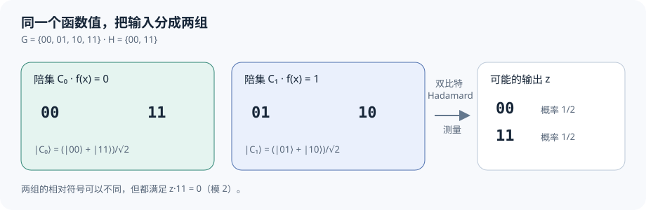
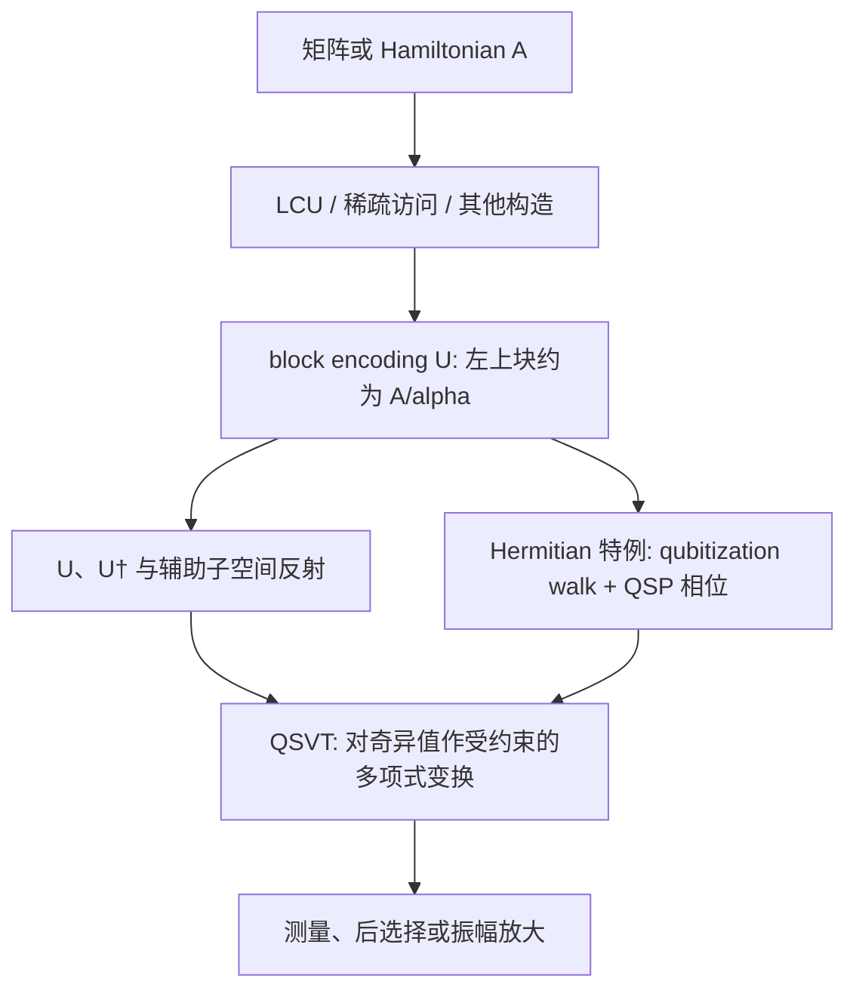
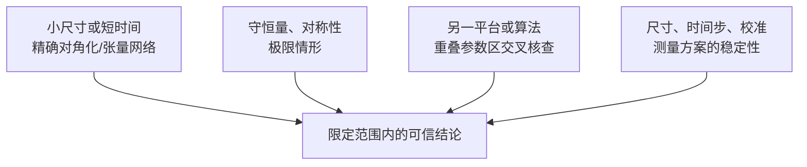

# 16｜高级算法与验证：从下界证明到可信输出

前面的章节回答“量子线路怎样工作”和“代表算法怎样运行”。本章进一步回答五个研究生阶段会反复遇到的问题：

1. 怎样证明某种查询加速已经最优？
2. Simon、Shor 与更一般的隐藏结构有什么共同骨架？
3. 量子行走何时比朴素 Grover 更能利用结构？
4. LCU、block encoding、qubitization、QSP 与 QSVT 到底是什么关系？
5. 算法给出一个量子态或采样分布后，怎样以可承受成本验证它？

阅读每种方法时，先确认输入模型，再看关键推导、可手算的例子和适用边界。

如果第一次接触本章，不必一口气记住所有名称。先读第 1 节，再沿着第 3 节的四元素例、第 4 节的四环行走、第 5 节的单量子比特矩阵、第 7 节的有限测量例走一遍；这些地方只用到前面章节的叠加、测量和矩阵乘法。第 2 节的查询下界证明框架、第 5 节的相位序列合成和第 6 节的容错资源估计可在入门研究时回看。本章展示的是几种方法的接口与边界，并不要求初学者能独立复现每篇原始论文。

## 1. 读算法论文前先填六个空

任何“量子加速”都应先写成

$$
(\text{输入},\text{访问},\text{输出},
\text{误差与成功率},\text{量子资源},\text{经典基线}).
$$

对应六个问题：

| 问题 | 需要明确什么 | 省略后的常见误读 |
|---|---|---|
| 输入规模 | 位长、矩阵维数、图顶点数或时间尺度 | 把 $N$ 与 $\log N$ 混用 |
| 访问模型 | 显式输入、oracle、QRAM、态制备或 block encoding | 把数据装载当免费 |
| 输出 | bit string、标量、样本、局域可观察量（observable，即通过测量估计期望值的厄米算符）或量子态 | 把量子态当完整经典数组 |
| 误差与成功率 | 加性/相对误差、承诺间隙（promise gap，即合法的“是/否”实例之间保证存在的阈值差）、失败概率 | 比较不同精度的算法 |
| 量子资源 | 查询、逻辑门、qubit、shots、T count、验证 | 用一个 $O(\cdot)$ 代替全部成本 |
| 经典基线 | 最坏/平均情形、硬件、并行度、算法版本 | 只和穷举或过时方法比较 |

查询、门、样本、通信、空间和墙钟时间是不同复杂度。后文出现的每个优势，都只在所声明的资源模型中成立。

## 2. 查询下界：证明“任何算法都不能更少查询”

### 2.1 oracle 先固定

对布尔函数，标准 bit oracle 是

$$
O_f|x,y\rangle=|x,y\oplus f(x)\rangle.
$$

把第二寄存器设为 $|-\rangle$ 可得到 phase oracle：

$$
S_f|x\rangle=(-1)^{f(x)}|x\rangle.
$$

在查询复杂度中，一次 $O_f$ 或 $S_f$ 被计为一个单位；在门复杂度中，计算 $f$、保存工作位和反计算都必须展开。改变 oracle 所提供的信息，也会改变下界。

### 2.2 多项式方法的核心归纳

把 oracle 数据写为 $z=(z_1,\ldots,z_N)\in\{0,1\}^N$。在常见 bit-query 模型下：

1. 查询前，振幅与 $z$ 无关，是 0 次多项式；
2. 每次 oracle 查询至多让振幅多乘一个输入变量或其线性函数，因此次数最多增加 1；
3. 与输入无关的酉门只对振幅做线性组合，不增加最高次数。

这里“增加 1”不是一个神秘的计数规则。对相位查询，若所查的是第 $j$ 位，布尔变量 $z_j$ 只取 0 或 1，因此

$$
(-1)^{z_j}=1-2z_j.
$$

原来与输入无关的振幅乘上这个因子后，是 $z_j$ 的一次式；下一次查询再乘一个一次式，最高次数至多变成 2。一般 bit oracle 只是按 $z_j$ 在两种基态之间选择，相关振幅也同样是原振幅乘 $z_j$ 或 $1-z_j$ 后相加。若某变量重复出现，可用 $z_j^2=z_j$（仅在布尔输入上成立）化简，次数不会上升。

所以 $T$ 次查询后，每个振幅是次数至多 $T$ 的多项式。接受概率是若干振幅模平方之和，次数至多 $2T$。若任何在合法输入上近似目标函数的实多项式都至少需要次数 $d$，则

$$
T\ge\frac d2.
$$

#### 手算：一次 Deutsch 查询对应二次概率

令 $z_0=f(0),z_1=f(1)$。正确答案“两个值不同”就是 XOR：

$$
z_0\oplus z_1=z_0+z_1-2z_0z_1.
$$

代入四组输入可逐项检查：`00`、`11` 给 0，`01`、`10` 给 1。它是二次多项式，因此一次查询的 $2T=2$ 足以容纳它。这个论证没有说所有二次 Boolean 函数都能一次查询完成；它只给必要条件，不给充分条件。

对 OR，近似多项式次数为 $\Theta(\sqrt N)$，于是有界错误量子查询至少为 $\Omega(\sqrt N)$。Grover 给出匹配的上界，所以黑箱搜索的查询复杂度是 $\Theta(\sqrt N)$。

### 2.3 hybrid / adversary 的几何直觉

设 $O_0$ 没有标记项，$O_j$ 只标记第 $j$ 项。一次查询前，算法在查询寄存器中的态可写为

$$
\sum_{x=1}^N\alpha_x|x\rangle,
\qquad
\sum_x|\alpha_x|^2=1.
$$

$O_j$ 与 $O_0$ 的差别只作用在 $|j\rangle$ 分量上。对均匀未知的 $j$，$|\alpha_j|$ 的平均量级至多是 $1/\sqrt N$。即使算法在各次查询间自适应改变状态，经过 $T$ 次，最终态之间的平均距离也至多按 $O(T/\sqrt N)$ 积累。先把平均振幅的界写清：

$$
\frac1N\sum_{j=1}^{N}|\alpha_j|
\le\sqrt{\frac1N\sum_{j=1}^{N}|\alpha_j|^2}
=\frac1{\sqrt N}.
$$

这一步只是柯西—施瓦茨不等式：一个归一化态不可能对**每个**未知标记位置都放很大的振幅。严格的多轮下界还需逐轮比较使用不同 oracle 时的状态，并控制这些差距如何累计；上面的单轮计算只是其中最直观的一步。

要让输出分布相差常数量级，多轮 hybrid 论证最终要求

$$
T=\Omega(\sqrt N).
$$

一般 adversary method 会给不同输入对赋权，用一个矩阵范数刻画“尚未被区分的总量”，再证明一次查询最多减少多少。它能处理许多多项式方法不方便的组合问题，并在常数因子意义下刻画有界错误量子查询复杂度。

### 2.4 promise 与 total function

- **total function**：每个 $N$ 位输入都合法；
- **partial function / promise problem**：算法只需在满足承诺的输入上正确。

Deutsch–Jozsa 与 Simon 的指数查询分离依赖 promise。对 total Boolean function，确定性经典查询复杂度与有界错误量子查询复杂度之间至多相差多项式。这个结论只针对相应查询模型；它不否定 Shor 这类利用代数结构、按门复杂度分析的时间算法。

## 3. 隐藏子群：Simon 与 Shor 的共同语言

### 3.1 一般定义

先把符号落到熟悉的对象上。一个“群”是一组标签和一种运算：运算有结合律，有一个“不改变别人”的单位元，每个元素也有逆元。例如两位串 $00,01,10,11$ 在逐位异或 $\oplus$ 下构成群，$00$ 是单位元，每个串与自己异或都回到 $00$。“子群”是按同一运算也构成群的一部分标签。“左陪集” $gH=\{gh:h\in H\}$ 是把子群里的每个元素统一乘上 $g$；在异或例子中写成 $g\oplus H$。陪集把全部标签分成不重叠的等大组。

给定有限群 $G$ 和函数 $f:G\to S$，承诺存在子群 $H\le G$，使

$$
f(g_1)=f(g_2)
\quad\Longleftrightarrow\quad
g_1H=g_2H.
$$

也就是说，$f$ 在每个左陪集上常值，在不同陪集上取不同值。目标是找出 $H$。

从均匀叠加查询 $f$ 后，若测量输出寄存器并对结果作条件化，输入寄存器得到某个纯陪集态

$$
|gH\rangle=\frac{1}{\sqrt{|H|}}
\sum_{h\in H}|gh\rangle.
$$

若不读取而直接丢弃输出寄存器，输入寄存器则不是某个未知的纯态，而是对所有不同左陪集的均匀混态

$$
\rho_H=\frac1{|G/H|}\sum_{gH\in G/H}|gH\rangle\langle gH|.
$$

这两种操作的状态描述不同；但随后只测输入寄存器时，混态给出的 Fourier 采样分布，正是对各个条件纯态分布取平均。因此在只关心该分布的算法分析中，可以省略显式测量，却不能把偏迹后的状态仍写成随机纯态。

先解释“角色”：它不是人物，而是一个把群运算变成复数乘法的函数 $\chi$，满足 $|\chi(g)|=1$ 与 $\chi(g_1g_2)=\chi(g_1)\chi(g_2)$。在异或串群中，$\chi_z(x)=(-1)^{z\cdot x}$ 就是角色；$z\cdot x$ 是按位相乘后模 2 求和。

当 $G$ 是 Abelian 群（运算还能交换顺序）时，对陪集态做群 Fourier 变换，只会采样到在 $H$ 上恒为 1 的角色。它们组成正交角色集合，也称 annihilator：

$$
H^\perp=\{\chi:\chi(h)=1\text{ for all }h\in H\}.
$$

多次采样给出关于 $H$ 的约束，最后由经典算法恢复生成元。

$H^\perp$ 读作“与 $H$ 正交的角色集合”，在这里“正交”具体就是对每个 $h\in H$ 都有 $\chi(h)=1$。

#### 四个标签走完一次隐藏子群采样

取 $G=\{00,01,10,11\}$、$H=\{00,11\}$。两个陪集是 $C_0=\{00,11\}$ 和 $C_1=\{01,10\}$。让函数 $f$ 在 $C_0$ 上给 0，在 $C_1$ 上给 1。输入寄存器均匀叠加、输出寄存器先置 $|0\rangle$，查询后得到

$$
\begin{aligned}
|\Psi\rangle
&=\tfrac12(|00\rangle|0\rangle+|11\rangle|0\rangle
            +|01\rangle|1\rangle+|10\rangle|1\rangle)\\
&=\tfrac1{\sqrt2}(|C_0\rangle|0\rangle+|C_1\rangle|1\rangle),
\end{aligned}
$$

其中 $|C_0\rangle=(|00\rangle+|11\rangle)/\sqrt2$，$|C_1\rangle=(|01\rangle+|10\rangle)/\sqrt2$。测得输出 0 的概率是 $1/2$，条件输入态是 $|C_0\rangle$；若直接丢弃输出，则输入态是 $\tfrac12|C_0\rangle\langle C_0|+\tfrac12|C_1\rangle\langle C_1|$，而非某个确定纯态。最后对输入施加两个 Hadamard 门，记作 $H^{\otimes2}$。此处 $H$ 表示门，和隐藏子群 $H=\{00,11\}$ 只是恰巧同字母：

$$
H^{\otimes2}|C_0\rangle=\tfrac{|00\rangle+|11\rangle}{\sqrt2},
\qquad
H^{\otimes2}|C_1\rangle=\tfrac{|00\rangle-|11\rangle}{\sqrt2}.
$$

无论输出寄存器测得哪一支，最终只可能测到 $z=00$ 或 $z=11$，各有概率 $1/2$。因为隐藏串为 $s=11$，它们恰满足 $z\cdot s=z_1\oplus z_2=0$。只测到 $00$ 尚不能确定 $s$；要重复采样，直到得到足够独立的约束。

### 3.2 Simon 是 $\mathbb Z_2^n$ 上的 HSP

Simon 承诺 $f(x)=f(x\oplus s)$，隐藏子群是

$$
H=\{0^n,s\}.
$$

$\mathbb Z_2^n$ 的角色可写为 $\chi_z(x)=(-1)^{z\cdot x}$。条件 $\chi_z(s)=1$ 等价于

$$
z\cdot s=0\pmod2.
$$

#### 手算：$s=101$

约束是 $z_1\oplus z_3=0$，所以允许输出为

$$
000,010,101,111.
$$

检查 $z=111$：$1\oplus1=0$，故它确在 $H^\perp$ 中；检查 $z=100$：$1\oplus0=1$，故其振幅相消。

### 3.3 Shor 是循环周期的 Fourier sampling

阶寻找中的函数 $x\mapsto a^x\bmod N$ 具有周期 $r$。有限寄存器截断了整数群，因而 QFT 不总给精确的 $k/r$，而是在其附近形成峰。连分数承担的是“从近似 Fourier 样本恢复有理周期”的经典步骤。

共同骨架可以概括为：

### 3.4 一般 HSP 的边界

对任意有限群，存在只用 $\operatorname{poly}(\log|G|)$ 次 oracle 查询识别隐藏子群的信息论算法；但已知构造可需要指数时间或难以实现的联合测量。于是

$$
\text{查询高效}\not\Rightarrow\text{时间高效}.
$$

非 Abelian Fourier 变换本身也不自动解决测量和后处理。不能从“Shor 是 HSP”跳到“所有群结构问题都有 Shor 式高效算法”。

## 4. 量子行走：利用搜索空间的邻接结构

Grover 把候选当成没有关系的标签。量子行走额外使用“从一个候选到邻居的更新很便宜”这一结构。

### 4.1 带硬币自由度的离散时间量子行走（coined walk）

这里的“硬币”不是随机抛掷，而是一个记录移动方向的内部量子自由度。在四个顶点的环上，用 $|v,R\rangle,|v,L\rangle$ 表示位置与方向。每步先对方向量子比特做 Hadamard coin，再按方向移动一格。

明确地说，硬币门把 $|R\rangle$ 变为 $(|R\rangle+|L\rangle)/\sqrt2$，把 $|L\rangle$ 变为 $(|R\rangle-|L\rangle)/\sqrt2$。随后条件移动把 $|v,R\rangle$ 送到 $|v+1\pmod4,R\rangle$，把 $|v,L\rangle$ 送到 $|v-1\pmod4,L\rangle$。两个操作都是酉的，所以全态的概率和始终是 1。

从 $|0,R\rangle$ 出发，第一步为

$$
|0,R\rangle
\longmapsto
\frac{|1,R\rangle+|3,L\rangle}{\sqrt2}.
$$

第二步分别展开：

$$
|1,R\rangle\to
\frac{|2,R\rangle+|0,L\rangle}{\sqrt2},
$$

$$
|3,L\rangle\to
\frac{|0,R\rangle-|2,L\rangle}{\sqrt2}.
$$

所以总态是

$$
\frac12\bigl(
|2,R\rangle+|0,L\rangle+|0,R\rangle-|2,L\rangle
\bigr).
$$

负号不会在当前位置概率中直接显现，却会影响后续路径干涉。这正是量子行走不能被解释为“同时执行很多经典随机游走”的原因。

### 4.2 结构化搜索的成本

对可逆 Markov 链上的量子行走搜索，常见复杂度框架是

$$
S+\frac1{\sqrt\varepsilon}
\left(\frac U{\sqrt{\delta_{\rm walk}}}+C\right),
$$

其中 $S$ 是制备平稳叠加的成本，$U$ 是相干地执行一步更新及其逆操作的成本，$C$ 是检查标记的成本，$\varepsilon$ 是平稳分布中标记比例，$\delta_{\rm walk}$ 是对应**经典可逆链的谱隙**。下标特意把它与前文用来表示误差或失败概率的 $\delta$ 区分开。$U$ 不是从一个顶点随机抽出一位经典邻居的成本；算法必须能对顶点叠加保持相干。

做一次只用于理解各项权重的代入。假定同一种抽象成本单位下有 $\varepsilon=1/16$、$\delta_{\rm walk}=1/4$、$S=10$、$U=2$、$C=3$，则该框架给出的成本尺度为

$$
10+\frac1{\sqrt{1/16}}
\left(\frac{2}{\sqrt{1/4}}+3\right)
=10+4(4+3)=38.
$$

若只把更新成本从 $U=2$ 改为 $U=20$，同一表达式变成 $10+4(40+3)=182$；邻居更新是否便宜会直接改变这条路线的吸引力。$38$ 和 $182$ 不是精确查询数或物理门数，且不能脱离具体 Markov 链与编码，直接拿来和 Grover 的一次 oracle 成本比较。这个式子只展示典型依赖；使用时必须核对具体 walk 定理和链的条件。

### 4.3 element distinctness 为什么优于“对所有数对做 Grover”

问题：给定 $N$ 个 oracle 值，判断是否有两个相等。

- 枚举 $\binom N2$ 个数对并做 Grover，需要 $O(N)$ 次值查询；
- Ambainis 的量子行走在元素子集构成的 Johnson 图上复用已查询值，只需 $O(N^{2/3})$ 次查询；
- 这一标度匹配 Shi 证明的 $\Omega(N^{2/3})$ 量子查询下界。

优势来自更新相邻子集时只替换少数元素，而不是来自对所有数对做一次更大的无结构搜索。若更新或存储子集本身很贵，门复杂度和内存成本仍可能主导。

把 $2/3$ 指数亲手算出来。先考虑最不利的“恰有一对相等值”情形，记这两个下标为 $i,j$。行走的顶点是大小为 $r$ 的下标子集 $S$；若 $S$ 同时含 $i,j$，它就是标记顶点。均匀随机选 $S$ 时，

$$
\varepsilon
=\Pr(i,j\in S)
=\frac rN\frac{r-1}{N-1}
=\frac{r(r-1)}{N(N-1)}
=\Theta\!\left(\frac{r^2}{N^2}\right).
$$

先用 $N=4,r=2$ 检查分式。大小为 2 的子集共有 $\binom42=6$ 个；若唯一相等的一对恰是 $\{i,j\}$，只有这个子集被标记，故 $\varepsilon=1/6$。公式也给 $2(2-1)/[4(4-1)]=1/6$。这个小例只核对标记比例，不能把后面的渐近 $N^{2/3}$ 公式直接用于估计四个元素的实际电路成本。

相邻顶点只替换一个下标。把已查到的 $r$ 个值与下标一同保存在相干数据寄存器中，初次建立需 $S=O(r)$ 次值查询；走到邻居时，逆向清除旧值并查入新值需 $U=O(1)$ 次值查询；当前子集有无重复值可由已存数据计算，故**值查询口径**下 $C=0$。对 $r=o(N)$ 的 Johnson 图简单随机游走，$\delta_{\rm walk}=\Theta(1/r)$。逐项代入上一节的框架，

$$
S+\frac1{\sqrt\varepsilon}
\left(\frac U{\sqrt{\delta_{\rm walk}}}+C\right)
=O\!\left(r+\frac Nr\sqrt r\right)
=O\!\left(r+\frac N{\sqrt r}\right).
$$

令两个主项同阶，即 $r=N/\sqrt r$，得到 $r^{3/2}=N$、$r=\Theta(N^{2/3})$，总值查询数也是 $O(N^{2/3})$。若相等数对不止一对，标记子集不会比只指定其中一对时更少；完整算法仍需按相应行走定理处理成功率，而不能仅凭这个计数式宣称任意电路都正确。缓存占 $O(r)$ 个数值槽；若每个值需 $\lceil\log_2 M\rceil$ 位，量子寄存器、相干数据结构、重复值检查的门数和清理工作位仍需另行计费。这里证明的是查询标度，不是墙钟时间或内存免费。

## 5. 现代 Hamiltonian 算法栈

### 5.1 四种输入模型不能混用

本节沿用第 7 章的 $\hbar=1$ 约定；涉及演化时间 $t$ 的成本式中，$\alpha t$ 必须无量纲。若 Hamiltonian 用物理能量单位，需写成 $\alpha t/\hbar$。

| 模型 | 输入接口 | 典型归一化/成本 |
|---|---|---|
| 局域项之和 | 逐项实现 $e^{-iH_jt}$ | 项数、交换子、步数 |
| 稀疏 oracle | 查询非零位置和值 | 稀疏度与矩阵元范数 |
| LCU | PREPARE 系数、SELECT 酉项 | $\lambda=\sum|\alpha_\ell|$ |
| block encoding | 酉矩阵左上块为 $A/\alpha$ | $\alpha$、辅助位、编码误差 |

一般黑箱 Hamiltonian 受 no-fast-forwarding 限制，复杂度不能普遍次线性于适当归一化后的演化时间。特殊结构可以被快速模拟，但结构必须作为输入承诺的一部分。

### 5.2 LCU：把线性组合放进一个酉矩阵的块

设

$$
H=\sum_{\ell=0}^{L-1}\alpha_\ell U_\ell,
\qquad \alpha_\ell\ge0,
\qquad \lambda=\sum_\ell\alpha_\ell.
$$

负号或复相位可吸收到 $U_\ell$ 中。构造

$$
\operatorname{PREPARE}|0\rangle
=\sum_\ell\sqrt{\alpha_\ell/\lambda}|\ell\rangle,
$$

这里只规定了它对 $|0\rangle$ 的作用；实际电路需把它**补成一个酉操作**，使它在其他辅助基态上的作用也确定，才能反向执行 $\operatorname{PREPARE}^{\dagger}$。目标列向量已经归一化，总能选与它正交的其余列来作这种补全；具体补法可能影响门成本。

$$
\operatorname{SELECT}
=\sum_\ell|\ell\rangle\langle\ell|\otimes U_\ell.
$$

令

$$
W=(\operatorname{PREPARE}^\dagger\otimes I)
\operatorname{SELECT}
(\operatorname{PREPARE}\otimes I).
$$

夹取辅助寄存器的 $|0\rangle$ 分量：

$$
\begin{aligned}
(\langle0|\otimes I)W(|0\rangle\otimes I)
&=\sum_\ell\frac{\alpha_\ell}{\lambda}U_\ell\\
&=\frac H\lambda.
\end{aligned}
$$

#### 手算：$H=0.6X+0.8Z$

$\lambda=1.4$，可取

$$
\operatorname{PREPARE}|0\rangle
=\sqrt{3/7}|0\rangle+\sqrt{4/7}|1\rangle,
$$

例如可明确选用二维酉矩阵

$$
\operatorname{PREPARE}
=\begin{pmatrix}
\sqrt{3/7}&-\sqrt{4/7}\\
\sqrt{4/7}&\sqrt{3/7}
\end{pmatrix}.
$$

第一列正是上面的目标态；两列内积为 0，长度都为 1，所以转置（这里各项为实数）就是它可执行的逆操作。LCU 不要求只用这一个补法，但不能只说“准备好了一个态”就省略逆操作的实现。

$$
\operatorname{SELECT}
=|0\rangle\langle0|\otimes X
+|1\rangle\langle1|\otimes Z.
$$

辅助位投影回 0 后，两个分支的权重分别为 $3/7$ 与 $4/7$，得到

$$
\frac37X+\frac47Z=\frac{0.6X+0.8Z}{1.4}.
$$

再拿系统初态 $|0\rangle$ 真正走一遍。因为 $X|0\rangle=|1\rangle$、$Z|0\rangle=|0\rangle$，辅助位为 0 的**未归一化**系统分支是

$$
\frac H{1.4}|0\rangle=\frac47|0\rangle+\frac37|1\rangle.
$$

测到辅助位 0 的概率是这条分支的范数平方，$p_0=(4/7)^2+(3/7)^2=25/49$；在已经测到 0 的条件下，系统态才归一化为 $(4|0\rangle+3|1\rangle)/5$。若测到辅助位 1，本次没有得到所需的 $H|0\rangle$ 分支。整个 $W$ 仍是确定执行的酉门，概率性发生的是“投影到所需辅助位结果”这一步。也不能把 $H/1.4$ 的两个振幅直接当作概率。

PREPARE、SELECT 及其受控版本的门成本必须计入；写出 LCU 分解不等于已经得到便宜电路。

### 5.3 block encoding：归一化不是无关常数

取 $\alpha>0$、$a\in\mathbb Z_{\ge0}$、$\epsilon\ge0$，并用 $\|\cdot\|$ 表示谱范数（算符 $2$-范数）。若作用于 $a$ 个辅助量子比特和系统寄存器的酉矩阵 $U$ 满足

$$
\left\|A-\alpha
(\langle0^a|\otimes I)U(|0^a\rangle\otimes I)
\right\|\le\epsilon,
$$

则称 $U$ 是 $A$ 的 $(\alpha,a,\epsilon)$ block encoding。三个参数分别表示归一化、辅助位数和编码误差。

上例中

$$
H=\begin{pmatrix}0.8&0.6\\0.6&-0.8\end{pmatrix},
\qquad \|H\|=1,
$$

但直接 LCU 给 $\alpha=1.4$。算法复杂度常依赖 $\alpha t$、$\alpha/\Delta$ 或 $\alpha\kappa$；因此同一矩阵的不同编码可能有不同复杂度。

### 5.4 qubitization 把本征值变成相位

对 Hermitian block encoding，可把信号酉与关于辅助子空间的反射组合成 qubitization walk。按常见约定，若

$$
A|\lambda\rangle=\lambda|\lambda\rangle,
$$

则对应二维不变子空间中的 walk 相位满足

$$
\cos\theta_\lambda=\lambda/\alpha.
$$

不同论文的反射次序可能带来符号或相位平移，所以实现时应从所用定义重新推导，不能只背 $\arccos$ 公式。

### 5.5 QSP/QSVT 把算法变成多项式逼近

QSP 交替使用“携带信号的酉操作”和可调单量子比特相位旋转。选好相位序列后，可在信号变量 $x\in[-1,1]$ 上实现低次多项式。QSVT 把这个机制应用到 block-encoded 矩阵的奇异值；对 Hermitian 矩阵可理解为对本征值做受约束的多项式变换。qubitization 是从 Hermitian 编码构造二维信号演化的一条重要路线；一般 QSVT 也可直接从酉编码及其辅助子空间投影反射构造，**不要求先单独实现一次 qubitization walk**。

后选择（postselection）指只保留指定测量结果对应的运行；若该结果很少出现，重试成本就会很高，因此其成功概率不能省略。

两条进入 QSVT 的箭头说明构造和分析视角，不表示执行时必须把两条电路接起来。只有在 Hermitian 等合适条件下，才可把结果简写为 $P(A/\alpha)$；对一般非 Hermitian 矩阵，要分别说明左右奇异向量与多项式奇偶性。

典型目标包括：

| 任务 | 要逼近的函数 | 额外困难 |
|---|---|---|
| Hamiltonian 模拟 | $e^{-i\alpha tx}$ | 多项式次数随 $\alpha t$ 与误差变化 |
| 线性系统 | $1/x$ | 必须避开 0，条件数进入成本 |
| 谱投影 | 阶跃或 $\operatorname{sgn}(x)$ | 承诺间隙决定逼近次数 |
| 奇异值筛选 | 区间滤波函数 | 后选择成功率与归一化 |

#### 手算：矩阵多项式不是逐元素运算

取

$$
A=\operatorname{diag}(1,0),
\qquad P(x)=T_2(x)=2x^2-1.
$$

则

$$
P(A)=2A^2-I=\operatorname{diag}(1,-1).
$$

右下角来自 $P(0)=-1$，不是把矩阵中每个 0 “保持为 0”。一般 QSP 多项式还必须满足次数、奇偶性和区间有界性条件；并非写出任意 $P$ 就能原样实现。

#### 手算：两次信号调用怎样产生 $T_2(x)$

上一个例子算的是矩阵多项式，还没有展示 QSP 序列。下面固定一种常见信号酉约定：

$$
W(x)=
\begin{pmatrix}
x&i\sqrt{1-x^2}\\
i\sqrt{1-x^2}&x
\end{pmatrix},
\qquad -1\le x\le1.
$$

它的两个本征值是 $x\pm i\sqrt{1-x^2}=e^{\pm i\arccos x}$。这给出了上一节“把归一化本征值 $x=\lambda/\alpha$ 变成相位”的二维原型；真实 qubitization walk 仍须按所用反射次序检查符号约定。

一次调用的左上元是 $x=T_1(x)$。若所有插入相位暂取 0，两次调用得到

$$
W(x)^2=
\begin{pmatrix}
2x^2-1&2ix\sqrt{1-x^2}\\
2ix\sqrt{1-x^2}&2x^2-1
\end{pmatrix}.
$$

左上元正是

$$
T_2(x)=2x^2-1.
$$

例如 $x=1/2$ 时，该矩阵元为 $-1/2$。这个最小例把三个限制放在一起：两次信号调用产生二次多项式；作为酉矩阵元，它在 $[-1,1]$ 上必须有界；本例次数为偶数，多项式也是偶函数。一般 QSP 会在信号调用之间插入可调相位旋转，以合成更广的有界多项式。不同资料会改变信号酉、旋转轴和首尾相位约定，因此相位序列必须连同约定一起使用。

把 $x=1/2$ 代入整个矩阵，比只看左上角更能看清“振幅”和“概率”的差别：

$$
W(1/2)^2=
\begin{pmatrix}-1/2&i\sqrt3/2\\i\sqrt3/2&-1/2\end{pmatrix}.
$$

若信号量子比特从 $|0\rangle$ 开始，最后测得 0 的概率是 $|-1/2|^2=1/4$，测得 1 的概率是 $|i\sqrt3/2|^2=3/4$。这里的 $-1/2$ 是**矩阵元（振幅）**，不是负概率；这个二维模型用于展示 Chebyshev 多项式如何出现，不等于已经给出对任意输入矩阵可直接套用的完整 QSVT 电路。

### 5.6 这条算法栈不自动消除输入和输出瓶颈

QSVT 可能以接近最优的次数实现一个矩阵函数，但端到端算法仍要支付：

- block encoding 的一次调用成本；
- 初态制备及其与目标谱子空间的重叠；
- 后选择或振幅放大的成功率；
- 从输出量子态估计所需可观察量的 shots；
- 容错旋转综合与逻辑错误预算。

“对矩阵维数仅多对数”通常依赖强访问模型和量子态输出，不能改写成“打印全部矩阵函数只需多对数时间”。

## 6. 算法级精度预算：从应用误差反推资源

### 6.1 误差来源不能各自用满总预算

对标量输出，可用保守三角界组织误差：

$$
\epsilon_{\rm total}
\le
\epsilon_{\rm model}
+\epsilon_{\rm state}
+\epsilon_{\rm alg}
+\epsilon_{\rm synth}
+\epsilon_{\rm stat}
+\epsilon_{\rm noise}.
$$

它们分别来自模型截断、初态偏差、算法近似、门综合、有限采样和硬件噪声。这个加法是便于审计的保守上界；实际误差可能相关、相消或需用均方方式组合。资源估算必须说明采用哪种组合规则。

失败概率也需分账。若有制备失败、算法内禀失败、逻辑故障和验证漏检，可先用并合界

$$
p_{\rm fail}\le
p_{\rm prep}+p_{\rm alg}+p_{\rm logical}+p_{\rm verify}.
$$

### 6.2 手算：$10^{-3}$ 不是每一项都可用 $10^{-3}$

某能量计算要求总误差不超过 $10^{-3}$。若模型截断已占

$$
\epsilon_{\rm model}=4\times10^{-4},
$$

态制备已占

$$
\epsilon_{\rm state}=2\times10^{-4},
$$

那么模拟、综合、统计和噪声共享的剩余预算只有

$$
10^{-3}-4\times10^{-4}-2\times10^{-4}
=4\times10^{-4}.
$$

若四项暂时等分，每项只有 $10^{-4}$；但等分未必最省资源。若 shots 对 $\epsilon_{\rm stat}$ 的成本是 $1/\epsilon_{\rm stat}^2$，而提高 Trotter 阶数对 $\epsilon_{\rm alg}$ 更便宜，就应优化分配而非机械平均。

### 6.3 从抽象调用展开到容错电路

| 层级 | 必须记录 |
|---|---|
| 算法 | 查询数、成功概率、精度依赖 |
| oracle / block encoding | PREPARE、SELECT、算术、工作位、反计算 |
| 逻辑电路 | Clifford 数、任意旋转、T count/T depth、测量反馈 |
| 纠错布局 | 码距、数据补丁、路由、魔法态工厂、解码延迟 |
| 物理系统 | 物理 qubit、周期时间、可用率、重试与墙钟时间 |

第 10 章给出的旋转综合例说明：在一种无辅助 Clifford+$T$ 模型下，把一个 $R_z$ 近似到误差 $10^{-10}$，典型 T count 的主项已约为 100。若论文只报“调用一次连续角旋转”，资源账还没有结束。

## 7. 验证：不要用全态层析回答所有问题

### 7.1 先按输出类型选择证据

| 输出 | 合适的验证路线 | 主要边界 |
|---|---|---|
| 因子、路径、可行解 | 经典直接代回 | 只验证该次答案，不证明设备普遍正确 |
| 标量期望值 | 小规模精确值、守恒量、独立算法与误差条 | 不重构全态 |
| 已知目标态 | 稳定子测试、直接保真度估计、见证 | 依赖目标结构与测量模型 |
| 未知多体态 | 局域可观察量、随机测量、受限层析 | 不能宣称完整态已知 |
| 采样分布 | 小规模精确概率、矩、任务特定统计量 | 大规模全分布验证可能和模拟一样难 |
| 委托计算 | 陷阱测试（trap test，即在委托任务中嵌入验证者知道预期结果的隐藏检查项）、交互或密码学验证 | 需要额外假设、轮次或量子能力 |

同一套有缺陷的模拟器既生成预测又“验证”实验，不是独立证据。验证协议本身的样本、经典计算和可信设备假设也要计入总资源。

### 委托验证先写清信任模型

“经典验证者可以验证量子计算”不是一个不带条件的单一定理。不同协议交换的是验证者能力、证明者结构、交互次数和安全假设。

| 路线 | 验证者能力 | 证明者结构 | 主要保证与边界 |
|---|---|---|---|
| 结果直接复核 | 普通经典计算 | 一台量子设备 | 因子、可行解等可代回；只验证这次答案 |
| 陷阱式 MBQC | 能制备少量单量子比特态等有限量子能力 | 一台服务器，交互 | 可给信息论安全；须隐藏陷阱并分析漏检率 |
| 多证明者 rigidity | 纯经典 | 两台或多台不能通信、但可共享纠缠的设备 | CHSH 等测试约束设备行为；隔离假设不可省略 |
| 密码学单证明者 | 纯经典 | 一台量子服务器 | 计算安全；Mahadev 路线依赖量子抗 Learning With Errors（LWE，带误差学习）假设 |
| 统计/基准测试 | 经典控制和可算参考 | 一台设备 | 检查某些统计量或线路族；不是对恶意证明者的通用验证协议 |

一个陷阱直觉小例是：在 $m$ 个数据位置和 1 个隐藏陷阱位置中均匀放置陷阱。若攻击只改动一个固定位置，击中陷阱的概率为 $1/(m+1)$。这不是完整安全证明；真实协议还要处理相干攻击、陷阱与数据的不可区分性、正常设备的通过率和多轮放大。

### 7.2 量子态层析（tomography）的目标是完整描述

$n$ 个量子比特的维数为 $d=2^n$，一般混态有 $d^2-1=4^n-1$ 个实参数。精确样本复杂度取决于误差度量、秩、允许的联合测量和置信度；对一般满秩态，在迹距离误差下，最优副本数仍随 $d^2$ 增长（忽略对数因子和具体常数）。因此全态层析适合小系统诊断，不是大算法输出的默认验证方式。

低秩、矩阵乘积态或已知对称性可降低成本，但这依赖额外承诺；若实际态违反承诺，估计可能有系统偏差。

### 7.3 经典阴影（classical shadows）预测许多指定可观察量

经典阴影对每份态施加随机测量并保存一个可经典处理的“快照”。对 $M$ 个可观察量 $O_i$，典型样本界形如

$$
N=O\!\left(
\frac{\log(M/\delta)}{\epsilon^2}
\max_i\|O_i\|_{\rm shadow}^2
\right).
$$

这里的阴影范数（shadow norm）依赖测量方案与目标可观察量，控制单次估计量的方差规模。$\log M$ 很吸引人，但阴影范数不能省略。对局域随机 Pauli 测量，权重为 $k$ 的 Pauli 串的方差因子可按 $3^k$ 增长；全局可观察量仍可能昂贵。经典阴影给指定性质的估计，不等于输出完整密度矩阵。

#### 手算：单 qubit 的 $Z$ 阴影估计

对 $|0\rangle$，每次均匀随机选择 $X,Y,Z$ 基测量。采用局域 Pauli 阴影逆映射时：

- 选到 $Z$ 基，结果必为 $+1$，对 $\langle Z\rangle$ 的单次估计量为 3；
- 选到 $X$ 或 $Y$ 基，单次 $Z$ 估计量为 0。

所以

$$
\mathbb E[\hat Z]
=\frac13\times3+\frac23\times0=1,
$$

$$
\operatorname{Var}(\hat Z)
=\mathbb E[\hat Z^2]-1
=\frac13\times9-1=2.
$$

估计无偏，但单次值 3 超出物理期望值区间 $[-1,1]$；只有多次平均及置信区间才有意义。

若独立重复 $n$ 次并取平均 $\overline Z_n$，则 $\mathbb E[\overline Z_n]=1$、$\operatorname{Var}(\overline Z_n)=2/n$，标准差为 $\sqrt{2/n}$。例如 $n=200$ 时标准差为 $0.1$。标准差描述重复实验的典型波动，**不是**“真实值有 95% 概率落在 $1\pm0.1$”；要报告某一置信度下的区间，还需选用适合取值范围与独立性假设的统计界，并另计测量校准的系统误差。

### 7.4 已知目标时，直接验证常比层析便宜

若目标是已知纯态 $|\psi\rangle$，只需估计

$$
f=\langle\psi|\rho|\psi\rangle
$$

或一组能界定 $f$ 的稳定子/局域测试，而不必重构 $\rho$ 的全部参数。本书把 Uhlmann 的**根保真度**记为 $F$；当一方是纯态时，二者关系为

$$
F(\rho,|\psi\rangle)=\sqrt{f}
=\sqrt{\langle\psi|\rho|\psi\rangle}.
$$

直接保真度估计文献常把平方量 $f$ 直接称为 fidelity，因此引用或比较数值时必须先核对约定。该方法按目标 Pauli 系数做重要性抽样；对稳定子态等结构化目标特别有效。它回答“离这个目标多近”，不能发现与目标无关的全部噪声结构。

### 7.5 能量与能隙可给基态保真度下界

设 Hamiltonian 有非简并纯基态 $|\psi_0\rangle$，基态能量为 $E_0$，第一激发能与基态之间有能隙 $\Delta>0$。把态 $\rho$ 的基态占据记为

$$
f_0=\langle\psi_0|\rho|\psi_0\rangle.
$$

在 $H$ 的本征基中写 $H=E_0|\psi_0\rangle\langle\psi_0|+\sum_{j\ge1}E_j|\psi_j\rangle\langle\psi_j|$。因每个激发态都满足 $E_j\ge E_0+\Delta$，且它们的总占据是 $\sum_{j\ge1}\langle\psi_j|\rho|\psi_j\rangle=1-f_0$，逐项下界相加便有

$$
E=\operatorname{Tr}(H\rho)
\ge f_0E_0+(1-f_0)(E_0+\Delta),
$$

从而

$$
f_0\ge1-\frac{E-E_0}{\Delta}.
$$

按本书的根保真度约定，$F_0=F(\rho,|\psi_0\rangle)=\sqrt{f_0}$。若基态简并，上式界定的是整个基态子空间的总占据，而不是与某个指定基态的保真度。

#### 手算

若 $E-E_0\le0.10$、$\Delta=0.40$，则

$$
f_0\ge1-\frac{0.10}{0.40}=0.75.
$$

因此在非简并假设下，根保真度满足

$$
F_0\ge\sqrt{0.75}\approx0.866.
$$

这个下界在简单的两能级模型中可以恰好取到：若 $H=0|0\rangle\langle0|+0.40|1\rangle\langle1|$，$\rho=0.75|0\rangle\langle0|+0.25|1\rangle\langle1|$，则 $E-E_0=0.25\times0.40=0.10$、$f_0=0.75$。一般多能级系统若激发部分还占据高于 $E_0+\Delta$ 的能级，同样能量超额对应的实际 $f_0$ 可能更高；所以式子是保守证书，不是由能量唯一重构出态。

实际报告中的 $E-E_0$ 通常不是已知常数。假定在明确的置信度和已计入系统偏差后，实验只证明 $E-E_0\le0.12$；若能隙可靠下界仍是 $0.40$，就只能写

$$
f_0\ge1-\frac{0.12}{0.40}=0.70,
\qquad F_0\ge\sqrt{0.70}\approx0.837.
$$

比如点估计为 $0.10$、误差上限为 $0.02$ 时，证书必须用上端点 $0.12$，不能把点估计当作严格上界。若 $E_0$ 或 $\Delta$ 本身也有不确定性，应分别采用能使 $E-E_0$ 更大、使 $\Delta$ 更小的保守界，并声明证书覆盖的置信度。

若能隙未知或几乎闭合，低能量不再给出有力的保真度界；若 $E$ 由有偏误差缓解得到，也必须把偏差和置信区间带入上式。

### 7.6 模拟器怎样从可验证尺度外推

模拟量子模拟器常输出动力学、相图或关联函数，而不是可直接代回的离散答案。大规模结果的证据应形成四条相互独立的支柱：

结论只覆盖被检查的 observable、参数区和误差尺度。局域量吻合不表示全态正确；同一个有偏模型既生成预测又拟合实验不算独立复核；从经典可算尺寸外推到不可算尺寸时，必须展示连续的规模趋势和误差传播。

例如某守恒量理论值为 1，三个系统尺寸给出

$$
0.995\pm0.004,
\qquad
0.986\pm0.004,
\qquad
0.970\pm0.005.
$$

它们分别偏离约 $1.25\sigma,3.5\sigma,6\sigma$。不能因每个数“看起来接近 1”就忽略随规模单调增长的偏差；但只凭三个点也不能断定是有限尺寸物理还是系统误差，还需改变校准、测量方案并与独立方法比较。

### 7.7 一套可执行的验证梯子

1. **解析小例**：逐振幅或矩阵计算，检查符号、端序和归一化。
2. **小规模经典模拟**：冻结随机种子，与理想概率逐项比较。
3. **结构检查**：守恒量、对称性、稳定子和可逆线路的逆向检查。
4. **统计检查**：预先规定可观察量、误差、置信度和多重比较校正。
5. **跨方法复核**：不同硬件、不同经典算法或不同测量协议。
6. **盲区声明**：明确未验证的全局相位、长程关联、尾部概率或模型外噪声。

验证不是最后才补的一张图。若输出本身难以验证，验证协议应在算法设计阶段进入资源预算。

## 8. 常见误区

- “Grover 是最优”只在声明的无结构 oracle 和误差模型中成立。
- “查询数为多项式”不保证总时间为多项式；一般 HSP 是直接反例。
- “量子行走是随机游走的平方加速版”不准确；coin、相位、图结构和更新成本都决定结果。
- “LCU 已经实现了 $H$”忽略了辅助位成功分支、归一化和 PREPARE/SELECT 成本。
- “QSVT 能实现任意矩阵函数”忽略了 block encoding、谱区间、多项式有界性、奇偶性和非 Hermitian 情形。
- “经典阴影只需 $O(\log M)$ 个样本”省略了误差、失败概率与阴影范数。
- “层析证明算法正确”忽略了 SPAM、模型假设和指数扩展。
- “估计值接近理论值”若理论值与实验使用同一未经验证近似，不能算独立验证。

## 实操扩展：QSVT 的奇异值变换不是任意矩阵的幂

本节补全第 5 节“非 Hermitian 时不能随意写 $P(A)$”的具体含义。设方阵的奇异值分解为 $A=W\Sigma V^\dagger$，奇异值 $\sigma_j\ge0$ 在 $\Sigma$ 对角线上。对于奇多项式，常用奇异值变换连接右、左奇异向量，形如 $WP(\Sigma)V^\dagger$；偶多项式则保持在同一侧，按选定投影约定得到 $VP(\Sigma)V^\dagger$ 或左侧版本。实际电路还受多项式有界性、奇偶性和辅助块定义约束。[QSVT 原始论文](https://arxiv.org/abs/1806.01838)与 [PennyLane 的电路接口](https://docs.pennylane.ai/en/stable/code/api/pennylane.QSVT.html)分别提供定理和实现约定。

取收缩矩阵

$$
A=\begin{pmatrix}0&1/2\\0&0\end{pmatrix}.
$$

它把 $|1\rangle$ 送到 $|0\rangle/2$，把 $|0\rangle$ 送到 0。再作用一次就全为 0，故 $A^2=0$。但奇异值为 $1/2,0$，其平方并没有全为零。右侧偶变换 $P(x)=x^2$ 的目标是

$$
VP(\Sigma)V^\dagger=A^\dagger A
=\begin{pmatrix}0&0\\0&1/4\end{pmatrix},
$$

左侧版本为 $AA^\dagger=\operatorname{diag}(1/4,0)$。三个矩阵 $A^2,A^\dagger A,AA^\dagger$ 都是 $2\times2$，却给不同结果；仅检查维度还不够。这个矩阵计算是在辨认**想要合成的块**，没有断言任意 QSP 接口都将任意实多项式完整放入同一个复矩阵元；例如有的接口把目标编码在该块的实部，还要按其文档提取。

### 合成相位之后还要查哪一层

多项式逼近误差、相位求解残差、旋转门综合误差、块编码误差和后选择成功率属于不同层。实践中可以先在小矩阵上重建整个酉电路：检查 $U^\dagger U\approx I$，再按辅助位基序截出目标块，最后与正确的奇异值变换比较。只在一两个 $x$ 上画出好看的曲线，无法排除窄区间误差或端点问题；有限网格测试也不是整个连续区间上界的数学证明。

**实验 16-A。** 对 $x=-1,-1/2,0,1/2,1$，直接相乘本章定义的 $W(x)$ 两次，检查酉性、$T_2(x)$ 振幅和测得 0 的概率；再验证上述非 Hermitian 反例。代码入口为 `python3 codes/algorithms/experiments.py 16`；[完整实验与答案](labs/algorithms.md#实验-16-a信号多项式与非厄米反例)把这两种检查明确分开。它是 QSP 原型与目标矩阵核查，不冒充完整相位合成器或容错 QSVT 实现。

## 实操扩展 B：后选择会把小块误差放大多少

块编码、LCU 与 QSVT 常先逼近一个**未归一化分支**，再测辅助位并保留成功分支。若成功概率很小，“块误差只有 $10^{-3}$”仍不能直接当成输出态误差。这里给一个与具体相位求解器无关的预算。

设目标块为 $B$，实际块为 $\widetilde B$，它们都是从酉矩阵截出的收缩算子，并承诺谱范数误差 $\|B-\widetilde B\|\le\epsilon$。对归一化输入 $|\psi\rangle$，定义

$$
v=B|\psi\rangle,\qquad w=\widetilde B|\psi\rangle,
\qquad r=\|v\|=\sqrt p,\qquad s=\|w\|.
$$

$p>0$ 是理想后选择成功率。由算符范数定义，$\|v-w\|\le\epsilon$；由反三角不等式，$|r-s|\le\epsilon$。如果 $\epsilon<r$，就有 $s>0$，两个条件输出都可归一化。加减 $w/r$ 得

$$
\begin{aligned}
\left\|\frac vr-\frac ws\right\|
&\le\left\|\frac{v-w}{r}\right\|
+\left\|w\left(\frac1r-\frac1s\right)\right\|\\
&=\frac{\|v-w\|}{r}+\frac{|s-r|}{r}
\le\frac{2\epsilon}{\sqrt p}.
\end{aligned}
$$

这个上界采用两分支继承的相位约定；允许优化全局相位的距离只会更小。若想把条件态的向量误差保证在 $\eta$ 内，足够要求 $\epsilon\le\eta\sqrt p/2$，同时保证分支非零。算法复杂度中的逼近精度必须据此反推，不能让每一层各自用满最终态误差。

成功概率本身也会变化。平方根满足 $s\in[\max(0,\sqrt p-\epsilon),\sqrt p+\epsilon]$，因此

$$
\max(0,\sqrt p-\epsilon)^2\le\widetilde p
\le\min\{1,(\sqrt p+\epsilon)^2\}.
$$

**二维反例。** 取 $B=0.01I$、$\widetilde B=0.01I+0.001X$ 和输入 $|0\rangle$。两矩阵的范数均不超过 1，可以作为合法块；其误差为 $0.001$。理想分支 $v=(0.01,0)^T$ 的成功率只有 $10^{-4}$；实际分支 $w=(0.01,0.001)^T$ 的成功率为 $0.000101$。归一化后，理想态是 $|0\rangle$，实际态是

$$
\frac{10|0\rangle+|1\rangle}{\sqrt{101}}.
$$

二者向量距离约为 $0.0996274$，远大于块误差 $0.001$，但仍小于预算上界 $2(0.001)/0.01=0.2$。平方保真度是 $100/101\approx0.990099$，根保真度为 $10/\sqrt{101}$；本书采用后一约定。若用独立重试直接得到一个成功态，理想平均需 $1/p=10000$ 次；振幅放大可能改变标度，但还要求可逆准备、反射及其代价。

**练习 16-B（含答案）。** 同一个 $p=10^{-4}$，若目标条件态向量误差至多 $0.01$，该充分界要求块误差最多多少？这能证明一个有限网格相位拟合在连续谱上准确吗？

**解答。** $\epsilon\le0.01\times0.01/2=5\times10^{-5}$。不能；此预算以已证明的块范数误差为输入，网格检验不是该前提的证明。`python3 codes/algorithms/round70_checks.py 16` 直接计算向量距离、根与平方保真度及概率区间，并用另一组误差尺度复核不等式。它检查归一化敏感性，不实现一般 QSVT 相位综合。算法上下文见 [QSVT 原始论文](https://arxiv.org/abs/1806.01838)（2018 年预印本、STOC 2019；访问于 2026-09-26），本节不等式由上述范数计算给出。

## 9. 自检

1. 为什么 $T$ 次查询算法的接受概率次数至多为 $2T$，而不是 $T$？
2. 写出 Deutsch XOR 的多项式，并在四个输入上验证。
3. 对 Simon 的 $s=101$，求 $H^\perp$ 中的四个元素。
4. 在四标签 HSP 例中，写出两个陪集态及丢弃输出后的输入态；为何最终只能测到 $00$ 或 $11$？
5. 四环带硬币量子行走的两步态中，哪个负号会影响后续干涉？
6. 为什么 element distinctness 的 $O(N^{2/3})$ 不能解释为对所有数对直接做 Grover？若 $N=4,r=2$，指定唯一相等数对时的标记子集比例是多少？
7. 为 $H=0.6X+0.8Z$ 写出 PREPARE、SELECT，并验证左上块；若系统初态是 $|0\rangle$，辅助位测得 0 的概率与归一化条件态分别是什么？
8. 对 $A=\operatorname{diag}(1,0)$ 计算 $T_2(A)$。这为何不是逐元素运算？
9. 当 $x=1/2$ 时，两次 $W(x)$ 信号调用的左上角振幅是什么？从 $|0\rangle$ 开始的测量 0 概率又是什么？
10. 总误差预算 $10^{-3}$，模型误差 $4\times10^{-4}$、态制备误差 $2\times10^{-4}$，其余误差最多共享多少？
11. 对单 qubit Pauli 阴影估计 $|0\rangle$ 的 $\langle Z\rangle$，计算单次估计的均值与方差，以及独立重复 200 次后平均值的标准差。
12. 已知 $E-E_0\le0.03$、$\Delta=0.20$，基态占据下界是多少？若基态非简并，按本书约定的根保真度下界是多少？这个结论还依赖哪些前提？

答案见[练习与答案：第 16 章](appendices/exercises.md#第-16-章)。

## 参考起点

- R. Beals et al., [Quantum Lower Bounds by Polynomials](https://arxiv.org/abs/quant-ph/9802049) (1998)。
- T. Lee et al., [Quantum query complexity of state conversion](https://arxiv.org/abs/1011.3020) (2010)。
- M. Ettinger, P. Høyer, E. Knill, [The quantum query complexity of the hidden subgroup problem is polynomial](https://arxiv.org/abs/quant-ph/0401083) (2004)。
- A. Ambainis, [Quantum walk algorithm for element distinctness](https://arxiv.org/abs/quant-ph/0311001) (2003)。
- F. Magniez, A. Nayak, J. Roland, M. Santha, [Search via Quantum Walk](https://arxiv.org/abs/quant-ph/0608026), *SIAM Journal on Computing* 40, 142–164 (2011)；给出带建立、相干更新和检查成本的行走搜索框架。
- Y. Shi, [Quantum lower bounds for the collision and the element distinctness problems](https://arxiv.org/abs/quant-ph/0112086) (2001；FOCS 2002)。
- M. Santha, [Quantum walk based search algorithms](https://arxiv.org/abs/0808.0059) (2008)。
- D. W. Berry et al., [Simulating Hamiltonian Dynamics with a Truncated Taylor Series](https://arxiv.org/abs/1412.4687) (2014)。
- G. H. Low, I. L. Chuang, [Hamiltonian Simulation by Qubitization](https://quantum-journal.org/papers/q-2019-07-12-163/), *Quantum* 3, 163 (2019)。
- G. H. Low, I. L. Chuang, [Optimal Hamiltonian Simulation by Quantum Signal Processing](https://arxiv.org/abs/1606.02685) (2016)。
- A. Gilyén et al., [Quantum Singular Value Transformation and Beyond](https://arxiv.org/abs/1806.01838) (2018)。
- H.-Y. Huang, R. Kueng, J. Preskill, [Predicting many properties of a quantum system from very few measurements](https://arxiv.org/abs/2002.08953), *Nature Physics* 16, 1050–1057 (2020)。
- J. Haah et al., [Sample-optimal tomography of quantum states](https://arxiv.org/abs/1508.01797), *IEEE Transactions on Information Theory* 63, 5628–5641 (2017)。
- S. T. Flammia, Y.-K. Liu, [Direct Fidelity Estimation from Few Pauli Measurements](https://arxiv.org/abs/1104.4695), *Physical Review Letters* 106, 230501 (2011)。
- A. Gheorghiu, T. Kapourniotis, E. Kashefi, [Verification of quantum computation: An overview of existing approaches](https://arxiv.org/abs/1709.06984), *Theory of Computing Systems* 63, 715–808 (2019)。
- A. Broadbent, J. Fitzsimons, E. Kashefi, [Universal blind quantum computation](https://arxiv.org/abs/0807.4154), FOCS (2009)。
- J. F. Fitzsimons, E. Kashefi, [Unconditionally verifiable blind computation](https://arxiv.org/abs/1203.5217), *Physical Review A* 96, 012303 (2017)。
- B. W. Reichardt, F. Unger, U. Vazirani, [Classical command of quantum systems via rigidity of CHSH games](https://arxiv.org/abs/1209.0449), *Nature* 496, 456–460 (2013)。
- U. Mahadev, [Classical Verification of Quantum Computations](https://arxiv.org/abs/1804.01082), FOCS (2018)。
