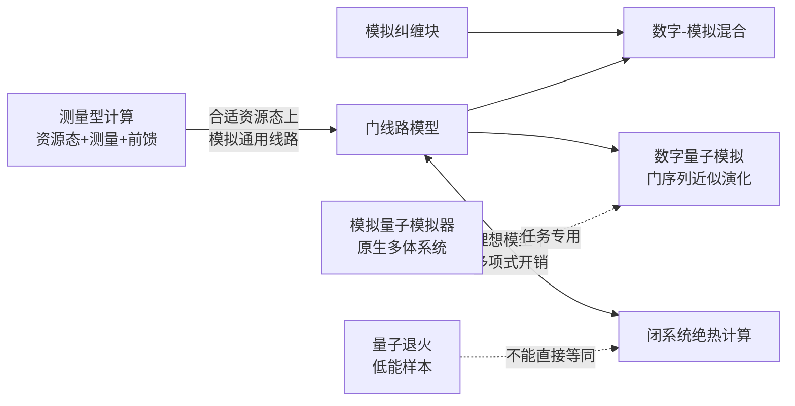
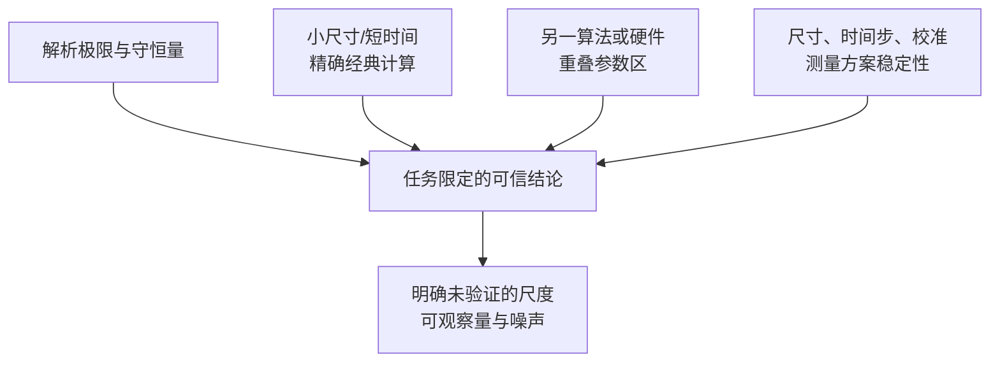

# 17｜量子计算模型：门、测量、绝热、退火与模拟

前面的算法大多写成门线路，但“量子计算”不只有一种程序表达方式。测量型计算把程序写进测量基和前馈；绝热计算把程序写成随时间变化的 Hamiltonian；模拟量子模拟器依靠原生多体相互作用；数字—模拟混合则把可控脉冲与模拟纠缠块组合起来。

这些模型在某些理想条件下可以互相模拟，但物理开销、噪声模型和复杂度保证各不相同。

第一次阅读可先看 §1 的地图和 §2 的门线路作为参照，再做 §3.1 的两比特测量算例；这样能看出“测量为什么也可能是计算步骤”。随后读 §4–5，分清闭系统绝热计算与真实退火采样各自宣称什么。§6–8 的模拟平台和密码成本可按研究方向回看。地图表达的是**程序写在哪里、成本怎样计**，并不把六种模型排成“谁更先进”的名次。

下面用五个问题逐一比较：

1. 程序由什么指定？
2. 哪些操作被视为基本操作？
3. 输出是什么，怎样验证？
4. “可通用”是哪一个数学模型中的结论？
5. 比较性能时，哪些时间、失败和预处理成本必须计入？

涉及动力学的简式 $e^{-iHt}$ 沿用第 7 章的 $\hbar=1$ 约定。若 $H$ 写成物理能量，指数应为 $e^{-iHt/\hbar}$；第 6 节的耦合系数 $J$ 因此按角频率计。

## 1. 一张计算模型地图

图中的实线表示理论模拟或构造关系，不表示同样的墙钟时间、误差率和容错开销。两条虚线也不是说对象毫无关系：量子退火常借用绝热演化的直觉，模拟器和数字算法都研究量子动力学；虚线提醒我们不能把工程设备名称直接替换为复杂度定理的模型名称。

| 模型 | 程序写在哪里 | 核心资源 | 典型输出 | 首要成本 |
|---|---|---|---|---|
| 门线路 | 门序列、连接和测量 | 可控单/双比特门 | 比特串、期望值、量子态 | 编译、路由、纠错、shots |
| 测量型计算 | 图态、测量角、前馈规则 | 纠缠资源态和适应性测量 | 逻辑量子输出或经典结果 | 资源态、丢失、前馈时延 |
| 闭系统绝热计算 | $H(s)$ 路径与调度函数 $s(t)$ | 易制备初始基态、受控慢变作用 | 末态样本或量子态 | 最小谱隙、路径导数、控制误差 |
| 量子退火 | 驱动项、问题 Hamiltonian、退火时间 | 量子涨落和重复采样 | 低能候选解样本 | 嵌入、温度、重复、调参 |
| 模拟量子模拟 | 物理相互作用与控制波形 | 原生多体动力学 | 局域量、关联、动力学 | 模型偏差、校准、验证 |
| 数字—模拟混合 | 数字脉冲与模拟纠缠块 | 固定多体块加局部控制 | 与任务有关 | 脉冲误差、残余耦合、编排 |

“通用”只表示可以以受控开销逼近任意目标计算，并不等于已经容错，也不等于在某一应用上更快。反过来，专用模拟器不通用，也不表示它没有科学价值；它可能以更自然的资源实现某类多体模型。

## 2. 门线路模型：全书的公共翻译层

门模型把量子寄存器初始化，依次施加酉门和测量。它的优势是模块化：算法、编译、纠错和硬件可以分层讨论。第 4 章给出门与协议，第 6–7 章给出算法，第 10 章给出容错，第 14 章把抽象门落到控制波形。

但门模型中的“一层”或“一次 oracle”不是物理时间单位。一个抽象受控酉可能要展开为算术、辅助位、路由、反计算和大量容错门。比较另一种模型与门模型时，至少要统一：

- 输入怎样装载；
- 精度和失败概率；
- 哪些并行操作被允许；
- 输出怎样读取和验证；
- 是否包含校准、初始化、重试和纠错。

## 3. 测量型量子计算：测量也能推进计算

测量型量子计算（measurement-based quantum computation，MBQC）先制备一个纠缠资源态，随后主要靠单量子比特测量推进逻辑计算。常见资源是图态或簇态：图的顶点是制备在 $|+\rangle$ 的量子比特，每条边对应一个 $CZ$。

MBQC 不是“先把所有答案算好，再用测量挑一个”。资源态提供关联结构，测量基选择要实现的逻辑变换；随机测量结果会产生已知的 Pauli 伴随算符，后续测量角或最终经典解释据此调整。

### 3.1 最小簇态手算：一次测量实现 $H$

把未知输入放在第一个量子比特：

$$
|\psi\rangle=a|0\rangle+b|1\rangle,
\qquad |a|^2+|b|^2=1.
$$

第二个量子比特制备为 $|+\rangle$。施加 $CZ$：

$$
CZ(|\psi\rangle|+\rangle)
=a|0\rangle|+\rangle+b|1\rangle|-\rangle.
$$

在第一个量子比特上测量 $X$ 基。把结果记为 $m=0$ 对应 $|+\rangle$，$m=1$ 对应 $|-\rangle$。

若 $m=0$，第二个量子比特的未归一化态为

$$
(\langle+|\otimes I)CZ(|\psi\rangle|+\rangle)
=\frac1{\sqrt2}\left(a|+\rangle+b|-\rangle\right)
=\frac1{\sqrt2}H|\psi\rangle.
$$

若 $m=1$，则

$$
(\langle-|\otimes I)CZ(|\psi\rangle|+\rangle)
=\frac1{\sqrt2}\left(a|+\rangle-b|-\rangle\right)
=\frac1{\sqrt2}XH|\psi\rangle.
$$

两个结果的概率都是 $1/2$。归一化后可统一写成

$$
|\psi_{\rm out}\rangle=X^mH|\psi\rangle.
$$

所以随机结果没有使计算失控：$m$ 已被经典控制器知道。控制器可以立刻施加 $X^m$，也可以只更新 Pauli 帧，或改变后续测量基。

### 3.2 为什么需要适应性前馈

上面的 $X^m$ 是已知伴随算符。角度怎样受它影响，可以继续用两比特例手算。把第一个量子比特改在

$$
|\pm_\alpha\rangle
=\frac{|0\rangle\pm e^{i\alpha}|1\rangle}{\sqrt2}
$$

这一组基中测量，并约定 $R_z(\beta)=e^{-i\beta Z/2}$。沿用上一节的输入态和 $CZ$，得到第二个量子比特的未归一化态

$$
\begin{aligned}
(\langle{\pm_\alpha}|\otimes I)CZ(|\psi\rangle|+\rangle)
&=\frac1{\sqrt2}\left(a|+\rangle\pm e^{-i\alpha}b|-\rangle\right)\\
&=\frac{e^{-i\alpha/2}}{\sqrt2}
X^m H R_z(-\alpha)|\psi\rangle,
\end{aligned}
$$

其中 $m=0$ 对应 $+$，$m=1$ 对应 $-$，前面的复数只贡献全局相位。每个结果的概率仍为 $1/2$。定义这一步的目标门 $J(\alpha)=HR_z(-\alpha)$，则它的实际输出是 $X^mJ(\alpha)|\psi\rangle$。

假如上一逻辑步留下一个已知的 $X$ 伴随算符，进入此步的物理态是 $X|\psi\rangle$。利用 $R_z(\alpha)X=XR_z(-\alpha)$ 和 $HX=ZH$，可逐步得到

$$
J(-\alpha)X
=HR_z(\alpha)X
=HXR_z(-\alpha)
=ZJ(\alpha).
$$

控制器于是把本轮测量角从 $\alpha$ 改为 $-\alpha$，逻辑目标仍是 $J(\alpha)$，新的已知伴随算符变为 $X^mZ$。例如目标角为 $\pi/4$ 时，前一步若留下 $X$，本轮就测 $|\pm_{-\pi/4}\rangle$。这就是“前馈”所需的具体符号更新；若不知道上一轮结果，便无法按这条规则选择角度。

只做 Clifford 计算时，常可把已知伴随算符一路记在 Pauli 帧中；做一般旋转时，前一步结果可能改变后一步测量角的符号或偏移。因而 MBQC 的时间资源不仅是测量次数，还包括：

1. 制备并验证足够大的资源态；
2. 读取本轮测量结果；
3. 在相干与存储预算内计算下一轮测量基；
4. 处理光子丢失、探测失败和器件噪声；
5. 在容错方案中持续追踪逻辑伴随算符。

两比特例只演示一个逻辑步。要得到通用 MBQC，还需要合适的大型资源图、非 Clifford 测量角和适应性；“制备过一个小簇态”不是通用容错计算的证明。

## 4. 闭系统绝热计算：沿着基态路径演化

绝热计算先制备 $H(0)$ 的已知基态，再缓慢改变 Hamiltonian，希望系统跟随同一条瞬时本征态并在 $H(1)$ 的基态结束。常写成

$$
H(s)=(1-s)H_{\rm init}+sH_{\rm problem},
\qquad s=s(t),\quad 0\le t\le T.
$$

“足够慢”不是只看总时间 $T$。误差界依赖所用绝热定理、最小谱隙、$\partial_sH$ 与更高导数、端点光滑性和调度函数。不同定理的常数与幂次可能不同，因此不能脱离条件背一句 $T\sim1/\Delta^2$。

### 4.1 二能级手算

取

$$
H(s)=-(1-s)X-sZ.
$$

它的矩阵为

$$
H(s)=
\begin{pmatrix}
-s&-(1-s)\\
-(1-s)&s
\end{pmatrix}.
$$

迹为 0，行列式为 $-[s^2+(1-s)^2]$，所以本征值是

$$
E_\pm(s)=\pm\sqrt{s^2+(1-s)^2}.
$$

瞬时谱隙为

$$
\Delta(s)=E_+(s)-E_-(s)
=2\sqrt{s^2+(1-s)^2}.
$$

令 $f(s)=s^2+(1-s)^2$，则 $f'(s)=4s-2$，故最小值在 $s=1/2$：

$$
\Delta_{\min}=\sqrt2.
$$

$s=0$ 时 $H=-X$，基态为 $|+\rangle$；$s=1$ 时 $H=-Z$，基态为 $|0\rangle$。这个例子展示了完整的“易制备初态—插值路径—最小谱隙—目标基态”，但常数谱隙的单量子比特不能外推到一般组合优化实例。

### 4.2 与门模型的关系

对高效可描述的局域 Hamiltonian 路径，并把所需精度、Hamiltonian 范数与导数、演化时间纳入资源计数时，闭系统绝热计算与标准门模型在计算复杂度意义下可作多项式开销的相互模拟。这是计算能力的理论等价，不表示：

- 两种硬件有相同常数和纠错方案；
- 任意线性插值都有逆多项式谱隙；
- 有限温度开放系统会自动保持基态；
- 名称中带“annealing”的设备自动满足等价定理的条件。

第 7 章的局域 Hamiltonian 判定问题也涉及最低能量，但要分清：那是带阈值承诺的 YES/NO 问题；绝热算法描述的是制备和演化过程。判定的承诺间隙 $b-a$ 与物理谱隙 $E_1-E_0$ 不是同一个量。

## 5. 量子退火：低能样本与 time to solution

量子退火通常以驱动 Hamiltonian 开始，逐渐减弱驱动并增强问题 Hamiltonian，然后测量候选比特串。这个随时间改变两部分权重的规则称为退火调度函数。实际设备可能处于有限温度并与环境耦合，演化未必是理想闭系统绝热过程。它更适合作为需实验评估的优化采样流程，而不是由名称直接获得最坏情形加速保证。

评价一次退火不能只报“芯片演化时间”。若单次退火成功达到预先定义质量阈值的概率为 $p_s$，希望**至少一次成功的总体概率**达到 $1-\delta$，独立重复 $R$ 次后的失败概率为 $(1-p_s)^R$。对 $0<p_s<1$、$0<\delta<1$，因此

$$
R=\left\lceil
\frac{\log\delta}{\log(1-p_s)}
\right\rceil.
$$

只计退火段的 time to solution（TTS，达到上述目标成功概率所需时间）是

$$
\operatorname{TTS}(t_a)
=t_a\left\lceil
\frac{\log\delta}{\log(1-p_s(t_a))}
\right\rceil,
$$

其中成功概率本身依赖退火时间 $t_a$。公平比较要在允许范围内优化 $t_a$，并另行加入编程、热化、读出和网络延迟。

两个边界要单独处理：若 $p_s=0$，任何有限次重复都达不到目标；若 $p_s=1$，一次即可，即 $R=1$。这里的 $1-\delta$ 是**已知 $p_s$ 时重复实验的成功概率目标**，不是估计未知 $p_s$ 的统计置信度。若 $p_s$ 由有限样本估计，可以在说明样本独立性和估计规则后，用它的保守下置信界计算重复次数，而不是只代入点估计。

### 5.1 TTS 手算

若每次退火 $t_a=20\ \mu\mathrm{s}$，单次成功概率 $p_s=0.2$，要求至少 $99\%$ 概率出现一次成功，即 $\delta=0.01$，则

$$
R=\left\lceil\frac{\log0.01}{\log0.8}\right\rceil
=\lceil20.64\rceil=21.
$$

只计退火段：

$$
\operatorname{TTS}=21\times20\ \mu\mathrm{s}
=420\ \mu\mathrm{s}.
$$

若每次还需 $100\ \mu\mathrm{s}$ 的读出与复位，端到端时间就变为

$$
21\times(20+100)\ \mu\mathrm{s}
=2.52\ \mathrm{ms}.
$$

这还没有加入一次性嵌入和参数选择。对不同算法比较 TTS 时，成功阈值、目标总体成功概率、估计 $p_s$ 的统计把握度、调参预算、嵌入成本和经典基线必须一致；目标成功概率与统计把握度不能混成一个数字。

## 6. 数字模拟、模拟量子模拟器与数字—模拟混合

三种方式都可能研究 $e^{-iHt}$，但“实现 $H$”的含义不同。

| 路线 | 怎样得到动力学 | 优点 | 主要风险 |
|---|---|---|---|
| 数字量子模拟 | 用门序列近似 $e^{-iHt}$ | 可编程、可系统控制算法误差 | Trotter/QSP 等算法和编译成本 |
| 模拟量子模拟 | 让硬件原生相互作用对应目标模型 | 某些多体模型自然、并行 | 模型偏差、参数覆盖和大尺度验证 |
| 数字—模拟混合 | 模拟纠缠块之间插入数字局部操作 | 利用硬件原生多体块并保留可编程性 | 残余耦合、有限脉冲、校准和通用性条件 |

第 7 章比较了乘积公式、qDRIFT、Taylor/LCU、qubitization/QSP 和 Dyson 方法。那些是**算法选择**；本节讨论的是**物理控制模型**。一次 block-encoding 查询、一次原生模拟块和一次抽象两比特门不能当作同一成本单位。

### 6.1 echo 手算：数字脉冲选择模拟耦合

假设硬件总是存在

$$
H_0=J(Z_1Z_2+Z_2Z_3).
$$

依次执行：演化 $t/2$、对第 1 个量子比特做 $X_1$、再演化 $t/2$、再做 $X_1$。总操作按从右到左的时间顺序写为

$$
U=X_1e^{-iH_0t/2}X_1e^{-iH_0t/2}.
$$

利用

$$
X_1Z_1X_1=-Z_1,
\qquad
X_1Z_2X_1=Z_2,
$$

有

$$
X_1H_0X_1=J(-Z_1Z_2+Z_2Z_3).
$$

由于两个 $ZZ$ 项彼此对易，

$$
\begin{aligned}
U
&=e^{-i(X_1H_0X_1)t/2}e^{-iH_0t/2}\\
&=e^{-iJtZ_2Z_3}.
\end{aligned}
$$

$Z_1Z_2$ 在两半段符号相反而抵消，$Z_2Z_3$ 则累加。这是 refocusing（重聚焦）或 echo 的最小例。

推导假设 $X$ 脉冲瞬时、两半段等长且 Hamiltonian 精确已知。有限脉冲宽度、时长不平衡、串扰和不可对易残余项都会留下误差。一个数字—模拟方案被证明可通用，不表示所有带模拟块的硬件都自动通用或容错。

## 7. 模拟量子模拟器怎样建立可信度

模拟器往往输出相图、关联函数、缺陷密度或非平衡动力学，不像因数那样可直接代回。验证应从可算区逐层外推：

四类检查最好互相补强；在经典不可算区，独立平台交叉未必总能取得，缺少时就应如实缩小结论范围，而不是把某一条内部一致性测试写成独立验证：

1. **解析结构：** 能量、粒子数、对称性或已知极限是否满足？
2. **可算区：** 小尺寸或短时间是否与精确对角化、张量网络等吻合？
3. **独立交叉：** 是否有另一平台、算法或测量协议给出重叠区结果？
4. **规模稳定性：** 结论是否随尺寸、步长、校准和后处理平稳变化？

局域可观察量吻合不代表全态正确；同一近似模型既生成预测又拟合实验不算独立证据。第 16 章给出态层析、经典阴影、能量证书和跨尺度偏差的具体工具。

## 8. 计算模型怎样改变密码算法的成本口径

密码学最能说明“查询复杂度不是物理运行时间”。Shor 改变因数分解和离散对数的渐近复杂度；Grover 和碰撞算法研究黑箱查询；真正攻击还要把密码原语（组成协议的基础运算，例如分组加密或哈希）编译成可逆容错电路。

| 任务 | 理想量子算法影响 | 不能省略的现实资源 |
|---|---|---|
| 因数分解、离散对数 | Shor 型多项式时间 | 容错模算术、逻辑量子比特和失败预算 |
| $k$ 位理想密钥穷举 | Grover 约 $O(2^{k/2})$ 次 oracle | 可逆加密、比较、反计算、串行深度 |
| $n$ 位哈希原像 | 理想黑箱下 $O(2^{n/2})$ | 完整哈希 oracle 与输出比较 |
| 随机函数碰撞 | BHT 型 $O(2^{n/3})$ 查询并有空间—时间权衡 | 不是普通原像搜索；具体协议未必等同随机函数 |
| PQC KEM/签名 | 按具体结构的已知量子和经典攻击定参 | 不能只按密钥长度机械套 Grover |

### 8.1 八位密钥的玩具资源账

唯一目标的 8 位密钥空间有 256 个候选。大规模渐近式给出的迭代数尺度为

$$
\frac\pi4\sqrt{256}=4\pi\approx12.6,
$$

但迭代次数必须取整数，也不能把渐近式机械向上取整。令

$$
\theta=\arcsin\frac1{16}.
$$

做 $r$ 次 Grover 迭代后的成功概率是

$$
p_r=\sin^2[(2r+1)\theta].
$$

连续最优点为

$$
\frac{\pi}{4\theta}-\frac12
\approx12.058,
$$

就**首个成功峰**而言，最接近这个连续最优点的整数是 $r=12$，此时 $p_{12}\approx0.999947$；若做 13 次，已经略微过度旋转，$p_{13}\approx0.986186$。这里比较的是较少查询下的第一次高成功率，而非声称 $r=12$ 在所有非负整数迭代次数中使概率最大：概率还会随 $r$ 振荡，例如 $r=213$ 时约为 $0.999998$，但查询成本远高。无论采用首峰的 12 次，还是只用渐近式说“十余次”，一次 oracle 都至少包括：

1. 用候选密钥可逆地执行加密；
2. 与已知密文比较并标记相位；
3. 反计算中间值和垃圾位。

每轮还要做扩散反射。故“12 次查询”不等于“12 次普通加密”，更不是现实 AES 攻击估算。实际资源需列逻辑门数、深度、辅助位、纠错与可并行程度。第 12 章讨论密码迁移和 NIST 状态，本节只负责算法成本口径。

## 9. 从模型名称到可检验声明

读论文或厂商材料时，可沿下面流程检查：

| 声明 | 至少补问 |
|---|---|
| “绝热算法是多项式时间” | 哪条路径？最小谱隙和导数怎样缩放？ |
| “退火器找到了最优解” | 怎样知道最优？成功概率、TTS 和调参预算是多少？ |
| “模拟器进入经典不可算区” | 可算区如何校准？外推和独立验证是什么？ |
| “测量型处理器运行了算法” | 资源态、适应性、伴随算符和接受率是否计入？ |
| “数字—模拟更浅” | 与何种数字编译比较？模拟块误差怎样表征？ |
| “经典客户端验证了量子计算” | 客户端是否有量子能力？有几台服务器？依赖何种密码假设？ |

可验证量子计算的详细信任模型见第 16 章。局域 Hamiltonian 与 QMA 的正式定义见第 7 章。这里最重要的习惯是：先写模型和任务，再写优势或通用性。

## 10. 常见误区

- “测量会破坏量子态，所以只能放在线路末尾。”——MBQC 用测量和前馈推进逻辑计算。
- “绝热计算与门模型等价，所以量子退火设备就是通用门计算机。”——理论模型和工程实现条件不同。
- “只要 $T>1/\Delta_{\min}^2$ 就必然绝热。”——还依赖路径导数、光滑性、误差定义和所用定理。
- “局域 Hamiltonian 的承诺间隙就是物理谱隙。”——前者是判定阈值间隔，后者是 $E_1-E_0$。
- “模拟器观测到新相，等于运行了通用算法。”——任务、可编程性和验证对象不同。
- “数字—模拟混合天然比数字线路准确。”——它减少某些门分解，也引入模拟块校准和残余耦合。
- “退火时间很短，所以端到端 TTS 很短。”——成功率、重复、读出、复位、嵌入和调参都要计入。
- “Grover 把所有密码安全性统一减半。”——密钥搜索、原像、碰撞和结构化问题的算法不同。

## 11. 自检

1. 门模型、MBQC、绝热计算、量子退火和模拟量子模拟器分别把“程序”写在哪里？
2. 从 $CZ(|\psi\rangle|+\rangle)$ 出发，证明在第一个量子比特上测量 $X$ 基后，输出为 $X^mH|\psi\rangle$，并计算两个结果的概率。
3. 为什么 MBQC 中的随机测量结果不是普通的未知错误？什么时候需要适应性前馈？
4. 对 $H(s)=-(1-s)X-sZ$ 求两个本征值、最小谱隙和两个端点的基态。
5. 为什么“绝热计算与门模型多项式等价”不能直接证明某台退火器对优化问题有量子优势？
6. 若 $p_s=0.2,t_a=20\ \mu\mathrm{s}$，要以 $99\%$ 概率至少成功一次，需要多少次重复？只计退火段的 TTS 是多少？
7. 推导 echo 序列如何从 $H_0=J(Z_1Z_2+Z_2Z_3)$ 中保留 $Z_2Z_3$、抵消 $Z_1Z_2$。
8. 模拟量子模拟器从经典可算区外推时，至少要给出哪四类互补证据？
9. 为什么 8 位唯一目标搜索的渐近式给出约 $12.6$，而首个成功峰附近的最佳整数是 12？为什么 12 次 Grover 查询仍不等于 12 次普通加密？
10. 读到“数字—模拟方案比纯数字线路更浅”时，为什么还不能直接断定它更快或更准？至少应补问哪三类成本或误差？

答案见[练习与答案：第 17 章](appendices/exercises.md#第-17-章)。

## 参考起点

- R. Raussendorf, D. E. Browne, H. J. Briegel, [The one-way quantum computer — a non-network model of quantum computation](https://arxiv.org/abs/quant-ph/0108118) (2001)。
- D. Aharonov et al., [Adiabatic Quantum Computation is Equivalent to Standard Quantum Computation](https://arxiv.org/abs/quant-ph/0405098), FOCS (2004)。
- T. Kadowaki, H. Nishimori, [Quantum Annealing in the Transverse Ising Model](https://arxiv.org/abs/cond-mat/9804280), *Physical Review E* 58, 5355–5363 (1998)。
- T. F. Rønnow et al., [Defining and detecting quantum speedup](https://arxiv.org/abs/1401.2910), *Science* 345, 420–424 (2014)；含重复成功概率与 TTS 的基准口径。
- S. Lloyd, [Universal Quantum Simulators](https://doi.org/10.1126/science.273.5278.1073), *Science* 273, 1073–1078 (1996)。
- A. Parra-Rodriguez et al., [Digital-Analog Quantum Computation](https://arxiv.org/abs/1812.03637), *Physical Review A* 101, 022305 (2020)。
- J. Kempe, A. Kitaev, O. Regev, [The Complexity of the Local Hamiltonian Problem](https://arxiv.org/abs/quant-ph/0406180), *SIAM Journal on Computing* 35, 1070–1097 (2006)。
- A. Broadbent, J. Fitzsimons, E. Kashefi, [Universal blind quantum computation](https://arxiv.org/abs/0807.4154), FOCS (2009)。
- U. Mahadev, [Classical Verification of Quantum Computations](https://arxiv.org/abs/1804.01082), FOCS (2018)。
- G. Brassard, P. Høyer, A. Tapp, [Quantum Algorithm for the Collision Problem](https://arxiv.org/abs/quant-ph/9705002) (1997)。
- M. Boyer, G. Brassard, P. Høyer, A. Tapp, [Tight bounds on quantum searching](https://arxiv.org/abs/quant-ph/9605034), *Fortschritte der Physik* 46, 493–505 (1998)；含任意 Grover 迭代次数下的成功概率。
- M. Grassl et al., [Applying Grover's algorithm to AES: quantum resource estimates](https://arxiv.org/abs/1512.04965) (2015)。
- NIST, [Post-Quantum Cryptography FAQs](https://csrc.nist.gov/Projects/Post-Quantum-Cryptography/faqs)（对称密码、Grover 并行性与迁移边界；访问于 2026-09-22）。
