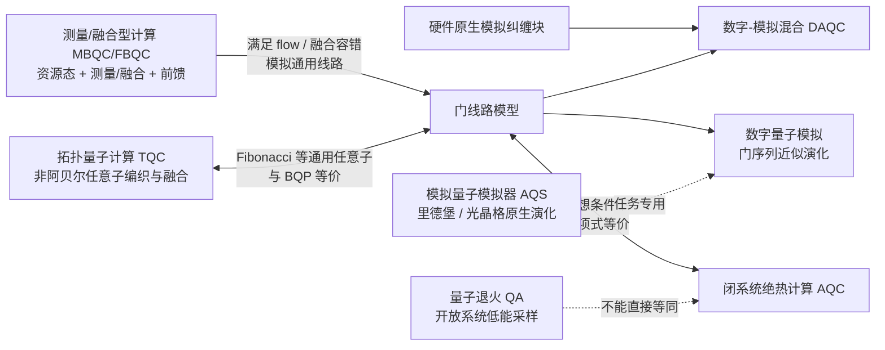
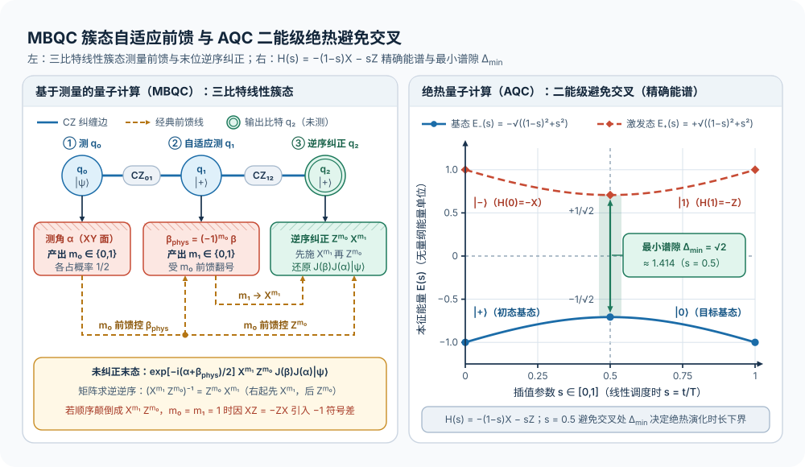
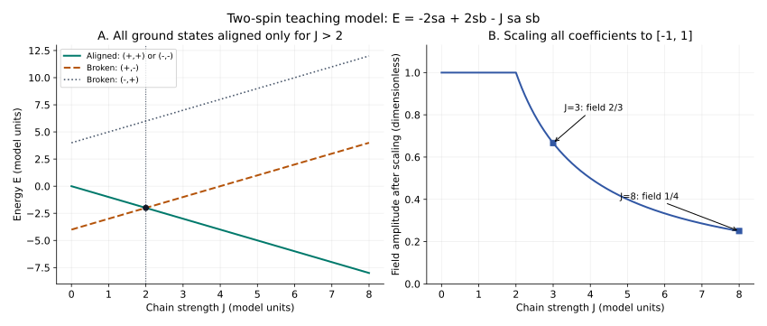
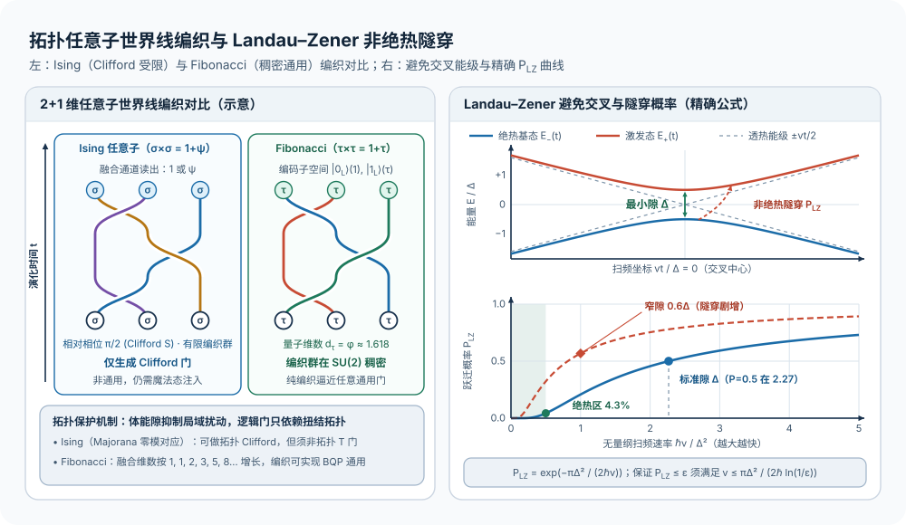

# 17｜量子计算模型：门、测量、绝热、退火、拓扑与模拟

前面十几章里，算法几乎全都画成了一条条横向排列的量子门线路。刚读到这里时，很容易产生一个错觉：仿佛“量子计算”就等于“排一串单比特门和双比特门”。

其实不是。门线路只是最像经典逻辑电路、最方便分层拆解的表达方式。物理世界还允许我们用完全不同的方式来“写程序”：可以先把许多量子比特纠缠成一张网，再靠接力测量或概率融合推进逻辑运算（测量型与融合型计算）；可以把答案藏在某个哈密顿量的最低能量态里，缓慢牵引系统走过去（绝热计算与量子退火）；可以把逻辑比特编码进二维拓扑相的非阿贝尔任意子融合空间里，靠编织粒子世界线直接完成受拓扑保护的门操作（拓扑量子计算）；也可以直接用原子阵列或超冷光晶格自身的相互作用去模仿物理系统（模拟量子模拟），或者把原生多体演化和局部数字脉冲拼在一起（数字—模拟混合计算）。

这些模型在理想数学条件下有时能够互相模拟，但落地到物理硬件上，**开销、噪声形态、容错路线和验证方式截然不同**。这一章不给七种模型排“谁更先进”的名次，而是给你一把统一的尺子——无论日后看到哪种新硬件或新论文，先拿下面五个问题量一遍，就能迅速看清它的真本事和边界：

1. **程序写在哪里？**（门序列、测量角、随时间变化的哈密顿量、任意子编织词，还是原生相互作用？）
2. **哪些操作算作基本步骤？**
3. **输出是什么，拿什么来验证？**
4. **“可通用”是在哪套理想数学前提下证明的？**
5. **做端到端性能比较时，哪些时间、失败率和预处理成本必须算进总账？**

**分层阅读建议**：**必读 ★** 建议先读第 1–2 节建立七大模型全景地图，再手算第 3.1–3.2 节测量型单步算例与第 3.5 节光子融合架构，接着读第 4.1 节、第 4.4 节与第 5 节分清闭系统绝热计算与实际量子退火的边界，第 6.1–6.2 节与第 6.4 节了解拓扑量子计算概念与实验分层，最后精读第 7–8 节模拟量子模拟器、DAQC 重聚焦与七问核查表；标有 **进阶选读 ☆** 的第 3.3 节四分支前馈、第 4.2–4.3 节 Landau–Zener / 绝热 Grover 与第 6.3 节 Ising vs. Fibonacci $2\times 2$ 代数证明，可在深入专题时逐步演算。

**单位约定**：本章动力学演化简式 $U(t) = e^{-iHt}$ 沿用[第 07 章：代表性量子算法](07-algorithms.md)的算法约定 $\hbar = 1$；在讨论物理量纲对照（如第 4 节的 Jansen–Ruskai–Seiler 误差界与 Landau–Zener 隧穿公式）时，显式恢复 $\hbar$ 以便读者换算能量与时间单位。第 7 节的模拟与重聚焦算例中，耦合系数 $J$ 与拉比频率 $\Omega$、失谐 $\Delta$ 均取角频率单位（$\mathrm{rad/s}$）。

---

## 1. 七大计算模型全景地图与统一标尺

先把七种计算模型按“离散逻辑编码型”与“连续哈密顿量演化型”两条支脉画成一张全景地图。读图时请特别区分**实线**与**虚线**：实线代表存在严格的数学模拟或构造等价关系，虚线代表两者在物理直觉或研究对象上有渊源，但不能把工程设备直接等同于理论复杂度模型。

再把五个统一问题铺成一张七大计算模型全景对照表。你可以把它当成本章的“索引卡片”，后面每一节都会把表里的关键格子拆开算透。

| 计算模型 | 程序定义（写在哪里） | 基本操作与核心资源 | 典型输出与验证方式 | 通用性的数学前提 | 端到端计费必含项 |
| :--- | :--- | :--- | :--- | :--- | :--- |
| **门线路模型** | 门序列、比特连接与测量安排 | 可控单/双比特酉门与计算基测量 | 比特串、期望值或逻辑量子态；按任务验算或阴影/保真度估计 | 离散通用门集（如 Clifford+$T$）+ 可逆算术与容错纠错 | 装载、编译路由、纠错码距、魔法态、重复采样 |
| **基于测量/融合的计算（MBQC / FBQC）** | 纠缠资源态、单比特测量基/融合网络与前馈规则 | 簇态或常数资源态制备、自适应单比特测量/Type-II 融合与经典前馈 | 逻辑输出量子态或经典比特串；追踪已知副产物算符与擦除校验 | 具有确定性流结构（如 gflow）的图态或容错融合网络 + 非 Clifford 测角/魔法态 + 实时前馈 | 资源态制备与融合、光子丢失、经典前馈延迟、容错追踪 |
| **闭系统绝热量子计算（AQC）** | 插值路径 $H(s)$、调度函数 $s(t)$ 与总时长 $T$ | 易制备初态基态 + 缓慢可控的连续哈密顿量演化 | 末态基态或从中采样的比特串；核验最小谱隙与路径导数 | 允许**非随机**（non-stoquastic）2-局域哈密顿量、闭系统无退相干且满足绝热条件 | 路径与调度设计、由谱隙与导数决定的 $T$、控制精度误差 |
| **量子退火（QA）** | 驱动项、Ising/QUBO 问题系数、退火日程与嵌入 | 横向场量子涨落、热弛豫与大批量重复采样 | 低能候选解比特串；代回原目标与约束检查，按端到端 $T_{\mathrm{TTS}}$ 评测 | 商用横向场 Ising 属**随机**（stoquastic）哈密顿量，目前不具备通用 BQP 等价保证 | 次图嵌入、链强度调参、芯片编程、退火+读出+延迟、逐样本链修复 |
| **拓扑量子计算（TQC）** | 非阿贝尔任意子的拓扑简并融合子空间、编织世界线序列与融合测量 | 任意子成对激发、绝热编织交换 $\sigma_i$ 与融合荷读出 | 融合通道经典读数；依赖体能隙抑制局域扰动 | 需**非阿贝尔且编织群在 $\mathrm{SU}(2)$ 稠密**的任意子（如 Fibonacci）；Ising 任意子仅生成有限 Clifford 群，须外补魔法态 | 拓扑能隙保护温度、编织绝热速度、准粒子毒化、非拓扑魔法态开销（若为 Ising） |
| **模拟量子模拟（AQS）** | 硬件原生多体相互作用、初态与控制波形 | 连续时间原生多体演化（如里德堡阵列、超冷光晶格、离子链） | 相图、局域观测量、关联函数与非平衡动力学；按任务物理核查 | 通常面向特定物理模型族（任务专用），而非通用线路编程 | 哈密顿量标定、初态制备、温度/熵底线、读出误差、可算区对照与跨平台验证 |
| **数字—模拟混合（DAQC）** | 固定模拟纠缠块与穿插其中的单比特数字脉冲 | 硬件原生多体纠缠块 + 高速可编程单比特门 | 任意演化算符、变分态或特定观测输出；残余相位与层析验证 | 特定全局纠缠块（如全连接或近邻 Ising）配合任意单比特门可生成通用演化 | 模拟块持续时长、残余耦合、有限脉宽、串扰校准与整体编排 |

这里先说清两个经常让人误判的词：“**通用**”只说明这个模型能以受控开销逼近任意量子计算，既不代表硬件已经容错，也不代表在具体问题上一定更快；反过来，“**专用**”也不等于低人一等——如果一台模拟量子模拟器恰好原生实现了凝聚态物理学家想研究的自旋或费米子模型，它在特定任务上可能比纯数字门分解省下几个数量级的资源。

---

## 2. 门线路模型：全书的公共翻译层

门线路模型先把寄存器初始化到 $|0\cdots 0\rangle$，再按时间顺序施加酉门，最后执行测量。它最大的长处是**模块化**：算法（[第 06 章](06-algorithmic-primitives.md)、[第 07 章](07-algorithms.md)）、协议（[第 04 章](04-circuits-protocols.md)）、量子纠错（[第 10 章](10-error-correction.md)）和编译与脉冲控制（[第 14 章](14-compilation-control.md)）可以分层设计、各自独立演进，就像经典计算机里的编程语言、编译器与逻辑门一样。正因如此，其他六种模型讨论计算能力时，往往都要先翻译到门线路的语言里做对照。

但门线路里有两个极容易产生误解的抽象单位——“**一层门**”和“**一次预言机（oracle）查询**”——它们都不是物理秒表上的时间。一个抽象的受控酉门，真正落到硬件上往往要拆成可逆算术、辅助比特、跨芯片路由、反计算垃圾位和一整套容错魔法态工厂。把其他模型与门线路放在同一张桌上比较时，至少要把下面五件事拉齐到同一口径：

- **输入装载**：数据是本来就以量子态给出，还是需要从经典内存逐项编码？
- **精度与失败率**：两边的目标误差 $\varepsilon$ 和允许失败概率 $\delta$ 是否相同？
- **并行规则**：硬件是否真允许同时作用在所有比特上，还是受限于串扰与控制通道？
- **读出与验证**：输出是单次比特串、多次采样估计的期望值，还是需要独立验证的解？
- **全流程账单**：初始化、校准、编译、重试与纠错开销有没有一并计入？

> **计费口径框注：为什么“一次预言机查询”远远不是“一次普通加密”？**
>
> 没有任何领域比密码学更能暴露“抽象查询次数 $\neq$ 物理运行时间”。以 $8$ 位密钥的唯一目标 Grover 搜索（$N = 2^8 = 256$）为例：渐近口诀 $\frac{\pi}{4}\sqrt{256} = 4\pi \approx 12.566$ 容易让人误选 $r = 13$，但精确旋转角是 $\theta = \arcsin(1/16) \approx 0.062541\,\mathrm{rad}$，令 $(2r+1)\theta = \pi/2$ 得连续首个峰值 $r^* = \frac{\pi}{4\theta} - \frac{1}{2} \approx 12.058$。逐一代回精确成功率 $p_r = \sin^2[(2r+1)\theta]$：取 **$r = 12$** 时 $p_{12} = \sin^2(25\theta) \approx 0.999947$，而取 $r = 13$ 时因越过 $\pi/2$ 出现**过度旋转**，反跌至 $p_{13} = \sin^2(27\theta) \approx 0.986186$（虽然远端如 $r=213$ 略高于 $p_{12}$，但代价暴涨近 18 倍）。更重要的是，即便只算 $12$ 次查询，每一轮量子预言机都必须：① 在叠加态上把完整分组加密（如 AES 的 S 盒、列混合与轮密钥加）编译成可逆容错线路；② 逐位比对密文并执行相位回踢；③ **逆序反计算全部中间寄存器与垃圾位**以消除纠缠残留，随后再补一轮全空间扩散反射（[第 06 章](06-algorithmic-primitives.md)）。再叠加上并行化受限（$M$ 台机器仅提速 $\sqrt{M}$ 倍）与表面码魔法态周期，对称密码、哈希碰撞（BHT $O(2^{n/3})$）和后量子格/编码体制的真实量子攻击成本绝不能机械地“把密钥位数除以二”（完整密码成本与 NIST 标准迁移见[第 11 章](11-resources-benchmarks.md)与[第 12 章](12-security-network-frontiers.md)）。

---

## 3. 基于测量的量子计算（MBQC）与光子融合计算（FBQC）

在门线路里，测量通常放在最后一步，用来把脆弱的量子叠加变成经典 `0/1` 结果。所以初学者第一次听说**基于测量的量子计算**（measurement-based quantum computation，简称 MBQC，也称单向量子计算）时，多半会犯嘀咕：测量不是会破坏叠加态吗？怎么反倒能靠“一路测下去”完成任意量子门？

打个贴近生活的比方：门线路像是拿木料现拼一把椅子，边拼边拧螺丝（不断施加双比特纠缠门）；而 MBQC 更像是先把一块内部已经精密编织好纹理的大理石准备妥当（预先制备高度纠缠的**资源态**），之后不再动用双比特门，只拿刻刀按顺序一刀刀凿下去（做单比特投影测量），把多余的石料削掉，留下的就是想要的逻辑量子态。

不过这个雕塑比方走到一半就会失效：石匠落刀的结果是确定的，但量子测量每一次都有 $50\%$ 的固有随机性！如果每测一步都随机跳偏，计算岂不是完全失控？MBQC 最巧妙的地方，恰恰在于它利用预先铺好的纠缠结构，把每一次“随机跳偏”都牢牢锁成了一个**已知的 Pauli 副产物算符（byproduct operator，也称伴随算符）**——只要经典控制器记住这次测出了 `0` 还是 `1`，就可以动态翻转后续比特的测量角度，把偏差一步步吸收干净。

### 3.1 图态、簇态与最小手算：一次 $X$ 基测量实现 $H$ 门

MBQC 最常见的纠缠资源是**图态（graph state）**。给定一个无向图 $G = (V, E)$：

- 每个顶点 $v \in V$ 对应一个初始化为 $|+\rangle = \frac{|0\rangle + |1\rangle}{\sqrt{2}}$ 的量子比特；
- 每条边 $(u, v) \in E$ 对应在顶点 $u$ 和 $v$ 之间施加一次受控 $Z$ 门 $\mathrm{CZ}_{uv} = \mathrm{diag}(1, 1, 1, -1)$。

整张图的图态写为

$$
|G\rangle = \left(\prod_{(u,v)\in E} \mathrm{CZ}_{uv}\right) |+\rangle^{\otimes |V|}.
$$

当图 $G$ 是规则的一维链或二维方格时，对应的图态就称为**簇态（cluster state）**。图态有一个在后面极其管用的稳定子性质：对每个顶点 $u \in V$，定义算符

$$
K_u = X_u \prod_{w \in N(u)} Z_w,
$$

其中 $N(u)$ 是顶点 $u$ 在图中的所有直接邻居，那么 $K_u |G\rangle = |G\rangle$ 恒成立。

为了亲手摸到“测量即门”，我们从最简单的两比特链开始。把任意未知单比特纯态放在第 0 个比特上：

$$
|\psi\rangle = a|0\rangle + b|1\rangle,
\qquad a, b \in \mathbb{C},
\qquad |a|^2 + |b|^2 = 1.
$$

把第 1 个比特准备在 $|+\rangle = \frac{1}{\sqrt{2}}(|0\rangle + |1\rangle)$。按高位在左的大端序 $|q_0 q_1\rangle$ 展开两比特联合态：

$$
|\psi\rangle \otimes |+\rangle
= \frac{a}{\sqrt{2}}|00\rangle + \frac{a}{\sqrt{2}}|01\rangle + \frac{b}{\sqrt{2}}|10\rangle + \frac{b}{\sqrt{2}}|11\rangle.
$$

接下来施加 $\mathrm{CZ}_{01}$——它只给 $|11\rangle$ 乘上 $-1$，其余三项原封不动：

$$
\begin{aligned}
\mathrm{CZ}_{01}(|\psi\rangle|+\rangle)
&= \frac{a}{\sqrt{2}}|00\rangle + \frac{a}{\sqrt{2}}|01\rangle + \frac{b}{\sqrt{2}}|10\rangle - \frac{b}{\sqrt{2}}|11\rangle \\
&= a|0\rangle \otimes \frac{|0\rangle + |1\rangle}{\sqrt{2}} + b|1\rangle \otimes \frac{|0\rangle - |1\rangle}{\sqrt{2}} \\
&= a|0\rangle|+\rangle + b|1\rangle|-\rangle.
\end{aligned}
$$

现在对第 0 个比特在 $X$ 基 $\{|+\rangle, |-\rangle\}$ 下做投影测量，约定读出 $|+\rangle$ 记为经典比特 $m = 0$，读出 $|-\rangle$ 记为 $m = 1$。先备好四个基本内积：

$$
\langle + | 0 \rangle = \frac{1}{\sqrt{2}}, \quad
\langle + | 1 \rangle = \frac{1}{\sqrt{2}}, \quad
\langle - | 0 \rangle = \frac{1}{\sqrt{2}}, \quad
\langle - | 1 \rangle = -\frac{1}{\sqrt{2}}.
$$

分别把两个分支投影到第 1 个比特上：

- **分支 $m = 0$（测得 $|+\rangle$）**：第 1 个比特的未归一化态为

$$
\begin{aligned}
(\langle + | \otimes I)\big(a|0\rangle|+\rangle + b|1\rangle|-\rangle\big)
&= a\langle +|0\rangle |+\rangle + b\langle +|1\rangle |-\rangle \\
&= \frac{1}{\sqrt{2}}\big(a|+\rangle + b|-\rangle\big).
\end{aligned}
$$

回忆 Hadamard 门满足 $H|0\rangle = |+\rangle$、$H|1\rangle = |-\rangle$，由线性性立刻有 $a|+\rangle + b|-\rangle = H(a|0\rangle + b|1\rangle) = H|\psi\rangle$！于是未归一化态就是 $\frac{1}{\sqrt{2}}H|\psi\rangle$。因为 $H$ 保持向量长度，$H|\psi\rangle$ 是单位向量，所以该分支的测量概率为

$$
p(m=0) = \left\|\frac{1}{\sqrt{2}}H|\psi\rangle\right\|^2 = \frac{1}{2}(|a|^2 + |b|^2) = \frac{1}{2}.
$$

- **分支 $m = 1$（测得 $|-\rangle$）**：第 1 个比特的未归一化态为

$$
\begin{aligned}
(\langle - | \otimes I)\big(a|0\rangle|+\rangle + b|1\rangle|-\rangle\big)
&= a\langle -|0\rangle |+\rangle + b\langle -|1\rangle |-\rangle \\
&= \frac{1}{\sqrt{2}}\big(a|+\rangle - b|-\rangle\big).
\end{aligned}
$$

注意 $X|+\rangle = |+\rangle$、$X|-\rangle = -|-\rangle$，因此 $a|+\rangle - b|-\rangle = X(a|+\rangle + b|-\rangle) = XH|\psi\rangle$。该分支的测量概率同样是

$$
p(m=1) = \left\|\frac{1}{\sqrt{2}}XH|\psi\rangle\right\|^2 = \frac{1}{2}(|a|^2 + |b|^2) = \frac{1}{2}.
$$

核验概率之和：$\frac{1}{2} + \frac{1}{2} = 1$。除以各自概率的平方根 $\frac{1}{\sqrt{2}}$ 归一化后，两条分支合成一个极简公式：

$$
|\psi_{\mathrm{out}}\rangle = X^m H|\psi\rangle.
$$

停下来体会这一步：第 0 个比特虽然已经被测掉消失了，但它携带的未知信息 $|\psi\rangle$ 不仅完好地传到了第 1 个比特上，还顺手完成了 $H$ 门！至于多出来的 $X^m$，它不是位置和类型都不知道的环境噪声——经典控制器清清楚楚地看到了读数 $m \in \{0, 1\}$，因此 $X^m$ 是**已知的副产物算符**。控制器既可以立刻补一个 $X^m$ 门，也可以先把它记在经典账本（Pauli 帧）里，等下一步再处理。

### 3.2 赤道测量角 $J(\alpha) = H R_z(-\alpha)$ 与副产物传播 $J(-\alpha)X = Z J(\alpha)$

只做 $H$ 门还不够通用，我们希望实现任意角度的单比特旋转。把第 0 个比特的测量基换成 Bloch 球赤道平面（$XY$ 平面）上偏转了角度 $\alpha \in \mathbb{R}$ 的一对正交基：

$$
|\pm_\alpha\rangle = \frac{|0\rangle \pm e^{i\alpha}|1\rangle}{\sqrt{2}}.
$$

写左矢（bra）时不能漏掉复共轭：$e^{i\alpha}$ 的共轭是 $e^{-i\alpha}$！因此

$$
\langle \pm_\alpha| = \frac{\langle 0| \pm e^{-i\alpha}\langle 1|}{\sqrt{2}}.
$$

仍把第 0、1 比特纠缠为 $\mathrm{CZ}_{01}(|\psi\rangle|+\rangle) = a|0\rangle|+\rangle + b|1\rangle|-\rangle$，记读出 $|+_\alpha\rangle$ 为 $m = 0$、读出 $|-_\alpha\rangle$ 为 $m = 1$（即公式里的正负号统一写作 $(-1)^m$）。把 $\langle \pm_\alpha| \otimes I$ 作用上去，逐项计算：

$$
\begin{aligned}
(\langle \pm_\alpha| \otimes I)\big(a|0\rangle|+\rangle + b|1\rangle|-\rangle\big)
&= \frac{1}{\sqrt{2}}\Big(a|+\rangle + (-1)^m e^{-i\alpha} b|-\rangle\Big).
\end{aligned}
$$

为了把结果写成标准旋转门的形式，回忆全书约定的 $Z$ 轴旋转门 $R_z(\beta) = e^{-i\beta Z/2} = \begin{bmatrix} e^{-i\beta/2} & 0 \\ 0 & e^{i\beta/2} \end{bmatrix}$，从而 $R_z(-\alpha) = \begin{bmatrix} e^{i\alpha/2} & 0 \\ 0 & e^{-i\alpha/2} \end{bmatrix}$。从括号里把公共因子 $e^{-i\alpha/2}$ 提出来（利用 $1 = e^{-i\alpha/2} e^{i\alpha/2}$ 与 $e^{-i\alpha} = e^{-i\alpha/2} e^{-i\alpha/2}$）：

$$
\begin{aligned}
\frac{1}{\sqrt{2}}\Big(a|+\rangle + (-1)^m e^{-i\alpha} b|-\rangle\Big)
&= \frac{e^{-i\alpha/2}}{\sqrt{2}}\Big(e^{i\alpha/2} a|+\rangle + (-1)^m e^{-i\alpha/2} b|-\rangle\Big) \\
&= \frac{e^{-i\alpha/2}}{\sqrt{2}} X^m H \begin{bmatrix} e^{i\alpha/2} a \\ e^{-i\alpha/2} b \end{bmatrix} \\
&= \frac{e^{-i\alpha/2}}{\sqrt{2}} X^m H R_z(-\alpha)|\psi\rangle.
\end{aligned}
$$

因为 $|e^{-i\alpha/2}|^2 = 1$ 且 $X^m H R_z(-\alpha)$ 是酉算符，两条分支的概率依然严格等于 $\frac{1}{2}$。定义这一基本测量步骤对应的逻辑门

$$
J(\alpha) = H R_z(-\alpha)
= \frac{1}{\sqrt{2}}\begin{bmatrix} 1 & 1 \\ 1 & -1 \end{bmatrix}
  \begin{bmatrix} e^{i\alpha/2} & 0 \\ 0 & e^{-i\alpha/2} \end{bmatrix}
= \frac{1}{\sqrt{2}}\begin{bmatrix} e^{i\alpha/2} & e^{-i\alpha/2} \\ e^{i\alpha/2} & -e^{-i\alpha/2} \end{bmatrix}.
$$

忽略全局相位 $e^{-i\alpha/2}$ 后，一次赤道角 $\alpha$ 的测量就在输出比特上实现了 $X^m J(\alpha)|\psi\rangle$。因为任意单比特酉门都能按 Euler 角分解为不超过三个 $J(\alpha)$ 的乘积（对应[第 14 章](14-compilation-control.md)的门分解），光靠调整赤道测量角，就能造出任意单比特逻辑门！

**拿具体复数算一遍核对**。取 $|\psi\rangle = \frac{1}{\sqrt{3}}|0\rangle + i\sqrt{\frac{2}{3}}|1\rangle$（先查归一化：$|a|^2 + |b|^2 = \frac{1}{3} + \frac{2}{3} = 1$）与测角 $\alpha = \frac{\pi}{4}$。先算 $e^{-i\pi/4} b$：

$$
e^{-i\pi/4} b
= \frac{1 - i}{\sqrt{2}} \cdot i\sqrt{\frac{2}{3}}
= \frac{i - i^2}{\sqrt{3}}
= \frac{1 + i}{\sqrt{3}}.
$$

把 $|+\rangle = \frac{1}{\sqrt{2}}\begin{bmatrix}1\\1\end{bmatrix}$、$|-\rangle = \frac{1}{\sqrt{2}}\begin{bmatrix}1\\-1\end{bmatrix}$ 代入未归一化输出列向量 $v_m = \frac{1}{2}\begin{bmatrix} a + (-1)^m e^{-i\alpha} b \\ a - (-1)^m e^{-i\alpha} b \end{bmatrix}$：

- $m = 0$ 时：$v_0 = \frac{1}{2\sqrt{3}}\begin{bmatrix} 1 + (1+i) \\ 1 - (1+i) \end{bmatrix} = \frac{1}{2\sqrt{3}}\begin{bmatrix} 2 + i \\ -i \end{bmatrix} \approx \begin{bmatrix} 0.57735 + 0.28868i \\ -0.28868i \end{bmatrix}$。算概率（实部平方加虚部平方）：$\|v_0\|^2 = \frac{1}{12}\big((2^2 + 1^2) + (0^2 + (-1)^2)\big) = \frac{5 + 1}{12} = \frac{1}{2}$。
- $m = 1$ 时：$v_1 = \frac{1}{2\sqrt{3}}\begin{bmatrix} 1 - (1+i) \\ 1 + (1+i) \end{bmatrix} = \frac{1}{2\sqrt{3}}\begin{bmatrix} -i \\ 2 + i \end{bmatrix}$。算概率：$\|v_1\|^2 = \frac{1}{12}(1 + 5) = \frac{1}{2}$。

两条分支各除以 $\frac{1}{\sqrt{2}}$ 归一化后，对 $m = 1$ 的输出态施加 $X$（交换上下两个分量），立刻得到 $\frac{1}{\sqrt{6}}\begin{bmatrix} 2 + i \\ -i \end{bmatrix}$，与 $m = 0$ 分支分毫不差，且正好等于 $e^{-i\pi/8} J(\pi/4)|\psi\rangle$。

**现在进入最关键的问题：如果上一步留下了副产物 $X$，下一步该怎么办？**

设想上一逻辑步测得了 $m_0 = 1$，因此送到下一步入口的物理态不是 $|\psi\rangle$，而是多带了一个 $X$ 的 $X|\psi\rangle$。如果我们不想中途额外插入物理修正门，而是想靠改换这一步的测量角直接把 $X$“推过去”，先算两条 $2\times 2$ 矩阵恒等式：

第一条，逐格验证 $R_z(\alpha) X = X R_z(-\alpha)$：

$$
R_z(\alpha) X
= \begin{bmatrix} e^{-i\alpha/2} & 0 \\ 0 & e^{i\alpha/2} \end{bmatrix}
  \begin{bmatrix} 0 & 1 \\ 1 & 0 \end{bmatrix}
= \begin{bmatrix} 0 & e^{-i\alpha/2} \\ e^{i\alpha/2} & 0 \end{bmatrix},
$$

$$
X R_z(-\alpha)
= \begin{bmatrix} 0 & 1 \\ 1 & 0 \end{bmatrix}
  \begin{bmatrix} e^{i\alpha/2} & 0 \\ 0 & e^{-i\alpha/2} \end{bmatrix}
= \begin{bmatrix} 0 & e^{-i\alpha/2} \\ e^{i\alpha/2} & 0 \end{bmatrix}.
$$

两式每个位置完全相等！第二条，逐格验证 $H X = Z H$：

$$
H X
= \frac{1}{\sqrt{2}}\begin{bmatrix} 1 & 1 \\ 1 & -1 \end{bmatrix}
  \begin{bmatrix} 0 & 1 \\ 1 & 0 \end{bmatrix}
= \frac{1}{\sqrt{2}}\begin{bmatrix} 1 & 1 \\ -1 & 1 \end{bmatrix},
\qquad
Z H
= \begin{bmatrix} 1 & 0 \\ 0 & -1 \end{bmatrix}
  \frac{1}{\sqrt{2}}\begin{bmatrix} 1 & 1 \\ 1 & -1 \end{bmatrix}
= \frac{1}{\sqrt{2}}\begin{bmatrix} 1 & 1 \\ -1 & 1 \end{bmatrix}.
$$

把这两条拼起来，计算物理测角取 $-\alpha$ 时对 $X|\psi\rangle$ 的作用：

$$
J(-\alpha) X
= H R_z(\alpha) X
= H X R_z(-\alpha)
= Z H R_z(-\alpha)
= Z J(\alpha).
$$

同样方法，因为 $R_z(-\alpha)$ 与 $Z$ 都是对角矩阵彼此对易，且 $H Z = X H$，立刻还得到第二条传播法则：

$$
J(\alpha) Z = H R_z(-\alpha) Z = H Z R_z(-\alpha) = X H R_z(-\alpha) = X J(\alpha).
$$

请把这两条简洁的规则装进口袋：

- **遇到遗留的 $X$ 副产物**：这一步必须把物理测角翻号为 $-\alpha$，才能完成逻辑门 $J(\alpha)$，同时旧的 $X$ 变成新的 $Z$ 推到输出端；
- **遇到遗留的 $Z$ 副产物**：这一步测角 $\alpha$ 保持不变，旧的 $Z$ 变成新的 $X$ 推到输出端。

如果只做 Clifford 门（例如 $\alpha = 0$ 或 $\pm \pi/2$），翻号后的角度仍在同一个 Pauli 轴上，副产物只需一路记在经典账本里即可；可一旦涉及非 Clifford 旋转（比如 $\alpha = \pi/4$，对应 $T$ 门），前一步读出的 $m_0$ 会实实在在地决定下一步物理测角选 $+\pi/4$ 还是 $-\pi/4$。这就是为什么通用 MBQC 离不开**自适应前馈（feedforward）**——如果不知道上一轮测出了什么，下一轮连往哪个角度去测都定不下来。

### 3.3 进阶选读：两步四分支完整前馈——为什么末位纠正必须逆序施加 $Z^{m_0} X^{m_1}$

单步算例还看不出两步副产物怎样叠加、又怎样逆序消除。现在用一条三比特链（编号 $q_0, q_1, q_2$）亲手走完连续两步逻辑操作 $J(\beta) J(\alpha)|\psi\rangle$，取具体参数：

$$
|\psi\rangle = \frac{|0\rangle + i\sqrt{2}|1\rangle}{\sqrt{3}},
\qquad \alpha = \frac{\pi}{4},
\qquad \beta = \frac{\pi}{3}.
$$

先把 $q_1, q_2$ 准备为 $|+\rangle|+\rangle$，依次施加 $\mathrm{CZ}_{01}$ 和 $\mathrm{CZ}_{12}$（两者都是对角矩阵，顺序可交换），得到八维三比特资源态。接着依次测量 $q_0$ 和 $q_1$：

1. **第一步（测 $q_0$）**：在 $|\pm_\alpha\rangle$ 基下测量 $q_0$，得到随机结果 $m_0 \in \{0, 1\}$（各占概率 $1/2$）。此时留在 $q_1, q_2$ 上的逻辑态相当于把 $X^{m_0} J(\alpha)|\psi\rangle$ 送进了第二条边 $\mathrm{CZ}_{12}$。
2. **第二步（自适应前馈测 $q_1$）**：经典控制器读到 $m_0$ 后，动态把 $q_1$ 的**物理测量角**设为

$$
\beta_{\mathrm{phys}} = (-1)^{m_0} \beta.
$$

用单步公式与上节的 $J(-\beta)X = Z J(\beta)$ 联手计算 $q_2$ 的归一化输出态（暂记全局相位因子 $e^{i\phi_g} = e^{-i(\alpha + \beta_{\mathrm{phys}})/2}$）：

- 当 $m_0 = 0$ 时，$\beta_{\mathrm{phys}} = +\beta$，无前置 $X$，测得 $m_1$ 后输出 $X^{m_1} J(\beta) J(\alpha)|\psi\rangle$；
- 当 $m_0 = 1$ 时，$\beta_{\mathrm{phys}} = -\beta$，输入带 $X$，测得 $m_1$ 后输出 $X^{m_1} J(-\beta) X J(\alpha)|\psi\rangle = X^{m_1} Z J(\beta) J(\alpha)|\psi\rangle$。

合在一起，全部四种测量结果的末位态统一写成

$$
|\psi_{\mathrm{out}}(m_0, m_1)\rangle
= e^{-i(\alpha + \beta_{\mathrm{phys}})/2}\, X^{m_1} Z^{m_0} J(\beta) J(\alpha)|\psi\rangle.
$$

要从这个带副产物的物理态精确还原出目标纯态 $J(\beta) J(\alpha)|\psi\rangle$，必须在左边乘上 $X^{m_1} Z^{m_0}$ 的逆矩阵。因为 $(AB)^{-1} = B^{-1} A^{-1}$ 且 $X^2 = Z^2 = I$，纠正算符是

$$
(X^{m_1} Z^{m_0})^{-1} = Z^{m_0} X^{m_1},
$$

按矩阵从右到左的作用次序，**必须先施加 $X^{m_1}$，再施加 $Z^{m_0}$**。如果粗心把顺序颠倒成 $X^{m_1} Z^{m_0}$，当 $m_0 = m_1 = 1$ 时，由于 $X Z = -Z X$，结果会变成

$$
(X Z)(X Z) = X (Z X) Z = X (-X Z) Z = - X^2 Z^2 = -I,
$$

多出一个整体负号 $-1$。虽然整体负号不改变密度矩阵和测量概率，但在写程序核对态矢量内积或把该模块嵌入受控子线路时，这个负号必须交代清楚。

把全部四条分支列成总表，一目了然：

| 测量记录 $(m_0, m_1)$ | 第二步物理测角 $\beta_{\mathrm{phys}}$ | 分支概率 | 末位累积副产物 | 逆序纠正操作（先右后左） | 全局相位角 $-\frac{\alpha+\beta_{\mathrm{phys}}}{2}$ | 纠正后与目标态的根保真度 $F$ |
| :--- | :---: | :---: | :---: | :---: | :---: | :---: |
| $(0, 0)$ | $+\pi/3$ | $1/4$ | $I$ | 无需操作 | $-7\pi/24 \approx -0.9163$ | $1$ |
| $(0, 1)$ | $+\pi/3$ | $1/4$ | $X$ | $X$ | $-7\pi/24 \approx -0.9163$ | $1$ |
| $(1, 0)$ | $-\pi/3$ | $1/4$ | $Z$ | $Z$ | $+\pi/24 \approx +0.1309$ | $1$ |
| $(1, 1)$ | $-\pi/3$ | $1/4$ | $X Z$ | 先 $X$ 后 $Z$（即 $Z X$） | $+\pi/24 \approx +0.1309$ | $1$ |

四条分支的概率之和为 $\frac{1}{4} \times 4 = 1$；没有丢弃任何一条“坏分支”，每一条都在同一轮运行中通过前馈和末位纠正到达了同一个目标纯态。顺便与[第 04 章 §7](04-circuits-protocols.md)的**延迟测量原理**对照：有人会问“能否把自适应前馈改写为相干受控门，从而把全部测量推到最后一步？”在固定资源态的 MBQC 中，非 Clifford 测角翻转 $\beta_{\mathrm{phys}} = (-1)^{m_0}\beta$ 对应把受控 $R_z(2\beta)$ 移回测量前，这必然在 $q_0$ 与 $q_1$ 之间引入**新的双比特纠缠门**——因此，如果不额外添加双比特门，非 Clifford 测量阶段的时间偏序与经典前馈无法被延迟测量消除。

**硬件上怎样用普通 $Z$ 基探测器测 $|\pm_\theta\rangle$？** 只要先施加 $R_z(-\theta)$、再施加 $H$，最后做标准计算基测量即可。逐项核验一遍：

$$
\begin{aligned}
H R_z(-\theta)|\pm_\theta\rangle
&= H \begin{bmatrix} e^{i\theta/2} & 0 \\ 0 & e^{-i\theta/2} \end{bmatrix} \frac{1}{\sqrt{2}}\begin{bmatrix} 1 \\ \pm e^{i\theta} \end{bmatrix} \\
&= \frac{1}{\sqrt{2}} H \begin{bmatrix} e^{i\theta/2} \\ \pm e^{i\theta/2} \end{bmatrix}
= e^{i\theta/2} H |\pm\rangle
= \begin{cases} e^{i\theta/2}|0\rangle & (+) \\ e^{i\theta/2}|1\rangle & (-) \end{cases}.
\end{aligned}
$$

所以在支持中途测量与经典条件控制的模拟器或处理器上，第二步可以对 $q_1$ 先做固定旋转 $R_z(-\beta)$，再根据 $m_0 = 1$ 条件施加 $R_z(2\beta)$——合并后的净旋转就是 $R_z(-\beta + 2\beta) = R_z(+\beta)$，正好等价于把物理测量角翻成 $-\beta$。

### 3.4 测量顺序不能随便选：causal flow、gflow 与 Pauli flow

一维链上只有“从左往右”一条路，但通用 MBQC 跑在二维簇态或更一般的图态上。此时立刻会冒出一个深层问题：**在一张有很多环和分支的图上，测量顺序可以随便挑吗？怎样保证每一个随机结果都能被后面的测量角消化掉，而不会出现“$A$ 等 $B$ 的结果、$B$ 又等 $A$ 的结果”的死锁？**

答案藏在 3.1 节写下的图态稳定子 $K_u = X_u \prod_{w \in N(u)} Z_w$ 里。请注意为什么只有**非输入顶点** $u \in V \setminus I$ 才能作为纠偏稳定子来源：因为只有非输入顶点最初被初始化为 $|+\rangle$（满足 $X_u|+\rangle = |+\rangle$），经全部 $\mathrm{CZ}$ 边纠缠之后，$K_u|\Phi\rangle = |\Phi\rangle$ 对**任意未知输入态** $|\psi\rangle$ 依然严格成立；而输入顶点 $v \in I$ 携带未知态 $|\psi\rangle$，并不满足 $X_v|\psi\rangle = |\psi\rangle$，因此 $K_v$ 不再是整张图的稳定子！

回到三比特链 $0\text{—}1\text{—}2$（输入 $I=\{0\}$、输出 $O=\{2\}$），中间非输入顶点的稳定子是 $K_1 = Z_0 X_1 Z_2$。当我们在 $0$ 号位测得 $m_0 = 1$、等效多出一个 $Z_0$ 副产物时，因为 $K_1|\Phi\rangle = |\Phi\rangle$，给整张图乘上 $K_1$ 不会改变态本身，却会把 $Z_0$ 抵消掉（$Z_0 \cdot Z_0 = I$），代价是在 $1$ 号位放一个 $X_1$、在 $2$ 号位放一个 $Z_2$！因为 $1$ 和 $2$ 都**还没被测**，这两个新算符可以乖乖交给未来的测量角去吸收。

把这条“借稳定子把错误推向未来”的思路推广到一般开放图 $(G, I, O)$，就得到决定 MBQC 能否确定性执行的三个递进图论概念：

1. **因果流（causal flow，Danos & Kashefi, 2006）**：假设所有非输出顶点都在赤道 $XY$ 平面测量。若每个待测顶点 $v$ 都能指定**唯一一个**尚未测量的非输入邻居 $f(v) \in V \setminus I$ 作为“下一跳纠偏搭档”，且存在无环先后偏序 $\prec$，使得 $f(v)$ 及其除 $v$ 以外的所有邻居都严格排在 $v$ 之后（$v \prec w$），这张图就拥有因果流。上面的三比特链就是一个因果流：$f(0)=1, f(1)=2$，测量顺序 $0 \prec 1 \prec 2$。
2. **广义流（generalized flow，简称 gflow，Browne, Kashefi, Mhalla & Perdrix, 2007）**：现实中的图态往往找不到“一对一”的搭档，而且测量平面也可以扩充到 $\{XY, XZ, YZ\}$ 三种。gflow 把单个搭档 $f(v)$ 放宽成一个**校正顶点集合** $g(v) \subseteq V \setminus I$（排除输入集 $I$ 以确保 $\prod_{u\in g(v)} K_u$ 确为稳定子），并在无环偏序 $\prec$ 下要求除 $v$ 外所有被波及的顶点都严格落在 $v$ 的未来；同时对**不同测量平面**施加精准的奇偶配对条件（记 $\mathrm{Odd}(A)$ 为图里恰好连着集合 $A$ 中奇数个顶点的所有顶点集合）：
   - **$XY$ 平面测量**（需在 $v$ 处放 $Z_v$ 抵消副产物且不引入 $X_v$）：要求 $v \notin g(v)$ 且 $v \in \mathrm{Odd}(g(v))$（如三比特链中 $g(0)=\{1\}$ 时 $\mathrm{Odd}(\{1\})=\{0,2\}$）；
   - **$YZ$ 平面测量**（需在 $v$ 处放 $X_v$ 且不引入 $Z_v$）：要求 $v \in g(v)$ 且 $v \notin \mathrm{Odd}(g(v))$；
   - **$XZ$ 平面测量**（需在 $v$ 处同时放 $X_v Z_v \propto Y_v$）：要求 $v \in g(v) \cap \mathrm{Odd}(g(v))$。
   只要图满足 gflow，就能确保对任意角度取值都实现**强逐步确定性**（uniformly stepwise deterministic）计算。用一句话记清直觉：**gflow 就是一张没有死循环的“因果误差消化路线图”**。
3. **Pauli 流（Pauli flow，Simmons, 2021）**：如果图里一部分顶点固定只做 Pauli 轴（$X/Y/Z$）测量，它们的副产物可以跨层穿透其他固定测量，不再受限于一般角度的严格约束。Pauli flow 把这类测量纳入确定性流框架，大幅压缩了 MBQC 的并行测量深度，也成为现代 ZX 演算线路提取与编译工具（如 `Graphix`）的核心判据。

### 3.5 基于融合的光子量子计算（FBQC）：常数资源态与 50% 擦除容错

从物理实现看，MBQC 对光子平台格外有吸引力，因为单光子在飞行中极难做确定性双比特门，却擅长做高保真单比特旋转与线性光学干涉。然而，要把成千上万个光子预先连成一张巨型二维簇态再逐点测量，会立刻撞上光子平台的头号杀手——**光子损耗**：光路每多过一层开关与延迟线，光子存活率就指数衰减，巨型簇态还没造完就千疮百孔。

为了从架构根源上截断损耗累积，Bartolucci 等人（*Nature Communications* **14**, 912, 2023）提出了**基于融合的量子计算（fusion-based quantum computation，简称 FBQC）**。它的全部物理操作收敛为两种硬件原语：

1. **常数尺寸资源态（Resource States）**：不再造整张巨型簇态，而是像流水线一样批量制备固定尺寸的小型纠缠光子态（例如 4 光子星形态或 6 光子环态）。无论最终容错逻辑算法规模有多大，每颗光子一生只需穿过**常数深度 $O(1)$** 的片上光学开关，从根本上把单光子损耗锁死在恒定预算内。
2. **Type-II 线性光学融合测量（Fusion）**：从相邻两个资源态里各取出一颗光子，送入分束器与光子探测器执行联合投影测量，理想上同时读出两个联合奇偶算符 $X_1 X_2$ 与 $Z_1 Z_2$（等价于贝尔基投影）。在无辅助光子的基础线性光学下，由于线性光学无法完美区分全部四个贝尔态，Type-II 融合的成功概率恒为 **$50\%$**；当另外 $50\%$ 的失败发生时，探测器并不是吐出无法察觉的乱码，而是退化为精确已知的**单比特 $Z_1, Z_2$ 测量**（仍然成功读出 $Z_1 Z_2$，仅丢失 $X_1 X_2$）。

FBQC 最令人拍案叫绝的工程转化正在这里：**硬件每一次都清清楚楚地知道哪一次融合失败了，从而把未知位置、未知类型的 Pauli 错误，转化成了位置完全已知的擦除错误（erasure error）**！在量子纠错中（参见[第 10 章](10-error-correction.md)），一个码距为 $d$ 的纠错码只能纠正 $\lfloor(d-1)/2\rfloor$ 个未知位置的 Pauli 错，却能纠正多达 **$d - 1$ 个已知位置的擦除错**——容错能力几乎翻倍。把各个常数资源态的稳定子与每次成功融合测出的 $X_i X_j$、$Z_i Z_j$ 读数相乘，就能直接拼出三维容错时空校验算符（称为**融合网络**），完全不需要先把整张大簇态实实在在地拼出来。

Bartolucci 等（2023）算出了标志性的弹道式（无需反复重试的固定光路）容错阈值：在 6 光子环资源态构建的拓扑融合网络上，单次融合操作可容忍最高 **$10.4\%$ 的光子丢失率**（折合到单颗光子端到端损耗阈值约为 **$2.7\%$**），大幅放宽了硅光芯片的制造门槛。2025 年，PsiQuantum 团队在 *Nature*（**641**, 876–883, 2025；2025 年 2 月在线发表 [同行评审]）发布了基于 300 mm 商用硅光晶圆产线的 Omega 平台，实验演示了双轨光子源、低损干涉仪、片间光纤互联与融合门等核心模块，把 FBQC 推入了晶圆级光电子制造验证阶段（硬件损耗与纠错细节参见[第 09 章](09-hardware.md)与[第 10 章](10-error-correction.md)）。

把三代光子量子计算架构并排对照，演进脉络一目了然：

| 光子架构 | 代表文献 | 核心物理原语 | 单个光子经历的光路深度 | 概率性失败的处理方式 | 工程主要瓶颈 |
| :--- | :--- | :--- | :--- | :--- | :--- |
| **KLM 门式线性光学（LOQC）** | Knill, Laflamme & Milburn (*Nature* 2001) | 概率性线性光学双比特门 + 大量辅助光子隐形传态 | 随电路深度线性增长 $O(D)$ | 需海量辅助光子池反复重试与超快光开关切换 | 辅助光子与路由开关开销过于庞大，难以实用 |
| **巨型簇态 MBQC** | Raussendorf & Briegel (2001); Browne & Rudolph (2005) | 预先拼接大规模二维/三维簇态 + 单比特自适应测量 | 随拼接迭代次数增长，需长延迟线存储 | 渗透理论拼网 + 测量随机性转为已知 Pauli 副产物 | 巨型簇态制备中的多级开关损耗与延迟线保真度 |
| **融合型光子计算（FBQC）** | Bartolucci et al. (*Nat. Commun.* 2023) | **常数尺寸**资源态（如 6 光子环）+ Type-II 概率融合测量 | **常数深度 $O(1)$**，与总算法规模无关 | 50% 融合失败转化为**已知位置的擦除错误**，由三维融合网络校验直接容错（单次融合容忍高达 10.4% 损耗） | 高效率确定性/复用光子源、超低损硅光波导与高速经典前馈（非 Clifford 魔法态） |

归结起来，评估一台 MBQC/FBQC 系统的真实时间账，不能只数“测了多少次”，而必须同时计入五项开销：资源态制备与融合成功率、光子丢失与探测效率、单轮读出与经典前馈延迟（必须在延迟线存储寿命内完成）、器件噪声，以及容错下的逻辑副产物追踪。

> **跨篇衔接（连续变量光量子集群态 CV-MBQC）**：除了上述基于离散单光子比特的 MBQC/FBQC，光子平台还有一条把离散 $\mathrm{CZ}$ 换为连续变量纠缠门 $\mathrm{CZ}_{\mathrm{CV}} = e^{i\hat q_1\hat q_2}$ 的并行路线——借助时频复用可确定性制备亿级模式的连续变量集群态，再通过注入非高斯 GKP 态打破经典高斯可模拟性（如 Xanadu 的 **Aurora** 模块化光量子平台，Aghaee Rad et al., *Nature* **638**, 2025），其相空间数学与架构细节将在[第 18 章 §9.5](18-channels-capacities-complexity.md#95-连续变量-gkp-网格态位移稳定子与相空间晶胞)完整展开。

---

## 4. 闭系统绝热量子计算（AQC）：避免交叉、Landau–Zener 隧穿与绝热边界

如果不排门、也不做接力测量，还有没有第三种计算方式？物理学家想到了量子力学里的**绝热定理**：把一杯装满热茶的杯子从书桌端到茶几，如果你端着杯子平稳缓慢地挪过去，水面会一直贴着杯底保持平静；一旦在拐弯处猛然加速，茶水就会晃荡甚至泼出来。

**绝热量子计算**（adiabatic quantum computation，简称 AQC；权威综述见 Albash & Lidar, *Rev. Mod. Phys.* **90**, 015002, 2018）正是把这个思路搬进了量子态演化。系统先从一个简单的初始哈密顿量 $H_{\mathrm{init}}$ 出发——它的最低能量态（基态）很容易直接制备；随后把哈密顿量沿无量纲参数 $s = s(t) \in [0, 1]$（$0 \le t \le T$）连续平滑地过渡到编码了计算难题的目标哈密顿量 $H_{\mathrm{problem}}$：

$$
H(s) = (1 - s) H_{\mathrm{init}} + s H_{\mathrm{problem}}.
$$

如果变换足够慢，系统就会自始至终紧贴瞬时基态 $|\phi_0(s)\rangle$ 演化，走到 $s = 1$ 时自然停在 $H_{\mathrm{problem}}$ 的基态——也就是我们要找的答案。

茶杯比方在“瓶颈”处需要换成精确的量子图像：演化途中最危险的不是拐弯，而是基态能量 $E_0(s)$ 与第一激发态能量 $E_1(s)$ 彼此逼近形成的**避免交叉（avoided crossing）**。两者之差称为**瞬时谱隙（spectral gap）** $\Delta(s) = E_1(s) - E_0(s)$，全程最小值记为 $\Delta_{\min} = \min_{s\in[0,1]}\Delta(s)$。一旦谱隙缩得很窄而演化又走得太快，系统就会跃迁到激发态，算错答案。

许多简明介绍里常流传一句口诀：“只要总时间 $T \gg 1/\Delta_{\min}^2$ 就足够绝热。”这句话虽然抓住了谱隙越窄越慢的直觉，但作为数学条件并不严密。Jansen、Ruskai 与 Seiler（*J. Math. Phys.* **48**, 102111, 2007）在 $H(s)$ 二阶连续可微且瞬时基态非简并（$\Delta(s) > 0$）的条件下，给出了严格的末态误差上界（为避免与时间导数 $d/dt$ 混淆，这里统一用撇号 $H'(s) = \frac{dH}{ds}$、$H''(s) = \frac{d^2 H}{ds^2}$ 表示对无量纲参数 $s$ 求导，并显式保留物理常数 $\hbar$ 以便量纲核对；取算法单位 $\hbar = 1$ 时右端因子 $\hbar$ 省去）：

$$
\big\|\,\big(I - P_0(1)\big)|\psi(T)\rangle\,\big\|
\le \frac{\hbar}{T}\left[
  \frac{\|H'(0)\|}{\Delta(0)^2}
  + \frac{\|H'(1)\|}{\Delta(1)^2}
  + \int_0^1 \left(
      \frac{\|H''(s)\|}{\Delta(s)^2}
      + 7\,\frac{\|H'(s)\|^2}{\Delta(s)^3}
    \right) ds
\right],
$$

其中 $P_0(1) = |\phi_0(1)\rangle\langle\phi_0(1)|$ 为末态基态投影算符，左端为向激发态正交补空间的非绝热泄漏范数，等于 $\sqrt{1 - |\langle\phi_0(1)|\psi(T)\rangle|^2}$（自动剥离无关的动力学与几何全局相位），$\|\cdot\|$ 表示算符谱范数（最大奇异值）。检查物理量纲：分子 $\|H'\|$ 为能量量纲 $\mathrm{J}$、分母 $\Delta^2$ 为 $\mathrm{J}^2$，括号整体量纲为 $\mathrm{J}^{-1}$，乘以 $\hbar/T$（$\mathrm{J\cdot s / s} = \mathrm{J}$）正好无量纲！盯着这条公式看三秒，单背“$T \gg 1/\Delta_{\min}^2$”的三个缺口立刻浮现：

1. 分子上还有哈密顿量的**导数范数** $\|H'(s)\|$ 和 $\|H''(s)\|$，随着比特数 $n$ 增大，这些范数本身可能按多项式增长；
2. 端点 $s = 0$ 和 $s = 1$ 处的**光滑性**直接进入边界项（若启停不光滑导致 $H'(0), H'(1) \neq 0$，则会留下 $O(1/T)$ 振幅误差即 $O(1/T^2)$ 概率残差）；
3. 积分里出现的是 $\Delta(s)^{-3}$ 而非仅仅 $\Delta(s)^{-2}$——在窄隙处占绝对主导的正是这一高次项。而下面 4.3 节你会看到，也恰恰因为高次项集中在极窄的一小段 $s$ 里，动态调速才得以把搜索时间从 $O(N)$ 压回 $O(\sqrt{N})$。

### 4.1 二能级避免交叉完整手算：最小谱隙 $\Delta_{\min} = \sqrt{2}$

现在拿单比特算一个能手算到底的绝热路径（取 $\hbar = 1$）。取初始哈密顿量 $H_{\mathrm{init}} = -X$，目标哈密顿量 $H_{\mathrm{problem}} = -Z$，线性插值：

$$
H(s) = -(1 - s) X - s Z
= -(1 - s)\begin{bmatrix} 0 & 1 \\ 1 & 0 \end{bmatrix} - s\begin{bmatrix} 1 & 0 \\ 0 & -1 \end{bmatrix}
= \begin{bmatrix} -s & -(1 - s) \\ -(1 - s) & s \end{bmatrix},
\qquad s \in [0, 1].
$$

第一步，逐项求本征值。写特征方程 $\det(\lambda I - H(s)) = 0$：

$$
\det\begin{bmatrix} \lambda + s & 1 - s \\ 1 - s & \lambda - s \end{bmatrix}
= (\lambda + s)(\lambda - s) - (1 - s)^2
= \lambda^2 - s^2 - (1 - s)^2
= 0.
$$

也可以用 $2\times 2$ 矩阵的迹与行列式快速互验：$\operatorname{Tr} H(s) = -s + s = 0$，$\det H(s) = -s^2 - (1-s)^2 = -\big[s^2 + (1-s)^2\big]$，同样解得两个实本征值：

$$
E_\pm(s) = \pm\sqrt{s^2 + (1 - s)^2}.
$$

第二步，求瞬时谱隙及其最小值：

$$
\Delta(s) = E_+(s) - E_-(s) = 2\sqrt{s^2 + (1 - s)^2}.
$$

把根号里的二次函数 $f(s) = s^2 + (1 - s)^2$ 展开并配方（无需微积分也能一眼看出最小值）：

$$
f(s) = s^2 + (1 - 2s + s^2) = 2s^2 - 2s + 1 = 2\left(s - \frac{1}{2}\right)^2 + \frac{1}{2}.
$$

平方项非负，因此 $f(s)$ 在 $s = \frac{1}{2}$ 处取得唯一最小值 $f\left(\frac{1}{2}\right) = \frac{1}{2}$（用求导验算：$f'(s) = 4s - 2 = 0 \implies s = \frac{1}{2}$，吻合）。代回 $\Delta(s)$，得到最小谱隙：

$$
\Delta_{\min} = \Delta\!\left(\frac{1}{2}\right) = 2\sqrt{\frac{1}{2}} = \sqrt{2} \approx 1.414214.
$$

第三步，检查两个端点的基态：

- 在 $s = 0$ 时，$H(0) = -X$。验证 $(-X)|+\rangle = -|+\rangle$、$(-X)|-\rangle = +|-\rangle$，故最低能态（本征值 $-1$）正是容易制备的 $|+\rangle$，此时谱隙 $\Delta(0) = 2$。
- 在 $s = 1$ 时，$H(1) = -Z$。验证 $(-Z)|0\rangle = -|0\rangle$、$(-Z)|1\rangle = +|1\rangle$，故最低能态（本征值 $-1$）正是目标态 $|0\rangle$，此时谱隙 $\Delta(1) = 2$。

把沿路径的五个采样点列成小表，避免交叉的“先收紧再张开”一目了然：

| 演化进度 $s$ | 基态能量 $E_-(s)$ | 激发态能量 $E_+(s)$ | 瞬时谱隙 $\Delta(s)$ |
| :---: | :---: | :---: | :---: |
| $0.00$ | $-1.000000$ | $+1.000000$ | $2.000000$ |
| $0.25$ | $-\sqrt{5/8} \approx -0.790569$ | $+\sqrt{5/8} \approx +0.790569$ | $\sqrt{5/2} \approx 1.581139$ |
| $0.50$ | $-1/\sqrt{2} \approx -0.707107$ | $+1/\sqrt{2} \approx +0.707107$ | $\sqrt{2} \approx 1.414214$ |
| $0.75$ | $-\sqrt{5/8} \approx -0.790569$ | $+\sqrt{5/8} \approx +0.790569$ | $\sqrt{5/2} \approx 1.581139$ |
| $1.00$ | $-1.000000$ | $+1.000000$ | $2.000000$ |

下面这张双联图把第 3 节的 MBQC 测量前馈与本节的 AQC 避免交叉并排定格：左边显示信息如何靠测量和经典改角在图态上接力前进，右边显示基态与第一激发态在 $s = 1/2$ 处擦肩而过、留下最小谱隙 $\Delta_{\min} = \sqrt{2}$。

左图对应 3.3 节的三比特链前馈路径与逆序副产物纠正 $Z^{m_0} X^{m_1}$；右图对应 4.1 节的无量纲能量曲线 $E_\pm(s) = \pm\sqrt{s^2+(1-s)^2}$ 及 $s = 0.5$ 处的最小谱隙标注 $\Delta_{\min} = \sqrt{2}$。[查看原尺寸科学图](assets/v2-17-mbqc-aqc.svg)。

### 4.2 进阶选读：Landau–Zener 隧穿精确公式与有限端点残差对比

上面的 Jansen–Ruskai–Seiler（JRS）界给出了 $O(1/T)$ 级振幅上界，但物理学家在评估单个极窄避免交叉处的非绝热跃迁概率时，手边还有一把更锐利的精确解析标尺——**Landau–Zener（LZ）隧穿公式**（Landau, 1932; Zener, *Proc. R. Soc. A* **137**, 696, 1932）。

把任意一个孤立避免交叉在窄隙附近线性展开，写成标准二能级模型（显式保留物理单位）：

$$
H_{\mathrm{LZ}}(t) = \frac{v t}{2}\, Z + \frac{\Delta}{2}\, X
= \begin{pmatrix} \frac{v t}{2} & \frac{\Delta}{2} \\ \frac{\Delta}{2} & -\frac{v t}{2} \end{pmatrix},
\qquad t \in (-\infty, +\infty).
$$

这里若关掉耦合（$\Delta = 0$），两条透热能级为 $E_{\mathrm{diab},1,2}(t) = \pm\frac{vt}{2}$，它们之差的扫频速率为 $v = \left|\frac{d(E_{\mathrm{diab},1} - E_{\mathrm{diab},2})}{dt}\right| > 0$（单位：能量/时间）；加上耦合 $\frac{\Delta}{2}X$ 后，瞬时绝热能级变为双曲线 $E_\pm(t) = \pm\frac{1}{2}\sqrt{(vt)^2 + \Delta^2}$，在 $t = 0$ 处达到**精确最小谱隙 $\Delta_{\min} = E_+(0) - E_-(0) = \Delta$**。

系统从 $t \to -\infty$ 处的瞬时基态出发，一路穿过 $t = 0$ 到达 $t \to +\infty$ 时，跃迁到激发态（即“绝热失败”）的精确概率是多少？先用物理时间尺度抓直觉：
- 系统穿过避免交叉核心区（$|vt| \lesssim \Delta$）的停留时间大约是 $\delta t \sim \Delta / v$；
- 而两能级在窄隙处的内部量子振荡周期约为 $\tau_{\mathrm{int}} \sim \hbar / \Delta$。

两者之比定义了无量纲**绝热参数** $\gamma_{\mathrm{LZ}} = \frac{\delta t}{\tau_{\mathrm{int}}} = \frac{\Delta^2}{\hbar v}$。当 $\gamma_{\mathrm{LZ}} \gg 1$（停留时间远长于内部量子响应周期），跃迁被指数抑制；经由复时间平面上能级简并分支点 $t_* = \pm i\Delta / v$ 的 WKB 围道积分（算得 $\operatorname{Im}\int_0^{i\Delta/v} \sqrt{(vt)^2 + \Delta^2}\,dt = \frac{\Delta^2}{v}\int_0^1 \sqrt{1 - u^2}\,du = \frac{\pi \Delta^2}{4v}$，因概率是振幅模平方再乘以 2，指数系数精确为 $\frac{\pi}{2}$），得到著名的 **Landau–Zener 精确公式**：

$$
P_{\mathrm{LZ}} = \exp\!\left(-\frac{\pi \Delta^2}{2 \hbar v}\right).
$$

> **高频“因子 2”符号约定提醒**：不同教材与论文对矩阵非对角元和斜率的记号各不相同。如果文献把非对角耦合元记为 $V = \Delta / 2$（此时最小全能隙是 $\Delta = 2V$），代入 $\Delta^2 = 4V^2$ 后公式变为 $P_{\mathrm{LZ}} = \exp\!\left(-\frac{2\pi V^2}{\hbar v}\right)$；如果再把单条透热能级斜率记为 $\alpha = v/2$，系数还会相应变化。动笔或写代码前，应先核对 $\Delta$ 是全能隙还是半能隙、$v$ 是能级差斜率还是单能级斜率。

反解 $P_{\mathrm{LZ}} \le \varepsilon$，立刻得出保证错误率低于 $\varepsilon$ 所需的最大扫频速率：

$$
v \le \frac{\pi \Delta^2}{2 \hbar \ln(1/\varepsilon)}.
$$

这从第一性原理一眼说明了为何穿过窄隙的总时长天然按 $1/\Delta^2$ 标度，且把误差压低一万倍只需要增加对数级因子 $\ln(1/\varepsilon)$！

**直接回接 4.1 节手算模型，揭开“无限扫描指数律 vs. 有限区间 $O(1/T^2)$ 端点残差”的深层对比**。把 4.1 节的线性路径 $H(s) = -(1-s)X - sZ$（$s = t/T \in [0, 1]$，$\hbar = 1$）在中心 $s = 1/2$ 处作正交 Pauli 旋转：定义 $X' = -\frac{X + Z}{\sqrt{2}}$、$Z' = \frac{X - Z}{\sqrt{2}}$（易验 $X'^2 = Z'^2 = I$ 且 $\{X', Z'\} = 0$）。代入 $s - \frac{1}{2} = \frac{t - T/2}{T}$ 逐项检验：

$$
\frac{\sqrt{2}}{2} X' + \frac{2\sqrt{2}/T}{2}\!\left(t - \frac{T}{2}\right) Z'
= -\frac{1}{2}(X + Z) + \left(s - \frac{1}{2}\right)(X - Z)
= -(1 - s)X - sZ = H(s).
$$

严丝合缝！立刻读出精确的 LZ 参数：$\Delta = \sqrt{2}$、$v = 2\sqrt{2}/T$，于是无限区间 LZ 公式预测的跃迁概率为

$$
P_{\mathrm{LZ}}(T) = \exp\!\left(-\frac{\pi (\sqrt{2})^2}{2 \cdot (2\sqrt{2}/T)}\right) = \exp\!\left(-\frac{\pi T}{2\sqrt{2}}\right).
$$

把它与有限区间 $t \in [0, T]$ 上精确数值积分薛定谔方程算出的真实激发概率 $P_{\mathrm{exact}}(T)$ 并排比较：

| 总演化时长 $T$（$\hbar = 1$） | 无限区间 LZ 预测 $P_{\mathrm{LZ}}(T)$ | 有限区间 $[0,T]$ 精确激发概率 $P_{\mathrm{exact}}(T)$ | 两者差异的物理原因 |
| :---: | :---: | :---: | :--- |
| $4.0$ | $1.18 \times 10^{-2}$ | $1.44 \times 10^{-2}$ | 中短时长内，中心避免交叉与端点效应量级相近 |
| $8.0$ | $1.38 \times 10^{-4}$ | $2.80 \times 10^{-4}$ | 内部指数项迅速压低，端点残差开始露头 |
| $16.0$ | $1.91 \times 10^{-8}$ | $1.18 \times 10^{-4}$ | 端点突启突停（$H'(0),H'(1)\neq 0$）留下主导的 $O(1/T^2)$ 残差！ |

看这组数字多有启发：$T$ 从 $8$ 翻倍到 $16$，无限区间 LZ 已经暴跌到 $10^{-8}$，可有限区间匀速直线演化的真实错误率还卡在 $1.18 \times 10^{-4}$——这正是刚才 JRS 公式里那两项端点项 $\frac{\|H'(0)\|}{\Delta(0)^2} + \frac{\|H'(1)\|}{\Delta(1)^2}$ 对应的 **$O(1/T^2)$ 端点突启突停残差**！只有采用光滑启停调度（让 $s'(0) = s'(1) = 0$），或者遇到内部极窄能隙（$\Delta \ll \|H\|$）成为绝对瓶颈时，系统才展现出纯粹的 Landau–Zener 指数抑制律（避免交叉双曲线能级与精确 $P_{\mathrm{LZ}}$ 扫频曲线见后文 §6.3 双联图右图）。

### 4.3 进阶选读：绝热 Grover 与局部调速——怎样把 $O(N)$ 救回 $O(\sqrt{N})$

看完单比特常谱隙例，紧接着看一个真正与规模 $N$ 挂钩的经典算例：**绝热版无结构搜索**（Roland & Cerf, *Phys. Rev. A* **65**, 042308, 2002）。

假设数据库有 $N$ 个基态 $\{|0\rangle, \dots, |N-1\rangle\}$，其中唯一目标为 $|w\rangle$。令均匀叠加态为 $|u\rangle = \frac{1}{\sqrt{N}}\sum_{x=0}^{N-1}|x\rangle$，构造无量纲投影哈密顿量（本节取 $\hbar = 1$ 且能量无量纲化）：

$$
H_0 = I - |u\rangle\langle u|,
\qquad
H_1 = I - |w\rangle\langle w|,
\qquad
H(s) = (1 - s) H_0 + s H_1.
$$

检查两端基态：$H_0 |u\rangle = 0$（基态能量 $0$，其余正交态能量 $1$）；$H_1 |w\rangle = 0$（基态能量 $0$，其余态能量 $1$）。和[第 06 章](06-algorithmic-primitives.md)的 Grover 几何旋转完全一样，整个演化被关在二维子空间 $\mathrm{span}\{|w\rangle, |w_\perp\rangle\}$ 里，其中 $|w_\perp\rangle = \frac{1}{\sqrt{N-1}}\sum_{x\neq w}|x\rangle$，且 $|u\rangle = \frac{1}{\sqrt{N}}|w\rangle + \sqrt{1 - \frac{1}{N}}|w_\perp\rangle$。

在这个二维基下写出 $H_0$ 和 $H_1$ 的 $2\times 2$ 矩阵：

$$
H_0 = \begin{bmatrix} 1 - \frac{1}{N} & -\frac{\sqrt{N-1}}{N} \\ -\frac{\sqrt{N-1}}{N} & \frac{1}{N} \end{bmatrix},
\qquad
H_1 = \begin{bmatrix} 0 & 0 \\ 0 & 1 \end{bmatrix}.
$$

合并成 $H(s) = (1-s)H_0 + sH_1$：

$$
H(s) = \begin{bmatrix} (1 - s)\left(1 - \frac{1}{N}\right) & -(1 - s)\frac{\sqrt{N-1}}{N} \\ -(1 - s)\frac{\sqrt{N-1}}{N} & \frac{1 - s}{N} + s \end{bmatrix}.
$$

算迹与行列式：

$$
\operatorname{Tr} H(s) = (1 - s) - \frac{1-s}{N} + \frac{1-s}{N} + s = 1,
$$

$$
\begin{aligned}
\det H(s)
&= (1 - s)\left(1 - \frac{1}{N}\right)\left(\frac{1 - s}{N} + s\right) - (1 - s)^2\frac{N - 1}{N^2} \\
&= (1 - s)\left(1 - \frac{1}{N}\right)\left[\frac{1 - s}{N} + s - \frac{1 - s}{N}\right]
= s(1 - s)\left(1 - \frac{1}{N}\right).
\end{aligned}
$$

解二次特征方程 $\lambda^2 - \lambda + \det H(s) = 0$，两本征值之差即瞬时谱隙：

$$
\Delta(s)
= \sqrt{1 - 4\det H(s)}
= \sqrt{1 - 4s(1 - s) + \frac{4s(1 - s)}{N}}
= \sqrt{(1 - 2s)^2 + \frac{4s(1 - s)}{N}}.
$$

核对几个关键点：$s = 0$ 和 $s = 1$ 处，$\Delta(0) = \Delta(1) = 1$（能隙非常宽）；到了正中 $s = \frac{1}{2}$ 处，$(1-2s)^2 = 0$，谱隙骤缩到最小值

$$
\Delta_{\min} = \Delta\!\left(\frac{1}{2}\right) = \frac{1}{\sqrt{N}}.
$$

现在对比两种“开车方式”：

- **线性匀速调度（$s(t) = t/T$）**：为了在最窄的 $s = 1/2$ 处不激发，整段路被迫按最慢速度均匀爬行，总时间受全局下界 $O(1/\Delta_{\min}^2) = O(N)$ 限制——和经典盲搜一样慢，量子二次加速全丢了！
- **局部动态调速（Roland–Cerf 调度）**：既然只有在 $s = 1/2$ 附近极窄的区间里谱隙才接近 $1/\sqrt{N}$，绝大部分路段的谱隙都接近 $1$，何不在宽路踩油门、临近窄口踩刹车？让局部绝热条件在每一点都成立，严格带量纲的瞬时推进速度方程写为（$\varepsilon \ll 1$ 为无量纲误差控制参数）：

$$
\frac{ds}{dt} = \varepsilon\,\frac{\Delta(s)^2}{\hbar\,\|H'(s)\|}.
$$

核对量纲：$\Delta^2/(\hbar\|H'\|)$ 的量纲是 $\mathrm{J}^2 / (\mathrm{J\cdot s}\cdot \mathrm{J}) = \mathrm{s}^{-1}$，与左侧 $ds/dt$ 严格自洽！在本题无量纲投影算符模型（$\hbar = 1$）中，算得 $\|H'(s)\| = \|H_1 - H_0\| = \sqrt{1 - 1/N} \approx 1$，因此常化简写作 $\frac{ds}{dt} = \varepsilon\,\Delta(s)^2$。

把 $dt = \frac{ds}{\varepsilon \Delta(s)^2}$ 从 $s = 0$ 积分到 $s = 1$：作换元 $u = 2s - 1 \in [-1, 1]$，则 $ds = \frac{du}{2}$、$4s(1-s) = 1 - u^2$，分母化为 $\Delta(s)^2 = \frac{N-1}{N}u^2 + \frac{1}{N}$，再套用初等积分 $\int\frac{du}{a^2 u^2 + b^2} = \frac{1}{ab}\arctan\!\left(\frac{au}{b}\right)$ 精确求得：

$$
\begin{aligned}
T
&= \frac{1}{\varepsilon}\int_0^1 \frac{ds}{(1 - 2s)^2 + \frac{4s(1-s)}{N}}
= \frac{1}{2\varepsilon}\int_{-1}^{1} \frac{du}{\frac{N-1}{N}u^2 + \frac{1}{N}} \\
&= \frac{1}{2\varepsilon}\cdot\frac{N}{\sqrt{N - 1}}\Big[\arctan\!\left(\sqrt{N - 1}\,u\right)\Big]_{-1}^{1}
= \frac{N}{\varepsilon\sqrt{N - 1}}\arctan\!\left(\sqrt{N - 1}\right)
\approx \frac{\pi}{2\varepsilon}\sqrt{N}.
\end{aligned}
$$

用 $N = 256$ 验算一下差距：这里 $\Delta_{\min} = \frac{1}{16} = 0.0625$。若全程匀速按 $1/\Delta_{\min}^2$ 估算，尺度高达 $256$；而按局部调速积分，$\int_0^1 \frac{ds}{\Delta(s)^2} \approx 24.18$（逼近 $\frac{\pi}{2}\sqrt{256} \approx 25.13$），成功恢复了与门线路 Grover 算法相同的 $O(\sqrt{N})$ 二次加速！

但请立刻记住背后的**前提代价**：局部调速之所以生效，是因为我们**事先知道**最小谱隙精确落在 $s = 1/2$ 且知道 $\Delta(s)$ 的解析形状。在一般的难解 NP 组合优化问题里，最小谱隙的位置和大小事先根本不知道——要精确摸清窄口在哪里，难度往往不亚于把原题本身解出来。

### 4.4 与门线路的等价性，以及非随机与随机哈密顿量的分水岭

Aharonov 等人（*FOCS* 2004 / *SIAM J. Comput.* **37**, 166, 2007）借助 Feynman–Kitaev 历史态时钟哈密顿量，配合 Kempe–Kitaev–Regev（2006）的微扰小工具证明：**在闭系统无噪理想模型下，允许一般 2-局域哈密顿量的绝热量子计算，与标准门线路模型在多项式资源开销内彼此等价**（即两者定义的是同一个复杂度类 $\mathrm{BQP}$）。

这一漂亮定理极容易被断章取义。请牢记下面三条严密的分界线：

1. **非随机（non-stoquastic）vs. 随机（stoquastic）的精准边界**：普适 $\mathrm{BQP}$ 等价定理需要**非随机哈密顿量**——在任何局域基底下都无法消除正实或复数非对角元，从而允许普遍的量子相位干涉。与之相对，若存在**某一局域基底**使哈密顿量矩阵的全部非对角元均为实数且 $\le 0$（注意“随机性”严格依赖基底选择，判定任意局域哈密顿量是否存在这样的基底本身就是困难问题），则称其为**随机哈密顿量**——商用量子退火机执行的横向场 Ising 模型 $H(s) = -A(s)\sum_i X_i + B(s)H_{\mathrm{Ising}}$ 在计算基下正属于这一类。这里需避免两个常见极端误解：
   - **不可误认为“无符号问题 = 经典 PIMC 一定多项式收敛”**：随机哈密顿量的热配分函数虽没有量子蒙特卡洛（QMC）的负权重符号问题，但依然存在拓扑能垒迫使经典路径积分蒙特卡洛（PIMC）指数级慢混合的反例（Hastings, 2013；Jarret–Jordan–Lackey, 2016）；
   - **不可误认为“随机绝热计算塌缩到经典 $\mathrm{BPP}$”**：Bravyi 等（2008）证明的是决策问题基态判定类 $\mathrm{StoqMA} \subseteq \mathrm{AM}$（而非塌缩到 $\mathrm{BPP}$）；Hastings（*STOC* 2021 / *Quantum* **5**, 597, 2021）更进一步严格证明，**即使完全没有符号问题的随机（stoquastic）闭系统绝热计算，相对经典算法依然存在超多项式级神谕分离**！因此，限制商用退火机能力的不只是“随机性”本身，还叠加了有限温度退相干、稀疏拓扑嵌入与未知谱隙瓶颈。
2. **闭系统理想演化 vs. 有限温度退火**：理论等价不意味着有限温度下的开放退火设备自动保持基态，也不意味着两类硬件有相同的纠错方案与时间常数。
3. **承诺间隙 vs. 物理谱隙**：[第 07 章](07-algorithms.md)与[第 16 章](16-advanced-algorithms-verification.md)讨论的 $\mathrm{QMA}$-完全局域哈密顿量问题，是判断基态能量 $\le a$ 还是 $\ge b$ 的 YES/NO 判定问题；那里的**承诺间隙** $b - a$ 是题目给定的阈值区间宽度，而绝热演化关心的**物理谱隙**是同一哈密顿量自身的 $E_1(s) - E_0(s)$，两者不能混为一谈。

---

## 5. 量子退火（Quantum Annealing）：从端到端 TTS、符号反转到链强度

真实世界里的**量子退火**（quantum annealing，简称 QA）处理器并不追求无噪闭系统绝热演化。它通常先打开较强的横向磁场（驱动项 $-\sum_i X_i$），再按设定的**退火调度函数**逐渐关小驱动、抬高编码了组合优化目标的 Ising 问题哈密顿量，最后在计算基下读出候选比特串。由于芯片工作在有限温度（十几毫开尔文）并与环境存在耦合，热激发、量子隧穿与弛豫会同时发生。因此，把它理解为一种**需要实测基准检验的启发式低能采样器**，比按名字想象成“自动走完绝热定理的通用机”要靠谱得多。

### 5.1 求解时间 TTS：已知成功率、统计下界与端到端全账本

评判退火器解一道优化题有多快，绝不能只报单次退火脉冲时长 $t_a$（往往只有十几微秒）。一份可复核的退火基准，必须事先冻结七项条件：QUBO/Ising 映射、次图嵌入图、链强度、退火时间日程、自旋反转变换（gauge，即同时翻转若干自旋及其耦合系数符号以平均掉芯片硬件偏置）、读出采样数、后处理规则与调参预算。先把“命中”（达到已知全局最优或预设质量阈值）定义清楚，再计算重复次数与总时间。

在同一次配置下，设各次运行相互独立且单次命中的成功概率为恒定值 $p_s \in (0, 1)$，希望在 $R$ 次独立重复中**至少成功一次**的总概率不低于目标值 $p_{\mathrm{target}} = 1 - \delta$（业界常用 $1 - \delta = 0.99$，即总失败率不超过 $\delta = 0.01$）。连续 $R$ 次全部失败的概率是 $(1 - p_s)^R$，要求 $(1 - p_s)^R \le \delta$。两边取自然对数 $\ln$（特别留意：$0 < 1 - p_s < 1$，故 $\ln(1 - p_s) < 0$，两边同除负数后不等号方向翻转！）：

$$
R \ge \frac{\ln \delta}{\ln(1 - p_s)}
\implies
R = \left\lceil \frac{\ln \delta}{\ln(1 - p_s)} \right\rceil.
$$

仅计入退火段的**求解时间**（Time-to-Solution，简称 TTS）写为

$$
\operatorname{TTS}(t_a) = t_a \left\lceil \frac{\ln \delta}{\ln\big(1 - p_s(t_a)\big)} \right\rceil.
$$

先看两个边界情形：若单次命中概率 $p_s = 0$，任何有限次重复都达不到目标，不能把零或负无穷强行塞进分母，只能给出采样上限或单侧置信边界；若 $p_s \ge 1 - \delta$（特别地 $p_s = 1$），单次已经达标，直接取 $R = 1$、$\operatorname{TTS}(t_a) = t_a$，不再乘以小于 $1$ 的对数比值。若因芯片热漂移、在线调参或系统故障导致各次采样并不独立，也不能直接套用独立幂次公式，必须按批次统计实测成功概率与置信区间。

**算例 A（已知成功率 $p_s = 0.2$）**。设单次退火 $t_a = 20\,\mu\mathrm{s}$，单次成功率 $p_s = 0.2$，目标总成功率 $99\%$（$\delta = 0.01$）：

$$
\ln 0.01 \approx -4.60517,
\qquad
\ln 0.8 \approx -0.22314,
\qquad
\frac{\ln 0.01}{\ln 0.8} \approx 20.6377.
$$

向上取整得 $R = 21$ 次。只看退火段时：

$$
\operatorname{TTS}_{\mathrm{anneal}} = 21 \times 20\,\mu\mathrm{s} = 420\,\mu\mathrm{s}.
$$

但如果每轮还附带 $100\,\mu\mathrm{s}$ 的读出与复位，单轮耗时立刻涨到 $120\,\mu\mathrm{s}$，总时长变成

$$
21 \times (20 + 100)\,\mu\mathrm{s} = 2520\,\mu\mathrm{s} = 2.52\,\mathrm{ms},
$$

一下暴涨了 6 倍——这还没算一次性的图嵌入、参数调优、芯片编程和逐条样本的断链修复！

**算例 B（未知成功率时的两阶段预算与并合界）**。上面算 $R = 21$ 时，把 $p_s = 0.2$ 当成了上帝视角的已知真值。这里的 $1 - \delta$ 是在已知 $p_s$ 时设定的**重复实验的成功概率目标**，不是估计未知 $p_s$ 时的统计置信度。真实实验里，我们往往是先独立跑了 $n = 100$ 次校准采样，观察到 $20$ 次达标，只拿到了经验频率 $\widehat{p} = 20/100 = 0.2$。如果把 $\widehat{p}$ 直接当真值，一旦真实 $p_s$ 其实只有 $0.12$，按 $21$ 次安排预算就会远远达不到 $99\%$ 的保障。

为了给出保守规划，在各次校准样本独立同分布的前提下，可用单侧 **Hoeffding 不等式**构造置信度 $1 - \eta$ 的下置信界（其中 $\eta$ 是下界未覆盖真实 $p_s$ 的最大概率，独立于部署阶段的 $\delta$）：

$$
p_L = \max\left\{0,\; \widehat{p} - \sqrt{\frac{\ln(1/\eta)}{2n}}\right\}.
$$

代入 $n = 100$、$\widehat{p} = 0.2$、$\eta = 0.05$（即 $95\%$ 单侧置信度）：

$$
\sqrt{\frac{\ln 20}{2 \times 100}}
= \sqrt{\frac{2.99573}{200}}
\approx \sqrt{0.0149787}
\approx 0.1223873,
$$

于是保守下界降到了

$$
p_L \approx 0.2 - 0.1223873 = 0.0776127.
$$

如果真实成功率确实满足 $p_s \ge p_L$，且后续运行继续独立同分布，要让部署阶段至少成功一次的条件概率达到 $99\%$（$\delta = 0.01$），重复次数暴增为

$$
R = \left\lceil \frac{\ln 0.01}{\ln(1 - 0.0776127)} \right\rceil
= \left\lceil \frac{-4.60517}{-0.080790} \right\rceil
= \lceil 57.002 \rceil = 58.
$$

按每轮退火加读出复位 $120\,\mu\mathrm{s}$ 计，部署阶段需要 $58 \times 120\,\mu\mathrm{s} = 6.96\,\mathrm{ms}$；如果那 $100$ 次校准不能摊销到其他实例上，还要再加 $100 \times 120\,\mu\mathrm{s} = 12.00\,\mathrm{ms}$，两阶段合计 $18.96\,\mathrm{ms}$！更重要的是，把“校准下界失效（概率 $\le 0.05$）”和“下界成立但后续 $58$ 次全失败（概率 $\le 0.01$）”用**并合界**（union bound）相加，整套两阶段流程的总失败率上限是

$$
0.05 + 0.01 = 0.06,
$$

也就是说整体保证是**至少 $94\%$**，不能把两阶段合起来写成“$99\%$ 成功保证”。如果样本太少导致算出的 $p_L = 0$，说明当前证据还不足以给出有限的 TTS 保证，必须补测样本或改用精确的 Clopper–Pearson 下界。

**算例 C（系统级端到端全账本 $T_{\mathrm{TTS}}$ 与 1 秒编程算例）**。站到工程验收的立场上，把一次完整求解的每一笔墙钟开销都摊上桌面，**端到端求解时间**的完整账本必须写成：

$$
T_{\mathrm{TTS}} = T_{\mathrm{embed}} + T_{\mathrm{tune}} + T_{\mathrm{program}}
+ N_{\mathrm{rep}}\bigl(T_{\mathrm{anneal}} + T_{\mathrm{read}} + T_{\mathrm{delay}} + T_{\mathrm{post,shot}}\bigr)
+ T_{\mathrm{post,batch}}.
$$

请格外留意括号内外的边界：$T_{\mathrm{post,shot}}$ 是**每条样本**都要做的链修复、可行性校验或目标函数值计算等逐样本后处理开销；$T_{\mathrm{post,batch}}$ 则是**整批样本只需执行一次**的排序汇总开销。绝不能把逐样本后处理偷偷挪到 $N_{\mathrm{rep}}$ 括号外面。同时，上述加法结构默认 $N_{\mathrm{rep}}$ 次尝试共用一次图嵌入、调参与芯片编程；一旦更换了自旋反转变换或重新调节链强度，相应的重编程时间就必须折进重复项。如果一套嵌入和编程设置被复用于同一批多个独立问题实例，可以按事先声明的批量做均摊，但绝不能允许量子端把一次性预处理摊给无穷多题，却逼着经典对比基线逐题全额买单。当硬件支持读出、热化延迟与后处理流水线重叠时，则应按实际关键路径实测墙钟时间；同样地，纯量子退火、量子—经典混合求解器与纯经典启发式算法必须分栏标注，绝不能拿商业混合求解器的品牌黑盒充当纯量子加速。

代入一组贴近真实硬件的底线数字算清这笔账：假设某个组合优化实例的实测单次命中概率为 $p_{\mathrm{hit}} = 0.02$，目标成功率 $p_{\mathrm{target}} = 0.99$。硬件单次退火脉冲时长 $T_{\mathrm{anneal}} = 20\,\mu\mathrm{s}$，单次读出加冷却延迟 $T_{\mathrm{read}} + T_{\mathrm{delay}} = 120\,\mu\mathrm{s}$，把哈密顿量系数写入芯片的一次编程耗时 $T_{\mathrm{program}} = 1\,\mathrm{s}$；为了先看清最保守底线，暂把嵌入、调参与后处理全记作 $0$。

第一步，计算所需重复次数：

$$
\frac{\ln(1 - 0.99)}{\ln(1 - 0.02)} = \frac{\ln 0.01}{\ln 0.98} \approx \frac{-4.60517}{-0.0202027} \approx 227.95
\quad\Longrightarrow\quad
N_{\mathrm{rep}} = 228.
$$

第二步，计算端到端求解时间与纯退火时间：

$$
T_{\mathrm{TTS}} = 1\,\mathrm{s} + 228 \times (20 + 120)\,\mu\mathrm{s}
= 1\,\mathrm{s} + 228 \times 140\times 10^{-6}\,\mathrm{s}
= 1\,\mathrm{s} + 0.03192\,\mathrm{s}
= 1.03192\,\mathrm{s} \approx 1.0319\,\mathrm{s}.
$$

而这 $228$ 次尝试消耗的**纯退火脉冲时间**仅仅是

$$
228 \times 20\,\mu\mathrm{s} = 4{,}560\,\mu\mathrm{s} = 4.56\,\mathrm{ms}.
$$

端到端耗时（$1.0319\,\mathrm{s}$）是纯退火时间（$4.56\,\mathrm{ms}$）的 **$226$ 倍以上**——哪怕还没算进昂贵的图嵌入、调参和逐样本链修复，只报“退火时间 $4.56\,\mathrm{ms}$”就已经把真实墙钟时间低估了两个数量级。

### 5.2 退火 Ising 符号桥：`dimod` 的 $s_i = -z_i$ 与物理 $-J_{ij}$ 双重反号差异

把优化问题交到量子退火库（例如 D-Wave 的 `dimod`）手里，新手最常栽跟头的地方不是硬件，而是两处极易搞混的**符号约定**。承接[第 08 章 §4.5](08-applications.md)已经完整展开的两项目 QUBO 目标 $F(x_1, x_2) = -3x_1 - 2x_2 + 4x_1 x_2$：我们在第 08 章算出了门线路 Pauli-$Z$ 表示（$z_i = 1 - 2x_i$）：

$$
H_F = -\frac{3}{2}I + \frac{1}{2}Z_1 + Z_1 Z_2.
$$

现在把它迁入退火软件库，立刻遇到**第一重反号差异**：`dimod` 等退火库采用的自旋约定是 $s_i = 2x_i - 1 \in \{-1, +1\}$（即 $x_i = 0 \leftrightarrow s_i = -1$，$x_i = 1 \leftrightarrow s_i = +1$），与门线路 Pauli 本征值 $z_i = 1 - 2x_i$ 严格相反（$s_i = -z_i$）。直接将 $z_i = -s_i$ 代入 $H_F$（也可把 $x_i = (1+s_i)/2$ 代回原 $F$ 独立复验），立得退火 Ising 能量：

$$
F(s_1, s_2) = -\frac{3}{2} - \frac{1}{2}s_1 + 0\cdot s_2 + s_1 s_2.
$$

对比两行系数，牢记跨章规律：**因为 $s_i = -z_i$，一阶局域场系数严格反号（$-\frac{1}{2}s_1$ 对 $+\frac{1}{2}Z_1$），而二阶耦合项因负负得正严格同号（$+s_1 s_2$ 对 $+Z_1 Z_2$）**！两套软件都没有算错，错的往往是把 QAOA 的 Pauli 系数原封不动拷进了退火 API。

紧接着是**第二重反号差异**：D-Wave 退火接口把 Ising 能量定义为带**正号**的

$$
H_{\mathrm{D\text{-}Wave}} = \sum_i h_i s_i + \sum_{i<j} J_{ij} s_i s_j,
$$

其中 $J_{ij} > 0$ 偏好**反铁磁**（$s_i \neq s_j$），$J_{ij} < 0$ 偏好**铁磁**（$s_i = s_j$）；而绝大多数统计物理教材写作 $H_{\mathrm{phys}} = -\sum_{i<j} J_{ij}^{\mathrm{phys}} s_i s_j - \sum_i h_i^{\mathrm{phys}} s_i$，两者连二阶耦合都正好差一个负号！

把全部四个输入逐行验算一遍，确认两种表示的能量与原 QUBO 丝毫不差：

| 二元串 $(x_1, x_2)$ | 是否可行 | 退火自旋 $(s_1, s_2)$ | Ising 能量 $-\frac{3}{2}-\frac{1}{2}s_1+s_1 s_2$ | Pauli 本征值 $(z_1, z_2)$ | Pauli 能量 $-\frac{3}{2}+\frac{1}{2}z_1+z_1 z_2$ | 原 QUBO $F$ |
| :---: | :---: | :---: | :---: | :---: | :---: | :---: |
| $(0, 0)$ | 是 | $(-1, -1)$ | $-\frac{3}{2} + \frac{1}{2} + 1 = 0$ | $(+1, +1)$ | $-\frac{3}{2} + \frac{1}{2} + 1 = 0$ | $0$ |
| $(0, 1)$ | 是 | $(-1, +1)$ | $-\frac{3}{2} + \frac{1}{2} - 1 = -2$ | $(+1, -1)$ | $-\frac{3}{2} + \frac{1}{2} - 1 = -2$ | $-2$ |
| $(1, 0)$ | 是 | $(+1, -1)$ | $-\frac{3}{2} - \frac{1}{2} - 1 = -3$ | $(-1, +1)$ | $-\frac{3}{2} - \frac{1}{2} - 1 = -3$ | $-3$ |
| $(1, 1)$ | 否 | $(+1, +1)$ | $-\frac{3}{2} - \frac{1}{2} + 1 = -1$ | $(-1, -1)$ | $-\frac{3}{2} - \frac{1}{2} + 1 = -1$ | $-1$ |

最小值 $-3$ 稳稳落在可行解 $(1, 0)$。另外请留意常数项 $-\frac{3}{2}$：如果图省事把它删掉，最优串的位置虽然不变，但最优能量会变成 $-\frac{3}{2}$ 而非 $-3$，再也不能直接和原收益、达标阈值或另一套求解器的目标值作比较。

### 5.3 次图嵌入与链强度权衡：为什么 $J \le 2$ 会断链、$J = 8$ 又压低有效场幅

即便 QUBO 转成了完全正确的 Ising 系数，芯片往往还是“装不下”——真实退火芯片的物理比特连接是稀疏拓扑（例如 Pegasus 或 Zephyr 图），而商业优化问题的逻辑变量经常稠密互联。为了让稀疏硬件表达稠密图，编译阶段要做**次图嵌入（minor embedding）**：把一个逻辑变量拉伸成由多颗相邻物理比特组成的**链（chain）**，并在链内相邻比特之间施加很强的铁磁耦合，迫使它们取同一个自旋值。

链的耦合强度——**链强度（chain strength）**——是一道经典的工程两难：设得太小，物理比特各奔东西出现**链断裂（chain break）**，读出来的物理构型根本对应不了合法逻辑解；设得太大，芯片必须把所有系数一起缩小以塞进有限的物理控制范围（例如 $[-1, 1]$），结果真实优化问题的局域场和耦合全被压扁，淹没在硬件控制噪声里。

拿一个两物理自旋的极简模型把这两头算透。设物理自旋 $s_a, s_b \in \{-1, +1\}$ 共同代表同一个逻辑变量，因此合法表示要求 $s_a = s_b$。假设它们各自感受到来自原题相反方向的局域场 $-2 s_a$ 和 $+2 s_b$，再加上铁磁链耦合 $-J s_a s_b$（$J > 0$；在 D-Wave 的 $+J_{ab} s_a s_b$ 符号下即取 $J_{ab} = -J < 0$）：

$$
E(s_a, s_b) = -2 s_a + 2 s_b - J s_a s_b, \qquad J > 0.
$$

逐格枚举全部四种物理构型的能量：

| 物理构型 $(s_a, s_b)$ | 局域场能量 $-2s_a + 2s_b$ | 链耦合能量 $-J s_a s_b$ | 总能量 $E(s_a, s_b)$ | 链是否完整（合法逻辑态） |
| :---: | :---: | :---: | :---: | :---: |
| $(+1, +1)$ | $0$ | $-J$ | $-J$ | 是 |
| $(-1, -1)$ | $0$ | $-J$ | $-J$ | 是 |
| $(+1, -1)$ | $-4$ | $+J$ | $J - 4$ | 否（断链） |
| $(-1, +1)$ | $+4$ | $+J$ | $J + 4$ | 否（断链） |

要想保证**所有**最低能量态都保持链完整，必须让合法态能量严格低于最便宜的断链态：

$$
-J < J - 4 \iff 2J > 4 \iff J > 2.
$$

把四个典型取值代入看看会发生什么：

- **$J = 1$**：合法态能量为 $-1$，断链态 $(+1, -1)$ 能量却是 $-3$！此时**唯一基态竟然是断链态**，说明“物理能量更低”绝不等于“原题答案更优”。
- **$J = 2$**：两个合法态和断链态 $(+1, -1)$ 的能量都是 $-2$，出现三态简并，仍然无法保证所有最低态都合法。
- **$J = 3$**：合法态落到 $-3$，最近断链态被抬到 $-1$，中间打开了宽度为 $2$ 的保护能隙。
- **$J = 8$（过度加链）**：假设硬件要求送入芯片的所有系数绝对值不得超过 $1$，就必须把整个哈密顿量除以缩放因子 $c = \max(2, J)$。$J = 3$ 时，缩放后的有效局域场幅度是 $2/3 \approx 0.667$；而拉高到 $J = 8$ 时，有效场幅只剩下 $2/8 = 1/4 = 0.250$！在相同的绝对控制误差下，原问题的相对畸变放大了近三倍。

左图能量与链强度采用本节无量纲教学单位，可见合法态与断链态在 $J = 2$ 处精确交叉；右图展示统一缩放到 $[-1, 1]$ 后，局域场有效幅度在 $J > 2$ 后按 $2/J$ 持续衰减。[查看原尺寸科学图](assets/round70-chain-strength.svg)。

顺带提醒一个统计偏差：如果实验里出现了断链样本，有人图省事直接把断链样本全删掉，只在剩下的完整样本里计算“成功率”，这会严重虚报性能——真正的每次调用有效成功率必须乘以**样本保留率**，或者采用显式的多数表决/局部修复后处理，并把修复耗时计入 5.1 节算例 C 的每样本后处理开销 $T_{\mathrm{post,shot}}$。

### 5.4 2025 前沿案例：自旋玻璃退火模拟与经典张量网络之争

2025 年量子退火领域最受关注的一场科学交锋，恰好能帮我们练习用“模型与证据边界”读懂顶刊论文。

2025 年 3 月，King 等人（D-Wave 及合作团队）在 *Science* 发表了一项大规模实验 [同行评审]：他们在 **1,200 余比特的 Advantage2 原型机**（Zephyr 拓扑）及 **5,000 余比特的 Advantage 处理器**（Pegasus 拓扑）上，以足够快的相干退火速率模拟了二维、三维乃至更高连通度上的横向场 Ising **自旋玻璃非平衡动力学**，并测算称经典矩阵乘积态（MPS）等算法在超级计算机上复现同等精度需要难以承受的计算代价。

几乎紧随其后，Flatiron 研究所的 Tindall、Mello、Fishman、Stoudenmire 与 Sels（2025 年 3 月预印本 `arXiv:2503.05693`，2026 年 5 月正式发表于 *Science* **392**(6800), 868–872 [同行评审]）利用专门定制的二维/三维**置信传播张量网络（BP-TN）**，在普通计算节点上高精度复现了其中相当一部分自旋玻璃动力学观测量（BP-TN 数学原理与经典模拟引擎边界详见[第 21 章](21-stabilizer-classical-simulation.md)）；在随后的公开技术讨论与厂商回应中 [公开技术回应，非同行评审裁决]，D-Wave 团队主张在最长相干演化时间、三维金刚石格与高阶多体关联区域，现有经典近似尚未完全追平硬件实测。

怎样客观定性这场拉锯？抓住两点就不会被带偏：第一，这是一场非常有价值的科学推进——它实打实地在**相干模拟量子动力学**这一任务上，逼出了更强的经典张量网络算法；第二，实验演化的是硬件原生拓扑上的自旋玻璃物理，**而不是**任意工业 QUBO 组合优化求解，因此不能把它解读成“量子退火已经在商业优化上实现普遍实用优势”（关于 2023–2026 年实用量子优势的证据标尺与三回合正面交锋全景，可对照[第 08 章 §8.2](08-applications.md#82-20232026-实用量子优势三回合正面交锋)阅读）。

---

## 6. 拓扑量子计算（TQC）：非阿贝尔任意子、编织矩阵与通用性

前五节讨论的门线路、测量型、绝热和退火模型，逻辑信息都寄存在局域的物理自由度里（某条超导谐振腔的能级、某颗离子的超精细态或某颗光子的偏振）。环境只要悄悄拨动单个物理比特，叠加态就会退相干。有没有可能从物理底层换一套全新的思路——**把逻辑信息非局域地藏进二维拓扑物质相的全局自由度里，让局域扰动根本“看不见”逻辑态，同时靠交换准粒子的世界线拓扑路径直接完成量子门**？

这就是**拓扑量子计算**（topological quantum computation，简称 TQC；经典权威综述见 Nayak, Simon, Stern, Freedman & Das Sarma, *Rev. Mod. Phys.* **80**, 1083–1159, 2008）。本节是全书对 TQC 数学模型的完整主讲（凝聚态 Majorana 硬件器件与宇称读出争议见[第 09 章 §4.6](09-hardware.md#46-拓扑路线先把受保护的对象本身坐实)）。

### 6.1 从二维粒子交换统计、编织群 $B_n$ 到非阿贝尔任意子

把全同粒子交换两次，波函数一定会变回原样吗？答案竟然取决于空间维数！

- **三维空间（置换群 $S_n$）**：在三维空间里，你可以把粒子 $A$ 绕着粒子 $B$ 转一整圈（等价于做两次相邻交换），然后把这条闭合圈从第三维“提起来”连续收缩成一个点，完全不碰到粒子 $B$。因此在三维里，两次交换在拓扑上恒等价于什么也没做（$P^2 = I$）。这一代数约束把所有三维全同粒子的交换统计死死锁在两个特征值上：交换一次乘 **$+1$（玻色子）**，或乘 **$-1$（费米子）**。
- **二维平面（编织群 $B_n$）**：一旦把粒子限制在二维平面内运动，再把演化时间 $t$ 画成竖直轴，每个粒子的轨迹就是 $(2+1)$ 维时空里的一根**世界线（worldline）**。二维平面没有“第三维”可供提起绕过！把粒子 $A$ 顺时针绕粒子 $B$ 一圈留下的绳结，绝不能在不剪断世界线的前提下解开成两根平行直线；而且顺时针交换（记作生成元 $\sigma_i$）与逆时针交换（记作 $\sigma_i^{-1}$）拓扑不等价（$\sigma_i^2 \neq I$）！

$n$ 根世界线的全部拓扑等价类构成 Artin **编织群（braid group）** $B_n$，由 $n-1$ 个相邻交换生成元 $\sigma_1, \dots, \sigma_{n-1}$ 及两条基本拓扑关系完全定义：

$$
\begin{aligned}
\sigma_i \sigma_j &= \sigma_j \sigma_i && (|i - j| \ge 2,\; \text{远距交换互不干扰}), \\
\sigma_i \sigma_{i+1} \sigma_i &= \sigma_{i+1} \sigma_i \sigma_{i+1} && (\text{Yang–Baxter 编织关系}).
\end{aligned}
$$

二维拓扑物相中的点状元激发被称为**任意子（anyon）**，按交换操作在基态空间里的表示方式分为两类：

1. **阿贝尔任意子（Abelian anyons）**：固定粒子位置时基态唯一，交换两颗粒子只在波函数前乘一个任意复相位 $e^{i\theta}$（$\theta \in (0, 2\pi)$，不再局限于 $0$ 和 $\pi$）。因为复数乘法满足交换律，阿贝尔任意子无法生成非对易量子门，不能直接做通用编织计算。
2. **非阿贝尔任意子（Non-Abelian anyons）**：当二维系统里存在多个相距远大于关联长度 $\xi$ 的非阿贝尔任意子时，系统的最低能态不再唯一，而是张成一个受**体能隙（bulk energy gap）** $\Delta_{\mathrm{top}}$ 保护的**拓扑简并子空间**！交换两颗任意子的世界线不再只是乘标量相位，而是在这个简并子空间内施加一个**非对易的酉矩阵**。只要温度 $k_B T \ll \Delta_{\mathrm{top}}$ 且任意子间距 $L \gg \xi$，局域环境微扰对逻辑态的破坏被指数压制为 $O(e^{-L/\xi})$——这就是“硬件级拓扑保护”的物理图景（但请注意：它不自动保护热激发准粒子、编织非绝热跃迁或非拓扑辅助操作）。

### 6.2 融合规则、$R$ 矩阵、$F$ 矩阵与编织生成元

怎样把非阿贝尔任意子的物理编织精确翻译成矩阵乘法？只需要四件简洁的代数工具：

1. **融合规则（Fusion Rules）**：把两颗拓扑荷为 $a, b$ 的任意子靠拢合并，可能产生多种总拓扑荷 $c$，写作

   $$
   a \times b = \sum_{c} N_{ab}^{c}\, c,
   $$

   其中非负整数 $N_{ab}^{c}$ 是融合多重度（本文两种核心模型中 $N_{ab}^{c} \in \{0, 1\}$），记真空荷（无任意子）为 $1$。每种任意子 $a$ 对应一个正实数**量子维数（quantum dimension）** $d_a \ge 1$，满足融合方程 $d_a d_b = \sum_c N_{ab}^{c} d_c$；$M$ 颗 $a$ 型任意子的融合希尔伯特空间维数渐近按 $d_a^M$ 增长（阿贝尔任意子总有 $d_a = 1$，非阿贝尔任意子必有 $d_a > 1$）。
2. **$R$ 矩阵（交换相位）**：当两颗任意子 $a, b$ 已经确定融合到某个具体通道 $c$ 时，逆时针交换 $a$ 和 $b$ 不会改变它们的总荷 $c$，因此只给该融合态乘上一个复相位 $R_{ab}^{c}$（$|R_{ab}^{c}| = 1$）。在按前两颗任意子的融合结果 $c$ 标记的基底下，交换第 1、2 颗任意子的矩阵 $\sigma_1 = R$ 是**对角酉矩阵**。
3. **$F$ 矩阵（融合树重结合换基）**：若有三颗任意子 $a, b, c$ 融合到固定总荷 $d$，我们可以先融合 $(a \times b) \to e$ 再与 $c$ 融合到 $d$（得到一组正交基 $|(ab)_e c \to d\rangle$），也可以先融合 $(b \times c) \to f$ 再与 $a$ 融合到 $d$（得到另一组正交基 $|a (bc)_f \to d\rangle$）。这两组正交基张成同一个拓扑简并空间，它们之间的酉换基矩阵就叫做 **$F$ 矩阵（F-symbol）**：

   $$
   |(ab)_e c \to d\rangle = \sum_{f} \bigl(F_{d}^{abc}\bigr)_{ef} \, |a (bc)_f \to d\rangle.
   $$

4. **五边形/六边形一致性与两生成元公式**：任意一套合法的 $(F, R)$ 不能随便乱填，必须满足两条严格的拓扑自洽方程——四任意子五种重结合路径闭环相等的**五边形恒等式（pentagon equation）**，以及编织与融合树重结合顺序可互换的**六边形恒等式（hexagon equation）**。只要 $(F, R)$ 通过了五边形与六边形自洽检验，在三任意子编码的逻辑比特空间中，交换第 1、2 颗的算符就是对角阵 $\sigma_1 = R$；而要交换第 2、3 颗，只需先用 $F$ 换到 $(bc)_f$ 基底、施用对角交换 $R$、再用 $F^{-1} = F^\dagger$ 换回原基底：

   $$
   \sigma_1 = R, \qquad \sigma_2 = F R F^{-1}.
   $$

   且由六边形恒等式自动保证 Yang–Baxter 方程 $\sigma_1 \sigma_2 \sigma_1 = \sigma_2 \sigma_1 \sigma_2$ 严格成立！

### 6.3 进阶选读：$2\times 2$ 对比手算——为何 Ising 任意子非通用，而 Fibonacci 任意子通用

现在拿出草稿纸，把拓扑量子计算领域最著名的两大非阿贝尔模型——**Ising 任意子**（与 Majorana 零模同构）与 **Fibonacci 任意子**——一格一格算到底，亲眼看清为什么前者仅能生成有限 Clifford 群、后者却能凭纯编织逼近任意量子门！

#### 模型一：Ising 任意子（Majorana 零模对应，非通用）

Ising 任意子有三种拓扑荷：真空 $1$、费米子 $\psi$ 与非阿贝尔涡旋 $\sigma$，非平凡融合规则为

$$
\sigma \times \sigma = 1 + \psi, \qquad \psi \times \psi = 1, \qquad \sigma \times \psi = \sigma.
$$

由 $d_\sigma^2 = d_1 + d_\psi = 1 + 1 = 2$，解得量子维数 $d_\sigma = \sqrt{2}$。取三颗 $\sigma$ 任意子融合到总荷 $\sigma$，由 $(\sigma \times \sigma) \times \sigma = (1 + \psi) \times \sigma = \sigma + \sigma$，中间融合通道 $e \in \{1, \psi\}$ 恰好张成一个 **2 维逻辑比特空间** $\{|0_L\rangle = |1\rangle,\; |1_L\rangle = |\psi\rangle\}$（物理实现上常取 4 颗 $\sigma$ 融合到总真空 $1$，同样是 2 维，代数结构完全同构）。

该空间中满足全部五边形与六边形恒等式的精确 $F$ 矩阵与 $R$ 矩阵（Nayak et al., 2008）为：

$$
F_{\mathrm{Ising}} = \frac{1}{\sqrt{2}}\begin{pmatrix} 1 & 1 \\ 1 & -1 \end{pmatrix} = H,
\qquad
R_{\mathrm{Ising}} = \begin{pmatrix} e^{-i\pi/8} & 0 \\ 0 & e^{i 3\pi/8} \end{pmatrix}
= e^{-i\pi/8}\begin{pmatrix} 1 & 0 \\ 0 & i \end{pmatrix} = e^{-i\pi/8} S.
$$

立刻逐项验证并算出两条编织生成元：

1. **幺正性与对合性**：$F_{\mathrm{Ising}} = H$ 为实对称正交矩阵，故 $F_{\mathrm{Ising}}^\dagger F_{\mathrm{Ising}} = F_{\mathrm{Ising}}^2 = I$，$F_{\mathrm{Ising}}^{-1} = H$。
2. **第一编织生成元 $\sigma_1$**：直接就是 $R_{\mathrm{Ising}} = e^{-i\pi/8} S$——去掉全局相位 $e^{-i\pi/8}$ 后，正是绕 $Z$ 轴转 $\frac{\pi}{2}$ 的标准 **Clifford 相位门 $S$**（满足 $\sigma_1^4 = -I$）！
3. **第二编织生成元 $\sigma_2 = F R F^{-1} = H R_{\mathrm{Ising}} H$**：直接做 $2\times 2$ 矩阵乘法（利用 $e^{-i\pi/8} + e^{i3\pi/8} = e^{i\pi/8}(e^{-i\pi/4} + e^{i\pi/4}) = \sqrt{2} e^{i\pi/8}$ 与 $e^{-i\pi/8} - e^{i3\pi/8} = e^{i\pi/8}(e^{-i\pi/4} - e^{i\pi/4}) = -i\sqrt{2} e^{i\pi/8}$）：

   $$
   \begin{aligned}
   \sigma_2
   &= \frac{1}{2}\begin{pmatrix} 1 & 1 \\ 1 & -1 \end{pmatrix}
     \begin{pmatrix} e^{-i\pi/8} & 0 \\ 0 & e^{i 3\pi/8} \end{pmatrix}
     \begin{pmatrix} 1 & 1 \\ 1 & -1 \end{pmatrix}
   = \frac{1}{2}\begin{pmatrix} e^{-i\pi/8} + e^{i 3\pi/8} & e^{-i\pi/8} - e^{i 3\pi/8} \\ e^{-i\pi/8} - e^{i 3\pi/8} & e^{-i\pi/8} + e^{i 3\pi/8} \end{pmatrix} \\
   &= \frac{e^{i\pi/8}}{\sqrt{2}}\begin{pmatrix} 1 & -i \\ -i & 1 \end{pmatrix}
   = e^{i\pi/8} R_x\!\left(\frac{\pi}{2}\right).
   \end{aligned}
   $$

4. **验算 Yang–Baxter 恒等式与群阶数**：将上述矩阵逐格相乘验证 $\sigma_1 \sigma_2 \sigma_1 = \sigma_2 \sigma_1 \sigma_2$（保留全部精确全局相位）：

   $$
   \begin{aligned}
   \sigma_1 \sigma_2 \sigma_1
   &= e^{-i\pi/8}\frac{1}{\sqrt{2}}
     \begin{pmatrix} 1 & 0 \\ 0 & i \end{pmatrix}
     \begin{pmatrix} 1 & -i \\ -i & 1 \end{pmatrix}
     \begin{pmatrix} 1 & 0 \\ 0 & i \end{pmatrix}
   = \frac{e^{-i\pi/8}}{\sqrt{2}}
     \begin{pmatrix} 1 & 1 \\ 1 & -1 \end{pmatrix}
   = e^{-i\pi/8} H, \\
   \sigma_2 \sigma_1 \sigma_2
   &= \frac{e^{i\pi/8}}{2}
     \begin{pmatrix} 1 & -i \\ -i & 1 \end{pmatrix}
     \begin{pmatrix} 1 & 0 \\ 0 & i \end{pmatrix}
     \begin{pmatrix} 1 & -i \\ -i & 1 \end{pmatrix}
   = \frac{e^{i\pi/8}}{2}
     \begin{pmatrix} 1 & 1 \\ -i & i \end{pmatrix}
     \begin{pmatrix} 1 & -i \\ -i & 1 \end{pmatrix} \\
   &= \frac{e^{i\pi/8}}{2}\begin{pmatrix} 1 - i & 1 - i \\ 1 - i & -(1 - i) \end{pmatrix}
   = \frac{e^{i\pi/8} \cdot \sqrt{2} e^{-i\pi/4}}{2}\begin{pmatrix} 1 & 1 \\ 1 & -1 \end{pmatrix}
   = e^{-i\pi/8} H = \sigma_1 \sigma_2 \sigma_1!
   \end{aligned}
   $$

   严丝合缝！不仅验证了 Yang–Baxter 恒等式，还顺手看出编织词 $\sigma_1 \sigma_2 \sigma_1$ 恰好给出 Hadamard 门 $H$！再算关键矩阵 $\sigma_1 \sigma_2^{-1}$（其行列式 $\det(\sigma_1\sigma_2^{-1}) = \det(R)\det(R^\dagger) = 1$，属于 $\mathrm{SU}(2)$）：记 $r_1 = e^{-i\pi/8},\; r_\psi = e^{i3\pi/8}$，则 $r_1 r_\psi^* = e^{-i\pi/2} = -i$，按对角元素相乘取迹：

   $$
   \operatorname{Tr}(\sigma_1 \sigma_2^{-1})
   = \frac{1}{2} r_1 (r_1^* + r_\psi^*) + \frac{1}{2} r_\psi (r_1^* + r_\psi^*)
   = 1 + \frac{1}{2}(r_1 r_\psi^* + r_1^* r_\psi)
   = 1 + \cos\frac{\pi}{2} = 1 = 2\cos\frac{\pi}{3}.
   $$

   它对应的 Bloch 球旋转角是精确有理角 $\theta = \frac{2\pi}{3}$！实际上，因为 $\sigma_1 \propto S$ 与 $\sigma_2 \propto R_x(\pi/2)$ 全是单比特 Clifford 门，它们在忽略全局相位后生成的整个射影编织群仅仅是 **24 阶有限单比特 Clifford 群**（正八面体旋转对称群）。根据 **Gottesman–Knill 定理**（详见[第 21 章](21-stabilizer-classical-simulation.md)），仅靠 Ising/Majorana 任意子的拓扑编织不仅无法实现通用量子计算，甚至连经典多项式时间模拟都无法超越！要想用 Ising 任意子建成通用量子计算机，必须额外引入**不受拓扑保护的短距动态操作**来制备带噪魔法态，再靠高开销的**魔法态蒸馏**补齐非 Clifford 的 $T$ 门（直接与[第 10 章](10-error-correction.md)容错架构对接）。

#### 模型二：Fibonacci 任意子（纯编织即通用）

再看数学结构极简却具有普适编织能力的 **Fibonacci 任意子**。它只有两种拓扑荷——真空 $1$ 与唯一非平凡粒子 $\tau$，融合规则仅有一条：

$$
\tau \times \tau = 1 + \tau.
$$

列量子维数方程 $d_\tau^2 = 1 + d_\tau$，取正根正好得到黄金比例：

$$
d_\tau = \phi = \frac{1 + \sqrt{5}}{2} \approx 1.618034, \qquad \phi^2 = \phi + 1 \iff \phi^{-1} + \phi^{-2} = 1.
$$

逐个增加 $\tau$ 的个数数一数融合到总荷 $\tau$ 的子空间维数：1 颗为 $1$，2 颗为 $1$，3 颗为 $2$，4 颗为 $3$，5 颗为 $5$，6 颗为 $8$……正好是 Fibonacci 数列！取三颗 $\tau$ 融合到总荷 $\tau$，中间通道 $e \in \{1, \tau\}$ 同样张成 2 维逻辑比特空间 $\{|0_L\rangle = |1\rangle,\; |1_L\rangle = |\tau\rangle\}$。

求解五边形恒等式（将四颗 $\tau$ 的非平凡五边形方程写开可得 $F_{1\tau} F_{\tau 1} = F_{11}$、$F_{11}^2 + F_{1\tau} F_{\tau 1} = 1$ 与 $F_{11} + F_{\tau\tau}^2 = 1$；前两式联立给出 $F_{11}^2 + F_{11} = 1$，结合幺正性 $|F_{11}| \le 1$ 锁定 $F_{11} = \phi^{-1}$，再由第三式与正交条件定出 $F_{\tau\tau} = -\phi^{-1}$，代入立验 $F_{11} + F_{\tau\tau}^2 = \phi^{-1} + (-\phi^{-1})^2 = \phi^{-1} + \phi^{-2} = 1$，取实对称规范即可唯一锁定实正交解）与六边形恒等式，得到精确的 $F$ 矩阵与 $R$ 矩阵：

$$
F_{\mathrm{Fib}} = \begin{pmatrix} \phi^{-1} & \phi^{-1/2} \\ \phi^{-1/2} & -\phi^{-1} \end{pmatrix},
\qquad
R_{\mathrm{Fib}} = \begin{pmatrix} e^{-i 4\pi/5} & 0 \\ 0 & e^{i 3\pi/5} \end{pmatrix}.
$$

一步不跳地验算全部代数性质：

1. **验证 $F_{\mathrm{Fib}}$ 幺正且满足 $F_{\mathrm{Fib}}^2 = I$**：因 $F_{\mathrm{Fib}}$ 是实对称矩阵，$F_{\mathrm{Fib}}^\dagger = F_{\mathrm{Fib}}$。直接算矩阵平方：

   $$
   F_{\mathrm{Fib}}^2 = \begin{pmatrix} \phi^{-2} + \phi^{-1} & \phi^{-3/2} - \phi^{-3/2} \\ \phi^{-3/2} - \phi^{-3/2} & \phi^{-1} + \phi^{-2} \end{pmatrix}
   = \begin{pmatrix} 1 & 0 \\ 0 & 1 \end{pmatrix} = I!
   $$

   核心恒等式 $\phi^{-2} + \phi^{-1} = 1$ 直接闭合验算！同样可对全部 2 符号组合逐项核验五边形与六边形恒等式（数值残差均达机器精度 $< 10^{-15}$），且 $\sigma_1 = R_{\mathrm{Fib}}$ 与 $\sigma_2 = F_{\mathrm{Fib}} R_{\mathrm{Fib}} F_{\mathrm{Fib}}$ 严格满足 Yang–Baxter 恒等式 $\sigma_1 \sigma_2 \sigma_1 = \sigma_2 \sigma_1 \sigma_2$。
2. **逐步推导 $\sigma_1 \sigma_2^{-1} \in \mathrm{SU}(2)$ 的精确迹**：记 $r_1 = e^{-i 4\pi/5}$、$r_\tau = e^{i 3\pi/5}$，于是 $r_1 r_\tau^* = e^{-i 7\pi/5} = e^{i 3\pi/5}$。先算 $\sigma_2^{-1} = F_{\mathrm{Fib}} R_{\mathrm{Fib}}^\dagger F_{\mathrm{Fib}}$ 的两个对角元：
   - $(\sigma_2^{-1})_{00} = \phi^{-2} r_1^* + \phi^{-1} r_\tau^*$；
   - $(\sigma_2^{-1})_{11} = \phi^{-1} r_1^* + \phi^{-2} r_\tau^*$。

   左乘对角矩阵 $\sigma_1 = \operatorname{diag}(r_1, r_\tau)$ 后取迹（利用 $r_1 r_1^* = r_\tau r_\tau^* = 1$ 与经典精确三角值 $\cos\frac{3\pi}{5} = -\frac{\sqrt{5} - 1}{4} = -\frac{1}{2\phi}$）：

   $$
   \begin{aligned}
   \operatorname{Tr}(\sigma_1 \sigma_2^{-1})
   &= r_1(\phi^{-2} r_1^* + \phi^{-1} r_\tau^*) + r_\tau(\phi^{-1} r_1^* + \phi^{-2} r_\tau^*) \\
   &= 2\phi^{-2} + \phi^{-1}\bigl(r_1 r_\tau^* + r_1^* r_\tau\bigr) \\
   &= 2\phi^{-2} + 2\phi^{-1}\cos\frac{3\pi}{5}
   = 2\phi^{-2} + 2\phi^{-1}\!\left(-\frac{1}{2\phi}\right) \\
   &= \phi^{-2} = \frac{3 - \sqrt{5}}{2} \approx 0.381966.
   \end{aligned}
   $$

   同时 $\det(\sigma_1 \sigma_2^{-1}) = \det(R_{\mathrm{Fib}})\det(R_{\mathrm{Fib}}^\dagger) = 1$，因此 $\sigma_1 \sigma_2^{-1}$ 是 $\mathrm{SU}(2)$ 中绕某一轴转动角度 $\theta$ 的纯旋转，满足 $2\cos\frac{\theta}{2} = \phi^{-2}$（数值解得 $\theta \approx 2.7573\,\mathrm{rad} \approx 0.8777\pi$）。
3. **两行初等伽罗瓦共轭证明 $\theta/\pi$ 是无理数（通用性铁证）**：
   假设 $\theta/\pi$ 是有理数，那么 $2\cos(\theta/2) = e^{i\theta/2} + e^{-i\theta/2}$ 是一个单位根与其共轭之和，因而它的**所有**有理数域代数共轭也必然形如 $e^{ik\theta/2} + e^{-ik\theta/2} = 2\cos(k\theta/2)$，绝对值**全部不可能超过 $2$**。但是，$\phi^{-2} = \frac{3 - \sqrt{5}}{2}$ 满足有理系数极小多项式 $t^2 - 3t + 1 = 0$，它的另一个代数共轭根是

   $$
   \phi^2 = \frac{3 + \sqrt{5}}{2} \approx 2.618034 > 2!
   $$

   矛盾！因此 $\theta/\pi \notin \mathbb{Q}$，$\sigma_1 \sigma_2^{-1}$ 拥有**无限阶**（反复迭代在圆周上永不闭合、稠密铺满）；再与旋转轴不同的 $\sigma_1$（$Z$ 轴旋转）组合，两者在 $\mathrm{SU}(2)$ 内生成**稠密子群**！借助 Solovay–Kitaev 离散门综合定理（见[第 14 章](14-compilation-control.md)）与 Freedman、Larsen、Wang（*Commun. Math. Phys.* **227**, 605, 2002）构造的拓扑受控非门（须小心控制向 3 维非计算融合通道的泄漏），**仅靠 Fibonacci 任意子的拓扑编织就与标准门线路 $\mathrm{BQP}$ 完全等价，无需任何非拓扑魔法态**！

把四类粒子交换统计模型放进一张对照总表，代数根源与工程现状一目了然：

| 粒子/任意子模型 | 融合规则与量子维数 | $F / R$ 矩阵核心特征 | 编织生成群 | 仅靠编织是否通用 | 当前实验与工程状态 |
| :--- | :--- | :--- | :--- | :---: | :--- |
| **玻色子 / 费米子（3D）** | 平凡单通道，$d = 1$ | 标量 $R = \pm 1$ | 置换群 $S_n$ 标量表示 | 否 | 自然界基本粒子 |
| **阿贝尔任意子（2D）** | 单通道 $a \times b = c$，$d = 1$ | 标量相位 $R = e^{i\theta}$ | 阿贝尔相位群 | 否 | 分数量子霍尔效应 $\nu = 1/3$ 已观测（2020） |
| **Ising 任意子（Majorana 零模）** | $\sigma \times \sigma = 1 + \psi$，$d_\sigma = \sqrt{2}$ | $F = H$，$R = e^{-i\pi/8}S$ | **24 阶有限单比特 Clifford 群** | **否**（须外补非拓扑魔法态与蒸馏） | 凝聚态原生 Majorana 仍在验证中（见第 09 章 §4.6）；动态门控线路已编码模拟 |
| **Fibonacci 任意子** | $\tau \times \tau = 1 + \tau$，$d_\tau = \phi \approx 1.618$ | $F = \begin{pmatrix}\phi^{-1} & \phi^{-1/2} \\ \phi^{-1/2} & -\phi^{-1}\end{pmatrix}$，$R = \operatorname{diag}(e^{-i4\pi/5}, e^{i3\pi/5})$ | **$\mathrm{SU}(2)$ 稠密无限子群** | **是**（纯拓扑编织即 BQP 通用） | 凝聚态天然候选（如 $\nu = 12/5$ 分数量子霍尔态）极脆弱，尚未实现可控编织硬件 |

下面这张双联图将本节的 Ising vs. Fibonacci 世界线编织通用性对比（左图），与第 4.2 节的 Landau–Zener 避免交叉双曲线能级和精确隧穿曲线 $P_{\mathrm{LZ}} = \exp(-\pi\Delta^2/(2\hbar v))$（右图）并排定格：

左图直观展示三任意子世界线拓扑编织与两种融合子空间的通用性分水岭；右图上部为 4.2 节精确双曲线能级 $E_\pm(t) = \pm\frac{1}{2}\sqrt{(vt)^2+\Delta^2}$ 与透热虚线 $\pm vt/2$，下部精确绘制 $P_{\mathrm{LZ}}$ 随无量纲扫频速率 $\hbar v / \Delta^2$ 的变化（标准隙 $\Delta$ 在 $\hbar v / \Delta^2 = \frac{\pi}{2\ln 2} \approx 2.27$ 处达到 $P = 0.5$，在绝热区 $0.5$ 处低至 $e^{-\pi} \approx 4.3\%$；当能隙收窄为 $0.6\Delta$ 时，隧穿跃迁剧烈提前）。[查看原尺寸科学图](assets/v3-17-anyons-landau-zener.svg)。

### 6.4 2024–2026 实验证据分层：动态线路非阿贝尔序 vs. 凝聚态原生硬件

阅读近年“首次实现非阿贝尔任意子编织”的新闻时，需要用清晰的标准分清两类物理机制截然不同的实验：

1. **门控处理器上的主动动态线路模拟** [同行评审]：Google 超导团队（*Nature* **618**, 264, 2023）利用稳定子缺陷演示了非阿贝尔交换统计；Quantinuum 团队在 H2 离子阱处理器上利用中途测量与实时经典前馈，成功制备并编织了 $D_4$ 群非阿贝尔任意子（Iqbal et al., *Nature* **626**, 505–511, 2024），并在后续研究中进一步探索了更具通用潜力的 $S_3$ 非阿贝尔编码与门操作。这类实验用极高保真度验证了非阿贝尔任意子的抽象代数与融合统计，但它的纠缠态是由普通门控量子比特与主动测量维护的，**并非**天然材料体能隙提供的被动硬件保护。
2. **凝聚态原生 Majorana 零模硬件**：旨在纳米线或拓扑超导器件中直接孕育受自然能隙保护的 Ising 类任意子。Microsoft 在 2025 年 *Nature* 报告了 InAs–Al 器件的干涉式宇称读出，随后在 2026 年初 *Nature* 收到来自学界（Legg 等）关于拓扑相识别协议与假阳性的严厉同行质疑，目前尚未演示受拓扑保护的受控编织门——关于器件物理与同行争议详情请直接对照[第 09 章 §4.6](09-hardware.md#46-拓扑路线先把受保护的对象本身坐实)。

> **就地练习 练 17-A（Landau–Zener 隧穿标度与任意子编织迹检验）**
>
> 1. 在 4.2 节二能级模型 $H_{\mathrm{LZ}}(t) = \frac{vt}{2}Z + \frac{\Delta}{2}X$（$\hbar = 1$）中，取最小谱隙 $\Delta = 0.2$。分别计算扫频速率 $v = 0.05$ 与 $v = 0.01$ 时的非绝热跃迁概率 $P_{\mathrm{LZ}}$，并求保证 $P_{\mathrm{LZ}} \le 10^{-3}$ 的最大允许速率 $v_{\max}$；若将谱隙 $\Delta$ 减半为 $0.1$，$v_{\max}$ 须缩小几倍？
> 2. 承接 6.3 节 Fibonacci 任意子 $F_{\mathrm{Fib}}, R_{\mathrm{Fib}}$，亲手核对为什么 $\det(\sigma_1 \sigma_2^{-1}) = 1$ 必然成立，并验证为什么 $\operatorname{Tr}(\sigma_1 \sigma_2^{-1}) = \phi^{-2}$ 对应的矩阵绝不可能属于任何有限阶单比特旋转子群。
>
> *参考答案要点*：① $\Delta^2 = 0.04$，故 $v = 0.05$ 时 $P_{\mathrm{LZ}} = \exp(-\frac{\pi\times 0.04}{0.10}) = e^{-0.4\pi} \approx 0.2846$；$v = 0.01$ 时 $P_{\mathrm{LZ}} = e^{-2\pi} \approx 1.867 \times 10^{-3}$；要求 $P_{\mathrm{LZ}} \le 10^{-3}$ 需 $v_{\max} = \frac{\pi \times 0.04}{2\ln 1000} \approx 9.096 \times 10^{-3}$；若 $\Delta$ 减半，因 $v_{\max} \propto \Delta^2$，最大速率须缩为原来的 $1/4$（总穿越时间拉长 $4$ 倍）。② 由行列式乘法性，$\det(\sigma_1 \sigma_2^{-1}) = \det(R)\det(F R^\dagger F^{-1}) = \det(R)\det(R)^{-1} = 1$；有限阶旋转对应有理角 $\theta/\pi \in \mathbb{Q}$，其迹 $2\cos(\theta/2)$ 的所有代数共轭均须落在 $[-2, 2]$ 内，而 $\phi^{-2}$ 的共轭根 $\phi^2 \approx 2.618 > 2$，故必然具有无限阶。

---

## 7. 模拟量子模拟器（AQS）与数字—模拟混合计算（DAQC）

研究量子多体系统的时间演化 $U(t) = e^{-iHt}$ 时，其实有三条不同的物理控制路线：

| 路线 | 怎样实现 $e^{-iHt}$ | 突出优势 | 主要瓶颈与风险 |
| :--- | :--- | :--- | :--- |
| **数字量子模拟** | 在门线路上用 Trotter、qDRIFT 或 QSVT 等算法逼近演化 | 可编程性强、算法误差可控、可接入通用纠错 | 门分解深度大、辅助位与容错开销高 |
| **模拟量子模拟（AQS）** | 让硬件原生相互作用（如里德堡原子、光晶格、离子链）直接对应目标 $H$ | 对特定多体模型天然并行，可原生扩展至数百至数千粒子 | 缺乏通用纠错、控制漂移与模型偏差难消除、大尺度难验证 |
| **数字—模拟混合（DAQC）** | 在硬件原生多体模拟纠缠块之间穿插高速可编程的单比特数字门 | 借助原生多体块大幅压低双比特门分解深度，同时保留可编程性 | 模拟块残余耦合、有限脉冲宽度、串扰校准与编译编排 |

注意区分两层概念：[第 07 章](07-algorithms.md)和[第 16 章](16-advanced-algorithms-verification.md)比较的乘积公式、qDRIFT、LCU 与量子奇异值变换（QSVT），属于门线路层面的**算法选择**；而本节讨论的是**物理控制模型**。一次块编码查询、一次原生模拟纠缠块和一次抽象两比特门，绝不能当成同一个计费单位。

### 7.1 模拟量子模拟两大物理典范：里德堡阵列与冷原子 Fermi–Hubbard 模型

模拟量子模拟器之所以能在没有通用纠错的今天产出大量凝聚态与高能物理前沿成果，全靠硬件本身的**原生多体哈密顿量**直接吻合目标物理模型。下面剖析最具代表性的两大实验支柱：

#### 典范一：里德堡（Rydberg）中性原子阵列与 $\mathbb{Z}_2 / \mathbb{Z}_3$ 对称性破缺相变

把数十至数百颗中性原子（如 $^{87}\mathrm{Rb}$）用光镊排列成任意一维链或二维几何图，每颗原子的基态 $|g\rangle$ 与高激发里德堡态 $|r\rangle$ 构成一个有效自旋（记激发数算符 $n_i = |r_i\rangle\langle r_i| = \frac{I - Z_i}{2}$）。在激光全局驱动与原子间范德瓦尔斯长程排斥作用下，系统的原生多体哈密顿量（取 $\hbar = 1$，$\Omega, \Delta$ 为角频率，单位 $\mathrm{rad/s}$）为（Bernien et al., *Nature* **551**, 579–584, 2017；Ebadi et al., *Nature* **595**, 227–232, 2021）：

$$
H_{\mathrm{Ryd}} = \frac{\Omega}{2}\sum_{i} X_i - \Delta \sum_{i} n_i + \sum_{i < j} \frac{C_6}{|\mathbf{r}_i - \mathbf{r}_j|^6}\, n_i n_j,
$$

其中 $\Omega$ 是拉比驱动频率，$\Delta$ 是激光失谐（$\Delta > 0$ 时多激发原子可降低能量），$C_6 / r^6$ 是随距离 $r$ 六次方急剧衰减的范德瓦尔斯排斥能。由此定义了决定一切多体相图的核心物理尺度——**里德堡阻塞半径（blockade radius）**：

$$
R_b = \left(\frac{C_6}{\Omega}\right)^{1/6}
\qquad
\Big(\text{经典静态极限 }\Omega \to 0,\; \Delta > 0\text{ 下有效阻塞半径为 } R_b^{(\Delta)} = \left(\frac{C_6}{\Delta}\right)^{1/6}\Big).
$$

只要两颗原子间距 $r_{ij} < R_b$，同时激发态 $|rr\rangle$ 就要支付远大于 $\Omega$（或 $\Delta$）的排斥能罚项， **物理上强行禁止近邻同时处于 $|r\rangle$**。拿极简短链在 $\Delta > 0,\; \Omega \to 0$ 极限下亲手算一下基态相变：

- **$\mathbb{Z}_2$ 周期-2 有序相（$1 < R_b^{(\Delta)}/a < 2$，仅阻塞最近邻）**：以间距为 $a$ 的 3 原子链 $(0, 1, 2)$ 为例，最近邻排斥 $V(a) \gg \Delta$ 禁止 $|rrg\rangle, |grr\rangle, |rrr\rangle$；剩余合法态中，$|grg\rangle$ 仅 1 颗激发（能量 $-\Delta$），而交错态 **$|rgr\rangle$** 激发 2 颗（能量 $-2\Delta + V(2a) < -\Delta$，因 $V(2a) = V(a)/64 \ll \Delta$）成为唯一基态！在长链或二维方格上，系统自发破缺平移对称性进入交替排列的 $\mathbb{Z}_2$ 棋盘有序相 $|rgrg\dots\rangle$。
- **$\mathbb{Z}_3$ 周期-3 有序相（$2 < R_b^{(\Delta)}/a < 3$，同时阻塞最近邻与次近邻）**：拉近晶格间距使 $V(a), V(2a) \gg \Delta \gg V(3a)$，以 4 原子链为例，任何相邻 3 颗原子里至多激发 1 颗，唯一双激发基态跳变为 **$|rggr\rangle$**（能量 $-2\Delta + V(3a)$），在长链上形成周期-3 的 $\mathbb{Z}_3$ 相 $|rggrgg\dots\rangle$！
- **与组合优化的直接对应**：如果把原子摆成二维平面上的任意单位圆盘图（距离 $< R_b^{(\Delta)}$ 的原子之间连边），在 $\Delta > 0,\; \Omega \to 0$ 下最小化 $H_{\mathrm{Ryd}}$ 恰好就是在找图中互不相邻的最大顶点集合——**最大独立集（Maximum Independent Set, MIS）**！Ebadi 等人（*Science* **376**, 1209–1215, 2022）正是利用 289 颗里德堡原子直接原生编码了二维单位圆盘图上的 MIS 问题，展示了模拟模拟器与图论优化的跨界联系。

#### 典范二：超冷费米光晶格与二维 Fermi–Hubbard 模型

理解高温铜氧化物超导与强关联电子磁性的极简母模型，是凝聚态物理里赫赫有名的二维 **Fermi–Hubbard 模型**。借用[第 08 章 §3.1](08-applications.md)已经亲手推导过的费米产生/湮灭算符 $c_{i\sigma}^\dagger, c_{i\sigma}$（满足反对易关系 $\{c_{i\sigma}, c_{j\sigma'}^\dagger\} = \delta_{ij}\delta_{\sigma\sigma'}$），其哈密顿量仅含最近邻跃迁 $t$ 与同格点自旋反平行库仑排斥 $U$ 两项：

$$
H_{\mathrm{FH}} = -t \sum_{\langle i, j\rangle,\, \sigma \in \{\uparrow, \downarrow\}} \bigl(c_{i\sigma}^\dagger c_{j\sigma} + c_{j\sigma}^\dagger c_{i\sigma}\bigr)
+ U \sum_{i} n_{i\uparrow} n_{i\downarrow}.
$$

这个看似只有两个参数的方程却让经典计算苦战了半个多世纪：在偏离半满填充的掺杂区，经典量子蒙特卡洛（QMC）遭遇指数级恶化的**费米子符号问题**；若改用数字量子计算机门线路模拟，又必须先做二维 Jordan–Wigner 或 Bravyi–Kitaev 费米映射并支付大量费米 SWAP 门深度。相比之下，用激光驻波构造周期势阱（光晶格）、把超冷费米原子（如 $^6\mathrm{Li}$）装进晶格里，**原子本身就是天然遵守泡利不相容原理的费米子**——零映射开销原生实现 $H_{\mathrm{FH}}$！配合单格点自旋分辨的**量子气体显微镜**，实验团队已在数百格点上直接拍到长程反铁磁关联（Mazurenko et al., *Nature* **545**, 462–466, 2017）、条纹与极低温掺杂赝能隙特征（Xu, Kendrick, Greiner 等 2025–2026 前沿进展）。不过，该路线也有清晰的物理瓶颈：目前仍受限于所能达到的最低每粒子熵/温度 $k_B T / t$（进入假想中的 $d$-波超导配对相还需再降温数倍）、外加谐振势阱的非均匀性，以及无法套用通用量子纠错。

把模拟量子模拟器的三大主力物理平台并排对照，边界一目了然：

| 模拟平台 | 原生多体哈密顿量 | 核心可调物理旋钮 | 代表观测物理相与任务 | 主要实验与外推瓶颈 |
| :--- | :--- | :--- | :--- | :--- |
| **中性原子里德堡阵列** | 横/纵场 + $C_6/r^6$ 范德瓦尔斯阻塞 | 任意 2D/3D 几何排布、$\Omega(t), \Delta(t)$ | $\mathbb{Z}_2/\mathbb{Z}_3$ 相变、量子多体疤痕、单位圆盘图 MIS | 有限里德堡寿命、原子丢失、多普勒热运动失相 |
| **超冷费米光晶格** | 原生 2D/3D Fermi–Hubbard $H_{\mathrm{FH}}$ | 晶格深度（调 $U/t$）、Feshbach 共振、掺杂浓度 | 莫特绝缘体、长程反铁磁序、掺杂赝能隙与输运 | 极低温熵底线（$k_B T/t$）、势阱非均匀与加热 |
| **囚禁离子长程自旋链** | 可调幂律长程 Ising / XY 耦合 $J_{ij} \propto \lvert i-j\rvert^{-\alpha}$ | 幂律指数 $\alpha \in [0, 3]$、激光失谐与局域寻址 | 预热化时间晶体、动力学相变、长程关联传播 | 一维链规模受声子模拥挤限制、声子加热与串扰 |

#### 拓展前沿：非平衡量子多体动力学——ETH、多体局域化（MBL）、PXP 多体疤痕与动力学量子相变（DQPT）

上述三类模拟量子模拟器之所以备受凝聚态物理重视，不仅在于探测平衡态基态相图，更在于能高保真地把孤立多体系统突然**淬火（quench）** 到远离平衡的高激发初态，直接检验孤立量子多体系统究竟会不会自我热化：

1. **热化基准——本征态热化假说（ETH）**：对于绝大多数不可积的相互作用量子多体哈密顿量，哪怕整个系统处于纯态演化，任意局域子系统都会迅速与其余部分深度纠缠（二分纠缠熵线性攀升至体积律），局域可观测量最终弛豫到与微正则热平衡系综一致的稳态——初态局域记忆几乎被完全抹平。
2. **强遍历破缺——多体局域化（MBL）与 2024–2025 雪崩不稳定性辨析**：在相互作用自旋链上叠加强随机无序场后，体系出现近似局域守恒量（$l$-bits），热输运受阻，纠缠熵从线性暴涨转为极慢的**对数增长** $S(t) \sim \ln t$，并在极长时间内记住初态电荷或自旋构型（实验已在超冷光晶格与超导链上广泛观测）。需要客观记录的是：2023–2025 年的理论与大尺寸数值研究普遍指出，在一维短程**真随机**无序体系中，罕见低无序“热气泡”引发的**雪崩不稳定性（avalanche instability）** 可能会在无限尺寸、无限时间热力学极限下缓慢摧毁理想 MBL 相；因此当前实验观测严格对应**超长寿命的预热化多体局域化区（prethermal MBL regime）**，而在**准周期势（quasiperiodic potential）** 体系中，因不存在稀有无序涨落气泡，局域化被认为对雪崩更加稳健。
3. **弱遍历破缺——里德堡 PXP 模型与量子多体疤痕（QMBS）**：在 7.1 节的里德堡阵列中，将激光调至共振（$\Delta = 0$）并使最近邻阻塞远强于驱动（$V(a) \gg \Omega \gg V(2a)$），受限在“无相邻激发 $|rr\rangle$”希尔伯特子空间内的有效哈密顿量收敛为极简的 **PXP 模型**（Turner et al., *Nature Physics* **14**, 745–749, 2018）：

   $$
   H_{\mathrm{PXP}} = \frac{\Omega}{2}\sum_{i} P_{i-1}\, X_i\, P_{i+1},
   \qquad
   P_i = |g_i\rangle\langle g_i|.
   $$

   它既无无序又不可积，大多数初态（例如全基态 $|ggg\cdots\rangle$）迅速服从 ETH 热化；然而 Bernien 等人（*Nature* **551**, 579, 2017）在 51 原子里德堡链中意外发现，从 $\mathbb{Z}_2$ Néel 态 $|rgrg\cdots\rangle$ 出发时，系统竟展现出持久的周期性相干振荡复原！在 8 原子周期 PXP 环（受限子空间维数 47，取 $\Omega/2 = 1$）中精确对角化即可复现这一反差：$|Z_2\rangle = |rgrgrgrg\rangle$ 在演化时刻 $t \approx 4.79$ 首次相干回弹，态保真度 $|\langle Z_2|e^{-iH_{\mathrm{PXP}}t}|Z_2\rangle|^2$ 仍高达 **$0.904$**，而同一时刻全基态 $|g^8\rangle$ 的回归概率已跌至 **$0.059$**。成因在于整个热化能谱中嵌入了一串近乎等间距、低纠缠的特殊本征态——**量子多体疤痕（quantum many-body scars）**，成为介于 ETH 与 MBL 之间的第三类非平衡物相。
4. **动力学量子相变（DQPT）与离散时间晶体（DTC）**：将统计物理中的配分函数自由能类比到实时间演化，Heyl、Polkovnikov 与 Kehrein（*Phys. Rev. Lett.* **110**, 135704, 2013）定义了基于 **Loschmidt 回波（Loschmidt echo）** $\mathcal{L}(t) = |\langle\psi_0|e^{-iHt}|\psi_0\rangle|^2$ 的**速率函数（rate function）**：

   $$
   \lambda(t) = -\frac{1}{N}\ln\bigl|\langle\psi_0|e^{-iHt}|\psi_0\rangle\bigr|^2.
   $$

   当系统跨越平衡量子相变临界点做突发淬火时，$\lambda(t)$ 会在一系列临界时刻 $t_c$ 出现**非解析尖折（kinks，一阶导数不连续）**，称为**动力学量子相变**（已在囚禁离子自旋链直接测得，Jurcevic et al., *PRL* **119**, 080501, 2017）。类似地，在周期性 Floquet 驱动下，系统还能呈现打破离散时间平移对称性的**预热化/局域化离散时间晶体（DTC）**——这些远离平衡的多体物理现象，正是当前模拟量子模拟器最富活力的原创研究阵地。

### 7.2 数字—模拟混合计算（DAQC）与重聚焦（echo）手算

**数字—模拟混合量子计算**（DAQC）由 Parra-Rodríguez 等人（*Phys. Rev. A* **101**, 022305, 2020）系统形式化：证明了只要硬件提供一种始终开启或全局可控的多体相互作用（如全连接或近邻 Ising 块），配合高速单比特数字旋转，就可以在理论上实现普适量子计算，并以明显浅于纯数字分解的块数编译多种自旋哈密顿量。近年来，这一思路已在中性原子脉冲软件生态（如 Pasqal 的 `Pulser`）中用于将变分和模拟协议直接编译到里德堡处理器上。

数字脉冲怎样“修剪”硬件上关不掉的原生多体耦合？看一个三比特极简例子。假设硬件上始终存在相邻两对 $ZZ$ 耦合（沿用 $\hbar = 1$，$J$ 以角频率 $\mathrm{rad/s}$ 计）：

$$
H_0 = J(Z_1 Z_2 + Z_2 Z_3).
$$

我们的目标是只保留 $Z_2 Z_3$ 的演化 $e^{-i J t Z_2 Z_3}$，把不需要的 $Z_1 Z_2$ 精准抵消。构造四步**重聚焦**（refocusing / echo）序列：先让系统在 $H_0$ 下自由演化 $t/2$，再对第 1 个比特施加一个瞬时数字门 $X_1$，再自由演化 $t/2$，最后再施加一次 $X_1$。按矩阵从右到左的时间次序写总算符：

$$
U = X_1 e^{-i H_0 t/2} X_1 e^{-i H_0 t/2}.
$$

因为 $X_1^2 = I$，将矩阵指数展开为幂级数 $e^A = \sum_{k=0}^\infty \frac{A^k}{k!}$ 并逐项夹入 $X_1 (\cdot) X_1$（利用 $X_1 A^k X_1 = (X_1 A X_1)^k$），严格得到共轭恒等式 $X_1 e^A X_1 = e^{X_1 A X_1}$。又因 $X_1 Z_1 X_1 = -Z_1$，而 $X_1$ 与 $Z_2, Z_3$ 作用在不同比特上彼此对易（$X_1 Z_2 X_1 = Z_2$、$X_1 Z_3 X_1 = Z_3$），所以

$$
X_1 H_0 X_1 = J\big((-Z_1)Z_2 + Z_2 Z_3\big) = J(-Z_1 Z_2 + Z_2 Z_3).
$$

再检查两个指数里的算符是否对易：$Z_1 Z_2$ 和 $Z_2 Z_3$ 在计算基下都是对角矩阵，必然严格对易（$[Z_1 Z_2, Z_2 Z_3] = 0$），因此两个矩阵指数可以直接把指数相加：

$$
\begin{aligned}
U
&= e^{-i(X_1 H_0 X_1)t/2}\, e^{-i H_0 t/2} \\
&= e^{-i J(-Z_1 Z_2 + Z_2 Z_3)t/2}\, e^{-i J(Z_1 Z_2 + Z_2 Z_3)t/2} \\
&= e^{-i J\left[(-\frac{t}{2}+\frac{t}{2})Z_1 Z_2 + (\frac{t}{2}+\frac{t}{2})Z_2 Z_3\right]}
= e^{-i J t Z_2 Z_3}.
\end{aligned}
$$

前半段和后半段的 $Z_1 Z_2$ 一正一负恰好抵消，而 $Z_2 Z_3$ 两半段同号相加，干干净净地得到了目标演化！

### 7.3 反例：两半段时长稍有失配时，误差藏在计算基看不见的相位里

上面的精确抵消悄悄依赖了三个理想假设：$X_1$ 脉冲瞬时完成、前后两半段严格等长、且不存在与 $H_0$ 不对易的残余串扰。现在只放松第二条——设第一段自由演化时长为 $t_1$，第二段为 $t_2$，记总时长 $t = t_1 + t_2$，时长失配 $\Delta t = t_1 - t_2$。仍因 $Z_1 Z_2$ 与 $Z_2 Z_3$ 对易，合并指数依然是精确等式：

$$
\begin{aligned}
U_{\mathrm{actual}}
&= X_1 e^{-i H_0 t_2} X_1 e^{-i H_0 t_1} \\
&= e^{-i J(-Z_1 Z_2 + Z_2 Z_3) t_2}\, e^{-i J(Z_1 Z_2 + Z_2 Z_3) t_1} \\
&= e^{-i J(\Delta t\, Z_1 Z_2 + t\, Z_2 Z_3)}
= e^{-i \delta Z_1 Z_2} U_{\mathrm{target}},
\end{aligned}
$$

其中无量纲残余相位 $\delta = J\Delta t$（单位：弧度），$U_{\mathrm{target}} = e^{-i J t Z_2 Z_3}$。被保留的耦合累积了总时长 $t$，没抵消干净的耦合则累积了时间差 $\Delta t$。

算一算这个误差有多大。因为 $U_{\mathrm{target}}$ 是酉算符、保持谱范数不变，实际算符与目标算符的谱范数距离为 $\|U_{\mathrm{actual}} - U_{\mathrm{target}}\| = \|e^{-i\delta Z_1 Z_2} - I\|$。由于 $Z_1 Z_2$ 的本征值只有 $\pm 1$，矩阵 $e^{-i\delta Z_1 Z_2} - I$ 的本征值是 $e^{\mp i\delta} - 1$，其模长为

$$
|e^{\pm i\delta} - 1|
= \sqrt{(\cos\delta - 1)^2 + \sin^2\delta}
= \sqrt{2(1 - \cos\delta)}
= 2\left|\sin\frac{\delta}{2}\right| \le |\delta|.
$$

代入典型数量级看看时序精度有多严苛：取耦合强度 $J = 2\pi \times 10^6\,\mathrm{rad/s}$（对应 $1\,\mathrm{MHz}$ 耦合）。若要求算符误差不超过 $10^{-3}$，由充分条件 $|\delta| = |J\Delta t| \le 10^{-3}$ 解得 $|\Delta t| \le \frac{10^{-3}}{2\pi \times 10^6\,\mathrm{s}^{-1}} \approx 0.15915\,\mathrm{ns}$。再测一个具体失配情形：设 $t_1 = 50.5\,\mathrm{ns}$、$t_2 = 49.5\,\mathrm{ns}$（仅差 $\Delta t = 1\,\mathrm{ns}$），则 $\delta = 2\pi \times 10^{-3} \approx 0.00628319\,\mathrm{rad}$，算符谱范数误差为 $2\sin(\delta/2) \approx 0.00628317$。

现在把初态 $|+00\rangle = \frac{1}{\sqrt{2}}(|000\rangle + |100\rangle)$ 送进这个略有失配的序列，逐基态计算输出：
- 在 $|000\rangle$ 上：$Z_1 Z_2 = +1$、$Z_2 Z_3 = +1$，故乘以 $e^{-i\delta - iJt}$；
- 在 $|100\rangle$ 上：$Z_1 Z_2 = -1$、$Z_2 Z_3 = +1$，故乘以 $e^{+i\delta - iJt}$。

提出公共全局相位 $e^{-iJt}$，末态为

$$
|\psi_{\mathrm{out}}\rangle
= e^{-iJt} \left(\frac{e^{-i\delta}|0\rangle + e^{i\delta}|1\rangle}{\sqrt{2}}\right) \otimes |00\rangle.
$$

盯着末态做两种不同的测量，会得到截然相反的体验：
- **在计算基（$Z$ 基）下测量全部三比特**：读出 `000` 和 `100` 的概率依然精确各为 $\frac{1}{2}$，与理想无误差时分毫不差！只看计算基分布，会以为误差是零。
- **在第 1 比特上测 $X$ 基**：理想情况下第 1 比特仍停在 $|+\rangle$，测出 $|-\rangle$ 的概率应为 $0$。计算与 $|-\rangle$ 的重叠振幅：

$$
\langle - | \left(\frac{e^{-i\delta}|0\rangle + e^{i\delta}|1\rangle}{\sqrt{2}}\right)
= \frac{1}{2}\big(e^{-i\delta} - e^{i\delta}\big)
= -i\sin\delta.
$$

取模平方得异常概率 $p(X_1 = -) = |-i\sin\delta|^2 = \sin^2\delta \approx 3.9478 \times 10^{-5}$（与 $p(X_1 = +) = \cos^2\delta$ 之和严格为 $1$）。这个反例提醒我们：检验模拟块和动态解耦是否抵消干净，必须选对残余相位敏感的测量基。关于有限脉宽、DRAG 整形与自旋回波/CPMG 脉冲硬件实现，详见[第 14 章](14-compilation-control.md)。

### 7.4 模拟量子模拟器怎样建立可信度

里德堡阵列和冷原子 Fermi–Hubbard 模拟器输出的是相图、自旋关联函数、量子临界指数或非平衡输运曲线。与整数分解不同，这些物理量没法用经典电脑乘一下就验明正身。要在迈向经典难算区之前建立科学可信度，必须依托[第 16 章 §8.6](16-advanced-algorithms-verification.md#76-大规模模拟器的交叉验证与六级验证梯子)给出的**四支柱交叉验证图与六级验证梯子**，落到 7.1 节的具体物理平台上对应四项明确核查动作：

1. **解析结构与守恒量**：核查 Fermi–Hubbard 的总粒子数与自旋守恒、里德堡 $\Omega \to 0$ 经典阻塞相边界及标度临界指数；
2. **经典可算区对照**：在小格点、短时间或低温低纠缠区与精确对角化、张量网络或 Pauli 传播（四大经典模拟引擎与验证分叉边界见[第 16 章 §9](16-advanced-algorithms-verification.md#8-经典模拟器四大支柱衡量量子优势的真实标尺)与[第 21 章](21-stabilizer-classical-simulation.md)）在误差条内吻合；
3. **独立交叉验证**：在重叠参数区通过不同硬件平台、不同演化路径或第 16 章经典阴影与能量—能隙证书互相印证；
4. **尺度与标定稳定性**：改变系统尺寸、每粒子熵/温度标定 $k_B T/t$、激光失谐标定与读出校正后，误差条保持可解释趋势，并诚实声明尚未验证的尺度、观测量与噪声边界（系统工程验收可对照[第 19 章](19-engineering-architecture.md)阅读）。

> **就地练习 练 17-B（里德堡阻塞相与 DAQC 时长失配计算）**
>
> 1. 考虑 4 颗等距排列在一维开放链上的里德堡原子（间距 $a$，$\Delta > 0,\; \Omega \to 0$），设有效阻塞半径满足 $2 < R_b^{(\Delta)}/a < 3$（即 $V(a), V(2a) \gg \Delta \gg V(3a)$）。列出最多可容纳 2 颗激发的合法构型，确定唯一基态并说明为何该构型体现 $\mathbb{Z}_3$ 有序。
> 2. 将 7.3 节 DAQC 重聚焦反例的耦合强度改为 $J = 2\pi \times 2\,\mathrm{MHz}$、两半段时长失配 $\Delta t = 2\,\mathrm{ns}$。求残余相位 $\delta$、算符谱范数误差 $2|\sin(\delta/2)|$ 以及初态 $|+00\rangle$ 在第 1 比特测出 $X_1 = -$ 的概率。
>
> *参考答案要点*：① 任意相距 $a$ 或 $2a$ 的两原子不可同时激发，4 原子链中唯一距离 $\ge 3a$ 的原子对是两端 $(0, 3)$，故唯一双激发基态为 $|rggr\rangle$（能量 $-2\Delta + V(3a)$，低于所有单激发态 $-\Delta$），呈现每 3 格点重复一次的 $\mathbb{Z}_3$ 周期有序。② $\delta = J\Delta t = (4\pi \times 10^6)(2 \times 10^{-9}) = 8\pi \times 10^{-3} \approx 0.025133\,\mathrm{rad}$；算符误差 $2\sin(\delta/2) \approx 0.025132$；$p(X_1 = -) = \sin^2\delta \approx 6.315 \times 10^{-4}$（计算基分布仍保持 `000`/`100` 各 $1/2$ 不变）。

---

## 8. 审读计算模型性能声明的七问核查清单

今后读到新论文、技术白皮书或厂商新闻稿时，不妨按下面七步逐行核对——每一步都对应一类高频宣传句式与必须追问的核心问题：

| 核查步骤 | 审读核心追问 | 典型宣传句式 | 落地追问清单 |
| :---: | :--- | :--- | :--- |
| **1** | **属于哪类计算模型？** | “演示了非阿贝尔任意子拓扑编织” | 是门控处理器上的主动动态线路模拟，还是受天然体能隙被动保护的凝聚态硬件？属非通用的 Ising（须外补魔法态），还是通用 Fibonacci 类？ |
| **2** | **程序与输入如何给出？** | “测量型/融合型处理器运行了某算法” | 常数资源态制备、Type-II 融合成功率、光子损耗、自适应前馈延迟与擦除容错阈值有没有计入总成本？ |
| **3** | **基本操作如何计费？** | “数字—模拟混合线路比纯数字更浅” | 对照的是哪一种数字编译与连接拓扑？模拟块持续时间、残余耦合与有限脉宽误差怎么表征？ |
| **4** | **输出与成功事件是什么？** | “退火器在微秒内找到了最优解” | 怎样确认它真的是最优？单次成功率 $p_s$、含嵌入/编程/读出/逐样本链修复的端到端 $T_{\mathrm{TTS}}$ 和调参预算是多少？ |
| **5** | **理论保证依赖哪些条件？** | “这个绝热算法是多项式时间” | 采用哪条插值路径与调度函数？最小谱隙 $\Delta_{\min}$ 与导数范数 $\|H'\|, \|H''\|$ 随规模 $n$ 怎样缩放？是否为随机（stoquastic）模型？ |
| **6** | **实验是否覆盖了这些条件？** | “经典客户端验证了量子计算” | 客户端是否需要任何轻量量子能力？假设几台互不通信的服务器？依赖哪条密码学困难假设？ |
| **7** | **经典基线与验证是否独立？** | “模拟器已经进入经典不可算区” | 小规模可算区怎样标定的？最新张量网络（BP-TN）或 Pauli 传播算法（见[第 16 章 §9](16-advanced-algorithms-verification.md#8-经典模拟器四大支柱衡量量子优势的真实标尺)与[第 21 章](21-stabilizer-classical-simulation.md)）对比过吗？ |

关于可验证量子计算与盲委托计算的信任模型，可衔接[第 12 章 §4.5](12-security-network-frontiers.md)、[第 16 章](16-advanced-algorithms-verification.md)和[第 18 章](18-channels-capacities-complexity.md)的交互证明（$\mathrm{QIP}/\mathrm{MIP}^*$）继续深入。养成一个简单习惯：**先定模型、再定任务、最后才谈加速或通用性**，能帮你自动过滤掉市面上九成以上的模糊宣称。

---

## 9. 本章高频误区

- **误区**：测量只会破坏量子态，所以只能老老实实放在线路最后一步。
  **纠正**：在 MBQC 与 FBQC 中，单比特自适应投影测量或 Type-II 融合测量配合纠缠资源态与经典前馈，恰恰是推进逻辑酉演化的核心动力；测量随机性转化为已知的 Pauli 副产物，50% 融合失败则转化为已知位置的擦除错误。
- **误区**：既然闭系统绝热计算和门线路多项式等价，商用量子退火机就等价于通用容错量子计算机。
  **纠正**：普适 $\mathrm{BQP}$ 等价定理依赖无噪闭系统与非随机（non-stoquastic）哈密顿量；商用退火机运行在有限温度开放环境中，且采用随机（stoquastic）横向场 Ising 哈密顿量，更适合作为需要端到端 $T_{\mathrm{TTS}}$ 实测的启发式低能采样平台（不过也不应误把随机闭系统绝热计算当成塌缩到经典 $\mathrm{BPP}$，见 4.4 节 Hastings 2021 定理）。
- **误区**：只要总演化时间 $T > 1/\Delta_{\min}^2$，绝热演化就一定成功。
  **纠正**：严格的 Jansen–Ruskai–Seiler 误差界同时包含哈密顿量导数范数 $\|H'\|, \|H''\|$、端点光滑性（决定有限区间 $O(1/T^2)$ 残差）以及积分内的 $\Delta(s)^{-3}$ 项；且如 Roland–Cerf 绝热搜索所示，同样是 $\Delta_{\min} = 1/\sqrt{N}$，线性匀速调度需要 $O(N)$，局部调速才恢复 $O(\sqrt{N})$。
- **误区**：只要造出 Majorana / Ising 非阿贝尔任意子并完成编织，就自动实现了全拓扑保护的通用量子计算。
  **纠正**：如 6.3 节严格证明，Ising 任意子的编织群仅仅是 24 阶有限单比特 Clifford 群（按 Gottesman–Knill 定理可经典模拟），必须外补不受拓扑保护的魔法态注入与蒸馏才能实现 $T$ 门；只有 Fibonacci 等编织群在 $\mathrm{SU}(2)$ 稠密的任意子才能凭纯编织实现通用计算。
- **误区**：退火时间只有几十微秒，所以端到端求解时间也很短。
  **纠正**：真实端到端 $T_{\mathrm{TTS}}$ 必须把单次成功概率（未知时带统计下置信界与并合界）、重复次数、读出与复位、1 秒级芯片编程、次图嵌入、链强度调参以及每条样本都要做的链修复全部算进来。
- **误区**：模拟量子模拟器观测到了新物理相，或者 DAQC 线路比纯数字更浅，就说明它更快更准或已实现通用算法。
  **纠正**：里德堡阵列与冷原子光晶格的强项是原生多体物理而非通用容错编程；DAQC 减少逻辑门数时，同时引入了模拟块时长、残余耦合与有限脉宽误差，必须放在同一端到端时间与误差口径下验证。

---

## 本章一页速记卡

- **主线压缩**：门线路公共翻译层 $\to$ 测量/融合型（图态、前馈 gflow、FBQC 50% 擦除容错与 CV-MBQC）$\to$ 闭系统绝热（避免交叉、Landau–Zener、局部调速与非随机边界）$\to$ 量子退火（端到端 $T_{\mathrm{TTS}}$、Ising 符号与链强度）$\to$ 拓扑编织（Ising Clifford vs Fibonacci 通用）$\to$ 模拟量子模拟器（里德堡/Fermi–Hubbard/多体非平衡）与 DAQC 重聚焦。

| 计算模型 | 核心公式 / 判据 | 理想通用性前提 | 工程与验证核心边界 |
| :--- | :--- | :--- | :--- |
| **MBQC / FBQC** | $J(\alpha)=HR_z(-\alpha)$，$J(-\alpha)X=ZJ(\alpha)$；Type-II 融合 50% 擦除容错 | gflow / 容错融合网 + 非 Clifford 测角或魔法态 | 前馈延迟、光子损耗（6 光子环阈值 10.4%/次） |
| **AQC / 量子退火 QA** | $P_{\mathrm{LZ}} = e^{-\pi\Delta^2/(2\hbar v)}$；$R = \lceil\frac{\ln\delta}{\ln(1-p_s)}\rceil$ | AQC 需闭系统 + 非随机哈密顿量；商用 QA 属随机开放采样 | 有限区间 $O(1/T^2)$ 端点残差；端到端 $T_{\mathrm{TTS}}$ 含编程/嵌入/链修复 |
| **拓扑量子计算 TQC** | $\sigma_1=R,\;\sigma_2=FRF^{-1}$；Fibonacci $\operatorname{Tr}(\sigma_1\sigma_2^{-1})=\phi^{-2}$ | 编织群在 $\mathrm{SU}(2)$ 稠密（Fibonacci）；Ising 仅 24 阶 Clifford 群 | 区分门控动态模拟 vs 凝聚态体能隙被动保护 |
| **AQS / DAQC** | $H_{\mathrm{PXP}}=\frac{\Omega}{2}\sum P_{i-1}X_i P_{i+1}$；$\lambda(t)=-\frac{1}{N}\ln|\langle\psi_0|e^{-iHt}|\psi_0\rangle|^2$ | AQS 面向原生多体物理；DAQC 配单比特门可通用 | 依托小规模精确对照、守恒量与跨平台验证，测残余相位须用 $X/Y$ 基 |

- **三句自检**：① 看到“退火器微秒求解”时，是否查清了编程、次图嵌入、断链修复与重复采样合并后的端到端 $T_{\mathrm{TTS}}$？② 看到“非阿贝尔任意子编织”时，是否分清了门控动态模拟与凝聚态原生体能隙保护，以及 Ising（非通用）与 Fibonacci（通用）的差别？③ 评估非平衡多体模拟实验时，是否区分了 ETH、预热化 MBL、量子多体疤痕与 DQPT 各自的物理特征？

---

## 自检题

先用第 1–5 题巩固七大模型全景地图、MBQC 单步手算和绝热计算边界，再用第 6–10 题练习 TTS、DAQC 重聚焦、模拟器验证、预言机计费与混合模型审读。

1. 门模型、MBQC/FBQC、绝热计算、量子退火、拓扑量子计算（TQC）、模拟量子模拟器与数字—模拟混合（DAQC）分别把“程序”写在哪里？
2. 从 $\mathrm{CZ}(|\psi\rangle|+\rangle)$ 出发，证明在第一个量子比特上测量 $X$ 基后，输出为 $X^m H|\psi\rangle$，并计算两个结果的概率。
3. 为什么 MBQC 中的随机测量结果不是普通的未知错误？什么时候需要自适应前馈？
4. 对 $H(s) = -(1 - s)X - sZ$ 求两个本征值、最小谱隙和两个端点的基态。
5. 为什么“绝热计算与门模型多项式等价”不能直接证明某台退火器对优化问题有量子优势？
6. 若 $p_s = 0.2$、$t_a = 20\,\mu\mathrm{s}$，要以 $99\%$ 概率至少成功一次，需要多少次重复？只计退火段的 TTS 是多少？
7. 推导 echo 序列如何从 $H_0 = J(Z_1 Z_2 + Z_2 Z_3)$ 中保留 $Z_2 Z_3$、抵消 $Z_1 Z_2$。
8. 模拟量子模拟器从经典可算区外推时，至少要给出哪四类互补证据？
9. 衔接第 2 节计费口径框注与[第 07 章](07-algorithms.md) Grover 精确旋转角 $\theta = \arcsin(1/16)$，为什么 8 位唯一目标搜索的渐近式给出约 $12.6$，而首个成功峰附近的最佳整数是 $12$？为什么 $12$ 次 Grover 查询仍不等于 $12$ 次普通加密？
10. 读到“数字—模拟方案比纯数字线路更浅”时，为什么还不能直接断定它更快或更准？至少应补问哪三类成本或误差？

完整逐步解答见[练习与答案：第 17 章](appendices/exercises.md#第-17-章)。

---

## 延伸阅读与动手实验

- **跨章衔接**：
  - 下一章：[第 18 章：从量子态到通信任务：信道、容量、验证复杂度与连续变量](18-channels-capacities-complexity.md)——深入 $\mathrm{QMA}$、交互证明 $\mathrm{QIP}/\mathrm{MIP}^*$ 与连续变量量子信息；
  - 关联回看：[第 08 章：应用、变分算法与证据边界](08-applications.md)（QUBO 建模源头、Pauli 符号对照与实用量子优势标尺）、[第 09 章 §4.6](09-hardware.md#46-拓扑路线先把受保护的对象本身坐实)（Majorana 器件硬件与同行争议）、[第 12 章：密码、量子网络与研究前沿](12-security-network-frontiers.md)（NIST 后量子密码标准与迁移路线）、[第 16 章：高级算法与验证](16-advanced-algorithms-verification.md)（经典阴影、能量证书与经典模拟器四支柱）、[第 21 章：稳定子、张量网络与经典模拟引擎](21-stabilizer-classical-simulation.md)（BP-TN 与 Clifford 模拟原理）以及[第 19 章：可维护量子系统工程](19-engineering-architecture.md)（整机控制栈与系统运维验收）。
- **动手实验与可运行脚本**（全部本地纯 Python 数值核验或固定复现存档，不调用付费云服务）：
  - **前馈与退火预算核验**：对照[算法实验册：实验 17-A（前馈和退火成功率）](labs/algorithms.md#实验-17-a前馈和退火成功率)，运行 `python3 codes/algorithms/experiments.py 17` 复核 $\alpha = \pi/4$ 两分支与 $20/100$ 的 Hoeffding 退火预算；
  - **链强度、DAQC 失配与三比特四分支前馈核验**：可通过统一回归脚本 `python3 codes/run_all.py` 或单独运行仓库附带的[链强度能谱脚本](../codes/algorithms/round70_checks.py)、[DAQC 时长失配核验脚本](../codes/algorithms/round71_checks.py)与[三比特四分支前馈脚本](../codes/algorithms/round73_checks.py)复核，并查阅[退火与算法 SDK 核验记录](../codes/algorithms/sdk/README.md)与[Cirq 条件前馈存档](../codes/algorithms/sdk73/README.md)。
- **权威参考起点**：
  - **MBQC、Flow 与光子 FBQC**：R. Raussendorf & H. J. Briegel, *Phys. Rev. Lett.* **86**, 5188 (2001)；R. Raussendorf, D. E. Browne & H. J. Briegel, *Phys. Rev. A* **68**, 022312 (2003)；V. Danos & E. Kashefi, *Phys. Rev. A* **74**, 052310 (2006)；D. E. Browne, E. Kashefi, M. Mhalla & S. Perdrix, *New J. Phys.* **9**, 250 (2007)；W. Simmons, *Pauli Flow*, *QPL* (2021)；S. Bartolucci et al., *Nature Communications* **14**, 912 (2023)；PsiQuantum Team (K. Alexander et al.), *Nature* **641**, 876–883 (2025)。
  - **绝热量子计算、Landau–Zener 与复杂度**：L. D. Landau (1932) & C. Zener, *Proc. R. Soc. A* **137**, 696–702 (1932)；J. Roland & N. J. Cerf, *Phys. Rev. A* **65**, 042308 (2002)；S. Jansen, M.-B. Ruskai & R. Seiler, *J. Math. Phys.* **48**, 102111 (2007)；D. Aharonov et al., *SIAM J. Comput.* **37**(1), 166–194 (2007)；J. Kempe, A. Kitaev & O. Regev, *SIAM J. Comput.* **35**, 1070–1097 (2006)；S. Bravyi et al., *Quant. Inf. Comput.* **8**, 361 (2008)；T. Albash & D. A. Lidar, *Adiabatic quantum computation*, *Rev. Mod. Phys.* **90**, 015002 (2018)；M. B. Hastings, *The Power of Adiabatic Quantum Computation with No Sign Problem*, *Quantum* **5**, 597 (2021) / *STOC* (2021)。
  - **拓扑量子计算（TQC）**：M. H. Freedman, M. Larsen & Z. Wang, *A Modular Functor Which is Universal for Quantum Computation*, *Commun. Math. Phys.* **227**, 605–622 (2002)；A. Kitaev, *Anyons in an exactly solved model and beyond*, *Annals of Physics* **321**, 2–111 (2006)；C. Nayak, S. H. Simon, A. Stern, M. Freedman & S. Das Sarma, *Non-Abelian anyons and topological quantum computation*, *Rev. Mod. Phys.* **80**, 1083–1159 (2008)；M. Iqbal et al., *Non-Abelian topological order and anyons on a trapped-ion processor*, *Nature* **626**, 505–511 (2024)。
  - **量子退火与 2025–2026 自旋玻璃模拟争论**：T. Kadowaki & H. Nishimori, *Phys. Rev. E* **58**, 5355–5363 (1998)；T. F. Rønnow et al., *Science* **345**, 420–424 (2014)；A. D. King et al., *Science* **388**(6743), 199–204 (2025)；J. Tindall, A. F. Mello, M. Fishman, E. M. Stoudenmire & D. Sels, *Science* **392**(6800), 868–872 (2026; preprint `arXiv:2503.05693`)；[D-Wave `dimod` 接口](https://docs.dwavequantum.com/en/latest/ocean/api_ref_dimod/)与[次图嵌入指南](https://docs.dwavequantum.com/en/latest/quantum_research/embedding_guidance.html)。
  - **模拟量子模拟器、非平衡多体前沿与 DAQC**：S. Lloyd, *Science* **273**, 1073–1078 (1996)；H. Bernien et al., *Nature* **551**, 579–584 (2017)；C. J. Turner, A. A. Michailidis, D. A. Abanin, M. Serbyn & Z. Papić, *Weak ergodicity breaking from quantum many-body scars*, *Nature Physics* **14**, 745–749 (2018)；D. A. Abanin et al., *Colloquium: Many-body localization, thermalization, and entanglement*, *Rev. Mod. Phys.* **91**, 021001 (2019)；M. Heyl, A. Polkovnikov & S. Kehrein, *Dynamical Quantum Phase Transitions in the Transverse-Field Ising Model*, *Phys. Rev. Lett.* **110**, 135704 (2013)；P. Jurcevic et al., *Direct Observation of Dynamical Quantum Phase Transitions in an Interacting Many-Body System*, *Phys. Rev. Lett.* **119**, 080501 (2017)；A. Mazurenko et al., *Nature* **545**, 462–466 (2017)；A. Parra-Rodríguez et al., *Phys. Rev. A* **101**, 022305 (2020)；S. Ebadi et al., *Nature* **595**, 227–232 (2021) & *Science* **376**, 1209–1215 (2022)。
