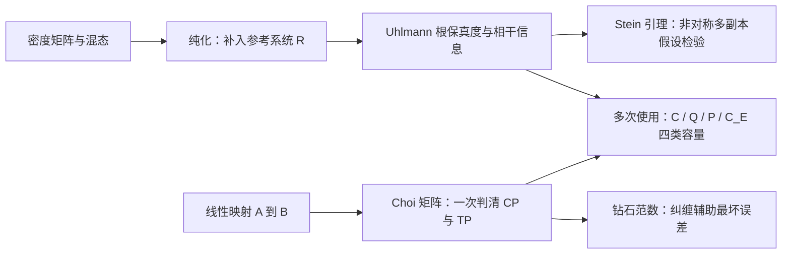
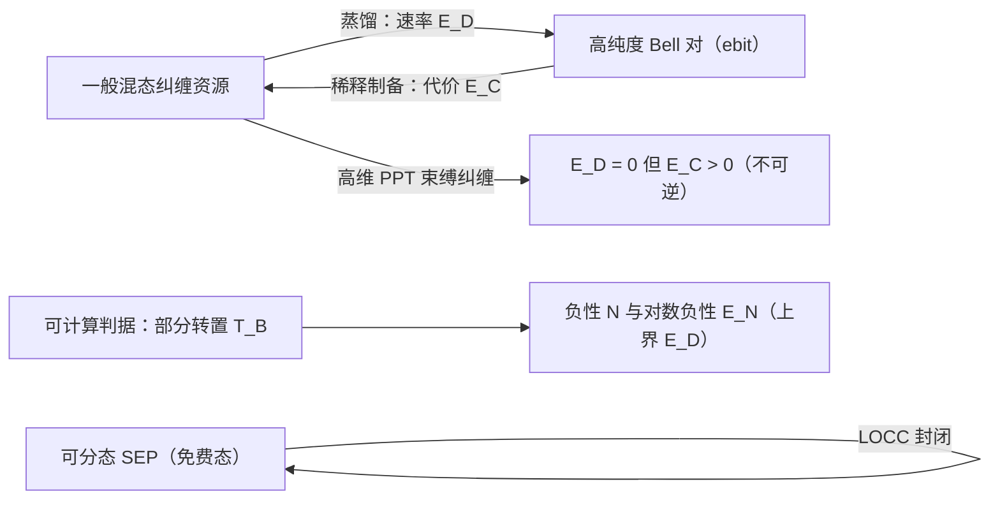
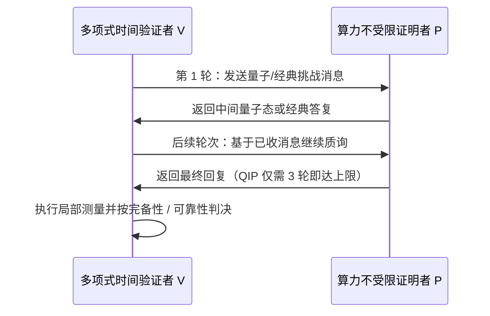
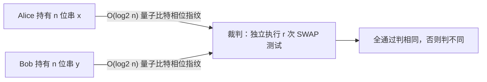

# 18｜量子信道、通信容量、复杂度与连续变量

前面十几章里，我们已经搭好了两套顺手的工具：在[第 05 章](05-noise-channels.md)里，噪声与开放演化被写成密度矩阵和 Kraus 算符；在[第 13 章](13-quantum-information.md)里，量子态配上了冯·诺依曼熵、相对熵、迹距离、根保真度和 Holevo 量。可当你真正打开一篇量子信息、计算复杂性或连续变量光量子研究论文时，很快会碰上一批新的“拦路虎”：

- 论文里动不动就画出一个叫 **Choi 矩阵**的方阵，说“它半正定、偏迹等于单位阵，这就是一条合法信道”——它和 Kraus 算符到底是什么关系？
- 评估一个带噪量子门有多准时，为什么审稿人总追问**钻石范数**，而不满足于把孤立态挨个送进去测一测？
- 明明是同一条光纤或同一条擦除线路，怎么一会儿说容量是 $0.75$，一会儿又说是 $0.50$，再换个前提甚至变成了 $1.50$？为什么经典和量子容量还绕不开 $n\to\infty$ 的正则化极限？
- $\mathrm{QIP}=\mathrm{PSPACE}$、$\mathrm{MIP}^*=\mathrm{RE}$ 与现代量子优势实验依托的**量子采样复杂度**（BosonSampling、IQP、RCS 为何指向多项式层级坍塌）各自成立在什么前提下？
- 光子芯片和微波腔里的场强是连续变化的，无限维空间里没有 Bloch 球，怎么画它的相空间图像，**GKP 网格态**怎样用位移稳定子在连续相空间里切出二维逻辑量子比特，又怎么避免 Fock 截断把误差算假？

为了把这些跨度不小的硬核专题收束得脉络清爽，本章按**上、中、下三篇**推进，方便你按需分遍精读：

- **上篇（第 1—6 节）：信道表示、钻石范数、通信容量与混态资源**——纯化与 Uhlmann 定理、Choi 同构、钻石范数反例、量子 Stein 引理、HSW/LSD/Devetak/BSST 四类容量与超加性机理、混态纠缠资源理论；
- **中篇（第 7—8 节）：验证复杂度、采样优越性与通信复杂度**——交互验证谱系（$\mathrm{QMA}/\mathrm{QIP}/\mathrm{MIP}^*=\mathrm{RE}$）、量子采样复杂度与量子优越性理论支柱（积和式、Stockmeyer 与反集中）、同时消息模型量子指纹；
- **下篇（第 9 节）：连续变量相空间、GKP 网格码与截断边界**——无量纲正交分量、Wigner 负性、多模辛变换与 TMSV、GKP 位移稳定子零跳步检验、Fock 截断三层误差界与能量受限钻石范数。

**先修衔接提示**：上篇与中篇需要[第 03 章](03-multiple-qubits.md)、[第 05 章](05-noise-channels.md)、[第 07 章](07-algorithms.md)和[第 13 章](13-quantum-information.md)的基础；下篇（第 9 节连续变量）直接承接**已前移至本章之前**的[Q4：波函数、势阱、谐振子与隧穿](quantum-mechanics/04-wavefunctions-models.md)（物理谐振子 $[\hat x,\hat p]=i\hbar$、升降算符与数值 Fock 截断），并向下直连[第 19 章](19-engineering-architecture.md)的玻色猫态与 GKP 硬件实证。

动手之前，先把本章的角色与符号口径完全钉死，杜绝同一字母两副面孔：

| 符号 / 约定 | 本章含义与取值口径 | 特别说明 |
| :--- | :--- | :--- |
| $A, B, E, R$ | 输入系统 $A$、输出系统 $B$、环境 $E$、不送入信道的记账参考系统 $R$ | 第 9 节连续变量中，正则算符向量另用加粗带帽记号 $\hat{\mathbf R}$ 区分 |
| $\mathcal E, \mathcal F$ | 量子信道（完全正保迹映射，CPTP）；恒等信道 $\mathcal I$、复位信道 $\mathcal R$、转置映射 $\mathcal T$ | **本章绝不用 $\mathcal N$ 表示信道**，$\mathcal N(\rho)$ 专留给第 6 节的纠缠负性 |
| $\log_2$ 与 $\ln$ | 所有熵、相对熵、互信息与容量一律用 $\log_2$（单位 bit / ebit / qubit）；自然对数一律写 $\ln$ | 零歧义底数，避免把以 $e$ 为底的数值误当 bit |
| $F(\rho,\sigma)$ | 根保真度 $F(\rho,\sigma)=\lVert\sqrt\rho\sqrt\sigma\rVert_1=\operatorname{Tr}\sqrt{\sqrt\rho\sigma\sqrt\rho}$ | 纯态间为 $\lvert\langle\psi\vert\phi\rangle\rvert$；测量重叠概率写 $F^2$ |
| $J_{\mathcal E}$ | **未归一化** Choi 矩阵 $J_{\mathcal E}=(\mathcal I_{A'}\otimes\mathcal E)(|\Omega\rangle\langle\Omega|)$ | 满足 $\operatorname{Tr}_B J_{\mathcal E}=I_{A'}$、$\operatorname{Tr} J_{\mathcal E}=d_A$ |
| $\hat q, \hat p, V, \Omega$ | 第 9 节无量纲正交分量，满足 $[\hat q,\hat p]=i$、真空协方差 $V_{\mathrm{vac}}=\frac{1}{2}I_{2n}$ | 与 Q4 物理坐标及软件默认 $\hbar=2$ 的换算见第 9.1 节专表 |

下面这张总览图把上篇（从量子态到信道与容量）的逻辑骨架先定格下来：

---

> **上篇（第 1—6 节）：信道表示、钻石范数、通信容量与混态资源**——从单态纯化出发，经由 Choi 矩阵与钻石范数刻画整条信道，再收束至量子 Stein 引理、四类通信容量及混态纠缠资源理论。

## 1. 纯化与 Uhlmann 定理：把混态放回更大的纯态世界

处理纯态时，我们总觉得顺手得多：只要拿一个单位列向量 $|\psi\rangle$ 做内积、乘酉矩阵就行。可一旦遇到混态密度矩阵 $\rho_A$，矩阵开平方、混合分解全都冒了出来，直觉立刻变糊。能不能把任意一个混态，都看成某个更大系统上**纯态**的一部分？

答案是肯定的，这就是**纯化（purification）**。打个生活里的比方：你盯着墙上一个忽明忽暗的二维影子，觉得它的变化像随机概率；但如果退后一步把三维物体本身放回视野里，影子只是把“纵深方向”投影丢掉后的结果。数学上的纯化做的是同一件事——在系统 $A$ 旁边添上一个辅助的**参考系统（reference system）** $R$，在联合空间 $\mathcal H_A \otimes \mathcal H_R$ 里构造一个单位纯态 $|\psi\rangle_{AR}$，使得对 $R$ 做偏迹后恰好还原出 $\rho_A$：

$$
\operatorname{Tr}_R\bigl(|\psi\rangle\langle\psi|_{AR}\bigr) = \rho_A.
$$

要注意这个比方的边界：墙上的影子背后确实站着一个实物，但数学上给 $\rho_A$ 写出纯化 $|\psi\rangle_{AR}$，**并不意味着**实验室里一定有一个能被你拿在手里的物理参考系统 $R$。纯化首先是一把极其好用的记账工具；在开放系统里，$R$ 也可以对应你没有读取的环境自由度，或发送方本地留作纠缠基准的辅助比特。

### 1.1 先手算一个对角混态，再推一般谱分解

拿一个最直观的单比特混态热身。设 $\rho_A$ 是二维希尔伯特空间 $\mathbb C^2$ 上的密度矩阵：

$$
\rho_A = \begin{pmatrix} 0.8 & 0 \\ 0 & 0.2 \end{pmatrix} = 0.8|0\rangle\langle 0| + 0.2|1\rangle\langle 1|.
$$

如果只在计算基 $\{|0\rangle,|1\rangle\}$ 测量 $A$，有 $80\%$ 概率看到 $0$，$20\%$ 概率看到 $1$。我们给它配一个二维参考比特 $R$，试着把概率开根号放进两比特振幅里：

$$
|\psi\rangle_{AR} = \sqrt{0.8}\,|00\rangle + \sqrt{0.2}\,|11\rangle.
$$

先做归一化检查：两项振幅都是正实数，模平方之和为

$$
\langle\psi|\psi\rangle = (\sqrt{0.8})^2 + (\sqrt{0.2})^2 = 0.8 + 0.2 = 1.
$$

再按全书大端序基 $|00\rangle,|01\rangle,|10\rangle,|11\rangle$，把 $|\psi\rangle_{AR}$ 写成列向量 $[\sqrt{0.8}, 0, 0, \sqrt{0.2}]^T$，乘上它的共轭转置 $[\sqrt{0.8}, 0, 0, \sqrt{0.2}]$。注意交叉项系数为 $\sqrt{0.8}\sqrt{0.2}=\sqrt{0.16}=0.4$，于是完整的 $4\times 4$ 密度矩阵是：

$$
|\psi\rangle\langle\psi|_{AR}
= \begin{pmatrix}
0.8 & 0 & 0 & 0.4 \\
0 & 0 & 0 & 0 \\
0 & 0 & 0 & 0 \\
0.4 & 0 & 0 & 0.2
\end{pmatrix}
= 0.8|00\rangle\langle 00| + 0.4|00\rangle\langle 11| + 0.4|11\rangle\langle 00| + 0.2|11\rangle\langle 11|.
$$

现在对第二个比特 $R$ 求偏迹。回忆偏迹的逐项规则 $\operatorname{Tr}_R(|a\rangle_A|i\rangle_R\langle b|_A\langle j|_R) = |a\rangle\langle b|_A \cdot \langle j|i\rangle_R$，逐项展开四个算符项：

- 第一项：$0.8\,|0\rangle\langle 0|_A \cdot \langle 0|0\rangle_R = 0.8\,|0\rangle\langle 0|_A$；
- 第二项：$0.4\,|0\rangle\langle 1|_A \cdot \langle 1|0\rangle_R = 0$（因为 $\langle 1|0\rangle=0$）；
- 第三项：$0.4\,|1\rangle\langle 0|_A \cdot \langle 0|1\rangle_R = 0$；
- 第四项：$0.2\,|1\rangle\langle 1|_A \cdot \langle 1|1\rangle_R = 0.2\,|1\rangle\langle 1|_A$。

四项相加恰好回到 $0.8|0\rangle\langle 0| + 0.2|1\rangle\langle 1| = \rho_A$！右上角和左下角那两个实打实的相干项 $0.4$，在丢弃 $R$ 时被正交内积彻底抹平了。

把这套做法推广到任意 $d_A$ 维密度矩阵 $\rho_A$，只需一步谱分解。因为 $\rho_A$ 厄米、半正定且迹为 $1$，它总能按非零本征值展开为

$$
\rho_A = \sum_{i=1}^{r} \lambda_i |i\rangle\langle i|_A,
\qquad \lambda_i > 0, \qquad \sum_{i=1}^{r} \lambda_i = 1,
$$

其中 $r = \operatorname{rank}(\rho_A) \le d_A$ 是矩阵的秩，$\{|i\rangle_A\}_{i=1}^r$ 是两两正交归一的本征态。只要参考空间 $\mathcal H_R$ 的维数满足 $\dim \mathcal H_R \ge r$，从中任取一组正交归一态 $\{|i\rangle_R\}_{i=1}^r$，定义

$$
|\psi_\rho\rangle_{AR} = \sum_{i=1}^{r} \sqrt{\lambda_i}\,|i\rangle_A |i\rangle_R.
$$

检查归一化：$\langle\psi_\rho|\psi_\rho\rangle = \sum_{i,j=1}^r \sqrt{\lambda_i\lambda_j}\,\langle i|j\rangle_A\langle i|j\rangle_R = \sum_{i=1}^r \lambda_i = 1$。再检查对 $R$ 做偏迹：

$$
\begin{aligned}
\operatorname{Tr}_R\bigl(|\psi_\rho\rangle\langle\psi_\rho|_{AR}\bigr)
&= \sum_{i,j=1}^{r} \sqrt{\lambda_i\lambda_j}\,|i\rangle\langle j|_A\,\operatorname{Tr}\bigl(|i\rangle\langle j|_R\bigr) \\
&= \sum_{i,j=1}^{r} \sqrt{\lambda_i\lambda_j}\,|i\rangle\langle j|_A\,\delta_{ij}
= \sum_{i=1}^{r} \lambda_i |i\rangle\langle i|_A = \rho_A.
\end{aligned}
$$

于是任意有限维密度矩阵都存在纯化，且最小所需的参考系统维数恰好等于 $\operatorname{rank}(\rho_A)$。

### 1.2 纯化的自由度与系综不唯一性

同一个混态的纯化**不是唯一的**。如果在参考系统 $R$ 上施加任意等距算符 $V_R: \mathcal H_R \to \mathcal H_{R'}$（满足 $V_R^\dagger V_R = I_R$，当维数相同时就是酉矩阵 $U_R$），新态 $|\tilde\psi\rangle_{AR'} = (I_A \otimes V_R)|\psi_\rho\rangle_{AR}$ 仍然是 $\rho_A$ 的纯化。利用迹的循环不变性可以一步验算：

$$
\operatorname{Tr}_{R'}\bigl[(I_A\otimes V_R)|\psi_\rho\rangle\langle\psi_\rho|(I_A\otimes V_R^\dagger)\bigr]
= \operatorname{Tr}_R\bigl[(I_A\otimes V_R^\dagger V_R)|\psi_\rho\rangle\langle\psi_\rho|\bigr]
= \operatorname{Tr}_R\bigl(|\psi_\rho\rangle\langle\psi_\rho|\bigr) = \rho_A.
$$

反过来，如果两个纯态 $|\psi_1\rangle_{AR}$ 和 $|\psi_2\rangle_{AR}$ 都纯化了同一个 $\rho_A$，按 Schmidt 分解展开后，它们在 $A$ 侧拥有完全相同的 Schmidt 系数 $\sqrt{\lambda_i}$ 与正交基 $|i\rangle_A$，差异只能落在 $R$ 侧的正交基上，因此必然存在 $R$ 上的酉算符 $U_R$ 使得 $|\psi_2\rangle_{AR} = (I_A\otimes U_R)|\psi_1\rangle_{AR}$。

这个纯化自由度带来了一个非常深刻的物理结论（**Schrödinger–HJW 定理**的直觉源头）：取最大混态 $\rho_A = I/2$，它的标准纯化是 Bell 态 $|\Phi^+\rangle_{AR} = \frac{1}{\sqrt 2}(|00\rangle + |11\rangle)$。但用 $|0\rangle = \frac{|+\rangle+|-\rangle}{\sqrt 2}$、$|1\rangle = \frac{|+\rangle-|-\rangle}{\sqrt 2}$ 逐项代入展开：

$$
\begin{aligned}
|\Phi^+\rangle_{AR}
&= \frac{1}{\sqrt 2}\left(\frac{|+\rangle+|-\rangle}{\sqrt 2}\otimes\frac{|+\rangle+|-\rangle}{\sqrt 2}
+ \frac{|+\rangle-|-\rangle}{\sqrt 2}\otimes\frac{|+\rangle-|-\rangle}{\sqrt 2}\right) \\
&= \frac{1}{2\sqrt 2}\bigl(|++\rangle+|+-\rangle+|-+\rangle+|--\rangle+|++\rangle-|+-\rangle-|-+\rangle+|--\rangle\bigr) \\
&= \frac{1}{\sqrt 2}\bigl(|++\rangle + |--\rangle\bigr).
\end{aligned}
$$

如果在参考系统 $R$ 上按 $Z$ 基测量，$A$ 会以各 $1/2$ 概率塌缩到 $\{|0\rangle, |1\rangle\}$；如果在 $R$ 上按 $X$ 基测量，$A$ 会以各 $1/2$ 概率塌缩到 $\{|+\rangle, |-\rangle\}$——两种截然不同的纯态制备方法，在 $A$ 侧产生的都是同一个密度矩阵 $I/2$。正因如此，**不能把混态理解成“系统背后一定藏着某一份唯一的纯态清单，只是我们忘了抽到哪张”**：凡在 $R$ 上换一组正交基测量，就能远端“导引”出 $\rho_A$ 的不同纯态系综分解。

### 1.3 Uhlmann 定理：根保真度与信道单调性

在[第 13 章](13-quantum-information.md)里，我们定义了两态的**根保真度（root fidelity）**：

$$
F(\rho, \sigma) = \left\|\sqrt\rho\sqrt\sigma\right\|_1 = \operatorname{Tr}\sqrt{\sqrt\rho\,\sigma\,\sqrt\rho}.
$$

这个带两层矩阵开方的公式乍看之下很抽象，纯化却能把它翻译成再直白不过的几何重叠——这就是 **Uhlmann 定理**（Uhlmann, 1976）。选定一个维数满足 $\dim \mathcal H_R \ge \max\{\operatorname{rank}(\rho),\operatorname{rank}(\sigma)\}$ 的公共参考空间 $R$，固定 $\rho$ 的任意一个纯化 $|\psi_\rho\rangle_{AR}$，再让 $|\psi_\sigma\rangle_{AR}$ 跑遍 $\sigma$ 在同一空间 $AR$ 上的所有纯化，那么：

$$
F(\rho, \sigma) = \max_{|\psi_\sigma\rangle_{AR}} \bigl|\langle\psi_\rho | \psi_\sigma\rangle\bigr|.
$$

当其中一方是纯态 $\sigma = |\phi\rangle\langle\phi|$ 时，它的纯化必然是 $|\phi\rangle_A \otimes |\chi\rangle_R$，于是公式立刻退化为

$$
F(\rho, |\phi\rangle\langle\phi|) = \sqrt{\langle\phi|\rho|\phi\rangle}.
$$

我们用三组手算数字核对 Uhlmann 定理与矩阵定义的一致性：

1. **最大混态与纯态**：取 $\rho = I/2$、$\sigma = |0\rangle\langle 0|$。直接套公式得 $F = \sqrt{\langle 0|(I/2)|0\rangle} = \frac{1}{\sqrt 2} \approx 0.7071$。按纯化法，取 $|\psi_\rho\rangle = \frac{1}{\sqrt 2}(|00\rangle+|11\rangle)$，取 $|\psi_\sigma\rangle = |00\rangle$，内积 $|\langle\psi_\rho|\psi_\sigma\rangle| = \frac{1}{\sqrt 2}$（若改取 $|01\rangle$ 内积为 $0$，最大值恰好由 $|00\rangle$ 取到）。
2. **不均匀对角态与纯态**：取 $\rho = \operatorname{diag}(0.8, 0.2)$、$\sigma = |0\rangle\langle 0|$。直接公式得 $F = \sqrt{0.8} = \frac{2}{\sqrt 5} \approx 0.8944$；纯化 $|\psi_\rho\rangle = \sqrt{0.8}|00\rangle + \sqrt{0.2}|11\rangle$ 与 $|\psi_\sigma\rangle = |00\rangle$ 的内积同样是 $\sqrt{0.8} \approx 0.8944$。提醒一次口径：$0.8944$ 是根保真度 $F$，而平方保真度（测量重叠概率）是 $F^2 = 0.8$。
3. **两个混态之间**：取 $\rho = \operatorname{diag}(0.8, 0.2)$、$\sigma = I/2 = \operatorname{diag}(0.5, 0.5)$。因为两矩阵对角，$\sqrt\rho\sqrt\sigma = \operatorname{diag}(\sqrt{0.4}, \sqrt{0.1})$，迹范数为

$$
F(\rho,\sigma) = \sqrt{0.4} + \sqrt{0.1} = 2\sqrt{0.1} + \sqrt{0.1} = \frac{3}{\sqrt{10}} \approx 0.9487.
$$

用纯化回验：取 $|\psi_\rho\rangle = \sqrt{0.8}|00\rangle + \sqrt{0.2}|11\rangle$、$|\psi_\sigma\rangle = \sqrt{0.5}|00\rangle + \sqrt{0.5}|11\rangle$，两向量内积恰好为 $\sqrt{0.8\times 0.5} + \sqrt{0.2\times 0.5} = \sqrt{0.4}+\sqrt{0.1} = \frac{3}{\sqrt{10}}$，完全吻合！

Uhlmann 定理还能在四行之内证明一个核心性质——**保真度的信道单调性**（数据处理不会让两态更好区分）：对任意量子信道 $\mathcal E: A\to B$，由[第 05 章](05-noise-channels.md)的 Stinespring 扩张，存在等距算符 $V: \mathcal H_A \to \mathcal H_B \otimes \mathcal H_E$ 使得 $\mathcal E(\cdot) = \operatorname{Tr}_E(V(\cdot)V^\dagger)$。设 $|\psi_\rho\rangle_{AR}, |\psi_\sigma\rangle_{AR}$ 是达到 $F(\rho,\sigma)$ 的最优纯化，那么

$$
|\Psi_\rho\rangle_{BRE} = (V \otimes I_R)|\psi_\rho\rangle_{AR},
\qquad
|\Psi_\sigma\rangle_{BRE} = (V \otimes I_R)|\psi_\sigma\rangle_{AR}
$$

分别是 $\mathcal E(\rho)$ 与 $\mathcal E(\sigma)$ 以 $RE$ 为共同参考系统的合法纯化。等距算符保持内积不变（$V^\dagger V = I_A$），而 Uhlmann 定理是对 $RE$ 上**全部**纯化取最大值，于是立得：

$$
F\bigl(\mathcal E(\rho), \mathcal E(\sigma)\bigr)
\ge \bigl|\langle\Psi_\rho | \Psi_\sigma\rangle\bigr|
= \bigl|\langle\psi_\rho | (V^\dagger V \otimes I_R) | \psi_\sigma\rangle\bigr|
= \bigl|\langle\psi_\rho | \psi_\sigma\rangle\bigr|
= F(\rho,\sigma).
$$

一步都不用硬算矩阵开方，几何直觉一目了然。

---

## 2. Choi–Jamiołkowski 同构：用一个矩阵完整刻画整条信道

在[第 05 章](05-noise-channels.md)里，我们看到一条合法的量子信道 $\mathcal E: L(\mathcal H_A) \to L(\mathcal H_B)$ 必须同时满足线性、**保迹**（TP）与**完全正**（CP）。其中最让人头疼的是“完全正”：它要求对**任意维数**的辅助参考系统 $R$，扩张映射 $\mathcal I_R \otimes \mathcal E$ 都把正半定矩阵映到正半定矩阵。总不能把 $d_R = 1, 2, 3, \dots$ 无穷多个维数挨个验算一遍吧？

**Choi–Jamiołkowski 同构**（Jamiołkowski, 1972；Choi, 1975）的威力就在这里：它把“检验无穷多个参考维数”彻底压缩成**只检查一个 $(d_A d_B) \times (d_A d_B)$ 矩阵是否半正定**。

### 2.1 定义、逆向恢复与四条结构对应

固定 $\mathcal H_A$ 的一组标准正交计算基 $\{|i\rangle_A\}_{i=0}^{d_A-1}$，再引入一份与 $A$ 同维数的副本 $A'$，构造**未归一化**的最大纠缠向量：

$$
|\Omega\rangle_{A'A} = \sum_{i=0}^{d_A-1} |i\rangle_{A'} |i\rangle_A.
$$

注意它的范数平方是 $\langle\Omega|\Omega\rangle = d_A$（不是 $1$）。对任意线性映射 $\mathcal E: L(\mathcal H_A) \to L(\mathcal H_B)$，把 $\mathcal E$ 作用在 $A$ 这一半、让 $A'$ 保持不变，得到的二分算符称为 $\mathcal E$ 的**未归一化 Choi 矩阵**：

$$
J_{\mathcal E}
= \bigl(\mathcal I_{A'} \otimes \mathcal E_{A\to B}\bigr)\bigl(|\Omega\rangle\langle\Omega|_{A'A}\bigr)
= \sum_{i,j=0}^{d_A-1} |i\rangle\langle j|_{A'} \otimes \mathcal E\bigl(|i\rangle\langle j|_A\bigr).
$$

换个分块视角更容易一眼看穿 $J_{\mathcal E}$：它就是一个 $d_A \times d_A$ 的分块矩阵，其中第 $(i,j)$ 个 $d_B \times d_B$ 子块，正好就是把基矩阵 $|i\rangle\langle j|$ 喂进信道 $\mathcal E$ 吐出来的输出矩阵 $\mathcal E(|i\rangle\langle j|)$！

之所以称它为“同构”，是因为知道了矩阵 $J_{\mathcal E}$，就能无损还原出信道 $\mathcal E$ 对任意输入矩阵 $X \in L(\mathcal H_A)$ 的作用：

$$
\mathcal E(X) = \operatorname{Tr}_{A'}\!\Bigl[\bigl(X^T \otimes I_B\bigr) J_{\mathcal E}\Bigr],
$$

这里的转置 $X^T$ 是相对于定义 $|\Omega\rangle$ 所用的计算基而言的。我们逐项展开验证这一还原公式：把 $X = \sum_{k,l} X_{kl}|k\rangle\langle l|$ 代入，其转置为 $X^T = \sum_{k,l} X_{kl}|l\rangle\langle k|$，于是

$$
\begin{aligned}
\operatorname{Tr}_{A'}\!\Bigl[\bigl(X^T \otimes I_B\bigr) J_{\mathcal E}\Bigr]
&= \sum_{i,j,k,l} X_{kl}\,\operatorname{Tr}_{A'}\bigl(|l\rangle\langle k|i\rangle\langle j|\bigr)\,\mathcal E(|i\rangle\langle j|) \\
&= \sum_{i,j,k,l} X_{kl}\,\delta_{ki}\,\delta_{lj}\,\mathcal E(|i\rangle\langle j|)
= \sum_{i,j} X_{ij}\,\mathcal E(|i\rangle\langle j|) = \mathcal E(X).
\end{aligned}
$$

线性映射与二分算符之间由此建立一一对应，而且信道的全部核心物理属性都在 $J_{\mathcal E}$ 上直接“显形”：

1. **保厄米性**：$\mathcal E(X^\dagger) = \mathcal E(X)^\dagger \iff J_{\mathcal E} = J_{\mathcal E}^\dagger$；
2. **完全正（CP）**：$\mathcal E$ 完全正 $\iff J_{\mathcal E} \succeq 0$（全部本征值非负）；
3. **保迹（TP）**：$\mathcal E$ 保迹 $\iff \operatorname{Tr}_B(J_{\mathcal E}) = I_{A'}$；
4. **最小 Kraus 秩与显式构造**：若 $J_{\mathcal E} \succeq 0$，将其做谱分解 $J_{\mathcal E} = \sum_{k=1}^{r} |v_k\rangle\langle v_k|$（其中 $r = \operatorname{rank}(J_{\mathcal E}) \le d_A d_B$，各向量 $|v_k\rangle \in \mathcal H_{A'}\otimes\mathcal H_B$ 已把本征值平方根吸收进去），把每个向量 $|v_k\rangle = \sum_{i,m} (v_k)_{im}|i\rangle_{A'}|m\rangle_B$ **按列重排**为 $d_B\times d_A$ 矩阵 $(K_k)_{mi} = (v_k)_{im}$（即把每个输入指标 $i$ 对应的连续 $d_B$ 个分量竖排作第 $i$ 列，或在代码里先按行排成 $d_A\times d_B$ 矩阵再取转置，满足 $|v_k\rangle = (I_{A'}\otimes K_k)|\Omega\rangle$），那么 $\{K_k\}_{k=1}^r$ 恰好构成 $\mathcal E$ 的一组**最小数目** Kraus 算符！

**归一化约定对照**：不少教材（如 Wilde《量子信息论》）喜欢把输入换成归一化最大纠缠态 $|\Phi_{d_A}\rangle = |\Omega\rangle/\sqrt{d_A}$，从而定义总迹为 $1$ 的**归一化 Choi 态** $\Phi^{\mathcal E} = J_{\mathcal E}/d_A$。两套约定的换算十分简单：

- $\operatorname{Tr}(J_{\mathcal E}) = d_A \longleftrightarrow \operatorname{Tr}(\Phi^{\mathcal E}) = 1$；
- 保迹条件 $\operatorname{Tr}_B(J_{\mathcal E}) = I_{A'} \longleftrightarrow \operatorname{Tr}_B(\Phi^{\mathcal E}) = I_{A'}/d_A$；
- 恢复公式 $\mathcal E(X) = \operatorname{Tr}_{A'}[(X^T\otimes I_B)J_{\mathcal E}] \longleftrightarrow \mathcal E(X) = d_A \operatorname{Tr}_{A'}[(X^T\otimes I_B)\Phi^{\mathcal E}]$。

读论文见到 Choi 矩阵时，第一件事就是看总迹是 $d_A$ 还是 $1$，切忌把两套公式混拼。

### 2.2 三个手算样板：恒等信道、转置反例与复位信道

下面在单比特（$d_A = d_B = 2$，$|\Omega\rangle = |00\rangle + |11\rangle$，基序 $|00\rangle,|01\rangle,|10\rangle,|11\rangle$）下逐格手算三条典型映射。

**样板一：单比特恒等信道 $\mathcal I(X) = X$。**
直接把 $|\Omega\rangle = [1,0,0,1]^T$ 做外积：

$$
J_{\mathcal I} = |\Omega\rangle\langle\Omega|
= \begin{pmatrix}
1 & 0 & 0 & 1 \\
0 & 0 & 0 & 0 \\
0 & 0 & 0 & 0 \\
1 & 0 & 0 & 1
\end{pmatrix}.
$$

检查 CP：因为 $|\Phi^+\rangle = |\Omega\rangle/\sqrt 2$ 是单位向量，所以 $J_{\mathcal I} = 2|\Phi^+\rangle\langle\Phi^+|$，它是一个秩一矩阵，四个本征值分别是 $2, 0, 0, 0$，全非负，故完全正。检查 TP：按 $2\times 2$ 分块看，$J_{\mathcal I} = \begin{pmatrix} |0\rangle\langle 0| & |0\rangle\langle 1| \\ |1\rangle\langle 0| & |1\rangle\langle 1| \end{pmatrix}$，对输出侧 $B$ 取每个子块的迹，得到 $\begin{pmatrix} 1 & 0 \\ 0 & 1 \end{pmatrix} = I_2$，保迹！总迹为 $2 = d_A$。唯一非零本征向量 $|\Omega\rangle$ 重排成 $2\times 2$ 矩阵正是 $K_0 = I_2$。

**样板二：转置映射 $\mathcal T(X) = X^T$（正但非完全正的反例）。**
把基矩阵逐个喂进 $\mathcal T$：$\mathcal T(|0\rangle\langle 0|) = |0\rangle\langle 0|$，$\mathcal T(|0\rangle\langle 1|) = |1\rangle\langle 0|$，$\mathcal T(|1\rangle\langle 0|) = |0\rangle\langle 1|$，$\mathcal T(|1\rangle\langle 1|) = |1\rangle\langle 1|$。按分块拼成 $4\times 4$ 矩阵，恰好得到两比特交换算符（SWAP）$W_2$：

$$
J_{\mathcal T}
= \begin{pmatrix}
|0\rangle\langle 0| & |1\rangle\langle 0| \\
|0\rangle\langle 1| & |1\rangle\langle 1|
\end{pmatrix}
= \begin{pmatrix}
1 & 0 & 0 & 0 \\
0 & 0 & 1 & 0 \\
0 & 1 & 0 & 0 \\
0 & 0 & 0 & 1
\end{pmatrix} = W_2.
$$

检查 TP：四个 $2\times 2$ 子块的迹依次为 $1, 0, 0, 1$，因此 $\operatorname{Tr}_B(J_{\mathcal T}) = I_2$，它确实保迹；而且对任意单个正半定矩阵 $\rho$，转置不改变特征值，所以 $\mathcal T(\rho) \succeq 0$。但检查 CP 时，看中间 $|01\rangle,|10\rangle$ 对应的 $2\times 2$ 子块 $\begin{pmatrix}0&1\\1&0\end{pmatrix}$：它作用在反对称向量 $|-\rangle_{\mathrm{asym}} = \frac{1}{\sqrt 2}(|01\rangle - |10\rangle) = [0, \frac{1}{\sqrt 2}, -\frac{1}{\sqrt 2}, 0]^T$ 上，得到

$$
\begin{pmatrix} 0 & 1 \\ 1 & 0 \end{pmatrix}
\begin{pmatrix} 1/\sqrt 2 \\ -1/\sqrt 2 \end{pmatrix}
= \begin{pmatrix} -1/\sqrt 2 \\ 1/\sqrt 2 \end{pmatrix}
= (-1)\begin{pmatrix} 1/\sqrt 2 \\ -1/\sqrt 2 \end{pmatrix}.
$$

完整四个本征值是 $+1, +1, +1, -1$。那个刺眼的 $-1$ 直接判了死刑：$J_{\mathcal T} \not\succeq 0$，所以转置映射**不是完全正映射**，物理上不可能在纠缠态的一半上单独实现。

**样板三：单比特复位信道 $\mathcal R(X) = \operatorname{Tr}(X)|0\rangle\langle 0|$。**
逐个算基矩阵的输出：$\mathcal R(|i\rangle\langle j|) = \operatorname{Tr}(|i\rangle\langle j|)|0\rangle\langle 0| = \delta_{ij}|0\rangle\langle 0|$。因此

$$
J_{\mathcal R}
= |0\rangle\langle 0| \otimes |0\rangle\langle 0| + |1\rangle\langle 1| \otimes |0\rangle\langle 0|
= I_{A'} \otimes |0\rangle\langle 0|
= \operatorname{diag}(1, 0, 1, 0).
$$

本征值为 $1, 1, 0, 0 \ge 0$（完全正）；输出侧偏迹 $\operatorname{Tr}_B(I_{A'}\otimes|0\rangle\langle 0|) = I_{A'}\operatorname{Tr}(|0\rangle\langle 0|) = I_{A'}$（保迹）；总迹为 $2 = d_A$。顺手用刚才的规则反推最小 Kraus 算符：$J_{\mathcal R}$ 的秩为 $2$，两个本征值为 $1$ 的单位特征向量是 $|v_0\rangle = |00\rangle = [1,0,0,0]^T$ 和 $|v_1\rangle = |10\rangle = [0,0,1,0]^T$。按 $(K_k)_{mi}=(v_k)_{im}$ 重排成 $2\times 2$ 矩阵：

- $|v_0\rangle$ 仅有 $(i=0, m=0)$ 分量为 $1$，对应 $K_0 = \begin{pmatrix}1 & 0 \\ 0 & 0\end{pmatrix} = |0\rangle\langle 0|$；
- $|v_1\rangle$ 仅有 $(i=1, m=0)$ 分量为 $1$，对应 $K_1 = \begin{pmatrix}0 & 1 \\ 0 & 0\end{pmatrix} = |0\rangle\langle 1|$。

回验：$K_0^\dagger K_0 + K_1^\dagger K_1 = |0\rangle\langle 0| + |1\rangle\langle 1| = I_2$，且 $K_0 X K_0^\dagger + K_1 X K_1^\dagger = (X_{00}+X_{11})|0\rangle\langle 0| = \operatorname{Tr}(X)|0\rangle\langle 0|$，严丝合缝！

把研究论文里最常用的四种信道表示收进一张速查表：

| 表示方法 | 核心数学对象 | 最擅长解决的问题 | 读论文时最容易踩的坑 |
| :--- | :--- | :--- | :--- |
| **Kraus 表示** | 一组算符 $\{K_k\}$（$\sum_k K_k^\dagger K_k = I$） | 数值噪声模拟、逐分支状态更新 | 同一信道的 Kraus 分解不唯一（差一个酉混合） |
| **Stinespring 扩张** | 等距 $V: A\to BE$ 或系统—环境酉演化 | 追踪环境拿走的信息、构造互补信道 | 环境辅助维数和基的选取也不唯一 |
| **Choi 矩阵** | 二分算符 $J_{\mathcal E} \in L(\mathcal H_{A'}\otimes\mathcal H_B)$ | 一步检验 CP/TP、过程层析、半定规划优化 | 须先核对未归一化（$\operatorname{Tr}=d_A$）还是归一化（$\operatorname{Tr}=1$） |
| **Pauli 转移矩阵（PTM）** | Pauli 基下的实矩阵 $R_{ab} = \frac{1}{d}\operatorname{Tr}(\sigma_a\mathcal E(\sigma_b))$ | 多门串联相乘、门集层析拟合 | Pauli 基的归一化系数与排列顺序因库而异 |

---

## 3. 钻石范数：为什么单系统距离不足以衡量量子信道

知道了如何判断一条信道合不合法，紧接着就会遇到容错计算和实验表征里最核心的问题：**怎么衡量两条量子信道 $\mathcal E_0, \mathcal E_1: A \to B$ 离得有多远**（比如一个真实带噪门 $\tilde{\mathcal U}$ 离理想门 $\mathcal U$ 差了多少）？

初学者最自然的想法是“挨个输入态测一遍”：把所有合法单系统态 $\rho_A$ 分别送进 $\mathcal E_0$ 和 $\mathcal E_1$，看输出的最大迹距离 $\max_{\rho_A} T(\mathcal E_0(\rho_A), \mathcal E_1(\rho_A))$；或者推广到一般算符 $X$ 上，定义**单系统诱导迹范数（induced trace norm）**：

$$
\|\Phi\|_{1\to 1} = \max\bigl\{\|\Phi(X)\|_1 : X \in L(\mathcal H_A),\ \|X\|_1 \le 1\bigr\}.
$$

听起来很合理，但在量子电路里却藏着一个致命漏洞：**真实的量子门几乎从不作用在孤立的单系统态上，而是作用在一台高度纠缠的多比特处理器中的某几个比特上**！即使两条信道在所有孤立单系统输入上看起来几乎难以分辨，一旦先把输入系统和一根不进信道的参考比特 $R$ 纠缠起来，再在输出端把 $B$ 和 $R$ 联合测量，两条信道之间的差距可能瞬间放大到天壤之别。

### 3.1 定义、参考维数截断与纯态可达性

为了彻底堵住这个漏洞，Kitaev（1997）引入了**钻石范数（diamond norm，又称完全有界迹范数）**。对任意线性超算子 $\Phi: L(\mathcal H_A) \to L(\mathcal H_B)$，它定义为在允许附带任意参考系统 $R$ 时的最大诱导迹范数：

$$
\|\Phi\|_\diamond
:= \sup_{R} \|\Phi \otimes \mathcal I_R\|_{1\to 1}
= \sup_{R} \max\Bigl\{\bigl\|(\Phi \otimes \mathcal I_R)(X)\bigr\|_1 : X \in L(\mathcal H_A \otimes \mathcal H_R),\ \|X\|_1 \le 1\Bigr\}.
$$

看到上确界遍及任意参考系统 $R$，你可能又担心起来：这不会又是无穷维优化吧？好消息来自 Watrous（2005, 2018）的两条基石结论：

1. **维数截断**：上述上确界在参考系统 $R$ 的维数取到与输入系统相等（$\dim \mathcal H_R = \dim \mathcal H_A = d_A$）时即可取到最大值，再增大 $R$ 不会让范数变大，即 $\|\Phi\|_\diamond = \|\Phi \otimes \mathcal I_A\|_{1\to 1}$。
2. **保厄米超算子的纯态可达性**：当 $\Phi$ 保厄米（特别地，对两条信道之差 $\Phi = \mathcal E_0 - \mathcal E_1$ 或加权差 $\eta\mathcal E_0 - (1-\eta)\mathcal E_1$）时，最大值总能在一个两体**纯态** $|\psi\rangle\langle\psi|_{AR}$ 上取到：

$$
\|\mathcal E_0 - \mathcal E_1\|_\diamond
= \max_{|\psi\rangle_{AR}} \Bigl\|\bigl((\mathcal E_0 - \mathcal E_1) \otimes \mathcal I_R\bigr)\bigl(|\psi\rangle\langle\psi|_{AR}\bigr)\Bigr\|_1.
$$

相应地，称 $\frac{1}{2}\|\mathcal E_0 - \mathcal E_1\|_\diamond \in [0, 1]$ 为两条信道的**钻石距离（diamond distance）**。

### 3.2 两个铁证反例：从转置映射到 Werner–Holevo 物理信道对

为了真正体会“加不加纠缠参考系统”有多大区别，我们手算两个经典反例——先看一个极简数学反例，再看一个两条都完全物理合法的信道对。

**反例一（数学反例）：$d$ 维转置映射 $\mathcal T(X) = X^T$。**
对任意单个 $d\times d$ 矩阵 $X$，转置不改变它的奇异值，所以 $\|\mathcal T(X)\|_1 = \|X^T\|_1 = \|X\|_1$，立刻得到单系统诱导迹范数恒为

$$
\|\mathcal T\|_{1\to 1} = 1.
$$

现在配一个 $d$ 维参考系统 $R$，送入归一化的最大纠缠态 $|\Phi_d\rangle\langle\Phi_d| = \frac{1}{d}\sum_{i,j=0}^{d-1}|i\rangle\langle j|_A \otimes |i\rangle\langle j|_R$（它的迹范数为 $1$）。仅对第一半做转置：

$$
(\mathcal T \otimes \mathcal I_d)\bigl(|\Phi_d\rangle\langle\Phi_d|\bigr)
= \frac{1}{d}\sum_{i,j=0}^{d-1} |j\rangle\langle i|_A \otimes |i\rangle\langle j|_R
= \frac{1}{d} W_d,
$$

其中 $W_d$ 是 $d$ 维交换算符（满足 $W_d|ij\rangle = |ji\rangle$）。因为 $W_d$ 是酉矩阵（$W_d^\dagger W_d = I_{d^2}$），它的全部 $d^2$ 个奇异值都等于 $1$，所以迹范数 $\|W_d\|_1 = d^2$！于是

$$
\|\mathcal T\|_\diamond \ge \left\|\frac{1}{d} W_d\right\|_1 = \frac{d^2}{d} = d \qquad (\text{事实上精确等于 } d).
$$

在单系统眼里，转置映射温和得像个常数 $1$；一旦配上纠缠参考系统，它的范数随维数 $d$ 线性爆炸。

**反例二（物理反例）：Werner–Holevo 信道对的单次区分（Werner & Holevo, 2002）。**
也许你会问：转置映射本来就不是物理信道，有没有**两条完全合法的物理信道**，不靠纠缠时越到高维越像双胞胎，加上纠缠却能 100% 一眼认出？答案正是 Werner–Holevo 信道对。对任意维数 $d \ge 2$，定义：

$$
\Phi_+(\rho) = \frac{1}{d+1}\Bigl(\operatorname{Tr}(\rho)I_d + \rho^T\Bigr),
\qquad
\Phi_-(\rho) = \frac{1}{d-1}\Bigl(\operatorname{Tr}(\rho)I_d - \rho^T\Bigr).
$$

在单比特 $d=2$ 时，这两条信道非常具体：$\Phi_+(\rho) = \frac{1}{3}(\operatorname{Tr}(\rho)I_2 + \rho^T)$，而 $\Phi_-(\rho) = \operatorname{Tr}(\rho)I_2 - \rho^T$。我们把任意 $2\times 2$ 矩阵 $\rho = \begin{pmatrix} a & b \\ c & e \end{pmatrix}$ 代入检查：

$$
\operatorname{Tr}(\rho)I_2 - \rho^T
= \begin{pmatrix} a+e & 0 \\ 0 & a+e \end{pmatrix} - \begin{pmatrix} a & c \\ b & e \end{pmatrix}
= \begin{pmatrix} e & -c \\ -b & a \end{pmatrix}
= \begin{pmatrix} 0 & -i \\ i & 0 \end{pmatrix} \begin{pmatrix} a & b \\ c & e \end{pmatrix} \begin{pmatrix} 0 & -i \\ i & 0 \end{pmatrix}
= Y \rho Y.
$$

原来 $d=2$ 时的 $\Phi_-$ 就是最普通的 Pauli-$Y$ 酉门！再对一般 $d\ge 2$ 用 Choi 矩阵一次验明两条信道的合法性：由 $|\Omega\rangle\langle\Omega| = \sum_{i,j}|i\rangle\langle j|\otimes|i\rangle\langle j|$，把 $\operatorname{Tr}(|i\rangle\langle j|)=\delta_{ij}$ 和 $(|i\rangle\langle j|)^T=|j\rangle\langle i|$ 代入，立即得

$$
J_{\Phi_+} = \frac{I_d \otimes I_d + W_d}{d+1} = \frac{2}{d+1}\Pi_{\mathrm{sym}},
\qquad
J_{\Phi_-} = \frac{I_d \otimes I_d - W_d}{d-1} = \frac{2}{d-1}\Pi_{\mathrm{asym}},
$$

其中 $\Pi_{\mathrm{sym}} = \frac{I+W_d}{2}$ 和 $\Pi_{\mathrm{asym}} = \frac{I-W_d}{2}$ 分别是两体对称子空间和反对称子空间的正交投影算符。正交投影算符本征值仅取 $0$ 或 $1$，乘以正系数后两个矩阵都半正定（完全正）；又因 $\operatorname{Tr}_B(I_d\otimes I_d) = d I_d$、$\operatorname{Tr}_B(W_d) = I_d$，所以

$$
\operatorname{Tr}_B J_{\Phi_+} = \frac{d+1}{d+1} I_d = I_d,
\qquad
\operatorname{Tr}_B J_{\Phi_-} = \frac{d-1}{d-1} I_d = I_d.
$$

两条都是货真价实的 CPTP 物理信道！现在假设黑箱以各 $1/2$ 概率装入 $\Phi_+$ 或 $\Phi_-$，你只能调用它**一次**来猜里面是哪一条，我们来对比两种策略的精确上限：

- **策略一：不带参考系统，只送入孤立态 $\rho$**。由迹范数凸性，最大差距在纯态 $\rho = |\psi\rangle\langle\psi|$ 上取到。记其逐元复共轭态为 $|\psi^*\rangle$（满足 $(|\psi\rangle\langle\psi|)^T = |\psi^*\rangle\langle\psi^*|$），逐项做差：

$$
\begin{aligned}
\bigl(\Phi_+ - \Phi_-\bigr)\bigl(|\psi\rangle\langle\psi|\bigr)
&= \left(\frac{1}{d+1} - \frac{1}{d-1}\right) I_d + \left(\frac{1}{d+1} + \frac{1}{d-1}\right) |\psi^*\rangle\langle\psi^*| \\
&= -\frac{2}{d^2 - 1} I_d + \frac{2d}{d^2 - 1} |\psi^*\rangle\langle\psi^*|.
\end{aligned}
$$

这是一个在 $|\psi^*\rangle$ 方向和它的 $(d-1)$ 维正交补空间上已经对角化的矩阵！算出它的全部 $d$ 个本征值：
  - 沿 $|\psi^*\rangle$ 方向（$1$ 重）：$-\frac{2}{d^2-1} + \frac{2d}{d^2-1} = \frac{2(d-1)}{(d-1)(d+1)} = +\frac{2}{d+1}$；
  - 沿正交补空间（$d-1$ 重）：$-\frac{2}{d^2-1}$。

把本征值绝对值相加再除以 $2$，得到无辅助最大迹距离和对应的 Helstrom 最优猜对概率：

$$
\max_{\rho} T\bigl(\Phi_+(\rho), \Phi_-(\rho)\bigr)
= \frac{1}{2}\left(\frac{2}{d+1} + (d-1)\cdot\frac{2}{d^2-1}\right)
= \frac{2}{d+1},
\qquad
p_{\text{无辅助}}^{\max}
= \frac{1}{2}\left(1 + \frac{2}{d+1}\right)
= \frac{d+3}{2(d+1)}.
$$

- **策略二：带上 $d$ 维纠缠参考系统，输入最大纠缠态 $|\Phi_d\rangle_{AR}$**。直接把刚才算好的 Choi 矩阵除以 $d$：

$$
(\Phi_+ \otimes \mathcal I_d)\bigl(|\Phi_d\rangle\langle\Phi_d|\bigr) = \frac{2}{d(d+1)}\Pi_{\mathrm{sym}},
\qquad
(\Phi_- \otimes \mathcal I_d)\bigl(|\Phi_d\rangle\langle\Phi_d|\bigr) = \frac{2}{d(d-1)}\Pi_{\mathrm{asym}}.
$$

因为对称子空间和反对称子空间**严格正交**（$\Pi_{\mathrm{sym}}\Pi_{\mathrm{asym}} = 0$），这两个输出态的支撑空间毫无交集！接收方只要拿二元投影测量 $\{\Pi_{\mathrm{sym}}, \Pi_{\mathrm{asym}}\}$ 测一次，就能**以 $100\%$ 的概率零错误区分**！于是

$$
\frac{1}{2}\|\Phi_+ - \Phi_-\|_\diamond = 1,
\qquad
p_{\text{纠缠辅助}}^{\max} = 1.
$$

把不同维数的具体数字排成一张对照表，冲击力一目了然：

| 系统维数 $d$ | 无辅助最大迹距离 $\frac{2}{d+1}$ | 无辅助单次最高猜对率 $\frac{d+3}{2(d+1)}$ | 钻石距离 $\frac{1}{2}\lVert\Phi_+ - \Phi_-\rVert_\diamond$ | 纠缠辅助单次最高猜对率 |
| :---: | :---: | :---: | :---: | :---: |
| $d = 2$（单比特） | $2/3 \approx 0.6667$ | **$5/6 \approx 83.33\%$** | $1$ | **$100\%$** |
| $d = 3$（三能级） | $1/2 = 0.5000$ | **$3/4 = 75.00\%$** | $1$ | **$100\%$** |
| $d = 10$ | $2/11 \approx 0.1818$ | **$13/22 \approx 59.09\%$** | $1$ | **$100\%$** |
| $d \to \infty$ | $\to 0$ | $\to 50\%$（近乎盲猜） | $1$ | **$100\%$** |

即使在最简单的单比特（$d=2$）里，不靠纠缠最多只能猜对 $83.33\%$，而把输入和一颗辅助比特做成 Bell 态送进去，立刻变成 $100\%$ 完美区分！这就是为什么在量子信息里必须用钻石范数，而不能只看单系统迹距离。

### 3.3 信道判别意义、线路误差线性累加与相干误差警示

钻石范数之所以成为容错阈值定理（[第 10 章](10-error-correction.md)）和门表征（[第 11 章](11-resources-benchmarks.md)、[第 14 章](14-compilation-control.md)）的通用标尺，靠的是三条极其硬核的性质：

1. **信道版 Holevo–Helstrom 定理**：若黑箱以先验 $\eta$ 实现信道 $\mathcal E_0$、以 $1-\eta$ 实现 $\mathcal E_1$，允许使用任意维纠缠辅助态与联合测量，**单次调用**能达到的最优判别成功率为

$$
p_{\mathrm{guess}}^{\max}(\mathcal E_0, \mathcal E_1; \eta)
= \frac{1}{2}\Bigl(1 + \bigl\|\eta\mathcal E_0 - (1-\eta)\mathcal E_1\bigr\|_\diamond\Bigr).
$$

等先验 $\eta = 1/2$ 时，上式简化为 $\frac{1}{2}\bigl(1 + \frac{1}{2}\|\mathcal E_0 - \mathcal E_1\|_\diamond\bigr)$——钻石距离精确量化了最坏情况下的单次可区分度。

2. **张量稳定性与电路误差线性累加界**：对任意超算子满足稳定性 $\|\Phi \otimes \mathcal I_R\|_\diamond = \|\Phi\|_\diamond$、乘性 $\|\Phi_1 \otimes \Phi_2\|_\diamond = \|\Phi_1\|_\diamond \|\Phi_2\|_\diamond$ 以及复合次乘性 $\|\Phi_2 \circ \Phi_1\|_\diamond \le \|\Phi_2\|_\diamond \|\Phi_1\|_\diamond$，而且任意 CPTP 信道都满足 $\|\mathcal E\|_\diamond = 1$。由此用最简单的“加减同一项”伸缩法，就能证明两步电路的误差界：

$$
\begin{aligned}
\|\mathcal E_2\circ\mathcal E_1 - \tilde{\mathcal E}_2\circ\tilde{\mathcal E}_1\|_\diamond
&= \|\mathcal E_2\circ\mathcal E_1 - \mathcal E_2\circ\tilde{\mathcal E}_1 + \mathcal E_2\circ\tilde{\mathcal E}_1 - \tilde{\mathcal E}_2\circ\tilde{\mathcal E}_1\|_\diamond \\
&\le \|\mathcal E_2\|_\diamond \|\mathcal E_1 - \tilde{\mathcal E}_1\|_\diamond + \|\mathcal E_2 - \tilde{\mathcal E}_2\|_\diamond \|\tilde{\mathcal E}_1\|_\diamond \\
&= \|\mathcal E_1 - \tilde{\mathcal E}_1\|_\diamond + \|\mathcal E_2 - \tilde{\mathcal E}_2\|_\diamond.
\end{aligned}
$$

按数学归纳法推广到 $m$ 个门串行（或并行）组成的整条量子电路，就得到容错证明里最常用的**线性累加界（telescoping bound）**：

$$
\bigl\|\mathcal E_m\circ\cdots\circ\mathcal E_1 - \tilde{\mathcal E}_m\circ\cdots\circ\tilde{\mathcal E}_1\bigr\|_\diamond
\le \sum_{k=1}^{m} \|\mathcal E_k - \tilde{\mathcal E}_k\|_\diamond.
$$

3. **与平均门不保真度的平方根鸿沟**：在[第 11 章](11-resources-benchmarks.md)里，随机基准测试（RB）给出的是**平均门不保真度** $r = 1 - F_{\mathrm{avg}}$。它能直接代替钻石距离吗？看一个单比特小角度相干过旋转门 $U_\theta = R_z(\theta) = \operatorname{diag}(e^{-i\theta/2}, e^{i\theta/2})$ 与理想恒等门 $I$ 的对比（对应信道 $\mathcal U_\theta(\rho) = U_\theta\rho U_\theta^\dagger$ 与 $\mathcal I$）：
   - 先算平均门不保真度：由单比特（$d=2$）标准公式 $F_{\mathrm{avg}}(U_\theta, I) = \frac{|\operatorname{Tr}(U_\theta)|^2 + d}{d(d+1)}$，代入 $\operatorname{Tr}(U_\theta) = e^{-i\theta/2}+e^{i\theta/2} = 2\cos(\theta/2)$：

$$
r = 1 - \frac{4\cos^2(\theta/2) + 2}{6}
= \frac{4 - 4\cos^2(\theta/2)}{6}
= \frac{2}{3}\sin^2\!\left(\frac{\theta}{2}\right).
$$

   - 再算钻石距离：输入 $|+\rangle = \frac{1}{\sqrt 2}(|0\rangle+|1\rangle)$，输出为 $U_\theta|+\rangle = \frac{1}{\sqrt 2}(e^{-i\theta/2}|0\rangle + e^{i\theta/2}|1\rangle)$，两纯态内积 $\langle +|U_\theta|+\rangle = \cos(\theta/2)$，故迹距离为 $\sqrt{1-\cos^2(\theta/2)} = \sin(\theta/2)$（对 $|\theta|\le \pi$，两酉门之差的钻石距离恰好等于特征相位最大弦长的一半，即 $\frac{1}{2}\|\mathcal U_\theta - \mathcal I\|_\diamond = \sin(\theta/2)$）。

代入一个真实的微小校准偏差 $\theta = 0.02\text{ rad}$（约 $1.15^\circ$）：

$$
r = \frac{2}{3}\sin^2(0.01) \approx 6.67 \times 10^{-5},
\qquad
\frac{1}{2}\|\mathcal U_\theta - \mathcal I\|_\diamond = \sin(0.01) \approx 1.00 \times 10^{-2}.
$$

**两者整整差了 $150$ 倍**！面对相干系统误差，平均门不保真度按 $O(\theta^2)$ 缩小，钻石距离却只按 $O(\theta) = O(\sqrt r)$ 缩小。如果把 $r \approx 6.7\times 10^{-5}$ 误当成最坏情况误差，就会严重低估相干误差在深电路里同向叠加的破坏力。好在 Watrous（2009）证明：只要拿到小系统的 Choi 矩阵，钻石范数可以写成标准的**半定规划**（SDP），在多项式时间内精确算出来，不需要真的去穷举所有高维纯态。

---

## 4. 量子 Stein 引理：相对熵为何刻画非对称多副本检验

在[第 13 章](13-quantum-information.md)里，Helstrom 定理回答了一个非常具体的问题：给你**一个**样本，两种候选态先验相同，两种猜错的代价也一视同仁，最高能猜对多少？

可在许多物理实验与安全检测里，两类错误的后果并不对称——比如医疗筛查里“把病人放走”和“让健康人复查一次”的代价不同，量子协议里“错把坏态当成合格纠缠态放行”也远比“偶尔拒收合格态”危险。此外，我们手里往往不是只有一个副本，而是拿到 $n$ 份独立同分布（i.i.d.）的样本 $\rho^{\otimes n}$ 或 $\sigma^{\otimes n}$。**量子 Stein 引理**正是把[第 13 章](13-quantum-information.md)里的**量子相对熵** $D(\rho\|\sigma) = \operatorname{Tr}[\rho(\log_2\rho - \log_2\sigma)]$，严丝合缝地接到了这类**非对称多副本假设检验**上。

先把两类错误的定义写清楚，以后每次遇到都直接对照条件事件，避免光凭名字记混：

- 原假设 $H_0$：真实态是 $\rho$；备择假设 $H_1$：真实态是 $\sigma$。
- 二元检验由 POVM 元 $0 \preceq \Lambda \preceq I$ 描述（测到 $\Lambda$ 就“接受 $\rho$”，测到 $I-\Lambda$ 就“拒绝 $\rho$”；我们不用字母 $T$ 表示检验算符，以免与迹距离 $T(\rho,\sigma)$ 撞车）。
- **第一类错误**（真 $\rho$ 却错拒）：$\alpha(\Lambda) = \operatorname{Tr}\bigl[(I - \Lambda)\rho\bigr]$；
- **第二类错误**（真 $\sigma$ 却误收）：$\beta(\Lambda) = \operatorname{Tr}\bigl[\Lambda\sigma\bigr]$。

固定第一类错误的容忍预算 $\epsilon \in (0, 1)$，要求 $\alpha(\Lambda) \le \epsilon$，在此约束下把第二类错误压到最低，定义**假设检验相对熵**：

$$
D_H^\epsilon(\rho\|\sigma)
= -\log_2 \min_{\substack{0 \preceq \Lambda \preceq I \\ \alpha(\Lambda) \le \epsilon}} \beta(\Lambda).
$$

当手头有 $n$ 份独立同分布副本时，记最优第二类错误为

$$
\beta_n^*(\epsilon)
= \min_{\substack{0 \preceq \Lambda_n \preceq I \\ \operatorname{Tr}[(I-\Lambda_n)\rho^{\otimes n}] \le \epsilon}}
\operatorname{Tr}\bigl[\Lambda_n \sigma^{\otimes n}\bigr].
$$

**量子 Stein 引理**（Hiai & Petz, 1991；强逆由 Ogawa & Nagaoka, 2000 证明）指出：在有限相对熵条件 $\operatorname{supp}(\rho) \subseteq \operatorname{supp}(\sigma)$（即 $\rho$ 的非零本征子空间包含在 $\sigma$ 的非零本征子空间内）下，对**任意**固定的 $\epsilon \in (0, 1)$，均有

$$
\lim_{n\to\infty} \frac{1}{n} D_H^\epsilon(\rho^{\otimes n}\|\sigma^{\otimes n})
= \lim_{n\to\infty} \left(-\frac{1}{n}\log_2 \beta_n^*(\epsilon)\right)
= D(\rho\|\sigma).
$$

换句话说，最优第二类错误随样本数 $n$ 按指数衰减 $\beta_n^*(\epsilon) = 2^{-n D(\rho\|\sigma) + o(n)}$。这里有两点非常耐人寻味：

- **强逆的独立性**：渐近衰减指数居然**不依赖于**你选的是 $\epsilon = 0.001$ 还是 $\epsilon = 0.99$！对每副本指数 $-\frac{1}{n}\log_2 \beta_n^*(\epsilon)$ 而言，预算松紧只影响高阶修正项 $O(1/\sqrt n)$（对应总指数里的 $O(\sqrt n)$ 修正），主导指数永远锁死在 $D(\rho\|\sigma)$。
- **为什么相对熵不对称**：交换 $\rho$ 与 $\sigma$，就等于交换了“谁是被设硬上限的第一类错误、谁是被往死里压低的第二类错误”，因此 $D(\rho\|\sigma)$ 一般不等于 $D(\sigma\|\rho)$。

如果 $\operatorname{supp}(\rho) \not\subseteq \operatorname{supp}(\sigma)$（例如 $\sigma = |0\rangle\langle 0|$ 而 $\rho$ 在 $|1\rangle$ 上有非零概率），那么 $D(\rho\|\sigma) = +\infty$：只要测到一次 $|1\rangle$ 就能零误报地排除 $\sigma$，不再是有限指数衰减。

### 4.1 手算样板：渐近指数、单副本随机化检验与对称界对照

取两个满秩且在同一计算基下对角化的单比特态：

$$
\rho = \operatorname{diag}(0.8, 0.2),
\qquad
\sigma = \frac{I}{2} = \operatorname{diag}(0.5, 0.5).
$$

**第一步：算双向相对熵，亲眼看见不对称性。**
两态对易，矩阵对数直接按对角元计算：

$$
\begin{aligned}
D(\rho\|\sigma)
&= 0.8\log_2\frac{0.8}{0.5} + 0.2\log_2\frac{0.2}{0.5}
= 0.8\log_2 1.6 + 0.2\log_2 0.4 \\
&\approx 0.8 \times 0.678072 + 0.2 \times (-1.321928)
\approx 0.2781\text{ bit}.
\end{aligned}
$$

把两个角色反过来，算 $D(\sigma\|\rho)$：

$$
\begin{aligned}
D(\sigma\|\rho)
&= 0.5\log_2\frac{0.5}{0.8} + 0.5\log_2\frac{0.5}{0.2}
= 0.5\log_2\left(\frac{5}{8}\cdot\frac{5}{2}\right)
= 0.5\log_2\frac{25}{16} \\
&\approx 0.3219\text{ bit}.
\end{aligned}
$$

确实不同：$D(\rho\|\sigma) \approx 0.2781\text{ bit} \ne 0.3219\text{ bit} \approx D(\sigma\|\rho)$。

**第二步：同一对态的单副本非对称最优检验。**
现在手里只有 $n=1$ 个副本，要求第一类错误 $\alpha \le 0.1$。由于 $\rho$ 和 $\sigma$ 都在计算基对角，任意 POVM $\Lambda$ 的非对角元不进入 $\operatorname{Tr}(\Lambda\rho)$ 与 $\operatorname{Tr}(\Lambda\sigma)$，最优检验等价于先测计算基，测得 $0$ 时以概率 $t_0 \in [0,1]$ 接受 $\rho$，测得 $1$ 时以概率 $t_1 \in [0,1]$ 接受 $\rho$。写出两项约束与目标：

$$
1 - \alpha = 0.8 t_0 + 0.2 t_1 \ge 0.9,
\qquad
\beta = 0.5 t_0 + 0.5 t_1.
$$

比较两个结果的似然比：测到 $0$ 时 $\frac{0.8}{0.5} = 1.6$，测到 $1$ 时只有 $\frac{0.2}{0.5} = 0.4$。每换取同样多的“正确接受 $\rho$”，选 $0$ 比选 $1$ 在 $\sigma$ 上付出的误收代价低 $4$ 倍。因此应当先把 $t_0$ 拉满到 $t_0 = 1$；此时 $0.8\times 1 = 0.8$ 离目标 $0.9$ 还差 $0.1$，于是令

$$
0.2 t_1 = 0.1 \quad\Longrightarrow\quad t_1 = \frac{1}{2}.
$$

代入算得 $\alpha = 0.1$，最小第二类错误 $\beta = 0.5(1) + 0.5(0.5) = 0.75$，单副本假设检验相对熵为

$$
D_H^{0.1}(\rho\|\sigma) = -\log_2(0.75) = \log_2\frac{4}{3} \approx 0.4150\text{ bit}.
$$

这里的 $t_1 = 1/2$ 是测得经典结果 `1` 之后抛一枚均匀硬币决定的**经典随机化判决**，和量子振幅叠加不是一回事。如果预算放宽到 $\alpha \le 0.2$，取 $(t_0, t_1) = (1, 0)$ 就够了，此时 $\beta = 0.5$、$D_H^{0.2}(\rho\|\sigma) = -\log_2(0.5) = 1\text{ bit}$。

**第三步：与对称判别（Helstrom 与量子 Chernoff 界）横向对照。**
如果不给第一类错误设硬红线，而是等权最小化总误判概率 $\frac{1}{2}(\alpha_n + \beta_n)$，情况就完全变了：

- **单副本（Helstrom）**：$\rho - \sigma = \operatorname{diag}(0.3, -0.3)$，迹距离 $T(\rho,\sigma) = \frac{1}{2}(0.3+0.3) = 0.3$，最优猜对概率 $p_{\mathrm{guess}} = \frac{1+0.3}{2} = 0.65$（最小总错率 $0.35$）。
- **多副本对称判别（量子 Chernoff 界，Audenaert et al., 2007；Nussbaum & Szkoła, 2009）**：渐近错误指数不再是相对熵 $D(\rho\|\sigma)$，而是对称的**量子 Chernoff 指数**：

$$
\xi_Q(\rho,\sigma) = -\log_2 \min_{0 \le s \le 1} \operatorname{Tr}\bigl(\rho^s \sigma^{1-s}\bigr).
$$

对本例两对角态，令 $f(s) = 0.8^s 0.5^{1-s} + 0.2^s 0.5^{1-s} = 0.5(1.6^s + 0.4^s)$。求导 $f'(s)=0$ 得 $1.6^s \ln 1.6 + 0.4^s \ln 0.4 = 0$，即 $4^s = -\frac{\ln 0.4}{\ln 1.6}$，解出 $s^* \approx 0.4816$，代入得 $\xi_Q(\rho,\sigma) \approx 0.0761\text{ bit}$。把四种指标并排放进一张表，就能彻底防止把不同任务的数值张冠李戴：

| 检验任务 | 样本数 | 优化目标 | $\rho=\operatorname{diag}(0.8,0.2),\,\sigma=I/2$ 精确结果 | 单位与含义 |
| :--- | :---: | :--- | :---: | :--- |
| **Helstrom 判别** | $n=1$ | 最小化 $\frac{1}{2}(\alpha+\beta)$ | $p_{\mathrm{guess}} = 0.65$（错率 $0.35$） | 无量纲概率 |
| **单副本非对称检验** | $n=1$ | $\alpha\le 0.1$ 下最小化 $\beta$ | $\beta = 0.75$，$D_H^{0.1} \approx 0.4150$ | bit（单副本） |
| **量子 Stein 引理** | $n\to\infty$ | $\alpha_n\le\epsilon$ 下 $\beta_n$ 指数 | $D(\rho\Vert\sigma) \approx 0.2781$ | bit / 副本 |
| **量子 Chernoff 界** | $n\to\infty$ | 最小化 $\frac{1}{2}(\alpha_n+\beta_n)$ 指数 | $\xi_Q(\rho,\sigma) \approx 0.0761$ | bit / 副本 |

> **前沿注记（广义量子 Stein 引理的近年风波与新证明）**：标准量子 Stein 引理的备择假设是单一态 $\sigma^{\otimes n}$。如果把备择假设换成资源理论里一整族“免费态集合”$\mathcal F_n$（例如所有 $n$ 份可分态），就得到**广义量子 Stein 引理（GQSL）**，它直接决定资源理论是否存在类似热力学第二定律的渐近可逆性。Brandão 与 Plenio（2010）曾给出该定理的证明；2023 年 Berta 等人（*Quantum* 7, 1103）公开指出了原证明中的逻辑漏洞；随后在 2024 年 8 月，Hayashi–Yamasaki（`arXiv:2408.02722`）与 Lami（`arXiv:2408.06410`）分别以不同数学框架独立提出了新证明（目前属预印本/前沿评审进展，与已确立数十年的标准 i.i.d. 量子 Stein 引理分属不同成熟层级）。

---

## 5. 四类信道容量：先定通信任务与免费资源，再算渐近极限

“这条信道的容量是多少？”——在经典信息论里，香农给了几乎唯一的答案 $C = \max_{p(x)} I(X:Y)$；到了量子世界，如果不先问清楚“传什么、允许免费带什么辅助资源”，这个问题根本没有唯一答案。

不妨把同一条物理量子信道 $\mathcal E: A \to B$ 想成同一条海底光缆上的**四份不同考卷**：

1. **普通经典考卷**：Alice 只想传普通 0/1 比特串，手上没有预共享纠缠；
2. **量子态考卷**：Alice 想把未知的量子叠加态（或纠缠态的一半）原封不动传给 Bob；
3. **保密考卷**：Alice 想传经典比特串，但同时要求窃听环境 $E$ 对消息几乎一无所知；
4. **纠缠辅助考卷**：Alice 和 Bob 早就预先存好了无限多对高质量 Bell 态，用来帮忙传普通经典消息。

四份考卷走的是同一条物理线路，但及格标准与可用资源截然不同，算出来的渐近传输率自然各不相同。先把四类容量的定义与单位列进一张总表（注意：容量全部按**每次信道使用**的渐近极限计，而不是“每秒多少比特”——工程吞吐率还要再乘时钟速率，并扣除编解码、延迟与重试开销）：

| 记号 | 传输目标 | 免费辅助资源 | 单位 | 经典编码定理 |
| :--- | :--- | :--- | :--- | :--- |
| $C(\mathcal E)$ | 可靠传输经典消息 | 无预共享纠缠 | bit/use | HSW 定理（Holevo 1998；Schumacher–Westmoreland 1997） |
| $Q(\mathcal E)$ | 可靠传输未知量子态（或等价地生成纠缠） | 无辅助 | qubit/use | LSD 定理（Lloyd 1997；Shor 2002；Devetak 2005） |
| $P(\mathcal E)$ | Bob 可读、环境 $E$ 获知趋零的私密经典消息 | 无预共享密钥与辅助信道 | secret bit/use | Devetak 定理（2005）；Cai–Winter–Yeung（2004） |
| $C_E(\mathcal E)$ | 可靠传输经典消息 | 无限预共享纠缠 | bit/use | BSST 定理（Bennett–Shor–Smolin–Thapliyal 1999, 2002） |

这里的“渐近可靠”是指：连续独立使用 $n$ 次无记忆信道 $\mathcal E^{\otimes n}$，允许发送方跨多次使用做联合编码、接收方做联合解码，只要当 $n\to\infty$ 时整块解码错误概率趋于 $0$（对 $P$ 还要求环境与消息的互信息趋于 $0$），能达到的最大“每使用一次信道传送的信息量”就是容量。例如 $C = 0.75\text{ bit/use}$ 并不是说一次实验能吐出四分之三个比特，而是说用足够长的纠错码块时，可靠传输位数与使用次数之比可以无限逼近 $0.75$。

### 5.1 四大编码定理的物理直觉与非可加性机理

为什么量子信道容量比经典香农容量难算得多？根源在于两个经典世界里没有的现象：一是输出态彼此非正交时，接收方需要跨整块做联合量子测量或解耦解码；二是**超加性（superadditivity）**——把多条信道并排一起用、跨信道送入纠缠码字时，能传的信息有时严格大于“各自单独用再相加”！下面逐条看清四大编码定理的**构造直觉、数学公式与非可加性边界**。

**1. 无辅助经典容量 $C(\mathcal E)$（HSW 定理：典型子空间打包与漂亮好测量）。**
回顾[第 13 章](13-quantum-information.md)的 Holevo 信息。对单次使用信道 $\mathcal E$，遍历所有合法输入态系综 $\{p_x, \rho_x\}$，定义单次 Holevo 容量：

$$
\chi(\mathcal E)
= \max_{\{p_x, \rho_x\}}
\left[
S\!\left(\sum_x p_x \mathcal E(\rho_x)\right) - \sum_x p_x S\bigl(\mathcal E(\rho_x)\bigr)
\right].
$$

完整无辅助经典容量需要取**正则化极限（regularization）**：

$$
C(\mathcal E) = \lim_{n\to\infty} \frac{1}{n}\,\chi\bigl(\mathcal E^{\otimes n}\bigr).
$$

- **编码与解码直觉（PGM / 平方根联合测量）**：发送方按典型序列分布随机挑选 $2^{nR}$ 条码字态 $\rho_{x^n}$，经过 $\mathcal E^{\otimes n}$ 后在输出端落入各自的条件典型子空间（投影为 $\Pi_{x^n}$，维数约 $2^{n \sum_x p_x S(\mathcal E(\rho_x))}$），而所有码字共同落在平均输出态 $\bar\rho^{\otimes n}$ 的全局典型子空间内（维数约 $2^{n S(\bar\rho)}$）。由于不同输出态未必正交，接收方不能逐位单比特测量，而必须在全局典型子空间上施加联合 POVM——**漂亮好测量（Pretty Good Measurement, PGM，又称平方根测量）**：

  $$
  \Lambda_{x^n} = \left(\sum_{y^n} \Pi_{y^n}\right)^{-1/2} \Pi_{x^n} \left(\sum_{y^n} \Pi_{y^n}\right)^{-1/2}.
  $$

  几何画面极其直白：大箱子体积 $2^{n S(\bar\rho)}$ 除以每个码字占用的小箱子体积 $2^{n\sum_x p_x S(\mathcal E(\rho_x))}$，恰好能互不严重重叠地塞进 $2^{n\chi}$ 个近似正交码字！
- **超加性机理（Hastings 2009）**：长久以来学界曾猜测 $\chi(\mathcal E_1\otimes\mathcal E_2) = \chi(\mathcal E_1)+\chi(\mathcal E_2)$，若果真如此便能省掉 $n\to\infty$ 的正则化极限。但 **Hastings（*Nature Physics* 2009）** 构造出一对共轭随机酉混合信道 $\mathcal E$ 与 $\bar{\mathcal E}$：把最大纠缠态送入 $\mathcal E \otimes \bar{\mathcal E}$ 时，其输出态的最小冯·诺依曼熵严格低于两信道各自最小输出熵之和，即

  $$
  S_{\min}(\mathcal E \otimes \bar{\mathcal E}) < S_{\min}(\mathcal E) + S_{\min}(\bar{\mathcal E}),
  $$

  这直接压低了 Holevo 公式中的减项，证明 $\chi(\mathcal E\otimes\bar{\mathcal E}) > \chi(\mathcal E) + \chi(\bar{\mathcal E})$ 确实可以发生——在发送端跨信道输入纠缠码字真的能传出更多经典比特！也要分清三个不同层次的量：给定一组态的 $\chi$（第 13 章）、单次信道优化后的 $\chi(\mathcal E)$，以及取极限后的完整容量 $C(\mathcal E)$。

**2. 无辅助量子容量 $Q(\mathcal E)$（LSD 定理：解耦原理与为何必须正则化）。**
把输入态 $\rho_A$ 纯化为 $|\psi_\rho\rangle_{RA}$，保持参考系统 $R$ 不动、把 $A$ 送入信道 $\mathcal E$，记输出联态为 $\omega_{RB} = (\mathcal I_R \otimes \mathcal E_{A\to B})(|\psi_\rho\rangle\langle\psi_\rho|_{RA})$。定义**相干信息（coherent information）**：

$$
I_c(\rho, \mathcal E) = S(B)_\omega - S(RB)_\omega = S(B)_\omega - S(E)_\omega = -S(R|B)_\omega.
$$

记单次最大相干信息 $Q^{(1)}(\mathcal E) = \max_{\rho_A} I_c(\rho_A, \mathcal E)$，完整量子容量为

$$
Q(\mathcal E) = \lim_{n\to\infty} \frac{1}{n}\,Q^{(1)}\bigl(\mathcal E^{\otimes n}\bigr).
$$

- **编码与解码直觉（解耦原理，Decoupling）**：把任意未知量子态无损传给 Bob，等价于保护发送端本地参考系统 $R$ 与传输态之间的纠缠不被环境 $E$ 窃走。如果发送方在典型子空间里随机挑选一个 $2^{nR}$ 维编码子空间，使得环境 $E$ 与参考系统 $R$ 的联合态近似**退关联成乘积态**

  $$
  \omega_{RE} \approx \omega_R \otimes \omega_E,
  $$

  那么环境对参考系统 $R$ 几乎一无所知！回到本章 1.2—1.3 节的 **Uhlmann 纯化唯一性定理**：既然 $\omega_{RBE}$ 与（$|\Phi\rangle_{R\hat B} \otimes |\text{env}\rangle_{B'E}$）在 $RE$ 侧有几乎相同的约化态，Bob 就**必然存在一条本地等距解码映射**，只动自己手里的 $B$ 就能完美还原出与 $R$ 最大纠缠的纯态！随机编码满足解耦条件的最大码率，恰好就是 $R < S(B) - S(E) = I_c$。
- **非负性回验**：对高噪声信道和某些输入，$I_c(\rho,\mathcal E)$ 可以为负，但取纯态输入 $\rho = |\phi\rangle\langle\phi|$ 时参考系统 $R$ 退化为一维，$S(RB)=S(B) \implies I_c = 0$，因此在全部输入上取最大值后 $Q^{(1)}(\mathcal E) \ge 0$ 恒成立。
- **为什么必须保留正则化极限 $\lim_{n\to\infty}\frac{1}{n}Q^{(1)}(\mathcal E^{\otimes n})$（两大经典超加性反例）**：
  - **简并量子码打破单字母极限（DiVincenzo–Shor–Smolin, *Phys. Rev. A* 1998）**：考虑单比特退极化信道，按随机 Pauli 错误率 $q$ 写作 $\mathcal E(\rho) = (1-q)\rho + \frac{q}{3}(X\rho X + Y\rho Y + Z\rho Z)$（严格换算为本书[第 05 章](05-noise-channels.md)的 $\mathcal D_p(\rho) = (1-p)\rho + p\frac{I}{2}$ 参数，因 $\frac{I}{2} = \frac{1}{4}(\rho + X\rho X + Y\rho Y + Z\rho Z)$，两套口径换算关系为 $q = \frac{3}{4}p \iff p = \frac{4}{3}q$）。当随机 Pauli 错率超过散列阈 **$q \ge 0.1893$**（折合本书参数 **$p \ge 0.2524$**）时，单次最大相干信息 $Q^{(1)}(\mathcal D_p)$ 已经跌至 $0$；可 DiVincenzo 等人证明，把 5 次使用捆成 5 比特**简并重复码**块后，在窗口 **$q \in (0.1893,\, 0.1909)$**（折合本书口径 **$p = \frac{4}{3}q \in (0.2524,\, 0.2545)$**）内，仍有 $\frac{1}{5}Q^{(1)}(\mathcal D_p^{\otimes 5}) > 0$！机理在于简并码允许 Bob 测量部分纠错症状而不必分辨同类的多个具体错误，使环境窃走的有效熵下降得比 Bob 损失的信息更快——单字母 $Q^{(1)}$ 完全看不到这种多块简并增益，因此正则化极限绝不能省略！
  - **零容量超激活（Smith–Yard, *Science* 2008）**：把一条量子容量严格为 $0$ 的 Horodecki PPT 私有信道 $\mathcal E_1$（因 PPT 封锁无法蒸馏出纯纠缠，$Q(\mathcal E_1) = 0$，却能依靠束缚纠缠盾牌传递私密经典位，$P(\mathcal E_1) > 0$），与一条量子容量同样严格为 $0$ 的 $50\%$ 量子擦除信道 $\mathcal E_2$（因反降解性 $Q(\mathcal E_2) = 0$）并联起来：把私有态的“屏蔽盾牌”送进 $\mathcal E_2$、把“密钥壳”送进 $\mathcal E_1$，Bob 在输出端联合处理两路信号，竟同时击穿了 PPT 与反降解两道封锁，获得**严格大于 $0$ 的量子容量**（$Q(\mathcal E_1)=0,\ Q(\mathcal E_2)=0$，却有 $Q(\mathcal E_1\otimes\mathcal E_2) > 0$）！

**3. 私密经典容量 $P(\mathcal E)$（Devetak 定理）与可降解 / 反降解信道。**
固定 $\mathcal E: A\to B$ 的 Stinespring 等距 $V: A\to BE$，把输出给环境的那一半称为**互补信道（complementary channel）** $\mathcal E^c(\rho) = \operatorname{Tr}_B(V\rho V^\dagger)$。对经典变量 $X$ 编码为输入系综 $\{p_x, \rho_x\}$，定义单次私密信息与完整私密容量：

$$
P^{(1)}(\mathcal E) = \max_{\{p_x,\rho_x\}} \bigl[I(X:B) - I(X:E)\bigr],
\qquad
P(\mathcal E) = \lim_{n\to\infty} \frac{1}{n}\,P^{(1)}\bigl(\mathcal E^{\otimes n}\bigr).
$$

一般信道总满足层级 $Q(\mathcal E) \le P(\mathcal E) \le C(\mathcal E)$——能传未知量子态就一定能靠它生成私密比特，能传私密比特就一定能传普通比特。但 **Horodecki 等人（2005, 2008）** 利用束缚纠缠证明存在信道满足 $Q(\mathcal E) = 0$ 而 $P(\mathcal E) > 0$，所以 $P$ 与 $Q$ 一般并不是同一个量！

有没有一类信道能让恼人的 $n\to\infty$ 正则化极限彻底消失？有！Devetak 与 Shor（2005）给出了两条极好用的几何判据：

- **可降解信道（degradable）**：若存在一条后处理信道 $\mathcal D$ 使得 $\mathcal E^c = \mathcal D \circ \mathcal E$（Bob 把自己收到的态再人为加点噪，就能完美模拟环境拿到的东西——说明 Bob 比环境强），那么相干信息与私密信息都满足单字母可加性，直接有 $Q(\mathcal E) = P(\mathcal E) = Q^{(1)}(\mathcal E)$！
- **反降解信道（anti-degradable）**：若反过来存在 $\tilde{\mathcal D}$ 使得 $\mathcal E = \tilde{\mathcal D} \circ \mathcal E^c$（环境能单方面模拟 Bob 收到的一切），由不可克隆原理与数据处理不等式立得 $Q(\mathcal E) = P(\mathcal E) = 0$！

**4. 纠缠辅助经典容量 $C_E(\mathcal E)$（BSST 定理：态合并与单字母可加性）。**
在四类容量里，只要允许 Alice 和 Bob 预先共享无限多对纠缠态，正则化噩梦就奇迹般地彻底消失了。Bennett 等人证明了简洁精确的**单字母公式**：

$$
C_E(\mathcal E) = \max_{\rho_A} I(R:B)_\omega
= \max_{\rho_A} \bigl[S(R)_\omega + S(B)_\omega - S(RB)_\omega\bigr],
$$

其中 $\omega_{RB} = (\mathcal I_R\otimes\mathcal E)(|\psi_\rho\rangle\langle\psi_\rho|_{RA})$。为什么预共享无限纠缠能一举消灭正则化？核心直觉来自[第 04 章](04-circuits-protocols.md)的超密编码与[第 13 章](13-quantum-information.md)的**量子态合并（state merging）**：当纠缠变成免费资源时，发送方与接收方可以把任意量子信道转化为等效的经典相关传输资源（结合态合并协议把多余的关联悉数抵消），跨信道输入纠缠态不再产生新的信息红利；随后冯·诺依曼熵的强次可加性直接迫使量子互信息 $\max_{\rho} I(R:B)$ 满足严格单字母可加性！对理想单比特恒等信道，$S(R)=S(B)=1$、$S(RB)=0$，给出 $C_E(\mathcal I) = 2\text{ bit/use}$（即超密编码极限）；结合超密编码与量子隐形传态的双向互换，纠缠辅助量子容量 $Q_E(\mathcal E)$ 永远精确等于 $C_E(\mathcal E)$ 的一半：

$$
Q_E(\mathcal E) = \frac{1}{2}\,C_E(\mathcal E).
$$

把四大编码定理的构造直觉、正则化命运与代表超加性反例收成一张速查表：

| 容量与定理 | 核心编解码直觉 | 是否需要正则化 $\lim_{n\to\infty}$ | 典型超加性或可加机理 |
| :--- | :--- | :---: | :--- |
| **$C(\mathcal E)$（HSW）** | 随机典型码字 + 输出端**漂亮好测量**（PGM）联合解码 | **是** | Hastings (2009)：共轭随机酉信道对 $\mathcal E\otimes\bar{\mathcal E}$ 压低最小输出熵 |
| **$Q(\mathcal E)$（LSD）** | 随机子空间使 $\omega_{RE}\approx\omega_R\otimes\omega_E$ **解耦** + Uhlmann 等距解码 | **是** | DSS (1998) 退极化 5 比特简并码；Smith–Yard (2008) 零加零超激活 |
| **$P(\mathcal E)$（Devetak）** | 私密随机化掩蔽环境信息，$I(X:B) - I(X:E)$ | **是** | 可降解时退化为单字母 $Q^{(1)}$；反降解时恒为 $0$ |
| **$C_E(\mathcal E)$（BSST）** | 预共享纠缠 + **量子态合并 / 超密编码**消除跨块纠缠增益 | **否（单字母精确）** | 强次可加性直接保证 $\max I(R:B)$ 严格可加 |

### 5.2 完整手算：量子擦除信道的四类容量闭式与降解构造

理论公式铺完了，现在挑出量子信息论里最澄澈的一块试金石——**量子擦除信道（quantum erasure channel）**（Bennett, DiVincenzo & Smolin, 1997），把四类容量的闭式从头到尾一步不跳地全部算通。

设输入空间为 $d$ 维希尔伯特空间 $\mathcal H_A \cong \mathbb C^d$（单比特情形取 $d=2$），再添一个与 $\mathcal H_A$ 严格正交的**擦除旗标态** $|e\rangle$（输出空间维数 $d+1$）。信道以概率 $1-\varepsilon$ 把输入态原封不动送达 Bob，以概率 $\varepsilon \in [0,1]$ 把态抹掉并交给 Bob 一个醒目的旗标 $|e\rangle$：

$$
\mathcal E_\varepsilon^{(d)}(\rho) = (1-\varepsilon)\,\rho + \varepsilon\,\operatorname{Tr}(\rho)\,|e\rangle\langle e|.
$$

先看单比特 $d=2$、$\varepsilon = 1/4$ 时最朴素的事件表（设 Alice 用 $|0\rangle,|1\rangle$ 传经典位）：

| 事件 | 发生概率 | Bob 收到的态 | Bob 知道什么 |
| :--- | :---: | :--- | :--- |
| 正常送达 | $3/4$ | 原来的 $|0\rangle$ 或 $|1\rangle$ | 原样读出，且确认没出错 |
| 发生擦除 | $1/4$ | 与输入正交的旗标 $|e\rangle$ | 内容丢了，但**精确知道丢在哪一位** |

立刻写出该信道的显式 **Stinespring 等距扩张** $V: \mathcal H_A \to \mathcal H_B \otimes \mathcal H_E$：

$$
V|\psi\rangle_A = \sqrt{1-\varepsilon}\,|\psi\rangle_B|e\rangle_E + \sqrt{\varepsilon}\,|e\rangle_B|\psi\rangle_E.
$$

验证它确实是等距算符：$\langle\phi|V^\dagger V|\psi\rangle = (1-\varepsilon)\langle\phi|\psi\rangle\langle e|e\rangle + \varepsilon\langle e|e\rangle\langle\phi|\psi\rangle = \langle\phi|\psi\rangle$（两个交叉项都含 $\langle e|\psi\rangle = 0$）。对环境 $E$ 做偏迹正好恢复 $\mathcal E_\varepsilon^{(d)}$；对 Bob 的系统 $B$ 做偏迹，立即看出**互补信道**不过是把 $\varepsilon$ 换成 $1-\varepsilon$：

$$
\bigl(\mathcal E_\varepsilon^{(d)}\bigr)^c(\rho)
= \varepsilon\,\rho + (1-\varepsilon)\,\operatorname{Tr}(\rho)\,|e\rangle\langle e|
= \mathcal E_{1-\varepsilon}^{(d)}(\rho).
$$

顺手把**可降解 / 反降解映射**也亲手造出来！当 $0 \le \varepsilon \le 1/2$ 时，令 $r = \frac{\varepsilon}{1-\varepsilon} \in [0, 1]$。定义后处理信道 $\mathcal D$：如果 Bob 收到的是旗标 $|e\rangle$，继续输出 $|e\rangle$；如果收到的是未擦除的输入态 $\rho$，就以概率 $r$ 保留 $\rho$、以概率 $1-r$ 主动把它替换成 $|e\rangle$。检验复合结果：

$$
\bigl(\mathcal D \circ \mathcal E_\varepsilon^{(d)}\bigr)(\rho)
= (1-\varepsilon)\Bigl[r\rho + (1-r)|e\rangle\langle e|\Bigr] + \varepsilon |e\rangle\langle e|
= \varepsilon\rho + (1-\varepsilon)|e\rangle\langle e|
= \bigl(\mathcal E_\varepsilon^{(d)}\bigr)^c(\rho).
$$

比如在 $\varepsilon = 1/4$ 时，$r = \frac{1/4}{3/4} = \frac{1}{3}$：Bob 有 $3/4$ 概率拿到态，只留其中的 $1/3$，最终保留概率恰好是 $\frac{3}{4}\times\frac{1}{3} = \frac{1}{4}$，一模一样地模拟了环境！当 $\varepsilon \ge 1/2$ 时，把上面角色反过来让环境以 $\frac{1-\varepsilon}{\varepsilon} \in [0,1]$ 的概率保留态，就能模拟 Bob，因此**在 $\varepsilon \le 1/2$ 时可降解、在 $\varepsilon \ge 1/2$ 时反降解**。

现在对 qubit 情形（$d=2$，记为 $\mathcal E_\varepsilon$）逐一算出全部四类容量，再把结果自然推广到一般 $d$ 维：

**① 经典容量 $C(\mathcal E_\varepsilon) = 1 - \varepsilon$。**
- **可达性**：用计算基 $|0\rangle, |1\rangle$ 编码，信道退化为经典二元擦除信道（BEC），经典香农编码定理保证任意低于 $1-\varepsilon$ bit/use 的速率均可可靠传输。
- **逆定理（证明哪怕跨 $n$ 次用纠缠编码也突破不了 $1-\varepsilon$）**：连续使用 $n$ 次信道，记未擦除的位置集合为 $S \subseteq \{1,\dots,n\}$。擦除位置与消息 $X$ 相互独立，且因为旗标 $|e\rangle$ 与输入子空间正交，Bob 测量旗标即可无损读出 $S$。固定 $S$ 后，Bob 手中残余的未擦除量子态生活在 $2^{|S|}$ 维希尔伯特空间中，由[第 13 章](13-quantum-information.md)的 Holevo 维数界，其携带关于 $X$ 的互信息至多为 $\log_2(2^{|S|}) = |S|$ bit。对所有可能的 $S$ 按概率平均：

$$
I(X:B, S) = I(X:B \mid S) \le \sum_S \Pr(S)\,|S| = \mathbb E[|S|] = n(1-\varepsilon).
$$

假设 Alice 从 $K$ 条等概率消息中任选一条发送，Bob 解码输出 $\widehat X$，平均错误率为 $p_e$。由数据处理不等式 $I(X:\widehat X) \le I(X:B,S) \le n(1-\varepsilon)$，结合 Fano 不等式 $H(X|\widehat X) \le h_2(p_e) + p_e \log_2(K-1)$ 与 $\log_2 K = H(X) = I(X:\widehat X) + H(X|\widehat X)$，得到

$$
\log_2 K \le n(1-\varepsilon) + h_2(p_e) + p_e \log_2(K-1) \le n(1-\varepsilon) + h_2(p_e) + p_e \log_2 K.
$$

移项并同除以 $n$：

$$
(1 - p_e)\frac{\log_2 K}{n} \le 1 - \varepsilon + \frac{h_2(p_e)}{n}.
$$

令 $n\to\infty$ 且要求 $p_e \to 0$，传输速率 $\frac{\log_2 K}{n}$ 绝不可能超过 $1 - \varepsilon$！上下界夹紧，得 $C(\mathcal E_\varepsilon) = 1 - \varepsilon$（一般 $d$ 维把 $2^{|S|}$ 换成 $d^{|S|}$，即得 $(1-\varepsilon)\log_2 d$）。

**② 量子容量 $Q(\mathcal E_\varepsilon) = \max\{0, 1 - 2\varepsilon\}$。**
设输入为任意单比特态 $\rho$（本征值为 $q, 1-q$，熵 $S(\rho) = h_2(q)$），纯化为 $|\psi_\rho\rangle_{RA}$。由于未擦除分支 $(1-\varepsilon)\rho$ 与擦除分支 $\varepsilon|e\rangle\langle e|$ 占据彼此正交的子空间，Bob 输出 $\mathcal E_\varepsilon(\rho)$ 的三个本征值为 $(1-\varepsilon)q, (1-\varepsilon)(1-q), \varepsilon$，逐项算冯·诺依曼熵（利用 $\log_2(ab)=\log_2 a+\log_2 b$）：

$$
\begin{aligned}
S(B)
&= -(1-\varepsilon)q\log_2\bigl[(1-\varepsilon)q\bigr]
   -(1-\varepsilon)(1-q)\log_2\bigl[(1-\varepsilon)(1-q)\bigr]
   -\varepsilon\log_2\varepsilon \\
&= -(1-\varepsilon)\log_2(1-\varepsilon) - \varepsilon\log_2\varepsilon
   + (1-\varepsilon)\bigl[-q\log_2 q - (1-q)\log_2(1-q)\bigr] \\
&= h_2(\varepsilon) + (1-\varepsilon)S(\rho).
\end{aligned}
$$

同理，环境收到互补信道输出 $\mathcal E_{1-\varepsilon}(\rho)$，把上式的 $\varepsilon$ 与 $1-\varepsilon$ 互换即得

$$
S(RB) = S(E) = h_2(\varepsilon) + \varepsilon S(\rho).
$$

两式相减，二元熵 $h_2(\varepsilon)$ 恰好抵消，得到对**所有**输入态 $\rho$ 均精确成立的相干信息闭式：

$$
I_c(\rho, \mathcal E_\varepsilon) = S(B) - S(RB) = (1 - 2\varepsilon) S(\rho).
$$

分两种情形讨论：
- 当 $\varepsilon \le 1/2$ 时，系数 $1-2\varepsilon \ge 0$。单比特态满足 $S(\rho) \le 1$，在最大混态 $\rho = I/2$（对应 Bell 纯化 $|\Phi^+\rangle_{RA}$）上取到单次最大值 $Q^{(1)} = 1 - 2\varepsilon$；又因 $\varepsilon \le 1/2$ 时信道**可降解**，单次最大值自动升级为完整量子容量 $Q(\mathcal E_\varepsilon) = 1 - 2\varepsilon$。
- 当 $\varepsilon \ge 1/2$ 时，系数 $1-2\varepsilon \le 0$（例如 $\varepsilon = 3/4$ 时，输入 $I/2$ 反而给出负相干信息 $I_c = -1/2$，而纯态 $|0\rangle$ 给出 $I_c = 0$，所以单次最大值为 $0$）；更重要的是此时信道**反降解**，证明任意多副本联合编码的量子容量都严格为 $Q(\mathcal E_\varepsilon) = 0$。

合并两种情况即得 $Q(\mathcal E_\varepsilon) = \max\{0, 1-2\varepsilon\}$（一般 $d$ 维把 $S(\rho) \le \log_2 d$ 代入，得 $\max\{0, (1-2\varepsilon)\log_2 d\}$）。

**③ 私密经典容量 $P(\mathcal E_\varepsilon) = \max\{0, 1 - 2\varepsilon\}$。**
用等概率正交态 $|0\rangle,|1\rangle$ 编码经典位 $X$：Bob 以 $1-\varepsilon$ 概率读出 $X$，故 $I(X:B) = 1-\varepsilon$；环境以 $\varepsilon$ 概率拿到 $X$，故 $I(X:E) = \varepsilon$，差值 $I(X:B) - I(X:E) = 1 - 2\varepsilon$。当 $\varepsilon \le 1/2$ 时由可降解定理 $P = Q = 1 - 2\varepsilon$；当 $\varepsilon \ge 1/2$ 时由反降解定理 $P = 0$。这里 $P$ 与 $Q$ 数值相等是可降解信道的特殊福利，绝不能推广成一般信道的恒等式。

**④ 纠缠辅助经典容量 $C_E(\mathcal E_\varepsilon) = 2(1 - \varepsilon)$。**
把前面刚算好的 $S(B) = h_2(\varepsilon) + (1-\varepsilon)S(\rho)$、$S(RB) = h_2(\varepsilon) + \varepsilon S(\rho)$ 与 $S(R) = S(\rho)$ 直接代入 BSST 单字母公式：

$$
\begin{aligned}
I(R:B)
&= S(R) + S(B) - S(RB) \\
&= S(\rho) + \bigl[h_2(\varepsilon) + (1-\varepsilon)S(\rho)\bigr] - \bigl[h_2(\varepsilon) + \varepsilon S(\rho)\bigr] \\
&= 2(1 - \varepsilon) S(\rho).
\end{aligned}
$$

由于 $1-\varepsilon \ge 0$ 且单比特 $S(\rho) \le 1$，在最大混态 $\rho = I/2$ 上取到精确最大值 $C_E(\mathcal E_\varepsilon) = 2(1-\varepsilon)$（一般 $d$ 维为 $2(1-\varepsilon)\log_2 d$）。特别留意一个极具启发性的反差：当 $\varepsilon = 3/4$ 时，无辅助量子容量 $Q = 0$（信道看起来“传不了任何量子态”），但纠缠辅助经典容量仍有 $C_E = 0.50\text{ bit/use}$，纠缠辅助量子容量也有 $Q_E = C_E/2 = 0.25\text{ qubit/use} > 0$——预共享纠缠竟然能救活一条无辅助量子容量归零的线路！

把一般 $d$ 维、单比特 $d=2$ 以及 $\varepsilon = 1/4$ 的全部四项结果收进一张对照表：

| 容量类型 | 一般 $d$ 维擦除信道闭式 | 单比特（$d=2$）闭式 | $\varepsilon = 1/4,\,d=2$ 数值 |
| :--- | :---: | :---: | :---: |
| 经典容量 $C$ | $(1-\varepsilon)\log_2 d$ | $1 - \varepsilon$ | **$0.75\text{ bit/use}$** |
| 量子容量 $Q$ | $\max\{0,\,(1-2\varepsilon)\log_2 d\}$ | $\max\{0,\,1 - 2\varepsilon\}$ | **$0.50\text{ qubit/use}$** |
| 私密容量 $P$ | $\max\{0,\,(1-2\varepsilon)\log_2 d\}$ | $\max\{0,\,1 - 2\varepsilon\}$ | **$0.50\text{ secret bit/use}$** |
| 纠缠辅助经典容量 $C_E$ | $2(1-\varepsilon)\log_2 d$ | $2(1 - \varepsilon)$ | **$1.50\text{ bit/use}$** |

同一条 $\varepsilon = 1/4$ 的单比特擦除信道，一口气交出 $0.75, 0.50, 0.50, 1.50$ 这组数字。以后看到任何论文报“信道容量”，第一反应就该先找清楚下标和辅助资源清单。

### 5.3 有限块长可靠性与信道级数据处理

容量的数字很漂亮，但它说的是 $n\to\infty$ 的渐近极限。如果在真实工程里只打算使用信道 **3 次**，速率低于容量 $C = 3/4$ 的短码就一定“几乎零出错”吗？我们来手算两种经典的 3 次编码方案（把单比特擦除信道用 $|0\rangle,|1\rangle$ 化作经典二元擦除信道，各次擦除独立发生，解码器在无法唯一恢复时诚实报告失败）：

- **3 次重复码（速率 $1/3\text{ bit/use}$）**：把 1 个消息位 $b$ 编成 $(b,b,b)$。只要 3 位里至少有 1 位没擦除就能无错读出；只有 3 位全被擦除时才失败，因此块失败概率为

$$
p_{\mathrm{fail}}^{\mathrm{rep}} = \varepsilon^3.
$$

  取 $\varepsilon = 1/4$，失败率为 $(1/4)^3 = 1/64 \approx 1.56\%$，块成功率 $63/64 = 0.984375$；若擦除率升到 $\varepsilon = 1/2$，失败率为 $1/8 = 0.125$。
- **3 位单奇偶校验码（速率 $2/3\text{ bit/use}$）**：把 2 个消息位 $b_1 b_2$ 编成 $(b_1, b_2, b_1\oplus b_2)$，四个合法码字是 `000`, `011`, `101`, `110`。只要最多擦除 1 位就能唯一解出（例如收到 `(1, e, 0)`，由 $b_1=1$ 与 $b_1\oplus b_2=0$ 唯一解得 $b_2=1$，原消息为 `11`）；一旦擦除 2 位或 3 位就会出现多解（例如收到 `(e, e, 0)`，只知道 $b_1\oplus b_2=0$，消息 `00` 和 `11` 都合法，必须判失败）。于是块失败概率为

$$
p_{\mathrm{fail}}^{\mathrm{parity}}
= \binom{3}{2}\varepsilon^2(1-\varepsilon) + \varepsilon^3
= 3\varepsilon^2 - 2\varepsilon^3.
$$

  取 $\varepsilon = 1/4$，失败率为 $3(1/16) - 2(1/64) = 5/32 = 0.15625$，块成功率仅 $27/32 = 0.84375$；若 $\varepsilon = 1/2$，失败率更是高达 $3(1/4) - 2(1/8) = 1/2 = 0.50$！

两套短码的速率（$1/3$ 和 $2/3$）都在容量 $3/4$ 之下，有限块成功率却相差悬殊；而且千万别把这种经典重复码照搬去传未知量子态——不可克隆定理禁止 $|\psi\rangle \mapsto |\psi\rangle^{\otimes 3}$，即使用 CNOT 编成纠缠态 $\alpha|000\rangle+\beta|111\rangle$，只要擦除任意 1 比特，剩余两比特就会立刻退相干成混态 $|\alpha|^2|00\rangle\langle 00|+|\beta|^2|11\rangle\langle 11|$，相干相位已经彻底丢光。真正抗擦除的量子码必须按[第 10 章](10-error-correction.md)的纠错条件来设计（例如四比特量子擦除码 $[[4,2,2]]$）。

最后记一条全章通用的“天花板不等式”——**信道级数据处理**：如果在信道 $\mathcal E$ 前后串接不含额外共享资源的本地前处理 $\mathcal A$ 和后处理 $\mathcal D$，那么合成信道的任何一类容量都不会超过原信道：

$$
\operatorname{Cap}(\mathcal D \circ \mathcal E \circ \mathcal A) \le \operatorname{Cap}(\mathcal E).
$$

使用这条不等式只有一个前提：等号左右两边必须属于**同一种容量**，并且免费资源的记账口径完全一致。

---

## 6. 混态纠缠资源理论：免费操作、度量谱系与不可逆性

对两体纯态 $|\psi\rangle_{AB}$，我们在[第 03 章](03-multiple-qubits.md)和[第 13 章](13-quantum-information.md)里已经见识过它的简洁之美：纠缠量就是约化态的冯·诺依曼熵 $S(\rho_A)$，唯一且优雅。可一旦跨入混态世界，这把尺子立刻失灵。

先看一个足以让人清醒的反例。考虑两比特经典相关混态：

$$
\rho_{AB}^{\mathrm{sep}} = \frac{1}{2}|00\rangle\langle 00| + \frac{1}{2}|11\rangle\langle 11|.
$$

对 $B$ 做偏迹：$\rho_A = \operatorname{Tr}_B(\rho_{AB}^{\mathrm{sep}}) = \frac{1}{2}|0\rangle\langle 0| + \frac{1}{2}|1\rangle\langle 1| = I/2$，因此局部熵 $S(A) = 1\text{ bit}$——和最大纠缠 Bell 态 $|\Phi^+\rangle$ 的局部熵一模一样！可 $\rho_{AB}^{\mathrm{sep}}$ 根本没有一丝量子纠缠，它不过是 Alice 和 Bob 抛了一枚经典硬币、商量好“正面就都制备 $|0\rangle$，反面就都制备 $|1\rangle$”得到的概率混合。混态里，局部熵既可能来自量子纠缠，也可能来自经典随机性。

为了科学地度量混态纠缠，物理学家建立了**量子资源理论（quantum resource theory）**，任何资源理论都必须先亮明三张底牌：

1. **免费态集合**：二分纠缠理论把所有**可分态**（separable states）视为免费态，即能写成乘积态凸组合的密度矩阵：

$$
\rho_{AB} = \sum_k p_k\,\rho_A^{(k)} \otimes \rho_B^{(k)},
\qquad p_k \ge 0,\quad \sum_k p_k = 1.
$$

   注意“不是单个乘积态”不等于纠缠；还要记住，判定一般高维混态是否可分在计算复杂度上是 NP-hard 问题（Gurvits, 2003）。
2. **免费操作集合**：最物理的免费操作是**局域操作与经典通信（LOCC）**——Alice 和 Bob 各自在本地做量子门和测量，并可以打电话互相告知测量结果以调整下一步操作。理论上常与它对比的还有更宽的数学集合：可分操作（SEP-ops）和保 PPT 操作，它们构成严格包含链 $\mathrm{LOCC} \subsetneq \mathrm{SEP\text{-}ops} \subsetneq \mathrm{PPT\text{-}preserving}$。
3. **资源单调量（entanglement monotone）**：任何合法的纠缠度量 $E(\rho)$ 都必须在可分态上归零，且在免费操作下不会增加。

### 6.1 纠缠度量谱系：蒸馏、形成、束缚纠缠与负性

任务不同，催生出不同的纠缠量，混态纠缠没有唯一的“纠缠百分比”：

- **可蒸馏纠缠 $E_D(\rho)$（操作下界）**：手握 $n$ 份相同的混态 $\rho^{\otimes n}$，只允许用 LOCC 提纯出高保真 Bell 对，渐近每份最多能提炼出多少 ebit。
- **纠缠形成成本 $E_C(\rho)$ 与形成纠缠 $E_F(\rho)$（操作上界）**：反过来，想只靠 LOCC 从纯 Bell 对出发渐近制备 $\rho^{\otimes n}$，每份最少需要消耗多少 ebit，这就是 $E_C(\rho)$；它的单副本版本叫**形成纠缠** $E_F(\rho) = \min_{\{p_k, |\psi_k\rangle\}} \sum_k p_k S(\operatorname{Tr}_B|\psi_k\rangle\langle\psi_k|)$，满足 $E_C(\rho) = \lim_{n\to\infty}\frac{1}{n}E_F(\rho^{\otimes n})$。
- **Wootters 共生度（concurrence）闭式**：对任意两量子比特混态 $\rho$，Wootters（1998）给出了 $E_F(\rho)$ 的精确解析解！文献里常把共生度简记为 $C(\rho)$，为了避免和第 5 节的经典容量 $C(\mathcal E)$ 混写，本节统一记作 $C_{\mathrm{conc}}(\rho)$。定义自旋翻转态 $\tilde\rho = (Y \otimes Y)\rho^*(Y \otimes Y)$（其中 $\rho^*$ 是计算基下逐元复共轭），算出矩阵 $\sqrt{\sqrt\rho\,\tilde\rho\,\sqrt\rho}$ 的四个非负本征值并降序排为 $\lambda_1 \ge \lambda_2 \ge \lambda_3 \ge \lambda_4$，则

$$
C_{\mathrm{conc}}(\rho) = \max\bigl\{0,\ \lambda_1 - \lambda_2 - \lambda_3 - \lambda_4\bigr\},
\qquad
E_F(\rho) = h_2\!\left(\frac{1 + \sqrt{1 - C_{\mathrm{conc}}(\rho)^2}}{2}\right).
$$

- **PPT 判据与束缚纠缠（bound entanglement）**：由 Peres（1996）与 Horodecki 家族（1996），如果 $\rho_{AB}$ 可分，对子系统 $B$ 做部分转置后必然保持半正定（$\rho_{AB}^{T_B} \succeq 0$）。在 $2\times 2$（两比特）与 $2\times 3$ 系统中，PPT 既是可分的必要条件也是**充分条件**；但在 $2\times 4$ 或 $3\times 3$ 及更高维空间里，存在满足 $\rho^{T_B}\succeq 0$ 却依然纠缠的态！Horodecki 等人（1998）证明，所有 PPT 纠缠态都满足 $E_D(\rho) = 0$（靠 LOCC 提炼不出哪怕一对 Bell 态），制备它却需要 $E_C(\rho) > 0$——这种“锁死在里面拿不出来”的纠缠称为**束缚纠缠**，它直接揭示了混态纠缠在 LOCC 下的**本质不可逆性**。
- **负性 $\mathcal N(\rho)$ 与对数负性 $E_N(\rho)$（最易手算的可计算单调量）**：由 Vidal & Werner（2002）与 Plenio（2005），直接度量部分转置矩阵负本征值的总大小：

$$
\mathcal N(\rho) = \frac{\|\rho^{T_B}\|_1 - 1}{2} = \sum_{\mu_i < 0} |\mu_i(\rho^{T_B})|,
\qquad
E_N(\rho) = \log_2 \|\rho^{T_B}\|_1 = \log_2\bigl(1 + 2\mathcal N(\rho)\bigr).
$$

  对数负性满足张量可加性 $E_N(\rho\otimes\sigma)=E_N(\rho)+E_N(\sigma)$、LOCC 单调性，并且直接给出可蒸馏纠缠的易算上界 $E_D(\rho) \le E_N(\rho)$（但它会漏检所有高维 PPT 束缚纠缠态）。

加上[第 13 章](13-quantum-information.md)提到的压扁纠缠 $E_{\mathrm{sq}}(\rho)$，几大主流纠缠量排成一条清晰的序链（对纯态全部坍缩为同一个数 $S(\rho_A)$，对混态则层层拉开）：

$$
E_D(\rho) \le E_{\mathrm{sq}}(\rho) \le E_C(\rho) \le E_F(\rho),
\qquad
E_D(\rho) \le E_N(\rho).
$$

### 6.2 手算样板：加白噪声 Bell 态（Werner 态）的四指标对照

拿两比特量子通信里最常遇到的**加白噪声 Bell 态**（与两比特 Werner 态局域酉等价）亲自算一遍四个纠缠指标：

$$
\rho_p = p\,|\Phi^+\rangle\langle\Phi^+| + (1-p)\,\frac{I_4}{4},
\qquad 0 \le p \le 1.
$$

先按大端序 $|00\rangle,|01\rangle,|10\rangle,|11\rangle$ 写出 $\rho_p$ 的 $4\times 4$ 完整矩阵（因 $|\Phi^+\rangle\langle\Phi^+|$ 的四角元素为 $1/2 = 2/4$，其余为 $0$）：

$$
\rho_p = \frac{1}{4}
\begin{pmatrix}
1+p & 0 & 0 & 2p \\
0 & 1-p & 0 & 0 \\
0 & 0 & 1-p & 0 \\
2p & 0 & 0 & 1+p
\end{pmatrix}.
$$

**第一步：部分转置 $\rho_p^{T_B}$ 与负性 $\mathcal N(\rho_p)$、对数负性 $E_N(\rho_p)$。**
对第二个比特 $B$ 做部分转置，就是把上面 $4\times 4$ 矩阵拆成四个 $2\times 2$ 子块，**各自在子块内部做转置**！左上块和右下块是对角矩阵，转置不变；右上块 $\begin{pmatrix}0&2p\\0&0\end{pmatrix}$ 转置成 $\begin{pmatrix}0&0\\2p&0\end{pmatrix}$；左下块 $\begin{pmatrix}0&0\\2p&0\end{pmatrix}$ 转置成 $\begin{pmatrix}0&2p\\0&0\end{pmatrix}$。合起来得到

$$
\rho_p^{T_B} = \frac{1}{4}
\begin{pmatrix}
1+p & 0 & 0 & 0 \\
0 & 1-p & 2p & 0 \\
0 & 2p & 1-p & 0 \\
0 & 0 & 0 & 1+p
\end{pmatrix}.
$$

它的第 1、4 行已经对角，给出两个本征值 $\frac{1+p}{4}$；中间 $2\times 2$ 子块 $\frac{1}{4}\begin{pmatrix}1-p & 2p \\ 2p & 1-p\end{pmatrix}$ 的本征值为 $\frac{(1-p) \pm 2p}{4}$，即 $\frac{1+p}{4}$ 和 $\frac{1-3p}{4}$！因此完整四个本征值是

$$
\frac{1+p}{4},\quad \frac{1+p}{4},\quad \frac{1+p}{4},\quad \frac{1-3p}{4}.
$$

检验迹守恒：$\frac{3(1+p) + (1-3p)}{4} = \frac{4}{4} = 1$。因为前三个本征值恒正，第四个本征值 $\frac{1-3p}{4} < 0 \iff p > \frac{1}{3}$。在两比特系统里 PPT 是充要条件，所以 **$\rho_p$ 纠缠当且仅当 $p > 1/3$**。由此直接读出负性与对数负性：

$$
\mathcal N(\rho_p) = \max\left\{0,\ \frac{3p - 1}{4}\right\},
\qquad
E_N(\rho_p) = \log_2\bigl(1 + 2\mathcal N(\rho_p)\bigr) = \max\left\{0,\ \log_2\frac{1+3p}{2}\right\}.
$$

**第二步：Wootters 共生度 $C_{\mathrm{conc}}(\rho_p)$ 与形成纠缠 $E_F(\rho_p)$。**
因为 $\rho_p$ 是实矩阵（$\rho_p^* = \rho_p$），而且 Bell 态 $|\Phi^+\rangle$ 满足 $(Y\otimes Y)|\Phi^+\rangle = -|\Phi^+\rangle$，所以自旋翻转后 $\tilde\rho_p = (Y\otimes Y)\rho_p(Y\otimes Y) = \rho_p$ 竟然等于它自己！于是 $\sqrt{\sqrt{\rho_p}\tilde\rho_p\sqrt{\rho_p}} = \rho_p$，它的四个本征值直接就是 $\rho_p$ 自身的本征值：

$$
\lambda_1 = \frac{1 + 3p}{4},
\qquad
\lambda_2 = \lambda_3 = \lambda_4 = \frac{1 - p}{4}.
$$

代入 Wootters 公式：

$$
\lambda_1 - \lambda_2 - \lambda_3 - \lambda_4
= \frac{1 + 3p - 3(1-p)}{4}
= \frac{6p - 2}{4}
= \frac{3p - 1}{2},
$$

故 $C_{\mathrm{conc}}(\rho_p) = \max\bigl\{0,\ \frac{3p-1}{2}\bigr\}$（同样在 $p > 1/3$ 处变正！）。

**第三步：代入具体数值 $p = 0.6$，横向对比四个纠缠量。**

- $\rho_{0.6}^{T_B}$ 的四个本征值为 $0.4,\,0.4,\,0.4,\,-0.2$；迹范数 $\|\rho_{0.6}^{T_B}\|_1 = 0.4 + 0.4 + 0.4 + |-0.2| = 1.4$；
- 负性：$\mathcal N(\rho_{0.6}) = \frac{1.4 - 1}{2} = 0.2000$；
- 对数负性：$E_N(\rho_{0.6}) = \log_2(1.4) \approx 0.4854\text{ ebit}$；
- 共生度：$C_{\mathrm{conc}}(\rho_{0.6}) = \frac{3\times 0.6 - 1}{2} = 0.4000$；
- 形成纠缠：先算 $\frac{1 + \sqrt{1 - 0.4^2}}{2} = \frac{1 + \sqrt{0.84}}{2} \approx \frac{1 + 0.916515}{2} \approx 0.958258$，再代二元熵得

$$
E_F(\rho_{0.6}) = h_2(0.958258) \approx 0.2502\text{ ebit}.
$$

把同一个态 $\rho_{0.6}$ 的四张“体检报告”并排摆出来：

| 纠缠指标 | 公式 | $p=0.6$ 数值 | 操作 / 数学含义 |
| :--- | :--- | :---: | :--- |
| 负性 $\mathcal N$ | $\frac{\lVert\rho^{T_B}\rVert_1 - 1}{2}$ | **$0.2000$** | 部分转置负谱总幅值（无量纲） |
| 对数负性 $E_N$ | $\log_2(1 + 2\mathcal N)$ | **$0.4854\text{ ebit}$** | 可加 LOCC 单调量，上界 $E_D$ |
| 共生度 $C_{\mathrm{conc}}$ | $\max\{0,\lambda_1-\lambda_2-\lambda_3-\lambda_4\}$ | **$0.4000$** | 两比特计算 $E_F$ 的中间不变量 |
| 形成纠缠 $E_F$ | $h_2\!\left(\frac{1+\sqrt{1-C_{\mathrm{conc}}^2}}{2}\right)$ | **$0.2502\text{ ebit}$** | 单副本制备所需的平均纯态纠缠 |

同一个态，对数负性报 $0.4854$，形成纠缠报 $0.2502$——两者差了将近一倍！这正印证了开头的忠告：谈混态纠缠，必须先说清免费操作和具体指标，绝不要笼统报一个“纠缠度”。

---

> **中篇（第 7—8 节）：验证复杂度、采样优越性与通信复杂度**——承接[第 07 章第 7 节](07-algorithms.md#7-量子复杂度类地图bqpqma-与局域哈密顿量)的基础复杂度地图，向上延伸至交互验证谱系（$\mathrm{QIP}/\mathrm{MIP}^*=\mathrm{RE}$）、量子采样优越性的复杂性支柱以及同时消息模型中的指数通信分离。

## 7. 验证与采样复杂度：从 QMA、$\mathrm{MIP}^* = \mathrm{RE}$ 到量子采样优越性

读量子算法和理论论文时，你会频繁遇见一串令人眼花缭乱的大写字母：$\mathrm{BQP}$、$\mathrm{QCMA}$、$\mathrm{QMA}$、$\mathrm{QIP}$、$\mathrm{MIP}^*$。它们讨论的不是某台硬件芯片跑一次花几毫秒，而是随着输入规模 $n$ 增长的一族**承诺问题（promise problem）**：合法输入被分成两个互斥集合 $L_{\mathrm{yes}}$（“是”实例）与 $L_{\mathrm{no}}$（“否”实例），算法或协议只需保证在合法输入上答对，承诺之外的输入不作要求。

理清这堆缩写，只需要盯紧两个极朴素的问题：**第一，谁来帮忙提供提示（证明者 / 见证）？第二，负责核对的机器（验证者）本身有多快？**

### 7.1 完备性与可靠性的量词结构

对于带见证（witness）的验证类，设输入为 $x$，验证者运行一个多项式规模的量子电路 $V_x$，读入见证 $w$ 后输出单个比特 `1`（接受）或 `0`（拒绝）。要求存在完备性阈值 $c$ 与可靠性阈值 $s$，满足间隙 $c - s \ge 1/\operatorname{poly}(|x|)$（通过重复放大总可调成 $c = 2/3, s = 1/3$），使得：

$$
\begin{aligned}
x \in L_{\mathrm{yes}} &: \quad \exists\, w,\quad \Pr\bigl[V_x(w) = 1\bigr] \ge c \qquad (\text{完备性，completeness}), \\
x \in L_{\mathrm{no}}  &: \quad \forall\, w,\quad \Pr\bigl[V_x(w) = 1\bigr] \le s \qquad (\text{可靠性，soundness}).
\end{aligned}
$$

**千万别看反这两个量词**！对“是”实例，只要**存在**一个好见证能让验证者高概率接受就行（随便塞个垃圾见证被拒很正常）；对“否”实例，则要求**所有**可能的见证（哪怕是算力无限的作弊者绞尽脑汁造出来的假证）都不能高概率骗过验证者。

用一个小算例把“对量子见证做优化”具体化。固定验证电路后，接受概率总能写成 $p_{\mathrm{acc}}(w) = \operatorname{Tr}(M_x w)$，其中 $0 \preceq M_x \preceq I$ 是与验证电路等价的接受 POVM 元。允许提交任意合法量子态见证 $w$ 时，最高接受率正好是矩阵 $M_x$ 的**最大本征值**。例如取单比特接受算符 $M = |+\rangle\langle +|$：

- 提交量子见证 $w_1 = |+\rangle\langle +|$，接受率为 $\operatorname{Tr}(|+\rangle\langle +|\cdot|+\rangle\langle +|) = 1$；
- 若限制只提交计算基经典见证 $|0\rangle$ 或 $|1\rangle$，接受率都只有 $|\langle +|0\rangle|^2 = 1/2$。

这个简化算例清晰展示了验证问题与最大本征值优化之间的对应（注意：单比特热身算例本身并不证明 $\mathrm{QCMA} \ne \mathrm{QMA}$，后者仍是复杂度理论里悬而未决的公开难题）。

### 7.2 交互验证谱系：从 QCMA、QMA 到 $\mathrm{QIP} = \mathrm{PSPACE}$

$\mathrm{P}$、$\mathrm{BPP}$、$\mathrm{BQP}$、$\mathrm{NP}$ 与 $\mathrm{QMA}$（含 2-局域哈密顿量完备性及 $1/\operatorname{poly}(n)$ 承诺间隙）的基础定义已在[第 07 章第 7.1—7.2 节](07-algorithms.md#71-核心复杂度类与包含链)建立，此处不再重复展开，直接把焦点拉向**带见证与多轮交互的验证复杂度谱系**：

$$
\mathrm{P} \subseteq \mathrm{BPP} \subseteq \mathrm{BQP} \subseteq \mathrm{QCMA} \subseteq \mathrm{QMA} \subseteq \mathrm{PP} \subseteq \mathrm{PSPACE} = \mathrm{IP} = \mathrm{QIP}(3) = \mathrm{QIP} \subseteq \mathrm{EXP} \subseteq \mathrm{NEXP} = \mathrm{MIP} \subsetneq \mathrm{RE} = \mathrm{MIP}^*.
$$

| 验证复杂度类 | 证明者与见证 / 交互设定 | 验证者能力 | 关键定位与核心定理 |
| :--- | :--- | :--- | :--- |
| **QCMA** | 1 个多项式长度**经典**位串见证 | 量子多项式时间 | 注意“C”修饰的是经典见证，验证者依然是量子计算机；$\mathrm{QCMA} \stackrel{?}{=} \mathrm{QMA}$ 仍公开 |
| **QMA** | 1 个多项式量子比特**量子态**见证 | 量子多项式时间 | 代表完备问题见[第 07 章](07-algorithms.md) 2-局域哈密顿量（承诺间隙须 $\ge 1/\operatorname{poly}(n)$） |
| **QIP** | 1 个算力不受限证明者，多轮量子交互 | 量子多项式时间 | $\mathrm{QIP}(3) = \mathrm{QIP} = \mathrm{PSPACE}$（Jain–Ji–Upadhyay–Watrous 2011；3 轮已达上限） |
| **MIP** | $\ge 2$ 个**互不通信**、无纠缠的证明者 | 经典多项式时间 | $\mathrm{MIP} = \mathrm{NEXP}$（隔离审讯交叉核对，验证能力跃升指数级） |
| **$\mathrm{MIP}^*$** | $\ge 2$ 个**互不通信但共享任意量子纠缠**的证明者 | 经典多项式时间 | **$\mathrm{MIP}^* = \mathrm{RE}$**（包含图灵机停机问题！） |

这里牢记一条避坑边界：**$\mathrm{QIP} = \mathrm{PSPACE}$ 与实验硬件验证是两码事**。一方面，背后站着一位算力不受限的证明者，因此绝不意味着单台 $\mathrm{BQP}$ 量子计算机能高效求解 $\mathrm{PSPACE}$ 问题；另一方面，它不同于[第 16 章](16-advanced-algorithms-verification.md)面对真实 SPAM 误差与有限采样的实验态验证协议。

### 7.3 多证明者纠缠的奇观：$\mathrm{MIP}^* = \mathrm{RE}$ 的直观定位

为了看懂 2020 年震动计算机科学、量子物理与纯数学三大领域的 **$\mathrm{MIP}^* = \mathrm{RE}$ 定理**（Ji, Natarajan, Vidick, Wright & Yuen, 2020；*Commun. ACM* 2021），先回想经典交互证明里的“分屋审讯”直觉：

在 **$\mathrm{MIP}$** 里，验证者只是一台普通**经典**计算机，但它把两位算力无限的嫌疑人（证明者）关进两间完全隔音的审讯室里，分别发去随机问题，最后核对两份口供是否自洽。因为两人无法串供，验证者能验证的问题一口气从 $\mathrm{PSPACE}$ 跳升到了 $\mathrm{NEXP}$（非确定性指数时间）。

现在往审讯室里塞进一点量子力学：两人入室之前**预先共享了任意多对纠缠量子比特**，进屋之后依然彻底断绝通信。验证者依然只是经典计算机，只发经典问题、只收经典回答——这就是 **$\mathrm{MIP}^*$**。

直觉上，你大概会犹豫：给嫌疑人发纠缠态，到底让验证者**更弱了**还是**更强了**？这背后其实有两股力量在拔河：

- **作弊力变强**：在[第 03 章](03-multiple-qubits.md)的 CHSH 合作博弈里，两位经典玩家最高胜率只有 $75\%$，但共享一对 Bell 态就能把胜率推到 $\cos^2(\pi/8) \approx 85.4\%$！如果验证者照搬经典 $\mathrm{MIP}$ 的考题，共享纠缠的作弊者确实可能合谋骗过检查。
- **反制力（自测试 / 刚性）更强**：奇特之处在于，像 CHSH 这样的非局域博弈具有**刚性（rigidity / self-testing）**——只要两位证明者以接近量子极限的概率赢下测试，物理定律就**倒逼**他们手里必然持有特定结构的纠缠态，并且必然老老实实按指定测量基执行了操作！验证者只要用极短的经典随机问题，就能借着这根“刚性缰绳”遥控两位证明者去执行极其庞大的量子验证与递归压缩。

经过一系列精妙的递归问题压缩与量子低度测试，Ji 等人证明了反制力取得压倒性胜利：给定**任意一台图灵机 $M$**，经典验证者都能在多项式时间内生成一个两方非局域博弈 $G_M$，满足：

- 若 $M$ 在空输入上最终**停机**（yes 实例），则存在有限维共享纠缠策略让两位证明者以概率 **$1$** 赢下 $G_M$；
- 若 $M$ **永不停机**（no 实例），则任意有限维共享纠缠策略的最高胜率都不超过 **$1/2$**。

这意味着 $\mathrm{MIP}^*$ 恰好等于全部**递归可枚举语言 $\mathrm{RE}$**——包括著名的图灵机**停机问题**！也就是说，判定一个两方非局域博弈的最大纠缠胜率 $\omega^*(G)$ 是 $1$ 还是 $\le 1/2$，竟然是一个**不可判定问题**。

这一结果立刻在物理与纯数学领域引发两场连锁地震：

1. **否定回答物理学的 Tsirelson 问题**：描述两方空间隔离的量子关联有两种数学模型——**张量积模型**（有限维张量积空间上关联的闭包 $C_{qa}$）与**对易算符模型**（同一无限维希尔伯特空间里彼此对易的可观测量产生的关联 $C_{qc}$）。学界早就知道，如果 $C_{qa} = C_{qc}$，就能把有限维穷举（下逼近）和半定规划 **NPA（Navascués–Pironio–Acín）松弛层级**（上逼近）拼成一个必然停机的算法来区分 $\omega^*(G) = 1$ 与 $\le 1/2$。$\mathrm{MIP}^* = \mathrm{RE}$ 证明了该区分不可判定，从而一锤定音地证明了 **$C_{qa} \subsetneq C_{qc}$**！
2. **否定解决纯数学的 Connes 嵌入猜想（1976）**：算子代数领域先前已证明，Tsirelson 问题与悬而未决四十余年的 Connes 嵌入猜想（每个可分 $\mathrm{II}_1$ 型冯·诺依曼因子能否嵌入超有限 $\mathrm{II}_1$ 因子的超幂）逻辑等价。因此 $\mathrm{MIP}^* = \mathrm{RE}$ 同时否定了 Connes 嵌入猜想。

**必须划清的一条底线**：$\mathrm{MIP}^* = \mathrm{RE}$ **绝不代表**“量子计算机可以解决停机问题”！一方面，协议里假想的两位证明者拥有无限算力，而且所需的共享纠缠维数会随图灵机停机步数不可计算地爆炸；另一方面，它是多证明者交互验证类，不是单台物理机器能运行的 $\mathrm{BQP}$ 算法。

### 7.4 量子采样复杂度与量子优越性的理论支柱

前面三小节讨论的都是输出单个“是/否”比特的判定问题。但在[第 11 章](11-resources-benchmarks.md)（XEB 与随机线路采样基准）和[第 21 章](21-stabilizer-classical-simulation.md)（经典模拟引擎边界）中，迄今为止最著名的近端量子优越性演示做的并不是判定题，而是**采样任务（sampling problem）**：从一台非通用或浅层量子线路的输出概率分布 $p_x = |\langle x|U|0^n\rangle|^2$ 中抽取样本。

理论计算机科学家凭什么相信，哪怕一台甚至做不了通用 Shor 分解的光学网络或随机门线路，其无噪输出分布也极难被经典计算机近似采样？答案立在**三大代表模型**与一条严谨的**反证法坍塌链条**之上。

#### 1. 玻色采样（BosonSampling）与积和式（Permanent）：Hong–Ou–Mandel 零跳步算例

Aaronson 与 Arkhipov（STOC 2011）考虑一个极为纯粹的物理装置：把 $n$ 个全同单光子注入一个 $m$ 模（$m \gg n^2$）的无源线性光学网络 $U$（只含分束器和相移器，没有任何非高斯非线性门）。当输入占用无碰撞模式集 $S$、输出检测无碰撞模式集 $T$ 时，量子力学给出跃迁振幅恰好等于 $n\times n$ 子矩阵 $U_{S,T}$ 的**积和式（permanent）**：

$$
\langle T|\hat{\mathcal U}|S\rangle = \operatorname{Perm}(U_{S,T}) = \sum_{\sigma \in S_n} \prod_{i=1}^{n} (U_{S,T})_{i,\sigma(i)}.
$$

积和式长得和行列式 $\det(M) = \sum_{\sigma\in S_n} \operatorname{sgn}(\sigma)\prod_i M_{i,\sigma(i)}$ 几乎一模一样，仅仅是**去掉了奇偶置换的负号 $\operatorname{sgn}(\sigma)$**！可就是这一正负号之差，把计算复杂度劈成了两重天：行列式靠高斯消元在经典多项式时间 $\mathrm{P}$ 内即可算完；而 **Valiant（1979）** 证明计算一般矩阵的积和式是 **`#P`-完备**问题（目前已知最快的精确算法 Ryser 公式仍需 $O(n 2^n)$ 步）。

拿最简单的 $2\times 2$ 50:50 分束器 $U_{\mathrm{BS}} = \frac{1}{\sqrt 2}\begin{pmatrix}1 & 1 \\ 1 & -1\end{pmatrix}$ 手算一次，亲眼见证积和式与行列式的物理分岔（两全同粒子分别从端口 1、2 同时入射，求它们各自从端口 1、2 分开射出的符合振幅）：

- **行列式（对应费米子反对称波函数）**：

  $$
  \det(U_{\mathrm{BS}}) = \frac{1}{2}\Bigl(1\cdot(-1) - 1\cdot 1\Bigr) = -1 \quad\Longrightarrow\quad p_{\text{分开}} = |-1|^2 = 1.
  $$

  泡利不相容原理禁止两全同费米子挤进同一出口，因此它们必以 $100\%$ 概率分开射出。
- **积和式（对应玻色子 / 光子对称波函数）**：

  $$
  \operatorname{Perm}(U_{\mathrm{BS}}) = \frac{1}{2}\Bigl(1\cdot(-1) + 1\cdot 1\Bigr) = 0 \quad\Longrightarrow\quad p_{\text{分开}} = 0!
  $$

  两束全同单光子从两侧同时撞进 50:50 分束器时，两条“都透射”与“都反射”路径严格相消，分开射出的概率精确为 $0$，两光子必然成对抱团从同一个端口射出——这正是量子光学最经典的 **Hong–Ou–Mandel（HOM）干涉效应**！把 2 光子推广到 $n$ 光子，$n$ 项排列的相干叠加就自然编进了 `#P`-难的积和式。

与 BosonSampling 并立的还有两类共享同一套 `#P`-难内核的采样族：
- **IQP（瞬时量子多项式线路，Bremner–Jozsa–Shepherd 2011; Bremner–Montanaro–Shepherd 2016）**：结构为 $H^{\otimes n} D H^{\otimes n}|0^n\rangle$，其中 $D$ 由在计算基下两两对易的相位门组成；其输出振幅对应复温度 Ising 模型的配分函数，同样为 `#P`-难。
- **RCS（随机线路采样，Boixo et al. 2018; Bouland et al. 2019; Movassagh 2023）**：对 $n$ 比特施加随机双比特门线路（近似构成酉 2-design），输出概率服从指数型 Porter–Thomas 分布（直接衔接[第 11 章第 5.2 节](11-resources-benchmarks.md)的线性交叉熵基准 XEB），其输出振幅同样具备最坏到平均情形的 `#P`-难归约结构。

#### 2. 反证法四步链：Stockmeyer + 反集中 + 平均猜想 $\implies$ $\mathrm{PH}$ 坍塌至第 3 层

单单“计算精确振幅是 `#P`-难的”还不足以推出“经典电脑无法近似采样”——毕竟量子计算机自己也算不出单个 `#P`-难数字，它只是按概率 $p_x$ 抽样！理论家构建了一条极为精妙的四步反证链（后文 9.5 节科学图的右面板直观呈现了这条逻辑链及其噪声失效对照）：

1. **假设存在经典高效近似采样器**：假定存在多项式时间经典随机算法 $C$，输出分布 $q_x$ 与理想分布 $p_x = |\langle x|U|0^n\rangle|^2$ 的总变差距离（TVD）不超过 $\varepsilon$，即 $\frac{1}{2}\sum_{x\in\{0,1\}^n} |p_x - q_x| \le \varepsilon$（下面以 $n$ 比特输出空间维数 $2^n$ 为例展开；对 $m$ 模 $n$ 光子 BosonSampling，$2^n$ 相应替换为无碰撞输出构型数 $\binom{m}{n}$）。
2. **Stockmeyer 近似计数定理（1983）**：对任意经典多项式时间随机线路 $C$ 和任意指定输出串 $x$，位于经典多项式层级（Polynomial Hierarchy, $\mathrm{PH}$）第三层的算法 **$\mathrm{BPP}^{\mathrm{NP}}$**（配备 $\mathrm{NP}$ 预言机的随机多项式算法），可以在**乘性误差** $(1 \pm 1/\operatorname{poly}(n))$ 内估出经典概率 $q_x$！
3. **隐藏技巧（Hiding）与反集中性质（Anticoncentration）**：总变差距离 $\le \varepsilon$ 经马尔可夫不等式只能保证对大多数串 $x$ 有**加性误差** $|p_x - q_x| \le O(\varepsilon / 2^n)$。如果目标分布把概率全挤在少数尖峰上、绝大多数 $p_x$ 远小于 $2^{-n}$，那么 $O(\varepsilon/2^n)$ 的加性误差会把真实的 $p_x$ 彻底淹没！这就必须依赖**反集中性质（anticoncentration）**：存在常数 $\alpha, \beta > 0$，使随机线路输出概率均匀铺展在指数多比特串上，满足

   $$
   \Pr_{U}\!\left[p_x \ge \frac{\alpha}{2^n}\right] \ge \beta.
   $$

   只要反集中成立（随机线路在达到近似 2-design 深度后已严格证实满足反集中），再借助把待测实例随机隐藏到固定输出 $x = 0^n$ 的**隐藏技巧**，加性误差 $O(\varepsilon/2^n)$ 除以量级 $\Omega(2^{-n})$ 的 $p_x$ 立刻转化成可控的**乘性相对误差** $O(\varepsilon)$！于是 $\mathrm{BPP}^{\mathrm{NP}}$ 能够以高概率在乘性误差内算出大多数随机实例的输出概率 $p_x$。
4. **平均情形 `#P`-难猜想 + Toda 定理 $\implies$ $\mathrm{PH}$ 坍塌**：如果再成立**平均情形抗噪 `#P`-难猜想**（对 BosonSampling 是高斯随机矩阵积和式猜想 PGC 与反集中猜想 PACC；对 RCS 是随机线路输出概率的平均情形 `#P`-难猜想），那么就能在 $\mathrm{BPP}^{\mathrm{NP}}$ 里求解 `#P`-难问题；再联立 **Toda 定理（1991，即 $\mathrm{PH} \subseteq \mathrm{P}^{\#\mathrm{P}}$）**，整座无穷层的多项式层级 $\mathrm{PH}$ 就会**坍塌至第 3 层**（被复杂度界普遍认为与 $\mathrm{P}=\mathrm{NP}$ 一样极不可能发生）！

把三大采样模型的核心结构与边界收成一张速查表：

| 采样模型 | 输出振幅对应的 `#P`-难对象 | 反集中状态 | 核心未证平均情形猜想 | 经典模拟与有噪攻击边界 |
| :--- | :--- | :--- | :--- | :--- |
| **BosonSampling** | $n\times n$ 子矩阵积和式 $\operatorname{Perm}(U_{S,T})$ | 依赖 PACC 猜想 | 高斯矩阵积和式猜想（PGC） | 光子损耗与部分不可分辨性高时退化为经典可采 |
| **IQP 线路** | 复温度 Ising 配分函数 | 特定随机族已证 | 复温度 Ising 平均情形 `#P`-难 | 浅层弱纠缠或高噪时被经典张量网 / 泡利传播逼近 |
| **RCS（随机线路）** | 随机线路振幅（Porter–Thomas 分布） | 近似 2-design 深度已证 | 抗加性 $O(\varepsilon/2^n)$ 误差的平均 `#P`-难 | **恒定门噪声下已被 Aharonov 等（STOC 2023）多项式攻破** |

#### 3. 评审量子采样优越性的三条清醒边界

1. **条件性复杂度证据**：上述结论全部依赖尚未彻底证明的平均情形 `#P`-难猜想（与依赖 $\mathrm{P}\ne\mathrm{NP}$ 类似，属理论条件性证据而非无条件证明）。
2. **仅针对无噪或极低噪理想分布**：一旦电路每个门都存在恒定退极化噪声，随着深度增加，高权泡利干涉项按权重 $|s|$ 以 $(1-\gamma)^{|s|}$ 指数衰减，输出分布会指数趋近均匀分布 $2^{-n}$。注意不要误将此表述为“噪声打破了反集中”——均匀分布 $p_x = 2^{-n}$ 本身平凡满足 $\Pr[p_x \ge \alpha/2^n] = 1$（$\alpha \le 1$）的反集中不等式！恒定退极化噪声真正摧毁并抹平的是**偏离均匀分布的 Porter–Thomas 散斑涨落与平均情形 `#P`-难干涉信号**（同时使 XEB 对比度 $F_{\mathrm{XEB}} \to 0$）——**Aharonov、Gao、Landau、Liu 与 Vazirani（STOC 2023）** 正是结合高权泡利衰减（并借助随机线路的反集中性质控制低权截断后的总变差距离误差），严格证明了恒定噪声随机线路采样存在多项式时间经典采样算法（直接呼应[第 11 章第 5.2 节](11-resources-benchmarks.md)的 XEB 攻防与[第 21 章](21-stabilizer-classical-simulation.md)的含噪泡利传播剪枝！）。
3. **采样难 $\neq$ 实用加速，且面临验证悖论**：从不可模拟的随机分布中抽样本身没有现成商业用途；而且纯经典验证者若只靠多项式份黑箱样本，无法在不付出指数代价（如算出完整理想概率做 XEB）的前提下独立核验无结构随机采样分布。

> **练 18-A｜积和式手算与采样优越性反证链（就地练习）**
>
> 1. 对 50:50 分束器 $U_{\mathrm{BS}} = \frac{1}{\sqrt 2}\begin{pmatrix}1 & 1 \\ 1 & -1\end{pmatrix}$，分别手算行列式 $\det(U_{\mathrm{BS}})$ 与积和式 $\operatorname{Perm}(U_{\mathrm{BS}})$，并用两者解释两全同光子与两全同费米子在分束器出口截然相反的物理行为。
> 2. 按“经典 TVD-$\varepsilon$ 采样器 $\to$ Stockmeyer $\to$ 反集中 $\to$ $\mathrm{PH}$ 坍塌”四步写出反证逻辑，并指出：如果去掉反集中条件，或给每个门加上恒定退极化噪声，哪一步会立刻断裂？
>
> **核验要点**：(1) $\det(U_{\mathrm{BS}}) = \frac{1}{2}(-1-1) = -1$（费米子分开射出概率 $1$），$\operatorname{Perm}(U_{\mathrm{BS}}) = \frac{1}{2}(-1+1) = 0$（光子 Hong–Ou–Mandel 抱团，分开概率 $0$）。(2) 缺少反集中时，第 3 步断裂——绝大多数 $p_x$ 可能远小于 $2^{-n}$，平均加性误差 $O(\varepsilon/2^n)$ 无法转化为可控的乘性相对误差；加入恒定门噪声后，均匀分布 $p_x = 2^{-n}$ 本身仍平凡满足反集中不等式，真正被摧毁的是第 4 步所依赖的偏离均匀分布的 Porter–Thomas 散斑涨落与平均情形 `#P`-难干涉信号——深线路高权泡利项指数衰减，Aharonov 等（STOC 2023）正是结合高权泡利衰减构造出多项式时间经典采样器。

---

## 8. 量子通信复杂度与量子指纹

验证复杂度关心的是“计算步数和交互说服力”，**通信复杂度**（communication complexity）则换了一把尺子：Alice 持有 $n$ 位输入 $x$，Bob 持有 $n$ 位输入 $y$，两人共同计算函数 $f(x,y)$。模型里假定**两人的本地计算完全免费**，只数为了完成任务总共需要发送多少经典比特或量子比特。

报出一个通信复杂度结论前，必须先锁死五个模型开关，否则对比毫无意义：

1. **通信拓扑**：单向、多轮双向交互，还是双方不能互通、只能同时向裁判发送一条消息（同时消息传递模型，SMP）？
2. **随机性来源**：双方只有各自独立的私有随机数，还是预先共享同一串公共随机数？
3. **纠缠资源**：双方是否预先共享纠缠态？
4. **错误容忍**：要求零错误精确计算，还是允许有界错误（如错率 $\le 1/3$）？
5. **问题类型**：所有输入都有定义的总函数，还是带承诺的子集问题？

### 8.1 同时消息模型中的相等性测试与量子指纹

来看一个被奉为量子通信复杂度教科书范本的问题——**同时消息传递（SMP）模型中的相等性测试（Equality）**（Buhrman, Cleve, Watrous & de Wolf, 2001）。

Alice 握着一份 $n$ 比特文件 $x$，Bob 握着一份 $n$ 比特文件 $y$。两人不能互相说话，也不共享公共随机数或纠缠，只能各自压缩出一小段“指纹”同时寄给第三方裁判，裁判要判断 $x$ 和 $y$ 是否完全相同。

**经典私有随机下界**：在没有公共随机数的 SMP 模型里，经典玩家能做的最好策略基于生日悖论思想——把文件拆块随机抽样，Newman & Szegedy（1996）与 Babai & Kimmel（1997）严格证明经典通信量下界为 **$\Theta(\sqrt n)$ 比特**（例如 $n = 10^8$ 位文件大约要传上万比特）。

**量子指纹协议（仅需 $O(\log_2 n)$ 个量子比特）**：
先选定一个把 $n$ 位串映到 $m = O(n)$ 位码字的经典二元纠错码 $E: \{0,1\}^n \to \{0,1\}^m$。记任意两个不同输入 $x \ne y$ 对应码字的相对 Hamming 距离为

$$
\Delta_{xy} = \frac{1}{m}\,d_H\bigl(E(x), E(y)\bigr) \in [0, 1].
$$

我们要求码 $E$ 满足一条**双侧距离条件**：存在常数 $\delta \in (0, 1/2)$（下面取 $\delta = 1/4$），使得对任意 $x \ne y$ 都有

$$
\delta \le \Delta_{xy} \le 1 - \delta.
$$

为什么不只要求最小距离 $\Delta_{xy} \ge \delta$，还非得卡住上界 $\Delta_{xy} \le 1 - \delta$？马上看指纹态的定义就一目了然！Alice 和 Bob 各自把 $m$ 位码字编码进 $\lceil\log_2 m\rceil$ 个量子比特的**相位指纹态**里：

$$
|\phi_x\rangle = \frac{1}{\sqrt m}\sum_{i=1}^{m} (-1)^{E(x)_i}|i\rangle,
\qquad
|\phi_y\rangle = \frac{1}{\sqrt m}\sum_{i=1}^{m} (-1)^{E(y)_i}|i\rangle.
$$

逐项计算两份指纹的内积（相同位置贡献 $+1$，不同位置有 $m\Delta_{xy}$ 个、各贡献 $-1$）：

$$
\begin{aligned}
\langle\phi_x | \phi_y\rangle
&= \frac{1}{m}\sum_{i=1}^{m} (-1)^{E(x)_i \oplus E(y)_i} \\
&= \frac{1}{m}\Bigl[(m - m\Delta_{xy})\cdot(+1) + (m\Delta_{xy})\cdot(-1)\Bigr]
= 1 - 2\Delta_{xy}.
\end{aligned}
$$

**反例检查（为什么必须有上界 $1-\delta$）**：假设我们只保证了下界 $\Delta_{xy} \ge 1/4$，却不小心允许了两个完全互补的码字（例如 $E(x)=\texttt{0000}$、$E(y)=\texttt{1111}$，此时 $\Delta_{xy} = 1$）。代入内积公式得 $\langle\phi_x|\phi_y\rangle = 1 - 2(1) = -1$！这两个态只差一个不可观测的全局负号，后面裁判用 SWAP 测试测量时只看模平方 $|\langle\phi_x|\phi_y\rangle|^2 = |-1|^2 = 1$，会以 **$100\%$ 概率把截然不同的 $x$ 和 $y$ 误判成相同**！加上双侧条件 $\Delta_{xy} \in [\delta, 1-\delta]$ 后，就能把内积绝对值死死压在

$$
\bigl|\langle\phi_x | \phi_y\rangle\bigr| = |1 - 2\Delta_{xy}| \le 1 - 2\delta.
$$

**这样的双侧好码确实存在且满足 $m = O(n)$ 吗**？用概率法三行就能证出存在性：对每个 $n$ 位输入独立均匀随机选一个 $m$ 位码字，任意固定一对不同输入 $x \ne y$ 的码字差异数服从参数 $(m, 1/2)$ 的二项分布，均值为 $m/2$。由 Hoeffding 集中界，该对的相对距离落出 $[1/4, 3/4]$（偏离均值至少 $1/4$）的概率满足

$$
\Pr\Bigl(\bigl|\Delta_{xy} - \tfrac{1}{2}\bigr| \ge \tfrac{1}{4}\Bigr) \le 2 e^{-2m(1/4)^2} = 2 e^{-m/8}.
$$

总共有 $2^n$ 个输入，无序不同输入对共有 $\binom{2^n}{2} < 2^{2n-1}$ 对。用不需要独立性假设的**并合界**（union bound）把所有坏事件概率相加：

$$
\Pr\bigl(\text{存在至少一对不同输入越界}\bigr)
< 2^{2n-1} \cdot 2 e^{-m/8} = 2^{2n} e^{-m/8}.
$$

只要右边严格小于 $1$，即 $2n \ln 2 - m/8 < 0 \iff m > 16 n \ln 2 \approx 11.09\,n$，就必然存在至少一套满足全双侧条件 $\Delta_{xy} \in [1/4, 3/4]$ 的码（而在工程与显式构造里，用 Justesen 码或 Reed–Solomon 与 Hadamard 级联码，还能让本地编码同样在多项式时间内完成）。

现在两人把各自仅含 $\lceil\log_2 m\rceil = O(\log_2 n)$ 个量子比特的指纹态寄给裁判，裁判拿一个辅助比特做一次 **SWAP 测试**（[第 06 章](06-algorithmic-primitives.md) Hadamard 测试的变体：辅助比特初态 $|0\rangle \xrightarrow{H} \text{受控 SWAP} \xrightarrow{H} Z$ 测量），输出 `0`（判为“相同”）的概率精确为

$$
p_{\mathrm{same}} = \frac{1 + |\langle\phi_x | \phi_y\rangle|^2}{2}.
$$

- 若 $x = y$，两份指纹完全一致，内积为 $1$，于是 $p_{\mathrm{same}} = 1$（零漏报）；
- 若 $x \ne y$，由 $\delta = 1/4$ 知 $|\langle\phi_x|\phi_y\rangle| \le 1/2$，于是单次误报“相同”的概率至多为

$$
p_{\mathrm{same}} \le \frac{1 + (1/2)^2}{2} = \frac{5}{8} = 0.625.
$$

只要让 Alice 和 Bob 各自独立制备并寄出 $r$ 份指纹，裁判逐对独立做 $r$ 次 SWAP 测试且仅当全部通过时才判“相同”，总误报率立刻降到 $(5/8)^r$：取 $r = 10$，误报率至多为 $(5/8)^{10} = \frac{9\,765\,625}{1\,073\,741\,824} \approx 0.0091 < 1\%$，而总通信量仍然只有 $O(\log_2 n)$ 个量子比特！

回过头检查模型开关有多敏感：在**无共享随机数**的 SMP 模型里，量子指纹把经典 $\Theta(\sqrt n)$ 比特压缩成 $O(\log_2 n)$ 量子比特，构成严格的**指数分离**；但如果把开关一拨，允许 Alice 和 Bob 预先共享一串**公共随机数**，两人只需用同一组随机向量对 $x,y$ 做模 2 内积哈希，经典 SMP 仅需 **$O(1)$ 比特**就能完成相等性测试，指数差距瞬间消失！因此绝对不能把量子指纹笼统说成“量子通信算相等性永远指数更快”。

---

> **下篇（第 9 节）：连续变量相空间、GKP 网格码与截断边界**——承接[Q4：波函数、势阱、谐振子与隧穿](quantum-mechanics/04-wavefunctions-models.md)，从无量纲正交分量与 Wigner 负性出发，经多模辛变换步入 GKP 容错网格态稳定子与 Fock 截断误差控制。

## 9. 连续变量（CV）量子信息：正交分量、Wigner 相空间、GKP 网格码与截断边界

前面所有章节的主角都是有限维的量子比特（qubit）。但物理世界里，光场模式、超导微波谐振腔和机械振子天然拥有**无限维希尔伯特空间**——一个光场模式可以包含 $0, 1, 2, \dots$ 任意多个光子（Fock 态 $|n\rangle$），也能用连续变化的电场振幅和相位来编码信息。这种用连续谱可观测量来承载信息的体系，称为**连续变量（continuous-variable, CV）量子信息**，它直接衔接[第 09 章](09-hardware.md)的光子平台与[第 19 章](19-engineering-architecture.md)的玻色纠错编码。

### 9.1 无量纲正交分量、多模辛形式与跨文献约定换算

在[Q4：波函数、势阱、谐振子与隧穿](quantum-mechanics/04-wavefunctions-models.md)里，我们用带物理量纲的位置 $\hat x$ 和动量 $\hat p_{\mathrm{phys}}$ 写出了正则对易关系 $[\hat x, \hat p_{\mathrm{phys}}] = i\hbar$。进入连续变量量子信息时，把质量 $m$、角频率 $\omega$ 和 $\hbar$ 吸收进坐标缩放

$$
\hat q = \sqrt{\frac{m\omega}{\hbar}}\,\hat x,
\qquad
\hat p = \frac{1}{\sqrt{m\omega\hbar}}\,\hat p_{\mathrm{phys}},
$$

就得到一对干净的**无量纲正交分量（quadratures）**，满足本手册统一的无量纲对易约定（即取有效 $\hbar = 1$）：

$$
[\hat q, \hat p] = i,
\qquad
\hat a = \frac{\hat q + i\hat p}{\sqrt 2},
\qquad
\hat a^\dagger = \frac{\hat q - i\hat p}{\sqrt 2}.
$$

反过来解出正交分量，有 $\hat q = \frac{\hat a + \hat a^\dagger}{\sqrt 2}$、$\hat p = \frac{\hat a - \hat a^\dagger}{i\sqrt 2}$。顺手逐项验算升降算符的对易子：

$$
[\hat a, \hat a^\dagger]
= \frac{1}{2}\bigl[\hat q + i\hat p,\ \hat q - i\hat p\bigr]
= \frac{1}{2}\bigl(-i[\hat q, \hat p] + i[\hat p, \hat q]\bigr)
= \frac{1}{2}\bigl(-i(i) + i(-i)\bigr)
= \frac{1 + 1}{2} = 1.
$$

对真空态 $|0\rangle$（满足 $\hat a|0\rangle = 0$），期望值 $\langle\hat q\rangle = \langle\hat p\rangle = 0$，且 $\langle\hat q^2\rangle = \frac{1}{2}\langle 0|(\hat a + \hat a^\dagger)^2|0\rangle = \frac{1}{2}\langle 0|\hat a\hat a^\dagger|0\rangle = \frac{1}{2}$，同理 $\langle\hat p^2\rangle = \frac{1}{2}$。因此在本章约定下，**真空起伏方差**为

$$
\operatorname{Var}(\hat q)_{\mathrm{vac}} = \operatorname{Var}(\hat p)_{\mathrm{vac}} = \frac{1}{2}.
$$

推广到 $n$ 个玻色模式时，本章按**逐模交错顺序**把全部 $2n$ 个正交算符排成列向量（注意此处加粗带帽的 $\hat{\mathbf R}$ 是正交分量向量，与前文的参考系统 $R$ 分属不同对象）：

$$
\hat{\mathbf R} = (\hat q_1, \hat p_1, \hat q_2, \hat p_2, \dots, \hat q_n, \hat p_n)^T.
$$

所有模式间的对易关系可以写进一个紧凑的 $2n\times 2n$ 实反对称矩阵——**辛形式（symplectic form）** $\Omega$：

$$
\bigl[\hat R_j, \hat R_k\bigr] = i\Omega_{jk},
\qquad
\Omega = \bigoplus_{j=1}^{n} \begin{pmatrix} 0 & 1 \\ -1 & 0 \end{pmatrix}.
$$

记位移向量（一阶矩）为 $d_j = \langle\hat R_j\rangle$，涨落算符为 $\Delta\hat R_j = \hat R_j - d_j$，定义对称的 $2n\times 2n$ **协方差矩阵（covariance matrix）** $V$：

$$
V_{jk} = \frac{1}{2}\bigl\langle \{\Delta\hat R_j, \Delta\hat R_k\} \bigr\rangle
= \frac{1}{2}\bigl\langle \Delta\hat R_j\Delta\hat R_k + \Delta\hat R_k\Delta\hat R_j \bigr\rangle.
$$

对 $n$ 模真空态，协方差矩阵就是 $V_{\mathrm{vac}} = \frac{1}{2}I_{2n}$。

连续变量领域里最常见的“照抄公式翻车事故”，几乎全都来自不同教材和软件库采用了不同的 $\hbar$、协方差系数或向量排序。下面这张换算字典值得随手收藏：

| 来源 / 工具 | 对易关系 $[\hat q,\hat p]$ | 协方差矩阵定义 | 真空协方差 | 物理不确定性判据 | 多模向量排序 |
| :--- | :---: | :---: | :---: | :---: | :--- |
| **本手册（第 18 章）** | $i$（$\hbar = 1$） | $\frac{1}{2}\langle\{\Delta\hat R_j,\Delta\hat R_k\}\rangle$ | $\frac{1}{2}I_{2n}$ | $V + \frac{i}{2}\Omega \succeq 0$ | 交错 $(q_1,p_1,q_2,p_2,\dots)^T$ |
| **Weedbrook 等综述（2012）** | $2i$（$\hbar = 2$） | $\frac{1}{2}\langle\{\Delta\hat r_j,\Delta\hat r_k\}\rangle$ | $I_{2n}$ | $V + i\Omega \succeq 0$ | 交错 $(q_1,p_1,q_2,p_2,\dots)^T$ |
| **Serafini 教材（2017/2023）** | $i$（$\hbar = 1$） | $\langle\{\Delta\hat r_j,\Delta\hat r_k\}\rangle$（**无 $\frac{1}{2}$**） | $I_{2n}$ | $\sigma + i\Omega \succeq 0$ | 交错 $(x_1,p_1,x_2,p_2,\dots)^T$ |
| **The Walrus（默认配置）** | $2i$（`hbar=2`） | $\frac{1}{2}\langle\{\Delta\hat r_j,\Delta\hat r_k\}\rangle$ | $I_{2n}$ | $V + \frac{i\hbar}{2}\Omega \succeq 0$ | **分块 `xxpp`** $(q_1,\dots,q_n,p_1,\dots,p_n)^T$ |

留意一个细节：Weedbrook（2012）和 Serafini（2017/2023）虽然都把真空协方差写成单位阵 $I_{2n}$，但原因完全不同——前者是把 $\hbar$ 放大为 $2$，后者是保持 $\hbar=1$ 却在协方差定义里省去了 $1/2$（即 $\sigma_{\mathrm{Serafini}} = 2V_{\text{本书}}$）。而把多模协方差传给默认 `xxpp` 排序的软件库时，必须用置换矩阵 $P$ 同时变换行和列（$V_{\mathrm{xxpp}} = P V P^T$），不能只改标签不换矩阵块。

### 9.2 协方差矩阵的物理性判据与非物理反例

对经典随机向量来说，任意实对称正半定矩阵都可以充当协方差矩阵。但在量子力学里，正则对易关系加了一道硬约束：把算符乘积拆成对称部分与反对称部分之和，

$$
\Delta\hat R_j\Delta\hat R_k
= \frac{1}{2}\{\Delta\hat R_j,\Delta\hat R_k\} + \frac{1}{2}[\Delta\hat R_j,\Delta\hat R_k],
$$

取期望即得 $\langle\Delta\hat R_j\Delta\hat R_k\rangle = V_{jk} + \frac{i}{2}\Omega_{jk}$。对任意复列向量 $\mathbf u \in \mathbb C^{2n}$，构造算符 $L = \sum_k u_k \Delta\hat R_k$，因为任何算符都满足 $\langle L^\dagger L\rangle \ge 0$，展开得

$$
\mathbf u^\dagger\!\left(V + \frac{i}{2}\Omega\right)\!\mathbf u
= \sum_{j,k} u_j^* \langle\Delta\hat R_j \Delta\hat R_k\rangle u_k
= \langle L^\dagger L\rangle \ge 0.
$$

由此得到多模**量子协方差物理性判据**（Robertson–Schrödinger 不确定关系的矩阵形式）：

$$
V + \frac{i}{2}\Omega \succeq 0.
$$

这一条件对任意合法量子态都**必要**；而且只要一个实对称矩阵 $V$ 满足它，就一定存在一个高斯态以 $V$ 为协方差矩阵（对高斯态也是**充分**条件）。

拿单模矩阵 $V = \begin{pmatrix} a & c \\ c & b \end{pmatrix}$ 手算展开：

$$
V + \frac{i}{2}\Omega = \begin{pmatrix} a & c + i/2 \\ c - i/2 & b \end{pmatrix}.
$$

这个 $2\times 2$ 厄米矩阵半正定，当且仅当对角元 $a, b \ge 0$ 且行列式非负：

$$
\det\!\left(V + \frac{i}{2}\Omega\right)
= ab - \left(c + \frac{i}{2}\right)\left(c - \frac{i}{2}\right)
= ab - c^2 - \frac{1}{4} \ge 0.
$$

后一个不等式迫使 $ab \ge c^2 + \frac{1}{4} > 0$，于是单模完整判据是 $a > 0,\, b > 0$ 且 $\det V = ab - c^2 \ge \frac{1}{4}$。千万不要偷懒只检查方差乘积 $ab \ge 1/4$ 而忽略非对角协方差 $c$！下面三组固定矩阵（均在 $[\hat q,\hat p]=i$ 下）直接把陷阱摆在桌面：

| 候选协方差矩阵 $V$ | $V$ 自身本征值 | $\det V$ | $V + \frac{i}{2}\Omega$ 本征值 | 是否为合法量子态 |
| :--- | :---: | :---: | :---: | :--- |
| $V_1 = \operatorname{diag}(0.1,\, 0.1)$ | $0.1,\, 0.1$（正定） | $0.01$ | $0.6,\, -0.4$ | **否**：两方向同时被压到真空之下 |
| $V_2 = \operatorname{diag}(1/4,\, 1)$ | $1/4,\, 1$（正定） | $1/4$ | $5/4,\, 0$ | **是**：纯单模压缩真空态（见下节） |
| $V_3 = \begin{pmatrix} 1/2 & 2/5 \\ 2/5 & 1/2 \end{pmatrix}$ | $0.9,\, 0.1$（正定） | $0.09$ | $\frac{1}{2}\pm\frac{\sqrt{41}}{10} \approx 1.1403,\,-0.1403$ | **否**：边缘方差都等于 $1/2$，但强相关 $c=2/5$ 违背不确定性 |

逐行核对第三行 $V_3$ 的本征值：特征方程为

$$
\left(\frac{1}{2} - \lambda\right)^2 - \left|\frac{2}{5} + \frac{i}{2}\right|^2
= \left(\frac{1}{2} - \lambda\right)^2 - \left(\frac{4}{25} + \frac{1}{4}\right)
= \left(\frac{1}{2} - \lambda\right)^2 - \frac{41}{100} = 0,
$$

解出 $\lambda_\pm = \frac{1}{2} \pm \frac{\sqrt{41}}{10}$，较小本征值 $\approx -0.1403 < 0$！如果把合法的 $V_2 = \operatorname{diag}(1/4, 1)$ 送进默认 `hbar=2`（即 $[q',p']=2i$）的软件，必须同步缩放 $q'=\sqrt 2 q,\,p'=\sqrt 2 p$，把整个协方差矩阵乘以 $2$ 变成 $V_2' = \operatorname{diag}(1/2, 2)$，检验不等式同步变为 $V' + i\Omega \succeq 0$（$\det V' \ge 1$）；如果不加缩放直接把 $\operatorname{diag}(1/4,1)$ 喂进 `hbar=2` 检查函数，程序会立刻报错拒收。

### 9.3 Wigner 准概率函数：高斯正值椭圆 vs Fock $|1\rangle$ 负值非经典区

有限维单比特有 Bloch 球，连续变量光场怎么“画”出状态图像？在经典力学里，一个谐振子的状态就是相空间 $(q,p)$ 上的一个点或一团非负概率密度。在量子力学里，$[\hat q,\hat p]=i$ 不允许 $q$ 和 $p$ 同时取精确值，但 **Wigner（1932）** 构造出一个最贴近经典相空间密度的实值函数——**Wigner 准概率函数（Wigner quasi-probability function）**。在 $\hbar = 1$ 约定下，对单模密度矩阵 $\rho$ 定义：

$$
W_\rho(q, p)
= \frac{1}{2\pi}\int_{-\infty}^{\infty}
\left\langle q - \frac{y}{2}\middle|\rho\middle|q + \frac{y}{2}\right\rangle e^{ipy}\,dy
= \frac{1}{\pi}\operatorname{Tr}\!\Bigl[\rho\,\hat D(q,p)\,\hat\Pi\,\hat D^\dagger(q,p)\Bigr],
$$

其中 $\hat\Pi = (-1)^{\hat a^\dagger\hat a}$ 是光子数宇称算符（对偶数光子 Fock 态取 $+1$，奇数光子态取 $-1$），$\hat D(q,p) = \exp\bigl(i(p\hat q - q\hat p)\bigr)$ 是相空间位移算符。

Wigner 函数有四条令人拍案叫绝的性质（全部在 $\hbar = 1$ 下）：

1. **总积分为 $1$**：$\iint_{\mathbb R^2} W_\rho(q,p)\,dq\,dp = \operatorname{Tr}(\rho) = 1$；
2. **幅值有界**：因为宇称算符本征值只在 $[-1, 1]$，故 $|W_\rho(q,p)| \le \frac{1}{\pi}$ 处处成立；
3. **边缘投影永远是真实可测的非负概率密度**：沿 $p$ 轴积分精准给出位置（同相探测）概率密度 $\int_{-\infty}^{\infty} W_\rho(q,p)\,dp = \langle q|\rho|q\rangle \ge 0$，沿 $q$ 轴积分给出 $\langle p|\rho|p\rangle \ge 0$，沿任意旋转角度投影同样处处非负；
4. **态重叠等于相空间积分**：$\operatorname{Tr}(\rho\sigma) = 2\pi\iint_{\mathbb R^2} W_\rho(q,p)W_\sigma(q,p)\,dq\,dp$。这条公式直接推出一个神奇的结论：**只要两个态正交（$\operatorname{Tr}(\rho\sigma)=0$），且其中一个的 Wigner 函数处处严格为正，另一个态的 Wigner 函数就一定存在负值区域**！否则两个正函数相乘再积分绝不可能等于零。

现在把两类最具代表性的态放上同一张相空间舞台对比：

**第一类：高斯态（Gaussian states）——处处严格为正的相空间椭圆。**
由定义，Wigner 函数呈标准多元高斯分布的态称为**高斯态**，它完全由一阶矩 $\mathbf d$ 和协方差矩阵 $V$ 唯一确定：

$$
W_G(\mathbf r)
= \frac{1}{(2\pi)^n\sqrt{\det V}}
\exp\!\left(-\frac{1}{2}(\mathbf r - \mathbf d)^T V^{-1}(\mathbf r - \mathbf d)\right) > 0.
$$

单模最常用的三位高斯家族成员：

- **真空态 $|0\rangle$**（$\mathbf d = 0,\,V = \frac{1}{2}I_2$）：$W_{|0\rangle}(q,p) = \frac{1}{\pi}e^{-(q^2+p^2)}$，等高线是圆心在原点的正圆；
- **相干态 $|\alpha\rangle$**（$\alpha = \frac{q_0 + i p_0}{\sqrt 2}$，$\mathbf d = (q_0,p_0)^T,\,V=\frac{1}{2}I_2$）：$W_{|\alpha\rangle}(q,p) = \frac{1}{\pi}e^{-[(q-q_0)^2+(p-p_0)^2]}$，把真空噪声圆斑刚性平移到 $(q_0,p_0)$；
- **单模压缩真空态 $|r\rangle$**（$r > 0$，沿 $\hat q$ 压缩，$\mathbf d = 0,\,V(r) = \frac{1}{2}\operatorname{diag}(e^{-2r}, e^{2r})$）：

$$
W_{|r\rangle}(q, p) = \frac{1}{\pi}\exp\!\bigl(-e^{2r} q^2 - e^{-2r} p^2\bigr).
$$

  它的方差为 $\operatorname{Var}(\hat q) = \frac{1}{2}e^{-2r}$、$\operatorname{Var}(\hat p) = \frac{1}{2}e^{2r}$，乘积 $\operatorname{Var}(\hat q)\operatorname{Var}(\hat p) = \frac{1}{4}$ 精确饱和不确定性下界！相空间等高线被压扁成椭圆：沿 $q$ 轴收窄 $e^{-r}$ 倍，代价是沿 $p$ 轴拉长 $e^{r}$ 倍，**椭圆面积严格守恒**——压缩并不是让两个方向同时更准。

  手算一个具体工作点 $r = \frac{\ln 2}{2}$：立刻有 $e^{-2r} = e^{-\ln 2} = \frac{1}{2}$、$e^{2r} = 2$，因此 $\operatorname{Var}(\hat q) = \frac{1}{4}$、$\operatorname{Var}(\hat p) = 1$（正是第 9.2 节表中的合法矩阵 $V_2$！）。还要把能量账算清楚：利用 $\hat a^\dagger\hat a = \frac{1}{2}(\hat q - i\hat p)(\hat q + i\hat p) = \frac{1}{2}(\hat q^2 + \hat p^2 + i[\hat q,\hat p]) = \frac{\hat q^2 + \hat p^2 - 1}{2}$，对零均值态取期望得平均光子数

$$
\bar n = \langle\hat a^\dagger\hat a\rangle = \frac{\operatorname{Var}(\hat q) + \operatorname{Var}(\hat p) - 1}{2}
= \frac{1/4 + 1 - 1}{2} = \frac{1}{8} = \sinh^2 r.
$$

  压缩越强，反压缩轴的方差 $e^{2r}/2$ 和平均光子数 $\sinh^2 r$ 指数飙升——所谓“无限压缩”需要无穷大能量，绝不是真实物理机器的工作点。

**第二类：单光子 Fock 态 $|1\rangle$——原点深陷负值的“墨西哥草帽”。**
一般 Fock 态 $|n\rangle$ 在 $\hbar=1$ 下的精确 Wigner 函数由拉盖尔（Laguerre）多项式 $L_n$ 给出：$W_{|n\rangle}(q,p) = \frac{(-1)^n}{\pi}e^{-(q^2+p^2)}L_n\bigl(2(q^2+p^2)\bigr)$。取 $n = 1$（代入 $L_1(z) = 1 - z$）：

$$
W_{|1\rangle}(q, p) = \frac{1}{\pi}\Bigl(2(q^2 + p^2) - 1\Bigr)e^{-(q^2 + p^2)}.
$$

我们把它的四个惊艳特征一步步手算出来：

1. **原点处触及物理允许的最深负谷**：代入 $q = p = 0$，得 $W_{|1\rangle}(0,0) = -\frac{1}{\pi} \approx -0.3183$。这与宇称公式严丝合缝：因为 $|1\rangle$ 是奇宇称态，$\langle 1|\hat\Pi|1\rangle = -1$，所以 $W_{|1\rangle}(0,0) = \frac{1}{\pi}(-1) = -\frac{1}{\pi}$！
2. **负值圆盘与正值环峰**：令 $u = q^2 + p^2$，把 Wigner 函数写成 $W_{|1\rangle}(u) = \frac{1}{\pi}(2u - 1)e^{-u}$。在圆盘 $u = q^2 + p^2 < \frac{1}{2}$ 内，因子 $(2u-1)$ 为负，函数处处严格为负；在圆周 $u = \frac{1}{2}$ 上归零；对 $u$ 求导得 $\frac{d}{du}\bigl[(2u-1)e^{-u}\bigr] = [2 - (2u-1)]e^{-u} = (3 - 2u)e^{-u}$，令导数为零解出正值环峰位于圆环 $q^2 + p^2 = \frac{3}{2}$，最大正峰值为 $\frac{2}{\pi e^{3/2}} \approx 0.1420$。
3. **精确负体积（Wigner negativity）**：在极坐标 $q^2+p^2 = \varrho^2,\,dq\,dp = \varrho\,d\varrho\,d\theta$ 下换元 $u = \varrho^2$（故 $dq\,dp \to \pi\,du$），把负值圆盘 $0 \le u \le 1/2$ 上的绝对值精确积分：

$$
\begin{aligned}
\mathcal V_-(|1\rangle)
&= \iint_{W < 0} |W_{|1\rangle}(q,p)|\,dq\,dp
= \int_{0}^{1/2} (1 - 2u)e^{-u}\,du \\
&= \Bigl[(2u + 1)e^{-u}\Bigr]_{0}^{1/2}
= 2e^{-1/2} - 1 \approx 0.2131.
\end{aligned}
$$

   验算原函数导数：$\frac{d}{du}[(2u+1)e^{-u}] = [2 - (2u+1)]e^{-u} = (1-2u)e^{-u}$，精确无误！相应的 $L^1$ 范数为 $\iint |W_{|1\rangle}|\,dq\,dp = 1 + 2\mathcal V_- = 4e^{-1/2} - 1 \approx 1.4261$，Wigner 对数负性为 $\log_2(4e^{-1/2}-1) \approx 0.5121$。
4. **边缘投影奇迹般地处处非负**：沿 $p$ 轴积分（用到标准高斯积分 $\int_{-\infty}^{\infty} e^{-p^2}dp = \sqrt\pi$ 与 $\int_{-\infty}^{\infty} p^2 e^{-p^2}dp = \frac{\sqrt\pi}{2}$）：

$$
\begin{aligned}
\int_{-\infty}^{\infty} W_{|1\rangle}(q, p)\,dp
&= \frac{e^{-q^2}}{\pi}\left[(2q^2 - 1)\int_{-\infty}^{\infty} e^{-p^2}dp + 2\int_{-\infty}^{\infty} p^2 e^{-p^2}dp\right] \\
&= \frac{e^{-q^2}}{\pi}\left[(2q^2 - 1)\sqrt\pi + 2\cdot\frac{\sqrt\pi}{2}\right]
= \frac{2}{\sqrt\pi}\,q^2 e^{-q^2} \ge 0.
\end{aligned}
$$

   中括号里的 $-\sqrt\pi$ 与 $+\sqrt\pi$ 严丝合缝抵消，正好还原出一阶谐振子位置波函数的模平方 $|\psi_1(q)|^2$（在 $q = 0$ 处恰有一个零点节点）！

把这两种截然不同的相空间面貌直接画在同一幅图里对比，视觉反差一目了然：

![无量纲约定 [q̂,p̂]=i 下，左面板以 1:1 比例对比真空态、中心在 (2,1) 的位移相干态与 r=0.7 的 q 压缩态 1σ 不确定度等高椭圆；右面板对比真空态 W₀(q,0) 与单光子 Fock 态 W₁(q,0) 的 p=0 剖面及原点附近 |q|<1/√2 的负值非经典区](assets/v2-18-cv-phase-space.svg)

观察上图时可以抓住两条主线：左面板按 $1:1$ 比例并排给出三个饱和最小不确定度的高斯态——真空 $|0\rangle$（半径 $R=1/\sqrt 2$）、中心平移至 $(2,1)$ 的位移相干态，以及压缩参数取 $r=0.7$ 的 $q$ 压缩态（$\Delta q \approx 0.35,\,\Delta p \approx 1.42$），三者的 $1\sigma$ 椭圆面积恒为 $\pi/2$；右面板画的是 $p=0$ 剖面上的 Wigner 曲线对比——真空态 $W_0(q,0)$ 处处为正（顶点 $+1/\pi \approx +0.318$），而单光子 Fock 态 $W_1(q,0)$ 在零点 $q=\pm 1/\sqrt 2 \approx \pm 0.707$ 之间深陷负值区（原点达 $-1/\pi \approx -0.318$），两侧正峰落在 $q=\pm\sqrt{3/2}$（菱形标记，峰值 $\frac{2}{\pi e^{3/2}}\approx 0.1420$）。结合上文第 4 条的解析积分可知，即便 $W_{|1\rangle}$ 在原点存在如此深的负谷，沿 $p$ 轴积分投影为边缘密度 $|\psi_1(q)|^2$ 时仍会处处非负。

Wigner 负值绝不仅仅是画图好看，它背后站着两条决定连续变量计算能力的奠基定理：

- **Hudson 定理（Hudson, 1974；多模推广 Soto & Claverie, 1983）**：对任意纯态 $|\psi\rangle$，其 Wigner 函数处处非负（$W_{|\psi\rangle}(\mathbf r) \ge 0$）**当且仅当 $|\psi\rangle$ 是高斯态**！因此任何非高斯纯态（Fock 态 $|n\ge 1\rangle$、猫态、GKP 态）必然带有 Wigner 负值区。（混态例外：高斯态的经典凸组合是非高斯混态，但 Wigner 函数仍处处为正。）
- **Mari–Eisert 定理（2012）与 Veitch 等（2013）**：如果一条连续变量量子线路的初态、所有门操作和测量效应的 Wigner 函数都处处非负，那么整个线路的测量结果都可以用经典蒙特卡洛采样高效模拟！这赋予 Wigner 负性与离散变量“非 Clifford 魔法态”完全平行的地位：**Wigner 负性是连续变量实现超越经典高效模拟的必要资源**（同时也是[第 09 章](09-hardware.md)与[第 19 章](19-engineering-architecture.md)中容错 GKP 码不可绕过的非高斯门槛）。

### 9.4 多模辛变换、双模压缩纠缠与两大结构定理

由正交算符至多二次的哈密顿量生成的**高斯酉门** $\hat U_G$，在海森堡绘景中恰好表现为相空间上的**仿射辛变换**：

$$
\hat U_G^\dagger \hat{\mathbf R} \hat U_G = S\hat{\mathbf R} + \mathbf c,
\qquad
S \in Sp(2n, \mathbb R) \iff S\Omega S^T = \Omega,
$$

其中 $\mathbf c \in \mathbb R^{2n}$ 为位移向量。它们作用在高斯态的一二阶矩上，只需要做 $2n\times 2n$ 的实矩阵乘法（多项式维度！）：

$$
\mathbf d \longmapsto S\mathbf d + \mathbf c,
\qquad
V \longmapsto S V S^T.
$$

列出光量子电路里最常用的四个基本高斯门辛矩阵（交错序 $(q_1,p_1,q_2,p_2)^T$）：

- **相移门** $\hat R(\phi) = e^{-i\phi\hat a^\dagger\hat a}$：$S_{\mathrm{rot}}(\phi) = \begin{pmatrix}\cos\phi & \sin\phi \\ -\sin\phi & \cos\phi\end{pmatrix}$；
- **单模压缩门** $\hat S_1(r) = \exp\!\bigl(\frac{r}{2}(\hat a^2 - \hat a^{\dagger 2})\bigr)$：$S_{\mathrm{sq}}(r) = \operatorname{diag}(e^{-r}, e^r)$；
- **分束器** $\hat B(\theta) = \exp\!\bigl[\theta(\hat a_1^\dagger\hat a_2 - \hat a_1\hat a_2^\dagger)\bigr]$（透射率 $\cos^2\theta$）：$S_{\mathrm{BS}}(\theta) = \begin{pmatrix}\cos\theta\,I_2 & \sin\theta\,I_2 \\ -\sin\theta\,I_2 & \cos\theta\,I_2\end{pmatrix}$；
- **双模压缩门** $\hat S_2(r) = \exp\!\bigl[r(\hat a_1^\dagger\hat a_2^\dagger - \hat a_1\hat a_2)\bigr]$：$S_{\mathrm{TMS}}(r) = \begin{pmatrix}\cosh r\,I_2 & \sinh r\,Z_2 \\ \sinh r\,Z_2 & \cosh r\,I_2\end{pmatrix}$，其中 $Z_2 = \operatorname{diag}(1, -1)$。

**双模压缩真空态（TMSV）——连续变量版的 Bell 态。**
把 $\hat S_2(r)$ 作用在双模真空 $|0,0\rangle$ 上，在 Fock 基与协方差层面同时给出简洁表达：

$$
|\mathrm{TMSV}(r)\rangle = \frac{1}{\cosh r}\sum_{n=0}^{\infty} (\tanh r)^n |n\rangle_1 |n\rangle_2,
\qquad
V_{\mathrm{TMSV}}(r) = S_{\mathrm{TMS}}(r)\!\left(\frac{1}{2}I_4\right)\!S_{\mathrm{TMS}}(r)^T
= \frac{1}{2}\begin{pmatrix} \cosh(2r)\,I_2 & \sinh(2r)\,Z_2 \\ \sinh(2r)\,Z_2 & \cosh(2r)\,I_2 \end{pmatrix}.
$$

怎么只靠 $4\times 4$ 协方差矩阵就检验它的量子纠缠？**Simon（2000）** 发现了一个极为优雅的对应：对第 2 模做密度矩阵部分转置 $T_2$，在相空间里恰好等价于**动量时间反演** $\hat p_2 \mapsto -\hat p_2$，即左乘右乘对角矩阵 $\Lambda = \operatorname{diag}(1, 1, 1, -1)$，把协方差变成 $\tilde V = \Lambda V_{\mathrm{TMSV}}(r)\Lambda$！

对 $n$ 模系统，矩阵 $i\Omega\tilde V$ 的 $2n$ 个普通本征值总按 $\pm\tilde\nu_k$ 成对出现，其中的 $n$ 个正值 $\tilde\nu_k$ 称为**辛本征值**（物理态必须全部满足 $\tilde\nu_k \ge 1/2$）。此处 $\Lambda$ 仅把 $Z_2$ 换成 $I_2$，故 $4\times 4$ 矩阵 $i\Omega\tilde V$ 的四个本征值为 $\pm\tilde\nu_-,\,\pm\tilde\nu_+$，对应两模系统的**两个单重辛本征值** $\tilde\nu_-,\tilde\nu_+$（$\pm$ 成对出现并非二重简并，因此下面对数负性中 $\tilde\nu_-$ 只计入一次）：

$$
\tilde\nu_\pm = \frac{1}{2}\bigl(\cosh 2r \pm \sinh 2r\bigr) = \frac{1}{2}e^{\pm 2r}.
$$

只要 $r > 0$，较小的辛本征值 $\tilde\nu_- = \frac{1}{2}e^{-2r} < \frac{1}{2}$，直接违反物理不确定性下界 $1/2$，立刻证伪可分性！Simon 证明了对两模高斯态，这一 PPT 判据同样是**充要条件**，而且对数负性有极简闭式：

$$
E_N\bigl(\mathrm{TMSV}(r)\bigr) = \max\bigl\{0,\ -\log_2(2\tilde\nu_-)\bigr\} = \frac{2r}{\ln 2}\text{ ebit}.
$$

代入 $r = 0.5$ 验算：$\tilde\nu_- = \frac{1}{2}e^{-1} \approx 0.1839 < 0.5$，对数负性 $E_N = \frac{1}{\ln 2} \approx 1.4427\text{ ebit}$。

最后记住高斯量子光学的**两块结构基石**：

1. **Williamson 定理（1936）**：任意正定实对称矩阵 $V \in \mathbb R^{2n\times 2n}$ 都能被某个辛矩阵 $S \in Sp(2n,\mathbb R)$ 对角化为 $V = S\bigl(\bigoplus_{k=1}^n \nu_k I_2\bigr)S^T$（$\nu_k \ge 1/2$）。物理上说明：**任意 $n$ 模高斯态都可以由 $n$ 个互不相关的单模热态经过高斯酉门制成**，纯度为 $\operatorname{Tr}(\rho^2) = \prod_{k=1}^n \frac{1}{2\nu_k}$。
2. **Bloch–Messiah 分解（Braunstein, 2005）**：任意多模辛矩阵都能分解为 $S = O_1 Z O_2$，其中 $O_1, O_2 \in Sp(2n,\mathbb R)\cap SO(2n)$ 是**无源线性光学网络**（只含分束器与相移器，不改变总光子数），$Z = \bigoplus_{k=1}^n \operatorname{diag}(e^{-r_k}, e^{r_k})$ 是一排独立的**单模压缩器**。这证明：再复杂的多模高斯电路，本质上都可拆成“无源干涉 + 单模压缩 + 无源干涉”，**压缩是高斯光学中唯一的不可约有源资源**。

### 9.5 连续变量 GKP 网格态：位移稳定子与相空间晶胞

读完 9.3—9.4 节，你已经知道纯高斯线路逃不出经典模拟，而要在无限维谐振子里实现容错逻辑量子比特，必须引入具有 Wigner 负性的非高斯玻色编码。在所有玻色码中，**GKP 网格态（Gottesman–Kitaev–Preskill 码，*Phys. Rev. A* 2001）** 是最具代表性的容错架构——它把离散量子比特的“稳定子子空间”思想直接搬进了连续的 $(q, p)$ 相空间，将连续的小位移误差离散化为格点上的纠错症状！

#### 1. Weyl 形式 BCH 恒等式与相空间平移方向

先记住一条在连续变量里反复出现的算符恒等式——**Weyl 形式 Baker–Campbell–Hausdorff（BCH）公式**：若两个算符 $A, B$ 的对易子是标量倍数 $[A, B] = c\,I$（$c \in \mathbb C$），则 $[A, [A, B]] = [B, [A, B]] = 0$，高阶项全部归零，精确满足：

$$
e^A e^B = e^{A + B + \frac{1}{2}c} = e^B e^A e^c.
$$

在本章 $[\hat q, \hat p] = i$ 约定下，相空间位移算符为 $\hat D(q_0, p_0) = e^{i(p_0\hat q - q_0\hat p)}$。利用 Hadamard 展开 $e^X Y e^{-X} = Y + [X, Y] + \cdots$ 随手核对两个正交方向的平移作用：
- 算符 $e^{-i a\hat p}$ 把位置向右平移 $a$：$e^{ia\hat p}\,\hat q\,e^{-ia\hat p} = \hat q + ia[\hat p, \hat q] = \hat q + ia(-i) = \hat q + a$；
- 算符 $e^{i b\hat q}$ 把动量向上平移 $b$：$e^{-ib\hat q}\,\hat p\,e^{ib\hat q} = \hat p - ib[\hat q, \hat p] = \hat p - ib(i) = \hat p + b$。

#### 2. 方形晶格 GKP 稳定子、逻辑算符与三组零跳步对易检验

为了在无限维空间里切出一个**二维逻辑量子比特子空间**，GKP 码选取两条相空间步长均为 $2\sqrt\pi$ 的位移算符作为**稳定子生成元**，并选取半步长 $\sqrt\pi$ 的位移算符作为**逻辑 Pauli 算符**（注意下标命名说明：此处 $S_q, S_p$ 的下标按**指数内所含算符**命名，并同时标明其实际平移的相空间坐标轴；部分文献按被平移的坐标轴反向命名，核对论文时以指数表达式为准）：

$$
S_q = e^{i 2\sqrt\pi\,\hat q}\quad(\text{沿 }p\text{ 轴平移 }2\sqrt\pi),
\qquad
S_p = e^{-i 2\sqrt\pi\,\hat p}\quad(\text{沿 }q\text{ 轴平移 }2\sqrt\pi),
$$

$$
\bar Z = e^{i\sqrt\pi\,\hat q},
\qquad
\bar X = e^{-i\sqrt\pi\,\hat p}.
$$

现在一步不跳地用 Weyl-BCH 恒等式检验三组核心代数关系——**请格外盯紧相因子 $4\pi i$、$2\pi i$ 与 $\pi i$ 各自出现的位置，绝不混写**：

1. **两条稳定子严格对易（相因子 $e^{4\pi i} = +1$，决定二维晶胞面积）**：取 $A = i 2\sqrt\pi\,\hat q$、$B = -i 2\sqrt\pi\,\hat p$，逐因子算出对易子（注意 $(i)(-i) = +1$ 与 $[\hat q, \hat p] = i$）：

   $$
   [A, B] = (i 2\sqrt\pi)(-i 2\sqrt\pi)\,[\hat q, \hat p] = 4\pi \cdot i = 4\pi i.
   $$

   代入 Weyl-BCH 立刻得

   $$
   S_q S_p = e^{4\pi i}\,S_p S_q = (+1)\,S_p S_q
   \quad\Longleftrightarrow\quad
   [S_q, S_p] = 0!
   $$

   这背后的几何意义美得惊人：两条稳定子在 $(q, p)$ 相空间里围出的**单位晶胞面积**恰好是 $(2\sqrt\pi)\times(2\sqrt\pi) = 4\pi = 2 \times (2\pi\hbar)$（在 $\hbar = 1$ 下）。量子力学中每个正交量子态占相空间普朗克面积 $2\pi\hbar = 2\pi$，因此面积 $4\pi$ 刚好容纳 **$d = 2$ 维逻辑量子比特**！反过来想：如果把步长缩小到 $\sqrt{2\pi}$，那么 $[i\sqrt{2\pi}\hat q, -i\sqrt{2\pi}\hat p] = 2\pi i$，同样满足 $e^{2\pi i} = 1$，但晶胞面积缩成 $2\pi$，只能容下 **$1$ 维唯一量子态**——这就是常用于量子传感与双模辅助纠错的 GKP **零比特态（qunaught state）** $|\emptyset\rangle$！
2. **逻辑算符与稳定子严格对易（相因子 $e^{2\pi i} = +1$ 精确出现在这里！）**：检验 $[\bar Z, S_p]$，取 $A = i\sqrt\pi\,\hat q$、$B = -i 2\sqrt\pi\,\hat p$：

   $$
   [A, B] = (i\sqrt\pi)(-i 2\sqrt\pi)\,[\hat q, \hat p] = 2\pi i
   \quad\Longrightarrow\quad
   \bar Z S_p = e^{2\pi i}\,S_p \bar Z = S_p \bar Z \iff [\bar Z, S_p] = 0.
   $$

   同理，检验 $[\bar X, S_q]$ 得 $[-i\sqrt\pi\,\hat p,\, i 2\sqrt\pi\,\hat q] = -2\pi i \implies e^{-2\pi i} = +1$，故 $[\bar X, S_q] = 0$（而 $[\bar Z, S_q] = 0$ 与 $[\bar X, S_p] = 0$ 直接由同类算符自对易成立）。因此逻辑门 $\bar X, \bar Z$ 完美保持编码子空间不变！
3. **逻辑 $\bar Z$ 与 $\bar X$ 严格反对易（相因子 $e^{i\pi} = -1$）**：取 $A = i\sqrt\pi\,\hat q$、$B = -i\sqrt\pi\,\hat p$：

   $$
   [A, B] = (i\sqrt\pi)(-i\sqrt\pi)\,[\hat q, \hat p] = \pi i
   \quad\Longrightarrow\quad
   \bar Z \bar X = e^{i\pi}\,\bar X \bar Z = -\bar X \bar Z!
   $$

   连续相空间里的两个位移算符，精准复现了离散量子比特的 Pauli 反对易代数 $\bar Z \bar X = -\bar X \bar Z$！

#### 3. 理想梳状码字、纠错窗口与有限能量物理实现

理想 GKP 逻辑基态是位置表象里间距为 $2\sqrt\pi$ 的无穷狄拉克梳（Dirac comb）：

$$
|0_L\rangle = \sum_{s \in \mathbb Z} |q = 2s\sqrt\pi\rangle,
\qquad
|1_L\rangle = \sum_{s \in \mathbb Z} |q = (2s + 1)\sqrt\pi\rangle.
$$

逐项回验本征方程：$\bar Z|0_L\rangle = \sum_s e^{i\sqrt\pi(2s\sqrt\pi)}|2s\sqrt\pi\rangle = \sum_s e^{i 2s\pi}|2s\sqrt\pi\rangle = +|0_L\rangle$，$\bar Z|1_L\rangle = \sum_s e^{i(2s+1)\pi}|(2s+1)\sqrt\pi\rangle = -|1_L\rangle$；$\bar X$ 把所有梳齿右移 $\sqrt\pi$，精确实现 $|0_L\rangle \leftrightarrow |1_L\rangle$；而稳定子 $S_p = \bar X^2$ 把梳齿右移 $2\sqrt\pi$，同时保持 $|0_L\rangle$ 和 $|1_L\rangle$ 不变！

**小位移纠错机制与物理边界**：只要位置误差与动量误差分别落在 Voronoi 纠错窗口 $|\delta q| < \frac{\sqrt\pi}{2} \approx 0.886$、$|\delta p| < \frac{\sqrt\pi}{2}$ 之内，测量稳定子相位（即 $q \bmod \sqrt\pi$ 与 $p \bmod \sqrt\pi$）就能唯一锁定偏差并将其拉回最近格点；只有当位移超过半格距 $\sqrt\pi/2$ 时，才会错跳到相邻异色格点引发逻辑翻转。当然，理想狄拉克梳需要无限压缩与无穷大平均光子数，真实物理实验必须施加有限能量阻尼包络 $\hat E_\Delta = e^{-\Delta^2 \hat a^\dagger \hat a}$（$\Delta > 0$），将每个 $\delta$ 尖峰展宽为宽度 $\sim\Delta$ 的窄高斯峰并包上外层宽度 $\sim 1/\Delta$ 的高斯包络（有限能量 GKP 态 $|0_\Delta\rangle \propto \hat E_\Delta|0_L\rangle$）——这正是[第 19 章](19-engineering-architecture.md)中超导微波腔与离子阱 GKP 突破收支平衡纠错实验的直接理论骨架！

下面这张双面板科学图将本章的两大进阶支柱——**GKP 相空间网格稳定子**（本节）与**量子采样复杂度反证链**（第 7.4 节）——定格在同一视角下：

上图左面板在 $[\hat q,\hat p]=i$ 相空间中画出方形 GKP 晶格的稳定子平移向量 $S_p, S_q$（步长 $2\sqrt\pi$、晶胞面积 $4\pi$）、逻辑平移 $\bar X, \bar Z$（步长 $\sqrt\pi$）以及 $[-\sqrt\pi/2, \sqrt\pi/2]$ 的可纠错 Voronoi 区域；右面板对照呈现第 7.4 节从经典近似采样器经 Stockmeyer 计数与反集中推向 $\mathrm{PH}$ 坍塌的反证链条，以及恒定门噪声下的经典可模拟边界。[查看原尺寸科学图](assets/v3-18-gkp-grid-sampling.svg)。

> **练 18-B｜GKP 稳定子对易相因子与晶胞维数检验（就地练习）**
>
> 在 $[\hat q, \hat p] = i$ 约定下，利用 Weyl-BCH 恒等式 $e^A e^B = e^B e^A e^c$（当 $[A, B] = cI$）：
> 1. 分别完整算出三组对易子 $[i 2\sqrt\pi\,\hat q, -i 2\sqrt\pi\,\hat p]$、$[i\sqrt\pi\,\hat q, -i 2\sqrt\pi\,\hat p]$ 与 $[i\sqrt\pi\,\hat q, -i\sqrt\pi\,\hat p]$，并说明为何 $e^{4\pi i} = 1$、$e^{2\pi i} = 1$、$e^{i\pi} = -1$ 三者各司其职；
> 2. 若将方形晶格改作编码 $d$ 维逻辑量子位（qudit），稳定子步长应如何调整才能使单位晶胞面积恰好等于 $2\pi d$？取 $d = 1$ 时对应什么态？
>
> **核验要点**：(1) 三组对易子依次为 $4\pi i$（给出 $[S_q, S_p] = 0$ 与晶胞面积 $4\pi = 2\times 2\pi$）、$2\pi i$（给出 $[\bar Z, S_p] = 0$，逻辑门保码空间）与 $\pi i$（给出 $\bar Z\bar X = -\bar X\bar Z$ 反对易代数）。(2) 令步长为 $\sqrt{2\pi d}$（即 $S_q = e^{i\sqrt{2\pi d}\,\hat q}$、$S_p = e^{-i\sqrt{2\pi d}\,\hat p}$），晶胞面积为 $(\sqrt{2\pi d})^2 = 2\pi d$、相因子 $e^{2\pi i d} = 1$；逻辑算符步长为 $\sqrt{2\pi/d}$，给出 $\bar Z\bar X = e^{i 2\pi/d}\bar X\bar Z$。取 $d = 1$ 时步长 $\sqrt{2\pi}$、面积 $2\pi$，对应唯一 1 维零比特态（qunaught state）$|\emptyset\rangle$。

### 9.6 Fock 空间截断的三层误差界与能量受限钻石范数

在计算机里模拟连续变量态（或调用如 The Walrus 这类高斯光子数计算库）时，无限维 Fock 空间必须被**截断**到有限维数 $d$（只保留 $|0\rangle, |1\rangle, \dots, |d-1\rangle$）。记截断投影算符为 $\Pi_d = \sum_{n=0}^{d-1}|n\rangle\langle n|$，截断漏掉的尾部概率质量为

$$
\tau_d(\rho) = 1 - \operatorname{Tr}(\Pi_d \rho) = \sum_{n=d}^{\infty} p_n.
$$

先看一个非常具体的陷阱——**千万不要在截断之后悄悄重新归一化，就宣称“概率和等于 1、截断已经够准”**。回到第 9.3 节的单模压缩真空态 $|r\rangle$（$r = \frac{\ln 2}{2}$，$\tanh r = \frac{1}{3}$，$\cosh r = \frac{3}{2\sqrt 2}$，$\bar n = \frac{1}{8}$）。压缩真空只占据偶数光子层，精确概率为

$$
p_{2k} = \frac{(2k)!}{2^{2k}(k!)^2}\,\frac{\tanh^{2k} r}{\cosh r} = \binom{2k}{k}\frac{\tanh^{2k} r}{4^k \cosh r},
\qquad p_{2k+1} = 0.
$$

手算前三项非零概率：

- $p_0 = \frac{1}{\cosh r} = \frac{2\sqrt 2}{3} \approx 0.942809$；
- $p_2 = \frac{2}{4}\cdot\frac{1}{9}\,p_0 = \frac{\sqrt 2}{27} \approx 0.052378$；
- $p_4 = \frac{6}{16}\cdot\frac{1}{81}\,p_0 = \frac{\sqrt 2}{324} \approx 0.004365$。

如果偷懒只截断到 $d = 4$（保留 $n = 0,1,2,3$），留下的总概率是 $p_0 + p_2 = \frac{19\sqrt 2}{27} \approx 0.995187$，看似只漏掉 $\tau_4 \approx 0.004813$（不到 $0.5\%$）。可一旦把这四项强行重归一化再算平均光子数，条件均值变成

$$
\bar n_{\text{截断归一化}} = \frac{2 p_2}{p_0 + p_2} = \frac{2}{19} \approx 0.105263,
$$

离真实平均光子数 $1/8 = 0.125$ 已经偏掉了整整 **$15.8\%$**！原因很简单：高光子层虽然概率小，乘上巨大的光子数 $n$ 后对能量矩的贡献却不可小觑。

为了在科研与工程中严谨控制截断误差，应按你对量子态掌握的信息量，建立**三层 Fock 截断误差界**：

**第一层：已知具体高斯态分布时的解析尾界（衰减极快）。**

- **相干态 $|\alpha\rangle$**（均值 $\mu = |\alpha|^2$，泊松分布 $p_n = e^{-\mu}\mu^n/n!$）：对 $d > \mu$，Chernoff 界给出超指数衰减 $\tau_d(|\alpha\rangle) \le e^{-\mu}\bigl(\frac{e\mu}{d}\bigr)^d$。例如 $\mu = 4, d = 20$ 时，精确尾概率 $1.02\times 10^{-8}$，Chernoff 界 $9.32\times 10^{-8}$。
- **热态 $\rho_{\bar n}$**（几何分布 $p_n = \frac{\bar n^n}{(\bar n+1)^{n+1}}$）：精确闭式 $\tau_d(\rho_{\bar n}) = \bigl(\frac{\bar n}{\bar n + 1}\bigr)^d$。同能量 $\bar n = 4, d = 20$ 时，尾概率高达 $(4/5)^{20} \approx 1.15\times 10^{-2}$——比同能量相干态慢六个数量级！
- **单模压缩真空 $|r\rangle$**：对偶数截断 $d = 2K$，利用中心二项系数界 $\binom{2k}{k}4^{-k} \le \frac{1}{\sqrt{\pi k}}$ 并对等比尾项求和，得紧致解析界

$$
\tau_{2K}(|r\rangle) \le \frac{\cosh r}{\sqrt{\pi K}}\,\tanh^{2K} r.
$$

  在 $r = \frac{\ln 2}{2},\,d = 20$（$K=10$）时，精确尾概率为 $5.33\times 10^{-11}$，解析上界为 $5.43\times 10^{-11}$，误差不到 $2\%$！

**第二层：只知道平均能量上限 $\bar n \le \nu$ 时的无分布普适界（Markov 界）。**
如果算法中间步骤生成了未知的非高斯态，只知道平均光子数不超过 $\nu$，那就绝不能借用压缩真空的 $10^{-11}$ 尾概率。仅凭概率非负性即可三行证出普适 **Markov 界**：

$$
\nu \ge \bar n = \sum_{n=0}^{\infty} n p_n \ge \sum_{n=d}^{\infty} n p_n \ge d \sum_{n=d}^{\infty} p_n = d\,\tau_d(\rho)
\quad\Longrightarrow\quad
\tau_d(\rho) \le \frac{\nu}{d}.
$$

它仅按 $O(1/d)$ 缓慢衰减，而且在没有额外承诺时无法收紧！以 $\nu = 1/8,\,d = 20$ 为例：Markov 界只能保证 $\tau_{20} \le \frac{1/8}{20} = 0.00625$。构造一个非高斯混态反例 $\rho_{\mathrm{bad}} = \bigl(1 - \frac{1}{800}\bigr)|0\rangle\langle 0| + \frac{1}{800}|100\rangle\langle 100|$，它的平均光子数同样精确等于 $100/800 = 1/8$，但在 $d = 20$ 之外居然藏着 $\tau_{20} = 1/800 = 0.00125$ 的大尾巴——比同能量压缩真空的尾部大了两千多万倍！

**第三层：从尾概率 $\tau_d$ 到态距离与能量受限钻石范数。**

- **纯态归一化截断投影** $|\tilde\psi_d\rangle = \frac{\Pi_d|\psi\rangle}{\sqrt{1-\tau_d}}$：两纯态内积 $\langle\psi|\tilde\psi_d\rangle = \frac{\langle\psi|\Pi_d|\psi\rangle}{\sqrt{1-\tau_d}} = \sqrt{1-\tau_d}$，由纯态根保真度与迹距离关系直接得精确等式（与[Q4](quantum-mechanics/04-wavefunctions-models.md)的 Fock 截断分析完全对应）：

$$
F\bigl(|\psi\rangle, |\tilde\psi_d\rangle\bigr) = \sqrt{1 - \tau_d},
\qquad
T\bigl(|\psi\rangle, |\tilde\psi_d\rangle\bigr) = \sqrt{\tau_d} \le \sqrt{\frac{\nu}{d}}.
$$

  算一笔清醒的账：当只知道纯态平均光子数上限 $\nu = 1/8$，要求这个普适迹距离上界满足 $T \le 0.01$ 时，需要

$$
\sqrt{\frac{1/8}{d}} \le 0.01 \quad\Longrightarrow\quad d \ge \frac{1/8}{10^{-4}} = 1250!
$$

  相比已知高斯分布时 $d = 20$ 就已经达到 $10^{-11}$ 精度，缺乏分布承诺会让保守截断维数暴涨几十倍。
- **一般混态截断** $\tilde\rho_d = \frac{\Pi_d\rho\Pi_d}{1-\tau_d}$：利用第 1.3 节的 Uhlmann 定理，四行就能证出**温和测量引理**（Gentle Measurement Lemma）的紧版本——取 $\rho$ 纯化 $|\psi\rangle_{RA}$，则 $(I_R\otimes\Pi_d)|\psi\rangle_{RA}/\sqrt{1-\tau_d}$ 是 $\tilde\rho_d$ 的合法纯化，两纯化内积为 $\sqrt{1-\tau_d}$，于是 $F(\rho,\tilde\rho_d) \ge \sqrt{1-\tau_d}$；再由[第 13 章](13-quantum-information.md)的 Fuchs–van de Graaf 上界立得

$$
T(\rho, \tilde\rho_d) \le \sqrt{1 - F(\rho,\tilde\rho_d)^2} \le \sqrt{\tau_d} \le \sqrt{\frac{\nu}{d}}.
$$

- **两条无限维工程红线**：第一，迹距离 $T(\rho,\tilde\rho_d) \le \sqrt{\tau_d}$ 只控制**有界**可观测量的误差（$|\operatorname{Tr}[O(\rho-\tilde\rho_d)]| \le 2\|O\|_\infty\sqrt{\tau_d}$），不自动控制无界算符（如平均光子数 $\hat n$ 或方差 $\hat q^2$），后者必须另控高阶尾矩 $\sum_{n\ge d} n p_n$；第二，在无限维空间里，第 3 节的普通钻石范数会彻底失效——哪怕是一个极微小的相移门 $\hat R(\theta) = e^{-i\theta\hat n}$ 与恒等门 $I$（只要 $\theta \notin 2\pi\mathbb Z$，无论多小），其无约束钻石范数恒等于最大值 $2$！具体构造须区分无理角与有理角：当 $\theta/(2\pi)$ 为无理数时，可挑足够大 $n$ 使 $n\theta \bmod 2\pi$ 任意逼近 $\pi$，让两能级态 $\frac{|0\rangle + |n\rangle}{\sqrt 2}$ 的输出重叠 $\bigl|\frac{1+e^{-in\theta}}{2}\bigr| \to 0$；而当 $\theta = 2\pi r/q$ 为**有理角**（$\gcd(r,q)=1,\ q\ge 2$，例如 $\theta = 2\pi/3$ 时任意两能级态重叠模长总 $\ge 1/2$ 达不到正交），只需改取 **$q$ 态均匀叠加** $|\psi_q\rangle = \frac{1}{\sqrt q}\sum_{k=0}^{q-1}|k\rangle$，由单位根求和立得

$$
\langle\psi_q|\hat R(\theta)|\psi_q\rangle = \frac{1}{q}\sum_{k=0}^{q-1} e^{-i 2\pi r k / q} = 0,
$$

  两输出严格正交，同样精确给出 $\|\hat{\mathcal R}(\theta) - \mathcal I\|_\diamond = 2$！为此，**Winter（2017）** 引入了**能量受限钻石范数（energy-constrained diamond norm）**：

$$
\|\mathcal E - \mathcal F\|_{\diamond, E}
:= \sup_{\rho_{RA}:\,\operatorname{Tr}(\hat H_A \rho_A) \le E}
\Bigl\|\bigl((\mathcal E - \mathcal F) \otimes \mathcal I_R\bigr)(\rho_{RA})\Bigr\|_1.
$$

  加上平均能量上限 $E$ 后，连续变量高斯门逼近与截断动力学误差界（Becker, Datta, Lami & Rouzé, 2021）才重新恢复清晰的物理连续性。

---

## 10. 论文精读清单与本章高频误区

今后读到量子信道、容量、复杂度或连续变量的研究论文，花两分钟依次填完下面十格，整篇论文的骨架与前提就会瞬间清晰：

1. **系统角色**：输入 $A$、输出 $B$、环境 $E$ 和不经信道的参考系统 $R$ 分别对应什么？
2. **信道表示与约定**：文章用的是 Kraus、Stinespring、Choi 还是 Pauli 转移矩阵？Choi 矩阵总迹是 $d_A$ 还是 $1$？
3. **信道误差标尺**：报的是平均门不保真度 $r$、单系统迹距离，还是钻石范数（无限维里是否加了能量约束 $E$）？
4. **样本规模**：结论是单次调用、有限块长，还是 $n\to\infty$ 的渐近极限？
5. **容量任务与辅助资源**：传的是经典、量子还是私密消息？预共享纠缠、经典反馈或双向通信是否算免费？
6. **假设检验方向**：哪一类错误被设上限、哪一类被压指数？副本是否独立同分布，备择假设是单态还是集合？
7. **混态纠缠口径**：选了哪组免费操作（LOCC、SEP 还是 PPT），所报指标是 $E_D$、$E_F$、$\mathcal N$ 还是 $E_N$？
8. **复杂度资源**：声称的优势数的是门时间、预言机查询、样本数还是通信比特？
9. **验证模型**：有没有算力无限的证明者、有几个、是否共享纠缠？完备性与可靠性的承诺间隙是什么？
10. **连续变量约定**：$[\hat q,\hat p]$ 等于 $i$ 还是 $2i$？协方差带不带 $1/2$？多模是交错序还是 `xxpp`？Fock 截断给了几层误差界？

顺手再把初学者最容易滑倒的几处误区集中排雷：

- **误区一：“混态只是我们忘了系统处于哪个纯态。”** 同一密度矩阵有无穷多种纯态系综分解（如 $I/2$ 可由 $\{|0\rangle,|1\rangle\}$ 也可由 $\{|+\rangle,|-\rangle\}$ 等权混合），没有唯一的隐藏纯态清单。
- **误区二：“Choi 矩阵半正定就一定是合法量子信道。”** $J_{\mathcal E}\succeq 0$ 只保证完全正（CP），还必须另查偏迹条件 $\operatorname{Tr}_B J_{\mathcal E} = I_{A'}$ 才保迹（TP）。
- **误区三：“单系统门保真度很高，钻石距离就一定同样小。”** 面对相干过旋转误差 $R_z(\theta)$，平均门不保真度 $r \propto \theta^2$，钻石距离却 $\propto \theta \propto \sqrt r$，小角度下两者可差出百倍以上。
- **误区四：“一条信道的容量是唯一数字，而且单位是 bit/s。”** 同一条擦除信道在 $\varepsilon=1/4$ 时有 $C=0.75, Q=0.50, P=0.50, C_E=1.50$；且全部按每次使用（per use）计。
- **误区五：“混态的局部熵 $S(A)=1$ bit 就意味着 1 对 Bell 纠缠。”** 经典相关可分态 $\frac{1}{2}(|00\rangle\langle 00|+|11\rangle\langle 11|)$ 也有 $S(A)=1$ bit，却毫无纠缠。
- **误区六：“$\mathrm{QCMA}$ 是经典验证者；$\mathrm{QIP}=\mathrm{PSPACE}$ 或 $\mathrm{MIP}^*=\mathrm{RE}$ 说明量子计算机能解 $\mathrm{PSPACE}$ 甚至停机问题。”** $\mathrm{QCMA}$ 的“C”修饰经典见证，验证者仍是量子机器；$\mathrm{QIP}$ 与 $\mathrm{MIP}^*$ 都依赖算力无限的外部证明者，不是单机 $\mathrm{BQP}$ 算法。
- **误区七：“压缩态在两个正交分量上都更精确；纯高斯光学就能做通用量子计算。”** 压缩一个正交分量必然放大共轭分量且提高平均能量；纯高斯过程（以及处处非负的 Wigner 线路）都可被经典高效模拟，通用容错必须引入 Wigner 负性等非高斯资源。

---

## 自检题

1. 为 $\rho = 0.8|0\rangle\langle 0| + 0.2|1\rangle\langle 1|$ 构造一个两比特纯化，并逐项对参考系统 $R$ 做偏迹验证还原。
2. 在本章未归一化 $|\Omega\rangle = |00\rangle + |11\rangle$ 约定下，求单比特复位信道 $\mathcal R(X) = \operatorname{Tr}(X)|0\rangle\langle 0|$ 的 Choi 矩阵 $J_{\mathcal R}$，并分别检查它为何满足完全正（CP）与保迹（TP）。
3. 若改用归一化最大纠缠态 $|\Phi_d\rangle = |\Omega\rangle/\sqrt d$ 定义 Choi 态，其总迹与保迹偏迹条件会如何变化？
4. 对 $\rho = \operatorname{diag}(0.8, 0.2)$ 与 $\sigma = I/2$，复算量子相对熵 $D(\rho\|\sigma)$，并解释它为什么不能与 Helstrom 单副本猜对概率直接比较。
5. 单比特量子擦除信道的擦除概率为 $\varepsilon = 1/4$。分别计算 $C, Q, P, C_E$，并说明为什么报告信道容量必须同时交代任务与免费辅助资源。
6. 对加白噪声 Bell 态 $\rho_p = p|\Phi^+\rangle\langle\Phi^+| + (1-p)I/4$ 取 $p = 0.6$。求部分转置 $\rho_{0.6}^{T_B}$ 的唯一负本征值与负性 $\mathcal N(\rho_{0.6})$（可顺手复算对数负性 $E_N$ 与共生度 $C_{\mathrm{conc}}$ 作对照）。
7. 用量词写出 $\mathrm{QCMA}$ 与 $\mathrm{QMA}$ 的完备性（yes）与可靠性（no）条件。两者的验证者是否不同？见证的类型是否不同？
8. 为什么 $\mathrm{QIP} = \mathrm{PSPACE}$ 不能解读成“普通量子计算机拥有求解全部 $\mathrm{PSPACE}$ 问题的高效算法”？
9. 量子指纹所用的双侧平衡码满足：任意两个不同码字的相对 Hamming 距离都在 $[1/4, 3/4]$ 内。当输入不同时，单次 SWAP 测试误报“相同”的概率上界是多少？独立重复 $10$ 次且全部通过才判“相同”时，误报上界是多少？
10. 在 $[\hat q, \hat p] = i$ 约定下，取压缩参数 $r = (\ln 2)/2$。求单模压缩真空态的 $\operatorname{Var}(\hat q)$、$\operatorname{Var}(\hat p)$ 及两者乘积，并说明为何没有违反不确定性关系。
11. 写出单比特恒等信道 $\mathcal I$ 的未归一化 Choi 矩阵 $J_{\mathcal I}$，求其全部本征值与输出侧偏迹；再说明转置映射 $\mathcal T(X)=X^T$ 的 Choi 矩阵为何无法通过完全正判据。
12. 对 $\rho = \operatorname{diag}(0.8, 0.2)$ 与 $\sigma = I/2$ 做单副本非对称假设检验，约束第一类错误 $\alpha \le 0.1$。若测得 $0$ 时必定接受 $\rho$、测得 $1$ 时以概率 $t$ 接受 $\rho$，求允许的最小 $t$、此时对应的第二类错误 $\beta$ 以及 $D_H^{0.1}(\rho\|\sigma)$。
13. 对经典相关混态 $\rho_{AB}^{\mathrm{sep}} = \frac{1}{2}|00\rangle\langle 00| + \frac{1}{2}|11\rangle\langle 11|$，计算约化态 $\rho_A$ 与局部熵 $S(A)$，并说明为何它并不代表 $1\text{ ebit}$ 的量子纠缠。
14. 对第 9 节中 $r = (\ln 2)/2$ 的单模压缩真空态，计算平均光子数 $\bar n$，并结合它说明为什么讨论连续变量近似精度与信道距离时必须施加能量约束。

答案见[练习与答案：第 18 章](appendices/exercises.md#第-18-章)。

---

## 延伸阅读与动手实验

### 跨章衔接

- **向下衔接**：[第 19 章：可维护量子系统工程](19-engineering-architecture.md)（玻色猫态 / GKP 码的有限能量实现、实时解码排队延迟与整机能耗账本）；
- **核心回看**：[第 05 章：混态、噪声与量子信道](05-noise-channels.md)（Kraus 与 Stinespring 基础）、[第 11 章：资源估算与基准测试](11-resources-benchmarks.md)（XEB 与有噪采样边界）、[第 13 章：量子信息量度](13-quantum-information.md)（熵、相对熵、根保真度与 Holevo 界）、[第 16 章：高级算法与验证](16-advanced-algorithms-verification.md)（实验态验证与经典阴影）、[第 17 章：量子计算模型](17-computation-models.md)（$\mathrm{QMA}$ 承诺间隙与物理谱隙辨析）、[第 21 章：稳定子形式、经典模拟引擎与量子优势边界](21-stabilizer-classical-simulation.md)（四大经典模拟器与有噪泡利传播）、[Q4：波函数、势阱、谐振子与隧穿](quantum-mechanics/04-wavefunctions-models.md)（已前移至本章之前的连续变量先修：物理谐振子 $[\hat x,\hat p]=i\hbar$ 与 Fock 截断迹距离公式）。

### 动手实验与本地核验脚本

全部脚本均可本地纯 Python 运行，不调用付费云服务：

- **擦除信道四类容量与相干信息网格核验**：见[算法实验册：擦除信道的四种任务](labs/algorithms.md#实验-18-a擦除信道的四种任务)，运行 `python3 codes/algorithms/experiments.py 18`（脚本见 [experiments.py](../codes/algorithms/experiments.py)）；
- **3 次使用有限块长重复码与奇偶校验码穷举**：运行 `python3 codes/algorithms/round70_checks.py 18`（脚本见 [round70_checks.py](../codes/algorithms/round70_checks.py)），枚举全部 4 个消息与 8 种擦除掩码核对失败概率；
- **连续变量协方差物理性、反例谱与 $\hbar$ 缩放检验**：运行 `python3 codes/algorithms/round71_checks.py 18`（脚本见 [round71_checks.py](../codes/algorithms/round71_checks.py)），复算 $V_1, V_2, V_3$ 的不确定性矩阵特征值；
- **Fock 截断 Markov 尾界、压缩真空精确概率与 The Walrus `hbar` / `xxpp` 对照**：运行 `python3 codes/algorithms/round73_checks.py 18`（脚本见 [round73_checks.py](../codes/algorithms/round73_checks.py)），并参考 [Gaussian SDK 核验文档](../codes/algorithms/sdk/README.md)。

### 权威参考文献

- **综合教材与综述**：
  - J. Watrous, [*The Theory of Quantum Information*](https://cs.uwaterloo.ca/~watrous/TQI/), Cambridge University Press (2018)（采用根保真度、未归一化 Choi 矩阵与完整钻石范数理论，与本章约定一致）；
  - M. M. Wilde, *Quantum Information Theory* (2nd ed.), Cambridge University Press (2017; [`arXiv:1106.1445`](https://arxiv.org/abs/1106.1445))（注意采用平方保真度与归一化 Choi 态）；
  - C. Weedbrook et al., *Gaussian Quantum Information*, *Rev. Mod. Phys.* **84**, 621–669 (2012; [`arXiv:1110.3234`](https://arxiv.org/abs/1110.3234))（注意采用 $\hbar = 2$）；
  - A. Serafini, *Quantum Continuous Variables: A Primer of Theoretical Methods* (2nd ed.), CRC Press (2023)（注意采用 $\hbar = 1$ 且协方差无 $1/2$ 系数）。
- **纯化、Choi 同构、钻石范数与假设检验**：
  - A. Uhlmann, *Rep. Math. Phys.* **9**, 273–279 (1976)；A. Jamiołkowski, *Rep. Math. Phys.* **3**, 275–278 (1972)；M.-D. Choi, *Linear Algebra Appl.* **10**, 285–290 (1975)；
  - A. Yu. Kitaev, *Russian Math. Surv.* **52**(6), 1191–1249 (1997)；R. F. Werner & A. S. Holevo, *J. Math. Phys.* **43**, 4353 (2002)；J. Watrous, *Theory of Computing* **5**, 217–238 (2009)；
  - F. Hiai & D. Petz, *Commun. Math. Phys.* **143**, 99–114 (1991)；T. Ogawa & H. Nagaoka, *IEEE Trans. Inf. Theory* **46**, 2428–2433 (2000)；K. M. R. Audenaert et al., *Phys. Rev. Lett.* **98**, 160501 (2007)。
- **信道容量与混态纠缠**：
  - B. Schumacher & M. D. Westmoreland, *Phys. Rev. A* **56**, 131 (1997)；A. S. Holevo, *IEEE Trans. Inf. Theory* **44**, 269 (1998)；M. B. Hastings, *Nature Physics* **5**, 255–257 (2009)；
  - S. Lloyd, *Phys. Rev. A* **55**, 1613 (1997)；I. Devetak, *IEEE Trans. Inf. Theory* **51**, 44–55 (2005)；D. P. DiVincenzo, P. W. Shor & J. A. Smolin, *Phys. Rev. A* **57**, 830 (1998)；G. Smith & J. Yard, *Science* **321**, 1812–1815 (2008)；
  - C. H. Bennett, D. P. DiVincenzo & J. A. Smolin, *Phys. Rev. Lett.* **78**, 3217 (1997)；C. H. Bennett, P. W. Shor, J. A. Smolin & A. V. Thapliyal, *IEEE Trans. Inf. Theory* **48**, 2637–2655 (2002)；
  - A. Peres, *Phys. Rev. Lett.* **77**, 1413 (1996)；M., P. & R. Horodecki, *Phys. Lett. A* **223**, 1 (1996)；*Phys. Rev. Lett.* **80**, 5239 (1998)；R. Horodecki et al., *Rev. Mod. Phys.* **81**, 865 (2009)；W. K. Wootters, *Phys. Rev. Lett.* **80**, 2245 (1998)；G. Vidal & R. F. Werner, *Phys. Rev. A* **65**, 032314 (2002)；M. B. Plenio, *Phys. Rev. Lett.* **95**, 090503 (2005)；E. Chitambar & G. Gour, *Rev. Mod. Phys.* **91**, 025001 (2019)。
- **验证复杂度、采样复杂度、通信复杂度与连续变量**：
  - R. Jain, Z. Ji, S. Upadhyay & J. Watrous, *QIP = PSPACE*, *J. ACM* **58**, Art. 30 (2011)；Z. Ji, A. Natarajan, T. Vidick, J. Wright & H. Yuen, *MIP\* = RE*, [`arXiv:2001.04383`](https://arxiv.org/abs/2001.04383) (2020) / *Commun. ACM* **64**(11), 131–138 (2021)；
  - L. G. Valiant, *The complexity of computing the permanent*, *Theor. Comput. Sci.* **8**, 189–201 (1979)；L. Stockmeyer, *The complexity of approximate counting*, *STOC* (1983)；S. Toda, *PP is as hard as the polynomial-time hierarchy*, *SIAM J. Comput.* **20**(5), 865–877 (1991)；S. Aaronson & A. Arkhipov, *The Computational Complexity of Linear Optics*, *STOC* (2011) / *Theory of Computing* **9**, 143–252 (2013)；M. J. Bremner, R. Jozsa & D. J. Shepherd, *Proc. R. Soc. A* **467**, 459 (2011)；M. J. Bremner, A. Montanaro & D. J. Shepherd, *Phys. Rev. Lett.* **117**, 080501 (2016)；A. Bouland, B. Fefferman, C. Nirkhe & U. Vazirani, *Nature Physics* **15**, 159–163 (2019)；D. Aharonov, X. Gao, Z. Landau, Y. Liu & U. Vazirani, *A Polynomial-Time Classical Algorithm for Noisy Random Circuit Sampling*, *STOC* (2023)；
  - H. Buhrman, R. Cleve, J. Watrous & R. de Wolf, *Phys. Rev. Lett.* **87**, 167902 (2001)；
  - R. L. Hudson, *Rep. Math. Phys.* **6**, 249–252 (1974)；R. Simon, *Phys. Rev. Lett.* **84**, 2726 (2000)；S. L. Braunstein, *Phys. Rev. A* **71**, 055801 (2005)；A. Mari & J. Eisert, *Phys. Rev. Lett.* **109**, 230503 (2012)；D. Gottesman, A. Kitaev & J. Preskill, *Phys. Rev. A* **64**, 012310 (2001)；A. Winter, [`arXiv:1712.10267`](https://arxiv.org/abs/1712.10267) (2017)；S. Becker, N. Datta, L. Lami & C. Rouzé, *Phys. Rev. Lett.* **126**, 190504 (2021)。
