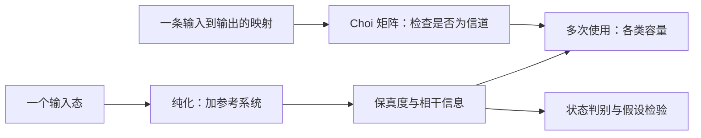
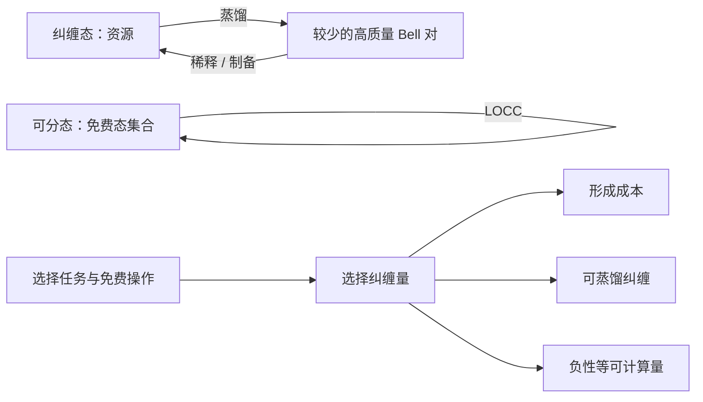
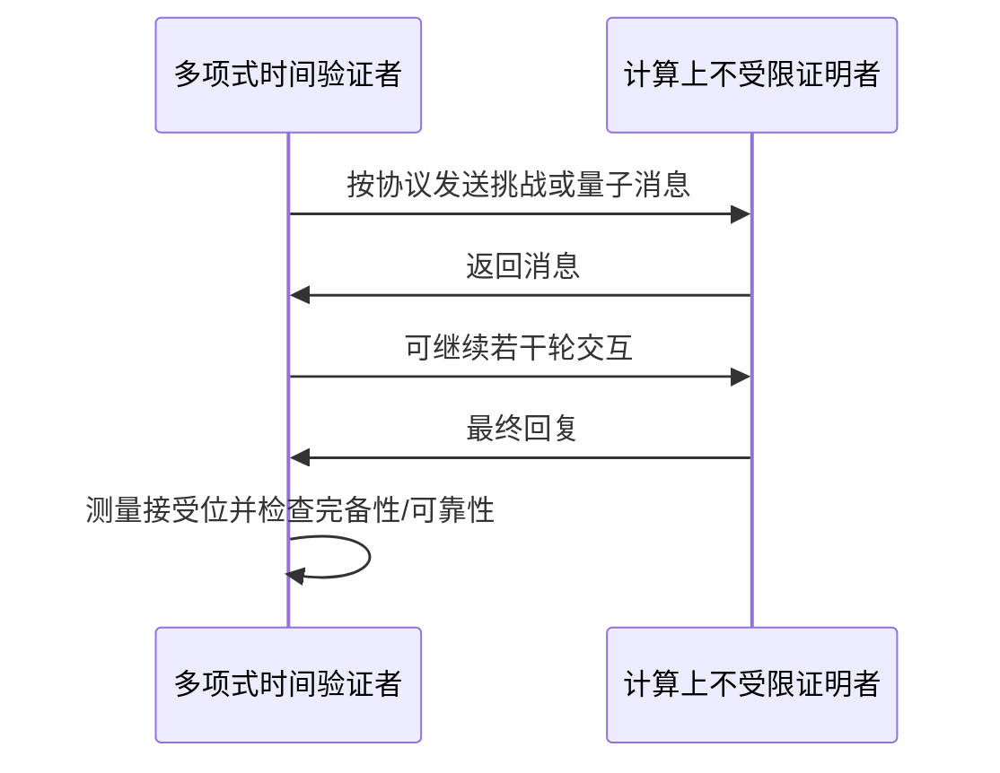
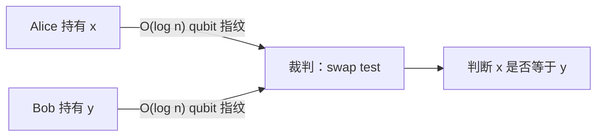

# 18｜从量子态到通信任务：信道、容量与验证复杂度

第 05 章已经介绍密度矩阵、Kraus 算子和噪声，第 13 章介绍熵、距离、相对熵与 Holevo 量。本章把这些工具接到三个更接近研究论文的问题：怎样用一个矩阵表示整条信道？“一个信道能传多少信息”为什么没有唯一答案？BQP、QCMA、QMA、QIP 和通信复杂度究竟在计算什么资源？

建议先读第 03、05、07、13 章。连续变量小节还会用到第 09 章的光子硬件背景。

如果几年没有系统学数学，可以分三遍读。**第一遍**读第 1 节的纯化算例、第 2 节的两个 Choi 矩阵、第 3 节的单次检验和第 4 节的擦除事件表；只需会矩阵乘法、偏迹和二元概率。**第二遍**读各节的通式和第 5—7 节，练习把任务和资源说清。**进阶回看**再读容量的正则化证明入口、量子指纹的编码存在性和第 8 节的 Gaussian 边界；这些不是理解第一个算例的门槛。

先统一几个角色。$A$ 是送入信道的系统，$B$ 是接收方得到的输出，$E$ 是环境拿走的部分；$R$ 是为记账而保留、**不送入信道**的参考系统。信道 $\mathcal N:A\to B$ 把输入密度矩阵变成输出密度矩阵。连续使用 $n$ 次且每次噪声独立时写作 $\mathcal N^{\otimes n}$。本章所有熵和信息量的对数都以 2 为底，单位是 bit；容量按**每次使用**计，不是每秒。字母 $R$ 在第 8 节的正交分量向量 $\hat R$ 中另有含义，那里会重新定义。

读完后，你应当能够：

- 从密度矩阵构造纯化，并用纯化理解根保真度；
- 在声明归一化约定后构造 Choi 矩阵，分别检查完全正和保迹；
- 区分经典容量、量子容量、私密容量和纠缠辅助经典容量；
- 区分 Helstrom 单副本判别与 Stein 多副本非对称检验；
- 解释为什么混态纠缠没有唯一的“纠缠百分比”；
- 用量词写出 QCMA/QMA 的完备性与可靠性条件；
- 在比较量子通信复杂度前先固定通信模型；
- 读懂连续变量中的正交分量、压缩和 Gaussian/非 Gaussian 边界。

## 1. 纯化：混态可以来自更大系统的纯态

先从熟悉的抛硬币形式入手：

$$
\rho_A=\begin{pmatrix}0.8&0\\0&0.2\end{pmatrix}
=0.8|0\rangle\langle0|+0.2|1\rangle\langle1|.
$$

只看 $A$，**按计算基测量**时有 $80\%$ 机会得到 0、$20\%$ 得到 1。**纯化的任务**是找一个更大系统 $AR$ 的归一化纯态，使丢弃 $R$ 后恰好回到这个 $2\times2$ 矩阵。这里“丢弃”是数学上的部分迹，不意味着实验者一定曾持有 $R$。

先猜 $|\psi\rangle_{AR}=\sqrt{0.8}|00\rangle+\sqrt{0.2}|11\rangle$。两项振幅的模平方相加为 $0.8+0.2=1$。在 $|00\rangle,|01\rangle,|10\rangle,|11\rangle$ 顺序下，$|\psi\rangle$ 是四维列向量 $[\sqrt{0.8},0,0,\sqrt{0.2}]^T$；它与自己的共轭转置相乘，得到四行四列的矩阵：

$$
|\psi\rangle\langle\psi|
=\begin{pmatrix}
0.8&0&0&0.4\\
0&0&0&0\\
0&0&0&0\\
0.4&0&0&0.2
\end{pmatrix}.
$$

右上和左下的 $0.4=\sqrt{0.8}\sqrt{0.2}$ 是相干的交叉项。对 $R$ 求部分迹时，$|00\rangle\langle11|$ 的参考侧是 $|0\rangle\langle1|$，迹为 0；另一个交叉项也为 0。两个对角项的参考侧迹均为 1，故留下 $\operatorname{diag}(0.8,0.2)$。这就是先算例、再给一般构造的路线。

**进阶回看：一般谱分解。** 若 $\rho_A$ 不预先对角化，可先找它的正交本征向量 $|i\rangle$ 和非零本征值 $\lambda_i$。本征值是非负且和为 1 的实数；$r$ 表示非零本征值的个数，即矩阵的秩。对任意有限维系统 $A$，相应的谱分解写为

$$
\rho_A=\sum_{i=1}^r\lambda_i|i\rangle\langle i|,
\qquad
\lambda_i>0,\qquad \sum_i\lambda_i=1.
$$

引入至少 $r=\operatorname{rank}(\rho)$ 维的参考系统 $R$，定义

$$
|\psi_\rho\rangle_{AR}
=\sum_{i=1}^r\sqrt{\lambda_i}|i\rangle_A|i\rangle_R.
$$

这是归一化纯态，因为

$$
\langle\psi_\rho|\psi_\rho\rangle
=\sum_i\lambda_i=1.
$$

把 $R$ 丢弃：

$$
\begin{aligned}
\operatorname{Tr}_R(|\psi_\rho\rangle\langle\psi_\rho|)
&=\sum_{i,j}\sqrt{\lambda_i\lambda_j}
|i\rangle\langle j|_A
\operatorname{Tr}(|i\rangle\langle j|_R)\\
&=\sum_{i,j}\sqrt{\lambda_i\lambda_j}
|i\rangle\langle j|_A\,\delta_{ij}\\
&=\sum_i\lambda_i|i\rangle\langle i|=\rho_A.
\end{aligned}
$$

这样的 $|\psi_\rho\rangle_{AR}$ 称为 $\rho_A$ 的一个**纯化**。纯化不是唯一的：只在参考系统上施加等距变换 $V_R$，

$$
(I_A\otimes V_R)|\psi_\rho\rangle,
$$

对 $R$ 做偏迹后仍得到同一个 $\rho_A$。反过来，同一密度矩阵的任意两个纯化，在把辅助空间补到足够大后，都可由参考系统上的等距变换联系。

### 1.1 再用 $I/2$ 核对，并辨清参考系统

Bell 态

$$
|\Phi^+\rangle=\frac{|00\rangle+|11\rangle}{\sqrt2}
$$

是 $I/2$ 的纯化。偏迹第二个量子比特后，交叉项含 $\langle0|1\rangle$ 或 $\langle1|0\rangle$，均为零，只剩

$$
\operatorname{Tr}_R(|\Phi^+\rangle\langle\Phi^+|)
=\frac12(|0\rangle\langle0|+|1\rangle\langle1|)=I/2.
$$

将 Bell 态的两个 $1/\sqrt2$ 分别换成 $\sqrt{0.8}$、$\sqrt{0.2}$，就回到本节开头的不均匀混态算例。无论哪一个例子，都不是说实验室一定能访问某个“真正的 $R$”。纯化首先是一种数学表示；在开放系统模型中，$R$ 也可以代表环境、参考端或我们没有读取的自由度。

### 1.2 Uhlmann 定理与本书的根保真度

本书采用根保真度

$$
F(\rho,\sigma)
=\left\|\sqrt\rho\sqrt\sigma\right\|_1.
$$

Uhlmann 定理把它解释成纯化重叠。先选一个共同参考系统 $R$，使

$$
\dim R\ge
\max\{\operatorname{rank}(\rho),\operatorname{rank}(\sigma)\},
$$

并把固定的 $\rho$ 纯化嵌入这个空间；再对 $\sigma$ 在同一 $R$ 上的所有纯化优化，便有

$$
F(\rho,\sigma)
=\max_{|\psi_\sigma\rangle}
|\langle\psi_\rho|\psi_\sigma\rangle|.
$$

若一方是纯态 $|\phi\rangle$，则

$$
F(\rho,|\phi\rangle)
=\sqrt{\langle\phi|\rho|\phi\rangle}.
$$

例如 $\rho=I/2$、$\sigma=|0\rangle\langle0|$ 时，取 $I/2$ 的纯化 $|\Phi^+\rangle$，并取 $\sigma$ 的纯化 $|00\rangle$，重叠为 $1/\sqrt2$。这与直接代入根保真度公式一致。

再把上一例的 $\rho=\operatorname{diag}(0.8,0.2)$ 与 $|0\rangle$ 比较：直接公式给 $F=\sqrt{\langle0|\rho|0\rangle}=\sqrt{0.8}\approx0.8944$；相应纯化 $\sqrt{0.8}|00\rangle+\sqrt{0.2}|11\rangle$ 与 $|00\rangle$ 的内积也是 $\sqrt{0.8}$。注意 **根**保真度是 $0.8944$，它的平方才是 $0.8$；有些论文把后者称作“保真度”。

纯化也解释了为什么量子信道会让两个候选态更难区分：把信道提升为“系统与环境上的等距演化”，再丢弃环境；丢弃信息不能降低根保真度。因此

$$
F(\mathcal E(\rho),\mathcal E(\sigma))
\ge F(\rho,\sigma).
$$

## 2. Choi–Jamiołkowski 对应：把整条信道写成一个矩阵

Kraus 算子描述“信道怎样作用”。Choi 矩阵把同一件事改写为一个二分算子，特别适合检查完全正、做凸优化和重构实验过程。

先说明要解决的难题。只检查一条映射把**某个**密度矩阵送到合法密度矩阵，还不足以判定它可在实验中作用于纠缠系统的一半。量子信道必须是线性的、保迹的、**完全正**的：对任意额外参考系统 $R$，$I_R\otimes\mathcal E$ 仍把正矩阵送到正矩阵。Choi 方法把“对任意大小的参考系统”压缩成一个有限维矩阵的正性检查。

### 2.1 先声明归一化约定

本章使用未归一化最大纠缠向量

$$
|\Omega\rangle_{A'A}
=\sum_{i=0}^{d_A-1}|i\rangle_{A'}|i\rangle_A.
$$

对线性映射 $\mathcal E:A\to B$，定义

$$
\begin{aligned}
J_{\mathcal E}
&=(I_{A'}\otimes\mathcal E_{A\to B})
(|\Omega\rangle\langle\Omega|)\\
&=\sum_{i,j}|i\rangle\langle j|_{A'}
\otimes\mathcal E(|i\rangle\langle j|)_B.
\end{aligned}
$$

由它可以恢复映射：

$$
\mathcal E(X)
=\operatorname{Tr}_{A'}
\left[(X^T\otimes I_B)J_{\mathcal E}\right].
$$

这里的转置相对于定义 $|\Omega\rangle$ 时使用的计算基。逐项检查即可看到原因：

$$
\operatorname{Tr}_{A'}
[(X^T\otimes I)(|i\rangle\langle j|\otimes\mathcal E(|i\rangle\langle j|))]
=X_{ij}\mathcal E(|i\rangle\langle j|).
$$

对有限维映射，有两条最重要的判据：

$$
\mathcal E\text{ 完全正}
\quad\Longleftrightarrow\quad
J_{\mathcal E}\succeq0,
$$

$$
\mathcal E\text{ 保迹}
\quad\Longleftrightarrow\quad
\operatorname{Tr}_B J_{\mathcal E}=I_{A'}.
$$

所以 $J\succeq0$ 还不够；物理确定性信道还必须满足偏迹条件。

### 2.2 先手算恒等信道，再看反例

qubit 恒等信道 $\mathcal I(X)=X$ 不改变输入。因为 $|\Omega\rangle=|00\rangle+|11\rangle$，直接展开外积得到

$$
J_{\mathcal I}=|\Omega\rangle\langle\Omega|
=\begin{pmatrix}
1&0&0&1\\
0&0&0&0\\
0&0&0&0\\
1&0&0&1
\end{pmatrix}.
$$

例如右上角的 1 来自 $|00\rangle\langle11|$。令 $|\Phi^+\rangle=|\Omega\rangle/\sqrt2$，这个矩阵又等于 $2|\Phi^+\rangle\langle\Phi^+|$，所以本征值是 $2,0,0,0$：没有负数，满足完全正。输出侧偏迹只留下 $|0\rangle\langle0|+|1\rangle\langle1|=I$，故也保迹。它的总迹为 2，正是**未归一化**约定的输入维数。

为什么不能只要求“输入正就输出正”？转置映射 $\mathcal T(X)=X^T$ 把单个系统的正矩阵仍送到正矩阵，也保迹，却不是完全正。它的 Choi 矩阵是交换算子

$$
J_{\mathcal T}=\begin{pmatrix}
1&0&0&0\\
0&0&1&0\\
0&1&0&0\\
0&0&0&1
\end{pmatrix}.
$$

中间 $2\times2$ 块 $\left(\begin{smallmatrix}0&1\\1&0\end{smallmatrix}\right)$ 作用于 $(1,-1)^T/\sqrt2$ 给出 $-1$ 倍自身，故 $J_{\mathcal T}$ 有负本征值 $-1$。这给“正但非完全正”一个具体可检查的例子。它不是可独立作用于未知纠缠态一半的确定性量子信道。

部分资料改用归一化 Bell 态 $|\Phi\rangle=|\Omega\rangle/\sqrt{d_A}$。那时“Choi 态”是 $J_{\mathcal E}/d_A$，总迹为 1，保迹条件相应写成输入侧边缘态 $I_{A'}/d_A$。看到 Choi 公式时，第一件事应是检查作者采用哪一种约定。

### 2.3 手算：复位信道

第 05 章的复位信道为

$$
\mathcal R(X)=\operatorname{Tr}(X)|0\rangle\langle0|.
$$

因为

$$
\mathcal R(|i\rangle\langle j|)
=\delta_{ij}|0\rangle\langle0|,
$$

所以

$$
J_{\mathcal R}
=\sum_i|i\rangle\langle i|\otimes|0\rangle\langle0|
=I_{A'}\otimes|0\rangle\langle0|.
$$

对 qubit 输入，在 $|00\rangle,|01\rangle,|10\rangle,|11\rangle$ 次序下，

$$
J_{\mathcal R}=\operatorname{diag}(1,0,1,0).
$$

其特征值非负，所以映射完全正；又有

$$
\operatorname{Tr}_B J_{\mathcal R}=I_{A'},
$$

所以它保迹。未归一化 Choi 矩阵的迹为输入维数 2，不应误判为“不是态所以不合法”。

| 表示 | 核心对象 | 常见用途 | 最易混淆处 |
|---|---|---|---|
| Kraus | 一组 $K_k$ | 噪声模拟、状态更新 | Kraus 分解不唯一 |
| Stinespring | 等距或系统—环境酉演化 | 环境信息、互补信道 | 环境表示也不唯一 |
| Choi | 二分正算子 $J_{\mathcal E}$ | CP/TP 判据、层析、优化 | 是否除以输入维数 |
| Pauli transfer matrix | Pauli 基上的线性矩阵 | qubit 实验拟合与组合 | 基的归一化与排序 |

## 3. 相对熵为何对应非对称假设检验

Helstrom 公式回答的是：只有一个样本、两种先验相等、两类错误合在一起时，最优猜测成功率是多少。量子相对熵对应另一种任务：有很多独立同分布副本，严格控制一种错误，再尽量压低另一种错误。

这里先固定语言：$\rho$ 是我们希望接受的“原假设”，$\sigma$ 是备选态；检验结果只有“接受 $\rho$”或“拒绝 $\rho$”。**第一类错误**是 $\rho$ 真的到来却拒绝；**第二类错误**是 $\sigma$ 真的到来却误接受。两种错误不能只凭名称辨别，最好每次写出条件事件。

令 $0\le T\le I$ 表示二元检验中“接受候选态 $\rho$”的 POVM 元。若真实态是 $\rho$ 却拒绝它，第一类错误为

$$
\alpha(T)=\operatorname{Tr}[(I-T)\rho].
$$

若真实态是 $\sigma$ 却接受 $\rho$，第二类错误为

$$
\beta(T)=\operatorname{Tr}[T\sigma].
$$

固定 $\alpha(T)\le\epsilon$，定义假设检验相对熵

$$
D_H^\epsilon(\rho\|\sigma)
=-\log_2
\min_{0\le T\le I:\,\alpha(T)\le\epsilon}
\beta(T).
$$

为避免把渐近指数误读成有限样本概率，先记

$$
\beta_n^*(\epsilon)
=\min_{\substack{0\le T_n\le I:\\
\operatorname{Tr}[(I-T_n)\rho^{\otimes n}]\le\epsilon}}
\operatorname{Tr}[T_n\sigma^{\otimes n}].
$$

量子 Stein 引理说，对任意固定 $0<\epsilon<1$，

$$
\lim_{n\to\infty}\frac1n
D_H^\epsilon(\rho^{\otimes n}\|\sigma^{\otimes n})
=D(\rho\|\sigma).
$$

也就是说，在第一类错误保持受控时，最优第二类错误满足

$$
\lim_{n\to\infty}-\frac1n\log_2\beta_n^*(\epsilon)
=D(\rho\|\sigma),
$$

等价地，$\beta_n^*(\epsilon)=2^{-nD(\rho\|\sigma)+o(n)}$。这只固定指数的一阶项，并不声称有限 $n$ 时等号成立。这个渐近指数解释了相对熵的方向性：交换 $\rho$ 与 $\sigma$ 就交换了“哪一种错误受严格控制”。

这个表达式按常见有限相对熵情形理解，即 $\operatorname{supp}(\rho)\subseteq\operatorname{supp}(\sigma)$；这里“支持空间”是矩阵非零本征值所对应方向张成的空间。若该包含关系不满足，相对熵为无穷大，不能把它当作一个有限的每副本 bit 数。下例两态都满秩，没有这一边界问题。

### 3.1 手算：两个可对易状态

取

$$
\rho=\operatorname{diag}(0.8,0.2),
\qquad
\sigma=I/2.
$$

两者在同一基下对角，量子问题退化为经典二元分布：

$$
\begin{aligned}
D(\rho\|\sigma)
&=0.8\log_2\frac{0.8}{0.5}
+0.2\log_2\frac{0.2}{0.5}\\
&=0.8\log_2 1.6+0.2\log_2 0.4\\
&\approx0.2781\text{ bit}.
\end{aligned}
$$

它不是单副本猜对概率，也不是普通几何距离。Stein 引理还依赖独立同分布（i.i.d.）副本和固定错误预算；有限样本时应直接报告实际检验及两类错误。

**同一对态的单副本小题。** 限制第一类错误 $\alpha\le0.1$。由于两个态都在计算基上对角，我们可以先测 0 或 1，再按结果决定是否接受 $\rho$。记测到 0 时接受概率为 $t_0$，测到 1 时为 $t_1$，均在 $[0,1]$。那么

$$
1-\alpha=0.8t_0+0.2t_1\ge0.9,
\qquad
\beta=0.5t_0+0.5t_1.
$$

“测到 0”对 $\rho$ 的支持相对 $\sigma$ 更强：每增加一点接受概率，在 $\rho$ 下带来 $0.8$，在 $\sigma$ 下只带来 $0.5$。因此先取 $t_0=1$；还缺 $0.1$ 的 $\rho$ 接受概率，需 $0.2t_1=0.1$，即 $t_1=1/2$。得到 $\alpha=0.1$、$\beta=0.75$、$D_H^{0.1}(\rho\|\sigma)=-\log_2(0.75)\approx0.4150$ bit。这里的“以 $1/2$ 接受”是合法的随机化检验，不是量子态振幅。若只需 $\alpha\le0.2$，取 $(t_0,t_1)=(1,0)$ 即可，最小 $\beta=0.5$、$D_H^{0.2}=1$ bit。对照相等先验的 Helstrom 单副本最优成功率 $[1+\tfrac12\|\rho-\sigma\|_1]/2=0.65$：它根本没有固定 $\alpha$ 的约束，数值不能直接相互比较。

## 4. 信道容量：先问传什么，再问每次能传多少

“信道容量”不是一个没有下标的通用分数。相同物理信道可以传经典消息、未知量子态或私密经典消息；发送方和接收方也可能预先共享纠缠。资源不同，容量就不同。

容量是渐近概念：使用 $n$ 次无记忆信道，允许跨多次使用联合编码和联合解码，要求错误随 $n\to\infty$ 趋于零，再看每次信道使用可传多少信息。

把它想成四份不同的考试卷：Alice 要传普通的 0/1 消息、要传未知量子态、要传 Bob 可读而环境尽量不知道的秘密消息，或在预先共享 Bell 对帮助下传普通消息。虽然每题使用同一物理线路，及格条件和准许带入的资源并不同。下表的“bit/use”是平均每次信道使用的渐近速率；例如 $0.75$ bit/use 不意味着一次实验会吐出四分之三个比特，而是当使用次数趋于很大时，可靠传输的位数与使用次数之比可以逼近 $0.75$。它不保证有限的 $100$ 次就能传 $75$ 位。

| 记号 | 目标 | 免费辅助资源 | 单位 |
|---|---|---|---|
| $C(\mathcal N)$ | 可靠传经典消息 | 无预共享纠缠 | bit/use |
| $Q(\mathcal N)$ | 可靠传未知量子态或等价地产生纠缠 | 无辅助 | qubit/use |
| $P(\mathcal N)$ | 让接收方获得、环境不能获得的经典消息 | 无额外辅助信道；相关密钥生成模型见下文 | secret bit/use |
| $C_E(\mathcal N)$ | 可靠传经典消息 | 无限预共享纠缠 | bit/use |

容量按“每次使用”计，不等于每秒吞吐。后者还依赖一次使用耗时、并行度、编码块长、失败重试和控制延迟。

“可靠”是说存在一串越来越长的编码方案，使整体解码错误趋于 0；“私密”还需让环境关于消息的泄漏趋于 0（具体采用的渐近泄漏准则须与定理匹配）。单次互信息或一次好看的实验数据，都不是这一渐近可达性证明。

### 4.1 经典容量：Holevo 量还要对很多次使用取极限

对一次信道使用，优化输入态系综（ensemble）的 Holevo 量：

$$
\chi(\mathcal N)
=\max_{\{p_x,\rho_x\}}
\left[
S\!\left(\sum_xp_x\mathcal N(\rho_x)\right)
-\sum_xp_xS(\mathcal N(\rho_x))
\right].
$$

一般无辅助经典容量为

$$
C(\mathcal N)
=\lim_{n\to\infty}\frac1n
\chi(\mathcal N^{\otimes n}).
$$

为什么多一个极限？一次最优系综只回答单次使用；若把若干次输入联合编码，所得最优信息不必等于“单次最优乘次数”。令 $n$ 增长、再除以 $n$，才与容量任务相符。对某些特殊信道可证明单次式已经足够；不能把这种特例当通则。

第 13 章的 $I_{\rm acc}\le\chi$ 是一个给定态集合的测量上界；这里还要对输入编码集合优化，并允许跨多次信道使用编码。因此“某个态系综的 $\chi$”“一次信道的 $\chi(\mathcal N)$”和完整容量 $C(\mathcal N)$ 不能混称。

### 4.2 量子容量：相干信息可以为负

取输入态 $\rho_A$ 的纯化 $|\psi_\rho\rangle_{RA}$，把 $A$ 送入信道：

$$
\omega_{RB}
=(I_R\otimes\mathcal N_{A\to B})(\psi_{RA}).
$$

相干信息定义为

$$
I_c(\rho,\mathcal N)
=S(B)_\omega-S(RB)_\omega
=-S(R|B)_\omega.
$$

一般量子容量需要正则化：

$$
Q(\mathcal N)
=\lim_{n\to\infty}\frac1n
\max_{\rho^{(n)}}
I_c(\rho^{(n)},\mathcal N^{\otimes n}).
$$

$I_c$ 可以为负，但容量按可实现的非负传输率定义，不会是负数。一次使用的最大相干信息也不总等于最终量子容量。

这里可以顺手排除一个符号疑问：若输入 $\rho$ 本身是纯态，参考系统 $R$ 可以取一维，$RB$ 与 $B$ 实际是同一个输出状态，所以 $S(B)-S(RB)=0$。因此在上面“对所有输入取最大”的式子中，单次最大值至少为 0；负值指的是**某些特定输入**的相干信息，不是最终容量为负。这个零输入基线不意味着纯态编码能传任意未知量子态，它只用于检查公式的非负性。

### 4.3 私密经典容量：接收方与环境的信息差

选定信道的 Stinespring 等距扩张后，输出分成接收方 $B$ 和环境 $E$；把同一个输入映到环境输出的映射称为**互补信道** $\mathcal N^c$。若存在信道 $\mathcal D$ 使 $\mathcal N^c=\mathcal D\circ\mathcal N$，环境信息可由接收方输出模拟，称 $\mathcal N$ **可降解**；若反过来 $\mathcal N=\mathcal D\circ\mathcal N^c$，则称它**反降解**。对经典变量 $X$ 编码成输入态系综 $\{p_x,\rho_x\}$，单次私密信息为

$$
P^{(1)}(\mathcal N)
=\max_{\{p_x,\rho_x\}}
\bigl[I(X:B)-I(X:E)\bigr].
$$

第一项要求 Bob 能读出消息，第二项扣除环境可能获得的信息。一般无辅助私密容量仍需正则化：

$$
P(\mathcal N)
=\lim_{n\to\infty}\frac1n
P^{(1)}(\mathcal N^{\otimes n}).
$$

这里的 $P(\mathcal N)$ 首先指无预共享密钥、无额外辅助信道的私密经典容量。若把任务改写成密钥生成，允许免费的前向公共通信也不会提高这里的容量；允许反向或双向公共通信则定义了不同的辅助容量。$P$ 与 $Q$ 在一般信道上不是同一个量，虽然下面的擦除信道恰好给出相同数值。

### 4.4 纠缠辅助经典容量

若发送方与接收方预先共享无限纠缠，则

$$
C_E(\mathcal N)
=\max_{\rho_A}I(R:B)_\omega.
$$

这个公式不需正则化。对理想 qubit 信道，$C_E=2$ bit/use，正是超密编码：一个发送的 qubit 加一个预共享 Bell 对可传两个经典位。Bell 对不是免费创造出来的；它只是被容量定义明确列为预共享资源。

### 4.5 完整算例：qubit 擦除信道

擦除信道以概率 $1-\varepsilon$ 原样送达 qubit，以概率 $\varepsilon$ 输出与 qubit 子空间正交的旗标 $|e\rangle$：

$$
\mathcal E_\varepsilon(\rho)
=(1-\varepsilon)\rho
+\varepsilon|e\rangle\langle e|.
$$

接收方知道哪些位置被擦除，因为旗标与输入空间正交。

先看一份完全不涉及熵的小表。设 Alice 用 $|0\rangle$ 或 $|1\rangle$ 各以 $1/2$ 概率表示一个经典位；$\varepsilon=1/4$：

| 事件 | 概率 | Bob 看到什么 | 这一位还能辨认吗 |
|---|---:|---|---|
| 正常送达 | $3/4$ | 原来的 $|0\rangle$ 或 $|1\rangle$ | 能 |
| 擦除 | $1/4$ | 与二者正交的 $|e\rangle$ | 不能；但知道它丢了 |

大块编码可以利用“哪些位置丢了”的信息恢复一部分消息，得到下述 $C=3/4$。量子态的情形更严：Bob 不只要知道丢失位置，还要恢复未知态与参考系统的纠缠。下面的 $Q$ 计算正是把这个更严的要求量化。

**经典容量。** 用正交态 $|0\rangle,|1\rangle$ 编码，信道就成为普通的二元擦除信道；在许多次独立使用上做经典纠错编码，可使任意低于 $1-\varepsilon$ bit/use 的速率可靠传送。这给出可达率，而不是说一次未擦除便能补回同一块中所有丢失位。

上界也能把“联合编码是否可能绕过它”说清。使用 $n$ 次时，令 $S$ 表示**没有**被擦除的位置集合；$S$ 与所发消息 $X$ 独立，Bob 知道 $S$。即使 Alice 把输入跨 $n$ 次信道纠缠起来编码，固定 $S$ 后 Bob 保留的量子系统维数仍只有 $2^{|S|}$。第 13 章的 Holevo 维数界说，这部分最多承载 $\log_2(2^{|S|})=|S|$ bit 的经典消息互信息。再对所有可能的 $S$ 按发生概率平均：

$$
\begin{aligned}
I(X:B,S)&=I(X:B\mid S)\\
&\le\sum_S\Pr(S)|S|\\
&=\mathbb E|S|=n(1-\varepsilon).
\end{aligned}
$$

这里 $B$ 表示 Bob 的整个量子输出，包括擦除旗标；固定 $S$ 后，旗标不再含消息信息。还需把“互信息上界”接到“可靠传输速率”。若 Alice 从 $K$ 个等概率消息中选一个、Bob 的译码结果为 $\widehat X$、错误率为 $p_e$，Fano 不等式给

$$
\begin{aligned}
\log_2K
&\le I(X:\widehat X)+h_2(p_e)\\
&\quad+p_e\log_2(K-1),\\
I(X:\widehat X)&\le I(X:B,S)\le n(1-\varepsilon).
\end{aligned}
$$

第二个不等号用了“译码是对 $B,S$ 的处理，不能增加互信息”。因为 $\log_2(K-1)\le\log_2K$，移项后还有

$$
(1-p_e)\frac{\log_2K}{n}
\le 1-\varepsilon+\frac{h_2(p_e)}{n}.
$$

左边的 $\log_2K/n$ 正是每次使用信道传送的消息位数；要求编码块长增长时 $p_e\to0$，便得到可靠速率不能超过 $1-\varepsilon$ bit/use。这里 $h_2$ 是第 13 章的二元熵。上下界合并得到

$$
C(\mathcal E_\varepsilon)=1-\varepsilon.
$$

**量子容量。** 对最大混合输入 $I/2$ 及其 Bell 纯化，输出 $B$ 的熵为

$$
S(B)=h_2(\varepsilon)+(1-\varepsilon),
$$

因为“擦除/未擦除”旗标贡献 $h_2(\varepsilon)$，未擦除 qubit 分支再贡献 $(1-\varepsilon)$ bit。环境得到互补分支，所以

$$
S(E)=h_2(\varepsilon)+\varepsilon.
$$

整体 $RBE$ 为纯态，$S(RB)=S(E)$，于是

$$
I_c=S(B)-S(E)=1-2\varepsilon.
$$

这一步只展示了 $I/2$ 的取值；要知道它是否最优，还须检查其他输入。对任意 qubit 输入态 $\rho$，未擦除时 Bob 持有 $\rho$，擦除时只持有与输入正交的旗标，因此

$$
S(B)=h_2(\varepsilon)+(1-\varepsilon)S(\rho).
$$

对 $\rho$ 取纯化后，未擦除分支的 $RB$ 仍是纯态，擦除分支只剩参考系统的约化态，其熵为 $S(\rho)$。两分支有正交旗标，所以

$$
S(RB)=h_2(\varepsilon)+\varepsilon S(\rho),
\qquad
I_c(\rho,\mathcal E_\varepsilon)
=(1-2\varepsilon)S(\rho).
$$

当 $\varepsilon\le1/2$ 时，系数非负，且 qubit 满足 $S(\rho)\le1$，故 $I/2$ 的确使单次相干信息最大；它并非只是一组碰巧得到好数值的输入。

擦除信道的完整结果是

$$
Q(\mathcal E_\varepsilon)
=\max\{0,1-2\varepsilon\}.
$$

当 $\varepsilon\le1/2$ 时，擦除信道可降解，刚求得的单次最大值由可降解信道容量定理提升为完整容量；当 $\varepsilon\ge1/2$ 时，信道反降解，接收方输出可由环境输出模拟，量子容量为零。$\varepsilon=1/2$ 时两个表达式都给 0。不可克隆给出后一结论的直觉，而可降解/反降解理论给出严格证明。

**私密经典容量。** 用等概率正交态编码经典位 $X$。Bob 以概率 $1-\varepsilon$ 得到该位，以概率 $\varepsilon$ 只得到擦除旗标，所以

$$
I(X:B)=1-\varepsilon.
$$

互补信道正好交换“送给 Bob”和“送给环境”的分支，因此

$$
I(X:E)=\varepsilon.
$$

私密信息之差是 $1-2\varepsilon$。当 $\varepsilon\le1/2$，擦除信道可降解，这个编码达到最优；当 $\varepsilon\ge1/2$，信道反降解，环境不比 Bob 少看信息，容量为零。因此

$$
P(\mathcal E_\varepsilon)
=\max\{0,1-2\varepsilon\}.
$$

这个等式是擦除信道的特殊性质，不应推广成一般恒等式 $P=Q$。

**纠缠辅助经典容量。** 对任意输入态 $\rho$ 及其纯化，擦除旗标把输出分成两个正交分支，因而

$$
S(B)=h_2(\varepsilon)+(1-\varepsilon)S(\rho),
\qquad
S(RB)=h_2(\varepsilon)+\varepsilon S(\rho).
$$

于是

$$
I(R:B)=2(1-\varepsilon)S(\rho)
\le2(1-\varepsilon),
$$

其中 qubit 的 $S(\rho)\le1$。最大混合输入 $\rho=I/2$ 取到上界；此时 $S(R)=1$，逐项代入为

$$
\begin{aligned}
I(R:B)
&=S(R)+S(B)-S(RB)\\
&=1+[h_2(\varepsilon)+1-\varepsilon]
-[h_2(\varepsilon)+\varepsilon]\\
&=2(1-\varepsilon).
\end{aligned}
$$

因此这不仅给出可达值，也完成了对所有输入的最优化：

$$
C_E(\mathcal E_\varepsilon)=2(1-\varepsilon).
$$

取 $\varepsilon=1/4$：

$$
C=0.75\text{ bit/use},
\quad
Q=0.50\text{ qubit/use},
\quad
P=0.50\text{ secret bit/use},
\quad
C_E=1.50\text{ bit/use}.
$$

同一信道的四种任务得到三种数值，说明容量必须连同任务和辅助资源一起报告；$P=Q$ 只是本例的数值重合。

### 4.6 信道级数据处理

若在固定资源模型下给信道加编码前处理 $\mathcal A$ 和解码后处理 $\mathcal D$，任何复合信道方案也是使用中间信道 $\mathcal N$ 的一种方案，因此

$$
\operatorname{Cap}(\mathcal D\circ\mathcal N\circ\mathcal A)
\le\operatorname{Cap}(\mathcal N).
$$

这里两边必须是同一种容量，并且对辅助资源采用相同的计数方式。预共享纠缠、双向经典通信或反馈若只在一边免费，比较就失去意义。

## 5. 混态纠缠：先声明免费操作，再选择资源量

纯二分态的纠缠熵由 Schmidt 系数唯一确定。混态不同：局部熵既可能来自纠缠，也可能来自经典随机混合，所以不存在一个在所有任务中都充当“纠缠百分比”的标量。

先看一个足以阻止误判的矩阵：

$$
\rho_{AB}^{\rm sep}
=\tfrac12|00\rangle\langle00|+\tfrac12|11\rangle\langle11|.
$$

它是两个**乘积态**的概率混合，因此按下面的定义可分，没有纠缠。但丢弃 $B$ 后，$A$ 的状态是 $I/2$，局部熵 $S(A)=1$ bit。若只看 $S(A)$，会把这种普通的经典相关误写成 Bell 态纠缠。对照纯 Bell 态也有 $S(A)=1$ bit，区别在完整的 $AB$ 状态；所以本节必须用明确的资源任务或判据。

资源理论先回答三件事：

1. 哪些态免费？二分纠缠理论通常把可分态视为免费态；
2. 哪些操作免费？常见选择是局域操作与经典通信（LOCC）；
3. 资源量应满足什么？至少在免费态上为零，并且不能在所选免费操作下增加。

可分态具有形式

$$
\rho_{AB}=\sum_kp_k\rho_A^{(k)}\otimes\rho_B^{(k)}.
$$

“不是单个乘积态”不等于纠缠；上式可以是许多乘积态的经典混合。

不同操作任务产生不同量：纠缠形成关心制备一批目标态要消耗多少 Bell 对；可蒸馏纠缠关心从许多副本中能提取多少 Bell 对；负性则来自部分转置，容易计算，但不是所有纠缠任务的答案。

### 5.1 手算：加白噪声的 Bell 态

定义

$$
\rho_p=p|\Phi^+\rangle\langle\Phi^+|+(1-p)I/4,
\qquad 0\le p\le1.
$$

对第二个量子比特做部分转置，在计算基次序下得到

$$
\rho_p^{T_B}=\frac14
\begin{pmatrix}
1+p&0&0&0\\
0&1-p&2p&0\\
0&2p&1-p&0\\
0&0&0&1+p
\end{pmatrix}.
$$

中间 $2\times2$ 块的本征值为 $(1+p)/4$ 和 $(1-3p)/4$，所以完整谱是

$$
\frac{1+p}{4},\quad
\frac{1+p}{4},\quad
\frac{1+p}{4},\quad
\frac{1-3p}{4}.
$$

负性定义为

$$
\mathcal N(\rho)
=\frac{\|\rho^{T_B}\|_1-1}{2}.
$$

因此

$$
\mathcal N(\rho_p)
=\max\left\{0,\frac{3p-1}{4}\right\}.
$$

例如 $p=0.6$ 时谱为 $0.4,0.4,0.4,-0.2$；迹仍是 $1$，但迹范数把每个本征值取绝对值后相加，得到 $0.4+0.4+0.4+0.2=1.4$，故负性为 $(1.4-1)/2=0.2$。这一步不是把负本征值直接加进概率，而是用部分转置的负谱作为纠缠证据。

对两 qubit 系统，部分转置为正还是可分的充要条件，所以 $p>1/3$ 时该态纠缠；但在更高维系统中存在部分转置仍为正的纠缠态，负性会漏检它们。

LOCC、可分操作和所有“不从可分态生成纠缠”的操作不是同一个集合。谈资源单调性时必须先说采用哪组免费操作。

## 6. BQP、QCMA、QMA 与 QIP：缩写背后是不同协议

复杂度类讨论的是随输入长度增长的一族承诺问题，不是某台近期设备上的单个运行。一个承诺问题把合法输入分为 $L_{\rm yes}$ 和 $L_{\rm no}$；承诺之外的输入不要求算法给出特定答案。

本节只需先抓住两个问题：“谁来提供帮助？”“检查帮助的机器本身有多快？”BQP 没有见证者，量子机器自己计算；QCMA 和 QMA 都有一个多项式时间**量子**验证者，前者拿到经典串，后者可以拿到量子态；QIP 进一步让验证者与证明者来回交互。类别名称不表示某一台硬件已经实现了相应任务。

### 6.1 完备性与可靠性的量词

对输入 $x$，设多项式时间量子验证电路为 $V_x$，见证为 $w$。验证类要求存在 $c>s$，且 $c-s\ge1/\operatorname{poly}(|x|)$，使

$$
\begin{aligned}
x\in L_{\rm yes}&:
\quad\exists w,
\quad\Pr[V_x(w)=1]\ge c,\\
x\in L_{\rm no}&:
\quad\forall w,
\quad\Pr[V_x(w)=1]\le s.
\end{aligned}
$$

第一行是**完备性**：是实例至少有一个好见证。第二行是**可靠性**：否实例不能被任何作弊见证高概率骗过。常用 $c=2/3,s=1/3$；只要间隙至少为逆多项式，就可放大而不改变复杂度类。

量词顺序很重要。“yes 有一个好见证”绝不表示随便哪个见证都能通过；“no 的每一个见证都不行”才把作弊者包含进来。QCMA 的 $w$ 在“存在/任意”处遍历经典位串，QMA 则遍历允许的多量子比特密度矩阵。对 QIP，把 $w$ 换成证明者从头到尾的**策略**，同样要求 yes 有一种策略成功、no 的任何策略都不能高概率成功；不能把一次回复当成整个交互。

| 类 | 见证/交互 | 验证者 | 容易误读之处 |
|---|---|---|---|
| BQP | 无见证 | 量子多项式时间 | 是判定类，不是所有量子设备任务 |
| QCMA | 多项式长度经典串 | 量子多项式时间 | “C”修饰见证，不是验证者 |
| QMA | 多项式量子比特态 | 量子多项式时间 | 量子见证不是振幅的经典清单 |
| QIP | 与不受限证明者进行多轮量子交互 | 量子多项式时间 | $\mathrm{QIP}=\mathrm{PSPACE}$ 不是 BQP 算法 |

已知包含关系包括

$$
\mathrm{BQP}\subseteq\mathrm{QCMA}
\subseteq\mathrm{QMA}\subseteq\mathrm{PP},
\qquad
\mathrm{NP}\subseteq\mathrm{QCMA}.
$$

一般情形下 QCMA 是否等于 QMA 仍未知。QMA 完备的局域 Hamiltonian 问题必须带逆多项式承诺间隙；不能把“估计任意基态能量”不加精度条件地称为同一个问题。

### 6.2 小算例：验证就是优化接受算子

固定验证电路后，接受概率可写为

$$
p_{\rm acc}(w)=\operatorname{Tr}(M_xw),
\qquad 0\preceq M_x\preceq I.
$$

允许任意量子见证时，最优接受率是 $M_x$ 的最大特征值。若

$$
M=|+\rangle\langle+|,
$$

见证 $|+\rangle$ 的接受率为 1，见证 $|0\rangle$ 的接受率为

$$
|\langle+|0\rangle|^2=1/2.
$$

这个玩具例只展示“对见证优化”的数学，不证明 QCMA 与 QMA 有分离。

### 6.3 QIP 与实验验证不是同一问题

QIP 中的证明者可以拥有无限计算能力，验证者通过交互限制作弊成功率。定理

$$
\mathrm{QIP}=\mathrm{PSPACE}
$$

描述这种协议能验证哪些语言，并不表示普通 BQP 计算机能直接高效求解所有 PSPACE 问题。

第 16 章讨论的态层析、经典阴影、能隙证书和陷阱测试更接近“怎样为一个设备输出收集可信证据”。二者都会说“验证”，但问题设置不同：前者关心协议的完备性与可靠性，后者还必须处理状态制备与测量误差（SPAM）、漂移、有限次采样（shots）、模型失配和实验资源。

## 7. 通信复杂度：本地计算免费，只数通信

通信复杂度研究分布式任务。Alice 持有 $x$，Bob 持有 $y$，目标是计算 $f(x,y)$；两人的本地计算通常视为免费，只计算为完成任务交换了多少 bit 或 qubit。

报一个结果前必须固定：

- 单向、双向交互，还是 Alice 和 Bob 同时向裁判发送消息；
- 私有随机性还是公共随机性；
- 是否预共享纠缠；
- 精确计算还是允许有界错误；
- 研究总函数、关系还是带承诺的问题。

它不同于信道容量：容量问“同一物理信道每次使用能可靠传多少”；通信复杂度问“完成指定分布式函数至少要交换多少”。它也不同于墙钟时间，因为本地计算在模型中可能完全免费。

### 7.1 量子指纹：同时消息模型中的 equality

Alice 和 Bob 各持一个 $n$ 位串，不能互相通信，只能各自向裁判发送一条消息。裁判要判断 $x=y$。

取一个长度 $m=O(n)$ 的二元码 $E$。这里不仅要求最小距离：对任意不同输入 $x\ne y$，码字的相对 Hamming 距离

$$
\Delta_{xy}=\frac1m d_H(E(x),E(y))
$$

还须满足双侧条件

$$
\delta\le\Delta_{xy}\le1-\delta,
\qquad 0<\delta<\frac12.
$$

距离下界保证码字不太相近，上界排除码字近乎互补；后者对下面的**相位**指纹同样必要。

为什么长度仍可取 $m=O(n)$？可以先看存在性论证：为每个 $n$ 位输入独立随机选取一个长度为 $m$ 的二元码字，一对不同码字的距离平均为 $m/2$。由二项分布的集中界，固定一对的距离落在 $[m/4,3m/4]$ 外的概率至多为 $2e^{-m/8}$。输入共有 $2^n$ 个，不同的无序输入对少于 $2^{2n-1}$ 对。把每一对的坏事件概率相加，得到

$$
\Pr(\text{存在一对距离越界})
<2^{2n-1}\cdot2e^{-m/8}
=2^{2n}e^{-m/8}.
$$

只要取 $m>16n\ln2$，右边就小于 1，所以至少存在一种选法，使**所有**不同码字的距离都落在 $[m/4,3m/4]$ 内。这一步叫并合界；不同输入对的坏事件可能互相关联，**不需要**假设它们彼此独立。随机论证只保证码存在，不自动给出高效编码电路；通信复杂度把本地计算视为免费，实际部署还要单独计算编码时间。

双侧条件确实不可少：相对距离 $\Delta_{xy}=1/2$ 时，下文内积为 0，两个指纹正交；若 $\Delta_{xy}=1$，两个码字完全互补，内积反倒为 $-1$，swap test 只能看到模平方 1，会把不同输入误报为相同。由此定义指纹态

$$
|\phi_x\rangle
=\frac1{\sqrt m}
\sum_{i=1}^m(-1)^{E(x)_i}|i\rangle.
$$

它只需要 $\lceil\log_2m\rceil=O(\log n)$ 个 qubit。若 $x=y$，两个指纹完全相同。若 $x\ne y$，则

$$
\begin{aligned}
\langle\phi_x|\phi_y\rangle
&=\frac1m\sum_i(-1)^{E(x)_i\oplus E(y)_i},\\
&=1-2\Delta_{xy},\\
|\langle\phi_x|\phi_y\rangle|
&=|1-2\Delta_{xy}|\le1-2\delta.
\end{aligned}
$$

裁判做 swap test。“相同”结果的概率为

$$
p_{\rm same}
=\frac{1+|\langle\phi_x|\phi_y\rangle|^2}{2}.
$$

若 $x=y$，该概率为 1。若所有不同码字的相对距离都在 $[1/4,3/4]$，即 $\delta=1/4$，则

$$
p_{\rm same}
\le\frac{1+(1/2)^2}{2}=\frac58.
$$

重复 $r$ 次，并仅在每次都输出“相同”时接受，误判概率至多 $(5/8)^r$；$r=10$ 时约为 $0.0091$。

这一指数差距针对**没有共享随机性的同时消息模型**：经典私有随机指纹需要 $\Theta(\sqrt n)$ 级通信，而量子指纹只需 $O(\log n)$ qubit。若允许公共随机性，经典基线会改变。不能把该结果简写成“量子通信对 equality 总是指数更好”。

## 8. 连续变量的最小入口

前面各章主要使用有限维 qubit。光场模式、机械振子和微波腔天然具有无限维 Hilbert 空间；它们常用连续正交分量描述。

本章采用

$$
[\hat q,\hat p]=i,
\qquad
\hat a=\frac{\hat q+i\hat p}{\sqrt2},
\qquad
\hat a^\dagger=\frac{\hat q-i\hat p}{\sqrt2}.
$$

可以反过来读这些定义：$\hat q=(\hat a+\hat a^\dagger)/\sqrt2$，$\hat p=(\hat a-\hat a^\dagger)/(i\sqrt2)$。利用 $[\hat q,\hat p]=\hat q\hat p-\hat p\hat q=i$，逐项相减得到 $[\hat a,\hat a^\dagger]=-i[\hat q,\hat p]=1$。这里的“正交分量”是两个可测的场变量，不是像 Bloch 球上的两条任意坐标轴那样可以同时无限精确确定。

因此真空态满足

$$
\langle \hat q\rangle=\langle \hat p\rangle=0,
\qquad
\operatorname{Var}(\hat q)=\operatorname{Var}(\hat p)=\frac12.
$$

部分文献使用 $[\hat q,\hat p]=2i$，相应真空方差为 1。比较公式或实验压缩量时必须先统一约定。

对 $n$ 个模式，把正交分量排成

$$
\hat R=(\hat q_1,\hat p_1,\ldots,\hat q_n,\hat p_n)^T.
$$

一阶矩是 $d_i=\langle \hat R_i\rangle$，协方差矩阵为

$$
V_{ij}=\frac12
\langle\{\hat R_i-d_i,\hat R_j-d_j\}\rangle.
$$

Gaussian 态由一阶矩和协方差矩阵完全决定。位移、相移、分束器和压缩等 Gaussian 操作把 Gaussian 态仍映为 Gaussian 态；同相探测测量一个选定相位的正交分量，外差探测则联合估计两个正交分量并引入额外真空噪声。

### 协方差矩阵有正特征值，还不一定对应量子态

经典随机向量的协方差只需为实对称正半定矩阵。量子正交分量还受到对易关系约束。沿用本章交错排序 $\hat R=(\hat q_1,\hat p_1,\ldots)^T$，定义实反对称矩阵

$$
\Omega=\bigoplus_{j=1}^{n}\begin{pmatrix}0&1\\-1&0\end{pmatrix},
\qquad [\hat R_i,\hat R_j]=i\Omega_{ij}.
$$

由于 $\langle\Delta\hat R_i\Delta\hat R_j\rangle=V_{ij}+i\Omega_{ij}/2$，任意复向量 $u$ 都有

$$
u^\dagger(V+i\Omega/2)u
=\left\langle\left(\sum_j u_j\Delta\hat R_j\right)^\dagger
\left(\sum_j u_j\Delta\hat R_j\right)\right\rangle\ge0.
$$

因此量子协方差必须满足 $V+i\Omega/2\succeq0$。这条约束来自任意算符 $L$ 的 $\langle L^\dagger L\rangle\ge0$，不是软件额外加上的“误差阈值”。对有限一二阶矩，它也是存在具有这些矩的 Gaussian 态的充分条件；对一般非 Gaussian 态，满足它仍不使一二阶矩唯一确定整个态。

单模时写 $V=\left[\begin{smallmatrix}a&c\\c&b\end{smallmatrix}\right]$，$a,b$ 分别为两方差、$c$ 为对称协方差。要检查的是 Hermitian 矩阵

$$
V+i\Omega/2=\begin{pmatrix}a&c+i/2\\c-i/2&b\end{pmatrix}.
$$

二维正性要求 $a,b\ge0$ 和行列式 $ab-c^2-1/4\ge0$；后一个条件又迫使 $a,b>0$。所以单模的完整判据是

$$
a>0,\quad b>0,\quad \det V=ab-c^2\ge1/4.
$$

只检查方差乘积 $ab\ge1/4$ 会漏掉协方差项。下表给出三种固定数值矩阵，所有数值都使用 $[q,p]=i$ 的无量纲约定：

| $V$ | $V$ 本身是否正定 | $\det V$ | 是否可作量子协方差 |
|---|---|---:|---|
| $\operatorname{diag}(0.1,0.1)$ | 是 | 0.01 | 否，两轴同时低于真空 |
| $\operatorname{diag}(1/4,1)$ | 是 | $1/4$ | 是，下一节的纯压缩态 |
| $\left[\begin{smallmatrix}1/2&2/5\\2/5&1/2\end{smallmatrix}\right]$ | 是，本征值 $0.9,0.1$ | $0.09$ | 否，忽略 $c$ 会误判 |

第三行虽然两边边缘方差都等于真空方差，但相关项使旋转后的某个共轭方向组合违反完整不确定性矩阵；不能仅凭两根误差条判断。

**练习 A71-18（含详解）。** 求第三行 $V+i\Omega/2$ 的两个本征值。若某软件采用 $[q',p']=2i$、真空方差为 1，同一个压缩态 $V=\operatorname{diag}(1/4,1)$ 应如何输入？

**解答。** 特征方程为 $(1/2-\lambda)^2-[(2/5)^2+(1/2)^2]=0$，故 $\lambda_\pm=1/2\pm\sqrt{41}/10$，最小值约 $-0.140312$，不能通过物理性检查。换算 $q'=\sqrt2q,p'=\sqrt2p$ 时，整个矩阵乘 2，得到 $V'=\operatorname{diag}(1/2,2)$；检验也同步改为 $V'+i\Omega\succeq0$，行列式下界改为 1。不能只改真空标准而不改矩阵数值。

运行 `python3 codes/algorithms/round71_checks.py 18`，直接计算这三个二维 Hermitian 矩阵的谱，并检查缩放前后结论一致。理论对照 [Weedbrook 等 Gaussian 综述](https://arxiv.org/html/1110.3234v1)式 17（该文采用真空方差 1，需作上述换算）；软件对照 [The Walrus 的 `is_valid_cov`](https://github.com/XanaduAI/thewalrus/blob/master/thewalrus/quantum/gaussian_checks.py)（访问于 2026-10-13）。该函数默认 `hbar=2`；使用本书数值须显式传 `hbar=1`。多模输入的排序也要转换：该库以所有位置分量在前、所有动量分量在后排列，本书则逐模交错；单模时两者恰好一致。软件容差适用于数值舍入，不能把显著负本征值解释为合法压缩。

### 8.1 手算：压缩真空不是“两个方向都更准”

选择压缩相位使 $\hat q$ 为压缩轴，并取 $r>0$。此时单模压缩真空的协方差矩阵可写为

$$
V(r)=\frac12
\begin{pmatrix}
e^{-2r}&0\\
0&e^{2r}
\end{pmatrix}.
$$

因此

$$
\operatorname{Var}(\hat q)=\frac12e^{-2r},
\qquad
\operatorname{Var}(\hat p)=\frac12e^{2r},
$$

而

$$
\operatorname{Var}(\hat q)\operatorname{Var}(\hat p)=\frac14.
$$

压低 $\hat q$ 的噪声必然放大 $\hat p$ 的噪声，没有同时绕过不确定性关系。

若 $r=(\ln2)/2$，则 $e^{-2r}=1/2$，所以

$$
\operatorname{Var}(\hat q)=1/4,
\qquad
\operatorname{Var}(\hat p)=1.
$$

**进阶回看：能量也要计入。** 对零均值单模态，平均光子数 $\bar n=\langle\hat a^\dagger\hat a\rangle=[\operatorname{Var}(\hat q)+\operatorname{Var}(\hat p)-1]/2$；减去的 1 是真空两方差之和。上述例子给 $\bar n=(1/4+1-1)/2=1/8$。继续增大 $r$ 会让 $\hat q$ 更窄，但 $e^{2r}$ 和平均能量也增长；理想化的无限压缩不是一台有限能源机器的实际工作点。

当输入态、操作和测量都有可有效计算的 Gaussian 描述，模式数与步骤数按问题规模多项式增长，所需数值精度也只需多项式位数时，一阶矩和协方差矩阵可被经典计算机高效更新；相应的 Gaussian 测量与前馈也可高效采样。通用连续变量量子计算需要合适的非 Gaussian 资源，例如非 Gaussian 态、操作或测量；这不是说“任何含 Gaussian 元件的实验都可经典模拟”，也不涵盖无限能量或要求指数精度的形式输入。

无限维还带来有限维量子比特中不明显的边界：若不限制平均能量，某些容量或精度问题会变得不合物理实际。理想 GKP 码字是无限能量的梳状态；硬件实现只能制备有限压缩的近似态，估算所需资源时必须考虑有限能量与位移噪声。

## 9. 一张研究阅读清单

遇到量子信道、通信或验证论文时，依次填写：

1. 输入、输出和参考系统分别是什么？
2. 信道用 Kraus、Stinespring、Choi 还是 transfer matrix 表示？归一化与基序是什么？
3. 研究的是单次任务、有限块长，还是 $n\to\infty$ 的容量？
4. 传的是经典信息、量子信息还是私密信息？共享纠缠、公共通信和反馈是否免费？
5. 数据处理比较的两边是否使用同一资源模型？
6. 若涉及假设检验，哪一种错误被约束，副本是否 i.i.d.？
7. 若量化纠缠，免费操作是什么，所选量对应什么任务？
8. 若声明复杂度优势，计算的是时间、查询、样本还是通信？
9. 若出现验证者和证明者，写出完备性、可靠性和承诺间隙。
10. 若系统是连续变量，$[\hat q,\hat p]$、真空方差和能量约束采用什么约定？

## 10. 常见误区

- “混态只是我们不知道哪个纯态。”同一密度矩阵有许多 ensemble 分解，不能指定一个唯一的隐藏纯态清单。
- “Choi 矩阵正半定就一定是信道。”还必须满足保迹的偏迹条件。
- “Holevo 量就是量子容量。”Holevo 量约束经典信息；量子容量由相干信息及其正则化刻画。
- “容量是每秒多少。”容量通常按每次信道使用计；工程吞吐还需时钟、延迟和块长。
- “混态纠缠看一个局部熵即可。”局部熵也可能来自经典混合。
- “QCMA 的验证者是经典计算机。”QCMA 的见证是经典串，验证者仍是量子多项式时间。
- “QIP=PSPACE，所以量子计算机能高效解决 PSPACE。”QIP 使用计算上不受限的证明者，不是 BQP 算法模型。
- “通信复杂度小就表示程序运行快。”该模型通常把本地计算视为免费。
- “压缩态在两个正交分量上都更精确。”一个方向的方差下降伴随共轭方向上升。
- “Gaussian 光学自动给通用量子计算。”通用性需要跳出受限的、可高效模拟的 Gaussian 过程集合。

## 实操扩展：从擦除事件构造降解映射

第 4 节使用了“擦除信道在 $\varepsilon\le1/2$ 时可降解”。这里把抽象条件 $\mathcal E^c=\mathcal D\circ\mathcal E$ 变成一个可实施的随机步骤。Bob 得到输入态的概率是 $1-\varepsilon$，环境得到输入态的概率是 $\varepsilon$。若 $0\le\varepsilon\le1/2$，Bob 在收到未擦除态时，以概率

$$
r=\frac{\varepsilon}{1-\varepsilon}
$$

保留它，否则把它换成环境的擦除旗标；已经擦除的分支仍输出旗标。$r\in[0,1]$，所以这是合法信道。最终保留输入态的概率为 $(1-\varepsilon)r=\varepsilon$，与互补信道完全相同；这个构造不需要知道输入态是什么，也不需要复制它。

以 $\varepsilon=1/4$ 为例，$r=1/3$。原来 Bob 有 $3/4$ 的机会持有态，只保留其中三分之一，最终是 $1/4$，正好模拟环境。当 $\varepsilon>1/2$ 时，这个方向要求 $r>1$，不可能；反过来，让环境以 $(1-\varepsilon)/\varepsilon$ 保留它拿到的态，则能模拟 Bob，得到反降解。原始容量结果见 [Bennett、DiVincenzo 与 Smolin](https://doi.org/10.1103/PhysRevLett.78.3217)。

### 用熵计算检查输入优化，不能用网格代替容量定理

取输入 $\rho_q=\operatorname{diag}(q,1-q)$，$q\in[0,1]$。Bob 输出的三个本征值依次为

$$
(1-\varepsilon)q,\quad(1-\varepsilon)(1-q),\quad\varepsilon;
$$

环境则为

$$
\varepsilon q,\quad\varepsilon(1-q),\quad1-\varepsilon.
$$

逐项用 $S=-\sum_i p_i\log_2p_i$ 相减，应回到 $I_c=(1-2\varepsilon)h_2(q)$。端点约定 $0\log_2 0=0$，否则代码会在纯态或无擦除情形报错。擦除信道只依赖输入的谱，因此把 qubit 的本征值写成 $q,1-q$ 已覆盖所有输入谱；不是未经说明地把一般输入限制成对角态。

若 $\varepsilon=3/4$，最大混合输入给 $I_c=-1/2$，而纯态输入给 0；最大值因而是 0，不是 $-1/2$。对 $q$ 作网格搜索可以检查这一数值现象，却不能证明任意多个信道联合编码都无益；完整容量仍依赖上面的反降解结论。纠缠辅助经典容量则仍为 $2(1-\varepsilon)=1/2$ bit/use，说明“无辅助量子容量为零”并不等于这条线路不能完成其他通信任务。

**实验 18-A。** 从这两组三元概率直接算熵，在 $\varepsilon=0,1/4,1/2,3/4,1$ 及 101 个 $q$ 网格上核对相干信息恒等式，再分别列出 $C,Q,P,C_E$。代码入口为 `python3 codes/algorithms/experiments.py 18`；[完整实验与答案](labs/algorithms.md#实验-18-a擦除信道的四种任务)解释哪些列来自计算，哪些还使用容量定理。代码中的 `Q_theorem` 和 `P_theorem` 特意保留这层区别。

## 实操扩展 B：容量与三次发送的实际可靠性怎样区分

第 4 节的 $C=1-\varepsilon$ 是渐近可靠速率。要规划一个有限块长的实际通信协议，必须另写编码、译码和失败事件。只传**经典**消息时，可以用正交态 $|0\rangle,|1\rangle$ 将 qubit 擦除信道化为二元擦除信道；假设三次使用的擦除事件相互独立、没有位翻转、旗标能被可靠识别。以下两种小码只比较这个明确定义的任务。

**重复码：一位发三次。** 发送 $b\mapsto(b,b,b)$。只要至少一个位置未被擦除，接收方就从那个位置读出 $b$；三个全被擦除时报告“失败”，不随机猜。编码率为 $1/3$ bit/use，块失败概率为

$$
p_{\rm fail}^{\rm rep}=\varepsilon^3.
$$

对 $\varepsilon=1/4$，成功率是 $63/64=0.984375$。解码成功的分支没有消息错误，但整套协议仍有 $1/64$ 的显式失败概率。

**单奇偶校验码：两位发三位。** 把 $b_1b_2$ 编成 $(b_1,b_2,b_1\oplus b_2)$。任意一位被擦除时，可由另外两位恢复；例如收到 $(1,e,0)$，有 $b_2=1\oplus0=1$，原消息为 `11`。两位或三位被擦除时，仅剩的约束不足以唯一确定两个输入位，译码器报告失败。

四个码字为 `000`、`011`、`101`、`110`。例如只收到第三位为 0，原消息 `00` 和 `11` 都合法，所以“只剩一个位置仍可恢复”是错误的。其编码率为 $2/3$ bit/use，失败概率是

$$
\begin{aligned}
p_{\rm fail}^{\rm parity}
&=\binom32\varepsilon^2(1-\varepsilon)+\varepsilon^3\\
&=3\varepsilon^2-2\varepsilon^3.
\end{aligned}
$$

取 $\varepsilon=1/4$ 得 $5/32=0.15625$，成功率只有 $27/32=0.84375$。两种码的速率都低于容量 $3/4$，却有明显不同的有限块可靠性。

| 三次使用的方案 | 输入消息位数 | 速率（bit/use） | 块成功概率，$\varepsilon=1/4$ |
|---|---:|---:|---:|
| 重复码 | 1 | $1/3$ | $63/64$ |
| 单奇偶校验码 | 2 | $2/3$ | $27/32$ |
| 渐近容量定理 | 不指定三次使用的具体码 | $C=3/4$ | 不由容量值单独决定 |

这也说明“速率低于容量”只保证存在越来越长、错误趋零的合适编码族，不保证任意短码都可靠。两个例子的输入和输出长度均为常数；扩展到 $n$ 长度时还要计入编码计算、译码、存储、串并行延迟及失败协议。若使用反馈请求重发，必须把反馈资源和重试次数单独计入。

最后，这些码不能原样拿来传任意未知量子态。复制一个经典位三次是允许的；映射 $|\psi\rangle\mapsto|\psi\rangle^{\otimes3}$ 对任意未知态不可实现。即使用 CNOT 把 $\alpha|0\rangle+\beta|1\rangle$ 编到 $\alpha|000\rangle+\beta|111\rangle$，丢失一个物理位后剩余态也会失去两项间的相干性，因此不能沿用这里的经典擦除恢复结论。

**练习 18-B（含答案）。** 为什么 $(1,e,0)$ 可唯一恢复，而 $(e,e,0)$ 不可？再把擦除率改为 $1/2$，两种码的块失败率是多少？

**解答。** 前者有 $b_1=1,b_1\oplus b_2=0$ 两条独立方程，解为 `11`；后者只有 $b_1\oplus b_2=0$，还允许 `00`。新失败率分别为 $1/8$ 和 $1/2$。`python3 codes/algorithms/round70_checks.py 18` 遍历四个消息和全部八种擦除掩码，通过候选码字数判断能否唯一译码，再与二项式公式比对；样本是穷举配置而非网络实测。容量背景可对照 [Bennett、DiVincenzo、Smolin 原始论文](https://doi.org/10.1103/PhysRevLett.78.3217)（1997；访问于 2026-09-26），本节有限码概率由独立事件枚举推导。

## 11. 自检

1. 为 $\rho=0.8|0\rangle\langle0|+0.2|1\rangle\langle1|$ 写一个纯化，并逐项做偏迹。
2. 本章用未归一化 $|\Omega\rangle$ 定义 Choi 矩阵。求 qubit 复位信道的 $J_{\mathcal R}$，检查它为何同时满足 CP 与 TP。
3. 若改用归一化 $|\Phi\rangle=|\Omega\rangle/\sqrt d$，Choi 矩阵的总迹和保迹偏迹条件怎样变化？
4. 对 $\rho=\operatorname{diag}(0.8,0.2)$、$\sigma=I/2$，复算 $D(\rho\|\sigma)$。它为什么不是 Helstrom 单副本成功率？
5. qubit 擦除信道的 $\varepsilon=1/4$。分别求 $C,Q,P,C_E$，并解释为什么容量必须连同任务和辅助资源一起报告。
6. 对 $\rho_p=p|\Phi^+\rangle\langle\Phi^+|+(1-p)I/4$ 取 $p=0.6$。求部分转置的唯一负特征值和负性。
7. 写出 QCMA/QMA 的 yes/no 量词。二者的验证者是否不同？见证是否不同？
8. 为什么 $\mathrm{QIP}=\mathrm{PSPACE}$ 不能解释成“普通量子计算机有 PSPACE 的高效算法”？
9. 量子指纹所用码的任意两个不同码字，其相对 Hamming 距离都在 $[1/4,3/4]$。不同输入时一次 swap test 误报“相同”的概率上界是多少？重复 10 次并全通过才接受时呢？
10. 在 $[\hat q,\hat p]=i$ 约定下，取 $r=(\ln2)/2$。求压缩真空的两个方差及乘积，并说明为何没有违反不确定性关系。
11. 写出 qubit 恒等信道的未归一化 Choi 矩阵，求其本征值和输出侧偏迹。转置映射的 Choi 矩阵为什么不能通过完全正判据？
12. 对第 3 节的两态，单副本且限制 $\alpha\le0.1$。若测得 0 时总接受 $\rho$、测得 1 时以概率 $t$ 接受，求最小允许的 $t$、此时的 $\beta$ 与 $D_H^{0.1}$。
13. 对 $\rho_{AB}^{\rm sep}=\tfrac12|00\rangle\langle00|+\tfrac12|11\rangle\langle11|$，求 $\rho_A$ 和 $S(A)$。为何这不表示 1 个纠缠 bit？
14. 对第 8 节 $r=(\ln2)/2$ 的压缩真空，求平均光子数。它为何提醒我们连续变量的精度问题要加能量约束？

答案见[练习与答案：第 18 章](appendices/exercises.md#第-18-章)。

## 参考起点

- John Watrous, [*The Theory of Quantum Information*](https://cs.uwaterloo.ca/~watrous/TQI/)（2018；作者公开手稿，含信道、熵、纠缠与容量）。
- W. F. Stinespring, [Positive Functions on $C^*$-Algebras](https://doi.org/10.1090/S0002-9939-1955-0069403-4) (1955)。
- A. Jamiołkowski, [Linear transformations which preserve trace and positive semidefiniteness of operators](https://doi.org/10.1016/0034-4877(72)90011-0) (1972)。
- M.-D. Choi, [Completely positive linear maps on complex matrices](https://doi.org/10.1016/0024-3795(75)90075-0) (1975)。
- A. Uhlmann, [The “transition probability” in the state space of a $*$-algebra](https://doi.org/10.1016/0034-4877(76)90060-4) (1976)。
- B. Schumacher and M. D. Westmoreland, [Sending classical information via noisy quantum channels](https://doi.org/10.1103/PhysRevA.56.131) (1997)。
- I. Devetak, [The private classical capacity and quantum capacity of a quantum channel](https://doi.org/10.1109/TIT.2004.839515) (2005)。
- C. H. Bennett, D. P. DiVincenzo, J. A. Smolin, [Capacities of Quantum Erasure Channels](https://doi.org/10.1103/PhysRevLett.78.3217) (1997)。
- C. H. Bennett, P. W. Shor, J. A. Smolin, A. V. Thapliyal, [Entanglement-assisted capacity of a quantum channel and the reverse Shannon theorem](https://doi.org/10.1109/TIT.2002.802612), *IEEE Transactions on Information Theory* 48, 2637–2655 (2002；[开放预印本](https://arxiv.org/abs/quant-ph/0106052))。
- F. Hiai and D. Petz, [The proper formula for relative entropy and its asymptotics in quantum probability](https://doi.org/10.1007/BF02100287) (1991)。
- T. Ogawa and H. Nagaoka, [Strong converse and Stein's lemma in quantum hypothesis testing](https://doi.org/10.1109/18.887855) (2000)。
- E. Chitambar and G. Gour, [Quantum resource theories](https://doi.org/10.1103/RevModPhys.91.025001) (2019)。
- A. Peres, [Separability Criterion for Density Matrices](https://doi.org/10.1103/PhysRevLett.77.1413), *Physical Review Letters* 77, 1413–1415 (1996)。
- M. Horodecki, P. Horodecki, R. Horodecki, [Separability of Mixed States: Necessary and Sufficient Conditions](https://doi.org/10.1016/S0375-9601(96)00706-2), *Physics Letters A* 223, 1–8 (1996)。
- G. Vidal and R. F. Werner, [A computable measure of entanglement](https://doi.org/10.1103/PhysRevA.65.032314), *Physical Review A* 65, 032314 (2002)。
- S. Aaronson and G. Kuperberg, [Quantum Versus Classical Proofs and Advice](https://theoryofcomputing.org/articles/v003a007/) (2007)。
- R. Jain, Z. Ji, S. Upadhyay, J. Watrous, [QIP = PSPACE](https://doi.org/10.1145/2049697.2049704), *Journal of the ACM* 58, Article 30 (2011；[开放预印本](https://arxiv.org/abs/0907.4737))。
- H. Buhrman et al., [Quantum Fingerprinting](https://doi.org/10.1103/PhysRevLett.87.167902) (2001)。
- C. Weedbrook et al., [Gaussian Quantum Information](https://arxiv.org/abs/1110.3234) (2011/2012)。
- S. D. Bartlett et al., [Efficient Classical Simulation of Continuous Variable Quantum Information Processes](https://doi.org/10.1103/PhysRevLett.88.097904) (2002)。
- D. Gottesman, A. Kitaev, J. Preskill, [Encoding a qubit in an oscillator](https://doi.org/10.1103/PhysRevA.64.012310) (2001)。
