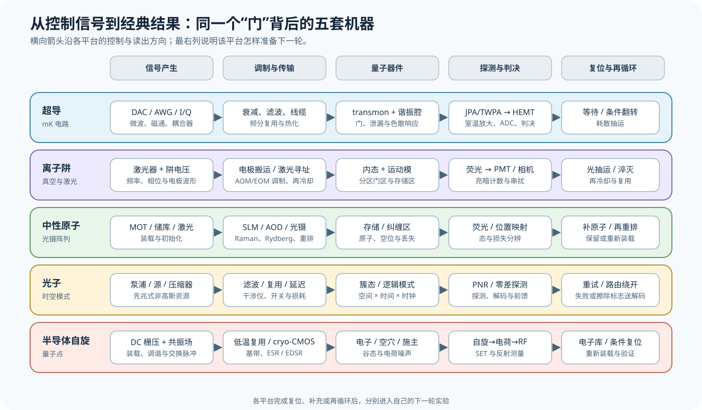
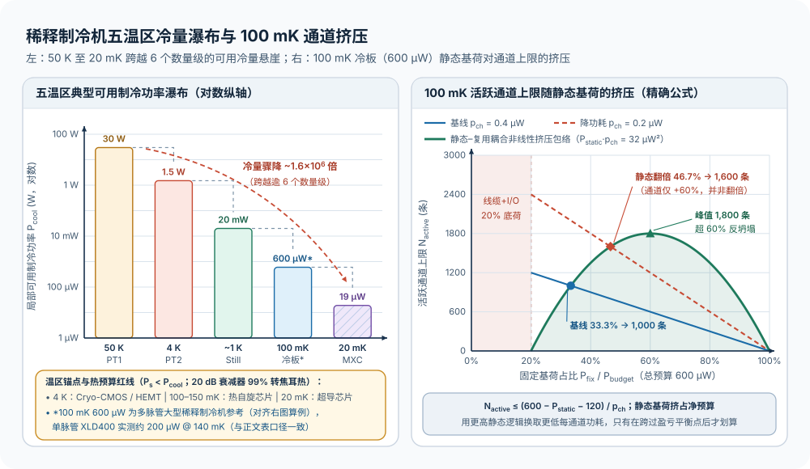
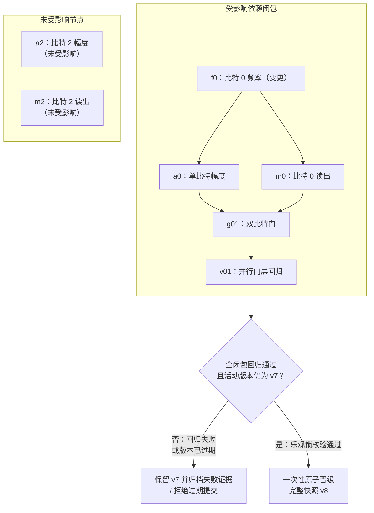
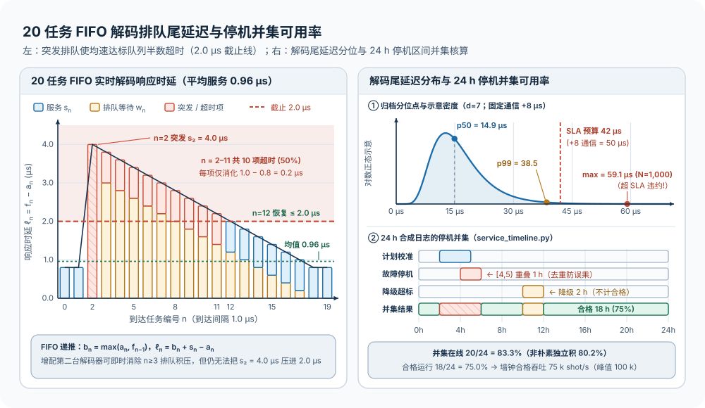

# 19｜可维护量子系统工程

在实验室里调出一颗高保真度芯片，与造出一台能每天接单、故障可定位、漂移可自动恢复的量子计算机，中间隔着整套系统工程。前文已分头展开六大物理平台（[第 09 章](09-hardware.md)）、纠错与容错理论（[第 10 章](10-error-correction.md)）、基准与资源估算（[第 11 章](11-resources-benchmarks.md)）及编译控制（[第 14 章](14-compilation-control.md)）；本章站在整机架构师视角，把器件制造、低温布线、读出仪器、自动校准、控制面带宽与机房电费串成一条自底向上的工程依赖链，看清各个子系统**彼此如何卡住扩展**。

从[第 14 章](14-compilation-control.md)的反馈与门调度开始，也可以直接读本章的执行链、冷量和校准账本。阅读第 9 节的玻色纠错时，可按需回查 [Q4](quantum-mechanics/04-wavefunctions-models.md) 的谐振子能级和[第 18 章第 9 节](18-channels-capacities-complexity.md)的GKP 网格态与截断误差。

**导读与分层路线**：

- ★ **核心主线（初读必看）**：按顺序通读 §1、§2.1、§3、§4、§6、§8、§11 与 §12，立起“中途测量仪器 $\to$ 低温分温区热预算 $\to$ 良率与校准 DAG $\to$ 百万比特控制面与 FIFO 尾延迟 $\to$ 并集可用率与墙插能耗”五根系统工程骨架；
- ☆ **进阶选读（二刷深挖）**：§2.2–§2.5 各平台控制泳道细节，以及标有“进阶选读”的 §5 三维封装与盒模、§7 模块化互连、§9 玻色纠错实验口径与 §10 国际标准和供应链审计，可按所关注硬件路线按需查阅。

---

## 1. 本章要回答什么：从一次原理演示到一台可运维机器

一台真正投入服务的量子计算机必须同时过六道系统关：中途读出与复位能否连续可靠复测？控制线缆、光学互连与低温制冷在规模翻倍时哪一级先撞墙？芯片如何分层筛出良品？参数漂移后如何局部重标而不破坏线上基线？百万比特控制面与实时解码如何在微秒级截止期限前不积压、不违约？机房墙插电费、计划校准和突发故障怎样折算成诚实的整机可用率与有效吞吐？

下表把全书分散在不同章节的工程环节按自底向上的依赖排成六层，标出每一层的交付物与核心扩展瓶颈：

| 工程层级 | 核心对象 | 向上一层交付什么 | 最容易卡住扩展的瓶颈 |
| :--- | :--- | :--- | :--- |
| **1. 器件与制造** | 晶圆、约瑟夫森结、量子点、光波导 | 达到五层良率门槛的可用裸片 | 工艺离散度、抽样筛选偏差、低温前测缺失 |
| **2. 封装、互连与环境** | 倒装焊、硅通孔、稀释制冷机、真空与光学平台 | 低损耗、充分热化、低串扰的物理载具 | 冷级热预算、寄生腔模、热循环接触退化 |
| **3. 控制、读出与复位** | 波形发生器、激光调制器、低温放大链、主动复位 | 可重复的门脉冲与低串扰量子仪器 | 线缆密度、旁观串扰、非破坏性（QND）退化 |
| **4. 校准与变更控制** | 校准依赖图、回归测试、参数快照 | 经版本锁定、可追溯且可回滚的校准清单 | 长期漂移、未记录耦合、无回归直接上线 |
| **5. 互连、控制面与纠错** | 光学链路、近端解调、玻色内码、实时解码器 | 满足微秒级反馈截止时间的容错逻辑操作 | 控制面带宽、突发拥塞、排队尾延迟积压 |
| **6. 调度、标准与运维** | 作业队列、状态日志、能耗表、运行清单 | 经统一口径审计的合格吞吐与服务可用率 | 峰值误当均值、重叠停机漏算、空闲基荷占大头 |

## 2. 五类平台的控制链

电路图上同样写着一个单比特门加一次测量，落到五种物理硬件上却对应五套截然不同的机柜、光路与时序逻辑。下图把超导、离子阱、中性原子、光子和半导体自旋五条路线的工程链并排摊开：每一行从左到右依次经过**信号产生、调制与传输、量子器件、探测与判决、复位与再循环**五个阶段。

看图时最值得留意最右一列“复位与再循环”。物质比特平台（超导、离子、中性原子、自旋）需要把同一批物理载体重新放回已知初态或补齐空位；光子平台则截然不同——尚未接入计算图的先兆资源态如果制备失败，可以就地丢弃并重试，但光子一旦进入计算图，融合失败或路径损耗就必须作为已知位置的擦除信号送往路由与解码器，而无法靠推倒整次计算重来扩展。

遇到陌生的硬件缩略语时，不必急着背诵，先对照下表弄清它在链条中负责**生成控制、传输信号、放大读出、完成判决**还是**维持系统运行**：

### 本章常用工程缩写速查

（前文已详述的平台与编码术语如 QCCD、SLM/AOD、SPAM、QND、qLDPC 等见[第 09–11 章](09-hardware.md)与[符号表](appendices/notation.md)，下表仅列出本章控制链与运维专有缩略语。）

| 缩写 | 全称 | 在整机链条中的作用 |
| :--- | :--- | :--- |
| DAC / ADC | 数模转换器 / 模数转换器 | 把数字指令变成模拟控制波形 / 把模拟读出信号数字化 |
| AWG | 任意波形发生器 | 按校准参数合成微秒或纳秒级脉冲包络 |
| I/Q | 同相 / 正交分量 | 合成微波信号的幅度和相位两路正交基带分量 |
| HEMT / JPA / TWPA | 高电子迁移率晶体管 / 约瑟夫森参量 / 行波参量放大器 | 分别负责 4 K 温区放大与毫开尔文近量子极限前置放大 |
| AOM / EOM | 声光调制器 / 电光调制器 | 精细调节激光的频率、相位、强度与开关时序 |
| PNR | 光子数分辨探测器 | 不仅判断有无光子，还能分辨到达的光子个数 |
| SET / RF | 单电子晶体管 / 射频 | 将自旋态映射为电荷差异后执行高速射频反射传感 |
| ESR / EDSR | 电子自旋共振 / 电偶极自旋共振 | 利用交变磁场或电场驱动半导体量子点中的电子/空穴自旋 |
| MTBF / MTTR | 平均故障间隔 / 平均修复时间 | 刻画设备非计划宕机与恢复周期的长期可靠性指标 |

### 2.1 超导电路

超导处理器的数字脉冲序列由室温（或低温近端）DAC/AWG 生成同相/正交（I/Q）微波包络、磁通偏置或可调耦合器波形，经过多级衰减器、红外滤波器与同轴传输线抵达毫开尔文温区的芯片。色散读出信号沿反向路径经过环行器、隔离器、毫开尔文量子受限参放（JPA 或 TWPA）、4 K 级 HEMT 放大器和室温放大链，最后由 ADC 采样送入数字解调与分类器。一条读出总线可以通过频分复用同时挂接多个谐振腔，但复用度越高，频率排布越拥挤，放大器动态范围、共享馈线串扰和积分窗时长就越互相掣肘。

超导比特的复位绝不是软件里一条零耗时的 `reset` 语句：被动等待要耗掉好几个能量弛豫时间 $T_1$，测量后条件翻转受限于读出与反馈链的误差和时延，而借助辅助谐振腔的耗散抽运又会额外占用芯片面积、频谱和冷级热预算。

#### 频分复用（FDM）读出与 Purcell—TWPA 复用上限算例

超导色散读出为什么不能把 $100$ 个比特全挂在 $1$ 条读出总线上？把[Q3 第 9.3 节](quantum-mechanics/03-levels-control.md)色散参数（耦合 $g/(2\pi) = 100\,\mathrm{MHz}$、失谐 $\Delta_{qr}/(2\pi) = -1.5\,\mathrm{GHz}$，即 $(g/\Delta_{qr})^2 = 1/225$）接入高速读出腔线宽 $\kappa_r/(2\pi) = 10\,\mathrm{MHz}$（$\kappa_r = 2\pi\times 10^7\,\mathrm{s}^{-1}$），立刻撞上 **Purcell 衰变**与**宽带参放动态范围**两道硬墙：

1. **Purcell 衰变与滤波保护**：未加保护时，比特能量经读出腔泄漏到 $50\,\Omega$ 馈线的自发弛豫率为

   $$
   \Gamma_{\mathrm{Purcell}} \approx \kappa_r\!\left(\frac{g}{\Delta_{qr}}\right)^2
   = \frac{2\pi\times 10^7}{225}\,\mathrm{s}^{-1} \approx 2.79\times 10^5\,\mathrm{s}^{-1}
   \;\Longrightarrow\;
   T_{1,\mathrm{Purcell}} = \frac{1}{\Gamma_{\mathrm{Purcell}}} \approx \mathbf{3.58\,\mu\mathrm{s}}.
   $$

   如果不加带通 **Purcell 滤波器**，快速读出腔会瞬间把比特 $T_1$ 抽干至几微秒；在馈线上串联抑制比 $F_{\mathrm{Purcell}} \ge 100$ 的 Purcell 滤波器后，有效衰变压低至 $\Gamma_P = \Gamma_{\mathrm{Purcell}}/F_{\mathrm{Purcell}}$，可将 $T_{1,\mathrm{Purcell}}$ 恢复到 **$358\,\mu\mathrm{s}$ 以上**，同时支持亚百纳秒高保真读出（如 Spring 等，*PRX Quantum* **6**, 020345, 2025 [同行评审] 演示 $<60\,\mathrm{ns}$、$>99.9\%$ 读出）。
2. **TWPA 带宽、通道间隔与 $P_{1\mathrm{dB}}$ 压缩点联立锁死复用度**：窄带 JPA 瞬时带宽仅数十 $\mathrm{MHz}$，无法支撑多路复用；换用行波参放（TWPA）可将瞬时带宽拓宽至 $\Delta f_{\mathrm{TWPA}} \approx 2\text{--}3\,\mathrm{GHz}$。为压制相邻腔频谱串扰与读出混叠，相邻谐振腔间距须满足 $\delta f_{\mathrm{ch}} \gg \max(\kappa_r/(2\pi), 2|\chi|/(2\pi))$（此处 $\chi$ 是角频率，例取 **$150\text{--}200\,\mathrm{MHz}$**），且并发读出总功率不能越过 TWPA 的 $1\,\mathrm{dB}$ 压缩点（$P_{1\mathrm{dB}} \sim -100\,\mathrm{dBm}$）。先忽略占宽、保护带和总功率约束，带宽除以中心间隔给出单条读出总线的容量尺度：

   $$
   M_{\mathrm{FDM}} \approx \frac{\Delta f_{\mathrm{TWPA}}}{\delta f_{\mathrm{ch}}}
   \approx \frac{2\,\mathrm{GHz}}{150\text{--}200\,\mathrm{MHz}}
   \approx \mathbf{10\text{--}13\ \text{个读出腔/线}}.
   $$

   §8.2 选取 10 路，中心跨度是九个间隔，即 $1.35\text{–}1.80\,\mathrm{GHz}$。实际还要把每音占宽及滤波器过渡带装进模拟与数字通带，并核算峰均比、增益压缩和串扰。

### 2.2 离子阱

离子阱路线用稳频激光器经 AOM/EOM 精确整形频率、相位与脉冲时序，再由高数值孔径光学系统聚焦到真空腔内的离子链；同时，多段阱电极的精密直流/射频波形负责把离子链劈开、沿着赛道搬运、在交叉结转向、合并并重新排序。双比特纠缠门依托离子的集体运动模完成，搬运过程不可避免地加热运动模，因此门操作前后常常必须插入协同冷却（sympathetic cooling）。读出靠荧光光子被 PMT 或相机计数，复位则经由光抽运或淬灭路径实现。

在 QCCD 分区架构里，“任意两个离子都能搬到同一个门区发生相互作用”并不意味着全连接门可以零代价并行。门区数量、交叉结通行能力、成像区视野和冷却激光束都是稀缺调度资源，搬运与再冷却时间经常主导整条线路的真实时钟周期。

### 2.3 中性原子

中性原子阵列从磁光阱（MOT）或连续原子储库抓取冷原子，由空间光调制器（SLM）织出静态光镊网格、声光偏转器（AOD）像机械臂一样动态搬运原子以填补空位，再由 Raman 激光和 Rydberg 激光执行全局或局域单比特与多比特门。读出可通过荧光成像、自旋到原子丢失映射或自旋到空间位置映射完成，空位随后由储库持续补充与重排（2025 年实验已演示超过 3,000 比特规模的连续补充相干运行）。

阅读中性原子指标时，务必把五种不同的数量分开记账：光学阵列的**站点数**、实际**装载成功的原子数**、真正**参与门操作的原子数**、**读出后留存的原子数**，以及编码后的**逻辑量子比特数**。

### 2.4 光子

光子处理器由泵浦激光驱动单光子源或光学压缩器，产生先兆式光子资源态，经片上波导滤波、开关网络、复用器、干涉仪和光纤延迟线编织成时空簇态，最后由光子数分辨（PNR）探测器或零差（homodyne）探测器读出，并驱动高速电光前馈开关。整条链条上，光子源成功率、芯片耦合效率、波导传输损耗、开关插损与探测效率是**连乘**关系；此外，探测器死时间与前馈电子学时钟也会直接卡死整机吞吐。

光子路线的规模账尤其要分清**单时钟空间模式数**、**时间复用深度**、**后选择成功事件数**与**长时间累计产生的模式总数**。连续运行两小时产出数百亿个时序光脉冲模式，绝不意味着机器在任意时刻同时相干存储着数百亿个量子比特。

### 2.5 半导体自旋

硅基或锗基自旋芯片首先靠一组精细的直流（DC）栅极电压在低温下捏出量子点势阱、装入确定数量的电子或空穴，再用微波电子自旋共振（ESR）、电偶极自旋共振（EDSR）、全局共振场或势垒交换脉冲驱动单/双比特门。读出通常借助泡利自旋阻塞把自旋状态转译为电荷占据差异，再由单电子晶体管（SET）或射频反射电路快速检测；复位可经由向电子库隧穿或测量后条件反馈完成。

自旋平台走向规模化的核心软件设施是一套带异常回退的自动调谐状态机：依次走过空点确认、单电子装载、电荷稳定图扫描、隧穿率标定、传感器敏感工作点锁定、自旋共振定位、交换门标定与全门集回归测试。其中任何一环失败，都必须有明确的故障诊断与安全回退路径，而不能放任优化器在坏点上盲目空转。

## 3. 读出是量子仪器，复位是物理过程

如果测量只在电路末尾发生，我们关心的只是“真实 $|0\rangle$ 报成 0、真实 $|1\rangle$ 报成 1 的准确率有多高”。但只要进入动态电路或实时量子纠错，辅助比特需要在计算中途反复测量并复用，数据比特还要在旁边安然无恙地保持相干。此时，一次读出就不再只是输出一个经典比特的“黑盒读表”，而是一个同时产出**经典结果**与**测后量子态**、并可能惊动邻近比特的**量子仪器**（quantum instrument）。

衡量中途测量是否合格，至少要拆出六个互不替代的指标：

| 指标 | 它回答什么问题 | 工程上最常漏掉的盲区 |
| :--- | :--- | :--- |
| **判决错误（assignment error）** | 准备已知态后，0/1 分类判错的比例是多少 | 完全不反映测后量子态是否完好，也看不见邻居受了多少扰动 |
| **量子非破坏性（QND 性）** | 给出测量结果后，系统是否停留在对应的本征态上 | 连续测两次得到同值只是间接代理量，需扣除 SPAM 与弛豫跃迁；高判决保真度不保证 QND |
| **测量诱导跃迁与泄漏** | 强烈的读出驱动是否把比特踢出 $\{|0\rangle,|1\rangle\}$ 子空间 | 终止测量把泄漏态一并归入 0 或 1，往往把问题藏了起来 |
| **旁观错误（spectator error）** | 未被测量的周边比特额外遭受了多少退相干、散射或串扰 | 往往随并行读出比特数放大，单比特标定测不出来 |
| **时延与死时间** | 从发脉冲到控制器拿到可用比特要多久，探测器多久能再触发 | 云端作业返回时间远大于片上/FPGA 闭环反馈时间，两者不可混用 |
| **复位残差** | 复位完成后，仍残留在激发态、泄漏态或丢失状态的概率是多少 | 全态平均值容易掩盖“初态为 $|1\rangle$ 或 $|2\rangle$ 时复位变差”的依赖 |

2025 年，Hothem 等人在 *Nature Communications* 上发表了中途测量量子仪器随机基准实验，在离子阱与超导处理器上直接抓出了常规单比特读出标定漏掉的中途测量串扰。这再次印证了一条工程铁律：绝不能拿一张终止读出的判决保真度数字，去担保动态电路和纠错周期的中途测量质量。

同样地，复位也没有免费午餐。不同物理机制只是把成本挪到了不同地方：

| 复位机制 | 典型平台 | 核心代价与工程取舍 |
| :--- | :--- | :--- |
| **被动等待** | 超导、半导体自旋 | 等待数个 $T_1$ 拉低吞吐；有限有效温度下热稳态仍留有残余激发（定量边界见[第 09 章](09-hardware.md)） |
| **测量后条件脉冲** | 超导、半导体自旋 | 缩短了平均耗时，却引入判决错误、反馈链路时延、条件门误差与旁观串扰 |
| **耗散工程 / 辅助模抽运** | 超导电路、玻色腔模 | 可自主将激发排入损耗通道，但需增加辅助谐振器、泵浦线、耦合元件与冷级热负载 |
| **光抽运 / 淬灭 / 再冷却** | 离子阱、中性原子 | 速度快、重置干净，但散射光子容易伤及旁观比特并伴随运动模加热 |
| **隧穿入库 / 重新装载** | 半导体自旋、中性原子 | 依赖随机隧穿等待或储库搬运重排，引入空位处理与循环时间波动 |

### 3.1 旁观串扰与经典读出缓解的物理边界

针对终止读出的经典判决混淆，列随机混淆矩阵 $\boldsymbol q = M\boldsymbol p$ 的精确求逆、方差放大因子 $(1-e_0-e_1)^{-2}$ 与可扩展 M3/TREX 算法已在[第 14 章第 9.1 节](14-compilation-control.md)完整推导，标定样本有限时的误差传播与最优采样预算分配则在[第 09 章第 5.3 节](09-hardware.md)展开。站在系统架构视角，必须先认清两条边界：经典矩阵反演只修正已建模的判决混淆，绝无法凭空修复测量引起的能级泄漏、非 QND 破坏或串扰；在真实芯片并行中途测量时，邻近比特的**旁观串扰**往往比被测比特自身判决错误更先失控。

来看一个直观的**旁观串扰**算例。假设某处理器的单比特读出判决错误低至 $0.5\%$（读出保真度 $99.5\%$），但每次中途测量发出的杂散微波或散射荧光，会让芯片上 $8$ 个旁观数据比特各自承受 $0.15\%$ 的额外出错概率。先按最简单的独立错误近似估算，全部 $8$ 个旁观比特都安然无恙的概率是 $(1 - 0.0015)^8 \approx 0.98806$，因此**至少有一个旁观比特出错**的概率达到

$$
P_{\text{spectator}} = 1 - (1 - 0.0015)^8 \approx 0.01194 \approx 1.19\%.
$$

仅仅 $8$ 个旁观比特的合成串扰错误，就已经是被测比特自身 $0.5\%$ 判决错误的两倍多。实际硬件中，共享读出总线或邻近散射往往还会引入多比特关联错误，独立模型只是暴露问题量级的第一步。

### 3.2 反例：相同判决表，截然不同的测后状态（QND 与主动复位）

为什么仅靠 $100\%$ 的判决保真度，连“这台读出器是不是 QND”都判断不了？[第 05 章](05-noise-channels.md)已经指出，POVM 元素只决定测量结果的概率分布，不能唯一决定测后量子态。下面我们用一组二维精确手算，把这个结论落到中途测量验收里。

考虑在单比特希尔伯特空间 $\mathbb C^2$ 上工作的两台理想化测量仪器，结果集合均为 $m\in\{0,1\}$，每个结果分支各由一个 Kraus 算符刻画：

- **仪器 A（理想投影 QND 测量）**：$K_0 = |0\rangle\langle 0|$，$K_1 = |1\rangle\langle 1|$，读出计算基后把比特留在对应的本征态；
- **仪器 B（破坏性读出并主动复位至 $|0\rangle$）**：$L_0 = |0\rangle\langle 0|$，$L_1 = |0\rangle\langle 1|$，先按计算基给出正确读数，随后无论读出什么都把比特强制重置到 $|0\rangle$。

先核对两台仪器的数学合法性与首轮测量统计。计算各自对应的 POVM 元素：

$$
K_0^\dagger K_0 = |0\rangle\langle 0| = L_0^\dagger L_0,
\qquad
K_1^\dagger K_1 = |1\rangle\langle 1|,
\qquad
L_1^\dagger L_1 = (|1\rangle\langle 0|)(|0\rangle\langle 1|) = |1\rangle\langle 1|.
$$

两者不仅满足完全正与保迹条件 $\sum_{m=0}^1 K_m^\dagger K_m = \sum_{m=0}^1 L_m^\dagger L_m = I$，而且 **POVM 元素逐项完全相等**。因此对任意输入密度矩阵 $\rho$，两台仪器在第一次测量中报告结果 $m$ 的概率完全一致：

$$
P_A(m) = \operatorname{Tr}(K_m^\dagger K_m \rho) = \langle m|\rho|m\rangle = \operatorname{Tr}(L_m^\dagger L_m \rho) = P_B(m).
$$

如果只做常规的 $|0\rangle$、$|1\rangle$ 制备与首轮读出标定，两台仪器交出的判决混淆矩阵都是完美的单位矩阵 $I$，准确率同为 $100\%$；即便输入任意叠加态，单次读出的统计直方图也分毫不差。

但一旦在第一次读出后继续使用这颗比特，两者的测后态立刻分道扬镳：

- 仪器 A 得到结果 $m$ 后的未归一化分支是 $K_m \rho K_m^\dagger = P(m)|m\rangle\langle m|$，丢弃结果后的非选择态是完全退相位后的 $\rho_{00}|0\rangle\langle 0| + \rho_{11}|1\rangle\langle 1|$；
- 仪器 B 得到结果 $m$ 后的未归一化分支是 $L_m \rho L_m^\dagger = P(m)|0\rangle\langle 0|$（仅当 $P(m)>0$ 时，除以 $P(m)$ 才定义出条件后态 $|0\rangle\langle 0|$；零概率分支并不存在条件态），丢弃结果后的非选择态恒为纯态 $|0\rangle\langle 0|$。

现在连续调用同一台仪器测量两次（中间不加任何门），计算两次结果相同的总概率 $P(m_1=m_2) = \sum_{m\in\{0,1\}} \| O_m^2 |\psi\rangle \|^2$（其中 $O_m$ 取 $K_m$ 或 $L_m$）。注意到 $K_0^2=K_0,\; K_1^2=K_1$，而 $L_0^2=|0\rangle\langle 0|,\; L_1^2=(|0\rangle\langle 1|)(|0\rangle\langle 1|)=0$，于是对三个测试初态 $|0\rangle$、$|1\rangle$、$|+\rangle = (|0\rangle+|1\rangle)/\sqrt{2}$ 逐项算得：

| 输入初态 | 首轮报告概率 $(P(0), P(1))$（A 与 B 相同） | 仪器 A 连续两次同值概率 | 仪器 B 连续两次同值概率 |
| :--- | :--- | ---: | ---: |
| $\lvert 0\rangle$ | $(1,\;0)$ | $1$ | $1$ |
| $\lvert 1\rangle$ | $(0,\;1)$ | $1$ | $0$ |
| $\lvert +\rangle$ | $(1/2,\;1/2)$ | $1$ | $1/2$ |

对于仪器 B，第二次测量永远报 $0$，所以两次同值概率就等于第一次报 $0$ 的概率。这个小反例揭示了两个实操坑：第一，仪器 B 做主动复位很管用，但它根本不是保持 $Z$ 本征值的 QND 测量器；第二，如果验收测试只拿初态 $|0\rangle$ 连续读两次看重复性，连仪器 A 和仪器 B 都会同样交出 $100\%$，漏掉本质差异。实际工程验收至少要覆盖正交基与叠加输入，并结合独立的 SPAM、弛豫和泄漏标定（纯 Python 符号/数值核对见[QND 与主动复位反例验算脚本](../codes/systems/round71_checks.py)，仪器分支对象在开源库中的数据结构可参考 [pyGSTi 仪器模块](https://github.com/sandialabs/pyGSTi/blob/master/pygsti/modelmembers/instruments/instrument.py)）。

## 4. 低温稀释制冷、布线与分温区热预算

超导电路与许多传统自旋处理器工作在 $10\text{–}20\,\mathrm{mK}$ 的极低温环境中；与此同时，半导体自旋路线还拥有一项独特的热预算支点——**“热自旋”温区红利**：部分硅/锗量子点自旋芯片可在 **$100\text{–}150\,\mathrm{mK}$**（例如下文引用的 HRL 2026 *Nature* 硅量子处理器实测工作在 $\sim 150\,\mathrm{mK}$）乃至 **$>1\,\mathrm{K}$**（Huang 等人 *Nature* 2024）维持高保真门操作，将可用制冷功率从 $20\,\mathrm{mK}$ 的十余微瓦抬升 $1\text{–}3$ 个数量级至毫瓦级，大幅缓和了低温 CMOS 与量子芯片紧耦合的散热瓶颈。

然而无论工作在 $20\,\mathrm{mK}$ 还是 $150\,\mathrm{mK}$，芯片本身只有几平方厘米大，如果为每颗比特从室温机柜拉出 $2\text{–}3$ 根微波/磁通同轴线，上千比特就会变成一捆塞不下冷机法兰、且持续往冷端灌热的铜缆丛林。把一部分控制与复用电子学下沉到 $4\,\mathrm{K}$ 甚至毫开尔文冷级，确实能砍掉大量室温同轴线、缩短反馈路径，却会立刻撞上稀释制冷机最硬的物理天花板——**每降一个温区，可用的制冷功率就暴跌几个数量级**。

图中的温区划分展示的是典型低温控制栈的信号与热流方向；具体某颗放大器、隔离器或低温芯片放在哪一级，还取决于微波频段、插损、泵浦功率与所用冷机的制冷曲线。先把真实稀释制冷机五个温区的冷却能力锚定在真实工程数量级上——下表对照了 Krinner 等人（*EPJ Quantum Technology* 6, 2, 2019）对商用 Bluefors XLD400 单脉管系统的实测标定，以及当代大型多脉管平台（如 Bluefors XLD1000 / KIDE）的典型量级：

| 温区级（Stage） | 典型工作温度 | 典型可用制冷功率（XLD400 实测 vs. 多脉管大机） | 主要热负载来源与工程职责 |
| :--- | :--- | :--- | :--- |
| **50 K 板（PT1）** | $\sim 35\text{–}50\,\mathrm{K}$ | **数十瓦**：$\sim 30\,\mathrm{W}\,@\,45\,\mathrm{K}$（单脉管）；多脉管成倍增加 | 截断 $300\,\mathrm{K}$ 黑体热辐射；不锈钢/CuNi 同轴线首级热锚 |
| **4 K 板（PT2）** | $\sim 2.85\text{–}4.2\,\mathrm{K}$ | **瓦级**：$\sim 1.5\,\mathrm{W}\,@\,4.2\,\mathrm{K}$（单脉管）；多脉管可达数瓦 | $20\,\mathrm{dB}$ 微波衰减器、低温 HEMT 放大器、**4 K Cryo-CMOS** 散热沉 |
| **蒸馏室（Still）** | $\sim 800\text{–}900\,\mathrm{mK}$ | **毫瓦至数十毫瓦**：$\sim 40\,\mathrm{mW}\,@\,1.2\,\mathrm{K}$（$800\,\mathrm{mK}$ 级约 $5\text{–}20\,\mathrm{mW}$） | $^3\mathrm{He}$ 循环蒸发缓冲层；次级热锚与红外/低通滤波 |
| **冷板（Cold Plate）** | $\sim 80\text{–}140\,\mathrm{mK}$ | **数百微瓦至毫瓦级**：$\sim 200\,\mu\mathrm{W}\,@\,140\,\mathrm{mK}$（大机 $\ge 350\text{–}1000+\,\mu\mathrm{W}\,@\,100\,\mathrm{mK}$） | 中级 $20\,\mathrm{dB}$ 微波衰减器、热自旋芯片（$\sim 150\,\mathrm{mK}$） |
| **混合室（MXC）** | 基温 $<10\,\mathrm{mK}$，工作 $15\text{–}20\,\mathrm{mK}$ | **十至数十微瓦**：$\sim 19\,\mu\mathrm{W}\,@\,20\,\mathrm{mK}$（趋近基温时净冷量趋零） | 超导量子芯片封装、末级 $20\,\mathrm{dB}$ 衰减器、环行器与近量子极限参放 |

请盯紧表中的两端数字：从 $50\,\mathrm{K}$ 到 $20\,\mathrm{mK}$，**可用制冷功率整整跌掉了六个数量级**（$\sim 30\,\mathrm{W} \to \sim 19\,\mu\mathrm{W}$）。任何一级超载，该温区温度就会抬升，热光子噪声顺着同轴线灌进量子芯片，直接把相干时间打穿。

对每一个温区 $s$，工程师必须把五项热负载全部加总，严格压在该温区工作温度 $T_s$ 的可用制冷量 $P_{\mathrm{cool}}(T_s)$ 之下：

$$
P_s = P_{\mathrm{static}} + P_{\mathrm{switched}} + P_{\mathrm{analog}} + P_{\mathrm{IO}} + P_{\mathrm{wire}} < P_{\mathrm{cool}}(T_s).
$$

其中，$P_{\mathrm{cool}}(T_s)$ 是该冷级的局部制冷能力（单位 $\mathrm{W}$ 或 $\mu\mathrm{W}$），切不可与整台冷机在室温墙插消耗的几十千瓦电功率混为一谈。各项负载的物理来源各有不同：

- **线缆被动热传导** $P_{\mathrm{wire}}$：沿截面积 $A$、长度 $L$ 的金属导体由高温端传向低温端的静态热流为

  $$
  \dot Q_{\mathrm{cond}} = \frac{A}{L}\int_{T_{\mathrm{low}}}^{T_{\mathrm{high}}} \kappa(T)\,dT.
  $$

  工程上 $300\,\mathrm{K}\to 4\,\mathrm{K}$ 常选用低热导的不锈钢或铜镍合金（CuNi）同轴线，$4\,\mathrm{K}\to\mathrm{MXC}$ 则切换为超导铌钛（NbTi）同轴线——利用超导体既保持极低微波插损又大幅压低电子热导的特性。
- **衰减器主动焦耳热**（计入 $P_{\mathrm{analog}}$ 或 $P_{\mathrm{IO}}$）：为抑制室温热噪声，微波控制线通常在 $4\,\mathrm{K}$、$100\,\mathrm{mK}$ 与 $20\,\mathrm{mK}$ 各级串联 $20\,\mathrm{dB}$ 衰减器。输入功率为 $P_{\mathrm{in}}$ 时，衰减量 $\mathrm{Att_{dB}}$（单位 $\mathrm{dB}$）在当地转化的焦耳热为

  $$
  \dot Q_{\mathrm{att}} = P_{\mathrm{in}}\left(1 - 10^{-\mathrm{Att_{dB}}/10}\right).
  $$

  每经过一级 $20\,\mathrm{dB}$ 衰减，只有 $1\%$ 的射频功率继续往下走，**整整 $99\%$ 变成当地热量**。算一笔直觉账：在只有 $\sim 19\,\mu\mathrm{W}$ 制冷量的 $20\,\mathrm{mK}$ 混合室上，哪怕每条控制线在末级衰减器上平均只耗散 $10\,\mathrm{nW}$，$1{,}000$ 条并发通道就会产生 $10\,\mu\mathrm{W}$ 热量，瞬间吃掉一半以上的制冷余量。
- **数字开关功耗** $P_{\mathrm{switched}} = N_{\mathrm{active}} E_{\mathrm{update}} f_{\mathrm{update}}$（活跃通道数 $\times$ 单次翻转能量 $\times$ 更新频率），而连续微波偏置、激光泵浦和模拟放大器则按平均驱动功率与占空比计入 $P_{\mathrm{analog}}$，不能笼统套用“翻转能量乘频率”。

为了打破同轴线缆墙，近年低温互连与近端控制形成了三条互补的工程路线：

1. **$4\,\mathrm{K}$ 级 Cryo-CMOS 控制器路线**（如 Intel Horse Ridge、TU Delft 架构及 HRL 团队 2026 年 *Nature* 报道的数字控制硅量子处理器）：把多达数千万只晶体管（例如 2026 年方案约 $7{,}000$ 万晶体管）的数字与基带控制电路放在瓦级制冷量的 $4\,\mathrm{K}$ 板，再经高密度超导带状电缆送入 $\sim 150\,\mathrm{mK}$ 自旋芯片。电路设计必须同时克服 $4\,\mathrm{K}$ 下的**载流子冻析（carrier freeze-out）**、**阈值电压 $V_{\mathrm{th}}$ 漂移**与**本振相位噪声**劣化；并谨记[第 11 章 §8.5](11-resources-benchmarks.md)的卡诺墙插账——$4\,\mathrm{K}$ 级每消耗 $1\,\mathrm{mW}$ 冷端电功率仍折合室温 **$0.5\text{--}1\,\mathrm{W}$** 墙插能耗，只有把单比特功耗压进亚毫瓦区间才能真正跑赢室温控制架。
2. **毫开尔文级近端控制路线**：2025 年，Bartee 等人（悉尼大学/Diraq/UNSW，*Nature* 2025）演示了集成约 **10 万只晶体管**的毫开尔文 CMOS 芯片，贴近硅自旋芯片工作在 mK 温区，**整片功耗约 $10\,\mu\mathrm{W}$**（输出约 $100\,\mathrm{mV}$ 脉冲时模拟单元活动功耗低至约 $20\,\mathrm{nW/MHz}$，门保真度未见明显劣化）。但论文同样指出了**固定数字基荷功耗**与**局部寄生加热**的存在：活动功耗必须乘以实际更新频率，不能用来掩盖整片芯片的静态功耗，冷台温度计读数也不能直接等同于样品真实电子温度。
3. **光学低温互连（Optical Cryo-Interconnect）**：用石英光纤取代部分室温至冷级的金属同轴线。石英玻璃的热导率比铜镍合金低约 **$10^3$ 倍**，且单根光纤天然支持高密度波分复用（WDM），在几何截面与静态导热上极具优势。实验上，Lecocq 等人（NIST，*Nature* **591**, 575–579, 2021 [同行评审]）首次演示了光纤光驱超导比特控制与读出；2025 年，Arnold 等人（IST Austria，*Nature Physics* **21**, 393–400, 2025 [同行评审]）与 van Thiel 等人（QphoX/Rigetti，*Nature Physics* **21**, 401–405, 2025 [同行评审]）进一步打通了微波—光学换能与低温全光读出链路。该路线当前的三道硬瓶颈是：**电光/光机转换效率偏低**（迫使进入毫开尔文级的连续光泵浦功率居高不下，反过来造成主动局部发热）、**光学散粒噪声**（shot noise）限制读出信噪比，以及杂散红外光子直接拆散库珀对诱发**准粒子中毒**。

### 4.1 算例：100 mK 冷级的活跃通道上限与固定功耗挤压

假设一台大型稀释制冷机的 $100\,\mathrm{mK}$ 冷板分给近端控制电子学的总热预算为 $P_{\mathrm{budget}} = 600\,\mu\mathrm{W}$。其中芯片固定静态功耗 $P_{\mathrm{static}} = 80\,\mu\mathrm{W}$，线缆导热与 I/O 接口固定分摊 $P_{\mathrm{IO}} + P_{\mathrm{wire}} = 120\,\mu\mathrm{W}$，每打开一条活跃控制通道带来的开关与模拟平均功耗为 $p_{\mathrm{ch}} = 0.4\,\mu\mathrm{W}$。那么同时可开启的通道数上界为

$$
N_{\mathrm{active}} \le \frac{600 - 80 - 120}{0.4} = \frac{400}{0.4} = 1{,}000.
$$

注意 $1{,}000$ 已经恰好把 $600\,\mu\mathrm{W}$ 预算吃干榨尽，没有留下任何热裕量；如果严格要求不等式 $P_s < P_{\mathrm{cool}}(T_s)$ 且按整数计数，最多开到 $999$ 条，真实工程还必须为局部热点与冷机衰减留出安全余量。

现在看一个架构权衡里极易算错的变化：如果电路团队通过更复杂的时钟门控和复用逻辑，把单通道活跃功耗成功**砍半**到 $0.2\,\mu\mathrm{W}$，代价是控制芯片的固定静态功耗**翻倍**到 $160\,\mu\mathrm{W}$（线缆与 I/O 仍占 $120\,\mu\mathrm{W}$）。通道上限会翻倍到 $2{,}000$ 吗？直接代入算一遍：

$$
N_{\mathrm{active}}' \le \frac{600 - 160 - 120}{0.2} = \frac{320}{0.2} = 1{,}600.
$$

上限只增加了 $60\%$ 而不是 $100\%$。这就是固定基荷的非线性挤压效应：在总预算锁死的低温级里，用“增大静态开销换取更低每通道功耗”只有在规模跨过盈亏平衡点后才划算，否则反而可能缩水。

上图左面板以对数坐标直观呈现了稀释制冷机五温区跨越六个数量级的制冷功率悬崖（及 $4\,\mathrm{K}$ 控制器、$150\,\mathrm{mK}$ 热自旋与 $20\,\mathrm{mK}$ 超导混合室的典型负载锚点），右面板对比了本节算例中静态基荷翻倍对 $100\,\mathrm{mK}$ 活跃通道上限的挤压斜率。[查看原尺寸图](assets/v3-19-cryo-thermal-budget.svg)。

## 5. 进阶选读：三维封装、垂直互连与可测试性

芯片从几十比特迈向百比特以上，平面二维排布立刻遇到几何死锁：芯片内部比特数按面积 $O(L^2)$ 增长，但芯片四条边缘能排下的引线焊盘只按周长 $O(L)$ 增长。一旦中心区域的量子比特无法从平面边缘引出控制线与读出线，系统就必须走向**三维封装**（3D integration）。

MIT 林肯实验室（Rosenberg et al., *npj Quantum Information* 3, 42, 2017）奠定了超导三维集成的经典工程骨架：用**倒装焊**（flip-chip）把量子比特芯片与布线芯片面对面扣合，借助超导铟柱凸点提供垂直电连接与微米级精确间距，再引入低温硅中介层（interposer）和穿透衬底的**超导硅通孔**（TSV），把密集的控制与读出走线整体移到独立芯片层，从而释放二维比特阵列的扩展空间。

然而，每多引入一层衬底、介质、金属接缝和焊点，就多引入一层微波损耗、热阻、杂散寄生腔模（box modes）以及新的机械失效界面。因此，面对一份三维封装设计书，系统架构师不能只数引脚密度，必须追问六个落地的工程问题：

1. **已知良品裸片（KGD）**：量子芯片与布线中介层在扣合封装前，能否分别完成低温预筛，避免拿一颗坏中介层报废整片优质比特裸片？
2. **故障定位能力**：冷却到 $15\,\mathrm{mK}$ 后发现一条通道断路或串扰激增，有没有可测性设计定位故障到底出在裸片、铟柱凸点、连接器还是冷机同轴线上？
3. **热循环稳定性**：器件在 $300\,\mathrm{K}$ 与 $15\,\mathrm{mK}$ 之间经历多次升降温后，微米级凸点接触电阻、谐振频率和耦合强度能否保持稳定？
4. **返修与模块化粒度**：单个坏凸点或坏通道能否拆焊返修，还是必须连带报废整个百比特模块？
5. **电磁屏蔽与寄生腔模**：多层接地过孔的间距是否足够压制芯片封装腔体内的寄生共振模，避免这些模式把比特能量抽干或在远距离比特间制造意外串扰？
6. **跨模块接口容差**：量子封装体与低温控制器、光耦合微透镜或量子网络接口之间的机械、热膨胀与频段容差是否明确定义？

### 5.1 算例：芯片封装寄生盒模（Box Mode）基频估算

为什么超导芯片做大到百比特以上时，即使工艺和材料完全不变，相干时间也会突然暴跌？一个常被忽视的电磁学硬限制是**芯片衬底与金属封装盒构成的寄生矩形谐振腔模（box modes）**。将高阻硅衬底（低温相对介电常数 $\varepsilon_r \approx 11.7$，$\sqrt{\varepsilon_r} \approx 3.4205$）近似为横向尺寸 $L_x \times L_y$ 的平面金属化谐振腔（厚度 $L_z \ll L_x, L_y$），取 $z$ 为薄轴。对于 $k_z=0$ 的最低阶非零模式，$E_z\propto\sin(\pi x/L_x)\sin(\pi y/L_y)$，其余电场分量为零。边壁处切向电场为零，由法拉第定律得 $H_z=0$，故为相对薄轴的横磁模 $\mathrm{TM}_{110}$，频率为

$$
f_{110} = \frac{c}{2\sqrt{\varepsilon_r}}\sqrt{\frac{1}{L_x^2} + \frac{1}{L_y^2}}
\qquad (c = 2.998\times 10^8\,\mathrm{m/s}).
$$

取正方形、均匀硅填充和理想导体壁。10 mm 方腔的 $\mathrm{TM}_{110}$ 为 $6.1976\,\mathrm{GHz}$，高于指定的 $4\text{–}6\,\mathrm{GHz}$ 工作频带。边长改为 20 mm 时，$\mathrm{TM}_{110}$、$\mathrm{TM}_{210}$/$\mathrm{TM}_{120}$、$\mathrm{TM}_{220}$ 分别为 $3.0988$、$4.8996$、$6.1976\,\mathrm{GHz}$。由于方腔交换 $x,y$ 不改边界，210/120 这对模式简并，也只有这一对落入上述频带。

若用理想导体隔墙围成 5 mm 或 2.5 mm 的正方形隔室，基频分别约为 $12.3952$ 和 $24.7904\,\mathrm{GHz}$。实际铟柱与过孔阵列只在相应波长、间距和接地条件下近似这样的隔墙。实际频率、损耗和与比特的耦合还需电磁建模和实测。[矩形腔边界推导](https://engineering.purdue.edu/wcchew/ece604s20/Lecture%20Notes/Lect21.pdf)

## 6. 制造良率、自动校准依赖图与变更控制

当芯片进入晶圆厂小批量试产，“良率”就不再是一个单一百分比。把芯片从光刻机一路送到云端接单，至少要过五道关口，每一道都有自己独立的分母与失效模式：

| 良率层级 | 检验对象与通过条件 | 常见失效模式 |
| :--- | :--- | :--- |
| **工艺良率** | 晶圆上的关键尺寸、约瑟夫森结电阻、材料堆栈符合制造规格 | 结电阻离散超标、刻蚀缺陷、表面污染物 |
| **电学良率** | 室温或低温探针检测连通性、栅极漏电、谐振器品质因数与传感器响应 | 断路、短路、栅极击穿、谐振腔失谐 |
| **可调谐良率** | 冷却后能把比特调到目标频率，形成确定电荷占据或预期耦合 | 频率碰撞、不可控两能级系统（TLS）缺陷、寄生量子点 |
| **全门集良率** | SPAM、单比特门和双比特门全部越过预先锁定的保真度门槛 | 局部串扰过强、能级泄漏严重、读出对比度不足 |
| **服务良率** | 封装、多次热循环、全芯片并行运行与长时漂移后仍满足服务规格 | 热循环脱焊、并行串扰超标、频点漂移失稳 |

严谨的制造报告必须按**晶圆、裸片、器件、比特和门层**逐层列出总样本数、筛选规则与剔除原因。挑出来的“冠军器件”、经电学预筛后的“候选器件”和整片晶圆的“随机抽样器件”绝不能混在同一分母下汇报。

### 6.1 算例：四个器件全通过，离 99% 良率还有多远

论文或新闻里常见一种说法：“我们测试了 $4$ 颗器件，单/双比特门保真度全部超过 $99\%$。”这句话说明被测器件的**门质量**很出色，却绝不能被改写成“该工艺的晶圆功能良率达到 $99\%$”。

先看抽样前提：如果这 $4$ 颗器件是从几十颗裸片里先做过室温电阻筛选或低温谐振筛查才挑出来的，随机抽样前提已经不成立，它们根本不能用来推算整片晶圆的良率。退一步说，即便强行把这 $4$ 颗当作独立随机抽取的样本，且 $4/4$ 全部通过，**双侧 $95\%$ Clopper–Pearson 精确置信区间**的下限 $p_{\mathrm{low}}$ 满足尾概率方程 $p_{\mathrm{low}}^4 = 0.025$，解得

$$
p_{\mathrm{low}} = (0.025)^{1/4} \approx 0.3976 \approx 39.8\%.
$$

也就是说，从纯粹统计角度看，$4/4$ 全部通过的数据与“真实良率只有 $40\%$ 左右”完全相容。

反过来算一笔更扎心的账：在独立随机抽样、且测试期间**一颗都不失败**的理想前提下，至少要连测多少颗器件，才能把同样的双侧 $95\%$ 下限推到 $99\%$？令 $(0.025)^{1/n} \ge 0.99$，两边取自然对数 $\ln$（注意 $\ln 0.99 \approx -0.0100503 < 0$，两边同除负数时不等号反向）：

$$
\frac{1}{n}\ln 0.025 \ge \ln 0.99
\quad\Longrightarrow\quad
n \ge \frac{\ln 0.025}{\ln 0.99} \approx \frac{-3.68888}{-0.0100503} \approx 367.04.
$$

向上取整，至少需要 **$368$ 颗**独立随机抽取的器件全部零失误通过。

> **与第 15 章单侧三倍法则的口径对照**：本节采用**双侧 $95\%$** Clopper–Pearson 区间（每侧尾概率 $\alpha/2 = 0.025$），对应零失败达标样本量 $n = 368$；而[第 15 章第 3.2 节](15-practice-research.md)讨论零失败错误率上界时采用**单侧 $95\%$** 区间（单尾 $\alpha = 0.05$，即工程三倍法则 $3/n$），对应 $p_{\mathrm{low}}^n = 0.05 \implies n \ge \lceil\ln 0.05/\ln 0.99\rceil = \mathbf{299}$ 颗。两者在各自声明的单/双侧尾概率口径下都是精确解，查阅验收报告时务必先核对采用的是单侧还是双侧置信水平。

真实晶圆上相邻裸片还会共享工艺梯度与系统性缺陷，实际认证成本只会更高。这个反推一眼就能量出“$4$ 颗成功器件”和“$99\%$ 制造良率”之间的统计学鸿沟。

### 6.2 自动校准依赖图（DAG）与快照原子晋级

量子硬件会随时间缓慢漂移，也会因宇宙射线或电荷跳跃突然失调。Google 与 UCSB 团队在 *Optimus* 框架（Kelly et al., `arXiv:1803.03226`, 2018）中确立了现代量子处理器的标准运维范式：把几十项彼此咬合的物理标定参数（谐振频率、$\pi$ 脉冲幅度、DRAG 系数、双比特门相位、读出判别边界等）组织成一张**有向无环图（DAG）**。某项状态检查失守时，调度器只沿着受影响的依赖子图做最小范围的局部重标与诊断，而不必把整台机器推倒重来。

工程实践中必须分清三种递进能力：**自动找到一次好工作点**、**长期自动维持工作点**，以及**自动诊断出硬件真故障**。跑通一次自动调参只证明第一种；要把校准接进生产环境，每一份参数快照都必须带有时间戳、拟合不确定度、原始扫描数据、父参数依赖版本和适用边界，并经过受控的回归测试与原子发布机制。

用图中的 5 节点依赖子图走一遍具体变更演算。假设当前运行中的生产参数快照是版本 $7$：节点 $f_0$ 是第 $0$ 号比特的工作频率；幅度 $a_0$ 和读出分类器 $m_0$ 依赖 $f_0$；双比特门 $g_{01}$ 同时依赖 $a_0$ 和 $m_0$；并行门层验收 $v_{01}$ 依赖 $g_{01}$；另外第 $2$ 号比特的 $a_2, m_2$ 在这份依赖图中与 $f_0$ 独立。一条有向边 $u \to v$ 的含义是：“$v$ 的当前有效性证据以 $u$ 的这一版本为前提”。

当运维团队更新了 $f_0$，只重新跑一次频谱扫描够不够？远远不够。变更沿有向边向下游传播，必须按拓扑依赖顺序依次重验整个受影响闭包：

$$
f_0 \;\longrightarrow\; (a_0,\, m_0) \;\longrightarrow\; g_{01} \;\longrightarrow\; v_{01}.
$$

在依赖图上，$a_0$ 与 $m_0$ 的验证先后可以互换（硬件上能否真正并行还要看脉冲发生器与读出总线的资源冲突）；而 $a_2, m_2$ 不在 $f_0$ 的后继集合里，不会因这张图自动失效。当然，如果真实芯片上第 $0$ 位与第 $2$ 位共享同一本振、同一条读出馈线或存在明显频率串扰，就必须把对应的边补进依赖图——软件里漏画一条边，并不会让物理串扰消失。

再看快照发布时的**原子晋级与乐观锁**规则：

1. **部分通过必须整批拦截**：假如候选参数在 $f_0, a_0, m_0, g_{01}$ 四项单独检查中全部达标，却在最后的并行门层回归 $v_{01}$ 上失败。此时系统必须保留活动快照版本 $7$，完整保存失败扫描证据，严禁把前四个参数“先悄悄上线一半”——否则线上就会拼出从未整体验证过的半新半旧组合。
2. **乐观锁防并发覆盖**：只有当依赖闭包全部通过、且提交瞬间核对线上活动版本依然是 $7$ 时，才一次性原子发布完整快照版本 $8$。如果测试期间另一条校准任务已经抢先发布了版本 $8$，本次基于旧基线 $7$ 测出来的候选快照就必须被版本锁直接拒绝并基于新基线重测。
3. **配置回滚不等于物理时光倒流**：遇到失败保留或回滚到版本 $7$，撤销的只是控制软件里的参数配置，并不能逆转制冷机或芯片上已经发生的物理漂移。如果旧快照 $7$ 自身在当前物理状态下也已经失效，机器必须立刻切入降级或维护状态，绝不能顶着失效的旧快照继续宣称合格。

上述拓扑传播、回归拦截与乐观锁版本控制全部配有标准库验证脚本[校准依赖与原子晋级验算脚本](../codes/systems/calibration_dependencies.py)。工业界实验与分析产物的工程组织可参考 [Qiskit Experiments 仓库](https://github.com/qiskit-community/qiskit-experiments)（其旧版脉冲校准接口的演进与版本分界参见[第 14 章](14-compilation-control.md)）。

## 7. 进阶选读：模块化互连与线路切割

单颗芯片的面积、晶圆良率和低温引线总有天花板，最终要跨过万比特甚至百万比特门槛，系统必然走向多芯片或多节点模块化互联。但“模块化”这个词在论文与路线图里被用来指代五种物理机制和资源账截然不同的方案，看架构前必须先对号入座：

| 模块化类型 | 跨模块交换什么物理资源 | 核心工程成本 | 计数时最常犯的错 |
| :--- | :--- | :--- | :--- |
| **仅局域操作的线路切割（LO）** | 各芯片独立运行切割后的子线路，结果在经典计算机上重构 | 随切割次数指数暴涨的采样方差、准概率权重与经典后处理 | 把重构出的联合期望值当成芯片之间已建立可存取的相干量子纠缠 |
| **局域操作加经典通信的虚拟门（LOCC）** | 跨芯片中途测量结果经实时经典链路触发对端条件门 | 仍需准概率采样开销，再叠加实时经典链路延迟与反馈控制 | 把靠切割构造的虚拟 Bell 资源当成已先兆制备、可存储的物理远程纠缠对 |
| **短距相干直连** | 低温微波波导、超导同轴或声子/直接耦合通道 | 跨芯片边界门保真度、封装对齐与频段匹配 | 只报芯片内部门保真度，藏起明显更差的跨芯片边界门 |
| **先兆式光子链路 + 物质存储** | 光学先兆生成的物理 Bell 纠缠对、经典通信与门隐形传态 | 纠缠生成率低、纠缠等待期间的存储退相干、纯化与前馈 | 把低速率、低保真度的远程门按本地门成本混算 |
| **全光子时空簇态** | 时空复用的光学模式、单光子/压缩源、光纤延迟与探测前馈 | 路径总损耗、源制备概率、高速开关与实时解码 | 把长时间累计产生的模式数写成同时相干存在的比特数 |

前两类**线路切割**（circuit cutting / circuit knitting）的准概率分解（QPD）数学推导、采样放大 $O(\gamma^{2K})$、多门并行 LOCC 压缩以及编译器错序反例，已在[第 14 章（电路切割）](14-compilation-control.md)详尽展开；这里从系统架构视角直接看 2024–2025 年两类路线的硬件实测分水岭：

- **经典通信线路切割实测**：IBM 团队（Carrera Vazquez et al., *Nature* 636, 75–79, 2024）用实时经典链路连接两颗各 $127$ 比特的超导处理器，分别演示了仅局域操作（LO）与带跨芯片实时前馈（LOCC）的线路切割和虚拟门，成功在经典端重构出最高 $142$ 比特等效线路的期望值。它验证了跨处理器经典协同的工程通道，但重构的统计量并不等同于两颗芯片之间已经拉通相干量子总线，且仍受指数采样开销约束。
- **物理光学量子链路实测**：2025 年 *Nature* 同期刊登了两项物理互连里程碑——牛津团队（Main et al., *Nature* 638, 383–388, 2025）通过先兆式光学纠缠链路在两套独立离子阱模块间完成了远程 CZ 门的量子隐形传态（远程门平均保真度约 $86\%$），直观展示了物理模块化必须为接口单独预留误差与纠缠纯化预算；Xanadu Aurora 团队（Aghaee Rad et al., *Nature* 638, 912–919, 2025）则演示了模块化光子网络的扩展组网。
- **两类路线的本质换算**：前一种路线（线路切割）是用**指数级经典采样时间**换取有效电路宽度，后一种路线（先兆纠缠链路）则是用**物理量子互连开销**换取真正可扩展的相干计算空间（跨节点纠缠分发与网络协议分层见[第 12 章](12-security-network-frontiers.md)，测量型/融合型分布式计算模型见[第 17 章](17-computation-models.md)）。

## 8. 错误信息可见性、百万比特控制面带宽与实时解码延迟

芯片模块化拉开规模后，最先被流量压垮的往往不是量子芯片本身，而是紧挨着芯片运行的**经典控制面与实时解码子系统**。

先看错误信息的可见性价值：同样的物理错误率，硬件能不能告诉解码器“错误大概出在哪颗比特、哪一轮”，会让纠错开销差出一个量级。按“是否离开 $\{|0\rangle,|1\rangle\}$ 计算子空间”和“位置/时间是否可见”两个维度，真实硬件错误可以分为六类：

| 错误类型 | 是否离开计算子空间 | 位置与时间是否已知 | 对解码器与控制栈的含义 |
| :--- | :---: | :---: | :--- |
| **未知 Pauli 错误** | 否 | 否 | 只能完全依靠稳定子纠错症状（syndrome）反推最可能的错误链 |
| **偏置 Pauli 错误** | 否 | 否（但先验不均） | 解码器可按偏置权重调整边权，前提是逻辑门与纠错症状提取电路保持偏置 |
| **能级泄漏（leakage）** | 是 | 通常未知 | 可跨多轮驻留并经双比特门污染邻近比特，需泄漏消除单元（LRU）或额外标记 |
| **粒子丢失（loss）** | 是（或载体消失） | 视探测机制而定 | 未被探测标记的丢失不能当成廉价擦除，会转化为未知复合错误 |
| **即时擦除（heralded erasure）** | 已知失效 | 位置与近似时间已知 | 控制器可在当轮修改校验图、动态路由绕行，或构建合并校验（supercheck，即缺失位置周围若干稳定子校验的乘积） |
| **延迟擦除（delayed erasure）** | 已知失效 | 仅在终态测量暴露 | 只能提升离线重解码精度，无法指导已经执行的实时反馈与路由 |

由[第 10 章 §4.3](10-error-correction.md)的联合码距预算 $2t + e < d$ 可知，每把 $1$ 个未知错误转化为已知位置的擦除，可节省双倍码距配额（并由 §11.2 把表面码阈值推高至 $4\%\text{--}5\%$）。但在工程接口上，真实擦除探测器本身既有漏检（转为更昂贵的未知错）也有误报（白耗擦除额度），声称“支持擦除转换”时必须同步披露真阳性率、假阳性率与告警时间分辨率（具体条件检测概率反演见[第 09 章 §5.4](09-hardware.md)）。

### 8.1 三类容错架构的资源交换

把物理错误模型、布线约束和逻辑门放在一张桌上算总账，当代三条主流容错路线各自把难度转嫁给了不同的工程子系统：

| 容错架构 | 编码率与硬件连接 | 校验提取与实时解码 | 逻辑门与整机工程边界 |
| :--- | :--- | :--- | :--- |
| **表面码（Surface code）** | 编码率低；只需二维平面近邻连接，芯片制造最友好 | 局域低权重（权重 $4$）校验；最小权完美匹配（MWPM）与并查集解码非常成熟 | 晶格手术（lattice surgery）与魔法态工厂占据庞大的物理比特和时空体积（见[第 10 章](10-error-correction.md)与[第 11 章](11-resources-benchmarks.md)） |
| **qLDPC 码** | 可实现常数编码率，大幅压低物理/逻辑比特比；通常需要非局域或跨层长程连接 | 校验权重低但校验图拓扑复杂；对并行读出与低延迟解码器提出高要求 | 高编码率不自动等于低整机开销；长程布线、路由开关与逻辑门编译开销可能抵消比特节省 |
| **玻色内码 + 外层比特码** | 先在单个振荡器内压低主误差，再跨模式级联外码 | 依赖辅助比特、非线性泵浦与偏置保持纠错症状提取 | 有望显著缩减外码规模，但腔体封装、微波频率规划与偏置保持门控制更专用 |

尤其要厘清 qLDPC 里的“低密度”一词：它指每个校验只涉及常数个比特、每个比特只参与常数个校验（校验矩阵稀疏），**并不意味着这些连线能轻松画在一张二维平面芯片上**。任何架构优劣比较，都必须把连接拓扑、校验电路深度、实时解码功耗、逻辑门方案与噪声假设放进同一把尺子。

### 8.2 端到端算例：百万物理比特、$1\,\mu\mathrm{s}$ 周期的四层控制与解码带宽账本

容错量子计算要求芯片旁边的经典解码硬件同时守住**两条彼此独立的硬线**：一是**稳态容量**（常见平稳随机队列模型要求长期有效服务率大于到达率，单台等价条件为 $\bar t_{\mathrm{dec}}<\tau_{\mathrm{cyc}}$），二是**非 Clifford 逻辑时钟线**（执行 $T$ 门魔法态注入时的端到端反应时间 $\tau_{\mathrm{fb}} \lesssim 10\,\mu\mathrm{s}$ 量级）。Google Willow、AlphaQubit、Riverlane Collision Clustering ASIC 与 IBM Relay-BP FPGA 等代表性实时解码硬件的算法机理、硅片功耗与微秒级实测对照表已统一归口至[第 11 章第 7.3 节](11-resources-benchmarks.md)，此处不再重复摘录。

但从单补丁千比特跨向**百万物理比特整机**，问题不再只是单个解码芯片有多快，而是**四层经典数据流在制冷机外如何搬运、压缩与抗突发**。下面零跳步算清这本端到端控制面带宽账。

**设定整机工作点**：总物理比特数 $N_{\mathrm{phys}} = 10^6$（例如旋转表面码码距 $d=23$，单补丁需 $2d^2 - 1 = 1{,}057$ 颗物理比特，整机约承载 $946$ 个逻辑比特），其中用于每轮提取纠错症状的辅助校验比特占一半，即 $N_{\mathrm{anc}} = 5\times 10^5$；超导物理纠错周期 $\tau_{\mathrm{cyc}} = 1\,\mu\mathrm{s}$（重复频率 $f_{\mathrm{cyc}} = 1/\tau_{\mathrm{cyc}} = 1\,\mathrm{MHz}$）。逐层核算数据速率：

1. **第一层——解调前原始 ADC I/Q 波形流。** 10:1 复用需要 $5\times10^4$ 条线。取每条线的十个复基带中心 $f_i=(-0.9+0.2i)\,\mathrm{GHz}$，$i=0,\ldots,9$。以 $F_s=1\,\mathrm{Gsample/s}$ 采复样本，频差等于 $F_s$ 的两音在全部整数采样点完全相同，十音只余五类。改用同步的 $2\,\mathrm{GS/s}$ I、Q 双路 12 bit ADC。若示例中每音占宽 $40\,\mathrm{MHz}$，最外侧占到 $\pm0.920\,\mathrm{GHz}$，离奈奎斯特边界 $\pm1\,\mathrm{GHz}$ 仍各有 $80\,\mathrm{MHz}$，可预留给模拟滤波器过渡带。实际阻带衰减仍须验证。

   有样本时的全机峰值为

   $$
   B_{\mathrm{ADC,peak}}=(5\times10^4)(2\times10^9\,\mathrm{s^{-1}})(24\,\mathrm{bit})
   =2.4\,\mathrm{Pb/s}.
   $$

   读出窗口占周期一半且只保留窗口内样本时，墙钟平均为 $1.2\,\mathrm{Pb/s}=150\,\mathrm{TB/s}$。这是全机采样账面总量，未计线码和组帧。此规模支持将数字下变频和分类放在采样端，随后再传输所需统计量。

2. **第二层——软读出 / 擦除标记流（$2.0\text{–}4.0\,\mathrm{Tbps}$）**：若采用神经解码器（如 AlphaQubit）或擦除感知解码器，每颗辅助比特需保留 $4\text{–}8\,\mathrm{bit}$ 模拟软概率或泄漏标志，总总线带宽为

   $$
   B_{\mathrm{soft}}
   = (5\times 10^5)\times(10^6\,\mathrm{s^{-1}})\times(4\text{–}8\,\mathrm{bit})
   = \mathbf{2.0\text{–}4.0\,\mathrm{Tbps}} \quad (250\text{–}500\,\mathrm{GB/s}).
   $$

   这相当于 $5\text{–}10$ 条满载 $400\,\mathrm{GbE}$ 光互联干线，收发器功耗与跨机柜交换机跳数会立刻吃掉宝贵的微秒级反应预算。

3. **第三层——1-bit 硬判决纠错症状流（$0.5\,\mathrm{Tbps}$）**：若前端直接输出 $0/1$ 硬判决比特，总带宽降至

   $$
   B_{\mathrm{hard}}
   = (5\times 10^5)\times(10^6\,\mathrm{s^{-1}})\times 1\,\mathrm{bit}
   = 5.0\times 10^{11}\,\mathrm{bit/s} = \mathbf{0.5\,\mathrm{Tbps}} \quad (500\,\mathrm{Gbps} = 62.5\,\mathrm{GB/s}).
   $$

4. **第四层——稀疏探测事件压缩与宇宙射线突发陷阱（$50\text{–}100\,\mathrm{Gbps}$ 均值 vs. $10\times$ 峰值）**：当物理错率 $p \approx 10^{-3}$ 时，相邻两轮纠错症状异或后翻转的**探测事件**（detector event）密度仅约 $p_{\mathrm{det}} \approx 1\%$。若事件独立同分布，以二元熵计算每个辅助位每轮的理想无损编码熵率：

   $$
   H_2(0.01)
   = -0.01\log_2 0.01 - 0.99\log_2 0.99
   \approx 0.06644 + 0.01435 = 0.08079\,\mathrm{bit/辅助位}.
   $$

   独立模型的理想熵速率为 $500\,\mathrm{Gbps}\times 0.08079 \approx 40.4\,\mathrm{Gbps}$；实际时空相关性会改写联合熵率，坐标编码、协议帧头和块大小另计。若将这些因素合计留出示例余量，可试算 **$\sim 50\text{–}100\,\mathrm{Gbps}$**。但这里藏着致命的**突发峰值陷阱**：一旦高能宇宙射线或芯片衬底声子爆发击中超导阵列，探测事件密度会在微秒内骤升 $10\times$ 的示例突发。是否溢出取决于编码后的突发速率、持续时间和缓冲容量；硬判决流可作回退的负载基线。

| 控制面数据层级 | 每辅助位数据量（或采样方式） | 百万物理比特（$1\,\mu\mathrm{s}$ 周期）总带宽 | 相对前级压缩与核心工程风险 |
| :--- | :--- | :---: | :--- |
| **1. 原始 ADC I/Q 波形** | 10:1 FDM，$2\,\mathrm{GS/s}\times 24\,\mathrm{bit}$，占空 $50\%$ | **峰值 $2.4\,\mathrm{Pb/s}$，平均 $1.2\,\mathrm{Pb/s}$** | 峰值约束采集接口；平均值约束保留和传输 |
| **2. 软读出 / 擦除标记** | $4\text{–}8\,\mathrm{bit/辅助位}$ | **$2.0\text{–}4.0\,\mathrm{Tbps}$** | 较 ADC 压低 $300\text{–}600\times$（按 ADC 平均）；另计互联开销 |
| **3. 1-bit 硬判决症状** | $1\,\mathrm{bit/辅助位}$ | **$0.5\,\mathrm{Tbps}$（$500\,\mathrm{Gbps}$）** | 较 ADC 压低 $2{,}400\times$（按 ADC 平均）；可作回退流量基线 |
| **4. 稀疏探测事件编码** | $p_{\mathrm{det}}\approx 1\%$，$H_2(0.01)\approx 0.0808\,\mathrm{bit}$ | **$50\text{–}100\,\mathrm{Gbps}$**（示例均值） | 另验关联突发持续时间、缓冲深度和坐标开销 |

最后把带宽账接回**时间积压与并行窗口解药**。如[第 11 章第 7.3 节](11-resources-benchmarks.md)推导的 Terhal 指数积压公式所示，只要负载比 $r_{\mathrm{back}} \equiv \bar t_{\mathrm{dec}}/\tau_{\mathrm{cyc}} > 1$，经 $k$ 层串行非 Clifford 门依赖后积压就会按 $r_{\mathrm{back}}^k$ 爆炸并使整机停摆。为此，Skorić 等人（*Nature Communications* **14**, 7040, 2023 [同行评审]）提出了**并行窗口解码**（parallel window decoding）：将连续时空纠错症状切成带重叠缓冲区的多个时间窗，调度 $W_{\mathrm{par}}$ 组硬件解码引擎并发求解，把**摊销单轮吞吐周期**压回 $\bar t_{\mathrm{dec}}/W_{\mathrm{par}} < \tau_{\mathrm{cyc}}$，在可并行且通信、边界合并未成为瓶颈的模型下，为平均容量留余量。

然而并行窗口只能提高平均吞吐，单次条件前馈的**端到端反应时间** $\tau_{\mathrm{react}}$ 依然受限于单窗求解深度、前端解调与通信链路下界——即使平均吞吐达标，突发长尾任务仍会在队列里制造连锁违约。

### 8.3 算例：平均服务更快为何仍错过反馈（20 任务 FIFO 队列）

在平稳随机队列中，长期服务容量留正余量仍可能出现较长的瞬时等待，稳定性、响应分布和每个任务的截止时间要分别验收。[第 11 章的工厂排程](11-resources-benchmarks.md)也区分平均供给与任务能否按时完成。下面用一组确定性时间戳计算尾延迟。

假设一个单服务台解码队列按先到先服务（FIFO）顺序处理 $20$ 个连续到达的纠错任务（编号 $n = 0, 1, \dots, 19$）。任务每 $1\,\mu\mathrm{s}$ 到达一次，到达时刻为 $a_n = n\,\mu\mathrm{s}$。反馈协议规定，**每个任务都必须在到达后 $2\,\mu\mathrm{s}$ 内完成**（即响应时延 $\ell_n \le 2\,\mu\mathrm{s}$）。其中 $19$ 个普通任务的服务时间只有 $s_n = 0.8\,\mu\mathrm{s}$，但编号 $n = 2$（第 $3$ 个任务）遇到了罕见的复杂错误簇，服务时间拉长到 $s_2 = 4.0\,\mu\mathrm{s}$。

先算平均服务时间：

$$
\bar s = \frac{19 \times 0.8 + 4.0}{20} = \frac{15.2 + 4.0}{20} = \frac{19.2}{20} = 0.96\,\mu\mathrm{s} < 1\,\mu\mathrm{s}.
$$

平均服务速度比任务到达速度还快，所有 $20$ 个任务都能赶上 $2\,\mu\mathrm{s}$ 的反馈期限吗？代入单服务台 FIFO 递推公式（初始 $f_{-1} = 0$）：

$$
b_n = \max(a_n,\, f_{n-1}),
\qquad
f_n = b_n + s_n,
\qquad
w_n = b_n - a_n,
\qquad
\ell_n = f_n - a_n = w_n + s_n,
$$

其中 $b_n, f_n$ 分别是开始与完成时刻，$w_n$ 是排队等待时间，$\ell_n$ 才是控制系统真正承受的**响应时延**。逐项展开关键行：

| 任务编号 $n$ | 到达 $a_n$（$\mu\mathrm{s}$） | 服务 $s_n$（$\mu\mathrm{s}$） | 开始—完成 $[b_n, f_n]$（$\mu\mathrm{s}$） | 响应时延 $\ell_n$（$\mu\mathrm{s}$） | $2\,\mu\mathrm{s}$ 反馈截止 |
| ---: | ---: | ---: | :---: | ---: | :--- |
| $0$ | $0$ | $0.8$ | $0.0\text{—}0.8$ | $0.8$ | 满足 |
| $1$ | $1$ | $0.8$ | $1.0\text{—}1.8$ | $0.8$ | 满足 |
| $2$ | $2$ | $4.0$ | $2.0\text{—}6.0$ | $4.0$ | **错过** |
| $3$ | $3$ | $0.8$ | $6.0\text{—}6.8$ | $3.8$ | **错过** |
| $\vdots$ | $\vdots$ | $\vdots$ | $\vdots$ | 每项仅降 $0.2$ | $\vdots$ |
| $11$ | $11$ | $0.8$ | $12.4\text{—}13.2$ | $2.2$ | **错过** |
| $12$ | $12$ | $0.8$ | $13.2\text{—}14.0$ | $2.0$ | 恰好满足 |

结果触目惊心：编号 $n=2$ 的突发长任务在 $t=6.0\,\mu\mathrm{s}$ 才结束，瞬间制造了 $3.0\,\mu\mathrm{s}$ 的等待积压（使 $n=3$ 的响应升至 $3.8\,\mu\mathrm{s}$）。之后每来一个普通任务，服务台只能消化 $1.0 - 0.8 = 0.2\,\mu\mathrm{s}$ 的积压，所以响应时延从 $4.0\,\mu\mathrm{s}$ 缓慢滑落：$3.8, 3.6, \dots, 2.2\,\mu\mathrm{s}$。一直拖到第 $12$ 号任务，响应才刚好回到 $2.0\,\mu\mathrm{s}$！短短 $20$ 个任务里，**编号 $2\text{—}11$ 共 $10$ 项（整整一半）全部错过反馈截止时间**，最大响应达到 $4.0\,\mu\mathrm{s}$。

再追问一步：如果架构师加钱再配一台并行解码器（双服务台），能否解决全部超时？加第二台服务台确实能立刻接手 $n=3$ 及之后的任务、迅速消除排队积压，但**它依然无法把那颗自身就需要 $4.0\,\mu\mathrm{s}$ 的第 $2$ 号任务压缩进 $2.0\,\mu\mathrm{s}$ 以内**。要压低单任务自身的最坏时长，只能靠算法分解加速、硬件专用化、投机预计算，或设计经容错证明允许延长等待的控制协议（精确有理数全量 20 行复算见[FIFO 队列尾延迟验算脚本](../codes/systems/round72_checks.py)与[系统工程数值归档脚本](../codes/systems/sdk/systems_calculations.py)）。

上图左面板绘制了本节 $20$ 任务 FIFO 队列的响应时延 $\ell_n$ 锯齿轨迹（清晰标出 $n=2$ 处的 $4.0\,\mu\mathrm{s}$ 尖峰及 $n=2\text{–}11$ 连续 $10$ 项击穿 $2.0\,\mu\mathrm{s}$ 截止红线），右上标出归档分位点和样本最大值，曲线是用 p50 与 p99 校准的对数正态示意。右下对应第 11.1 节合成日志的停机并集与墙钟合格吞吐。[查看原尺寸图](assets/v3-19-queue-tail-latency.svg)。

### 8.4 离线分位数与在线反馈 SLA 违约边界

把上面的队列思维套到真实离线软件解码样本上，就能看清为什么“桌面跑完一万次解码很快”绝不等于“硬件实时反馈 SLA 达标”。本书在[第 11 章第 7.4 节](11-resources-benchmarks.md)详细剖析了归档的 $d=7$ 表面码相关匹配解码样本（$1{,}000$ 次调用，中位数 $14.917\,\mu\mathrm{s}$、p95 为 $29.708\,\mu\mathrm{s}$、经验 p99 为 **$38.500\,\mu\mathrm{s}$**、样本最大值为 **$59.125\,\mu\mathrm{s}$**）。

假设某套控制系统对外签署服务水平协议（SLA）：“纠错症状收齐后 $50\,\mu\mathrm{s}$ 内下发条件反馈”，且数据搬运与指令下发固定占用 $8\,\mu\mathrm{s}$。仅看经验 p99 能否签字担保？拆成三层违约风险：

1. **分位数不等于硬截止上限**：虽然经验 p99 加固定通信耗时为 $38.500 + 8 = 46.500\,\mu\mathrm{s} < 50\,\mu\mathrm{s}$，但在短短 $1{,}000$ 次调用中，已观测最大值加通信耗时就达到 $59.125 + 8 = \mathbf{67.125\,\mu\mathrm{s}}$，直接击穿 $50\,\mu\mathrm{s}$ 红线。“样本中 $99\%$ 达标”与“硬实时每轮不超时”是两份完全不同的合同，且有限样本经验 p99 只是次序统计量，并非未来分布的上界。
2. **连续到达触发排队放大**：若任务每 $10\,\mu\mathrm{s}$ 连续涌入，单次 $59.125\,\mu\mathrm{s}$ 的长尾服务就会沿着 $b_n = \max(a_n, f_{n-1})$ 把后续五六个任务全部堵进队列，使在线响应时延分位数远高于离线单次服务时延分位数。
3. **离线批处理与在线流式架构的鸿沟**：离线基准是在桌面端收齐全部 $7$ 轮纠错症状后再一次性调用解码函数（Sparse Blossom 原论文 Higgott & Gidney, *Quantum* **9**, 1600, 2025 报告的同样是指定软件范围的解码计时），不能替代接入物理读出链与滑窗边界的闭环控制器实测。

## 9. 进阶选读：连续变量与玻色编码：从振荡器到逻辑比特

除了拿两能级系统直接当量子比特，物理学家还盯上了另一类天然充沛的资源——**量子谐振子**（超导微波腔、光学模式或离子阱中的机械声子模）。一个谐振子天然拥有无穷多离散能级 $\{|0\rangle, |1\rangle, |2\rangle, \dots\}$，把一个逻辑量子比特藏进单个振荡器的高维希尔伯特空间里，就是**玻色编码**（bosonic encoding）的核心思想。

关于无量纲正交分量 $[\hat q, \hat p] = i$、GKP 网格态位移稳定子的数学推导见[量子力学 Q4](quantum-mechanics/04-wavefunctions-models.md)与[第 18 章第 9 节](18-channels-capacities-complexity.md)，猫态比特双光子耗散物理权衡与双轨擦除器件物理见[第 09 章 §4.1](09-hardware.md)；本节专攻三大主流玻色纠错码的硬件工程账本与 2024–2026 实验口径。

| 玻色编码 | 相空间 / 能级直觉 | 解决的核心痛点 | 仍须付出的硬件与控制代价 |
| :--- | :--- | :--- | :--- |
| **猫态码（Cat）** | 两个（或多个）反相相干态 $\lvert\pm\alpha\rangle$ 的叠加，利用宇称或双光子耗散稳定 | 比特翻转错误率随平均光子数 $\lvert\alpha\rvert^2$ **指数压低**，形成强噪声偏置 | 需要双光子非线性泵浦缓冲、辅助比特与偏置保持双比特门；相位翻转随 $\lvert\alpha\rvert^2$ 线性上升 |
| **二项式码（Binomial）** | 用有限组 Fock 态按二项式系数精心排布码字 | 精确针对有限阶光子丢失、增益或退相位设计 | 复杂多光子初态制备与高保真纠错症状提取门开销大 |
| **GKP 网格码** | 在 $(\hat q, \hat p)$ 相空间排布周期性梳状峰阵 | 把连续的小位移误差（含光子损耗折算）直接离散化映射为模晶格纠错症状 | 理想态需要无限能量；实验只能制备有限压缩包络近似，需要高频主动反馈或耗散稳态 |

### 9.1 2024–2026 玻色纠错实验进展与指标口径

2024 至 2026 年，玻色纠错密集交出了多项代表性成果。把它们放进同一张工程对照表（并严格区分同行评审与厂商公告的证据级别），既能看清这条路线的真实潜力，也能立刻识别各家指标口径的边界：

| 路线与代表团队 | 权威文献与时间 | 物理布局与核心机制 | 实测核心指标 | 工程边界与客观定位 |
| :--- | :--- | :--- | :--- | :--- |
| **AWS Ocelot**（耗散猫比特 + 外层重复码） | Putterman et al., *Nature* **638**, 927–934 (Feb 2025) [同行评审] | 双硅片键合共 **14 颗核心器件**：$5$ 个超导钽腔猫数据比特 + $5$ 个非对称磁通穿入超导量子干涉器（ATS）双光子耗散缓冲 + $4$ 个交错 transmon 辅助比特 | 周期 $\sim 2.8\text{–}3\,\mu\mathrm{s}$；外层重复码在阈值下运行，平均逻辑存储错率 $\varepsilon_L$ 从 $d=3$ 的 **$1.75(2)\%$** 降至 $d=5$ 的 **$1.65(3)\%$**（$\lvert\alpha\rvert^2=1.5$） | 首次硬件验证级联玻色纠错随码距降错；但外层重复码不纠物理位翻转，**无完整渐近阈值**；“节省高达 90% 硬件开销”属面向全容错架构的系统外推，当前仅演示量子存储 |
| **Alice & Bob + QUANTIC**（长寿命猫比特 + LDPC-cat） | Réglade et al., *Nature* **629**, 778–783 (2024) [同行评审]；Ruiz et al., *Nat. Commun.* **16**, 1040 (2025) [同行评审]；Helium 18 处理器（2026-06 [厂商公告，证据级别 C]） | 双光子耗散稳定超导猫态（2024 硬件）+ 面向二维近邻排布的 **LDPC-cat** 架构（2025 理论）+ 多猫比特扩展平台（2026） | 2024 年在**主动量子相位操控下比特翻转寿命超过 $10\,\mathrm{s}$**（后续 Boson 4 静态翻转寿命推进至 $>1\,\mathrm{h}$ 量级）；2026 年 6 月发布 **Helium 18** 猫态处理器 [厂商公告] | 同行评审验证了单猫强偏置与 LDPC-cat 数值潜力；Helium 18 属多比特系统工程披露 [厂商公告]，高保真偏置保持双比特门与全容错验证仍待同行评审数据检验 |
| **Yale 超导 GKP**（qubit → qudit 超越盈亏平衡） | Sivak et al., *Nature* **616**, 50 (2023)；Brock et al., *Nature* **641**, 612–618 (May 2025) [同行评审] | 超导微波腔有限能量 GKP 网格态 + 强化学习优化的实时反馈稳定协议 | 2023 年逻辑比特增益约 $2.3$；2025 年首次实现多能级逻辑 **qudit** 超越盈亏平衡：qutrit（$d=3$）增益 **$1.82\pm 0.03$**，ququart（$d=4$）增益 **$1.87\pm 0.03$** | 属于静态存储指标而非通用门保真度；单腔编码依然依赖高质量辅助 transmon、高速实时反馈电子学与精细脉冲标定，双腔逻辑纠缠门仍在攻关 |
| **离子阱 GKP**（ETH 奠基 → 悉尼普适逻辑门） | Flühmann (*Nature* 2019), de Neeve (*Nature Phys.* 2022)；Matsos et al. (悉尼大学), *Nature Physics* **21**, 1664–1669 (Aug 2025) [同行评审] | 离子阱机械振子（声子模）中的有限能量 GKP 网格态 + 最优控制能量守恒门 | 2025 年首次在 GKP 逻辑比特上演示**确定性通用逻辑门集**：单比特逻辑门**过程保真度**最高约 **$0.96$**，**双比特逻辑纠缠门**过程保真度约 **$0.68$**，并单步制备逻辑态保真度约 **$0.84$** 的 GKP Bell 态 | 双比特逻辑门过程保真度距离外层容错级联阈值仍有明显差距，且机械声子加热与有限压缩能量限制了单模码距 |

阅读上述实验数据时，有两处极易混淆的公式定义必须拆开看透：

第一是 **Yale GKP 寿命增益的物理量纲与分母基准**。论文用短时平均信道保真度的指数衰减率定义物理有效衰减率 $\Gamma_d$（单位为 $\mathrm{s^{-1}}$，切勿与线路切割中的无量纲准概率开销因子 $\gamma / \Gamma_{\mathrm{QPD}}$ 混淆），对应的有效逻辑寿命为 $\tau_d = 1/\Gamma_d$（单位为 $\mathrm{s}$），$d$ 能级逻辑单元的存储增益定义为

$$
G_d = \frac{\Gamma_d^{\mathrm{Fock}}}{\Gamma_d^{\mathrm{GKP}}} = \frac{\tau_d^{\mathrm{GKP}}}{\tau_d^{\mathrm{Fock}}}.
$$

其中分子 $\tau_d^{\mathrm{GKP}}$ 来自实时主动纠错的逻辑存储实测，而分母 $\tau_d^{\mathrm{Fock}}$ 对应同维数下由同一超导腔物理 Fock 态编码的最佳未纠错物理 qudit——论文是通过同装置实测的腔能量弛豫时间 $T_{1,c}$ 与 Ramsey 退相干时间 $T_{2R,c}$，代入光子损耗与纯退相干模型外推算出 $\Gamma_d^{\mathrm{Fock}}$，而非直接测量长时物理 Fock qudit 存储曲线。理解这一分母定义，才能准确把握 $1.82$ 和 $1.87$ 增益的实验含义。

第二是 **AWS Ocelot 的平均逻辑错误率口径**。实验团队将每周期逻辑比特翻转概率 $\varepsilon_{L,\mathrm{bit}}$ 与逻辑相位翻转概率 $\varepsilon_{L,\mathrm{phase}}$ 的算术平均定义为整体逻辑存储错误率：

$$
\varepsilon_L = \frac{\varepsilon_{L,\mathrm{bit}} + \varepsilon_{L,\mathrm{phase}}}{2}.
$$

在工作点 $|\alpha|^2 = 1.5$ 下，从 $d=3$ 扩大到 $d=5$ 时，外层重复码有效压低了相位翻转 $\varepsilon_{L,\mathrm{phase}}$，带动 $\varepsilon_L$ 从 $1.75(2)\%$ 降至 $1.65(3)\%$。但因为这一算术平均并不是“两类错误至少发生一种的总概率”，且单层重复码无法纠正物理位翻转（反而随着 $d$ 增大略有累积），论文也坦率说明该演示架构不具备完整的二维渐近容错阈值——要把猫态码推向完整容错，后续还必须在外层换上能够同时纠正两类翻转的二维编码（例如非对称表面码或 LDPC-cat 码）。

> **非门模型系统验收路标**：关于量子退火机的端到端求解时间 $T_{\mathrm{TTS}}$（含图嵌入、编程、逐样本链修复与完整算例）以及模拟量子模拟器的可信度核验口径，已统一归口至[第 17 章第 5.1 节](17-computation-models.md#51-求解时间-tts已知成功率统计下界与端到端全账本)与[第 7.4 节](17-computation-models.md#74-模拟量子模拟器怎样建立可信度)，本章不再重复展开。

## 10. 进阶选读：国际标准成熟度与供应链审计

### 10.1 标准的发布阶段、适用范围与认证

在工程采购、安全合规和行业白皮书里，经常有人把正在起草的工作项目或词汇标准说成“全球统一的量子性能认证”。采购时分别登记文档类型、发布阶段、主题范围与适用合同或认证依据。下表是常见文档类型。

| 文档状态 | 它能证明什么 | 它不能证明什么 |
| :--- | :--- | :--- |
| **已发布 ISO/IEC 国际标准** | 正式国际标准文本与固定版本号已出版 | 厂商产品已互操作，或已通过性能与安全认证 |
| **RFC 信息性 / 研究组文档** | 社区共享的参考架构、用例或术语共识 | 已部署运行的强制互联网标准 |
| **行业联盟 / 开源规范** | 一组公开的中间表示、接口或语法约定 | 所有宣称支持的后端实现了等价、完整的语义 |
| **立项草案 / 工作项目（PAR / WD）** | 标准委员会正在起草讨论 | 技术条款已经定稿、获批或正式生效 |
| **厂商专有 API** | 该厂商在当前版本提供的软件接口 | 跨厂商兼容或长期向后稳定 |

截至 2026-11-26，**ISO/IEC 4879:2024**（*Quantum computing — Vocabulary*）第 1 版于 2024-05-17 正式发布（60.60），范围是量子计算术语。**IEC/ISO AWI 63712**（*Quantum computing — Hardware benchmarking*）于 2026-07-08 获准立项（10.99），由 JTC 3/JSC 3A 开发。**IEEE P7130** 可核对项目和草案状态；**P7131** 可核对立项记录。某项采购是否要求独立认证，应查合同、合格评定方案与监管适用范围。[ISO 词汇标准](https://www.iso.org/standard/80432.html) · [硬件基准项目](https://committee.iso.org/standard/94929.html?browse=tc) · [IEEE P7130](https://standards.ieee.org/ieee/7130/10680/) · [IEEE P7131 立项记录](https://standards.ieee.org/about/sasb/sba/sep2021/)

### 10.2 供应链按关键依赖审计，不按厂商排行榜

量子硬件供应链的核心薄弱点集中在上游稀缺材料与特种部件：**同位素提纯 $^{28}\mathrm{Si}$**、特种晶圆与约瑟夫森结工艺、窄线宽激光与高数值孔径光学元件、超高真空腔体、**稀释制冷机与稀缺同位素 $^3\mathrm{He}$**、低温低噪声放大器（HEMT/JPA/TWPA）、高速 ADC/DAC、SNSPD/PNR 探测器以及低温封装测试夹具。

架构审计应沿着三条硬主轴逐类核查，而非看整机厂商宣传排名：

1. **单一来源与重标成本**：更换替代件后是否会改变频率、插损或噪声底并迫使全栈重标，及长交期备件（如特种激光器、$^3\mathrm{He}$ 气路与探测器）的维修周期；
2. **极端环境资格认证**：元件是否通过真实低温、超高真空或强磁场批次验证，而非仅靠室温手册参数外推；
3. **批次追溯与迁移预案**：芯片、线缆与 FPGA 固件是否绑定唯一追溯号，且对上游停产或接口/许可证变更留有已演练的替代方案。

## 11. 整机可用率、全栈能耗与云端运行清单

### 11.1 可用率三口径与重叠停机并集积分

云平台控制台能打开、作业接口返回 `200 OK`，绝不等于量子处理器正在交付合格算力。严谨的运维报表必须把三个指标分开汇报：**整机在线比例**、**QPU 处于预定质量门槛内的合格比例**，以及**用户作业最终成功交付比例**。

在长期统计模型里，非计划硬件故障决定的固有可用率写作

$$
A_u = \frac{\mathrm{MTBF}}{\mathrm{MTBF} + \mathrm{MTTR}},
$$

这里的 $\mathrm{MTBF}$ 按平均正常运行时间计，从一次修复完成到下次故障。$\mathrm{MTTR}$ 是平均修复时间。若日志把故障起点到下一次故障起点（含维修）称为故障间隔，则可用率写成 $(\text{故障间隔}-\mathrm{MTTR})/\text{故障间隔}$。但真实机房里还有每日计划校准、定期维护、性能降级运行、作业排队与失败重试，绝不能拿瞬时峰值保真度和峰值采样速率（shots/s）冒充长期时间平均服务能力。

#### 算例 1：从 $10^5\,\mathrm{shots/s}$ 峰值到有效墙钟吞吐

设某台机器的非计划故障统计满足 $\mathrm{MTBF} = 18\,\mathrm{h}$、$\mathrm{MTTR} = 2\,\mathrm{h}$，则非计划故障可用率为

$$
A_u = \frac{18}{18 + 2} = 0.9.
$$

此外，机房每天固定安排 $3$ 小时计划校准，可调度窗口占比为 $21/24 = 0.875$。若非计划故障与计划校准近似独立，则可调度在线比例为

$$
A_{\mathrm{sched}} = 0.9 \times 0.875 = 0.7875.
$$

即使设备在正常在线时每秒能产出 $10^5$ 个合格样本（shots/s），摊到墙钟时间上也立刻掉到了 $10^5 \times 0.7875 = 7.875\times 10^4\,\mathrm{shots/s}$——这个折算值尚未扣除队列空闲、失败作业和重试开销。如果同一个 $18\,\mathrm{h}$ 改为含维修的故障间隔，综合折算值则是 $10^5(16/18)(21/24)\approx77{,}777.78\,\mathrm{shots/s}$。

#### 算例 2：24 小时重叠停机日志——并集积分而不是简单相乘

一旦手里拿到了真实的逐小时运维日志，就不能再盲目把两个比例直接相乘，因为**计划维护和突发故障在时间轴上可能重叠**（对应第 8.3 节附图 `v3-19-queue-tail-latency.svg` 右面板）。

构造一份 $24$ 小时合成日志，记录三段异常区间（采用左闭右开区间避免交界时刻被重复计数）：

- **02:00—05:00**（$[2, 5)$，长 $3\,\mathrm{h}$）：计划校准停机；
- **04:00—06:00**（$[4, 6)$，长 $2\,\mathrm{h}$）：突发硬件故障停机；
- **10:00—12:00**（$[10, 12)$，长 $2\,\mathrm{h}$）：降级运行（网页和作业接口正常，设备每秒仍产出 $4\times 10^4$ 条样本，但门保真度跌破事先约定的质量门槛）。

其余正常运行时段，设备每秒产出 $10^5$ 条合格样本。现在精确核算三项指标：

1. **停机并集与在线时间**：计划校准 $[2,5)$ 与故障停机 $[4,6)$ 存在 $1$ 小时重叠交集 $[4,5)$，因此实际停机并集是 $[2,6)$，总停机时长为 $3 + 2 - 1 = 4\,\mathrm{h}$。全天**在线时间**为 $24 - 4 = \mathbf{20\,\mathrm{h}}$（在线比例 $20/24 \approx 83.33\%$），切不可把 $3$ 小时和 $2$ 小时重复扣减成 $19$ 小时。
2. **合格时间与墙钟合格吞吐**：降级运行的 $[10,12)$ 虽然在线，但结果不达质量门槛，因此全天**合格时间**为 $20 - 2 = \mathbf{18\,\mathrm{h}}$（合格比例 $18/24 = 75\%$）。全天合格样本总数与墙钟平均合格吞吐分别为

   $$
   N_{\mathrm{qualified}} = 18 \times 3{,}600 \times 10^5 = 6.48 \times 10^9,
   \qquad
   R_{\mathrm{wall}} = \frac{6.48 \times 10^9}{24 \times 3{,}600} = 75{,}000\,\mathrm{s^{-1}}.
   $$

   如果把降级段产出的 $2 \times 3{,}600 \times 4\times 10^4 = 2.88 \times 10^8$ 条不达标样本也算进原始产出，全天原始总样本数为 $6.768 \times 10^9$ 条——它们绝不能全部贴上“合格样本”标签。
3. **为什么不能直接把比例相乘**：按各自时长算出的单独比例相乘会给出 $(21/24)\times(22/24) = 77/96 \approx 80.21\%$，与这份日志按并集算出的 $83.33\%$ 明显不符。MTBF/MTTR 乘积模型适用于长期独立平稳过程估算，而面对已知具体日志时，必须对重叠区间求并集积分。作为对照，若将故障时段移到与维护不重叠的 $[6,8)$，停机总长变为 $5\,\mathrm{h}$，在线缩至 $19\,\mathrm{h}$、合格缩至 $17\,\mathrm{h}$，墙钟合格吞吐则降为 $17\times 10^5 / 24 \approx 70{,}833.33\,\mathrm{s^{-1}}$（区间合并与吞吐验证见[服务日志并集积分验算脚本](../codes/systems/service_timeline.py)）。

另把降级改在 $[5,7)$。其中 $[5,6)$ 已停机，只计 $[6,7)$ 一小时在线降级。此时在线 20 小时、合格 19 小时，原始样本为 $(19\times10^5+1\times4\times10^4)\times3600=6.984\times10^9$。作业交付率按观察窗内符合统计规则的唯一作业 ID 作分母，同一作业的重试收拢到最终结果，再另报执行尝试次数。

### 11.2 整机能耗：空闲基荷、边际功耗与 QEI 协同优化

讨论量子计算机“省不省电”，最大的误区就是把芯片里几纳瓦的微波脉冲能量直接拿去和经典超算的兆瓦级机房墙插功率对比。正确的全栈能耗核算必须站在**机房墙插电表**处，把持续燃烧的空闲基荷与随计算负载波动的边际功耗拆开写清：

$$
P_{\mathrm{total}} = P_{\mathrm{idle,cryo}} + P_{\mathrm{idle,elec}} + P_{\mathrm{marginal}}(\text{duty cycle},\, N_{\mathrm{phys}}).
$$

进一步结合[第 11 章](11-resources-benchmarks.md)的每成功答案能耗指标，把整段运行窗口（含冷却、校准、排队与重试）的积分电耗分摊到真正被接受的有效答案数 $N_{\mathrm{accepted}}$ 上：

$$
E_{\mathrm{solution}} = \frac{\int \bigl(P_{\mathrm{idle}} + P_{\mathrm{incremental}}(t)\bigr)\,dt}{N_{\mathrm{accepted}}}.
$$

以两台 PT425 配 CPA1114 的压缩机输入为例。Bluefors 规格给出每台在 50/60 Hz 下分别为 $12/13\,\mathrm{kW}$，两台合计 $24/26\,\mathrm{kW}$。XLDsl 产品页另列 PT415-RM-ENH 基础配置和不同数量的 PT425-ENH 选项，具体配置须对应规格表。设备输入规格可作分项预算。整机待机功耗需在明确边界的电表上实测，计入气路、真空、共享冷却与室温电子学，记录 PUE 的归属以免重复扣算。负载稀疏时，空闲基荷在每个交付作业的分摊更大。[PT425 规格](https://bluefors.com/products/pulse-tube-cryocoolers/pt425-pulse-tube-cryocooler/) · [XLDsl 配置](https://bluefors.com/products/dilution-refrigerator-measurement-systems/xldsl-dilution-refrigerator-measurement-system/)

面向未来百万物理比特规模，**量子能源倡议**（QEI；Auffèves, *PRX Quantum* 3, 020101, 2022）与 **Fellous-Asiani 等人**（*PRX Quantum* 2, 040335, 2021；4, 040319, 2023）的协同优化建模表明，必须把码距、控制复用、低温热分配、实时解码与机房 PUE 联合统筹才能将整机墙插功耗压进数百千瓦量级（具体百万比特分项功率表与传统超算对比详见[第 11 章 §8.5](11-resources-benchmarks.md)）。因此，面向运维的服务能耗审计必须明确测量点（墙插而非芯片端）、空闲基荷在真实服务日志窗口内的分摊方式、PUE 倍率与作业占空比。

### 11.3 云端运行清单（Manifest）中的服务状态

为了确保一次云端量子实验半年后依然能被自己或审稿人客观解读，运行清单（manifest）除了保存后端名称、指令集架构（ISA）、校准参数快照、编译产物、采样次数和软件版本外，还必须补齐**服务运行态字段**：作业执行前后的维护窗口、后端是否处于降级标志、固件或编译器最近一次变更记录、校准触发原因、作业是否被调度器迁移、失败重试次数及具体报错码。软件里的随机种子可以精确复现编译器的启发式选择，却永远无法复现硬件设备在那一小时里的真实健康状态。

## 12. 系统工程验收五条硬红线

通用量子论文审读与实验红旗总表已统一归口至[第 15 章第 5 节](15-practice-research.md)。下面仅保留面向**硬件运维、三维封装、低温热预算、实时解码 SLA 与整机能耗**的五条系统工程专有验收红线：

| 验收维度 | 必须过关的硬红线 | 最隐蔽的工程盲区 |
| :--- | :--- | :--- |
| **1. 中途读出与复位仪器** | 同步报告判决错误、正交与叠加输入 QND 性、并行旁观串扰与反馈死时间 | 拿终止读出保真度或单初态 $\lvert 0\rangle$ 重复读出担保纠错中途测量 |
| **2. 低温热预算与三维封装** | 按温区核对 $P_{\mathrm{static}}+P_{\mathrm{switched}}+P_{\mathrm{analog}}+P_{\mathrm{IO}}+P_{\mathrm{wire}}<P_{\mathrm{cool}}(T_s)$，并具备 KGD 预筛与热循环复测 | 只报活动功耗 $\mathrm{nW/MHz}$ 隐藏静态基荷，或把冷台温度计当样品电子温度 |
| **3. 制造良率与校准治理** | 区分五层良率分母与单/双侧 CP 置信下界；校准变更须经依赖图闭包回归与乐观锁原子晋级 | 用电学预筛后的少数冠军器件推算晶圆良率，或回归失败时半新半旧上线 |
| **4. 控制面带宽与实时解码 SLA** | 同时核验近端解调压缩比、宇宙射线突发峰值余量、$r_{\mathrm{back}}\le 1$ 及排队响应尾延迟 | 仅凭平均服务时间 $<\tau_{\mathrm{cyc}}$ 或桌面离线经验 p99 签字担保硬实时反馈 |
| **5. 墙插能耗与并集可用率** | 基于真实日志停机并集拆分在线/合格时长，以机房墙插电表（含空闲基荷与 PUE）分摊至 $N_{\mathrm{accepted}}$ | 把峰值 $\mathrm{shots/s}$ 当长期均值、重叠停机相乘扣减，或拿芯片纳瓦脉冲对标超算墙插兆瓦 |

---

## 本章一页速记卡

- **控制链与 FDM 读出上限**：超导读出受 Purcell 衰变 $\Gamma_{\mathrm{Purcell}} \approx \kappa_r(g/\Delta_{qr})^2$（须配 Purcell 滤波器）与 TWPA 带宽/通道间隔/$P_{1\mathrm{dB}}$ 联立限制，示例带宽除中心间隔给出约 $10\text{--}13$ 路/线的尺度，另验端点占宽和 ADC；中途测量须按量子仪器验判决错误、QND 性、泄漏与旁观串扰。
- **低温热预算与三维封装**：稀释制冷机冷量从 $50\,\mathrm{K}$（$\sim 30\,\mathrm{W}$）暴跌至 $20\,\mathrm{mK}$（$\sim 19\,\mu\mathrm{W}$），须逐级守住 $P_{\mathrm{static}}+P_{\mathrm{switched}}+P_{\mathrm{analog}}+P_{\mathrm{IO}}+P_{\mathrm{wire}} < P_{\mathrm{cool}}(T_s)$，警惕静态基荷挤压；$4\,\mathrm{K}$/mK Cryo-CMOS 与光学低温互连各受冻析/泵浦发热制约；倒装焊+TSV 接地围栏将芯片有效腔跨度压至 $L_{\mathrm{eff}}\le 5\,\mathrm{mm}$（$f_{110}\approx 12.4\,\mathrm{GHz}$），避开 $4\text{--}6\,\mathrm{GHz}$ 比特频带。
- **良率与校准治理**：区分五层良率分母，$4/4$ 通过仅给双侧 $95\%$ 下限 $39.8\%$（达 $99\%$ 须 $368$ 颗全通）；校准须沿 DAG 闭包回归并凭乐观锁原子晋级。
- **百万比特控制面与 FIFO 尾延迟**：四层压缩 $2.4\,\mathrm{Pb/s}$ 峰值、$1.2\,\mathrm{Pb/s}$ 均值（ADC 原始波形）$\to 2\text{--}4\,\mathrm{Tbps}$（软读出）$\to 0.5\,\mathrm{Tbps}$（1-bit 硬判决）$\to 50\text{--}100\,\mathrm{Gbps}$（稀疏事件均值，须按峰值抗宇宙射线突发）；并行窗口（Skorić 2023）解吞吐积压，但不压低单任务最长服务时间；离线经验 p99 不等于在线 SLA 硬保障。
- **运维口径**：真实日志重叠停机取并集积分而非概率相乘；区分在线、合格与墙插能耗（两台 PT425 压缩机输入规格为 $24/26\,\mathrm{kW}$，50/60 Hz）；分别登记标准发布阶段、覆盖范围与合格评定依据。

第五篇从[第 13 章](13-quantum-information.md)转向信息本身。得到了制备和测量一类量子态的物理手段后，可以继续问：两种状态能分辨到什么程度，手里的系统能提供多少信息？

---

## 自检题

1. 为什么读出判决保真度（assignment fidelity）很高仍不能说明中途测量适合纠错？ <!-- exercise-id: 19-01 -->
2. 被动等待、条件反馈和耗散工程复位分别把成本放在哪里？ <!-- exercise-id: 19-02 -->
3. 把控制电子学从室温移到 4 K 或 100 mK 会同时改善和恶化什么？ <!-- exercise-id: 19-03 -->
4. 为什么四个选定器件都达到高保真度，不能推出整片晶圆的功能良率？ <!-- exercise-id: 19-04 -->
5. 自动找到一次好参数，为什么不等于已经实现无人值守校准？ <!-- exercise-id: 19-05 -->
6. 经典线路切割（circuit cutting）与先兆式量子链路的资源记账有何根本差异？ <!-- exercise-id: 19-06 -->
7. 为什么 20 任务实时解码队列的平均服务时长小于 $1\,\mu\mathrm{s}$，却仍有一半任务错过 $2\,\mu\mathrm{s}$ 的反馈截止时间？请写出单服务台 FIFO 排队等待与响应时延的递推公式，并说明增加第二台并行解码器能解决什么、不能解决什么。 <!-- exercise-id: 19-07 -->
8. GKP 的“一个振荡器编码一个逻辑量子比特”为何不表示零辅助资源？ <!-- exercise-id: 19-08 -->
9. 即时擦除与延迟擦除对在线解码的价值为何不同？ <!-- exercise-id: 19-09 -->
10. qLDPC 的高编码率为什么不自动等于更低的整机开销？ <!-- exercise-id: 19-10 -->
11. ISO/IEC 4879:2024 已发布，为什么仍不能说量子计算性能已有统一国际认证？ <!-- exercise-id: 19-11 -->
12. 峰值 $10^5$ shots/s 的设备为什么可能只有远低于该值的长期有效吞吐？比较 §11.1 的平稳模型及合成日志，并把降级窗口改成 $[5,7)$ 复算。 <!-- exercise-id: 19-12 -->

答案见[练习与答案：第 19 章](appendices/exercises.md#第-19-章)。

---

## 就地进阶练习

下面两道独立标签定量练习覆盖本章的低温静态基荷挤压、百万比特控制面带宽与 FIFO 队列计算，附完整零跳步解答（不改变上方 1–12 题编号）。

### 练 19-A：100 mK 低温冷级通道上限与静态基荷盈亏平衡点

**题目**：某大型稀释制冷机 $100\,\mathrm{mK}$ 冷板分给近端控制器的总热预算为 $P_{\mathrm{budget}} = 500\,\mu\mathrm{W}$，同轴线缆导热与固定 I/O 占 $100\,\mu\mathrm{W}$。硬件团队给出两套控制芯片方案：
- **方案 A**：固定静态功耗 $60\,\mu\mathrm{W}$，每条活跃通道平均功耗 $0.5\,\mu\mathrm{W}$；
- **方案 B**：固定静态功耗 $140\,\mu\mathrm{W}$，每条活跃通道平均功耗 $0.3\,\mu\mathrm{W}$。

求：（a）两套方案各自能支持的最大整数活跃通道数（要求严格满足 $P_s \le P_{\mathrm{budget}}$）；（b）活跃通道数超过多少条时，方案 B 的总功耗才开始低于方案 A？

**解答**：

- **计算两套方案的通道上限**：扣除线缆与固定 I/O 后，留给控制芯片的可用预算为 $500 - 100 = 400\,\mu\mathrm{W}$。逐项相除并向下取整：

  $$
  N_A = \left\lfloor \frac{400 - 60}{0.5} \right\rfloor = \left\lfloor \frac{340}{0.5} \right\rfloor = \mathbf{680},
  $$

  $$
  N_B = \left\lfloor \frac{400 - 140}{0.3} \right\rfloor = \left\lfloor \frac{260}{0.3} \right\rfloor = \lfloor 866.67 \rfloor = \mathbf{866}.
  $$

  （若严格要求不等式 $P_s < 500\,\mu\mathrm{W}$，方案 A 至多开 $679$ 条，方案 B 仍为 $866$ 条，残余裕量 $0.2\,\mu\mathrm{W}$。）

- **求盈亏平衡通道数**：令两方案芯片总功耗相等：

  $$
  60 + 0.5\,N = 140 + 0.3\,N
  \implies
  0.2\,N = 80
  \implies
  N = \mathbf{400}.
  $$

  当同时活跃的通道数少于 $400$ 条时，方案 B 沉重的静态基荷反而更费冷量；只有当规模超过 $400$ 条，方案 B 更低的每通道斜率才开始释放优势。

### 练 19-B：10 任务 FIFO 实时解码队列手算与并行边界

**题目**：单服务台解码器处理 $10$ 个连续纠错任务（$n=0,1,\dots,9$），到达时刻为 $a_n = n\,\mu\mathrm{s}$，硬反馈截止时间为 $\ell_n \le 2.0\,\mu\mathrm{s}$。其中 $n=1$ 遭遇复杂关联错误簇导致服务时长 $s_1 = 3.5\,\mu\mathrm{s}$，其余 $9$ 个任务均为 $s_n = 0.7\,\mu\mathrm{s}$。求：（a）平均服务时长 $\bar s$；（b）逐项算出哪些任务错过 $2.0\,\mu\mathrm{s}$ 截止线，最早从哪一个任务恢复达标；（c）若增配第二台同速并行解码器，超时任务数降为几个？

**解答**：

- **平均服务时长**：

  $$
  \bar s = \frac{9 \times 0.7 + 3.5}{10} = \frac{6.3 + 3.5}{10} = \mathbf{0.98\,\mu\mathrm{s}} < 1.0\,\mu\mathrm{s}.
  $$

- **逐项代入 FIFO 递推 $b_n = \max(a_n, f_{n-1}),\; f_n = b_n + s_n,\; \ell_n = f_n - a_n$**：
  - $n=0$：$b_0=0.0,\; f_0=0.7,\; \ell_0 = 0.7\,\mu\mathrm{s}$（满足）；
  - $n=1$：$b_1=1.0,\; f_1=4.5,\; \ell_1 = \mathbf{3.5\,\mu\mathrm{s}}$（**错过**）；
  - $n=2$：$b_2=4.5,\; f_2=5.2,\; \ell_2 = 5.2 - 2.0 = \mathbf{3.2\,\mu\mathrm{s}}$（**错过**）；
  - 此后每个普通任务消化 $1.0 - 0.7 = 0.3\,\mu\mathrm{s}$ 积压，故 $\ell_3 = 2.9\,\mu\mathrm{s}$、$\ell_4 = 2.6\,\mu\mathrm{s}$、$\ell_5 = 2.3\,\mu\mathrm{s}$ 全部**错过**；
  - 到 **$n=6$** 时：$b_6 = 7.3,\; f_6 = 8.0,\; \ell_6 = 8.0 - 6.0 = \mathbf{2.0\,\mu\mathrm{s}}$，恰好恢复达标（$n=7,8,9$ 依次为 $1.7, 1.4, 1.1\,\mu\mathrm{s}$）。

  共 **$5$ 个任务（$n=1,2,3,4,5$）错过截止线**。

- **增配第二台并行解码器**：$n=2$ 在 $t=2.0\,\mu\mathrm{s}$ 到达时立即进入空闲的第二台服务台，$n=2\text{–}9$ 全部在 $0.7\,\mu\mathrm{s}$ 内零排队完成；但第 $1$ 号任务自身的单次服务时长 $3.5\,\mu\mathrm{s}$ 无法被第二台机器拆分，仍以 $\ell_1 = 3.5\,\mu\mathrm{s}$ 错过截止线，超时任务数从 $5$ 降至 **$1$ 个**。

---

## 动手实验与参考资料

### 离线可运行验证脚本

本章的定量反例、依赖传播、排队尾延迟与服务日志并集积分全部配有离线纯 Python 验证程序（更多实验指南见[系统实验册](labs/systems.md)）：

- **相同 POVM 与不同测后状态（QND vs. 主动复位）**：运行[QND 与主动复位反例验算脚本](../codes/systems/round71_checks.py)（参数 `--case 19`），核验两套 Kraus 算符的 POVM 等价性与 $|0\rangle, |1\rangle, |+\rangle$ 的连续复测同值概率；
- **5 节点校准依赖闭包与乐观锁原子晋级**：运行[校准依赖与原子晋级验算脚本](../codes/systems/calibration_dependencies.py)，复算拓扑重验顺序、回归失败保留版本 7、全通过原子晋级版本 8 及拒绝过期提交；
- **20 任务 FIFO 解码队列积压与超时**：运行[FIFO 队列尾延迟验算脚本](../codes/systems/round72_checks.py)（参数 `--case 19`，以精确有理数 `Fraction` 验证全部 20 行与 10 项超时）及[系统工程数值归档脚本](../codes/systems/sdk/systems_calculations.py)（浮点复算与 JSON 归档）；
- **归档解码分位数与确定性短队列分离验证**：运行[解码分位数与短队列验算脚本](../codes/systems/round73_checks.py)核验[归档相关解码样本](../codes/systems/sdk73/qec-grid-results.json)的哈希与分位数（$38.500\,\mu\mathrm{s}$ / $59.125\,\mu\mathrm{s}$）及独立短队列响应（压缩样本说明见[样本归档说明](../codes/systems/sdk73/README.md)）；
- **FDM 采样与盒模边界**。运行 [FDM 和矩形腔复算](../codes/systems/control_bandwidth.py)，对照 1 与 2 GS/s 的频率类、模拟边缘及尺寸改动后的同一工作带内模态。
- **24 小时合成停机日志并集积分与有效吞吐**：运行[服务日志并集积分验算脚本](../codes/systems/service_timeline.py)，复算在线 $20\,\mathrm{h}$、合格 $18\,\mathrm{h}$、墙钟合格吞吐 $75{,}000\,\mathrm{s^{-1}}$ 及与简单乘积模型的差异。

### 核心参考资料

- **读出仪器、FDM 读出与测量误差**：
  - D. Hothem et al., [Measuring error rates of mid-circuit measurements](https://www.nature.com/articles/s41467-025-60923-x), *Nature Communications* **16**, 5761 (2025)；P. A. Spring et al., *Fast multiplexed superconducting qubit readout with intrinsic Purcell filtering*, *PRX Quantum* **6**, 020345 (2025) [同行评审]。
  - S. Bravyi et al., [Mitigating measurement errors in multiqubit experiments](https://doi.org/10.1103/PhysRevA.103.042605), *Phys. Rev. A* **103**, 042605 (2021)。
- **稀释制冷热预算、低温 CMOS、光学低温互连、热自旋、三维封装与自动校准**：
  - S. Krinner et al., [Engineering cryogenic setups for 100-qubit scale superconducting circuit systems](https://doi.org/10.1140/epjqt/s40507-019-0072-0), *EPJ Quantum Technology* **6**, 2 (2019)。
  - F. Lecocq et al. (NIST), *Control and readout of a superconducting qubit using a photonic link*, *Nature* **591**, 575–579 (2021)；G. Arnold et al. (IST Austria), *All-optical superconducting qubit readout*, *Nature Physics* **21**, 393–400 (2025)；T. C. van Thiel et al. (QphoX / Rigetti), *Optical readout of a superconducting qubit using a piezo-optomechanical transducer*, *Nature Physics* **21**, 401–405 (2025) [同行评审]。
  - S. K. Bartee et al., [Spin-qubit control with a milli-kelvin CMOS chip](https://www.nature.com/articles/s41586-025-09157-x), *Nature* (2025)；J. Y. Huang et al., [High-fidelity operation and algorithmic initialisation of spin qubits above one kelvin](https://doi.org/10.1038/s41586-024-07160-2), *Nature* **627**, 772–777 (2024)。
  - HRL Quantum Team & Collaborators (J. Z. Blumoff, T. D. Ladd, M. D. Reed et al.), [A digitally controlled silicon quantum processing unit](https://www.nature.com/articles/s41586-026-10754-7), *Nature* **655**, 1154–1159 (2026)；P. Steinacker et al. (Diraq / UNSW / imec), [Industry-compatible silicon spin-qubit unit cells exceeding 99% fidelity](https://www.nature.com/articles/s41586-025-09531-9), *Nature* **646**, 81–87 (2025)；N.-C. Chiu et al., [Continuous operation of a coherent 3,000-qubit system](https://www.nature.com/articles/s41586-025-09596-6), *Nature* **646**, 1075–1080 (2025)。
  - D. Rosenberg et al., [3D integrated superconducting qubits](https://doi.org/10.1038/s41534-017-0044-0), *npj Quantum Information* **3**, 42 (2017)。
  - J. Kelly et al., [Physical qubit calibration on a directed acyclic graph](https://arxiv.org/abs/1803.03226) (*Optimus*, 2018)。
- **模块化互连与线路切割**：
  - C. Piveteau & D. Sutter, *Circuit knitting with classical communication*, *IEEE Trans. Inf. Theory* **70**, 2734–2745 (2024)；T. Peng et al., *Phys. Rev. Lett.* **125**, 150504 (2020)；K. Mitarai & K. Fujii, *New J. Phys.* **23**, 023021 (2021)。
  - A. Carrera Vazquez et al., [Combining quantum processors with real-time classical communication](https://www.nature.com/articles/s41586-024-08178-2), *Nature* **636**, 75–79 (2024)。
  - D. Main et al. (牛津大学), [Distributed quantum computing across an optical network link](https://www.nature.com/articles/s41586-024-08404-x), *Nature* **638**, 383–388 (2025)；H. Aghaee Rad et al. (Xanadu Aurora), [Scaling and networking a modular photonic quantum computer](https://www.nature.com/articles/s41586-024-08406-9), *Nature* **638**, 912–919 (2025)。
- **玻色纠错编码与实验进展**：
  - H. Putterman et al. (AWS Ocelot), [Hardware-efficient quantum error correction via concatenated bosonic qubits](https://www.nature.com/articles/s41586-025-08642-7), *Nature* **638**, 927–934 (2025)。
  - U. Réglade et al. (Alice & Bob), *Quantum control of a cat-qubit with bit-flip times exceeding ten seconds*, *Nature* **629**, 778–783 (2024)；D. Ruiz et al., *LDPC-cat codes for low-overhead quantum computing in 2D*, *Nature Communications* **16**, 1040 (2025)。
  - V. V. Sivak et al., *Real-time quantum error correction beyond break-even*, *Nature* **616**, 50 (2023)；B. L. Brock et al. (Yale), [Quantum error correction of qudits beyond break-even](https://www.nature.com/articles/s41586-025-08899-y), *Nature* **641**, 612–618 (2025)。
  - C. Flühmann et al., *Nature* **566**, 513 (2019)；B. de Neeve et al., *Nature Physics* **18**, 296 (2022)；V. G. Matsos et al. (悉尼大学), [Universal quantum gate set for GKP logical qubits](https://www.nature.com/articles/s41567-025-03002-8), *Nature Physics* **21**, 1664–1669 (2025)。
- **实时解码、并行窗口与容错架构**：
  - L. Skorić, D. E. Browne, K. M. Barnes, N. I. Gillespie & E. T. Campbell, [Parallel window decoding enables scalable fault tolerant quantum computation](https://doi.org/10.1038/s41467-023-42482-1), *Nature Communications* **14**, 7040 (2023) [同行评审]。
  - Google Quantum AI (Willow), [Quantum error correction below the surface code threshold](https://www.nature.com/articles/s41586-024-08449-y), *Nature* **638**, 920–926 (2025；2024-12 在线)；J. Bausch et al. (AlphaQubit), *Learning high-accuracy error decoding for quantum processors*, *Nature* **635**, 834–840 (2024)。
  - B. Barber et al. (Riverlane), [A real-time, scalable, fast and highly resource efficient decoder for a quantum computer](https://arxiv.org/abs/2309.05558), *Nature Electronics* (2025)；S. Bravyi et al., [High-threshold and low-overhead fault-tolerant quantum memory](https://www.nature.com/articles/s41586-024-07107-7), *Nature* **627**, 778–782 (2024)；T. Müller et al., *Relay-BP*, `arXiv:2506.01779` (2025) 与 M. Maurer et al., `arXiv:2510.21600` (2025) [预印本]；O. Higgott & C. Gidney, [Sparse Blossom](https://arxiv.org/abs/2303.15933), *Quantum* **9**, 1600 (2025；2023 预印本)。
- **国际标准与全栈能耗**：
  - [ISO/IEC 4879:2024 — Quantum computing — Vocabulary](https://www.iso.org/standard/80432.html)（ISO/IEC JTC 3）及 IEEE P7130 / P7131 工作项目。
  - A. Auffèves, *Quantum Technologies Need a Quantum Energy Initiative*, *PRX Quantum* **3**, 020101 (2022)；M. Fellous-Asiani et al., *Limitations in Quantum Computing from Resource Constraints*, *PRX Quantum* **2**, 040335 (2021) 与 *Optimizing Resource Efficiencies for Scalable Full-Stack Quantum Computers*, *PRX Quantum* **4**, 040319 (2023)；U.S. GAO, [Quantum Computing and Communications: Status and Prospects](https://www.gao.gov/assets/gao-22-104422.pdf), GAO-22-104422。
