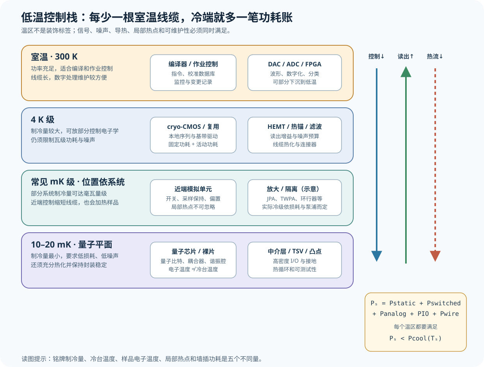

# 19｜可维护量子系统工程

## 1. 本章要回答什么

量子处理器能执行一次漂亮的实验，不等于它已经是一台可维护的计算系统。后者还要求读出和复位可重复、控制链能扩展、制造缺陷可筛选、校准能追踪和回滚、故障能修复、能耗和可用率能按统一边界审计。

本章把前文分散的硬件知识连接成一条工程主线：

```text
器件与制造
  → 封装、互连和环境
  → 控制、读出与复位
  → 校准和变更控制
  → 编译、反馈与纠错
  → 作业调度、运维和服务指标
```

这里不重复第 09 章的六平台物理原理、第 10 章的稳定子推导、第 11 章的基准原则或第 14 章的门到波形推导，而是解释这些层怎样互相限制。

若第一次接触整机工程，先读 §1、§3–4、§6 和 §12：它们回答“结果怎样被可靠读出与复位、控制线怎样扩展、校准如何追踪、设备何时真的可用”。然后按自己关心的平台回查 §2 的控制链；§5、§7–11 是封装、网络、编码与标准的专题。下面的缩写表是一张查字典用的速查页，不是进入本章前要背完的清单。遇到一个缩写，先看它在当前链条中是**产生控制、传送信号、放大读出、判决结果**还是**安排系统运行**。

## 2. 五类平台的控制链

同一句“施加控制并读出”，在不同平台上对应完全不同的设备和时序。


图中的横向箭头表示各平台从信号产生到探测、判决的顺序；最右列分别说明该平台怎样为下一轮准备。光子平台中，尚未接入计算的资源态若先兆失败，可以丢弃并重试；一旦失败已经发生在计算图内，融合失败或光子损失通常要作为已知位置的擦除交给路由与译码，不能靠丢弃整次计算来扩展。

### 本章缩写速查

| 缩写 | 全称 | 在本章中的作用 |
|---|---|---|
| DAC / ADC | 数模转换器 / 模数转换器 | 产生模拟控制波形 / 把读出信号数字化 |
| AWG | 任意波形发生器 | 按校准参数合成脉冲包络 |
| I/Q | 同相 / 正交分量 | 表示微波的两个正交幅相分量 |
| HEMT / JPA / TWPA | 高电子迁移率晶体管放大器 / 约瑟夫森参量放大器 / 行波参量放大器 | 分别承担较高温级放大与低噪声前置放大 |
| AOM / EOM | 声光 / 电光调制器 | 调节激光的频率、相位、强度与时序 |
| QCCD | 量子电荷耦合器件架构 | 在分区离子阱中搬运、合并和重排离子 |
| PMT | 光电倍增管 | 计数离子或原子的荧光光子 |
| MOT / SLM / AOD | 磁光阱 / 空间光调制器 / 声光偏转器 | 装载中性原子并生成、移动光镊 |
| PNR | 光子数分辨 | 区分探测到的光子数 |
| SET / RF | 单电子晶体管 / 射频 | 把自旋映射成电荷后进行快速传感 |
| ESR / EDSR | 电子自旋共振 / 电偶极自旋共振 | 驱动半导体自旋 |
| TSV | 硅通孔 | 提供垂直、高密度封装互连 |
| QUBO | 二次无约束二元优化 | 退火器常用的问题表示 |
| QND | 量子非破坏测量 | 检查测量是否保留同一可观测量的本征值 |
| SPAM | 状态制备与测量 | 把制备误差和测量误差作为一组实验边界报告 |
| TTS | 达到目标成功率的时间 | 把单次成功率、重复次数和端到端开销放入同一指标 |
| qLDPC | 量子低密度奇偶校验码 | 用稀疏检查追求较高编码率，但可能要求复杂连接 |
| MTBF / MTTR | 平均故障间隔 / 平均修复时间 | 估算非计划故障可用率 |

### 2.1 超导电路

数字序列被 DAC/AWG 转成 I/Q 微波、磁通或耦合器波形，经衰减、滤波和传输线到达芯片。色散读出信号沿反方向经过环行器、量子受限放大器、4 K HEMT、室温放大和 ADC，最后由分类器给出结果。频分复用能减少线缆，却引入频率拥挤、放大器动态范围、共享馈线串扰和积分窗权衡。

复位可以等待若干个 $T_1$、测量后条件翻转，或借助耗散工程和辅助模。复位（`reset`）因而不是零时间的软件指令。

### 2.2 离子阱

激光器经 AOM/EOM 控制频率、相位、强度和时序，聚焦到离子；阱电极波形还负责分裂、搬运、合并和重排离子链。纠缠门借助运动模，搬运后可能需要再冷却。荧光由 PMT 或相机计数，复位通常靠光抽运或淬灭路径。

QCCD 中“任意两个离子可以被搬到同一门区”不等于全连接门可零成本并行。门区、交叉结、成像区和再冷却区都是调度资源。

### 2.3 中性原子

MOT 或原子储库提供原子，SLM/AOD 生成和移动光镊，Raman 与 Rydberg 激光完成单比特和纠缠操作。荧光、自旋到损失映射或自旋到位置映射完成读出；空位随后要重排或补充。大系统通常分成储库、准备、存储、纠缠和读出区。

阵列站点数、实际装载原子数、参与门的原子数、读出后保留数和逻辑比特数是五种不同计数。

### 2.4 光子

泵浦驱动单光子源或压缩器，随后经过滤波、复用、干涉仪、开关和延迟线，最后由 PNR 探测器或零差（homodyne）探测器读出并驱动前馈。源成功率、耦合、传播、开关和探测效率会相乘；探测器死时间和前馈时钟又限制吞吐。

必须区分每时钟空间模式、时间深度、成功事件数和累计模式数。连续两小时产生数百亿时序模式，不表示同时存储了数百亿个量子比特。

### 2.5 半导体自旋

直流（DC）栅压先形成和调谐量子点，再用 ESR/EDSR、全局共振场、交换脉冲或基带电压操作自旋。读出通常把自旋映射成电荷，再由 SET 或 RF 反射传感器检测；复位可借助电子库、隧穿选择或测量后反馈。

一个可扩展的自动调谐状态机至少包括：空点、装载、电荷稳定图、隧穿率、传感器工作点、自旋共振、交换门和回归测试。任何一步失败都应有诊断和回退，而不是无限继续优化。

## 3. 读出是量子仪器，复位是物理过程

终止测量只需把最终量子态转换成经典结果；中途测量还必须规定测后状态，以及未被测量量子比特受到的影响。完整指标至少包括：

| 指标 | 回答的问题 | 容易遗漏的边界 |
|---|---|---|
| assignment error | 0/1 判决错多少 | 不描述测后状态和邻居串扰 |
| QND 性 | 在给定被测可观测量和条件结果下，测量反作用是否尽量不改变该可观测量 | 连续测量的重复性只是代理量，还须结合独立的 SPAM 和跃迁模型；高 assignment fidelity 不保证 QND |
| 测量诱导跃迁/泄漏 | 被测比特是否离开目标状态或子空间 | 终止测量可能看不见 |
| 旁观错误 | 未测量量子比特受到多少退相干、散射或串扰 | 随并行规模变化 |
| 时延和死时间 | 多久得到可用于反馈的结果 | 云端返回时间不是控制器反馈时间 |
| 复位残差 | 复位后激发态、泄漏态或丢失还剩多少 | 平均值会隐藏状态依赖 |

2025 年量子仪器随机基准在离子和超导处理器上发现了普通读出标定未覆盖的中途测量串扰。这说明不能用一项 assignment fidelity 代表动态线路中的测量质量。

常见复位机制及代价如下：

| 机制 | 典型平台 | 主要代价 |
|---|---|---|
| 被动等待 | 超导、自旋 | 慢；热稳态不一定是纯基态 |
| 测量后条件脉冲 | 超导、自旋 | 测量、判决、反馈和条件门都会出错 |
| 耗散工程/辅助模抽运 | 超导、玻色模式 | 附加耦合、泵浦误差和热负载 |
| 光抽运/淬灭/再冷却 | 离子、中性原子 | 散射、旁观串扰和运动加热 |
| 隧穿到库/重新装载 | 自旋、中性原子 | 随机等待、空位和循环时间 |

### 可复算例 1：从读出判决矩阵还原概率

先约定矩阵方向，避免最常见的转置错误。令列向量 $\boldsymbol p=(p_0,p_1)^T$ 表示测量前的真实概率，$\boldsymbol q=(q_0,q_1)^T$ 表示分类器报告的概率，并定义

$$
M_{ij}=P(\text{报告 }i\mid\text{真实 }j),
\qquad
\boldsymbol q=M\boldsymbol p.
$$

因此 $M$ 的**每一列**之和为 1。假设分别制备 $|0\rangle$、$|1\rangle$ 得到标定矩阵

$$
M=
\begin{pmatrix}
0.97&0.08\\
0.03&0.92
\end{pmatrix},
$$

未知实验给出 $\boldsymbol q=(0.58,0.42)^T$。由于 $\det M=0.89$，反演得到

$$
\boldsymbol p=M^{-1}\boldsymbol q
=\frac1{0.89}
\begin{pmatrix}
0.92&-0.08\\
-0.03&0.97
\end{pmatrix}
\begin{pmatrix}0.58\\0.42\end{pmatrix}
=\begin{pmatrix}0.562\\0.438\end{pmatrix}
\quad\text{（四舍五入）}.
$$

所以原始的 58%/42% 不是直接减去两个错误率，而要按条件概率矩阵求解。还可把第一行和 $p_1=1-p_0$ 合并成

$$
q_0=0.97p_0+0.08p_1=0.08+0.89p_0,
\qquad
\widehat p_0=\frac{\widehat q_0-0.08}{0.89}.
$$

先假设标定矩阵 $M$ 固定且准确，$N$ 次 shots 又彼此独立。此时 $\widehat q_0$ 是二项频率，因而

$$
\operatorname{Var}(\widehat q_0)=\frac{q_0(1-q_0)}N,
\qquad
\operatorname{Var}(\widehat p_0)
=\frac{1}{0.89^2}\operatorname{Var}(\widehat q_0)
\approx1.262\operatorname{Var}(\widehat q_0).
$$

例如 $N=10{,}000$ 且观测到 $q_0=0.58$，未经校正的频率标准差约为

$$
\sqrt{\frac{0.58\times0.42}{10{,}000}}
\approx0.00494,
$$

校正后则放大为 $0.00494/0.89\approx0.00555$。也就是说，方差约放大 26.2%，标准差约放大 12.4%；校正偏差并没有免费增加信息。多结果情形相应地传播整个协方差矩阵：

$$
\operatorname{Cov}(\widehat{\boldsymbol p})
=M^{-1}\operatorname{Cov}(\widehat{\boldsymbol q})(M^{-1})^T.
$$

逆矩阵中的负系数还提示另一项代价：当两列很接近、矩阵病态时，线性反演甚至会给出负的概率估计。正式报告应传播计数不确定度，并说明是否使用约束估计或正则化。上面的数值没有计入有限标定 shots、标定漂移及 $M$ 元素之间的协方差；若 $M$ 也由数据估计，必须把这部分不确定度一同传播。这个修正只处理所建模的经典判决误差，不能修复测量诱导跃迁、非 QND 反作用、串扰、漂移或错误的制备标定。

### 可复算例 2：旁观错误为何会主导中途测量

某读出对被测比特的 assignment error 为 $0.5\%$，但每次中途测量使 8 个旁观比特各产生 $0.15\%$ 的额外错误。若先近似独立，则至少一个旁观比特出错的概率为

$$
1-(1-0.0015)^8\approx1.19\%.
$$

因此“读出保真度 $99.5\%$”不能预测这一动态线路层的总错误。真实串扰常有关联，独立模型只是下手计算的第一步。

### 3.1 S71-19：第一次读出完全正确，第二次为何不同

第 05 章说明 POVM 只决定结果概率；这里把它变成中途测量验收的两维反例。**题目。** 两种仪器都用结果 $m=0,1$，分别由一个 Kraus 算符描述每个结果分支：

$$
K_0=|0\rangle\langle0|,\quad K_1=|1\rangle\langle1|;
\qquad
L_0=|0\rangle\langle0|,\quad L_1=|0\rangle\langle1|.
$$

第一种在 Z 测量后保留相应本征态；第二种先报告输入的 Z 结果，再把系统复位到 0。只比较第一次 assignment 表，两者能否区分？连续测同一仪器两次、中间不做门时，输入 $|0\rangle,|1\rangle,|+\rangle$ 的同值概率各是多少？

**先检查合法性与统计。** 每种仪器均有

$$
K_m^\dagger K_m=L_m^\dagger L_m=|m\rangle\langle m|,
\qquad \sum_m K_m^\dagger K_m=\sum_m L_m^\dagger L_m=I.
$$

因此所有分支完全正，汇总映射保迹。对任意输入密度矩阵 $\rho$，第一次报告概率均为 $P(m)=\langle m|\rho|m\rangle$。用理想制备 0/1 标定，两张 assignment 表都是单位矩阵、准确率 100%；它们甚至对任意叠加输入的第一次统计也完全相同。

**再算测后态。** 第一种分支为 $K_m\rho K_m^\dagger=P(m)|m\rangle\langle m|$，第二种为 $L_m\rho L_m^\dagger=P(m)|0\rangle\langle0|$。当 $P(m)>0$ 时，除以该概率得到条件态；零概率分支没有定义条件态，不能也称“复位成功”。

丢弃结果后，第一种给 $\rho_{00}|0\rangle\langle0|+\rho_{11}|1\rangle\langle1|$，第二种恒为 $|0\rangle\langle0|$。第二种对主动复位有价值，但不是保持 Z 本征值的 QND 仪器。

| 初态 | 两种仪器第一次 $P(0),P(1)$ | 第一种两次同值 | 第二种两次同值 |
|---|---|---:|---:|
| $\lvert0\rangle$ | $(1,0)$ | 1 | 1 |
| $\lvert1\rangle$ | $(0,1)$ | 1 | 0 |
| $\lvert+\rangle$ | $(1/2,1/2)$ | 1 | 1/2 |

第二种的第二次总报 0，所以同值概率就是第一次报 0 的概率。只测试输入 0，两次重复性都为 100%，仍会漏掉两种仪器的区别；至少须覆盖不同输入与分支。真实测试还要独立估计判决错误、制备偏差、测量间的弛豫和泄漏，不能把重复计数直接等同完整仪器保真度。

运行 [round71_checks.py](../codes/systems/round71_checks.py) 的 `--case 19`，直接用两套 Kraus 检查 POVM 相等，并从 $K_mK_m|\psi\rangle$ 或 $L_mL_m|\psi\rangle$ 的模平方求连续同值概率。输入固定，无硬件、随机采样或读出修正。这一教学模型没有宣称真实复位可零耗时完成。

[Hothem 等的原始中途测量研究](https://www.nature.com/articles/s41467-025-60923-x)把结果判决与条件过程纳入量子仪器表征（2025-07-01，访问 2026-10-13）；其完整实验数据与部分分析代码需按论文说明请求，不能因为存在论文就声称已下载并复现全部材料。可从 [pyGSTi 的仪器模型源码](https://github.com/sandialabs/pyGSTi/blob/master/pygsti/modelmembers/instruments/instrument.py)学习结果分支的表示；本题不依赖该库，也没有执行其拟合器。热平衡下被动复位的残差与最短等待另见[第 09 章 S71-09](09-hardware.md#511-s71-09等五个弛豫时间复位残差一定小于-1-吗)。

## 4. 低温控制、布线与分温区热预算

把电子学移近量子芯片可以减少室温线缆、缩短信号路径，却会把功耗和噪声带到制冷能力更小的冷级。



这是一种代表性分区，不是器件必须安装在哪一温区的规范。放大器、隔离器和近端控制的实际位置取决于频段、损耗、泵浦、布线与具体制冷机曲线；铭牌制冷量也不能替代样品电子温度和局部热点测量。

对每个温区 $s$，把各项功耗相加：

$$
P_s=P_{\rm static}+P_{\rm switched}+P_{\rm analog}
+P_{\rm IO}+P_{\rm wire},
\qquad P_s<P_{\rm cool}(T_s).
$$

对开关型或数字控制，可以进一步写成

$$
P_{\rm switched}=N_{\rm active}E_{\rm update}f_{\rm update}.
$$

连续微波、激光泵浦、偏置网络和模拟放大器则应按平均驱动功率、占空比与级间耗散计入 $P_{\rm analog}$，不宜一律解释成“更新能量乘更新频率”。

这里的 $P_{\rm cool}$ 是该温区在指定温度的可用制冷量，不是整机制冷机的室温输入功率。还要分别检查：

- 线缆导热和衰减器耗散；
- 数字逻辑固定功耗与模拟通道活动功耗；
- 局部热点和样品电子温度；
- 信号完整性、相位噪声和串扰；
- 冷启动、热循环和维护后的重复性。

2025 年一个 mK 自旋控制芯片集成约 10 万晶体管；论文报告数十微瓦固定数字功耗，并在产生约 100 mV 幅度脉冲的条件下，给出模拟单元约 $20\,\mathrm{nW\,MHz^{-1}}$ 的活动功耗，同时明确指出寄生加热。后一个数字要乘实际更新频率，且不能代替整片芯片的固定功耗。2026 年另一硅 QPU 把约 7,000 万晶体管的控制器放在 4 K，通过高密度超导带状电缆驱动 mK 器件。这些是两种具体分区方案，不是通用“每量子比特功耗”。

### 可复算例 3：冷级能同时打开多少通道

设 100 mK 冷级可分给控制电子学 $600\,\mu\mathrm W$，固定功耗 $80\,\mu\mathrm W$，I/O 与线缆分摊 $120\,\mu\mathrm W$，每个活跃通道的开关与模拟平均功耗合计为 $0.4\,\mu\mathrm W$。则

$$
N_{\rm active}\le
\frac{600-80-120}{0.4}=1000.
$$

这是用于教学的功耗预算边界：1000 个通道恰好耗尽分配的预算，没有热裕量；若严格要求上面的 $P_s<P_{\rm cool}$ 且按整数通道计，必须少于 1000 个，实际还须预留漂移和局部热点余量。若每通道功耗减半但固定功耗翻倍，等预算边界变为 $(600-160-120)/0.2=1600$，并不会简单翻倍到 2000。

## 5. 封装、互连和可测试性

封装必须同时满足高密度 I/O、低损耗、充分热化、良好接地和可制造性。倒装焊、中介层和 TSV 能解决边缘引线不足，却会增加介质、金属接缝、寄生模、热阻和新的失效界面。

工程审查不能只数引脚，还应问：

1. 裸片在封装前能否低温筛选，是否存在“已知良品裸片”？
2. 封装后如何定位是芯片、凸点、电缆还是连接器故障？
3. 热循环后参数和接触电阻是否保持？
4. 是否能返修，还是一个坏通道会报废整个模块？
5. 多层接地、寄生腔模和串扰怎样验证？
6. 量子模块与控制、光学或网络模块之间的接口是否有明确容差？

## 6. 制造良率、自动校准与变更控制

“良率”至少有五层：

| 层级 | 通过条件的例子 |
|---|---|
| 工艺良率 | 关键尺寸、结或材料堆栈符合制造规范 |
| 电学良率 | 连通、栅漏、谐振器或传感器可用 |
| 可调谐良率 | 能形成目标频率、量子点、电荷占据或耦合 |
| 全门集良率 | SPAM、单/双比特门都通过预先规定阈值 |
| 服务良率 | 封装、热循环、并行运行和长时漂移后仍满足规格 |

样本报告要按晶圆、裸片、器件、量子比特和门层分别给数量、选择规则和失效原因。最佳器件、通过筛选的器件和随机抽样器件不可混写。

### 可复算例 4：四个成功器件说明不了 99% 良率

若四个器件是从已通过电学筛选的集合中选出，随机抽样前提已经不成立，不能用它们估计整片晶圆良率。即使勉强假设四个是独立随机样本且 $4/4$ 成功，双侧 $95\%$ Clopper–Pearson 下限也只有

$$
p_{\rm low}=(0.025)^{1/4}\approx39.8\%.
$$

反过来问：仍按“独立、随机抽样，而且一个失败也没有”的理想前提，要让同样的双侧 95% 下限达到 $99\%$，至少需要多少个成功样本？令 $(0.025)^{1/n}\ge0.99$，两边取对数并注意 $\ln0.99<0$，得到

$$
n\ge\frac{\ln0.025}{\ln0.99}\approx367.04,
$$

所以至少要 **368 个**独立随机样本全部成功。真实晶圆上的器件还可能共享工艺缺陷、测试门槛也可能事后改变，不能机械把 368 当成通用认证数量；这个倒推只说明“四个成功样本”离支持 99% 良率有多远。

“四个器件都超过 99% 门保真度”描述门质量，不等于“晶圆功能良率为 99%”。

### 6.1 自动校准不是无人值守

每个校准参数都应有时间戳、不确定度、数据来源、依赖版本和适用范围。自动校准系统至少需要：

```text
监测漂移或故障
  → 选择最小受影响子图
  → 生成候选参数
  → 小范围试运行线路与回归集
  → 晋级或回滚
  → 保存原始扫描、变更原因和影响范围
```

应区分三种能力：自动找到工作点、自动维持工作点、自动诊断硬件故障。一次优化成功只证明第一种。新标定若没有回归测试和回滚，可能使下游门、读出或编译假设整体失效。

### 6.2 练习与实验：改了频率，哪些校准必须重新验收

**题目。** 一份合成校准依赖图规定：$f_0$ 是第 0 位频率；幅度 $a_0$ 和读出 $m_0$ 依赖 $f_0$；双比特门 $g_{01}$ 依赖 $a_0,m_0$；并行门层检查 $v_{01}$ 依赖 $g_{01}$。另外，第 2 位的 $a_2,m_2$ 在这张简化图中独立。更新 $f_0$ 后，只重新跑一次频谱扫描是否足够？

**逐步答案。** 一条依赖边 $u\to v$ 表示“$v$ 的有效性证据以 $u$ 的这一版本为前提”，不一定意味着物理上只有这一条耦合。更新 $f_0$ 后，先把它的直接下游 $a_0,m_0$ 标成待验证，再沿边传播到 $g_{01}$，最后到 $v_{01}$。所以候选快照需要按依赖顺序验证

$$
f_0\ \longrightarrow\ (a_0,m_0)\ \longrightarrow\ g_{01}\ \longrightarrow\ v_{01}.
$$

$a_0,m_0$ 在数学依赖图上可交换验证顺序；是否能真正并行还要看实验资源冲突。$a_2,m_2$ 没有位于本次变更的后继集合，故不因这张图而自动失效。现实中的共享本振、读出总线或串扰若影响第 2 位，就应补进依赖图，不能因为软件没有记录便认为不存在。

**扩展题及答案。** 当前生产快照版本为 7，候选参数在频谱、幅度、读出、双比特门检查中都通过，但门层回归失败。此时应保留活动快照 7，保存候选失败证据，并停止晋级。回归全部通过且确认活动版本仍是 7 后，才一次性发布完整快照 8；若测试期间另一项变更已发布版本 8，就应拒绝这次基于旧版本的发布并重新检查。否则会把分别验证过、但彼此不兼容的参数拼成未经验证的组合。

这里的“回滚”是控制参数和配置的回滚，不是逆转已经发生的物理漂移。若旧快照本身也已因漂移失效，就不能继续宣称它合格，设备应进入降级或维护状态。候选检查失败与旧配置失效是两项独立判断。

运行 [calibration_dependencies.py](../codes/systems/calibration_dependencies.py)，程序按有向无环图计算需重验的集合，检查失败回归保留版本 7、全通过晋级为 8，并拒绝基于过期版本的再次发布。此处只有合成参数与布尔验收结果，没有执行硬件校准，也没有建立生产级事务数据库。真实记录还应带每个父参数的版本、原始扫描、拟合不确定度、预先规定的通过门槛、环境和过期条件。

工程软件入口可从 [Qiskit Experiments 官方仓库](https://github.com/qiskit-community/qiskit-experiments)研究实验与分析产物的组织；但旧版脉冲校准管理接口已移除，版本界限见[第 14 章](14-compilation-control.md)。本例的依赖传播与快照规则是本书教学设计，没有声称该库已提供整套无人值守运维系统（来源核查 2026-09-26）。

## 7. 模块化不是一种单一架构

| 类型 | 跨模块资源 | 主要成本 | 不能怎样计数 |
|---|---|---|---|
| 仅局域操作的线路切割（LO） | 各芯片独立运行子线路，结果在经典端重构 | 多次采样、准概率权重和后处理；不要求实时跨芯片反馈 | 重构的非局域统计不等于可直接存取的跨芯片纠缠 |
| 局域操作加经典通信的虚拟门（LOCC） | 跨芯片测量结果经实时经典链路触发本地条件门 | 准概率采样、链路时延和反馈控制；所用 Bell 对是经切割构造的虚拟资源 | 虚拟 Bell 对不能当作已先兆生成、可保存的真实远程 Bell 对 |
| 短距相干互连 | 微波、声子或直接耦合通道 | 接口门质量、封装、频率匹配 | 不能忽略芯片边界门 |
| 先兆式光子链路 + 物质存储 | Bell 对、经典先兆和前馈 | 概率生成、等待、纯化、存储退相干 | 不能把远程门当本地门 |
| 全光子时空簇态 | 时空模式、源、延迟线、探测和前馈 | 损耗、源成功率、时钟和译码 | 不能把累计模式数当同时量子比特数 |

2024 年两个各有 127 比特的处理器通过实时经典链路，分别实验了仅局域操作的线路切割与需要跨芯片前馈的虚拟门，属于表中前两类。论文报告的最多 142 比特跨设备线路依靠切割后的子线路和经典重构，不能当成两芯片之间已建立可直接存取的相干量子链路。2025 年两个离子模块之间的远程 CZ 门隐形传态则属于先兆式量子链路一类；其远程门平均保真度约为 $86\%$，清楚显示模块化需要单独的接口错误预算。

## 8. 量子退火和模拟器怎样公平验证

### 8.1 量子退火

QUBO 用取值为 0 或 1 的变量写二次目标函数，Ising 形式则用取值为 $-1$ 或 $+1$ 的自旋变量；两种形式可以互相改写。问题变量之间需要的连接未必与退火器的物理连接相同。**次图嵌入**（minor embedding）把一个问题变量分配给一组相连的物理比特；这些比特之间加入倾向同值的耦合，其强弱称为**链强度**。**自旋反转变换**（gauge）同时改变某些自旋变量及对应系数的符号，使数学问题等价，却可能改变具体硬件的误差表现。

退火基准必须冻结 QUBO/Ising 映射、次图嵌入、链强度、退火日程、自旋反转变换、读出次数、后处理和调参预算。先规定“命中”是找到已知最优解，还是达到事先设定的目标值，并把后处理后的判定规则固定。若每次运行相互独立、使用同一设置，且每次命中概率恒为 $0<p_{\rm hit}<1$，那么 $N$ 次都未命中的概率是 $(1-p_{\rm hit})^N$。令它不超过 $1-p_{\rm target}$，取对数并注意 $\ln(1-p_{\rm hit})<0$，得到达到目标总体成功概率 $p_{\rm target}$ 所需重复次数：

$$
N_{\rm rep}=\left\lceil
\frac{\ln(1-p_{\rm target})}{\ln(1-p_{\rm hit})}
\right\rceil.
$$

若不同 shots 因漂移、参数调整或共同故障而相关，这个幂次式就不再精确；应按实际批次估计成功概率和不确定度。

端到端 time-to-solution 应写成

$$
T_{\rm TTS}=T_{\rm embed}+T_{\rm tune}+T_{\rm program}
+N_{\rm rep}(T_{\rm anneal}+T_{\rm read}+T_{\rm delay}+T_{\rm post,shot})
+T_{\rm post,batch}.
$$

这里 $T_{\rm post,shot}$ 是**每条样本**都要做的链修复、可行性检查或目标值计算等后处理；$T_{\rm post,batch}$ 是**整批样本只做一次**的汇总或选择。不能只把单条样本的后处理放在重复项外。这个加法式还假定同一实例、同一设置下的 $N_{\rm rep}$ 次尝试**共用一次**嵌入、调参和编程；若每次都改变参数或重新编程，相应时间应进入重复项。若一个编程设置服务许多独立问题实例，可以按预先说明的批量摊销，但不能一边把量子端的一次性成本摊给无限多个实例，一边让经典基线逐题承担全部预处理。若读出、下一次退火和后处理可流水化重叠，还须按实际关键路径计时，而不是机械把每段时长相加。

纯 QA、混合 QA 和经典启发式求解器要分别标注。混合求解器的品牌名称不能代替量子/经典工作分解。

### 可复算例 5：退火时间只是总时间的一小部分

设单次命中概率 $p_{\rm hit}=0.02$，目标成功率 $0.99$，每次退火 $20\,\mu\mathrm s$、读出与延迟 $120\,\mu\mathrm s$，一次编程 $1\,\mathrm s$，暂不计嵌入、调参、逐条和整批后处理。则

$$
N_{\rm rep}=\left\lceil\frac{\ln0.01}{\ln0.98}\right\rceil=228,
$$

$$
T_{\rm TTS}=1+228\times140\,\mu\mathrm s
\approx1.0319\,\mathrm s.
$$

其中纯退火时间只有 $4.56\,\mathrm{ms}$。只报告 anneal time 会低估两个数量级以上。

### 8.2 模拟量子模拟器

模拟器应按任务验证，而不是只报一项门保真度：

1. 写出目标 Hamiltonian 或 Lindbladian；
2. 标定实际耦合与目标值的偏差；
3. 检查初态制备和测量误差；
4. 做多个系统尺寸、演化时间和可观测量；
5. 在小规模经典可解区交叉验证；
6. 区分统计误差、实现偏差和有限尺寸误差。

某些局域可观测量在特定局域性、时间和噪声假设下可能对误差稳定；这是一条带条件的任务结论，不能推广到长时间、非局域量或所有临界模型。

## 9. 连续变量与玻色编码：从振荡器到逻辑比特

光场、微波腔和离子运动模都是谐振荡器。其相空间正交分量算符可写成 $\hat q,\hat p$，位移改变相空间中心，压缩把一个方向的涨落降低并把另一方向放大。同相探测测量某一旋转后的正交分量。

**高斯态**是相空间中由一阶均值和二阶涨落（协方差）决定、分布形状为高斯型的态；真空态、相干态和压缩真空态是例子。线性光学和压缩等高斯操作会把高斯态仍变成高斯态，零差探测属于高斯测量。只用这些高斯资源，不能单独提供通用容错量子计算；还需要非高斯态、非线性相互作用或等效测量资源。这里的“高斯”描述状态与操作类别，不是说每次测量输出都必须看起来像一条普通的一维钟形曲线。

| 编码 | 直觉 | 主要受益 | 仍需付出的资源 |
|---|---|---|---|
| cat | 两个或多个相干态的叠加、宇称结构 | 可形成强噪声偏置 | 泵浦稳定、辅助比特、偏置保持门 |
| binomial | 有限组 Fock 分量按组合结构排列 | 针对有限阶损失/增益设计 | 状态制备和综合征测量复杂 |
| GKP | 相空间晶格上的梳状态 | 小位移错误可映射为综合征 | 理想态无限能量；实验只有有限压缩近似 |

2025 年有限能量 GKP 态上已经演示确定性通用逻辑门集和 Bell 态；另一个 GKP 多能级逻辑单元（qudit）存储实验报告 qutrit（三能级）与 ququart（四能级）的有效寿命增益分别为 $1.82\pm0.03$ 与 $1.87\pm0.03$。论文以短时平均信道保真度衰减定义有效衰减率 $\Gamma$，增益为 $G_d=\Gamma_d^{\rm Fock}/\Gamma_d^{\rm GKP}=\tau_d^{\rm GKP}/\tau_d^{\rm Fock}$，其中 $\tau_d=1/\Gamma_d$。寿命比的分母 $\tau_d^{\rm Fock}$ 对应同维数、由物理腔 Fock 态编码的最佳物理 qudit；其短时有效衰减率 $\Gamma_d^{\rm Fock}$ 是由同装置实测的腔 $T_{1,c}$ 和 Ramsey $T_{2R,c}$，按光子损失与纯退相干模型外推得到，并非直接测得 Fock qudit 的完整长时存储曲线。$\Gamma_d^{\rm GKP}$ 则来自逻辑存储实验。这是存储指标，不是通用门保真度；这些结果也不等于完整容错计算机。

玻色内码常与外层量子比特码串接。2025 年 cat + repetition 实验展示了距离 5 逻辑存储和偏置保持 CX。论文把每周期逻辑位翻转概率 $\epsilon_{L,\mathrm{bit}}$ 与相位翻转概率 $\epsilon_{L,\mathrm{phase}}$ 的平均

$$
\epsilon_L=\frac{\epsilon_{L,\mathrm{bit}}+\epsilon_{L,\mathrm{phase}}}{2}
$$

定义为**整体逻辑存储错误**指标；在所测工作点 $|\alpha|^2=1.5$，最低报告值为每周期 $1.65\pm0.03\%$。它不是“任一种错误发生的总概率”，也不是单独一扇 CX 的错误率。实验观察到增加距离能压低受重复码保护的相位翻转；但物理位翻转不能由这一层重复码纠正，所以论文也明确指出它**没有完整的渐近阈值**。这一码族还不能独自形成完整通用纠错架构。

## 10. 错误信息何时可见，决定译码器能做什么

| 错误类型 | 是否离开计算子空间 | 位置/时间是否已知 | 译码含义 |
|---|---:|---:|---|
| 未知 Pauli | 否 | 否 | 从综合征推断位置和类型 |
| 偏置 Pauli | 否 | 否，但先验不均匀 | 译码器可利用偏置；门必须保持偏置 |
| 泄漏 | 是 | 可能未知 | 可跨轮持续并污染邻居，需要 LRU 或标记 |
| 丢失 | 是或器件消失 | 取决于探测 | 未标记时不是免费擦除 |
| 即时擦除 | 已知失效 | 位置和近似时间已知 | 可修改校验图、路由，或形成合并校验（supercheck，即缺失位置周围若干稳定子校验的乘积） |
| 延迟擦除 | 已知失效 | 最终才知道 | 可帮助离线译码，未必能帮助实时控制 |

擦除检测器自身也有假阳性、假阴性和时间分辨率。距离 $d$ 的码最多保证纠正 $d-1$ 个已知位置擦除，但只保证纠正 $\lfloor(d-1)/2\rfloor$ 个未知位置错误。

### 可复算例 6：位置标签带来的距离收益

对距离 5 代码，未知位置错误的保证纠正数为

$$
\left\lfloor\frac{5-1}{2}\right\rfloor=2,
$$

而已知位置擦除为 $5-1=4$。若擦除探测真阳性率为 $98\%$、假阳性率为 $0.2\%$，漏检的 $2\%$ 丢失仍要进入未知错误模型，假标记又会消耗擦除预算。只写“支持擦除”仍不足以估算逻辑错误。

### 10.1 三类容错架构的资源交换

| 架构 | 编码率与连接 | 校验/译码 | 逻辑门和工程边界 |
|---|---|---|---|
| 表面码 | 低编码率；二维局域连接友好 | 低权重局域校验；成熟匹配/并查集等 | lattice surgery 和魔法态工厂占大量时空资源 |
| qLDPC | 可有常数编码率；常需非局域或复杂布线 | 低密度校验但图更复杂；译码和并行读出要求高 | 高率不自动转化为低整机开销；许多结果仍是理论/数值 |
| 玻色内码 + 外码 | 单模式先抑制某类错误，再跨模式编码 | 需辅助量子比特、泵浦和偏置保持综合征 | 可能降外码开销，但控制和误差模型更专用 |

qLDPC 的“低密度”指校验权重和每比特参与的校验数受限，不表示二维局域硬件上自动容易实现。比较架构必须同时计连接、校验电路、译码、逻辑门、辅助态和硬件噪声假设。

## 11. 标准成熟度与供应链

### 11.1 标准状态不能混写

| 文档状态 | 能说明什么 | 不能说明什么 |
|---|---|---|
| 已发布 ISO/IEC 国际标准 | 正式文本和版本存在 | 产品已互操作或通过性能认证 |
| RFC Informational/研究文档 | 社区参考架构或术语 | 已部署互联网标准 |
| 联盟/开源规范 | 一组接口或语法约定 | 所有后端完整、等价实现 |
| active PAR/工作项目 | 标准正在制定 | 标准已经批准和出版 |
| 厂商 API | 当时产品接口 | 长期稳定或跨厂商兼容 |

ISO/IEC 4879:2024 是量子计算词汇标准，不是性能、互操作或安全认证。ISO/IEC JTC 3 于 2024 年建立并覆盖量子计算、模拟、计量、源、探测器和通信；委员会的工作范围也不表示各领域标准已经完成。

### 11.2 供应链按依赖审计，不按厂商排名

应覆盖：高纯和同位素材料、专用晶圆工艺、约瑟夫森结、激光器/AOM/EOM/高 NA 光学、真空、稀释制冷和 He-3、低噪放大器/ADC/DAC、SNSPD/PNR 探测器、封装测试、FPGA/固件和校准软件。

对每类依赖问同一组问题：

- 是否单一来源，替代件会不会改变校准？
- 交期、维修周期和备件寿命多长？
- 是否通过低温、真空、磁场或辐照资格测试？
- 批次和固件能否追溯？
- 供应商停产、接口升级或许可证变化时如何迁移？

## 12. 可用率、能耗与云端运行状态

### 12.1 可用率不是“网页能打开”

应分别报告整机在线、QPU 在质量门槛内、用户作业成功三种比例。非计划故障可用率常写作

$$
A_u=\frac{\mathrm{MTBF}}{\mathrm{MTBF}+\mathrm{MTTR}}.
$$

计划维护、每日校准、降级运行、排队和失败重试要另外计入。峰值门保真度和峰值 shots/s 不能替代时间平均服务能力。

### 可复算例 7：从设备峰值到有效吞吐

设 $\mathrm{MTBF}=18\,\mathrm h$、$\mathrm{MTTR}=2\,\mathrm h$，则 $A_u=0.9$。每天另有 3 小时计划校准，可调度比例为 $21/24=0.875$。近似独立时

$$
A_{\rm sched}=0.9\times0.875=0.7875.
$$

若在线时产生 $10^5$ 个合格 shots/s，按墙钟平均只有约 $7.875\times10^4$ shots/s，且还未扣除失败作业和重试。

### 练习与实验：维护和故障重叠时不能重复扣时间

**题目。** 一份 24 小时教学日志记录：02:00—05:00 计划校准，04:00—06:00 故障停机，10:00—12:00 降级运行。降级时网页和作业接口都正常，但结果达不到预先约定的质量门槛。其余时间每秒产生 $10^5$ 个合格 shots；降级时每秒产生 $4\times10^4$ 个不达标 shots。求在线时间、满足质量门槛的时间、合格样本墙钟平均吞吐。能否把“校准可用比例”与“故障可用比例”直接相乘？

**逐步答案。** 时间区间用左闭右开表示，例如 $[2,5)$，避免把交界时刻重复算入相邻状态。校准与故障的交集为 $[4,5)$，长度 1 小时；并集为 $[2,6)$，长度 $3+2-1=4$ 小时。因此在线时间是 $24-4=20$ 小时，而不是直接减成 19 小时。

降级的两小时虽在线，却不达质量门槛，所以合格时间为 $20-2=18$ 小时。合格 shots 总数与墙钟吞吐为

$$
N_{\rm qualified}=18\times3600\times10^5=6.48\times10^9,
\qquad
R_{\rm wall}=\frac{6.48\times10^9}{24\times3600}=75000\ \mathrm{s^{-1}}.
$$

原始样本还包括降级段的 $2\times3600\times40000=2.88\times10^8$ 条，总共 $6.768\times10^9$ 条；它们不能全部冠以“合格”。本例在线比例为 $20/24\approx83.33\%$，合格比例为 $18/24=75\%$，两者回答不同问题。

把两个可用比例相乘会给出 $(21/24)(22/24)\approx80.21\%$，与日志精确并集得到的 83.33% 不同。此前 MTBF/MTTR 公式是长期过程模型，本例是已观测的具体时间窗；有真实日志时应按重叠区间积分，不能假定已知维护和故障独立。

运行 [service_timeline.py](../codes/systems/service_timeline.py)，脚本合并停机区间、检查嵌套与相接区间，再输出原始与合格吞吐。若把故障移到 06:00—08:00，使其不再与维护重叠，在线时间变成 19 小时，合格时间为 17 小时，墙钟合格吞吐约为 $70833.33\ \mathrm{s^{-1}}$。工程日志应保存事件起止、质量判据及状态变更依据；本例只是一张合成日志，不是某家云服务的可用率测量。

### 12.2 能耗必须区分空闲和边际

第 11 章的每个成功答案能量可以进一步拆成：

$$
E_{\rm solution}
=\frac{\int(P_{\rm idle}+P_{\rm incremental}(t))\,dt}
{N_{\rm accepted}}.
$$

报告时说明墙插还是冷端测量、共享制冷和经典集群怎样分摊、设施倍率、工作负载占空和误差条。芯片控制脉冲能量不能与经典整机墙插功耗直接比较。

### 12.3 云端 manifest 还需要服务状态

除后端、ISA、校准、编译产物、shots 和软件版本外，还应保存：维护窗口、后端降级标志、固件/编译器变更、校准触发原因、作业迁移、重试次数和失败原因。随机种子能复现启发式选择，不能复现设备当时的健康状态。

## 13. 系统工程审稿清单

1. 读出是否同时报告 assignment、QND、旁观错误、时延和并行度？
2. 复位使用什么物理机制，残余激发、泄漏和串扰如何测量？
3. 估算功耗时，是否同时考虑控制通道、线缆、各温区功耗和制冷量？
4. “良率”的分母是晶圆、裸片、器件、量子比特还是门？样本是否经过筛选？
5. 自动校准是否有依赖、回归、晋级和回滚？
6. 模块间资源是经典比特、相干通道、Bell 对还是时空光学模式？
7. 退火是否计入嵌入、调参、编程、读出和后处理？
8. 模拟器是否在经典可解区验证，并区分实现偏差和有限尺寸？
9. 擦除标志何时可得，有多少假阳性和假阴性？
10. 纠错架构比较是否计入连接、综合征、译码和逻辑门？
11. 标准是已发布、草案、工作项目还是厂商接口？
12. 可用率、能耗和吞吐是否以相同时间窗口和成功定义报告？

## 14. 自检

1. 为什么 assignment fidelity 很高仍不能说明中途测量适合纠错？
2. 被动等待、条件反馈和耗散工程复位分别把成本放在哪里？
3. 把控制电子学从室温移到 4 K 或 100 mK 会同时改善和恶化什么？
4. 为什么四个选定器件都达到高保真度，不能推出整片晶圆的功能良率？
5. 自动找到一次好参数，为什么不等于已经实现无人值守校准？
6. 经典线路切割（circuit cutting）与先兆式量子链路的资源记账有何根本差异？
7. 退火基准为何必须同时报告单次命中率和端到端 TTS？
8. GKP 的“一个振荡器编码一个逻辑量子比特”为何不表示零辅助资源？
9. 即时擦除与延迟擦除对在线译码的价值为何不同？
10. qLDPC 的高编码率为什么不自动等于更低的整机开销？
11. ISO/IEC 4879:2024 已发布，为什么仍不能说量子计算性能已有统一国际认证？
12. 峰值 $10^5$ shots/s 的设备为什么可能只有远低于该值的长期有效吞吐？

答案见[练习与答案：第 19 章](appendices/exercises.md#第-19-章)。

## 参考资料

- D. Hothem et al., [Measuring error rates of mid-circuit measurements](https://www.nature.com/articles/s41467-025-60923-x), *Nature Communications* 16, 5761 (2025)。
- S. Bravyi et al., [Mitigating measurement errors in multiqubit experiments](https://doi.org/10.1103/PhysRevA.103.042605), *Physical Review A* 103, 042605 (2021)（判决噪声矩阵、标定与经典后处理）。
- [Spin-qubit control with a milli-kelvin CMOS chip](https://www.nature.com/articles/s41586-025-09157-x), *Nature* (2025)。
- [A digitally controlled silicon quantum processing unit](https://www.nature.com/articles/s41586-026-10754-7), *Nature* 655, 1154–1159 (2026)。
- [Industry-compatible silicon spin-qubit unit cells exceeding 99% fidelity](https://www.nature.com/articles/s41586-025-09531-9), *Nature* (2025)。
- [Continuous operation of a coherent 3,000-qubit system](https://www.nature.com/articles/s41586-025-09596-6), *Nature* 646, 1075–1080 (2025)。
- A. Carrera Vazquez et al., [Combining quantum processors with real-time classical communication](https://www.nature.com/articles/s41586-024-08178-2), *Nature* 636, 75–79 (2024)（分别实验 LO 与 LOCC 的线路切割和虚拟门）。
- [Distributed quantum computing across an optical network link](https://www.nature.com/articles/s41586-024-08404-x), *Nature* 638, 383–388 (2025)。
- [Scaling and networking a modular photonic quantum computer](https://www.nature.com/articles/s41586-024-08406-9), *Nature* 638, 912–919 (2025)。
- [Universal quantum gate set for GKP logical qubits](https://www.nature.com/articles/s41567-025-03002-8), *Nature Physics* 21, 1664–1669 (2025)。
- [Quantum error correction of qudits beyond break-even](https://www.nature.com/articles/s41586-025-08899-y), *Nature* 641, 612–618 (2025)。
- [Hardware-efficient quantum error correction via concatenated bosonic qubits](https://www.nature.com/articles/s41586-025-08642-7), *Nature* 638, 927–934 (2025)。
- S. D. Bartlett et al., [Efficient Classical Simulation of Continuous Variable Quantum Information Processes](https://doi.org/10.1103/PhysRevLett.88.097904), *Physical Review Letters* 88, 097904 (2002)（高斯资源在所述条件下可被经典高效模拟）。
- S. Bravyi et al., [High-threshold and low-overhead fault-tolerant quantum memory](https://www.nature.com/articles/s41586-024-07107-7), *Nature* 627, 778–782 (2024)。
- [Quantum annealing for combinatorial optimization: a benchmarking study](https://www.nature.com/articles/s41534-025-01020-1), *npj Quantum Information* (2025)。
- D-Wave Quantum Documentation, [Minor-Embedding: Best Practices](https://docs.dwavequantum.com/en/latest/quantum_research/embedding_guidance.html) 与 [QPU Configuration: Best Practices](https://docs.dwavequantum.com/en/latest/quantum_research/solver_configuration.html)（次图嵌入、链强度和自旋反转的定义与限制；接口细节会变化）。
- T. Albash et al., [Analog errors in quantum annealing: doom and hope](https://www.nature.com/articles/s41534-019-0210-7), *npj Quantum Information* 5, 91 (2019)（固定单次命中概率下的 TTS 定义）。
- [Quantum advantage and stability to errors in analogue quantum simulators](https://www.nature.com/articles/s41467-024-50750-x), *Nature Communications* 15, 6787 (2024)。
- [ISO/IEC 4879:2024 — Quantum computing — Vocabulary](https://www.iso.org/standard/80432.html)。
- U.S. GAO, [Quantum Computing and Communications: Status and Prospects](https://www.gao.gov/assets/gao-22-104422.pdf), GAO-22-104422。
