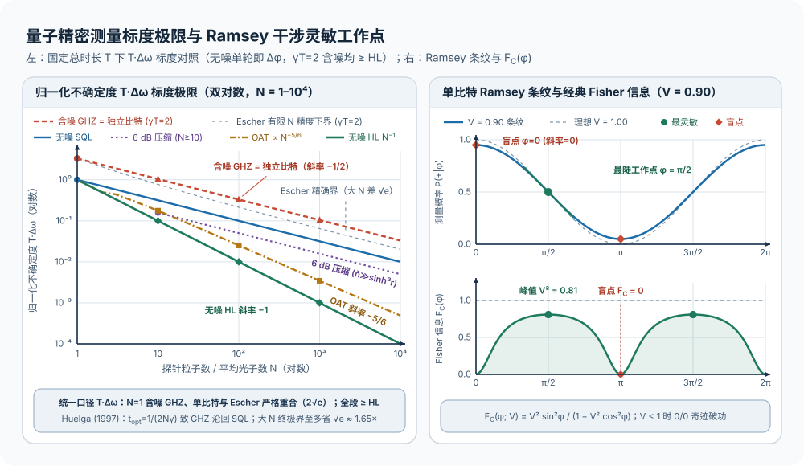
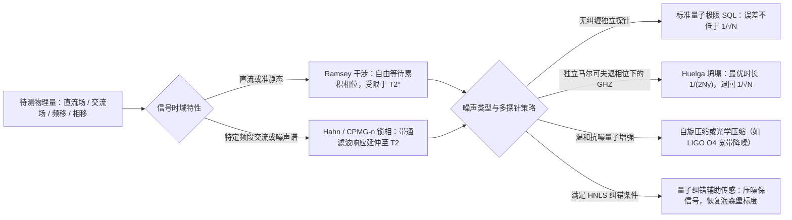

# 20｜量子传感与量子精密测量：从 Fisher 信息到海森堡极限

先修：[第 03 章](03-multiple-qubits.md)（GHZ 态与偏迹）、[第 05 章](05-noise-channels.md)（纯退相位信道与 Lindblad 衰减）、[Q3](quantum-mechanics/03-levels-control.md)（Ramsey 干涉与 Hahn 自旋回波）、[第 13 章](13-quantum-information.md)（根保真度与几何距离）；第 6 节光学压缩另需[第 18 章](18-channels-capacities-complexity.md)（无量纲正交分量与单模压缩态）。

读完前面十余章，你可能产生过一个再自然不过的念头：量子比特对环境磁场、温度、激光相位和杂散电荷如此敏感，稍微碰一下就退相干，难道不是它最大的缺点吗？在量子计算里确实如此，但在**量子传感与量子精密测量**（quantum sensing and quantum metrology）里，工程师偏偏要把这个“缺点”反过来用——既然量子叠加态的相对相位对微弱外场极其敏感，那把环境里待测的磁场、重力梯度或引力波变成系统的演化相位，再通过精密干涉读出来，最脆弱的量子比特就摇身变成了自然界最锋利的探针。

量子信息科学与工程公认有三大支柱：**量子计算**追求可编程的容错通用算法，**量子通信与密码**追求物理层密钥分发与纠缠网络，而**量子传感**追求的是对连续物理参数的极限估计精度。与尚需成千上万逻辑比特才能落地的大规模容错计算不同，量子传感已经在引力波天文台、原子钟时间基准和纳米磁成像等前沿领域进入实际运行或实用验证阶段。

先把全章八节的逻辑路线排成一张速查表，方便随时回头定位：

| 章节 | 核心问题 | 关键数学量与物理里程碑 |
| :--- | :--- | :--- |
| §1 | 量子传感测什么？怎么公平比较不同传感器？ | 灵敏度 $\eta$（单位 $\mathrm{T/\sqrt{Hz}}$）、带宽、探测体积 |
| §2 | 固定测量装置时，参数估计的统计精度底线在哪？ | 似然函数、经典 Fisher 信息 $F_C(\phi)$、Cramér–Rao 界 |
| §3 | 允许换用任意合法量子测量，最高能榨出多少信息？ | 对称对数导数 $L_\theta$、量子 Fisher 信息 $F_Q$、Bures 距离 |
| §4 | 用 $N$ 个探针，纠缠能把精度从哪提到哪？ | 标准量子极限 $1/\sqrt{N}$、海森堡极限 $1/N$、GHZ 宇称测量 |
| §5 | 真实马尔可夫退相位来了，GHZ 的加速还剩多少？ | Huelga（1997）坍塌、最优探询时间 $t_{\mathrm{opt}} = 1/(2N\gamma)$、常数因子 $e$ |
| §6 | 既然 GHZ 太脆，真实实验靠什么稳定突破 SQL？ | 自旋压缩 Wineland 参数 $\xi_R^2$、光学压缩 $e^{-2r}$ 与 LIGO O3/O4 |
| §7 | 如何屏蔽慢漂移、专听某个频段的微弱交流信号？ | Ramsey 直流传感 vs Hahn / CPMG-$n$ 滤波函数 $\lvert Y(\omega)\rvert^2$ |
| §8 | 现实四大物理前沿做到哪了？纠错能救回海森堡极限吗？ | NV 色心、Sr 光钟、原子干涉仪、OPM/SQUID 基线、HNLS 条件 |

---

## 1. 量子技术的第三支柱：为什么“最怕噪声的比特”反而是最灵敏的探针？

### 1.1 计算、通信与传感：三根支柱的分工与第一性问题

在着手算公式之前，先用一句话把三根支柱的边界划清楚，免得把“造出好传感器”和“造出通用量子计算机”混为一谈：

- **量子计算**（[第 06–11 章](06-algorithmic-primitives.md)）：给定离散输入，运行深度可编程量子线路，目标是用远少于经典算法的资源输出可验证的离散答案；核心敌人是环境耦合带来的退相干，因此硬件设计竭力把比特调到对外场一阶不敏感的“甜点”（sweet spot）。
- **量子通信与安全**（[第 12 章](12-security-network-frontiers.md)、[第 18 章](18-channels-capacities-complexity.md)）：在远距离节点间传输量子态或分发抗窃听密钥；核心敌人是信道损耗与窃听干扰。
- **量子传感与精密测量**（本章）：待测对象不是一段算法，而是外部自然界中一个**未知的连续实参数** $\theta$——比如细胞旁几纳米处的磁场 $B$、地下隧道引起的重力加速度变化 $\Delta g$、两束引力波干涉臂的光程相位差 $\phi$，或者光钟里原子跃迁频率与本地激光的微小偏差 $\omega$。

**传感器设计的反直觉反转**就在这里：在量子计算芯片上，磁通噪声让能级劈裂 $\omega_0(B)$ 随磁场晃动是一场灾难；而在磁力计里，这个斜率 $\frac{\partial\omega_0}{\partial B} = \gamma_s$（旋磁比）正是把微弱磁场放大成可观测相位信号 $\phi = \gamma_s B \tau$ 的**换能系数**。换句话说，好的量子传感器并非“对外界彻底绝缘”，而是**只对目标物理量敞开大门，同时尽量把其他无关噪声关在门外**。

从工作机制看，学界（Degen, Reinhard & Cappellaro, *Rev. Mod. Phys.* 2017）通常把量子传感分成三个台阶，并非所有叫“量子传感器”的设备都用到了多体纠缠：

1. **第一台阶（分立量子能级）**：利用原子或固体缺陷天然稳定、高度一致的量子化能级跃迁标定外场（如传统微波原子钟、光学泵浦原子磁力计）。
2. **第二台阶（单探针量子相干与干涉）**：利用单个或彼此独立的量子叠加态累积相对相位，并借助脉冲序列操控干涉条纹（如单个金刚石 NV 色心 Ramsey/CPMG 磁力计、冷原子干涉重力仪、无纠缠光晶格钟）。
3. **第三台阶（多体量子纠缠与压缩）**：主动制备探针之间的非经典关联（如自旋压缩态、GHZ 态、光学压缩真空态），让测量不确定度突破同资源下独立探针的统计底线——这就是狭义的**量子增强精密测量**（quantum-enhanced metrology）。

### 1.2 从相干相位到灵敏度单位 $\mathrm{T/\sqrt{Hz}}$、带宽与探测体积

看传感论文时，初学者最先撞上的生词往往是一串奇怪的单位：$\mathrm{nT/\sqrt{Hz}}$、$\mathrm{fT/\sqrt{Hz}}$ 或 $\mathrm{rad/\sqrt{Hz}}$。为什么分母上会有个“赫兹开根号”？一步步从最朴素的独立重复测量算起，它立刻变得透明。

设我们手里有 $N$ 个彼此独立的自旋探针（旋磁比为 $\gamma_s$，单位 $\mathrm{rad/(s\cdot T)}$），用来测量一个恒定直流磁场 $B$（单位 $\mathrm{T}$）。在单次探询时长 $\tau$（单位 $\mathrm{s}$）内，每个自旋的 $|0\rangle$ 与 $|1\rangle$ 之间累积相位

$$
\phi = \gamma_s B \tau.
$$

我们在第 4 节会严格证明：$N$ 个独立无噪声探针做一次理想 Ramsey 测量，单次相位估计的标准不确定度下限是 $\delta\phi_1 = \frac{1}{\sqrt{N}}$（单位 $\mathrm{rad}$）。换算回磁场 $B = \phi / (\gamma_s\tau)$，单次探询的磁场不确定度就是

$$
\delta B_1 = \frac{\delta\phi_1}{\gamma_s \tau} = \frac{1}{\gamma_s \tau \sqrt{N}} \qquad [\text{单位：}\mathrm{T}].
$$

现在把实验持续运行总挂钟时间 $T$（单位 $\mathrm{s}$），先假设制备与读出的死时间（dead time）$t_d$ 可忽略，那么总共可以独立重复 $\nu = T / \tau$ 轮。根据初等统计学，对 $\nu$ 次独立同分布测量求平均，标准误差再缩小 $\sqrt{\nu}$ 倍：

$$
\delta B(T) = \frac{\delta B_1}{\sqrt{\nu}} = \frac{1}{\gamma_s \tau \sqrt{N}} \cdot \sqrt{\frac{\tau}{T}} = \frac{1}{\gamma_s \sqrt{N \tau}} \cdot \frac{1}{\sqrt{T}}.
$$

请仔细盯住等式右边的结构：总时长 $T$ 单独被分离成了 $1/\sqrt{T}$！如果我测 $100\ \mathrm{s}$，最小可分辨磁场比测 $1\ \mathrm{s}$ 小 $10$ 倍；如果甲实验室积了 $1$ 小时、乙实验室只积了 $1$ 秒，直接比最终的 $\delta B$ 毫无意义。为了剥离积分时间长短的影响，精密测量界定义**磁场灵敏度**（sensitivity）$\eta$ 为“达到信噪比 $\mathrm{SNR} = 1$ 所需的最小可测磁场乘以积分时间的平方根”：

$$
\eta \equiv \delta B(T)\sqrt{T} = \frac{1}{\gamma_s \sqrt{N \tau}} \qquad \bigl[\text{单位：}\mathrm{T\cdot s^{1/2}} = \mathrm{T/\sqrt{Hz}}\bigr].
$$

这里用到了量纲等价 $1\ \mathrm{Hz} = 1\ \mathrm{s}^{-1}$，所以 $\mathrm{s}^{1/2} = \mathrm{Hz}^{-1/2}$。它的物理读法非常直白：**灵敏度为 $5\ \mathrm{nT/\sqrt{Hz}}$ 的磁力计，积分 $T = 1\ \mathrm{s}$ 能把磁场分辨到 $5\ \mathrm{nT}$，积分 $T = 100\ \mathrm{s}$ 能分辨到 $0.5\ \mathrm{nT}$。** 数值越**小**，探头越**灵敏**。

如果有不可忽略的死时间 $t_d > 0$（制备、读出与复位耗时），每轮真实周期是 $\tau + t_d$，总轮数降为 $\nu = T / (\tau + t_d)$，同时真实读出对比度与光子收集效率会引入一个无量纲读出效率因子 $C \in (0, 1]$，退相干还会让干涉条纹按 $e^{-(\tau/T_2)^\beta}$ 衰减，完整的工程灵敏度公式写为

$$
\eta_{\mathrm{real}} = \frac{e^{(\tau/T_2)^\beta}}{C\,\gamma_s\sqrt{N}}\cdot\frac{\sqrt{\tau + t_d}}{\tau}.
$$

这个式子立刻揭示了传感器的三大核心指标为什么必须**打包报告**：

1. **灵敏度 $\eta$**：在给定噪声底下的单位根号带宽分辨能力；
2. **带宽（bandwidth）**：单轮时长 $\tau$ 越长，似乎 $\eta$ 越小，但探头在这段时间内把随时间变化的信号平均掉了，因此能追踪的最大信号变化频率上限被压低到 $\sim 1/(2\tau)$；
3. **探测体积 $V$ 与工作距离（standoff）**：把探针数 $N$ 增大 $10^{12}$ 倍可以把 $\eta$ 压低 $10^6$ 倍，但体积也从纳米级膨大到厘米级，再也贴不到单个生物大分子或芯片微米级导线表面。

#### 算例：单个金刚石 NV 电子自旋的理想直流与交流灵敏度

取室温金刚石中的单个氮–空位（NV）色心电子自旋：$N = 1$，电子旋磁比

$$
\frac{\gamma_e}{2\pi} \approx 28.025\ \mathrm{GHz/T} \quad\Longrightarrow\quad \gamma_e = 2\pi \times 28.025 \times 10^9\ \mathrm{rad/(s\cdot T)} \approx 1.7609 \times 10^{11}\ \mathrm{rad/(s\cdot T)}.
$$

1. **直流 Ramsey 探询**：天然丰度金刚石中单 NV 的自由感应衰减时间典型值为 $\tau_{\mathrm{DC}} \approx T_2^* = 1\ \mu\mathrm{s} = 10^{-6}\ \mathrm{s}$，开根号得 $\sqrt{\tau_{\mathrm{DC}}} = 10^{-3}\ \mathrm{s}^{1/2}$。代入理想公式（$C=1, t_d=0$，不含衰减因子 $e$）：

   $$
   \eta_{\mathrm{DC}}^{\mathrm{ideal}} = \frac{1}{1.7609 \times 10^{11} \times 10^{-3}}\ \mathrm{T/\sqrt{Hz}} \approx 5.679 \times 10^{-9}\ \mathrm{T/\sqrt{Hz}} = 5.68\ \mathrm{nT/\sqrt{Hz}}.
   $$

2. **交流回波探询**：第 7 节会看到，用多脉冲动态解耦把相干时间延展到 $\tau_{\mathrm{AC}} \approx T_2 = 1\ \mathrm{ms} = 10^{-3}\ \mathrm{s}$（延长 $1000$ 倍），理想灵敏度立刻改善 $\sqrt{1000} \approx 31.62$ 倍：

   $$
   \eta_{\mathrm{AC}}^{\mathrm{ideal}} = \frac{5.679\ \mathrm{nT/\sqrt{Hz}}}{\sqrt{1000}} \approx 0.180\ \mathrm{nT/\sqrt{Hz}} = 180\ \mathrm{pT/\sqrt{Hz}}.
   $$

   （若计入交流方波整流系数 $\pi/2$、退相干衰减和单 NV 室温荧光读出效率 $C \approx 0.03$，真实室温单 NV 的交流灵敏度通常落在几到数十 $\mathrm{nT/\sqrt{Hz}}$ 量级，直流约百 $\mathrm{nT/\sqrt{Hz}}$；上述数量级对照已收录在配套核验脚本 [sensing_lab.py](../codes/systems/sensing_lab.py) 中。）

---

## 2. 经典参数估计：似然、经典 Fisher 信息（CFI）与 Cramér–Rao 下界

### 2.1 从观测频率反推未知参数：似然函数、得分函数与经典 Fisher 信息

现在进入严格的数学地基。假设物理实验固定了一套探测装置，它把未知的连续实参数 $\theta \in \mathbb{R}$ 映射成一组离散测量结果 $x \in \mathcal{X}$ 的条件概率分布 $p(x \mid \theta)$（满足 $p(x \mid \theta) \ge 0$ 且 $\sum_x p(x \mid \theta) = 1$）。我们反复采样得到观测数据，再套用一个经典数据处理规则（称为**估计量**，estimator）$\hat\theta(x)$ 去反推 $\theta$。

一个自然的问题冒了出来：**无论数据分析算法写得多巧妙，只要概率分布族 $p(x \mid \theta)$ 已经确定，估计误差 $\Delta\theta = \sqrt{\operatorname{Var}(\hat\theta)}$ 是否存在一个不可逾越的数学地板？**

直觉上，答案取决于“参数 $\theta$ 稍微挪动一点点 $d\theta$ 时，测量结果的概率分布 $p(x \mid \theta)$ 变动得有多剧烈”。如果 $p(x \mid \theta)$ 几乎不随 $\theta$ 变化，曲线平得像桌面，那任何统计神算子都猜不准 $\theta$；相反，如果 $\theta$ 刚动千分之一，概率曲线就陡峭地跳了一大截，我们只需很少样本就能把 $\theta$ 钉死。

把“对数据 $x$ 而言，不同候选 $\theta$ 有多合理”看作 $\theta$ 的函数，称为**似然函数**（likelihood function）$L(\theta; x) = p(x \mid \theta)$；取自然对数（全书自然对数一律写作 $\ln$）得到**对数似然函数** $\ell(\theta; x) = \ln p(x \mid \theta)$。它对 $\theta$ 的偏导数称为**得分函数**（score function）：

$$
s(x; \theta) \equiv \frac{\partial}{\partial\theta}\ln p(x \mid \theta) = \frac{\partial_\theta p(x \mid \theta)}{p(x \mid \theta)},
$$

衡量的是相对概率变化率。先顺手验证一个极有用的恒等式——在真实参数 $\theta$ 下，得分函数的数学期望恒为零（假设求导与求和可交换）：

$$
\mathbb{E}_\theta\bigl[s(X; \theta)\bigr] = \sum_x p(x \mid \theta)\,\frac{\partial_\theta p(x \mid \theta)}{p(x \mid \theta)} = \sum_x \partial_\theta p(x \mid \theta) = \frac{\partial}{\partial\theta}\left(\sum_x p(x \mid \theta)\right) = \frac{\partial}{\partial\theta}(1) = 0.
$$

既然得分函数的均值恒为 $0$，它的典型起伏大小就由其**方差**（即二阶矩）刻画。这就是统计学家罗纳德·费舍尔（R. A. Fisher, 1925）定义的**经典 Fisher 信息**（Classical Fisher Information, CFI）：

$$
F_C(\theta) \equiv \operatorname{Var}_\theta\bigl[s(X; \theta)\bigr] = \mathbb{E}_\theta\!\left[\left(\frac{\partial\ln p(X \mid \theta)}{\partial\theta}\right)^2\right] = \sum_{x:\,p(x\mid\theta)>0} \frac{\bigl(\partial_\theta p(x \mid \theta)\bigr)^2}{p(x \mid \theta)}.
$$

请留心它的量纲与可加性：

- **量纲**：$p(x \mid \theta)$ 无量纲，故 $F_C(\theta)$ 的单位是 $[\theta]^{-2}$；例如当 $\theta = \phi$ 是无量纲弧度相位时 $F_C(\phi)$ 无量纲，当 $\theta = \omega$（$\mathrm{rad/s}$）时 $F_C(\omega)$ 单位为 $\mathrm{s}^2$。
- **独立重复的可加性**：做 $\nu$ 次独立同分布实验，联合概率 $p(\vec x \mid \theta) = \prod_{k=1}^\nu p(x_k \mid \theta)$，取自然对数变成求和 $\ln p(\vec x \mid \theta) = \sum_{k=1}^\nu \ln p(x_k \mid \theta)$，总得分函数是 $\nu$ 个独立零均值随机变量之和，方差直接相加，因此

$$
F_C^{(\nu)}(\theta) = \nu\, F_C(\theta).
$$

### 2.2 Cramér–Rao 下界的零跳步证明与适用边界

设 $\hat\theta(x)$ 是关于参数 $\theta$ 的任意**局部无偏估计量**（locally unbiased estimator），即在参数工作点 $\theta$ 附近满足期望等于真值：

$$
\mathbb{E}_\theta[\hat\theta] = \sum_x \hat\theta(x)\, p(x \mid \theta) = \theta.
$$

对等式两边同时关于 $\theta$ 求导，左边得 $1$，右边按求和逐项求导（再次用到正则条件：支撑集不随 $\theta$ 跳变，求导与求和可交换）：

$$
1 = \sum_x \hat\theta(x)\,\partial_\theta p(x \mid \theta).
$$

因为前面刚证过 $\sum_x \partial_\theta p(x \mid \theta) = 0$，所以在右边减去零项 $\theta \sum_x \partial_\theta p(x \mid \theta)$ 不会改变等式，于是把因子拆成两项的乘积：

$$
1 = \sum_x \bigl(\hat\theta(x) - \theta\bigr)\,\partial_\theta p(x \mid \theta) = \sum_{x:\,p(x\mid\theta)>0} \underbrace{\Bigl[\bigl(\hat\theta(x) - \theta\bigr)\sqrt{p(x \mid \theta)}\Bigr]}_{u_x} \cdot \underbrace{\left[\frac{\partial_\theta p(x \mid \theta)}{\sqrt{p(x \mid \theta)}}\right]}_{v_x}.
$$

对实数列 $u_x, v_x$ 施用柯西–施瓦茨不等式 $\bigl(\sum_x u_x v_x\bigr)^2 \le \bigl(\sum_x u_x^2\bigr)\bigl(\sum_x v_x^2\bigr)$：

$$
1^2 \le \left(\sum_x \bigl(\hat\theta(x) - \theta\bigr)^2 p(x \mid \theta)\right) \left(\sum_{x:\,p(x\mid\theta)>0} \frac{\bigl(\partial_\theta p(x \mid \theta)\bigr)^2}{p(x \mid \theta)}\right) = \operatorname{Var}_\theta(\hat\theta) \cdot F_C(\theta).
$$

把 $F_C(\theta) > 0$ 除到左侧，并对 $\nu$ 次独立同分布实验代入 $F_C^{(\nu)}(\theta) = \nu F_C(\theta)$，立刻证毕著名的**经典 Cramér–Rao 下界**（Cramér–Rao Lower Bound, CRLB；Rao 1945，Cramér 1946）：

$$
\operatorname{Var}_\theta(\hat\theta) \ge \frac{1}{\nu\, F_C(\theta)} \qquad\Longleftrightarrow\qquad \Delta\theta \ge \frac{1}{\sqrt{\nu\, F_C(\theta)}}.
$$

记住两条极其重要的**适用边界**：

1. **渐近可达，有限样本未必可达**：当样本数 $\nu \to \infty$ 时，极大似然估计量（MLE）的方差渐近饱和 CRLB；但在 $\nu$ 很小（例如只测 3 次或 5 次）的有限样本区，CRLB 往往过于乐观，且可能根本不存在能达到它的无偏估计量。
2. **有偏估计量可局部“越界”但毫无胜算**：如果故意把估计量硬编码为常数 $\hat\theta(x) \equiv 0.5$，它的方差是 $0$，看似“击败”了 CRLB，但当真值不是 $0.5$ 时均方误差（偏差平方加方差）极差；若含偏置 $b(\theta) = \mathbb{E}_\theta[\hat\theta] - \theta$，正确下界须改写为 $\operatorname{Var}(\hat\theta) \ge \frac{[1 + b'(\theta)]^2}{\nu F_C(\theta)}$。

### 2.3 零跳步手算 Ramsey 干涉：为什么 $\phi = \pi/2$ 最灵敏、$\phi = 0$ 是盲点？

拿我们在 [Q3 第 7 节](quantum-mechanics/03-levels-control.md) 熟悉的老朋友——单比特 Ramsey 干涉仪——来把经典 Fisher 信息亲手算到底。

**第一步：理想无噪 Ramsey 的 $F_C(\phi)$。**
初态准备在赤道叠加态 $|+\rangle = \frac{|0\rangle + |1\rangle}{\sqrt{2}}$，在待测相位演化算符 $U(\phi) = e^{-i\phi Z/2} = \operatorname{diag}(e^{-i\phi/2}, e^{+i\phi/2})$ 下变为（提走全局相位 $e^{-i\phi/2}$）：

$$
|\psi(\phi)\rangle = \frac{|0\rangle + e^{i\phi}|1\rangle}{\sqrt{2}}.
$$

随后在 $X$ 基 $\{|+\rangle, |-\rangle\}$ 投影测量。按左共轭内积逐项计算振幅与概率：

$$
\langle + | \psi(\phi)\rangle = \frac{1 + e^{i\phi}}{2}, \qquad P(+ \mid \phi) = \left|\frac{1 + e^{i\phi}}{2}\right|^2 = \frac{(1 + e^{i\phi})(1 + e^{-i\phi})}{4} = \frac{2 + 2\cos\phi}{4} = \frac{1 + \cos\phi}{2},
$$

$$
\langle - | \psi(\phi)\rangle = \frac{1 - e^{i\phi}}{2}, \qquad P(- \mid \phi) = \left|\frac{1 - e^{i\phi}}{2}\right|^2 = \frac{2 - 2\cos\phi}{4} = \frac{1 - \cos\phi}{2}.
$$

先做归一化回验：$P(+ \mid \phi) + P(- \mid \phi) = \frac{1+\cos\phi}{2} + \frac{1-\cos\phi}{2} = 1$。再对 $\phi$ 求导：

$$
\frac{\partial P(+ \mid \phi)}{\partial\phi} = -\frac{\sin\phi}{2}, \qquad \frac{\partial P(- \mid \phi)}{\partial\phi} = +\frac{\sin\phi}{2}.
$$

将两项代入 $F_C(\phi)$ 定义式，一步不跳化简：

$$
\begin{aligned}
F_C(\phi)
&= \frac{\bigl(-\frac{1}{2}\sin\phi\bigr)^2}{\frac{1+\cos\phi}{2}}
 + \frac{\bigl(+\frac{1}{2}\sin\phi\bigr)^2}{\frac{1-\cos\phi}{2}} \\
&= \frac{\sin^2\phi}{2}\left(\frac{1}{1+\cos\phi} + \frac{1}{1-\cos\phi}\right) \\
&= \frac{\sin^2\phi}{2} \cdot \frac{(1-\cos\phi) + (1+\cos\phi)}{1 - \cos^2\phi} \\
&= \frac{\sin^2\phi}{2} \cdot \frac{2}{\sin^2\phi}
= 1 \qquad \bigl(\phi \in (0, \pi)\bigr).
\end{aligned}
$$

于是经过 $\nu$ 次独立理想 Ramsey 探询，相位不确定度下界为 $\Delta\phi \ge \frac{1}{\sqrt{\nu}}$。

**第二步：解开初学者的经典困惑——既然理想结果恒等于 $1$，为什么实验室都说 $\phi = \pi/2$ 最灵敏、$\phi = 0$ 是盲点？**

先看理想情形（$V = 1$）：在 $\phi \to 0^+$ 时，信号斜率 $\left|\frac{\partial P(+)}{\partial\phi}\right| = \frac{\sin\phi}{2} \to 0$，似乎信号消失了；但与此同时，二项分布噪声标准差 $\sqrt{P(+)(1-P(+))} = \frac{\sin\phi}{2}$ 也以**完全相同的速率**趋向于零，分子分母里的 $\sin^2\phi$ 奇迹般地精确约掉了！然而这种“$0/0 = 1$”的奇迹极度脆弱，只要存在哪怕百分之一的退相干或读出不完美，就会瞬间破功。

把真实世界的条纹可见度 $V \in (0, 1)$（例如退相位 $V = e^{-\gamma t}$ 或有限读出对比度）写进来：

$$
P(+ \mid \phi; V) = \frac{1 + V\cos\phi}{2}, \qquad P(- \mid \phi; V) = \frac{1 - V\cos\phi}{2}.
$$

再次完整代入经典 Fisher 信息定义：

$$
\begin{aligned}
F_C(\phi; V)
&= \frac{\bigl(-\frac{V}{2}\sin\phi\bigr)^2}{\frac{1 + V\cos\phi}{2}}
 + \frac{\bigl(+\frac{V}{2}\sin\phi\bigr)^2}{\frac{1 - V\cos\phi}{2}} \\
&= \frac{V^2\sin^2\phi}{2} \cdot \frac{2}{1 - V^2\cos^2\phi}
= \frac{V^2\sin^2\phi}{1 - V^2\cos^2\phi}.
\end{aligned}
$$

代入具体数字 $V = 0.90$（$V^2 = 0.81$），立刻把两种工作点的天壤之别算明白：

- **斜率最大点 $\phi = \pi/2$**：$\sin(\pi/2) = 1$，$\cos(\pi/2) = 0$，于是

  $$
  F_C(\pi/2; 0.90) = \frac{0.81 \times 1}{1 - 0} = 0.81 = V^2.
  $$

  这里是 $F_C(\phi; V)$ 的全局最大值，条纹最陡，对微小相位扰动响应最强！
- **极值点（波峰）$\phi = 0$**：$\sin 0 = 0$，而分母 $1 - V^2 = 1 - 0.81 = 0.19 > 0$ 不再归零！于是

  $$
  F_C(0; 0.90) = \frac{0}{0.19} = 0, \qquad \Delta\phi \ge \frac{1}{\sqrt{\nu\cdot 0}} = \infty.
  $$

  **$\phi = 0$（以及 $\phi = \pi$）彻底沦为灵敏度盲点！** 哪怕在 $V = 1$ 的理论极限下，$\phi = 0$ 也是余弦曲线的对称顶点（$\cos(+\epsilon) = \cos(-\epsilon)$），无法分辨微小相位漂移的正负号。因此真实实验（包括原子钟与 NV 磁力计）都会把第二发 $\pi/2$ 脉冲的相位故意偏转 $90^\circ$（等效测 $Y$ 基 $P(+_y) = \frac{1 + V\sin\phi}{2}$），把最灵敏的线性斜坡精准锁在待测微小信号 $\phi \approx 0$ 处。

---

## 3. 量子 Fisher 信息（QFI）与量子 Cramér–Rao 界（QCRB）

### 3.1 对称对数导数（SLD）与量子 Cramér–Rao 界的完整推导

经典 Fisher 信息 $F_C(\theta)$ 依赖你**选定了哪一套测量基**。对同一个携带参数 $\theta$ 的量子态 $\rho_\theta$，如果你在错误的基上测量（比如在 Ramsey 态 $|\psi(\phi)\rangle = \frac{|0\rangle + e^{i\phi}|1\rangle}{\sqrt{2}}$ 上测 $Z$ 基），得到 $P(0) = P(1) = 1/2$ 与 $\phi$ 完全无关，$F_C = 0$；换到 $X$ 基或 $Y$ 基，就能榨出 $F_C = 1$。

这就引出了量子精密测量的核心追问：**如果允许我们遍历所有合法量子测量（任意 POVM $\{E_x\}$，满足 $E_x \succeq 0$ 且 $\sum_x E_x = I$），能从量子态 $\rho_\theta$ 中榨出的最大经典 Fisher 信息是多少？**

$$
F_Q(\rho_\theta) \equiv \max_{\{E_x\}} F_C\!\Bigl(\bigl\{p(x \mid \theta) = \operatorname{Tr}(E_x \rho_\theta)\bigr\}\Bigr).
$$

答案来自 Helstrom（1967）与 Braunstein–Caves（1994）的奠基定理。在经典概率里，我们把导数 $\partial_\theta p$ 写成 $p$ 乘以得分函数 $s = \partial_\theta\ln p$。搬到矩阵世界里，密度矩阵 $\rho_\theta$ 与其导数 $\partial_\theta\rho_\theta$ 通常不对易（$\rho_\theta (\partial_\theta\rho_\theta) \neq (\partial_\theta\rho_\theta)\rho_\theta$），为了得到一个保证厄米（从而能对应物理可观测量）的“量子得分算符”，自然采用对称化的反对易子定义**对称对数导数**（Symmetric Logarithmic Derivative, SLD）$L_\theta = L_\theta^\dagger$：

$$
\frac{\partial\rho_\theta}{\partial\theta} = \frac{1}{2}\bigl(\rho_\theta L_\theta + L_\theta \rho_\theta\bigr).
$$

用 $L_\theta$ 定义**量子 Fisher 信息**（Quantum Fisher Information, QFI）：

$$
F_Q(\rho_\theta) \equiv \operatorname{Tr}\bigl(\rho_\theta L_\theta^2\bigr) = \operatorname{Tr}\bigl((\partial_\theta\rho_\theta)\, L_\theta\bigr).
$$

（验证第二个等号：$\operatorname{Tr}[(\partial_\theta\rho_\theta) L_\theta] = \frac{1}{2}\operatorname{Tr}[(\rho_\theta L_\theta + L_\theta\rho_\theta) L_\theta] = \frac{1}{2}\operatorname{Tr}(\rho_\theta L_\theta^2) + \frac{1}{2}\operatorname{Tr}(L_\theta\rho_\theta L_\theta) = \operatorname{Tr}(\rho_\theta L_\theta^2)$，最后一步利用迹的循环不变性。）

下面用六行严格代数证明 **Braunstein–Caves 定理**：对任意 POVM $\{E_x\}$，经典 Fisher 信息绝不可能超过 $F_Q(\rho_\theta)$！

1. 对任意满足 $p_x = \operatorname{Tr}(E_x \rho_\theta) > 0$ 的结果，用 SLD 方程与迹循环不变性展开概率导数：

   $$
   \partial_\theta p_x = \operatorname{Tr}\bigl(E_x\,\partial_\theta\rho_\theta\bigr) = \frac{1}{2}\operatorname{Tr}\bigl(E_x \rho_\theta L_\theta + E_x L_\theta \rho_\theta\bigr).
   $$

   因为 $E_x, \rho_\theta, L_\theta$ 全是厄米矩阵，$(E_x \rho_\theta L_\theta)^\dagger = L_\theta \rho_\theta E_x$，取迹后有 $\operatorname{Tr}(E_x L_\theta \rho_\theta) = \operatorname{Tr}(L_\theta \rho_\theta E_x) = \bigl[\operatorname{Tr}(E_x \rho_\theta L_\theta)\bigr]^*$，两项之和除以 $2$ 恰好取实部：

   $$
   \partial_\theta p_x = \operatorname{Re}\operatorname{Tr}\bigl(E_x \rho_\theta L_\theta\bigr) = \operatorname{Re}\operatorname{Tr}\bigl(E_x L_\theta \rho_\theta\bigr).
   $$

2. 构造两个辅助矩阵 $A_x = \sqrt{E_x}\sqrt{\rho_\theta}$ 与 $B_x = \sqrt{E_x} L_\theta \sqrt{\rho_\theta}$（因为 $E_x \succeq 0$ 且 $\rho_\theta \succeq 0$，两者的主平方根均有良好定义且厄米）。逐项计算它们的 Hilbert–Schmidt 内积与范数平方：

   $$
   \operatorname{Tr}(A_x^\dagger B_x) = \operatorname{Tr}\bigl(\sqrt{\rho_\theta}\sqrt{E_x}\sqrt{E_x} L_\theta \sqrt{\rho_\theta}\bigr) = \operatorname{Tr}\bigl(E_x L_\theta \rho_\theta\bigr),
   $$

   $$
   \operatorname{Tr}(A_x^\dagger A_x) = \operatorname{Tr}\bigl(\sqrt{\rho_\theta} E_x \sqrt{\rho_\theta}\bigr) = \operatorname{Tr}(E_x \rho_\theta) = p_x,
   $$

   $$
   \operatorname{Tr}(B_x^\dagger B_x) = \operatorname{Tr}\bigl(\sqrt{\rho_\theta} L_\theta E_x L_\theta \sqrt{\rho_\theta}\bigr) = \operatorname{Tr}\bigl(E_x L_\theta \rho_\theta L_\theta\bigr).
   $$

3. 利用 $|\operatorname{Re} z|^2 \le |z|^2$ 与矩阵柯西–施瓦茨不等式 $|\operatorname{Tr}(A_x^\dagger B_x)|^2 \le \operatorname{Tr}(A_x^\dagger A_x)\operatorname{Tr}(B_x^\dagger B_x)$：

   $$
   (\partial_\theta p_x)^2 = \bigl(\operatorname{Re}\operatorname{Tr}(A_x^\dagger B_x)\bigr)^2 \le \bigl|\operatorname{Tr}(A_x^\dagger B_x)\bigr|^2 \le p_x \cdot \operatorname{Tr}\bigl(E_x L_\theta \rho_\theta L_\theta\bigr).
   $$

4. 两边除以 $p_x > 0$ 并对全部测量结果 $x$ 求和，利用 POVM 完备性 $\sum_x E_x = I$ 与迹循环不变性：

   $$
   F_C(\{E_x\}) = \sum_{x:\,p_x > 0} \frac{(\partial_\theta p_x)^2}{p_x} \le \operatorname{Tr}\!\left(\Bigl(\sum_x E_x\Bigr) L_\theta \rho_\theta L_\theta\right) = \operatorname{Tr}\bigl(\rho_\theta L_\theta^2\bigr) = F_Q(\rho_\theta).
   $$

而且等号确实可以取到！将测量选在厄米算符 $L_\theta$ 的特征基 $\{|\ell_x\rangle\}$ 上（$L_\theta|\ell_x\rangle = \ell_x|\ell_x\rangle$，$E_x = |\ell_x\rangle\langle\ell_x|$），此时 $\operatorname{Tr}(E_x\rho_\theta L_\theta) = \ell_x\langle\ell_x|\rho_\theta|\ell_x\rangle = \ell_x p_x$ 是纯实数，柯西–施瓦茨不等式两步同时取等，$\sum_x \frac{(\ell_x p_x)^2}{p_x} = \sum_x \ell_x^2 p_x = \operatorname{Tr}(\rho_\theta L_\theta^2) = F_Q(\rho_\theta)$。

将它与经典 CRLB 拼合，便得到统领全章的**量子 Cramér–Rao 界**（Quantum Cramér–Rao Bound, QCRB）：

$$
\Delta\theta \ge \frac{1}{\sqrt{\nu\, F_C(\{E_x\})}} \ge \frac{1}{\sqrt{\nu\, F_Q(\rho_\theta)}}.
$$

需要注意一个现实工程细节：最优测量基 $L_\theta$ 的本征向量一般可能依赖未知的真值 $\theta$（正如 Ramsey 最优工作点需把斜坡对准真值附近）。因此面对大范围未知参数，通常需要两阶段或自适应测量：先用少量样本粗估 $\hat\theta_0$，再把测量装置对准 $L_{\hat\theta_0}$ 的特征基做精测。此外，如果同时估计多个参数 $(\theta_1, \theta_2)$，对应的两个 SLD 算符 $L_{\theta_1}$ 与 $L_{\theta_2}$ 往往不对易，无法在同一次测量中同时对角化，此时多参数 QCRB 存在根本的测量不相容性。

### 3.2 纯态幺正编码 $F_Q = 4(\Delta H)^2$ 与混态谱展开手算

对实验室最常见的两类情形，QFI 有极简且无需猜解方程的直接公式。

**情形一：纯态幺正编码 $|\psi_\theta\rangle = e^{-i\theta H}|\psi_0\rangle$**（$H = H^\dagger$ 为与 $\theta$ 无关的厄米生成元，若 $\theta$ 为时间 $t$ 则用 $H/\hbar$ 替代 $H$）。

1. 先求任意纯态 $\rho_\theta = |\psi_\theta\rangle\langle\psi_\theta|$ 的 SLD。利用纯态幂等性 $\rho_\theta^2 = \rho_\theta$ 两边对 $\theta$ 求导：

   $$
   \partial_\theta\rho_\theta = (\partial_\theta\rho_\theta)\rho_\theta + \rho_\theta(\partial_\theta\rho_\theta) = \frac{1}{2}\Bigl(\rho_\theta(2\partial_\theta\rho_\theta) + (2\partial_\theta\rho_\theta)\rho_\theta\Bigr).
   $$

   直接读出：$L_\theta = 2\,\partial_\theta\rho_\theta$ 精确满足 SLD 方程！

2. 代入 $|\partial_\theta\psi_\theta\rangle = -i H|\psi_\theta\rangle$ 与 $\langle\partial_\theta\psi_\theta| = +i\langle\psi_\theta|H$：

   $$
   L_\theta = 2\bigl(|\partial_\theta\psi_\theta\rangle\langle\psi_\theta| + |\psi_\theta\rangle\langle\partial_\theta\psi_\theta|\bigr) = 2\bigl(-i H|\psi_\theta\rangle\langle\psi_\theta| + i|\psi_\theta\rangle\langle\psi_\theta|H\bigr).
   $$

3. 计算 $L_\theta$ 作用在 $|\psi_\theta\rangle$ 上的结果（利用归一化 $\langle\psi_\theta|\psi_\theta\rangle = 1$）：

   $$
   L_\theta|\psi_\theta\rangle = -2i H|\psi_\theta\rangle + 2i\langle\psi_\theta|H|\psi_\theta\rangle\,|\psi_\theta\rangle = -2i\bigl(H - \langle H\rangle I\bigr)|\psi_\theta\rangle.
   $$

4. 因为 $L_\theta = L_\theta^\dagger$，所以 $F_Q = \operatorname{Tr}(\rho_\theta L_\theta^2) = \langle\psi_\theta|L_\theta^2|\psi_\theta\rangle = \|L_\theta|\psi_\theta\rangle\|^2$：

   $$
   F_Q\bigl(|\psi_\theta\rangle\bigr) = \bigl\|-2i(H - \langle H\rangle I)|\psi_\theta\rangle\bigr\|^2 = 4\,\langle\psi_\theta|(H - \langle H\rangle I)^2|\psi_\theta\rangle = 4\bigl(\langle H^2\rangle - \langle H\rangle^2\bigr) = 4(\Delta H)^2.
   $$

   而且因为 $e^{-i\theta H}$ 与 $H$ 对易，$\langle H\rangle$ 和 $\langle H^2\rangle$ 都在演化中守恒，所以 $F_Q = 4(\Delta H)^2_{\psi_0}$ **仅由初态在生成元 $H$ 下的能量（算符）方差决定**！

   立刻拿第 2.3 节的单比特 Ramsey 回验：这里 $U(\phi) = e^{-i\phi Z/2}$，生成元 $H = Z/2$（特征值 $+1/2$ 与 $-1/2$）。
   - 取初态 $|+\rangle$：$\langle Z/2\rangle = 0$，$\langle (Z/2)^2\rangle = \langle I/4\rangle = 1/4$，故 $F_Q = 4 \times \frac{1}{4} = 1$，与前面手算的 $F_C = 1$ 严丝合缝！
   - 若误把初态选成生成元的本征态 $|0\rangle$：$\langle Z/2\rangle = 1/2$，$\langle (Z/2)^2\rangle = 1/4$，方差 $(\Delta H)^2 = 0 \implies F_Q = 0$。物理上 $|0\rangle$ 演化后只是 $e^{-i\phi/2}|0\rangle$，带走一个不可观测的全局相位，当然测不出 $\phi$！

   更进一步，对任意有界厄米算符 $H$（最大、最小特征值分别为 $\lambda_{\max}, \lambda_{\min}$），方差有一个极简上限：$(\Delta H)^2 \le \bigl(\frac{\lambda_{\max} - \lambda_{\min}}{2}\bigr)^2$，当且仅当把初态制备在最大与最小特征态的等幅叠加态 $\frac{|\lambda_{\max}\rangle + e^{i\alpha}|\lambda_{\min}\rangle}{\sqrt{2}}$ 上时取等，给出纯态幺正编码的**最高量子 Fisher 信息**：

   $$
   F_Q^{\max} = (\lambda_{\max} - \lambda_{\min})^2.
   $$

   这行式子将在第 4 节直接把 GHZ 态与海森堡极限从纸面上托举出来。

**情形二：一般混态谱分解公式与 $2\times 2$ 零跳步手算。**
将混态做谱分解 $\rho_\theta = \sum_k \lambda_k |k\rangle\langle k|$（$\lambda_k \ge 0,\; \sum_k \lambda_k = 1$）。在特征基 $\{|k\rangle\}$ 中取 SLD 方程的 $(j, k)$ 矩阵元：

$$
\langle j|\partial_\theta\rho_\theta|k\rangle = \frac{1}{2}\langle j|(\rho_\theta L_\theta + L_\theta \rho_\theta)|k\rangle = \frac{\lambda_j + \lambda_k}{2}\langle j|L_\theta|k\rangle.
$$

只要 $\lambda_j + \lambda_k > 0$，就能直接解出 $\langle j|L_\theta|k\rangle = \frac{2\langle j|\partial_\theta\rho_\theta|k\rangle}{\lambda_j + \lambda_k}$；代回 $F_Q = \sum_{j,k}\lambda_j |\langle j|L_\theta|k\rangle|^2$ 并利用 $(j,k)$ 对称化，得到混态 QFI 通用公式：

$$
F_Q(\rho_\theta) = 2 \sum_{\substack{j,k:\\ \lambda_j + \lambda_k > 0}} \frac{\bigl|\langle j|\partial_\theta\rho_\theta|k\rangle\bigr|^2}{\lambda_j + \lambda_k}.
$$

亲手算一遍带退相干（可见度 $V \in (0, 1)$）的单比特 Ramsey 混态：

$$
\rho(\phi) = \frac{1}{2}\begin{pmatrix} 1 & V e^{-i\phi} \\ V e^{i\phi} & 1 \end{pmatrix},
\qquad
\partial_\phi\rho(\phi) = \frac{1}{2}\begin{pmatrix} 0 & -i V e^{-i\phi} \\ i V e^{i\phi} & 0 \end{pmatrix}.
$$

$\rho(\phi)$ 的特征值是 $\lambda_\pm = \frac{1 \pm V}{2}$（验证迹 $\lambda_+ + \lambda_- = 1$），对应归一化特征向量为 $|u_\pm\rangle = \frac{1}{\sqrt{2}}\begin{pmatrix}1 \\ \pm e^{i\phi}\end{pmatrix}$。逐格计算 $\partial_\phi\rho$ 在特征基里的四个矩阵元：

- 对角元：$\langle u_+|\partial_\phi\rho|u_+\rangle = \frac{1}{4}\begin{pmatrix}1 & e^{-i\phi}\end{pmatrix}\begin{pmatrix}0 & -iVe^{-i\phi}\\ iVe^{i\phi} & 0\end{pmatrix}\begin{pmatrix}1 \\ e^{i\phi}\end{pmatrix} = \frac{1}{4}(-iV + iV) = 0$，同理 $\langle u_-|\partial_\phi\rho|u_-\rangle = 0$；
- 非对角元：

  $$
  \langle u_+|\partial_\phi\rho|u_-\rangle
  = \frac{1}{4}\begin{pmatrix}1 & e^{-i\phi}\end{pmatrix}\begin{pmatrix}i V \\ i V e^{i\phi}\end{pmatrix}
  = \frac{iV}{2},
  \qquad
  \langle u_-|\partial_\phi\rho|u_+\rangle = \left(\frac{iV}{2}\right)^* = -\frac{iV}{2}.
  $$

由于 $\lambda_+ + \lambda_- = 1$，代入混态谱公式：

$$
F_Q\bigl(\rho(\phi)\bigr) = 2\left(\frac{|iV/2|^2}{1} + \frac{|-iV/2|^2}{1}\right) = 2\left(\frac{V^2}{4} + \frac{V^2}{4}\right) = V^2.
$$

太漂亮了！这说明第 2.3 节在工作点 $\phi = \pi/2$ 处测得的 $F_C(\pi/2; V) = V^2$ 已经**百分百榨干了带噪单比特态的全部量子信息**——没有任何更奇特的 POVM 能在单比特退相位态上击败标准 Ramsey 测量。

### 3.3 几何视角：QFI、根保真度与 Bures 距离的二阶等价

在 [第 13 章第 3.4 节](13-quantum-information.md#34-根保真度fuchsvan-de-graaf-双向不等式与非对角退相干陷阱)，我们建立了全书统一的**根保真度**（root fidelity）口径 $F(\rho, \sigma) = \operatorname{Tr}\sqrt{\sqrt\rho\,\sigma\sqrt\rho} \in [0, 1]$，用来衡量两个量子态有多“相似”。现在把参数挪动一个极小步长 $\delta$，问一个几何问题：$\rho_\theta$ 与相邻态 $\rho_{\theta+\delta}$ 之间的“距离”拉开得越快，参数 $\theta$ 是不是就越好区分、QFI 就越大？

正是如此！定义两态之间的 **Bures 距离**：

$$
d_B(\rho, \sigma) \equiv \sqrt{2\bigl(1 - F(\rho, \sigma)\bigr)} \in [0, \sqrt{2}].
$$

我们用纯态幺正演化 $|\psi_{\theta+\delta}\rangle = e^{-i\delta H}|\psi_\theta\rangle$ 零跳步走完二阶泰勒展开：

$$
\langle\psi_\theta|\psi_{\theta+\delta}\rangle = \langle\psi_\theta|\left(I - i\delta H - \frac{\delta^2}{2}H^2 + O(\delta^3)\right)|\psi_\theta\rangle = 1 - i\delta\langle H\rangle - \frac{\delta^2}{2}\langle H^2\rangle + O(\delta^3).
$$

计算复数模平方（实部平方加虚部平方），即平方重叠 $F^2$：

$$
\begin{aligned}
F^2\bigl(|\psi_\theta\rangle, |\psi_{\theta+\delta}\rangle\bigr)
&= \left(1 - \frac{\delta^2}{2}\langle H^2\rangle\right)^2 + \delta^2\langle H\rangle^2 + O(\delta^3) \\
&= 1 - \delta^2\langle H^2\rangle + \delta^2\langle H\rangle^2 + O(\delta^3) \\
&= 1 - (\Delta H)^2 \delta^2 + O(\delta^3).
\end{aligned}
$$

利用 $\sqrt{1 - u} = 1 - \frac{u}{2} + O(u^2)$ 开根号，回到全书统一的**根保真度** $F$，再代入纯态公式 $F_Q = 4(\Delta H)^2$（即 $(\Delta H)^2 = F_Q / 4$）：

$$
F\bigl(\rho_\theta, \rho_{\theta+\delta}\bigr) = 1 - \frac{1}{2}(\Delta H)^2 \delta^2 + O(\delta^3) = 1 - \frac{1}{8}\, F_Q(\rho_\theta)\, \delta^2 + O(\delta^3).
$$

于是 Bures 距离平方与 QFI 严丝合缝地锁在一起：

$$
d_B^2\bigl(\rho_\theta, \rho_{\theta+\delta}\bigr) = \frac{1}{4}\, F_Q(\rho_\theta)\, \delta^2 + O(\delta^3) \quad\Longleftrightarrow\quad F_Q(\rho_\theta) = 8 \lim_{\delta\to 0} \frac{1 - F(\rho_\theta, \rho_{\theta+\delta})}{\delta^2}.
$$

Braunstein 与 Caves（1994）证明，这一几何等价对所有满秩（或秩不发生突变的）一般混态同样成立：**量子 Fisher 信息本质上就是参数轨迹在 Bures 几何空间里移动“速度”平方的四倍**。我们在配套脚本 [sensing_lab.py](../codes/systems/sensing_lab.py) 中直接对带噪混态（$V = 1.0, 0.9, 0.8$）用 $\delta = 10^{-4}$ 做了矩阵开方验证，$8(1-F)/\delta^2$ 分别精确收敛到 $1.0000, 0.8100, 0.6400$。

> **跨文献保真度口径提醒**：如果一篇传感论文采用的是**平方保真度** $F_{\mathrm{sq}} = F^2$，由于 $1 - F_{\mathrm{sq}} = 1 - F^2 \approx 2(1 - F) \approx \frac{1}{4} F_Q \delta^2$，其展开式里的系数会从 $8$ 变成 $4$。对照文献公式前务必先看清保真度有没有开根号（参见[符号表](appendices/notation.md)与[第 13 章第 3.4 节](13-quantum-information.md#34-根保真度fuchsvan-de-graaf-双向不等式与非对角退相干陷阱)）。

---
## 4. 从标准量子极限（SQL）到海森堡极限（HL）

### 4.1 独立探针的 $1/\sqrt{N}$ 壁垒与可分态上界

现在把传感器的规模从 $1$ 个比特扩大到 $N$ 个相同的两能级探针（例如 $N$ 个原子或 $N$ 个离子），它们共同感受同一个未知的全局相移 $\phi$。总相位编码幺正算符是 $N$ 个局域旋转的张量积：

$$
U_N(\phi) = \bigotimes_{j=1}^N e^{-i\phi Z_j / 2} = e^{-i\phi J_z}, \qquad J_z \equiv \frac{1}{2}\sum_{j=1}^N Z_j.
$$

这里顺手引入全章（尤其是第 6 节自旋压缩）都会用到的**集体自旋算符**（collective spin operators）：

$$
J_x = \frac{1}{2}\sum_{j=1}^N X_j, \qquad J_y = \frac{1}{2}\sum_{j=1}^N Y_j, \qquad J_z = \frac{1}{2}\sum_{j=1}^N Z_j,
$$

它们满足角动量对易关系 $[J_x, J_y] = i J_z$（及 $x, y, z$ 循环置换）。在幺正编码 $e^{-i\phi J_z}$ 下，生成元就是 $H = J_z$。

先看最朴素的策略——**让 $N$ 个探针互不纠缠，各自独立准备在 $|+\rangle$**：

$$
|\psi_{\mathrm{CSS}}\rangle = |+\rangle^{\otimes N}.
$$

（在原子物理里，这个所有自旋都朝向同一方向的产品态叫作**相干自旋态**，Coherent Spin State, CSS。）因为 $N$ 个比特彼此独立，独立随机变量之和的方差等于各自方差之和：

$$
\langle J_z\rangle = \sum_{j=1}^N \langle +|\frac{Z_j}{2}|+\rangle = 0, \qquad (\Delta J_z)^2 = \sum_{j=1}^N \left(\Delta\frac{Z_j}{2}\right)^2 = N \cdot \frac{1}{4} = \frac{N}{4}.
$$

代入纯态公式 $F_Q = 4(\Delta J_z)^2$，立即得

$$
F_Q\bigl(|+\rangle^{\otimes N}\bigr) = 4 \cdot \frac{N}{4} = N \quad\Longrightarrow\quad \Delta\phi_{\mathrm{SQL}} \ge \frac{1}{\sqrt{\nu N}} \quad\Bigl(\text{单轮 }\nu = 1:\ \Delta\phi \ge \frac{1}{\sqrt{N}}\Bigr).
$$

这就是精密测量里无处不在的**标准量子极限**（Standard Quantum Limit, SQL），在原子钟与光谱学里又称**量子投影噪声极限**（Quantum Projection Noise, QPN）或**散粒噪声极限**（shot-noise limit）。它的直觉朴素到极点：用 $N$ 个独立探针测一次，和拿 $1$ 个探针测 $N$ 次在统计上完全等价，误差只按样本数平方根 $1/\sqrt{N}$ 慢慢收敛。

更强的一个定理是：**只要 $N$ 个探针处于任意可分态** $\rho_{\mathrm{sep}} = \sum_m p_m\,\rho_m^{(1)}\otimes\cdots\otimes\rho_m^{(N)}$（即没有任何量子纠缠，允许任意经典关联），由量子 Fisher 信息的凸性与张量积可加性立刻推出

$$
F_Q(\rho_{\mathrm{sep}}) \le \sum_m p_m \sum_{j=1}^N F_Q\bigl(\rho_m^{(j)}\bigr) \le \sum_m p_m \sum_{j=1}^N 1 = N.
$$

换句话说，**任何无纠缠探针都绝不可能打破 $F_Q \le N$ 这道玻璃天花板**！反过来，只要实验上实测出某 $N$ 比特态的 $F_Q > N$，就构成了多体量子纠缠的严格见证（Pezzè & Smerzi, *PRL* 2009）。

### 4.2 $N$ 比特 GHZ 态与海森堡极限 $1/N$

怎么打破 $1/\sqrt{N}$ 的魔咒？回头看第 3.2 节证出的最高 QFI 极值条件 $F_Q^{\max} = (\lambda_{\max} - \lambda_{\min})^2$！

对集体生成元 $J_z = \frac{1}{2}\sum_{j=1}^N Z_j$，它的最大特征值是 $+\frac{N}{2}$（对应全零态 $|0\rangle^{\otimes N}$），最小特征值是 $-\frac{N}{2}$（对应全一态 $|1\rangle^{\otimes N}$）。把这两个极端特征态做等幅叠加，得到的恰好就是我们在 [第 03 章](03-multiple-qubits.md) 认识的 **$N$ 比特 GHZ 态**（Greenberger–Horne–Zeilinger 态）：

$$
|\mathrm{GHZ}_N\rangle = \frac{|0\rangle^{\otimes N} + |1\rangle^{\otimes N}}{\sqrt{2}}.
$$

把它送进全局相位编码 $U_N(\phi) = e^{-i\phi J_z}$：$|0\rangle^{\otimes N}$ 乘上 $e^{-i N\phi / 2}$，$|1\rangle^{\otimes N}$ 乘上 $e^{+i N\phi / 2}$，提走全局相位 $e^{-i N\phi / 2}$ 得

$$
|\psi_{\mathrm{GHZ}}(\phi)\rangle = U_N(\phi)|\mathrm{GHZ}_N\rangle = e^{-i N\phi / 2}\,\frac{|0\rangle^{\otimes N} + e^{i N\phi}|1\rangle^{\otimes N}}{\sqrt{2}}.
$$

看那团指数上的系数——**相对相位被 $N$ 个纠缠比特齐心协力放大了整整 $N$ 倍，变成了 $N\phi$**！用 $F_Q = 4(\Delta J_z)^2$ 核验它的量子 Fisher 信息：

$$
\langle J_z\rangle = \frac{1}{2}\left(+\frac{N}{2}\right) + \frac{1}{2}\left(-\frac{N}{2}\right) = 0, \qquad \langle J_z^2\rangle = \frac{1}{2}\left(+\frac{N}{2}\right)^2 + \frac{1}{2}\left(-\frac{N}{2}\right)^2 = \frac{N^2}{4},
$$

$$
F_Q\bigl(|\mathrm{GHZ}_N\rangle\bigr) = 4\bigl(\langle J_z^2\rangle - \langle J_z\rangle^2\bigr) = 4 \cdot \frac{N^2}{4} = N^2.
$$

代入 QCRB，给出无噪线性相位估计的终极天花板——**海森堡极限**（Heisenberg Limit, HL；Giovannetti, Lloyd & Maccone, *Science* 2004, *PRL* 2006）：

$$
\Delta\phi_{\mathrm{HL}} \ge \frac{1}{\sqrt{\nu}\, N} \qquad\Bigl(\text{单轮 }\nu = 1:\ \Delta\phi \ge \frac{1}{N}\Bigr).
$$

从 $1/\sqrt{N}$ 跃迁到 $1/N$ 是平方级的精度跃升：若 $N = 100$ 个无噪比特，SQL 单轮误差是 $0.1\ \mathrm{rad}$，而海森堡极限把误差一口气压低到 $0.01\ \mathrm{rad}$——若改用独立探针，要堆 $10{,}000$ 个比特才能追平。

### 4.3 零跳步手算 $N=2, 3$ GHZ 宇称测量 $\langle X^{\otimes N}\rangle = \cos(N\phi)$ 与动态范围收缩

有了 $F_Q = N^2$ 的态，实验室究竟测哪个观测量才能把这 $N^2$ 的信息一滴不漏地读出来？答案是**全局宇称观测量**（parity observable）$\Pi_X = X^{\otimes N}$（等价于对每个比特各自施加一发局部 Hadamard 门 $H$，然后在计算基读出 $N$ 位比特串 $b_0 b_1\cdots b_{N-1}$，只统计其中“$1$ 的个数是偶数还是奇数”）。下面我们按全书统一的高位在左（大端序）约定，亲手把 $N = 2$ 和 $N = 3$ 算到一干二净。

#### 算例 A：$N = 2$ 两比特 GHZ（Bell 态）

在 $4$ 维计算基 $\{|00\rangle, |01\rangle, |10\rangle, |11\rangle\}$ 中，编码后的态矢量为（略去全局相位）

$$
|\psi_2(\phi)\rangle = \frac{|00\rangle + e^{i 2\phi}|11\rangle}{\sqrt{2}}
= \frac{1}{\sqrt{2}}\begin{pmatrix} 1 \\ 0 \\ 0 \\ e^{i 2\phi} \end{pmatrix}.
$$

1. **直接算期望值 $\langle X \otimes X\rangle$**：因为 $X|0\rangle = |1\rangle$、$X|1\rangle = |0\rangle$，所以 $(X\otimes X)|00\rangle = |11\rangle$、$(X\otimes X)|11\rangle = |00\rangle$，得

   $$
   (X\otimes X)|\psi_2(\phi)\rangle = \frac{|11\rangle + e^{i 2\phi}|00\rangle}{\sqrt{2}}.
   $$

   按左共轭内积逐项相乘：

   $$
   \langle X\otimes X\rangle = \langle\psi_2(\phi)|(X\otimes X)|\psi_2(\phi)\rangle = \frac{1}{2}\bigl(\langle 00| + e^{-i 2\phi}\langle 11|\bigr)\bigl(e^{i 2\phi}|00\rangle + |11\rangle\bigr) = \frac{e^{i 2\phi} + e^{-i 2\phi}}{2} = \cos(2\phi).
   $$

2. **用局部 $H\otimes H$ 旋转后逐串算概率与经典 Fisher 信息**：
   记住 $H|0\rangle = \frac{|0\rangle + |1\rangle}{\sqrt{2}}$、$H|1\rangle = \frac{|0\rangle - |1\rangle}{\sqrt{2}}$，逐项展开张量积：

   $$
   (H\otimes H)|00\rangle = \frac{1}{2}\bigl(|00\rangle + |01\rangle + |10\rangle + |11\rangle\bigr), \qquad (H\otimes H)|11\rangle = \frac{1}{2}\bigl(|00\rangle - |01\rangle - |10\rangle + |11\rangle\bigr).
   $$

   合并得到终态：

   $$
   (H\otimes H)|\psi_2(\phi)\rangle = \frac{1 + e^{i 2\phi}}{2\sqrt{2}}\bigl(|00\rangle + |11\rangle\bigr) + \frac{1 - e^{i 2\phi}}{2\sqrt{2}}\bigl(|01\rangle + |10\rangle\bigr).
   $$

   计算偶宇称事件 $\{00, 11\}$ 与奇宇称事件 $\{01, 10\}$ 的总概率（各含 $2$ 个等幅比特串）：

   $$
   P_{\mathrm{even}}^{(2)}(\phi) = 2\left|\frac{1 + e^{i 2\phi}}{2\sqrt{2}}\right|^2 = 2 \cdot \frac{2 + 2\cos(2\phi)}{8} = \frac{1 + \cos(2\phi)}{2},
   $$

   $$
   P_{\mathrm{odd}}^{(2)}(\phi) = 2\left|\frac{1 - e^{i 2\phi}}{2\sqrt{2}}\right|^2 = \frac{1 - \cos(2\phi)}{2}.
   $$

   回验归一化：$P_{\mathrm{even}}^{(2)} + P_{\mathrm{odd}}^{(2)} = 1$；且期望值 $(+1)P_{\mathrm{even}}^{(2)} + (-1)P_{\mathrm{odd}}^{(2)} = \cos(2\phi)$，与前面完全吻合！求导得 $\partial_\phi P_{\mathrm{even}}^{(2)} = -\sin(2\phi)$、$\partial_\phi P_{\mathrm{odd}}^{(2)} = +\sin(2\phi)$，代入经典 Fisher 信息：

   $$
   F_C^{(N=2)}(\phi) = \frac{\sin^2(2\phi)}{(1+\cos 2\phi)/2} + \frac{\sin^2(2\phi)}{(1-\cos 2\phi)/2} = 2\sin^2(2\phi)\cdot\frac{2}{1 - \cos^2(2\phi)} = 4 = 2^2 = F_Q!
   $$

#### 算例 B：$N = 3$ 三比特 GHZ

在 $8$ 维计算基中，$|\psi_3(\phi)\rangle = \frac{|000\rangle + e^{i 3\phi}|111\rangle}{\sqrt{2}}$。

1. **宇称期望值**：$X^{\otimes 3}|000\rangle = |111\rangle$、$X^{\otimes 3}|111\rangle = |000\rangle$，直接得

   $$
   \langle X^{\otimes 3}\rangle = \frac{1}{2}\bigl(e^{i 3\phi} + e^{-i 3\phi}\bigr) = \cos(3\phi).
   $$

2. **经 $H^{\otimes 3}$ 变换后的 8 个比特串概率**：
   对任意 $3$ 位比特串 $x \in \{0,1\}^3$（记其 Hamming 权重、即 $1$ 的个数为 $|x|$），有 $\langle x|H^{\otimes 3}|000\rangle = \frac{1}{2\sqrt{2}}$ 且 $\langle x|H^{\otimes 3}|111\rangle = \frac{(-1)^{|x|}}{2\sqrt{2}}$。于是每个比特串的振幅为 $\frac{1 + (-1)^{|x|}e^{i 3\phi}}{4}$：
   - **偶宇称组** $\{000, 011, 101, 110\}$ 共 $4$ 串，每串概率 $\frac{|1 + e^{i 3\phi}|^2}{16} = \frac{1 + \cos(3\phi)}{8}$，合计 $P_{\mathrm{even}}^{(3)} = 4 \cdot \frac{1+\cos(3\phi)}{8} = \frac{1 + \cos(3\phi)}{2}$；
   - **奇宇称组** $\{001, 010, 100, 111\}$ 共 $4$ 串，每串概率 $\frac{1 - \cos(3\phi)}{8}$，合计 $P_{\mathrm{odd}}^{(3)} = \frac{1 - \cos(3\phi)}{2}$。

   对 $\phi$ 求导得 $\partial_\phi P_{\mathrm{even}}^{(3)} = -\frac{3}{2}\sin(3\phi)$、$\partial_\phi P_{\mathrm{odd}}^{(3)} = +\frac{3}{2}\sin(3\phi)$，代入经典 Fisher 信息：

   $$
   F_C^{(N=3)}(\phi) = \frac{\frac{9}{4}\sin^2(3\phi)}{(1+\cos 3\phi)/2} + \frac{\frac{9}{4}\sin^2(3\phi)}{(1-\cos 3\phi)/2} = \frac{9}{2}\sin^2(3\phi)\cdot\frac{2}{\sin^2(3\phi)} = 9 = 3^2 = F_Q!
   $$

**别忽略动态范围（dynamic range）的硬边界！** 宇称条纹 $\cos(N\phi)$ 确实比单比特 $\cos\phi$ 陡了 $N$ 倍，但它的周期也同步缩水成了 $\frac{2\pi}{N}$——单调无歧义区间仅剩 $\bigl[0, \frac{\pi}{N}\bigr]$。如果外界磁场一下子跳出这个窄窗口，你就根本分不清条纹已经绕过几圈（相位卷绕，phase wrapping）。因此在实际海森堡精密测量里，往往要像 [第 06 章](06-algorithmic-primitives.md) 的量子相位估计（QPE）一样，串接一组按 $1, 2, 4, \dots, 2^{k}$ 逐级加倍的探针（或迭代时间序列）由粗到细逐位锁相。

---

### 就地练习 `练 20-A`：4 比特 GHZ 的灵敏度与丢掉 1 个比特的惨痛后果

**题目**：设 $N = 4$ 比特 GHZ 态经相位编码后变为 $|\psi_4(\phi)\rangle = \frac{|0000\rangle + e^{i 4\phi}|1111\rangle}{\sqrt{2}}$。
1. 计算它的理想 QFI 与单轮相位估计下界 $\Delta\phi$；
2. 假设读出前不小心丢失了最右侧第 $4$ 个比特（对其求偏迹 $\rho_{123}(\phi) = \operatorname{Tr}_4|\psi_4(\phi)\rangle\langle\psi_4(\phi)|$），写出剩余 $3$ 比特的约化密度矩阵，并求此时还能提取多少量子 Fisher 信息 $F_Q(\rho_{123})$。

**零跳步解答**：
1. 集体生成元 $J_z = \frac{1}{2}\sum_{j=1}^4 Z_j$ 在 $|0000\rangle$ 与 $|1111\rangle$ 上特征值分别为 $+2$ 与 $-2$，均值 $\langle J_z\rangle = 0$，方差 $(\Delta J_z)^2 = \frac{1}{2}(+2)^2 + \frac{1}{2}(-2)^2 = 4$，故 $F_Q = 4(\Delta J_z)^2 = 16 = 4^2$，单轮下界 $\Delta\phi \ge 1/\sqrt{16} = 1/4$（同 $N=4$ 独立比特的 $1/\sqrt{4} = 1/2$ 相比精度翻倍）。
2. 将密度矩阵 $|\psi_4(\phi)\rangle\langle\psi_4(\phi)|$ 展开为四项，对第 $4$ 比特按基 $\{|0\rangle_4, |1\rangle_4\}$ 求偏迹（利用正交性 $\langle 0|1\rangle = \langle 1|0\rangle = 0$，交叉项立刻归零！）：

   $$
   \begin{aligned}
   \rho_{123}(\phi)
   &= \frac{1}{2}\Bigl(
      |000\rangle\langle 000|\,\operatorname{Tr}(|0\rangle\langle 0|)
    + e^{-i 4\phi}|000\rangle\langle 111|\,\operatorname{Tr}(|0\rangle\langle 1|) \\
   &\qquad
    + e^{+i 4\phi}|111\rangle\langle 000|\,\operatorname{Tr}(|1\rangle\langle 0|)
    + |111\rangle\langle 111|\,\operatorname{Tr}(|1\rangle\langle 1|)
   \Bigr) \\
   &= \frac{1}{2}|000\rangle\langle 000| + \frac{1}{2}|111\rangle\langle 111|.
   \end{aligned}
   $$

   携带相位信息的 $e^{\pm i 4\phi}$ 项被一扫而空！于是 $\partial_\phi\rho_{123}(\phi) \equiv 0$，SLD $L_\phi = 0$，**量子 Fisher 信息瞬间归零：$F_Q(\rho_{123}) = 0$**（[sensing_lab.py](../codes/systems/sensing_lab.py) 验证数值残差 $< 10^{-16}$）。反观 $4$ 个独立比特，丢掉 $1$ 个还剩 $3$ 个完好可用（$F_Q$ 只从 $4$ 降到 $3$）。这就是下一节噪声灾难的先声。

---

## 5. 噪声的冷水：退相位下的 GHZ 态为何输给独立比特？（Huelga 1997 零跳步手算）

### 5.1 局域马尔可夫退相位如何把 GHZ 衰减率放大 $N$ 倍

第 4 节的 $1/N$ 看起来美得像童话，但 1997 年 Huelga、Macchiavello、Pellizzari、Ekert、Plenio 与 Cirac 在 *Physical Review Letters* 上泼下了一盆载入史册的冷水（Huelga et al., *PRL* 79, 3865, 1997）：**只要每个探针独立承受哪怕极微弱的马尔可夫退相位噪声，GHZ 态的海森堡 $1/N$ 标度优势就会被彻底打回 $1/\sqrt{N}$ 原形！**

我们不跳任何一步，从 [第 05 章](05-noise-channels.md) 的纯退相位信道把这篇奠基论文的核心结果完整重算一遍。

设任务是用 $N$ 个两能级原子在**固定总实验时间 $T$** 内估计未知频率偏移 $\omega$（单位 $\mathrm{rad/s}$）。单轮自由演化时长为 $t$（单位 $\mathrm{s}$），期间每个探针经历角频率哈密顿量 $H_1 = \frac{\omega}{2} Z$（取 $\hbar = 1$）与相互独立的马尔可夫纯退相位信道 $\mathcal{E}_t$：

$$
\mathcal{E}_t(\rho) = (1 - p)\rho + p\, Z\rho Z, \qquad 1 - 2p = e^{-\gamma t},
$$

其中 $\gamma = 1/T_\phi > 0$（单位 $\mathrm{s}^{-1}$）是单个探针的纯退相位率（对应 Lindblad 主方程耗散项 $\frac{\gamma}{2}(Z\rho Z - \rho)$）。写进 $2\times 2$ 矩阵里非常直观：对角元不动，非对角相干元按指数衰减：

$$
\mathcal{E}_t(|0\rangle\langle 0|) = |0\rangle\langle 0|, \quad \mathcal{E}_t(|1\rangle\langle 1|) = |1\rangle\langle 1|, \quad \mathcal{E}_t(|0\rangle\langle 1|) = e^{-\gamma t}|0\rangle\langle 1|, \quad \mathcal{E}_t(|1\rangle\langle 0|) = e^{-\gamma t}|1\rangle\langle 0|.
$$

现在把 $N$ 比特局域信道 $\mathcal{E}_t^{\otimes N}$ 分别作用在两套方案上：

- **方案一：$N$ 个独立比特（Ramsey）**。每个比特的密度矩阵经过时间 $t$ 后变为

  $$
  \rho_1(\omega, t) = \frac{1}{2}\begin{pmatrix} 1 & e^{-\gamma t} e^{-i\omega t} \\ e^{-\gamma t} e^{+i\omega t} & 1 \end{pmatrix}.
  $$

  对单个比特，相位 $\phi = \omega t$，由导数链式法则 $\partial_\omega = t\,\partial_\phi$ 以及第 3.2 节刚算出的单比特退相位 QFI $F_Q(\phi) = V^2 = e^{-2\gamma t}$，立刻得到单个比特关于 $\omega$ 的单轮 QFI：

  $$
  F_Q^{(1)}(\omega; t) = t^2\, e^{-2\gamma t}.
  $$

  $N$ 个独立比特并行运行，单轮总 QFI 直接乘 $N$：$F_{\mathrm{unc}}^{(1)}(\omega; t) = N t^2 e^{-2\gamma t}$（在最优工作点 $\omega t = \pi/2$ 由标准 Ramsey 测量精确饱和）。

- **方案二：$N$ 比特 GHZ 态**。初态密度矩阵有四项：

  $$
  \rho_{\mathrm{GHZ}}(0) = \frac{1}{2}\Bigl( |0\rangle^{\otimes N}\langle 0|^{\otimes N} + |1\rangle^{\otimes N}\langle 1|^{\otimes N} + (|0\rangle\langle 1|)^{\otimes N} + (|1\rangle\langle 0|)^{\otimes N} \Bigr).
  $$

  看清最致命的一步——张量积信道作用在交叉相干项 $(|0\rangle\langle 1|)^{\otimes N}$ 上，**每个比特各自的衰减因子 $e^{-\gamma t}$ 全部连乘在一起**：

  $$
  \mathcal{E}_t^{\otimes N}\!\Bigl((|0\rangle\langle 1|)^{\otimes N}\Bigr) = \Bigl(\mathcal{E}_t(|0\rangle\langle 1|)\Bigr)^{\otimes N} = \Bigl(e^{-\gamma t}|0\rangle\langle 1|\Bigr)^{\otimes N} = e^{-N\gamma t}\,|0\rangle^{\otimes N}\langle 1|^{\otimes N}!
  $$

  叠加上相干相位演化 $e^{\mp i N\omega t}$，整个含噪 GHZ 态完全留在二维子空间 $\operatorname{span}\{|0\rangle^{\otimes N},\; |1\rangle^{\otimes N}\}$ 内，矩阵形式与单比特一模一样，只是**信号速度放大 $N$ 倍的同时，退相干率也被同步放大了 $N$ 倍**（从 $\gamma$ 飙升到 $N\gamma$）：

  $$
  \rho_{\mathrm{GHZ}}(\omega, t)
  = \frac{1}{2}\begin{pmatrix}
      1 & e^{-N\gamma t} e^{-i N\omega t} \\
      e^{-N\gamma t} e^{+i N\omega t} & 1
    \end{pmatrix}.
  $$

  对照单比特结果（将 $t \mapsto N t$、$\gamma \mapsto N\gamma$），立刻读出含噪 GHZ 态单轮 QFI（在 $N\omega t = \pi/2$ 处由全局宇称测量 $X^{\otimes N}$ 精确饱和）：

  $$
  F_{\mathrm{GHZ}}^{(1)}(\omega; t) = (N t)^2\, e^{-2 N \gamma t} = N^2 t^2\, e^{-2 N \gamma t}.
  $$

### 5.2 固定总时长 $T$ 求极值：最优探询时间 $t_{\mathrm{opt}} = 1/(2N\gamma)$ 与常数因子 $e$ 的完整真相

接下来把“单轮时间 $t$”和“重复轮数 $\nu$”放进同一笔**总时间账 $T$** 里核算（先设制备和读出的死时间 $t_d = 0$，于是总时长 $T$ 内可执行 $\nu = T / t$ 轮独立探询）：

1. **独立比特总 Fisher 信息**：

   $$
   F_{\mathrm{unc}}(\omega; t) = \frac{T}{t} \cdot N t^2\, e^{-2\gamma t} = N T\, t\, e^{-2\gamma t}.
   $$

   对探询时长 $t > 0$ 求一阶导数并令其为零：

   $$
   \frac{d}{dt}\bigl(t\, e^{-2\gamma t}\bigr) = (1 - 2\gamma t)\, e^{-2\gamma t} = 0 \quad\Longrightarrow\quad t_{\mathrm{opt}}^{\mathrm{unc}} = \frac{1}{2\gamma}.
   $$

   验证二阶导数在 $t = 1/(2\gamma)$ 处为 $-2\gamma e^{-1} < 0$，确为全局极大值！代入得最大总 Fisher 信息与最小频率不确定度：

   $$
   F_{\mathrm{unc}}^{\max} = N T \cdot \frac{1}{2\gamma} \cdot e^{-1} = \frac{N T}{2 e \gamma} \quad\Longrightarrow\quad (\Delta\omega)_{\mathrm{unc}}^{\min} = \frac{1}{\sqrt{F_{\mathrm{unc}}^{\max}}} = \sqrt{\frac{2 e \gamma}{N T}}.
   $$

2. **含噪 GHZ 态总 Fisher 信息**：

   $$
   F_{\mathrm{GHZ}}(\omega; t) = \frac{T}{t} \cdot N^2 t^2\, e^{-2 N \gamma t} = N^2 T\, t\, e^{-2 N \gamma t}.
   $$

   同样对 $t > 0$ 求一阶导数并令其为零：

   $$
   \frac{d}{dt}\bigl(t\, e^{-2 N \gamma t}\bigr) = (1 - 2 N \gamma t)\, e^{-2 N \gamma t} = 0 \quad\Longrightarrow\quad t_{\mathrm{opt}}^{\mathrm{GHZ}} = \frac{1}{2 N \gamma}!
   $$

   看到关键代价了吗？因为 GHZ 死得快了 $N$ 倍，你不得不把单轮探询时间也狠狠砍短 $N$ 倍，改成多跑 $N$ 倍轮次！现在把 $t_{\mathrm{opt}}^{\mathrm{GHZ}} = \frac{1}{2 N \gamma}$ 代回总 Fisher 信息——屏住呼吸看 $N$ 的消去：

   $$
   F_{\mathrm{GHZ}}^{\max} = N^2 T \cdot \frac{1}{2 N \gamma} \cdot e^{-2 N \gamma \cdot \frac{1}{2 N \gamma}} = \frac{N T}{2 e \gamma} = F_{\mathrm{unc}}^{\max}!!
   $$

   于是最小频率不确定度为

   $$
   (\Delta\omega)_{\mathrm{GHZ}}^{\min} = \sqrt{\frac{2 e \gamma}{N T}} = (\Delta\omega)_{\mathrm{unc}}^{\min}!
   $$

这个结果震撼了整个量子精密测量界：**在零死时间的独立马尔可夫退相位下，大费周章造出来的 $N$ 比特最大纠缠 GHZ 态，即使精准调到它自己的最优探询时长 $t_{\mathrm{opt}}^{\mathrm{GHZ}} = 1/(2N\gamma)$，最终频率精度竟然连一根头发丝也没赢过完全不纠缠的 $N$ 个独立比特，双双落在同一条 $1/\sqrt{N}$ 标度线上！**（注：Huelga 原文定义衰减率使 $\rho_{01} \propto e^{-\gamma_{\mathrm{H}} t / 2}$，故文中写作 $t_{\mathrm{opt}} = 1/(N\gamma_{\mathrm{H}})$ 与 $\Delta\omega = \sqrt{e\gamma_{\mathrm{H}}/(NT)}$；按本书 $\gamma = 1/T_\phi = \gamma_{\mathrm{H}}/2$ 换算后两者完全等价。）

**那么文献中常提到的“常数因子 $e$”究竟落在哪里？** 把它和 Escher–de Matos Filho–Davidovich（*Nature Physics* 2011）及 Demkowicz-Dobrzański–Kołodyński–Guţă（*Nat. Commun.* 2012）证明的**含噪普适最终界**摆在一起，一清二楚：

对任意 $N$ 比特纠缠初态（不止是 GHZ，涵盖全部自旋压缩态与部分纠缠态），在单比特相干衰减因子 $\eta = e^{-\gamma t}$ 的独立马尔可夫纯退相位信道下，单轮总 QFI 严格受限于通道扩张上界

$$
F_Q^{(N)}(\omega; t) \le \frac{N^2 t^2 \eta^2}{N(1 - \eta^2) + \eta^2} < \frac{N t^2 \eta^2}{1 - \eta^2} = \frac{N t^2}{e^{2\gamma t} - 1}.
$$

乘以重复轮数 $\nu = T / t$，利用基本不等式 $e^x - 1 > x$（$x = 2\gamma t > 0$）：

$$
F_{\mathrm{tot}}^{\mathrm{any}}(\omega; t) < \frac{N T\, t}{e^{2\gamma t} - 1} < \frac{N T}{2\gamma}, \qquad \lim_{t \to 0^+}\frac{N T\, t}{e^{2\gamma t} - 1} = \frac{N T}{2\gamma}.
$$

这就给出了马尔可夫退相位下**一切量子态的终极精密测量下界**：

$$
(\Delta\omega)_{\mathrm{ult}} \ge \sqrt{\frac{2\gamma}{N T}}.
$$

把两条公式两头一除，常数因子 **$e$** 精确现形：

$$
\frac{(\Delta\omega)_{\mathrm{unc}}^{\min\;2}}{(\Delta\omega)_{\mathrm{ult}}^{2}} = \frac{(\Delta\omega)_{\mathrm{GHZ}}^{\min\;2}}{(\Delta\omega)_{\mathrm{ult}}^{2}} = \frac{2 e \gamma / (N T)}{2\gamma / (N T)} = e \approx 2.7183, \qquad \frac{(\Delta\omega)_{\mathrm{unc}}^{\min}}{(\Delta\omega)_{\mathrm{ult}}} = \sqrt{e} \approx 1.6487!
$$

结论极其清醒：在独立马尔可夫退相位下，**不仅 GHZ 彻底沦回 SQL（与独立比特打成平手），而且全世界任何高度巧妙的纠缠态（如最优自旋压缩态）也永远改不了 $1/\sqrt{N}$ 标度律，最多只能把频率方差压低一个常数因子 $e$（把标准差 $\Delta\omega$ 改善常数倍 $\sqrt{e} \approx 1.65$）！**

### 5.3 数值对照、有限死时间反杀与三条绕行边界

取一组干净的参数 $\gamma = 1\ \mathrm{s}^{-1}$、总时间 $T = 100\ \mathrm{s}$，把不同 $N$ 下的精确数值（全部由 [sensing_lab.py](../codes/systems/sensing_lab.py) 黄金分割独立寻优验证）排成一表：

| 探针数 $N$ | GHZ 最优时间 $t_{\mathrm{opt}}^{\mathrm{GHZ}}\ (\mathrm{s})$ | 独立比特最优 $\Delta\omega_{\mathrm{unc}}\ (\mathrm{rad/s})$ | 含噪 GHZ 最优 $\Delta\omega_{\mathrm{GHZ}}\ (\mathrm{rad/s})$ | 若误用 $t = 0.5\ \mathrm{s}$ 时 GHZ 误差 $(\mathrm{rad/s})$ | 马尔可夫终极下界 $\Delta\omega_{\mathrm{ult}}\ (\mathrm{rad/s})$ |
| ---: | ---: | ---: | ---: | ---: | ---: |
| $1$ | $0.50000$ | $0.2332$ | $0.2332$ | $0.2332$ | $0.1414$ |
| $4$ | $0.12500$ | $0.1166$ | $0.1166$ | $0.2612$ | $0.0707$ |
| $16$ | $0.03125$ | $0.0583$ | $0.0583$ | $26.35$ | $0.0354$ |
| $100$ | $0.00500$ | $0.0233$ | $0.0233$ | $> 10^{12}$ | $0.0141$ |

再给 GHZ 补上现实世界里躲不掉的最后一击——**有限死时间 $t_d > 0$**（每轮制备 GHZ 态与做全局读出都需要耗时 $t_d$，总轮数变为 $\nu = T / (t + t_d)$）。取 $N = 16$、$\gamma = 1\ \mathrm{s}^{-1}$、$T = 100\ \mathrm{s}$、$t_d = 0.1\ \mathrm{s}$：

- **独立比特**：最优等待时长 $t_{\mathrm{opt}}^{\mathrm{unc}} \approx 0.574\ \mathrm{s}$ 远大于死时间 $0.1\ \mathrm{s}$，占空比高达 $85\%$，误差仅轻微升至 $\Delta\omega_{\mathrm{unc}} \approx 0.0635\ \mathrm{rad/s}$；
- **含噪 GHZ 态**：哪怕重新寻优，最优探询时长也被迫压缩到 $t_{\mathrm{opt}}^{\mathrm{GHZ}} \approx 0.0518\ \mathrm{s} < t_d$，超过 $65\%$ 的宝贵挂钟时间都浪费在反复复位与重新制备纠缠上，误差恶化到 $\Delta\omega_{\mathrm{GHZ}} \approx 0.1077\ \mathrm{rad/s}$——**反而比完全不纠缠的独立比特差了整整 $1.70$ 倍！**

这是否意味着量子纠缠在含噪传感里彻底没用了？绝非如此！定理成立依赖三条显式假设，绕开其中任意一条就打开新天地：

1. **放弃极致脆弱的 GHZ，改用抗噪与抗粒子丢失的压缩态**（第 6 节）：哪怕只拿到几 dB 到十几 dB 的稳定常数倍增益，在引力波探测和光钟里就已经价值连城；
2. **利用非马尔可夫短时二次衰减（Zeno 区）**：若退相干来自缓慢漂移的低频噪声，单比特衰减按高斯型 $e^{-(\gamma t)^2}$ 而不是线性指数 $e^{-\gamma t}$，此时 GHZ 最优时间缩短为 $t_{\mathrm{opt}} \propto 1/\sqrt{N}$，仍能保住超越 SQL 的 $N^{-3/4}$ 标度（Chin, Huelga & Plenio, *PRL* 2012）；
3. **当噪声与信号不正交平行时，主动引入量子纠错**（第 8.2 节 HNLS 条件）。

---

## 6. 扛得住噪声的量子增强：自旋压缩与光学压缩

### 6.1 自旋压缩态与单轴扭转直觉：Wineland 压缩参数 $\xi_R^2$ 零跳步手算

为什么 GHZ 态像一只薄玻璃杯，碰掉一个原子就粉身碎骨？因为它把全部量子相干性孤注一掷地压在了 $|0\cdots 0\rangle$ 与 $|1\cdots 1\rangle$ 这一对极端态上。有没有一种**温和的纠缠态**，既能把测量方向的量子涨落压扁到 SQL 以下，又不像 GHZ 那样丢一个原子就满盘皆输？

这就是 Kitagawa & Ueda（*PRA* 1993）与 Wineland 等（*PRA* 1992, 1994）开创的**自旋压缩态**（Spin-Squeezed State, SSS）。

先看广义 Bloch 球上的直观画面：第 4.1 节的相干自旋态 $|+\rangle^{\otimes N}$ 把总自旋矢量指在 $+x$ 轴，平均长度 $|\langle\vec J\rangle| = \langle J_x\rangle = \frac{N}{2}$。由于不确定性关系 $\Delta J_y\,\Delta J_z \ge \frac{1}{2}|\langle J_x\rangle| = \frac{N}{4}$，它在 $y\text{–}z$ 切平面上表现为一个各向同性的**圆形噪声斑**（半径 $\Delta J_y = \Delta J_z = \frac{\sqrt{N}}{2}$），张开的角宽度正好是标准量子极限 $\frac{\sqrt{N}/2}{N/2} = \frac{1}{\sqrt{N}}$。

**单轴扭转**（One-Axis Twisting, OAT）的办法极其形象：对这团原子施加非线性集体相互作用哈密顿量 $H_{\mathrm{OAT}} = \hbar\chi J_z^2$（演化算符 $U_{\mathrm{OAT}}(\theta) = e^{-i\theta J_z^2}$，扭转角 $\theta = \chi t$）。由于进动角速度 $\propto J_z$ 在北半球（$J_z > 0$）向右扭、南半球（$J_z < 0$）向左扭，原来圆滚滚的噪声圆盘就被**剪切拉成了一个斜向椭圆**——沿着椭圆短轴 $J_\perp$ 方向，量子涨落被压得比 $\frac{\sqrt{N}}{2}$ 更细，代价是沿正交长轴方向涨落被拉宽（面积守恒），同时因为圆盘包在球面上弯曲，平均自旋长度 $|\langle\vec J\rangle|$ 也会略微缩短。

既然既要压低噪声 $\Delta J_\perp$、又不能让信号臂长 $|\langle\vec J\rangle|$ 缩得太狠，Wineland 等（1994）定义了直接衡量 Ramsey 相位分辨率提升倍数的**计量学自旋压缩参数**（Wineland squeezing parameter）：

$$
\xi_R^2 \equiv \frac{N\,(\Delta J_\perp)^2}{\bigl|\langle\vec J\rangle\bigr|^2}.
$$

核对它的操作含义：用该态做 Ramsey 测相位时，小角度线性误差传播给出 $\Delta\phi = \frac{\Delta J_\perp}{|\langle\vec J\rangle|} = \frac{\xi_R}{\sqrt{N}}$。因此：

- 相干自旋态（SQL）：$(\Delta J_\perp)^2 = N/4$、$|\langle\vec J\rangle| = N/2 \implies \xi_R^2 = \frac{N \cdot (N/4)}{(N/2)^2} = 1$；
- **只要 $\xi_R^2 < 1$**，相位方差就比同原子数 SQL 缩小到 $\xi_R^2$ 倍（常用分贝 $-10\log_{10}(\xi_R^2)\ \mathrm{dB}$ 表示压缩深度），同时 $\xi_R^2 < 1$ 也是多体量子纠缠的充分判据！

#### 零跳步手算：$N = 2$ 单轴扭转在 $\theta = \pi/6$ 处的精确 Wineland 参数

为了亲手摸到“剪切椭圆”是怎么压出 $\xi_R^2 < 1$ 的，我们不用黑箱公式，直接在 $N = 2$ 的对称三重态（总自旋 $J = 1$）三维子空间

$$
|+1\rangle = |00\rangle, \qquad |0\rangle_S = \frac{|01\rangle + |10\rangle}{\sqrt{2}}, \qquad |-1\rangle = |11\rangle
$$

上把 $3\times 3$ 矩阵全部算完！在这组基里，三个集体自旋矩阵是

$$
J_x = \frac{1}{\sqrt{2}}\begin{pmatrix} 0 & 1 & 0 \\ 1 & 0 & 1 \\ 0 & 1 & 0 \end{pmatrix},
\qquad
J_y = \frac{1}{\sqrt{2}}\begin{pmatrix} 0 & -i & 0 \\ i & 0 & -i \\ 0 & i & 0 \end{pmatrix},
\qquad
J_z = \begin{pmatrix} 1 & 0 & 0 \\ 0 & 0 & 0 \\ 0 & 0 & -1 \end{pmatrix}.
$$

初态相干自旋态 $|+\rangle^{\otimes 2} = \frac{1}{2}|00\rangle + \frac{1}{2}(|01\rangle + |10\rangle) + \frac{1}{2}|11\rangle = \bigl(\frac{1}{2},\; \frac{1}{\sqrt{2}},\; \frac{1}{2}\bigr)^T$。由于 $J_z^2 = \operatorname{diag}(1, 0, 1)$，施加 $U_{\mathrm{OAT}}(\theta) = e^{-i\theta J_z^2}$ 后，首尾两个分量乘以 $e^{-i\theta}$、中间分量不动：

$$
|\psi(\theta)\rangle = \begin{pmatrix} \frac{1}{2}e^{-i\theta} \\ \frac{1}{\sqrt{2}} \\ \frac{1}{2}e^{-i\theta} \end{pmatrix}.
$$

（回验归一化：$\frac{1}{4} + \frac{1}{2} + \frac{1}{4} = 1$。）接下来分三步算出平均自旋矢量和 $y\text{–}z$ 协方差矩阵：

1. **平均自旋长度 $|\langle\vec J\rangle|$**：按行展开矩阵乘法

   $$
   J_x|\psi(\theta)\rangle = \begin{pmatrix} \frac{1}{2} \\ \frac{1}{\sqrt{2}}e^{-i\theta} \\ \frac{1}{2} \end{pmatrix},
   \qquad
   \langle J_x\rangle
   = \frac{e^{i\theta}}{4} + \frac{e^{-i\theta}}{2} + \frac{e^{i\theta}}{4}
   = \frac{e^{i\theta} + e^{-i\theta}}{2}
   = \cos\theta.
   $$

   同样逐行算得 $J_y|\psi(\theta)\rangle = \bigl(-\frac{i}{2},\; 0,\; +\frac{i}{2}\bigr)^T$ 与 $J_z|\psi(\theta)\rangle = \bigl(\frac{1}{2}e^{-i\theta},\; 0,\; -\frac{1}{2}e^{-i\theta}\bigr)^T$，左乘 $\langle\psi(\theta)|$ 两项精确抵消，故 $\langle J_y\rangle = \langle J_z\rangle = 0$，平均自旋严格沿 $x$ 轴，长度 $|\langle\vec J\rangle| = \cos\theta$。

2. **$y\text{–}z$ 平面协方差矩阵**：利用算符厄米性直接取向量模平方和内积：

   $$
   (\Delta J_y)^2 = \|J_y|\psi(\theta)\rangle\|^2 = \left|-\frac{i}{2}\right|^2 + \left|\frac{i}{2}\right|^2 = \frac{1}{2}, \qquad (\Delta J_z)^2 = \|J_z|\psi(\theta)\rangle\|^2 = \frac{1}{4} + \frac{1}{4} = \frac{1}{2}.
   $$

   再算对称交叉协方差 $\operatorname{Cov}(J_y, J_z) = \frac{1}{2}\langle J_y J_z + J_z J_y\rangle = \operatorname{Re}\bigl(\langle\psi(\theta)|J_y J_z|\psi(\theta)\rangle\bigr)$（左向量取 $J_y|\psi(\theta)\rangle$ 的共轭转置 $\bigl(+\frac{i}{2},\; 0,\; -\frac{i}{2}\bigr)$）：

   $$
   \langle\psi(\theta)|J_y J_z|\psi(\theta)\rangle = \left(\frac{i}{2}\right)\left(\frac{e^{-i\theta}}{2}\right) + \left(-\frac{i}{2}\right)\left(-\frac{e^{-i\theta}}{2}\right) = \frac{i e^{-i\theta}}{2} = \frac{\sin\theta + i\cos\theta}{2},
   $$

   取实部立刻得到非零相关性 $\operatorname{Cov}(J_y, J_z) = \frac{1}{2}\sin\theta$！于是 $2\times 2$ 协方差矩阵为

   $$
   C_{yz} = \frac{1}{2}\begin{pmatrix} 1 & \sin\theta \\ \sin\theta & 1 \end{pmatrix}.
   $$

3. **沿椭圆短轴求最小方差与 Wineland 参数**：对 $y\text{–}z$ 平面内任意单位方向 $\mathbf{n} = (\cos\varphi, \sin\varphi)^T$，算符 $J_{\mathbf{n}} = (\cos\varphi)J_y + (\sin\varphi)J_z$ 的方差等于二次型 $\mathbf{n}^T C_{yz}\mathbf{n}$，因此最小方差就是实对称矩阵 $C_{yz}$ 的较小特征值。记对角方差 $V_y = V_z = \frac{1}{2}$、交叉协方差 $C_{12} = \frac{\sin\theta}{2}$，写出 $2\times 2$ 特征方程 $(\lambda - V_y)(\lambda - V_z) - C_{12}^2 = 0$ 并求解：

   $$
   \det(C_{yz} - \lambda I)
   = \left(\lambda - \frac{1}{2}\right)^2 - \frac{\sin^2\theta}{4}
   = 0
   \quad\Longrightarrow\quad
   \lambda - \frac{1}{2} = \pm\frac{\sin\theta}{2}
   \quad\Longrightarrow\quad
   \lambda_\pm = \frac{1 \pm \sin\theta}{2}.
   $$

   （独立回验：迹 $\lambda_+ + \lambda_- = 1 = \operatorname{Tr}(C_{yz})$，行列式 $\lambda_+\lambda_- = \frac{1-\sin^2\theta}{4} = \det(C_{yz})$。）当 $\theta \in (0, \pi/2)$ 时 $\sin\theta > 0$，最小特征值为 $\lambda_- = \frac{1 - \sin\theta}{2}$；代入 $(C_{yz} - \lambda_- I)\mathbf{n}_- = \frac{\sin\theta}{2}\begin{pmatrix}1 & 1 \\ 1 & 1\end{pmatrix}\begin{pmatrix}u_y \\ u_z\end{pmatrix} = \mathbf{0}$ 得 $u_z = -u_y$，归一化特征向量为 $\mathbf{n}_- = \frac{1}{\sqrt{2}}(1, -1)^T$，对应把测量轴旋转 $45^\circ$ 取短轴 $J_\perp = \frac{J_y - J_z}{\sqrt{2}}$ 时达到最小方差 $(\Delta J_\perp)^2_{\min} = \lambda_- = \frac{1 - \sin\theta}{2}$。代入 Wineland 定义并约去公因子 $(1 - \sin\theta)$：

   $$
   \xi_R^2(\theta) = \frac{2 \cdot \frac{1 - \sin\theta}{2}}{\cos^2\theta} = \frac{1 - \sin\theta}{1 - \sin^2\theta} = \frac{1}{1 + \sin\theta}!
   $$

   代入具体扭转角 $\theta = \frac{\pi}{6}$（$30^\circ$，$\sin\theta = \frac{1}{2}$、$\cos\theta = \frac{\sqrt{3}}{2}$）：
   - 最小横向方差从 CSS 的 $0.50$ 压缩到 $(\Delta J_\perp)^2_{\min} = \frac{1 - 1/2}{2} = 0.25$；
   - 平均自旋长度仅温和收缩到 $|\langle J_x\rangle| = \frac{\sqrt{3}}{2} \approx 0.8660$；
   - Wineland 参数为

     $$
     \xi_R^2\!\left(\frac{\pi}{6}\right) = \frac{2 \times 0.25}{3/4} = \frac{2}{3} \approx 0.6667 < 1,
     $$

     对应 $-10\log_{10}(2/3) \approx 1.76\ \mathrm{dB}$ 的计量学自旋压缩！

对于任意原子数 $N$，Kitagawa 与 Ueda（1993）给出单轴扭转的精确解析式（记 $A = 1 - \cos^{N-2}(2\theta)$，$B = 4\sin\theta\cos^{N-2}\theta$）：

$$
\xi_R^2(N, \theta) = \frac{1 + \frac{N-1}{4}\bigl(A - \sqrt{A^2 + B^2}\bigr)}{\cos^{2N-2}\theta}.
$$

在 [sensing_lab.py](../codes/systems/sensing_lab.py) 中我们独立优化了 $N = 10, 100, 1000$ 的单轴扭转压缩深度：$N = 10$ 时最优 $\xi_R^2 \approx 0.310$（$5.09\ \mathrm{dB}$），$N = 100$ 时达 $0.0629$（$12.01\ \mathrm{dB}$），$N = 1000$ 时达 $0.0120$（$19.23\ \mathrm{dB}$），渐近服从 $\xi_R^2 \propto N^{-2/3}$、即 $\Delta\phi \propto N^{-5/6}$。尽管标度不如理想 GHZ 的 $N^{-1}$，但温和压缩态对单原子丢失和退相位具有高得多的容忍度——2024 年 JILA 团队（Robinson, Miklos, Ye 等，*Nature Physics* 20, 208, 2024）已利用腔 QED 与量子非破坏测量，在两团 $^{87}\mathrm{Sr}$ 光晶格钟系综的直接同步比对中实现超越量子投影噪声极限的 $10^{-17}$ 级频率稳定度。

### 6.2 光学正交压缩 $e^{-2r}$、光学损耗硬顶与 LIGO O3/O4 频率依赖压缩光

回到 [第 18 章第 9 节](18-channels-capacities-complexity.md) 的连续变量语言（无量纲正交分量 $[\hat q, \hat p] = i$，真空态协方差 $V = \frac{1}{2}I_2$）。在迈克耳孙或马赫–曾德尔激光干涉仪中，为什么经典强激光（相干态 $|\alpha\rangle$，平均光子数 $\bar n = |\alpha|^2 \gg 1$）仍会撞上标准量子极限 $\Delta\phi_{\mathrm{SQL}} = \frac{1}{\sqrt{\bar n}}$？

卡尔顿·凯夫斯（Carlton M. Caves, *PRD* 1981）给出了一个石破天惊的物理诊断：**限制干涉仪散粒噪声的，并不是主激光本身，而是从干涉仪另一个“空置暗口”（unused dark port）偷偷漏进来的电磁真空涨落 $|0\rangle$！**

既然祸根是暗口进入的真空圆斑 $\operatorname{Var}(\hat q) = \operatorname{Var}(\hat p) = \frac{1}{2}$，那干脆把一个**单模压缩真空态** $|r\rangle$（$r > 0$，参见[第 18 章第 9.3 节](18-channels-capacities-complexity.md)）从暗口注入进去！它的协方差矩阵为

$$
V(r) = \frac{1}{2}\begin{pmatrix} e^{-2r} & 0 \\ 0 & e^{2r} \end{pmatrix},
$$

即把对相位读出敏感的那条正交分量方差压低 $e^{-2r}$ 倍，代价是把正交的振幅分量方差拉宽 $e^{2r}$ 倍。在无损耗且强激光（$\bar n \gg \sinh^2 r$）条件下，干涉仪的相位不确定度立刻压低为

$$
\Delta\phi_{\mathrm{sq}} \approx \frac{e^{-r}}{\sqrt{\bar n}}.
$$

**不可忽略的工程天敌：光学损耗。** 任何镜片吸收、模式失配与光电探测器量子效率不足，都等价于让压缩光穿过一块透射率为 $\eta_{\mathrm{opt}} \in (0, 1]$（总损耗 $L = 1 - \eta_{\mathrm{opt}}$）的分束器，把一部分未压缩的真空噪声 $1/2$ 重新混回来：

$$
\operatorname{Var}_{\mathrm{loss}}(\hat q) = \eta_{\mathrm{opt}} \cdot \frac{1}{2}e^{-2r} + (1 - \eta_{\mathrm{opt}}) \cdot \frac{1}{2} = \frac{1}{2}\Bigl(\eta_{\mathrm{opt}}\, e^{-2r} + 1 - \eta_{\mathrm{opt}}\Bigr).
$$

拿具体数字算一笔账：假设光路总损耗为 $20\%$（$\eta_{\mathrm{opt}} = 0.80$），我们在暗口注入高达 $10\ \mathrm{dB}$ 的强压缩光（即 $e^{-2r} = 10^{-10/10} = 0.10$）。实测压缩比缩水为

$$
0.80 \times 0.10 + 0.20 = 0.28 \quad\Longrightarrow\quad -10\log_{10}(0.28) \approx 5.53\ \mathrm{dB}.
$$

更严酷的是，哪怕把注入压缩推到无穷大（$r \to \infty,\; e^{-2r} \to 0$），输出噪声方差也永远下不去 $1 - \eta_{\mathrm{opt}} = 0.20$ 这条硬底板，对应最高天花板仅 $-10\log_{10}(0.20) \approx 6.99\ \mathrm{dB}$！这就是为什么大型光学精密测量工程把“把光路损耗从 $20\%$ 抠到 $5\%$”看得比“把压缩源多榨出 $3\ \mathrm{dB}$”还重要。

**现实世界最响亮的量子传感凯歌：LIGO 引力波探测器的 O3 与 O4 观测轮。**

- **O3 观测轮（频率无关压缩光，Tse et al., *PRL* 123, 231107, 2019）**：LIGO 首次在日常天文观测中常规注入单模压缩真空态，在 $50\ \mathrm{Hz}$ 以上的高频散粒噪声区实现最高约 $3\ \mathrm{dB}$（$3.2 \pm 0.1\ \mathrm{dB}$）的量子降噪，将致密双星并合的探测率提升约 $40\%\text{–}50\%$。但它暴露了正交不确定性的反噬——相位被压窄的同时，反压缩的振幅涨落 $e^{+2r}$ 变大了，强激光打在 $40\ \mathrm{kg}$ 反射镜上的**量子辐射压噪声**（quantum radiation pressure noise）在几十赫兹以下的低频段反而恶化！
- **O4 观测轮（频率依赖压缩光，Ganapathy et al., *PRX* 13, 041021, 2023）**：LIGO 团队在两座观测站各建造了一座长达 **$300\ \mathrm{m}$ 的光学滤波腔**，利用色散反射让压缩椭圆的角度随音频频率自动旋转——高频段压缩**相位**以压制散粒噪声，低频段转为压缩**振幅**以压制辐射压噪声！实测在 $1\ \mathrm{kHz}$ 附近，LIGO Hanford 站实现 **$4.0\ \mathrm{dB}$** 量子降噪（噪声幅值缩小约 $1.6$ 倍，精确 $10^{4.0/20} \approx 1.585$），LIGO Livingston 站实现 **$5.8\ \mathrm{dB}$** 量子降噪（噪声幅值缩小约 $1.9$ 倍，精确 $10^{5.8/20} \approx 1.950$），使有效探测半径扩大 $15\%\text{–}18\%$、天体并合事件探测率提升最高达 **$65\%$**。

请记住这一里程碑的证据层级：这不是原理验证小实验，而是**连续多年全天候在线运行、直接把宇宙观测产能提升逾半的生产级量子优势**。



图注：双对数坐标下比较四类探针随规模 $N$ 变化的精度标度——标准量子极限 SQL（$\propto N^{-1/2}$，斜率 $-1/2$）、理想无噪海森堡极限 HL（$\propto N^{-1}$，斜率 $-1$）、独立马尔可夫退相位下的 GHZ 坍塌曲线（固定总时长 $T$、在最优时间 $t_{\mathrm{opt}}=1/(2N\gamma)$ 处斜率彻底回落至 $-1/2$ 并与独立比特重合，较含噪终极下界差常数因子 $\sqrt{e}$），以及单轴扭转自旋压缩（$\propto N^{-5/6}$）与光学正交压缩（常数倍 $e^{-r}$ 下移）。查看[原尺寸图](assets/v3-20-sensing-limits.svg)。

---
## 7. DC 传感、AC 锁相传感与量子噪声谱学

### 7.1 从护盾到收音机：Ramsey 直流传感与 CPMG-$n$ 交流锁相传感

前面几节我们一直假设待测磁场 $B$ 或频率偏移 $\omega$ 是不随时间变化的**直流（DC）信号**。用 Ramsey 干涉仪测直流场时，量子比特在自由等待期 $T$ 内不打任何 $\pi$ 脉冲，因此对一切低频扰动都敞开怀抱——待测的直流信号固然被忠实积分了下来，环境里缓慢漂移的 $1/f$ 磁场与杂散自旋噪声也全盘照收，把相干时间死死限制在较短的自由感应衰减时间 $T_2^*$ 内（参见 [Q3 第 7 节](quantum-mechanics/03-levels-control.md)）。

可如果我们想测的并不是直流场，而是某个频率已知（或待扫频搜寻）的微弱**交流（AC）磁场**——例如细胞表面某颗 $^{13}\mathrm{C}$ 或 $^{1}\mathrm{H}$ 核自旋拉莫尔进动产生的交变偶极场 $B(t) = B_{\mathrm{ac}}\cos(\omega_{\mathrm{ac}} t + \varphi_0)$——局面瞬间反转！

在 [第 14 章第 6.2 节](14-compilation-control.md) 中，我们学过 Hahn 自旋回波与等距多脉冲序列 **CPMG-$n$**（在 $[0, T]$ 内的 $t_k = \frac{2k-1}{2n}T,\; k = 1, \dots, n$ 时刻施加 $n$ 发理想 $\pi$ 脉冲，相邻脉冲间距 $\tau = T/n$）。在量子计算里，这套脉冲序列是一面**护盾**，用来把慢漂移的 $1/f$ 噪声挡在门外、把相干时间从 $T_2^*$ 延展到长得多（在 NV 金刚石中常长达 $100\text{–}1000$ 倍）的动态解耦时间 $T_2^{\mathrm{DD}}$。

但在量子传感里，把同样的 CPMG-$n$ 序列换个角度看，它变成了一台**频率可精准调谐的量子锁相放大器（收音机）**：

- 缓慢漂移的直流背景噪声在前后半个周期里被 $\pi$ 脉冲反复反号，几乎完全抵消；
- 与脉冲翻转节拍**精准合拍**的交流信号，每当自身正弦波过零变号时，恰好撞上一发 $\pi$ 脉冲再给相位翻一次号——**负负得正！** 交流信号原本一正一负会相互抵消，经脉冲“同步整流”后反而一轮接一轮地同向累加起来！

### 7.2 零跳步手算 CPMG 整流相位 $\frac{2}{\pi}$ 与滤波函数峰值 $|Y(\omega_0)|^2 = \frac{4}{\pi^2}$

设传感器哈密顿量为 $H(t) = \frac{\hbar\gamma_e}{2} B(t)\, Z$。如 [第 14 章第 6.2 节](14-compilation-control.md) 所推导，每次理想 $\pi$ 脉冲把算符 $Z$ 翻号一次，因此在总时长 $T = n\tau$ 内累积的净相对相位由方波**开关函数** $s(t) \in \{+1, -1\}$ 决定：

$$
\phi(T) = \gamma_e \int_0^T s(t)\, B(t)\, dt.
$$

对对称排布的 CPMG-$n$ 序列（$\frac{\tau}{2} - \pi - \tau - \pi - \cdots - \pi - \frac{\tau}{2}$），$s(t)$ 在首段 $[0, \tau/2)$ 取 $+1$，在 $(\tau/2, 3\tau/2)$ 取 $-1$，在 $(3\tau/2, 5\tau/2)$ 回到 $+1$，如此交替共 $n$ 个半周期（周期 $2\tau$），其基频角频率恰好是

$$
\omega_0 = \frac{\pi}{\tau} = \frac{\pi n}{T} \qquad\Longleftrightarrow\qquad f_0 = \frac{1}{2\tau} = \frac{n}{2T}.
$$

**第一步：零跳步计算共振锁相交流信号的累积相位。**
取频率锁在共振点 $\omega_{\mathrm{ac}} = \omega_0 = \pi/\tau$、且初相与方波同相（$\varphi_0 = 0$）的交流磁场 $B(t) = B_{\mathrm{ac}}\cos\!\left(\frac{\pi t}{\tau}\right)$。仔细核对符号：在 $[0, \tau/2)$ 上 $\cos(\pi t/\tau) > 0$ 且 $s(t) = +1$；在 $(\tau/2, 3\tau/2)$ 上 $\cos(\pi t/\tau) < 0$ 且 $s(t) = -1$——**每到余弦波过零变号的瞬间，$s(t)$ 同步变号，乘积处处非负！**

$$
\phi_{\mathrm{ac}} = \gamma_e B_{\mathrm{ac}} \int_0^T s(t)\cos\!\left(\frac{\pi t}{\tau}\right) dt = \gamma_e B_{\mathrm{ac}} \int_0^T \left|\cos\!\left(\frac{\pi t}{\tau}\right)\right| dt.
$$

因为每个长度为 $\tau$ 的区段（或首尾两个 $\tau/2$ 拼成的一段）上积分完全相同，先算一个 $\tau/2$ 段：

$$
\int_0^{\tau/2} \cos\!\left(\frac{\pi t}{\tau}\right) dt = \left[\frac{\tau}{\pi}\sin\!\left(\frac{\pi t}{\tau}\right)\right]_0^{\tau/2} = \frac{\tau}{\pi}\bigl(\sin(\pi/2) - \sin 0\bigr) = \frac{\tau}{\pi}.
$$

每个长度为 $\tau$ 的区段贡献 $\frac{2\tau}{\pi}$，全长 $T = n\tau$ 共 $n$ 个这样的区段，因此精确累积相位为

$$
\phi_{\mathrm{ac}} = \gamma_e B_{\mathrm{ac}} \cdot n \cdot \frac{2\tau}{\pi} = \frac{2}{\pi}\,\gamma_e B_{\mathrm{ac}}\, T \approx 0.6366\,\gamma_e B_{\mathrm{ac}}\, T.
$$

与直流 Ramsey 相位 $\phi_{\mathrm{dc}} = \gamma_e B_{\mathrm{dc}} T$ 相比，交流锁相只付出了一个温和的方波整流常数系数 $\frac{2}{\pi}$，却换来了相干时间从 $T_2^*$ 到 $T_2^{\mathrm{DD}}$ 的数百倍跃升，总信噪比反而暴涨一个数量级以上！

**第二步：滤波函数 $|Y(\omega)|^2$ 与通带峰值推导。**
如果输入信号的频率 $\omega$ 偏离了共振频率 $\omega_0$，响应会衰减多快？定义无量纲**频域滤波响应函数** $Y(\omega)$（开关函数的归一化傅里叶变换）：

$$
Y(\omega) \equiv \frac{1}{T}\int_0^T s(t)\, e^{i\omega t}\, dt, \qquad |Y(\omega)|^2 = \frac{F(\omega T)}{(\omega T)^2},
$$

其中 $F(\omega T) = \omega^2\left|\int_0^T s(t) e^{i\omega t}\,dt\right|^2$ 正是 [第 14 章第 6.2 节](14-compilation-control.md) 已经建立的动态解耦滤波函数！对偶数脉冲数 $n$ 的 CPMG-$n$ 序列，记无量纲频率 $z \equiv \omega T$，闭式表达为

$$
|Y_{\mathrm{CPMG}, n}(\omega)|^2 = \frac{F_{\mathrm{CPMG}, n}(z)}{z^2} = \frac{16\sin^4\!\left(\frac{z}{4n}\right)\sin^2\!\left(\frac{z}{2}\right)}{z^2\cos^2\!\left(\frac{z}{2n}\right)}.
$$

现在一步不跳地计算主通带共振点 $z_0 = \omega_0 T = n\pi$ 处的精确极限峰值。令 $z = n\pi + \epsilon$（$\epsilon \to 0$），逐项展开分子与分母：

- $\sin\!\left(\frac{z}{4n}\right) \to \sin\!\left(\frac{\pi}{4}\right) = \frac{1}{\sqrt{2}}$，故 $16\sin^4\!\left(\frac{\pi}{4}\right) = 16 \times \frac{1}{4} = 4$；
- 因 $n$ 为偶数，$\frac{n\pi}{2}$ 是 $\pi$ 的整数倍，所以 $\sin\!\left(\frac{z}{2}\right) = \sin\!\left(\frac{n\pi}{2} + \frac{\epsilon}{2}\right) = (-1)^{n/2}\sin\!\left(\frac{\epsilon}{2}\right) \approx (-1)^{n/2}\frac{\epsilon}{2}$；
- 分母余弦项 $\cos\!\left(\frac{z}{2n}\right) = \cos\!\left(\frac{\pi}{2} + \frac{\epsilon}{2n}\right) = -\sin\!\left(\frac{\epsilon}{2n}\right) \approx -\frac{\epsilon}{2n}$；
- 两者平方相除，$\epsilon^2$ 精确约去：

  $$
  \lim_{\epsilon\to 0}\frac{\sin^2(z/2)}{\cos^2(z/(2n))} = \lim_{\epsilon\to 0}\frac{(\epsilon/2)^2}{(\epsilon/(2n))^2} = n^2.
  $$

汇总分子分母，立即得到主峰高度：

$$
|Y_{\mathrm{CPMG}, n}(\omega_0)|^2 = \frac{4 n^2}{(n\pi)^2} = \frac{4}{\pi^2} \approx 0.4053 = \left(\frac{2}{\pi}\right)^2!
$$

峰值恰好是刚才手算的整流系数 $\frac{2}{\pi}$ 的平方，与脉冲数 $n$ 无关！而随着 $n$ 增大、总时长 $T$ 延长，通带半高全宽按 $\Delta\omega \approx \frac{2\pi}{T}$ 急剧收窄——我们在 [sensing_lab.py](../codes/systems/sensing_lab.py) 中直接按数值积分检验了 $n = 2, 4, 8$：共振峰全部精确锁定在 $0.405285$，而在偏离共振 $30\%$ 的失谐点 $z = 0.7\,n\pi$ 处，响应 $|Y|^2$ 从 $n=2$ 时的 $0.1958$ 骤降至 $n=4$ 时的 $0.0676$，到 $n=8$ 时已跌落至 $0.00646$，展现出典型的锐利带通滤波特性。

### 7.3 量子噪声谱学、高次谐波与纳米核磁共振

把这一带通窗口反过来用，就诞生了**量子噪声谱学**（quantum noise spectroscopy）与**纳米核磁共振**（nanoscale NMR；Degen, Reinhard & Cappellaro, *RMP* 2017）：

1. **扫频描绘环境噪声谱 $S_B(\omega)$**：在固定总时间 $T$（或固定脉冲数 $n$）下扫描脉冲间隔 $\tau$，共振中心频率 $\omega_0 = \pi/\tau$ 像收音机旋钮一样扫过千赫兹到数兆赫兹频段。严格沿用 [第 14 章第 6.2 节](14-compilation-control.md#62-动态解耦ddhahn-自旋回波cpmg-与-xy4) 的**双边功率谱密度**定义 $S_B(\omega) = \int_{-\infty}^\infty e^{i\omega\tau}\langle B(0)B(\tau)\rangle\,d\tau$（满足 $S_\delta(\omega) = \gamma_e^2 S_B(\omega)$ 且为偶函数 $S_B(-\omega) = S_B(\omega)$）。因 $|Y(\omega)|^2 = F(\omega T)/(\omega T)^2$ 同样关于 $\omega$ 偶对称，由维纳—辛钦定理把双边积分 $\frac{1}{2}\int_{-\infty}^\infty$ 折半为 $\int_0^\infty$ 时，前置因子 $\frac{1}{2}$ 与折叠因子 $2$ 精确相消，得退相干指数（与第 14 章 $\chi(T) = \int_0^\infty \frac{d\omega}{2\pi}\frac{S_\delta(\omega)}{\omega^2}F(\omega T)$ 严丝合缝）：

   $$
   \chi(T)
   = \frac{1}{2}\langle\phi(T)^2\rangle
   = \frac{\gamma_e^2 T^2}{2}\int_{-\infty}^{\infty}\frac{d\omega}{2\pi}\, S_B(\omega)\, |Y(\omega)|^2
   = \gamma_e^2 T^2 \int_0^\infty \frac{d\omega}{2\pi}\, S_B(\omega)\, |Y(\omega)|^2.
   $$

   立即用**静态高斯磁场** $B(t) \equiv B_0 \sim \mathcal{N}(0, \sigma_B^2)$ 与 Ramsey 序列（$s(t) \equiv 1,\; |Y(0)|^2 = 1$）做最小检验：此时双边谱为 $S_B(\omega) = 2\pi\sigma_B^2\delta(\omega)$，利用偶对称 $\delta(\omega)$ 在半轴 $[0, \infty)$ 上的积分 $\int_0^\infty \delta(\omega)\,d\omega = \frac{1}{2}$ 代入上式，立得 $\chi(T) = \gamma_e^2 T^2 \sigma_B^2 \cdot \frac{1}{2} = \frac{1}{2}\gamma_e^2\sigma_B^2 T^2$，与直接计算高斯退相干 $W(T) = |\langle e^{i\gamma_e B_0 T}\rangle| = e^{-\frac{1}{2}\gamma_e^2\sigma_B^2 T^2}$ 丝毫不差！（注：部分工程文献改用单边谱 $S_B^{\text{单边}}(\omega) = 2 S_B(\omega)$，此时半轴积分式前会出现 $\frac{1}{2}$；跨文献比对前务必先核对单双边谱口径。）借助上式，每当 $\omega_0$ 扫过某类核自旋（例如金刚石晶格内的单个 $^{13}\mathrm{C}$ 核自旋或样品表面的质子 $^{1}\mathrm{H}$ 簇）的拉莫尔进动频率时，探针相干性就会出现一个尖锐的**共振谷**，由此直接反演出纳米尺度样品的核磁共振谱，甚至定位单个核自旋的三维坐标！
2. **留神方波的高次奇谐波陷阱**：矩形开关函数 $s(t)$ 的傅里叶级数不只包含基频 $\omega_0$，还自带频率为 $3\omega_0, 5\omega_0, 7\omega_0, \dots$ 的奇次谐波，对应 $|Y(k\omega_0)|^2 = \frac{4}{(k\pi)^2}$（功率分别是基频的 $\frac{1}{9}, \frac{1}{25}, \frac{1}{49}, \dots$）。在做精确噪声谱重建时，如果把高次谐波当成“全是基频漏进来的信号”，高频谱密度会被系统性高估，需要采用 Alvarez–Suter 矩阵反演或切趾滤波（apodized sequences）把谐波效应解耦干净。

---

## 8. 四大物理传感前沿、量子纠错传感（HNLS）与审读口径

### 8.1 四大物理传感平台与顶级非纠缠基线对照

学完理论极限后，必须把目光拉回真实实验室。下面这张表把当代量子传感的四条领跑前沿，与两类常常被新手忽视却极其强悍的**非纠缠 / 传统量子基线**（SERF 原子磁力计与 SQUID）并排摆在一起，专门让你看清“灵敏度—体积—温度—应用场景”的真实生态位：

| 平台与机制 | 代表性实测指标（及证据来源） | 工作温度与环境 | 空间尺度 / 探测体积 | 不可替代的核心优势与主要瓶颈 |
| :--- | :--- | :--- | :--- | :--- |
| **金刚石 NV 色心磁力计**（电子自旋 ODMR + CPMG） | 单 NV 室温交流约数至数十 $\mathrm{nT/\sqrt{Hz}}$，直流约百 $\mathrm{nT/\sqrt{Hz}}$；块体集成系综可达数十 $\mathrm{pT/\sqrt{Hz}}$ 乃至亚 $\mathrm{pT/\sqrt{Hz}}$（Degen 等，*RMP* 2017） | 室温大气，无需磁屏蔽或制冷 | 单个色心纳米级（距表面 $5\text{–}10\ \mathrm{nm}$）；系综微米至毫米级 | 室温固态、生物相容、纳米级空间分辨与单分子 NMR；瓶颈在单 NV 荧光收集效率低与表面电荷噪声 |
| **光学晶格原子钟**（$^{87}\mathrm{Sr}$ / $^{171}\mathrm{Yb}$ 光跃迁） | JILA $^{87}\mathrm{Sr}$ 钟总系统相对频率不确定度达 **$8.1\times 10^{-19}$**（Aeppli 等，*PRL* 133, 023401, 2024）；双自旋压缩 Sr 系综同步比对达 $10^{-17}$ 级突破 QPN（Robinson 等，*Nat. Phys.* 20, 208, 2024） | 超高真空激光冷却（$\mu\mathrm{K}$ 级原子云，室温腔体） | 亚毫米光学晶格（数千至数万原子） | 人类迄今最精密的物理测量仪器，可分辨亚毫米高度差的广义相对论引力红移；瓶颈在黑体辐射频移标定与便携工程化 |
| **冷原子干涉重力仪 / 梯度仪**（拉曼/布拉格脉冲 $\Delta\phi = k_{\mathrm{eff}} g T^2$） | 户外实战级量子重力梯度仪成功在室外道路环境测绘出地下隐藏隧道（Stray 等，*Nature* 602, 590, 2022） | 车载便携超高真空冷原子系统 | 厘米至分米级自由落体基线 | 绝对重力标定、无机械弹簧长期零点漂移，面向地下测绘与无 GPS 惯性导航；瓶颈在振动噪声抑制与低采样率 |
| **LIGO 压缩光引力波天文台**（频率依赖光学压缩） | O4 观测轮 300 m 滤波腔实现宽带量子降噪：Hanford **$4.0\ \mathrm{dB}$**、Livingston **$5.8\ \mathrm{dB}$**（$1\ \mathrm{kHz}$ 附近），并合探测率提升最高 $65\%$（Ganapathy 等，*PRX* 13, 041021, 2023） | 室温超高真空 4 km 干涉臂 | 公里级宏观光路 | 全天候生产级运行的量子增强典范；瓶颈在光学损耗天花板与热/地震本底噪声 |
| **强基线：SERF 光学泵浦原子磁力计（OPM）** | 约 $1\ \mathrm{fT/\sqrt{Hz}}$ 至亚 $\mathrm{fT/\sqrt{Hz}}$（如梯度仪约 $160\ \mathrm{aT/\sqrt{Hz}}$，Kominis & Romalis 等） | 碱金属气室加热至 $150\text{–}200\,^\circ\mathrm{C}$，**需多层磁屏蔽近零场** | 毫米至厘米级气室（$\sim 10^{13}$ 独立原子，无多体纠缠） | 无需液氦即追平甚至超越 SQUID，已用于可穿戴脑磁图（MEG）；瓶颈在近零场要求与较小带宽 |
| **强基线：SQUID 超导量子干涉仪** | 约 $1\text{–}10\ \mathrm{fT/\sqrt{Hz}}$，宽带宽覆盖直流至兆赫兹 | 液氦低温（$\sim 4.2\ \mathrm{K}$）或液氮高温超导 | 毫米至厘米级拾取线圈 | 成熟可靠的极弱磁场黄金基准（脑磁/心磁与材料磁性测量）；瓶颈在昂贵笨重的低温杜瓦与较远工作距离 |

这张表最值得反复琢磨的对比，是 **SERF OPM（$\sim\mathrm{fT/\sqrt{Hz}}$）与单个金刚石 NV（$\sim\mathrm{nT/\sqrt{Hz}}$）之间相差整整六个数量级的数字**。新手读到这里常会脱口而出：“那 NV 磁力计不是被传统原子气室完爆了吗？”——完全错了！SERF OPM 的极高灵敏度靠的是把 $\sim 10^{13}$ 颗原子装进厘米级气室里做宏观平均，它根本无法贴近 $10\ \mathrm{nm}$ 外的一颗生物蛋白或芯片单根晶体管；而磁偶极场按距离的**三次方反比** $1/r^3$ 衰减，把探头从 $1\ \mathrm{cm}$ 贴近到 $10\ \mathrm{nm}$（距离缩小 $10^6$ 倍），同一个核自旋产生的局域磁场强度会暴涨 $10^{18}$ 倍！**离开探测体积、工作距离、磁场工作范围与带宽去空谈 $\mathrm{T/\sqrt{Hz}}$，是精密测量领域最常见的伪比较。**

### 8.2 量子纠错辅助传感：HNLS 条件与 2 比特纠错探针手算

现在回到第 5 节留下的终极悬念：Huelga（1997）证明了局域马尔可夫退相位会把 GHZ 的海森堡极限打回 SQL，那么把 [第 10 章](10-error-correction.md) 的**量子纠错**（QEC）搬进传感器里，能把海森堡极限（时间标度 $1/T$ 与探针数标度 $1/N$）重新救回来吗？

直觉上，这里藏着一个两难悖论：量子纠错的本职工作是把外部扰动全部当成“错误”抹掉，把态拉回编码子空间——可是在量子传感里，待测信号本身也是外部哈密顿量 $\omega H$ 引起的微小扰动！**如果在抹掉噪声的同时，把待测信号也一并当成错误给纠没了，传感器就彻底聋了。**

周思思、张梦真、John Preskill 与江良（Zhou, Zhang, Preskill & Jiang, *Nature Communications* 9, 78, 2018）在假设拥有快速精确控制与无噪（或长寿）辅助比特的框架下，给出了 QEC 能否在马尔可夫噪声下恢复海森堡标度的**精确充要判据**——**HNLS 条件**（Hamiltonian-Not-in-Lindblad-Span，哈密顿量不在 Lindblad 张成空间内）。

设系统由信号哈密顿量 $\omega H$ 与一组马尔可夫 Lindblad 跃迁算符 $\{L_k\}_{k=1}^r$ 驱动。定义噪声生成的 **Lindblad 算符张成子空间**：

$$
\mathcal{S} \equiv \operatorname{span}\bigl\{I,\; L_k,\; L_k^\dagger,\; L_j^\dagger L_k\bigr\}_{j,k=1}^r.
$$

等价地，写成无穷小时间步长 $dt$ 上的 Kraus 算符 $K_0 = I - \bigl(i\omega H + \frac{1}{2}\sum_k L_k^\dagger L_k\bigr)dt$、$K_k = L_k\sqrt{dt}$，在 $O(dt)$ 主导阶上算符乘积 $\{K_j^\dagger K_k\}$ 生成的正是同一噪声子空间。**HNLS 充要条件**简洁得如同一行诗：

$$
H \notin \mathcal{S} \qquad\bigl(\text{短时 Kraus 乘积等价表述：} H \notin \operatorname{span}\{K_j^\dagger K_k\}\bigr).
$$

- **若 $H \in \mathcal{S}$（HNLS 不满足）**：信号与噪声在算符空间里完全纠缠在一起，无论设计多复杂的纠错码、动用多少无噪辅助比特，只要把噪声压掉就必然同步压掉信号，精度永远锁死在 $O(1/\sqrt{T})$ 的 SQL 标度；
- **若 $H \notin \mathcal{S}$（HNLS 满足）**：$H$ 在 $\mathcal{S}$ 的正交补空间里拥有非零投影 $H_\perp \neq 0$，于是总能构造出编码子空间（可用半正定规划求解最优码），使纠错恢复精确抹除一切噪声的同时，保留有效逻辑信号 $H_{\mathrm{eff}} \propto H_\perp$ 持续相干积累，重新赢回 $1/T$（以及多探针 $1/N$）的海森堡标度！

立刻拿两个极简单比特模型对撞检验：

1. **平行纯退相位噪声（失败）**：待测磁场沿 $Z$ 轴，$H = \frac{1}{2}Z$，噪声也是沿 $Z$ 轴的纯退相位 $L = \sqrt{\gamma}\, Z$。计算张成空间：因 $L^\dagger = L \propto Z$ 且 $L^\dagger L \propto Z^2 = I$，得

   $$
   \mathcal{S} = \operatorname{span}\{I, Z\} \quad\Longrightarrow\quad H = \frac{1}{2}Z \in \mathcal{S}!
   $$

   HNLS 不成立！信号旋转和退相位噪声沿着同一条 Pauli 轴作用，任何纠错码都无法把“磁场引起的小相位”与“环境引起的随机相位踢”区分开——第 5 节的 Huelga 魔咒在平行退相位下无解。

2. **横向比特翻转噪声（成功）**：信号仍为 $H = \frac{1}{2}Z$，但噪声变为垂直于信号的比特翻转 $L = \sqrt{\gamma}\, X$。计算张成空间：$L = L^\dagger \propto X$，$L^\dagger L \propto X^2 = I$，因此

   $$
   \mathcal{S} = \operatorname{span}\{I, X\}.
   $$

   按矩阵内积验证正交性：$\operatorname{Tr}(Z I) = 0$ 且 $\operatorname{Tr}(Z X) = \operatorname{Tr}(i Y) = 0$，说明 $H = \frac{1}{2}Z$ 严格正交于 $\mathcal{S}$，$H \notin \mathcal{S}$，**HNLS 完美成立**！

**零跳步构造 2 比特最小纠错传感码**：
取比特 $1$（左位，高位）作暴露在磁场与 $X_1$ 翻转噪声下的探针，比特 $2$（右位，低位）作受保护的无噪辅助比特（例如金刚石 NV 旁长寿的核自旋）。取二维编码子空间投影算符 $P = |\bar 0\rangle\langle\bar 0| + |\bar 1\rangle\langle\bar 1|$，逻辑基定为

$$
|\bar 0\rangle = |00\rangle, \qquad |\bar 1\rangle = |11\rangle, \qquad \text{稳定子：} S = Z_1 Z_2.
$$

逐项核验两条核心性质（[sensing_lab.py](../codes/systems/sensing_lab.py) 已做矩阵全项断言）：

- **错误可完全检测并纠正（Knill–Laflamme 条件）**：比特翻转错误 $X_1$ 把 $|\bar 0\rangle = |00\rangle$ 翻成 $|10\rangle$，把 $|\bar 1\rangle = |11\rangle$ 翻成 $|01\rangle$，两者全部落进正交错误子空间（稳定子 $Z_1 Z_2$ 特征值从 $+1$ 变为 $-1$），直接验算得 $P X_1 P = 0$！实验上高频周期测量稳定子 $Z_1 Z_2$：纠错症状为 $+1$ 时什么也不做，为 $-1$ 时对探针补一发 $X_1$ 脉冲即可无损复原！
- **待测信号百分百穿透编码子空间**：把信号算符 $Z_1$ 作用在逻辑基上：

  $$
  Z_1|\bar 0\rangle = Z_1|00\rangle = +|00\rangle = +|\bar 0\rangle, \qquad Z_1|\bar 1\rangle = Z_1|11\rangle = -|11\rangle = -|\bar 1\rangle \quad\Longrightarrow\quad P Z_1 P = |\bar 0\rangle\langle\bar 0| - |\bar 1\rangle\langle\bar 1| = \bar Z!
  $$

  于是逻辑叠加态 $\frac{|\bar 0\rangle + |\bar 1\rangle}{\sqrt{2}}$ 在纠错保护下无衰减地积累完整相位 $e^{i\omega T}$！不过务必保持工程清醒：现实实验中纠错症状提取必须远快于噪声率（$dt \ll 1/\gamma$），且辅助比特自身若有不可忽略的噪声或测量开销，就会把理想海森堡标度重新拉回有限增益区。

---

### 就地练习 `练 20-B`：能量弛豫（振幅阻尼）为何通不过 HNLS 条件？

**题目**：某探针用 $H = \frac{1}{2}Z$ 测量直流磁场，它的唯一噪声源不是退相位，而是向基态 $|0\rangle$ 的自发辐射能量弛豫（振幅阻尼，参见[第 05 章](05-noise-channels.md)），对应单条 Lindblad 跃迁算符 $L = \sqrt{\gamma}\,|0\rangle\langle 1| = \sqrt{\gamma}\begin{pmatrix}0 & 1 \\ 0 & 0\end{pmatrix}$。
初看之下，$L$ 只有非对角元，似乎和纯对角矩阵 $Z$“毫不相干”。请写出完整的 Lindblad 张成空间 $\mathcal{S} = \operatorname{span}\{I, L, L^\dagger, L^\dagger L\}$，检验 $H = \frac{1}{2}Z$ 是否满足 HNLS 条件，并解释这背后的物理教训。

**零跳步解答**：
先逐一列出 $\mathcal{S}$ 的四个生成矩阵：

$$
I = \begin{pmatrix} 1 & 0 \\ 0 & 1 \end{pmatrix},
\qquad
\frac{L}{\sqrt{\gamma}} = \begin{pmatrix} 0 & 1 \\ 0 & 0 \end{pmatrix},
\qquad
\frac{L^\dagger}{\sqrt{\gamma}} = \begin{pmatrix} 0 & 0 \\ 1 & 0 \end{pmatrix},
\qquad
\frac{L^\dagger L}{\gamma}
= \begin{pmatrix} 0 & 0 \\ 1 & 0 \end{pmatrix}\begin{pmatrix} 0 & 1 \\ 0 & 0 \end{pmatrix}
= \begin{pmatrix} 0 & 0 \\ 0 & 1 \end{pmatrix}
= |1\rangle\langle 1|.
$$

盯紧第四项 $L^\dagger L / \gamma = |1\rangle\langle 1| = \frac{I - Z}{2}$！把它与恒等算符 $I$ 做线性组合，立刻拼出 $Z$：

$$
Z = I - 2\,\frac{L^\dagger L}{\gamma} \in \mathcal{S} \quad\Longrightarrow\quad H = \frac{1}{2}Z \in \mathcal{S}!
$$

**HNLS 条件竟然不成立！**（[sensing_lab.py](../codes/systems/sensing_lab.py) 计算出 $H$ 到 $\mathcal{S}$ 的 Hilbert–Schmidt 垂直距离精确为 $0.0$。）物理教训极其深刻：尽管单次跃迁算符 $L = |0\rangle\langle 1|$ 是非对角的，但“没有发生跃迁”那一支的等效非厄米漂移项包含 $-\frac{1}{2} L^\dagger L\, dt = -\frac{\gamma}{2}|1\rangle\langle 1|\,dt$，它本身就沿着 $Z$ 轴持续改变 $|0\rangle$ 与 $|1\rangle$ 的相对权重；这正是 HNLS 条件里绝不能漏写二次乘积项 $L_j^\dagger L_k$（或 $K_j^\dagger K_k$）的根本原因。

---

下面这张流程图把整章从“物理信号与噪声摸底”到“探针态、滤波序列、纠错判定与精度极限”的完整决策路径串成一张全景地图：



### 8.3 审读量子传感论文与新闻的四条专有核查口径

通用的科研统计规范与论文红旗总表见 [第 15 章第 5 节](15-practice-research.md)。遇到宣称“创纪录灵敏度”或“突破标准量子极限”的量子传感报道时，额外逐条过一遍下面四把**传感专有卡尺**，就能迅速辨出真实含金量：

1. **灵敏度与真实时间账**：所报 $\mathrm{T/\sqrt{Hz}}$ 或 $\mathrm{rad/\sqrt{Hz}}$ 是否基于包含制备、读出、复位死时间 $t_d$ 的**真实墙钟总时间 $T$** 实测噪声谱算得，还是仅凭单次相干时长 $\tau$ 代入理想公式推算？单次最小可测场（单位 $\mathrm{T}$）与单位根号带宽灵敏度（单位 $\mathrm{T/\sqrt{Hz}}$）是否混写？
2. **探测体积与工作距离**：把纳米色心、芯片微米阵列、厘米级气室或公里级干涉臂摆在一起比较时，是否同步标明了**传感体积 $V$、探头到待测源的工作距离、响应带宽与磁场动态范围**？
3. **量子增强的诚实基线**：所谓“超越 SQL 若干 dB”，究竟是指**整机总实测噪声低于同一装置关闭纠缠/压缩后的散粒噪声基线**（真正的计量学增益，如 LIGO O4 与 Robinson 2024），还是在**扣除探测损耗、光学损耗或经典技术噪声之后才推断出**的“内部自旋噪声压低”？同时，针对同一实际应用，是否与最强的无纠缠/经典基准（如 SERF OPM、SQUID 或常规光钟）做了正面比较？
4. **噪声假设与纠错前提**：若文章宣称恢复海森堡标度 $1/N$ 或 $1/T$，所对抗的噪声究竟是**独立马尔可夫噪声**，还是慢漂移非马尔可夫 / 集体相关噪声？若采用量子纠错辅助传感，是否明确验证了 HNLS 条件并诚实计入了辅助比特退相干与纠错测量的时间开销？

---

## 自检题

1. 某单电子自旋探针的旋磁比为 $\gamma_e/(2\pi) = 28.025\ \mathrm{GHz/T}$。在忽略死时间与读出损耗（$C=1, t_d=0$）的理想条件下，分别计算单轮探询时长 $\tau = 1\ \mu\mathrm{s}$ 与 $\tau = 1\ \mathrm{ms}$ 对应的理想磁场灵敏度 $\eta$（单位 $\mathrm{nT/\sqrt{Hz}}$），并说明为何不能脱离探测体积与工作距离直接拿单 NV 与 SERF 原子磁力计比大小。
2. 对带有限可见度 $V = 0.8$ 的单比特 Ramsey 干涉条纹 $P(+ \mid \phi) = \frac{1 + V\cos\phi}{2}$，零跳步计算经典 Fisher 信息 $F_C(\phi; 0.8)$ 的解析表达式，并代入 $\phi = \pi/2$ 与 $\phi = 0$ 对比两者的数值，说明实验中为何要把第二发 $\pi/2$ 脉冲旋转 $90^\circ$。
3. 设纯态幺正编码 $|\psi_\theta\rangle = e^{-i\theta H}|\psi_0\rangle$。用 $F_Q = 4(\Delta H)^2$ 说明为什么初态选在 $H$ 的本征态上会给出 $F_Q = 0$；再写出根保真度 $F(\rho_\theta, \rho_{\theta+\delta})$ 在 $\delta \to 0$ 时的二阶展开式，并指出若改用平方保真度 $F^2$，展开式系数会怎样变化。
4. 对 $N = 3$ 比特 GHZ 态 $|\psi_3(\phi)\rangle = \frac{|000\rangle + e^{i 3\phi}|111\rangle}{\sqrt{2}}$，手算局部变换 $H^{\otimes 3}$ 后偶宇称与奇宇称比特串的总概率 $P_{\mathrm{even}}(\phi)$、$P_{\mathrm{odd}}(\phi)$，由此计算经典 Fisher 信息 $F_C(\phi)$ 并验证 $F_C = F_Q = 9$；同时指出此时无歧义相位动态范围缩窄到了什么区间。
5. 结合量子 Fisher 信息的凸性与可加性，说明为何任何 $N$ 比特可分态都满足 $F_Q \le N$；再解释若 $N$ 比特 GHZ 态在读出前丢失了任意 $1$ 个比特，为什么剩余 $(N-1)$ 比特的约化态携带的 $F_Q$ 会直接跌为 $0$。
6. 在独立马尔可夫纯退相位率 $\gamma$ 下（单比特相干衰减 $e^{-\gamma t}$），固定总实验时长 $T$ 且零死时间 $t_d = 0$，分别对 $N$ 个独立比特与 $N$ 比特 GHZ 态的总 Fisher 信息求极值，导出各自最优探询时间 $t_{\mathrm{opt}}$ 与最小频率不确定度 $\Delta\omega_{\min}$；再对照含噪终极下界 $\sqrt{2\gamma/(NT)}$，说明文献中著名的常数因子 $e$（及 $\sqrt{e}$）究竟出现在哪里。
7. 承接第 6 题，取 $N = 16$、$\gamma = 1\ \mathrm{s}^{-1}$、$T = 100\ \mathrm{s}$，若每轮探询额外存在死时间 $t_d = 0.1\ \mathrm{s}$（总轮数 $\nu = T/(t + t_d)$），试分别把 $t = 0.5\ \mathrm{s}$ 代入独立比特总信息、把 $t = 0.05\ \mathrm{s}$ 代入 GHZ 态总信息做对比，定性与定量解释为什么死时间会让含噪 GHZ 严格输给独立比特。
8. 在 $N = 2$ 单轴扭转模型 $|\psi(\theta)\rangle = e^{-i\theta J_z^2}|+\rangle^{\otimes 2}$ 中，验证扭转角 $\theta = \pi/6$ 处 Wineland 压缩参数 $\xi_R^2 = 2/3$（约 $1.76\ \mathrm{dB}$）；再计算在总光学损耗 $20\%$（$\eta_{\mathrm{opt}} = 0.80$）的干涉仪暗口注入 $10\ \mathrm{dB}$ 压缩光时实测可得多少 $\mathrm{dB}$ 降噪，以及为何 LIGO O4 需要增设 $300\ \mathrm{m}$ 滤波腔。
9. 对称 CPMG-$n$（$n$ 为偶数）脉冲序列的总时长为 $T = n\tau$。计算它对共振交流磁场 $B(t) = B_{\mathrm{ac}}\cos(\pi t/\tau)$ 累积的净相位 $\phi_{\mathrm{ac}}$，并由 $|Y(\omega)|^2 = F_{\mathrm{CPMG}, n}(\omega T)/(\omega T)^2$ 导出共振点 $\omega_0 = \pi n / T$ 处的滤波峰值 $4/\pi^2$。
10. 依据 HNLS 条件 $H \notin \mathcal{S} = \operatorname{span}\{I, L_k, L_k^\dagger, L_j^\dagger L_k\}$，逐一判断信号 $H = \frac{1}{2}Z_1$ 在（a）纯退相位 $L = \sqrt{\gamma} Z_1$、（b）比特翻转 $L = \sqrt{\gamma} X_1$、（c）振幅阻尼 $L = \sqrt{\gamma}|0\rangle\langle 1|$ 三种噪声下能否靠量子纠错恢复海森堡标度，并对唯一可行的情形写出 2 比特纠错编码子空间与稳定子。

答案见[练习与答案：第 20 章](appendices/exercises.md#第-20-章)。

---

## 延伸阅读、动手实验与权威参考资料

### 跨章衔接与本地核验代码

- **前修回看**：[第 03 章](03-multiple-qubits.md)（多比特 GHZ 态与偏迹）、[第 05 章](05-noise-channels.md)（退相位与振幅阻尼信道）、[Q3 第 7 节](quantum-mechanics/03-levels-control.md)（Ramsey 与 Hahn 回波脉冲动力学）、[第 10 章](10-error-correction.md)（稳定子纠错码与 Knill–Laflamme 条件）、[第 13 章第 3 节](13-quantum-information.md#3-量子态的区分与相似迹距离helstromusd-与根保真度)（根保真度与迹距离）、[第 14 章第 6.2 节](14-compilation-control.md)（动态解耦滤波函数）、[第 18 章第 9 节](18-channels-capacities-complexity.md)（连续变量相空间与压缩真空态）。
- **纯 Python 标准库验算脚本**：[sensing_lab.py](../codes/systems/sensing_lab.py)（无需第三方依赖，不请求云服务，确定性计算无随机种子依赖）。运行命令：

  ```bash
  python3 codes/systems/sensing_lab.py
  ```

  脚本退出码为 `0` 并输出 JSON 核验汇总与 `PASS` 提示，依次断言检验：① 单 NV 直流/交流灵敏度；② 理想与含噪 Ramsey 的 CFI/QFI 及 Bures 距离数值极限；③ $N = 2, 3, 4$ 比特 GHZ 态矢量宇称演化与 1 比特丢失归零（`练 20-A`）；④ Huelga（1997）黄金分割最优时长、常数因子 $e$ 与有限死时间反杀；⑤ $N = 2$ 精确 $3\times 3$ 自旋压缩、大 $N$ 单轴扭转标度、光学损耗天花板与 LIGO O4 降噪换算；⑥ CPMG-$2/4/8$ 数值积分整流相位 $2/\pi$ 与滤波峰值 $4/\pi^2$；⑦ 三种噪声的 HNLS 垂直距离（含 `练 20-B`）与 2 比特纠错传感码矩阵验证。适用边界：脚本用于小规模解析与数值核验，不包含有限样本 MLE 偏差、真实探测器的经典技术噪声谱及多参数不相容优化。

### 权威参考资料

- **量子传感总综述（同行评审综述）**：C. L. Degen, F. Reinhard & P. Cappellaro, *Quantum sensing*, *Rev. Mod. Phys.* **89**, 035002 (2017)（DOI: `10.1103/RevModPhys.89.035002`）。
- **量子参数估计、SLD、Bures 几何与海森堡极限（同行评审原始论文）**：C. W. Helstrom, *Minimum mean-squared error of estimates in quantum statistics*, *Phys. Lett. A* **25**, 101–102 (1967)；S. L. Braunstein & C. M. Caves, *Statistical distance and the geometry of quantum states*, *Phys. Rev. Lett.* **72**, 3439–3443 (1994)；V. Giovannetti, S. Lloyd & L. Maccone, *Quantum-enhanced measurements: beating the standard quantum limit*, *Science* **306**, 1330–1336 (2004)；*Quantum metrology*, *Phys. Rev. Lett.* **96**, 010401 (2006)；L. Pezzè & A. Smerzi, *Entanglement, nonlinear dynamics, and the Heisenberg limit*, *Phys. Rev. Lett.* **102**, 100401 (2009)。
- **含噪极限与 Huelga 坍塌（同行评审论文）**：S. F. Huelga, C. Macchiavello, T. Pellizzari, A. K. Ekert, M. B. Plenio & J. I. Cirac, *Improvement of frequency standards with quantum entanglement*, *Phys. Rev. Lett.* **79**, 3865–3868 (1997)；B. M. Escher, R. L. de Matos Filho & L. Davidovich, *General framework for estimating the ultimate precision limit in noisy quantum-enhanced metrology*, *Nature Physics* **7**, 406–411 (2011)；R. Demkowicz-Dobrzański, J. Kołodyński & M. Guţă, *The elusive Heisenberg limit in quantum-enhanced metrology*, *Nature Communications* **3**, 1063 (2012)；A. W. Chin, S. F. Huelga & M. B. Plenio, *Quantum metrology in non-Markovian environments*, *Phys. Rev. Lett.* **109**, 233601 (2012)。
- **自旋压缩、光学压缩与 LIGO 引力波探测（同行评审论文）**：C. M. Caves, *Quantum-mechanical noise in an interferometer*, *Phys. Rev. D* **23**, 1693–1708 (1981)；D. J. Wineland, J. J. Bollinger, W. M. Itano, F. L. Moore & D. J. Heinzen, *Spin squeezing and reduced quantum noise in spectroscopy*, *Phys. Rev. A* **46**, R6797 (1992) 及 *Phys. Rev. A* **50**, 67–88 (1994)；M. Kitagawa & M. Ueda, *Squeezed spin states*, *Phys. Rev. A* **47**, 5138–5143 (1993)；M. Tse 等（LIGO O3）, *Quantum-enhanced Advanced LIGO detectors in the era of gravitational-wave astronomy*, *Phys. Rev. Lett.* **123**, 231107 (2019)；D. Ganapathy 等（LIGO O4）, *Broadband quantum enhancement of the LIGO detectors with frequency-dependent squeezing*, *Phys. Rev. X* **13**, 041021 (2023)。
- **光晶格钟、冷原子干涉、强基线与 QEC 传感（同行评审论文，2024–2026 核验日期 2026-11-25）**：A. Aeppli, K. Kim, W. Warfield, M. S. Safronova & J. Ye, *Clock with $8\times 10^{-19}$ systematic uncertainty*, *Phys. Rev. Lett.* **133**, 023401 (2024)；J. M. Robinson, M. Miklos, Y. M. Tso, C. J. Kennedy, T. Bothwell, D. Kedar, J. K. Thompson & J. Ye, *Direct comparison of two spin-squeezed optical clock ensembles at the $10^{-17}$ level*, *Nature Physics* **20**, 208–213 (2024)；M. Kasevich & S. Chu, *Atomic interferometry using stimulated Raman transitions*, *Phys. Rev. Lett.* **67**, 181–184 (1991)；B. Stray 等, *Quantum sensing for gravity cartography*, *Nature* **602**, 590–594 (2022)；I. K. Kominis, T. W. Kornack, J. C. Allred & M. V. Romalis, *A subfemtotesla multichannel atomic magnetometer*, *Nature* **422**, 596–599 (2003)；S. Zhou, M. Zhang, J. Preskill & L. Jiang, *Achieving the Heisenberg limit in quantum metrology using quantum error correction*, *Nature Communications* **9**, 78 (2018)。
