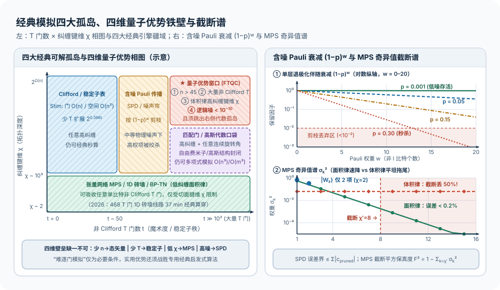
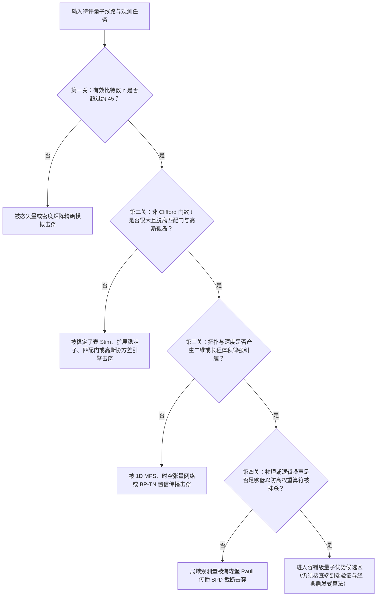

# 21｜稳定子形式、经典模拟引擎与量子优势边界

几乎每一位刚学完多比特张量积的读者，脑海里都会立刻印下一笔惊人的数字账：$50$ 个量子比特的纯态有 $2^{50} \approx 1.13 \times 10^{15}$ 个复振幅，按每个双精度复数占 $16$ 字节计算，光把这一个量子态存进内存就要大约 $18\,\mathrm{PB}$——远远超过普通笔记本电脑，甚至直逼顶级超算的整机内存。于是，一个顺理成章却极其危险的推论开始在科普文章与新闻标题里流传：“只要芯片做到 $50$ 或 $100$ 个量子比特，经典计算机连态都存不下，量子计算就必然已经超越经典了。”

这一章专门来拆穿这个错觉，并把决定当今“量子优势生死线”的经典模拟数学工具箱亲手交给你。

学完本章后，你会自己动手算通、并仅用 Python 3 标准库跑通三台截然不同的现代经典模拟迷你引擎——**Aaronson–Gottesman 稳定子表**、**矩阵乘积态**（MPS）与**海森堡绘景 Pauli 传播**——并且亲眼见证它们各自如何把表面上 $2^n$ 维的巨兽驯服在普通电脑的几行代码里。更重要的是，把这些经典引擎的边界拼在一起，你就能看清真正击穿全部经典模拟器的“四维量子优势铁壁”，也从第一性原理彻底理解：**为什么容错量子纠错绝非锦上添花的工程细节，而是通向实用量子优势的唯一窄门**。

阅读本章前，建议先熟悉以下五个前序模块（遇到具体公式时随时回翻）：

- [第 03 章：多量子比特与纠缠](03-multiple-qubits.md#5-schmidt-分解与二分纯态的纠缠熵)（Schmidt 分解、二分纠缠熵、GHZ 态与 W 态）；
- [第 04 章：量子电路与协议](04-circuits-protocols.md#10-clifford-群稳定子表与-gottesmanknill-定理手算)（Clifford 群 $\{H, S, \mathrm{CNOT}\}$、$T$ 门与 Gottesman–Knill 定理直觉）；
- [第 05 章：混态、噪声与量子信道](05-noise-channels.md#53-退极化信道depolarizing双参数换算与平均门错误率)（单比特退极化信道 $\mathcal D_p$ 与随机 Pauli 参数换算 $p = 4q/3$）；
- [第 10 章：量子纠错与容错计算](10-error-correction.md#4-稳定子码css-构造与联合码距预算)（稳定子群 $\mathcal S$ 与生成元概念）；
- [第 15 章：实践路线](15-practice-research.md#2-从零手写-python-态矢量模拟器)（大端序态矢量模拟器与端序检查）。

动笔推演前，先将本章高频符号与[附录：符号表](appendices/notation.md)逐一锁死，避免跨章复用字母撞车：

| 符号 / 约定 | 本章含义、维数与单位口径 | 跨章与代码对齐说明 |
| :--- | :--- | :--- |
| 多比特基序与内积 | 高位在左大端序 $\lvert q_0 q_1 \cdots q_{n-1}\rangle$；左共轭内积 $\langle u \vert v \rangle = \sum_j u_j^* v_j$ | 与[符号表](appendices/notation.md)及配套脚本 `simulation_engines_lab.py` 完全一致 |
| 线路与算符次序 | 电路图从左向右执行；态演化 $VU\lvert\psi\rangle$ 与信道复合 $\mathcal B \circ \mathcal A$ 从右向左作用 | 海森堡反向传播 $(\mathcal B \circ \mathcal A)^\dagger(O) = \mathcal A^\dagger(\mathcal B^\dagger(O))$ 按门序逆序展开 |
| $(x \mid z),\, r$ | $n$ 比特 Pauli 串的 $2n$ 比特二元辛行向量 $x, z \in \mathbb F_2^n$ 与相位位 $r \in \{0, 1\}$ | 单比特编码 $(0,0)\leftrightarrow I,\,(1,0)\leftrightarrow X,\,(0,1)\leftrightarrow Z,\,(1,1)\leftrightarrow Y = iXZ$ |
| $\chi_{\mathrm{stab}}$ 与 $\chi$ | 本章沿用全书主记号，用 $\chi_{\mathrm{stab}}$ 专指**稳定子秩**（无量纲正整数，部分文献亦简记 $\chi_S$），用 $\chi$ 专指 MPS **键维**（bond dimension） | 与[符号表](appendices/notation.md)及[规范](STYLE.md)一致；注意区分[第 13 章](13-quantum-information.md)的 Holevo 量 $\chi$，每节就地标明对象 |
| $w(P)$ | $n$ 比特 Pauli 串 $P$ 的权重（非恒等单比特因子 $X, Y, Z$ 的个数，无量纲整数 $0 \le w(P) \le n$） | 与[符号表](appendices/notation.md)一致；退极化伴随映射下按 $(1 - p)^{w(P)}$ 衰减 |
| $\xi(\lvert\psi\rangle)$ | 稳定子展度（stabilizer extent），无量纲实数 $\ge 1$ | 决定扩展稳定子近似采样开销的主导指数基底 |
| $\mathcal D_p$ 与 $\mathcal D_p^\dagger$ | 退极化信道 $\mathcal D_p(\rho) = (1-p)\rho + p\frac{I}{2}$（$0 \le p \le 1$）及其迹内积伴随映射 | $\mathcal D_p^\dagger$ 是海森堡伴随而非逆信道；与 Stim 随机 Pauli 参数 $q$ 满足 $p = \frac{4}{3}q$ |
| $F$ 与 $F^2$ | 根保真度 $F(\lvert\psi\rangle,\lvert\phi\rangle) = \lvert\langle\psi\vert\phi\rangle\rvert$；平方重叠明写 $F^2$ | MPS 截断误差 $\epsilon_{\mathrm{trunc}} = \sum_{i > \chi'}\sigma_i^2$ 对应 $F = \sqrt{1 - \epsilon_{\mathrm{trunc}}}$ |
| $\log_2$ 与 $\ln$ | 纠缠熵、比特数与指数标度基底一律写 $\log_2$；自然对数一律写 $\ln$ | 全章绝不使用不标底数的裸对数 |

---

## 1. 为什么“存不下 $2^n$ 个振幅”不等于“经典算不动”？

### 1.1 态矢量内存墙：为什么 $2^n$ 只挡住了最老实的一种表象

在[第 15 章](15-practice-research.md#2-从零手写-python-态矢量模拟器)中，我们亲手写过最直接的经典模拟器——**态矢量（statevector）模拟器**：把 $n$ 比特纯态存成一个长度为 $2^n$ 的复数数组，每执行一个量子门就按张量切片扫一遍数组，耗时与内存都严格按 $O(2^n)$ 增长；若要模拟含噪混态密度矩阵 $\rho$，则需要存 $2^n \times 2^n = 4^n$ 个复数。

- 一台内存 $32\,\mathrm{GiB}$ 的工作站，存纯态大约止步于 $n = 30\text{–}31$ 比特（$16 \times 2^{30}\,\mathrm{B} = 16\,\mathrm{GiB}$），存密度矩阵更是掉到 $n = 15$ 比特；
- 动用数千节点内存池的顶级超级计算机，纯态极限也大致停在 $n \approx 40\text{–}45$ 比特。

但请你停下来想一个物理与计算机科学里反复上演的常识：**把一张 $1000 \times 1000$ 像素的纯白画面存成未压缩位图需要几兆字节，可如果你只写一句“宽 1000、高 1000、全白”，只需要二十个字节。** 量子态的 $2^n$ 个振幅同样常常充满高度对称或局域约束：

1. **代数对称约束**：如果电路只使用 Clifford 门，那么哪怕 $n = 10{,}000$ 个比特已经纠缠成一片，这 $2^{10000}$ 个复振幅依然由区区 $10{,}000$ 条局域 Pauli 方程唯一锁死——你完全不必展开振幅，只需用 $O(n^2)$ 比特的表格追踪这 $n$ 条方程的演化。
2. **空间纠缠结构约束**：如果比特排成一维链且跨切面的量子纠缠熵有界（满足面积律），$2^n$ 维张量就能无损或近无损地因式分解成 $n$ 个小矩阵连乘（矩阵乘积态 MPS），存储量从 $O(2^n)$ 骤降至 $O(n\chi^2)$。
3. **海森堡可观测量与噪声稀疏约束**：如果实验最终只关心某几个局域可观测量 $\langle Z_0\rangle$ 或 $\langle Z_i Z_j\rangle$，而且电路较浅、旋转角不大或存在真实物理噪声，那么我们根本不必正向推演整个量子态 $\rho$，只需把简单的末态算符 $O$ 沿电路**倒推**回初态——沿途高权重分支会被物理噪声指数级杀灭，留下极稀疏的 Pauli 展开。

因此，**“态矢量模拟器内存爆炸”只说明最朴素的稠密数组表示失效了，绝不等于“经典计算机算不动这条电路”。**

### 1.2 先分清三类模拟任务：强模拟、弱模拟与期望值估计

评判经典模拟器快慢之前，必须先锁清“到底要算什么输出”——这和[第 16 章第 1 节](16-advanced-algorithms-verification.md#1-读算法论文前先填齐六个空)里强调的输出形式完全呼应：

1. **强模拟（strong simulation）**：给定任意一个指定比特串 $x \in \{0, 1\}^n$，精确（或按指定乘法/加法精度）算出输出概率 $p(x) = \lvert\langle x \vert \psi \rangle\rvert^2$ 或复振幅 $\langle x \vert \psi \rangle$（以及任意边缘概率）。强模拟最苛刻；例如计算一般张量网络收缩振幅就常落入强模拟范畴。
2. **弱模拟（weak simulation / sampling）**：不需要打印特定 $x$ 的概率数值，只需在经典计算机上按与真实量子硬件相同（或总变差距离 $\le \varepsilon$）的概率分布 $p(x)$ 随机抽样输出比特串 $x$。真实量子芯片本身只做弱模拟（每次运行吐出一个测量样本）；许多现代经典算法（如 Bravyi–Gosset 扩展稳定子采样、Stim 批量采样）在弱模拟上比强模拟快出一个指数因子。
3. **局域可观测量期望值估计（expectation estimation）**：不要求采样全部 $n$ 比特联合位串，只要求在给定加性误差 $\varepsilon$ 内算出 $\langle O \rangle = \operatorname{Tr}(O \rho)$（例如 Ising 磁化强度、变分能量 $\langle H \rangle$）。现代置信传播张量网络（BP-TN）与海森堡稀疏 Pauli 动力学（SPD）正是专为这一类任务打造的利器——它们经常能在几分钟内算穿百比特实验的局域均值，即便同一电路的精确全分布采样依然很困难。

### 1.3 四大经典模拟引擎复杂度与适用域全景表

把当今量子计算研究中最核心的四类经典模拟引擎并排铺开，各自的数学对象、复杂度标尺、适用规模与真正怕什么结构一目了然（本表是对[第 16 章](16-advanced-algorithms-verification.md)综述入口的完整算法级展开）：

| 经典模拟引擎 | 追踪的数学对象 | 时间 / 空间主标度 | 擅长攻破的电路结构 | 真正会撞墙失效的场景 | 代表工具与奠基文献 |
| :--- | :--- | :--- | :--- | :--- | :--- |
| **1. 态矢量 / 密度矩阵** | $2^n$ 复振幅向量或 $2^n \times 2^n$ 密度矩阵 | 空间 $O(2^n)$（纯态）/ $O(4^n)$（混态）；单门 $O(2^n)$ | 小比特数（$n \le 30\text{–}45$）任意深度、任意门集、任意纠缠与噪声的黄金精确对照 | 比特数超过 $\sim 45$（哪怕线路只有 1 层浅门） | 自编张量引擎（`15 §2`）、Qiskit Aer、QuTiP、PennyLane |
| **2. 稳定子 / 扩展稳定子** | $2n \times (2n+1)$ 二元辛表（或 $\chi_{\mathrm{stab}}$ 个稳定子态叠加） | 纯 Clifford：空间 $O(n^2)$，门 $O(n)$，确定性测 $O(n^2)$（逆表 $O(n)$）；$t$ 个 $T$ 门：$O(2^{\alpha t}\operatorname{poly}(n))$ | 数千至数百万比特的 QEC 电路；或高比特数但非 Clifford $T$ 门较少（$t \lesssim 50$）的近 Clifford 线路 | 既含海量非 Clifford 门（$t \gg 100$）又无法被低纠缠张量网络吸收的通用线路 | CHP（Aaronson–Gottesman *PRA* 2004）、**Stim**（Gidney *Quantum* 2021）、Bravyi–Gosset（*PRL* 2016）、Qassim–Pashayan–Gosset（*Quantum* 2021） |
| **3. 张量网络（MPS / PEPS / BP-TN）** | 局域低秩张量网（一维链键维 $\chi$、二维格点或时空张量网） | 1D MPS：空间 $O(n\chi^2)$，双比特门 $O(\chi^3)$；精确收缩随树宽（treewidth）指数增长 | 一维低纠缠/面积律态、浅层二维线路、弱环路格点（如重六角格）、或一维开放边界砖墙（单比特 $T$ 门可直接吸收！） | 深层二维或全连接拓扑上的**体积律纠缠**（键维 $\chi \sim 2^S$ 随切面面积指数爆发）且强长程环路破坏树近似 | ITensor、quimb、Schollwöck（*Ann. Phys.* 2011）、**BP-TN**（Tindall 等 *PRX Quantum* 2024; *Science* 2026）、Manabe–Gu–Pan（`arXiv:2608.13110`，2026） |
| **4. 海森堡 Pauli 传播 / SPD** | 反向演化后的稀疏 Pauli 串字典 $\sum_P c_P P$ | 与保留的稀疏 Pauli 项数 $M$ 线性成正比；含噪时高权重串按 $(1-p)^w$ 指数衰减 | 百比特级浅层线路、小角度 Trotter 步、变分线路及**含中等物理噪声的 NISQ 动力学**局域期望值 | **低噪声（容错级）+ 深层 + 大角度非 Clifford 门**引发的算符混沌增殖（高权重分支不被噪声压死） | **SPD**（Begušić–Gray–Chan *Sci. Adv.* 2024）、**`PauliPropagation.jl`**（Rudolph 等 *PRX Quantum* 2026）、Aharonov 等（*STOC* 2023） |

接下来五节，我们就逐一打开第 2、3、4 号引擎的黑箱，把每一步代数、每一个相位负号和每一条误差界都拿纸笔算透，并用纯 Python 标准库代码与第 1 号精确参考引擎逐格对账。

---

## 2. Pauli 群的辛二进制代数与 Aaronson–Gottesman 稳定子表

### 2.1 问题与直觉：用 $n$ 条方程替代 $2^n$ 个振幅

回到[第 10 章第 4 节](10-error-correction.md#4-稳定子码css-构造与联合码距预算)：如果一个 $n$ 比特纯态 $\lvert\psi\rangle$ 满足 $g\lvert\psi\rangle = +\lvert\psi\rangle$，我们就说算符 $g$ **稳定**了 $\lvert\psi\rangle$。

拿最简单的 $n$ 比特初态 $\lvert 00\cdots 0\rangle$ 来看。在态矢量里，你要写一个长达 $2^n$ 的列向量 $(1, 0, \dots, 0)^T$；但在稳定子语言里，它只需要 $n$ 条极其朴素的方程就能唯一钉死（除去无关的全局相位）：

$$
Z_0 \lvert\psi\rangle = +\lvert\psi\rangle, \qquad
Z_1 \lvert\psi\rangle = +\lvert\psi\rangle, \qquad
\dots, \qquad
Z_{n-1} \lvert\psi\rangle = +\lvert\psi\rangle.
$$

为什么 $n$ 条独立的、两两对易且不含 $-I$ 的 Pauli 生成元 $g_0, g_1, \dots, g_{n-1}$ 就能唯一锁死一个 $2^n$ 维空间里的纯态？理由很像解线性方程组：每加一条新的独立约束 $g_k \lvert\psi\rangle = +\lvert\psi\rangle$，就把允许解空间的维度严格砍半；从 $2^n$ 维连砍 $n$ 刀，剩下的共同 $+1$ 本征空间维度恰好是 $2^n / 2^n = 1$——也就是一条唯一的一维射线（一个唯一纯态）！

更妙的是，当我们对 $\lvert\psi\rangle$ 施加一个酉门 $U$ 时，新态 $\lvert\psi'\rangle = U\lvert\psi\rangle$ 被什么算符稳定？插一个 $U^\dagger U = I$ 立刻见底：

$$
g\lvert\psi\rangle = \lvert\psi\rangle
\quad\Longrightarrow\quad
\bigl(U g U^\dagger\bigr)\bigl(U\lvert\psi\rangle\bigr) = U g \lvert\psi\rangle = U\lvert\psi\rangle.
$$

也就是说，**状态演变为 $U\lvert\psi\rangle$，等价于每一条稳定子生成元演变为 $g \mapsto U g U^\dagger$！** 只要 $U$ 来自 Clifford 群 $\{H, S, \mathrm{CNOT}\}$，共轭结果 $U g U^\dagger$ 永远还是单个带 $\pm 1$ 符号的 Pauli 串——生成元条数永远保持 $n$ 条，绝不膨胀。

那么计算机怎么把这些 Pauli 串存成极快的比特阵列，又怎么在 $O(n)$ 时间内完成门更新？这就是 **Aaronson 与 Gottesman（*Phys. Rev. A* 70, 052328, 2004）** 确立的**二元辛编码与稳定子表（stabilizer tableau）**。

### 2.2 把 $n$ 比特 Pauli 串编码成 $(x \mid z)$ 与相位位 $r$

对单个比特，4 个厄米 Pauli 矩阵 $\{I, X, Y, Z\}$ 恰好可以用 **2 个二元比特 $(x, z) \in \mathbb F_2^2$** 编码。记住全书的乘积关系 $Y = i X Z$（即 $X Z = -i Y$、$Z X = +i Y$），我们把 $(x, z)$ 映射为厄米单比特算符 $\sigma(x, z)$：

| 比特对 $(x, z)$ | 对应厄米 Pauli $\sigma(x, z)$ | 用 $X, Z$ 表达 | 记忆口诀 |
| :---: | :---: | :---: | :--- |
| $(0, 0)$ | $I$ | $I$ | 无 $X$ 无 $Z$ |
| $(1, 0)$ | $X$ | $X$ | 仅有 $X$ |
| $(0, 1)$ | $Z$ | $Z$ | 仅有 $Z$ |
| $(1, 1)$ | $Y$ | $i X Z$ | 既有 $X$ 又有 $Z$（乘 $i$ 保厄米） |

推广到 $n$ 个比特（大端序 $q_0, q_1, \dots, q_{n-1}$）：任何带实符号 $\pm 1$ 的 $n$ 比特厄米 Pauli 串（所有稳定子生成元都必为厄米且平方为 $+I$，因此总体相位只能是 $+1$ 或 $-1$，绝不能是 $\pm i$），都可以唯一编码为长度为 **$2n + 1$ 比特**的一整行：

$$
\bigl(x_0,\, x_1,\, \dots,\, x_{n-1} \;\big|\; z_0,\, z_1,\, \dots,\, z_{n-1} \;\big|\; r\bigr)
\;\longleftrightarrow\;
P = (-1)^r \bigotimes_{j=0}^{n-1} \sigma(x_j, z_j),
$$

其中 $x_j, z_j, r \in \{0, 1\}$，$r = 0$ 表示整体正号 $+1$，$r = 1$ 表示整体负号 $-1$。

举两个 $n = 2$ 的小例子热热身：
- $+X_0 X_1$：两位都是 $X \leftrightarrow (1,0)$，正号 $r = 0$，写成行向量 $(1, 1 \mid 0, 0 \mid 0)$；
- $-Y_0 Z_1$：$q_0$ 为 $Y \leftrightarrow (1,1)$，$q_1$ 为 $Z \leftrightarrow (0,1)$，负号 $r = 1$，写成行向量 $(1, 0 \mid 1, 1 \mid 1)$。

### 2.3 零跳步手算：用二元辛内积判定对易与反对易

稳定子算法里最频繁的操作就是判断两条 Pauli 串 $P_1, P_2$ 究竟是**对易**（$P_1 P_2 = +P_2 P_1$）还是**反对易**（$P_1 P_2 = -P_2 P_1$）。难道要把它们展开成 $2^n \times 2^n$ 矩阵去相乘吗？当然不用！

先看单比特 $j$ 上两个非平凡 Pauli 算符 $\sigma(x_j, z_j)$ 与 $\sigma(x'_j, z'_j)$。因为 $X Z = -Z X$、任何算符与自身或 $I$ 都对易，交换两者次序时出现负号 $(-1)$ 的次数恰好取决于“一个取 $X$ 分量、另一个取 $Z$ 分量”的交叉配对数：

$$
\sigma(x_j, z_j)\,\sigma(x'_j, z'_j)
= (-1)^{x_j z'_j \oplus z_j x'_j}\,\sigma(x'_j, z'_j)\,\sigma(x_j, z_j).
$$

逐对核验全部不平凡组合：$X(1,0)$ 与 $Z(0,1)$ 得 $1\cdot 1 \oplus 0\cdot 0 = 1$（反对易）；$X(1,0)$ 与 $Y(1,1)$ 得 $1\cdot 1 \oplus 0\cdot 1 = 1$（反对易）；$Y(1,1)$ 与 $Y(1,1)$ 得 $1\cdot 1 \oplus 1\cdot 1 = 0$（对易）——条条精准！

把全部 $n$ 个比特的负号乘起来，总负号次数就是每位交叉项的模 $2$ 之和，这就定义了 $\mathbb F_2^{2n}$ 上的**二元辛内积（binary symplectic inner product）**：

$$
\langle v, v' \rangle_{\mathrm{sp}}
:= \bigoplus_{j=0}^{n-1} \bigl(x_j z'_j \oplus z_j x'_j\bigr)
= v \,\Lambda\, (v')^T \pmod 2,
\qquad
\Lambda = \begin{bmatrix} 0_n & I_n \\ I_n & 0_n \end{bmatrix},
$$

其中 $v = (x \mid z)$、$v' = (x' \mid z')$。于是得到黄金判据：

$$
P_1 P_2 = (-1)^{\langle v_1, v_2 \rangle_{\mathrm{sp}}} P_2 P_1.
$$

辛内积等于 $0$ 即**对易**，等于 $1$ 即**反对易**，与相位位 $r_1, r_2$ 完全无关！只需 $O(n)$ 次按位与和异或即可完成判定。

#### 零跳步手算两组 $n = 2$ 算例

1. **检验 $P_1 = X_0 X_1$ 与 $P_2 = Z_0 Z_1$**：
   编码为 $v_1 = (1, 1 \mid 0, 0)$、$v_2 = (0, 0 \mid 1, 1)$。逐位代入辛内积：

   $$
   \begin{aligned}
   \langle v_1, v_2 \rangle_{\mathrm{sp}}
   &= (x_{1,0} z_{2,0} \oplus z_{1,0} x_{2,0}) \oplus (x_{1,1} z_{2,1} \oplus z_{1,1} x_{2,1}) \\
   &= (1\cdot 1 \oplus 0\cdot 0) \oplus (1\cdot 1 \oplus 0\cdot 0)
    = 1 \oplus 1 = 0.
   \end{aligned}
   $$

   结果为 $0$，二者**对易**！直接算符回验：$(X_0 X_1)(Z_0 Z_1) = (X_0 Z_0)\otimes(X_1 Z_1) = (-Z_0 X_0)\otimes(-Z_1 X_1) = +(Z_0 Z_1)(X_0 X_1)$，两个负号相消，严丝合缝。

2. **检验 $P_1 = X_0 Y_1$ 与 $P_2 = Y_0 Z_1$**：
   编码为 $v_1 = (1, 1 \mid 0, 1)$、$v_2 = (1, 0 \mid 1, 1)$。逐位代入：

   $$
   \begin{aligned}
   \langle v_1, v_2 \rangle_{\mathrm{sp}}
   &= (1\cdot 1 \oplus 0\cdot 1) \oplus (1\cdot 1 \oplus 1\cdot 0)
    = 1 \oplus 1 = 0.
   \end{aligned}
   $$

   同样对易！再换 $P_3 = Z_0 I_1$（$v_3 = (0,0 \mid 1,0)$）与 $P_1 = X_0 Y_1$：

   $$
   \langle v_1, v_3 \rangle_{\mathrm{sp}}
   = (1\cdot 1 \oplus 0\cdot 0) \oplus (1\cdot 0 \oplus 1\cdot 0)
   = 1 \oplus 0 = 1,
   $$

   结果为 $1$，二者**反对易**（因为第 $0$ 位 $X_0 Z_0 = -Z_0 X_0$，第 $1$ 位 $Y_1 I_1 = I_1 Y_1$）。

### 2.4 行乘积 `rowsum`：把两条对易 Pauli 串准确相乘并算准正负号

在稳定子表模拟测量时，我们经常需要把第 $i$ 行算符 $P_i$ 左乘到第 $h$ 行算符 $P_h$ 上，用乘积 $P_i P_h$ 替换第 $h$ 行（Aaronson–Gottesman 称为 `rowsum(h, i)`）。

对每一列 $j$，新的 $X/Z$ 比特非常简单，直接按位异或即可：

$$
x_{hj}' = x_{hj} \oplus x_{ij}, \qquad z_{hj}' = z_{hj} \oplus z_{ij}.
$$

**真正的精细处在于相位位 $r_h'$！** 即使两条 Pauli 串本身只带 $\pm 1$，它们在某一位上做单比特乘法时却可能吐出 $\pm i$（比如 $X Z = -i Y$）；只有把全部 $n$ 个比特吐出的 $i$ 的幂次加在一起，才能知道最终是 $+1$ 还是 $-1$。

为此，定义单比特乘积 $\sigma(x_1, z_1)\,\sigma(x_2, z_2) = i^{g(x_1, z_1, x_2, z_2)}\,\sigma(x_1 \oplus x_2,\, z_1 \oplus z_2)$ 中的指数函数 $g \in \{-1, 0, +1\}$：

$$
g(x_1, z_1, x_2, z_2) =
\begin{cases}
0, & (x_1, z_1) = (0, 0)\;\text{（乘 } I\text{）}, \\
z_2 - x_2, & (x_1, z_1) = (1, 1)\;\text{（左乘 } Y\text{）}, \\
z_2(2x_2 - 1), & (x_1, z_1) = (1, 0)\;\text{（左乘 } X\text{）}, \\
x_2(1 - 2z_2), & (x_1, z_1) = (0, 1)\;\text{（左乘 } Z\text{）}.
\end{cases}
$$

挑两项手算验证：$X \cdot Z$ 对应 $(1,0)\cdot(0,1)$，代入第三行得 $1\cdot(0 - 1) = -1$，对应 $i^{-1} Y = -i Y$，精确！$Y \cdot Z$ 对应 $(1,1)\cdot(0,1)$，代入第二行得 $1 - 0 = +1$，对应 $i^{+1} X = +i X$，精确！

把 $P_i$ 与 $P_h$ 原有的符号 $(-1)^{r_i} = i^{2 r_i}$、$(-1)^{r_h} = i^{2 r_h}$ 与全部 $n$ 位的 $g$ 指数加在一起，得到总指数和：

$$
\Sigma_{\mathrm{phase}} = 2 r_h + 2 r_i + \sum_{j=0}^{n-1} g(x_{ij}, z_{ij}, x_{hj}, z_{hj}) \pmod 4.
$$

只要 $P_i$ 与 $P_h$ **对易**，它们的乘积 $(P_i P_h)^\dagger = P_h^\dagger P_i^\dagger = P_h P_i = P_i P_h$ 必然仍是厄米算符，因此 $\Sigma_{\mathrm{phase}} \bmod 4$ **只能取 $0$（正号，$r_h' = 0$）或 $2$（负号，$r_h' = 1$）**，绝不会取 $1$ 或 $3$！我们在代码里会对这一条做严格断言，用来即时捕获任何把反对易行误乘在一起的程序漏洞。

### 2.5 逐条推导 $H, S, \mathrm{CNOT}$ 的 $O(n)$ 比特更新规则与相位修正项

现在来推导全部三个 Clifford 群生成元作用在表内每一行 $i$ 上的比特更新法则。记原算符为 $P_i$，经 Clifford 门 $U$ 作用后变为 $U P_i U^\dagger$。因为单比特或双比特门只影响对应的一列或两列，更新整张表（$2n$ 行）总共只需要 **$O(n)$** 次比特运算！

#### 1. Hadamard 门 $H$ 作用在第 $a$ 个比特

逐一写出全部 4 个单比特 Pauli 算符的共轭结果（参见[第 04 章第 10.1 节](04-circuits-protocols.md#101-clifford-共轭规则为什么厄米-pauli-串只可能带-pm-1-相位)）：

- $H I H^\dagger = I$：$(0, 0) \mapsto (0, 0)$，符号不变；
- $H X H^\dagger = Z$：$(1, 0) \mapsto (0, 1)$，符号不变；
- $H Z H^\dagger = X$：$(0, 1) \mapsto (1, 0)$，符号不变；
- $H Y H^\dagger = H(i X Z)H^\dagger = i(H X H^\dagger)(H Z H^\dagger) = i Z X = i(i Y) = -Y$：$(1, 1) \mapsto (1, 1)$，**符号翻转**！

对比四行，规律一眼看穿：$x_{ia}$ 与 $z_{ia}$ 互换，且**当且仅当 $(x_{ia}, z_{ia}) = (1, 1)$（即该位为 $Y$）时相位位 $r_i$ 翻转**。写成二元公式：

$$
r_i \leftarrow r_i \oplus (x_{ia} z_{ia}), \qquad
(x_{ia},\, z_{ia}) \leftarrow (z_{ia},\, x_{ia}).
$$

#### 2. 相位门 $S = \operatorname{diag}(1, i)$ 作用在第 $a$ 个比特

同样零跳步核验全部 4 个单比特共轭（利用 $S^\dagger = \operatorname{diag}(1, -i)$）：

- $S I S^\dagger = I$：$(0, 0) \mapsto (0, 0)$，符号不变；
- $S Z S^\dagger = Z$（对角阵对易）：$(0, 1) \mapsto (0, 1)$，符号不变；
- $S X S^\dagger = \begin{bmatrix}1&0\\0&i\end{bmatrix}\begin{bmatrix}0&1\\1&0\end{bmatrix}\begin{bmatrix}1&0\\0&-i\end{bmatrix} = \begin{bmatrix}0&-i\\i&0\end{bmatrix} = +Y$：$(1, 0) \mapsto (1, 1)$，符号不变；
- $S Y S^\dagger = \begin{bmatrix}1&0\\0&i\end{bmatrix}\begin{bmatrix}0&-i\\i&0\end{bmatrix}\begin{bmatrix}1&0\\0&-i\end{bmatrix} = \begin{bmatrix}0&-1\\-1&0\end{bmatrix} = -X$：$(1, 1) \mapsto (1, 0)$，**符号翻转**！

注意 $z_{ia}$ 变为 $z_{ia} \oplus x_{ia}$，且相位翻转同样只发生在 $(x_{ia}, z_{ia}) = (1, 1)$ 处——务必先用旧值更新 $r_i$，再改写 $z_{ia}$：

$$
r_i \leftarrow r_i \oplus (x_{ia} z_{ia}), \qquad
z_{ia} \leftarrow z_{ia} \oplus x_{ia}.
$$

#### 3. 受控非门 $\mathrm{CNOT}_{a \to b}$（控制位 $a$，目标位 $b$）

先把 4 个单比特基础算符拿 $C = \mathrm{CNOT}_{a \to b}$ 共轭，这四条是所有双比特推理的地基：

$$
C(X_a I_b)C^\dagger = X_a X_b, \quad
C(I_a X_b)C^\dagger = I_a X_b, \quad
C(Z_a I_b)C^\dagger = Z_a I_b, \quad
C(I_a Z_b)C^\dagger = Z_a Z_b.
$$

它们对应的 $X/Z$ 比特更新非常干净：控制位的 $X$ 向目标位传播，目标位的 $Z$ 向控制位回传：

$$
x_{ib}' = x_{ib} \oplus x_{ia}, \qquad z_{ia}' = z_{ia} \oplus z_{ib}.
$$

**最容易漏掉的细节是相位修正项！** 为什么上面四条都没有负号，组合出 $Y$ 之后却会冒出负号？把全部含 $x_{ia}=1$ 且 $z_{ib}=1$ 的 4 种组合一步步展开，答案立现：

1. **$X_a Z_b$**（$(x_a, z_a, x_b, z_b) = (1, 0, 0, 1)$）：

   $$
   C(X_a Z_b)C^\dagger = (X_a X_b)(Z_a Z_b) = (X_a Z_a)\otimes(X_b Z_b) = (-i Y_a)\otimes(-i Y_b) = -Y_a Y_b \quad (\text{变号！})
   $$

2. **$Y_a Y_b$**（$(1, 1, 1, 1)$）：

   $$
   \begin{aligned}
   C(Y_a Y_b)C^\dagger
   &= C\bigl((i X_a Z_a)(i X_b Z_b)\bigr)C^\dagger
    = -(X_a X_b)(Z_a I_b)(I_a X_b)(Z_a Z_b) \\
   &= -(X_a Z_a^2)\otimes(X_b^2 Z_b)
    = -X_a Z_b \quad (\text{变号！})
   \end{aligned}
   $$

3. **$Y_a Z_b$**（$(1, 1, 0, 1)$）：

   $$
   C(Y_a Z_b)C^\dagger = i(X_a X_b)(Z_a I_b)(Z_a Z_b) = i X_a(Z_a^2)\otimes(X_b Z_b) = i X_a(-i Y_b) = +X_a Y_b \quad (\text{不变号}).
   $$

4. **$X_a Y_b$**（$(1, 0, 1, 1)$）：

   $$
   C(X_a Y_b)C^\dagger = (X_a X_b)\,i(I_a X_b)(Z_a Z_b) = (i X_a Z_a)\otimes(X_b^2 Z_b) = +Y_a Z_b \quad (\text{不变号}).
   $$

另外 12 种（$x_{ia}=0$ 或 $z_{ib}=0$）组合中，$a$ 位与 $b$ 位不会同时跨位产生两个 $-i$ 因子，经逐一验证全部保持 $+1$ 号。于是全部 16 种情况中**有且仅有 $X_a Z_b$ 与 $Y_a Y_b$ 两项变号**——它们的共同特征是 $x_{ia} = 1,\, z_{ib} = 1$ 且 $x_{ib} = z_{ia}$（即 $x_{ib} \oplus z_{ia} \oplus 1 = 1$）！于是得出 $\mathrm{CNOT}_{a\to b}$ 的完整更新规则（**同样必须先用旧比特算完 $r_i$，再改 $x_{ib}$ 与 $z_{ia}$**）：

$$
r_i \leftarrow r_i \oplus \Bigl(x_{ia} z_{ib}\,(x_{ib} \oplus z_{ia} \oplus 1)\Bigr), \qquad
x_{ib} \leftarrow x_{ib} \oplus x_{ia}, \qquad
z_{ia} \leftarrow z_{ia} \oplus z_{ib}.
$$

---

## 3. 稳定子表的零跳步手算、去稳定子加速与纯 Python 引擎

如果只存 $n$ 条稳定子生成元，做 Clifford 门虽然是 $O(n)$，可一旦遇到**确定性测量**（判断 $\pm Z_a$ 究竟哪一个符号落在稳定子群 $\mathcal S$ 里），就得在 $\mathbb F_2$ 上对 $n \times n$ 矩阵做高斯消元，单次测量复杂度立刻飙回 $O(n^3)$。

Aaronson 与 Gottesman（2004）想出了一个极具巧思的“空间换时间”方案：把表格高度翻倍到 $2n$ 行——**下半区 $n$ 行存放稳定子 $S_0, \dots, S_{n-1}$，上半区 $n$ 行同步存放配套的去稳定子（destabilizer）$D_0, \dots, D_{n-1}$**，并始终维持三组辛不变量：

$$
[D_i, D_j] = 0, \qquad [S_i, S_j] = 0, \qquad D_i S_j = (-1)^{\delta_{ij}} S_j D_i \quad (\forall\, 0 \le i, j < n).
$$

白话来说，每一条去稳定子 $D_k$ 都是第 $k$ 条稳定子 $S_k$ 的“专属对偶探针”：它只与 $S_k$ 反对易，与其余 $n-1$ 条稳定子全部对易。对初态 $\lvert 00\cdots 0\rangle$，这套配对天然成立：$D_j = +X_j$、$S_j = +Z_j$。由于任意酉共轭都严格保持对易/反对易关系，只要每次施门时对全部 $2n$ 行做同样的 $O(n)$ 更新，这三组不变量就会自动永远保持！

### 3.1 零跳步手算：从 $\lvert 00\rangle$ 演化到 Bell 态 $\lvert\Phi^+\rangle = \langle +XX, +ZZ\rangle$

取 $n = 2$，完整写出 $4 \times 5$ 稳定子表（列顺序依次为 $x_0, x_1 \mid z_0, z_1 \mid r$，行 $0, 1$ 为去稳定子 $D_0, D_1$，行 $2, 3$ 为稳定子 $S_0, S_1$）。

**第 0 步：初态 $\lvert 00\rangle$**

| 行号与角色 | $x_0$ | $x_1$ | $z_0$ | $z_1$ | $r$ | 对应 Pauli 串 |
| :--- | :---: | :---: | :---: | :---: | :---: | :--- |
| 行 0（$D_0$） | $1$ | $0$ | $0$ | $0$ | $0$ | $+X_0 I_1$ |
| 行 1（$D_1$） | $0$ | $1$ | $0$ | $0$ | $0$ | $+I_0 X_1$ |
| 行 2（$S_0$） | $0$ | $0$ | $1$ | $0$ | $0$ | $+Z_0 I_1$ |
| 行 3（$S_1$） | $0$ | $0$ | $0$ | $1$ | $0$ | $+I_0 Z_1$ |

**第 1 步：施加 $H_0$**（对全部 4 行的第 $0$ 列执行 $r_i \leftarrow r_i \oplus x_{i0} z_{i0}$，再互换 $x_{i0} \leftrightarrow z_{i0}$）

四行的 $(x_{i0}, z_{i0})$ 依次是 $(1,0),(0,0),(0,1),(0,0)$，乘积 $x_{i0} z_{i0}$ 全为 $0$，所以 $r$ 全不变；互换第 $0$ 列的 $x$ 与 $z$ 后得到 $\lvert +0\rangle$ 的表：

| 行号与角色 | $x_0$ | $x_1$ | $z_0$ | $z_1$ | $r$ | 对应 Pauli 串 |
| :--- | :---: | :---: | :---: | :---: | :---: | :--- |
| 行 0（$D_0$） | $0$ | $0$ | $1$ | $0$ | $0$ | $+Z_0 I_1$ |
| 行 1（$D_1$） | $0$ | $1$ | $0$ | $0$ | $0$ | $+I_0 X_1$ |
| 行 2（$S_0$） | $1$ | $0$ | $0$ | $0$ | $0$ | $+X_0 I_1$ |
| 行 3（$S_1$） | $0$ | $0$ | $0$ | $1$ | $0$ | $+I_0 Z_1$ |

**第 2 步：施加 $\mathrm{CNOT}_{0 \to 1}$**（对全部 4 行执行先算 $r_i \leftarrow r_i \oplus x_{i0} z_{i1}(x_{i1}\oplus z_{i0}\oplus 1)$，再算 $x_{i1} \leftarrow x_{i1} \oplus x_{i0}$、$z_{i0} \leftarrow z_{i0} \oplus z_{i1}$）

逐行核算：
- 行 0（$0,0 \mid 1,0 \mid 0$）：$x_{00} z_{01} = 0$，更新后仍为 $(0,0 \mid 1,0 \mid 0) = +Z_0 I_1$；
- 行 1（$0,1 \mid 0,0 \mid 0$）：$x_{10} z_{11} = 0$，更新后仍为 $(0,1 \mid 0,0 \mid 0) = +I_0 X_1$；
- 行 2（$1,0 \mid 0,0 \mid 0$）：$x_{20} z_{21} = 0$，$x_{21} \leftarrow 0 \oplus 1 = 1$，$z_{20} \leftarrow 0 \oplus 0 = 0$，得 $(1,1 \mid 0,0 \mid 0) = +X_0 X_1$；
- 行 3（$0,0 \mid 0,1 \mid 0$）：$x_{30} z_{31} = 0$，$x_{31} \leftarrow 0 \oplus 0 = 0$，$z_{30} \leftarrow 0 \oplus 1 = 1$，得 $(0,0 \mid 1,1 \mid 0) = +Z_0 Z_1$。

得到 Bell 态 $\lvert\Phi^+\rangle = \frac{\lvert 00\rangle + \lvert 11\rangle}{\sqrt{2}}$ 的完整稳定子表：

| 行号与角色 | $x_0$ | $x_1$ | $z_0$ | $z_1$ | $r$ | 对应 Pauli 串 |
| :--- | :---: | :---: | :---: | :---: | :---: | :--- |
| 行 0（$D_0$） | $0$ | $0$ | $1$ | $0$ | $0$ | $+Z_0 I_1$ |
| 行 1（$D_1$） | $0$ | $1$ | $0$ | $0$ | $0$ | $+I_0 X_1$ |
| 行 2（$S_0$） | $1$ | $1$ | $0$ | $0$ | $0$ | $+X_0 X_1$ |
| 行 3（$S_1$） | $0$ | $0$ | $1$ | $1$ | $0$ | $+Z_0 Z_1$ |

立刻检验辛不变量：$\{D_0, S_0\} = \{Z_0 I_1, X_0 X_1\} = 0$、$[D_0, S_1] = [Z_0 I_1, Z_0 Z_1] = 0$、$[D_1, S_0] = [I_0 X_1, X_0 X_1] = 0$、$\{D_1, S_1\} = \{I_0 X_1, Z_0 Z_1\} = 0$——全部严丝合缝！

### 3.2 测量 $Z_0$ 的坍缩更新、行约化与紧接着测 $Z_1$ 的确定性读出

现在对 $\lvert\Phi^+\rangle$ 在计算基测量第 $0$ 个比特（即测量算符 $Z_0 I_1$）。怎么只看表格就判定这次测量是**随机**还是**确定**？

检查稳定子区（行 $n$ 到 $2n-1$）中，有没有哪一行与 $Z_a$ 反对易——因为 $Z_a$ 只有 $z_a = 1$，辛内积 $\langle \text{行 } p,\, Z_a\rangle_{\mathrm{sp}} = x_{pa}$！所以**只需要扫描第 $a$ 列的 $x$ 位**！

1. **步骤 A：在 $\lvert\Phi^+\rangle$ 上测量 $Z_0$（随机分支）**
   扫描稳定子行 2（$S_0$）和行 3（$S_1$）的 $x_{\cdot, 0}$：
   - 行 2（$+X_0 X_1$）满足 $x_{2, 0} = 1$！记首个命中的行号为 $p = 2$。
   - 这说明 $Z_0$ 与稳定子 $S_0$ 反对易，因此测量结果 $m_0 \in \{0, 1\}$ 严格以各 $1/2$ 的概率随机出现！
   - **行约化（消去其余行对 $Z_0$ 的反对易）**：对所有满足 $i \ne p$、$i \ne p - n$ 且 $x_{i, 0} = 1$ 的行，执行 `rowsum(i, p)`（乘上旧的 $S_p$）。为什么要跳过 $i = p - n$？因为 $D_{p-n}$ 是整张表里**唯一**与 $S_p$ 反对易的行（相乘会变成反厄米算符），而且下一步它马上就要被旧 $S_p$ 直接覆写！本例中行 0、1、3 的 $x_{\cdot, 0}$ 均为 $0$，无需额外 `rowsum`。
   - **坍缩覆写**：把旧稳定子行 $p = 2$ 复制到对应去稳定子行 $p - n = 0$（即 $D_0' \leftarrow +X_0 X_1$），再把行 $p = 2$ 覆写为观测到的新稳定子 $(-1)^{m_0} Z_0 I_1$！

   取随机结果 **$m_0 = 1$**（测得比特 $0$ 为 `1`），得到坍缩后的新表：

   | 行号与角色 | $x_0$ | $x_1$ | $z_0$ | $z_1$ | $r$ | 对应 Pauli 串 |
   | :--- | :---: | :---: | :---: | :---: | :---: | :--- |
   | 行 0（$D_0'$） | $1$ | $1$ | $0$ | $0$ | $0$ | $+X_0 X_1$ |
   | 行 1（$D_1'$） | $0$ | $1$ | $0$ | $0$ | $0$ | $+I_0 X_1$ |
   | 行 2（$S_0'$） | $0$ | $0$ | $1$ | $0$ | $1$ | $-Z_0 I_1$ |
   | 行 3（$S_1'$） | $0$ | $0$ | $1$ | $1$ | $0$ | $+Z_0 Z_1$ |

   核对一下：新稳定子群 $\langle -Z_0 I_1,\; +Z_0 Z_1\rangle$ 的唯一共同 $+1$ 本征态正是 $\lvert 11\rangle$（因为 $-Z_0\lvert 11\rangle = +\lvert 11\rangle$ 且 $Z_0 Z_1\lvert 11\rangle = (-1)(-1)\lvert 11\rangle = +\lvert 11\rangle$）；同时全部 $4$ 行的辛不变量依然 100% 成立（例如 $\{D_0', S_0'\} = \{XX, -ZI\} = 0$、$[D_0', S_1'] = [XX, ZZ] = 0$）。

2. **步骤 B：紧接着测量 $Z_1$（确定性分支——亲眼见证去稳定子的威力！）**
   扫描新稳定子行 2（$S_0'$）与行 3（$S_1'$）的 $x_{\cdot, 1}$ 列：
   - $x_{2, 1} = 0$，$x_{3, 1} = 0$——**没有任何一条稳定子与 $Z_1$ 反对易！**
   - 这说明 $I_0 Z_1$（带某个唯一符号 $(-1)^{m_1}$）一定可以写成当前稳定子生成元的乘积：

     $$
     (-1)^{m_1} I_0 Z_1 = (S_0')^{c_0} (S_1')^{c_1}, \qquad c_0, c_1 \in \{0, 1\}.
     $$

   - **怎么不解方程组、直接读出 $c_0, c_1$？** 把上式两边分别与去稳定子 $D_k'$ 做辛内积！因为 $D_k'$ 只与 $S_k'$ 反对易而与其余稳定子全部对易，右边立刻吐出 $c_k$，左边则恰好是 $\langle D_k',\, I_0 Z_1\rangle_{\mathrm{sp}} = x_{k, 1}$！因此**一步直读**：

     $$
     c_k = x_{k, a} \qquad (k = 0, 1, \dots, n - 1).
     $$

   - 立刻查上表的去稳定子行 0 和行 1 的 $x_{\cdot, 1}$ 列：
     - $c_0 = x_{0, 1} = 1$；
     - $c_1 = x_{1, 1} = 1$！
   - 准备一条全零暂存行（$+I_0 I_1$），依次调用 `rowsum(scratch, 2)` 乘入 $S_0' = -Z_0 I_1$，再调用 `rowsum(scratch, 3)` 乘入 $S_1' = +Z_0 Z_1$：
     - 乘 $S_0'$：得 $(-Z_0 I_1)$，即 $(0,0 \mid 1,0 \mid 1)$；
     - 再乘 $S_1'$：$Z_0 \cdot Z_0 = I_0$（$g=0$），$I_1 \cdot Z_1 = Z_1$（$g=0$），总相位 $2\cdot 1 + 2\cdot 0 + 0 = 2 \pmod 4 \implies r = 1$，得 **$-I_0 Z_1$**！
   - 读出暂存行相位位 $r_{\mathrm{scratch}} = 1$，因此确定性测量结果必为 **$m_1 = 1$**——与 Bell 态在测得 $q_0 = 1$ 后 $q_1$ 必为 $1$ 的物理事实分毫不差！若刚才随机分支取 $m_0 = 0$，则 $S_0' = +Z_0 I_1$，乘积给出 $+I_0 Z_1$，$r_{\mathrm{scratch}} = 0$，确定性测得 $m_1 = 0$。

### 3.3 从 $O(n^3)$ 到 $O(n^2)$ 再到 Stim 的千赫兹级采样

总结一下稳定子模拟在算法与工程上的三次代际跃升：

1. **原始 Gottesman–Knill（1998）**：仅维护 $n$ 条稳定子，确定性测量需在 $\mathbb F_2$ 上做高斯消元，单次耗时 $O(n^3)$。
2. **Aaronson–Gottesman CHP（*Phys. Rev. A* 70, 052328, 2004）**：引入 $n$ 条去稳定子，$c_k = x_{k, a}$ 直接给出组合系数，只需最多 $n$ 次 `rowsum`，将单次确定性测量压至 **$O(n^2)$**；论文同时证明纯稳定子电路模拟是经典复杂度类 $\oplus\mathrm{L}$（ParityL）完全问题，暗示它连通用经典逻辑（如 Toffoli 门）都无法单靠自身实现。
3. **Stim（Gidney, *Quantum* 5, 497, 2021）**：现代容错纠错仿真的工业引擎，靠三把手术刀把速度又推高了数个数量级：
   - **追踪逆稳定子表（inverse tableau）**：利用逆表把确定性测量的渐近复杂度进一步压到 **$O(n)$**；
   - **256 位宽 SIMD 缓存友好布局**：一次 CPU 指令同时异或 256 个比特；
   - **参考样本 + 批量 Pauli 帧传播（reference sample & Pauli frame simulation）**：在纠错仿真里，我们往往要对同一条含随机 Pauli 噪声的电路采样数百万次（shots）。Stim **只运行一次**昂贵的无噪稳定子表得到一条“无错参考测量串”；随后数百万次含噪抽样中，完全不再跑稳定子表，只把每个随机注入的 Pauli 错误（一个极轻量的 2 比特/量子比特 Pauli 帧）沿 Clifford 门按位异或推向测量端口——任何与测量算符反对易的错误帧都会把对应参考测量比特取反！正因如此，Stim 模拟码距 $d = 100$、含 $20{,}000$ 比特、$800$ 万个门与 $100$ 万次测量的表面码电路，仅需约 $15$ 秒完成建表分析，此后便能以**千赫兹级速率**批量吐出完整含噪样本。

### 3.4 约 50 行纯 Python 稳定子表核心代码

下面是从配套脚本 [simulation_engines_lab.py](../codes/algorithms/simulation_engines_lab.py) 中提炼出的无第三方依赖核心骨架（仅使用 Python 3 标准库，去掉注释约 50 行），读者可以直接复制运行并与第 15 章的态矢量模拟器交叉核验：

```python
import random

def _phase_g(x1, z1, x2, z2):
    if x1 == 0 and z1 == 0: return 0
    if x1 == 1 and z1 == 1: return z2 - x2
    if x1 == 1 and z1 == 0: return z2 * (2 * x2 - 1)
    return x2 * (1 - 2 * z2)

class StabilizerTableau:
    def __init__(self, n):
        self.n = n
        self.x = [[0] * n for _ in range(2 * n + 1)]
        self.z = [[0] * n for _ in range(2 * n + 1)]
        self.r = [0] * (2 * n + 1)
        for j in range(n):
            self.x[j][j] = 1        # 去稳定子 D_j = +X_j
            self.z[n + j][j] = 1    # 稳定子   S_j = +Z_j

    def _rowsum(self, h, i):
        s = 2 * self.r[h] + 2 * self.r[i]
        for j in range(self.n):
            s += _phase_g(self.x[i][j], self.z[i][j], self.x[h][j], self.z[h][j])
            self.x[h][j] ^= self.x[i][j]
            self.z[h][j] ^= self.z[i][j]
        assert s % 4 in (0, 2)
        self.r[h] = 0 if s % 4 == 0 else 1

    def h(self, a):
        for i in range(2 * self.n):
            self.r[i] ^= self.x[i][a] & self.z[i][a]
            self.x[i][a], self.z[i][a] = self.z[i][a], self.x[i][a]

    def s(self, a):
        for i in range(2 * self.n):
            self.r[i] ^= self.x[i][a] & self.z[i][a]
            self.z[i][a] ^= self.x[i][a]

    def cnot(self, ctrl, tgt):
        for i in range(2 * self.n):
            xc, zc = self.x[i][ctrl], self.z[i][ctrl]
            xt, zt = self.x[i][tgt], self.z[i][tgt]
            self.r[i] ^= xc & zt & (xt ^ zc ^ 1)
            self.x[i][tgt] = xt ^ xc
            self.z[i][ctrl] = zc ^ zt

    def measure_z(self, a, forced_outcome=None, rng=None):
        n = self.n
        p = next((row for row in range(n, 2 * n) if self.x[row][a] == 1), -1)
        if p != -1:  # 随机分支：行约化后用旧 S_p 覆写 D_{p-n}，S_p 置为 (-1)^m Z_a
            for i in range(2 * n):
                if i != p and i != p - n and self.x[i][a] == 1:
                    self._rowsum(i, p)
            self.x[p - n], self.z[p - n], self.r[p - n] = self.x[p][:], self.z[p][:], self.r[p]
            self.x[p], self.z[p] = [0] * n, [0] * n
            self.z[p][a] = 1
            sampler = rng if rng is not None else random
            outcome = sampler.randrange(2) if forced_outcome is None else int(forced_outcome)
            self.r[p] = outcome
            return self.r[p], True
        # 确定性分支：利用去稳定子 O(n^2) 读出 c_k = x[k][a]
        sc = 2 * n
        self.x[sc], self.z[sc], self.r[sc] = [0] * n, [0] * n, 0
        for k in range(n):
            if self.x[k][a] == 1:
                self._rowsum(sc, k + n)
        return self.r[sc], False
```

在配套脚本中，我们对 4 比特随机 Clifford 电路（含 28 个随机 $H/S/\mathrm{CNOT}$ 门与中段投影测量，固定种子 `20261125`）全量核验了全部 $4^4 = 256$ 个 Pauli 串期望值，稳定子表引擎与独立大端序态矢量引擎之间的最大偏差小于 $10^{-12}$。

> **练 21-A（就地练习：3 比特 GHZ 态稳定子表与远程确定性测量）**
>
> 从 3 比特初态 $\lvert 000\rangle$ 出发，依次施加 $H_0$、$\mathrm{CNOT}_{0 \to 1}$、$\mathrm{CNOT}_{1 \to 2}$ 制备 $\lvert\mathrm{GHZ}_3\rangle = \frac{\lvert 000\rangle + \lvert 111\rangle}{\sqrt{2}}$。
> 1. 写出演化后的全部 3 条去稳定子 $D_0, D_1, D_2$ 与 3 条稳定子 $S_0, S_1, S_2$；
> 2. 设测量 $Z_0$ 得到随机结果 $m_0 = 1$，写出更新后的表，并用去稳定子法零跳步推导出紧接着测量 $Z_2$ 必得确定性结果 $m_2 = 1$。
>
> **零跳步解答**：
> 1. 初态为 $D_0 = +X_0 I_1 I_2,\, D_1 = +I_0 X_1 I_2,\, D_2 = +I_0 I_1 X_2$；$S_0 = +Z_0 I_1 I_2,\, S_1 = +I_0 Z_1 I_2,\, S_2 = +I_0 I_1 Z_2$。
>    - 施 $H_0$：$D_0 \mapsto +Z_0 I_1 I_2$，$S_0 \mapsto +X_0 I_1 I_2$，其余不变；
>    - 施 $\mathrm{CNOT}_{0\to 1}$：$S_0 \mapsto +X_0 X_1 I_2$，$S_1 \mapsto +Z_0 Z_1 I_2$，其余不变（注意各行 $x_0 z_1$ 均为 $0$，无变号）；
>    - 施 $\mathrm{CNOT}_{1\to 2}$：$D_1 = +I_0 X_1 I_2 \mapsto +I_0 X_1 X_2$，$S_0 = +X_0 X_1 I_2 \mapsto +X_0 X_1 X_2$，$S_2 = +I_0 I_1 Z_2 \mapsto +I_0 Z_1 Z_2$，其余不变。
>    最终 6 行为：$D_0 = +ZII,\, D_1 = +IXX,\, D_2 = +IIX$；$S_0 = +XXX,\, S_1 = +ZZI,\, S_2 = +IZZ$。
> 2. 测 $Z_0$：稳定子区仅 $S_0 = +XXX$ 满足 $x_{3,0} = 1$（$p = 3$，随机分支），且其余行 $x_{\cdot, 0}$ 全为 $0$，无需 `rowsum`。取 $m_0 = 1$ 覆写得：$D_0' = +XXX,\, D_1' = +IXX,\, D_2' = +IIX$；$S_0' = -ZII,\, S_1' = +ZZI,\, S_2' = +IZZ$。
>    接着测 $Z_2$：稳定子区 $x_{\cdot, 2}$ 全为 $0$，触发**确定性分支**！直读去稳定子区第 $2$ 列的 $x$ 位：$c_0 = x_{0,2} = 1$（$D_0' = +XXX$）、$c_1 = x_{1,2} = 1$（$D_1' = +IXX$）、$c_2 = x_{2,2} = 1$（$D_2' = +IIX$）。把三条稳定子依次相乘：
>
>    $$
>    S_0' S_1' S_2' = (-Z_0 I_1 I_2)(+Z_0 Z_1 I_2)(+I_0 Z_1 Z_2) = -I_0 I_1 Z_2.
>    $$
>
>    符号为负（$r = 1$），因此确定性测得 $m_2 = 1$（已由 `simulation_engines_lab.py` 断言通过）。

---

## 4. 打破 Clifford 壁垒：魔术度、稳定子秩与四大经典可解孤岛

上一节展示了一个出乎直觉的事实：即便 $10{,}000$ 个比特深度纠缠在一起，只要线路落在 Clifford 群里，一台笔记本电脑照样秒算。那么，究竟是什么把量子计算推出稳定子世界？如果线路里掺进了少量非 Clifford 门（例如 $t$ 个 $T$ 门），稳定子模拟器会立刻瘫痪，还是能继续撑住？除了 Clifford 群之外，量子力学里还有哪些同样“纠缠满满却经典可解”的隐蔽孤岛？

这一节把这些问题一次讲透。

### 4.1 并非每个 $T$ 门都产生魔术度：对比 $T\lvert 0\rangle$ 与 $T\lvert +\rangle$

在[第 04 章第 10.3 节](04-circuits-protocols.md#103-为什么加一个-t-门稳定子表就裂开了)中，我们知道把离散的 $\pi/4$ 相位门 $T = \operatorname{diag}(1, e^{i\pi/4})$ 加入 $\{H, S, \mathrm{CNOT}\}$ 就能获得通用量子计算能力。物理学界把量子态偏离稳定子集合（严格说，偏离所有稳定子态凸包）的非稳定子资源形象地称作**魔术度（magic / non-stabilizerness）**（对应的非稳定子资源态，与全书第 10、11 章统一称作**魔法态**）。

不过，千万别以为“电路里每写一个 $T$ 门，经典模拟难度就必定翻倍”。先算两道最朴素的单比特对比：

1. **把 $T$ 门作用在 $\lvert 0\rangle$ 上**：

   $$
   T\lvert 0\rangle = \begin{bmatrix} 1 & 0 \\ 0 & e^{i\pi/4} \end{bmatrix}\begin{bmatrix} 1 \\ 0 \end{bmatrix} = \begin{bmatrix} 1 \\ 0 \end{bmatrix} = \lvert 0\rangle.
   $$

   $\lvert 0\rangle$ 本身就是稳定子态（稳定子 $\langle +Z\rangle$）！因为 $\lvert 0\rangle$ 是 $Z$ 的本征态，而 $T$ 与 $Z$ 对易，这个 $T$ 门根本没有造出任何魔术度——只需要 $1$ 个稳定子态就能精确描述它。

2. **把 $T$ 门作用在 $\lvert +\rangle = \frac{\lvert 0\rangle + \lvert 1\rangle}{\sqrt{2}}$ 上**：得到标准**魔法态（magic state）** $\lvert T\rangle$：

   $$
   \lvert T\rangle := T\lvert +\rangle = \frac{\lvert 0\rangle + e^{i\pi/4}\lvert 1\rangle}{\sqrt{2}}.
   $$

   算一下它在 Bloch 球上的三维坐标 $(\langle X\rangle, \langle Y\rangle, \langle Z\rangle)$：

   $$
   \begin{aligned}
   \langle T \vert X \vert T \rangle &= \frac{1}{2}\bigl(e^{i\pi/4} + e^{-i\pi/4}\bigr) = \cos\frac{\pi}{4} = \frac{1}{\sqrt{2}}, \\
   \langle T \vert Y \vert T \rangle &= \frac{1}{2}\bigl(-i e^{i\pi/4} + i e^{-i\pi/4}\bigr) = \sin\frac{\pi}{4} = \frac{1}{\sqrt{2}}, \\
   \langle T \vert Z \vert T \rangle &= \frac{1}{2}\bigl(1 - 1\bigr) = 0.
   \end{aligned}
   $$

   全部 6 个单比特稳定子态（$\lvert 0\rangle, \lvert 1\rangle, \lvert +\rangle, \lvert -\rangle, \lvert +i\rangle, \lvert -i\rangle$）严丝合缝地钉在 Bloch 球的 6 个坐标轴极点 $(\pm 1, 0, 0),\, (0, \pm 1, 0),\, (0, 0, \pm 1)$ 上；而 $\lvert T\rangle$ 恰好落在赤道 $45^\circ$ 中点 $\bigl(\frac{1}{\sqrt{2}}, \frac{1}{\sqrt{2}}, 0\bigr)$，离全部 6 个稳定子极点都最远！没有任何一条单比特 Pauli 算符能稳定它，单张稳定子表彻底装不下它。

### 4.2 稳定子秩与稳定子展度零跳步手算：为何标度远低于 $2^t$

单张稳定子表装不下 $\lvert T\rangle$，那就用**多张稳定子表的线性叠加**来装！对任意 $n$ 比特纯态 $\lvert\psi\rangle$，把它写成若干归一化稳定子态 $\lvert\phi_k\rangle$ 的线性组合所需的**最少项数**，称为它的**精确稳定子秩（exact stabilizer rank）**，全书统一记作 $\chi_{\mathrm{stab}}(\lvert\psi\rangle)$（部分文献亦简记 $\chi_S$）：

$$
\lvert\psi\rangle = \sum_{k=1}^{\chi_{\mathrm{stab}}} c_k \lvert\phi_k\rangle,
\qquad
\lvert\phi_k\rangle \text{ 为稳定子态},\quad c_k \in \mathbb C.
$$

由第 10 章与第 04 章的“门隐形传态（state injection）”技巧可知：电路里每出现 1 个 $T$ 门，都能等价替换成提前消耗 1 份魔法态 $\lvert T\rangle$ 再加 Clifford 门与 Pauli 测量。因此，含 $t$ 个 $T$ 门的电路经典模拟难度，直接归结为分解 $t$ 份魔法态张量积 $\lvert T\rangle^{\otimes t}$ 的稳定子秩！

下面我们一步不跳地手算 $t = 1$ 与 $t = 2$，亲眼看看如何打破朴素的 $2^t$ 魔咒：

#### 第一步：$t = 1$ 的两种 2 项分解与“稳定子展度”

1. **最直接的正交基分解（计算基）**：

   $$
   \lvert T\rangle = \frac{1}{\sqrt{2}}\lvert 0\rangle + \frac{e^{i\pi/4}}{\sqrt{2}}\lvert 1\rangle.
   $$

   这里 $\lvert 0\rangle$（稳定子 $\langle +Z\rangle$）和 $\lvert 1\rangle$（稳定子 $\langle -Z\rangle$）都是稳定子态，于是立得 $\chi_{\mathrm{stab}}(\lvert T\rangle) = 2$。此时系数的 $\ell_1$ 范数平方为 $\bigl(\frac{1}{\sqrt{2}} + \frac{1}{\sqrt{2}}\bigr)^2 = 2$。

2. **更紧凑的非正交赤道分解（达到最小 $\ell_1$ 展度）**：
   既然 $\lvert T\rangle$ 在赤道上正夹在 $\lvert +\rangle = \frac{\lvert 0\rangle + \lvert 1\rangle}{\sqrt{2}}$ 与 $\lvert +i\rangle = \frac{\lvert 0\rangle + i\lvert 1\rangle}{\sqrt{2}}$ 正中间，试试用这两支非正交稳定子态合成它！取系数

   $$
   c_1 = \frac{e^{i\pi/8}}{2\cos(\pi/8)}, \qquad
   c_2 = \frac{e^{-i\pi/8}}{2\cos(\pi/8)}.
   $$

   逐分量展开验证 $c_1\lvert +\rangle + c_2\lvert +i\rangle$：
   - $\lvert 0\rangle$ 分量：$\dfrac{e^{i\pi/8} + e^{-i\pi/8}}{2\sqrt{2}\cos(\pi/8)} = \dfrac{2\cos(\pi/8)}{2\sqrt{2}\cos(\pi/8)} = \dfrac{1}{\sqrt{2}}$；
   - $\lvert 1\rangle$ 分量（注意 $i = e^{i\pi/2}$，故 $i e^{-i\pi/8} = e^{i 3\pi/8}$）：

     $$
     \frac{e^{i\pi/8} + e^{i 3\pi/8}}{2\sqrt{2}\cos(\pi/8)}
     = \frac{e^{i\pi/4}\bigl(e^{-i\pi/8} + e^{i\pi/8}\bigr)}{2\sqrt{2}\cos(\pi/8)}
     = \frac{e^{i\pi/4}\cdot 2\cos(\pi/8)}{2\sqrt{2}\cos(\pi/8)}
     = \frac{e^{i\pi/4}}{\sqrt{2}}.
     $$

   两格完全一致！现在算这组分解的 $\ell_1$ 范数平方——在资源论里，所有合法稳定子分解中 $\bigl(\sum_k \lvert c_k\rvert\bigr)^2$ 的最小值叫作**稳定子展度（stabilizer extent）** $\xi(\lvert\psi\rangle)$：

   $$
   \xi(\lvert T\rangle)
   = \bigl(\lvert c_1\rvert + \lvert c_2\rvert\bigr)^2
   = \left(\frac{1}{\cos(\pi/8)}\right)^2
   = \frac{2}{1 + \cos(\pi/4)}
   = \frac{4}{2 + \sqrt{2}}
   = 4 - 2\sqrt{2} \approx 1.171573.
   $$

   把 $1.171573$ 改写成以 $2$ 为底的幂：$\log_2\xi(\lvert T\rangle) \approx 0.228447$！之所以它远小于正交分解的 $2$，是因为非正交的 $\lvert +\rangle$ 与 $\lvert +i\rangle$ 在 $\lvert T\rangle$ 方向上发生了相长干涉。

#### 第二步：$t = 2$ 的惊喜——两份魔法态只需要 2 项而不是 4 项！

如果机械地把单份分解做张量积，$\lvert T\rangle^{\otimes 2}$ 会炸成 $2 \times 2 = 4$ 项。可如果允许使用**纠缠稳定子态**呢？把 $\lvert T\rangle^{\otimes 2}$ 按计算基展开（注意 $(e^{i\pi/4})^2 = e^{i\pi/2} = i$），然后按奇偶分组：

$$
\begin{aligned}
\lvert T\rangle \otimes \lvert T\rangle
&= \frac{1}{2}\Bigl(\lvert 00\rangle + e^{i\pi/4}\lvert 01\rangle + e^{i\pi/4}\lvert 10\rangle + i\lvert 11\rangle\Bigr) \\
&= \frac{1}{\sqrt{2}}\underbrace{\left(\frac{\lvert 00\rangle + i\lvert 11\rangle}{\sqrt{2}}\right)}_{\lvert\psi_i\rangle\text{：稳定子 }\langle +X_0 Y_1,\,+Z_0 Z_1\rangle}
\;+\;
\frac{e^{i\pi/4}}{\sqrt{2}}\underbrace{\left(\frac{\lvert 01\rangle + \lvert 10\rangle}{\sqrt{2}}\right)}_{\lvert\Psi^+\rangle\text{：稳定子 }\langle +X_0 X_1,\,-Z_0 Z_1\rangle}.
\end{aligned}
$$

括号里的 $\lvert\psi_i\rangle$（我们在[第 03 章第 6.2 节](03-multiple-qubits.md#62-纠缠见证用少量局域测量排除所有可分态)亲手算过！）和 Bell 态 $\lvert\Psi^+\rangle$ 全都是纯粹的 2 比特稳定子态！也就是说：

$$
\chi_{\mathrm{stab}}\bigl(\lvert T\rangle^{\otimes 2}\bigr) = 2 < 2^2 = 4!
$$

仅凭这一行手算，我们就立刻把 $t$ 个 $T$ 门的精确稳定子分解从 $2^t$ 拦腰砍成了 $2^{t/2} = 2^{0.5 t}$！

#### 第三步：从 Bravyi–Gosset（2016）到 $O(2^{0.396 t})$ 标度

顺着“把多份 $\lvert T\rangle$ 打包进高维纠缠稳定子态”的思路继续挖深：

- **Bravyi 与 Gosset（*Phys. Rev. Lett.* 116, 250501, 2016）** 奠定了扩展稳定子模拟（extended stabilizer simulation）的现代算法框架：一方面构造出 6 份魔法态的精确分解 $\chi_{\mathrm{stab}}(\lvert T\rangle^{\otimes 6}) \le 7$，将精确稳定子秩推进到 $7^{t/6} \approx 2^{0.468 t}$（配合快速范数估计算法，在普通硬件上成功模拟了 40 比特、近 50 个 $T$ 门的隐藏移位线路）；另一方面引入随机稀疏化，使**近似弱采样**复杂度直接受稳定子展度 $\xi(\lvert T\rangle)^t \approx 2^{0.228 t}$ 支配，达到 $\operatorname{poly}(n, m) + O(2^{0.228 t} t^3 w^3)$（$w$ 为测量比特数）。
- **Qassim、Pashayan 与 Gosset（*Quantum* 5, 606, 2021）** 进一步利用递归猫态构造，将**精确**稳定子秩的渐近指数压低至 $\alpha \le 0.3963$，也就是文献中常引用的 **$O(2^{0.396 t})$** 标度！

算一笔直观的对比账：当 $n = 100$ 比特、线路含 $t = 40$ 个 $T$ 门时，态矢量需要 $2^{100} \approx 1.27 \times 10^{30}$ 个复数（完全不可能）；而扩展稳定子方法只看 $t$ 不看 $n$，$2^{0.396 \times 40} \approx 5.9 \times 10^4$（近似采样 $2^{0.228 \times 40} \approx 5.6 \times 10^2$），在普通工作站上轻松拿下！反过来，一旦容错算法需要上千乃至数百万个 $T$ 门，扩展稳定子就会撞上指数硬墙。

### 4.3 另一座经典可解孤岛：匹配门（Matchgates）与自由费米子

初学者学完 Gottesman–Knill 定理后，常会误以为“Clifford 门是唯一能制造纠缠却经典可解的门族”。2002 年，计算机科学家 **Leslie Valiant（*SIAM J. Comput.* 31, 1229, 2002）** 用图论里的 Pfaffian 完美匹配理论发现了第二座完全独立的经典可解孤岛——**匹配门（matchgates）**；同年，**Barbara Terhal 与 David DiVincenzo（*Phys. Rev. A* 65, 032325, 2002）** 以及 Knill 独立揭示了它令人惊叹的物理真面目：**一维最近邻匹配门电路在物理上严格等价于无相互作用的自由费米子（non-interacting fermions）演化！**

把它的矩阵定义写出来非常清晰。作用在相邻两比特 $(q_j, q_{j+1})$ 上的 4 维双比特酉门 $G(A, B)$ 若呈“偶宇称子空间 $\{\lvert 00\rangle, \lvert 11\rangle\}$ 与奇宇称子空间 $\{\lvert 01\rangle, \lvert 10\rangle\}$ 分块”且两块行列式相等，即称为**匹配门**：

$$
G(A, B) =
\begin{bmatrix}
A_{00} & 0 & 0 & A_{01} \\
0 & B_{00} & B_{01} & 0 \\
0 & B_{10} & B_{11} & 0 \\
A_{10} & 0 & 0 & A_{11}
\end{bmatrix},
\qquad
A, B \in \mathrm{U}(2),\quad \det A = \det B.
$$

为什么一排仅作用在**最近邻**比特上的匹配门能被经典多项式时间精确模拟？通过[第 08 章](08-applications.md)学过的 **Jordan–Wigner 变换**，把 $n$ 个量子比特映射为 $2n$ 个满足反对易关系 $\{c_\mu, c_\nu\} = 2\delta_{\mu\nu}$ 的 **Majorana 费米子算符**：

$$
c_{2j} = Z_0 \cdots Z_{j-1} X_j, \qquad c_{2j+1} = Z_0 \cdots Z_{j-1} Y_j \qquad (j = 0, \dots, n - 1).
$$

每一扇最近邻匹配门 $G(A, B)$ 都对应一个仅含 Majorana 算符**二次项**的自由费米子哈密顿量 $H = \frac{i}{4}\sum_{\mu, \nu} h_{\mu\nu} c_\mu c_\nu$。在海森堡绘景中，二次哈密顿量生成的酉演化把 $2n$ 个 Majorana 算符彼此做**线性实正交旋转**：

$$
U^\dagger c_\mu U = \sum_{\nu=0}^{2n-1} R_{\mu\nu}\, c_\nu, \qquad R \in \mathrm{SO}(2n).
$$

看见与稳定子表惊人相似的结构了吗？你根本不需要跟踪 $2^n$ 维希尔伯特空间，只需维护一张 **$2n \times 2n$ 的实正交矩阵 $R$**（或二阶协方差矩阵），所有门乘法和局域计算基测量概率都化为 $2n \times 2n$ 矩阵乘法与 Pfaffian/行列式计算，全程多项式时间 $O(n^3)$！而且匹配门可以包含**任意连续旋转角**（例如 $R_z(\theta)$ 与 $e^{-i\theta(X_j X_{j+1} + Y_j Y_{j+1})/2}$），完全不需要落在 Clifford 群里。

更锋利的是它的**破壁边界**（Jozsa & Miyake, *Proc. R. Soc. A* 2008）：只需打破“最近邻”拓扑限制——或者等价地，往匹配门集合里多塞进**一扇普通的 $\mathrm{SWAP}$ 门**——经典高效模拟瞬间崩塌，电路立刻跃升为通用量子计算！验证一下为什么 $\mathrm{SWAP}$ 不是匹配门：

$$
\mathrm{SWAP} =
\begin{bmatrix}
1 & 0 & 0 & 0 \\
0 & 0 & 1 & 0 \\
0 & 1 & 0 & 0 \\
0 & 0 & 0 & 1
\end{bmatrix}
\;\Longrightarrow\;
A = \begin{bmatrix} 1 & 0 \\ 0 & 1 \end{bmatrix},\;\det A = +1;
\qquad
B = \begin{bmatrix} 0 & 1 \\ 1 & 0 \end{bmatrix},\;\det B = -1.
$$

就差这一个 $\det A \ne \det B$ 的负号！在费米子物理里，跨位交换会引入四次费米子相互作用（打破自由费米子封闭性），正好把体系从多项式可解孤岛推入通用量子多体世界。

### 4.4 连续变量高斯孤岛（衔接第 18 章第 9 节）

把视角从离散量子比特跨到无限维光学/超导谐振腔系统，我们在[第 18 章第 9 节](18-channels-capacities-complexity.md#9-连续变量cv量子信息正交分量wigner-相空间gkp-网格码与截断边界)已经见过第三座平行孤岛——**连续变量高斯电路**。

在 $m$ 模无量纲正交算符 $\hat{\mathbf R} = (\hat q_1, \hat p_1, \dots, \hat q_m, \hat p_m)^T$（满足 $[\hat q_j, \hat p_k] = i\delta_{jk}$）下，**Bartlett、Sanders、Braunstein 与 Nemoto（*Phys. Rev. Lett.* 88, 097904, 2002）** 证明：由高斯初态（真空态、相干态、压缩态）、高斯门（相移、分束器、单/双模压缩，对应 $2m \times 2m$ 实辛变换 $S \in \mathrm{Sp}(2m, \mathbb R)$）与零差/外差测量构成的电路，只需以 $O(m^3)$ 代价追踪 $2m$ 维均值向量 $\mathbf d$ 与 $2m \times 2m$ 协方差矩阵 $V$（$\mathbf d \mapsto S\mathbf d + \mathbf c,\; V \mapsto S V S^T$），经典计算机完全可高效模拟！随后 **Mari 与 Eisert（*Phys. Rev. Lett.* 109, 230503, 2012）** 将此边界进一步推广：只要电路的初态、门和测量的 Wigner 函数处处非负，仍可用经典蒙特卡洛高效采样。

打破高斯孤岛的必要资源，正是**非高斯性与 Wigner 负性**（如单光子 Fock 态、立方相位门或 GKP 码态）——它在连续变量世界里扮演的正是 $T$ 门魔术度在离散比特世界里的角色。

### 4.5 四大经典可解孤岛全景图谱

把 Clifford、匹配门、高斯连续变量与下一节即将展开的低纠缠/含噪线路并排收进同一张图谱，你就能清晰看见：**量子优势绝不只是“有没有纠缠”的一维问题，而是必须同时逃离所有已知经典可解孤岛！**

| 经典可解孤岛 | 经典压缩表示与规模 | 允许存在大量纠缠？ | 典型破壁资源（离开孤岛所需） | 代表定理与参考文献 |
| :--- | :--- | :---: | :--- | :--- |
| **1. Clifford / 稳定子线路** | $2n \times (2n+1)$ 二元辛表，空间 $O(n^2)$ | **是**（可达体积律最大纠缠） | **魔术度**（大量非 Clifford 门，如 $T$ 门 / Toffoli 门） | Gottesman–Knill (1998)；Aaronson–Gottesman (2004)；Gidney (2021) |
| **2. 最近邻匹配门 / 自由费米子** | $2n \times 2n$ 正交矩阵 $R \in \mathrm{SO}(2n)$，空间 $O(n^2)$ | **是**（可含任意连续角非 Clifford 纠缠） | **打破最近邻 / 加入 $\mathrm{SWAP}$** 或四次费米子相互作用 | Valiant (2002)；Terhal–DiVincenzo (2002)；Jozsa–Miyake (2008) |
| **3. 高斯连续变量 / 正 Wigner 线路** | $2m$ 维均值 + $2m \times 2m$ 协方差矩阵，空间 $O(m^2)$ | **是**（双模压缩态纠缠可任意大） | **Wigner 负性 / 非高斯门与态**（Fock 态、GKP 态、立方相位门） | Bartlett 等 (2002)；Mari–Eisert (2012)；见`18 §9` |
| **4. 面积律低纠缠 / 强噪稀疏算符线路** | 1D MPS 张量链 $O(n\chi^2)$ 或稀疏 Pauli 字典 $O(M)$ | **否**（切面纠缠低，或高权重关联被噪声杀灭） | **深层二维/高维体积律纠缠** + **容错级低噪声** | Vidal (2003)；Schollwöck (2011)；Tindall 等 (2024/2026)；Begušić–Chan (2024)；Rudolph 等 (2026) |

最令人警醒的一点在于，**这四座孤岛彼此正交**！比如 3 比特 $\lvert W_3\rangle$ 态根本不是稳定子态（带魔术度），却稳稳躺在 4 号孤岛里（键维仅 $\chi = 2$）；而一条 100 比特深层随机 Clifford 线路纠缠满格（彻底击穿 4 号孤岛），却被 1 号孤岛的稳定子表在毫秒内算完。下面两节我们就亲手拆解 4 号孤岛的两大现代主力引擎：MPS 张量网络与海森堡 Pauli 传播。

---

## 5. 矩阵乘积态（MPS）零跳步手算、面积律与现代张量网络突破

### 5.1 从第 03 章的 Schmidt 分解无缝升级到矩阵乘积态

在[第 03 章第 5 节](03-multiple-qubits.md#5-schmidt-分解与二分纯态的纠缠熵)中，我们学过任意两体纯态都可以用奇异值分解（SVD）写成一对一的 Schmidt 展开：

$$
\lvert\psi_{AB}\rangle = \sum_{\alpha=1}^{\chi} \sigma_\alpha \lvert u_\alpha\rangle_A \lvert v_\alpha\rangle_B,
\qquad
\sum_{\alpha=1}^{\chi} \sigma_\alpha^2 = 1.
$$

其中非零奇异值的个数 $\chi$ 叫作 Schmidt 秩。当系统从 2 比特扩展到排成一维链的 $n$ 个量子比特（大端序 $\lvert s_0 s_1 \cdots s_{n-1}\rangle$，$s_j \in \{0, 1\}$），我们只要**从左到右一刀一刀地连续做 $n - 1$ 次 SVD**——先切开 $(q_0 \mid q_1 \cdots q_{n-1})$，再把右侧余下的张量切开 $(q_1 \mid q_2 \cdots q_{n-1})$，一路切到末尾——任意 $n$ 比特纯态的 $2^n$ 个复振幅 $c_{s_0 s_1 \cdots s_{n-1}}$ 都可以**精确无损地**写成 $n$ 个小矩阵的连乘积：

$$
c_{s_0 s_1 \cdots s_{n-1}} = A^{[0] s_0}\, A^{[1] s_1}\, \cdots\, A^{[n-1] s_{n-1}},
$$

这就是凝聚态与量子信息领域的核心工具——**矩阵乘积态（Matrix Product State，简称 MPS）**（系统教程见 Schollwöck, *Annals of Physics* 326, 96–192, 2011；线路模拟见 Vidal, *PRL* 91, 147902, 2003）。

清点一下每个格点 $k$ 上两张矩阵 $A^{[k] 0}, A^{[k] 1}$ 的尺寸：
- 最左端 $A^{[0] s_0}$ 是 $1 \times \chi_1$ 行向量；
- 中间格点 $A^{[k] s_k}$ 是 $\chi_k \times \chi_{k+1}$ 矩阵；
- 最右端 $A^{[n-1] s_{n-1}}$ 是 $\chi_{n-1} \times 1$ 列向量；
- 连乘结果恰好是 $1 \times 1$ 标量——正好还原复振幅 $c_{s_0 s_1 \cdots s_{n-1}}$！

这里的 $\chi_k$ 称为第 $k$ 条**虚拟键（bond）的键维（bond dimension）**，它**严格等于把链在第 $k$ 条键处一刀剪断时的 Schmidt 秩**！令最大键维 $\chi = \max_k \chi_k$，存储整条 $n$ 比特 MPS 总共只需要至多 $2 n \chi^2$ 个复数。如果 $\chi$ 是一个小常数（比如 $\chi = 2$ 或 $64$），存储量从 $O(2^n)$ 瞬间塌缩为线性 **$O(n\chi^2)$**！而且通过把每次 SVD 得到的左酉矩阵 $U$ 原地做成格点张量，还可以让前面 $n - 1$ 个格点严格满足**左正则等距条件（left-canonical condition）**：

$$
\sum_{s_k \in \{0, 1\}} \bigl(A^{[k] s_k}\bigr)^\dagger A^{[k] s_k} = I_{\chi_{k+1}}.
$$

现在拿起草稿纸，把最著名的两个 3 比特纠缠态——$\lvert\mathrm{GHZ}_3\rangle$ 与 $\lvert W_3\rangle$——逐键零跳步拆成 MPS！

### 5.2 零跳步手算一：3 比特 GHZ 态的逐键 SVD（$\chi_1 = \chi_2 = 2$）

按大端序 $\lvert 000\rangle, \lvert 001\rangle, \dots, \lvert 111\rangle$，写出 $\lvert\mathrm{GHZ}_3\rangle = \frac{1}{\sqrt{2}}(\lvert 000\rangle + \lvert 111\rangle)$ 的 8 个振幅：

$$
\psi_{\mathrm{GHZ}} = \left(\frac{1}{\sqrt{2}},\; 0,\; 0,\; 0,\; 0,\; 0,\; 0,\; \frac{1}{\sqrt{2}}\right)^T.
$$

**第一刀（切开键 1：$q_0 \mid q_1 q_2$）**：把 8 个振幅按行 $s_0 \in \{0, 1\}$、列 $s_1 s_2 \in \{00, 01, 10, 11\}$ 重排成 $2 \times 4$ 矩阵 $\Psi^{[0 \mid 12]}$：

$$
\Psi^{[0 \mid 12]} =
\begin{bmatrix}
1/\sqrt{2} & 0 & 0 & 0 \\
0 & 0 & 0 & 1/\sqrt{2}
\end{bmatrix}.
$$

两行彼此正交且范数均为 $1/\sqrt{2}$，一眼读出它的精简 SVD $\Psi^{[0 \mid 12]} = U^{[0]} \Sigma^{[1]} V^{[12]\dagger}$：

$$
U^{[0]} = \begin{bmatrix} 1 & 0 \\ 0 & 1 \end{bmatrix}, \qquad
\Sigma^{[1]} = \begin{bmatrix} 1/\sqrt{2} & 0 \\ 0 & 1/\sqrt{2} \end{bmatrix}, \qquad
V^{[12]\dagger} = \begin{bmatrix} 1 & 0 & 0 & 0 \\ 0 & 0 & 0 & 1 \end{bmatrix}.
$$

由此直接读出键 1 的键维 **$\chi_1 = 2$**（两个奇异值均为 $1/\sqrt{2}$，键纠缠熵 $S_1 = -\frac{1}{2}\log_2\frac{1}{2} - \frac{1}{2}\log_2\frac{1}{2} = 1\text{ bit}$），以及格点 0 的两张 $1 \times 2$ 矩阵（即 $U^{[0]}$ 的两行）：

$$
A^{[0] 0} = \begin{bmatrix} 1 & 0 \end{bmatrix}, \qquad
A^{[0] 1} = \begin{bmatrix} 0 & 1 \end{bmatrix}.
$$

核验左正则条件：$(A^{[0]0})^\dagger A^{[0]0} + (A^{[0]1})^\dagger A^{[0]1} = \begin{bmatrix}1&0\\0&0\end{bmatrix} + \begin{bmatrix}0&0\\0&1\end{bmatrix} = I_2$，通过！

**第二刀（切开键 2：$q_0 q_1 \mid q_2$）**：把 $\Sigma^{[1]} V^{[12]\dagger}$ 按行 $(\alpha_1, s_1) \in \{(0,0), (0,1), (1,0), (1,1)\}$、列 $s_2 \in \{0, 1\}$ 重排成 $4 \times 2$ 矩阵 $M^{[1 \mid 2]}$：

$$
M^{[1 \mid 2]} =
\begin{bmatrix}
1/\sqrt{2} & 0 \\
0 & 0 \\
0 & 0 \\
0 & 1/\sqrt{2}
\end{bmatrix}.
$$

两列彼此正交且范数均为 $1/\sqrt{2}$，立即写出精简 SVD $M^{[1 \mid 2]} = U^{[1]} \Sigma^{[2]} V^{[2]\dagger}$：

$$
U^{[1]} = \begin{bmatrix} 1 & 0 \\ 0 & 0 \\ 0 & 0 \\ 0 & 1 \end{bmatrix}, \qquad
\Sigma^{[2]} = \begin{bmatrix} 1/\sqrt{2} & 0 \\ 0 & 1/\sqrt{2} \end{bmatrix}, \qquad
V^{[2]\dagger} = \begin{bmatrix} 1 & 0 \\ 0 & 1 \end{bmatrix}.
$$

键 2 的键维同样仅为 **$\chi_2 = 2$**！把 $U^{[1]}$ 按物理指标 $s_1 = 0$（取第 1、3 行）和 $s_1 = 1$（取第 2、4 行）拆成两张 $2 \times 2$ 矩阵，再把 $\Sigma^{[2]} V^{[2]\dagger}$ 吸收进末格点 $A^{[2] s_2}$（两列即为 $s_2 = 0, 1$）：

$$
A^{[1] 0} = \begin{bmatrix} 1 & 0 \\ 0 & 0 \end{bmatrix}, \qquad
A^{[1] 1} = \begin{bmatrix} 0 & 0 \\ 0 & 1 \end{bmatrix}, \qquad
A^{[2] 0} = \begin{bmatrix} 1/\sqrt{2} \\ 0 \end{bmatrix}, \qquad
A^{[2] 1} = \begin{bmatrix} 0 \\ 1/\sqrt{2} \end{bmatrix}.
$$

逐项收缩验算全部 8 个振幅：
- $c_{000} = \begin{bmatrix}1&0\end{bmatrix}\begin{bmatrix}1&0\\0&0\end{bmatrix}\begin{bmatrix}1/\sqrt{2}\\0\end{bmatrix} = \frac{1}{\sqrt{2}}$；
- $c_{111} = \begin{bmatrix}0&1\end{bmatrix}\begin{bmatrix}0&0\\0&1\end{bmatrix}\begin{bmatrix}0\\1/\sqrt{2}\end{bmatrix} = \frac{1}{\sqrt{2}}$；
- 只要 $s_0, s_1, s_2$ 中任意两位不同，矩阵乘积立刻撞上零元素，其余 6 格全部精确为 $0$！

不仅如此，把中间那对对角矩阵 $A^{[k]0}=\operatorname{diag}(1,0),\, A^{[k]1}=\operatorname{diag}(0,1)$ 重复复制 $n - 2$ 次，就得到**任意 $n$ 比特 $\lvert\mathrm{GHZ}_n\rangle$ 的精确 MPS，键维永远锁定在 $\chi = 2$**！$1{,}000$ 比特的 GHZ 态在态矢量里要 $2^{1000}$ 个复数，在 MPS 里只需不到 8,000 个数字！

### 5.3 零跳步手算二：3 比特 W 态的逐键 SVD（也是 $\chi = 2$！）与截断误差核算

接下来考一个很多读者会猜错的态：**3 比特 W 态** $\lvert W_3\rangle = \frac{1}{\sqrt{3}}(\lvert 100\rangle + \lvert 010\rangle + \lvert 001\rangle)$。它在[第 03 章第 8.3 节](03-multiple-qubits.md#83-经典手算对照mathrmghzrangle-态与-wrangle-态)里展现过极强的抗丢失纠缠鲁棒性，而且它**根本不是稳定子态**。它的 MPS 键维会比 GHZ 态更大吗？亲手算完两刀，答案让你大吃一惊！

按大端序写出 8 个振幅：$\psi_W = \frac{1}{\sqrt{3}}(0,\, 1,\, 1,\, 0,\, 1,\, 0,\, 0,\, 0)^T$。

**第一刀（切开键 1：$q_0 \mid q_1 q_2$）**：重排成 $2 \times 4$ 矩阵：

$$
\Psi^{[0 \mid 12]} = \frac{1}{\sqrt{3}}
\begin{bmatrix}
0 & 1 & 1 & 0 \\
1 & 0 & 0 & 0
\end{bmatrix}.
$$

检查两行内积：$0\cdot 1 + 1\cdot 0 + 1\cdot 0 + 0\cdot 0 = 0$——**两行天然正交！**
- 第 0 行欧氏范数：$\sigma_1 = \sqrt{\frac{1}{3} + \frac{1}{3}} = \sqrt{\frac{2}{3}}$，单位化得右奇异行向量 $\bigl(0,\, \frac{1}{\sqrt{2}},\, \frac{1}{\sqrt{2}},\, 0\bigr)$；
- 第 1 行欧氏范数：$\sigma_2 = \sqrt{\frac{1}{3}} = \frac{1}{\sqrt{3}}$，单位化得右奇异行向量 $(1,\, 0,\, 0,\, 0)$。

因此无需任何数值迭代，直接写出精确 SVD：

$$
U^{[0]} = I_2, \qquad
\Sigma^{[1]} = \begin{bmatrix} \sqrt{2/3} & 0 \\ 0 & \sqrt{1/3} \end{bmatrix}, \qquad
V^{[12]\dagger} = \begin{bmatrix} 0 & 1/\sqrt{2} & 1/\sqrt{2} & 0 \\ 1 & 0 & 0 & 0 \end{bmatrix}.
$$

读出键 1 的键维 **$\chi_1 = 2$**！顺手核对归一化与纠缠熵：$\sigma_1^2 + \sigma_2^2 = \frac{2}{3} + \frac{1}{3} = 1$；键 1 的二分纠缠熵为

$$
S_1 = -\frac{2}{3}\log_2\frac{2}{3} - \frac{1}{3}\log_2\frac{1}{3} = \log_2 3 - \frac{2}{3} \approx 0.918296\text{ bit}.
$$

格点 0 的矩阵仍是 $A^{[0] 0} = [1,\, 0],\; A^{[0] 1} = [0,\, 1]$。

**第二刀（切开键 2：$q_0 q_1 \mid q_2$）**：把 $\Sigma^{[1]} V^{[12]\dagger} = \frac{1}{\sqrt{3}}\begin{bmatrix}0 & 1 & 1 & 0 \\ 1 & 0 & 0 & 0\end{bmatrix}$ 按行 $(\alpha_1, s_1) \in \{(0,0),(0,1),(1,0),(1,1)\}$、列 $s_2 \in \{0,1\}$ 重排为 $4 \times 2$ 矩阵：

$$
M^{[1 \mid 2]} = \frac{1}{\sqrt{3}}
\begin{bmatrix}
0 & 1 \\
1 & 0 \\
1 & 0 \\
0 & 0
\end{bmatrix}.
$$

再看这两列：内积为 $0\cdot 1 + 1\cdot 0 + 1\cdot 0 + 0\cdot 0 = 0$——**两列又一次天然正交！**
- 第 0 列范数 $\sqrt{\frac{1}{3} + \frac{1}{3}} = \sqrt{\frac{2}{3}}$，单位向量 $\bigl(0,\, \frac{1}{\sqrt{2}},\, \frac{1}{\sqrt{2}},\, 0\bigr)^T$；
- 第 1 列范数 $\sqrt{\frac{1}{3}}$，单位向量 $(1,\, 0,\, 0,\, 0)^T$。

立即读出精确 SVD $M^{[1 \mid 2]} = U^{[1]} \Sigma^{[2]} V^{[2]\dagger}$：

$$
U^{[1]} = \begin{bmatrix} 0 & 1 \\ 1/\sqrt{2} & 0 \\ 1/\sqrt{2} & 0 \\ 0 & 0 \end{bmatrix}, \qquad
\Sigma^{[2]} = \begin{bmatrix} \sqrt{2/3} & 0 \\ 0 & \sqrt{1/3} \end{bmatrix}, \qquad
V^{[2]\dagger} = I_2.
$$

键 2 的键维也仅仅是 **$\chi_2 = 2$**！按 $s_1 = 0$（第 1、3 行）和 $s_1 = 1$（第 2、4 行）切出 $A^{[1] s_1}$，并把 $\Sigma^{[2]}$ 吸收到末格点 $A^{[2] s_2}$：

$$
A^{[1] 0} = \begin{bmatrix} 0 & 1 \\ 1/\sqrt{2} & 0 \end{bmatrix}, \qquad
A^{[1] 1} = \begin{bmatrix} 1/\sqrt{2} & 0 \\ 0 & 0 \end{bmatrix}, \qquad
A^{[2] 0} = \begin{bmatrix} \sqrt{2/3} \\ 0 \end{bmatrix}, \qquad
A^{[2] 1} = \begin{bmatrix} 0 \\ \sqrt{1/3} \end{bmatrix}.
$$

做两道硬回验：

1. **左正则条件**：

   $$
   (A^{[1] 0})^\dagger A^{[1] 0} + (A^{[1] 1})^\dagger A^{[1] 1}
   = \begin{bmatrix} 1/2 & 0 \\ 0 & 1 \end{bmatrix} + \begin{bmatrix} 1/2 & 0 \\ 0 & 0 \end{bmatrix}
   = \begin{bmatrix} 1 & 0 \\ 0 & 1 \end{bmatrix} = I_2.
   $$

2. **收缩还原非零三项**（其余 5 项乘积全为 $0$）：
   - $c_{001} = [1, 0]\begin{bmatrix}0&1\\1/\sqrt{2}&0\end{bmatrix}\begin{bmatrix}0\\\sqrt{1/3}\end{bmatrix} = [0, 1]\begin{bmatrix}0\\\sqrt{1/3}\end{bmatrix} = \frac{1}{\sqrt{3}}$；
   - $c_{010} = [1, 0]\begin{bmatrix}1/\sqrt{2}&0\\0&0\end{bmatrix}\begin{bmatrix}\sqrt{2/3}\\0\end{bmatrix} = \frac{1}{\sqrt{2}}\cdot\sqrt{\frac{2}{3}} = \frac{1}{\sqrt{3}}$；
   - $c_{100} = [0, 1]\begin{bmatrix}0&1\\1/\sqrt{2}&0\end{bmatrix}\begin{bmatrix}\sqrt{2/3}\\0\end{bmatrix} = \frac{1}{\sqrt{2}}\cdot\sqrt{\frac{2}{3}} = \frac{1}{\sqrt{3}}$。

**$\lvert\mathrm{GHZ}_3\rangle$ 与 $\lvert W_3\rangle$ 的键维竟然都是 $\chi = 2$！** 更进一步，任意 $n$ 比特 $\lvert W_n\rangle$ 的键维同样恒为 $\chi = 2$——因为从左往右扫描比特串时，虚拟键只需要用 2 个状态记住“前面是不是已经见过一个 `1`”就够了！这给了我们最鲜活的教训：非 Clifford 态未必难用张量网络模拟。

#### 奇异值截断误差零跳步核算（以 $\lvert W_3\rangle$ 键 1 从 $\chi = 2$ 压到 $\chi' = 1$ 为例）

在实际模拟长链电路时，每施加一扇跨键双比特门，键维最多翻倍（$\chi \to 2\chi$）。为了防止内存爆炸，MPS 算法必须在每步做完 SVD 后，**只保留最大的前 $\chi'$ 个奇异值，扔掉其余小奇异值**。根据 Eckart–Young–Mirsky 最佳低秩逼近定理，这样切出来的未归一化近似态 $\lvert\tilde\psi\rangle = \sum_{i=1}^{\chi'} \sigma_i \lvert u_i\rangle \lvert v_i\rangle$ 在所有键维不超过 $\chi'$ 的态中与精确态 $\lvert\psi\rangle$ 的欧氏距离最小，且平方误差严格等于**被舍弃奇异值的平方和**：

$$
\epsilon_{\mathrm{trunc}}
:= \bigl\lVert\, \lvert\psi\rangle - \lvert\tilde\psi\rangle \,\bigr\rVert^2
= \sum_{i > \chi'} \sigma_i^2.
$$

把 $\lvert\tilde\psi\rangle$ 重新归一化得到合法量子态 $\lvert\psi_{\mathrm{trunc}}\rangle = \lvert\tilde\psi\rangle / \sqrt{1 - \epsilon_{\mathrm{trunc}}}$，它与原态的根保真度与平方重叠立即写出精确闭式：

$$
F\bigl(\lvert\psi\rangle, \lvert\psi_{\mathrm{trunc}}\rangle\bigr) = \bigl\lvert\langle\psi \vert \psi_{\mathrm{trunc}}\rangle\bigr\rvert = \sqrt{1 - \epsilon_{\mathrm{trunc}}},
\qquad
F^2 = 1 - \epsilon_{\mathrm{trunc}}.
$$

拿刚算好的 $\lvert W_3\rangle$ 键 1（$\sigma_1 = \sqrt{2/3},\, \sigma_2 = \sqrt{1/3}$）强行截断到 $\chi' = 1$（即强制断掉 $q_0$ 与 $q_1 q_2$ 的纠缠）：
- 被丢弃的奇异值平方和：$\epsilon_{\mathrm{trunc}} = \sigma_2^2 = \frac{1}{3} \approx 0.333333$；
- 未归一化截断态：$\lvert\tilde\psi\rangle = \sqrt{\frac{2}{3}}\lvert 0\rangle \otimes \frac{\lvert 01\rangle + \lvert 10\rangle}{\sqrt{2}} = \frac{1}{\sqrt{3}}(\lvert 001\rangle + \lvert 010\rangle)$，与 $\lvert W_3\rangle$ 的差恰好是 $\frac{1}{\sqrt{3}}\lvert 100\rangle$，模平方精确等于 $\frac{1}{3}$！
- 重归一化截断态：$\lvert\psi_{\mathrm{trunc}}\rangle = \lvert 0\rangle \otimes \lvert\Psi^+\rangle$，根保真度 $F = \sqrt{1 - 1/3} = \sqrt{2/3} \approx 0.816497$（平方重叠 $F^2 = 2/3$）。

同理，若把 $\lvert\mathrm{GHZ}_3\rangle$ 键 1 从 $\chi = 2$ 截到 $\chi' = 1$，因两奇异值相等（$1/\sqrt{2}$），$\epsilon_{\mathrm{trunc}} = 1/2$、$F = 1/\sqrt{2} \approx 0.707107$——截断损失比 $\lvert W_3\rangle$ 更大，正好对应 $\lvert\mathrm{GHZ}_3\rangle$ 更高的键 1 纠缠熵（$1\text{ bit} > 0.9183\text{ bit}$）。

### 5.4 纯标准库 3 比特 MPS 构造与截断迷你引擎

在配套脚本 [simulation_engines_lab.py](../codes/algorithms/simulation_engines_lab.py) 中，我们仅用 Python 3 标准库的 $2 \times 2$ 厄米矩阵解析本征求解器，就对任意 3 比特纯态实现了精确的 $2 \times 4$ 与 $4 \times 2$ SVD 构造、左正则化验证与键截断（完全不依赖 `NumPy`！）：

```python
# 摘自 codes/algorithms/simulation_engines_lab.py 核心主流程（完整 SVD 辅助函数见脚本）
class MPS3:
    @classmethod
    def from_statevector(cls, psi):
        # 键 1 切分 (q0 | q1 q2) -> 2x4 精确 SVD
        psi_0_12 = [[psi[s0 * 4 + rest] for rest in range(4)] for s0 in range(2)]
        u0, s1, vh12 = _svd_2x4(psi_0_12)
        chi1 = len(s1)
        a0 = [[[u0[s0][a] for a in range(chi1)]] for s0 in range(2)]
        # 吸收 Sigma1 -> 4x2 精确 SVD 切分键 2 (q0 q1 | q2)
        m12 = [[0j, 0j] for _ in range(4)]
        for a in range(chi1):
            for s1_p in range(2):
                for s2_p in range(2):
                    m12[a * 2 + s1_p][s2_p] = s1[a] * vh12[a][s1_p * 2 + s2_p]
        u1, s2, vh2 = _svd_4x2(m12)
        chi2 = len(s2)
        a1 = [[[u1[a * 2 + s1_p][b] for b in range(chi2)] for a in range(chi1)] for s1_p in range(2)]
        a2 = [[[s2[b] * vh2[b][s2_p]] for b in range(chi2)] for s2_p in range(2)]
        return cls(a0, a1, a2, s1, s2)
```

实跑结果显示：$\lvert\mathrm{GHZ}_3\rangle$ 与 $\lvert W_3\rangle$ 的 MPS 收缩还原最大误差均为 `0.0`，10 组固定种子随机复振幅 3 比特态的还原最大误差为 $2.48 \times 10^{-16}$，全部满足 `< 1e-12` 断言。

### 5.5 面积律 vs 体积律、2D PEPS 环路难题与 2024–2026 前沿突破

看懂单键截断，你就握住了整个张量网络世界的命脉——**纠缠熵标度律**：

1. **一维面积律（area law）与 MPS 的黄金主场**：如果切开系统任意一段子区域 $A$，二分纠缠熵 $S(A)$ 只正比于子区域的**边界大小** $\lvert\partial A\rvert$（在一维链上边界只是两个端点，即常数 $O(1)$），那么奇异值谱快速衰减，所需键维 $\chi \sim 2^{S(A)} = O(1)$ 不随比特数 $n$ 增长！一维有能隙局域哈密顿量的基态严格满足面积律，这也是 DMRG/MPS 在一维量子多体物理中统治三十余年的根本原因。
2. **深线路的体积律（volume law）与键维指数爆炸**：一旦在量子芯片上运行深度为 $d$ 的纠缠电路，光锥每深入一层就把纠缠跨过切面推进 $O(1)$ 比特，纠缠熵线性爬升为 $S \propto \min(d, n/2)$——切面纠缠随区域“体积”而非边界增长，这就是**体积律**。由于 $\chi \ge 2^{S_{\mathrm{cut}}}$，想要保持低截断误差，MPS 键维会按 $2^{\Omega(\min(d, n/2))}$ 指数爆炸。
3. **二维 PEPS 的环路诅咒与 BP-TN 破局（2024—2026）**：把一维链推广到二维网格，自然得到**投影纠缠对态（PEPS）**。虽然 PEPS 天然兼容二维面积律，但它多出了一个致命结构——**闭合环路（loops）**！在没有环路的树或一维链上，从两端向内缩并是多项式时间的；可二维网格密布闭合环路，精确收缩一般 PEPS 已被证明是 `#P`-难问题（计算量随短边宽指数爆炸）。
   - **2024 年里程碑（Tindall, Fishman, Stoudenmire & Sels, *PRX Quantum* 5, 010308, 2024）**：针对 IBM 127 比特 Eagle 芯片的重六角格（heavy-hex）踢动 Ising 实验，作者观察到重六角格的最小闭合环长达 12 条边、局域极接近树状结构，于是将概率图模型中的**置信传播**（Belief Propagation, BP）引入张量网络收缩（**BP-TN**），用局域消息传递近似环境张量，在普通工作站上高精度复算并超越了原始硬件误差缓解曲线。
   - **2026 年深化（Tindall, Mello, Fishman, Stoudenmire & Sels, *Science* 392, 868–872, 2026）**：团队进一步结合团簇改进的置信传播与二维/三维晶格张量网络，高效模拟了二维与三维无序 Ising 自旋玻璃的量子动力学，直接回应了退火模拟声称的“超越经典”挑战（亦见[第 17 章](17-computation-models.md)相关讨论）。
4. **2026 年极佳警示案例：为何 468 个 $T$ 门依然被 37 分钟算穿？**
   2026 年 8 月，**Manabe、Gu 与 Pan（`arXiv:2608.13110`，预印本）** 针对 IBM 与芝加哥大学发布的“掺杂 Clifford 采样（Doped Clifford Sampling）”实验（在 97 个物理比特上编码 70 个逻辑比特、深度 70、掺入高达 **$468$ 个非 Clifford $T$ 门**的一维开放边界砖墙线路）完成了一次教科书级的经典狙击：
   - 如果拿扩展稳定子去硬算 468 个 $T$ 门，$2^{0.396 \times 468} \approx 6.2 \times 10^{55}$ 彻底没戏；
   - 但作者敏锐地看到，这条电路的纠缠门排布在**一维开放边界砖墙**（1D open-boundary brickwork）上，且所有双比特纠缠门的算符 Schmidt 秩均为 $2$！改用确定性**时空边界张量网络收缩**时，**任意单比特门——包括全部 468 个 $T$ 门——都会被无损吸收进相邻格点或键张量里，丝毫不改变整张张量网络的拓扑与收缩宽度！**
   - 最终，研究团队利用 32 个节点共 256 张 NVIDIA H100 GPU，仅用 **37.3 分钟**就算出了实验公开的全部 2,051 个输出比特串的精确振幅，所得对数交叉熵基准（log-XEB）与硬件认证保真度完全吻合！

这个 2026 年真实战例把本章的中心思想钉进了骨头里：**只堆高某一个维度的指标（比如 468 个 $T$ 门），如果放任另一维度（如一维开放边界拓扑）露出破绽，另一台经典模拟引擎就会从侧翼一举击穿！**

---

## 6. 海森堡绘景 Pauli 传播与稀疏 Pauli 动力学（SPD）

前两节我们看到的稳定子表和 MPS，都还站在“正面追踪量子态”的薛定谔绘景里。可如果一台 100 比特以上的真实含噪量子处理器跑了一段既含大量非 Clifford 旋转、又布满二维纠缠门的中等深度电路——稳定子表扛不住非 Clifford 门，MPS 扛不住二维体积律纠缠——是不是就彻底没法经典模拟了？

2024 至 2026 年间迅速成熟的第四台经典引擎——**海森堡绘景 Pauli 传播**（Pauli Propagation）与**稀疏 Pauli 动力学**（Sparse Pauli Dynamics，简称 SPD）——给出了一个出人意料的回答：**把视角倒过来，别再正向推演量子态 $\rho$，而是把末尾要测的可观测量 $O$ 沿着电路反向倒推回初态！** 一旦电路带有现实的物理噪声，高权重 Pauli 分支会在倒推途中被噪声指数级绞杀，把原本指数庞大的算符树剪成极稀疏的一小撮项。

### 6.1 信道伴随映射 $\mathcal E^\dagger$ 与退极化噪声的 $(1 - p)^w$ 指数压制

回忆全书[符号表](appendices/notation.md)中关于迹内积伴随的约定：对于任意量子信道 $\mathcal E(\rho) = \sum_k K_k \rho K_k^\dagger$，定义它的**海森堡伴随映射（adjoint map）** $\mathcal E^\dagger$ 为

$$
\mathcal E^\dagger(O) := \sum_k K_k^\dagger O K_k.
$$

由迹的循环性质 $\operatorname{Tr}(O K_k \rho K_k^\dagger) = \operatorname{Tr}(K_k^\dagger O K_k \rho)$，立刻得到薛定谔绘景与海森堡绘景的精确等价式：

$$
\operatorname{Tr}\bigl[O\,\mathcal E(\rho_0)\bigr]
= \operatorname{Tr}\bigl[\mathcal E^\dagger(O)\,\rho_0\bigr].
$$

如果整条电路由 $L$ 层信道依次复合而成，即 $\rho_L = (\mathcal L_L \circ \cdots \circ \mathcal L_2 \circ \mathcal L_1)(\rho_0)$，那么求伴随后作用顺序正好**完全反转**：

$$
(\mathcal L_L \circ \cdots \circ \mathcal L_2 \circ \mathcal L_1)^\dagger(O)
= \mathcal L_1^\dagger\Bigl(\mathcal L_2^\dagger\bigl(\cdots \mathcal L_L^\dagger(O)\cdots\bigr)\Bigr).
$$

（请特别留意：$\mathcal E^\dagger$ 是海森堡反向传播所用的**迹内积伴随**，绝不是噪声的逆信道 $\mathcal E^{-1}$；保迹信道 $\sum_k K_k^\dagger K_k = I$ 对应的伴随恒满足保单位性 $\mathcal E^\dagger(I) = I$。）

现在亲手推导全书主定义的单比特退极化信道 $\mathcal D_p(\rho) = (1 - p)\rho + p\frac{I}{2}$（$0 \le p \le 1$，见[第 05 章第 5.3 节](05-noise-channels.md#53-退极化信道depolarizing双参数换算与平均门错误率)）在任意单比特算符 $O$ 上的伴随作用！对任意密度矩阵 $\rho$ 展开迹：

$$
\operatorname{Tr}\bigl[O\,\mathcal D_p(\rho)\bigr]
= (1 - p)\operatorname{Tr}(O\rho) + \frac{p}{2}\operatorname{Tr}(O)\operatorname{Tr}(\rho)
= \operatorname{Tr}\!\left[\left((1 - p)O + \frac{p}{2}\operatorname{Tr}(O)\,I\right)\rho\right].
$$

逐个代入 4 个单比特 Pauli 矩阵（$\operatorname{Tr}(I) = 2$，而 $\operatorname{Tr}(X) = \operatorname{Tr}(Y) = \operatorname{Tr}(Z) = 0$）：

$$
\mathcal D_p^\dagger(I) = (1 - p)I + \frac{p}{2}\cdot 2 I = I,
\qquad
\mathcal D_p^\dagger(\sigma) = (1 - p)\sigma \quad (\sigma \in \{X, Y, Z\}).
$$

（若对照采用随机 Pauli 写法 $\widetilde{\mathcal D}_q(\rho) = (1 - q)\rho + \frac{q}{3}(X\rho X + Y\rho Y + Z\rho Z)$ 的文献或 Stim `DEPOLARIZE1(q)`，代入换算关系 $p = \frac{4}{3}q$，每个非 $I$ 比特上的衰减因子即为 $1 - p = 1 - \frac{4}{3}q$。）

立刻把它推广到 $n$ 比特并行退极化噪声层 $\mathcal D_p^{\otimes n}$！对于任意一条 $n$ 比特 Pauli 串 $P = \bigotimes_{j=0}^{n-1} P_j$，记它的 **Pauli 权重（Pauli weight）** $w(P)$（上下文明确时简记 $w$）为串中非恒等算符（$P_j \ne I$）的个数。每个非 $I$ 位置都会乘进一个 $(1 - p)$，每个 $I$ 位置保持不变，因此：

$$
\bigl(\mathcal D_p^{\otimes n}\bigr)^\dagger(P) = (1 - p)^{w(P)}\, P.
$$

这条极简公式就是含噪量子线路的“达摩克利斯之剑”：**Pauli 串长得越长、牵扯的比特越多（权重 $w$ 越大），每穿过一层噪声就被乘以 $(1 - p)^w$ 指数级抹杀！** 当 $p = 0.05$ 时，权重 $w = 1$ 的局域项每层保留 $0.95$，而权重 $w = 20$ 的全局长程关联每层只剩 $0.95^{20} \approx 0.358$，走过 10 层就跌到 $3.5 \times 10^{-5}$！

### 6.2 零跳步手算：2 比特 2 层含噪 $R_x(\theta) + \mathrm{CNOT} + \mathcal D_p$ 反向树

下面拿草稿纸一步不跳地完整跑一遍 2 比特 2 层含噪电路的海森堡反向传播树，同时亲眼看清**权重分裂、$(1-p)^1$ 与 $(1-p)^2$ 同场衰减、以及权重截断误差**！

**电路与观测设定**：
- 2 比特初态：$\lvert\psi_0\rangle = \lvert 0+\rangle = \lvert 0\rangle \otimes \frac{\lvert 0\rangle + \lvert 1\rangle}{\sqrt{2}}$（在 $\lvert 00\rangle$ 上先对 $q_1$ 施加一次无噪制备 $H_1$）；
- 重复 2 层完全相同的含噪层 $\mathcal L = \mathcal D_p^{\otimes 2} \circ \mathcal U_{R_x(\theta)_0 \otimes R_x(\theta)_1} \circ \mathcal U_{\mathrm{CNOT}_{0\to 1}}$（正向执行次序：先 $\mathrm{CNOT}_{0\to 1}$，再对两比特各自施加非 Clifford 旋转 $R_x(\theta) = e^{-i\theta X/2}$，最后两比特各自经历退极化信道 $\mathcal D_p$）；
- 最终可观测量：$O^{(2)} = Z_0 I_1$（测第 $0$ 比特的 $Z$ 期望值）。

先准备好两套单门海森堡反向共轭规则（记 $c = \cos\theta,\, s = \sin\theta,\, \eta = 1 - p$；注意海森堡方向是 $U^\dagger P U$）：
1. **单比特 $R_x(\theta)^\dagger P R_x(\theta)$**：利用 $R_x(\theta) = \cos\frac{\theta}{2} I - i\sin\frac{\theta}{2} X$ 与 $R_x(\theta)^\dagger = \cos\frac{\theta}{2} I + i\sin\frac{\theta}{2} X$，逐项展开得
   - $R_x(\theta)^\dagger I R_x(\theta) = I$，$R_x(\theta)^\dagger X R_x(\theta) = X$（不分裂）；
   - $R_x(\theta)^\dagger Z R_x(\theta) = \bigl(\cos\frac{\theta}{2} I + i\sin\frac{\theta}{2} X\bigr) Z \bigl(\cos\frac{\theta}{2} I - i\sin\frac{\theta}{2} X\bigr) = \bigl(\cos^2\frac{\theta}{2} - \sin^2\frac{\theta}{2}\bigr)Z + i\sin\frac{\theta}{2}\cos\frac{\theta}{2}(XZ - ZX) = \cos\theta\,Z + \sin\theta\,Y = c Z + s Y$（利用 $XZX = -Z$ 与 $XZ - ZX = -2iY$，一分为二！注意海森堡方向 $U^\dagger Z U$ 为 $+s Y$，切勿与薛定谔方向 $U Z U^\dagger = c Z - s Y$ 混淆符号）；
   - $R_x(\theta)^\dagger Y R_x(\theta) = \bigl(\cos^2\frac{\theta}{2} - \sin^2\frac{\theta}{2}\bigr)Y + i\sin\frac{\theta}{2}\cos\frac{\theta}{2}(XY - YX) = c Y - s Z$（利用 $XYX = -Y$ 与 $XY - YX = 2iZ$，同样一分为二！）。
2. **双比特 $\mathrm{CNOT}_{0\to 1}^\dagger P \mathrm{CNOT}_{0\to 1}$**（因为 $\mathrm{CNOT}^\dagger = \mathrm{CNOT}$，与第 2.5 节共轭规则完全一致，Clifford 门绝不分裂项数）：
   - $Z_0 I_1 \mapsto Z_0 I_1$，$Y_0 I_1 \mapsto Y_0 X_1$，$Y_0 X_1 \mapsto Y_0 I_1$，$Z_0 X_1 \mapsto Z_0 X_1$。

现在从终点 $O^{(2)} = Z_0 I_1$ 出发，严格逆序倒推两层：

#### 倒推第 2 层（$\mathcal L_2^\dagger = \mathcal U_{\mathrm{CNOT}}^\dagger \circ \mathcal U_{R_x^{\otimes 2}}^\dagger \circ (\mathcal D_p^{\otimes 2})^\dagger$）

1. **过第 2 层退极化噪声伴随**：$Z_0 I_1$ 权重 $w = 1$，乘上 $\eta^1 = 1 - p$：

   $$
   Z_0 I_1 \xrightarrow{\;(\mathcal D_p^{\otimes 2})^\dagger\;} \eta\, Z_0 I_1.
   $$

2. **过第 2 层 $R_x(\theta)_0^\dagger \otimes R_x(\theta)_1^\dagger$**：第 $1$ 比特是 $I_1$ 不变，第 $0$ 比特 $Z_0$ 裂成两支：

   $$
   \eta\, Z_0 I_1 \xrightarrow{\;R_x^{\otimes 2\,\dagger}\;} \eta c\, Z_0 I_1 + \eta s\, Y_0 I_1.
   $$

3. **过第 2 层 $\mathrm{CNOT}_{0\to 1}^\dagger$**：$Z_0 I_1$ 保持权重 $w = 1$，而 $Y_0 I_1$ 被纠缠门拉长成权重 $w = 2$ 的 $Y_0 X_1$！得到中间算符 $O^{(1)}$：

   $$
   O^{(1)} = \underbrace{\eta c\, Z_0 I_1}_{\text{权重 } w = 1} \;+\; \underbrace{\eta s\, Y_0 X_1}_{\text{权重 } w = 2}.
   $$

#### 倒推第 1 层（$\mathcal L_1^\dagger$）

1. **过第 1 层退极化噪声伴随——同场见证 $(1 - p)^1$ 与 $(1 - p)^2$ 的分道扬镳！**
   - 权重 $w = 1$ 的支路 $Z_0 I_1$ 只乘一次 $\eta$，系数变为 $\eta^2 c$；
   - 权重 $w = 2$ 的支路 $Y_0 X_1$ 要乘两次 $\eta$（即 $\eta^2$），系数骤降为 $\eta^3 s$！

   $$
   O^{(1)} \xrightarrow{\;(\mathcal D_p^{\otimes 2})^\dagger\;} \eta^2 c\, Z_0 I_1 + \eta^3 s\, Y_0 X_1.
   $$

2. **过第 1 层 $R_x(\theta)_0^\dagger \otimes R_x(\theta)_1^\dagger$**：
   - $Z_0 I_1 \mapsto c\, Z_0 I_1 + s\, Y_0 I_1$；
   - $Y_0 X_1$ 中 $X_1$ 与 $R_x(\theta)_1$ 对易保持不变，$Y_0$ 裂成 $c\, Y_0 - s\, Z_0$，即 $Y_0 X_1 \mapsto c\, Y_0 X_1 - s\, Z_0 X_1$。
   合起来共得 4 条叶分支：

   $$
   \eta^2 c^2\, Z_0 I_1 + \eta^2 c s\, Y_0 I_1 + \eta^3 c s\, Y_0 X_1 - \eta^3 s^2\, Z_0 X_1.
   $$

3. **过第 1 层 $\mathrm{CNOT}_{0\to 1}^\dagger$**：逐条映射 $Z_0 I_1 \mapsto Z_0 I_1$、$Y_0 I_1 \mapsto Y_0 X_1$、$Y_0 X_1 \mapsto Y_0 I_1$、$Z_0 X_1 \mapsto Z_0 X_1$，得到到达初态前的完整精确海森堡算符 $O^{(0)}$：

   $$
   O^{(0)} = \eta^2 c^2\, Z_0 I_1 + \eta^2 c s\, Y_0 X_1 + \eta^3 c s\, Y_0 I_1 - \eta^3 s^2\, Z_0 X_1.
   $$

#### 与初态 $\lvert\psi_0\rangle = \lvert 0+\rangle$ 做内积收尾

逐项计算 4 条 Pauli 串在乘积态 $\lvert 0+\rangle$ 上的期望值：
- $\langle 0+ \vert Z_0 I_1 \vert 0+ \rangle = \langle 0 \vert Z \vert 0 \rangle \langle + \vert I \vert + \rangle = (+1)(+1) = +1$；
- $\langle 0+ \vert Z_0 X_1 \vert 0+ \rangle = \langle 0 \vert Z \vert 0 \rangle \langle + \vert X \vert + \rangle = (+1)(+1) = +1$；
- $\langle 0+ \vert Y_0 X_1 \vert 0+ \rangle = \langle 0 \vert Y \vert 0 \rangle \langle + \vert X \vert + \rangle = 0 \cdot (+1) = 0$；
- $\langle 0+ \vert Y_0 I_1 \vert 0+ \rangle = \langle 0 \vert Y \vert 0 \rangle \langle + \vert I \vert + \rangle = 0 \cdot (+1) = 0$。

于是立得精确闭式解析解：

$$
\langle Z_0 I_1 \rangle_{\mathrm{exact}}
= (1 - p)^2 \cos^2\theta - (1 - p)^3 \sin^2\theta.
$$

代入具体教学参数 **$\theta = \pi/6$**（$30^\circ$，$\cos\theta = \frac{\sqrt{3}}{2},\, \cos^2\theta = \frac{3}{4},\, \sin\theta = \frac{1}{2},\, \sin^2\theta = \frac{1}{4}$）与 **$p = 0.2$**（$\eta = 1 - p = 0.8$）：

$$
\langle Z_0 I_1 \rangle_{\mathrm{exact}}
= 0.8^2 \times \frac{3}{4} - 0.8^3 \times \frac{1}{4}
= 0.64 \times 0.75 - 0.512 \times 0.25
= 0.480 - 0.128 = 0.352.
$$

经配套脚本独立演化完整 $4 \times 4$ 密度矩阵 $\rho_2$ 并计算 $\operatorname{Tr}(Z_0 I_1 \rho_2)$，两者相差仅 $1.67 \times 10^{-16}$！

### 6.3 权重截断误差界证明与稀疏 Pauli 动力学（SPD）

实际面对百比特线路时，不可能把所有指数多条分支全留着，必须像 MPS 截断小奇异值一样，在每层噪声衰减之后**裁去权重 $w > w_{\max}$ 或系数 $\lvert c_P \rvert < \epsilon_{\mathrm{cut}}$ 的小项**。裁掉这些项最多会给最终期望值带来多大误差？四行就能证出一条完全不依赖初态的普适硬上界！

设反向传播到第 $\ell$ 层时，我们把算符拆成“保留部分 + 裁掉部分”：$O^{(\ell)} = O_{\mathrm{keep}}^{(\ell)} + \Delta O^{(\ell)}$，其中被裁掉的项为 $\Delta O^{(\ell)} = \sum_{P \in \mathcal T_{\mathrm{pruned}}} c_P P$。剩余前面几层的信道复合记为 $\mathcal E_{<\ell}$。因为任何 CPTP 量子信道的伴随 $\mathcal E_{<\ell}^\dagger$ 都是正的保单位线性映射，它在算符谱范数下严格满足收缩性 $\lVert \mathcal E_{<\ell}^\dagger(A) \rVert_\infty \le \lVert A \rVert_\infty$；又因对任何密度矩阵 $\rho_0$ 有 $\lvert \operatorname{Tr}(B\rho_0) \rvert \le \lVert B \rVert_\infty$，且每一条 Pauli 串的谱范数恒为 $\lVert P \rVert_\infty = 1$，套用三角不等式立得：

$$
\begin{aligned}
\bigl\lvert \langle O \rangle_{\mathrm{exact}} - \langle O \rangle_{\mathrm{trunc}} \bigr\rvert
&= \Bigl\lvert \operatorname{Tr}\bigl[\mathcal E_{<\ell}^\dagger(\Delta O^{(\ell)})\,\rho_0\bigr] \Bigr\rvert
 \le \bigl\lVert \mathcal E_{<\ell}^\dagger(\Delta O^{(\ell)}) \bigr\rVert_\infty \\
&\le \bigl\lVert \Delta O^{(\ell)} \bigr\rVert_\infty
 \le \sum_{P \in \mathcal T_{\mathrm{pruned}}} \lvert c_P \rvert \cdot \lVert P \rVert_\infty
 = \sum_{P \in \mathcal T_{\mathrm{pruned}}} \lvert c_P \rvert.
\end{aligned}
$$

如果在多层中都做了剪枝，把各层被裁掉项的系数绝对值全部累加，就是全过程严格成立的 $\ell_1$ **算符范数截断误差上界**！

立刻回代到刚手算的 2 比特 2 层例题（$\theta = \pi/6,\, p = 0.2$）：在第 1 层施加完噪声衰减 $(1 - p)^w$ 后，强制截断为只保留权重 $w \le 1$ 的项——于是权重 $w = 2$ 的分支 $\eta^3 s\, Y_0 X_1 = 0.512 \times 0.5\, Y_0 X_1 = 0.256\, Y_0 X_1$ 被裁掉，仅留 $\eta^2 c\, Z_0 I_1$：
- 截断后算出的期望值：$\langle Z_0 I_1 \rangle_{\mathrm{trunc}(w\le 1)} = \eta^2 c^2 = 0.64 \times 0.75 = 0.480$；
- 真实截断误差：$\lvert 0.352 - 0.480 \rvert = 0.128$；
- 算符范数误差上界：$\lvert c_{\mathrm{pruned}} \rvert = (1 - p)^3 \sin\theta = 0.256 \ge 0.128$，严格成立！

再把噪声率 $p$ 从 $0$ 调到 $0.5$，看看噪声怎样替经典模拟器扫清障碍：

| 退极化噪声率 $p$ | 2 比特精确值 $\langle Z_0 I_1\rangle$ | $w \le 1$ 截断值 | 真实截断误差 $(1-p)^3\sin^2\theta$ | 算符范数上界 $(1-p)^3\sin\theta$ | 3 比特 3 层实跑（$w \le 2$ 真实误差 / 上界） |
| :---: | :---: | :---: | :---: | :---: | :---: |
| $0.00$（无噪） | $0.50000$ | $0.75000$ | $0.25000$ | $0.50000$ | $0.01249 \; / \; 0.95612$ |
| $0.05$ | — | — | — | — | $0.00918 \; / \; 0.70284$ |
| $0.15$ | — | — | — | — | $0.00471 \; / \; 0.36060$ |
| $0.20$ | $0.35200$ | $0.48000$ | $0.12800$ | $0.25600$ | — |
| $0.30$ | — | — | — | — | $0.00147 \; / \; 0.11249$ |
| $0.50$ | $0.15625$ | $0.18750$ | $0.03125$ | $0.06250$ | — |

（表中右列来自 `simulation_engines_lab.py` 对 3 比特 3 层交替 $\mathrm{CNOT} + R_x + R_z + \mathcal D_p$ 含噪砖墙电路测 $Z_0 I_1 I_2$ 的实跑数据，精确分支与 $8 \times 8$ 密度矩阵的最大偏差约为 $1.11 \times 10^{-15}$，严格小于 $2.22 \times 10^{-15}$，约合 $5$ 个双精度浮点机器精度单位 $\epsilon_{\mathrm{mach}} = 2^{-52} \approx 2.22 \times 10^{-16}$。）

看清趋势了吗？在无噪情形（$p = 0$），高权重分支丝毫不衰减，截断误差居高不下；可一旦存在中等物理噪声（例如 $p = 0.15\text{–}0.30$），高权重项的贡献和误差上界同步急剧衰减——这也正是当代量子计算理论与计算物理的三大里程碑背后的同一套数学机理：

- **理论奠基（Aharonov, Gao, Landau, Liu & Vazirani, *STOC* 2023）**：证明在恒定物理噪声率下，随机量子线路的采样任务在渐近意义上可被基于 Pauli 路径截断的经典多项式时间算法攻克（对随机反集中线路有效，但不自动推翻容错计算）；
- **百比特实战破壁（Begušić, Gray & Chan, *Science Advances* 10, eadk4321, 2024）**：提出**稀疏 Pauli 动力学（SPD）**（并与混合薛定谔–海森堡张量网络结合），在普通计算资源上迅速高精度复算了 IBM 127 比特 Eagle 踢动 Ising 实验的局域观测量，绝对误差压至 $< 0.01$ 并指出原零噪声外推的偏差；
- **系统化软件框架（Rudolph, Jones, Teng, Angrisani & Holmes, *PRX Quantum* 7, 032001, 2026; `arXiv:2505.21606`）**：系统建立了 Pauli 传播的计算理论与误差保证，并开源了通用高性能工具包 **`PauliPropagation.jl`**，让研究者可以用极少代码对变分线路、Trotter 动力学与含噪 NISQ 硬件直接画出经典可模拟基线。

### 6.4 极简纯 Python Pauli 传播引擎代码

下面是从 [simulation_engines_lab.py](../codes/algorithms/simulation_engines_lab.py) 中抽出的海森堡 Pauli 传播核心引擎（仅依赖 Python 3 标准库 `math`），清晰展示了词典式稀疏表象与算符范数截断边界追踪：

```python
import math

class PauliPropagator:
    def __init__(self, observable):
        self.terms = dict(observable)       # 例如 {"ZI": 1.0}
        self.pruned_l1_bound = 0.0

    def apply_depolarizing_adj(self, p):
        eta = 1.0 - p
        self.terms = {
            s: c * (eta ** sum(ch != "I" for ch in s))
            for s, c in self.terms.items() if abs(c) > 1e-15
        }

    def apply_rx_adj(self, q, theta):
        co, si = math.cos(theta), math.sin(theta)
        out = {}
        for s, val in self.terms.items():
            ch = s[q]
            if ch in ("I", "X"):
                out[s] = out.get(s, 0.0) + val
            elif ch == "Z":
                p1, p2 = s[:q] + "Z" + s[q+1:], s[:q] + "Y" + s[q+1:]
                out[p1] = out.get(p1, 0.0) + val * co
                out[p2] = out.get(p2, 0.0) + val * si
            elif ch == "Y":
                p1, p2 = s[:q] + "Y" + s[q+1:], s[:q] + "Z" + s[q+1:]
                out[p1] = out.get(p1, 0.0) + val * co
                out[p2] = out.get(p2, 0.0) - val * si
        self.terms = {k: v for k, v in out.items() if abs(v) > 1e-15}

    def truncate_weight(self, max_weight):
        kept, pruned = {}, 0.0
        for s, val in self.terms.items():
            if sum(ch != "I" for ch in s) <= max_weight:
                kept[s] = val
            else:
                pruned += abs(val)
        self.terms = kept
        self.pruned_l1_bound += pruned
        return pruned
```

> **练 21-B（就地练习：强噪声大角度下的 Pauli 传播截断核算）**
>
> 保持第 6.2 节的 2 比特 2 层含噪线路（初态 $\lvert 0+\rangle$，每层依次 $\mathrm{CNOT}_{0\to 1}$、$R_x(\theta)_0 \otimes R_x(\theta)_1$、$\mathcal D_p^{\otimes 2}$，观测 $O = Z_0 I_1$），但把旋转角调大到 **$\theta = \pi/4$**（$45^\circ$），同时把退极化噪声提高到 **$p = 0.5$**。
> 1. 求精确期望值 $\langle Z_0 I_1 \rangle_{\mathrm{exact}}$；
> 2. 求在第 1 层噪声后执行 $w \le 1$ 权重截断所得的近似值 $\langle Z_0 I_1 \rangle_{\mathrm{trunc}}$、真实截断误差以及算符范数误差上界，并核验不等式是否成立。
>
> **零跳步解答**：
> 1. 代入 $\eta = 1 - p = 0.5$、$\cos(\pi/4) = \sin(\pi/4) = \frac{\sqrt{2}}{2}$（故 $\cos^2\theta = \sin^2\theta = \frac{1}{2}$）：
>
>    $$
>    \langle Z_0 I_1 \rangle_{\mathrm{exact}}
>    = 0.5^2 \cdot \frac{1}{2} - 0.5^3 \cdot \frac{1}{2}
>    = 0.25 \times 0.5 - 0.125 \times 0.5
>    = 0.125 - 0.0625 = 0.0625.
>    $$
>
> 2. 经第 2 层反向与第 1 层噪声衰减后，两支分别为 $\eta^2\cos\theta\, Z_0 I_1$（$w = 1$）与 $\eta^3\sin\theta\, Y_0 X_1$（$w = 2$）。截去 $w = 2$ 支路后：
>    - 近似期望值：$\langle Z_0 I_1 \rangle_{\mathrm{trunc}} = \eta^2 \cos^2\theta = 0.25 \times 0.5 = 0.125$；
>    - 真实截断误差：$\lvert 0.0625 - 0.125 \rvert = 0.0625$；
>    - 算符范数误差上界：$\lvert \eta^3 \sin\theta \rvert = 0.125 \times \frac{\sqrt{2}}{2} = \frac{\sqrt{2}}{16} \approx 0.088388$。
>    核验：$0.0625 \le 0.088388$，上界严格成立（已由 `simulation_engines_lab.py` 断言通过）。同时可以看到，尽管大角度 $\theta = \pi/4$ 让分支系数变大，但高噪声 $p = 0.5$ 把绝对误差与信号本身都迅速压低到了 $10^{-1}$ 量级以下。

---

## 7. 收束全书：击穿经典模拟的“四维量子优势铁壁”与容错必要性

走完从稳定子表、魔术度、匹配门、高斯相空间到 MPS 张量网络与海森堡 Pauli 传播的整趟旅程，现在我们可以把全书散落在各章的拼图合拢成一张终极判别全景图。

### 7.1 四大引擎边界全景图与线路分流决策树

下图将四大经典模拟引擎各自覆盖的疆域与真正能同时避开全部经典引擎的“四维量子优势窗口”放在同一坐标系下呈现（[查看原尺寸科学图](assets/v3-21-classical-sim-boundaries.svg)）：



今后无论你在论文、新闻发布会还是自己的科研设计里遇到一条宣称“超越经典”的量子线路，只需顺着下面这条四关分流决策树逐一排查，就能立刻定位最危险的经典对手：



### 7.2 锁死“四维量子优势铁壁”的四把硬尺子

把决策树的四道关卡翻译成一张可直接用于论文审读与实验设计的硬指标汇总表——**任何一项实用的计算量子优势，必须同时满足全部四个维度；漏掉任何一维，都会立刻暴露在对应经典模拟引擎的火力之下！**

| 铁壁维度 | 必须跨过的门槛 | 若仅此维度出现缺口，会被哪台经典引擎击穿？ | 近年典型实证与教训 |
| :--- | :--- | :--- | :--- |
| **维度一：规模（比特数 $n$）** | $n \gtrsim 50$（实用容错算法常需上百至数千逻辑比特） | **态矢量 / 密度矩阵**（$O(2^n)$ 精确穷举） | 30–40 比特级演示线路在普通集群或超算上可直接全振幅精确求解 |
| **维度二：非 Clifford 魔术度与代数非封闭性** | 海量不可消去的 $T$ 门 / 非高斯门（$t \gg 100$），且不能归约到最近邻匹配门或纯高斯过程 | **Stim / 扩展稳定子**（$O(2^{0.396 t})$ 精确 / $O(2^{0.228 t})$ 采样）、**匹配门** $O(n^3)$、**高斯协方差** $O(m^3)$ | 数千比特表面码纠错线路被 Stim 毫秒/秒级模拟；40 比特近 50 个 $T$ 门隐藏移位线路被 Bravyi–Gosset（2016）经典拿下 |
| **维度三：拓扑维度与体积律纠缠深度** | 二维稠密/高维非树状拓扑 + 足够深度，使切面纠缠进入体积律且破坏局域树状环路近似 | **MPS / 时空张量网络 / BP-TN** | IBM 127 比特重六角格实验被 BP-TN 击穿（Tindall 等 *PRX Quantum* 2024）；2D/3D 无序自旋玻璃被团簇 BP-TN 复算（Tindall 等 *Science* 2026）；**IBM 70 逻辑比特、468 个 $T$ 门一维砖墙电路被时空张量网络 37.3 分钟算穿**（Manabe–Gu–Pan `arXiv:2608.13110`，2026） |
| **维度四：超低噪声（相干深度维持能力）** | 单门物理或逻辑错误率远低于线路总门数倒数（$p_{\mathrm{eff}} \ll 1/G$），避免高权重 Pauli 串按 $(1-p)^w$ 崩塌 | **海森堡 Pauli 传播 / SPD**（按权重或阈值剪枝） | IBM 127 比特含噪实验局域观测量被 SPD 几分钟算穿并暴露 ZNE 外推偏差（Begušić–Gray–Chan *Sci. Adv.* 2024）；`PauliPropagation.jl`（Rudolph 等 *PRX Quantum* 2026）系统刻画含噪变分与动力学可模拟疆界 |

### 7.3 为什么四维铁壁直接推出容错量子计算的必然性

把维度三和维度四放在一起看，就能明白整部手册为什么花重墨讲[第 10 章：量子纠错与容错计算](10-error-correction.md)、[第 11 章：资源估算与基准测试](11-resources-benchmarks.md)与[第 19 章：可维护量子系统工程](19-engineering-architecture.md)：

- 在没有量子纠错的裸物理（NISQ）芯片上，你被锁死在一对无法调和的“剪刀差”里：
  - **把线路做浅**（避开噪声）$\implies$ 纠缠光锥打不开，立刻落入 **张量网络（MPS / BP-TN）** 的射程；
  - **把线路做深**（拉满二维体积律纠缠与上千个 $T$ 门）$\implies$ 裸物理门错误率（典型 $10^{-3}\text{–}10^{-2}$）在每层叠加退极化衰减 $(1-p)^w$，所有承载量子干涉的高权重长程关联迅速归零，局域观测量落入 **海森堡 Pauli 传播（SPD）** 的射程，整体分布则退化为接近均匀白噪声！
- 误差缓解（QEM，见[第 08 章第 7 节](08-applications.md)）虽能在有限深度下放大微弱信号，但正如第 08 章所算，它的采样代价随总噪声量 $\gamma^2 \sim e^{O(p G)}$ 指数爆炸，无法突破深度墙。
- **唯一的破局之路就是量子纠错与容错架构**：当物理错误率压过纠错阈值后，增大码距 $d$ 能把**逻辑错误率**指数压低到 $10^{-10}\text{–}10^{-15}$ 量级（打破维度四的噪声剪枝），同时通过横向门、晶格手术与魔法态蒸馏/培育执行数以百万计的逻辑 $T$ 门（打破维度二）并在上百至数千逻辑比特上维持深度体积律纠缠（打破维度一与三）。

此外，即使一台未来的容错机器稳稳跨过了全部四维铁壁，还必须记牢最后一条科学底线：**“难以用通用线路模拟器逐门模拟”只是量子优势的必要条件，不是充分条件！** 真正的实用量子优势还必须打赢该具体应用领域里**针对问题结构专门设计的经典启发式算法**（例如经典量子化学的张量分解/量子蒙特卡洛、经典组合优化的分支定界求解器），并满足端到端可验证性与真实墙钟时间优势——这正是第 11 章资源账与第 16 章验证梯子要共同守住的大门。

### 7.4 本章高频误区速查

- **误区 1：“50 比特以上态矢量存不下，所以经典计算机肯定模拟不了。”**
  **纠正**：态矢量只是四大经典模拟引擎中最朴素的一种。稳定子表（$O(n^2)$）、MPS（$O(n\chi^2)$）、BP-TN 与海森堡 Pauli 传播都不存储 $2^n$ 振幅，经常能在百比特乃至万比特规模上轻松求解。
- **误区 2：“只要线路里包含几百个非 Clifford $T$ 门，就彻底击败了所有经典模拟。”**
  **纠正**：468 个 $T$ 门只击败了**扩展稳定子**引擎；如果纠缠拓扑停在一维开放边界砖墙上，单比特 $T$ 门会被时空张量网络无损吸收，仍可在数十分钟内算出精确振幅（Manabe–Gu–Pan 2026）。
- **误区 3：“只要量子态具有高度纠缠（甚至体积律纠缠），经典就一定算不动。”**
  **纠正**：深层 Clifford 线路、自由费米子匹配门线路和高斯双模压缩光学线路都能生成极大纠缠，却分别被 $O(n^2)$ 稳定子表、$2n \times 2n$ 正交矩阵与 $2m \times 2m$ 协方差矩阵在经典多项式时间内精确模拟。
- **误区 4：“Pauli 传播里的退极化伴随 $\mathcal D_p^\dagger$ 是在反演噪声，所以噪声越大越难算。”**
  **纠正**：恰恰相反！$\mathcal D_p^\dagger$ 不是逆信道，而是把权重为 $w$ 的 Pauli 串乘以衰减因子 $(1 - p)^w$。噪声越强，高权重分支死得越快，稀疏截断误差越小，经典 Pauli 传播反而**越容易**高精度模拟！
- **误区 5：“$\lvert W_3\rangle$ 不是稳定子态，所以它的 MPS 键维一定大于 $\lvert\mathrm{GHZ}_3\rangle$。”**
  **纠正**：本章逐键 SVD 手算严格证明，两者在所有键上的键维都仅为 $\chi = 2$（且对任意 $n$ 比特 $\lvert W_n\rangle$ 恒有 $\chi = 2$）；在键 1 截断到 $\chi' = 1$ 时，$\lvert W_3\rangle$ 的截断损失 $1/3$ 反而小于 $\lvert\mathrm{GHZ}_3\rangle$ 的 $1/2$。

---

## 自检题

请先合上正文、拿草稿纸逐题演算，再去核对答案与配套脚本输出。第 1–3 题检验辛二进制代数、Clifford 表更新与去稳定子/Stim 加速；第 4–5 题检验魔法态稳定子秩、匹配门与高斯孤岛边界；第 6–7 题检验 MPS 逐键 SVD、截断误差与一维砖墙张量吸收；第 8–10 题检验海森堡 Pauli 传播反向树、截断误差界与四维量子优势铁壁。

1. 在本章二元辛编码 $(x \mid z)$ 约定下，写出 3 比特 Pauli 串 $P_1 = X_0 Y_1 Z_2$ 与 $P_2 = Y_0 X_1 Z_2$ 对应的 6 比特行向量，用二元辛内积判定二者是对易还是反对易，并直接用 Pauli 算符乘法独立回验。
2. 推导 $\mathrm{CNOT}_{0 \to 1}$ 作用在两比特算符 $+X_0 Z_1$、$+Y_0 Y_1$ 与 $+X_0 Y_1$ 上的共轭结果，并逐一代入相位修正公式 $r' = r \oplus [x_0 z_1 (x_1 \oplus z_0 \oplus 1)]$ 核验哪两项变号、为何更新代码必须先算 $r'$ 再改写 $x_1$ 与 $z_0$。
3. 在 Aaronson–Gottesman 稳定子表算法中，为什么引入 $n$ 条去稳定子 $D_0, \dots, D_{n-1}$ 能把确定性 $Z_a$ 测量的时间复杂度从 $O(n^3)$ 压到 $O(n^2)$？进一步说明 Stim 如何借助逆稳定子表与参考帧 Pauli 帧传播，在百万次含噪纠错采样中比逐次重跑稳定子表快出数个量级。
4. 分别计算 $T\lvert 0\rangle$ 与 $\lvert T\rangle = T\lvert +\rangle$ 的精确稳定子秩 $\chi_{\mathrm{stab}}$；将 $\lvert T\rangle$ 写成 $\lvert +\rangle$ 与 $\lvert +i\rangle$ 的线性组合，求其稳定子展度 $\xi(\lvert T\rangle) = (\lvert c_1\rvert + \lvert c_2\rvert)^2$；再验证 $\lvert T\rangle^{\otimes 2}$ 可写成仅 $2$ 个纠缠稳定子态的线性组合，从而说明为何 $\chi_{\mathrm{stab}}(\lvert T\rangle^{\otimes t})$ 远低于朴素的 $2^t$。
5. 验证 2 比特 $\mathrm{SWAP}$ 门为何不满足匹配门 $G(A, B)$ 的 $\det A = \det B$ 条件，并简述打破“最近邻匹配门”和打破“高斯连续变量”两座经典可解孤岛各自需要什么破壁资源。
6. 对 3 比特态 $\lvert\psi\rangle = \frac{1}{\sqrt{2}}\lvert 000\rangle + \frac{1}{2}\lvert 011\rangle + \frac{1}{2}\lvert 111\rangle$，写出键 1（$q_0 \mid q_1 q_2$）的 $2 \times 4$ 矩阵 $\Psi^{[0 \mid 12]}$，通过计算 $2 \times 2$ 矩阵 $\Psi^{[0\mid 12]}(\Psi^{[0\mid 12]})^\dagger$ 的本征值求出两个非零奇异值 $\sigma_1, \sigma_2$、键维 $\chi_1$，以及截断到 $\chi' = 1$ 时的平方误差 $\epsilon_{\mathrm{trunc}}$ 与重归一化根保真度 $F$。
7. 解释为何 $\lvert W_3\rangle$ 虽然不是稳定子态、却具有仅 $\chi = 2$ 的 MPS 键维；再结合 2026 年 Manabe–Gu–Pan 对 468 个 $T$ 门一维砖墙电路的 37.3 分钟复算，说明“单比特 $T$ 门极多”为何无法自动挡住张量网络模拟器。
8. 推导单比特退极化信道 $\mathcal D_p(\rho) = (1 - p)\rho + p\frac{I}{2}$ 的海森堡伴随 $\mathcal D_p^\dagger$ 对 $I, X, Y, Z$ 的作用，证明 $n$ 比特并行退极化层对权重为 $w$ 的 Pauli 串乘以因子 $(1 - p)^w$，并写出当参数改用随机 Pauli 概率 $q$（$\widetilde{\mathcal D}_q$）时的对应衰减因子。
9. 在第 6.2 节的 2 比特 2 层含噪线路（初态 $\lvert 0+\rangle$，观测 $O = Z_0 I_1$）中，取 $\theta = \pi/3$（$60^\circ$）与 $p = 0.1$：零跳步算出精确期望值 $\langle Z_0 I_1 \rangle_{\mathrm{exact}}$、在第 1 层噪声后执行 $w \le 1$ 截断所得的近似值、真实截断误差以及算符范数误差上界 $(1 - p)^3 \sin\theta$。
10. 某研究团队宣布在 80 比特超导芯片上运行了深度为 40、含 600 个 $T$ 门的线路，但芯片比特连成一条开放一维链，且平均双比特门退极化率 $p \approx 0.02$，最终只报告单比特磁化期望值 $\langle Z_j\rangle$。对照本章“四维量子优势铁壁”，指出该实验同时暴露在哪些经典模拟引擎的射程之内，并说明为何真正跨过全部四道铁壁离不开容错量子纠错。

完整逐步解答见[练习与答案：第 21 章](appendices/exercises.md#第-21-章)。

---

## 动手实验与延伸阅读

### 本地可运行纯标准库验算脚本

本章配套教学脚本 [simulation_engines_lab.py](../codes/algorithms/simulation_engines_lab.py) **仅使用 Python 3 标准库**（无需安装 NumPy 或任何第三方包，不联网、不触发云服务），在仓库根目录执行：

```bash
python3 codes/algorithms/simulation_engines_lab.py
```

脚本内置独立的大端序精确态矢量与密度矩阵参考引擎，对本章三台迷你引擎逐一完成 `< 1e-12` 误差断言并打印结构化 JSON 报告（退出码 `0`）：
- **引擎一（Aaronson–Gottesman 稳定子表）**：复现 Bell 态 $\lvert\Phi^+\rangle$ 与 3 比特 GHZ 态（`练 21-A`）全部表项与测量分支；对 12 组 4 比特随机 Clifford + 中段测量电路（固定种子 `20261125`）全量比对全部 $4^4 = 256$ 个 Pauli 期望值，最大误差 $2.22 \times 10^{-15}$；并精确核验 $\lvert T\rangle$ 稳定子展度与 $\lvert T\rangle^{\otimes 2}$ 的 2 项分解；
- **引擎二（3 比特纯标准库 MPS）**：用解析 $2 \times 2$ 厄米本征分解实现 $2 \times 4$ 与 $4 \times 2$ 精确 SVD，验证 $\lvert\mathrm{GHZ}_3\rangle$、$\lvert W_3\rangle$ 及 10 组随机复振幅 3 比特态的左正则等距条件、全振幅收缩（最大误差 $2.48 \times 10^{-16}$）以及键截断误差与根保真度恒等式；
- **引擎三（海森堡 Pauli 传播 / SPD）**：核验 2 比特 2 层含噪反向树（精确解 `0.352`、$w \le 1$ 截断 `0.480`、算符范数界 `0.256`、`练 21-B` 精确解 `0.0625`）以及 3 比特 3 层含噪砖墙在 $p \in \{0.00, 0.05, 0.15, 0.30\}$ 下的误差衰减扫描（精确解对照 $8 \times 8$ 密度矩阵最大误差 $1.11 \times 10^{-15}$）。

### 跨章衔接

- **基础回看**：[第 03 章](03-multiple-qubits.md)（Schmidt 分解、GHZ 与 W 态）、[第 04 章](04-circuits-protocols.md)（Clifford 群与 $T$ 门通用性）、[第 05 章](05-noise-channels.md)（退极化信道 $\mathcal D_p$ 与 $\widetilde{\mathcal D}_q$ 换算）、[第 15 章](15-practice-research.md)（态矢量模拟器与端序校验）；
- **容错与前沿对照**：[第 10 章](10-error-correction.md)（稳定子码与魔法态蒸馏/培育）、[第 11 章](11-resources-benchmarks.md)（容错资源估算与端到端基准）、[第 16 章](16-advanced-algorithms-verification.md)（高级算法与可扩展验证）、[第 17 章](17-computation-models.md)（自旋玻璃退火与 3D BP-TN 争论）、[第 18 章](18-channels-capacities-complexity.md#9-连续变量cv量子信息正交分量wigner-相空间gkp-网格码与截断边界)（连续变量高斯辛变换与 Wigner 负性）。

### 权威参考文献（按证据层级标注）

- **稳定子形式、辛表与快速采样（同行评审论文）**：
  - D. Gottesman, *The Heisenberg Representation of Quantum Computers*, Group22 Proceedings / `quant-ph/9807006` (1998)；
  - S. Aaronson & D. Gottesman, *Improved Simulation of Stabilizer Circuits*, *Phys. Rev. A* **70**, 052328 (2004), `quant-ph/0406196`（提出去稳定子、无高斯消元 `rowsum` 算法、CHP 模拟器及 $\oplus\mathrm{L}$-完全性）；
  - C. Gidney, *Stim: a fast stabilizer circuit simulator*, *Quantum* **5**, 497 (2021), `arXiv:2103.02202`（逆稳定子表、256 位 SIMD 与参考样本批量 Pauli 帧采样）。
- **魔术度、稳定子秩、匹配门与高斯孤岛（同行评审论文）**：
  - S. Bravyi & D. Gosset, *Improved Classical Simulation of Quantum Circuits Dominated by Clifford Gates*, *Phys. Rev. Lett.* **116**, 250501 (2016), `arXiv:1601.07601`；
  - S. Bravyi, D. Browne, P. Calpin, E. Campbell, D. Gosset & M. Howard, *Simulation of quantum circuits by low-rank stabilizer decompositions*, *Quantum* **3**, 181 (2019), `arXiv:1808.00128`（系统建立稳定子展度与稀疏化理论）；
  - H. Qassim, H. Pashayan & D. Gosset, *Improved upper bounds on the stabilizer rank of magic states*, *Quantum* **5**, 606 (2021), `arXiv:2104.07522`（将精确稳定子秩上界推进至 $O(2^{0.3963 t})$）；
  - L. G. Valiant, *Quantum circuits that can be simulated classically in polynomial time*, *SIAM J. Comput.* **31**(4), 1229–1254 (2002)；
  - B. M. Terhal & D. P. DiVincenzo, *Classical simulation of noninteracting-fermion quantum circuits*, *Phys. Rev. A* **65**, 032325 (2002), `quant-ph/0108010`；
  - R. Jozsa & A. Miyake, *Matchgates and classical simulation of quantum circuits*, *Proc. R. Soc. A* **464**, 3089–3106 (2008), `arXiv:0804.4050`；
  - S. D. Bartlett, B. C. Sanders, S. L. Braunstein & K. Nemoto, *Efficient Classical Simulation of Continuous Variable Quantum Information Processes*, *Phys. Rev. Lett.* **88**, 097904 (2002), `quant-ph/0109047`；A. Mari & J. Eisert, *Positive Wigner Functions Render Classical Simulation of Quantum Computation Efficient*, *Phys. Rev. Lett.* **109**, 230503 (2012)。
- **张量网络、MPS 与置信传播张量网络（同行评审论文与预印本区分标注）**：
  - G. Vidal, *Efficient Classical Simulation of Slightly Entangled Quantum Computations*, *Phys. Rev. Lett.* **91**, 147902 (2003)；
  - U. Schollwöck, *The density-matrix renormalization group in the age of matrix product states*, *Annals of Physics* **326**(1), 96–192 (2011), `arXiv:1008.3477`（MPS 与 DMRG 权威教学综述）；
  - J. Tindall, M. Fishman, E. M. Stoudenmire & D. Sels, *Efficient Tensor Network Simulation of IBM's Eagle Kicked Ising Experiment*, *PRX Quantum* **5**, 010308 (2024), `arXiv:2306.14887`（同行评审）；
  - J. Tindall, A. F. Mello, M. Fishman, E. M. Stoudenmire & D. Sels, *Dynamics of disordered quantum systems with two- and three-dimensional tensor networks*, *Science* **392**(6800), 868–872 (2026), `arXiv:2503.05693`（同行评审）；
  - H. Manabe, H. Gu & F. Pan, *Classical Simulation and Design Frontiers for IBM's Doped Clifford Sampling Experiment*, `arXiv:2608.13110`（预印本，2026 年 8 月；以确定性时空边界张量网络在 256 张 H100 GPU 上 37.3 分钟算穿 70 逻辑比特、深度 70、含 468 个 $T$ 门的一维砖墙电路）。
- **海森堡 Pauli 传播与稀疏 Pauli 动力学（同行评审论文）**：
  - D. Aharonov, X. Gao, Z. Landau, Y. Liu & U. Vazirani, *A Polynomial-Time Classical Algorithm for Noisy Random Circuit Sampling*, *STOC* (2023), `arXiv:2211.03999`；
  - T. Begušić, J. Gray & G. K.-L. Chan, *Fast and converged classical simulations of evidence for the utility of quantum computing before fault tolerance*, *Science Advances* **10**, eadk4321 (2024), `arXiv:2308.05077`；
  - M. S. Rudolph, T. Jones, Y. Teng, A. Angrisani & Z. Holmes, *Pauli Propagation: A Computational Framework for Simulating Quantum Systems*, *PRX Quantum* **7**, 032001 (2026), `arXiv:2505.21606`（附开源框架 `PauliPropagation.jl`）。
