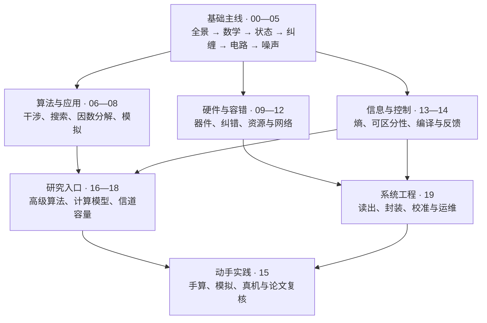

# 量子计算：从直觉到研究入口

> 面向第一次系统学习量子计算的读者，也面向需要补齐数学、算法、硬件和容错基础的入门研究生。
>
> 版本：2026-10-13。带有“会变化”标记的产业与工程信息应结合原始资料重新核验；各条事实保留各自的核验日期。

[打开离线排版阅读版](../reader/index.html)：包含公式排版、可检索章节目录、页内导航和已经渲染的流程图。手机上可展开“本页导航”直接找到小节；复杂插图可打开原尺寸查看。整个 `reader/` 文件夹可复制到其他电脑后打开；外部参考文献仍需联网访问。

## 这套文档解决什么问题

量子计算横跨线性代数、概率、量子力学、计算复杂性与工程。很多入门材料只讲“叠加、纠缠、并行”，容易留下三种误解：量子比特等于同时保存两个经典答案；测量能一次读出全部振幅；量子计算机会普遍替代经典计算机。本书从可计算的小例子出发，把直觉、公式和物理限制放在同一条线上。

读完核心章节后，你应该能：

1. 用向量、矩阵与张量积描述量子态和量子门；
2. 手算 1–3 个量子比特的电路、测量概率与测量后状态；
3. 解释干涉为何是算法获得优势的关键，而不是笼统的“量子并行”；
4. 逐步分析 Grover、相位估计和 Shor 算法的核心子程序；
5. 区分物理量子比特、逻辑量子比特、门保真度、线路深度和应用级资源；
6. 理解噪声、量子错误校正和容错开销；
7. 对硬件路线、产业里程碑和“量子优势”声明做基本事实核查。

## 阅读路线

开始前可用[七道先修自测与补习路线](appendices/prerequisites.md)检查分数、复数、矩阵、张量积、模运算和实验统计；每题都有逐步核对。量子力学基础篇 [Q1–Q4](quantum-mechanics/README.md)从干涉与自旋实验，走到可观测量、薛定谔演化、能级、驱动，以及波函数、势阱和隧穿。它独立成篇，原有 00–19 章的编号和链接保持不变。

图中展示原主篇的主题分组，箭头表示推荐衔接；新增基础篇的插入位置见下方路线。每章的具体先修条件以章节表为准；第 15 章的练习可随学习进度穿插进行。

- **零基础主线**：按 00 → 01 → [Q1 实验与量子态](quantum-mechanics/01-experiments-states.md) → 02 → [Q2 可观测量与演化](quantum-mechanics/02-observables-dynamics.md) → 03 → 04 → 05 阅读，再进入算法或硬件。
- **硬件物理补充**：先读 [Q3 能级与驱动](quantum-mechanics/03-levels-control.md)，再进入 09、14；需要波函数与模型推导时读 [Q4](quantum-mechanics/04-wavefunctions-models.md)，该章另需一元微积分。
- **计算机背景**：可快速浏览 01 的复数部分，但不要跳过张量积、谱分解和复杂度记号。
- **物理背景**：可略读态矢量入门，重点补齐可逆计算、oracle、复杂度与资源估算。
- **研究生速查**：先做各章的“自检”，不会的题再回读对应段落。

第一次读时，不必把每一页的进阶推导都读完。每章先找出它要回答的具体问题，跟着最小算例把输入、计算、输出写在纸上；遇到“进阶回看”可先跳过。算例能复算之后，再回来读一般公式及适用条件。附录答案保留中间步骤，适合用来定位自己究竟卡在符号、计算，还是对实验结果的解释。

一个可执行的节奏是：读完 00、01、Q1、02 后，独立算出 $H|0\rangle$ 的两个测量概率，以及 $HZH|0\rangle$ 的确定结果；读完 03、04 后，手算一次 Bell 态的测量和传态中的一个条件分支；读完 05、06 后，再比较“成功概率”和“实际门数”分别怎么算。这样每走一步都有可以核对的结果，不必只凭术语判断自己是否学会。

## 章节

| 章节 | 核心问题 | 先修 |
|---|---|---|
| [00 全景与边界](00-overview.md) | 量子计算能做什么、不能做什么？ | 无 |
| [01 数学工具](01-math.md) | 振幅、内积、酉矩阵、张量积怎样算？ | 高中代数 |
| [02 单量子比特](02-single-qubit.md) | 状态、相位、Bloch 球、测量是什么？ | 01 |
| [03 多比特与纠缠](03-multiple-qubits.md) | 张量积、纠缠、约化态如何判断与计算？ | 01–02 |
| [04 量子门、电路与协议](04-circuits-protocols.md) | 怎样从矩阵读懂电路？纠缠能完成什么任务？ | 01–03 |
| [05 混态、噪声与量子信道](05-noise-channels.md) | 现实设备为何不能只用态矢量描述？ | 01–04 |
| [06 算法的共同骨架](06-algorithmic-primitives.md) | oracle、干涉、QFT、相位估计如何连接？ | 01–05 |
| [07 代表性量子算法](07-algorithms.md) | 搜索、因数分解、模拟为何可能加速？ | 06 |
| [08 应用、变分算法与证据](08-applications.md) | NISQ 应用怎样评估，哪些说法证据不足？ | 05–07 |
| [09 硬件与控制栈](09-hardware.md) | 不同物理路线在优化什么？ | 02–05 |
| [10 错误校正与容错](10-error-correction.md) | 不复制未知态，怎样纠错？ | 03–05 |
| [11 资源估算与基准](11-resources-benchmarks.md) | “1000 个量子比特”为什么不是完整指标？ | 07、09–10 |
| [12 安全、网络与研究前沿](12-security-network-frontiers.md) | Shor、PQC、QKD、量子网络是什么关系？ | 04、07、10 |
| [13 量子信息量度](13-quantum-information.md) | 熵、迹距离、保真度、互信息与 Holevo 界怎样计算？ | 03、05 |
| [14 编译、调度与控制](14-compilation-control.md) | 抽象电路怎样变成原生门、时序和物理控制？ | 04、05、09 |
| [15 实践与论文复核](15-practice-research.md) | 怎样从手算走到模拟、真机实验和可复现研究？ | 01–14 按需 |
| [16 高级算法与验证](16-advanced-algorithms-verification.md) | 怎样理解查询下界、量子行走、QSVT 与可扩展验证？ | 06–08、13 |
| [17 量子计算模型](17-computation-models.md) | 门、测量型、绝热、退火、模拟与数字—模拟混合模型怎样比较？ | 04、07、09、14 |
| [18 信道、容量与验证复杂度](18-channels-capacities-complexity.md) | 怎样从信道表示走到容量、假设检验、证明系统和连续变量？ | 03、05、07、13；连续变量另需 09 |
| [19 可维护量子系统工程](19-engineering-architecture.md) | 处理器怎样从一次实验走向可扩展、可校准、可运维的系统？ | 09–11、14 |

附录：[先修自测](appendices/prerequisites.md) · [符号表](appendices/notation.md) · [术语表](appendices/glossary.md) · [练习与答案](appendices/exercises.md) · [参考资料与证据等级](appendices/references.md) · [审校记录](appendices/audit-log.md)

## 从问题找到可手算的例子

下面这些算例适合在读完相应先修内容后独立复算。先写自己的中间步骤，再对照正文；只记住最终数字，往往发现不了位序、分母和条件是否用错。

| 想弄清的问题 | 可从哪里开始 |
|---|---|
| 装置记录路径但没人读取，为什么仍会影响干涉？ | [Q1](quantum-mechanics/01-experiments-states.md)：两路径振幅、记录条件与输出概率 |
| 不确定关系到底约束什么，量子门怎样由能量产生？ | [Q2](quantum-mechanics/02-observables-dynamics.md)：Pauli 算例、Robertson 推导与矩阵指数 |
| 10 MHz 的驱动为什么不是 10 ns 的翻转？ | [Q3](quantum-mechanics/03-levels-control.md)：角频率、旋转坐标系、Rabi 振荡与失谐 |
| 势阱能级为什么离散，隧穿概率怎样求？ | [Q4](quantum-mechanics/04-wavefunctions-models.md)：边界条件、归一化、势垒匹配与数值例子 |
| 复数振幅怎样变成概率，怎样归一化？ | [第 01 章](01-math.md)：$[1,1+i]^T$ 的归一化与正半定矩阵反例 |
| 为什么相同的 0/1 概率，不代表同一个量子态？ | [第 02 章](02-single-qubit.md)：$HZH$ 如何把相位差变成确定输出 |
| 为什么一次周期测量不等于找到了因子？ | [第 07 章](07-algorithms.md)：从分解 15 到 35 的非整齐相位读数与连分数 |
| 为什么窃听模型的错误率会出现两个百分数？ | [第 12 章第 3.1 节](12-security-network-frontiers.md#31-算例截获再发送为什么带来-25-错误)：保留数与发送数的分母区别 |
| 为什么平均等待时间不足以预测平均剩余相干性？ | [第 12 章第 6.2 节](12-security-network-frontiers.md#62-等待另一段的时间不等于总完成时间)：先平均再取指数与逐次取指数再平均 |
| 信息上界是否就是一次测量真正取得的信息？ | [第 13 章](13-quantum-information.md)：同一对非正交态的 $0.601$ bit 上界与 $0.399$ bit 可访问信息 |
| Bell 见证的点估计超过 $1/2$，就足以宣称纠缠吗？ | [第 15 章](15-practice-research.md)：三组原始计数、抽样误差界与保守下界，附可复算图 |

## 配套实验、源码与声音

配套[逐章实验路线](labs/README.md)、[基础](labs/foundations.md)、[算法](labs/algorithms.md)、[系统](labs/systems.md)及[统计](labs/practice.md)实验册，每组有手算步骤、答案和可运行代码。[五个声音样本](labs/audio.md)把相位和对比度变化映射到经典声音；[工业与开源对照](appendices/software-practice.md)区分教学程序、源码摘录和完整外部项目。

## 统一约定

- 计算基按顺序写成 $|0\rangle,|1\rangle$；两比特基按 $|00\rangle,|01\rangle,|10\rangle,|11\rangle$。
- 多比特字符串中，左边是高位。例如本书把四维列向量的第 3 个分量对应到 $|10\rangle$。若软件把编号较小的量子比特显示在字符串右端，必须同时写出“线路上的量子比特编号”和“显示字符串的位序”，不能只贴一个 `10`。
- 对纯态采用列向量；门从右向左作用：$VU|\psi\rangle$ 表示先做 $U$，再做 $V$。
- 对测量分别说明结果概率、已知结果时的条件后态，以及忽略结果时的非选择后态。
- 退极化、退相位等信道的参数在不同资料中未必同义；每次使用都写出信道公式，不仅写参数名。
- $\log$ 默认底数为 2；若底数影响结论，会明确写出。
- “量子优势”仅指在明确任务、误差容忍和资源口径下优于已知经典方法，不等于通用加速。
- 每个重要结论尽量标注证据类型：**定理**、**受控实验**、**数值模拟**、**工程报告**或**展望**。

## 怎样核查一句“量子突破”新闻

依次问五个问题：任务是否实用；输出是否验证；经典基线是否为当时最强；比较是否包含数据装载、纠错、重复采样与能耗；结果是同行评审论文、预印本还是公司路线图。只要其中两项不清楚，就不应把它改写成“量子计算机已解决某行业问题”。

2026-10-13修订保留24篇正文的现有架构，把新推导和诊断放回相关小节；第三组逐章练习覆盖24篇，另有工业工作流的6组源码/计算练习。原251道自检题及既有实验继续保留。新增研究补齐qubitization信号条件、联合错误/擦除、测量后态、噪声顺序、有限预算与统计判据等边界；第三方固定摘录扩充至26项目97文件。入口见[第三组逐章练习](labs/README.md#第三组逐章练习从解释断点到独立核算)与[工业工作流细算](appendices/software-practice.md#11-多乘积公式抵消近似误差之后还要算方差)，实际审查、运行与未复现范围见[本轮记录](appendices/audit-log.md)。
