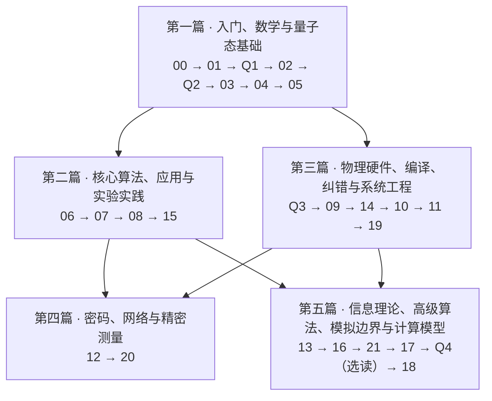

# 量子计算：从直觉到研究入口

> 面向第一次系统学习量子计算的读者，也面向希望补齐数学、物理、算法、硬件、传感与经典模拟基础的入门研究生。
>
> 版本：2026-11-25。时效性硬件指标、开源生态与标准进展均标明对应日期与证据类型，引用前建议对照一手资料核验。

[打开离线排版阅读版](../reader/index.html)：包含完整的预渲染公式排版、离线全书检索（`Cmd/Ctrl+K`）、初学主线一键折叠进阶选读、五篇 26 章目录与全介质亮/暗双主题科学插图。在手机上可展开“本页导航”快速跳转到小节，复杂图表可点击打开原尺寸查看。整套 `reader/` 目录可完整复制到其他电脑后离线阅读；仓库同时提供 **6 模块零安装离线交互量子实验台**（`reader/lab/quantum-lab.html`）以及面向打印与移动阅读的合订本 PDF（`dist/quantum-computing-handbook.pdf`）和原生 MathML 3 EPUB 3 电子书（`dist/quantum-computing-handbook.epub`）。外部参考文献链接仍需联网打开。

## 这本书想帮你弄懂什么

量子计算横跨线性代数、概率统计、量子物理、计算复杂性与系统工程。不少入门读物只停留在“叠加、纠缠、同时算”的口号上，很容易给初学者留下三个误解：量子比特能同时存下两个经典答案；一次测量能读出所有振幅；量子计算机迟早会全面替代普通电脑。

本书换一种讲法：从拿张草稿纸就能算透的二维和四维小例子出发，把直觉画面、数学定义、零跳步手算、物理器件与经典模拟边界放在同一条主线上。读完核心章节后，你将能够：

1. 用列向量、矩阵与张量积描写量子态、量子门与多比特系统，并熟练切换大端序与小端序软件约定；
2. 独立手算 1–3 个量子比特的线路演化、测量概率、条件后态与非选择后态；
3. 说清量子干涉为何是加速的关键，一步步推演 Deutsch–Jozsa、Grover、QPE、Shor、HHL 与 QSVT 的核心步骤；
4. 分清物理量子比特、逻辑量子比特、门保真度、编译路由开销、实时解码延迟与应用级容错资源账本；
5. 理解噪声信道、量子纠错（QEC）、误差缓解（QEM）与容错计算（FTQC）之间的数学和工程边界；
6. 打通量子科技的三大支柱——通用计算、后量子安全与量子网络（第 12 章）、量子传感与精密测量（第 20 章）；
7. 掌握稳定子表、矩阵乘积态（MPS）与含噪 Pauli 传播三大经典模拟引擎（第 21 章），面对“量子优势”新闻时能按证据等级做出独立核查。

## 阅读路线

开始之前，可以先做一套[七道先修自测与补习路线](appendices/prerequisites.md)，花十分钟检查自己对条件概率、复数模平方、矩阵乘法、张量积、模运算和抽样波动的熟悉程度；哪里卡住就跳去补哪一小节，不必从头重修整套大学课程。

**先把数学学到够用，再走进物理与线路；学完核心算法立刻掌握动手与统计工具；最后按兴趣攻克硬件全栈、通信传感与前沿理论。** 全书共 26 章（主篇 `00`–`21` 与[量子力学基础篇 Q1–Q4](quantum-mechanics/README.md)），保留所有历史编号稳定不变，按教学依赖排成五篇：

阅读版的侧栏目录与上下章翻页按钮严格遵循以下 26 章完整教学顺序：

- **第一篇｜入门、数学与量子态基础**：`00 → 01 → Q1 → 02 → Q2 → 03 → 04 → 05`
- **第二篇｜核心算法、应用与实验实践**：`06 → 07 → 08 → 15`
- **第三篇｜物理硬件、编译、纠错与系统工程**：`Q3 → 09 → 14 → 10 → 11 → 19`
- **第四篇｜密码、网络与精密测量**：`12 → 20`
- **第五篇｜信息理论、高级算法、模拟边界与计算模型**：`13 → 16 → 21 → 17 → Q4（进阶选读）→ 18`

其中，**第 15 章**前移至第二篇末尾，让你学完基础算法后立刻拿到态矢量模拟、有限采样统计、论文红旗与四大 SDK 对照工具；**第 14 章**紧接 **Q3 → 09** 打通能级、硬件与脉冲编译链；**Q4** 安排在**第 18 章**之前作为微积分进阶选读桥，为连续变量相空间与 GKP 网格码做好铺垫。你也可以随时从[量子力学基础篇导读](quantum-mechanics/README.md)按需跳读 Q1–Q4。

你可以按自己的背景挑一条顺手的入口：

- **零基础完整主线**：按第一篇顺序读完 `00 → 01 →` [Q1](quantum-mechanics/01-experiments-states.md) `→ 02 →` [Q2](quantum-mechanics/02-observables-dynamics.md) `→ 03 → 04 → 05`，再进入第二篇 `06 → 07 → 08 → 15`，随后按兴趣分流至第三、四或五篇。
- **硬件、脉冲与系统工程线**：完成第一篇后直接进入第三篇 [Q3](quantum-mechanics/03-levels-control.md) `→ 09 → 14 → 10 → 11 → 19`；想亲手推导势阱、谐振子、WKB 双势阱劈裂与原子超精细能级时补读 [Q4](quantum-mechanics/04-wavefunctions-models.md)。
- **计算机与软件背景**：可快读第 01 章复数四则运算，重点留心张量积基序、谱分解、条件数与密度矩阵；走完 `02–08` 后重点精读[第 15 章](15-practice-research.md)、[第 14 章](14-compilation-control.md)与[第 21 章](21-stabilizer-classical-simulation.md)。
- **物理与传感背景**：可快读单比特与演化入门，重点攻克可逆电路与预言机（`04, 06, 07`）、纠错解码与资源账本（`10, 11`）、量子精密测量（`20`）以及稳定子/张量网络经典模拟边界（`21`）。
- **研究生速查**：先做每章末尾的“自检题”与就地进阶练习，卡壳之处再回读正文零跳步推导和[练习答案](appendices/exercises.md)。

第一遍读的时候，不必一口气啃完所有“进阶回看”。先看清每一节在解决什么困惑，跟着最小算例把输入、中间步骤和输出写在草稿纸上；确认数字能自己算对，再回头细看一般定理和适用边界。一个很稳的检验节奏是：

- 读完 `00、01、Q1、02` 后，能不看书算出 $H\lvert 0\rangle$ 的测量概率和 $HZH\lvert 0\rangle = \lvert 1\rangle$ 的确定结果；
- 读完 `03、04` 后，能独立手算 Bell 态的约化密度矩阵、CHSH 博弈的 $85.36\%$ 胜率，以及隐形传态里的一个条件分支；
- 读完 `05、06、07、15` 后，能分清退极化与退相位在 Bloch 球上的区别、写出 20 行态矢量模拟并给出带置信区间的采样结论；
- 读完 `20、21` 后，能讲清退相位下 GHZ 态为何输给独立探针，以及 Clifford/MPS/Pauli 传播各自在什么条件下被经典击穿。

## 章节目录（五篇 26 章）

### 第一篇｜入门、数学与量子态基础

| 章节 | 核心问题 | 建议先修 |
|---|---|---|
| [00｜全景：量子计算是什么，又不是什么](00-overview.md) | 量子科技三大支柱如何分工？复振幅相消与经典内存墙意味着什么？ | 无 |
| [01｜零基础数学工具：看懂量子计算的最小数学语言](01-math.md) | 复数旋转、左共轭内积、酉阵、谱分解、条件数与张量积怎样手算？ | 高中代数 |
| [Q1｜从实验认识量子态](quantum-mechanics/01-experiments-states.md) | 双缝、MZI、Elitzur–Vaidman 炸弹、Stern–Gerlach 与量子擦除怎样逼出复振幅？ | 01 |
| [02｜单量子比特：状态、相位、旋转与测量](02-single-qubit.md) | 相对相位、Bloch 球、$S/T$ 门、投影测量、POVM 与量子仪器是什么？ | 01、Q1 |
| [Q2｜可观测量与量子态的时间演化](quantum-mechanics/02-observables-dynamics.md) | 厄米算符、CSCO、不确定关系、三绘景、Magnus 展开与 Lindblad 主方程怎样相连？ | Q1、02 |
| [03｜多量子比特、量子纠缠与非局域性](03-multiple-qubits.md) | 张量积、偏迹、Schmidt 分解、PPT 判据与 CHSH 合作博弈怎样算？ | 01–02 |
| [04｜量子门、电路与基础协议](04-circuits-protocols.md) | 如何把电路译成矩阵？Toffoli 反计算、不可克隆、隐形传态与延迟测量如何工作？ | 01–03 |
| [05｜混态、噪声与量子信道](05-noise-channels.md) | 为何必须用密度矩阵与 CPTP 信道？五大噪声、广义振幅阻尼与 Landauer 擦除下限如何量化？ | 01–04 |

### 第二篇｜核心算法、应用与实验实践

| 章节 | 核心问题 | 建议先修 |
|---|---|---|
| [06｜量子算法的共同骨架](06-algorithmic-primitives.md) | 预言机、相位回踢、振幅放大、QFT、QPE、Trotter、Hadamard 测试与 QRAM 瓶颈怎样串起算法？ | 01–05 |
| [07｜代表性量子算法：从隐藏周期到量子模拟](07-algorithms.md) | Simon、Grover、Shor、哈密顿量模拟、HHL 与去量子化为何以及何时成立？ | 06 |
| [08｜应用、变分算法与证据边界](08-applications.md) | 费米子映射、VQE、QAOA、参数移位法则、贫瘠高原、QEM、SQD 与量子优势四类证据怎么评？ | 05–07 |
| [15｜实践路线：从手算、模拟到真机实验与论文复核](15-practice-research.md) | 怎样手写 $O(2^n)$ 模拟器、做 Wilson/Clopper–Pearson 统计、按红旗读论文并上手四大 SDK？ | 01–08 |

### 第三篇｜物理硬件、编译、纠错与系统工程

| 章节 | 核心问题 | 建议先修 |
|---|---|---|
| [Q3｜从能级到物理量子比特](quantum-mechanics/03-levels-control.md) | 约瑟夫森结非谐性、Rabi 振荡、Ramsey/Hahn 回波、三能级泄漏与 cQED 色散读出怎样推导？ | Q2、02 |
| [09｜主流硬件平台与物理噪声特性](09-hardware.md) | 超导、离子阱、中性原子、光子、硅自旋与拓扑六大平台机制、SPAM 不确定度与现实瓶颈是什么？ | 02–05、Q3 |
| [14｜从算法电路到物理执行：编译、调度与控制](14-compilation-control.md) | Euler/KAK/Weyl 室、ZX 演算、Virtual-Z、SABRE、DRAG/DD/GRAPE、M3/TREX、线路切割与 Litinski 容错编译如何衔接？ | 04、05、09、Q3 |
| [10｜量子纠错与容错计算](10-error-correction.md) | 不可克隆下如何纠错？五比特码、Toric 任意子、表面码、晶格手术、qLDPC 与魔法态培育如何工作？ | 03–05、14 |
| [11｜基准测试与容错资源估算](11-resources-benchmarks.md) | RB、EPLG、GST、实时解码延迟、九步容错资源账本与 RSA-2048 估算怎样核算？ | 07、09–10 |
| [19｜可维护量子系统工程](19-engineering-architecture.md) | 制冷热预算、3D 封装、校准依赖 DAG、玻色猫比特实证、FIFO 排队 SLA 与可用率怎样撑起整机？ | 09–11、14 |

### 第四篇｜密码、网络与精密测量

| 章节 | 核心问题 | 建议先修 |
|---|---|---|
| [12｜量子密码、后量子安全与量子网络](12-security-network-frontiers.md) | Shor、NIST 后量子标准（ML-KEM/HQC/IR 8547）、BB84/E91/TF-QKD/DI-QKD、PLOB 界与三代量子中继是什么关系？ | 04、07、10 |
| [20｜量子传感与量子精密测量：从 Fisher 信息到海森堡极限](20-quantum-sensing-metrology.md) | CFI/QFI、SQL 与海森堡极限、Huelga 退相位坍塌、原子钟阿兰偏差与 $^{229}\mathrm{Th}$ 核钟、冷原子重力仪、量子照明、自旋与光学压缩（LIGO O4）及 HNLS 纠错传感怎么算？ | 03、05、Q3、13（光学压缩已内置正交分量微卡片） |

### 第五篇｜信息理论、高级算法、模拟边界与计算模型

| 章节 | 核心问题 | 建议先修 |
|---|---|---|
| [13｜量子信息量度：熵、距离与可提取信息](13-quantum-information.md) | 熵、负条件熵与状态合并、数据处理不等式、迹距离、Helstrom 判别、剩余哈希引理与量子热力学资源论怎样计算？ | 03、05 |
| [16｜高级算法与验证：从查询下界、统一框架到可信输出](16-advanced-algorithms-verification.md) | 查询下界、量子行走、LCU→显式 $4\times 4$ QSVT→GQSP 统一框架、经典阴影与可扩展验证如何衔接？ | 06–08、13 |
| [21｜稳定子形式、经典模拟引擎与量子优势边界](21-stabilizer-classical-simulation.md) | 稳定子辛表、魔术度与稳定子秩、匹配门、MPS/2D PEPS/BP-TN 与含噪 Pauli 传播如何划定经典可模拟与量子加速边界？ | 03–05、10、15 |
| [17｜量子计算模型：门、测量、绝热、退火、拓扑与模拟](17-computation-models.md) | 门模型、MBQC、FBQC、绝热、退火端到端 TTS、拓扑任意子编织、ETH/MBL/PXP 多体疤痕与模拟模拟器如何在同一标尺比较？ | 04、07、09、14 |
| [Q4｜波函数、势阱、谐振子、隧穿与原子能级](quantum-mechanics/04-wavefunctions-models.md) | 高斯波包展宽、方势阱、谐振子、WKB 双势阱劈裂、原子超精细钟态（含 $^{87}\mathrm{Sr}$）与网格/Fock 截断边界怎样算？ | Q2 + 一元微积分（支持双入口跳读） |
| [18｜量子信道、通信容量、复杂度与连续变量](18-channels-capacities-complexity.md) | Choi 矩阵、钻石范数、四类通信容量、纠缠负性、`QIP`/`MIP*=RE`、Wigner 负性、CV-MBQC 光量子集群态与 GKP 网格码怎样入门？ | 03、05、07、13；第 9 节另需 Q4 |

### 附录与量子力学基础篇导读

[量子力学基础篇导读（Q1–Q4）](quantum-mechanics/README.md) · [先修自测](appendices/prerequisites.md) · [符号表与速查](appendices/notation.md) · [术语表](appendices/glossary.md) · [练习与答案](appendices/exercises.md) · [算法、工业实践与开源代码对照](appendices/software-practice.md) · [参考资料与证据等级](appendices/references.md) · [版本演进与公开勘误](appendices/audit-log.md)

## 从具体问题找到可手算的例子

下面这些算例适合学完对应章节后合上书独立推一遍。先写下每一步中间结果，再回正文核对；只记最终数字，往往发现不了基序、分母或条件有没有用错。

| 想弄清的问题 | 可从哪里开始 |
|---|---|
| 双缝里悄悄记录了路径却没人偷看，为什么条纹依然消失？ | [Q1 第 6 节](quantum-mechanics/01-experiments-states.md#6-进阶深潜部分路径记录englert-互补关系与延迟选择量子擦除)：部分路径标记、Englert 互补关系与延迟选择擦除 |
| 不确定关系到底约束什么？量子门怎样由哈密顿量生出来？ | [Q2](quantum-mechanics/02-observables-dynamics.md)：Pauli 算例、Robertson/Schrödinger 界、三绘景与 Magnus 展开 |
| 10 MHz 的驱动为什么不是 10 ns 翻完？失谐符号为什么常打架？ | [Q3 第 6.2 节](quantum-mechanics/03-levels-control.md#62-计算基与能量基的失谐符号等价对照表)：角频率、旋转坐标系、Rabi 振荡与计算基/能量基换算 |
| 势阱能级为什么离散？对称双势阱劈裂和超精细钟态怎么算？ | [Q4](quantum-mechanics/04-wavefunctions-models.md)：硬壁边界条件、升降算符、WKB 劈裂与原子能级铭牌 |
| 复数振幅怎样归一化？为什么正半定不能只看对角线非负？ | [第 01 章](01-math.md)：$[1,1+i]^T$ 归一化、$2\times 2$ 谱分解与正半定反例 |
| 同样的 50/50 测量概率，为什么代表两个完全不同的量子态？ | [第 02 章](02-single-qubit.md)：$HZH$ 如何把相对相位差变成确定输出 |
| 纠缠究竟比经典关联强在哪儿？ | [第 03 章第 7 节](03-multiple-qubits.md#7-chsh-合作博弈bell-不等式与-2022-诺贝尔物理学奖)：CHSH 合作博弈的 $75\%$ 经典上限与 $85.36\%$ 量子胜率 |
| 为什么一次周期测量不等于直接分解出因子？ | [第 07 章](07-algorithms.md)：$N=15$ 与 $N=35$ 的非整齐相位读数与连分数提取 |
| 为什么窃听模型的错误率会出现两个不同的百分数？ | [第 12 章第 3.1 节](12-security-network-frontiers.md#31-算例截获再发送为什么带来-25-错误)：筛选保留数与总发送数的分母区别 |
| 为什么平均等待时间不足以预测平均剩余相干性？ | [第 12 章第 6.2 节](12-security-network-frontiers.md#62-等待另一段的时间不等于总完成时间)：先平均再取指数与逐次取指数再平均的差别 |
| Holevo 上界是否等于一次测量真正能拿到的信息？ | [第 13 章](13-quantum-information.md)：同一对非正交态的 $0.601\ \mathrm{bit}$ 上界与 $0.399\ \mathrm{bit}$ 可访问信息 |
| Bell 见证的点估计超过 $1/2$，就足以宣布测出了纠缠吗？ | [第 15 章第 4.2 节](15-practice-research.md#42-实验二bell-相关不等于纠缠证明三基计数与-hoeffding-下界)：三组原始计数、抽样误差与 Hoeffding 保守下界 |
| 退相位噪声下，为什么 $N$ 比特 GHZ 传感器反而赢不了独立比特？ | [第 20 章第 5 节](20-quantum-sensing-metrology.md)：Huelga 1997 最优探询时间 $1/(2N\gamma)$ 与常数因子 $e$ 零跳步手算 |
| 没有 $2^n$ 振幅数组，稳定子表和 Pauli 传播怎么一步步算出结果？ | [第 21 章第 3、5、6 节](21-stabilizer-classical-simulation.md)：Bell 态稳定子表演化、3 比特 GHZ/W 态逐键 SVD 与含噪反向树 |

## 配套实验、源码与声音

除了正文推导，全书还配套了可直接离线运行的验证生态：

- **动手实验册与 38 个标准库脚本**：[逐章实验总览](labs/README.md)、[基础实验册](labs/foundations.md)、[算法实验册](labs/algorithms.md)、[系统与传感实验册](labs/systems.md)与[统计实践实验册](labs/practice.md)，每组实验均提供手算步骤、答案和零云依赖的本地 Python 标准库脚本（含第 20 章量子传感、第 21 章三大经典模拟迷你引擎及 V4 量子微分方程/显式 $4\times 4$ QSVT/BCa Bootstrap/ZNE 预算验证套件）；
- **声音教学样本与 6 模块离线交互实验台**：[五个合成声音样本](labs/audio.md)把相位差和干涉对比度直观映射到经典声波，帮助你用耳朵听出抵消与退相干的区别；离线交互实验台位于 `reader/lab/quantum-lab.html`（源码 `tools/reader/quantum-lab.html`），可在浏览器本地交互操作 MZI 干涉仪、3D Bloch 球面真弧门沙箱、Ramsey 音频对比、Bell/CHSH 千局非局域博弈、Grover 半拍振幅放大与过冲沙盒，以及 $d=3$ 旋转表面码症状解码沙箱；
- **开源代码与工业工作流**：[算法、工业实践与开源代码对照](appendices/software-practice.md)与[完整 SDK 实验册](labs/sdk-validation.md)把书中的数学模型连接到 31 个代表性开源项目、122 份固定提交源码摘录以及隔离环境本地运行核验记录。

## 统一约定

全书 26 章、附录与配套代码严格遵守同一套符号与计算契约（详细检索与核心公式速查见[符号表](appendices/notation.md)）：

- **计算基与位序**：单比特按 $\lvert 0\rangle,\lvert 1\rangle$ 排序；多比特采用**高位在左（大端序）**，两比特列向量按 $\lvert 00\rangle,\lvert 01\rangle,\lvert 10\rangle,\lvert 11\rangle$ 排列（四维列向量的第 3 个分量对应 $\lvert 10\rangle$）。遇到 Qiskit 等默认小端序显示字符串的软件时，会同时注明线路编号和位串顺序。
- **内积与作用顺序**：内积采用左共轭约定 $\langle u\vert v\rangle = \sum_j u_j^* v_j$；电路图从左向右表示时间，算符乘积从右向左作用——$VU\lvert\psi\rangle$ 表示先做 $U$ 再做 $V$，信道复合 $\mathcal B\circ\mathcal A$ 同理。
- **对数底数**：信息论、熵、信道容量与比特数一律写明 $\log_2$，自然对数一律写明 $\ln$，全书不使用不标底数的裸对数。
- **保真度口径**：态保真度统一采用**根保真度** $F(\rho,\sigma)=\operatorname{Tr}\sqrt{\sqrt\rho\sigma\sqrt\rho}$（纯态间为 $\lvert\langle\psi\vert\phi\rangle\rvert$）；重叠概率或平方保真度明确写作 $F^2$；平均门保真度写 $F_{\mathrm{avg}}$，平均门错误率 $r=1-F_{\mathrm{avg}}$。
- **测量与信道符号**：Kraus 算符统一写 $K_k$，POVM 元素统一写 $E_m$；涉及测量时明确区分结果概率、已知结果时的条件后态与忽略结果时的非选择后态。退极化、退相位与广义振幅阻尼（稳态激发占据 $p_{\mathrm{eq}}$）等噪声信道每次给出完整映射公式。
- **频率、失谐与连续变量**：Q3 与第 14 章统一采用计算基 $Z=\lvert 0\rangle\langle 0\rvert-\lvert 1\rangle\langle 1\rvert$ 与失谐 $\Delta=\omega_d-\omega_0$（驱动角频率减跃迁角频率），并附能量基等价换算；Q4 物理坐标保留 $[\hat x,\hat p]=i\hbar$，第 18 章连续变量采用无量纲 $[\hat q,\hat p]=i$（真空协方差 $V=I/2$，GKP 晶胞面积 $4\pi$）。
- **精密测量与经典模拟符号**：第 20 章统一用 $F_C(\theta)$、$F_Q(\rho_\theta)$、$L_\theta$ 与 Wineland 参数 $\xi_R^2$ 刻画计量精度；第 21 章稳定子表采用二元辛向量 $(x\mid z)$、MPS 键维 $\chi$、Pauli 权重 $w(P)$ 与稳定子秩 $\chi_{\mathrm{stab}}$。
- **证据类型**：重要结论按来源区分**定理**、**同行评审实验**、**正式标准**、**数值模拟**、**预印本**与**厂商公告**；“量子优势”始终绑定具体任务、误差容忍度、经典基线与资源口径。

## 怎样核查一句“量子突破”新闻

看到“实现重大量子突破”的报道时，顺手按下面五个问题过一遍，八成以上的夸大宣传都会现形：

1. **任务是否实用？** 它求解的是人为构造的采样基准，还是有明确应用价值的科学/工程问题？
2. **输出能否验证？** 答案是否能用多项式时间核对，或至少有独立交叉证据支撑？
3. **经典基线是否够强？** 对比的经典算法是不是当下最强的稳定子分解、张量网络、Pauli 传播或专用超算方案？
4. **账本算全了吗？** 比较时间或成本时，有没有把数据装载、编译路由、纠错开销、重复采样与经典后处理算进去？
5. **证据处在哪个层级？** 这项声明出自同行评审期刊、尚未审稿的预印本，还是公司路线图与新闻稿？

只要其中两项含糊不清，就值得先打个问号，翻到原始论文或本书对应章节核对口径。全书的版本演进、验证范围与公开勘误汇总在[版本演进与公开勘误](appendices/audit-log.md)。
