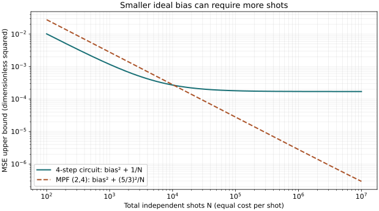

# 算法、工业实践与开源代码对照

> 源码与校验清单核验基线：2026-09-26 / 2026-10-13；生态版本对照更新至 2026-11-25。

这一页是全书**开源软件生态与工业工作流推导的单真相源**，把五篇 26 章（主篇 `00`–`21` 与量子力学基础篇 `Q1`–`Q4`）的数学模型连接到本地可运行的教学程序、真实开源项目的核心源码以及当前工业界的典型工作流。阅读这一页时，心中随时把四件事分清：**有开源库实现**、**能在真机跑通**、**已经带来商业收益**、**证明了量子加速**——它们是四个截然不同的问题。

为了方便读者对照阅读、同时保留可验证的来源边界，仓库在 `codes/vendor/` 下归档了 **31 个开源项目的 122 份核心源码、许可证与声明文件**，全部锁定到 40 位 Git 提交哈希与 SHA-256 校验值，详见[完整源码索引](../../codes/vendor/README.md)和[机器可读校验清单](../../codes/vendor/manifest.json)。这些摘录原字节保存，用来阅读算法接口与底层数学约定；若要完整运行，请按清单中的固定提交在隔离环境中安装完整上游包。此外，仓库还在隔离环境中对这 31 个项目的完整发行包或 C/C++ 提交跑通了指定本地 CPU 任务，每个项目的实际版本、输入、原始计数、复现的上游陷阱与验收边界全部汇总在[完整 SDK 实验册](../labs/sdk-validation.md)。

## 1. 怎样读懂开源生态与算法对照表

截至 2025–2026 年，量子开源软件栈已形成较清晰的分层（详细选型见[第 15 章第 7 节](../15-practice-research.md#7-20252026-主流开源量子软件栈速览与选型)）：**Qiskit 2.x**（本地实跑锁定 `2.5.2`，全面转向 Rust 加速编译器 LightSABRE 与 Primitives V2 接口，并拆出 `qiskit-addon-*` 专题扩展包）、**PennyLane + Catalyst**（自动微分与混合编译）、**Cirq + Qualtran**（底层硬件调度与容错资源估算）、**Stim + PyMatching 2.x**（本地实跑锁定 `1.16.0` / `2.4.0`，稳定子电路级纠错模拟与 Sparse Blossom 高速解码）、**QuTiP 5.x**（开放量子系统主方程与脉冲最优控制），以及面向 GPU 加速态矢量与张量网络编排的 **CUDA-Q**（外部生态入口，未归档至 `codes/vendor/`）。

在动手写模拟或复核论文宣称的“经典不可模拟”之前，应先按[第 21 章｜稳定子形式、经典模拟引擎与量子优势边界](../21-stabilizer-classical-simulation.md)建立的四维标尺（量子比特数、非 Clifford 门数、纠缠拓扑与电路噪声率）分流选型：一般小规模线路用态矢量或密度矩阵（Qiskit Aer、PennyLane、QuTiP 或 CUDA-Q），大规模 Clifford 与 Pauli 噪声线路用稳定子表（Stim + PyMatching），弱纠缠或局域几何线路用矩阵乘积态与张量网络（`quimb`、CUDA-Q），浅层含噪期望值则优先试跑海森堡 Pauli 传播（`pauli-prop`、`PauliPropagation.jl`）。

看任何算法实现对照表前，先盯住三件事：输入怎么给、黑箱或电路访问怎么算账、输出究竟是一个经典比特、一组采样统计，还是一个量子态。比如 HHL 输出的是解向量的量子态，若任务要求打印全部经典分量，后处理读出成本就会吞掉加速；振幅估计里“一次预言机调用”背后往往藏着昂贵的数据装载与可逆算术。表中的“本地源码”指仓库已归档该项目的代表性核心文件，未归档模块均明确标为**外部生态入口（未归档至 `codes/vendor/`）** 或理论练习。

## 2. 基础算法与容错算法族

| 算法族与章节 | 输入与输出 | 实现与实践入口 | 最容易漏算的条件或成本 |
|---|---|---|---|
| Deutsch–Jozsa、Bernstein–Vazirani，06 | 满足承诺的布尔预言机 → 分类或隐藏串 | 第 06 章显式线路；Cirq 完整预言机核验见[SDK 实验册](../labs/sdk-validation.md) | 承诺前提、预言机门级构造、经典随机算法基线 |
| Simon / 隐藏子群，06、16 | 隐藏结构函数 → 线性约束样本与经典恢复 | 正文推导与 $\mathbb F_2$ 消元；可逆小例见 Cirq 核验，非任意非阿贝尔 HSP | 多次采样、满秩线性独立性、经典后处理 |
| QFT / QPE，06 | 可控酉算符与输入态 → 相位分布 | Cirq / Qiskit 相位估计、Qualtran QFT 源码；[圆周边界实验](../labs/algorithms.md) | 本征态重叠、受控幂深度、模 1 圆周绕回误差 |
| Grover / 振幅放大，07 | 制备算符与成功判据 → 标记样本 | Cirq 与 Qiskit Grover；[重试账本实验](../labs/algorithms.md) | 初始成功率、未知目标数、反射门成本、验证与重启总账 |
| 振幅估计及迭代变体，07、16 | 制备与成功投影 → 概率估计 | Qiskit `iae.py` 固定源码；[IAE 调用账本](../labs/sdk-validation.md) | 各幂次 Grover 深度；区间置信度不同于单次点估计 |
| Shor / 阶寻找，07 | 整数与模幂电路 → 周期候选与因子 | Cirq `examples/shor.py`；正文 $N=15, 35$ 手算 | 可逆模算术、辅助位、连分数失败分支；小整数不代表大数破解开销 |
| 乘积公式哈密顿量模拟，07、16 | 局域项、演化时间与精度 → 近似演化 | OpenFermion 费米映射与 `simulate_trotter.py` 固定源码 | 非对易截断误差、步数选择、分解后总门数 |
| LCU / 块编码 / 量子化，16 | 加权酉算子访问 → 嵌入块与行走算子 | Qualtran `LinearCombination` 与 `QubitizationWalkOperator` 源码 | 缩放归一化因子 $\alpha$、状态制备（`prepare`）与受控选择（`select`）构造、后选择折扣 |
| QSP / QSVT / GQSP，16 | 块编码与目标多项式 → 奇异值变换 | PennyLane `qsvt.py`、`pyqsp` 相位求解与响应源码；[非厄米反例](../labs/algorithms.md) | 奇偶限制（传统 QSP）、Chebyshev/幂基约定、非厄米左右奇异空间 |
| HHL / 量子线性系统，07、16 | 矩阵访问、右端态 → 解态或少量期望值 | Cirq 完整非对角与负谱非网格 HHL 核验（见第 07 章与[SDK 实验册](../labs/sdk-validation.md)） | 条件数 $\kappa$、稀疏/块访问、态制备、反计算残余与读出 |
| 量子行走，16 | 图或马尔可夫链访问 → 搜索与谱信息 | 第 16 章一般图 CTQW 与 4 维超立方体 SKW 搜索核验（非一般 MNRS） | 建立与更新成本、谱隙、标记比例 |
| 容错算术与资源分解，11、16 | 高级子程序 → 逻辑门与 $T$ 门数分解 | [Qualtran](https://github.com/quantumlib/Qualtran)，本地加法与 QFT 源码 | 逻辑门数不等于物理比特数；还需路由、晶格手术与魔法态供给 |

Qualtran 仍在持续演进，接口与模块细节可能随版本变化；锁定提交哈希便于读者复查源码逻辑，但库函数的输出仍需配合独立数学核验。更多一手理论论文见[参考资料与证据等级](references.md)。

## 3. 近中期算法、误差缓解与经典基线

| 方法 | 实际工作流拆解 | 本地与外部代码入口 | 公平比较时必须对齐的要素 |
|---|---|---|---|
| VQE | 参数化试探态 → 分组 Pauli 测量 → 经典优化 | Qiskit `vqe.py`；[第 08 章实验](../labs/algorithms.md) | 同一基组、活性空间与精度门槛；计入优化总迭代与全部采样次数 |
| QAOA | 成本层与混合层 → 采样 → 可行解筛选 | PennyLane `qaoa/cost.py`；第 08 章三节点精确分布 | 同时间预算下对比穷举、局部搜索与成熟整数规划求解器 |
| SQD | 量子采样 → 组态恢复 → 经典子空间对角化 | Qiskit SQD / SQD-HPC 恢复与费米子模块 | 同哈密顿量下对比 SHCI / DMRG，记录去重子空间维数与经典内存 |
| 量子核 / 变分学习 | 数据编码 → 核矩阵或测量特征 → 经典学习 | PennyLane 外部生态入口（未归档完整训练流水线） | 数据划分、特征缩放、超参预算、强经典模型与数据加载开销 |
| 随机测量 / 经典阴影，16 | 随机 Pauli 测量 → 快照逆映射 → 观测量估计 | PennyLane `ClassicalShadow` 后处理源码与本地 $30{,}000$ 次采样复算 | 目标观测量族、阴影范数方差、多重比较校正 |
| ZNE / PEC / 读出缓解，08、15 | 噪声缩放或准概率线路 → 带权重构 | Mitiq 折叠与外推源码；[ZNE 预算实验](../labs/practice.md) | 固定总采样预算、校准耗时、噪声漂移，偏差与方差分开报 |
| 量子退火 / QUBO，17 | 建模、次图嵌入、采样、链修复与验算 | `dimod` `ExactSolver` 本地基线；云端 QPU 需另行接入 | 罚项与动态范围压缩、链长、可行率与端到端求解时间（TTS） |
| MPS / 张量网络，16、21 | 量子态分解与张量收缩 → 期望值 | `quimb` 线路生成与收缩源码；[第 21 章](../21-stabilizer-classical-simulation.md)与 [三引擎标准库实验](../../codes/algorithms/simulation_engines_lab.py)；GPU 加速可用 CUDA-Q（外部生态入口，未归档至 `codes/vendor/`） | 最大键维 $\chi$、奇异值截断误差、收缩顺序与收敛性 |
| Pauli 传播 / 稀疏 Pauli 动力学，16、21 | 可观测量反向传播 → 截断小系数/高权重项 | IBM `pauli-prop` Python/Rust 源码；[第 21 章](../21-stabilizer-classical-simulation.md)；生态另见 `PauliPropagation.jl`（外部生态入口，未归档至 `codes/vendor/`） | 截断偏差界、可观测量项数爆炸阈值与噪声模型精度 |
| 主方程 / 量子轨迹，05、09 | 哈密顿量与塌缩算符 → 密度矩阵或随机轨迹 | QuTiP 5 `mesolve.py` 与 `mcsolve.py` 源码 | 马尔可夫近似、Fock 截断维数、轨迹标准误与积分容差 |
| 量子传感与精密测量模拟，20 | 含噪探针演化与干涉序列 → 经典/量子 Fisher 信息、灵敏度与 HNLS 判据 | [第 20 章](../20-quantum-sensing-metrology.md)与自编 [传感标准库实验](../../codes/systems/sensing_lab.py)；开放系统与脉冲突发拓展可用 QuTiP 5 / Qiskit Dynamics（后者为外部生态入口，未归档至 `codes/vendor/`） | 统一总探针数 $N$、探询时长与死时间、灵敏度单位（如 $\mathrm{T/\sqrt{Hz}}$）及非纠缠标准量子极限基线 |

对于 SQD，[IBM SQD 官方文档](https://quantum.cloud.ibm.com/docs/en/addons/qiskit-addon-sqd)明确展示了“量子处理器采样 + 经典超算做组态恢复与子空间对角化”的混合分工，这与“量子芯片独立算完整个大分子”有本质区别。

## 4. 工程算法与底层工具链

| 工程环节与章节 | 输入与输出 | 代码入口 | 必须随实验归档的信息 |
|---|---|---|---|
| 编译、布局与 SABRE 路由，14 | 抽象门图与硬件耦合图 → 原生线路与末态映射 | Qiskit 2.5.2 SABRE 入口；[末态映射实验](../labs/systems.md) | 初/末布局、随机种子、目标硬件描述（`target`）、原生门数、时长与误差 |
| 稳定子电路采样，10、21 | 电路级 Pauli 噪声线路 → 探测事件与逻辑翻转 | Stim 1.16.0 表面码/重复码生成器；[第 21 章](../21-stabilizer-classical-simulation.md)与 [三引擎标准库实验](../../codes/algorithms/simulation_engines_lab.py) | 电路级噪声模型、边界、轮数与相关错误（不直接模拟非 Clifford 门） |
| 最小权完美匹配解码，10 | 探测事件与对数似然边权 → 逻辑修正预测 | PyMatching 2.4.0 `matching.py`（Sparse Blossom 与相关匹配） | 边权来源、相关匹配设置、时空边界、失败计数与置信区间 |
| 魔法态工厂调度，11 | 需求时间线与产出周期 → 缓存库存与停顿 | [自编离散事件实验](../labs/systems.md) | 仅看平均吞吐不够，须记录缓存上限、首件延迟与突发停顿 |
| 量子网络协议仿真，12 | 链路成功、存储退相干与纠缠交换 → 远程纠缠率 | SeQUeNCe 0.8.5 传态与协议基类；双链等待实验 | 光纤衰减、经典信令往返、存储截止时间与末态保真度 |
| 擦除标记、校准与运维，09、19 | 观测告警与维护窗口 → 后验精确率与可用率 | 自编贝叶斯告警与区间并集脚本 | 先验基率、误报率、停机重叠区间 |
| 后量子密码（PQC），12 | 随机数与密钥参数 → 封装与解封装 | `liboqs` 0.15.0 C 语言 KEM 示例 | 经典密码原型代码（非量子算法），不等同于通过侧信道认证的生产库 |
| 脉冲最优控制（GRAPE / CRAB），14 | 漂移/控制哈密顿量与目标酉 → 离散控制脉冲 | `qutip-qtrl` 0.2.0 `pulseoptim.py` 与 `grape.py` 源码 | 带宽、幅度上限、三能级泄漏、控制链滤波与失谐鲁棒性 |
| 跨芯片线路切割，14、19 | 超规模电路与切口位置 → 子电路集合与带权重构 | `qiskit-addon-cutting` 0.10.0 权重与重构源码（见[第 14 章第 11 节](../14-compilation-control.md#11-跨芯片编译入口线路切割circuit-cutting与准概率重构)） | 分区映射、作业 ID 顺序、准概率放大系数 $\Gamma$ 与总采样预算 |
| 门/脉冲混合调度，14、19 | 显式时序约束与硬件波形配置 → 仪器调度表 | Quantify Scheduler（外部生态入口，未归档至 `codes/vendor/`） | 后端版本、硬件配置、时钟域、校准、编译时序及仪器驱动 |

[Stim 官方文档](https://github.com/quantumlib/Stim)明确限定其面向稳定子电路与 Pauli 噪声模型；若需仿真连续相干旋转、振幅阻尼或大量非 Clifford 门，应按[第 21 章｜稳定子形式、经典模拟引擎与量子优势边界](../21-stabilizer-classical-simulation.md)的四引擎决策树改用态矢量、密度矩阵、张量网络、Pauli 传播或 QuTiP。

## 5. 典型工业工作流怎么审：拆开每一环看账本

### 5.1 电子结构计算：量子采样加经典子空间对角化

**任务拆解**：给定分子几何构型、轨道基组和活性空间，估计基态或低激发态能量。轨道积分通常先由经典量子化学程序算出；更换基组或活性空间就换了问题本身。

**公开证据**：IBM 2025 年发表的 SQD 论文与报告展示了 Heron 处理器与日本富岳（Fugaku）超算协同计算氮分子与铁硫簇的流程（[IBM 研究报告，2025-03-23](https://research.ibm.com/publications/sample-based-quantum-diagonalization-for-electronic-structure-on-quantum-centric-supercomputers)）。这证明量子—超算异构协同流程已能跑通大活性空间电子结构任务，但是否快过或准过强经典方法（如 SHCI、DMRG），仍须在同一哈密顿量、误差门槛、经典节点内存与端到端耗时下逐项对照。

**本地核验路线**：先在可精确对角化的小体系核对费米子映射；保存全部采样比特串、恢复前后的粒子数守恒与去重后的子空间维数；注意源码中组态恢复与费米子投影对角化是两个独立阶段，组态恢复跑通不自动保证能量无偏。

### 5.2 组合优化：建模编码与混合求解器边界

**任务拆解**：在排程、路径或资源分配中寻找满足硬约束的低成本解。第一步须把原业务问题和编码后的 QUBO 分开审视：约束罚项过小会让最低能量落在不可行解上，过大则会挤压真实目标系数的硬件动态范围。

**公开入口**：D-Wave 在[工业优化文档](https://docs.dwavequantum.com/en/latest/industrial_optimization/index.html)与[工作流说明](https://docs.dwavequantum.com/en/latest/industrial_optimization/workflow.html)中把 Leap 混合云求解器与直接调用 QPU 的研究路径分开介绍。复现评估时，极小实例可用本地 `dimod` `ExactSolver` 核对精确谱，较大实例应在同一约束、可行性检查和时间上限下对比经典启发式或商业整数规划求解器，并把经典前后处理明确计入混合工作流成本。

### 5.3 误差缓解：偏差压下去，方差升上来

**公开证据**：IBM 2023 年在 127 比特 Eagle 芯片上的受控实验（[*Nature* 618, 500–505](https://www.nature.com/articles/s41586-023-06096-3)）引发了 2023–2026 年误差缓解与经典张量网络 / Pauli 传播的持续交锋（详见[第 08 章第 8 节](../08-applications.md)与[第 16 章第 8 节](../16-advanced-algorithms-verification.md)）。复现核查时，应先在有精确解析解的小电路上测量残留偏差，再固定总采样预算比较原始与缓解后的均方误差，并完整保留不同噪声缩放倍数下的原始计数。Mitiq 的电路折叠与曲线外推各自依赖不同噪声假设，须分开核对。

### 5.4 纠错、量子网络与后量子密码基础设施

- **纠错解码**：完整链路是“含噪电路 → 纠错症状与探测事件 → 解码器 → 与真实逻辑翻转核对”。评估实时解码不能只看平均延迟，必须盯紧最坏尾延迟是否赶得上物理反馈截止时间（见[第 10 章](../10-error-correction.md)与[第 19 章](../19-engineering-architecture.md)）。
- **量子网络**：SeQUeNCe 本地摘录可验证协议状态机与等待时序，但真实光纤损耗、存储相干时间与同步抖动必须由实测标定输入。
- **后量子密码**：[`liboqs`](https://github.com/open-quantum-safe/liboqs) 官方定位为研究原型与接口集成工具；本地 KEM 例子跑通说明理解了封装/解封装流程，生产环境部署还须经过完整的侧信道防护、随机数熵源审查与密码学认证。

### 5.5 量子传感评估与经典模拟引擎选型

- **量子传感与精密测量**：阅读或复现磁场、重力、光钟或引力波压缩实验时，对照[第 20 章｜量子传感与量子精密测量](../20-quantum-sensing-metrology.md)核查四条硬口径：总探针数与总积分时间是否对齐（含初始化与读出死时间）、在马尔可夫退相位与光学损耗下是否仍优于同资源非纠缠标准量子极限、灵敏度单位（如 $\mathrm{T/\sqrt{Hz}}$）是否与带宽口径一致，以及是否与强经典传感器（如无自旋交换弛豫原子磁力计）同条件对照。教学复算可先运行纯标准库脚本 [sensing_lab.py](../../codes/systems/sensing_lab.py)，更复杂的开放系统演化再接入 QuTiP 5。
- **经典模拟引擎选型与跨库验算**：评估任何“超越经典模拟”主张前，按[第 21 章｜稳定子形式、经典模拟引擎与量子优势边界](../21-stabilizer-classical-simulation.md)逐一检验比特数、非 Clifford 门数、纠缠拓扑与噪声强度四项瓶颈，选定最对口的强经典引擎（Stim、稳定子秩分解、`quimb` / CUDA-Q 张量网络或 `pauli-prop` 等 Pauli 传播工具），并与[完整 SDK 实验册](../labs/sdk-validation.md)中的独立参考值逐项比对截断收敛曲线与墙钟资源账本。

## 6. 源码阅读基础练习与答案

### S01：为什么把一个 Python 源码文件单独下载下来不能直接运行？

翻开归档的 `vqe.py` 或 `qsvt.py` 的 `import` 区域，列出其包内模块和外部依赖。

**答案**：归档摘录只保存算法最核心的逻辑文件，它们仍依赖整个包的类型系统、算符表示、底层扩展和其他第三方库。正确做法是按[校验清单](../../codes/vendor/manifest.json)记录的固定提交哈希获取完整上游仓库，在隔离虚拟环境中按官方说明安装，不要靠删改 `import` 拼凑非官方残缺包。

### S02：怎样核实本地归档源码没有被悄悄改动过？

运行 `python3 codes/snapshot_sources.py --verify`，脚本会逐一核对全部 122 份文件的字节长度、SHA-256 哈希和 40 位提交哈希格式。

**答案**：哈希匹配证明本地字节与归档时的清单完全一致；源仓库 URL、提交哈希与原许可证提供可追溯性，但文件完整性校验本身不代替算法的数学证明或软件测试。

### S03：同样写着“运行通过”，四类证据分别回答什么问题？

把“本地教学断言通过”“上游单元测试通过”“特定芯片实验复现”“超越强经典基线”排成梯次。

**答案**：这四层回答完全不同的问题，不能混成同一个分数。教学断言核对数学公式和小例手算；上游包实跑核对真实软件接口与具体版本行为（详见[完整 SDK 实验册](../labs/sdk-validation.md)）；芯片复现检验真实物理噪声下的可行性；只有在同一任务、误差容限和端到端成本下跑赢最强经典基线，才构成实用量子优势证据。

## 7. 覆盖状态与明确未包含的范围

本仓库已实现全部 26 章的教学手算验证（含[第 20 章](../20-quantum-sensing-metrology.md)配套 [传感标准库实验](../../codes/systems/sensing_lab.py) 与[第 21 章](../21-stabilizer-classical-simulation.md)配套 [三引擎标准库实验](../../codes/algorithms/simulation_engines_lab.py)）、31 个代表性开源项目的 122 份固定提交源码归档，以及全套 31 个完整发行包/源码仓的隔离环境本地 CPU 实跑（含非对角/负谱 HHL、SKW 超立方体搜索、两比特经典阴影、三能级 GRAPE、高斯光子概率、两步 MBQC、动态多乘积公式、阴影光锥与反噪声传播采样、长序列门集层析以及单机 Philox 并行子空间对角化，详细样本见[完整 SDK 实验册](../labs/sdk-validation.md)）。

以下内容明确**不在**当前仓库交付范围内：任意大规模非阿贝尔隐藏子群求解、拓扑量子计算硬件仿真、多节点分布式容错集群、真实硬件在线噪声标定与学习、付费云 QPU 作业日志、闭源设备固件与未经授权的实验录音。

## 8. 精选源码精读指南：从公式走到代码

本节围绕 `codes/vendor/` 中最具教学价值的核心文件，说明应该按什么顺序读、重点防哪些约定陷阱。练习 S04、S05、S06、S08 的独立纯标准库复算见[源码精读校验程序](../../codes/practice/source_reading_checks.py)与[固定样本结果](../../codes/practice/source-reading-results.json)。

### 8.1 QSP 相位求解：先核对多项式基，再核对复响应

对应[第 16 章](../16-advanced-algorithms-verification.md)。同一串系数在幂基 $1, x, x^2, \ldots$ 与 Chebyshev 基 $T_0, T_1, T_2, \ldots$（$T_0=1, T_1=x, T_2=2x^2-1$）下代表完全不同的函数。

在本地归档的 `pyqsp` [angle_sequence.py](../../codes/vendor/pyqsp/pyqsp/angle_sequence.py)中，`QuantumSignalProcessingPhases` 会把传入的列表直接构造为 `Chebyshev` 多项式。因此目标 $x^2 = (T_0 + T_2)/2$ 必须传入 `[0.5, 0, 0.5]`；若错按幂基传入 `[0, 0, 1]`，程序实际合成的是 $T_2(x) = 2x^2 - 1$。接着阅读[sym_qsp_opt.py](../../codes/vendor/pyqsp/pyqsp/sym_qsp_opt.py)中的 `newton_solver` 与[response.py](../../codes/vendor/pyqsp/pyqsp/response.py)中的 `ComputeQSPResponse`，同时记录信号矩阵、测量基、相位乘积顺序与实/虚部提取规则。

**源码练习 S04**：在 $x = 0, 1/2, 1$ 三点对比上述两组系数的值。**答案**：目标 $x^2$ 给 $(0, 1/4, 1)$，误解为 $T_2$ 给 $(-1, -1/2, 1)$——只检查端点 $x=1$ 根本发现不了基选错了！项目仓库见 [pyqsp](https://github.com/ichuang/pyqsp)，本地完整求相位与独立重建响应记录见[SDK 实验册](../labs/sdk-validation.md)。

### 8.2 LCU 与量子化：把被藏起来的归一化因子算出来

对应[第 16 章](../16-advanced-algorithms-verification.md)。打开 Qualtran 的 [linear_combination.py](../../codes/vendor/qualtran/qualtran/bloqs/block_encoding/linear_combination.py)：若第 $i$ 项块编码的归一化因子为 $\alpha_i$、线性组合权重为 $\lambda_i$，LCU 构造给出的总归一化因子为 $\alpha = \sum_i \lvert\lambda_i\rvert \alpha_i$，通常大于算符真实谱范数。

**源码练习 S05**：设 $A = 0.3X - 0.4Z$，两项各有 $\alpha_i = 1$，则 LCU 归一化 $\alpha = 0.3 + 0.4 = 0.7$。利用 $XZ + ZX = 0$ 得 $A^2 = (0.09 + 0.16)I = 0.25I$，故谱范数实际为 $0.5 < 0.7$。这说明 $0.7$ 是该 LCU 构造带来的缩放上界，并非理论下限；不同的分解方式会直接改变后选择成功概率与资源。

接着阅读 [qubitization_walk_operator.py](../../codes/vendor/qualtran/qualtran/bloqs/qubitization/qubitization_walk_operator.py)，追踪 `prepare`、`select`、辅助寄存器与反射步。项目见 [Qualtran](https://github.com/quantumlib/Qualtran)，模算术与门分解核验见[SDK 实验册](../labs/sdk-validation.md)。

### 8.3 经典阴影：保存测量基，理解非物理的单次快照

对应[第 16 章](../16-advanced-algorithms-verification.md)。阅读 PennyLane 的 [classical_shadow.py](../../codes/vendor/pennylane/pennylane/shadows/classical_shadow.py)可以看到，后处理同时要求输入形状均为“采样次数 × 量子比特数”的 `bits` 与 `recipes`——丢掉每次随机选用的 Pauli 基，就无法构造逆测量通道（详见[PennyLane ClassicalShadow 文档](https://docs.pennylane.ai/en/stable/code/api/pennylane.ClassicalShadow.html)）。

**源码练习 S06**：单比特某次在 $X$ 基测得 $+1$，对应单次阴影快照 $\hat\rho = 3\lvert +\rangle\langle +\rvert - I$。在 $X$ 基下它的本征值是 $2$ 和 $-1$，迹为 $1$ 但不是正半定矩阵。它是统计无偏估计量而非真实制备出的密度矩阵，出现负本征值完全正常；对大量独立快照取平均后，期望才会收敛到目标密度矩阵。

### 8.4 变分梯度：训练参数、门角度与计算图是三层对象

对应[第 08 章](../08-applications.md)。PennyLane 的 [parameter_shift.py](../../codes/vendor/pennylane/pennylane/gradients/parameter_shift.py) 负责按**参数移位法则**对各门角度生成平移线路并线性组合；当同一个外部训练参数同时出现在多扇门中时，必须靠经典计算图按链式法则累加偏导，而不能把所有门同时平移一次直接套用单门二点公式。独立对比正确逐门求导、错误整体平移与解析导数的程序见[变分梯度对照脚本](../../codes/algorithms/round70_checks.py)（参数 `08`）。

### 8.5 主方程与量子轨迹：平均曲线不等于单条随机跳跃

对应[第 05 章](../05-noise-channels.md)与[第 09 章](../09-hardware.md)。QuTiP 5 中 [mesolve.py](../../codes/vendor/qutip/qutip/solver/mesolve.py) 求解确定性 Lindblad 密度矩阵演化，[mcsolve.py](../../codes/vendor/qutip/qutip/solver/mcsolve.py) 则通过量子跳跃轨迹做蒙特卡洛模拟。核对二者时要严格对齐同一哈密顿量、塌缩算符、初态和时间网格，并分清三类误差：增加轨迹数压低蒙特卡洛采样方差，收紧容差压低数值积分误差，扩大希尔伯特空间维度压低截断误差。项目见 [QuTiP](https://github.com/qutip/qutip)。

### 8.6 GRAPE 与 CRAB：数学最优脉冲还必须过硬件关

对应[第 14 章](../14-compilation-control.md)。归档的 `qutip-qtrl` 源码包含 [pulseoptim.py](../../codes/vendor/qutip-qtrl/src/qutip_qtrl/pulseoptim.py) 与 [grape.py](../../codes/vendor/qutip-qtrl/src/qutip_qtrl/grape.py)（BSD-3-Clause，上游仓库见 [qutip-qtrl](https://github.com/qutip/qutip-qtrl)）。阅读时先对照含时哈密顿量 $H(t) = H_0 + \sum_j u_j(t) H_j$ 核清角频率与时间步单位。GRAPE 沿离散时间片计算解析梯度，CRAB 则在有限基函数上优化脉冲系数，各有局部极值与带宽特性。

**源码练习 S07**：软件在二能级模型里优化出极小目标误差的脉冲后，送到真实芯片前至少还要核查哪些项目？**答案**：时间步离散收敛性、驱动幅度与带宽上限、控制线传递函数畸变、向 $\lvert 2\rangle$ 及更高能级的泄漏、失谐与幅度漂移鲁棒性，以及真实读出与校准误差。

### 8.7 线路切割：异步作业返回乱序陷阱与权重绑定

对应[第 14 章第 11 节：线路切割与准概率重构](../14-compilation-control.md#11-跨芯片编译入口线路切割circuit-cutting与准概率重构)、[第 19 章](../19-engineering-architecture.md)及[统计实验 P15-G](../labs/practice.md#p15-g负权重不是负概率线路切割的代价怎样算)（准概率抽样与精确方差推导见 P15-G，本节聚焦多作业并发重构的工程顺序校验）。归档的 `qiskit-addon-cutting` 源码包含 [weights.py](../../codes/vendor/qiskit-addon-cutting/qiskit_addon_cutting/qpd/weights.py)（区分精确权重与抽样权重）与 [cutting_reconstruction.py](../../codes/vendor/qiskit-addon-cutting/qiskit_addon_cutting/cutting_reconstruction.py)（要求回收结果与子实验及可观测量的原始顺序严格对齐），官方说明见 [Qiskit Addon Cutting](https://qiskit.github.io/qiskit-addon-cutting/)。

**源码练习 S08（异步乱序陷阱）**：某次跨分区重构的两项绑定系数为 $(c_1, c_2) = (1.25, -0.25)$，对应子线路期望值分别为 $(m_1, m_2) = (0.60, -0.40)$；若按作业完成先后顺序错配回收，为什么仅检查“最终期望落在 $[-1, 1]$ 内”完全抓不到错序？**答案**：正确绑定重构为 $1.25(0.60) - 0.25(-0.40) = 0.85$；若两项异步返回颠倒而权重表未同步重排，会算出 $1.25(-0.40) - 0.25(0.60) = -0.65$。两个结果都安静地落在合法区间 $[-1, 1]$ 内（同类型双项权重校验亦见[源码精读校验程序](../../codes/practice/source_reading_checks.py)），因此工程上必须把作业 ID、分区标签、可观测量与系数一起落盘绑定，绝不能按并发回调顺序直接拼接。

### 8.8 噪声模型：名字相同，先查 Kraus 矩阵与固定点

归档的 Qiskit Aer [standard_errors.py](../../codes/vendor/qiskit-aer/qiskit_aer/noise/errors/standard_errors.py)（上游仓库见 [Qiskit Aer](https://github.com/Qiskit/qiskit-aer)）展示了退极化、振幅阻尼与广义热弛豫等噪声接口。核对任何噪声模型都应遵循“读出 Kraus 算符 → 验算 $\sum_k K_k^\dagger K_k = I$ → 求信道不动点 → 对照文档参数说明”的四步流程；本书[第 05 章](../05-noise-channels.md)记录了一处文档文字描述与固定源码不动点不符的独立核查案例。

## 9. 量子—超算异构工作流：还缺哪些验证环节

[IBM 2026-03-12 发布的量子—超算参考架构说明](https://research.ibm.com/blog/quantum-centric-supercomputing-system-reference-architecture)（厂商技术说明）系统阐述了把量子处理器嵌入高性能计算工作流的思路。配合 [Qiskit Addons 目录](https://quantum.cloud.ibm.com/docs/en/guides/addons)，下表总结四类代表性高级工作流的核心权衡与本地核验状态：

| 工作流模块 | 核心机制 | 公平评估必须核对的成本 | 本地核验现状 |
|---|---|---|---|
| **多乘积公式（MPF）** | 线性组合不同步长的 Trotter 期望值以消去低阶误差 | 总采样次数、负权重方差放大 $\Gamma^2$、与同预算单一公式对比 | 已归档 `qiskit-addon-mpf` 源码并完成静态约束求解与动态 MPO/TEBD 本地实跑；记录病态 Gram 矩阵边界 |
| **可观测量反向传播（OBP）** | 把线路末段共轭到待测可观测量以减浅电路 | Pauli 项数膨胀、确定性截断偏差、测量分组与经典计算量 | 已归档 `qiskit-addon-obp` 源码并完成完整包实跑；复现并记录 0.3.0 零接受段上游边界与防护 |
| **面向高性能计算的采样量子对角化（SQD-HPC）** | 把量子样本子空间对角化扩展至并行 HPC 流程 | 去重子空间维数、节点内存通信、收敛性与同哈密顿量强经典基线 | 已归档 `qiskit-addon-sqd-hpc` C++ 源码并运行完整 Python SQD 与单机 OpenMP/Philox 对照（未做多节点） |
| **阴影光锥与 Pauli 传播（SLC / Pauli Propagation）** | 只针对目标可观测量相关的噪声项做逆噪声采样或反向传播截断 | 忽略项的误差界、噪声标定准确度、与全量 PEC 采样预算对照 | 已归档 `pauli-prop` 等源码并跑通完整阴影光锥界筛选、`samplomatic` 逆噪声采样与 Qiskit Aer 合成噪声验证 |

## 10. 材料层级与证据边界总览

| 材料层级 | 本仓库实际交付内容 | 不能据此过度外推的声明 |
|---|---|---|
| **教材推导与自编程序** | 26 章零跳步手算、独立验证脚本、固定样本与断言 | 已实现任意大规模的全部算法 |
| **第三方固定源码摘录** | 31 项目 122 份原字节核心文件、提交哈希、SHA-256 与许可证 | 摘录本身可脱离原仓库直接运行或已通过上游全部测试 |
| **隔离环境完整 SDK 实跑** | 31 项目完整包在本地 CPU 上跑通明示教学/复现任务并存档原始计数 | 覆盖上游所有功能模块或构成真机商业优势证明 |
| **工业案例与工作流观察** | 一手论文、官方技术文档与限定场景的成本拆解 | 闭源生产日志或普适行业投资回报证明 |

## 11. 多乘积公式：抵消近似误差之后还要算方差

本节至第 15 节对应的独立纯 Python 核算程序为 [workflow_checks.py](../../codes/practice/workflow_checks.py) 与[固定计算结果](../../codes/practice/workflow-results.json)（与真实发行包的隔离实跑对比集中见[完整 SDK 实验册](../labs/sdk-validation.md)）。

更细的 Trotter 步长能减小时间离散误差，却会让线路深度成倍拉长。多乘积公式（MPF）改用分别运行若干条不同步长的浅线路，再把各自的期望值做经典带权组合以消去低阶误差（参考[MPF 官方教程](https://qiskit.github.io/qiskit-addon-mpf/tutorials/01_getting_started.html)与 [Carrera Vazquez 等 2023 论文](https://quantum-journal.org/papers/q-2023-07-25-1067/)）。这种经典带权合并不同于把量子振幅相干叠加，带负权重的组合算符也未必对应合法的物理密度矩阵。

### 11.1 先解两条约束，再算留下的误差与采样方差

取一组便于手算的误差展开模型（假设步数 $k$ 足够大时）：

$$
E_k = E_* + \frac{a}{k^2} + \frac{b}{k^4} + O(k^{-6}).
$$

选用步数 $k_1 = 2,\; k_2 = 4$，要让组合 $\widetilde E = c_1 E_2 + c_2 E_4$ 保留目标值 $E_*$ 并恰好抵消 $O(k^{-2})$ 首项误差，必须满足

$$
c_1 + c_2 = 1, \qquad \frac{c_1}{4} + \frac{c_2}{16} = 0.
$$

把第二式乘以 $16$ 得 $4c_1 + c_2 = 0$，减去第一式得 $3c_1 = -1$，解得 $c_1 = -1/3,\; c_2 = 4/3$。代回四阶项得剩余误差系数：

$$
-\frac{1}{3 \times 16} + \frac{4}{3 \times 256} = -\frac{1}{64}.
$$

**练习 W1（多乘积公式误差与方差）**：设 $E_* = 1/4,\; a = 0.12,\; b = 0.03$（高阶项为零），每次读数为 $\pm 1$，总独立测量预算 $N = 9000$ 次。求两步和四步的期望值、重构偏差及最优分配下的保守方差上界。

**逐步解答**：直接代入得 $E_2 = 0.25 + 0.03 + 0.001875 = 0.281875$，$E_4 = 0.25 + 0.0075 + 0.0001171875 = 0.2576171875$。重构得 $\widetilde E = (-1/3)E_2 + (4/3)E_4 = 0.24953125$，近似偏差为 $-0.00046875 = -b/64$。

记两组独立样本数为 $N_1, N_2$（$N_1 + N_2 = N$）、单次方差 $v_j \le 1$，则总方差满足

$$
\operatorname{Var}(\widetilde E) = \sum_j \frac{c_j^2 v_j}{N_j} \le \sum_j \frac{c_j^2}{N_j}.
$$

由 Cauchy–Schwarz 不等式，取 $N_j = N \lvert c_j\rvert / \Gamma$（其中 $\Gamma = \sum_j \lvert c_j\rvert = 5/3$）时保守方差上界最小，等于 $\Gamma^2 / N$。代入 $N = 9000$ 得 $N_1 = 1800,\; N_2 = 7200$，方差上界为 $25 / 81000 \approx 0.000308642$。若两组线路单次耗时不同，还应按[第 15 章](../15-practice-research.md)的时间约束重新分配预算。

**追问**：为什么不能选太接近的步数？若选 $(k_1, k_2) = (4, 5)$，解出 $(c_1, c_2) = (-16/9, 25/9)$，此时 $\Gamma = 41/9$，采样开销因子 $\Gamma^2 \approx 20.75$，远大于 $(2,4)$ 组合的 $2.78$！详见[MPF 稳定性说明](https://qiskit.github.io/qiskit-addon-mpf/explanations/mpf_stability.html)。

### 11.2 真实二维矩阵演化的最小实例

在配套脚本中，取 $\mathcal H = X + Z$（$\hbar = 1$）、时间 $t = 0.7$、初态 $\lvert 0\rangle$、测 $Z$。利用 $(X+Z)^2 = 2I$，精确演化算符有闭式：

$$
U(t) = \cos(\sqrt{2}t)I - i\frac{\sin(\sqrt{2}t)}{\sqrt{2}}(X + Z).
$$

二阶分片 $S_2(h) = e^{-ihX/2} e^{-ihZ} e^{-ihX/2}$ 重复 $k$ 次（$h = t/k$）。计算得精确期望约为 $0.301106901$，$k=2$ 与 $k=4$ 分别给出 $0.353680816$ 与 $0.314159980$，MPF 重构结果约为 $0.300986367$，偏差下降近两个量级。

上图按该理想模型的精确偏差平方加方差上界（$1/N$ 与 $(5/3)^2/N$）绘制，双对数坐标（绘图脚本见[workflow_figures.py](../../codes/practice/workflow_figures.py)）。可以看到：在总采样次数偏少时，负权重带来的方差放大反而可能让均方误差上界高于单一高步数方案；只有在足够大的采样预算下，降偏差的优势才显现出来。

源码阅读入口依次为 [static.py](../../codes/vendor/qiskit-addon-mpf/qiskit_addon_mpf/static.py)、[lse.py](../../codes/vendor/qiskit-addon-mpf/qiskit_addon_mpf/costs/lse.py)、[exact.py](../../codes/vendor/qiskit-addon-mpf/qiskit_addon_mpf/costs/exact.py) 与动态构造 [dynamic.py](../../codes/vendor/qiskit-addon-mpf/qiskit_addon_mpf/dynamic.py)。静态优化与动态 MPO 后端实跑记录见[SDK 实验册 `SDK-04` 与 `SDK-07`](../labs/sdk-validation.md)。

## 12. 可观测量反向传播：线路变短后改测什么

把线路拆为前半 $V$ 与后半 $U$，记前半输出 $\rho_V = V\rho V^\dagger$。由迹的循环不变性：

$$
\operatorname{Tr}(O\, U \rho_V U^\dagger) = \operatorname{Tr}(U^\dagger O U\, \rho_V).
$$

可观测量反向传播（OBP）把后半线路 $U$ 留在经典计算机上作用到可观测量 $O$ 上，硬件只需运行更浅的前半线路 $V$ 并测量 $O' = U^\dagger O U$（参考[OBP 官方文档](https://qiskit.github.io/qiskit-addon-obp/)与 [API](https://qiskit.github.io/qiskit-addon-obp/apidocs/qiskit_addon_obp.html)）。这样保持的是指定期望值不变，而非末态相同；代价是 $O'$ 展开后的 Pauli 项数可能急剧增长。

**练习 W2（可观测量反向传播截断误差）**：取 $U = R_y(\theta)$（$\theta = \pi/6$）、$O = Z$、前半输出态为 $\lvert +\rangle$。求 $U^\dagger Z U$，并计算若为省测量丢弃 $X$ 项所引入的误差。

**逐步解答**：令 $c = \cos(\theta/2),\; s = \sin(\theta/2)$，直接做 $2\times 2$ 矩阵乘法：

$$
U = \begin{pmatrix} c & -s \\ s & c \end{pmatrix},
\qquad
U^\dagger Z U
= \begin{pmatrix} c^2 - s^2 & -2cs \\ -2cs & s^2 - c^2 \end{pmatrix}
= \cos\theta\, Z - \sin\theta\, X.
$$

在 $\lvert +\rangle$ 上 $\langle Z\rangle = 0,\; \langle X\rangle = 1$，因此精确期望为 $-\sin(\pi/6) = -1/2$。若丢弃 $X$ 项只测 $\cos\theta\, Z$，得到 $0$，偏差高达 $1/2$（注意不要把 $U^\dagger O U$ 写反成 $U O U^\dagger$，否则符号颠倒）。

一般而言，若截断丢弃了算符 $D = \sum_{j \in R} d_j P_j$（各 Pauli 串谱范数 $\lVert P_j\rVert_\infty = 1$），对任意密度矩阵有确定性偏差界：

$$
\lvert\operatorname{Tr}(D\rho)\rvert \le \lVert D\rVert_\infty \le \sum_{j \in R} \lvert d_j\rvert.
$$

这是不会随增加采样次数自动消失的系统截断偏差。源码阅读入口为 [backpropagation.py](../../codes/vendor/qiskit-addon-obp/qiskit_addon_obp/backpropagation.py)、[truncating.py](../../codes/vendor/qiskit-addon-obp/qiskit_addon_obp/utils/truncating.py) 与 [metadata.py](../../codes/vendor/qiskit-addon-obp/qiskit_addon_obp/utils/metadata.py)；真实发行包的零接受段缺陷复现见[SDK 实验册 `SDK-02`](../labs/sdk-validation.md)。

## 13. Pauli 传播与含噪伴随映射

对于含噪量子信道 $\mathcal E(\rho) = \sum_k K_k \rho K_k^\dagger$，它在 Heisenberg 绘景中的迹内积伴随映射 $\mathcal E^\dagger$ 满足

$$
\operatorname{Tr}[O\,\mathcal E(\rho)] = \operatorname{Tr}[\mathcal E^\dagger(O)\,\rho],
\qquad
\mathcal E^\dagger(O) = \sum_k K_k^\dagger O K_k.
$$

保迹条件保证 $\mathcal E^\dagger(I) = I$，但 $\mathcal E^\dagger$ 并非去除噪声的逆信道，而是把噪声的衰减效应向后传到可观测量上（见[第 05 章](../05-noise-channels.md)与[第 21 章第 6 节](../21-stabilizer-classical-simulation.md#6-海森堡绘景-pauli-传播与稀疏-pauli-动力学spd)）。

**练习 W3（含噪伴随映射双路径核对）**：从 $\lvert 0\rangle$ 出发，先做 $U = R_y(\pi/6)$，再经概率 $p = 0.1$ 的相位翻转信道 $\mathcal E(\rho) = (1-p)\rho + p Z\rho Z$，最后测 $X$。用状态演化和可观测量反向传播两条路径互相验算。

**逐步解答**：先算伴随映射：因为 $ZXZ = -X$，所以 $\mathcal E^\dagger(X) = (1-2p)X = 0.8X$。再向后传播过 $U$：$U^\dagger X U = \cos\theta\, X + \sin\theta\, Z$，在 $\lvert 0\rangle$ 上期望为 $\sin(\pi/6) = 1/2$，最终结果是 $0.8 \times 0.5 = 0.4$。换状态路径核对：未翻转分支期望 $+0.5$（权重 $0.9$），翻转分支期望 $-0.5$（权重 $0.1$），加权和 $0.9(0.5) + 0.1(-0.5) = 0.4$，完全吻合！

归档源码包含 IBM `pauli-prop` 的 [propagation.py](../../codes/vendor/pauli-prop/python/pauli_prop/propagation.py) 与 Rust 核心 [lib.rs](../../codes/vendor/pauli-prop/src/lib.rs)（官方说明见 [Pauli Propagation](https://quantum.cloud.ibm.com/docs/en/addons/pauli-prop)），包含含噪传播、合并同类项与截断逻辑。

## 14. SQD 与 HPC：去重、子空间投影与并行随机流

SQD 利用采样得到的计算基组态张成较小经典子空间，再在子空间内做经典对角化。归档的 `qiskit-addon-sqd-hpc` C++ 源码包括[subsampling.hpp](../../codes/vendor/qiskit-addon-sqd-hpc/include/qiskit/addon/sqd/subsampling.hpp)、[configuration_recovery.hpp](../../codes/vendor/qiskit-addon-sqd-hpc/include/qiskit/addon/sqd/configuration_recovery.hpp)、[fermion.hpp](../../codes/vendor/qiskit-addon-sqd-hpc/include/qiskit/addon/sqd/fermion.hpp)与[parallel-rng.hpp](../../codes/vendor/qiskit-addon-sqd-hpc/include/qiskit/addon/sqd/internal/parallel-rng.hpp)（官方说明见 [SQD-HPC](https://qiskit.github.io/qiskit-addon-sqd-hpc/)）。

### 14.1 样本条数不等于子空间维数

**练习 W4（子空间去重与 Ritz 上界）**：在正交基 $\{e_1, e_2, e_3\}$ 上给定三维教学哈密顿量

$$
\mathcal H = \begin{pmatrix} 0 & -1 & 0 \\ -1 & 0 & -1 \\ 0 & -1 & 0 \end{pmatrix}.
$$

若采样得到三条原始记录对应 $e_1, e_2, e_1$，去重后只张成二维子空间 $\mathrm{span}\{e_1, e_2\}$。求子空间基态能量并与全空间精确基态对比。

**逐步解答**：投影矩阵 $P = (e_1, e_2)$ 满足 $P^\dagger P = I_2$，投影哈密顿量 $\mathcal H_S = P^\dagger \mathcal H P = \bigl(\begin{smallmatrix} 0 & -1 \\ -1 & 0 \end{smallmatrix}\bigr)$，最低 Ritz 能量为 $-1$，对应向量 $(1,1)^T/\sqrt{2}$。而全空间特征方程为 $-\lambda(\lambda^2 - 2) = 0$，精确基态能量为 $-\sqrt{2} \approx -1.414214$，Ritz 能量给出严格上界，误差约 $0.414214$。

**陷阱追问**：如果不去重、误把重复出现的 $e_1$ 当成第三个正交维度会怎样？对 $\mathcal H_D = \mathrm{diag}\!\bigl(\bigl(\begin{smallmatrix}0&-1\\-1&0\end{smallmatrix}\bigr), 2\bigr)$（真实基态能量 $-1$），用非正交列矩阵 $P_D = (e_1, e_2, e_1)$ 直接对角化 $P_D^\dagger \mathcal H_D P_D$ 而忽略奇异的 Gram 矩阵 $G = P_D^\dagger P_D$，竟然会算出低于真实基态的伪能量 $-\sqrt{2} < -1$！因此子空间方法必须严格去重正交化，或在独立基底上求解广义本征值问题 $\mathcal H_S c = E G c$。

### 14.2 固定主种子不一定保证并行结果位级可复现

**练习 W5（并行调度下的可复现随机流）**：六个独立任务按正序或逆序并发调度时，怎样保证每个任务获得完全相同的随机流？

**逐步解答**：把随机数生成绑定到“主种子 + 稳定任务 ID + 算法版本”，而不是“第几号线程的调用次序”。[SQD-HPC 随机数说明](https://qiskit.github.io/qiskit-addon-sqd-hpc/random-number-generation.html)与 `parallel-rng.hpp` 采用按工作项索引定位的基于计数器的 Philox 引擎；复现 HPC 实验时须一并记录引擎类型、主种子、任务编号、线程数与并行归约顺序。

## 15. 过程层析：输入覆盖与 $12^n$ 设置爆炸

单测一个初态永远不足以识别未知量子过程：振幅阻尼（$\gamma = 0.3$）与完全退相位都保持 $\lvert 0\rangle\langle 0\rvert$ 不变，但对 $\lvert +\rangle$ 的输出非对角元分别是 $\sqrt{0.7}/2 \approx 0.418330$ 与 $0$。

**练习 W6（积式过程层析设置计数）**：若每个比特制备 $4$ 个线性独立态并在 $3$ 个 Pauli 基测量，完整积式 $n$ 比特量子过程层析（QPT）需要多少组实验设置？5 比特每组设置 $1{,}000$ 次采样时总量多少？

**逐步解答**：输入制备有 $4^n$ 种组合，输出测量基有 $3^n$ 种组合，总设置数为 $12^n$。对 $n = 1, 2, 5, 10$ 分别为 $12$、$144$、$248{,}832$ 与 $61{,}917{,}364{,}224$ 组；5 比特每组设置 $1{,}000$ 次采样便需 $2.48832 \times 10^8$ 次采样（每组设置同时输出 $2^n$ 种位串统计，不必再把 $2^n$ 乘进设置数）。源码对应 Qiskit Experiments 的 [qpt_experiment.py](../../codes/vendor/qiskit-experiments/qiskit_experiments/library/tomography/qpt_experiment.py) 与 [tomography_analysis.py](../../codes/vendor/qiskit-experiments/qiskit_experiments/library/tomography/tomography_analysis.py)（官方说明见 [ProcessTomography](https://qiskit-community.github.io/qiskit-experiments/stubs/qiskit_experiments.library.tomography.ProcessTomography.html)）；处理中途测量条件分支时，必须同时保留发生概率与归一化方式，绝不能把各分支条件密度矩阵丢掉概率后等权平均。

## 16. 跨开源软件数学约定核对与源码入口

写跨库对照脚本前，**高斯协方差 $\hbar$ 与多模排序、根保真度 $F$ 与平方重叠 $F^2$、信道复合方向 `compose`、QSP 相位与端序**等全部跨库口径统一以[符号表第 4 节（跨章与开源软件核对速查表）](notation.md#4-跨章与开源软件核对速查表)为单真相源，此处不再重复抄录。对应可查证源码入口如下：

- **高斯态物理性与协方差校验**：The Walrus [gaussian_checks.py](../../codes/vendor/thewalrus/thewalrus/quantum/gaussian_checks.py)（默认 `hbar=2` 与分组序，与第 18 章交错序 `hbar=1` 对照）；
- **信道复合方向与 Kraus 表示**：Qiskit [kraus.py](../../codes/vendor/qiskit/qiskit/quantum_info/operators/channel/kraus.py)（用两套不对易 Kraus 算符实测 `compose` 作用方向）；
- **量子仪器与测后状态**：pyGSTi [instrument.py](../../codes/vendor/pygsti/pygsti/modelmembers/instruments/instrument.py)（Apache-2.0，原 NOTICE 保留，上游见 [pyGSTi 源码](https://github.com/sandialabs/pyGSTi/blob/master/pygsti/modelmembers/instruments/instrument.py)）。

相应正文推导见[第 05 章](../05-noise-channels.md)与[第 18 章](../18-channels-capacities-complexity.md)。

## 17. 端到端工业工作流的完整实跑入口与迁移边界

上述高级工作流的完整隔离环境实跑细算、原始计数、上游缺陷复现与独立参考核验集中在[完整 SDK 实验册](../labs/sdk-validation.md)，涵盖动态多乘积公式（16 维精确指数核验 MPO 重叠）、阴影光锥噪声界筛选、反噪声可观测量传播、含制备与测量误差及规范自由度的长序列门集层析，以及按工作项索引的官方 Philox 并行随机流。

要把这些模块进一步迁移到真实生产或云端硬件，还须在上下游补齐真实硬件的在线噪声标定与学习、实时校准快照、同精度强经典基线（选型参见[第 21 章](../21-stabilizer-classical-simulation.md)）、队列与整机能耗账本。保留这份清晰的边界清单，正是把“读懂代码”变成“扎实做研究”的起点。
