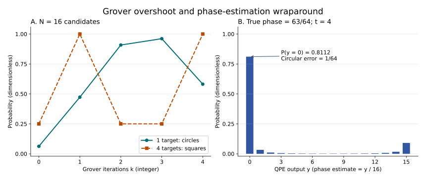

# 算法实验：把输出概率、成本和证明边界一起核对

本册涵盖第 06、07、08、16、17、18 章的算法核验，以及第 21 章的稳定子表、矩阵乘积态（MPS）与含噪 Pauli 传播三大经典模拟引擎实验。每组都从小规模可计算的对象开始，保留“先求振幅，再取模平方”“同一访问模型比较成本”的原则。全部代码仅依赖 Python 3 标准库并采用固定输入，可在本地离线复算；输出为经典精确模拟值，用于核对算法原理而非替代硬件实测。

从仓库根目录运行：

```sh
python3 codes/algorithms/experiments.py all
python3 codes/algorithms/simulation_engines_lab.py
```

[源码](../../codes/algorithms/experiments.py)中每组都有断言；[期望输出归档](../../codes/algorithms/expected-results.json)保存第 06–18 章六组实验的实际运行结果，第 21 章三引擎独立脚本见[simulation_engines_lab.py](../../codes/algorithms/simulation_engines_lab.py)。脚本用整数对应的二进制串编号计算基，最高位显示在左；第 08 组的下标 2 表示 `010`。不要使用会关闭断言的 Python `-O` 选项。



图中两幅纵轴都是无量纲概率。左图的连线只连接离散迭代点，不表示可以运行分数次普通 Grover 迭代；右图的横轴是整数读数，不是弧度。[生成程序](../../codes/algorithms/generate_figure.py)从已核对的概率计算重建此图。

## 实验 06-A：有限相位网格与圆周距离

**问题。** 对本征相位 $\phi=1/3$，用两个控制位计算全部输出概率。再对 $\phi=63/64$ 使用四个控制位，找概率最高的读数，并解释它是否准确。

**步骤。** 不直接调用闭式正弦比值，而用

$$
A_y=\frac1M\sum_{k=0}^{M-1}e^{2\pi ik(\phi-y/M)},
\qquad p_y=|A_y|^2.
$$

这里 $M=2^t$，$y=0,\ldots,M-1$。求和中的每项先是复振幅；必须求和后才取模平方。逐个振幅取平方再相加，会把本题要观察的干涉抹掉。

**答案。** $t=2$ 时，四项为

| $y$ | $y/4$ | $p_y$ |
|---:|---:|---:|
| 0 | 0 | 0.0625000000 |
| 1 | 0.25 | 0.6997595264 |
| 2 | 0.50 | 0.1875000000 |
| 3 | 0.75 | 0.0502404736 |

它们相加为 1。`01` 是最可能读数，但真相位仍是 $1/3$，一次输出不是精确二进制展开。第二题的最大峰在 $y=0$，其概率约为 0.8112208247；圆周误差是 $\min(63/64,1/64)=1/64$。不能用普通差 $63/64$ 评判它。

**检验。** 运行 `python3 codes/algorithms/experiments.py 06`。程序对所有一、二、三控制位的精确网格相位检查对应峰概率为 1；非网格分布则与四项解析式独立比较。

**扩展题与答案。** 四位相位寄存器有四个受控幂，为什么输出成本里是 15 次基本受控 $U$？因为幂次数为 $1,2,4,8$，只能逐次调用基本门时总数为 15。若另外给了能便宜构造这些幂的数学结构，才可能改用另一资源账。代码的直接求和本身耗费 $M^2$ 级经典运算，是教学模拟，不是高效量子实现。

## 实验 07-A：逐振幅检查过度旋转

**问题。** 在十六个候选上，从均匀振幅 $1/4$ 出发。第一题只标记下标 5，第二题标记 $\{0,3,8,15\}$。连续执行四轮并记录每轮后的成功概率。

**步骤。** 每轮先将标记位置的振幅乘 $-1$，再求标记后的平均振幅 $\bar a$，最后对每格执行 $a_j\leftarrow2\bar a-a_j$。完成整轮后才相加标记位置的模平方。代码每轮同时检查总概率归一化，并与二维旋转公式独立比较。

**答案。** 包括未迭代的第零轮，得到

| $k$ | 一个目标 | 四个目标 |
|---:|---:|---:|
| 0 | 0.062500 | 0.250000 |
| 1 | 0.472656 | 1.000000 |
| 2 | 0.908447 | 0.250000 |
| 3 | 0.961319 | 0.250000 |
| 4 | 0.581704 | 1.000000 |

运行 `python3 codes/algorithms/experiments.py 07`。第二题在一轮时已经精确成功，再做两轮降回 $1/4$。这个下降发生在理想计算中，是过度旋转，不能全归咎于噪声。

**重试题。** 每次独立重启的成功率下界是 $1/4$，希望至少一次成功的概率达到 $99\%$，应安排多少次？

**答案。** 全部失败的概率至多 $(3/4)^R$。$R=16$ 时约 0.01002，略高于 0.01；$R=17$ 时约 0.00752，满足目标。必须先定义什么算成功，并独立重新制备；重复读取同一个旧样本不算新的尝试。

**成本题。** 对一个目标，限定 $k=0,1,2,3$ 四种策略，且每次尝试还要一次谓词查询验证。平均查询数为 $(k+1)/p_k$，分别约 16、4.2314、3.3023、4.1609。四者里 $k=2$ 更省平均查询，$k=3$ 更高的单次成功率不抵消额外成本。启动时间、扩散门和验证成本变化后须重新计算。

## 实验 08-A：测量预算与最优解概率

**问题一。** 对 $H=0.7Z+0.2X$ 和 $R_y(\theta)|0\rangle$，验证精确能量最小值，再比较近似测量规划与严格有限样本界。

**答案。** $E(\theta)=0.7\cos\theta+0.2\sin\theta$，可在 $\theta=\pi+\operatorname{atan2}(0.2,0.7)$ 达到 $-\sqrt{0.53}\approx-0.7280109889$。代码除了检查这个值，还检查参数移位导数 $[E(\theta+\pi/2)-E(\theta-\pi/2)]/2=0$；这里只适用于本题由单次 Pauli 旋转产生的形式，不是任意参数化线路的无条件公式。

独立两组读数的 Hoeffding 半宽为

$$
b=\sqrt{2(0.49/S_Z+0.04/S_X)\ln(2/0.05)}.
$$

取 $S_Z=11620,S_X=3320$ 时，总数 14940，$b\approx0.0199999744$。这里严格控制固定参数点下的抽样尾概率，未包含设备偏差；第 08 章正态近似得到的 7780 次不是同一种保证。

**问题二。** 三顶点路径的 QAOA 取 $\gamma=\pi/3,\beta=\pi/8$。期望割值是 1.6495，是否意味着每次以概率 1.6495/2 得最优割？

**答案。** 不是。期望值把割值为 0、1、2 的所有结果都加权，不能仅除以最大值就当最优概率。代价层给基态 $x$ 振幅 $e^{-i\gamma C(x)}/\sqrt8$。混合层的每个单比特门为 $\cos\beta I-i\sin\beta X$，所以更新第 $j$ 位时，输出振幅为

$$
a'_x=\cos\beta\,a_x-i\sin\beta\,a_{x\oplus2^j}.
$$

同时更新整列振幅，不能写一格就立即用新值更新下一格，否则不再是同一个线性变换。三位依次更新后得到

| 基串 | 割值 | 概率 |
|---|---:|---:|
| `000`、`111` | 0 | 每个 $(11-6\sqrt3)/64\approx0.0094952368$ |
| `001`、`011`、`100`、`110` | 1 | 每个 $5/64=0.078125$ |
| `010`、`101` | 2 | 每个 $(11+6\sqrt3)/64\approx0.3342547632$ |

注意第一行的常数应通过概率归一化核对：两端点的概率为 $(11-6\sqrt3)/64$，与三行总和 1 一致。于是最优概率

$$
p_{\mathrm{opt}}=\frac{11+6\sqrt3}{32}\approx0.6685095264,
$$

而期望值

$$
\mathbb E C=4\frac5{64}+2p_{\mathrm{opt}}
=1+\frac{3\sqrt3}{8}\approx1.6495190528.
$$

若只用 $\mathbb E C/2$，会得到约 0.82476，明显高估。运行 `python3 codes/algorithms/experiments.py 08`，程序还对多个正负角度与解析期望公式比较，防止仅在最优角偶然算对。

**扩展题与答案。** SQD 样本只有 `0` 时，本题投影矩阵是一维的 $[0.7]$；同时有 `0`、`1` 时恢复完整二维矩阵。重复同一个基串不增加子空间维数。这说明去重样本数、有效子空间覆盖、矩阵对角化内存都应纳入研究记录。

## 实验 16-A：信号多项式与非厄米反例

**问题一。** 按正文定义构造二维 $W(x)$，检查 $W^\dagger W=I$，再求 $W(x)^2$ 的左上元及从 0 出发再次读到 0 的概率。

**答案。** 两次相乘给 $T_2(x)=2x^2-1$，概率则是 $T_2(x)^2$。五个检查点分别为

| $x$ | $T_2(x)$ 振幅 | $p(0)$ |
|---:|---:|---:|
| -1 | 1 | 1 |
| -1/2 | -1/2 | 1/4 |
| 0 | -1 | 1 |
| 1/2 | -1/2 | 1/4 |
| 1 | 1 | 1 |

负振幅不意味着负概率。这里的零相位序列只展示一个可手算 Chebyshev 原型，没有求解一般多项式的相位。

**问题二。** 对 $A=\left(\begin{smallmatrix}0&1/2\\0&0\end{smallmatrix}\right)$，为什么右奇异向量侧的平方变换不是 $A^2$？

**答案。** $A|1\rangle=|0\rangle/2$，$A|0\rangle=0$，故 $A^2=0$；但 $A^\dagger A=\operatorname{diag}(0,1/4)$。后者才把右奇异向量的奇异值平方留在原侧。运行 `python3 codes/algorithms/experiments.py 16`，用普通矩阵乘法检查两式。这个反例说明必须先声明左右空间与多项式奇偶性，再使用 QSVT 接口。

## 实验 17-A：前馈和退火成功率

**问题一。** 对输入 $|\psi\rangle=a|0\rangle+b|1\rangle$，取 $a=1/\sqrt3,b=i\sqrt{2/3}$，第二比特准备为 $|+\rangle$，先做 $CZ$，再在首比特的 $|\pm_\alpha\rangle$ 基测量，其中 $\alpha=\pi/4$。

**答案。** 第 $m\in\{0,1\}$ 个结果的未归一化第二比特列向量是

$$
v_m=\frac12\begin{pmatrix}
a+(-1)^m e^{-i\alpha}b\\
a-(-1)^m e^{-i\alpha}b
\end{pmatrix}.
$$

模平方和为 $(|a|^2+|b|^2)/2=1/2$。归一化后，$m=1$ 分支交换两个振幅，即施加 $X$，就与 $m=0$ 完全一致。共同列向量等于 $e^{-i\alpha/2}HR_z(-\alpha)|\psi\rangle$。这里记录了共同全局相位；若另一个程序把它省略，应按态射线比较，不能误报物理错误。

**问题二。** 假设校准记录是 100 次中 20 次成功。用 $95\%$ 单侧 Hoeffding 下界，规划后续至少一次成功概率 $99\%$ 的预算。

**答案。**

$$
p_L=0.2-\sqrt{\ln20/200}\approx0.0776126585,
\qquad R=\lceil\ln0.01/\ln(1-p_L)\rceil=58.
$$

每轮 $120\,\mu\mathrm{s}$，后续为 6.96 ms，加上不能摊销的校准为 18.96 ms，尚不含嵌入和调参。两阶段整体失败率由并合界控制在不超过 0.06，不能混写成 0.01。运行 `python3 codes/algorithms/experiments.py 17`；本实验没有真实调用退火器，20/100 是题设数据。

## 实验 18-A：擦除信道的四种任务

**问题。** 直接计算 Bob 和环境三维输出的熵，核对所有 qubit 输入谱上的单次相干信息，并列出五个擦除概率处的四种容量。

**步骤。** 对输入本征值 $q,1-q$，两组输出谱为 $[(1-\varepsilon)q,(1-\varepsilon)(1-q),\varepsilon]$ 与 $[\varepsilon q,\varepsilon(1-q),1-\varepsilon]$。计算时跳过概率为零的项，实现连续约定 $0\log_2 0=0$。

**答案。** 两熵相减得到 $(1-2\varepsilon)h_2(q)$。结合正文可降解/反降解容量定理，有

| 擦除概率 | $C$（bit/use） | $Q$（qubit/use） | $P$（secret bit/use） | $C_E$（bit/use） |
|---:|---:|---:|---:|---:|
| 0 | 1 | 1 | 1 | 2 |
| 1/4 | 3/4 | 1/2 | 1/2 | 3/2 |
| 1/2 | 1/2 | 0 | 0 | 1 |
| 3/4 | 1/4 | 0 | 0 | 1/2 |
| 1 | 0 | 0 | 0 | 0 |

运行 `python3 codes/algorithms/experiments.py 18`。代码在 101 个 $q$ 值上把直接熵计算与恒等式比较；它没有枚举任意长纠缠编码，故容量列仍标明 `theorem`。当擦除率为 $3/4$ 时，$q=1/2$ 给相干信息 $-1/2$，纯输入给 0，不能把负值报成容量。

**扩展题与答案。** 擦除率 $1/4$ 时，怎样由 Bob 输出模拟环境？Bob 对未擦除分支以 $1/3$ 保留原态，其他情况给环境旗标。总保留概率 $(3/4)(1/3)=1/4$。这是对未知态的随机保留/擦除，没有复制未知态。

## 实验 21-A：稳定子表、MPS 与含噪 Pauli 传播三引擎

配套[第 21 章：稳定子形式、经典模拟引擎与量子优势边界](../21-stabilizer-classical-simulation.md)。[三引擎验算脚本](../../codes/algorithms/simulation_engines_lab.py)仅用 Python 3 标准库实现三大现代经典模拟迷你引擎，并与独立的态矢量及密度矩阵参考引擎在容差 $10^{-12}$ 内逐格交叉断言。

**问题一（Aaronson–Gottesman 稳定子表与魔法态分解）。** 从 $|00\rangle$ 出发施加 $H_0$ 与 $\mathrm{CNOT}_{01}$，核对 Bell 态的去稳定子与稳定子行，以及测 $Z_0$ 后再测 $Z_1$ 的确定性关联；再检验单份魔法态 $|T\rangle = T|+\rangle$ 的赤道稳定子展度 $\xi(|T\rangle)$，以及两份魔法态 $|T\rangle^{\otimes 2}$ 为何只需 2 项稳定子态线性组合。

**答案。** Bell 态对应稳定子 $\langle +XX, +ZZ\rangle$ 与去稳定子 $\langle +ZI, +IX\rangle$，测 $Z_0$ 得随机结果 $m \in \{0, 1\}$ 后，$Z_1$ 必确定性地给出同一结果 $m$。单份 $|T\rangle$ 按赤道分解 $(e^{i\pi/8}|+\rangle + e^{-i\pi/8}|+i\rangle)/(2\cos(\pi/8))$ 给出最优稳定子展度 $\xi(|T\rangle) = 4 - 2\sqrt{2} \approx 1.171573$（指数率 $\log_2 \xi(|T\rangle) \approx 0.228447$）；两份 $|T\rangle^{\otimes 2}$ 可直接写成两个纠缠稳定子态的 2 项叠加，证明精确稳定子秩显著低于朴素 $2^t$。脚本还对 12 组 4 比特随机 Clifford 加中段测量电路的全量 256 个 Pauli 期望值做逐格断言（误差 $< 10^{-12}$），并自动验证 3 比特 GHZ 练习。

**问题二（3 比特 MPS 逐键精确 SVD 与截断误差）。** 对 $|\mathrm{GHZ}_3\rangle$ 与 $|W_3\rangle = (|001\rangle + |010\rangle + |100\rangle)/\sqrt{3}$ 构造开放边界左正则矩阵乘积态（MPS），检查键维与纠缠熵；把 $|W_3\rangle$ 的键 1 截断至 $\chi_{\max} = 1$，核对丢弃奇异值平方和 $\varepsilon_{\mathrm{trunc}}$ 与重归一化根保真度 $F$ 的精确关系。

**答案。** $|\mathrm{GHZ}_3\rangle$ 与 $|W_3\rangle$ 的两道键维均为 $(\chi_1, \chi_2) = (2, 2)$。$|W_3\rangle$ 在键 1 的奇异值为 $\sqrt{2/3}$ 与 $\sqrt{1/3}$，冯·诺依曼纠缠熵为 $h_2(1/3) \approx 0.918296\,\mathrm{bit}$；压到 $\chi_{\max} = 1$ 时截断误差精确为 $\varepsilon_{\mathrm{trunc}} = 1/3$，重归一化截断态的根保真度为 $F = \sqrt{2/3} \approx 0.816497$，平方重叠 $F^2 = 1 - \varepsilon_{\mathrm{trunc}} = 2/3$。脚本额外对 10 组随机 3 比特复振幅态检验左正则条件 $\sum_s (A^s)^\dagger A^s = I$、全态收缩还原与截断恒等式。

**问题三（含噪海森堡 Pauli 传播与稀疏 Pauli 动力学）。** 对初态 $|0+\rangle$ 施加 2 层 $[\mathrm{CNOT}_{01} \to R_x(\pi/6)^{\otimes 2} \to \mathcal{D}_{p=0.2}^{\otimes 2}]$，观测 $Z_0 I_1$。分别求精确期望值、在反向传播第 1 层先乘退极化衰减 $(1 - p)^w$ 再按权重 $w \le 1$ 截断的近似值，以及被裁项的 $\ell_1$ 误差上界。

**答案。** 闭式解析与精确密度矩阵均给出

$$
\langle Z_0 I_1\rangle = (1 - p)^2 \cos^2\theta - (1 - p)^3 \sin^2\theta = 0.48 - 0.128 = 0.352.
$$

权重截断 $w \le 1$ 给出近似值 $0.48$，实际截断误差 $0.128$ 严格满足 $\ell_1$ 算符范数上界 $0.256$。脚本还检验了 $\theta = \pi/4, p = 0.5$ 的练习参数，并对 3 比特 3 层含噪砖墙电路在 $p \in \{0, 0.05, 0.15, 0.30\}$ 下的多组观测量与精确密度矩阵逐格对照（最大误差 $< 10^{-12}$）。

运行 `python3 codes/algorithms/simulation_engines_lab.py`。这三个迷你引擎用于透明演示数据结构与误差上界，不等同于面向百比特以上电路的 C++/SIMD/GPU 生产模拟器。

## 开源复现与工业研究入口

以下项目入口初始核查于 2026-09-26，于 2026-11-25 复核目录与口径。许可证、固定提交和实际存档文件以[统一 vendor 清单](../../codes/vendor/manifest.json)为准；源码摘录不等于完整可安装环境，进一步复现应在隔离环境中按固定版本安装。

| 算法/工作流 | 官方源码或文档 | 能复现或检查什么 | 需要注意的边界 |
|---|---|---|---|
| Grover、相位/幅度估计、VQE、QAOA | [Qiskit Algorithms 社区仓库](https://github.com/qiskit-community/qiskit-algorithms) | 算法接口、查询组织、优化调用；注意迁移后的真实组织路径 | 接口受版本兼容约束，小规模演示不等于实用优势 |
| 可微 VQE/QAOA、QSP/QSVT | [PennyLane](https://github.com/PennyLaneAI/pennylane)、[QSVT 接口](https://docs.pennylane.ai/en/stable/code/api/pennylane.QSVT.html) | 块编码、投影相位、奇偶性和电路基序 | 不能把任意非厄米矩阵直接当作普通 $P(A)$ |
| 化学 SQD | [Qiskit SQD](https://github.com/Qiskit/qiskit-addon-sqd)、[氮分子教程](https://quantum.cloud.ibm.com/docs/en/tutorials/sample-based-quantum-diagonalization) | 样本恢复、子空间构造、费米哈密顿量的经典对角化 | 超过全矩阵精确对角化不等于超过全部强经典化学方法 |
| 容错算法资源 | [Qualtran](https://github.com/quantumlib/Qualtran) | 从算法部件分解资源，核对查询与逻辑门之间的转换 | 一个抽象调用不等于一个物理时钟周期 |
| 退火/QUBO 的经典基线 | [dimod](https://github.com/dwavesystems/dimod)、[嵌入文档](https://docs.dwavequantum.com/en/latest/quantum_research/embedding_intro.html) | BQM/QUBO 建模、样本能量、小规模精确求解，另核对设备嵌入 | 经典建模工具本身不构成硬件优势证据 |
| 稳定子、张量网络与 Pauli 传播模拟 | [Stim](https://github.com/quantumlib/Stim)、[quimb](https://github.com/jcmgray/quimb)、[pauli-prop](https://github.com/Qiskit/pauli-prop) | 稳定子电路快速采样、MPS/MPO 收缩与含噪可观测量反向传播（实跑见[完整 SDK 实验册](sdk-validation.md)） | 各自存在明确经典可解孤岛边界，高非 Clifford 度或深纠缠体积律仍会触发指数开销 |

这里的工业关联指公开研究流程（化学能量估算、容错资源分解、约束优化、经典模拟基线与量子模型开发）；若要评估生产部署与端到端性能，还需对照同任务质量的强经典基线与完整运行成本。
