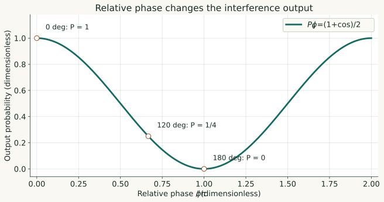
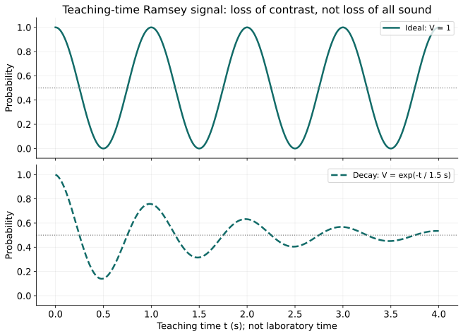

# 声音实验：相位、抵消与退相干的教学映射

本页五段音频全部是程序合成的经典声音，**不是量子芯片录音、真实微波脉冲或实验数据**。它们帮助比较“先相加振幅，再平方”和“干涉对比度下降”，不能用来证明量子叠加、纠缠或 Born 规则。听觉响度不是概率计，定量结论要看公式和图。

对应 [Q1 干涉](../quantum-mechanics/01-experiments-states.md)、[02 相位与测量](../02-single-qubit.md)、[05 噪声](../05-noise-channels.md)、[Q3 驱动](../quantum-mechanics/03-levels-control.md)与 [15 实验方法](../15-practice-research.md)。

## 1. 固定参数，先预测再听

所有文件均为 4 秒、22050 Hz、单声道、16-bit PCM WAV。载频 440 Hz；每个相加分量的数字增益为 0.2，开头和结尾用 10 ms 淡入淡出。文件间不单独归一化，否则原本应该较小的信号也会被放大到同样峰值。播放器保持同一音量。

| 样本 | 先预测的现象 | 文件 |
|---|---|---|
| 相位差 $0$ | 振幅相加，峰值约 0.4 | [播放同相声音](../assets/audio/phase-0.wav) |
| 相位差 $2\pi/3$ | 峰值约 0.2，是上面的二分之一 | [播放 120 度声音](../assets/audio/phase-120.wav) |
| 相位差 $\pi$ | 数字样本相消为零，静音是预期结果 | [播放反相声音](../assets/audio/phase-180.wav) |
| 理想 Ramsey 映射 | 概率包络周期变化，有清楚的低谷 | [播放理想条纹](../assets/audio/ramsey-ideal.wav) |
| 衰减 Ramsey 映射 | 对比度逐渐减小，声音趋向稳定而非完全消失 | [播放对比度衰减](../assets/audio/ramsey-decay.wav) |

阅读版可直接播放；Markdown 阅读器如果不支持内嵌音频，可打开 WAV 链接。生成方法和每个文件的哈希见[生成程序](../../codes/practice/generate_audio.py)与[音频清单](../assets/audio/manifest.json)。

## 2. A01：相位差 120 度，为什么功率比是四分之一？

### 两条经典正弦波先相加

取 $x_1(t)=0.2\sin\omega t$、$x_2(t)=0.2\sin(\omega t+\phi)$，用和差化积得

$$
x_1+x_2=0.4\cos(\phi/2)\sin(\omega t+\phi/2).
$$

所以合成振幅相对同相值的比例是 $|\cos(\phi/2)|$。取 $\phi=2\pi/3$，比例为 $1/2$；长时间平均平方的比例为 $1/4$。这里平均平方指数字波形的均方值，在相同线性播放链路下可作功率比例类比，不是经过校准的声压级。

### 再看量子线路的对应公式

从 $|0\rangle$ 做 $H$，给 $|1\rangle$ 分支相位 $e^{i\phi}$，再做 $H$。结果 0 的振幅是 $(1+e^{i\phi})/2$，概率为

$$
P_0=\frac{|1+e^{i\phi}|^2}{4}
=\frac{2+2\cos\phi}{4}
=\cos^2(\phi/2).
$$

声音功率比和这个概率有同样的函数形式，但物理对象不同：经典声波是压力扰动；量子振幅决定离散测量结果的统计。单段声音无法模拟单次量子测量的坍缩。



**练习与答案**：若把 120 度文件单独归一化到 0.4 的峰值，能否继续从文件响度比较概率？不能；后处理消除了原始幅度比例。脚本断言同相与 120 度的 RMS 比约为 2，反相文件量化为全零；有淡入淡出时精确 RMS 还取决于窗函数，因此使用明确的小容差。

## 3. A02：对比度下降为何不等于声音越来越小到零？

为了把缓慢变化听出来，定义教学时间 $t$，刻意使用每秒一条条纹：

$$
P_0(t)=\frac{1+V(t)\cos(2\pi t)}2,
\quad V(t)=1\ \text{或}\ e^{-t/(1.5\,\mathrm{s})}.
$$

这 1 Hz 和 1.5 秒都是声化参数，不能代入真实设备的 GHz 控制频率或微秒相干时间。文件把**概率平方根**映射成声音振幅：$x(t)=0.4\sqrt{P_0(t)}\sin(2\pi\cdot440t)$；先把负的浮点舍入误差裁到零，然后开平方。

当 $V\to0$，概率趋于 $1/2$，因此包络趋于 $0.4/\sqrt2$。消失的是高低起伏的对比度，不是平均输出概率。若错误地直接播放 $V(t)\sin\omega t$，听到的会是全音量衰减，那对应另一种映射。



**练习与答案**：在 $t=1.5$ 秒，$V=e^{-1}$ 且 $\cos(3\pi)=-1$，所以 $P_0=(1-e^{-1})/2\approx0.31606$，振幅包络约 $0.22488$。理想样本此时概率为零。图的每个采样点可从[CSV 数据](../../codes/practice/figure-data.csv)复算。

## 4. A03：为什么不通过两个扬声器验证精确抵消？

本页先在数字域相加，再输出一个单声道文件，因此反相样本是零。两个空间分离的扬声器还会引入传播时延、房间反射、扬声器响应和听者位置；不能期待整间房间处处静音。

练习：设两路额外时延差为 $1/(4f)$，即 440 Hz 时约 0.568 ms，它增加相位 $2\pi f\Delta t=\pi/2$。原本精确反相的条件被改变，因此单点也未必抵消。这个经典传播例子说明类比的边界，不需要假设任何量子机制。

## 5. 重新生成与核查

```sh
python3 codes/practice/generate_audio.py
```

生成器检查帧数、峰值、相消与 RMS 比，输出 WAV 和清单。科学图另由[绘图程序](../../codes/practice/plot_figures.py)产生；未安装绘图库也可运行音频与统计实验。没有启用自动播放；每段音频都由读者自行打开。
