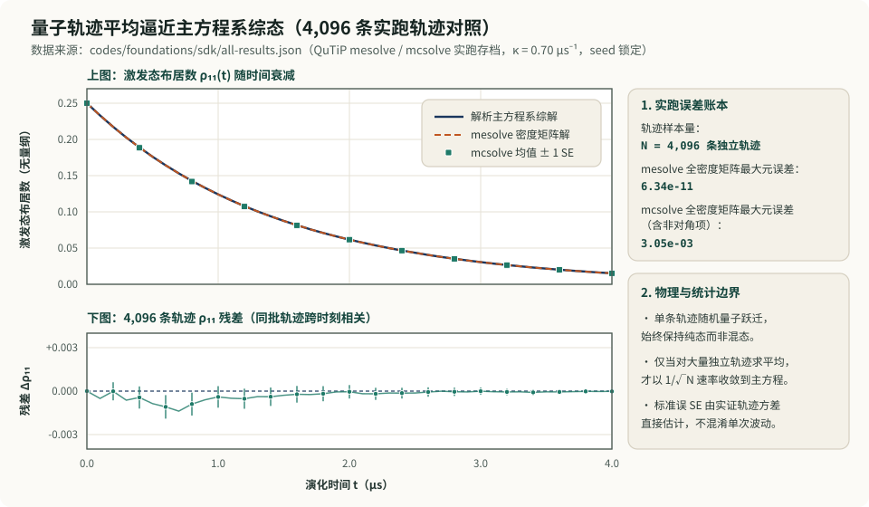

# 基础实验册｜从复振幅到可核查的数值结果

本册把主篇 00–05、13 章和量子力学 Q1–Q4 的 **11 组入门实验**（`F00`–`FQ4`）以及配套的**基础诊断反例与开放动力学轨迹实验**接到本地可运行程序。每组先给问题，再拆开答案，最后说明数值实验能检查什么。先手算，再运行；程序结果与手算不一致时，先核对基序、复共轭、归一化和单位。零安装可视化体验（MZI 干涉、Bloch 球与 Ramsey 退相干）也可配合[离线交互量子实验台](../../reader/lab/quantum-lab.html)同步对照。

[程序与运行说明](../../codes/foundations/README.md)只要求 Python 3 标准库。以下命令均从仓库根目录执行；把 `--case` 后的编号换成对应行，即可独立运行某章：

```sh
python3 codes/foundations/foundations_lab.py --case all
python3 codes/foundations/foundations_lab.py --case 04
python3 codes/foundations/foundations_lab.py --case q4
python3 codes/foundations/diagnostic_lab.py --case all
```

[实际运行结果](../../codes/foundations/expected-results.json)保存默认种子 `20260926`、各组参数、输出与统计量。所有数据都是教学计算或伪随机合成样本，不是实验室测量。矩阵算例约定左侧张量因子为高位：三比特传态索引依次是 Q、A、B；命令中的 `q1` 则是量子力学章节编号，与线路量子比特编号无关。

| 章节 | 程序编号 | 本组额外训练的能力 |
|---|---|---|
| 00 | `00` | 分清期望、实际计数与概率保证 |
| 01 | `01` | 用复共轭而非普通平方验证归一化 |
| 02 | `02` | 把 $Y$ 测量翻译成正确的门序 |
| 03 | `03` | 用非均匀 Schmidt 权重和远端旋转检查偏迹 |
| 04 | `04` | 全部传态分支一起验证，避免只测成功的一支 |
| 05 | `05` | 直接组合 Kraus 信道并检查合法性 |
| 13 | `13` | 不等先验时重新计算判别成功率 |
| Q1 | `q1` | 区分条纹可见度与条纹相位移动 |
| Q2 | `q2` | 检查时间顺序和能量零点的不同影响 |
| Q3 | `q3` | 核对 Hz、rad/s、秒和温度 |
| Q4 | `q4` | 检查网格归一化、差分算符和收敛阶 |

完成下方 11 组主线手算后，请继续阅读文末的[基础诊断与动力学轨迹实验导览](#基础诊断与动力学轨迹实验导览)，把“看起来合理但前提漏缺”的 11 组反例、开放量子轨迹与主方程实跑对照以及读出校准数值精度边界一并打通。

## F00｜1000 次测量为何很少恰好对半

**练习。** 理想制备 Hadamard 后的单比特，独立测量 1000 次。计算“恰好 500 次为 1”的概率；再给一个无需正态近似的 95% 频率误差界。运行 `--case 00`，解释模拟计数是否能认证物理量子随机性。

**分步解答。** 单次为 1 的概率 $p = 1/2$，计数 $K$ 服从二项分布。选择哪 500 轮为 1 有二项式系数这么多种方式，每个指定的千位串概率都为 $2^{-1000}$，因此

$$
\Pr(K = 500) = \binom{1000}{500} 2^{-1000} \approx 0.025225.
$$

“平均是 500”与“最有可能的具体计数是 500”都没有承诺每批恰好 500；这个单点概率只有约 2.52%。计数标准差为 $\sqrt{1000/4} \approx 15.81$ 次，频率标准差是 $15.81 / 1000 \approx 0.01581$。

若各轮独立且概率相同，[Watrous 教材定理 1.16](https://cs.uwaterloo.ca/~watrous/TQI/TQI.pdf)中的 Hoeffding 不等式给出

$$
\Pr(|\hat{p} - p| \ge \epsilon) \le 2 e^{-2N\epsilon^2}.
$$

令右边等于 $0.05$，先取自然对数，再解平方：$2N\epsilon^2 = \ln 40$，所以 $\epsilon = \sqrt{\ln 40 / (2N)} \approx 0.04295$。这是保守的双侧有限样本界；重复构造的区间 $[\hat{p} - \epsilon, \hat{p} + \epsilon] \cap [0, 1]$ 至少以 95% 覆盖固定的 $p$，不是说本批已经有 95% 概率证明了模型。

默认种子的实际合成计数为 0 共 520 次、1 共 480 次，频率 $0.48$。该例由电脑伪随机数生成，没有读取物理量子系统；重现 $0.48$ 只能检查采样与记录流程，不能证明 Born 规则，也不能认证密码学随机性。改变种子后某批落到上述区间外仍可能是正常事件，测试不应强迫所有批次都命中。

**复位与读出对照。** 脚本分别从理想复位和含 $20\%$ 对角激发布居的输入出发。省去 $H$ 时，计算基测得 1 的理想概率分别为 $0$ 和 $0.2$。加 $H$ 后都是 $1/2$。因此加入省去 $H$ 的一组对照更有助于诊断复位。若再叠加经典读出误报率 $\alpha=.12$、漏报率 $\beta=.23$，平衡输入的报告概率是 $0.445$。取输入概率 $p_1=12/35$，两种读出偏差相抵。程序计算的是模型概率，物理设备上还要独立校准读出并验证假设。

**进一步练习。** 若改为 10000 次，半径缩为约 $0.01358$。原因是分母样本数增十倍，平方根只使半径缩为原来的 $1/\sqrt{10}$。

## F01｜不取复共轭会把“长度”算成复数

**练习。** 把列向量 $(1, 1+i)^T$ 归一化；计算真正的内积与错误的普通平方和；做 $H$ 门后逐项算输出概率。运行 `--case 01`。

**分步解答。** 输入范数平方为 $1 + |1 + i|^2 = 3$，故 $v = (1, 1 + i)^T / \sqrt{3}$。用共轭得到 $\langle v|v\rangle = [1 + (1 - i)(1 + i)] / 3 = 1$。若遗漏共轭，则得到 $[1 + (1 + i)^2] / 3 = (1 + 2i) / 3$，不是可用来归一化的非负实数。

门后的两振幅为

$$
H v = \frac{1}{\sqrt{6}} \begin{bmatrix} 2 + i \\ -i \end{bmatrix}.
$$

第一项模平方是 $(2^2 + 1^2) / 6 = 5/6$，第二项是 $1/6$，相加仍为 $1$。外积 $v v^\dagger$ 是矩阵，内积 $v^\dagger v$ 是数；两者形状不同。程序再检查 $(v v^\dagger)^2 = v v^\dagger$，验证这仍是纯态。

**矩阵与校准回验。** 脚本还检查第 01 章的三个固定角矩阵指数，两个非对易的生成元在这组角度下仍满足指数合并。把 $[1\;0]$ 作用在 $[0,1]^T$ 得零，例子显示薄 SVD 列表没有覆盖所有输入方向。Bell 态与均匀混合态有同一约化态，联合矩阵的 $(00,11)$ 元却相差 $1/2$。用第 6.4 节的两个有效读出模型处理同一个相干态，程序验证 $0.135$ 与 $0.195$ 的报告概率。两者在基态校准数据上相同。

**进一步练习。** 若给 $v$ 整体乘 $i$，外积不变：$i v (i v)^\dagger = i(-i) v v^\dagger = v v^\dagger$。代码比较状态时可用密度矩阵，避免把整体相位误报为错误。

## F02｜Y 基测量需要先 S†，再 H

**练习。** 对 $v = (\sqrt{3}, i)^T / 2$，只允许在计算基读出。如何测量 $Y$？为什么把两个前置门交换顺序会得到错误统计？运行 `--case 02`。

**分步解答。** $Y$ 的正本征态为 $(1, i)^T / \sqrt{2}$。先施加 $S^\dagger = \mathrm{diag}(1, -i)$，把它变成 $|+\rangle$；再做 $H$，变成 $|0\rangle$。所以读出 $0$ 对应原来的 $Y = +1$。总前置矩阵是 $H S^\dagger$。

对本题输入，$S^\dagger v = (\sqrt{3}, 1)^T / 2$，再做 $H$，结果 $0$ 的振幅为 $(\sqrt{3} + 1) / (2\sqrt{2})$，所以

$$
p(Y = +1) = \frac{(\sqrt{3} + 1)^2}{8} = \frac{2 + \sqrt{3}}{4} \approx 0.933013.
$$

反序的 $S^\dagger H$ 先做 $H$，得到两项模平方各半；最后 $S^\dagger$ 只是改相位，计算基概率仍各半。错误不会被“概率和为 1”的测试发现，需要比较具体测量目标。

**进一步练习。** 若要实现测后仍在原 $Y$ 本征态的理想投影工具，读出后还需把前置矩阵的逆 $S H$ 做回来。若只需末端经典记录，则通常不再要求这个后态。

## F03｜非均匀纠缠态配合远端旋转，检查偏迹方向

**练习。** 对 $v = \sqrt{3}|00\rangle / 2 + i|11\rangle / 2$，求 $A$ 的约化态、纯度。随后只在 $B$ 上做 $R_y(0.731)$，$A$ 的约化态是否变化？运行 `--case 03`。

**分步解答。** 对 $B$ 偏迹时，$|00\rangle\langle 11|$ 与其共轭项的 $B$ 标签不相同，所以不保留；两对角项留下 $3|0\rangle\langle 0| / 4 + |1\rangle\langle 1| / 4$。因此 $\rho_A = \mathrm{diag}(3/4, 1/4)$，纯度 $(3/4)^2 + (1/4)^2 = 5/8$。

$B$ 上做任意酉 $U$ 后，求和中会出现 $\sum_b U_{bj} U^*_{bk} = \delta_{jk}$，这是酉矩阵列的正交性，故偏迹结果不变。代码实际计算完整四维矩阵，再重做偏迹；没有直接把输出设为输入约化态。

这里“非均匀”指两个 Schmidt 概率为 $3/4$、$1/4$，而不是说输入在 $A$、$B$ 交换下不对称。初始两个约化态恰好相同；只旋转 $B$ 后，$B$ 的非均匀约化态会改变，$A$ 的不变，这才使取错偏迹方向容易暴露。Bell 态的两个约化态都是 $I/2$，局域旋转也不改变它们，单用它作方向测试可能漏错。

**边界。** 本测试只检验一个远端酉算例。一般局域 CPTP 操作的无信号结论需用 Kraus 完备关系；若保留并发送结果后选择某一分支，条件态可以改变，不能把它与无条件态混淆。

## F04｜传态必须逐支检验复振幅

**练习。** 输入 $v = (\sqrt{3}|0\rangle + i|1\rangle) / 2$，资源是 $AB$ 的 Bell 态，位序 $QAB$。直接模拟 $Q$ 控制 $A$ 的 CNOT，再做 $H_Q$，计算全部四个结果及 Bob 校正态。运行 `--case 04`。

**分步解答。** 在通用传态公式中代入 $\alpha = \sqrt{3}/2, \beta = i/2$，归一化分支如下。未归一化分支均还带一个系数 $1/2$，长度平方各为 $1/4$。

| $QA$ 记录 | Bob 归一化振幅列 | 校正顺序 |
|---|---|---|
| `00` | $(\sqrt{3}, i)^T / 2$ | 不操作 |
| `01` | $(i, \sqrt{3})^T / 2$ | $X$ |
| `10` | $(\sqrt{3}, -i)^T / 2$ | $Z$ |
| `11` | $(-i, \sqrt{3})^T / 2$ | 先 $X$ 后 $Z$ |

最后一支先交换两项成为 $(\sqrt{3}, -i)^T / 2$，再翻第二项符号，还原输入。程序从八分量初态真实执行两道门、切片取分支，再按每支概率归一化；随后比较校正后外积与输入外积。

不知道 $QA$ 记录时，要相加四个未归一化外积，每个自带 $1/4$ 概率，而非先把四条 ket 相加。此时 $\rho_B = I/2$。输入相位 $i$ 专门用于暴露“只测试实振幅”时可能漏掉的共轭或符号错误。

**进一步练习。** 把输入改成任意归一化复数二元组，四支概率仍应为 $1/4$。只抽一次随机分支来测试，会漏掉其他三条路径的程序错误。

**再做一组延迟测量对照。** 运行 [线路与信道边界脚本](../../codes/foundations/circuit_channel_boundaries.py) `python3 codes/foundations/circuit_channel_boundaries.py`。制备 $\sqrt{0.3}|00\rangle+i\sqrt{0.7}|11\rangle$，先记录 $A$ 的 $Z$ 测量，再按标签对 $B$ 作用 $X^k$，随后对 $A$ 作用 $H$。比较立即测量的线路与用干净记录位 $R$ 保存标签的线路。脚本逐支比较 $AB$ 后态，不止检查标签概率 $0.3,0.7$。最后直接测 $A$ 只得到均匀的 $0,1$，说明 $A$ 已被改作数据位，无法代替记录位。

## F05｜布居与相干有不同时间常数

**练习。** 先重算 $|+\rangle$ 经参数 $\gamma = 0.36$ 的振幅阻尼，再组合 $T_1 = T_\phi = 60\,\mu\mathrm{s}$ 的阻尼与纯退相位，求 $40\,\mu\mathrm{s}$ 后的布居和相干。运行 `--case 05`。

**分步解答。** 振幅阻尼的两项分别为

$$
K_0 \rho_+ K_0^\dagger =
\begin{bmatrix} 0.50 & 0.40 \\ 0.40 & 0.32 \end{bmatrix},\qquad
K_1 \rho_+ K_1^\dagger =
\begin{bmatrix} 0.18 & 0 \\ 0 & 0 \end{bmatrix}.
$$

两项相加得到正文矩阵。第二项的迹 $0.18$ 是该 Kraus 分支在本输入上的权重，不是一般都等于 $\gamma = 0.36$；初始激发占据只有 $1/2$。输出本征值约为 $0.061366$ 与 $0.938634$，均非负且和为 $1$。

再取 $\gamma(t) = 1 - e^{-t/T_1}$ 和 $p_Z(t) = [1 - e^{-t/T_\phi}] / 2$。阻尼让激发占据乘 $1 - \gamma$，相干乘 $\sqrt{1 - \gamma}$；纯退相位不改占据，只让相干另乘 $1 - 2p_Z$。于是

$$
\rho_{11}(40) = \tfrac{1}{2} e^{-40/60} \approx 0.256709,
\quad
\rho_{01}(40) = \tfrac{1}{2} e^{-40/120} e^{-40/60}
= \tfrac{1}{2} e^{-1} \approx 0.183940.
$$

$1/T_2 = 1/120 + 1/60 = 1/40$，故 $T_2 = 40\,\mu\mathrm{s}$。程序独立组合两组 Kraus 算子，逐组检查 $\sum K^\dagger K = I$，另检验零阻尼的恒等极限与完全阻尼的复位极限。

**进一步练习。** 若用 QuTiP 的 Lindblad 模型复现这个零温例子，弛豫算符取 $\sqrt{1/T_1}|0\rangle\langle 1|$，纯退相位算符取 $\sqrt{1/(2T_\phi)} Z$。后二分之一来自耗散子 $c\rho c^\dagger - \{c^\dagger c, \rho\}/2$ 对非对角项产生两倍衰减；漏它会把退相位率多算一倍。所有速率和时间必须使用相同单位。参见 [QuTiP 官方主方程文档](https://qutip.readthedocs.io/en/stable/guide/dynamics/dynamics-master.html)。

**再做两组噪声边界对照。** 运行 [线路与信道边界脚本](../../codes/foundations/circuit_channel_boundaries.py) `python3 codes/foundations/circuit_channel_boundaries.py`。对 $\epsilon=0.2\,\mathrm{rad}$、十层 $R_z$ 过旋转，枚举逐层独立符号的 $2^{10}$ 条线路和全程复用符号的两条线路，比较初态 $|+\rangle$ 的末端 $X=-1$ 概率，分别约为 $0.091186$ 和 $0.708073$。两种方案的单层平均信道相同。再令 $|+\rangle$ 经 $\gamma=0.36$ 的振幅阻尼，探测效率 $\eta=1/2$ 时真正无跳跃概率为 $0.82$，没有点击的概率为 $0.91$，差值 $0.09$ 为漏检跳跃。程序验证理想模型，模型参数由题设给定。

## F13｜先验不相等时，“0.8536”不再是答案

第 13 章另有 [压缩、催化与公开记录的边界算例](../../codes/foundations/information_capacity_boundaries.py)，可运行 `python3 codes/foundations/information_capacity_boundaries.py`。脚本以精确分数对照裸系统第二前缀 $3/4<4/5$ 与催化联合分布的全部前缀。均匀密钥一经公开记录复制，比较只含密钥和包含公开记录的迹距离，分别为 $0$ 和 $1/2$。

**练习。** 候选态仍是 $|0\rangle$ 和 $|+\rangle$，但出现概率分别为 $0.9$、$0.1$。允许单次最优测量且每次必须猜一个标签，求成功率，并与总猜 $0$ 比较。运行 `--case 13`。

**分步解答。** 最优二元判别应对加权差矩阵求迹范数：

$$
A = 0.9|0\rangle\langle 0| - 0.1|+\rangle\langle +|
= \begin{bmatrix} 0.85 & -0.05 \\ -0.05 & -0.05 \end{bmatrix}.
$$

其迹为 $0.8$，行列式为 $-0.045$。二次特征方程是 $\lambda^2 - 0.8\lambda - 0.045 = 0$，故 $\lambda_\pm = (0.8 \pm \sqrt{0.82})/2$，一正一负。迹范数为两个绝对值之和 $\sqrt{0.82}$，所以

$$
p_{\mathrm{guess}}^{\max} = \frac{1 + \|A\|_1}{2}
= \frac{1 + \sqrt{0.82}}{2} \approx 0.952769.
$$

完全不测量、总猜更常见的态，成功率已有 $0.9$。等先验的 $0.853553$ 在此甚至低于这个简单基线，说明不能忽略先验。最优测量把 $A$ 的正本征空间判作 $0$、负本征空间判作 $+$；由正负谱分解即可推出上述迹范数形式。定理和一般二元测量形式可对照 [Watrous 教材第 3 章](https://cs.uwaterloo.ca/~watrous/TQI/TQI.pdf)。

**进一步练习。** 相同两态的根保真度仍为 $1/\sqrt{2}$；改变先验没有改变两个态本身。Qiskit `state_fidelity` 报告的却是其平方 $1/2$，不能拿两种约定直接比较大小。参见 [官方 API](https://quantum.cloud.ibm.com/docs/en/api/qiskit/quantum_info#state_fidelity)。

## FQ1｜环境重叠的相位移动条纹，模长改变可见度

**练习。** 两路径等权，记录态重叠 $\gamma = 0.6 e^{i\pi/3}$。求端口 $0$ 在 $\phi = 0, \pi/3, \pi, 4\pi/3$ 时的概率，求最大最小值。运行 `--case q1`。

**分步解答。** 因为 $\operatorname{Re}(\gamma e^{-i\phi}) = 0.6\cos(\phi - \pi/3)$，四个概率依次为 $0.65$、$0.8$、$0.35$、$0.2$。亮峰位于 $\phi = \pi/3$，并非 $0$；可见度则是 $(0.8 - 0.2) / (0.8 + 0.2) = 0.6$。

程序选 $|d_0\rangle = |0\rangle$、$|d_1\rangle = \gamma^*|0\rangle + 0.8|1\rangle$，先核对 $\langle d_1|d_0\rangle = \gamma$。构造路径和记录的四分量联合态、对记录偏迹，再施加第二分束器 $H$；独立比较与余弦公式的结果。这一步能发现漏共轭造成的“条纹向反方向移动”。

**边界。** $\mathcal{V} = |\gamma|$ 依赖等路径权重、理想平衡与无损读出。失衡或探测器效率变化也可能降低可见度；不能把任何低可见度都唯一归因于环境路径信息。相关原始工作见 [Englert, PRL 77, 2154](https://doi.org/10.1103/PhysRevLett.77.2154)。

**另外两项实验。** 程序用联合态直接复算 SG 合束的末级 $z+$ 概率。模式相同且净相位为 $0$ 时是 $1$、同一模式而 $\phi=\pi$ 时是 $0$、模式正交时是 $1/2$。再以 $|+\rangle$ 输入效率为 $(1,1/4)$ 的两端口装置。相干滤波和先分辨端口再丢标签的成功率都为 $5/8$，后续测 $X$ 的 $+$ 概率分别为 $9/10$ 和 $1/2$。对称炸弹试验中，从首轮发射前计第二轮首次确诊得 $1/16$，已知首轮走亮端口时得 $1/4$。这些结果来自模拟装置，光学实验的符合计数及损耗见[正文 Q1](../quantum-mechanics/01-experiments-states.md)。

## FQ2｜子系统整体能量平移仍然只是全局相位

**练习。** 第一项比较先 $R_x(\pi/2)$ 后 $R_z(\pi/2)$ 与相反门序，输入为 $|0\rangle$，输出测 $X$。第二项在 Bell 态上比较：只对子系统 $A$ 加 $c I_A$，以及只给 $A = 1$ 的能级加 $c$。运行 `--case q2`。

**分步解答。** 两种门序的 $X$ 正结果概率分别为 $1$ 和 $1/2$；普通时间积分相同不足以替代按时序相乘。

对子系统 $A$ 的所有能级共同加 $c$，嵌入联合空间的项是

$$
(c I_A) \otimes I_B = c I_{AB}.
$$

因此联合态只整体乘 $e^{-ict/\hbar}$，即使 $A$ 与 $B$ 纠缠，密度矩阵也不改变。原来的能量零点自由度没有因为系统被称作“子系统”而失效。

只给 $A = 1$ 加 $c$ 则是 $c|1\rangle\langle 1|_A \otimes I_B$，对 Bell 态得到 $(|00\rangle + e^{-ict/\hbar}|11\rangle) / \sqrt{2}$。取 $ct/\hbar = \pi$，它变成 $|\Phi^-\rangle$，与 $|\Phi^+\rangle$ 正交。两者局部约化态仍都为 $I/2$，但联合 $X$ 相关从 $+1$ 变成 $-1$。这才是分支相对相位。

**时间序、测量仪器和点击记录。** 三段 $X,Z,-Z$ 脉冲虽然不两两对易，最后两段抵消后在完整终点与积分的单指数恰好相同。三能级 $A$ 仪器可在保持简并的 $A=0$ 结果时把 $B$ 从 $+1$ 改成 $-1$。在两比特模型中，取 $\alpha=\sqrt3/2,\beta=i/2$，测量 $X_0$ 得任一结果后的 $A=2,0,-2$ 概率依次为 $1/8,1/2,3/8$。对阻尼后的 $|+\rangle$，用 $s=1/2$ 比较两种效率。$\eta=1/2$ 时，无点击概率为 $7/8$、条件态激发概率为 $2/7$、行列式为 $2/49$。$\eta=1$ 时相应值为 $3/4,1/3,0$。程序还检查点击与无点击分支加权求和仍得到同一阻尼信道。

## FQ3｜同一实验中核对温度、频率与时间

**练习。** $5\,\mathrm{GHz}$ 的二能级平衡模型，分别计算 $20\,\mathrm{mK}$、$50\,\mathrm{mK}$、$300\,\mathrm{K}$ 的激发占据。驱动 $\Omega / (2\pi) = 10\,\mathrm{MHz}$，失谐 $\Delta / (2\pi) = 6\,\mathrm{MHz}$，求第一次峰值时间和峰高。运行 `--case q3`。

**分步解答。** 用精确 SI 常数，$hf / k_B = 0.2399621537\,\mathrm{K}$。先算 $w = e^{-(hf/k_B)/T}$，再算 $p_1 = w / (1 + w)$，三个占据分别约 $6.1558 \times 10^{-6}$、$0.00816870$、$0.49980003$。用负指数写法也能避免低温时计算巨大正指数导致溢出。

广义 Rabi 普通频率为 $\sqrt{10^2 + 6^2} = 11.6619\,\mathrm{MHz}$；第一次峰值是半个周期，所以 $t_{\mathrm{peak}} = 1 / (2 \times 11.6619 \times 10^6) \approx 42.8746\,\mathrm{ns}$。峰高为 $100 / 136 \approx 0.735294$。共振时的 $\pi$ 脉冲是 $50\,\mathrm{ns}$；失谐后峰值来得更早，却无法翻转全部占据。

程序从二维有效哈密顿量的指数作用算概率，再与峰高公式交叉核对。它没有解决实验室载频的快振荡，也没有模拟高能级泄漏。$300\,\mathrm{K}$ 结果只属于假设的二能级模型，不能用来预测实际 transmon 的高温占据。

**边界复算。** 运行 `python3 codes/foundations/hamiltonian_validation.py --case q3`。$4\,\mathrm{GHz}$ 下，$50\,\mathrm{mK}$ 和 $50\,\mathrm K$ 分别得到 $0.021054$ 和 $0.499040$。$4\,\mathrm{ns}$ 矩形包络在 $250\,\mathrm{MHz}$ 的第一零点一阶振幅为零，面积 $0.1$ 的孤立两态 RWA 解仍有 $4.009\times10^{-11}$ 残余跃迁。对 $200\,\mathrm{MHz}$ 载波、$50\,\mathrm{MHz}$ Rabi 频率、$10\,\mathrm{ns}$ 的两态驱动，程序在实验室框架保留快振荡，核对载波起相 $0$ 和 $\pi/2$ 对应的平均门错误约 $0.002704$ 和 $0.023534$。两次均零泄漏。色散算例核对两条跃迁，验证搭接区劈裂增至二能级估算的 $2.5$ 倍，以及读出例的初始基态和激发态尺度 $56.25$ 与 $25.1875$。[程序](../../codes/foundations/hamiltonian_validation.py)

## FQ4｜把连续波函数放到网格上时，别漏掉根号步长

**练习。** 无限深势阱中取无量纲单位 $L = 1, \hbar^2 / (2m) = 1$，使用 $N$ 个内部网格点，两端置零。构造二阶差分动能算符，比较 $N = 15, 31, 63, 127$ 的基态能量误差。运行 `--case q4`。

**分步解答。** 步长 $h = 1 / (N + 1)$，内部位置 $x_j = jh$。连续态满足积分归一化；它在网格的采样要按 $h \sum_j |\psi(x_j)|^2 \approx 1$ 检查。若使用普通向量内积，则定义 $v_j = \sqrt{h}\,\psi(x_j)$，让 $\sum_j |v_j|^2 \approx 1$，而不能直接把函数值当离散振幅。

本题基态取 $v_j = \sqrt{2h}\sin(\pi jh)$，对这些均匀硬壁点恰好归一化。二阶中心差分为

$$
(H_h v)_j = \frac{2v_j - v_{j-1} - v_{j+1}}{h^2},\qquad v_0 = v_{N+1} = 0.
$$

由 $\sin(\theta + \eta) + \sin(\theta - \eta) = 2\sin\theta\cos\eta$，代入可直接得离散本征值

$$
E_h = \frac{2 - 2\cos(\pi h)}{h^2}
= \frac{4}{h^2}\sin^2\frac{\pi h}{2}.
$$

连续精确值是 $E = \pi^2 \approx 9.8696044$；二者并非同一个问题的完全相同数值。程序实际对向量施加三对角算符，取 $v^\dagger H_h v$，并检查本征方程残差，再与上式比较。

| 内点数 $N$ | 步长 $h$ | 数值基态能量 | 绝对误差 |
|---:|---:|---:|---:|
| 15 | 1/16 | 9.83793643 | 0.03166797 |
| 31 | 1/32 | 9.86167978 | 0.00792463 |
| 63 | 1/64 | 9.86762277 | 0.00198163 |
| 127 | 1/128 | 9.86910896 | 0.00049544 |

用 $\sin z = z - z^3/6 + O(z^5)$ 展开得到 $E_h = \pi^2 - \pi^4 h^2 / 12 + O(h^4)$。所以步长减半，主导误差缩到 $1/4$，表内相邻误差比约为 $3.996$、$3.999$、$4.000$，这就是二阶收敛。$N$ 要从 15 变为 31，才能严格把含两端边界的步长减半；直接把 $N$ 翻倍并不完全相同。

**进一步练习。** 程序另以 $10000$ 个中点对连续密度在中间半井积分，得约 $0.8183098875$，与 $1/2 + 1/\pi$ 相符。网格能量误差与积分误差来自不同数值近似；只把其中一个收敛，不能证明另一个也够精确。更复杂势能还需检查边界截断和高能态，不能用一条平滑基态的收敛表现概括全部谱。

**边界复算。** 运行 `python3 codes/foundations/hamiltonian_validation.py --case q4`。以归一化正弦试探态核对 $V(x)=10\sin^2(\pi x)$ 下的连续能量上界 $17.3696044$，比一个内点的离散能量 $18$ 低。两维 Fock 模型施加实位移 $\pi$ 后范数保持一，顶层末占据为零，中途达到一，最终仍与无限维相干态相差约 $0.999974$（迹距离）。程序还检查相位梯度抵消振幅衰减而留下的非零尾部通量，以及 $^{87}\mathrm{Sr}$ 的寿命所限自然线宽 $0.953\,\mathrm{mHz}$。这些是教学模型及公式核对。[程序](../../codes/foundations/hamiltonian_validation.py)

## 基础诊断与动力学轨迹实验导览

完成前 11 组入门手算后，可以按“最小反例诊断 $\to$ 开放动力学主方程与量子轨迹对照 $\to$ 读出校准与约束层析精度核验”三步继续深化。以下标准库检验脚本均可在仓库根目录离线运行（切勿加 `-O`）：

```sh
python3 codes/foundations/diagnostic_lab.py --case all
python3 codes/foundations/round71_checks.py --case all
python3 codes/foundations/round72_stdlib.py --case all
python3 codes/foundations/round73_checks.py --case all
```

### 一、十一组反例诊断与原理展开实验

[反例诊断程序](../../codes/foundations/diagnostic_lab.py)（输出归档见[诊断结果](../../codes/foundations/diagnostic-results.json)）为本册 11 篇正文各构造了一个“看似合理但暗藏漏缺条件”的最小反例，配套的[原理展开核验程序](../../codes/foundations/round71_checks.py)则进一步把内存字节账、被动换基与主动施门、非投影量子仪器、复数 Schmidt 分解、关联保持传态、信道非交换性、量子擦除条件条纹与 Schrödinger 加强不确定关系做成确定性断言：

| 编号 | 反例诊断重点（`diagnostic_lab.py`） | 原理展开核验重点 |
|---|---|---|
| `00` | 10 块各复制 100 次：真实标准差 `0.158114` vs 误当独立 `0.015811` | $n=20/30$ 态矢量与密度矩阵复数内存账（16 MiB/16 GiB vs 16 TiB/16 EiB） |
| `01` | 两列均归一化但非酉（$A^\dagger A \neq I$），叠加态长度平方变 2 或 0 | 复 $Y$ 基被动换基 vs 主动施门对期望值的影响 |
| `02` | 合法采样计数线性重构出负本征值 `-0.065685`，需 PSD 修正 | 平方根非投影量子仪器：分支纯度 $7/8$、重测 $0$ 条件概率 $5/8$ |
| `03` | 复相位纠缠态 $ZZ=1, XX=0, XY=1$：选错轴会漏检纠缠 | 复系数矩阵 Schmidt 分解重构与纠缠熵 `0.550048 bit` |
| `04` | 受控门 $C(I)$ 与 $C(-I)$ 把目标全局相位转成控制位相对相位 | $RQAB$ 四比特纠缠输入传态全四支复振幅校验 |
| `05` | 有限温度广义振幅阻尼（$\gamma=0.36, r=0.1$）的稳态与输出占据 | 退极化与振幅阻尼先后不可交换（激发占据 `0.16` vs `0.25`） |
| `13` | 后选择条件迹距离 `0.936329` 升高，不违背保留全标记收缩界 `0.706476` | 信息论互信息、条件熵与经典阴影非线性估计偏差 |
| `q1` | 可见度同为 `0.6`：不等路径权重（纯度 `1`）vs 退相干（纯度 `0.68`） | 量子擦除四联合概率：条件条纹反相而边缘概率恒为 $1/2$ |
| `q2` | 简并测量与精细测量统计相同，但返回叠加态概率为 `1` vs `1/2` | $\pi/8$ 实态上的 Schrödinger 加强不确定下界 `0.25` |
| `q3` | 单纯 Rabi 布居曲线对失谐符号对称，须借有相位参考的 $Y$ 测量分辨 | 矩形脉冲失谐频谱零点与三维酉门二维截断非酉性 |
| `q4` | 四维 Fock 截断使对易子末格变为 `-3`，最高层占 3% 时均值降为 `0.88` | 矩形势垒透射共振与截断高能尾界 |

### 二、开放系统主方程与随机量子轨迹对照实验

理解[第 05 章](../05-noise-channels.md)与[Q2 开放动力学](../quantum-mechanics/02-observables-dynamics.md)时，最容易混淆的一点是：**本例从纯态出发，采用完整记录的标准跳跃展开，每个已条件化的轨迹是纯态。** 若同一时刻的轨迹独立同分布且方差有限，平均观测量的标准误按 $1/\sqrt N$ 缩放。同一批轨迹跨时间的误差相关，主方程求解器的离散化误差另算。 下图直接基于隔离环境中归档的 QuTiP 5.3.1 实跑数据（零温弛豫速率 $\kappa = 0.70\,\mu\mathrm{s}^{-1}$，$N = 4{,}096$ 条独立轨迹，共发生 $965$ 次量子跃迁）绘制：



对照上下两幅面板和右侧误差账本可以直观核实三件事：

1. **确定性主方程误差与蒙特卡洛统计误差量级迥异**：`mesolve` 密度矩阵求解器相对解析解的全矩阵最大元误差仅为 $6.34 \times 10^{-11}$，而 $4{,}096$ 条 `mcsolve` 轨迹均值的最大元误差（含非对角相干项）约为 $3.05 \times 10^{-3}$——这属于有限轨迹样本量带来的 $O(1/\sqrt{N})$ 统计涨落，而非方程本身有误；
2. **同批轨迹跨时刻相关**：下图残差曲线在不同时刻之间呈现出缓慢漂移的连贯波动，因为同一批 $4{,}096$ 条轨迹在相邻时刻共享跃迁历史，因此逐点 $\pm 1\,\mathrm{SE}$ 误差棒不能直接当作整条曲线的同时置信带；
3. **从静态弛豫走向时变驱动**：[时变开放演化核验程序](../../codes/foundations/round73_checks.py)（`--case q2`）进一步用纯标准库四阶龙格—库塔（RK4，对比 $150$ 至 $2400$ 步收敛）核验 Gaussian 驱动开放 Bloch 方程，与隔离环境归档的时变 `mesolve` 及 $2{,}048$ 条 `mcsolve` 轨迹（[开放动力学与归档说明](../../codes/foundations/round72-README.md)、[读出与时变演化归档说明](../../codes/foundations/round73-README.md)）逐点呼应；不安装 QuTiP 也可通过[标准库归档复算程序](../../codes/foundations/round72_stdlib.py)离线核验矩阵指数、8192 次采样 QST 径向 PSD 投影、局部阻尼与解析开放演化。

### 三、实验精度、读出校准与数值边界说明

**测量核验。** 运行 `python3 codes/foundations/measurement_validation.py`。第 02 章用相同的计算基标签比较保留态和总复位的重测结果，用同两列标定检查相干输入概率 $0.135$ 与 $0.195$，再复算共享标定造成的负跨轴协方差。第 03 章逐态检查 $X\otimes X$ 与 $Z\otimes Z$ 的 Bell 共同本征标签，计算远端选 $X$ 或 $Z$ 后相同的本地边缘概率，以及局部滤波成功率 $1/2$。程序是离线理想模型验算。

把教学算例推进到带误差读出、有限样本层析和连续时间数值求解时，有三类最容易忽视的精度边界需要显式检查：

- **不对称读出反演的一阶方差传播**：当 `0→1` 错判率 $\alpha$ 与 `1→0` 错判率 $\beta$ 不相等时，Bloch $Z$ 分量反演公式为 $r(m, \alpha, \beta) = \frac{m + \alpha - \beta}{1 - \alpha - \beta}$（分母 $d = 1 - \alpha - \beta$）。其一阶偏导必须满足物理边界——真态为 $|0\rangle$（$r = +1$）时不会出现真 `1`，因而 $\partial r/\partial\beta = 0$；真态为 $|1\rangle$（$r = -1$）时 $\partial r/\partial\alpha = 0$——由此立即锁定正确偏导为 $\frac{\partial r}{\partial\alpha} = \frac{1 + r}{d}$ 与 $\frac{\partial r}{\partial\beta} = \frac{r - 1}{d}$。在标杆参数（$r = 0.5, \alpha = 0.12, \beta = 0.23, N = 8192, N_c = 16384$）下，[读出校准核验程序](../../codes/foundations/round73_checks.py)（`--case 02`）经中心差分独立复算得到正确 $Z$ 轴总方差 `0.0002749724`（其中标定方差 `0.0000407202` 占 `14.8%`）、标准误 `0.01658229`（早期一份已归档的隔离 SDK 落盘脚本曾将两项偏导写反为 `0.0002956305` / SE `0.01719391`，历史原始档案为保校验哈希原貌不作篡改，完整数学推导与公开勘误记录见[第 02 章 §8.3](../02-single-qubit.md#83-不对称读出校准方差传播与-spam-边界)与[附录 G 公开勘误表](../appendices/audit-log.md#3-公开数学事实与上游-sdk-勘误总表errata-log)）。
- **过程层析的完整复数偏迹保迹（TP）约束**：有限计数过程层析不能只检查“完全正（CP）+ 偏迹实部等于单位阵”，Hermitian Choi 矩阵的偏迹非对角元仍可能残留虚部；须同时约束实部与虚部并把训练设置与留出设置的似然分开报告。
- **离散时间步长、截断维数与统计采样误差分离**：数值求解开放演化或连续势阱时，应分别做步长减半（如 RK4 150–2400 步或网格内点 $15 \to 127$）、截断维数上调与轨迹数加密三组收敛检验，避免把截断误差误判为物理效应或统计涨落。

## 从教学计算到工程记录

这 11 组实验把端序、门序、复共轭、单位、统计假设和数值收敛逐个显式化。进入真实设备时，还要把输入从“理想模型中的精确参数”替换成带误差、时间戳和校准记录的参数。例如一次 $Y$ 基估计同时包含 $S^\dagger$ 与 $H$ 的前置控制误差；一次 $T_1$ 拟合需要单独考虑制备激发概率和读出偏置；一次泄漏检验需要能分辨计算空间外的结果。

软件对照应固定版本和相同目标量。本册使用根保真度；Qiskit 的 `state_fidelity` 用平方约定。偏迹必须先画出左右张量因子，再把软件编号映射进去。连续时间求解还要报告求解器容差、时间单位和截断维数；主方程中的塌缩算符包含速率的平方根。对应开源入口与边界见[代码目录说明](../../codes/foundations/README.md)。
