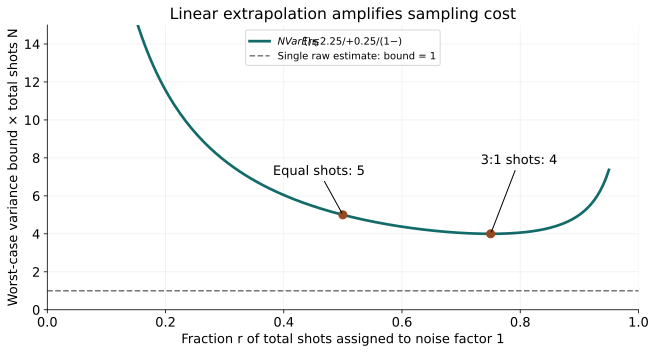
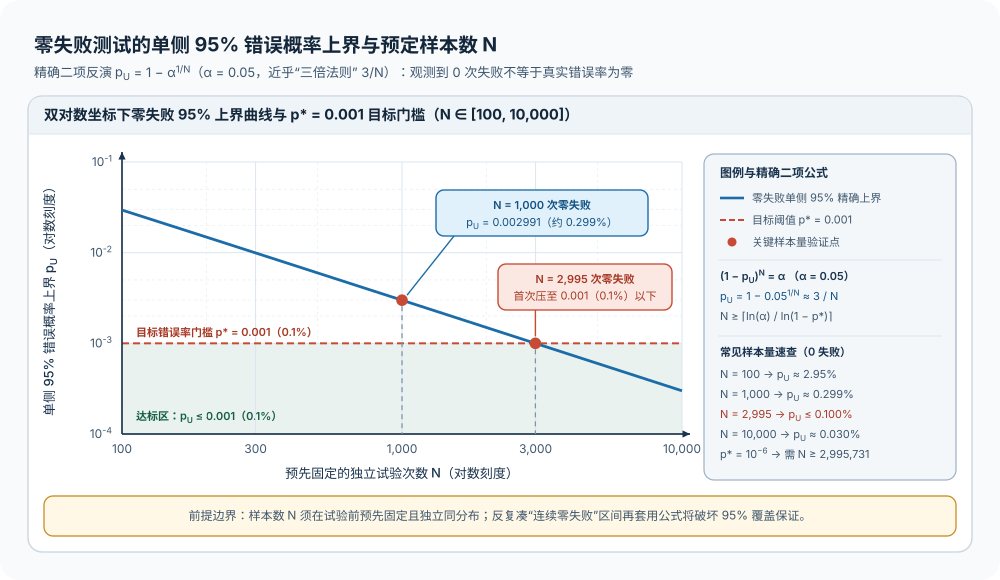
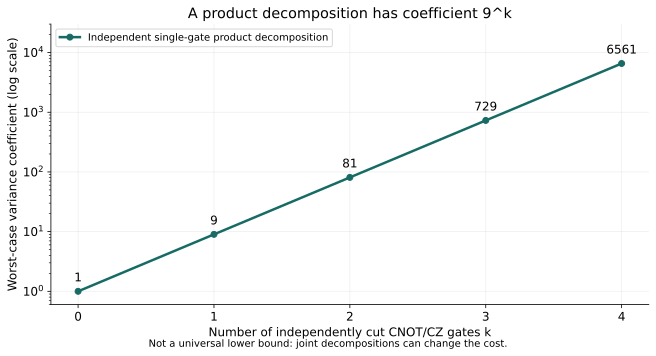

# 实验：有限样本、外推代价、统计重采样与编译等价性

配套[第 15 章](../15-practice-research.md)（并衔接第 08 章误差缓解与第 14 章编译验证）。本页采用预设合成计数与确定性固定种子算例来演示统计方法，而非真机采集数据。先在草稿纸上独立计算，再在仓库根目录运行以下三份纯 Python 3.9+ 标准库程序（无第三方依赖，切勿附加 `-O` 关闭断言）：

```sh
python3 codes/practice/experiments.py
python3 codes/practice/research_checks.py
python3 codes/practice/v4_practice_lab.py
```

其中[基础统计程序](../../codes/practice/experiments.py)（输出见[固定结果](../../codes/practice/results.json)）对应 `P15-A` 至 `P15-C`，[研究边界核验程序](../../codes/practice/research_checks.py)（输出见[研究边界结果](../../codes/practice/research-results.json)）对应 `P15-D` 至 `P15-G`，[进阶统计与等价性核验程序](../../codes/practice/v4_practice_lab.py)对应 `P15-H` 至 `P15-K`（ZNE 固定总 shots 最优分配、BCa / Cluster Bootstrap、零失败崩溃反例、少聚类 $t_{B-1}$ 覆盖率与 QCEC 随机态探针）。

## P15-A：同一个 Bell 点估计，为什么下界不同？

### 题目

三组测量分别为 $XX,YY,ZZ$，每次读出两比特乘积 $+1$ 或 $-1$。第一份数据的 $(n_+,n_-)$ 是 $(775,225),(250,750),(800,200)$。第二份只有中间一组改为 $(25,75)$。分别求 Bell 重叠点估计及至少 95% 覆盖的保守下界。

### 从原始计数开始

每组相关量为 $\hat c=(n_+-n_-)/(n_++n_-)$，因此两份数据都给出 $(0.55,-0.50,0.60)$。Bell 投影展开是

$$
|\Phi^+\rangle\langle\Phi^+|=\frac{I+XX-YY+ZZ}{4},
\qquad
\hat f=\frac{1+0.55+0.50+0.60}{4}=0.6625.
$$

注意负号来自投影展开；不能因为 $YY$ 的观测本来为负而再丢掉公式中的负号。

### 把每组自己的样本量代入

每组样本独立且有同一个期望时，取整体失败概率 $\alpha=0.05$，给各组分配 $\alpha/3$。Hoeffding 界和并合界给

$$
\varepsilon_i=\sqrt{\frac{2\ln(6/\alpha)}{N_i}},
\qquad
f\ge \hat f-\frac{\varepsilon_X+\varepsilon_Y+\varepsilon_Z}{4}.
$$

第一份三个误差半径都是 $0.0978518$，下界 $0.5891111$。第二份中 $N_Y=100$，半径变为 $0.3094347$，下界降到 $0.5362154$。两者仍高于 $1/2$，但证据余量不同。若错误地把第二份也按每组 1000 次算，就虚构了不存在的精度。

程序独立从计数重算每个分母，并断言第二份下界更低。此结论还要求三组对应同一稳定制备态、测量实现可信；并合界不需要三组事件互相独立，但每组内部的 Hoeffding 假设仍需成立。漂移、校准误差和事后挑选数据不会因增加采样次数（shots）自动消失。

## P15-B：为什么外推到 1.10 不代表测出了超物理态？

### 题目

把噪声强度缩放为 $\lambda=1,3$，得到 Pauli 期望估计 $0.90,0.50$。用一次多项式外推到零噪声。总预算为 4000 shots，比较均分和 3:1 分配的最坏抽样方差上界。

### 先算外推权重

假设这段噪声范围内 $E(\lambda)=a+b\lambda$。由

$$
E(1)=a+b,\qquad E(3)=a+3b
$$

消去 $b$，得到 $a=\tfrac32 E(1)-\tfrac12E(3)$。于是估计器为 $1.5\times0.90-0.5\times0.50=1.10$。它是带负权重的统计外推，不是另一个物理态直接测得的精确 Pauli 期望。将结果硬裁剪为 1 会改变偏差和区间性质，不能静默处理。

### 固定总 shots 才能比较代价

对 $\pm1$ 输出，独立均值的方差不超过 $1/N_i$。若两组独立，则

$$
\operatorname{Var}(\hat E_0)
\le\frac{(3/2)^2}{N_1}+\frac{(-1/2)^2}{N_3}.
$$

均分时 $N_1=N_3=2000$，上界是 $2.25/2000+0.25/2000=0.00125$。如果令 $N_1=rN$、$N_3=(1-r)N$，需要最小化 $2.25/r+0.25/(1-r)$。求导为 $-2.25/r^2+0.25/(1-r)^2=0$，解得 $r=3/4$。

因此分配为 3000 和 1000 次，上界变为 $0.001$。它仍是单个未缓解估计器最坏上界 $1/4000$ 的 4 倍；均分时则为 5 倍。这里说的是相同总预算下的**最坏方差上界**，不是所有实验实测方差都固定增加 4 倍，也不是均方误差必然更差：偏差是否降低要另行验证。



线性模型若失效、噪声缩放改变了错误种类，哪怕抽样方差很小也会出现模型偏差。可增加中间缩放点作留出诊断，但不要在同一数据上挑“最接近理想值”的模型后还沿用未挑选时的区间。

上图由[绘图程序](../../codes/practice/plot_figures.py)直接计算，绘图依赖见[依赖清单](../../codes/practice/requirements-figures.txt)。误差缓解工程实现可对照 [Mitiq 原始软件论文](https://quantum-journal.org/papers/q-2022-08-11-774/)及[源码索引](../appendices/software-practice.md)，本算例只实现线性外推的代数与代价。

## P15-C：做二十次检验，再挑显著的一次

### 题目

假设有 20 个互相独立的检验，每个真零假设下的假阳性概率恰为 0.05。至少一次假阳性的概率是多少？若要把整体假阳性控制在至多 0.05，可如何分配阈值？

### 详解

一次“不误报”的概率是 $0.95$。独立时二十次都不误报的概率为 $0.95^{20}$，所以至少一次误报为

$$1-0.95^{20}\approx0.641514.$$

这不是量子设备的特殊现象；反复换种子、换后选择阈值、换观测量也会产生类似选择问题。若检验相关，上式不再精确。

不依赖检验间独立性的简单办法是 Bonferroni 分配：每个检验使用 $0.05/20=0.0025$，由并合界整体不超过 $20\times0.0025=0.05$。代价是检验可能较保守。这里的保证还要求每个检验本身有效，不能弥补数据泄漏或随结果改假设。

扩展练习：预先固定一批开发数据选择编译器参数，另留一批未使用的数据作最终比较，并分别记录预算。详解要点是“参数选择”和“最终报告”使用不同数据；这解决部分选择偏差，不证明设备不存在漂移。

## P15-D：后选择更准确，为什么每次尝试反而更少成功？

### 题目与原始样本

下表是人为构造的任务计数，成功判据在采集前固定；“正确”只在已接受的结果中统计。它用于演示条件概率，不代表某个芯片的性能。

| 方法 | 原始尝试 | 被接受 | 接受且正确 |
|---|---:|---:|---:|
| A | 1000 | 800 | 720 |
| B | 1000 | 250 | 240 |

分别求接受率、接受后的正确率、每次原始尝试交付正确结果的频率。若所有尝试均为 10 ms、没有并行或额外启动开销，哪一种方法单位时间交付的正确结果更多？

### 逐步答案

A 的接受率为 $800/1000=0.8$，条件正确率为 $720/800=0.9$，联合频率为 $720/1000=0.72$。B 对应为 $0.25,0.96,0.24$。条件正确率提高了，接受率却大幅下降。

这里不需要假设“接受”和“正确”独立。直接按条件概率恒等式，

$$
P(\text{接受且正确})=P(\text{接受})P(\text{正确}\mid\text{接受}).
$$

每秒 100 次尝试时，两组样本对应 72 与 24 个正确结果每秒。若任务要求接受后的正确率至少为 95%，A 在点估计层面尚未满足，B 才有进一步评估资格；不能仅凭吞吐量宣布 A 更适合。实际验收还要给条件正确率的置信下界，尤其 B 的有效样本仅 250 个。

后选择可能本来就是协议定义的一部分，例如先兆纠缠生成。问题不在于“是否允许丢弃”，而在于事先规定接受规则、保存被丢弃的次数，并同时报告质量和交付率。把接受后的计数当成原始 shots，会在统计和成本两方面同时失真。

## P15-E：一千次零失败，不等于错误率为零

### 题目

独立重复同一操作 $N=1000$ 次，未发现任何失败。假设每次失败概率都是同一个 $p$，求单侧 95% 精确二项上界。若希望在“零失败”结果出现时，上界不超过 $10^{-3}$，至少应事先安排多少次测试？

### 从事件概率反解参数

零失败事件的概率为 $(1-p)^N$。把该概率设为显著性水平 $\alpha=0.05$，解出临界参数：

$$
(1-p_U)^N=\alpha
\quad\Longrightarrow\quad
p_U=1-\alpha^{1/N}.
$$

代入 $N=1000$ 得 $p_U=0.00299125$，约 0.299%。这是一套重复实验意义下的上界规则，不是给未知固定参数 $p$ 分配“95% 的后验概率”。精确二项法允许覆盖率高于名义值，离散计数通常使它较保守；方法定义见 [NIST 精确二项区间说明](https://itl.nist.gov/div898/software/dataplot/refman2/auxillar/exacbino.htm)（访问 2026-09-26）。

要求 $p_U\le p_*=10^{-3}$，先移项，再注意分母是负数：

$$
\alpha^{1/N}\ge1-p_*,\qquad
\frac{\ln\alpha}{N}\ge\ln(1-p_*),\qquad
N\ge\frac{\ln\alpha}{\ln(1-p_*)}.
$$

因此最小整数是 $N=2995$。这个设计只说明“若这 2995 次恰好零失败，可以得到指定上界”；它不保证实验一定零失败。若发生失败，要使用对应失败计数的完整二项反演。



代码还对 $N=20$ 的全部 21 种失败计数构造上界，再枚举 201 个真实概率点的覆盖率。网格检查能发现实现错误，覆盖定理仍来自二项检验反演，不能由有限网格代替。反复测试直到出现好看的“连续零失败”区间，再套固定 $N$ 公式，不满足本题的预先固定抽样设计；漂移和相关失败也要另建模型。

## P15-F：每个 shot 耗时不同，最优预算怎样变？

### 题目

仍取线性外推权重 $a_1=3/2,a_3=-1/2$。两种线路每个 shot 的成本分别为 $c_1=1,c_3=9$ 个时间单位，总预算 $C=9000$。忽略启动、通信与并行，独立 $\pm1$ 结果的方差用最坏上界 1。均分 shots 和时间约束下的最佳分配各是多少？

### 先写约束，再优化

固定总时间要求 $c_1N_1+c_3N_3=C$，并非固定 $N_1+N_3$。由柯西—施瓦茨不等式，

$$
\left(\sum_i|a_i|\sqrt{c_i}\right)^2
\le\left(\sum_i\frac{a_i^2}{N_i}\right)
   \left(\sum_i c_iN_i\right).
$$

等号在 $N_i\propto|a_i|/\sqrt{c_i}$ 时成立。因此 $N_1:N_3=1.5:(0.5/3)=9:1$，结合 $N_1+9N_3=9000$ 得 $N_1=4500,N_3=500$。方差上界为

$$
\frac{2.25}{4500}+\frac{0.25}{500}=0.001.
$$

均分 shots 时必须是 $N_1=N_3=900$，方差上界 $2.5/900=0.00277778$。P15-B 的 3:1 配比针对每个 shot 成本相同，不能照搬到这里。若已知各组单次标准差 $\sigma_i$，相同推导给 $N_i\propto|a_i|\sigma_i/\sqrt{c_i}$；实际需考虑整数取整和用于估计方差的先导样本预算。

## P15-G：负权重不是负概率，线路切割的代价怎样算？

### 题目

设目标期望写成 $\mu=\sum_j a_j\mu_j$，其中 $a=(1.5,-0.5)$，$\mu_1=0.4,\mu_2=-0.2$；每个可运行实验返回 $X_j\in\{-1,+1\}$。设计合法随机抽样和无偏估计器，并精确算单次方差。这两项仅作统计估计教学示例，并非某个具体量子门的物理分解。

### 把抽样概率与结果权重分开

先取 $\gamma=\sum_j|a_j|=2$。以 $q_j=|a_j|/\gamma$ 抽取实验，即概率 $(0.75,0.25)$，再运行选中的实验。记录带符号的数值

$$
Z=\gamma\,\operatorname{sgn}(a_j)X_j.
$$

$q_j$ 才是真正抽样概率，不能拿负的 $a_2$ 作概率。逐项取期望得

$$
\mathbb E Z
=\sum_j\frac{|a_j|}{\gamma}\gamma\operatorname{sgn}(a_j)\mu_j
=1.5(0.4)-0.5(-0.2)=0.7.
$$

本例每次 $Z^2=4$，故 $\operatorname{Var}(Z)=4-0.7^2=3.51$。独立重复 $N$ 次后样本均值方差是 $3.51/N$，一般上界是 $\gamma^2/N$。这一结论描述抽样代价，不包含物理分解误差、执行噪声或模型偏差。代码枚举所有四种“选实验＋结果”分支复算，而非只代入最终公式。

### 与真实线路切割连接

线路切割用局部可执行操作的准概率组合重构目标统计量。[原始研究中的单个 CNOT/CZ 分解](https://www.nature.com/articles/s41586-024-08178-2)在其指定操作模型中给出 $\gamma=3$，相应最坏抽样界系数为 9。若采用逐门独立的乘积分解，$k$ 个这样的切口给系数 $9^k$，两个是 81，四个是 6561。它不是所有切割方案的普适下界；[联合多门分解研究](https://quantum-journal.org/papers/q-2025-02-18-1634/)讨论了改变分解方式后降低开销的条件（两项来源访问 2026-09-26）。



切割减少单次所需硬件规模，却引入更多子实验和经典重构；它没有自动建立跨芯片纠缠链路。实际工程实现可对照[开源实现的逐步阅读路线](../appendices/software-practice.md)与本地 cutting 摘录，本题则聚焦统计估计器的无偏性与方差核算。

### 四组练习的代码、结果与绘图

运行 `python3 codes/practice/research_checks.py`，查看[源程序](../../codes/practice/research_checks.py)及[固定结果](../../codes/practice/research-results.json)。无第三方依赖、无随机采样，输入均已列在题目和输出中。两张图由[生成程序](../../codes/practice/research_figures.py)计算，使用与已有科学图相同的[绘图依赖](../../codes/practice/requirements-figures.txt)。

## P15-H：ZNE 固定总 shots 最优分配与指数偏差

配套[进阶统计与等价性核验程序](../../codes/practice/v4_practice_lab.py)（运行 `python3 codes/practice/v4_practice_lab.py`，纯 Python 3 标准库、固定种子 `20261125`）。

### 题目

把零噪声外推的噪声缩放点分别选为两点 $c = (1, 2)$、两点 $c = (1, 3)$ 与三点 Richardson $c = (1, 2, 3)$。假设每次独立测量返回 $\pm 1$（单次方差上界 $1$），比较“每档各采 $S$ 次”与“固定总预算 $N$ 次（均分 vs Cauchy–Schwarz 最优配比）”下的最坏抽样方差上界倍率；再在指数衰减曲线 $E(c) = -e^{-0.15 c}$ 上对照外推残余偏差与单比特退极化（$p = 0.02$）PEC 因子。

### 逐步核算与程序断言

由拉格朗日插值在 $c = 0$ 处的权重公式 $w_k = \prod_{j\neq k} \frac{c_j}{c_j - c_k}$，固定总 shots $N = \sum_k N_k$ 时，均分（$N_k = N/m$）的方差上界放大倍率为 $m\sum_k w_k^2$，而按 $N_k \propto |w_k|$ 分配时的最小方差上界放大倍率为 $\bigl(\sum_k |w_k|\bigr)^2$：

| ZNE 方案与缩放点 $c$ | 外推权重 $w_k$ | 每档等量 $S$ 发倍率 $\sum w_k^2$ | 固定总 shots $N$ 均分倍率 | 固定总 shots $N$ 最优配比与倍率 |
|---|---|---:|---:|---|
| 两点线性 $c = (1, 2)$ | $(2, -1)$ | $5\times$ | **$10\times$** | $2:1$ 配比，**$9\times$** |
| 两点线性 $c = (1, 3)$（见 `P15-B`） | $(3/2, -1/2)$ | $2.5\times$ | **$5\times$** | $3:1$ 配比，**$4\times$** |
| 三点 Richardson $c = (1, 2, 3)$ | $(3, -3, 1)$ | $19\times$ | **$57\times$** | $3:3:1$ 配比，**$49\times$** |

脚本以总预算 $N = 7000 \to (3000, 3000, 1000)$ 直接回代 $\sum w_k^2 / N_k = 49/7000$ 交叉断言。在指数噪声曲线 $E(c) = -e^{-0.15 c}$（理想值 $-1$）上，原始偏差 `0.139292` 经两点线性外推降至 `0.019402`，三点 Richardson 再降至 `0.002703`——可见高阶外推压低偏差的同时，方差倍率已从 $9\times$ 跳升至 $49\times$；而在 $p = 0.02$ 单比特退极化下，单门 PEC 因子 $\gamma_{\mathrm{PEC}} = (1 + p/2)/(1 - p) \approx 1.030612$，百层累积放大可达 $1.15^{100} \approx 1.174\times 10^6$。

## P15-I：BCa / Cluster Bootstrap 与 $k = 0$ 零失败崩溃反例

### 题目

针对四类高频实验数据，判断何时该用 Wilson / Clopper–Pearson、何时该用 BCa Bootstrap 或 Cluster Bootstrap，并用 `v4_practice_lab.py` 逐项验证：

1. **低概率二元比例**（$N = 100$，$p = 0.05$ 与 $p = 0.03$）：比较 Wald 区间与 Wilson 区间的精确二项覆盖率；
2. **零失败边界**（$N = 1000, k = 0$）：检验朴素有放回 Bootstrap、Wald、Wilson 与单侧 Clopper–Pearson 各自给出什么区间；
3. **非线性观测量**：沿用 `P15-A` 三基计数 $XX:(775, 225)$、$YY:(250, 750)$、$ZZ:(800, 200)$，对根保真度 $\hat F = \sqrt{0.6625} \approx 0.8139$ 比较 $B = 5000$ 次百分位 Bootstrap、BCa Bootstrap（带中位偏移 $z_0$ 与留一 Jackknife 加速系数 $a$）与 Hoeffding 保守下界；
4. **10 批时间漂移序列**（每批 200 次，计数 `[110, 109, 106, 111, 95, 106, 120, 133, 117, 127]`）：对照 Pearson $\chi^2$、朴素标准误、聚类标准误与整簇 Cluster Bootstrap。

### 逐步结果与防踩坑结论

- **低概率与 $k = 0$ 边界崩溃反例**：在 $N = 100$ 下，名义 95% Wald 区间精确覆盖率在 $p = 0.05$ 跌至 `87.75%`，在 $p = 0.03$ 跌至 `80.22%`（Wilson 保持 $> 94\%$）。当 $N = 1000, k = 0$ 时，原始样本全为 `0`，朴素 Bootstrap 每次重抽依然全为 `0`，区间与 Wald 一起崩溃成 **`[0.0, 0.0]`**；此时必须坚持 **Wilson**（双侧上界 `0.003827`）或 **Clopper–Pearson**（单侧 95% 上界 `0.002991`）。
- **非线性根保真度 BCa 区间**：固定种子 `20261125` 复算得 $\hat F = 0.8139$，95% 百分位 Bootstrap 为 `[0.8000, 0.8270]`，95% BCa Bootstrap 修正非线性开方偏态后为 `[0.7997, 0.8267]`，均远比无分布假设 Hoeffding 保守下界 `0.7675` 紧凑且稳稳高于纠缠门槛 $1/\sqrt{2} \approx 0.7071$。
- **分批漂移与整簇重采样**：10 批数据的齐性检验给出 $\chi^2 = 22.61$（显著拒绝概率恒定）；误把 2000 次当独立样本算出朴素标准误 `0.01108`，而按 10 批计算的聚类标准误高达 `0.01756`（放大 **1.59 倍**），整簇 Cluster Bootstrap 标准误 `0.01676` 同样准确捕捉了批间漂移方差。

## P15-J：少聚类自由度 $t_{B-1}$ 覆盖率检验与 Holm / BH-FDR 多重比较

### 题目

当实验只有 $B = 4$ 或 $B = 10$ 个独立时间块（或独立随机化电路聚类）时，若仍直接把聚类标准误乘正态分位数 $z_{0.975} \approx 1.96$ 构造名义 95% 置信区间，真实覆盖率会跌到多少？改用自由度 $B - 1$ 的学生 $t$ 分位数 $t_{B-1,\, 0.975}$ 后覆盖率如何变化？再对五项排序后的 $p$ 值 `[0.008, 0.011, 0.025, 0.042, 0.210]`（$\alpha = q = 0.05$）比较 Bonferroni、Holm–Bonferroni 与 BH-FDR 的拒绝个数。

### 逐步核算与蒙特卡洛断言

[进阶统计与等价性核验程序](../../codes/practice/v4_practice_lab.py)用纯标准库复合 Simpson 积分精确解出 $t_{3,\, 0.975} = 3.1824$（相对 $1.96$ 加宽 $62.4\%$）与 $t_{9,\, 0.975} = 2.2622$（加宽 $15.4\%$），并在固定种子下执行 $10{,}000$ 次蒙特卡洛覆盖率试验：

| 聚类数 $B$ | 自由度 $B - 1$ | 精确临界值 $t_{B-1,\, 0.975}$ | 误用正态 `1.96` 覆盖率 | 改用学生 $t_{B-1}$ 覆盖率 |
|---:|---:|---:|---:|---:|
| 4 | 3 | `3.1824` | **`84.86%`**（严重欠覆盖） | **`94.72%`** |
| 10 | 9 | `2.2622` | **`91.51%`**（明显欠覆盖） | **`94.81%`** |

五项多重比较的逐步核算如下（$\alpha = q = 0.05, m = 5$）：
- **Bonferroni**（统一门槛 $0.05/5 = 0.010$）：仅拒绝第 1 项（`0.008`），共 **1 项**；
- **Holm–Bonferroni**（门槛依次 $0.010, 0.0125, 0.0167, 0.025, 0.050$）：前两项 `0.008 <= 0.010`、`0.011 <= 0.0125` 拒绝，第 3 项 `0.025 > 0.0167` 停止，共 **2 项**（同样控制家族错误率 FWER 且检验力严格优于 Bonferroni）；
- **BH-FDR**（门槛依次 $0.010, 0.020, 0.030, 0.040, 0.050$）：最大满足下标 $k^* = 3$（`0.025 <= 0.030`），共拒绝 **3 项**（控制错误发现率而非零假阳性）。

## P15-K：$O(2^n)$ 张量切片引擎与编译等价性验证（QCEC 第一层探针）

### 题目

在 3 比特线性链 `0–1–2` 上编译远程门 $\mathrm{CNOT}(0 \to 2)$：合法编译电路 $C'$ 先做最近邻 $\mathrm{SWAP}(0, 1)$ 再做 $\mathrm{CNOT}(1 \to 2)$，并附带无关全局相位 $e^{0.3i}$ 与末态逻辑—物理布局 `(q0→1, q1→0, q2→2)`；错误编译电路 $C_{\mathrm{bad}}$ 把路由后的控制与目标写反为 $\mathrm{CNOT}(2 \to 1)$。如何避免构造 $2^n \times 2^n$ 稠密矩阵，用随机单比特乘积纯态快速完成编译正确性证伪？

### 实现与验证边界

`v4_practice_lab.py` 用纯 Python 标准库实现 $O(2^n)$ 步长索引单/双比特门作用与测量坍缩（不调用 `np.kron`），先通过 $HZH|0\rangle = |1\rangle$ 与坍缩回归，再构造 $16$ 条随机 3 比特单比特乘积纯态探针，将编译输出按末态布局 `(1, 0, 2)` 置换回逻辑比特序后计算根保真度 $|\langle\psi_{\mathrm{ref}}|\psi_{\mathrm{comp}}\rangle|$（天然忽略全局相位 $e^{0.3i}$）：

- **合法编译电路 $C'$**：全部 16 条随机探针的最大不保真度仅 $5.55 \times 10^{-16}$（$< 10^{-12}$ 断言通过）；
- **错误编译电路 $C_{\mathrm{bad}}$**：**16/16 条随机探针全部瞬间检出偏差**，无需枚举全部 $2^n$ 个计算基即可在毫秒级捕获路由错位或方向写反缺陷。

随机态探针属于**快速证伪层（第一层）**：检出差异即可立即确证编译错误，但 16 条探针全部通过仍不能替代对全希尔伯特空间的形式化证明。工业级编译等价性验证（如 MQT QCEC）会将随机探针与量子多值决策图（Alternating DD）及 ZX 演算并行编排，同时须留意一般线路等价性验证在最坏情形下属于 $\mathrm{QMA}$-完全问题（详见[第 15 章 §4.4](../15-practice-research.md#44-实验四编译前后的真实代价)）。
