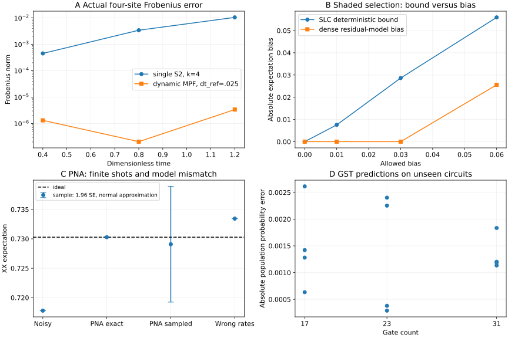

# 完整 SDK 实验册：从安装包到可核验输出

核验日期为2026-10-13。本页连接全书24篇正文的第四组练习，以及原先只有源码入口的算法与工程流程。完整软件包在独立环境中安装并真正执行，输出与明示解析式、独立矩阵计算或严格不变量比较。[程序总入口与环境说明](../../codes/sdk/README.md)提供依赖、命令和日志；历史97份第三方源码摘录仍保持原字节与提交。

这里的“通过”只表示所列任务达到验收条件。SDK包含的全部功能、上游全部测试、真实设备和生产系统是更大的范围；每行单独说明实际做了哪一步。各章先说明数学对象和条件，再读本页的版本与记录，避免把接口名当成算法推导。

## 1. 26个完整项目分别运行了什么

| 项目与实际版本 | 实际完成的任务 | 独立验收与正文连接 |
|---|---|---|
| Qiskit 2.5.2 | 线型连接图编译、布局校正、复相位态输出 | 比较完整酉、逐分量解析振幅；14章及[集成记录](../../codes/sdk/workflows/results-all.json) |
| Qiskit Algorithms 0.4.0 | Grover、VQE、迭代振幅估计IAE | 理想标记11、最低能量$-\sqrt{0.53}$、IAE原始计数与区间；07/08章 |
| Cirq 1.7.0 | 可逆oracle与完整非对角HHL | 反计算、成功概率$5/8$、解态$ (3,1)^T/\sqrt{10}$及条件观测；06/07章 |
| PennyLane 0.45.1 | 参数优化与两比特随机阴影采集/后处理 | VQE解析基线，保存30000次位串和随机基，逐项重算；08/13/16章 |
| OpenFermion 1.8.1 | 二模式费米子Hamiltonian→Pauli→矩阵 | 粒子数分块、独立Jordan–Wigner谱与错误全空间基线；08章 |
| Qualtran 0.7.0 | 模幂bloq与门分解 | 指数0–7的模算术与bloq分解经典语义；另验证Toffoli完整张量；07/16章 |
| pyqsp 0.2.0 | 真正求解对称QSP相位 | 独立连乘1001网格，比较目标虚部和酉性；16章 |
| quimb 1.15.0 | 五节点加权图连续时间行走 | 独立谱演化与概率守恒；16章 |
| The Walrus 0.22.0 | 合法Gaussian协方差与光子数概率 | 显式$\hbar=1$、模式重排、独立概率/截断尾；18章/Q4 |
| dimod 0.12.22 | 二变量QUBO与Ising穷举 | 每个配置能量与自旋符号逐一比较；17章 |
| Qiskit addon SQD 0.14.0 | 样本→去重→投影→子空间求解 | 完整谱、残差、限制子空间Ritz上界；08章及集成记录 |
| Qiskit addon MPF 0.3.0 | 约束解/cvxpy解→合成近似线路→重构 | 系数$(-1/3,4/3)$、独立精确演化、显式分解门数；[软件实践](../appendices/software-practice.md) |
| Qiskit addon OBP 0.3.0 | 两片反向传播与一项预算失败复现 | $U^\dagger ZU$对照，检测零接受段缺陷并恢复原问题；本页R72-OBP |
| Qiskit addon cutting 0.10.0 | Bell分区→生成实验→模拟→重构 | XX/ZZ/IZ等于1/1/0，保持标签及权重顺序；14/19章 |
| Pauli-prop 0.2.1 | 完整已安装Rust扩展传播/截断 | 矩阵回传及达到的$L_1$偏差界；软件实践13节 |
| Mitiq 1.1.0 | 门折叠、逐门退极化、Richardson重构 | 独立$-(1-4p/3)^k$，理想值−1；08/15章 |
| pyGSTi 0.10.2 | 仪器重复读数及有限采样LGST拟合 | 同POVM不同后态；92设置计数与长度1–12预测；19章及R72-GST |
| Aer 0.17.2 | 多模拟表示、54组噪声、动态测量/反馈 | CPTP、平衡态、六输入传态和分支统计；00/03/04/05章 |
| Qiskit Experiments 0.14.2 | 完整三设置QST、十二设置QPT拟合及低shots压力例 | 原计数→逆重构→修正态；CP与TP分开验收；02/05章 |
| QuTiP 5.3.1（基础）、5.2.3（控制环境） | 矩阵指数、主方程、4096随机轨迹、控制模型 | 指数解析式、轨迹标准误与主方程比较；01/Q2章；两环境分别锁定 |
| qutip-qtrl 0.2.0 | 受幅度限制GRAPE优化 | 独立指数乘积/梯度、过滤和三能级泄漏反例；14/Q3章 |
| Stim 1.16.0 | 距离3/5/7电路级表面码探测样本 | 保存电路、DEM、原事件/真实逻辑位；10章 |
| PyMatching 2.4.0 | DEM建图、批量匹配译码 | 与每次真实逻辑位比对，20000次中13/2/0失败及精确区间；10/11章 |
| SeQUeNCe 0.8.5 | 真正Timeline双节点量子发送与经典确认 | 1000次发送/624到达、50/60/110微秒时延；12章 |
| liboqs 0.15.0，完整提交`97f6b86b1b6d109cfd43cf276ae39c2e776aed80` | 完整C项目的三种ML-KEM构建、原例/测试与本书驱动 | 每参数10轮正确共享秘密、篡改隐式拒绝；12章 |
| SQD-HPC，完整提交`69f003f8304c8094ff06ba2600d38a0c683422ff` | 完整C++项目49测试/36652断言，本书三阶段驱动 | 后选择、无放回子采样、组态恢复及串行重现；R72-HPC |

Cirq至dimod这八项算法结果见[算法SDK记录](../../codes/algorithms/sdk/round72-results.json)；前两项Qiskit与Qiskit Algorithms见[集成记录](../../codes/sdk/workflows/results-all.json)。基础结果见[基础SDK记录](../../codes/foundations/sdk/all-results.json)，系统原始样本及过程见[系统SDK说明](../../codes/systems/sdk/README.md)。版本差异并非省略问题：QuTiP的两个环境分别保存了完整锁定文件，不能把跨版本结果当同一环境输出。

## 2. 练习R72-IAE：为什么三批样本也可能花掉很多oracle调用

实际IAE例用$A=R_y(2\arcsin\sqrt{0.2})$，从零态制备成功概率$a=0.2$。记$\theta=\arcsin\sqrt a$；在该二维成功/失败空间里做$k$次Grover放大后的成功概率为

$$
p_k=\sin^2((2k+1)\theta).
$$

固定每批512次、目标半宽0.005、错误概率参数0.05，SDK这次选择的实际幂为0、4、46；结果计数依次为95、379、298个成功。`powers`历史还包含初始0，所以保存的是`[0,0,4,46]`，不能把历史初始化条目当成又执行一批。

**题目。** 求实际总样本数及SDK口径的Grover调用数；若每个$Q^kA$独立重新制备，$A$与$A^\dagger$合计被调用多少次？

**答案。** 样本数为$3\times512=1536$。只计$Q$的调用数是$512(0+4+46)=25600$，与本次SDK记录相同。一个$Q^kA$含$k$次$A^\dagger$和$k+1$次$A$，因此合计$512[(1)+(9)+(93)]=52736$次；其中$A$调用$512(1+5+47)=27136$次，$A^\dagger$调用25600次。每次$Q$还含成功反射和零态反射。未分解oracle的门数、布局和真实执行时间不能从这两个数字直接得出。

采样器使用一次初始化的 `numpy.random.default_rng(72)`，各自适应批次持续推进同一伪随机流。固定版本把整数种子在每个pub重新初始化，会重复底层随机数；此前这种运行另存[复核前记录](../../codes/sdk/workflows/before-independent-review-results.json)，不能当作独立批次区间的证据。[官方采样器接口](https://quantum.cloud.ibm.com/docs/en/api/qiskit/qiskit.primitives.StatevectorSampler)支持传入持续的Generator（访问2026-10-13）。资源账本从真实pub计数与实际幂配对重算，不靠默认shots常数填写。

本次点估计0.19996176，区间约$[0.19943445,0.20048907]$包含0.2；这是固定种子的一次合成记录，不是95%覆盖率的证明。库结果的`shots`字段这次为`None`，本书另保存真正每批计数与样本分母。[官方IAE接口](https://qiskit-community.github.io/qiskit-algorithms/stubs/qiskit_algorithms.IterativeAmplitudeEstimation.html)与[可执行记录器](../../codes/sdk/workflows/validate_workflows.py)分别给出方法条件和本次证据。

## 3. 练习R72-OBP：预算拒绝后，必须把原问题还给执行器

本例先做$R_x(0.4)$，再做$R_y(\pi/6)$，测量$Z$。先反向传播最后一片得到

$$
R_y(\pi/6)^\dagger ZR_y(\pi/6)=\frac{\sqrt3}{2}Z-\frac12X.
$$

它有两项；若预算只许一项，应该拒绝这一片，保持原始可观测量$Z$和原来的两片电路。预算在这里是是否接受候选的资源约束，不能凭它丢掉$X$却不记录误差。

**题目。** 若metadata显示接受0片，剩余片数却为0，并返回上式候选，能否把它直接送往设备？

**答案。** 不能。接受$k$片后必须恰好剩下$n-k$片，并且返回算符要对应已接受的后缀。当$k=0$，Python切片`pieces[:-0]`等于空列表，不是全部输入；此版本初始候选与输出还有别名，拒绝时输出算符也已被候选修改。0.3.0的实际运行复现了这两点，来源可复查[版本源码](https://github.com/Qiskit/qiskit-addon-obp/blob/0.3.0/qiskit_addon_obp/backpropagation.py)。

本书保留首次失败，并依据已接受段数为0，恢复原始$Z$与完整电路，随后对照原始期望验算。大预算接受两片的正常路径也独立比较$U^\dagger ZU$。防护通过意味着本书没有继续使用不一致对象，不代表上游版本已经修复。[失败记录](../../codes/sdk/workflows/initial-failures.json)与[最终记录](../../codes/sdk/workflows/results-all.json)分别保存缺陷和防护。

## 4. 练习R72-CUT：重构精确，也可能需要九倍采样预算

Bell线路跨A/B分区后，SDK生成六项准概率分解、两侧各12个子实验。本次重构的是XX、ZZ、IZ，精确本地概率给出1、1、0，与未切割Bell态相同。

**题目。** 本次系数绝对值和为$\Gamma=3$，在各项独立、读数有界、按绝对系数分配shots的条件下，重构均值的保守方差是多少？为什么不能由本次精确重构报告它已经很小？

**答案。** 按软件实践11节的推导，令$N$为独立的**成对估计样本数**：每个样本在对应A、B子线路各取得一次读数，再取乘积。对这种明确的采样方案，有$\operatorname{Var}(\widetilde E)\le\Gamma^2/N=9/N$。未切割单个有界期望的对应保守界为$1/N$。每个成对样本至少需要两次子线路执行，因此$N$不是两侧执行次数之和；电路设置、分组读出及共享样本也可能改变实际预算。这里九倍比较的是相同估计样本口径下的方差上界，不是已经测得总设备成本恰九倍，也不是所有观察量的实际方差；Bell某些理想Pauli测量甚至确定。本次使用精确概率，没有实际有限shots，因此没有采样方差的实测记录。设备噪声、不同电路时长和共享样本的协方差需再加入预算。[官方切割流程](https://qiskit.github.io/qiskit-addon-cutting/tutorials/01_gate_cutting_to_reduce_circuit_width.html)（0.10.0，访问2026-10-13）。

## 5. 练习R72-MPF：真正合成近似电路，再比较偏差

SDK解出二阶MPF系数$(-1/3,4/3)$。取$\mathcal H=X+Z$、$\hbar=1$、$t=0.7$、输入$|0\rangle$，测$Z$，按软件实践11节的解析式得到精确值0.301106900552。

**题目。** 两步和四步Suzuki近似分别得到0.353680816462、0.314159979643，求重构和绝对偏差；为何直接对高层演化门取矩阵会导致错误的验证？

**答案。** $(-E_2+4E_4)/3=0.300986367369$，绝对偏差约$1.20533\times10^{-4}$；四步偏差约$0.01305308$。两步/四步线路实际分解后分别含6/12个一位`u`门，程序断言不再残留高层演化门；独立按 $[e^{-i\delta X/2}e^{-i\delta Z}e^{-i\delta X/2}]^k$、$\delta=t/k$ 连乘，所得期望与SDK两值最大差小于$3\times10^{-16}$。若直接读取高层PauliEvolutionGate的精确矩阵，就已经得到精确$e^{-it\mathcal H}$，绕过了待测的乘积公式。本书在执行前显式分解后再验算，库线性解还与cvxpy/CLARABEL约束解比较。理想偏差下降仍须计入$\Gamma=5/3$的方差开销；没有运行动态MPF张量网络。[官方MPF文档](https://qiskit.github.io/qiskit-addon-mpf/)

## 6. 练习R72-GST：为何要比较预测概率，而不是逐格比较门矩阵

线性门集层析LGST同时估计态制备、门和读出。把态向量记为$r$、读出行向量为$e^T$、门的Liouville矩阵为$G$，长度$\ell$的概率是$e^TG^\ell r$。只要$S$是同维可逆矩阵，变换

$$
r'=Sr,\qquad e'^T=e^TS^{-1},\qquad G'=SGS^{-1}
$$

就给出$e'^T(G')^\ell r'=e^TG^\ell r$：相邻$S^{-1}S$逐对抵消。这就是门集表示的gauge自由度；概率不变不要求每个矩阵元素都不变。程序另外取 $S=\operatorname{diag}(1,1.2,0.8,1.1)$，在12个长度上实际重算三对象的同时变换，概率最大差$1.12\times10^{-16}$；这只是Liouville坐标变换，不把S本身当作物理信道。LGST调用也使用目标模型作为初始gauge的参考，不能因此认为真实过程已等于目标。

**题目。** 本书实际生成92个互不重复设置、每设置16384次合成计数，完成LGST，再与独立密集矩阵计算比较长度1–12的预测。为什么不能把92个设置计数重复十遍，再说误差缩小到原来的$1/\sqrt{10}$？

**答案。** 复制记录没有增加独立制备和测量的信息，实际样本数仍是$92\times16384=1507328$，误差不会凭复制缩小。本次长度1–7的纯X重复检查电路也在训练集中，长度8–12才不在训练集中；JSON逐条标明，不能把全部12条都叫独立留出测试。程序同时核对生成列表、去重集合、数据集、计数字典均为92项，并逐项核对16384分母。LGST线性估计不自动施加CP约束，也不同于长序列最大似然GST；真实实验仍需检验SPAM假设、漂移与模型失配。完整[原始计数](../../codes/sdk/workflows/gst-counts.json)与[预测记录](../../codes/sdk/workflows/results-all.json)保留，算法依据[pyGSTi官方LGST源码](https://github.com/sandialabs/pyGSTi/blob/master/pygsti/algorithms/core.py)。

## 7. 练习R72-HPC：无放回子采样不等于无限扩展子空间

完整C++驱动遍历四位组态0–15，权重依次为1–16，保留低两位和高两位各恰有一个1的组态。

**题目。** 写出剩下的组态及条件权重。每批抽3个不同组态、重复8批，最多能给子空间增加几个独立基向量？

**答案。** 组态为0101、0110、1001、1010，原权重6、7、10、11，总34，归一化权重分别为$6/34,7/34,10/34,11/34$。虽然输出24个批内样本，去重后最多只有4个独立计算基向量；批间可重复不违背批内无放回。程序另检查组态恢复后的粒子数和总权重，以及同种子同构建的重现。完整上游49项测试/36652断言通过，但单进程串行验证没有提供MPI、OpenMP或多节点性能证据。[完整编译命令与结果](../../codes/sdk/hpc/README.md)

## 8. 怎样把工业实践继续做实

本轮把原先只有源码摘录的入口接成了可运行任务：采样与估计、子空间投影、切割重构、误差缓解、层析、译码、脉冲和网络事件。工业实验的下一步，应围绕同一任务保存输入、设备/编译/校准快照、所有样本、计算节点与费用、最终合格输出，再与同质量的强经典基线比较。

仍未执行完整shaded-lightcone/PNA、任意规模隐藏子群、拓扑/分布式容错、动态MPF、所有GST拟合变体或真实客户部署；量子网络发送与确认也不是纠缠网络安全证明。相应入口与限定证据保留在[软件实践对照](../appendices/software-practice.md)，可以沿明确缺口继续研究，不能把本地CPU通过改写成生产或量子优势结论。

## 9. 第73轮补缺口：先把“未实现”拆成可验收任务

核验日期2026-10-13。三组逐篇完整读审24篇正文，再交换复算。现有章节能容纳这些内容，因此扩充现有实验册与相关章节，保留原251道自检题编号。新增F73/A73/S73标签见[逐章目录](README.md)，完整集成代码见[第73轮SDK说明](../../codes/sdk/round73/README.md)。第72轮证据保留其原日期与范围。

| 上轮尚缺的环节 | 本轮真正执行 | 剩余界限 |
|---|---|---|
| HHL负谱、离网格与反计算残余 | Cirq全QPE、带符号倒数旋转、反计算、原始联合态和实际采样 | 硬截断例不是一般HHL复杂度/误差定理，输出完整向量仍有读出成本 |
| 离散行走搜索、QSVT分量、适应性MBQC | 6位SKW超立方搜索；负谱非对角QSVT与选择位；两步MBQC反馈和四支核对 | 不代表一般MNRS、任意多项式求相位或通用测量计算规模 |
| 层析物理约束、SPAM与时变开放演化 | 完整QST读出校准，QPT全复数CP+TP加权拟合与多项似然，时变mesolve/2048轨迹，噪声经典反馈 | 合成校准和局部模型；读出后处理不能修复已经发生的错误反馈 |
| 纠错/控制/网络 | X/Z×3码距×3噪声率、成对相关译码；直接3级GRAPE；完整两轮纠缠生成→交换→硬截止 | 模型、配对区间及进程内SeQUeNCe防护见各章；非实时控制、连续T2或真机 |
| 动态MPF与较长GST | MPO后端动态权重；CPTPLND长序列似然拟合与未训练电路预测 | 病态权重、参考误差、gauge和有限模型必须单列 |
| shading、PNA与PEC采样 | 完整SLC界/选择、逆噪声采样/本地执行/SDK后处理；PNA生成与有限shots | 已知合成噪声，不是硬件noise learning或云Executor |
| 真正counter-based并行随机流 | 官方Philox4x64、SQD-HPC、serial与1/2/4/8线程 | 单机OpenMP，不是MPI或生产HPC规模 |

## 10. 练习R73-MPF：动态权重与参考演化都要独立查

白话说，先分别求几条浅线路的输出，再寻找经典组合权重，使组合后的目标量更接近参考。动态MPF把随总时间改变的重叠矩阵交给优化器；“动态”不是中途根据测量结果反馈量子门，也不是相干叠加这些线路。

本例4个自旋、初态$|0101\rangle$，顺序$|q_0q_1q_2q_3\rangle$且$q_0$为最高位。取$\hbar=1$、无量纲时间，三条相邻键各为$0.4XX+0.2YY+0.3ZZ$，以偶/奇键划分$H=A+B$。二阶步为

$$
S_2(\tau)=e^{-iA\tau/2}e^{-iB\tau}e^{-iA\tau/2},\qquad
|\psi_k(t)\rangle=S_2(t/k)^k|0101\rangle.
$$

取$k=(2,3,4)$，$\rho_j=|\psi_{k_j}\rangle\langle\psi_{k_j}|$，$\rho_*$为目标纯态。定义

$$
M_{ij}=\operatorname{Tr}(\rho_i\rho_j)=|\langle\psi_i|\psi_j\rangle|^2,
\qquad L_i=\operatorname{Tr}(\rho_i\rho_*).
$$

展开Frobenius范数平方，使用$\operatorname{Tr}\rho_*^2=1$，得到

$$
\left\|\sum_i c_i\rho_i-\rho_*\right\|_F^2
=c^TMc-2L^Tc+1.
$$

完整MPF后端实际以MPO/TEBD构造$M,L$，bond上限16、截断$10^{-13}$。另用16维矩阵指数复算，并用谱分解再交换核对。约束为$\sum_i c_i=1$与$\sum_i|c_i|\le10$，在$t=0.4,0.8,1.2$和参考步长0.05/0.025分别求解，保存所有矩阵、权重、负谱和目标误差。

**题目。** 优化器报`optimal`，为何还要检查条件数？$\sum_i c_i\rho_i$是否一定是可制备的态？

**逐步答案。** 很相近的线路输出使Gram矩阵接近奇异。$t=0.4$时条件数约$2.58\times10^{13}$，MPO与dense矩阵仅相差极小浮点量，权重却可相差约2.82；参考误差也会被放大。求解状态不证明这些系数稳定、唯一或高精度最优。直接重构误差仍可很小：该点约$1.32\times10^{-6}$，而单独4步约$4.50\times10^{-4}$。这是本例输出核对，不是权重可靠性的证明。

负权重可使组合矩阵有负特征值，因此这是准概率式经典重构，不把它写成实际制备的密度矩阵。与旧R72-MPF相同，shots方差还随系数绝对值和$\Gamma=\sum_i|c_i|$放大。

**加问：参考后端写“四阶”就可信吗？** 对称二阶公式的对数含$\tau H+\tau^3 E_3+O(\tau^5)$。五段合成的权重取$p,p,1-4p,p,p$，时间系数和为1；消三阶项还须

$$
4p^3+(1-4p)^3=0,\qquad p=\frac1{4-4^{1/3}}.
$$

由$1-4p=-4^{1/3}p$可直接解出第二式，中间子步为负。实际安装quimb1.15.0却用了$p=1/(4\,4^{1/3})$，上述三次系数约0.0662942，不能一般消掉$E_3$。非对易本例步长每减半，原实现误差比约4，显式修正后约16。脚本保留原失败，使用本书子类窄修正参考系数，不修改上游包或源码摘录；不能称原发行版缺陷已修复。[原始Suzuki分解综述](https://arxiv.org/abs/math-ph/0506007)、[MPF动态API](https://qiskit.github.io/qiskit-addon-mpf/apidocs/qiskit_addon_mpf.dynamic.html)

## 11. 练习R73-SLC：只缓解会影响目标的噪声

完整PEC可能花很多样本。Shaded lightcones先询问某处的Pauli错误对指定最终可观测量有多大影响，给确定性偏差界，再在预算内优先缓解较重要的项。这里的“阴影”是时空影响权重，与第16章随机测量的经典阴影不同。

对一个Pauli生成元$P$，无量纲累积率$r\ge0$的信道为

$$
\mathcal E_r=e^{r(\mathcal P-\mathcal I)},\quad
\mathcal P(\rho)=P\rho P,\quad
\mathcal E_r(\rho)=(1-p)\rho+pP\rho P,\quad
p=\frac{1-e^{-2r}}2.
$$

因为$\mathcal P^2=\mathcal I$，对易部分不变、反对易部分乘$e^{-2r}$。设该位置的有效错误与目标的对易子范数界为$b$，省略缓解的单项偏差至多$bp$。多个项需要在方法所用的前向/后向时序分区条件下累计，不能对每项任意挑较小的一侧再拼一个未经证明的界。[SLC官方方法与版本入口](https://quantum.cloud.ibm.com/docs/en/addons/qiskit-addon-slc)

**题目。** 当$b=0.4,r=0.01$时，省略该项的界是多少？完整逆信道的采样放大是多少？

**逐步答案。** $p=(1-e^{-0.02})/2\approx0.00990066$，所以$bp\approx0.00396027$。逆信道把反对易部分乘$e^{2r}$，其两项准概率分解的绝对值和为$\gamma_{\rm PEC}=e^{2r}$，保守采样系数为$\gamma_{\rm PEC}^2=e^{4r}$。多处被选项按实际出现次数累计率；唯一噪声模型只存一次，不意味着只发生一次。

实际代码运行3位、两步含$R_x$与CX的线路，先转到本机模板支持的原生门并吸收单比特门，再完整计算forward/backward/merge/select。四次噪声箱、两个唯一模型共30项，率由固定seed生成。保存全部界、选择mask、成本与独立密度矩阵残余信道结果。容忍界0.06时，实际残余偏差约0.025576，界约0.055935；两者不能互换。

**从mask走到真实PEC执行。** 安装SLC0.1.0返回的是0/1“选择”mask；取消噪声时向Samplomatic传负mask，不能照方法名直接把正mask送进去。正率添加噪声，负率才采样逆映射。局部Pauli编号按全局量子比特canonical顺序，箱内门参数顺序可能相反；脚本对噪声映射使用显式排序并保留首次错误映射的失败，防止把位序错当算法失效。[官方完整shading→PEC示例](https://quantum.cloud.ibm.com/docs/en/tutorials/pec-with-shaded-lightcones)

Samplomatic真实生成模板、参数与四箱符号；Aer分别执行全缓解与部分缓解各1024条随机化线路，每条64shots。最后调用qiskit-mitigation的PEC后处理。全缓解$\gamma_{\rm PEC}\approx1.509005$，估计0.892380、随机化聚类标准误0.014756，对照0.911400；部分缓解估计0.887079、标准误0.003914，对照残余模型0.885824。全部原计数、参数与符号保留。

**统计加问。** 同一条随机化线路的64shots能当作64次独立抽到的逆信道吗？不能。令$Y_a=\gamma_{\rm PEC}s_a\bar x_a$，$s_a\in\{-1,1\}$为该随机化的符号，$R$为独立随机化数，则

$$
\widehat\mu=\frac1R\sum_{a=1}^RY_a,\qquad
\widehat{\rm SE}=\sqrt{\frac{\sum_a(Y_a-\widehat\mu)^2}{R(R-1)}}.
$$

这保留共享随机电路造成的聚类波动。实际mitigation0.1.1非broadcast接口把方差写进名为`stds`的字段，还把随机化并入shots；直接当标准误会严重错读。本书同时独立重算，并调用broadcast路径的`twirl_stds`核对；其$ddof=0$需乘$\sqrt{R/(R-1)}$才与上式一致。输出数值正确和不确定度正确是两次验收。全不缓解时SLC0.1.0另有空mask索引缺陷，原始异常保存。本书显式构造全零选择和成本1，再实际执行第三批1024×64作为无缓解对照：估计0.666199、cluster SE0.002818，对照0.663184；省略偏差0.248216低于界0.342178。这是窄防护，不声称上游已修。[完整mitigation接口](https://quantum.cloud.ibm.com/docs/en/addons/qiskit-mitigation)

## 12. 练习R73-PNA：把逆噪声放进可观测量

PNA使用软件生成反噪声可观测量，让带噪线路上的期望逼近理想目标。它不把负概率噪声真的施加到设备上。和PEC一样，逆映射会放大系数与噪声模型误差；截断和多层非对易问题需要另验。[PNA官方方法](https://quantum.cloud.ibm.com/docs/en/addons/qiskit-addon-pna)

本例只有一个噪声层，线路为前段$V$、噪声$\mathcal E$、后段$U$。把$O$先拉回该层，再逆伴随映射，最后送回末端：

$$
\widetilde O=U(\mathcal E^\dagger)^{-1}(U^\dagger OU)U^\dagger.
$$

代回含噪期望，利用伴随定义即可得到理想值；条件是本例逆映射存在且模型正确。Pauli生成元的对易分量不变，反对易分量乘$e^{2r}$。这与只传播$U^\dagger OU$的OBP不同，后者没有取消噪声。

实际PNA0.2.0生成两位$XX$的反噪声展开，独立矩阵逐格差小于$5\times10^{-16}$；Aer原始值约0.717788、理想与精确缓解约0.730279。系数绝对值和约1.017561，谱范数约1.016371，二者是不同对象。

**题目。** $\widetilde O=\sum_j a_jP_j$，各Pauli用独立线路测量，怎样分配总20000shots并复算标准误？

**逐步答案。** 单组均值$\widehat m_j$有估计方差$(1-\widehat m_j^2)/(N_j-1)$，所以

$$
\widehat\mu=\sum_ja_j\widehat m_j,\qquad
\widehat{\rm Var}(\widehat\mu)=\sum_j a_j^2\frac{1-\widehat m_j^2}{N_j-1}.
$$

保守分配取$N_j\propto|a_j|$，整数余量给最大项。实际估计0.729079，标准误0.005020；样本、测量基与种子全部保存。若同批共测，必须加入协方差，不能继续使用本题独立线路公式。95%图示采用$1.96\,\rm SE$正态近似，不是有限样本严格置信保证。

**标定反例。** 把模型率乘1.25，却让物理线路保持原噪声，缓解值变为0.733437，确定性偏差约0.003157。增加shots不会消掉这个偏差；系数较小也不保证标定正确。本例只验证一层已知Pauli噪声的完整流程，多层传播、截断、大尺度和硬件学习仍需独立研究。

图A使用直接Frobenius范数，纵轴对数；图B区分确定性界与实际模型偏差；图C只有有限shots点有正态近似误差棒；图D为12条未训练电路的总体概率对照，无留出有限计数。四图均来自保存的本地完整SDK结果，不是客户设备或生产收益。可重画的[生成器](../../codes/sdk/round73/figures.py)与[原始结果](../../codes/sdk/round73/README.md)同时保留。

## 13. 练习R73-GST：更长序列、SPAM与gauge

LGST的短线路代数初估不是长序列门集拟合。本轮实际pyGSTi0.10.2从带少量退极化的起点开始，用CPTPLND物理参数化联合拟合制备、效果和门。germ重复长度取1、2、4、8，对应92、168、285、448个累计不同设置；最后448设置各4096shots，共1835008次。不同阶段有重复设置，不能把四个累计数相加当独立数据。

多项计数的负对数似然在忽略参数无关常数后为

$$
\ell(\theta)=-\sum_{c,o}n_{c,o}\log p_\theta(o\mid c).
$$

若$n_{c,o}>0$却$p_\theta(o\mid c)=0$，这一项为$+\infty$。原记录把概率截到$10^{-12}$以便输出有限评分，现明确单列`clipped_negative_log_score`与零概率冲突数；ideal的截断评分约1169606.52，不是其真实有限NLL。拟合/生成模型所有训练概率为正，NLL约908103.54/908119.26。拟合在有限数据上略优于生成参数是正常现象，不能据此称它更接近真实过程。

**题目。** 为什么不逐格比较两套门矩阵就判断拟合失败？

**逐步答案。** 在Liouville表示中，任意可逆坐标变换$S$同时改变$\rho\mapsto S\rho$、$G\mapsto SGS^{-1}$、效果行向量$e^T\mapsto e^TS^{-1}$，内部$S^{-1}S$逐项抵消，所有预测概率不变。这个gauge自由不是额外物理信道。交叉程序实际改变坐标并验证概率，同时从归一化Pauli基重建制备、POVM和门Choi，检查正性与完整TP。

另外生成未进训练集的17、23、31门线路，各4条，以独立密集PTM乘积对照拟合概率；最大绝对误差约0.002616。这里验证的是总体概率预测，没有新的留出有限shots置信区间，也没有验证非Markov漂移。实际拟合、计数、seed73191、模型表示与独立物理检查入口见[代码与证据](../../codes/sdk/round73/README.md)、[pyGSTi官方项目](https://github.com/sandialabs/pyGSTi)。

## 14. 练习R73-HPC：按工作项定位Philox随机流

本轮以官方Random123的Philox4x64-10构造C++17引擎，接入完整固定SQD-HPC。每个稳定工作项ID放在counter的第0字，抽取更多随机块时递增第3字，并向第2/1字进位。不能把第0字也用作抽样计数，否则会进入另一工作项的流。先检查官方全零key/counter已知向量，再跑恢复任务。[官方Random123源码](https://github.com/DEShawResearch/random123)、[SQD-HPC随机流约定](https://qiskit.github.io/qiskit-addon-sqd-hpc/random-number-generation.html)

**题目。** 同seed的普通引擎与counter-based引擎，线程数改变后分别会怎样？

**逐步答案。** 普通引擎若按线程分配，任务到线程的映射改变会换随机序列。counter-based方式按任务定位，线程只决定谁执行该任务。本例4000条8bit输入，修复后上下两个4位寄存器各恰有2个粒子；serial及OpenMP1/2/4/8线程的Philox输出逐字一致、归一化权重总和为1，普通mt19937输出则改变。可重复不自动证明统计独立、低偏差或高性能。

完整项目另实际通过51上游测试、36669断言；测试数按本次实际编译条件记录，固定SQD提交没有刷新；不要把不同构建的测试数量差当作新增算法。这是单机CPU并行任务，不是C++26标准Philox引擎、MPI、多节点或量子优势。编译依赖、失败配置、修正日志和五份输出见[HPC证据](../../codes/sdk/round73/hpc/results.json)。
