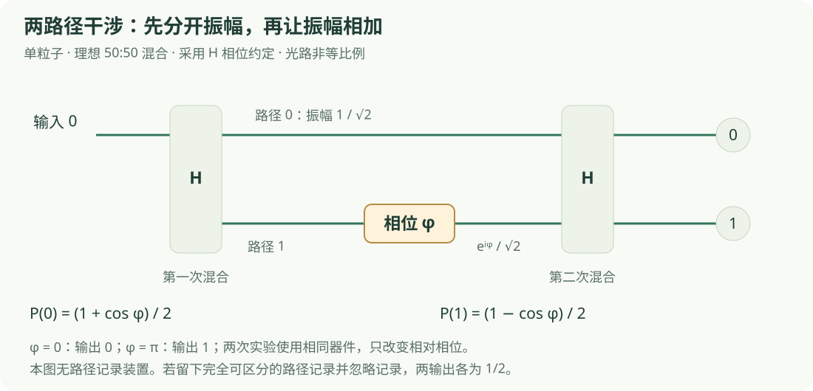

# Q1｜从实验认识量子态

先修：[第 01 章：够用而不跳步的数学工具](../01-math.md)。本章先从可重复实验建立“制备—变换—测量”的语言，再把它写成二维向量。第一次阅读可先走 §1、§2.1–2.2、§3–5：每个结论都有直接的概率或计数例子。§2.3 用密度矩阵解释**部分**路径记录，适合读过[双比特](../03-multiple-qubits.md)与[密度矩阵](../05-noise-channels.md)后回看；暂时跳过它，不妨碍理解本章的理想实验。下一步可读[第 02 章：单量子比特](../02-single-qubit.md)。

## 1. 状态首先是一套可检验的预测

一次量子实验至少要说清三件事：

1. **制备**：怎样让每一轮实验从同一操作条件开始；
2. **变换**：系统在制备与测量之间经过什么器件或演化；
3. **测量**：记录哪些互斥结果，以及各结果在许多次重复中出现多频繁。

这里的“同一制备”不是拿同一个粒子反复读取，而是按同一操作流程制备许多轮。单轮可能只得到一个探测器点击；量子态则汇总这套制备在各种允许测量下的概率预测。它不是探测器屏幕上的一个光点，也不只是“我们暂时不知道答案”的代称。

先看一个只有两条路径的系统。取正交归一基

$$
|0\rangle=
\begin{bmatrix}1\\0\end{bmatrix},
\qquad
|1\rangle=
\begin{bmatrix}0\\1\end{bmatrix},
$$

分别表示粒子处于上、下路径。一般纯态写成

$$
|\psi\rangle=\alpha|0\rangle+\beta|1\rangle,
\qquad \alpha,\beta\in\mathbb C.
$$

若直接测量路径，Born 规则给出

$$
p(0)=|\alpha|^2,
\qquad
p(1)=|\beta|^2.
$$

两种结果穷尽所有可能，所以总概率为 1：

$$
|\alpha|^2+|\beta|^2=1.
$$

这就是态矢量的归一化条件。注意逻辑顺序：线性代数告诉我们怎样算内积和模平方；**Born 规则是把模平方与实验概率联系起来的物理公设**，不是从“向量必须归一化”单独证明出来的。归一化只是保证采用 Born 规则后总概率为 1。Born 在 1926 年的散射研究中提出波函数的概率解释；现代教材把它列为量子力学公设，而不是线性代数定理。[Born 原始论文记录](https://doi.org/10.1007/BF01397477)和 [MIT 的量子力学公设讲义](https://www.ocw.mit.edu/courses/5-61-physical-chemistry-fall-2007/e69210652de904428188a04bd0345440_lecture10.pdf)分别提供历史来源和现代课程表述。

### 算例：先归一化，再算概率

设某个未归一化向量为

$$
|v\rangle=\sqrt3|0\rangle+i|1\rangle.
$$

它的范数平方为

$$
\langle v|v\rangle=|\sqrt3|^2+|i|^2=3+1=4.
$$

因此对应的归一化态是

$$
|\psi\rangle=\frac{|v\rangle}{2}
=\frac{\sqrt3}{2}|0\rangle+\frac i2|1\rangle.
$$

直接测量路径得到

$$
p(0)=\left|\frac{\sqrt3}{2}\right|^2=\frac34,
\qquad
p(1)=\left|\frac i2\right|^2=\frac14.
$$

概率来自复振幅的模平方，不是把振幅普通平方；$(i/2)^2=-1/4$ 当然不能作为概率。

### 概率预测怎样与实验计数相接

Born 规则预测的是在相同条件下重复制备、重复测量时的分布，不保证一小批实验恰好等于理论比例。若上例独立重复 $N=400$ 次，把“测得路径 0”记为成功，则理论均值是

$$
\mathbb E[n_0]=Np=400\times\frac34=300,
$$

计数的标准差是

$$
\operatorname{sd}(n_0)
=\sqrt{Np(1-p)}
=\sqrt{400\times\frac34\times\frac14}
=\sqrt{75}\approx8.66.
$$

因此某批得到 293 次路径 0 并不反驳 $p(0)=3/4$。随着重复次数增加，频率通常更接近理论概率，但有限样本仍会波动。另一方面，若探测器把路径 0 系统性错报为路径 1，那么改变的是实验装置与理论模型之间的对应，不能把这种偏差全都称作“量子随机性”。实际检验要同时报告样本量、统计不确定度和装置误差。

## 2. 两路径干涉：先加振幅，再取模平方

Mach–Zehnder 干涉仪有两个平衡分束器、两条路径和两个输出探测器。把单粒子逐个送入，只要两条路径保持相干，许多轮累积后仍会出现随相位变化的输出统计。MIT Quantum Physics I 的[课程讲义](https://ocw.mit.edu/courses/8-04-quantum-physics-i-spring-2016/7f930e013cef9cd7dec5aa88baa83f0a_MIT8_04S16_LecNotes1.pdf)以这一装置说明：单粒子态在两条路径上叠加，第二个分束器处的两个路径振幅发生干涉。

### 2.1 先声明分束器的相位约定

真实光学分束器的反射振幅常带固定的 $i$ 相位；不同教材也会交换输入、输出端口的名字。只要从头到尾一致，这些约定给出相同的可观测结论。本章把镜面反射和分束器带来的固定相位吸收到路径基与相位零点中，用下面的有效矩阵表示每个平衡分束器：

$$
B=\frac1{\sqrt2}
\begin{bmatrix}
1&1\\
1&-1
\end{bmatrix}.
$$

这个 $B$ 正是第 02 章会介绍的 Hadamard 门 $H$；这里只把它当作两条路径振幅的有效变换，不要求读者先知道量子线路门。

它满足 $B^\dagger B=I$，因此保持总概率。相位片只放在下路径，写成

$$
U_\phi=
\begin{bmatrix}
1&0\\
0&e^{i\phi}
\end{bmatrix}.
$$

端口 0 入射时，三个步骤分别是

$$
|0\rangle
\xrightarrow{B}
\frac{|0\rangle+|1\rangle}{\sqrt2}
\xrightarrow{U_\phi}
\frac{|0\rangle+e^{i\phi}|1\rangle}{\sqrt2}
\xrightarrow{B}
|\psi_{\rm out}\rangle.
$$

逐项乘矩阵：

$$
|\psi_{\rm out}\rangle
=\frac12
\begin{bmatrix}
1+e^{i\phi}\\
1-e^{i\phi}
\end{bmatrix}.
$$

因此到达两个探测器的振幅为

$$
A_0=\frac{1+e^{i\phi}}2,
\qquad
A_1=\frac{1-e^{i\phi}}2.
$$

先加振幅，再取模平方。例如

$$
\begin{aligned}
P_0
&=|A_0|^2\\
&=\frac14(1+e^{-i\phi})(1+e^{i\phi})\\
&=\frac14(2+2\cos\phi)\\
&=\frac{1+\cos\phi}{2}.
\end{aligned}
$$

同理

$$
P_1=\frac{1-\cos\phi}{2},
\qquad P_0+P_1=1.
$$

几个相位点可直接核对：

| $\phi$ | $A_0=(1+e^{i\phi})/2$ | $A_1=(1-e^{i\phi})/2$ |
|---:|---:|---:|
| $0$ | $1$ | $0$ |
| $\pi/2$ | $(1+i)/2$ | $(1-i)/2$ |
| $\pi$ | $0$ | $1$ |

| 相位差 | 探测器 0 概率 | 探测器 1 概率 | 观察 |
|---:|---:|---:|---|
| $0$ | $1$ | $0$ | 端口 0 完全相长 |
| $\pi/2$ | $1/2$ | $1/2$ | 两端口等概率 |
| $\pi$ | $0$ | $1$ | 明暗端口互换 |

图和以上公式都限定为：理想无损元件、平衡分束器、没有任何装置留下路径记录。实验中的损耗、不完全可见度和探测器效率会改变计数，但不改变“可区分路径信息会削弱干涉”这一结构。

这张振幅表还显示了概率表没有直接展示的信息。$\phi=\pi/2$ 时，两个输出振幅都是复数；它们不是概率，也不能按实数正负来解释。到最后一步才分别取模平方：

$$
\left|\frac{1+i}{2}\right|^2
=\left|\frac{1-i}{2}\right|^2
=\frac12.
$$

$\phi=0$ 时，通向端口 1 的两项正好相消；$\phi=\pi$ 时，相消改发生在端口 0。所谓“干涉”不是粒子数出现负值，而是复振幅在取模平方以前发生相加或相消。

### 2.2 先用输出计数区分三种实验

“粒子经过两条路径”“测了路径但没看结果”“已知路径结果”对应不同预测。

固定相位差 $\phi=0$，假想每组独立做 100 轮、器件无损且探测完全。下面的数字是**期望次数**，不是保证每组恰好发生的次数：

| 中间发生了什么 | 第二个分束器后探测器 0、1 的概率 | 100 轮的期望计数 |
|---|---|---|
| 没有装置留下路径记录 | $(1,0)$；两路振幅在端口 0 相加、在端口 1 相消 | $(100,0)$ |
| 理想装置完整记录了路径，后来把记录丢弃 | $(1/2,1/2)$；两条已可区分的分支按概率合并 | $(50,50)$ |
| 理想装置完整记录了路径，并按“上路/下路”分组 | 每个条件子组在两个输出端均为 $(1/2,1/2)$ | 每组约 50 轮，各组再约 $(25,25)$ |

最后一行的“每组约 50 轮”是因为第一道平衡分束器把路径分成等权两支；两组重新相加仍是约 $(50,50)$。它与第二行的总输出计数相同，却保留了不同的经典记录，能做不同的后续条件控制。**关键不是实验者眼睛有没有看记录，而是物理装置有没有把两条路径变成可区分的分支。**阻挡一条路径则会损失粒子，是第四种实验，不能放进这张无损表。

### 2.3 进阶回看：部分路径记录怎样削弱干涉

下面会提前用到密度矩阵，只需先掌握几条最小规则。纯态 $|\psi\rangle$ 写成 $\rho=|\psi\rangle\langle\psi|$；若系统以经典概率 $p_j$ 处于 $|\psi_j\rangle$，但分支标签不再可用，则写成 $\rho=\sum_jp_j|\psi_j\rangle\langle\psi_j|$；酉变换 $U$ 把它变成 $U\rho U^\dagger$；对归一化测量态 $|m\rangle$，概率是 $\langle m|\rho|m\rangle$。因此，密度矩阵只是把“对这个系统还能预测哪些测量概率”集中记在一张矩阵里。第 05 章会给出完整定义。

**情形 A：不测路径，也没有路径记录。** 第二个分束器接收相干态

$$
|\psi_\phi\rangle
=\frac{|0\rangle+e^{i\phi}|1\rangle}{\sqrt2},
$$

两个路径对同一输出的振幅相加，得到随 $\phi$ 变化的 $P_0,P_1$。

**情形 B：装置留下路径记录，但随后丢弃记录。** 设两条路径分别关联到归一化的装置或环境记录态 $|d_0\rangle,|d_1\rangle$，则粒子与记录的联合态可写为

$$
|\Psi\rangle
=\frac{|0\rangle|d_0\rangle+e^{i\phi}|1\rangle|d_1\rangle}{\sqrt2}.
$$

把记录的重叠记为

$$
\gamma=\langle d_1|d_0\rangle.
$$

这个重叠因子可从联合态逐项看出：$|\Psi\rangle\langle\Psi|$ 中的交叉项

$$
\frac{e^{-i\phi}}2
|0\rangle\langle1|\otimes|d_0\rangle\langle d_1|
$$

在忽略记录自由度后，记录部分贡献 $\langle d_1|d_0\rangle=\gamma$；另一项贡献其复共轭。这个“只保留粒子自身全部测量统计”的操作就是第 03 章会正式定义的[偏迹](../03-multiple-qubits.md#4-局部操作不能单独揭示整个纠缠态)。因此，粒子的密度矩阵是

$$
\rho_{\rm path}(\phi)
=\frac12
\begin{bmatrix}
1&\gamma e^{-i\phi}\\
\gamma^*e^{i\phi}&1
\end{bmatrix}.
$$

这个式子显示，记录不是简单的“有”或“没有”。只有在两种记录态**完全可区分**，也就是理想模型中彼此正交、$\gamma=0$ 时，非对角相干项才完全消失。又因为第一个分束器是平衡的，两条路径权重相等，此时才有

$$
\rho_{\rm path}
=\frac12|0\rangle\langle0|
+\frac12|1\rangle\langle1|
=\frac I2.
$$

第二个分束器后的非选择态为

$$
B\rho_{\rm path}B^\dagger
=B\frac I2B^\dagger
=\frac I2,
$$

所以两个输出始终各为 $1/2$，不再依赖 $\phi$。这里“丢弃结果”是把所有分支纳入同一个非选择描述，不是随便挑一条分支。

若记录只能部分区分，干涉只会减弱，不一定完全消失。把上面的矩阵乘以第二个分束器，可得

$$
P_0=\frac{1+\operatorname{Re}(\gamma e^{-i\phi})}{2},
\qquad
P_1=\frac{1-\operatorname{Re}(\gamma e^{-i\phi})}{2}.
$$

例如 $\gamma=0.6$ 为实数且 $\phi=0$ 时，$e^{-i\phi}=1$，所以 $P_0=(1+0.6)/2=0.8$、$P_1=(1-0.6)/2=0.2$。两端不再是完全明暗，却也不是各半。$\gamma=1$ 对应两条路径留下相同记录，恢复本章前面的完整干涉；$\gamma=0$ 才对应完全正交的路径记录。仅仅“不读记录”并不会自动令 $\gamma=0$；记录态能否区分才是这里的物理条件。

还可以把“减弱多少”直接换成实验测得的明暗起伏。若 $\gamma\ne0$，写成 $\gamma=|\gamma|e^{i\delta}$，扫描相位片的 $\phi$ 时便有

$$
P_0(\phi)=\frac{1+|\gamma|\cos(\phi-\delta)}2.
$$

$\delta$ 只移动亮纹出现的位置；$|\gamma|$ 决定起伏幅度。最高、最低概率分别是 $(1+|\gamma|)/2$ 和 $(1-|\gamma|)/2$。按本例的等权、理想无损约定定义可见度

$$
\mathcal V=\frac{P_{0,\max}-P_{0,\min}}{P_{0,\max}+P_{0,\min}}=|\gamma|.
$$

例如 $\gamma=0.6$ 时，$P_0$ 随相位在 $0.2$ 与 $0.8$ 之间变化，可见度为 $0.6$。这不是对任意有损或两路权重不等的装置都成立的公式；此处的简洁等号依赖已写明的模型。[Englert 的原始论文](https://doi.org/10.1103/PhysRevLett.77.2154)进一步讨论了干涉可见度与路径信息之间的定量取舍。

**情形 C：理想测量路径，并按记录分组。** 这里假设测量能完全区分两条路径。若结果是上路，条件态为 $|0\rangle$；若结果是下路，条件态为 $|1\rangle$。两者经过第二个分束器分别变成

$$
B|0\rangle=\frac{|0\rangle+|1\rangle}{\sqrt2},
\qquad
B|1\rangle=\frac{|0\rangle-|1\rangle}{\sqrt2}.
$$

因此每个条件子样本在两个输出端仍是各半。把两个子样本重新混合，当然也是各半。

| 中间处理 | 第二分束器前的描述 | 输出概率 |
|---|---|---|
| 无测量、两路留下相同记录 | 相干纯态，$\gamma=1$ | 随 $\phi$ 变化 |
| 部分可区分的记录、丢弃记录 | 保留一部分相干项，$0<\lvert\gamma\rvert<1$ | 随相位变化的起伏减小 |
| 完全可区分的正交记录、丢弃记录 | 等权非选择混合，$\gamma=0$、$\rho=I/2$ | 恒为 $1/2,1/2$ |
| 已知理想路径测量结果 | 对应条件纯态 | 每个条件样本均为 $1/2,1/2$ |

阻挡一条路径又是另一种实验：它会吸收部分粒子，并改变存活样本的归一化，不能与“测量后丢弃结果”混为一谈。第 02 章会系统写出条件态与非选择态公式，第 05 章再完整介绍密度矩阵。

## 3. 全局相位与相对相位

把整个态乘同一个单位模复数不会改变任何测量概率。用实数相位角 $\theta_{\rm g}$ 表示这个共同相位，若

$$
|\psi'\rangle=e^{i\theta_{\rm g}}|\psi\rangle,
$$

则对任意归一化测量向量 $|m\rangle$，

$$
|\langle m|\psi'\rangle|^2
=|e^{i\theta_{\rm g}}\langle m|\psi\rangle|^2
=|\langle m|\psi\rangle|^2.
$$

$e^{i\theta_{\rm g}}$ 是**全局相位**，不代表新的纯态。

相对相位不同。两路径态

$$
|\psi_\phi\rangle
=\frac{|0\rangle+e^{i\phi}|1\rangle}{\sqrt2}
$$

在路径基直接测量时总是各半，但第二个分束器把分量之间的相位差转换成 $P_0=(1+\cos\phi)/2$。所以“两个分量的模相同”并不意味着物理态相同。相对相位必须通过让不同分量重新汇合或换基才能显现；它不是单独附着在某一条路径上的绝对读数。

## 4. Stern–Gerlach：顺序筛选揭示互补基

Stern–Gerlach 实验让中性银原子束通过非均匀磁场。经典取向连续的图景会预期连续展宽；实际束流分成两个离散分量。原始实验确立的是磁矩方向量子化，后来才在现代量子力学中理解为银原子基态未配对电子所贡献的有效自旋二态。可参阅 Gerlach 与 Stern 1922 年论文的[英译与原文出处](https://arxiv.org/abs/2301.11343)，以及 Barton Zwiebach 在 MIT 8.05 对银原子、磁场梯度和顺序筛选的[官方课程讲义](https://ocw.mit.edu/courses/8-05-quantum-physics-ii-fall-2013/a56c316e4ec548d8bd0a554fac9a74e8_MIT8_05F13_Chap_02.pdf)。

本节只采用理想自旋-$1/2$ 模型。沿 $z$ 方向测量有两个结果：

$$
S_z=+\frac\hbar2
\quad\text{或}\quad
S_z=-\frac\hbar2,
$$

对应归一化态 $|z+\rangle,|z-\rangle$。这里“自旋”是内禀角动量的量子自由度；不要把电子想成带表面的经典小球绕自身轴机械旋转。这个类比既给不出正确的二态结构，也会误导人去追问球面某一点的线速度。

### 4.1 同方向连续筛选

让一束未偏振银原子先通过 $SG_z$，理想情况下两束各占一半。挡住 $z-$ 分支，只保留 $z+$ 分支，相当于条件制备 $|z+\rangle$。再送入同方向的 $SG_z$：

$$
|\langle z+|z+\rangle|^2=1,
\qquad
|\langle z-|z+\rangle|^2=0.
$$

若最初有 $N$ 个原子，第一道筛选平均留下 $N/2$ 个；第二台 $SG_z$ 把这 $N/2$ 个全部送到 $z+$ 端。这里“第二次概率为 1”是以第一道筛选已经成功为条件，不表示从原始未偏振束开始的总通过率为 1。

### 4.2 插入正交方向筛选

沿 $x$ 方向的本征态与 $z$ 基关系为

$$
|x+\rangle=\frac{|z+\rangle+|z-\rangle}{\sqrt2},
\qquad
|x-\rangle=\frac{|z+\rangle-|z-\rangle}{\sqrt2}.
$$

反过来

$$
|z+\rangle=\frac{|x+\rangle+|x-\rangle}{\sqrt2}.
$$

因此已经制备为 $|z+\rangle$ 的原子进入 $SG_x$ 时，

$$
p(x+|z+)=|\langle x+|z+\rangle|^2=\frac12,
$$

$$
p(x-|z+)=|\langle x-|z+\rangle|^2=\frac12.
$$

若再挡住 $x-$、只保留 $x+$，输出条件态为 $|x+\rangle$。把它送回 $SG_z$，又得到

$$
p(z+|x+)=p(z-|x+)=\frac12.
$$

以最初 $N$ 个原子为分母，理想计数如下：

| 步骤 | 条件通过率 | 相对最初束流的平均数量 |
|---|---:|---:|
| $SG_z$ 后保留正支 | $1/2$ | $N/2$ |
| 再经 $SG_x$ 保留正支 | $1/2$ | $N/4$ |
| 最后经 $SG_z$，正支 | $1/2$ | $N/8$ |
| 最后经 $SG_z$，负支 | $1/2$ | $N/8$ |

若起初有 8000 个原子，把每个分母明确写出来：第一道 $z+$ 筛选平均留下 $8000\times(1/2)=4000$；第二道 $x+$ 筛选在这 **4000 个**中平均留下 $4000\times(1/2)=2000$；最后两束是在这 **2000 个**中各占一半，故最终 $z+$ 与 $z-$ 各约 1000 个。不能每一步都拿 8000 乘一次 $1/2$，也不能说最后 $z+$ 的无条件概率仍为 $1/2$；它相对于最初束流的通过率是 $1000/8000=1/8$。

这个顺序实验说明两点。第一，第一次 $z+$ 筛选不仅给出一个经典标签，也制备了后续实验所用的条件态。第二，插入不相容的 $x$ 测量并按结果筛选后，不能继续把原子描述为“仍然具有原先确定的 $z+$，只是我们不知道”。

还要区分“筛选”与“不加选择地保留全部输出”。筛选 $x+$ 是把 $x-$ 分支阻挡或舍弃，只研究成功通过的子样本，所以后态是条件纯态 $|x+\rangle$，代价是样本数减半。另一种**理想化的非破坏式**安排，是让装置记录两束各自的 $x$ 结果、两束原子都继续传播，随后在统计时不使用记录；此时后续 $z$ 测量面对的是两个 $x$ 条件态的等概率混合。“不使用记录”不等于物理上抹除了可区分的路径信息。若末端探测器已经吸收原子，就不能再把那些原子送往下一台 $SG_z$；这里说的是可继续传播的路径记录模型，而非吸收式计数。两种安排在本例的最终 $z$ 统计都恰好各半，但它们的吞吐量、可用记录和后续可做的条件控制不同，不能因为一个边缘概率表相同就把实验过程视为相同。

“互补基”在这个二维例子中可精确定义：$Z$ 基与 $X$ 基的任意一对基向量都满足

$$
|\langle x_s|z_t\rangle|^2=\frac12,
\qquad s,t\in\{+,-\}.
$$

在一个基中确定的态，到另一个基中测量时完全均匀。这不表示所有不同方向都只能给 $1/2$；一般夹角需要第 02 章的 Bloch 球或旋转公式计算。

## 5. 叠加不是“其实早已选好，只是我们不知道”

比较两个制备过程：

- **相干叠加**：每轮都制备 $|x+\rangle=(|z+\rangle+|z-\rangle)/\sqrt2$；
- **无知混合**：随机装置以 $1/2$ 概率制备 $|z+\rangle$，以 $1/2$ 概率制备 $|z-\rangle$，但不告诉接收者本轮选了哪个。

两种制备在 $Z$ 基测量时都是正、负各半，仅凭这一个统计表无法区分：

| 制备 | $p(z+)$ | $p(z-)$ |
|---|---:|---:|
| 相干叠加 | $1/2$ | $1/2$ |
| 随机混合 | $1/2$ | $1/2$ |

改测 $X$ 基，差别出现：

| 制备 | $p(x+)$ | $p(x-)$ |
|---|---:|---:|
| 相干叠加 $\lvert x+\rangle$ | $1$ | $0$ |
| $z+$/$z-$ 等概率混合 | $1/2$ | $1/2$ |

把混合态的 $x+$ 一格手算出来：若本轮实际制备的是 $|z+\rangle$，测得 $x+$ 的条件概率是 $1/2$；若制备的是 $|z-\rangle$，也是 $1/2$。两种制备各占一半，因此不知本轮标签时的总概率是

$$
p_{\rm mix}(x+)
=\frac12\underbrace{\left|\langle x+|z+\rangle\right|^2}_{1/2}
+\frac12\underbrace{\left|\langle x+|z-\rangle\right|^2}_{1/2}
=\frac14+\frac14=\frac12.
$$

相干叠加每轮都制备 $|x+\rangle$，同一测量给 $|\langle x+|x+\rangle|^2=1$。区别不在 $Z$ 基那张各半表里，而在换基后能否看见相干。

用密度矩阵能看到差别来自哪里。相干叠加为

$$
\rho_{\rm sup}=|x+\rangle\langle x+|
=\frac12
\begin{bmatrix}
1&1\\
1&1
\end{bmatrix},
$$

随机混合为

$$
\rho_{\rm mix}
=\frac12|z+\rangle\langle z+|
+\frac12|z-\rangle\langle z-|
=\frac12
\begin{bmatrix}
1&0\\
0&1
\end{bmatrix}.
$$

对角元给出 $Z$ 基概率，两者相同；非对角元记录能在换基或干涉中显现的相干性，两者不同。MIT 关于混态的[课程讲义](https://ocw.mit.edu/courses/22-51-quantum-theory-of-radiation-interactions-fall-2012/00e219fe9b8a81b64613f1428e87cb00_MIT22_51F12_Ch7.pdf)从重复制备的系综出发，引入纯态投影与概率凸组合，支持这里的区分。

这也解释了为什么只看 Mach–Zehnder 中间两路各占一半还不够：相干态和路径混合有相同的路径计数，却在第二个分束器后给出不同结果。

## 6. “状态依赖制备信息”是什么意思

量子态的指派要依据已经知道的制备操作和可用记录。若筛选器报告 $z+$，后续预测用条件态 $|z+\rangle$；若结果被丢弃，则必须用所有分支的概率混合。两位实验者拥有不同记录时，可以对同一批次写出不同的条件描述，但这不是任意意见：每个描述都必须按明确的信息条件给出可检验概率，并在共享记录后依照同一规则更新。

反过来，不同实验流程也可能产生同一个密度矩阵。若系统自身的所有测量统计都相同，就不能仅凭测这个系统断言它“真正来自”哪一种隐藏制备清单。状态是对指定系统、指定制备信息下可做预测的完整对象；本章不需要由此选择某一种量子诠释。

这句话也给出一个实用判断方法：不要问“这个态在某一基里究竟是哪一个标签”，而要问“给定制备记录，对下一种明确测量应预测什么概率”。改变基不是改变过去发生的制备，而是换一个实验问题。若两种候选描述只在计算基给出相同概率，还不能宣告它们相同；需要像前面的 $X$ 基测量或干涉仪那样，检查能读出相干项的实验。只有当所有允许的系统内测量都给出相同统计时，它们才代表同一个密度算符描述。

## 7. 常见误解

- **“50% 加 50% 就是叠加。”** 概率混合是密度矩阵的加权和；相干叠加先组合复振幅，可能产生干涉项。
- **“不查看路径记录，就等于没有测量。”** 实验者是否查看记录不是关键；关键是两条路径关联的记录态有多大重叠。完全可区分的正交记录会消除干涉，部分可区分的记录只会减小输出概率随相位变化的起伏。
- **“每个分束器都必须使用本章的实矩阵。”** 不是。本章固定了一套便于复算的端口相位约定；其他含 $i$ 的约定只要一致，也给出等价实验概率。
- **“Born 规则能由归一化推出。”** 归一化只约束概率和；把振幅模平方解释为概率需要额外物理公设及实验检验。
- **“自旋是电子小球真的在转。”** 自旋是内禀量子自由度；经典刚体旋转图像不能作为定义。
- **“量子态只取决于粒子，不取决于制备记录。”** 条件态取决于已知结果；丢弃结果时必须用非选择态。两者预测的问题不同。

## 8. 自检

1. 把 $|v\rangle=(1+i)|0\rangle+\sqrt2|1\rangle$ 归一化，并求路径测量的两个概率。
2. 在本章分束器约定下，从 $B U_\phi B|0\rangle$ 推导两个输出振幅，并核对 $\phi=\pi/3$ 时的概率和为 1。
3. 为什么“装置留下完全可区分的正交路径记录但实验者不读”和“从未产生路径记录”不是同一实验？分别写出第二个分束器后的概率。再设 $\gamma=\langle d_1|d_0\rangle=0.6$ 为实数，求 $\phi=0$ 时的两个输出概率。
4. 一束未偏振原子依次经过“保留 $z+$、保留 $x+$、测量 $z$”三个步骤。若最初有 8000 个原子，理想情况下最终两个 $z$ 输出各有多少？哪些概率是条件概率？
5. $|x+\rangle$ 与 $z+$/$z-$ 等概率混合在 $Z$ 基统计相同。用 $X$ 基测量说明怎样区分，并写出两者密度矩阵。
6. 证明给任意态整体乘 $e^{i\theta_{\rm g}}$ 不改变任意投影测量概率；再解释为什么只给 $|1\rangle$ 分量乘 $e^{i\phi}$ 可能改变 Mach–Zehnder 输出。
7. “Born 规则不是从线性代数证明出来的”是否意味着它可以随意选择？请区分数学公设、物理公设与实验检验。

答案见[练习与答案：量子力学 Q1](../appendices/exercises.md#量子力学-q1)。

## 新增诊断练习：条纹变浅，不一定已经发生退相干

**题目。** 保持第二个分束器为本章的 $B=H$，但允许两条输入路径不等权。设路径 0 权重为 $p$、路径 1 为 $1-p$，两条记录态归一化且重叠仍记为 $\gamma=\langle d_1|d_0\rangle$。比较两组模型：甲 $p=0.9,\gamma=1$；乙 $p=0.5,\gamma=0.6$。二者的干涉可见度与路径态纯度分别是多少？

**第一步：先改振幅，不先改概率公式。** 联合态是

$$
|\Psi\rangle=\sqrt p|0\rangle|d_0\rangle
+e^{i\phi}\sqrt{1-p}|1\rangle|d_1\rangle.
$$

偏迹后非对角元为 $c=\sqrt{p(1-p)}\gamma e^{-i\phi}$；用 $H$ 作用并取输出 0 的对角元，得

$$
P_0(\phi)=\frac12+\sqrt{p(1-p)}\operatorname{Re}(\gamma e^{-i\phi}).
$$

对非零 $\gamma$ 扫描 $\phi$，最大、最小值是 $1/2\pm\sqrt{p(1-p)}|\gamma|$，所以

$$
\mathcal V=2\sqrt{p(1-p)}|\gamma|.
$$

它在 $p=1/2$ 才退回正文的 $\mathcal V=|\gamma|$。若一条路径完全为空，则 $p=0$ 或 1，条纹消失，即使没有记录装置也如此。

**第二步：比较两个物理原因。** 甲给 $2\sqrt{0.9\times0.1}=0.6$，乙给 $2\sqrt{0.5\times0.5}\times0.6=0.6$；两组 $P_0$ 都在 0.2 与 0.8 之间。可是

$$
\operatorname{Tr}\rho^2=p^2+(1-p)^2+2p(1-p)|\gamma|^2
$$

在甲为 1、乙为 0.68。甲的路径态仍纯，条纹浅来自两条振幅不均衡；乙的约化态是混态，来自可部分区分的记录。因此仅拟合一条可见度不能唯一反推出退相干强度，还要测路径占据、校准损耗与探测效率。

运行 `python3 codes/foundations/diagnostic_lab.py --case q1`，重现两组[合成模型结果](../../codes/foundations/diagnostic-results.json)。上述公式限定无损二路径模型与平衡输出分束器；更一般取舍可从 [Englert 原始论文](https://doi.org/10.1103/PhysRevLett.77.2154)继续研究。本题未把模拟曲线当作真实干涉仪数据。

## 配套数值实验与展开答案

构造路径与记录的联合态，扫描复重叠的相位。重叠模长决定理想模型的可见度，重叠相位移动条纹，漏写复共轭会把移动方向算反。

题目和逐步解答见[基础实验册](../labs/foundations.md)，本章程序编号为 `q1`。可从[代码说明](../../codes/foundations/README.md)进入独立脚本与保存的运行结果。所有模拟样本均明确标作合成数据，不是硬件实验。

## 参考资料

- Barton Zwiebach, MIT OpenCourseWare, *Quantum Physics I, Lecture Note 1*（课程讲义，2016；本次访问 2026-09-22）：[单光子、Mach–Zehnder、叠加与概率振幅](https://ocw.mit.edu/courses/8-04-quantum-physics-i-spring-2016/7f930e013cef9cd7dec5aa88baa83f0a_MIT8_04S16_LecNotes1.pdf)。
- MIT OpenCourseWare, *22.51 Course Notes, Chapter 7: Mixed States*（课程讲义，2012；本次访问 2026-09-22）：[重复制备、纯态与混态密度算符](https://ocw.mit.edu/courses/22-51-quantum-theory-of-radiation-interactions-fall-2012/00e219fe9b8a81b64613f1428e87cb00_MIT22_51F12_Ch7.pdf)。
- Max Born, “Zur Quantenmechanik der Stoßvorgänge,” *Zeitschrift für Physik* 37, 863–867 (1926)：[原始论文记录与 DOI](https://doi.org/10.1007/BF01397477)。用于概率解释的历史来源；本章仍把现代 Born 规则明确作为物理公设。
- Walther Gerlach and Otto Stern, “Der experimentelle Nachweis der Richtungsquantelung im Magnetfeld,” *Zeitschrift für Physik* 9, 349–352 (1922)：[带原文出处的英文翻译](https://arxiv.org/abs/2301.11343)。用于银原子束的原始实验边界。
- Barton Zwiebach, MIT OpenCourseWare 8.05, *Spin One-Half, Bras, Kets, and Operators*（官方课程讲义，2013；本次访问 2026-09-23）：[银原子、磁场梯度、理想自旋二态与顺序 Stern–Gerlach 筛选](https://ocw.mit.edu/courses/8-05-quantum-physics-ii-fall-2013/a56c316e4ec548d8bd0a554fac9a74e8_MIT8_05F13_Chap_02.pdf)。
