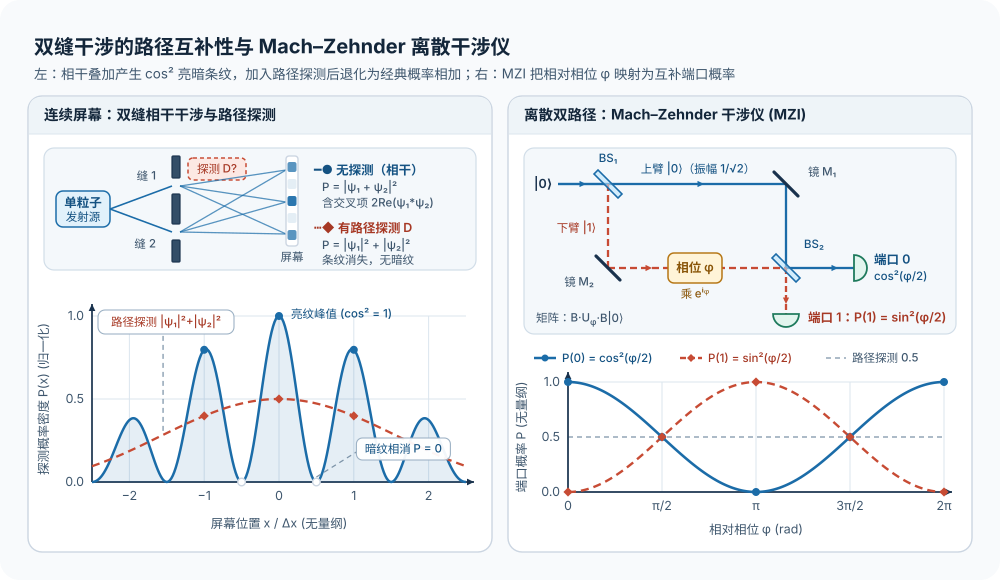
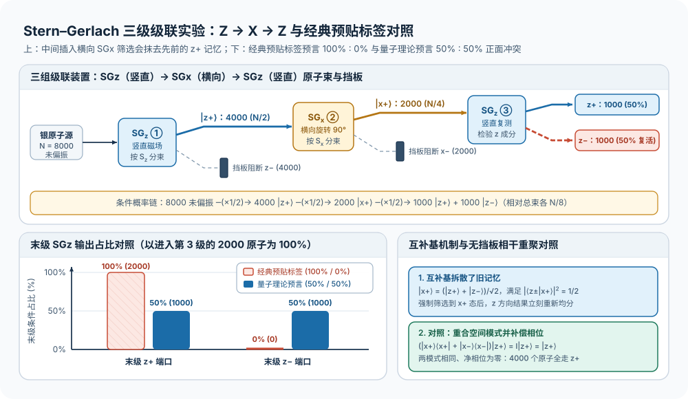
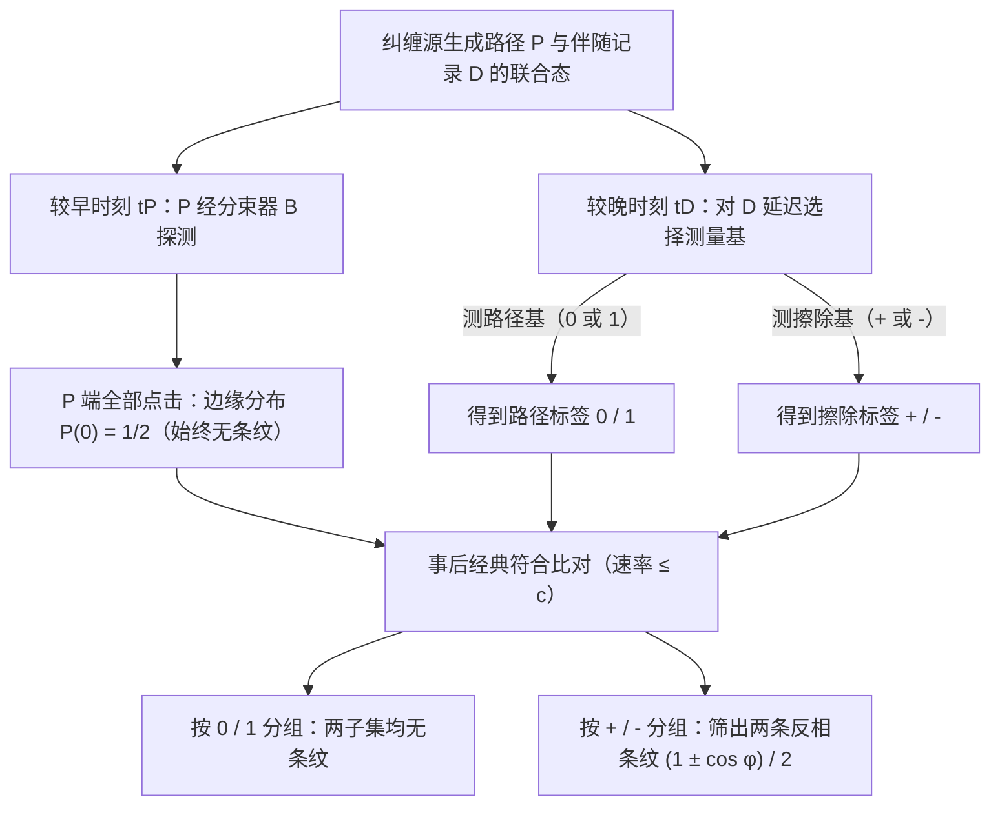
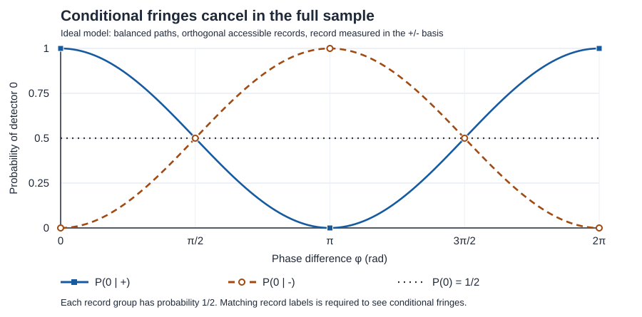

# Q1｜从实验认识量子态

从[第 01 章](../01-math.md)的复数模平方、二维矩阵和条件概率出发即可阅读本章。[第 02 章](../02-single-qubit.md)的单比特状态和换基测量可随时查阅。

在第一篇里，同一个两分量态可以写成数字，也可以画在 Bloch 球上。这里再把它放回实验室：一个干涉仪的亮暗输出如何检验两条路径之间的相对相位？这一章从真实可重复的经典实验出发——单粒子双缝干涉、Mach–Zehnder 干涉仪与量子炸弹测试、顺序 Stern–Gerlach 级联实验、光子三偏振片实验，再到进阶的路径记录、量子擦除与真实探测器误差——把“制备—变换—测量”的物理过程一步步翻译成线性代数。

第一次阅读建议沿 **§1–§5** 追踪双缝、分束器、自旋级联和光子偏振，最后用换基测量区分相干叠加和经典混合。**§6–§7** 是进阶选读，讨论部分路径记录、Englert 互补关系、延迟选择量子擦除和探测误差。精读时可查[第 03 章的偏迹](../03-multiple-qubits.md)和[第 05 章的混态与量子信道](../05-noise-channels.md)。

---

## 1. 从双缝干涉开始：一颗粒子怎样“和自己干涉”

想象一间暗室：一端是电子枪（或光源），中间立着一块开了两条细缝的挡板，后面是一块能逐个记录落点的荧光屏。先把电子束调得很弱，弱到同一时刻从电子枪到屏幕的整段空间里，几乎永远只有一个电子在飞。

按下开关，屏幕上的画面会让人大吃一惊。第 1 个电子飞过去，屏上只“啪”地亮起一个极小的离散斑点，像一颗微小粒子撞在了某一处；第 2 个、第 3 个电子也是如此，落点零散得看不出规律。可当你耐心等上几千、几万个电子逐一打在屏上，这些原本杂乱的斑点竟慢慢拼出一条条明暗交替的干涉条纹——像水波穿过双缝后的波峰波谷叠加一样。

这不是教科书编出来的思想实验，而是已被多次高精度实测的物理事实：

- **单电子逐点累积**：外村彰（Tonomura）团队在 1989 年用 $50\ \mathrm{kV}$ 电子显微镜配合电子双棱镜记录了这一过程。在 $50\ \mathrm{kV}$ 加速下，电子速度约为 $0.41c \approx 1.24\times 10^8\ \mathrm{m/s}$（按相对论动能计算），而每秒到达屏幕的电子只有约 $1000$ 个。算一下就知道，相邻两个电子沿飞行方向的平均间距超过 $120\ \mathrm{km}$，整段源到屏的镜筒长度却只有 $1.5\ \mathrm{m}$——相差约五个数量级（平均间距约为整段镜筒长度的八万倍）。电子在镜筒里根本碰不到彼此，几万个点累积下来依然浮现出清晰条纹。2013 年，Bach 等人进一步用微机械可移动挡板在实体双缝上完整复现了单电子逐点累积。
- **真单光子干涉**：如果只是把普通激光调暗，激光里仍混有极小比例的多光子脉冲。Grangier、Roger 与 Aspect（1986）先用原子级联预报单光子源打向一块 50:50 分束器，测得两端同时响的反符合参数 $\alpha_{\mathrm{anti}}=0.18\pm 0.06$（经典光波恒满足 $\alpha_{\mathrm{anti}}\ge 1$），证明单个光子不会劈成两半同时触发两个探测器；随后把同一光源送入干涉仪，测得干涉仪基准可见度达 $98.7\%\pm 0.5\%$，门控真单光子模式下依然保持 $>98\%$ 的高可见度。2016 年，Aspden 等人用自发参量下转换预报单光子源配合触发式相机，实时录下了真单光子在双缝屏上一点一点累积出条纹的视频。

这些实验把经典概率逼进了死胡同。记只开缝 1 时粒子落在屏上位置 $x$ 附近的概率密度为 $P_1(x)$，只开缝 2 时为 $P_2(x)$。按照经典概率的加法逻辑，如果每颗粒子要么走缝 1、要么走缝 2，那么两缝同开时落点分布应当是

$$
P_{\mathrm{cl}}(x) = P_1(x) + P_2(x).
$$

非负数相加只会越加越大，绝不可能越加越小。但在真实双缝实验里，许多原本单开一缝时明明能打到电子的暗纹位置，把第二条缝一打开，电子落点反而几乎降到了零——多给粒子一条路，它反而到不了那里了。

量子力学走出困境的办法非常干脆：**在两条路径无法区分时，直接相加的不是非负概率，而是复数形式的概率振幅**。设单走缝 1 和单走缝 2 到达位置 $x$ 的复振幅分别为 $\psi_1(x),\psi_2(x)\in\mathbb C$，两缝同开时的总振幅是两者之和，到达 $x$ 的概率密度则是总振幅的模平方：

$$
\begin{aligned}
P_{12}(x)
&= \bigl|\psi_1(x)+\psi_2(x)\bigr|^2 \\
&= \bigl(\psi_1^*(x)+\psi_2^*(x)\bigr)\bigl(\psi_1(x)+\psi_2(x)\bigr) \\
&= |\psi_1(x)|^2 + |\psi_2(x)|^2 + \psi_1^*(x)\psi_2(x) + \psi_2^*(x)\psi_1(x) \\
&= P_1(x) + P_2(x) + 2\operatorname{Re}\!\left[\psi_1^*(x)\psi_2(x)\right].
\end{aligned}
$$

把两个复振幅写成极坐标 $\psi_1(x)=|\psi_1(x)|e^{i\phi_1(x)}$ 和 $\psi_2(x)=|\psi_2(x)|e^{i\phi_2(x)}$，交叉项立刻露出真面目：

$$
\psi_1^*(x)\psi_2(x) = |\psi_1(x)|\,|\psi_2(x)|\,e^{i[\phi_2(x)-\phi_1(x)]},
$$

取实部的两倍得到

$$
P_{12}(x) = P_1(x) + P_2(x) + 2|\psi_1(x)|\,|\psi_2(x)|\cos\bigl(\phi_2(x)-\phi_1(x)\bigr).
$$

这就是干涉的全部秘密。当两条路径的振幅大小相等（$|\psi_1|=|\psi_2|$）且相位差 $\phi_2(x)-\phi_1(x)$ 恰好是 $\pi$ 的奇数倍时，$\cos(\phi_2-\phi_1)=-1$，交叉项等于 $-2|\psi_1|^2$，正好把 $P_1+P_2$ 完全抵消成 $0$。暗纹并不意味着出现了负概率，而是复振幅在取模平方之前就互相抵消了。

不过，屏幕位置 $x$ 是连续变量，要算出整块屏上的条纹形状，还得写衍射积分（连续波函数的细节我们放到选读章 [Q4](04-wavefunctions-models.md)）。如果我们把“连续的屏幕”提纯成最干净的离散版本——**只有两条内部路径、只有两个输出探测器**——干涉的全部结构就能用第 01 章学过的 $2\times 2$ 矩阵一步步算出来。这个装置正是量子光学与量子计算里最经典的 **Mach–Zehnder 干涉仪**。

（可打开[原尺寸双缝与 Mach–Zehnder 干涉仪对照图](../assets/v2-q1-double-slit-mzi.svg)清晰查看光路与概率曲线；左图横轴中的 $\Delta x$ 表示相邻亮纹间距。）

---

## 2. 量子态是一套可检验的概率预测：Born 规则与统计抽样

在把双路径写成矩阵之前，先把实验的语言说清楚。任何一次可重复的量子实验都包含三个明确环节：

1. **制备**：按固定操作流程让每一轮实验从同一物理条件出发；
2. **变换**：粒子在制备与测量之间经过分束器、相位片、磁场或脉冲等器件；
3. **测量**：读取一组互斥的结果，并统计大量重复实验后各结果出现的频率。

这里的“重复实验”，不是把同一颗粒子捉回来反复读，而是按照同一套制备流程一遍遍放出新粒子。单轮实验只能让你听到某一个探测器“咔哒”响一声；**量子态**不是屏上的单个光点，而是汇总这套制备在各种允许测量下会给出什么概率分布的数学对象。

对于只有“上路径”和“下路径”两条可选路径的粒子，我们在二维复向量空间 $\mathbb C^2$ 里选取标准正交归一基：

$$
|0\rangle = \begin{bmatrix}1\\0\end{bmatrix}\quad(\text{上路径}),
\qquad
|1\rangle = \begin{bmatrix}0\\1\end{bmatrix}\quad(\text{下路径}).
$$

该粒子的一般纯态写作它们的线性组合

$$
|\psi\rangle = \alpha|0\rangle + \beta|1\rangle = \begin{bmatrix}\alpha\\\beta\end{bmatrix},
\qquad \alpha,\beta\in\mathbb C.
$$

如果在路径基 $\{|0\rangle,|1\rangle\}$ 上直接放置探测器，**Born 规则**把复振幅与可测概率联系起来：

$$
p(0) = |\langle 0|\psi\rangle|^2 = |\alpha|^2,
\qquad
p(1) = |\langle 1|\psi\rangle|^2 = |\beta|^2.
$$

由于两条路径穷尽了所有互斥结果，总概率必须为 $1$，即**归一化条件**：

$$
|\alpha|^2 + |\beta|^2 = \langle\psi|\psi\rangle = 1.
$$

这里有一条很关键的逻辑分界：线性代数只负责定义向量、内积和模平方怎么算，它本身并不知道自然界为什么要把模平方当成概率。把复振幅的模平方解释为测量概率的 **Born 规则**，是马克斯·玻恩（Max Born）在 1926 年研究量子散射时提出的**物理公设**。归一化条件只是为了在使用 Born 规则后保证所有结果的概率之和恰好等于 $1$；公设的正确性最终由百年来的实验检验支撑，而不是从线性代数里纯逻辑推出来的定理。

### 算例：先归一化，再算概率

设某次计算得到一个未归一化向量 $|v\rangle = 3|0\rangle + 4i|1\rangle \in \mathbb C^2$。求它对应的归一化态以及直接测量路径时的两个概率。

**第一步：按左共轭内积求模长平方。** 由 $\langle v| = [3,\,-4i]$，逐项相乘：

$$
\langle v|v\rangle
= 3^* \cdot 3 + (4i)^*(4i)
= 9 + (-4i)(4i)
= 9 - 16i^2
= 9 + 16
= 25.
$$

于是范数为 $\sqrt{\langle v|v\rangle} = \sqrt{25} = 5$。

**第二步：除以范数得到归一化态。**

$$
|\psi\rangle = \frac{|v\rangle}{5} = \frac{3}{5}|0\rangle + \frac{4i}{5}|1\rangle.
$$

**第三步：对复振幅取模平方求概率。**

$$
p(0) = \left|\frac{3}{5}\right|^2 = \frac{9}{25} = 0.36,
\qquad
p(1) = \left|\frac{4i}{5}\right|^2 = \left(-\frac{4i}{5}\right)\!\left(\frac{4i}{5}\right) = \frac{16}{25} = 0.64.
$$

核验概率和：$9/25 + 16/25 = 1$。算概率时千万不能对复数直接做普通平方——$(4i/5)^2 = -16/25$ 是负数，绝不能当概率。

### 理论概率怎样对接有限次实验计数

Born 规则给出的是概率分布，而不是要求每批实验计数刚好卡在理论比例上。假如把上面的态 $|\psi\rangle$ 独立重复制备并测量 $N=400$ 轮，记测得路径 $0$ 的次数为 $n_0$。这是一个成功概率 $p=0.36$ 的二项分布，理论期望和标准差分别是

$$
\mathbb E[n_0] = Np = 400\times 0.36 = 144,
$$

$$
\operatorname{sd}(n_0) = \sqrt{Np(1-p)} = \sqrt{400\times 0.36\times 0.64} = \sqrt{92.16} = 9.6.
$$

也就是说，这 400 轮里跑出 137 次路径 $0$，离均值只差不到一个标准差，完全符合 $p(0)=0.36$。随着重复次数 $N$ 增大，频率 $n_0/N$ 的典型波动按 $1/\sqrt N$ 缩小；但如果探测器本身存在系统偏差（比如常常把路径 $0$ 错记成路径 $1$），光靠增加采样次数并不能把偏差平均掉，我们在 §7 会专门定量剖析这类仪器误差。

---

## 3. Mach–Zehnder 干涉仪与 Elitzur–Vaidman 量子炸弹测试

现在把双缝装进一套离散光学平台：两块 50:50 平衡分束器、两面全反射镜、一条放在下路径的透明相位片，以及末端的两个单粒子探测器 $0$ 和 $1$（见 §1 图的右半面板）。单粒子从输入端 $0$ 逐个射入，我们先看看没有路径记录时会发生什么。

### 3.1 分束器的相位约定与逐步矩阵推导

把镜面反射和分束器引入的固定光程相位吸收到两路基矢的相位零点后，每一块理想平衡分束器（§1 图中标作 `BS₁`、`BS₂`）都可以用下面的 $2\times 2$ 实对称矩阵描述：

$$
B = \frac{1}{\sqrt2}\begin{bmatrix}1 & 1\\ 1 & -1\end{bmatrix}.
$$

它的矩阵形式与[第 02 章](../02-single-qubit.md)的 Hadamard 门 $H$ 完全相同。先验证它的酉性：

$$
B^\dagger B
= \frac{1}{2}\begin{bmatrix}1 & 1\\ 1 & -1\end{bmatrix}\begin{bmatrix}1 & 1\\ 1 & -1\end{bmatrix}
= \frac{1}{2}\begin{bmatrix}1+1 & 1-1\\ 1-1 & 1+1\end{bmatrix}
= \begin{bmatrix}1 & 0\\ 0 & 1\end{bmatrix}
= I.
$$

因为 $B^\dagger B = I$，它保持任意态矢量的模长，也就是在无损情况下保持总概率为 $1$。

下路径上插入一块引入相对相位 $\phi\in\mathbb R$（单位：弧度 $\mathrm{rad}$）的相位片，作用矩阵为

$$
U_\phi = \begin{bmatrix}1 & 0\\ 0 & e^{i\phi}\end{bmatrix}.
$$

粒子从端口 $0$ 入射，初态为 $|0\rangle = [1,0]^T$。按时间从先到后依次经过 $B$、$U_\phi$、$B$，矩阵乘在向量左边（从右往左作用）：

**第一步：经过第一个分束器 $B$。**

$$
|\psi_1\rangle = B|0\rangle
= \frac{1}{\sqrt2}\begin{bmatrix}1 & 1\\ 1 & -1\end{bmatrix}\begin{bmatrix}1\\0\end{bmatrix}
= \frac{1}{\sqrt2}\begin{bmatrix}1\cdot 1 + 1\cdot 0\\ 1\cdot 1 + (-1)\cdot 0\end{bmatrix}
= \frac{1}{\sqrt2}\begin{bmatrix}1\\1\end{bmatrix}
= \frac{|0\rangle+|1\rangle}{\sqrt2}.
$$

**第二步：经过下路径相位片 $U_\phi$。** 上路径不变，下路径乘上 $e^{i\phi}$：

$$
|\psi_2\rangle = U_\phi|\psi_1\rangle
= \begin{bmatrix}1 & 0\\ 0 & e^{i\phi}\end{bmatrix}\frac{1}{\sqrt2}\begin{bmatrix}1\\1\end{bmatrix}
= \frac{1}{\sqrt2}\begin{bmatrix}1\\e^{i\phi}\end{bmatrix}
= \frac{|0\rangle + e^{i\phi}|1\rangle}{\sqrt2}.
$$

**第三步：经过第二个分束器 $B$ 重聚两路振幅。**

$$
|\psi_{\mathrm{out}}\rangle = B|\psi_2\rangle
= \frac{1}{\sqrt2}\begin{bmatrix}1 & 1\\ 1 & -1\end{bmatrix}\frac{1}{\sqrt2}\begin{bmatrix}1\\e^{i\phi}\end{bmatrix}
= \frac{1}{2}\begin{bmatrix}1\cdot 1 + 1\cdot e^{i\phi}\\ 1\cdot 1 + (-1)\cdot e^{i\phi}\end{bmatrix}
= \frac{1}{2}\begin{bmatrix}1 + e^{i\phi}\\ 1 - e^{i\phi}\end{bmatrix}.
$$

因此，到达探测器 $0$ 和探测器 $1$ 的复振幅分别是

$$
A_0 = \frac{1+e^{i\phi}}{2},
\qquad
A_1 = \frac{1-e^{i\phi}}{2}.
$$

最后按 Born 规则对两个总振幅分别取模平方。先算 $P_0$：

$$
\begin{aligned}
P_0 = |A_0|^2 = A_0^* A_0
&= \frac{1}{4}\bigl(1 + e^{-i\phi}\bigr)\bigl(1 + e^{i\phi}\bigr) \\
&= \frac{1}{4}\bigl(1 + e^{i\phi} + e^{-i\phi} + e^{-i\phi}e^{i\phi}\bigr) \\
&= \frac{1}{4}\bigl(2 + 2\cos\phi\bigr)
= \frac{1+\cos\phi}{2}
= \cos^2\!\left(\frac{\phi}{2}\right).
\end{aligned}
$$

同理算 $P_1$：

$$
\begin{aligned}
P_1 = |A_1|^2 = A_1^* A_1
&= \frac{1}{4}\bigl(1 - e^{-i\phi}\bigr)\bigl(1 - e^{i\phi}\bigr) \\
&= \frac{1}{4}\bigl(2 - 2\cos\phi\bigr)
= \frac{1-\cos\phi}{2}
= \sin^2\!\left(\frac{\phi}{2}\right).
\end{aligned}
$$

独立核验概率守恒：$P_0 + P_1 = \frac{1+\cos\phi}{2} + \frac{1-\cos\phi}{2} = 1$，对任意相位 $\phi$ 恒成立。

挑四个代表性相位点算一算，既能看清复振幅怎样运作，也能把直觉定格下来：

| 相位差 $\phi$ | 输出振幅 $A_0=(1+e^{i\phi})/2$ | 输出振幅 $A_1=(1-e^{i\phi})/2$ | $P_0=\lvert A_0\rvert^2$ | $P_1=\lvert A_1\rvert^2$ | 实验现象 |
|---:|---:|---:|---:|---:|---|
| $0$ | $1$ | $0$ | $1$ | $0$ | 端口 $0$ 完全相长，端口 $1$ 完全相消 |
| $\pi/3$ | $\frac{3+i\sqrt3}{4}$ | $\frac{1-i\sqrt3}{4}$ | $3/4$ | $1/4$ | 端口 $0$ 占优，和为 $1$ |
| $\pi/2$ | $\frac{1+i}{2}$ | $\frac{1-i}{2}$ | $1/2$ | $1/2$ | 两振幅均为复数，模平方各为 $1/2$ |
| $\pi$ | $0$ | $1$ | $0$ | $1$ | 明暗端口互换 |

顺便提一句，如果你去翻光学教材，常会见到另一种对称介质分束器写法：透射振幅取 $1/\sqrt2$、反射振幅带虚数因子 $i/\sqrt2$，即

$$
B_{\mathrm{sym}} = \frac{1}{\sqrt2}\begin{bmatrix}1 & i\\ i & 1\end{bmatrix},
\qquad B_{\mathrm{sym}}^\dagger B_{\mathrm{sym}} = I.
$$

照同样步骤乘一遍：$B_{\mathrm{sym}}|0\rangle = \frac{1}{\sqrt2}[1,i]^T$，经 $U_\phi$ 得 $\frac{1}{\sqrt2}[1,\,ie^{i\phi}]^T$，再乘 $B_{\mathrm{sym}}$ 得

$$
B_{\mathrm{sym}}U_\phi B_{\mathrm{sym}}|0\rangle
= \frac{1}{2}\begin{bmatrix}1\cdot 1 + i\cdot ie^{i\phi}\\ i\cdot 1 + 1\cdot ie^{i\phi}\end{bmatrix}
= \frac{1}{2}\begin{bmatrix}1 - e^{i\phi}\\ i(1 + e^{i\phi})\end{bmatrix}.
$$

取模平方得 $P_0^{\mathrm{sym}} = \frac{1-\cos\phi}{2}$、$P_1^{\mathrm{sym}} = \frac{1+\cos\phi}{2}$。与本章采用的 $B$ 相比，仅仅是把两个出口的编号互换了一下（或者把相位零点平移了 $\pi$），干涉条纹的周期、互补关系和可见度分毫不差。记住这个对照，以后在光学论文和量子线路论文之间切换就不会犯迷糊。

### 3.2 全局相位与相对相位

在实验台上区分两种相位极其直观：**同时在上下两臂插入厚度完全相同的透明玻璃片**，两路都会乘上同一个相位因子 $e^{i\theta_{\mathrm{g}}}$（$\theta_{\mathrm{g}}\in\mathbb R$），这叫**全局相位**；**只给下臂单独插入玻璃片**，才拉开两臂之间的**相对相位** $e^{i\phi}$。

检查全局相位对任意归一化测量态 $|m\rangle$ 的预测概率。设 $|\psi'\rangle = e^{i\theta_{\mathrm{g}}}|\psi\rangle$，由内积的右线性与 $|e^{i\theta_{\mathrm{g}}}|^2 = \cos^2\theta_{\mathrm{g}} + \sin^2\theta_{\mathrm{g}} = 1$：

$$
|\langle m|\psi'\rangle|^2
= \bigl|\langle m|e^{i\theta_{\mathrm{g}}}\psi\rangle\bigr|^2
= \bigl|e^{i\theta_{\mathrm{g}}}\langle m|\psi\rangle\bigr|^2
= |e^{i\theta_{\mathrm{g}}}|^2\,|\langle m|\psi\rangle|^2
= |\langle m|\psi\rangle|^2.
$$

整体共有的 $e^{i\theta_{\mathrm{g}}}$ 不会改变任何测量概率，物理上 $|\psi\rangle$ 与 $e^{i\theta_{\mathrm{g}}}|\psi\rangle$ 表示同一个量子态。相反，在中间态 $|\psi_\phi\rangle = (|0\rangle + e^{i\phi}|1\rangle)/\sqrt2$ 中，相对相位 $e^{i\phi}$ 只乘在 $|1\rangle$ 上：虽然在路径基直接测得的概率永远各占 $1/2$，但经过第二个分束器 $B$ 重聚后，相对相位立刻把两端口概率从 $(1,0)$ 连续调成 $(0,1)$。

### 3.3 中间有没有留下路径记录：用输出计数分清三种实验

回到 $\phi=0$ 的理想无损干涉仪。假如我们一共做 100 轮独立实验，下面三种安排看上去只在“中间做了什么”上略有差别，输出的期望计数却截然不同：

| 中间安排（$\phi=0$，无损 100 轮） | 第二个分束器后 $(P_0,P_1)$ | 100 轮期望计数 | 物理机制 |
|---|---|---|---|
| 无任何路径记录装置 | $(1,\ 0)$ | $(100,\ 0)$ | 两路振幅在端口 $0$ 相长、端口 $1$ 相消 |
| 理想装置完整记录路径，但事后丢弃记录 | $(1/2,\ 1/2)$ | $(50,\ 50)$ | 两条可区分分支按概率合并，干涉消失 |
| 理想装置完整记录路径，并按“上路/下路”分组 | 每组均为 $(1/2,\ 1/2)$ | 上路约 50 轮、下路约 50 轮，每组再各约 $(25,\ 25)$ | 已知路径时，粒子从单臂入 $B$，两出口各半 |

对比第二行和第三行，把上路组和下路组的计数重新合起来，总和同样是约 $(50,50)$；两者总边缘统计相同，差别在于第三行保留了经典路径标签，能继续做条件分析或反馈控制。

再对比第一行和第二行，就能摸清量子力学最常被误读的一条界线：**决定干涉存亡的，不是实验者的眼睛有没有去看路径记录，而是物理装置有没有把两条路径变成可区分的分支**。只要环境中留下了能明确区分“走了上路还是下路”的物理痕迹，就算没人去读，条纹也会消失。

顺便区分第四种实验：如果干脆用一块不透明挡板堵住下路径，那会直接吸收掉一半粒子，剩下能通过上路径的粒子在第二个分束器后虽仍按 $(1/2,1/2)$ 分配，但总存活数只剩约 50 颗（期望计数 $(25,25)$，另有 50 颗被挡板吸收）。损耗改变了分母，不能和上面的无损表混为一谈——而正是这个看似普通的“挡板例子”，只需把挡板换成一颗超灵敏炸弹，就能变出量子力学里最富启发性的演示。

### 3.4 Elitzur–Vaidman 量子炸弹测试：零相互作用测量

**先看困惑**：1993 年，Elitzur 和 Vaidman 提出了一个著名的思想实验（随后很快被量子光学实验验证）。假设仓库里有一批外形完全相同的“量子炸弹”，其中一部分是**真弹**——它的光敏引信灵敏到只要有**哪怕一颗光子**碰到它就会立刻爆炸；另一部分是**哑弹**——引信已坏，光子穿过它时既不爆炸也不受任何阻挡。按照经典物理，你能挑出一颗**绝对确认是真弹、却又没有引爆它**的炸弹吗？答案是不能：任何经典探测手段，只要让光线照到引信就会引爆它，如果不照到引信就根本不知道引信是好是坏。

**量子方案**：把待测炸弹放到 $\phi = 0$ 的平衡 Mach–Zehnder 干涉仪的**下路径 $|1\rangle$** 上，从端口 $0$ 射入**一颗单光子** $|0\rangle$，一步步算清两种情况：

1. **若放入的是哑弹（等同于空干涉仪）**：
   光子经第一个分束器变为 $\frac{|0\rangle + |1\rangle}{\sqrt2}$，顺利通过两条路径，再经第二个分束器重聚为 $B\frac{|0\rangle + |1\rangle}{\sqrt2} = |0\rangle$。输出概率为 $P_0 = 1$、$P_1 = 0$，且爆炸概率为 $0$。**只要是哑弹，暗端口 $1$ 绝对不可能响铃！**

2. **若放入的是真弹（下路径上多了一个“吸收即爆炸”的探测分支）**：
   - **第一步（经过第一个分束器 $B$）**：光子处于

     $$
     |\psi_1\rangle = B|0\rangle = \frac{1}{\sqrt2}|0\rangle + \frac{1}{\sqrt2}|1\rangle.
     $$

   - **第二步（经过下路径的真弹引信）**：真弹对下路径 $|1\rangle$ 构成一次理想吸收测量：
     - 以概率 $\left|\frac{1}{\sqrt2}\right|^2 = \frac{1}{2}$（**50%**），光子走下路径撞上引信，**炸弹爆炸**（光子被吸收，末端两个探测器都不响）；
     - 以概率 $\left|\frac{1}{\sqrt2}\right|^2 = \frac{1}{2}$（**50%**），炸弹**没有爆炸**——这意味着光子没有触发下路径引信，存活光子的条件态更新为纯粹的上路径态 $|0\rangle$。
   - **第三步（未爆炸分支经过第二个分束器 $B$）**：处于 $|0\rangle$ 的存活光子单独进入第二个分束器：

     $$
     B|0\rangle = \frac{1}{\sqrt2}|0\rangle + \frac{1}{\sqrt2}|1\rangle.
     $$

     在未爆炸的条件下，光子从端口 $0$ 和端口 $1$ 出来的条件概率各为 $\left|\frac{1}{\sqrt2}\right|^2 = \frac{1}{2}$。乘上“未爆炸”的概率 $\frac{1}{2}$，得到三类互斥结果的精确联合概率：
     - **炸弹爆炸**：$\frac{1}{2} = 50\%$；
     - **不爆炸且端口 $0$ 响铃（无法判定）**：$\frac{1}{2}\times\frac{1}{2} = \frac{1}{4} = 25\%$（因为哑弹也会让端口 $0$ 响铃，所以这一轮既没炸也没确诊，不过炸弹完好无损，可以继续送入下一颗光子复测）；
     - **不爆炸且端口 $1$ 响铃（无损确诊真弹！）**：$\frac{1}{2}\times\frac{1}{2} = \frac{1}{4} = 25\%$。因为哑弹让端口 $1$ 响铃的概率严格为 $0$，只要端口 $1$“咔哒”响了一声，我们就以 **100% 的确定性**知道里面是真弹——而这颗真弹纹丝未动，没有吸收到任何光子！

把两种炸弹的全部输出分支定格在一张表里：

| 待测对象 | 炸弹爆炸概率 | 不爆炸、端口 $0$ 响铃 | 不爆炸、端口 $1$ 响铃 | 核验总概率 | 检验结论 |
|---|---:|---:|---:|---:|---|
| 哑弹（下臂畅通） | $0$ | $100\%$ | $0$ | $1$ | 端口 $1$ 永不响铃 |
| 真弹（下臂吸收即爆） | $50\%$ | $25\%$（不确定，可复测） | $25\%$（无损确诊真弹） | $1$ | 端口 $1$ 一响即 100% 确诊真弹 |

这种现象被称为**零相互作用测量**（interaction-free measurement）。当然，请保持物理清醒：它并不是光子发出了某种“隔空幽灵感知”。真正发生的事情是，**真弹的存在本身改变了干涉仪的物理边界条件**，把原本应该走下路径去和上路径在端口 $1$ 精确相消的那一半振幅截断了；暗端口 $1$ 之所以突然亮起，正因为原本必须发生的相消干涉被破坏了。

在对称装置中，亮端口 $0$ 响铃后，完好的炸弹可留在原位继续测试。从首轮开始统计，第 $m$ 轮首次无损确诊的概率为 $4^{-m}$；若已知首轮是亮端口，按原总轮号计，第 $m\ge 2$ 轮的条件概率为 $4^{-(m-1)}$。两种统计的最终无损确诊概率都为 $1/3$，因为已知可续测时，下一轮的模型和首轮完全相同。文末「练 Q1-A」分别计算两种分母。

若第一块分束器把概率 $r\in(0,1)$ 送入炸弹臂、把概率 $1-r$ 送入安全臂，并让第二块分束器在无吸收物时把两臂重新合到亮端口，真弹的三个分支概率是：吸收 $r$、暗端口确诊 $r(1-r)$、亮端口续测 $(1-r)^2$。例如暗端口振幅的模为 $\sqrt{1-r}\sqrt r$，第一项来自安全臂，第二项来自第二块分束器。复测到有结论为止，无损确诊概率为 $r(1-r)/[1-(1-r)^2]=(1-r)/(2-r)$，在 $r\to0$ 时趋于 $1/2$。代价是平均发射光子数 $1/[r(2-r)]$ 随之发散。

Kwiat 等人于 1995 年演示了零相互作用测量，并讨论了可借弱耦合循环提高效率的量子芝诺方案。1999 年的后续实验测得的最高效率为 $73\%$。该效率按 $\eta=P_{\mathrm{det}}/(P_{\mathrm{det}}+P_{\mathrm{abs}})$ 计算，其中 $P_{\mathrm{det}}$ 指无损确诊、$P_{\mathrm{abs}}$ 指被目标吸收，仪器损耗会影响实测结果。理想芝诺模型中效率可趋近 $100\%$。[Kwiat 等，1995](https://doi.org/10.1103/PhysRevLett.74.4763)；[Kwiat 等，1999](https://doi.org/10.1103/PhysRevLett.83.4725)。

---

## 4. Stern–Gerlach 级联实验与光子偏振：不相容测量与马吕斯定律

前面三个实验靠“粒子走哪条空间路径”构造出二维量子态；大自然还自带另外两种极其纯粹的二态自由度——**电子自旋**与**光子偏振**。把它们放进级联筛选实验里，我们会亲眼撞碎“测量只是读取粒子早已写好的经典标签”的最后幻想，同时用实验说明[第 02 章](../02-single-qubit.md)中 Bloch 球的半角几何。

1922 年，格拉赫（Walther Gerlach）与施特恩（Otto Stern）在法兰克福把银加热到约 $1000\ ^\circ\mathrm{C}$，让中性银原子束穿过一段长约 $3.5\ \mathrm{cm}$、沿竖直方向存在强梯度（约 $10^3\ \mathrm{T/m}$）的非均匀磁场。如果把每个银原子看作一根指向随机的经典小磁针，磁矩在竖直方向上的投影应当连续分布，屏幕上该留下一条拉长的连续斑块。然而玻璃屏上却清晰地裂开了间距约 $0.2\ \mathrm{mm}$ 的**两条离散嘴唇状银纹**，中间几乎空无一物。

从历史角度看，1922 年电子自旋概念尚未提出，这一实验直接确立了磁矩空间取向的量子化；在现代量子力学里，银原子最外层单独未配对的 $5s$ 电子贡献约 $1\,\mu_B$ 的有效磁矩，使它成为理想的**自旋-$1/2$ 二态系统**。这里要记住一个重要边界：**自旋是微观粒子的内禀量子角动量，不要把它当成一个经典刚体小球绕自身轴机械旋转**——经典自转模型既给不出只能取两个离散值的投影，也会（若把电子视作经典电子半径量级的刚体小球）在估算表面线速度时得出超光速的荒谬结果。

在理想自旋-$1/2$ 模型中，沿 $z$ 方向测量自旋分量 $S_z$ 只得到两个互斥结果：

$$
S_z = +\frac{\hbar}{2}\quad\text{或}\quad S_z = -\frac{\hbar}{2},
$$

对应的正交归一基态记作 $|z+\rangle$ 与 $|z-\rangle$。

### 4.1 经典“预贴标签”假说对比顺序 Stern–Gerlach 级联实验

先做最简单的同向重复检验：让一束含 $N=8000$ 个未偏振银原子的束流通过第一台竖直放置的 Stern–Gerlach 装置 $SG_z$，两支各占一半；用挡板遮住 $z-$ 分支，只放行 $z+$ 分支（平均 $4000$ 个原子），这就相当于条件制备出了纯态 $|z+\rangle$。如果立刻把它送进第二台同方向的 $SG_z$：

$$
p(z+\mid z+) = |\langle z+|z+\rangle|^2 = 1,
\qquad
p(z-\mid z+) = |\langle z-|z+\rangle|^2 = 0.
$$

只要第一道已经筛选出 $z+$，这 $4000$ 个原子在第二台 $SG_z$ 里会 100% 全部走 $z+$ 出口。注意分母的差别：“概率为 $1$”是以通过第一道筛选为条件的概率；相对最初的 $8000$ 个未偏振原子，总通过率仍是 $1/2$。

现在，把直觉推向正面碰撞：在两台 $SG_z$ 中间，**横着插进一台沿水平 $x$ 方向测量的 $SG_x$，并挡住 $x-$ 分支、只放行 $x+$ 分支**，最后再送进第三台 $SG_z$！

先按经典世界最自然的“**预贴标签假说**”预测结果：假如每颗银原子在出发前就已经同时自带两张固定不变的属性标签——一张竖直标签（$z+$ 或 $z-$），一张水平标签（$x+$ 或 $x-$），就像一筐苹果里每个苹果都同时具有“红/绿”和“大/小”两种固定属性，而 $SG_z$ 和 $SG_x$ 只是把它们分拣出来的筛子。那么：

1. 第一道 $SG_z$ 筛掉了全部“绿苹果”（$z-$），留下 $4000$ 个清一色的“红苹果”（全部带 $z+$ 标签）；
2. 第二道 $SG_x$ 从这 $4000$ 个红苹果里挑出“大红苹果”（同时带 $z+$ 与 $x+$ 标签，约 $2000$ 个）；
3. 第三道 $SG_z$ 再按颜色分拣这 $2000$ 个大红苹果——**经典预贴标签假说必然预言：100% 全是 $z+$（$2000$ 个），0% 是 $z-$（$0$ 个）！**

然而，真实实验和量子力学给出的结果直接否定了“预贴标签假说”。沿 $x$ 方向的两个正交本征态与 $z$ 基的变换关系是

$$
|x+\rangle = \frac{|z+\rangle + |z-\rangle}{\sqrt2},
\qquad
|x-\rangle = \frac{|z+\rangle - |z-\rangle}{\sqrt2}.
$$

把两式相加、相减再除以 $\sqrt2$，反过来立即得到 $z$ 基在 $x$ 基下的展开：

$$
|z+\rangle = \frac{|x+\rangle + |x-\rangle}{\sqrt2},
\qquad
|z-\rangle = \frac{|x+\rangle - |x-\rangle}{\sqrt2}.
$$

拿草稿纸一步步追踪 $N = 8000$ 个未偏振银原子的真实旅程：

1. **经过第一台 $SG_z$ 并挡住 $z-$**：条件通过率 $1/2$，平均留下 $8000 \times \frac{1}{2} = 4000$ 个处于 $|z+\rangle$ 的原子。
2. **进入 $SG_x$ 并挡住 $x-$**：由 $|z+\rangle = \frac{|x+\rangle+|x-\rangle}{\sqrt2}$，逐项算内积模平方：

   $$
   p(x+\mid z+) = |\langle x+|z+\rangle|^2 = \left|\frac{1}{\sqrt2}\right|^2 = \frac{1}{2},
   \qquad
   p(x-\mid z+) = |\langle x-|z+\rangle|^2 = \frac{1}{2}.
   $$

   挡住 $x-$ 后，从那 **4000 个**里平均留下 $4000 \times \frac{1}{2} = 2000$ 个原子，它们的条件态已更新为 $|x+\rangle$。
3. **最后进入末级 $SG_z$ 测量**：对 $|x+\rangle = \frac{|z+\rangle+|z-\rangle}{\sqrt2}$ 测 $z$ 方向：

   $$
   p(z+\mid x+) = |\langle z+|x+\rangle|^2 = \frac{1}{2},
   \qquad
   p(z-\mid x+) = |\langle z-|x+\rangle|^2 = \frac{1}{2}.
   $$

   **先前在第一级被 100% 剔除掉的 $z-$，竟然重新复活了一半！** 这 $2000$ 个原子在末级一分为二，最终 $z+$ 和 $z-$ 各约 **$1000$ 个**（$50\% : 50\%$），与经典预贴标签预言的 $2000 : 0$（$100\% : 0\%$）正面相撞！

这组结果排除了前面假定的两张固定标签和无扰动分拣器模型。量子模型中，$S_z$ 与 $S_x$ 没有共同的自旋-$1/2$ 本征态；筛选到 $|x+\rangle$ 后，末级 $S_z$ 的两个结果各半。下表同时列出每一步的条件概率和相对于原始束流的联合比例。

| 实验步骤（$SG_z \to SG_x \to SG_z$） | 本步条件通过率（分母为进入本步的原子数） | 相对初始 $N$ 的平均原子数 | $N=8000$ 量子理论期望 | 经典预贴标签预言 |
|---|---:|---:|---:|---:|
| ① $SG_z$ 筛选保留 $z+$ | $1/2$ | $N/2$ | $4000$ | $4000$ |
| ② $SG_x$ 筛选保留 $x+$ | $1/2$ | $N/4$ | $2000$ | $2000$ |
| ③ 末级 $SG_z$ 测得 $z+$ | $1/2$ | $N/8$ | $1000$（$50\%$） | $2000$（$100\%$） |
| ③ 末级 $SG_z$ 测得 $z-$ | $1/2$ | $N/8$ | $1000$（$50\%$） | $0$（$0\%$） |

计算时不要把每步都拿 $8000$ 去乘 $1/2$：最后得到 $z+$ 相对于最初未偏振束流的联合通过率是 $\frac{1}{2}\times\frac{1}{2}\times\frac{1}{2} = \frac{1}{8}$（$1000/8000$），只有“以已通过前两道为条件”时才是 $1/2$。

### 4.2 如果把 $SG_x$ 分开的两束相干重聚，会发生什么？

把顺序 Stern–Gerlach 实验和第 3 节的 Mach–Zehnder 干涉仪摆在一起看，会撞出一个绝妙的统一画面（Feynman 与 Sakurai 教材都极推崇这一对比）。当 $4000$ 个 $|z+\rangle$ 原子进入中间的 $SG_x$ 后，我们对分开的 $x+$、$x-$ 两束可以做三种不同处理：

1. **挡住 $x-$，只放行 $x+$（筛选）**：损失一半原子，剩下 $2000$ 个处于 $|x+\rangle$，进入末级 $SG_z$ 后按 $50\% : 50\%$ 分成约 $1000$ 个 $z+$ 和 $1000$ 个 $z-$。
2. **用理想非破坏探测器记录每颗原子走了 $x+$ 还是 $x-$，两束都放行，但统计时不看记录**：总吞吐保持 $4000$ 个，由于留下了正交的路径记录，原子束退化为一半处于 $|x+\rangle$、一半处于 $|x-\rangle$ 的等权经典混合（第 5 节会用密度矩阵写作 $\frac{1}{2}|x+\rangle\langle x+| + \frac{1}{2}|x-\rangle\langle x-| = I/2$），进入末级 $SG_z$ 仍是 $50\% : 50\%$（各约 $2000$ 个）。虽然最终 $z$ 比例和方案 1 一样，但吞吐量翻倍且保留了不同的经典信息结构。
3. **保留两束并做相干重聚**。把最后进入 $SG_z$ 的空间模式写成归一化波包 $|u_+\rangle,|u_-\rangle$，两束的净相对相位写成 $\phi$。在等权、无损模型中，重聚后的自旋和空间联合态为

   $$
   |\Psi\rangle=\frac{|x+\rangle|u_+\rangle+e^{i\phi}|x-\rangle|u_-\rangle}{\sqrt2}.
   $$

   由于 $\langle z+|x+\rangle=\langle z+|x-\rangle=1/\sqrt2$，末级 $z+$ 对应的空间振幅是 $(|u_+\rangle+e^{i\phi}|u_-\rangle)/2$。取范数平方，得到

   $$
   P(z+)=\frac{1+\operatorname{Re}(e^{i\phi}\langle u_+|u_-\rangle)}2,
   \qquad P(z-)=1-P(z+).
   $$

   若末端两束波包完全重合（共同相位已并入 $\phi$），且净相位校到 $0\bmod 2\pi$，才得到图中的理想回验 $4000$ 个原子全走 $z+$。模式相同但 $\phi=\pi$ 时全走 $z-$；模式仍正交时两个结果各半。真实装置要重合波包的位置和动量，还要控制相对相位。四脉冲全环路的实验演示见 [Margalit 等，2021，图 1、3](https://pmc.ncbi.nlm.nih.gov/articles/PMC8163084/)。

（可打开[原尺寸 Stern–Gerlach 级联实验对照图](../assets/v3-q1-stern-gerlach-cascade.svg)清晰查看三组级联束流与经典/量子预言对照。）

你看，空间路径干涉（Mach–Zehnder）与自旋方向筛选（Stern–Gerlach）用的是完全同一套数学骨架。在这里，我们也可以精确说出什么叫二维**互补基**：$Z$ 基与 $X$ 基的任意一对基向量都满足

$$
|\langle x_s|z_t\rangle|^2 = \frac{1}{2},
\qquad s,t\in\{+,-\}.
$$

在一个基里完全确定的态，换到互补基去测量时概率完全均分。

### 4.3 光子三偏振片与马吕斯定律：为什么光子正交差 $90^\circ$，自旋却差 $180^\circ$？

如果手头没有高温银炉和梯度磁铁，只需拿出**三副偏光太阳镜**（或三片线偏振膜），就能在书桌前亲手复现刚才那套“中间插一道筛选器反而让原本绝迹的结果重现”的量子投影现象。

单个光子的线偏振也是一个标准的二维量子系统。我们在 $\mathbb C^2$ 中选取水平偏振 $|H\rangle$ 与竖直偏振 $|V\rangle$ 作为正交归一基（注意：本小节的 $|H\rangle$ 表示水平偏振态，不要与第 02 章的 Hadamard 门 $H$ 混淆）。偏振方向与水平轴成夹角 $\theta\in[0,\pi)$ 的单光子线偏振态写作

$$
|\theta\rangle = \cos\theta\,|H\rangle + \sin\theta\,|V\rangle,
\qquad \cos^2\theta + \sin^2\theta = 1.
$$

让这颗光子射向一片透光轴沿水平方向的理想偏振片（对应向 $|H\rangle$ 的投影测量）。按 Born 规则，单光子透过的概率是

$$
p(H\mid \theta) = |\langle H|\theta\rangle|^2 = \cos^2\theta,
$$

被吸收（正交分量 $|V\rangle$）的概率为 $\sin^2\theta$。当每秒有海量同偏振光子组成一束强光通过偏振片时，大数定律把单光子概率 $\cos^2\theta$ 直接变成宏观透射光强公式 $I = I_0\cos^2\theta$——这正是光学里经典的**马吕斯定律**（Malus's law）。

现在亲手算一遍经典的三偏振片实验：

1. **两片正交偏振片（$0^\circ \to 90^\circ$）**：
   先穿过 $0^\circ$（水平）偏振片的光子全部制备在 $|H\rangle$；接着撞上 $90^\circ$（竖直）偏振片，透射概率为

   $$
   p(90^\circ\mid 0^\circ) = |\langle V|H\rangle|^2 = \cos^2 90^\circ = 0.
   $$

   两片镜片十字交叉叠在一起，眼前漆黑一片，**0% 透光**。

2. **在中间多插一片 $45^\circ$ 偏振片（$0^\circ \to 45^\circ \to 90^\circ$）**：
   按“过滤网只会越加越暗”的经典直觉，在已经全黑的两片镜片中间再塞一片吸收滤片，理应还是全黑。可拿起线性代数算两步：
   - 穿过第 1 片（$0^\circ$）后，态为 $|H\rangle$；
   - 进入第 2 片（$45^\circ$，对应态 $|45^\circ\rangle = \frac{|H\rangle + |V\rangle}{\sqrt2}$），透射概率为

     $$
     p(45^\circ\mid 0^\circ) = |\langle 45^\circ|H\rangle|^2 = \cos^2 45^\circ = \left(\frac{1}{\sqrt2}\right)^2 = \frac{1}{2},
     $$

     而且**透过去的光子状态已更新为 $|45^\circ\rangle$**；
   - 再进入第 3 片（$90^\circ$，对应 $|V\rangle$），透射概率为

     $$
     p(90^\circ\mid 45^\circ) = |\langle V|45^\circ\rangle|^2 = \cos^2 45^\circ = \frac{1}{2}.
     $$

   两步相乘，总透射率从 $0\%$ 升到了

   $$
   P_{\mathrm{total}} = \frac{1}{2}\times\frac{1}{2} = \frac{1}{4} = 25\%.
   $$

   原本黑成一片的两片偏振片之间，多加了一片挡光的 $45^\circ$ 偏振片，反而重新透光了。

把光子偏振和刚才的电子自旋-$1/2$ 摆在同一张对比表里，就会看到一个贯穿全书的黄金几何差别：

| 二态物理系统 | 正交基态在真实空间中的夹角 | 夹角为 $\theta$ 时的单步通过概率 | 归零角度 | 对半（50%）角度 |
|---|---:|---:|---:|---:|
| **光子线偏振**（$\lvert H\rangle, \lvert V\rangle$） | **$90^\circ$**（水平与竖直垂直） | $\cos^2\theta$（马吕斯定律） | $\theta = 90^\circ$ | $\theta = 45^\circ$ |
| **电子自旋-$1/2$**（$\lvert z+\rangle, \lvert z-\rangle$） | **$180^\circ$**（磁场向上与向下反向） | $\cos^2(\theta/2)$ | $\theta = 180^\circ$ | $\theta = 90^\circ$ |

请牢牢记住这两行之差：在二维希尔伯特空间 $\mathbb C^2$ 里，任意一对正交态的**向量夹角永远是 $90^\circ$**；对光子线偏振，水平和竖直在真实三维空间里也恰好差 $90^\circ$，所以通过率是 $\cos^2\theta$；但对电子自旋-$1/2$，相反的磁场方向 $+z$ 和 $-z$ 在真实空间里差了整整 **$180^\circ$**（而正交的 $+z$ 与 $+x$ 夹角 $90^\circ$ 才对应互补基的 $50\%$ 通过率！），因此当第二台 Stern–Gerlach 磁铁相对 $+z$ 倾转角度 $\theta$ 时，其正分支自旋态（在 $x\text{-}z$ 平面内倾转，方位角 $\varphi=0$）写成 $|\hat n(\theta)\rangle = \cos\frac{\theta}{2}|z+\rangle + \sin\frac{\theta}{2}|z-\rangle$，通过率遵循 **$\cos^2(\theta/2)$**。正是这个物理空间角与态空间角之间的 **2 倍关系**，对应[第 02 章](../02-single-qubit.md)中 Bloch 球上无处不在的**半角 $\theta/2$**！

---

## 5. 相干叠加与经典混合：别把“不知道”当成“叠加”

学到这里，最值得停下来掰扯清楚的问题是：**量子叠加态到底和“抛硬币选好了状态，只是我不知道结果”有什么区别？**

直接用刚学过的自旋态比较两种制备流程：

- **制备一（相干叠加）**：每轮都确定地制备同一个纯态 $|x+\rangle = \frac{|z+\rangle + |z-\rangle}{\sqrt2}$；
- **制备二（无知混合）**：机器每轮暗中抛一枚均匀硬币，正面就制备 $|z+\rangle$，反面就制备 $|z-\rangle$，但不把硬币结果告诉你。

如果你只在 $Z$ 基测量，两种制备交出的成绩单长得一模一样：

| 制备流程 | $Z$ 基测得 $p(z+)$ | $Z$ 基测得 $p(z-)$ | $X$ 基测得 $p(x+)$ | $X$ 基测得 $p(x-)$ |
|---|---:|---:|---:|---:|
| 相干叠加 $\lvert x+\rangle$ | $1/2$ | $1/2$ | $1$ | $0$ |
| $z+$/$z-$ 等概率混合 | $1/2$ | $1/2$ | $1/2$ | $1/2$ |

一换到 $X$ 基，真假立判！对相干叠加，每轮态都是 $|x+\rangle$，测 $X$ 基得 $|\langle x+|x+\rangle|^2 = 1$，次次必出 $x+$。对经典混合，我们按全概率公式把两种硬币分支分别算完再加权：

$$
p_{\mathrm{mix}}(x+)
= \frac{1}{2}\underbrace{|\langle x+|z+\rangle|^2}_{1/2}
+ \frac{1}{2}\underbrace{|\langle x+|z-\rangle|^2}_{1/2}
= \frac{1}{4} + \frac{1}{4}
= \frac{1}{2}.
$$

两者在 $Z$ 基表现相同，在 $X$ 基却截然相反。把它们写成 $Z$ 基下的 $2\times 2$ **密度矩阵**（纯态写外积 $|\psi\rangle\langle\psi|$，经典混合写概率加权和 $\sum_j p_j|\psi_j\rangle\langle\psi_j|$，系统理论见[第 05 章](../05-noise-channels.md)），差异一目了然：

$$
\rho_{\mathrm{sup}} = |x+\rangle\langle x+|
= \frac{1}{2}\begin{bmatrix}1\\1\end{bmatrix}\begin{bmatrix}1 & 1\end{bmatrix}
= \frac{1}{2}\begin{bmatrix}1 & 1\\ 1 & 1\end{bmatrix},
$$

$$
\rho_{\mathrm{mix}} = \frac{1}{2}|z+\rangle\langle z+| + \frac{1}{2}|z-\rangle\langle z-|
= \frac{1}{2}\begin{bmatrix}1 & 0\\ 0 & 0\end{bmatrix}
+ \frac{1}{2}\begin{bmatrix}0 & 0\\ 0 & 1\end{bmatrix}
= \frac{1}{2}\begin{bmatrix}1 & 0\\ 0 & 1\end{bmatrix}.
$$

矩阵主对角线上的两个数字负责给出 $Z$ 基测量概率，两者都是 $(1/2, 1/2)$；真正拉开差距的，是反对角线上的**非对角相干元**——$\rho_{\mathrm{sup}}$ 里是 $1/2$，$\rho_{\mathrm{mix}}$ 里是 $0$。它正是换基测量或第二个分束器里产生相长与相消干涉的源头。

这也回答了一个常被哲学化的问题：“说量子态依赖实验者掌握的制备信息，是不是意味着量子态很主观？”完全不是。量子态的指派严格绑定于**具体制备流程和可用记录**：如果筛选器告诉你这一轮得到了 $z+$，你对后续测量的最优预测就是条件纯态 $|z+\rangle$；如果记录被丢弃或你无法获取，你对整批样本的预测就必须是所有分支的加权混合 $\rho_{\mathrm{mix}}$。两位掌握不同记录的实验者会写出不同的密度矩阵，但各自都在对应的信息条件下给出精确可检验的统计预测，一旦共享记录，更新后的态完全一致。

反过来，不同物理来源也可以对应同一个密度矩阵：比如“$50\%$ 制备 $|z+\rangle$、$50\%$ 制备 $|z-\rangle$”与“$50\%$ 制备 $|x+\rangle$、$50\%$ 制备 $|x-\rangle$”，以及“纠缠对里忽略掉另一半粒子后的约化态”，算出来的密度矩阵全是 $I/2$。只要对系统自身所有允许测量给出完全相同的概率分布，就无法单靠测这个系统回溯它“原本是用哪份清单混出来的”。

> **阅读路标**：读到这里，你已经具备进入[第 02 章：单量子比特](../02-single-qubit.md)所需的全部物理直觉。下面 **§6** 和 **§7** 是本章的**进阶选读**，把干涉仪里的“有/无路径记录”升级为连续可调的波粒二象性天平、延迟选择量子擦除以及真实探测器的漏检与错报模型；初读时既可一鼓作气看下去，也可等学完第 03、05 章后再回来细算。

---

## 6. 进阶深潜：部分路径记录、Englert 互补关系与延迟选择量子擦除

> **进阶选读提示**：本节提前借用少量密度矩阵与偏迹记号；首遍阅读若觉得抽象，可先跳至第 02 章，待学完第 03 章与第 05 章后再回看精读。

前面第 3 节只比较了两个极端：“完全没记录”（清晰条纹）和“完全记录了路径”（条纹完全消失）。真实物理世界里，路径探测器往往处在中间地带——它和粒子轻轻碰了一下，留下的印记只够你猜个大概，既不是一无所知，也不是百分之百确定。

为了算清这种“半遮面”的情形，我们沿用第 5 节刚接触到的四条轻量密度矩阵规则（完整公理与证明见[第 05 章：混态、噪声与量子信道](../05-noise-channels.md)）：

- 纯态 $|\psi\rangle$ 对应的密度矩阵是外积 $\rho = |\psi\rangle\langle\psi|$；
- 若系统以经典概率 $p_j$ 处于纯态 $|\psi_j\rangle$ 而分支标签不可用，其非选择密度矩阵为加权和 $\rho = \sum_j p_j |\psi_j\rangle\langle\psi_j|$；
- 经酉变换 $U$ 后，密度矩阵变为 $U\rho U^\dagger$；
- 测得归一化态 $|m\rangle$ 的概率为 $\langle m|\rho|m\rangle$。

### 6.1 路径记录态的重叠因子 $\gamma$ 与条纹可见度

设路径系统为 $P$、路径探测器（或耦合到的环境自由度）为 $D$，固定张量积因子序为 $P$ 在前、$D$ 在后。当粒子走上路径 $|0\rangle_P$ 时，探测器演化到归一化态 $|d_0\rangle_D$；走下路径 $|1\rangle_P$ 时，探测器演化到归一化态 $|d_1\rangle_D$。在平衡双臂下，经过相位片 $U_\phi$ 后，粒子与探测器的联合纯态是

$$
|\Psi\rangle = \frac{|0\rangle_P|d_0\rangle_D + e^{i\phi}|1\rangle_P|d_1\rangle_D}{\sqrt2}.
$$

定义两个记录态的**复重叠因子**：

$$
\gamma = \langle d_1|d_0\rangle \in \mathbb C,
\qquad |\gamma| \le 1.
$$

这里刻意把 $d_1$ 写在左侧、$d_0$ 写在右侧，是因为紧接着对 $D$ 求偏迹时，$\operatorname{Tr}(|d_0\rangle\langle d_1|) = \langle d_1|d_0\rangle$ 会把下标顺序反过来，这样下面约化密度矩阵的右上角元素恰好直接写作 $\frac{1}{2}\gamma e^{-i\phi}$，不必额外背着共轭星号。

由 Cauchy–Schwarz 不等式，两个归一化向量的内积模长不超过 $1$：$|\gamma|=1$ 表示两个记录态完全相同（只差无关全局相位），探测器根本分不清粒子走了哪边；$\gamma=0$ 表示 $|d_0\rangle$ 与 $|d_1\rangle$ 相互正交，记录**完全可区分**；$0<|\gamma|<1$ 则是部分可区分。

如果我们不读探测器 $D$（或记录已散入环境无法取回），只关心粒子 $P$ 自身的全部测量统计，就把联合密度矩阵 $|\Psi\rangle\langle\Psi|$ 展开四项：

$$
\begin{aligned}
|\Psi\rangle\langle\Psi|
&= \frac{1}{2}|0\rangle\langle 0|\otimes |d_0\rangle\langle d_0|
 + \frac{e^{-i\phi}}{2}|0\rangle\langle 1|\otimes |d_0\rangle\langle d_1| \\
&\quad + \frac{e^{i\phi}}{2}|1\rangle\langle 0|\otimes |d_1\rangle\langle d_0|
 + \frac{1}{2}|1\rangle\langle 1|\otimes |d_1\rangle\langle d_1|.
\end{aligned}
$$

对探测器 $D$ 求迹——这个只保留粒子自身统计的操作正是第 03 章会系统展开的[偏迹](../03-multiple-qubits.md#4-局部操作不能单独揭示整个纠缠态)。利用秩一算符的迹公式 $\operatorname{Tr}(|u\rangle\langle v|) = \langle v|u\rangle$（注意共轭次序！），四项中 $D$ 部分的迹依次给出：

- $\operatorname{Tr}(|d_0\rangle\langle d_0|) = \langle d_0|d_0\rangle = 1$；
- $\operatorname{Tr}(|d_0\rangle\langle d_1|) = \langle d_1|d_0\rangle = \gamma$；
- $\operatorname{Tr}(|d_1\rangle\langle d_0|) = \langle d_0|d_1\rangle = \gamma^*$；
- $\operatorname{Tr}(|d_1\rangle\langle d_1|) = \langle d_1|d_1\rangle = 1$。

由此直接读出粒子的约化密度矩阵：

$$
\rho_{\mathrm{path}}(\phi)
= \frac{1}{2}\begin{bmatrix}
1 & \gamma e^{-i\phi}\\
\gamma^* e^{i\phi} & 1
\end{bmatrix}.
$$

现在把 $\rho_{\mathrm{path}}(\phi)$ 送入第二个分束器 $B$，计算端口 $0$ 的概率 $P_0(\phi) = \langle 0|B\rho_{\mathrm{path}}(\phi)B^\dagger|0\rangle$。因为 $B$ 是实对称矩阵，$B^\dagger|0\rangle = B|0\rangle = \frac{1}{\sqrt2}[1,1]^T = |+\rangle$，所以一行就能展开：

$$
\begin{aligned}
P_0(\phi)
&= \langle +|\rho_{\mathrm{path}}(\phi)|+\rangle
= \frac{1}{2}\begin{bmatrix}1 & 1\end{bmatrix}
  \cdot \frac{1}{2}\begin{bmatrix}1 & \gamma e^{-i\phi}\\ \gamma^* e^{i\phi} & 1\end{bmatrix}
  \begin{bmatrix}1\\1\end{bmatrix} \\
&= \frac{1}{4}\bigl(1 + \gamma e^{-i\phi} + \gamma^* e^{i\phi} + 1\bigr)
= \frac{1 + \operatorname{Re}\!\left(\gamma e^{-i\phi}\right)}{2}.
\end{aligned}
$$

同理，用 $B^\dagger|1\rangle = |-\rangle = \frac{1}{\sqrt2}[1,-1]^T$ 算出

$$
P_1(\phi) = \frac{1 - \operatorname{Re}\!\left(\gamma e^{-i\phi}\right)}{2},
\qquad P_0(\phi) + P_1(\phi) = 1.
$$

把非零复重叠写成极坐标 $\gamma = |\gamma|e^{i\delta}$（$\delta\in\mathbb R$），则

$$
\gamma e^{-i\phi} = |\gamma|e^{i(\delta-\phi)},
\qquad
\operatorname{Re}\!\left(\gamma e^{-i\phi}\right) = |\gamma|\cos(\delta-\phi) = |\gamma|\cos(\phi-\delta),
$$

于是端口 $0$ 随相位片 $\phi$ 扫描的曲线为

$$
P_0(\phi) = \frac{1 + |\gamma|\cos(\phi-\delta)}{2}.
$$

看清这两个参数的分工：**重叠的模长 $|\gamma|$ 决定条纹有多深，重叠的辐角 $\delta$ 决定亮峰平移到哪里**。扫描 $\phi$ 一周，$P_0$ 的最大值是 $(1+|\gamma|)/2$，最小值是 $(1-|\gamma|)/2$。实验上用**条纹可见度**（visibility）刻画明暗对比度：

$$
\mathcal V
= \frac{P_{0,\max}-P_{0,\min}}{P_{0,\max}+P_{0,\min}}
= \frac{\frac{1+|\gamma|}{2}-\frac{1-|\gamma|}{2}}{\frac{1+|\gamma|}{2}+\frac{1-|\gamma|}{2}}
= |\gamma|.
$$

两个具体手算把公式落到实处：

1. **实重叠 $\gamma=0.6$（$\delta=0$）**：在 $\phi=0$ 处，$P_0=(1+0.6)/2 = 0.8$，$P_1=(1-0.6)/2 = 0.2$。扫描 $\phi$，输出在 $0.2$ 与 $0.8$ 之间波动，可见度 $\mathcal V = (0.8-0.2)/(0.8+0.2) = 0.6$——干涉变浅了，但并没有完全消失。只有当记录正交（$\gamma=0$）时，$\rho_{\mathrm{path}} = \frac12|0\rangle\langle 0|+\frac12|1\rangle\langle 1| = I/2$，经过 $B$ 后 $B(I/2)B^\dagger = I/2$，两个输出端口才会对所有 $\phi$ 恒为 $1/2$。
2. **复重叠 $\gamma = 0.6e^{i\pi/3}$（$\delta=\pi/3$）**：代入 $P_0(\phi) = \frac{1+0.6\cos(\phi-\pi/3)}{2}$，逐点核对四个相位：
   - $\phi=0$：$P_0 = \frac{1+0.6\cos(-\pi/3)}{2} = \frac{1+0.3}{2} = 0.65$；
   - $\phi=\pi/3$：$P_0 = \frac{1+0.6\cos 0}{2} = \frac{1+0.6}{2} = 0.80$（亮峰！）；
   - $\phi=\pi$：$P_0 = \frac{1+0.6\cos(2\pi/3)}{2} = \frac{1-0.3}{2} = 0.35$；
   - $\phi=4\pi/3$：$P_0 = \frac{1+0.6\cos\pi}{2} = \frac{1-0.6}{2} = 0.20$（暗谷！）。

   可见度仍是 $0.6$，但最亮的位置从 $\phi=0$ 移到了 $\phi=\pi/3$。如果在前面偏迹那一步不小心漏写共轭、把 $\gamma$ 与 $\gamma^*$ 弄反，就会算出 $\cos(\phi+\pi/3)$，把亮峰的方向整个算反。

把平衡双臂的四种典型情形收进一张速查表：

| 中间处理方式 | 第二分束器前的粒子态 | 端口 $0$ 输出概率 $P_0(\phi)$ | 条纹可见度 $\mathcal V$ |
|---|---|---|---|
| 无路径记录（两路对应同一记录态） | 相干纯态，$\gamma=1$ | $(1+\cos\phi)/2$ | $1$ |
| 部分可区分记录，丢弃记录 | 保留部分非对角项，$0<\lvert\gamma\rvert<1$ | $\bigl[1+\lvert\gamma\rvert\cos(\phi-\delta)\bigr]/2$ | $\lvert\gamma\rvert$ |
| 完全可区分的正交记录，丢弃记录 | 非选择混合态，$\gamma=0$，$\rho_{\mathrm{path}}=I/2$ | 恒为 $1/2$ | $0$ |
| 理想路径测量，按上/下路分组 | 条件纯态 $\lvert 0\rangle$ 或 $\lvert 1\rangle$ | 每组分别恒为 $1/2$ | $0$ |

### 6.2 波粒二象性的定量天平：Englert 互补关系

刚才的简洁等式 $\mathcal V = |\gamma|$ 暗含一个前提：两臂粒子权重相等（各占 $1/2$）。现在把前提放宽，问一个更深的问题：**如果第一个分束器不平衡，让粒子走上路的概率为 $w_0$、走下路的概率为 $w_1 = 1-w_0$，再加上路径探测器，波动性（可见度 $\mathcal V$）和粒子性（知道粒子走了哪条路的能力）之间究竟满足什么定量关系？**

先算一般不等权无损双路径的可见度。联合态改写为

$$
|\Psi\rangle = \sqrt{w_0}\,|0\rangle_P|d_0\rangle_D + e^{i\phi}\sqrt{w_1}\,|1\rangle_P|d_1\rangle_D,
\qquad w_0, w_1 \ge 0,\quad w_0 + w_1 = 1.
$$

用完全相同的偏迹步骤消去 $D$，得到粒子的约化密度矩阵：

$$
\rho_{\mathrm{path}}(\phi) = \begin{bmatrix}
w_0 & \sqrt{w_0 w_1}\,\gamma e^{-i\phi}\\
\sqrt{w_0 w_1}\,\gamma^* e^{i\phi} & w_1
\end{bmatrix}.
$$

再经平衡输出分束器 $B$，端口 $0$ 的概率为 $\langle +|\rho_{\mathrm{path}}(\phi)|+\rangle$：

$$
\begin{aligned}
P_0(\phi)
&= \frac{1}{2}\begin{bmatrix}1 & 1\end{bmatrix}
   \begin{bmatrix}w_0 & \sqrt{w_0 w_1}\,\gamma e^{-i\phi}\\ \sqrt{w_0 w_1}\,\gamma^* e^{i\phi} & w_1\end{bmatrix}
   \begin{bmatrix}1\\1\end{bmatrix} \\
&= \frac{1}{2}\Bigl[w_0 + w_1 + \sqrt{w_0 w_1}\bigl(\gamma e^{-i\phi} + \gamma^* e^{i\phi}\bigr)\Bigr] \\
&= \frac{1}{2} + \sqrt{w_0 w_1}\,\operatorname{Re}\!\left(\gamma e^{-i\phi}\right).
\end{aligned}
$$

扫描 $\phi$ 一周，最大与最小值分别是 $\frac{1}{2} \pm \sqrt{w_0 w_1}\,|\gamma|$（两者之和仍为 $1$），因此**一般双路径可见度**为

$$
\mathcal V = \frac{P_{0,\max}-P_{0,\min}}{P_{0,\max}+P_{0,\min}} = 2\sqrt{w_0 w_1}\,|\gamma|.
$$

检验两个边界：$w_0=w_1=1/2$ 时 $2\sqrt{1/4}=1$，精确退回 $\mathcal V=|\gamma|$；若 $w_0=1, w_1=0$（粒子只走上路），即使没有任何路径记录（$\gamma=1$），可见度也为 $0$。

再把“粒子走了哪条路”的获知能力也写精确。文献里严格区分两个量（Greenberger & Yasin 1988；Englert 1996）：

1. **先验路径可预测度 $\mathcal{P}$**（记作花体 $\mathcal{P}$，以区别于路径子系统标签 $P$）：完全不用探测器，只凭两路权重不对称去盲猜（总猜更重的那条路），猜对概率是 $\max(w_0,w_1) = \frac{1+|w_0-w_1|}{2}$。把它从 $[1/2,1]$ 线性拉伸到 $[0,1]$，定义为

   $$
   \mathcal{P} = |w_0 - w_1| \in [0,1].
   $$

2. **路径可区分度 $\mathcal{D}$**（记作花体 $\mathcal{D}$，以区别于探测器子系统标签 $D$）：现在允许对路径探测器（路径 $0,1$ 对应条件态 $\rho_0^{(d)},\rho_1^{(d)}$）执行最优量子测量来判别路径。在[第 13 章：量子信息量度](../13-quantum-information.md)中，我们会用加权 Helstrom 最优判别定理严格证明，给定先验权重 $w_0,w_1$ 与态 $\rho_0^{(d)},\rho_1^{(d)}$ 时，单次测量的最大猜对概率为 $p_{\mathrm{guess}} = \frac{1}{2}\bigl(1 + \operatorname{Tr}\bigl|w_0\rho_0^{(d)}-w_1\rho_1^{(d)}\bigr|\bigr)$（其中 $|M|=\sqrt{M^\dagger M}$，厄米矩阵的迹范数 $\operatorname{Tr}|M|$ 就是所有特征值绝对值之和）。同样拉伸到 $[0,1]$，定义路径可区分度为

   $$
   \mathcal{D} = 2p_{\mathrm{guess}} - 1 = \operatorname{Tr}\!\left|w_0\rho_0^{(d)} - w_1\rho_1^{(d)}\right| \in [0,1].
   $$

   等权情形（$w_0=w_1=1/2$）下，$\mathcal{D} = \frac{1}{2}\operatorname{Tr}\bigl|\rho_0^{(d)}-\rho_1^{(d)}\bigr|$ 正是两个探测器态之间的**迹距离**（详见[第 13 章：量子信息量度](../13-quantum-information.md)）。

现在动手完成一段极其干净的四步代数推导——针对纯探测器态 $\rho_k^{(d)}=|d_k\rangle\langle d_k|$：

**第一步：在二维子空间写出显式坐标。** 在包含 $\{|d_0\rangle,|d_1\rangle\}$ 的二维子空间内选取正交归一基，使 $|d_0\rangle = [1,0]^T$，$|d_1\rangle = [c, s]^T$。由内积定义 $c = \langle d_0|d_1\rangle = \gamma^*$（注意与 $\gamma = \langle d_1|d_0\rangle$ 互为复共轭），且归一化 $|d_1\rangle$ 满足 $|c|^2+|s|^2=1$，故 $|s|^2 = 1-|\gamma|^2$。

**第二步：写出 $2\times 2$ 厄米差矩阵 $M$。**

$$
M = w_0|d_0\rangle\langle d_0| - w_1|d_1\rangle\langle d_1|
= \begin{bmatrix}w_0 & 0\\ 0 & 0\end{bmatrix}
- w_1\begin{bmatrix}|c|^2 & c s^*\\ c^* s & |s|^2\end{bmatrix}
= \begin{bmatrix}w_0 - w_1|c|^2 & -w_1 c s^*\\ -w_1 c^* s & -w_1|s|^2\end{bmatrix}.
$$

**第三步：算 $M$ 的迹与行列式。**

$$
\operatorname{Tr} M = w_0 - w_1\bigl(|c|^2+|s|^2\bigr) = w_0 - w_1,
$$

$$
\begin{aligned}
\det M
&= (w_0 - w_1|c|^2)(-w_1|s|^2) - (-w_1 c s^*)(-w_1 c^* s) \\
&= -w_0 w_1 |s|^2 + w_1^2|c|^2|s|^2 - w_1^2|c|^2|s|^2 \\
&= -w_0 w_1 |s|^2
= -w_0 w_1\bigl(1-|\gamma|^2\bigr) \le 0.
\end{aligned}
$$

**第四步：由两特征值异号直接求迹范数 $\mathcal{D}$。** 设 $M$ 的两个实特征值为 $\lambda_+ \ge \lambda_-$。由于 $\lambda_+\lambda_- = \det M \le 0$，必有 $\lambda_+ \ge 0 \ge \lambda_-$，于是绝对值之和恰好等于两根之差：

$$
\mathcal{D} = |\lambda_+| + |\lambda_-| = \lambda_+ - \lambda_-.
$$

把等式两边平方，借助根与系数的关系 $(\lambda_+-\lambda_-)^2 = (\lambda_++\lambda_-)^2 - 4\lambda_+\lambda_- = (\operatorname{Tr}M)^2 - 4\det M$：

$$
\begin{aligned}
\mathcal{D}^2
&= (w_0 - w_1)^2 + 4w_0 w_1\bigl(1-|\gamma|^2\bigr) \\
&= (w_0^2 - 2w_0 w_1 + w_1^2 + 4w_0 w_1) - 4w_0 w_1|\gamma|^2 \\
&= (w_0 + w_1)^2 - 4w_0 w_1|\gamma|^2
= 1 - 4w_0 w_1|\gamma|^2.
\end{aligned}
$$

将刚才推出的 $\mathcal{V}^2 = 4w_0 w_1|\gamma|^2$ 与之相加，两项恰好抵消成 $1$：

$$
\mathcal{V}^2 + \mathcal{D}^2 = 1\qquad(\text{纯探测器态}).
$$

如果探测器本身处于一般混态，怎么推广到不等式？借助纯化思想可以迅速看清：任何混态探测器都可以视为该探测器 $D$ 与某个远方辅助环境 $E$ 组成的联合纯态；忽略 $E$ 不会改变路径系统 $P$ 的约化态与可见度 $\mathcal{V}$，但丢弃环境 $E$ 携带的信息只会削弱判别路径的能力（$\mathcal{D}_{\mathrm{mix}} \le \mathcal{D}_{\mathrm{pure}}$），因此必有 $\mathcal{V}^2 + \mathcal{D}^2 \le 1$。同时对任意厄米矩阵总有 $|\operatorname{Tr}M| \le \operatorname{Tr}|M|$，而 $|\operatorname{Tr}M| = |w_0\operatorname{Tr}\rho_0^{(d)} - w_1\operatorname{Tr}\rho_1^{(d)}| = |w_0-w_1| = \mathcal{P}$，故必有 $\mathcal{P} \le \mathcal{D}$。合并起来就是著名的 **Englert 波粒二象性定量不等式**（Englert 1996）：

$$
\mathcal{V}^2 + \mathcal{P}^2 \le \mathcal{V}^2 + \mathcal{D}^2 \le 1.
$$

这个式子把教科书里常说的“波动性与粒子性互补”变成了可实测、可复算的几何约束：$(\mathcal{V}, \mathcal{D})$ 只能落在半径为 $1$ 的第一象限单位四分之一圆内；你想多知道一点路径信息（增大 $\mathcal{D}$），条纹对比度 $\mathcal{V}$ 的天花板就会立刻被压低，两者不可兼得。

#### 算例：同样是可见度 $0.6$，为什么不能一口咬定“发生了退相干”？

比较两组无损双路径模型（输出分束器均为 $B$）：

- **模型甲（路径不平衡、无路径记录）**：$w_0=0.9,\ w_1=0.1,\ \gamma=1$；
- **模型乙（路径平衡、部分路径记录）**：$w_0=0.5,\ w_1=0.5,\ \gamma=0.6$。

逐项手算它们的可见度 $\mathcal{V}$、可预测度 $\mathcal{P}$、可区分度 $\mathcal{D}$ 以及粒子路径态的纯度 $\operatorname{Tr}(\rho_{\mathrm{path}}^2) = w_0^2 + w_1^2 + 2w_0 w_1|\gamma|^2$：

| 模型 | $w_0, w_1$ | $\gamma$ | 可见度 $\mathcal{V}=2\sqrt{w_0 w_1}\lvert\gamma\rvert$ | 先验可预测度 $\mathcal{P}=\lvert w_0-w_1\rvert$ | 可区分度 $\mathcal{D}=\sqrt{1-\mathcal{V}^2}$（纯探测器态） | 路径态纯度 $\operatorname{Tr}(\rho_{\mathrm{path}}^2)$ |
|---|---:|---:|---:|---:|---:|---:|
| 甲：两臂失衡 | $0.9,\ 0.1$ | $1$ | $2\sqrt{0.09}\times 1 = 0.6$ | $0.8$ | $0.8$ | $0.81+0.01+2(0.09)(1) = 1.00$ |
| 乙：部分记录 | $0.5,\ 0.5$ | $0.6$ | $2\sqrt{0.25}\times 0.6 = 0.6$ | $0$ | $0.8$ | $0.25+0.25+2(0.25)(0.36) = 0.68$ |

两组模型画出来的干涉曲线 $P_0(\phi) = 0.5 + 0.3\cos\phi$ 完完全全重合，波峰都是 $0.8$、波谷都是 $0.2$！但背后的物理截然不同：模型甲里粒子始终处于纯态（纯度 $=1$），可见度降到 $0.6$ 全是因为两臂强度不均（先验可预测度 $\mathcal{P}=0.8$）；模型乙里两臂完全平衡（$\mathcal{P}=0$），可见度下降才真正来自探测器与路径纠缠造成的退相干（纯度降到 $0.68$）。所以实验里看到浅条纹，绝不能仅凭一条曲线就断定发生了退相干，必须分别测出两臂占据与损耗。

### 6.3 量子擦除：为什么既不“改写过去”，也不超光速

惠勒的延迟选择实验比较干涉仪的两种测量方式。光子进入干涉仪后，再决定使用开放构型（读路径）还是闭合构型（重合两路并扫描相位）。Jacques 等人用约 $48\ \mathrm m$ 的干涉仪和快速随机设置实现了这种实验。闭合构型测得的干涉可见度约为 $94\%$，理想无损模型给出 $100\%$。[Jacques 等，2007](https://doi.org/10.1126/science.1136303)。

量子擦除另有一个可相干操作的路径记录自由度。Scully 与 Drühl 提出的方案利用伴随粒子携带路径记录。Kim 等人用一套**固定的被动光路**实现了相关实验。伴随光子经分束器随机通往 $D_1,D_2,D_3,D_4$，$D_1,D_2$ 对应无法判别路径的两组符合事件，$D_3,D_4$ 对应可判别路径的事件。伴随臂与信号臂的光程相差约 $2.3\ \mathrm m$，对应延迟约 $7.7\ \mathrm{ns}$，所以信号探测器 $D_0$ 先记下点击。各组条纹来自按伴随端标签分类的符合计数，实际分布含衍射包络。[Scully 与 Drühl，1982](https://doi.org/10.1103/PhysRevA.25.2208)；[Kim 等，2000，图 2–5](https://doi.org/10.1103/PhysRevLett.84.1)。

下面用等权两端口模型计算条件分布。模型允许把对记录光子 $D$ 的操作写成分别测路径基 $|0\rangle_D,|1\rangle_D$ 或擦除基 $|\pm\rangle_D$。把这个基选择放在路径探测之后，可用来检验局域统计是否改变。Kim 实验中测量标签由固定分束网络内的随机路由产生。

取路径 $P$ 与记录光子 $D$ 的平衡联合态（因子序仍为 $P,D$）：

$$
|\Psi_\phi\rangle = \frac{|0\rangle_P|0\rangle_D + e^{i\phi}|1\rangle_P|1\rangle_D}{\sqrt2}.
$$

**第一步：给记录换基，只做恒等代数改写。** 利用 $|0\rangle_D = \frac{|+\rangle_D+|-\rangle_D}{\sqrt2}$ 和 $|1\rangle_D = \frac{|+\rangle_D-|-\rangle_D}{\sqrt2}$ 代入展开：

$$
\begin{aligned}
|\Psi_\phi\rangle
&= \frac{1}{\sqrt2}\left[
   |0\rangle_P\frac{|+\rangle_D+|-\rangle_D}{\sqrt2}
 + e^{i\phi}|1\rangle_P\frac{|+\rangle_D-|-\rangle_D}{\sqrt2}
\right] \\
&= \frac{1}{2}\bigl(|0\rangle_P + e^{i\phi}|1\rangle_P\bigr)|+\rangle_D
 + \frac{1}{2}\bigl(|0\rangle_P - e^{i\phi}|1\rangle_P\bigr)|-\rangle_D \\
&= \frac{1}{\sqrt2}\left(\frac{|0\rangle_P + e^{i\phi}|1\rangle_P}{\sqrt2}\right)|+\rangle_D
 + \frac{1}{\sqrt2}\left(\frac{|0\rangle_P - e^{i\phi}|1\rangle_P}{\sqrt2}\right)|-\rangle_D.
\end{aligned}
$$

括号里的两个路径态已经各自归一化，前面的系数都是 $1/\sqrt2$，模平方各为 $1/2$。所以 $D$ 端测得 $+$ 或 $-$ 的概率各占一半；**一旦把数据按 $D$ 的结果拆成两组**，$+$ 组对应的路径条件态是 $(|0\rangle_P + e^{i\phi}|1\rangle_P)/\sqrt2$，$-$ 组对应的路径条件态是 $(|0\rangle_P - e^{i\phi}|1\rangle_P)/\sqrt2$，两者相位恰好差 $\pi$。

**第二步：让路径端经过分束器 $B$，算出两组条件条纹与四格联合概率。**

把 $B$ 分别作用到两个条件路径态上：$+$ 组给端口 $0$ 的振幅是 $(1+e^{i\phi})/2$，$-$ 组给端口 $0$ 的振幅是 $(1-e^{i\phi})/2$，取模平方得到一对明暗正好相反的条件条纹：

$$
P(0\mid +) = \frac{1+\cos\phi}{2},
\qquad
P(0\mid -) = \frac{1-\cos\phi}{2}.
$$

乘上各自 $1/2$ 的分组概率，得到四格联合概率：

| 路径输出与记录结果 $(p,d)$ | 联合概率 $P(p,d)$ | $\phi=0$、400 轮期望计数 | $\phi=\pi/3$ 联合概率 |
|---|---:|---:|---:|
| $(0,+)$ | $(1+\cos\phi)/4$ | $200$ | $3/8$ |
| $(0,-)$ | $(1-\cos\phi)/4$ | $0$ | $1/8$ |
| $(1,+)$ | $(1-\cos\phi)/4$ | $0$ | $1/8$ |
| $(1,-)$ | $(1+\cos\phi)/4$ | $200$ | $3/8$ |

检验 $\phi=\pi/3$：四格概率之和为 $3/8 + 1/8 + 1/8 + 3/8 = 1$；两个条件概率为 $P(0\mid +) = (3/8)/(1/2) = 3/4$、$P(0\mid -) = (1/8)/(1/2) = 1/4$。

**第三步：合并两组回到边缘分布，厘清“延迟选择”的物理机制。**

如果只看路径端探测器 $0$ 的全部点击，不按 $D$ 的标签拆组，把两行加在一起：

$$
P(0) = P(0,+) + P(0,-) = \frac{1+\cos\phi}{4} + \frac{1-\cos\phi}{4} = \frac{1}{2}.
$$

无论相位 $\phi$ 怎么扫，总点击概率始终是一条纹丝不动的水平直线 $1/2$。进一步地，即便实验者在较晚时刻 $t_D > t_P$ 对远端 $D$ 改做任意局域操作或广义测量，只要不按 $D$ 端的经典结果分组，路径端 $P$ 的约化密度矩阵永远停在 $I_P/2$，且两端的局域测量彼此对易（联合统计与谁先谁后无关）。这一普遍的**无信号（no-signaling）定理**将在学完完整偏迹与量子信道之后，于[第 03 章第 4 节](../03-multiple-qubits.md#4-局部操作不能单独揭示整个纠缠态)和[第 05 章第 4.3 节](../05-noise-channels.md)给出一般性证明。

（可打开[原尺寸量子擦除条件条纹对照图](../assets/round71-foundations-eraser.svg)。纵轴是等权两端口模型的点击概率，Kim 实验的横轴是信号探测器的位置，计数还受衍射包络调制。）

图上三条线把道理画透了：两条互补的条件条纹（$+$ 组与 $-$ 组）按各半权重叠加在一起时，波峰恰好填平波谷，总样本分布恒为水平直线 $1/2$。“延迟选择量子擦除”从未改写过 $t_P$ 时刻已经写进硬盘的任何一个点击坐标，也不能用来超光速传信——你必须等 $D$ 端通过经典通道（速率不超过光速 $c$）把每个事件的标签发回来，做完事后符合比对，才能从原本平坦的总点云里挑出两张互补的条纹子图。而且这还要求记录自由度 $D$ 依然受你相干控制；一旦路径信息不可逆地散进大量宏观环境粒子中，就再也找不到那套干净的擦除基了。

---

## 7. 进阶选读：真实实验室中的漏检后选择与读出错报

算完理想干涉仪，我们再往真实实验室走近一步。实际的单粒子探测器很少完美无缺，最常见的两类缺陷是**漏检**（粒子到了却没响）和**错报**（端口 $0$ 误报成 $1$，或 $1$ 误报成 $0$）。两者对统计结果的扭曲方式完全不同，分不清它们，很容易把仪器毛病当成量子态本身的性质。

### 7.1 不等探测效率与后选择偏差

设经过第二个分束器后，理想端口概率为 $P_0$ 与 $P_1 = 1-P_0$。两台探测器不会互相错报，但效率分别为 $\eta_0,\eta_1 \in [0,1]$。于是每入射一颗粒子，都有三类互斥结果：端口 $0$ 响（概率 $\eta_0 P_0$）、端口 $1$ 响（概率 $\eta_1 P_1$），以及两台都没响的漏检事件（概率 $1 - \eta_0 P_0 - \eta_1 P_1$）。

成功探测到粒子的总概率 $s$，以及“在被探测到的存活样本里，端口 $0$ 所占比例”分别是

$$
s = \eta_0 P_0 + \eta_1 P_1,
\qquad
P(0\mid\mathrm{detected}) = \frac{\eta_0 P_0}{s}\qquad (s > 0).
$$

**手算一例**：取 $\phi=\pi/2$，理想输出原本各占一半（$P_0 = P_1 = 1/2$），但两台探测器效率悬殊：$\eta_0 = 1,\ \eta_1 = 1/4$。送入 $8000$ 个粒子，三类事件的期望计数分别是：

- 端口 $0$ 检出：$8000 \times 1 \times \frac{1}{2} = 4000$；
- 端口 $1$ 检出：$8000 \times \frac{1}{4} \times \frac{1}{2} = 1000$；
- 漏检：$8000 \times \left(1 - \frac{1}{2} - \frac{1}{8}\right) = 8000 \times \frac{3}{8} = 3000$。

总成功探测率为 $s = (4000+1000)/8000 = 5/8 = 0.625$。如果你写数据脚本时顺手丢掉了 3000 次漏检，只在 5000 次有效点击里算比例，就会得到

$$
P(0\mid\mathrm{detected}) = \frac{4000}{4000+1000} = \frac{4}{5} = 0.8,
$$

离真实的 Born 概率 $0.5$ 差了足足 30 个百分点！这就是**后选择偏差**——漏检改变了统计分母，必须如实保留总入射数或未探测标签，才能做效率标定与还原。

成功效果算符为 $E_{\mathrm{det}}=\operatorname{diag}(\eta_0,\eta_1)$，其补效果为 $I-E_{\mathrm{det}}$。只凭点击概率可以确定这两个效果，若要预测成功后还能怎样测量，则要指定实际装置。考虑两种理想的非破坏实现。

- **相干衰减，只检查是否通过**。若通过分支不留下端口标签，且两路透射振幅同相，可用 $M_{\mathrm{det}}=\operatorname{diag}(\sqrt{\eta_0},\sqrt{\eta_1})$。通过后的态为 $M_{\mathrm{det}}\rho_{\mathrm{out}}M_{\mathrm{det}}^\dagger/s$。
- **分辨端口，再丢弃记录**。先分别得到 $K_j=\sqrt{\eta_j}|j\rangle\langle j|$，其中 $j=0,1$。随后只保留「成功」，条件态是 $(K_0\rho_{\mathrm{out}}K_0^\dagger+K_1\rho_{\mathrm{out}}K_1^\dagger)/s$。两项只在对角线上有贡献。仪器的三个效果是 $E_0=\eta_0|0\rangle\langle0|$、$E_1=\eta_1|1\rangle\langle1|$ 与 $I-E_0-E_1$。

两种装置都满足 $M_{\mathrm{det}}^\dagger M_{\mathrm{det}}=K_0^\dagger K_0+K_1^\dagger K_1=E_{\mathrm{det}}$，总成功率相同。用 $|+\rangle$ 作为端口基输入并沿用 $\eta_0=1,\eta_1=1/4$，两种装置都给出 $s=5/8$，条件 $Z$ 读出 $0$ 的概率都是 $4/5$。相干衰减后纯态为 $(2|0\rangle+|1\rangle)/\sqrt5$，再测 $X$ 得 $+$ 的概率为 $9/10$；端口记录被丢弃后，条件态为 $\operatorname{diag}(4/5,1/5)$，同一 $X$ 概率为 $1/2$。真实吸收式探测器点击后无法在同一个已被吸收的光子上做这次回测。测量仪器的定义见[第 02 章第 7 节](../02-single-qubit.md)。

### 7.2 读出错报：纯态也会画出浅条纹

再看另一种截然不同的缺陷：每轮实验都有报告（不漏检），但读出电路偶尔会把真实结果判反。沿用[第 01 章第 6.4 节](../01-math.md)的列随机读出混淆矩阵（真 $0$ 错报 $1$ 的概率为 $\alpha$，真 $1$ 错报 $0$ 的概率为 $\beta$），端口 $0$ 的报告概率满足仿射关系 $Q_0 = (1-\alpha)P_0 + \beta(1-P_0) = \beta + (1-\alpha-\beta)P_0$。

**手算一例（纯态条纹的表观可见度下降）**：设干涉仪内部完全理想无退相干，$P_0(\phi) = \frac{1+\cos\phi}{2}$（真实可见度为 $1$），取全书读出基准参数 $\alpha = 0.12,\; \beta = 0.23$（斜率 $1-\alpha-\beta = 0.65$），代入得报告曲线

$$
Q_0(\phi) = 0.23 + 0.65\cdot\frac{1+\cos\phi}{2} = 0.555 + 0.325\cos\phi.
$$

扫描一周，波峰在 $\phi=0$ 处为 $Q_{0,\max}=0.88$，波谷在 $\phi=\pi$ 处为 $Q_{0,\min}=0.23$，表观可见度降至

$$
\mathcal{V}_{\mathrm{report}} = \frac{Q_{0,\max}-Q_{0,\min}}{Q_{0,\max}+Q_{0,\min}}
= \frac{0.88 - 0.23}{0.88 + 0.23}
= \frac{0.65}{1.11} \approx 0.5856.
$$

因为不对称错报（$\beta > \alpha$）把曲线均值抬高到 $0.555$（分母 $1-\alpha+\beta = 1.11 > 1$），表观可见度甚至低于斜率 $0.65$。粒子在干涉仪里明明保持纯态相干，末端错报却让条纹显著变浅；已知标定后的 $\alpha,\beta$ 时虽可通过 $P_0 = (Q_0-\beta)/(1-\alpha-\beta)$ 反演，但会放大采样涨落（完整的读出求逆方差传播与 SPAM 边界见[第 02 章第 8.3 节](../02-single-qubit.md#83-不对称读出校准方差传播与-spam-边界)）。

把 §6.2 和本节放在一起对照，就得到了实验排错的三叉排查清单：

| 造成表观可见度下降的来源 | 内部路径态纯度 | 是否存在环境路径记录 | 排查手段 |
|---|---|---|---|
| 两臂强度不均（如模型甲） | $=1$（纯态） | 否 | 逐一遮挡两臂，直接测 $w_0,w_1$ |
| 部分路径记录（如模型乙） | $<1$（混态） | 是（$\lvert\gamma\rvert<1$） | 核查耦合环境与态层析纯度 |
| 末端读出错报（$\alpha,\beta>0$） | $=1$（纯态） | 否 | 制备已知单端口态，标定读出混淆矩阵 |

---

## 8. 初学者最容易踩的六个误区

- **误区 1：“单粒子双缝干涉是因为两个粒子在空中互相碰撞。”**  
  外村彰（1989）实验中相邻电子平均间距超 $120\ \mathrm{km}$、远大于 $1.5\ \mathrm{m}$ 镜筒，Grangier（1986）先验反符合参数 $\alpha_{\mathrm{anti}}<1$ 确认了单光子不可分；干涉发生在单颗粒子自身两条路径的复振幅之间。
- **误区 2：“叠加态 $(|0\rangle+|1\rangle)/\sqrt2$ 就是 50% 概率处于 $|0\rangle$、50% 概率处于 $|1\rangle$。”**  
  那描述的是经典混合 $\rho_{\mathrm{mix}}=I/2$。两者 $Z$ 基概率表相同，但 $X$ 基测量前者给 $(1,0)$、后者给 $(1/2,1/2)$，区别写在密度矩阵的非对角元里。
- **误区 3：“只要人眼不去偷看路径探测器，干涉条纹就能保住。”**  
  决定干涉强弱的是两条路径关联的物理记录态重叠 $\gamma=\langle d_1|d_0\rangle$，不是人类意识。只要路径信息已不可逆地留在正交环境态中（$\gamma=0$），没人看记录也一样没有条纹。
- **误区 4：“延迟选择量子擦除改写了过去，或者可以实现超光速通信。”**  
  远端无论怎么换基、何时测量，近端边缘密度矩阵恒为 $I/2$，原始点击分布纹丝不动。条纹只有在收到经典通信（速率 $\le c$）传回的标签后，做**事后子集筛选**才会显现。
- **误区 5：“条纹变浅（$\mathcal V<1$）就一定说明发生了环境退相干。”**  
  两臂权重不均（模型甲，纯态）、部分路径记录（模型乙，混态）以及末端读出错报（§7.2，纯态但标签失真）都会让观测可见度降到 $1$ 以下，必须联合测量占据、纯度与读出混淆矩阵才能定因。
- **误区 6：“Born 规则可以从归一化推出来”或“自旋是电子小球绕轴旋转”。**  
  归一化只保证按 Born 规则算出的总概率等于 $1$，把模平方映射为实验概率本身是经实验检验的物理公设；电子自旋是内禀量子二态自由度，不能套用经典刚体自转图像。

---

## 本章一页速记卡

**概念主链**：单粒子双缝干涉 $\to$ Born 规则（物理公设）$\to$ Mach–Zehnder 干涉与零相互作用测量 $\to$ Stern–Gerlach 级联与三偏振片（半角起源）$\to$ 相干叠加 vs 经典混合 $\to$ Englert 互补关系与延迟选择量子擦除。

| 核心关系 / 实验现象 | 精确表达式与关键边界 |
| :--- | :--- |
| Born 规则与 MZI 输出 | $p(k) = \lvert\langle k\vert\psi\rangle\rvert^2$；平衡 MZI 输出 $P_0 = \cos^2(\phi/2),\; P_1 = \sin^2(\phi/2)$ |
| 空间角与态空间半角 | 光子偏振正交差 $90^\circ$（$\cos^2\theta$）；自旋-$1/2$ 正交差 $180^\circ$（$\cos^2(\theta/2)$） |
| 叠加态与等权混合态 | $\lvert x+\rangle\langle x+\rvert$ 有非对角元 $1/2$，$X$ 基必出 $x+$；$I/2$ 非对角元为 $0$，各基均五五开 |
| Englert 互补不等式 | $\mathcal V = 2\sqrt{w_0 w_1}\lvert\gamma\rvert$，$\mathcal V^2 + \mathcal P^2 \le \mathcal V^2 + \mathcal D^2 \le 1$ |
| 量子擦除与仪器误差 | 擦除只作事后符合筛选，不改边缘分布 $P(0)=1/2$；浅条纹须区分失衡、退相干与读出错报 |

**三句自检要点**：① 全局相位 $e^{i\theta_{\mathrm{g}}}$ 不改任何概率，相对相位 $e^{i\phi}$ 经分束器决定干涉明暗；② 决定干涉存亡的是路径记录态重叠 $\gamma=\langle d_1\vert d_0\rangle$，不是人眼是否观看；③ 漏检后选择会改变统计分母，不等效率探测不能直接丢弃未点击轮次。

顺着干涉仪留下的问题进入 [Q2](02-observables-dynamics.md)。当粒子在两次操作之间自由演化时，实验上读到的相位怎样变化，又由什么决定？

---

## 自检题

1. 把 $|v\rangle=(1+i)|0\rangle+\sqrt2|1\rangle$ 归一化，并求路径测量的两个概率。 <!-- exercise-id: Q1-01 -->
2. 在本章分束器约定下，从 $B U_\phi B|0\rangle$ 推导两个输出振幅，并核对 $\phi=\pi/3$ 时的概率和为 1。 <!-- exercise-id: Q1-02 -->
3. 为什么“装置留下完全可区分的正交路径记录但实验者不读”和“从未产生路径记录”不是同一实验？分别写出第二个分束器后的概率。再设 $\gamma=\langle d_1|d_0\rangle=0.6$ 为实数，求 $\phi=0$ 时的两个输出概率。 再取 $\gamma=0.6e^{i\pi/3}$、$\phi=\pi/3$，核对相位的正负号。 <!-- exercise-id: Q1-03 -->
4. 一束未偏振原子依次经过“保留 $z+$、保留 $x+$、测量 $z$”三个步骤。若最初有 8000 个原子，理想情况下最终两个 $z$ 输出各有多少？哪些概率是条件概率？ <!-- exercise-id: Q1-04 -->
5. $|x+\rangle$ 与 $z+$/$z-$ 等概率混合在 $Z$ 基统计相同。用 $X$ 基测量说明怎样区分，并写出两者密度矩阵。 <!-- exercise-id: Q1-05 -->
6. 证明给任意态整体乘 $e^{i\theta_{\mathrm{g}}}$ 不改变任意投影测量概率；再解释为什么只给 $|1\rangle$ 分量乘 $e^{i\phi}$ 可能改变 Mach–Zehnder 输出。 <!-- exercise-id: Q1-06 -->
7. “Born 规则不是从线性代数证明出来的”是否意味着它可以随意选择？请区分数学公设、物理公设与实验检验。 <!-- exercise-id: Q1-07 -->

答案与分步推导见[练习与答案：量子力学 Q1](../appendices/exercises.md#量子力学-q1)。

### 补充就地练习（独立标签，附参考核对）

#### 练 Q1-A｜Elitzur–Vaidman 量子炸弹的重复复测上限

**题目**。在 §3.4 的 $50:50$ 干涉仪中逐颗送入单光子测试真弹。亮端口 $0$ 响铃后，把完好的炸弹留在原位续测。暗端口 $1$ 响铃即确诊，炸弹爆炸则停止。轮号 $m$ 始终从第一颗光子起算。分别从首轮开始前、已知首轮走亮端口两种条件出发，求第 $m$ 轮首次无损确诊的概率，以及最终确诊与爆炸的概率。

**参考核对**。

- 每一轮以进入该轮为条件，爆炸、暗端口确诊、亮端口续测的概率依次为 $1/2,1/4,1/4$。
- 从首轮开始前统计，第 $m\ge1$ 轮首次无损确诊需先经历 $m-1$ 次亮端口，故概率为 $4^{-m}$，第二轮这一项为 $1/16$。
- 若已知首轮走亮端口，按原总轮号，第 $m\ge2$ 轮首次无损确诊的条件概率为 $4^{-(m-1)}$，第二轮为 $1/4$。首轮确诊的条件概率为 $0$。把两次分母对齐，可核对 $(1/4)(1/4)=1/16$。
- 从首轮开始前，最终无损确诊为 $\sum_{m=1}^{\infty}(1/4)^m=(1/4)/(1-1/4)=1/3$，最终爆炸为 $\sum_{m=1}^{\infty}(1/4)^{m-1}(1/2)=2/3$。在首轮亮端口条件下，两个级数从总轮号 $2$ 起算，数值仍为 $1/3$ 和 $2/3$。两项相加为 $1$，因为无限续测的概率 $\lim_{n\to\infty}(1/4)^n$ 为 $0$。

#### 练 Q1-B｜三偏振片马吕斯定律与自旋-$1/2$ 半角透射对比

**题目**：(a) 让水平偏振单光子 $|H\rangle$ 依次穿过透光轴为 $30^\circ$ 的第二片偏振片与竖直 $90^\circ$ 的第三片偏振片，求总透射概率；(b) 让一束处于 $|z+\rangle$ 的自旋-$1/2$ 原子依次穿过方向在 $x\text{-}z$ 平面内与 $+z$ 成 $30^\circ$ 的筛选器（保留正分支 $|\hat n(30^\circ)\rangle = \cos 15^\circ|z+\rangle + \sin 15^\circ|z-\rangle$），再进入末级 $SG_z$ 测得 $z-$ 分支，求总通过概率，并解释为何两者相差 3 倍。

**参考核对**：

- 对光子线偏振，前后两步的夹角依次为 $30^\circ$ 与 $90^\circ - 30^\circ = 60^\circ$，总透射概率为

  $$
  P_{\text{光子}} = \cos^2 30^\circ \cdot \cos^2 60^\circ
  = \left(\frac{\sqrt{3}}{2}\right)^2 \cdot \left(\frac{1}{2}\right)^2
  = \frac{3}{4}\cdot\frac{1}{4}
  = \frac{3}{16} = 18.75\%.
  $$

- 对自旋-$1/2$，第一步通过率为 $|\langle\hat n(30^\circ)|z+\rangle|^2 = \cos^2 15^\circ$，第二步从 $|\hat n(30^\circ)\rangle$ 转入正交态 $|z-\rangle$ 的通过率为 $|\langle z-|\hat n(30^\circ)\rangle|^2 = \sin^2 15^\circ$。利用二倍角恒等式 $\sin 30^\circ = 2\sin 15^\circ\cos 15^\circ$：

  $$
  P_{\text{自旋}} = \cos^2 15^\circ \sin^2 15^\circ
  = \frac{1}{4}\sin^2 30^\circ
  = \frac{1}{4}\cdot\frac{1}{4}
  = \frac{1}{16} = 6.25\%.
  $$

- 两者恰好相差 3 倍，根源在于光子正交偏振在空间相差 $90^\circ$（通过率 $\cos^2\theta$），而电子自旋-$1/2$ 正交态在空间相差 $180^\circ$（通过率 $\cos^2(\theta/2)$），同一空间倾角 $30^\circ$ 在自旋态空间里只相当于 $15^\circ$ 的小偏转。

---

## 动手实验与延伸阅读

本章的数值算例都配有只需 Python 3 标准库即可离线复算的程序，完整题意、固定输入参数与逐项运行说明收录在[基础实验册](../labs/foundations.md)与[基础代码说明](../../codes/foundations/README.md)：

- **复重叠相位平移与可见度扫描**：在仓库根目录运行 `python3 codes/foundations/foundations_lab.py --case q1`，构造联合态并对路径记录求偏迹，对照核验 $\gamma = 0.6e^{i\pi/3}$ 的亮峰平移与漏写共轭时的方向错误。
- **两臂失衡与部分路径记录诊断**：运行 `python3 codes/foundations/diagnostic_lab.py --case q1`，复现模型甲与模型乙“同可见度 $0.6$、不同纯度（$1$ 与 $0.68$）”的对比算例。
- **量子擦除四格概率、漏检后选择与读出错报逆算**：对应的离线验证脚本与完整结果归档均可通过[基础实验册](../labs/foundations.md)与[基础代码说明](../../codes/foundations/README.md)一键查阅并复算。

### 参考资料

- R. P. Feynman, R. B. Leighton, and M. Sands, *The Feynman Lectures on Physics, Vol. III*（Addison-Wesley, 1965；[Caltech 官方在线版](https://www.feynmanlectures.caltech.edu/III_toc.html)），Ch. 1、Ch. 3、Ch. 5–6：双缝电子思想实验、概率振幅叠加规则与顺序 Stern–Gerlach 重聚环路。
- J. J. Sakurai and J. Napolitano, *Modern Quantum Mechanics*, 3rd ed.（Cambridge Univ. Press, 2020），Ch. 1.1：以顺序 Stern–Gerlach 实验直接建构希尔伯特空间与不相容测量。
- M. Born, “Zur Quantenmechanik der Stoßvorgänge,” *Z. Phys.* **37**, 863–867 (1926)，DOI：[10.1007/BF01397477](https://doi.org/10.1007/BF01397477)：概率解释的历史起点。
- A. Tonomura, J. Endo, T. Matsuda, T. Kawasaki, and H. Ezawa, “Demonstration of single-electron buildup of an interference pattern,” *Am. J. Phys.* **57**(2), 117–120 (1989)，DOI：[10.1119/1.16104](https://doi.org/10.1119/1.16104)；R. Bach et al., *New J. Phys.* **15**, 033018 (2013)，DOI：[10.1088/1367-2630/15/3/033018](https://doi.org/10.1088/1367-2630/15/3/033018)：单电子双缝/双棱镜逐点累积干涉。
- P. Grangier, G. Roger, and A. Aspect, “Experimental Evidence for a Photon Anticorrelation Effect on a Beam Splitter,” *Europhys. Lett.* **1**(4), 173–179 (1986)，DOI：[10.1209/0295-5075/1/4/004](https://doi.org/10.1209/0295-5075/1/4/004)；R. S. Aspden, M. J. Padgett, and G. C. Spalding, *Am. J. Phys.* **84**(9), 671–677 (2016)，DOI：[10.1119/1.4955173](https://doi.org/10.1119/1.4955173)：预报单光子不可分性与单光子双缝/MZI 干涉。
- A. C. Elitzur and L. Vaidman, “Quantum mechanical interaction-free measurements,” *Found. Phys.* **23**(7), 987–997 (1993)，DOI：[10.1007/BF00736012](https://doi.org/10.1007/BF00736012)；P. Kwiat, H. Weinfurter, T. Herzog, A. Zeilinger, and M. A. Kasevich, “Interaction-Free Measurement,” *Phys. Rev. Lett.* **74**(24), 4763–4766 (1995)，DOI：[10.1103/PhysRevLett.74.4763](https://doi.org/10.1103/PhysRevLett.74.4763)：量子炸弹零相互作用测量的理论与早期演示。高效率芝诺实验见 [Kwiat 等，PRL 83, 4725（1999）](https://doi.org/10.1103/PhysRevLett.83.4725)。
- W. Gerlach and O. Stern, “Der experimentelle Nachweis der Richtungsquantelung im Magnetfeld,” *Z. Phys.* **9**, 349–352 (1922)，DOI：[10.1007/BF01326983](https://doi.org/10.1007/BF01326983)（英译与史料评注：[arXiv:2301.11343](https://arxiv.org/abs/2301.11343)）。
- D. M. Greenberger and A. Yasin, *Phys. Lett. A* **128**, 391–394 (1988)，DOI：[10.1016/0375-9601(88)90114-4](https://doi.org/10.1016/0375-9601(88)90114-4)；B.-G. Englert, “Fringe Visibility and Which-Way Information: An Inequality,” *Phys. Rev. Lett.* **77**(11), 2154–2157 (1996)，DOI：[10.1103/PhysRevLett.77.2154](https://doi.org/10.1103/PhysRevLett.77.2154)：先验可预测度 $\mathcal{P}$、路径可区分度 $\mathcal{D}$ 与波粒二象性定量不等式。
- V. Jacques et al., “Experimental Realization of Wheeler's Delayed-Choice Gedanken Experiment,” *Science* **315**(5814), 966–968 (2007)，DOI：[10.1126/science.1136303](https://doi.org/10.1126/science.1136303)；M. O. Scully and K. Drühl, *Phys. Rev. A* **25**(4), 2208–2213 (1982)，DOI：[10.1103/PhysRevA.25.2208](https://doi.org/10.1103/PhysRevA.25.2208)；Y.-H. Kim et al., *Phys. Rev. Lett.* **84**(1), 1–5 (2000)，DOI：[10.1103/PhysRevLett.84.1](https://doi.org/10.1103/PhysRevLett.84.1)；S. P. Walborn et al., *Phys. Rev. A* **65**, 033818 (2002)，DOI：[10.1103/PhysRevA.65.033818](https://doi.org/10.1103/PhysRevA.65.033818)：单光子延迟选择与双光子延迟选择量子擦除实验。
- Barton Zwiebach, MIT OpenCourseWare 8.04 / 8.05 官方讲义：[Quantum Physics I, Lecture Note 1](https://ocw.mit.edu/courses/8-04-quantum-physics-i-spring-2016/7f930e013cef9cd7dec5aa88baa83f0a_MIT8_04S16_LecNotes1.pdf) 与 [Spin One-Half, Bras, Kets, and Operators](https://ocw.mit.edu/courses/8-05-quantum-physics-ii-fall-2013/a56c316e4ec548d8bd0a554fac9a74e8_MIT8_05F13_Chap_02.pdf)；MIT OCW 22.51 [Chapter 7: Mixed States](https://ocw.mit.edu/courses/22-51-quantum-theory-of-radiation-interactions-fall-2012/00e219fe9b8a81b64613f1428e87cb00_MIT22_51F12_Ch7.pdf)。
