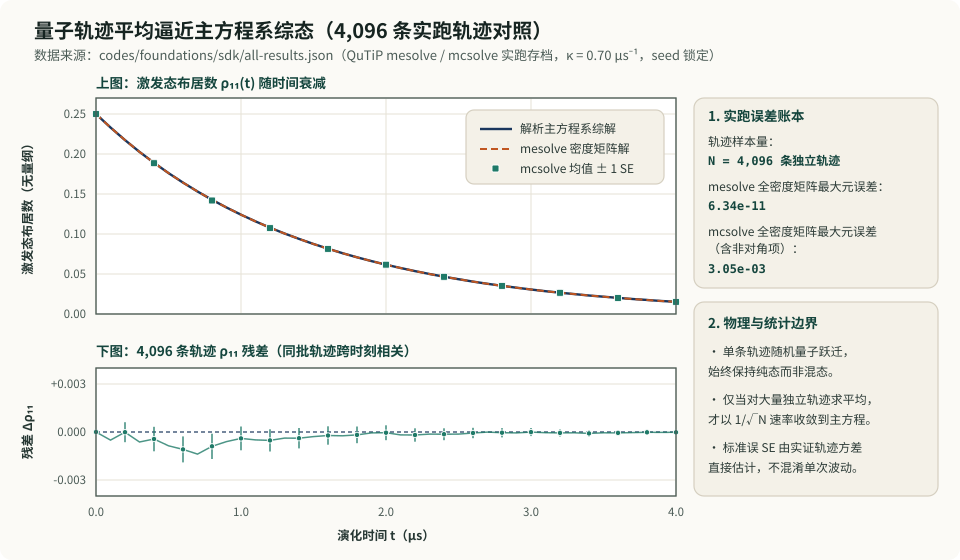
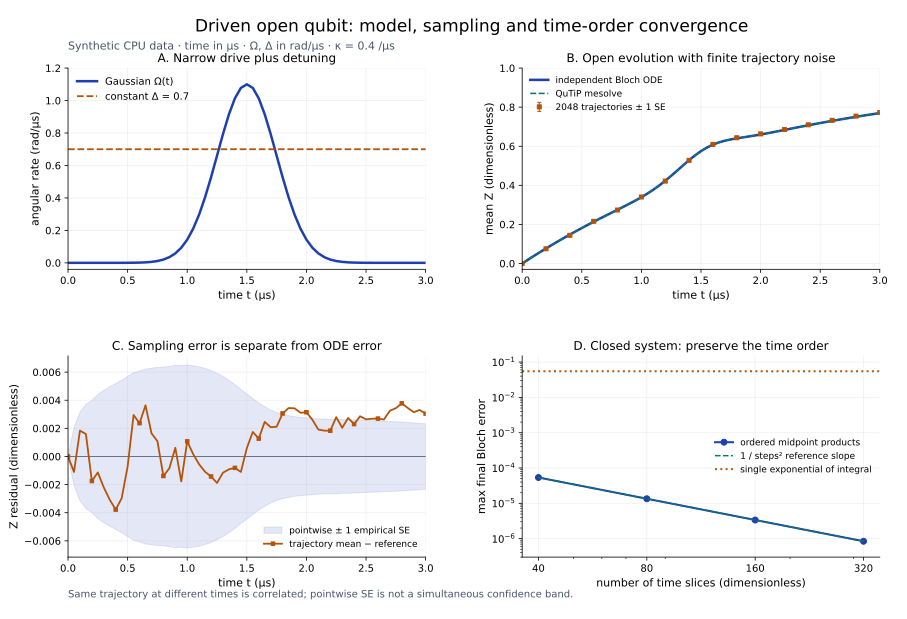

# Q2｜可观测量与量子态的时间演化

本章回答两个直接相连的问题：实验中“测一个物理量”在数学上是什么意思；不测量时，封闭量子系统的状态怎样随时间改变。建议先读全书第 01、02 章和量子力学基础篇 Q1。数学若已生疏，第一遍先读 §1–3 的二维例子，再读 §5、§7–8 中“能级差怎样变成相对相位”的算例。§4 的不确定关系证明、§6 的完整推导和 §9 的时变操作可等用到时回看。主线采用有限维封闭系统和理想投影测量；§9的进阶回看接上具体Markov开放模型。连续谱、更一般的开放模型和测量工具仍需后续章节。

## 1. 从物理量到厄米算符

在有限维量子力学中，一个理想的可观测量用厄米算符 $A=A^\dagger$ 表示。这里“可观测量”指能由一次实验返回一个经典数值的物理量，例如能量或某方向的自旋分量；它不是“直接看见波函数”。$\dagger$ 意为先把矩阵里的复数取共轭，再转置。厄米条件保证本征值为实数，正好可以作为仪器读数。

先暂时不要看一般公式，拿两行两列的 $Z$ 矩阵作一遍。它在 $|0\rangle=[1,0]^T$、$|1\rangle=[0,1]^T$ 上的作用是

$$
Z=\begin{bmatrix}1&0\\0&-1\end{bmatrix},\qquad
Z|0\rangle=+1|0\rangle,\qquad
Z|1\rangle=-1|1\rangle.
$$

所以仪器测 $Z$ 只报告 $+1$ 或 $-1$，不会报告振幅本身。对归一化态 $|\psi\rangle=\sqrt3|0\rangle/2+|1\rangle/2$，投到两个方向的振幅分别为 $\sqrt3/2$ 和 $1/2$；模平方后读数概率是 $p(+1)=3/4$、$p(-1)=1/4$。若实际报告 $+1$，理想条件后态是 $|0\rangle$；若报告 $-1$，则是 $|1\rangle$。概率、读数和测后态是三种不同对象，不能把 $3/4$ 写成仪器读数，也不能把“没读结果”说成已知后态为 $|0\rangle$。

现在才把这个例子推广。$Z$ 可写成 $Z=(+1)|0\rangle\langle0|+(-1)|1\rangle\langle1|$：两个外积各保留一个方向，再乘上该方向的读数。把一般矩阵的不同本征值记为 $a$，同类分解写成

$$
A=\sum_a aP_a,
$$

其中 $P_a$ 投影到本征值为 $a$ 的整个本征子空间，并满足

$$
P_aP_b=\delta_{ab}P_a,\qquad \sum_aP_a=I.
$$

若本征值不简并，$P_a=|a\rangle\langle a|$；若简并，就必须保留投影到整个子空间的 $P_a$，不能任意挑其中一个本征向量。

对归一化纯态 $|\psi\rangle$ 测量 $A$，得到数值 $a$ 的概率为

$$
p(a)=\langle\psi|P_a|\psi\rangle.
$$

若保留结果 $a$，本章采用的理想 Lüders 投影工具给出条件态

$$
|\psi_a\rangle
=\frac{P_a|\psi\rangle}{\sqrt{p(a)}}
\qquad (p(a)>0).
$$

这是一条测量公设，不是由“厄米矩阵”三个字推出来的实验定律。厄米算符、Born 概率与条件后态合在一起，才构成这里使用的理想谱测量模型。[MIT 22.51 的量子力学公设讲义](https://ocw.mit.edu/courses/22-51-quantum-theory-of-radiation-interactions-fall-2012/9cdcc3c1e36da2ae3e2f925d5b435ab6_MIT22_51F12_Ch3.pdf)也按“本征值—Born 概率—投影后态”区分这三层。

谱测量还解释了为什么“得到一个本征值”不总等于“制备了唯一一个本征向量”。若同一本征值对应多维子空间，仪器只报告 $a$，条件后态是 $P_a|\psi\rangle$ 的归一化结果；原态在该子空间内部的叠加一般仍保留。只有一维本征子空间才由读数唯一确定方向。因此，看到简并谱时应先写 $P_a$，而不是把每个本征向量误当成不同的仪器读数。

## 2. 期望值和方差是重复实验的统计量

测量结果形成经典随机变量。其期望值为

$$
\langle A\rangle_\psi
=\sum_a a\,p(a)
=\sum_a a\langle\psi|P_a|\psi\rangle
=\langle\psi|A|\psi\rangle.
$$

最后一步用了谱分解 $A=\sum_a aP_a$。方差和标准差为

$$
(\Delta_\psi A)^2
=\left\langle(A-\langle A\rangle_\psi I)^2\right\rangle_\psi
=\langle A^2\rangle_\psi-\langle A\rangle_\psi^2,
$$

$$
\Delta_\psi A=\sqrt{\langle A^2\rangle_\psi-\langle A\rangle_\psi^2}.
$$

期望值通常不是单次实验会显示的数。它是对同一种制备重复测量后，样本平均趋近的理论值；标准差描述单次读数围绕该均值的散布。有限次数的样本平均还会有采样误差，不能把它与态本身的 $\Delta_\psi A$ 混为一谈。

### 算例：单次只读到 $\pm1$，期望却是 $1/2$

取

$$
|\psi\rangle=\frac{\sqrt3}{2}|0\rangle+\frac12|1\rangle,
\qquad
Z=|0\rangle\langle0|-|1\rangle\langle1|.
$$

测量 $Z$ 只可能得到 $+1$ 或 $-1$：

$$
p(+1)=\frac34,\qquad p(-1)=\frac14.
$$

因此

$$
\langle Z\rangle=(+1)\frac34+(-1)\frac14=\frac12.
$$

但任何一次仪器读数都不会是 $1/2$。又因 $Z^2=I$，

$$
(\Delta Z)^2=\langle Z^2\rangle-\langle Z\rangle^2
=1-\frac14=\frac34,
\qquad
\Delta Z=\frac{\sqrt3}{2}.
$$

若重复 $N$ 次并取读数平均 $\bar Z$，独立同分布的理想模型给

$$
\operatorname{sd}(\bar Z)=\frac{\Delta Z}{\sqrt N}.
$$

例如 $N=300$ 时约为 $0.05$。这描述样本平均的波动，不表示单次 $Z$ 读数从 $\pm1$ 变成了 $0.50\pm0.05$。

### 从公式到实验频率

实际检验 $\langle A\rangle$ 时，最小流程不是“对同一个量子系统不停读取”，而是尽量独立地重复同一种制备。做 $N$ 次后，若结果 $a$ 出现 $n_a$ 次，就用

$$
\widehat p(a)=\frac{n_a}{N},
\qquad
\overline A=\sum_a a\widehat p(a)
$$

估计 Born 概率和期望值。在独立同分布的理想模型中，$N$ 增大时 $\widehat p(a)$ 才逐渐接近 $p(a)$。有限数据可能偏离理论值；设备漂移、读出错判和相关噪声还会破坏独立同分布假设。因此一份实验报告至少要把下列量分开：

| 层次 | 量 | 含义 |
|---|---|---|
| 单次记录 | $a_k$ | 第 $k$ 次实际得到的某个本征值标签 |
| 经验频率 | $n_a/N$ | 有限数据中结果 $a$ 的比例 |
| 样本平均 | $\overline A$ | 由本批数据计算的均值 |
| 理论期望 | $\langle A\rangle$ | 给定态和测量模型预测的总体均值 |
| 量子标准差 | $\Delta A$ | 理论单次结果分布的散布 |

把样本平均写成带小数的结果，并不表示仪器曾在某一次输出该小数；把误差条缩小，也不自动证明制备和测量模型没有系统偏差。

还有一个实用判据。因为

$$
(\Delta A)^2
=\|\,(A-\langle A\rangle I)|\psi\rangle\,\|^2,
$$

$\Delta A=0$ 当且仅当

$$
A|\psi\rangle=\langle A\rangle|\psi\rangle.
$$

也就是说，某个可观测量在纯态上没有统计散布，当且仅当该态是它的本征态。这里的“没有散布”仍假设理想制备和理想测量；真实仪器的读出误差可能让同一本征态的经典记录发生错判。

## 3. 对易与兼容测量

两个算符的对易子定义为

$$
[A,B]=AB-BA.
$$

对有限维厄米算符，$[A,B]=0$ 当且仅当它们可以选取一组共同的正交归一本征基。这里把由一组正交投影 $\{P_a\}$ 描述的理想测量称为“尖锐测量”。此时称相应的尖锐可观测量兼容：可以把共同本征子空间作为一次联合测量的结果空间。若存在简并，一个 $A$ 的读数可能仍不足以确定 $B$ 的读数，但这不妨碍二者存在共同细分的本征基。

若 $[A,B]\ne0$，则不存在覆盖整个空间的共同本征基。先测 $A$、再测 $B$ 通常会改变随后再次测 $A$ 的统计。这里的“通常”很重要：某个特殊输入态或某个偶然结果可能看不出扰动，不能据此断言两个算符对易。

“对易就能共同对角化”也可以逐步理解。若 $A|a\rangle=a|a\rangle$ 且 $[A,B]=0$，则

$$
A(B|a\rangle)=BA|a\rangle=a(B|a\rangle).
$$

所以 $B$ 会把 $A$ 的每个本征子空间映回它自身。接着在每个可能简并的子空间里对角化 $B$，就得到共同本征基。反过来，若两者在同一基中都是对角矩阵，它们的乘法次序当然不影响结果。这个论证也说明简并不是反例，只是需要在简并子空间内再选基。

对 Pauli 算符，

$$
[X,Z]=-2iY,\qquad [Z,X]=2iY.
$$

所以 $X$ 与 $Z$ 不兼容。相反，$Z$ 与 $3Z+2I$ 对易；它们的本征基相同，只是给同一分支贴了不同数值标签。

## 4. Robertson 不确定关系：从 Cauchy–Schwarz 逐步推出

本节在有限维纯态上推导 Robertson 关系。它讨论的是同一种制备在两个分别进行的测量实验中的统计标准差，不是说仪器同时显示两个模糊数字，也不是单纯关于测量设备精度的陈述。

若不熟悉 Cauchy–Schwarz 不等式，可先看[主篇第 01 章的内积推导](../01-math.md)。先定义中心化算符

$$
\widetilde A=A-\langle A\rangle I,
\qquad
\widetilde B=B-\langle B\rangle I.
$$

再定义两个向量

$$
|a\rangle=\widetilde A|\psi\rangle,
\qquad
|b\rangle=\widetilde B|\psi\rangle.
$$

因为 $\widetilde A,\widetilde B$ 仍是厄米算符，

$$
\langle a|a\rangle
=\langle\psi|\widetilde A^2|\psi\rangle
=(\Delta A)^2,
$$

同理 $\langle b|b\rangle=(\Delta B)^2$。Cauchy–Schwarz 不等式给出

$$
(\Delta A)^2(\Delta B)^2
\ge |\langle a|b\rangle|^2
=|\langle\widetilde A\widetilde B\rangle|^2.
$$

令 $z=\langle\widetilde A\widetilde B\rangle$。由于

$$
z^*=\langle\widetilde B\widetilde A\rangle,
$$

其虚部为

$$
\operatorname{Im}z
=\frac{z-z^*}{2i}
=\frac{1}{2i}\langle[\widetilde A,\widetilde B]\rangle
=\frac{1}{2i}\langle[A,B]\rangle.
$$

最后一个等号来自 $I$ 与所有算符对易。又因为 $|z|^2\ge(\operatorname{Im}z)^2$，所以

$$
(\Delta A)^2(\Delta B)^2
\ge\frac14|\langle[A,B]\rangle|^2.
$$

两边取非负平方根，得到

$$
\boxed{\Delta A\,\Delta B
\ge\frac12|\langle[A,B]\rangle|.}
$$

这条关系的通用形式由 H. P. Robertson 在 1929 年给出；原始论文元数据与页码见 [*Physical Review* 34, 163–164](https://doi.org/10.1103/PhysRev.34.163)。上面的有限维推导也可与 [MIT 22.51 讲义](https://ocw.mit.edu/courses/22-51-quantum-theory-of-radiation-interactions-fall-2012/9cdcc3c1e36da2ae3e2f925d5b435ab6_MIT22_51F12_Ch3.pdf)对照。

### 4.1 非零下界：在 $Y$ 本征态上测 $X$ 与 $Z$

取

$$
|{+i}\rangle=\frac{|0\rangle+i|1\rangle}{\sqrt2},
\qquad Y|{+i}\rangle=|{+i}\rangle.
$$

这个态在 $X$ 基和 $Z$ 基测量时都给 $\pm1$ 各半，因此

$$
\langle X\rangle=\langle Z\rangle=0,\qquad
\Delta X=\Delta Z=1.
$$

另一方面，

$$
\frac12|\langle[X,Z]\rangle|
=\frac12|-2i\langle Y\rangle|
=1.
$$

于是 $\Delta X\Delta Z=1$，恰好达到 Robertson 下界。

### 4.2 下界为零，不等于两个量都没有不确定性

取实系数态

$$
|\phi\rangle
=\cos\frac\pi8|0\rangle+\sin\frac\pi8|1\rangle.
$$

其 Bloch 向量为 $(1/\sqrt2,0,1/\sqrt2)$，所以

$$
\langle X\rangle=\langle Z\rangle=\frac1{\sqrt2},
\qquad \langle Y\rangle=0.
$$

由 $X^2=Z^2=I$，

$$
\Delta X=\Delta Z=\frac1{\sqrt2},
\qquad
\Delta X\Delta Z=\frac12.
$$

可是 Robertson 右端为

$$
\frac12|-2i\langle Y\rangle|=0.
$$

这时不等式只说 $1/2\ge0$，没有给出紧下界。原因是 Robertson 下界依赖当前态中的对易子期望值；“右端为零”不等于 $[X,Z]=0$，也不等于两个方差都为零。

还要区分两类常被混写的问题。Robertson 关系约束同一制备态的两个结果分布，通常通过把样本分成两组、分别测 $A$ 和 $B$ 来检验。它本身不是“先测 $A$ 给后测 $B$ 带来多少扰动”的通用定量公式。顺序测量确实可能有反作用，但那要结合具体测量工具和测后态另算；不能只把 $\Delta A\Delta B$ 叫作仪器扰动乘积。

### F71-Q2｜保留刚才舍去的实部，能得到怎样更紧的下界

§4.2 的两种标准差都为 $1/\sqrt2$，Robertson 却只给零下界。回到推导中的 $z=\langle\widetilde A\widetilde B\rangle$：从 $|z|^2$ 只取虚部平方，丢掉了 $({\rm Re}\,z)^2$。把它保留下来，就得到 **Schrödinger 不确定关系**；不是要另加一种动力学假设。

先定义对称协方差

$$
\operatorname{Cov}_\psi(A,B)
=\frac12\langle\widetilde A\widetilde B+\widetilde B\widetilde A\rangle
=\frac12\langle AB+BA\rangle-\langle A\rangle\langle B\rangle.
$$

它是实数，因为括号中的对称和是厄米算符；量纲为 A 的单位乘 B 的单位。对易时它退回普通协方差形式，但对不对易的量，不能把它解释成同一粒子上两份未受扰动的同时读数的乘积平均。

仍用已证明的 $(\Delta A)^2(\Delta B)^2\ge|z|^2$。由于 ${\rm Re}\,z=(z+z^*)/2=\operatorname{Cov}_\psi(A,B)$，而 ${\rm Im}\,z=\langle[A,B]\rangle/(2i)$，完整保留两项得到

$$
\boxed{(\Delta A)^2(\Delta B)^2\ge
\operatorname{Cov}_\psi(A,B)^2
+\frac14|\langle[A,B]\rangle|^2.}
$$

两项都非负，舍掉第一项便是 Robertson 的平方形式。这个加强由 Schrödinger 在 1930 年提出；[原论文的英译及注释](https://arxiv.org/abs/quant-ph/9903100)（v3，2008-05-23；访问 2026-10-13）保留了对称协方差项。本章只在有限维纯态框架中沿原 Cauchy–Schwarz 推导，不把有限矩阵检查称作连续无界算符的通用证明。

**练习。** 对 §4.2 的 $|\phi\rangle=\cos(\pi/8)|0\rangle+\sin(\pi/8)|1\rangle$，取 $A=X,B=Z$，新的下界是多少？

**逐步解答。** 已有 $\langle X\rangle=\langle Z\rangle=1/\sqrt2$、两方差各为 $1/2$。因 $XZ+ZX=0$，对称乘积的期望为 0，所以

$$
\operatorname{Cov}_\phi(X,Z)=0-\frac1{\sqrt2}\frac1{\sqrt2}=-\frac12.
$$

对易子期望仍为零，但协方差平方为 $1/4$。左边两方差相乘也为 $1/4$，所以加强后的关系在此恰好饱和。若取标准差乘积的下界，则是 $\sqrt{1/4}=1/2$；不要把方差乘积 $1/4$ 和标准差乘积 $1/2$ 混写。

**怎样接到实验。** 单独用两批样本估计 $X,Z$ 的均值，不能对这两张互不配对的记录逐行相乘就声称测出了协方差。需要另估计厄米量 $(XZ+ZX)/2$；在本例它恰是零矩阵，可由 Pauli 恒等式确定。另作校验时可用不同批次测 $C=(X+Z)/\sqrt2$ 与 $D=(X-Z)/\sqrt2$，两者仍是合法二值可观测量；本态给 $\langle C\rangle=1$、$\langle D\rangle=0$，说明确定的是斜轴方向，未要求 $X,Z$ 各自确定。

运行 `python3 codes/foundations/round71_checks.py --case q2`；[固定结果](../../codes/foundations/round71-README.md)逐项计算均值、方差、对称和及对易子。若用真实有限计数替代精确值，均值与二阶矩都有估计误差，应传播不确定度后再检验不等式，不能把一点浮动称为理论被推翻。

## 5. 薛定谔方程是动力学公设

前面一直比较“制备后测到什么”；现在问在两者之间等待一段时间，状态怎样改变。对封闭系统，薛定谔绘景把时间依赖放在态上：

$$
i\hbar\frac{d}{dt}|\psi(t)\rangle
=\mathcal H(t)|\psi(t)\rangle.
$$

$\mathcal H(t)$ 是 Hamiltonian（哈密顿算符），表示系统总能量并生成时间演化。左边的 $d|\psi(t)\rangle/dt$ 读作“状态随时间变化的速率”，类似普通函数的导数；这一小节只需先读懂方程每一项的角色，后文才会实际求解。$\hbar$ 把能量乘时间换成无量纲相位，下面会检查它的单位。

这里故意写成花体 $\mathcal H$：全书中量子门

$$
H_{\rm Had}=\frac1{\sqrt2}
\begin{bmatrix}1&1\\1&-1\end{bmatrix}
$$

是 Hadamard 门，二者都常被简写成 $H$，但物理含义完全不同。看到 $e^{-iHt/\hbar}$ 时，$H$ 是 Hamiltonian；看到 $H|0\rangle=|+\rangle$ 时，$H$ 是 Hadamard 门。本文分别写 $\mathcal H$ 与 $H_{\rm Had}$。

薛定谔方程是理论与实验相连的基本动力学公设。可以由它推出幺正演化，也可以说明它与能量、连续时间和平移结构相容；但不能把这些说明冒充成不依赖物理公设的证明。

$\hbar=h/(2\pi)$ 的量纲是能量乘时间。因而

$$
\frac{\mathcal Ht}{\hbar}
$$

无量纲，才能放进指数。若把 $\hbar=1$，等于改用“角频率”作为能量单位，并不是把物理常数从实验中删除。

## 6. 时不变 Hamiltonian：从能谱构造 $U(t)$

若 $\mathcal H$ 不显含时间，谱分解为

$$
\mathcal H=\sum_n E_nP_n.
$$

则薛定谔方程的解是

$$
|\psi(t)\rangle=U(t)|\psi(0)\rangle,
\qquad
U(t)=e^{-i\mathcal Ht/\hbar}
=\sum_n e^{-iE_nt/\hbar}P_n.
$$

最后一个等号可由指数幂级数检查：$P_nP_m=\delta_{nm}P_n$，所以 $\mathcal H^k=\sum_nE_n^kP_n$，每个能量子空间分别累加成普通复指数。

### 6.1 检查它满足方程和初值

直接求导：

$$
i\hbar\frac{dU}{dt}
=i\hbar\left(-\frac{i\mathcal H}{\hbar}\right)U
=\mathcal HU.
$$

又有 $U(0)=I$，所以 $U(t)|\psi(0)\rangle$ 满足薛定谔方程和给定初态。

### 6.2 为什么 $U(t)$ 是酉算符

因为 $\mathcal H=\mathcal H^\dagger$，

$$
U^\dagger(t)
=\sum_n e^{+iE_nt/\hbar}P_n.
$$

利用投影正交性，

$$
U^\dagger U
=\sum_{n,m}e^{iE_nt/\hbar}e^{-iE_mt/\hbar}P_nP_m
=\sum_nP_n=I.
$$

所以态的范数、总概率和内积都被保持。

### 6.3 对易子怎样给出守恒量

若可观测量 $A$ 本身不显含时间，对期望值求导，并分别用薛定谔方程及其共轭，可得

$$
\begin{aligned}
\frac{d}{dt}\langle A\rangle
&=\frac{d\langle\psi|}{dt}A|\psi\rangle
+\langle\psi|A\frac{d|\psi\rangle}{dt}\\
&=\frac{i}{\hbar}\langle\psi|\mathcal HA|\psi\rangle
-\frac{i}{\hbar}\langle\psi|A\mathcal H|\psi\rangle\\
&=\frac{i}{\hbar}\langle[\mathcal H,A]\rangle.
\end{aligned}
$$

因此 $[\mathcal H,A]=0$ 是 $\langle A\rangle$ 保持不变的充分条件。更强地说，在时不变 Hamiltonian 下，共同本征空间的概率也不会随时间改变。取 $A=\mathcal H$ 就得到封闭、时不变系统的平均能量守恒。若 $A(t)$ 自身也显含时间，还要另加 $\langle\partial A/\partial t\rangle$；漏掉这一项会把外部改变的仪器定义误当成守恒量。

## 7. 能量本征态“定态”与叠加态的相对相位

若初态是能量本征态 $|E_n\rangle$，则

$$
|E_n;t\rangle=e^{-iE_nt/\hbar}|E_n\rangle.
$$

它仍乘了一个随时间变化的全局相位，但任何不显含时间的测量概率都不变。因此“定态”不是说 ket 字面上完全不动，而是说该相位不会改变可观测统计。

若初态叠加不同能量，情况不同：

$$
|\psi(0)\rangle=c_0|E_0\rangle+c_1|E_1\rangle
$$

演化为

$$
|\psi(t)\rangle
=e^{-iE_0t/\hbar}
\left(c_0|E_0\rangle
+c_1e^{-i(E_1-E_0)t/\hbar}|E_1\rangle\right).
$$

括号外是共同全局相位；括号内的

$$
e^{-i(E_1-E_0)t/\hbar}
$$

是相对相位，可以经干涉变成时间变化的概率。可见绝对能量整体平移只添共同相位，能级差才控制这类振荡。

更具体地，对实常数 $c$，把 Hamiltonian 整体改为

$$
\mathcal H'=\mathcal H+cI
$$

会使

$$
U'(t)=e^{-ict/\hbar}U(t).
$$

对整个封闭系统，这只是共同全局相位，所以不改变测量概率。这不表示能量“没有意义”，而是说明共同能量零点不影响本章的封闭系统统计。这里必须区分“对子系统的所有能级共同平移”和“只改变某一个能级或控制分支”。即使 A 与 B 纠缠，对 A 加 $cI_A$ 后，在联合空间中的附加项仍是

$$
(cI_A)\otimes I_B=cI_{AB}.
$$

它仍然只产生全局相位，不改变联合或局部测量概率。不能仅因为操作发生在“某个子系统”上，就把共同能量平移说成可测相位。

若只对 A 的 $|1\rangle$ 能级加 c，附加项则是 $c|1\rangle\langle1|_A\otimes I_B$，不是单位算符。它把 Bell 态变成 $(|00\rangle+e^{-ict/\hbar}|11\rangle)/\sqrt2$；当 $ct/\hbar=\pi$ 时，$|\Phi^+\rangle$ 变为 $|\Phi^-\rangle$，联合 X 基相关从同号变成异号。这才是可测的相对相位。[基础实验 FQ2](../labs/foundations.md#fq2子系统整体能量平移仍然只是全局相位)分别检验这两类操作。

## 8. 两个可手算的单量子比特 Hamiltonian

### 8.1 $Z$ Hamiltonian 产生 $R_z$

取

$$
\mathcal H_Z=\frac{\hbar\omega}{2}Z,
$$

其中 $\omega$ 的单位是弧度每秒。则

$$
U_Z(t)=e^{-i\omega tZ/2}=R_z(\omega t).
$$

对初态 $|+\rangle$，

$$
|\psi(t)\rangle
=\frac{e^{-i\omega t/2}|0\rangle
+e^{+i\omega t/2}|1\rangle}{\sqrt2}
=e^{-i\omega t/2}
\frac{|0\rangle+e^{i\omega t}|1\rangle}{\sqrt2}.
$$

在 $Z$ 基测量仍各半；在 $X$ 基测量则

$$
p(+)=\left|\langle+|\psi(t)\rangle\right|^2
=\frac{1+\cos(\omega t)}2,
$$

$$
p(-)=\frac{1-\cos(\omega t)}2.
$$

这里时间变化来自相对相位，不是某个基态概率在没有换基的情况下自行“泄漏”。

### 8.2 $X$ Hamiltonian、$\pi$ 脉冲和单位陷阱

取

$$
\mathcal H_X=\frac{\hbar\Omega}{2}X.
$$

则

$$
U_X(t)=e^{-i\Omega tX/2}=R_x(\Omega t).
$$

从 $|0\rangle$ 出发：

$$
|\psi(t)\rangle
=\cos\frac{\Omega t}{2}|0\rangle
-i\sin\frac{\Omega t}{2}|1\rangle,
$$

所以

$$
p(1)=\sin^2\frac{\Omega t}{2}.
$$

要把 $|0\rangle$ 翻到 $|1\rangle$，需 $|\Omega|t=\pi$，即

$$
t_\pi=\frac\pi{|\Omega|}.
$$

若实验给的是普通频率 $f$（Hz，即每秒周期数），则 $\Omega=2\pi f$，于是

$$
t_\pi=\frac1{2f}.
$$

例如 $f=10\ \mathrm{MHz}$ 时，$t_\pi=50\ \mathrm{ns}$。实验文献有时写“Rabi frequency 为 10 MHz”，却实际指 $\Omega/2\pi=10\ \mathrm{MHz}$；复算脉冲时间前必须先查它报告的是 $f$ 还是 $\Omega$，否则会差一个 $2\pi$。

这里的 $\mathcal H_X$ 可理解为在合适旋转坐标系中的理想共振、恒幅、无噪声有效模型。真实脉冲若有失谐、有限上升沿、串扰或幅度漂移，旋转轴和旋转角都会偏离上述结果。因此 $t_\pi$ 是模型给出的标称时长；实验上仍需扫描脉冲时长、观察结果频率并校准，而不能只从名义微波频率推断门保真度。

## 9. 时变 Hamiltonian：不对易时，操作顺序不能丢

若 $\mathcal H(t)$ 随时间变化，可以直接把普通积分放进一个指数的一个常用充分条件是：任意两个时刻都满足

$$
[\mathcal H(t),\mathcal H(t')]=0,
$$

此时可以写

$$
U(t,t_0)=\exp\left[-\frac{i}{\hbar}
\int_{t_0}^{t}\mathcal H(s)\,ds\right].
$$

若不满足这个条件，一般需要按时间顺序相乘；较晚发生的操作写在左边。某些具有额外结构的特殊不对易情形也可能化简，但不能只凭普通积分默认成立。[MIT 8.321 第 8 讲](https://ocw.mit.edu/courses/8-321-quantum-theory-i-fall-2017/579cb61c4eaa494b9adb90830d921099_MIT8_321F17_lec8.pdf)从微小时间步的乘积推导了这个顺序，并明确指出一般不对易时不能把乘积直接并成“指数里的和”。本章只用一个两段反例，不展开 Dyson 级数。

### 两段 $X/Z$ 操作反例

令每一段持续 $\tau$，且 $\omega\tau=\pi/2$。方案一先施加

$$
\mathcal H_X=\frac{\hbar\omega}{2}X,
$$

再施加

$$
\mathcal H_Z=\frac{\hbar\omega}{2}Z.
$$

真实演化为

$$
U_{X\to Z}=R_z(\pi/2)R_x(\pi/2).
$$

作用于 $|0\rangle$：

$$
R_x(\pi/2)|0\rangle
=\frac{|0\rangle-i|1\rangle}{\sqrt2},
$$

$$
R_z(\pi/2)R_x(\pi/2)|0\rangle
=e^{-i\pi/4}|+\rangle.
$$

所以最后测 $X$ 必得 $+1$。

若交换两段顺序，

$$
U_{Z\to X}=R_x(\pi/2)R_z(\pi/2),
$$

并且

$$
U_{Z\to X}|0\rangle
=e^{-i\pi/4}\frac{|0\rangle-i|1\rangle}{\sqrt2}
=e^{-i\pi/4}|{-i}\rangle.
$$

此时测 $X$ 得 $\pm1$ 各半。两个方案的普通积分都给

$$
\frac1\hbar\int\mathcal H(t)dt
=\frac\pi4(X+Z),
$$

若直接写成 $\exp[-i\pi(X+Z)/4]$，就会错误地预测两种顺序相同。真正的差别来自 $[X,Z]\ne0$。这也是脉冲序列必须记录时间顺序的最小例子。

从实验记录看，“先 $X$ 后 $Z$”不只是文字备注，而是动力学输入的一部分。控制系统需要保存每段开始时间、持续时间、振幅、相位和所用旋转坐标系；只保存时间平均 Hamiltonian 会丢失顺序信息。对很短的时间步，数值模拟也正是把各小段指数按时间排列后相乘，再检查缩短步长时结果是否收敛。

### F72-Q2｜把开放演化接到求解器：平均态与一条随机轨迹

前面封闭系统由酉矩阵演化；若激发能量流向环境，单系统的纯 ket 通常不够。这里先给一个与第 05 章零温阻尼相接的 Markov 模型，供学过密度矩阵后回看。取时间单位 $\mu\mathrm{s}$，$h=\mathcal H/\hbar=-\omega Z/2$，$\omega=.9\ \mathrm{rad}/\mu\mathrm{s}$；塌缩算符 $L=\sqrt\kappa|0\rangle\langle1|$，$\kappa=.7\ \mu\mathrm{s}^{-1}$，L 的单位是 $\mu\mathrm{s}^{-1/2}$。平均密度矩阵满足

$$
\dot\rho=-i[h,\rho]+L\rho L^\dagger-\frac12(L^\dagger L\rho+\rho L^\dagger L).
$$

这是一种具体开放动力学假设，不能从封闭薛定谔方程不加环境条件就推出它适合任意装置。[QuTiP 主方程文档](https://qutip.readthedocs.io/en/v5.3.1/guide/dynamics/dynamics-master.html)给出求解器接口与塌缩算符的速率平方根约定（访问 2026-10-13）。

**练习。** 初态为 $(\sqrt3|0\rangle+i|1\rangle)/2$，写 $b=\rho_{11},c=\rho_{01}$。求 $b(t),c(t)$；为什么 4096 条随机轨迹的平均不必逐格等于主方程数值解？

**第一步：逐格取方程。** $L^\dagger L=\kappa|1\rangle\langle1|$，故 $\dot b=-\kappa b$；耗散使 $\dot c$ 含 $-\kappa c/2$。由于 $h_{00}-h_{11}=-\omega$，对易子项另给 $+i\omega c$，所以

$$
b(t)=\frac14e^{-.7t},\qquad
c(t)=-\frac{i\sqrt3}{4}e^{(-.35+.9i)t},\qquad
\rho(t)=\begin{bmatrix}1-b(t)&c(t)\\c(t)^*&b(t)\end{bmatrix}.
$$

t 的数值以 $\mu\mathrm{s}$ 输入。将 $\gamma(t)=1-e^{-\kappa t}$ 代回零温阻尼，并叠加相位旋转，也得到同一矩阵。QuTiP 5.3.1 的 `mesolve` 在 $0\le t\le4$ 的 41 个点实际求解，最大逐格误差 $6.35\times10^{-11}$。

**第二步：分清三种误差。** `mcsolve` 生成 4096 条条件随机轨迹（种子 72），逐条纯态外积平均成密度矩阵；平均矩阵距解析态最大逐格差约 $.00305354$。ODE 容差控制每条积分近似，轨迹数控制平均的采样涨落，真实器件误差则在本次本地模拟之外。单条轨迹的 ket 不是不记录环境结果后的平均态。

取“4 μs 前是否发生跃迁”为 $0/1$ 随机变量。本模型至多跃迁一次，概率 $p_J=\tfrac14(1-e^{-2.8})\approx.2347974843$。实际 965/4096 条发生跃迁，比例 $.2355957031$。独立轨迹平均的方差为 $p_J(1-p_J)/N$，标准误为 $\sqrt{p_J(1-p_J)/N}\approx.00662300$；所以一般标准误按 $N^{-1/2}$ 缩小，而**方差**按 $N^{-1}$ 缩小。

[QuTiP stable MC 指南](https://qutip.readthedocs.io/en/stable/guide/dynamics/dynamics-monte.html)在本次读取中把未定义的“errors”写成 $1/n$。不能把它直接当标准误：5.3.1 的 `MultiTrajResult._create_e_data` 算 `std_expect` 为轨迹观测期望的总体标准差，尚未除 $\sqrt N$；程序从 `runs_expect` 独立计算样本标准差再除 $\sqrt N$，并实际核对 SDK 的标准差。[源码入口](https://qutip.readthedocs.io/en/stable/_modules/qutip/solver/multitrajresult.html)与[固定版本哈希及全部结果](../../codes/foundations/round72-README.md)记录这一核查（访问 2026-10-13）。该检查使用普通独立采样；重要性采样、加权混态或相关轨迹必须重算误差模型，不能照套。

实线为解析总体占据，虚线为 `mesolve`，方形点及误差线为 `mcsolve` 平均与一倍经验标准误；横轴时间为 $\mu\mathrm{s}$，纵轴占据无量纲。图是合成动力学数据，不是设备测量。[原尺寸图](../assets/round72-foundations-trajectories.svg)和[生成程序](../../codes/foundations/generate_round72_figure.py)随书保存；同一批轨迹的不同时间点相关，误差线不构成整条曲线的同时置信带。

### F73-Q2｜脉冲随时间变化：分别检查时序误差、积分误差与轨迹涨落

F72的自由阻尼可解析求解；现在增加一个有有限宽度的驱动，不能再把全部时刻的生成元直接积分成一个指数。仍以 $\mu\mathrm{s}$ 为时间单位，令

$$
h(t)=\frac{\mathcal H(t)}{\hbar}
=\frac{\Delta Z+\Omega(t)X}{2},\qquad
\Omega(t)=1.1\exp\!\left[-\left(\frac{t-1.5}{.35}\right)^2\right],
$$

其中 $\Delta=.7\ \mathrm{rad}/\mu\mathrm{s}$，$\Omega$ 的单位也是 $\mathrm{rad}/\mu\mathrm{s}$，$.35\ \mu\mathrm{s}$ 是Gaussian指数的宽度参数，不是半高全宽。塌缩算符仍为 $L=\sqrt\kappa|0\rangle\langle1|$，$\kappa=.4\ \mu\mathrm{s}^{-1}$；初态 $|{+i}\rangle$、初始Bloch向量 $(0,1,0)$。

**第一步：用另一套数学对象作独立对照。** 写 $\rho=(I+xX+yY+zZ)/2$。Pauli对易关系使Hamiltonian部分为向量叉积 $(\Omega,0,\Delta)\times(x,y,z)$；阻尼使x/y以 $\kappa/2$ 衰减，z趋向基态值1。因此

$$
\dot x=-\Delta y-\frac\kappa2x,\qquad
\dot y=\Delta x-\Omega(t)z-\frac\kappa2y,\qquad
\dot z=\Omega(t)y+\kappa(1-z).
$$

最后一项的正号来自本书基态 $Z=+1$；若把软件中的升降矩阵名字当作基序定义，可能把趋向值写反。本轮QuTiP直接演化密度矩阵；独立SciPy求解这三个实变量方程；标准库RK4再检查末时刻。没有从SDK结果回填参考答案。

**练习与答案。** 求 $t=0$ 的初始导数。由于脉冲尾 $\Omega(0)\approx1.16\times10^{-8}$，得 $(-.7,-.2,.4000000116)$；尾巴很小却不是严格零。积分到3 μs，独立末值约为 $(-.238611915,-.422995520,.769743420)$。对这条固定输入，标准库150/300/600步与2400步的最大末值差约为 $8.92\times10^{-10},5.49\times10^{-11},3.39\times10^{-12}$；这与四阶收敛的有限案例一致，不代替一般误差定理。

**第二步：输出时间点不等于内部步长。** 61个输出点只告诉求解器什么时候报告结果；遇到窄脉冲仍须限制内部步长。QuTiP实际取三组 $(\mathrm{atol},\mathrm{rtol},\mathrm{max\ step})$，如下表；误差是在同61点与独立Bloch方程比较的最大坐标差。

| 绝对容差 | 相对容差 | 最大内部步长（μs） | 最大Bloch差 |
|---:|---:|---:|---:|
| $10^{-5}$ | $10^{-4}$ | $.25$ | $3.57090\times10^{-4}$ |
| $10^{-8}$ | $10^{-7}$ | $.05$ | $6.52690\times10^{-7}$ |
| $10^{-11}$ | $10^{-10}$ | $.01$ | $5.69778\times10^{-10}$ |

缩小容差和步长后本例更接近参考值，是实际收敛证据；不是求解器对所有输入保证这些误差。[QuTiP时变接口](https://qutip.readthedocs.io/en/v5.3.1/guide/dynamics/dynamics-time.html)与[求解器选项](https://qutip.readthedocs.io/en/qutip-5.3.x/apidoc/solver.html)说明系数函数和内部步长（固定5.3.1，访问2026-10-13）。

**第三步：关掉耗散，单独暴露错误的时序近似。** 中点分段法按较晚片写在左边连乘 $e^{-i h(t_k)\delta t}$；40/80/160/320片的末值最大坐标差约为 $5.3862\times10^{-5},1.3477\times10^{-5},3.3699\times10^{-6},8.4249\times10^{-7}$，每次片数翻倍，差约除四。若直接对普通积分做一次指数，本例末值最大偏差约 $.05498049$，再缩小数值积分容差也不会补回被删掉的时序信息。

**第四步：随机轨迹的误差还有另一来源。** 开放驱动下实际运行2048条独立量子跳跃轨迹，保存每条61个时刻的X/Y/Z期望值、每条子种子及跃迁次数。其中1405条无跃迁、622条跃迁一次、21条跃迁两次；驱动会重新激发，所以不能再套F72“至多跃迁一次”的Bernoulli模型。

同一时刻，轨迹观测平均的经验标准误仍为 $s(t)/\sqrt{2048}$；同一轨迹的两个时刻却不是独立样本。例如Z平均在1 μs与3 μs的样本协方差除以轨迹数约为 $6.9285\times10^{-6}$。估计两时刻差值时，要减去两倍这个协方差，不能只把两方差相加。完整轨迹压缩样本见[原始观测数组](../../codes/foundations/sdk73/trajectory-observables.npz)；六倍标准误回归仅检查有限样本的一致尺度，不构成整条曲线的同时覆盖保证。

图上方分别展示脉冲与开放演化，下方区分逐点轨迹平均残差和封闭系统时序收敛；轴单位、线型与误差定义在图中明示。[原尺寸图](../assets/round73-foundations-dynamics.svg)与[生成程序](../../codes/foundations/generate_round73_figure.py)保留。三类误差分别来自选错模型/时序、数值积分、有限轨迹；本轮没有真实脉冲设备误差、非Markov动力学或工业控制闭环。

运行标准库 `round73_checks.py --case q2` 与完整环境 `sdk73/validate_sdks.py --case dynamics`，步骤见[F73实验说明](../../codes/foundations/round73-README.md)。

## 10. 常见误区与检查顺序

- **把期望值当成单次读数**：先列出谱中的可能结果，再求加权平均。
- **把不对易直接翻译成“两个方差永远都大”**：Robertson 下界依赖态；右端可以为零而两个方差仍非零。
- **把定态理解成态矢量完全不变**：能量本征态仍积累全局相位，只是时间无关测量统计不变。
- **指数中忘记 $\hbar$**：先检查 $\mathcal Ht/\hbar$ 是否无量纲。
- **混用 Hz 与 rad/s**：看到 MHz 时先确认作者指 $f$ 还是 $\Omega/2\pi$。
- **把时变 Hamiltonian 直接积分进指数**：先检查所有时刻的 Hamiltonian 是否两两对易。
- **混淆两个 $H$**：Hadamard 是一个特定量子门；Hamiltonian 是具有能量量纲的动力学生成元。

## 11. 自检

1. 对 $A=2|0\rangle\langle0|-|1\rangle\langle1|$ 和 $|\psi\rangle=(|0\rangle+|1\rangle)/\sqrt2$，列出单次测量的可能结果与概率，并求 $\langle A\rangle$、$\Delta A$。为什么单次不会读到期望值？
2. 从中心化算符和 Cauchy–Schwarz 不等式出发，补全 Robertson 关系中从 $(\Delta A)^2(\Delta B)^2$ 到 $\frac14|\langle[A,B]\rangle|^2$ 的推导。
3. 在 $|{+i}\rangle$ 上计算 $\Delta X\Delta Z$ 与 Robertson 下界；二者是否相等？
4. 对 $|\phi\rangle=\cos(\pi/8)|0\rangle+\sin(\pi/8)|1\rangle$，为什么 Robertson 右端为零，却不能说 $X,Z$ 都是确定的？
5. 若 $\mathcal H=E_0|0\rangle\langle0|+E_1|1\rangle\langle1|$，写出 $U(t)$，并求初态 $|+\rangle$ 在时刻 $t$ 测得 $X=+1$ 的概率。
6. 对 $\mathcal H_X=\hbar\Omega X/2$，从 $|0\rangle$ 出发求 $p(1,t)$。若实验报告 $\Omega/2\pi=25\ \mathrm{MHz}$，$\pi$ 脉冲多长？
7. 为什么 Hamiltonian 的能量本征态称为定态？这是否表示 ket 完全不随时间改变？
8. 两段等时长的 $X$、$Z$ Hamiltonian 具有相同的时间积分。为什么交换顺序仍可能改变结果？用本章 $\pi/2$ 两段例子的 $X$ 基测量概率回答。

答案见[练习与答案：量子力学 Q2](../appendices/exercises.md#量子力学-q2)。

## 新增诊断练习：同一个简并读数，测量后为什么可能不同

**题目。** 用三维基 $|0\rangle,|1\rangle,|2\rangle$，取可观测量 $A=\operatorname{diag}(0,0,1)$，输入 $|u\rangle=(|0\rangle+|1\rangle)/\sqrt2$。方案甲只区分 $A=0$ 与 $A=1$，使用 Lüders 投影工具；方案乙先精细地区分三个基态，再把前两个标签都改报为数值 0。两方案的读数分布、后态是否相同？

**第一步：确定整个本征空间。** $A=0$ 的投影是 $P_0=\operatorname{diag}(1,1,0)$，不是 $|0\rangle\langle0|$。方案甲有 $P_0|u\rangle=|u\rangle$，故读数 0 的概率为 1，条件后态仍为 $|u\rangle\langle u|$；简并子空间内的相干保留下来。

**第二步：合并标签不能撤销精细测量。** 方案乙数值 0 背后的工具含两个 Kraus 算子 $M_{00}=|0\rangle\langle0|$、$M_{01}=|1\rangle\langle1|$。即使删掉精细标签，状态仍成为

$$
\mathcal I_0(|u\rangle\langle u|)
=\frac12|0\rangle\langle0|+\frac12|1\rangle\langle1|.
$$

两个方案的 POVM 元都为 $E_0=P_0,E_1=|2\rangle\langle2|$，读数统计一致，后态却不同。若随后测“是否回到 $|u\rangle$”的投影 $|u\rangle\langle u|$，甲必得成功，乙只以 $1/2$ 概率成功。细分后再遗忘与从未细分，不是同一物理工具。

本题把 §1 的“理想投影更新”明确限定为 Lüders 实现，防止把**只给一个厄米算符**误认为已经唯一指定所有装置的测后态。一般工具定义见[第 02 章](../02-single-qubit.md#7-进阶回看一般测量为何还要说明后态)及 [Preskill 测量讲义](https://www.preskill.caltech.edu/ph229/notes/chap3.pdf)。运行 `python3 codes/foundations/diagnostic_lab.py --case q2`，直接用 $3\times3$ 矩阵核对两个后续概率 1 与 $1/2$。

## 配套数值实验与展开答案

逐个检查两段 Hamiltonian 的顺序，并对照子系统整体能量平移与单个分支能量改变：前者仍是全局相位，后者可以改变联合测量统计。

题目和逐步解答见[基础实验册](../labs/foundations.md)，本章程序编号为 `q2`。可从[代码说明](../../codes/foundations/README.md)进入独立脚本与保存的运行结果。所有模拟样本均明确标作合成数据，不是硬件实验。

## 参考资料

- MIT OpenCourseWare, [22.51 Course Notes, Chapter 3: Axioms of Quantum Mechanics](https://ocw.mit.edu/courses/22-51-quantum-theory-of-radiation-interactions-fall-2012/9cdcc3c1e36da2ae3e2f925d5b435ab6_MIT22_51F12_Ch3.pdf)：谱测量、期望值、兼容可观测量与不确定关系推导。
- MIT OpenCourseWare, [8.04 Lecture 6: Time Evolution and the Schrödinger Equation](https://ocw.mit.edu/courses/8-04-quantum-physics-i-spring-2013/resources/mit8_04s13_lec06/)：本科层次的薛定谔方程与时间演化。
- MIT OpenCourseWare, [8.321 Lecture 8: General Time Dependent Hamiltonians](https://ocw.mit.edu/courses/8-321-quantum-theory-i-fall-2017/579cb61c4eaa494b9adb90830d921099_MIT8_321F17_lec8.pdf)：时不变、各时刻对易与一般时序演化的区分。
- John Preskill, [*Foundations II: Measurement and Evolution*](https://www.preskill.caltech.edu/ph229/notes/chap3.pdf)：投影测量、广义测量与封闭/开放系统演化的边界。
- H. P. Robertson, [“The Uncertainty Principle,” *Physical Review* 34, 163–164 (1929)](https://doi.org/10.1103/PhysRev.34.163)：Robertson 不确定关系的原始论文。
