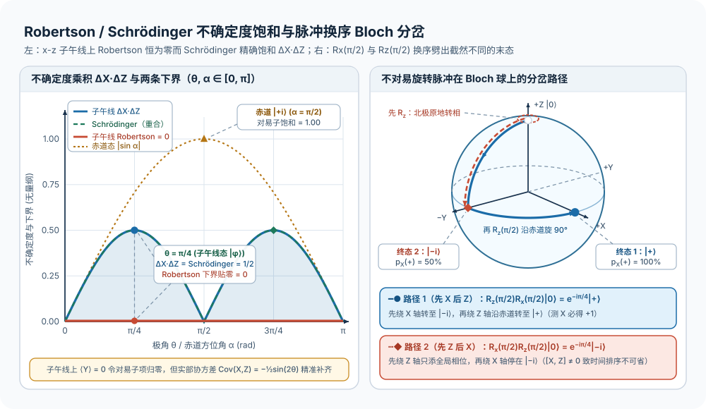
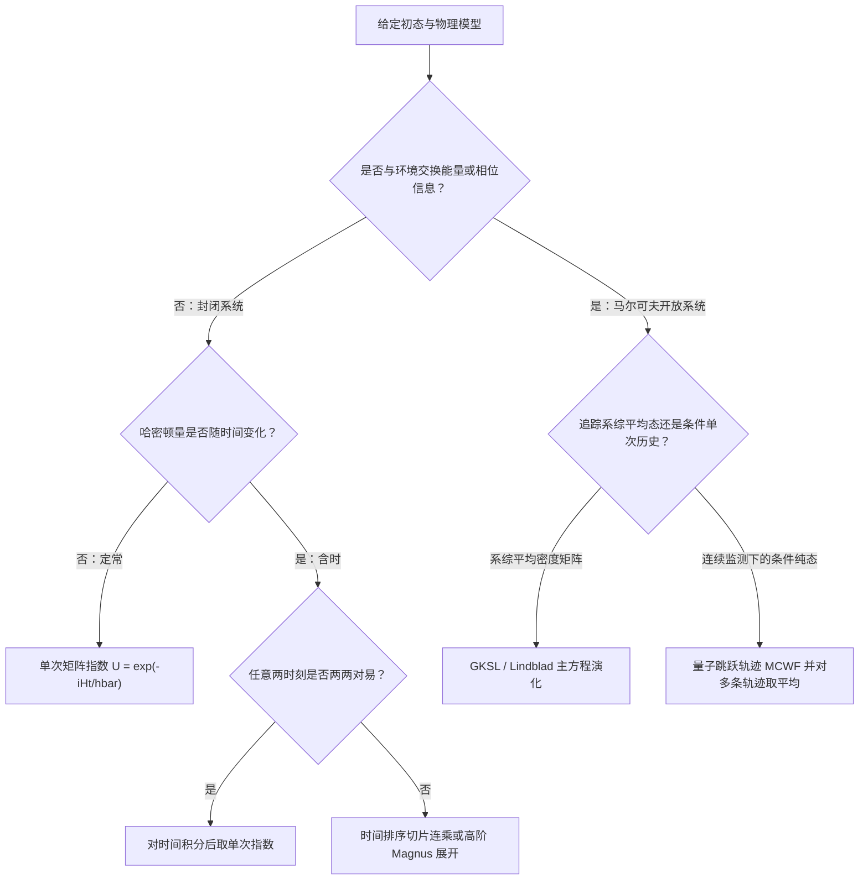
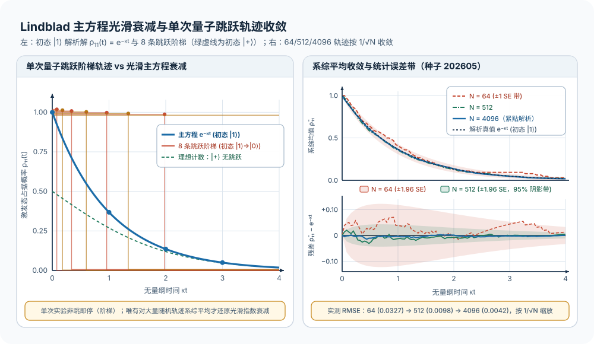

# Q2｜可观测量与量子态的时间演化

在[量子力学基础篇 Q1](01-experiments-states.md)和[第 02 章](../02-single-qubit.md)里，我们已经学会用复数向量表示量子态，也看到了测量怎样把复振幅变成概率。顺着这条线往下走，立刻会冒出两个绕不开的问题：第一，实验室里测量一个物理量（比如能量或某个方向的自旋分量），在数学上到底对应什么对象？第二，在制备和测量之间什么都不测、只是静静等待或施加控制脉冲，量子态与可观测量又怎样随时间改变？

本章专心回答这两个问题。整章不需要系统学过微积分——碰到时间变化率的地方，我们都用最直观的“指针转动速度”和初等矩阵乘法一步步算清楚。你可以先把精力放在第 1–3 节的可观测量算例和第 5–6 节的定常演化与进动翻转上；第 4 节的不确定关系、第 7 节的三种动力学绘景、第 8 节的时变脉冲次序以及第 9 节与[第 05 章](../05-noise-channels.md)衔接的开放系统动力学，既可以顺着读完，也可以在后续碰到旋转坐标系、脉冲控制与噪声模拟时回来细查。

---

## 1. 从物理量到厄米算符与谱分解

### 1.1 为什么物理量对应厄米算符

在经典物理里，一个物理量就是一个实数函数：给定小球的坐标和速度，就能读出它的动能是多少焦耳。到了量子力学里，同一个量子态在测量时可能随机给出好几个不同的读数，而且每次读数必须是实数（仪表盘上不会弹出 $2+3i$ 焦耳）。此外，如果系统恰好处于某个确定读数对应的状态，再次用同一台理想仪器测量，应该以概率 $1$ 给出同一个数；不同确定读数对应的状态彼此互斥，理应相互正交。

在有限维复向量空间 $\mathbb{C}^d$ 中，同时满足“拥有一组铺满整个空间的正交归一本征基（不同本征值对应的本征子空间两两正交、直和为 $\mathbb{C}^d$）”和“所有本征值全是实数”这两条要求的线性算符，正好是**厄米算符**（Hermitian operator）——满足 $A=A^\dagger$ 的 $d\times d$ 矩阵，其中 $A^\dagger=(A^*)^T$ 表示先把矩阵里每个元素取复共轭再转置。（在无限维连续空间里还需区分对称算符与更严格的自伴算符边界，详见 [Q4｜波函数与连续模型](04-wavefunctions-models.md)。）

先别急着背一般定义，拿起最熟悉的单比特 Pauli 矩阵 $Z$（维度 $2\times 2$，在计算基 $|0\rangle=[1,0]^T$、$|1\rangle=[0,1]^T$ 下表示）亲手算一遍：

$$
Z=\begin{bmatrix}1 & 0\\ 0 & -1\end{bmatrix}.
$$

把 $Z$ 乘到两个基态上，逐行展开：

$$
Z|0\rangle
=\begin{bmatrix}1 & 0\\ 0 & -1\end{bmatrix}\begin{bmatrix}1\\0\end{bmatrix}
=\begin{bmatrix}1\cdot 1 + 0\cdot 0\\ 0\cdot 1 + (-1)\cdot 0\end{bmatrix}
=+1|0\rangle,
$$

$$
Z|1\rangle
=\begin{bmatrix}1 & 0\\ 0 & -1\end{bmatrix}\begin{bmatrix}0\\1\end{bmatrix}
=\begin{bmatrix}1\cdot 0 + 0\cdot 1\\ 0\cdot 0 + (-1)\cdot 1\end{bmatrix}
=-1|1\rangle.
$$

这两个本征值 $+1$ 和 $-1$，就是测量 $Z$ 时仪器唯一可能报出的两种读数。现在把归一化纯态

$$
|\psi\rangle=\frac{\sqrt{3}}{2}|0\rangle+\frac{1}{2}|1\rangle
=\begin{bmatrix}\sqrt{3}/2\\ 1/2\end{bmatrix}
$$

送进这台仪器（先验证归一化：$(\sqrt{3}/2)^2+(1/2)^2=3/4+1/4=1$）。读出 $+1$ 和 $-1$ 的概率分别是对应分量的模平方：

$$
p(+1)=\left|\langle 0|\psi\rangle\right|^2=\left|\frac{\sqrt{3}}{2}\right|^2=\frac{3}{4},
\qquad
p(-1)=\left|\langle 1|\psi\rangle\right|^2=\left|\frac{1}{2}\right|^2=\frac{1}{4},
$$

两者相加 $3/4+1/4=1$。如果这一次实验真的亮起了 $+1$ 的指示灯，测量后的条件态就是 $|0\rangle$；如果亮起 $-1$，条件态就是 $|1\rangle$。请把**仪器读数**（$+1$ 或 $-1$）、**出现概率**（$3/4$ 或 $1/4$）和**测后状态**（$|0\rangle$ 或 $|1\rangle$）分开放进三个抽屉，不要把概率 $3/4$ 当成仪器报出的读数。

### 1.2 谱分解与 Lüders 投影规则

回头看 $Z$ 矩阵，它可以拆成两个外积的加权和：

$$
Z=(+1)|0\rangle\langle 0|+(-1)|1\rangle\langle 1|
=(+1)\begin{bmatrix}1&0\\0&0\end{bmatrix}+(-1)\begin{bmatrix}0&0\\0&1\end{bmatrix}.
$$

每个外积矩阵就像一块偏振片，只保留对应方向的分量，再乘上该方向对应的读数。把这件事推广到任意有限维厄米算符 $A$，就得到**谱分解定理**（spectral decomposition）：设 $A$ 共有若干互不相同的实本征值 $a$，每个 $a$ 对应一个正交投影算符 $P_a$（投影到本征值为 $a$ 的整个本征子空间），则

$$
A=\sum_{a} a\,P_a,
$$

并且这组投影算符满足三条几何规则：

$$
P_a^\dagger=P_a=P_a^2 \text{（自伴且幂等）},
\qquad
P_a P_b=\delta_{ab}P_a \text{（不同子空间正交）},
\qquad
\sum_{a} P_a = I \text{（铺满整个空间）}.
$$

如果本征值 $a$ 对应的本征子空间是一维的（称为**非简并**），那么 $P_a=|a\rangle\langle a|$；如果好几个线性无关的本征向量共用同一个本征值 $a$（称为**简并**，子空间维数 $m_a=\operatorname{Tr}(P_a)>1$），那么 $P_a$ 必须写成这个子空间里一组正交归一基的外积之和，比如 $P_a=|a,1\rangle\langle a,1|+|a,2\rangle\langle a,2|+\cdots$。

借助谱分解，理想投影测量的两条公设写得极为简洁。对任意归一化纯态 $|\psi\rangle\in\mathbb{C}^d$ 测量可观测量 $A$：

1. **Born 概率规则**：得到读数 $a$ 的概率为

   $$
   p(a)=\langle\psi|P_a|\psi\rangle=\|P_a|\psi\rangle\|^2.
   $$

   因为 $P_a=P_a^\dagger P_a$，上式恒非负；再对所有 $a$ 求和，$\sum_a p(a)=\langle\psi|\bigl(\sum_a P_a\bigr)|\psi\rangle=\langle\psi|I|\psi\rangle=1$，总概率自然守恒。

2. **Lüders 条件更新规则**：若观测到结果 $a$（且 $p(a)>0$），不额外区分该子空间内部细节的理想装置，会把态投影到子空间并重新归一化：

   $$
   |\psi_a\rangle=\frac{P_a|\psi\rangle}{\sqrt{p(a)}}.
   $$

这两条规则是量子力学连接数学与实验的基本公设（可对照 MIT 22.51 讲义第 3 章的公设体系），不是从“矩阵厄米”这四个字纯代数推导出来的。

### 1.3 简并子空间的细微差别：Lüders 投影 vs 先细分再遗忘

遇到简并本征值时，初学者常会以为“测出读数 $a$ 之后，态一定会塌缩到某一个基态，或者只要读数概率一样，测量后的态也必然一样”。下面用一个三维具体例子把这个坑填平。

考虑三维空间 $\mathbb{C}^3$（基序 $|0\rangle=[1,0,0]^T,\ |1\rangle=[0,1,0]^T,\ |2\rangle=[0,0,1]^T$）上的厄米算符

$$
A=\operatorname{diag}(0,0,1)
=0\cdot\bigl(|0\rangle\langle 0|+|1\rangle\langle 1|\bigr)+1\cdot|2\rangle\langle 2|.
$$

这里的本征值 $0$ 是二重简并的，对应的本征子空间由 $|0\rangle$ 和 $|1\rangle$ 张成，完整投影算符为 $P_0=\operatorname{diag}(1,1,0)$；本征值 $1$ 非简并，$P_1=\operatorname{diag}(0,0,1)$。现在把归一化叠加态

$$
|u\rangle=\frac{|0\rangle+|1\rangle}{\sqrt{2}}=\frac{1}{\sqrt{2}}\begin{bmatrix}1\\1\\0\end{bmatrix}
$$

分别送入两台都能报告“读数 $0$ 或读数 $1$”的物理装置：

- **装置甲**（真正的简并 Lüders 测量）：仪器本身只区分“是不是 $|2\rangle$”，物理上完全无法分辨 $|0\rangle$ 与 $|1\rangle$。计算投影结果：

  $$
  P_0|u\rangle
  =\begin{bmatrix}1&0&0\\0&1&0\\0&0&0\end{bmatrix}
  \frac{1}{\sqrt{2}}\begin{bmatrix}1\\1\\0\end{bmatrix}
  =\frac{1}{\sqrt{2}}\begin{bmatrix}1\\1\\0\end{bmatrix}
  =|u\rangle.
  $$

  于是读出 $0$ 的概率 $p(0)=\|P_0|u\rangle\|^2=1$，读出 $1$ 的概率 $p(1)=0$，而测后态原封不动地保持为纯态 $|u\rangle$——简并子空间内部的相对相位和叠加关系完整存活！

- **装置乙**（先精细测量，再把标签合并）：仪器先用细分辨探测器彻底分出 $|0\rangle$、$|1\rangle$、$|2\rangle$（对应三个秩一投影 $M_{00}=|0\rangle\langle 0|$、$M_{01}=|1\rangle\langle 1|$、$M_1=|2\rangle\langle 2|$），然后电路把“测到 $|0\rangle$”和“测到 $|1\rangle$”这两个指示灯并到同一个屏幕数字 `0` 上。结果，屏幕上看到 `0` 的概率同样是 $\frac{1}{2}+\frac{1}{2}=1$，看到 `1` 的概率同样是 $0$！可是粒子在仪器内部已经被迫“站队”了：有 $1/2$ 概率处于 $|0\rangle$，另 $1/2$ 概率处于 $|1\rangle$，合起来不再是叠加态 $|u\rangle$，而是经典概率混合

  $$
  \rho_{\text{乙}}
  =M_{00}|u\rangle\langle u|M_{00}^\dagger + M_{01}|u\rangle\langle u|M_{01}^\dagger
  =\frac{1}{2}|0\rangle\langle 0|+\frac{1}{2}|1\rangle\langle 1|
  =\begin{bmatrix}1/2&0&0\\0&1/2&0\\0&0&0\end{bmatrix}.
  $$

怎么在实验上抓出两台装置的差别？在它们后面再接一台检验“系统是否仍处于 $|u\rangle$”的探测器（投影算符 $|u\rangle\langle u|$）：

- 从装置甲出来的粒子，通过检验的概率是 $|\langle u|u\rangle|^2=1$；
- 从装置乙出来的粒子，处于 $|0\rangle$ 时通过检验的概率为 $|\langle u|0\rangle|^2=1/2$，处于 $|1\rangle$ 时通过概率也是 $|\langle u|1\rangle|^2=1/2$，因此总通过概率只有

  $$
  \frac{1}{2}\cdot\frac{1}{2}+\frac{1}{2}\cdot\frac{1}{2}=\frac{1}{2}.
  $$

两台装置的读数统计一模一样（用[第 02 章](../02-single-qubit.md)的语言说，它们的 POVM 元都是 $E_0=P_0, E_1=P_1$），测后状态却截然不同。**先细分再丢弃记录，绝不等于从未细分**——写下一个厄米算符 $A$ 只决定了读数概率分布，测后状态还取决于具体的物理测量工具（量子仪器）。本章后续默认采用保留子空间相干的理想 Lüders 投影；更一般的测量工具与 Kraus 描述可回看[第 02 章](../02-single-qubit.md)或继续阅读[第 05 章](../05-noise-channels.md)。

---

## 2. 期望值、方差与实验频率的五个层次

单次测量只能弹出某个本征值 $a$，那么把同一种量子态 $|\psi\rangle$ 独立制备很多份、每次只测一遍 $A$，得到的大量经典读数有什么统计规律？

### 2.1 期望值与标准差的定义

按经典概率论的加权平均定义，这个随机变量的理论均值称为 $A$ 在态 $|\psi\rangle$ 中的**期望值**（expectation value）：

$$
\langle A\rangle_\psi
=\sum_{a} a\,p(a)
=\sum_{a} a\,\langle\psi|P_a|\psi\rangle
=\langle\psi|\left(\sum_{a} a\,P_a\right)|\psi\rangle
=\langle\psi|A|\psi\rangle.
$$

最后一步直接把谱分解 $A=\sum_a aP_a$ 塞回内积里。因为 $A=A^\dagger$，期望值 $\langle A\rangle_\psi$ 永远是实数。

光知道平均值还不够，我们还要衡量单次读数围绕平均值散得有多开。定义偏差算符 $A-\langle A\rangle_\psi I$，单次读数的理论**方差**（variance）与**标准差**（standard deviation）分别为

$$
(\Delta_\psi A)^2
=\left\langle\bigl(A-\langle A\rangle_\psi I\bigr)^2\right\rangle_\psi
=\left\langle A^2 - 2\langle A\rangle_\psi A + \langle A\rangle_\psi^2 I\right\rangle_\psi
=\langle A^2\rangle_\psi - \langle A\rangle_\psi^2,
$$

$$
\Delta_\psi A=\sqrt{\langle A^2\rangle_\psi - \langle A\rangle_\psi^2}.
$$

上下文清楚时，下标 $\psi$ 常简写省去，记作 $\langle A\rangle$ 与 $\Delta A$。

### 2.2 算例：单次只读到 $\pm 1$，期望却是 $1/2$

继续用第 1 节的态 $|\psi\rangle=\frac{\sqrt{3}}{2}|0\rangle+\frac{1}{2}|1\rangle$ 测量 $Z$。我们已经算出 $p(+1)=3/4$、$p(-1)=1/4$。

用加权平均算期望值：

$$
\langle Z\rangle=(+1)\cdot\frac{3}{4}+(-1)\cdot\frac{1}{4}=\frac{1}{2}.
$$

用矩阵内积 $\langle\psi|Z|\psi\rangle$ 独立复核一遍（注意左矢要取共轭转置）：

$$
\langle\psi|Z|\psi\rangle
=\begin{bmatrix}\frac{\sqrt{3}}{2} & \frac{1}{2}\end{bmatrix}
\begin{bmatrix}1 & 0\\ 0 & -1\end{bmatrix}
\begin{bmatrix}\frac{\sqrt{3}}{2}\\ \frac{1}{2}\end{bmatrix}
=\begin{bmatrix}\frac{\sqrt{3}}{2} & \frac{1}{2}\end{bmatrix}
\begin{bmatrix}\frac{\sqrt{3}}{2}\\ -\frac{1}{2}\end{bmatrix}
=\frac{3}{4}-\frac{1}{4}=\frac{1}{2}.
$$

两种算法严密一致。接下来算方差：由于 $Z^2=\begin{bmatrix}1&0\\0&-1\end{bmatrix}\begin{bmatrix}1&0\\0&-1\end{bmatrix}=I$，所以 $\langle Z^2\rangle=\langle\psi|I|\psi\rangle=1$，从而

$$
(\Delta Z)^2 = 1 - \left(\frac{1}{2}\right)^2 = \frac{3}{4},
\qquad
\Delta Z = \frac{\sqrt{3}}{2}\approx 0.8660.
$$

这个小算例把最容易混淆的一点摊在桌面上：**任何单次测量都不可能输出 $1/2$**，仪表盘上只会跳出 $+1$ 或 $-1$；$1/2$ 是把大量独立实验的读数取平均后趋近的理论中心。

如果实际重复制备并测量 $N$ 次（独立同分布理想情形），样本平均 $\overline{Z}=\frac{1}{N}\sum_{k=1}^N z_k$ 的涨落幅度（样本均值的标准误）为

$$
\operatorname{SE}(\overline{Z})=\frac{\Delta Z}{\sqrt{N}}.
$$

例如重复 $N=300$ 次时，$\operatorname{SE}(\overline{Z})=\frac{\sqrt{3}/2}{\sqrt{300}}=\frac{1}{20}=0.05$。记住：$0.05$ 刻画的是“300 次平均值的统计起伏”，不是说单次读数从 $\pm 1$ 变成了 $0.50\pm 0.05$；把样本量 $N$ 增大 100 倍，样本均值的标准误会缩小到 $1/10$，但单个量子态固有的标准差 $\Delta Z=\sqrt{3}/2$ 不会改变。

### 2.3 把实验统计的五个层次分清楚

动手分析实验数据时，建议随时用下面这张表核对每个数字属于哪一层：

| 层次 | 记号 | 物理与统计含义 | 随样本量 $N$ 增大时的行为 |
| :--- | :--- | :--- | :--- |
| 单次记录 | $a_k$ | 第 $k$ 次实验仪器实际报出的某个本征值 | 始终只能落在 $A$ 的本征值集合中 |
| 经验频率 | $\widehat{p}(a)=n_a/N$ | $N$ 次实验里结果 $a$ 出现的占比 | 理想独立抽样下趋近 Born 概率 $p(a)$ |
| 样本平均 | $\overline{A}=\sum_a a\,\widehat{p}(a)$ | 用手头这批有限数据算出的均值 | 围绕 $\langle A\rangle$ 起伏，标准误为 $\Delta A/\sqrt{N}$ |
| 理论期望 | $\langle A\rangle=\langle\psi\vert A\vert\psi\rangle$ | 给定态与测量模型预测的总体均值 | 模型固有常数，与 $N$ 无关 |
| 量子标准差 | $\Delta A$ | 理论单次读数分布的固有散布 | 模型固有常数，与 $N$ 无关 |

顺手提一条极其好用的零方差判据：因为 $(A-\langle A\rangle I)$ 是厄米算符，方差恰好等于某个向量长度的平方，

$$
(\Delta A)^2
=\langle\psi|(A-\langle A\rangle I)^\dagger(A-\langle A\rangle I)|\psi\rangle
=\left\|\,(A-\langle A\rangle I)|\psi\rangle\,\right\|^2.
$$

一个向量的长度为零，当且仅当它本身是零向量！因此

$$
\Delta A=0
\iff
(A-\langle A\rangle I)|\psi\rangle = 0
\iff
A|\psi\rangle=\langle A\rangle|\psi\rangle.
$$

用白话说：在理想测量下，一个物理量在纯态 $|\psi\rangle$ 上**完全没有统计涨落，当且仅当 $|\psi\rangle$ 正是它的本征态**。

---

## 3. 对易子、相容可观测量与完备对易集（CSCO）

在[量子力学基础篇 Q1](01-experiments-states.md)的顺序 Stern–Gerlach 实验里，我们见过一个让人印象深刻的现象：先测 $Z$ 筛出 $|0\rangle$，再测 $X$，回头再测 $Z$ 时，原本确定无疑的 $|0\rangle$ 竟然被搅成了 $|0\rangle$ 和 $|1\rangle$ 各半。为什么有些物理量（比如两个不同量子比特的 $Z$ 分量）可以安安稳稳地一起测准，而同一个量子比特的 $X$ 与 $Z$ 却互相拆台？答案藏在两个算符的乘法顺序里。

### 3.1 对易子与共同本征基

给定两个相同维度的算符 $A$ 和 $B$，定义它们的**对易子**（commutator）为

$$
[A,B]=AB-BA.
$$

如果 $[A,B]=0$（即 $AB=BA$），称 $A$ 与 $B$ **对易**（commute）。我们来亲手算一遍单比特 Pauli 算符 $X$ 和 $Z$ 的对易子：

$$
XZ
=\begin{bmatrix}0&1\\1&0\end{bmatrix}\begin{bmatrix}1&0\\0&-1\end{bmatrix}
=\begin{bmatrix}0&-1\\1&0\end{bmatrix},
\qquad
ZX
=\begin{bmatrix}1&0\\0&-1\end{bmatrix}\begin{bmatrix}0&1\\1&0\end{bmatrix}
=\begin{bmatrix}0&1\\-1&0\end{bmatrix}.
$$

相减得

$$
[X,Z]=XZ-ZX=\begin{bmatrix}0&-2\\2&0\end{bmatrix}
=-2i\begin{bmatrix}0&-i\\i&0\end{bmatrix}
=-2iY,
\qquad
[Z,X]=-[X,Z]=2iY.
$$

顺手一提，如果把上面两项相加，还会得到一个后面要派大用场的量——**反对易子**（anticommutator）$\{A,B\}=AB+BA$：

$$
\{X,Z\}=XZ+ZX=\begin{bmatrix}0&-1\\1&0\end{bmatrix}+\begin{bmatrix}0&1\\-1&0\end{bmatrix}=0.
$$

对有限维厄米算符，有一条支柱性的线性代数定理：**$[A,B]=0$ 当且仅当 $A$ 和 $B$ 拥有一套共同的正交归一本征基**。这并不神秘，两步就能看懂：

- **共同本征基 $\Rightarrow$ 对易**：如果 $A$ 和 $B$ 在同一套正交归一基下都是对角矩阵，而对角矩阵相乘只看对应对角元的普通数乘，先后顺序毫无影响，自然 $AB=BA$。
- **对易 $\Rightarrow$ 共同本征基**：设 $|v\rangle$ 是 $A$ 的本征态，$A|v\rangle=a|v\rangle$。因为 $AB=BA$，把 $A$ 作用在向量 $B|v\rangle$ 上会得到

  $$
  A(B|v\rangle)=B(A|v\rangle)=B(a|v\rangle)=a(B|v\rangle).
  $$

  这说明 $B$ 把 $A$ 的每一个本征子空间都原封不动地映回该子空间内部，绝不“串门”！如果某个本征子空间是一维的，那么 $B|v\rangle$ 只能是 $|v\rangle$ 的常数倍，$|v\rangle$ 自动也是 $B$ 的本征态；如果该本征子空间是简并的多维空间，我们只需在这个子空间内部单独把厄米算符 $B$ 对角化，得到的新基向量既保持 $A$ 的本征值 $a$ 不变，又是 $B$ 的本征态。把各个本征子空间拼在一起，就凑齐了整个空间的共同正交归一本征基。

当两个厄米算符对易时，我们称它们是**相容可观测量**（compatible observables）：存在能够同时确定两者取值的共同本征态，理想测量其中一个不会搅乱另一个的概率分布。反之，若 $[A,B]\ne 0$（如 $X$ 与 $Z$），就不存在铺满整个空间的共同本征基，它们是**不相容可观测量**。

### 3.2 简并怎么办？完备对易可观测量集合（CSCO）

回到第 1.3 节的简并问题：如果单个可观测量 $A$ 有简并本征值，单靠 $A$ 的读数没法唯一锁定一个态矢量。现在我们刚学会了用对易算符 $B$ 去“切分” $A$ 的简并子空间！

把这套想法走到底：从 $A$ 出发，如果还有简并，就再找一个与 $A$ 对易的厄米算符 $B$ 来进一步细分；如果还有残余简并，再找与 $A,B$ 都对易的 $C$……一直加到**所有公共本征子空间全变成一维**为止。这样一组两两对易的厄米算符 $\{A, B, \dots\}$ 称为一个**完备对易可观测量集合**（Complete Set of Commuting Observables, CSCO）。只要联合报出这套集合里每个算符的读数，对应的量子态就在全局相位意义下被唯一钉死。

用单比特和两比特的例子立刻就能摸清它的直觉（两比特张量积的细节将在[第 03 章](../03-multiple-qubits.md)展开，这里先看最简单的 $4\times 4$ 对角阵）：

- **单比特**（2 维）：$Z=\operatorname{diag}(+1,-1)$ 的两个本征值互不相等，没有简并，因此单个算符 $\{Z\}$ 本身就是一套 CSCO。
- **两比特**（4 维，基序 $|00\rangle,|01\rangle,|10\rangle,|11\rangle$）：
  - 只测第一个比特的 $Z\otimes I = \operatorname{diag}(+1,+1,-1,-1)$，它有两个二维简并子空间：读到 $+1$ 时态位于 $\operatorname{span}\{|00\rangle,|01\rangle\}$，读到 $-1$ 时位于 $\operatorname{span}\{|10\rangle,|11\rangle\}$，单个算符不够构成 CSCO。
  - 补入与它对易的第二个比特算符 $I\otimes Z = \operatorname{diag}(+1,-1,+1,-1)$ 后，四个基态对应的联合读数 $(Z\otimes I,\ I\otimes Z)$ 分别是 $(+1,+1)$、$(+1,-1)$、$(-1,+1)$、$(-1,-1)$，彼此各不相同！于是 $\{Z\otimes I,\ I\otimes Z\}$ 是一套 CSCO。
  - 同一空间上的 CSCO 并不是唯一的：你也可以换选两个联合算符 $\{X\otimes X,\ Z\otimes Z\}$。它们彼此对易，四组联合本征值 $(\pm 1,\pm 1)$ 唯一锁定四个纠缠 Bell 态！这正是[第 10 章](../10-error-correction.md)稳定子量子纠错码用多比特对易测量锁定逻辑态和纠错症状的核心思路。

---

## 4. 不确定关系：从 $2\times 2$ 格拉姆矩阵到 Robertson 与 Schrödinger 界

既然不相容的 $X$ 与 $Z$ 没有共同本征基，那么在同一个态 $|\psi\rangle$ 上，能不能同时把 $\Delta X$ 和 $\Delta Z$ 都压得很小？1927 年海森堡提出位置与动量的不确定原理，1929 年 Robertson 把它推广到任意两个厄米算符，1930 年 Schrödinger 又补回了一个关键的协方差项。这一节我们只用最基础的复数和 $2\times 2$ 矩阵，把这两条著名的不等式一步不跳地全部推出来。

### 4.1 用 $2\times 2$ 格拉姆矩阵一步推出两条不等式

给定归一化纯态 $|\psi\rangle$ 和两个厄米算符 $A,B$，先构造中心化算符（把各自的平均值减掉）：

$$
\widetilde{A}=A-\langle A\rangle I,
\qquad
\widetilde{B}=B-\langle B\rangle I.
$$

因为 $\langle A\rangle,\langle B\rangle\in\mathbb{R}$，所以 $\widetilde{A}^\dagger=\widetilde{A}$、$\widetilde{B}^\dagger=\widetilde{B}$，它们仍是厄米算符。再定义两个向量：

$$
|a\rangle=\widetilde{A}|\psi\rangle,
\qquad
|b\rangle=\widetilde{B}|\psi\rangle.
$$

它们自身的长度平方恰好就是两个方差：

$$
\langle a|a\rangle=\langle\psi|\widetilde{A}^\dagger\widetilde{A}|\psi\rangle=\langle\psi|\widetilde{A}^2|\psi\rangle=(\Delta A)^2,
\qquad
\langle b|b\rangle=\langle\psi|\widetilde{B}^2|\psi\rangle=(\Delta B)^2.
$$

而两者的内积记作复数 $z$：

$$
z\equiv\langle a|b\rangle=\langle\psi|\widetilde{A}\widetilde{B}|\psi\rangle=\langle\widetilde{A}\widetilde{B}\rangle,
\qquad
z^*=\langle b|a\rangle=\langle\psi|\widetilde{B}\widetilde{A}|\psi\rangle=\langle\widetilde{B}\widetilde{A}\rangle.
$$

现在拿任意两个复数 $c_1,c_2\in\mathbb{C}$，拼出线性组合向量 $|\chi\rangle=c_1|a\rangle+c_2|b\rangle$。任何向量的长度平方都不可能为负，所以我们必有 $\langle\chi|\chi\rangle\ge 0$。把它完全展开，写成矩阵二次型：

$$
\begin{aligned}
0\le \langle\chi|\chi\rangle
&=(c_1^*\langle a|+c_2^*\langle b|)(c_1|a\rangle+c_2|b\rangle)\\
&=|c_1|^2\langle a|a\rangle + c_1^* c_2\langle a|b\rangle + c_2^* c_1\langle b|a\rangle + |c_2|^2\langle b|b\rangle\\
&=\begin{bmatrix}c_1^* & c_2^*\end{bmatrix}
\underbrace{\begin{bmatrix}(\Delta A)^2 & z\\ z^* & (\Delta B)^2\end{bmatrix}}_{G}
\begin{bmatrix}c_1\\ c_2\end{bmatrix}.
\end{aligned}
$$

中间那个 $2\times 2$ 厄米矩阵 $G$ 称为**格拉姆矩阵**（Gram matrix），对任意 $c_1,c_2$ 都有二次型非负（称为半正定，记作 $G\succeq 0$）。从这个条件可以直接配出 $\det G \ge 0$，无需背诵矩阵定理：

- 若 $(\Delta A)^2=0$，则 $|a\rangle=0$，从而 $z=\langle a|b\rangle=0$，直接算得 $(\Delta A)^2(\Delta B)^2 - |z|^2 = 0 - 0 = 0\ge 0$；
- 若 $(\Delta A)^2>0$，在二次型里特取 $c_1=-z$、$c_2=(\Delta A)^2$，代入直接算：

  $$
  \begin{aligned}
  0&\le |-z|^2(\Delta A)^2 + (-z^*)(\Delta A)^2 z + (\Delta A)^2(-z)z^* + (\Delta A)^4(\Delta B)^2\\
   &=|z|^2(\Delta A)^2 - |z|^2(\Delta A)^2 - |z|^2(\Delta A)^2 + (\Delta A)^4(\Delta B)^2\\
   &=(\Delta A)^2\Bigl[(\Delta A)^2(\Delta B)^2 - |z|^2\Bigr].
  \end{aligned}
  $$

  两边除以正数 $(\Delta A)^2$，立刻得到

  $$
  \det G = (\Delta A)^2(\Delta B)^2 - |z|^2 \ge 0
  \iff
  (\Delta A)^2(\Delta B)^2 \ge |\langle\widetilde{A}\widetilde{B}\rangle|^2.
  $$

（你可能一眼认出了：$\langle a|a\rangle\langle b|b\rangle\ge|\langle a|b\rangle|^2$ 正是[第 01 章](../01-math.md)里的 **Cauchy–Schwarz 不等式**！用 $2\times 2$ 格拉姆矩阵的好处在于，即使把纯态换成[第 05 章](../05-noise-channels.md)的混态密度矩阵 $\rho\succeq 0$，只需把 $\langle\chi|\chi\rangle\ge 0$ 改写成 $\operatorname{Tr}\!\left[\rho(c_1\widetilde{A}+c_2\widetilde{B})^\dagger(c_1\widetilde{A}+c_2\widetilde{B})\right]\ge 0$，整套推导一字不改，对所有混态同样严格成立。）

接下来是整段推导最精彩的一步：把算符乘积 $\widetilde{A}\widetilde{B}$ 拆成“对称的一半”（反对易子）加“反对称的一半”（对易子）：

$$
\widetilde{A}\widetilde{B}
=\frac{1}{2}\bigl(\widetilde{A}\widetilde{B}+\widetilde{B}\widetilde{A}\bigr)
+\frac{1}{2}\bigl(\widetilde{A}\widetilde{B}-\widetilde{B}\widetilde{A}\bigr)
=\frac{1}{2}\{\widetilde{A},\widetilde{B}\}+\frac{1}{2}[\widetilde{A},\widetilde{B}].
$$

两边取期望，分别核对复数 $z=\langle\widetilde{A}\widetilde{B}\rangle$ 的实部和虚部：

1. **实部给出对称协方差**：

   $$
   \operatorname{Re}z
   =\frac{z+z^*}{2}
   =\frac{\langle\widetilde{A}\widetilde{B}\rangle+\langle\widetilde{B}\widetilde{A}\rangle}{2}
   =\frac{1}{2}\langle\{\widetilde{A},\widetilde{B}\}\rangle.
   $$

   把 $\widetilde{A}=A-\langle A\rangle I$ 与 $\widetilde{B}=B-\langle B\rangle I$ 展开并利用 $\langle I\rangle=1$：

   $$
   \begin{aligned}
   \operatorname{Cov}_\psi(A,B)
   &\equiv \frac{1}{2}\langle\{\widetilde{A},\widetilde{B}\}\rangle\\
   &=\frac{1}{2}\Bigl\langle (A-\langle A\rangle I)(B-\langle B\rangle I)+(B-\langle B\rangle I)(A-\langle A\rangle I)\Bigr\rangle\\
   &=\frac{1}{2}\langle AB+BA\rangle - \langle A\rangle\langle B\rangle - \langle B\rangle\langle A\rangle + \langle A\rangle\langle B\rangle\\
   &=\frac{1}{2}\langle\{A,B\}\rangle - \langle A\rangle\langle B\rangle.
   \end{aligned}
   $$

   因为 $\{A,B\}$ 是厄米算符，$\operatorname{Cov}_\psi(A,B)$ 一定是实数。当 $A$ 与 $B$ 对易时，它就退化成概率论里熟悉的 $\langle AB\rangle-\langle A\rangle\langle B\rangle$。

2. **虚部给出对易子期望**：

   $$
   \operatorname{Im}z
   =\frac{z-z^*}{2i}
   =\frac{1}{2i}\langle[\widetilde{A},\widetilde{B}]\rangle
   =\frac{1}{2i}\langle[A,B]\rangle.
   $$

   最后一步成立是因为单位算符 $I$ 与任何算符都对易，平移常数项在对易子里全部抵消：$[\widetilde{A},\widetilde{B}]=[A-\langle A\rangle I,\,B-\langle B\rangle I]=[A,B]-0-0+0=[A,B]$。

因为任何复数都满足 $|z|^2=(\operatorname{Re}z)^2+(\operatorname{Im}z)^2$，把上面两项代回 $(\Delta A)^2(\Delta B)^2\ge|z|^2$，一举得到 **Schrödinger 不确定关系**（1930）：

$$
\boxed{
(\Delta A)^2(\Delta B)^2
\ge \operatorname{Cov}_\psi(A,B)^2 + \frac{1}{4}\left|\langle[A,B]\rangle\right|^2.
}
$$

由于 $\operatorname{Cov}_\psi(A,B)^2\ge 0$，如果舍去第一项再两边取非负平方根，立刻得到教科书里最常见的 **Robertson 不确定关系**（1929）：

$$
\boxed{
\Delta A\,\Delta B \ge \frac{1}{2}\left|\langle[A,B]\rangle\right|.
}
$$

什么时候 Schrödinger 不等式刚好取等号？回头看格拉姆矩阵的配方法：等号成立当且仅当 $\det G=0$，也就是 $|a\rangle$ 与 $|b\rangle$ 复线性相关（存在复常数 $\lambda$ 使 $\widetilde{A}|\psi\rangle=\lambda\widetilde{B}|\psi\rangle$，或两者之一为零向量）。要让更弱的 Robertson 不等式也取等号，还得额外满足 $\operatorname{Cov}_\psi(A,B)=0$（即 $\lambda$ 为纯虚数）。

### 4.2 手算算例一：$|{+i}\rangle$ 上 Robertson 关系精准饱和

取 $Y$ 的 $+1$ 本征态

$$
|{+i}\rangle=\frac{|0\rangle+i|1\rangle}{\sqrt{2}}=\frac{1}{\sqrt{2}}\begin{bmatrix}1\\ i\end{bmatrix},
$$

测试可观测量 $A=X$ 与 $B=Z$。逐项计算：

1. **算期望值**：

   $$
   X|{+i}\rangle=\begin{bmatrix}0&1\\1&0\end{bmatrix}\frac{1}{\sqrt{2}}\begin{bmatrix}1\\ i\end{bmatrix}=\frac{1}{\sqrt{2}}\begin{bmatrix}i\\ 1\end{bmatrix},
   \quad
   \langle{+i}|X|{+i}\rangle=\frac{1}{2}\begin{bmatrix}1 & -i\end{bmatrix}\begin{bmatrix}i\\ 1\end{bmatrix}=\frac{i-i}{2}=0.
   $$

   $$
   Z|{+i}\rangle=\begin{bmatrix}1&0\\0&-1\end{bmatrix}\frac{1}{\sqrt{2}}\begin{bmatrix}1\\ i\end{bmatrix}=\frac{1}{\sqrt{2}}\begin{bmatrix}1\\ -i\end{bmatrix},
   \quad
   \langle{+i}|Z|{+i}\rangle=\frac{1}{2}\begin{bmatrix}1 & -i\end{bmatrix}\begin{bmatrix}1\\ -i\end{bmatrix}=\frac{1-1}{2}=0.
   $$

   $$
   Y|{+i}\rangle=\begin{bmatrix}0&-i\\i&0\end{bmatrix}\frac{1}{\sqrt{2}}\begin{bmatrix}1\\ i\end{bmatrix}=\frac{1}{\sqrt{2}}\begin{bmatrix}1\\ i\end{bmatrix}=|{+i}\rangle,
   \quad
   \langle{+i}|Y|{+i}\rangle=1.
   $$

2. **算方差与标准差**：因为 $X^2=Z^2=I$，所以

   $$
   (\Delta X)^2=1-0^2=1,\quad \Delta X=1;
   \qquad
   (\Delta Z)^2=1-0^2=1,\quad \Delta Z=1.
   $$

   左端乘积 $\Delta X\,\Delta Z=1$。

3. **对照两条下界**：因为 $\{X,Z\}=0$ 且 $\langle X\rangle=\langle Z\rangle=0$，对称协方差 $\operatorname{Cov}(X,Z)=0-0=0$；而 $[X,Z]=-2iY$，所以

   $$
   \frac{1}{2}\left|\langle[X,Z]\rangle\right|=\frac{1}{2}\left|-2i\langle Y\rangle\right|=\frac{1}{2}|-2i\cdot 1|=1.
   $$

   左端 $=1$，Robertson 下界 $=1$，Schrödinger 下界 $=\sqrt{0^2+1^2}=1$，两者在这里恰好双双饱和！而且你会发现 $\widetilde{X}|{+i}\rangle=X|{+i}\rangle=i Z|{+i}\rangle=i\widetilde{Z}|{+i}\rangle$，比例系数 $\lambda=i$ 正是纯虚数。

### 4.3 手算算例二：Robertson 给零界时，Schrödinger 协方差精准锁死

现在换成实系数叠加态（在 Bloch 球上位于 $XZ$ 平面、与 $+z$ 轴夹角 $\pi/4$ 的方向）：

$$
|\phi\rangle=\cos\frac{\pi}{8}|0\rangle+\sin\frac{\pi}{8}|1\rangle,
$$

仍测 $A=X$ 与 $B=Z$。借助三角二倍角公式 $\cos^2\theta-\sin^2\theta=\cos(2\theta)$ 和 $2\cos\theta\sin\theta=\sin(2\theta)$，令 $\theta=\pi/8$（故 $2\theta=\pi/4$）逐项手算：

1. **算期望值**：

   $$
   \langle Z\rangle
   =\cos^2\frac{\pi}{8}-\sin^2\frac{\pi}{8}
   =\cos\frac{\pi}{4}
   =\frac{1}{\sqrt{2}},
   $$

   $$
   \langle X\rangle
   =\begin{bmatrix}\cos\frac{\pi}{8} & \sin\frac{\pi}{8}\end{bmatrix}
   \begin{bmatrix}\sin\frac{\pi}{8}\\ \cos\frac{\pi}{8}\end{bmatrix}
   =2\cos\frac{\pi}{8}\sin\frac{\pi}{8}
   =\sin\frac{\pi}{4}
   =\frac{1}{\sqrt{2}},
   $$

   $$
   \langle Y\rangle
   =\begin{bmatrix}\cos\frac{\pi}{8} & \sin\frac{\pi}{8}\end{bmatrix}
   \begin{bmatrix}-i\sin\frac{\pi}{8}\\ i\cos\frac{\pi}{8}\end{bmatrix}
   =-i\cos\frac{\pi}{8}\sin\frac{\pi}{8}+i\sin\frac{\pi}{8}\cos\frac{\pi}{8}
   =0.
   $$

2. **算方差与标准差**：

   $$
   (\Delta X)^2 = 1-\left(\frac{1}{\sqrt{2}}\right)^2 = \frac{1}{2},
   \qquad
   (\Delta Z)^2 = 1-\left(\frac{1}{\sqrt{2}}\right)^2 = \frac{1}{2}.
   $$

   所以方差乘积 $(\Delta X)^2(\Delta Z)^2=\frac{1}{4}$，标准差乘积 $\Delta X\,\Delta Z=\frac{1}{2}$。

3. **对照 Robertson 下界**：因为 $\langle Y\rangle=0$，对易子期望为零，

   $$
   \frac{1}{2}\left|\langle[X,Z]\rangle\right|=\frac{1}{2}\left|-2i\cdot 0\right|=0.
   $$

   Robertson 关系只给出了平庸的 $\frac{1}{2}\ge 0$！千万不要看到右端为零，就误以为 $X$ 和 $Z$ 没有不确定性——它们俩的标准差明明都是 $1/\sqrt{2}\approx 0.7071$。

4. **对照 Schrödinger 协方差下界**：别忘了 $\{X,Z\}=0$，把它代进对称协方差公式：

   $$
   \operatorname{Cov}_\phi(X,Z)
   =\frac{1}{2}\langle\{X,Z\}\rangle - \langle X\rangle\langle Z\rangle
   =0 - \frac{1}{\sqrt{2}}\cdot\frac{1}{\sqrt{2}}
   =-\frac{1}{2}.
   $$

   代入 Schrödinger 不等式的右端：

   $$
   \operatorname{Cov}_\phi(X,Z)^2 + \frac{1}{4}\left|\langle[X,Z]\rangle\right|^2
   =\left(-\frac{1}{2}\right)^2 + 0
   =\frac{1}{4}.
   $$

   正好等于左端的方差乘积 $(\Delta X)^2(\Delta Z)^2=\frac{1}{4}$（开平方后标准差乘积的下界为 $\sqrt{1/4}=\frac{1}{2}$）！被 Robertson 扔掉的那一项实部，竟然一分不差地把真实不确定度给钉死了。

从 Bloch 球的几何画面上看，这再自然不过了：如果沿着斜 $45^\circ$ 方向和它的垂直方向定义两个新可观测量 $C=\frac{X+Z}{\sqrt{2}}$、$D=\frac{X-Z}{\sqrt{2}}$，你会算出 $\langle C\rangle=1$（确定态，$\Delta C=0$）和 $\langle D\rangle=0$（完全随机，$\Delta D=1$）。态 $|\phi\rangle$ 沿着斜轴其实指得笔直，但你偏要用 $X$ 和 $Z$ 两根斜着对着它的坐标轴去量，两轴上就不得不各自冒出 $1/\sqrt{2}$ 的统计散布，且两者存在精准的负对称协方差 $-1/2$。

（可打开[原尺寸 SVG](../assets/v3-q2-uncertainty-robertson-schrodinger.svg)查看清晰细节。图中一方面在 $x\text{-}z$ 子午线与赤道上定格了实部协方差主导 vs 虚部对易子主导的两条饱和曲线，标出 $|\phi\rangle$ 处 Robertson 下界贴零而 Schrödinger 下界精准重合的差异；另一方面提前预告了第 8.1 节两段不对易 $X/Z$ 脉冲换序在 Bloch 球上劈出的两条截然不同轨迹。）

> **实验校验提示**：因为 $X$ 与 $Z$ 不对易，不能把“一批测 $X$ 的记录”和“另一批测 $Z$ 的记录”按行乱配相乘来算 $\operatorname{Cov}(X,Z)$。要直接检验协方差项，需要独立估计厄米算符 $\frac{1}{2}\{A,B\}$ 的期望值（本例中 $\{X,Z\}=0$，但一般算符并不为零）。

### 4.4 两条必须划清的物理界碑

不确定关系是量子力学里被误读最严重的公式之一。在继续往下走之前，先把两个高频误区划清边界：

1. **制备不确定度 $\neq$ 测量误差乘扰动**：Robertson 和 Schrödinger 不等式约束的是**同一种制备分两批、分别测 $A$ 与测 $B$ 时的固有统计散布**。它并不是“如果我用误差 $\epsilon(A)$ 测了 $A$，就会给随后的 $B$ 带来多大扰动 $\eta(B)$”的万能公式。关于仪器误差与测量反作用扰动的普适关系由小泽正直（Ozawa, 2003）严格给出：

   $$
   \epsilon(A)\eta(B)+\epsilon(A)\Delta B+\Delta A\,\eta(B)
   \ge \frac{1}{2}\left|\langle[A,B]\rangle\right|.
   $$

   当量子态本身的 $\Delta A$ 或 $\Delta B$ 已经不小时，交叉项提供了缓冲空间，仪器的 $\epsilon(A)\eta(B)$ 完全可以小于 $\frac{1}{2}|\langle[A,B]\rangle|$，这与 Robertson 关系毫无矛盾。

2. **能量–时间不确定关系不等于“凭空借能量再还债”**：在非相对论量子力学中，时间 $t$ 是一个记录时钟刻度的外部实数参数，不是希尔伯特空间上的厄米算符。泡利曾指出，若存在满足正则对易关系 $[\hat{T},\mathcal{H}]=i\hbar$ 的自伴（投影测量意义下的）时间算符 $\hat{T}$，则能量谱必须向负无穷无限延伸，与物理系统存在最低基态能量矛盾（在广义测量 POVM 框架下仍可讨论“粒子到达时间”的概率分布，但那不属于单个自伴算符的谱测量）。因此，不能把 $t$ 直接塞进 Robertson 公式里。真正严格的能量–时间关系（Mandelstam–Tamm 关系）来自时间演化方程，我们在下一节推完 Ehrenfest 定理后，两行就能亲手把它导出来！

---

## 5. 薛定谔方程、定常幺正演化与 Ehrenfest 定理

前面四节一直在回答“在某一时刻去测，会看到什么”。现在把秒表按下去：如果从时刻 $0$ 到时刻 $t$ 之间，量子系统完全与外界隔绝、没有任何测量打扰，态矢量 $|\psi(t)\rangle$ 会怎样随时间变化？物理量的平均值又按什么规律移动？

### 5.1 含时薛定谔方程、哈密顿量与能量量纲

在封闭量子系统中，支配时间演化的核心动力学公设是**含时薛定谔方程**（time-dependent Schrödinger equation）：

$$
i\hbar\frac{d}{dt}|\psi(t)\rangle=\mathcal{H}(t)|\psi(t)\rangle.
$$

逐项认识它的四个构件：

- 左边的 $\frac{d}{dt}|\psi(t)\rangle$ 表示态矢量在时刻 $t$ 的瞬时变化率。哪怕还没学过微分方程，也可以把它想成时钟秒针在某一瞬间的摆动速度矢量：只要知道每一时刻指针往哪边转、转多快，就能推出一段时间后指针停在哪个刻度。
- 右边的 $\mathcal{H}(t)$ 是系统的**哈密顿量**（Hamiltonian），它是一个具有**能量量纲**（焦耳，J）的厄米算符，既代表系统的总能量可观测量，又扮演着推动量子态随时间旋转的“发动机”。
- 我们特意用花体 $\mathcal{H}$ 表示哈密顿量，而把单比特的 Hadamard 门写成 $H_{\mathrm{Had}}=\frac{1}{\sqrt{2}}\begin{bmatrix}1&1\\1&-1\end{bmatrix}$（或由上下文清晰标注）。不少文献都把两者简写成 $H$，但它们的物理身份完全不同：Hadamard 门是无量纲的 $2\times 2$ 酉矩阵，哈密顿量是有能量单位的厄米算符。
- 常数 $\hbar=\frac{h}{2\pi}\approx 1.054571817\times 10^{-34}\ \mathrm{J\cdot s}$ 是约化普朗克常数，量纲为“能量 $\times$ 时间”。正因为除以了 $\hbar$，比值

  $$
  \frac{\mathcal{H}\,t}{\hbar}
  $$

  才变成纯粹的**无量纲弧度角**，得以合法放进指数函数里。算法章节为了书写轻便常令 $\hbar=1$，那相当于把能量的计量单位换成了角频率（$\mathrm{rad/s}$），绝不是把普朗克常数从自然界里删掉了。在量子力学基础篇 Q1–Q4 中，我们始终显式保留 $\hbar$，只在把哈密顿量写成角频率算符 $h=\mathcal{H}/\hbar$ 时标明时间与角频率单位（如 $\mu\mathrm{s}$ 与 $\mathrm{rad/\mu s}$）。

### 5.2 定常哈密顿量的矩阵指数解与幺正性检验

最容易求解、也最核心的情形，是哈密顿量 $\mathcal{H}$ 不随时间变化（称为定常系统）。把定常厄米算符 $\mathcal{H}$ 做谱分解：

$$
\mathcal{H}=\sum_{n} E_n P_n,
$$

其中实数 $E_n$ 是系统的离散能级，$P_n$ 是对应能级子空间的正交投影（满足 $P_n P_m=\delta_{nm}P_n$、$\sum_n P_n=I$）。那么从初态 $|\psi(0)\rangle$ 出发，时刻 $t$ 的量子态为

$$
|\psi(t)\rangle=U(t)|\psi(0)\rangle,
\qquad
U(t)=e^{-i\mathcal{H}t/\hbar}=\sum_{n} e^{-iE_n t/\hbar} P_n.
$$

为什么矩阵指数可以直接“钻进”求和号里作用到每个本征值 $E_n$ 上？用指数函数的幂级数定义一步看透：因为 $P_n P_m=\delta_{nm}P_n$，做乘法时交叉项全为零，所以对任意正整数 $k$ 都有 $\mathcal{H}^k=\sum_n E_n^k P_n$（零次幂 $\mathcal{H}^0=I=\sum_n P_n$），从而

$$
e^{-i\mathcal{H}t/\hbar}
=\sum_{k=0}^{\infty}\frac{1}{k!}\left(-\frac{i t}{\hbar}\right)^k \mathcal{H}^k
=\sum_{n}\left[\sum_{k=0}^{\infty}\frac{1}{k!}\left(-\frac{i E_n t}{\hbar}\right)^k\right]P_n
=\sum_{n} e^{-i E_n t/\hbar} P_n.
$$

马上做三项体检，确认这个 $U(t)$ 完全合格：

1. **满足初值**：令 $t=0$，每个 $e^0=1$，故 $U(0)=\sum_n P_n=I$，$|\psi(0)\rangle$ 原样保留。
2. **满足薛定谔方程**：对普通标量指数求导 $\frac{d}{dt}e^{-iE_n t/\hbar}=-\frac{i E_n}{\hbar}e^{-iE_n t/\hbar}$，两边乘 $i\hbar$ 得

   $$
   i\hbar\frac{dU(t)}{dt}
   =\sum_{n} i\hbar\left(-\frac{i E_n}{\hbar}\right)e^{-iE_n t/\hbar}P_n
   =\sum_{n} E_n e^{-iE_n t/\hbar}P_n
   =\left(\sum_{m} E_m P_m\right)\left(\sum_{n} e^{-iE_n t/\hbar}P_n\right)
   =\mathcal{H}\,U(t).
   $$

   两边右乘 $|\psi(0)\rangle$，正好还原 $i\hbar\frac{d}{dt}|\psi(t)\rangle=\mathcal{H}|\psi(t)\rangle$。

3. **严格保持幺正**（总概率守恒）：因为能级 $E_n$ 是实数、投影 $P_n^\dagger=P_n$，共轭转置只需把指数里的 $-i$ 翻成 $+i$：

   $$
   U^\dagger(t)=\sum_{n} e^{+iE_n t/\hbar}P_n.
   $$

   相乘并利用正交性 $P_n P_m=\delta_{nm}P_n$：

   $$
   U^\dagger(t)U(t)
   =\sum_{n,m} e^{+iE_n t/\hbar}e^{-iE_m t/\hbar}P_n P_m
   =\sum_{n} e^{i(E_n-E_n)t/\hbar}P_n
   =\sum_{n} P_n
   =I.
   $$

   同理 $U(t)U^\dagger(t)=I$。这就是为什么量子电路里每一个无噪声的逻辑门都必须是**酉矩阵**：它的物理来源就是厄米哈密顿量生成的时间演化！只要演化是酉的，态矢量的总长度 $\langle\psi(t)|\psi(t)\rangle=\langle\psi(0)|U^\dagger U|\psi(0)\rangle=1$ 就永远守恒，两个正交态在演化后依然保持正交。

### 5.3 Ehrenfest 定理、Bloch 叉积方程与量子速度极限

如果只关心某个可观测量 $A(t)$ 的期望值 $\langle A(t)\rangle_t = \langle\psi(t)|A(t)|\psi(t)\rangle$ 怎样随时间变化，我们不必每次都先求出完整的态矢量，而是可以直接推导出期望值的运动方程——这就是著名的 **Ehrenfest 定理**（Ehrenfest, 1927）。

把右矢和左矢的含时薛定谔方程并排写出来（第二式对第一式取共轭转置并用到 $\mathcal{H}(t)^\dagger = \mathcal{H}(t)$）：

$$
\frac{d}{dt}|\psi(t)\rangle=-\frac{i}{\hbar}\mathcal{H}(t)|\psi(t)\rangle,
\qquad
\frac{d}{dt}\langle\psi(t)|=+\frac{i}{\hbar}\langle\psi(t)|\mathcal{H}(t).
$$

对三因子乘积 $\langle\psi(t)|A(t)|\psi(t)\rangle$ 套用乘积求导法则，三项一字不漏展开：

$$
\begin{aligned}
\frac{d}{dt}\langle A(t)\rangle_t
&=\left(\frac{d}{dt}\langle\psi(t)|\right)A(t)|\psi(t)\rangle
  +\langle\psi(t)|\frac{\partial A(t)}{\partial t}|\psi(t)\rangle
  +\langle\psi(t)|A(t)\left(\frac{d}{dt}|\psi(t)\rangle\right)\\
&=\frac{i}{\hbar}\langle\psi(t)|\mathcal{H}(t)A(t)|\psi(t)\rangle
  -\frac{i}{\hbar}\langle\psi(t)|A(t)\mathcal{H}(t)|\psi(t)\rangle
  +\left\langle\frac{\partial A(t)}{\partial t}\right\rangle_t\\
&=\frac{i}{\hbar}\left\langle\bigl[\mathcal{H}(t),\,A(t)\bigr]\right\rangle_t
  +\left\langle\frac{\partial A(t)}{\partial t}\right\rangle_t.
\end{aligned}
$$

这条通用方程把抽象的复向量演化翻译成了实数期望值的运动法则，下面立刻拿它做两场硬核示范，并顺手摘下守恒律和能量–时间不确定关系两份礼物：

#### 示范一：零跳步推出单比特 Bloch 叉积方程 $\dot{\vec{r}} = \vec{\Omega}\times\vec{r}$

取最一般的无痕二能级哈密顿量 $\mathcal{H}(t) = \frac{\hbar}{2}\vec{\Omega}(t)\cdot\vec{\sigma} = \frac{\hbar}{2}\bigl(\Omega_x X + \Omega_y Y + \Omega_z Z\bigr)$，其中旋转角速度矢量 $\vec{\Omega}(t) = (\Omega_x, \Omega_y, \Omega_z)$ 的单位为 $\mathrm{rad/s}$。记 Bloch 坐标为 $\vec{r}(t) = (r_x, r_y, r_z) = (\langle X\rangle_t, \langle Y\rangle_t, \langle Z\rangle_t)$。

因为 $X, Y, Z$ 都不显含时间（$\partial\sigma_j/\partial t = 0$），且满足循环对易关系 $[X,Y]=2iZ$、$[Y,Z]=2iX$、$[Z,X]=2iY$（反向取负、自身对易为零），把 $A=X$ 代入 Ehrenfest 定理：

$$
\begin{aligned}
\frac{d r_x}{dt}
&=\frac{i}{\hbar}\left\langle\left[\frac{\hbar}{2}(\Omega_x X + \Omega_y Y + \Omega_z Z),\, X\right]\right\rangle_t\\
&=\frac{i}{2}\Bigl(\Omega_x\cdot 0 + \Omega_y\langle[Y, X]\rangle_t + \Omega_z\langle[Z, X]\rangle_t\Bigr)\\
&=\frac{i}{2}\Bigl(\Omega_y(-2i\langle Z\rangle_t) + \Omega_z(2i\langle Y\rangle_t)\Bigr)\\
&=\Omega_y r_z - \Omega_z r_y.
\end{aligned}
$$

完全按同样的步骤代入 $A=Y$ 和 $A=Z$：

$$
\frac{d r_y}{dt}
=\frac{i}{2}\Bigl(\Omega_x(2i r_z) + \Omega_z(-2i r_x)\Bigr)
=\Omega_z r_x - \Omega_x r_z,
$$

$$
\frac{d r_z}{dt}
=\frac{i}{2}\Bigl(\Omega_x(-2i r_y) + \Omega_y(2i r_x)\Bigr)
=\Omega_x r_y - \Omega_y r_x.
$$

这三个分量合起来，恰好就是三维空间里标准的**矢量叉积**：

$$
\boxed{\frac{d\vec{r}}{dt} = \vec{\Omega}(t) \times \vec{r}(t).}
$$

我们从纯粹的量子对易关系里，一格不跳地推出了陀螺进动方程！只要给定任意单比特哈密顿量 $\frac{\hbar}{2}\vec{\Omega}\cdot\vec{\sigma}$，Bloch 向量就像一根以角速度矢量 $\vec{\Omega}$ 旋转的刚性指针，瞬间旋转方向遵循右手定则，且长度平方的导数 $\frac{d}{dt}(\vec{r}\cdot\vec{r}) = 2\vec{r}\cdot(\vec{\Omega}\times\vec{r}) = 0$ 严格守恒。第 9.4 节写驱动耗散 Bloch 方程时，相干旋转项直接来自这里。

#### 示范二：连续粒子的经典对应与失效边界（预告 Q4）

把 Ehrenfest 定理套用到一维势场 $V(\hat{x})$ 中质量为 $m$ 的粒子（哈密顿量 $\mathcal{H} = \frac{\hat{p}^2}{2m} + V(\hat{x})$，正则对易关系 $[\hat{x},\hat{p}] = i\hbar$，具体推导见 [Q4｜波函数与连续模型](04-wavefunctions-models.md)），会得到两条酷似牛顿力学的方程：

$$
\frac{d\langle\hat{x}\rangle}{dt} = \frac{\langle\hat{p}\rangle}{m},
\qquad
\frac{d\langle\hat{p}\rangle}{dt} = -\left\langle V'(\hat{x})\right\rangle.
$$

这里藏着一个初学者极易掉进去的坑：**$-\langle V'(\hat{x})\rangle$ 一般并不等于 $-V'(\langle\hat{x}\rangle)$！** 函数先求平均再代入导数，与先代入导数再求平均，只有在势能 $V(x)$ 至多是 $x$ 的二次多项式（自由粒子、恒力场、Q4 的量子谐振子，此时 $V'(x)$ 是线性函数），或者波包远比势能变化尺度更窄的短时近似下，两者才相等。一旦波包在非谐势或双势垒上展宽分裂，期望值轨迹就会彻底偏离经典牛顿轨道。

#### 守恒律与 Mandelstam–Tamm 能量–时间不确定关系

当 $A$ 不显含时间且 $\mathcal{H}$ 定常时，Ehrenfest 定理还立刻送给我们两份重量级推论：

- **守恒律判据**：只要 $[\mathcal{H},A]=0$，就有 $\frac{d}{dt}\langle A\rangle_t=0$，而且由于 $U(t)=e^{-i\mathcal{H}t/\hbar}$ 与 $A$ 的所有投影算符对易，测 $A$ 得到每一个本征值的概率都永恒不变。特别取 $A=\mathcal{H}$，因为 $[\mathcal{H},\mathcal{H}]=0$，定常封闭系统的平均能量和能量概率分布严格守恒。
- **严格的能量–时间不确定关系**（Mandelstam & Tamm, 1945）：把 $A$ 和 $\mathcal{H}$ 代进第 4 节的 Robertson 不等式 $\Delta\mathcal{H}\,\Delta A\ge\frac{1}{2}|\langle[\mathcal{H},A]\rangle|$，再用 Ehrenfest 定理给出的 $\left|\langle[\mathcal{H},A]\rangle\right|=\hbar\left|\frac{d\langle A\rangle}{dt}\right|$ 替换右端，立刻得到：

  $$
  \Delta\mathcal{H}\cdot\Delta A \ge \frac{\hbar}{2}\left|\frac{d\langle A\rangle}{dt}\right|.
  $$

  把能量标准差记作 $\Delta E\equiv\Delta\mathcal{H}$，只要 $\langle A\rangle$ 正在随时间变化，就定义一个有清晰物理含义的**特征演化时间** $\tau_A\equiv\frac{\Delta A}{|d\langle A\rangle/dt|}$——即“期望值 $\langle A\rangle$ 移动一个自身标准差大致需要多久”。上式立刻改写成

  $$
  \boxed{\Delta E\cdot \tau_A \ge \frac{\hbar}{2}.}
  $$

  你看，这里压根不需要发明什么“时间算符”，也没有“凭空借能量再还债”的神话！它的真实含义朴实而深刻：**系统的能量展宽 $\Delta E$ 决定了量子态演化的最高速度上限**。如果能量非常确定（$\Delta E$ 很小），任何物理量的统计分布都只能慢吞吞地变化；极端情形是能量本征态（$\Delta E=0$），那么 $\frac{d\langle A\rangle}{dt}$ 恒等于零，所有不显含时间的测量统计都保持不变。进一步可以证明，一个态要演化到与自身完全正交的状态，所需时间至少为 $\tau_\perp\ge\frac{\pi\hbar}{2\Delta E}$，这被称为**量子速度极限**（quantum speed limit）。

### 5.4 定态、相对相位与“整体能量平移”陷阱

现在用 $U(t)=\sum_n e^{-iE_n t/\hbar}P_n$ 分别作用在能量本征态和能量叠加态上，亲眼看看“变”与“不变”究竟差在哪里：

- **能量本征态**（定态）：若初态是 $|E_n\rangle$，则

  $$
  |E_n;t\rangle=U(t)|E_n\rangle=e^{-iE_n t/\hbar}|E_n\rangle.
  $$

  乘在前面的 $e^{-iE_n t/\hbar}$ 是一个随时间匀速旋转的**全局相位**。算任何测量概率时，模平方 $|e^{-iE_n t/\hbar}|^2=1$ 会把它完全消掉，所以所有不显含时间的测量统计永不改变——这就是“定态（stationary state）”的准确含义。它不是说态矢量坐标冻结不动了，而是说可观测的统计结果静止不变。

- **不同能量的叠加态**：设初态叠加了两个能级，

  $$
  |\psi(0)\rangle=c_0|E_0\rangle+c_1|E_1\rangle.
  $$

  演化到时刻 $t$ 后，提出共同因子 $e^{-iE_0 t/\hbar}$：

  $$
  |\psi(t)\rangle
  =c_0 e^{-iE_0 t/\hbar}|E_0\rangle + c_1 e^{-iE_1 t/\hbar}|E_1\rangle
  =e^{-iE_0 t/\hbar}\Bigl(c_0|E_0\rangle + c_1 e^{-i(E_1-E_0)t/\hbar}|E_1\rangle\Bigr).
  $$

  括号外仍是无影响的全局相位，但括号里面冒出了随时间旋转的**相对相位** $e^{-i(E_1-E_0)t/\hbar}$！只要在另一套测量基下把两支重新干涉，这个相对相位就会直接变出随时间振荡的探测概率，振荡角频率恰好由**能级差** $\omega=(E_1-E_0)/\hbar$ 决定。

这顺便帮我们拆穿一个常见误解：如果把整个哈密顿量加上一个实数常量乘单位矩阵，$\mathcal{H}'=\mathcal{H}+cI$，因为 $I$ 与 $\mathcal{H}$ 对易，演化算符只多了一个共同因子：

$$
U'(t)=e^{-i(\mathcal{H}+cI)t/\hbar}=e^{-ict/\hbar}U(t),
$$

这只是全局相位，不会改变封闭系统的任何测量概率。更值得留神的是两比特场景：哪怕量子比特 A 与 B 处于最大纠缠 Bell 态 $|\Phi^+\rangle=\frac{|00\rangle+|11\rangle}{\sqrt{2}}$，如果只给 A 加上整体能量平移 $cI_A$，联合空间里的附加项仍然是

$$
(cI_A)\otimes I_B = c I_{AB},
$$

它依然只是全局相位，连联合测量统计都不会动分毫！真正能产生可观测相对相位的，是**只移动其中某一个能级**的操作，例如只抬高 A 的 $|1\rangle$ 能级，附加项为 $c|1\rangle\langle 1|_A\otimes I_B$（不是单位矩阵）。它作用在 $|\Phi^+\rangle$ 上会给出

$$
e^{-i(c|1\rangle\langle 1|_A\otimes I_B)t/\hbar}\frac{|00\rangle+|11\rangle}{\sqrt{2}}
=\frac{|00\rangle + e^{-ict/\hbar}|11\rangle}{\sqrt{2}}.
$$

当 $ct/\hbar=\pi$ 时，$|\Phi^+\rangle$ 翻转成正交的 $|\Phi^-\rangle=\frac{|00\rangle-|11\rangle}{\sqrt{2}}$，联合 $X\otimes X$ 测量相关性从 $+1$ 彻底翻到 $-1$！动手对比这两者的[基础实验 FQ2](../labs/foundations.md#fq2子系统整体能量平移仍然只是全局相位)把这两种矩阵差别算得明明白白。

---

## 6. 两个可以徒手算到底的单比特演化模型

学会了 $U(t)=e^{-i\mathcal{H}t/\hbar}$，现在拿单比特上最重要的两个定常哈密顿量——$Z$ 型进动和 $X$ 型翻转——从头到尾零跳步算一遍，直接接通[第 02 章](../02-single-qubit.md)的旋转门和真实硬件里的微波脉冲。

### 6.1 $Z$ 哈密顿量、两种符号约定与拉莫尔进动

在读写不同文献的 $Z$ 型哈密顿量前，先把全书统一交代清楚的一组符号约定摆在桌面上，避免在同一章里不知不觉踩进正负号陷阱：

| 约定名称 | 哈密顿量写法 | 能级高低与演化算符 | 本书使用场景 |
| :--- | :---: | :--- | :--- |
| **门几何约定** | $\mathcal{H}_Z = +\dfrac{\hbar\omega}{2}Z$ | $\lvert 0\rangle$ 为 $+\hbar\omega/2$、$\lvert 1\rangle$ 为 $-\hbar\omega/2$；$U_Z(t)=e^{-i\omega t Z/2}=R_z(\omega t)$ | 对齐第 02 章旋转门 $R_z(\theta)$，用于本章第 6.1、7.2、8.1 节 |
| **物理基态约定** | $\mathcal{H}_0 = -\dfrac{\hbar\omega_0}{2}Z$ | $\lvert 0\rangle$ 为低能基态 $-\hbar\omega_0/2$、$\lvert 1\rangle$ 为高能激发态 $+\hbar\omega_0/2$；$U_0(t)=R_z(-\omega_0 t)$ | 实验室自由哈密顿量，用于本章第 7.3、9.2 节与 Q3、第 14 章 |
| **旋转框失谐约定** | $\mathcal{H}_{\mathrm{rot}} = +\dfrac{\hbar\Delta}{2}Z$ | 失谐 $\Delta = \omega_d - \omega_0$（驱动角频率减跃迁角频率），由第 7.3 节相互作用绘景导出 | 带微波驱动的旋转坐标系，用于本章第 8.2、9.4 节与 Q3、第 14 章 |

记住这条铁律：**门几何约定**与**物理基态约定**只是把绕 $z$ 轴进动的方向翻了个号，所有物理结论完全等价；凡是后文切换约定，我们都会显式标明所用口径，绝不静默翻转。

下面先用**门几何约定** $\mathcal{H}_Z = +\frac{\hbar\omega}{2}Z = \begin{bmatrix}\hbar\omega/2 & 0\\ 0 & -\hbar\omega/2\end{bmatrix}$（角频率 $\omega$ 单位 $\mathrm{rad/s}$）亲手算透。因为 $\mathcal{H}_Z$ 已经是对角矩阵，直接写出时间演化算符：

$$
U_Z(t)=e^{-i\mathcal{H}_Z t/\hbar}=e^{-i\omega t Z/2}
=\begin{bmatrix}e^{-i\omega t/2} & 0\\ 0 & e^{+i\omega t/2}\end{bmatrix}
=R_z(\omega t).
$$

让它从初态 $|+\rangle=\frac{1}{\sqrt{2}}\begin{bmatrix}1\\1\end{bmatrix}$ 出发演化：

$$
|\psi(t)\rangle
=\begin{bmatrix}e^{-i\omega t/2} & 0\\ 0 & e^{+i\omega t/2}\end{bmatrix}
\frac{1}{\sqrt{2}}\begin{bmatrix}1\\ 1\end{bmatrix}
=\frac{1}{\sqrt{2}}\begin{bmatrix}e^{-i\omega t/2}\\ e^{+i\omega t/2}\end{bmatrix}
=e^{-i\omega t/2}\frac{|0\rangle+e^{i\omega t}|1\rangle}{\sqrt{2}}.
$$

检验两个基下的测量概率：

- **在 $Z$ 基测量**：$p(0)=\left|e^{-i\omega t/2}/\sqrt{2}\right|^2=\frac{1}{2}$，$p(1)=\left|e^{+i\omega t/2}/\sqrt{2}\right|^2=\frac{1}{2}$，始终各占一半（意料之中，因为 $[Z,\mathcal{H}_Z]=0$，$Z$ 分布守恒）。
- **在 $X$ 基测量**：先算投影到 $|+\rangle$ 的复振幅（明写欧拉公式 $\cos\theta=\frac{e^{i\theta}+e^{-i\theta}}{2}$）：

  $$
  \langle+|\psi(t)\rangle
  =\frac{1}{\sqrt{2}}\begin{bmatrix}1 & 1\end{bmatrix}\frac{1}{\sqrt{2}}\begin{bmatrix}e^{-i\omega t/2}\\ e^{+i\omega t/2}\end{bmatrix}
  =\frac{e^{-i\omega t/2}+e^{+i\omega t/2}}{2}
  =\cos\frac{\omega t}{2}.
  $$

  再算投影到 $|-\rangle$ 的复振幅（利用 $\sin\theta=\frac{e^{i\theta}-e^{-i\theta}}{2i}$）：

  $$
  \langle-|\psi(t)\rangle
  =\frac{1}{\sqrt{2}}\begin{bmatrix}1 & -1\end{bmatrix}\frac{1}{\sqrt{2}}\begin{bmatrix}e^{-i\omega t/2}\\ e^{+i\omega t/2}\end{bmatrix}
  =\frac{e^{-i\omega t/2}-e^{+i\omega t/2}}{2}
  =-i\sin\frac{\omega t}{2}.
  $$

  分别取模平方（用半角公式 $\cos^2\frac{\theta}{2}=\frac{1+\cos\theta}{2}$、$\sin^2\frac{\theta}{2}=\frac{1-\cos\theta}{2}$）：

  $$
  p(+)=\left|\cos\frac{\omega t}{2}\right|^2=\cos^2\frac{\omega t}{2}=\frac{1+\cos(\omega t)}{2},
  \qquad
  p(-)=\left|-i\sin\frac{\omega t}{2}\right|^2=\sin^2\frac{\omega t}{2}=\frac{1-\cos(\omega t)}{2}.
  $$

核对 $p(+)+p(-)=1$，完全自洽。也可以用第 5.3 节刚推出的 Bloch 叉积方程独立验证：此时 $\vec{\Omega}=(0,0,\omega)$，$\dot{\vec{r}} = (0,0,\omega)\times(r_x,r_y,r_z) = (-\omega r_y,\ \omega r_x,\ 0)$；从初值 $(1,0,0)$ 解得 $\vec{r}(t) = (\cos\omega t,\ \sin\omega t,\ 0)$，于是 $p(+) = \frac{1+r_x}{2} = \frac{1+\cos(\omega t)}{2}$，与薛定谔绘景完全一致。在 Bloch 球上，这一过程正是态矢量贴着赤道以角速度 $\omega$ 绕 $z$ 轴逆时针匀速旋转（从 $|+\rangle\to|{+i}\rangle\to|-\rangle\to|{-i}\rangle\to|+\rangle$），称为**拉莫尔进动**（Larmor precession）。

### 6.2 $X$ 哈密顿量、$\pi$ 脉冲与最容易踩的 $2\pi$ 单位坑

要让量子比特从 $|0\rangle$ 翻转到 $|1\rangle$，仅靠 $Z$ 进动不行（它永远守恒 $Z$ 占据），需要施加共振微波或激光驱动。在第 7.3 节即将引入的旋转坐标系下（完整微调推导见 [Q3｜从能级到物理量子比特](03-levels-control.md)），理想恒幅共振驱动的有效哈密顿量写作

$$
\mathcal{H}_X=\frac{\hbar\Omega}{2}X,
$$

其中 $\Omega$ 称为**拉比角频率**（Rabi angular frequency），单位是 $\mathrm{rad/s}$。如何不用查表直接算出矩阵指数 $U_X(t)=e^{-i\Omega t X/2}$？记住 $X^2=I$，因此 $X$ 的偶数次幂全是 $I$，奇数次幂全是 $X$！把幂级数按偶奇拆开：

$$
\begin{aligned}
e^{-i\frac{\Omega t}{2}X}
&=\sum_{m=0}^{\infty}\frac{1}{(2m)!}\left(-i\frac{\Omega t}{2}\right)^{2m}I
+\sum_{m=0}^{\infty}\frac{1}{(2m+1)!}\left(-i\frac{\Omega t}{2}\right)^{2m+1}X\\
&=\sum_{m=0}^{\infty}\frac{(-1)^m}{(2m)!}\left(\frac{\Omega t}{2}\right)^{2m}I
-i\sum_{m=0}^{\infty}\frac{(-1)^m}{(2m+1)!}\left(\frac{\Omega t}{2}\right)^{2m+1}X\\
&=\cos\frac{\Omega t}{2}\,I - i\sin\frac{\Omega t}{2}\,X
=\begin{bmatrix}\cos\frac{\Omega t}{2} & -i\sin\frac{\Omega t}{2}\\ -i\sin\frac{\Omega t}{2} & \cos\frac{\Omega t}{2}\end{bmatrix}
=R_x(\Omega t).
\end{aligned}
$$

从初态 $|0\rangle=[1,0]^T$ 出发，取矩阵第一列即得任意时刻的状态：

$$
|\psi(t)\rangle=U_X(t)|0\rangle
=\cos\frac{\Omega t}{2}|0\rangle - i\sin\frac{\Omega t}{2}|1\rangle.
$$

于是测得 $|0\rangle$ 和 $|1\rangle$ 的概率分别为

$$
p(0,t)=\left|\cos\frac{\Omega t}{2}\right|^2=\cos^2\frac{\Omega t}{2},
\qquad
p(1,t)=\left|-i\sin\frac{\Omega t}{2}\right|^2=\sin^2\frac{\Omega t}{2},
$$

两者之和 $\cos^2\frac{\Omega t}{2}+\sin^2\frac{\Omega t}{2}=1$。当转角达到 $|\Omega|t=\pi$ 时，$p(1,t)=\sin^2(\pi/2)=1$，态矢从 $|0\rangle$ 完整翻转到 $-i|1\rangle$（只差一个无影响的全局相位 $-i$），这个操作正是量子控制里常用的 **$\pi$ 脉冲**（实现 $X$ 门翻转），持续时长为

$$
t_\pi=\frac{\pi}{|\Omega|}.
$$

如果实验论文给出的不是角频率 $\Omega$（$\mathrm{rad/s}$），而是普通频率 $f=\frac{|\Omega|}{2\pi}$（单位 $\mathrm{Hz}$，即每秒完整振荡多少个周期），把 $|\Omega|=2\pi f$ 代入得

$$
t_\pi=\frac{\pi}{2\pi f}=\frac{1}{2f}.
$$

**具体手算**：若实验报告拉比频率 $f=\Omega/(2\pi)=10\ \mathrm{MHz}=10^7\ \mathrm{s}^{-1}$，则

$$
t_\pi=\frac{1}{2\times 10^7\ \mathrm{s}^{-1}}=5\times 10^{-8}\ \mathrm{s}=50\ \mathrm{ns}.
$$

> **工程读论文必查的 $2\pi$ 陷阱**：实验文献常顺口写“Rabi frequency 为 $10\ \mathrm{MHz}$”，几乎总是指普通频率 $\Omega/(2\pi)=10\ \mathrm{MHz}$（此时 $t_\pi=50\ \mathrm{ns}$），而不是 $\Omega=10\times 10^6\ \mathrm{rad/s}$（那样算出的 $t_\pi$ 会错成 $314\ \mathrm{ns}$，整整差了 $2\pi$ 倍）。复算任何脉冲时长前，先核实作者写的是 $f$ 还是 $\Omega$。同时，真实的微波脉冲还有有限上升沿、频率失谐与幅度漂移，所以 $t_\pi$ 只是理论标称值，实验室里必须通过扫描脉冲时长（拉比实验）来实际校准。

---

## 7. 三种动力学绘景：薛定谔、海森堡与相互作用绘景

### 7.1 同一个物理观测的三种记账法

到目前为止，我们一直让态矢量 $|\psi(t)\rangle = U(t)|\psi(0)\rangle$ 随时间转动，而把测量算符 $A$ 钉在原地不动。可是，实验室真正能测出来的数字，永远是概率或期望值——例如

$$
\langle A\rangle_t
=\langle\psi(t)|A|\psi(t)\rangle
=\langle\psi(0)|U^\dagger(t)\,A\,U(t)|\psi(0)\rangle.
$$

盯着右端这一串三因子乘积，打括号的位置其实有三种完全等价的分配方案：

1. **薛定谔绘景**（Schrödinger picture, SP）：把 $U(t)$ 括给态矢量——$\bigl(\langle\psi(0)|U^\dagger(t)\bigr)\,A\,\bigl(U(t)|\psi(0)\rangle\bigr)$。态随时间转动，测量轴静止不动。
2. **海森堡绘景**（Heisenberg picture, HP）：把 $U^\dagger(t)$ 和 $U(t)$ 一起括给算符——$\langle\psi(0)|\,\bigl(U^\dagger(t)AU(t)\bigr)\,|\psi(0)\rangle$。态矢量永远停在初态 $|\psi(0)\rangle$，反过来让测量算符随时间旋转！
3. **相互作用绘景**（Interaction picture, IP，又称狄拉克绘景）：当哈密顿量自然分成“好算的主干”加“复杂的微扰/驱动” $\mathcal{H}(t) = \mathcal{H}_0 + V(t)$ 时，把好算的 $U_0(t)=e^{-i\mathcal{H}_0 t/\hbar}$ 交给算符，把剩下真正棘手的驱动 $V(t)$ 交给态矢量。

用日常画面打个比方：舞台上有位按固定圆圈旋转的舞者，观众席上有一台摄像机。你可以让摄像机不动、盯着舞者转圈（薛定谔绘景）；也可以把舞者定格成参考系、让摄像机反方向转圈（海森堡绘景）；如果你自己干脆站上和舞台同步旋转的转盘，就只剩下舞者相对转盘的缓慢走位（相互作用绘景）。三种记法拍出的画面里，舞者与镜头之间的相对夹角每分每秒都一模一样；不过比方到此为止——在量子力学里，绘景切换是希尔伯特空间上的严格酉变换，保持全部内积、本征值谱和测量概率分毫不差。

### 7.2 海森堡绘景：让算符演化与 $X_H(t)$ 零跳步手算

在**海森堡绘景**中（设初值时刻 $t=0$ 与薛定谔绘景重合，$U(0)=I$），态矢量恒定不变，算符吸收全部演化：

$$
|\psi_H\rangle \equiv |\psi_S(0)\rangle,
\qquad
A_H(t) \equiv U^\dagger(t)\,A_S(t)\,U(t),
\qquad
\mathcal{H}_H(t) \equiv U^\dagger(t)\,\mathcal{H}_S(t)\,U(t).
$$

（若 $\mathcal{H}_S$ 定常，则它与 $U(t)=e^{-i\mathcal{H}_S t/\hbar}$ 对易，故 $\mathcal{H}_H = \mathcal{H}_S$。）现在对 $A_H(t)$ 求时间导数。利用演化算符的薛定谔方程 $\frac{dU}{dt} = -\frac{i}{\hbar}\mathcal{H}_S U$ 及其共轭转置 $\frac{dU^\dagger}{dt} = +\frac{i}{\hbar}U^\dagger \mathcal{H}_S$，并在适当位置插入恒等式 $U U^\dagger = I$，零跳步展开三项乘积求导：

$$
\begin{aligned}
\frac{d A_H(t)}{dt}
&=\frac{dU^\dagger}{dt}A_S U + U^\dagger\frac{\partial A_S}{\partial t}U + U^\dagger A_S\frac{dU}{dt}\\
&=\frac{i}{\hbar}U^\dagger\mathcal{H}_S A_S U - \frac{i}{\hbar}U^\dagger A_S\mathcal{H}_S U + \left(\frac{\partial A_S}{\partial t}\right)_H\\
&=\frac{i}{\hbar}\Bigl[(U^\dagger\mathcal{H}_S U)(U^\dagger A_S U) - (U^\dagger A_S U)(U^\dagger\mathcal{H}_S U)\Bigr] + \left(\frac{\partial A_S}{\partial t}\right)_H\\
&=\frac{i}{\hbar}\bigl[\mathcal{H}_H(t),\,A_H(t)\bigr] + \left(\frac{\partial A_S}{\partial t}\right)_H.
\end{aligned}
$$

这就是**海森堡运动方程**（Heisenberg equation of motion）。把 $i\hbar$ 乘到左边，常也写作

$$
\boxed{i\hbar\frac{d A_H(t)}{dt} = \bigl[A_H(t),\,\mathcal{H}_H(t)\bigr] + i\hbar\left(\frac{\partial A_S}{\partial t}\right)_H.}
$$

请牢牢盯住这里的顺序 $[A_H, \mathcal{H}_H] = -[\mathcal{H}_H, A_H]$：后面第 9.1 节推导出密度矩阵的 von Neumann 方程 $i\hbar\dot{\rho} = +[\mathcal{H},\rho]$ 时，两者恰好相差一个负号！

**零跳步手算**：取第 6.1 节的门几何约定 $\mathcal{H}_Z = +\frac{\hbar\omega}{2}Z$，求 $X_H(t)$、$Y_H(t)$ 与 $Z_H(t)$，并用两种独立路径核对！

- **路径一**（解海森堡运动方程）：因为 $\mathcal{H}_Z$ 定常且 $X,Y,Z$ 不显含时间，把 $\mathcal{H}_H = \frac{\hbar\omega}{2}Z_H = \frac{\hbar\omega}{2}Z$ 代入（利用海森堡绘景保持对易关系 $[Z_H, X_H] = 2iY_H,\ [Z_H, Y_H] = -2iX_H$）：

  $$
  \frac{dZ_H}{dt} = \frac{i\omega}{2}[Z, Z_H] = 0 \implies Z_H(t) = Z,
  $$

  $$
  \frac{dX_H}{dt} = \frac{i\omega}{2}[Z_H, X_H] = \frac{i\omega}{2}(2i Y_H) = -\omega Y_H,
  \qquad
  \frac{dY_H}{dt} = \frac{i\omega}{2}[Z_H, Y_H] = \frac{i\omega}{2}(-2i X_H) = +\omega X_H.
  $$

  再求一次导得 $\ddot{X}_H = -\omega \dot{Y}_H = -\omega^2 X_H$，结合初值 $X_H(0) = X$、$\dot{X}_H(0) = -\omega Y$，立刻读出唯一解：

  $$
  X_H(t) = \cos(\omega t)\,X - \sin(\omega t)\,Y,
  \qquad
  Y_H(t) = \sin(\omega t)\,X + \cos(\omega t)\,Y.
  $$

- **路径二**（直接做 $2\times 2$ 矩阵夹心 $U_Z^\dagger(t) X U_Z(t)$ 独立验证）：

  $$
  \begin{aligned}
  U_Z^\dagger(t)\,X\,U_Z(t)
  &=\begin{bmatrix}e^{+i\omega t/2} & 0\\ 0 & e^{-i\omega t/2}\end{bmatrix}
    \begin{bmatrix}0 & 1\\ 1 & 0\end{bmatrix}
    \begin{bmatrix}e^{-i\omega t/2} & 0\\ 0 & e^{+i\omega t/2}\end{bmatrix}\\
  &=\begin{bmatrix}0 & e^{+i\omega t}\\ e^{-i\omega t} & 0\end{bmatrix}
   =\begin{bmatrix}0 & \cos\omega t + i\sin\omega t\\ \cos\omega t - i\sin\omega t & 0\end{bmatrix}\\
  &=\cos(\omega t)\begin{bmatrix}0 & 1\\ 1 & 0\end{bmatrix}
   -\sin(\omega t)\begin{bmatrix}0 & -i\\ i & 0\end{bmatrix}
   =\cos(\omega t)\,X - \sin(\omega t)\,Y.
  \end{aligned}
  $$

  两路径四格完全重合！马上再拿初态 $|{+i}\rangle$（满足 $\langle X\rangle_0 = 0,\ \langle Y\rangle_0 = 1$）核对期望值：海森堡绘景直接给出

  $$
  \langle{+i}|X_H(t)|{+i}\rangle = \cos(\omega t)\cdot 0 - \sin(\omega t)\cdot 1 = -\sin(\omega t).
  $$

  对照薛定谔绘景：第 6.1 节的 Bloch 向量从 $|{+i}\rangle$（即 $(0,1,0)$）绕 $+z$ 轴逆时针转 $\omega t$ 后落到 $(-\sin\omega t,\ \cos\omega t,\ 0)$，因此 $\langle\psi_S(t)|X|\psi_S(t)\rangle = -\sin(\omega t)$——一毫不差！几何上看极其直观：态矢量顺着 $+z$ 轴逆时针转 $+\omega t$，完全等价于测量轴 $X$ 顺时针倒转 $-\omega t$！

在现代量子计算里，海森堡绘景远不止是换个写法省力气——当量子电路由 Clifford 门构成时，追踪 Pauli 算符的共轭演化 $U^\dagger P U$ 只需多项式时间，这正是[第 10 章](../10-error-correction.md)稳定子纠错码演化、泡利传播经典模拟（[第 16 章](../16-advanced-algorithms-verification.md)）以及连续变量高斯辛演化（[第 18 章](../18-channels-capacities-complexity.md)）背后的核心引擎。

### 7.3 相互作用绘景：拆解 $\mathcal{H}_0 + V(t)$ 并直通旋转坐标系与失谐 $\Delta$

真实芯片上，量子比特自带高频自由哈密顿量 $\mathcal{H}_0$（比如 $5\ \mathrm{GHz}$ 的能级劈裂），而外面加进来的微波控制脉冲 $V(t)$ 往往弱得多（比如 $10\text{--}50\ \mathrm{MHz}$）：

$$
\mathcal{H}(t) = \mathcal{H}_0 + V(t),
$$

其中 $\mathcal{H}_0$ 不随时间变化。如果硬在薛定谔绘景里算，态矢量每秒要转几十亿圈，把缓慢的操控信号埋得严严实实。**相互作用绘景**的妙招是先用 $\mathcal{H}_0$ 自身的自由演化算符 $U_0(t) = e^{-i\mathcal{H}_0 t/\hbar}$ 把那层高频快转“剥”出来：

$$
|\psi_I(t)\rangle \equiv U_0^\dagger(t)|\psi_S(t)\rangle,
\qquad
A_I(t) \equiv U_0^\dagger(t)\,A_S\,U_0(t).
$$

检验期望值不变：$\langle\psi_I(t)|A_I(t)|\psi_I(t)\rangle = \langle\psi_S(t)|U_0 U_0^\dagger A_S U_0 U_0^\dagger|\psi_S(t)\rangle = \langle\psi_S(t)|A_S|\psi_S(t)\rangle$。

现在零跳步推导 $|\psi_I(t)\rangle$ 满足的运动方程。利用 $i\hbar\frac{dU_0^\dagger}{dt} = -U_0^\dagger\mathcal{H}_0$（因为 $\frac{dU_0^\dagger}{dt} = +\frac{i}{\hbar}U_0^\dagger\mathcal{H}_0$，两边乘 $i\hbar$ 得 $i^2 = -1$）与 $i\hbar\frac{d}{dt}|\psi_S\rangle = (\mathcal{H}_0 + V(t))|\psi_S\rangle$：

$$
\begin{aligned}
i\hbar\frac{d}{dt}|\psi_I(t)\rangle
&=i\hbar\frac{dU_0^\dagger}{dt}|\psi_S(t)\rangle + U_0^\dagger(t)\left(i\hbar\frac{d}{dt}|\psi_S(t)\rangle\right)\\
&=-U_0^\dagger(t)\mathcal{H}_0|\psi_S(t)\rangle + U_0^\dagger(t)\bigl(\mathcal{H}_0 + V(t)\bigr)|\psi_S(t)\rangle\\
&=U_0^\dagger(t)\,V(t)\,|\psi_S(t)\rangle
 =\Bigl(U_0^\dagger(t)\,V(t)\,U_0(t)\Bigr)\Bigl(U_0^\dagger(t)|\psi_S(t)\rangle\Bigr)\\
&=V_I(t)\,|\psi_I(t)\rangle.
\end{aligned}
$$

两项 $\mathcal{H}_0$ 一正一负恰好抵消干净。于是相互作用绘景里的态与算符分别由微扰与自由项各管一摊：

$$
\boxed{
i\hbar\frac{d}{dt}|\psi_I(t)\rangle = V_I(t)|\psi_I(t)\rangle,
\qquad
\frac{d A_I(t)}{dt} = \frac{i}{\hbar}\bigl[\mathcal{H}_0,\,A_I(t)\bigr] + \left(\frac{\partial A_S}{\partial t}\right)_I.
}
$$

**直通 Q3 旋转坐标系与失谐 $\Delta$ 的正式定义**：

在真实的微波脉冲操控里，物理量子比特（采用**物理基态约定**，$|0\rangle$ 低能、$|1\rangle$ 高能）的实验室哈密顿量写作

$$
\mathcal{H}_{\mathrm{lab}}(t) = \mathcal{H}_0 + V(t)
= -\frac{\hbar\omega_0}{2}Z + \hbar\Omega(t)\cos(\omega_d t + \phi)\,X,
$$

其中 $\omega_0$ 是量子比特的固有跃迁角频率，$\omega_d$ 是外加微波驱动的载波角频率。如果我们做一点灵巧微调：不按比特自己的 $\omega_0$ 旋转，而是按**驱动载波频率 $\omega_d$** 进入旋转参考系——定义酉变换

$$
R(t) = e^{+i\omega_d t Z/2},
\qquad
|\psi_{\mathrm{rot}}(t)\rangle = R^\dagger(t)|\psi_{\mathrm{lab}}(t)\rangle,
$$

按刚才相同的乘积求导公式展开 $i\hbar\frac{d}{dt}\bigl(R^\dagger|\psi_{\mathrm{lab}}\rangle\bigr) = \bigl(i\hbar\dot{R}^\dagger R + R^\dagger\mathcal{H}_{\mathrm{lab}}R\bigr)|\psi_{\mathrm{rot}}\rangle$，再利用酉性 $R^\dagger R = I$ 两边求导得 $\dot{R}^\dagger R = -R^\dagger\dot{R}$，即得有效哈密顿量 $\mathcal{H}_{\mathrm{rot}}(t) = R^\dagger \mathcal{H}_{\mathrm{lab}} R - i\hbar R^\dagger \frac{dR}{dt}$。由 $\frac{dR}{dt} = +\frac{i\omega_d}{2}Z R$ 得 $-i\hbar R^\dagger \frac{dR}{dt} = +\frac{\hbar\omega_d}{2}Z$，于是 $Z$ 方向的两项立刻合并为

$$
-\frac{\hbar\omega_0}{2}Z + \frac{\hbar\omega_d}{2}Z = +\frac{\hbar(\omega_d - \omega_0)}{2}Z = +\frac{\hbar\Delta}{2}Z,
$$

这里我们就正式得到了全书（与 [Q3｜从能级到物理量子比特](03-levels-control.md)、[第 14 章](../14-compilation-control.md)完全统一）的**失谐**（detuning）定义：

$$
\boxed{\Delta \equiv \omega_d - \omega_0 \quad\text{（驱动角频率减去比特跃迁角频率，单位 }\mathrm{rad/s}\text{）}.}
$$

当驱动精准对准共振（$\omega_d = \omega_0$）时，$\Delta = 0$，自由演化的 $Z$ 项完全消失！再把驱动项 $R^\dagger V(t) R$ 展开并舍去以 $2\omega_d$ 剧烈振荡的反旋项（即旋转波近似 RWA，逐格矩阵乘法将在 [Q3](03-levels-control.md) 完整算透），在驱动相位 $\phi = 0$ 时就干净利落地得到旋转坐标系下的有效角频率哈密顿量：

$$
h(t) = \frac{\mathcal{H}_{\mathrm{rot}}(t)}{\hbar} = \frac{\Delta\,Z + \Omega(t)\,X}{2}.
$$

下一节第 8.2 节的高斯驱动脉冲与第 9.4 节的开放 Bloch 方程，正是直接站在这条由相互作用绘景铺好的地基上。

最后用一张全景对比表把三种绘景装进脑海：

| 对比维度 | 薛定谔绘景（SP） | 海森堡绘景（HP） | 相互作用绘景（IP） |
| :--- | :--- | :--- | :--- |
| **随时间演化的是谁** | 态矢量 $\lvert\psi_S(t)\rangle$ | 算符 $A_H(t)$ | 态由 $V_I(t)$ 推、算符由 $\mathcal{H}_0$ 推 |
| **态矢量关系** | $\lvert\psi_S(t)\rangle = U(t)\lvert\psi(0)\rangle$ | $\lvert\psi_H\rangle = \lvert\psi(0)\rangle$（恒定） | $\lvert\psi_I(t)\rangle = U_0^\dagger(t)\lvert\psi_S(t)\rangle$ |
| **算符关系** | $A_S$（通常恒定） | $A_H(t) = U^\dagger(t)A_S U(t)$ | $A_I(t) = U_0^\dagger(t)A_S U_0(t)$ |
| **核心微分方程** | $i\hbar\dot{\lvert\psi_S\rangle} = \mathcal{H}\lvert\psi_S\rangle$ | $i\hbar\dot{A}_H = [A_H, \mathcal{H}_H] + i\hbar(\partial_t A_S)_H$ | $i\hbar\dot{\lvert\psi_I\rangle} = V_I\lvert\psi_I\rangle$，$\dot{A}_I = \frac{i}{\hbar}[\mathcal{H}_0, A_I]$ |
| **本书典型应用场景** | 单/多比特电路门演化（第 02–08 章） | 稳定子演化、泡利传播与高斯辛演化（第 10、16、18 章） | 旋转坐标系、RWA 与失谐微扰（Q3、第 14 章） |

> **练 Q2-A（海森堡绘景独立手算）**：取定常拉比哈密顿量 $\mathcal{H}_X = \frac{\hbar\Omega}{2}X$。请先用海森堡运动方程求算符 $Z_H(t)$，再用 $2\times 2$ 矩阵共轭 $R_x(\Omega t)^\dagger Z R_x(\Omega t)$ 独立验算，并算出初态 $|0\rangle$ 的期望值 $\langle 0|Z_H(t)|0\rangle$ 与第 6.2 节的 $p(1,t)$ 对照。
>
> **自检核对**：由 $\dot{Z}_H = \frac{i\Omega}{2}[X_H, Z_H] = \frac{i\Omega}{2}(-2i Y_H) = +\Omega Y_H$ 与 $\dot{Y}_H = \frac{i\Omega}{2}[X_H, Y_H] = -\Omega Z_H$，结合初值 $Z_H(0)=Z,\ Y_H(0)=Y$ 解得 $Z_H(t) = \cos(\Omega t)Z + \sin(\Omega t)Y$。用矩阵验证：$R_x(\Omega t)^\dagger Z R_x(\Omega t) = \bigl(\cos\frac{\Omega t}{2}I + i\sin\frac{\Omega t}{2}X\bigr)Z\bigl(\cos\frac{\Omega t}{2}I - i\sin\frac{\Omega t}{2}X\bigr) = \bigl(\cos\frac{\Omega t}{2}I + i\sin\frac{\Omega t}{2}X\bigr)^2 Z = (\cos\Omega t\,I + i\sin\Omega t\,X)Z = \cos(\Omega t)Z + \sin(\Omega t)Y$（用到 $XZ = -iY$）。于是 $\langle 0|Z_H(t)|0\rangle = \cos(\Omega t)$，进而 $p(1,t) = \frac{1-\langle Z\rangle_t}{2} = \frac{1-\cos(\Omega t)}{2} = \sin^2\frac{\Omega t}{2}$，与第 6.2 节完全吻合。

---

## 8. 时变哈密顿量：时间排序、Dyson 级数与 Magnus 展开

实际操控量子计算机时，我们不可能只开着一个永远不变的哈密顿量干等：我们需要先加一段 $X$ 脉冲，关掉后再加一段 $Z$ 脉冲，或者施加像钟形曲线那样平滑升降的**高斯脉冲**。一旦 $\mathcal{H}(t)$ 随时间改变，还能不能简单地把总积分塞进一个指数写成 $\exp\!\left[-\frac{i}{\hbar}\int_{t_0}^t \mathcal{H}(s)\,ds\right]$？

答案非常明确：**只有当任意两个时刻的哈密顿量都两两对易，即 $[\mathcal{H}(t_1),\mathcal{H}(t_2)]=0$ 时，才能直接把普通积分放进单个指数里**。比如强度随时间变化、但始终沿着 $Z$ 轴的脉冲 $\mathcal{H}(t)=\frac{\hbar\omega(t)}{2}Z$，各时刻都对易，总转角就是 $\int_{t_0}^t \omega(s)\,ds$。

一旦不同时刻的哈密顿量**不对易**，把时间 $[t_0,t]$ 切成 $M$ 个极小的片段 $\delta t=(t-t_0)/M$，在第 $k$ 小段内近似把哈密顿量看成常数 $\mathcal{H}(t_k)$。记住矩阵乘法**从右向左作用**——先发生的脉冲乘在右边，后发生的脉冲乘在左边：

$$
U(t,t_0)
=\lim_{M\to\infty}
e^{-\frac{i}{\hbar}\mathcal{H}(t_{M-1})\delta t}\cdots
e^{-\frac{i}{\hbar}\mathcal{H}(t_1)\delta t}\,
e^{-\frac{i}{\hbar}\mathcal{H}(t_0)\delta t}
\equiv \mathcal{T}\exp\!\left[-\frac{i}{\hbar}\int_{t_0}^t \mathcal{H}(s)\,ds\right].
$$

符号 $\mathcal{T}$ 称为**时间排序算符**（time-ordering operator），它不是什么神秘的新运算，就是在提醒你“老老实实把时间靠后的算符排在左边乘”。

### 8.1 两段不对易 $X/Z$ 脉冲：换序、Dyson 破幺正反例与二阶 Magnus 手算

用最干净的两段方波脉冲（门几何约定），亲手把换序误差、Dyson 截断的致命硬伤，以及二阶 Magnus 修正全部算透。设两段脉冲各持续时长 $\tau$，强度满足 $\omega\tau=\frac{\pi}{2}$，两段哈密顿量分别是 $\mathcal{H}_X=\frac{\hbar\omega}{2}X$ 和 $\mathcal{H}_Z=\frac{\hbar\omega}{2}Z$。先把这两段各自对应的 $2\times 2$ 演化矩阵写全（利用 $e^{-i\pi/4}=\frac{1-i}{\sqrt{2}}$、$e^{+i\pi/4}=\frac{1+i}{\sqrt{2}}$）：

$$
R_x\!\left(\frac{\pi}{2}\right)
=\cos\frac{\pi}{4}I-i\sin\frac{\pi}{4}X
=\frac{1}{\sqrt{2}}\begin{bmatrix}1 & -i\\ -i & 1\end{bmatrix},
\qquad
R_z\!\left(\frac{\pi}{2}\right)
=\begin{bmatrix}e^{-i\pi/4} & 0\\ 0 & e^{+i\pi/4}\end{bmatrix}
=\frac{1}{\sqrt{2}}\begin{bmatrix}1-i & 0\\ 0 & 1+i\end{bmatrix}.
$$

从同一个初态 $|0\rangle=[1,0]^T$ 出发，先算清楚精确换序与错误单指数：

1. **方案一**（先施 $X$，后施 $Z$）：晚发生的 $R_z(\pi/2)$ 写在左边，逐格乘出矩阵 $U_{X\to Z}=R_z(\pi/2)R_x(\pi/2)$：

   $$
   U_{X\to Z}
   =\frac{1}{2}\begin{bmatrix}1-i & 0\\ 0 & 1+i\end{bmatrix}
   \begin{bmatrix}1 & -i\\ -i & 1\end{bmatrix}
   =\frac{1}{2}\begin{bmatrix}1-i & -1-i\\ 1-i & 1+i\end{bmatrix}.
   $$

   作用在 $|0\rangle$ 上即取第一列（提出公共因子 $\frac{1-i}{\sqrt{2}}=e^{-i\pi/4}$）：

   $$
   |\psi_{X\to Z}\rangle
   =U_{X\to Z}|0\rangle
   =\frac{1}{2}\begin{bmatrix}1-i\\ 1-i\end{bmatrix}
   =e^{-i\pi/4}|+\rangle.
   $$

   最终测 $X$，得到 $+1$ 的概率为 $p_X(+)=|\langle +|\psi_{X\to Z}\rangle|^2=1$——百分之百命中 $+1$！

2. **方案二**（调换顺序：先施 $Z$，后施 $X$）：现在 $R_x(\pi/2)$ 在左边，逐格算 $U_{Z\to X}=R_x(\pi/2)R_z(\pi/2)$：

   $$
   U_{Z\to X}
   =\frac{1}{2}\begin{bmatrix}1 & -i\\ -i & 1\end{bmatrix}
   \begin{bmatrix}1-i & 0\\ 0 & 1+i\end{bmatrix}
   =\frac{1}{2}\begin{bmatrix}1-i & 1-i\\ -1-i & 1+i\end{bmatrix}.
   $$

   作用在 $|0\rangle$ 上取第一列（注意 $-1-i=-i(1-i)$）：

   $$
   |\psi_{Z\to X}\rangle
   =U_{Z\to X}|0\rangle
   =\frac{1}{2}\begin{bmatrix}1-i\\ -1-i\end{bmatrix}
   =e^{-i\pi/4}|{-i}\rangle.
   $$

   最终测 $X$，振幅 $\langle +|\psi_{Z\to X}\rangle=e^{-i\pi/4}\frac{1-i}{2}$，模平方为

   $$
   p_X(+)=\left|\frac{1-i}{2}\right|^2=\frac{1^2+(-1)^2}{4}=\frac{1}{2},
   \qquad
   p_X(-)=\frac{1}{2}.
   $$

   同样两段脉冲，仅仅调换先后顺序，$X$ 基测得 $+1$ 的概率就从 $1$ 跌成了 $1/2$！

3. **错误单指数**（忽略时间排序，强行把普通积分塞进一个指数）：方案一和方案二的普通时间积分一模一样：

   $$
   A \equiv \frac{1}{\hbar}\int_0^{2\tau}\mathcal{H}(t)\,dt
   =\frac{\omega\tau}{2}X+\frac{\omega\tau}{2}Z
   =\frac{\pi}{4}(X+Z).
   $$

   令单位轴算符 $M=\frac{X+Z}{\sqrt{2}}$（直接展开可核对 $M^2=\frac{1}{2}(X^2+XZ+ZX+Z^2)=I$）与转角 $\alpha=\frac{\pi\sqrt{2}}{4}\approx 1.1107\ \mathrm{rad}$，得

   $$
   U_{\mathrm{naive}} = e^{-iA} = e^{-i\alpha M} = \cos\alpha\,I - i\sin\alpha\,\frac{X+Z}{\sqrt{2}}.
   $$

   作用在 $|0\rangle$ 上得 $|\psi_{\mathrm{naive}}\rangle = \bigl(\cos\alpha-\frac{i}{\sqrt{2}}\sin\alpha\bigr)|0\rangle -\frac{i}{\sqrt{2}}\sin\alpha\,|1\rangle$，于是

   $$
   \langle +|\psi_{\mathrm{naive}}\rangle
   =\frac{1}{\sqrt{2}}\left(\cos\alpha - i\sqrt{2}\sin\alpha\right),
   \qquad
   p_X(+)=\frac{\cos^2\alpha+2\sin^2\alpha}{2}
   =\frac{1+\sin^2(\pi\sqrt{2}/4)}{2}
   \approx 0.9014.
   $$

   它对方案一和方案二都不正确（谱范数算符误差 $\|U_{\mathrm{naive}}-U_{X\to Z}\|_\infty = \|U_{\mathrm{naive}}-U_{Z\to X}\|_\infty \approx 0.5374$）。

4. **Dyson 时间排序级数及其截断破坏幺正性的反例**：如何系统展开时间排序算符？把微分方程 $i\hbar\frac{dU}{dt}=\mathcal{H}(t)U$ 从 $t_0$ 积分到 $t$，写成等价的积分方程：

   $$
   U(t,t_0) = I - \frac{i}{\hbar}\int_{t_0}^t \mathcal{H}(t_1)\,U(t_1,t_0)\,dt_1.
   $$

   把等式右边自身不断塞回 $U(t_1,t_0)$ 里迭代两步，就得到**Dyson 级数**（Dyson series）：

   $$
   U(t,t_0)
   = I
   + \left(-\frac{i}{\hbar}\right)\int_{t_0}^t \mathcal{H}(t_1)\,dt_1
   + \left(-\frac{i}{\hbar}\right)^2\int_{t_0}^t dt_1\int_{t_0}^{t_1} dt_2\,\mathcal{H}(t_1)\mathcal{H}(t_2)
   + \cdots.
   $$

   微扰论解析计算时，Dyson 级数极为顺手；但绝不能把它的有限阶截断直接当量子门矩阵用！取一阶截断 $U_{(1)} = I - iA$（其中 $A^\dagger = A$），只需两行就证明它**必然破坏幺正性**：

   $$
   U_{(1)}^\dagger U_{(1)} = (I + iA)(I - iA) = I + A^2 \succ I \quad (\text{只要 } A\ne 0).
   $$

   直接代回刚才的两段脉冲验证：$A = \frac{\pi}{4}(X+Z)$，由 $\{X,Z\}=0$ 算得

   $$
   A^2 = \frac{\pi^2}{16}(X^2 + XZ + ZX + Z^2) = \frac{\pi^2}{8}I,
   \qquad
   U_{(1)}^\dagger U_{(1)} = \left(1 + \frac{\pi^2}{8}\right)I \approx 2.2337\,I!
   $$

   作用在归一化态 $|0\rangle$ 上，输出向量长度平方竟膨胀到 $2.2337$——总概率暴涨到 $223\%$，彻底违反概率守恒！

5. **保幺正的二阶 Magnus 展开零跳步数值手算**：怎么既保留时间顺序，又在任意阶截断后都**严格保持幺正**？把演化算符始终留在指数的帽子下面，写作 **Magnus 展开** $U(t,t_0) = \exp(\Omega_1 + \Omega_2 + \cdots)$（直观来源是 Baker–Campbell–Hausdorff 公式 $e^A e^B = \exp\bigl(A + B + \frac{1}{2}[A,B] + \cdots\bigr)$）。前两阶公式为

   $$
   \Omega_1 = -\frac{i}{\hbar}\int_{t_0}^t \mathcal{H}(t_1)\,dt_1,
   \qquad
   \Omega_2 = \frac{1}{2}\left(-\frac{i}{\hbar}\right)^2\int_{t_0}^t dt_1\int_{t_0}^{t_1} dt_2\,\bigl[\mathcal{H}(t_1),\,\mathcal{H}(t_2)\bigr].
   $$

   因为厄米矩阵对易子 $[\mathcal{H}_1,\mathcal{H}_2]$ 是反厄米的，而 $(-i)^2 = -1$ 是实数，所以 $\Omega_1, \Omega_2$ 每一阶都是**反厄米算符**（$\Omega_k^\dagger = -\Omega_k$），它们的和取指数 $\exp(\Omega_1 + \Omega_2)$ **保证严格幺正**！

   现在把它亲手代进两段 $\pi/2$ 脉冲算一遍：
   - 一阶项对两方案相同：$\Omega_1 = -i\frac{\pi}{4}(X+Z)$；
   - 二阶项在积分域 $0 \le t_2 \le t_1 \le 2\tau$ 上拆成三块：$t_1,t_2$ 同在 $[0,\tau]$ 时对易子为零，同在 $[\tau,2\tau]$ 时对易子也为零，**唯一非零的只有长方形区域 $t_1\in[\tau,2\tau],\ t_2\in[0,\tau]$**（面积 $\tau^2$）！
     - 对方案一（先 $X$ 后 $Z$）：$\mathcal{H}(t_1)=\frac{\hbar\omega}{2}Z$、$\mathcal{H}(t_2)=\frac{\hbar\omega}{2}X$，故

       $$
       \Omega_2^{(X\to Z)}
       =\frac{1}{2}\left(-\frac{i}{\hbar}\right)^2\cdot\tau^2\cdot\left(\frac{\hbar\omega}{2}\right)^2[Z, X]
       =-\frac{1}{2}\left(\frac{\pi}{4}\right)^2 (2iY)
       =-i\frac{\pi^2}{16}Y.
       $$

     - 对方案二（先 $Z$ 后 $X$）：对易子翻为 $[X,Z] = -2iY$，立刻变号得

       $$
       \Omega_2^{(Z\to X)} = +i\frac{\pi^2}{16}Y.
       $$

   于是两方案的二阶 Magnus 指数合并为 $\Omega_1 + \Omega_2 = -i\beta\,\hat{n}\cdot\vec{\sigma}$，其中半角长度

   $$
   \beta = \sqrt{\left(\frac{\pi}{4}\right)^2 + \left(\frac{\pi^2}{16}\right)^2 + \left(\frac{\pi}{4}\right)^2}
   =\frac{\pi}{4}\sqrt{2 + \frac{\pi^2}{16}} \approx 1.2705\ \mathrm{rad},
   $$

   单位轴分量 $n_x = n_z = \frac{\pi/4}{\beta} \approx 0.6182$，$n_y = \pm\frac{\pi^2/16}{\beta} \approx \pm 0.4855$（先 $X$ 后 $Z$ 取 $+$，先 $Z$ 后 $X$ 取 $-$）。直接套用 $e^{-i\beta\hat{n}\cdot\vec{\sigma}} = \cos\beta\,I - i\sin\beta\,(n_x X + n_y Y + n_z Z)$ 作用在 $|0\rangle$ 上（注意 $-iY|0\rangle = -i(i|1\rangle) = +|1\rangle$）：

   $$
   U_{\mathrm{M2}}|0\rangle
   =\bigl(\cos\beta - i n_z\sin\beta\bigr)|0\rangle + \bigl(n_y\sin\beta - i n_x\sin\beta\bigr)|1\rangle.
   $$

   代入 $\cos\beta\approx 0.2958$、$\sin\beta\approx 0.9553$ 计算投影到 $|+\rangle$ 的概率 $p_X(+) = \frac{1}{2}\bigl[(\cos\beta + n_y\sin\beta)^2 + (2n_x\sin\beta)^2\bigr]$：
   - 方案一（$X\to Z$，$n_y = +0.4855$）：$p_X(+) \approx 0.9859$（从错误单指数的 $0.9014$ 精准拉向精确值 $1.0000$，算符谱范数误差从 $0.5374$ 直接砍半至 $0.2437$！）；
   - 方案二（$Z\to X$，$n_y = -0.4855$）：$p_X(+) \approx 0.7115$（从 $0.9014$ 明显拉向精确值 $0.5000$，算符误差同样砍半至 $0.2437$！）。

把五种演化矩阵摆在同一张表里，优劣高下立判（回看第 4.3 节插图右面板，还可在 Bloch 球上直接看到两条精确换序路径的分岔几何）：

| 演化方式 | 是否严格幺正 | 末态测 $X=+1$ 的概率 | 相对精确门谱范数误差 | 核心特征 |
| :--- | :---: | :---: | :---: | :--- |
| 精确方案一：先 $X$ 后 $Z$ | 是 | $1.0000$ | $0$ | 精确时间排序，末态落于 $+x$ 轴 |
| 精确方案二：先 $Z$ 后 $X$ | 是 | $0.5000$ | $0$ | 精确时间排序，末态落于 $-y$ 轴 |
| 错误单指数 $e^{\Omega_1}$ | 是 | $0.9014$ | $0.5374$ | 丢失非对易时序信息，两方案全错 |
| 一阶 Dyson 截断 $I + \Omega_1$ | **否**（范数平方 $2.2337$） | 概率不守恒 | — | 违背概率守恒，不可直接当量子门 |
| 二阶 Magnus $e^{\Omega_1+\Omega_2}$ | 是 | $0.9859$（$X\!\to\!Z$） / $0.7115$（$Z\!\to\!X$） | $0.2437$ | 严格保幺正，自动区分脉冲先后次序 |

### 8.2 连续高斯脉冲、中点分段演化与五条动力学路线图

现实实验室里的控制脉冲往往不是生硬的方波，而是平滑升降的**高斯脉冲**。沿用第 7.3 节在旋转坐标系下导出的角频率哈密顿量（时间单位 $\mu\mathrm{s}$，失谐 $\Delta = \omega_d - \omega_0$）：

$$
h(t)=\frac{\mathcal{H}_{\mathrm{rot}}(t)}{\hbar}=\frac{\Delta\,Z + \Omega(t)\,X}{2},
\qquad
\Omega(t)=1.1\exp\!\left[-\left(\frac{t-1.5}{0.35}\right)^2\right]\ \mathrm{rad/\mu s},
$$

其中 $\Delta=0.7\ \mathrm{rad/\mu s}$，峰值出现在 $t=1.5\ \mu\mathrm{s}$。因为 $\Omega(t)$ 随时间变化且 $[Z,X]\ne 0$，不同时刻的 $h(t)$ 互不对易。

数值上最直观也严格保幺正的求解办法是**中点分段连乘法**（等效于在每小段上保留局部二阶对称 Magnus 展开）：把 $[0,3]\ \mu\mathrm{s}$ 均分成 $M$ 段（每段宽 $\delta t=3/M$），在每段中点时刻 $t_k=(k+\tfrac{1}{2})\delta t$ 取一次短时酉矩阵 $e^{-ih(t_k)\delta t}$，按**较晚的片乘在左边**一路连乘起来。从初态 $|{+i}\rangle$（对应 Bloch 向量 $\vec{r}(0)=(0,1,0)$）出发，当切片数 $M$ 每次翻倍时，末态 Bloch 坐标最大误差按典型的二阶收敛律 $O(1/M^2)$ 缩小到约 $1/4$（例如从 $M=40$ 到 $M=320$，误差由 $5.4\times 10^{-5}$ 降至 $8.4\times 10^{-7}$）。相反，如果省事把 $\int_0^3 h(t)\,dt$ 算完后塞进单个矩阵指数，就算定积分算到 15 位小数，末态最大坐标偏差依然死死卡在 $0.055$ 上无法消除——完整收敛数据、标准库复现脚本与 QuTiP 实跑对照见[时变动力学核验说明](../../codes/foundations/round73-README.md)、[完整 SDK 实验册](../labs/sdk-validation.md)与[全书实验总图谱](../labs/README.md)。

顺手把封闭时变系统的三种常用方法做成一张速查对照表：

| 求解方法 | 严格保幺正 | 适用条件 | 典型风险 |
| :--- | :---: | :--- | :--- |
| 直接单次积分指数 $e^{\Omega_1}$ | 是 | 仅当各时刻哈密顿量两两对易 | 不对易时留下不可靠细分消除的系统偏差 |
| 有限阶 Dyson 级数截断 | **否** | 弱微扰、短时间解析微扰估算 | 强脉冲或长时演化下概率和突破 $1$ |
| 中点分段连乘 / 高阶 Magnus | 是 | 任意强度的连续含时控制脉冲 | 步长过大时会跨过窄脉冲峰值 |

为了把封闭与开放系统的全部动力学求解路线装进一张地图，下面这张流程图总结了遇到任意演化问题时的五条标准路径：

---

## 9. 走出封闭盒子：开放系统的 Lindblad 主方程与量子跳跃轨迹

前面的演化全部发生在“与世隔绝的理想盒子”里：纯态永远演化成纯态，相位永不丢失。可真实世界里的超导芯片、离子阱和原子总免不了与电磁真空、衬底声子或控制线路发生耦合。激发态 $|1\rangle$ 会把能量以光子的形式漏进环境，掉回基态 $|0\rangle$；随机的磁场或频率抖动也会把 $|0\rangle$ 和 $|1\rangle$ 之间的相对相位冲淡。

当你只关心量子比特本身、不去记录逃进宏大环境的每一个光子时，单靠一条态矢量 $|\psi(t)\rangle$ 已经装不下“失去相干后的统计混合”了，必须升级为 $2\times 2$ 的**密度矩阵**（density matrix）$\rho(t)$（厄米、半正定、迹为 $1$；对纯态它就是外积 $|\psi\rangle\langle\psi|$，对角元 $\rho_{00},\rho_{11}$ 是布居概率，非对角元 $\rho_{01},\rho_{10}$ 记载着相干性）。[第 05 章](../05-noise-channels.md)会系统展开密度矩阵与离散量子信道；这里我们一步不跳地从薛定谔方程与系统–环境碰撞模型出发，亲手把开放系统的主方程导出来。

### 9.1 von Neumann 方程与碰撞模型零跳步导出 Lindblad 主方程

#### 第一步：封闭密度矩阵的 von Neumann 方程（五步零跳步）

先看系统与外界完全隔绝的情形。设系统以经典概率 $p_j$（$p_j\ge 0,\ \sum_j p_j=1$，不随时间改变）处于纯态 $|\psi_j(t)\rangle$，密度矩阵为 $\rho(t) = \sum_j p_j |\psi_j(t)\rangle\langle\psi_j(t)|$。对时间求导，逐项套用薛定谔方程 $\frac{d}{dt}|\psi_j\rangle = -\frac{i}{\hbar}\mathcal{H}|\psi_j\rangle$ 与共轭方程 $\frac{d}{dt}\langle\psi_j| = +\frac{i}{\hbar}\langle\psi_j|\mathcal{H}$：

$$
\begin{aligned}
\frac{d\rho(t)}{dt}
&=\sum_j p_j \left(\frac{d|\psi_j\rangle}{dt}\langle\psi_j| + |\psi_j\rangle\frac{d\langle\psi_j|}{dt}\right)\\
&=\sum_j p_j \left(-\frac{i}{\hbar}\mathcal{H}|\psi_j\rangle\langle\psi_j| + \frac{i}{\hbar}|\psi_j\rangle\langle\psi_j|\mathcal{H}\right)\\
&=-\frac{i}{\hbar}\mathcal{H}\left(\sum_j p_j |\psi_j\rangle\langle\psi_j|\right) + \frac{i}{\hbar}\left(\sum_j p_j |\psi_j\rangle\langle\psi_j|\right)\mathcal{H}\\
&=-\frac{i}{\hbar}\bigl[\mathcal{H},\,\rho(t)\bigr].
\end{aligned}
$$

两边同乘 $i\hbar$，即得 **von Neumann 方程**（又称 Liouville–von Neumann 方程）：

$$
\boxed{i\hbar\frac{d\rho}{dt} = [\mathcal{H},\,\rho].}
$$

立刻停下来做一个极其容易记反的**符号反差对比**：

| 运动方程 | 所属对象与绘景 | 标准写法 | 对易子顺序与符号 |
| :--- | :--- | :---: | :--- |
| **von Neumann 方程** | 薛定谔绘景密度矩阵 $\rho(t)$ | $i\hbar\dot{\rho} = +[\mathcal{H},\,\rho]$ | 哈密顿量在**前**：$\dot{\rho} = -\frac{i}{\hbar}[\mathcal{H},\,\rho]$ |
| **海森堡运动方程** | 海森堡绘景算符 $A_H(t)$（$\partial_t A_S = 0$） | $i\hbar\dot{A}_H = -[\mathcal{H}_H,\,A_H] = [A_H,\,\mathcal{H}_H]$ | 哈密顿量在**后**：$\dot{A}_H = +\frac{i}{\hbar}[\mathcal{H}_H,\,A_H]$ |

两者恰好相差一个**负号**！道理很直观：态往前转 $\rho(t) = U\rho(0)U^\dagger$，而海森堡算符往回转 $A_H(t) = U^\dagger A_S U$，导数自然一正一负。

#### 第二步：系统–环境碰撞模型零跳步导出 Lindblad 耗散项

现在把盒盖打开一条缝，让量子比特与外界交换能量。主方程里那个看似凭空冒出来的耗散项 $C\rho C^\dagger - \frac{1}{2}\{C^\dagger C, \rho\}$ 到底从何而来？借助现代开放系统教材最直观的**碰撞模型**（collision model，Ciccarello et al., *Phys. Rep.* 2022），只需 $4\times 4$ 矩阵和泰勒展开一阶项就能亲眼看穿！

设系统比特 $S$ 在每一个极短时间步 $\delta t$ 内，与一颗**全新的零温环境比特 $E$**（初始必定处于真空基态 $|0\rangle_E$；碰撞完立刻飞走丢弃，不再回来——这正是无记忆 **Markov 近似**最清晰的物理画面！）发生一次微弱的能量交换交互：

$$
U_{\delta t} = \exp\Bigl[-i\sqrt{\kappa\,\delta t}\,\bigl(\sigma_- \otimes \sigma_+^E + \sigma_+ \otimes \sigma_-^E\bigr)\Bigr],
$$

其中 $\kappa > 0$ 是能量弛豫速率（单位 $\mathrm{s}^{-1}$），$\sigma_- = |0\rangle\langle 1|$ 是降算符（把 $|1\rangle$ 降到 $|0\rangle$），$\sigma_+ = |1\rangle\langle 0|$ 是升算符（把 $|0\rangle$ 升到 $|1\rangle$）。记耦合算符 $G = \sigma_-\otimes\sigma_+^E + \sigma_+\otimes\sigma_-^E$，并按 $|00\rangle, |01\rangle, |10\rangle, |11\rangle$（左 $S$ 右 $E$）核对它对初态 $|0\rangle_S|0\rangle_E$ 和 $|1\rangle_S|0\rangle_E$ 的作用：

- $G|00\rangle = 0$，因此 $U_{\delta t}|00\rangle = |00\rangle$（系统已经在基态，没光子可放，双方无事发生）；
- $G|10\rangle = |01\rangle$ 且 $G|01\rangle = |10\rangle$，即 $G$ 在二维子空间 $\{|10\rangle, |01\rangle\}$ 里就是一块 Pauli-$X$ 矩阵！按第 6.2 节的偶奇幂级数，立刻写出精确演化：

  $$
  U_{\delta t}|10\rangle = \cos(\sqrt{\kappa\,\delta t})\,|10\rangle - i\sin(\sqrt{\kappa\,\delta t})\,|01\rangle.
  $$

  物理画面一目了然：激发态 $|1\rangle_S$ 以小概率 $\sin^2\sqrt{\kappa\,\delta t} \approx \kappa\,\delta t$ 把一颗光子交给环境，使联合态翻成 $|0\rangle_S|1\rangle_E$；以余下概率 $\cos^2\sqrt{\kappa\,\delta t} \approx 1 - \kappa\,\delta t$ 留在 $|1\rangle_S|0\rangle_E$。

碰撞结束，环境比特 $E$ 带着可能偷走的光子飞向无穷远——我们对 $E$ 求偏迹（在 $\{|0\rangle_E, |1\rangle_E\}$ 上分别夹心相加），立即可读出描述系统单步更新 $\rho(t+\delta t) = K_0 \rho(t) K_0^\dagger + K_1 \rho(t) K_1^\dagger$ 的两张精确 $2\times 2$ Kraus 矩阵：

$$
K_0 = \langle 0|_E U_{\delta t} |0\rangle_E
= \begin{bmatrix} 1 & 0 \\ 0 & \cos\sqrt{\kappa\,\delta t} \end{bmatrix},
\qquad
K_1 = \langle 1|_E U_{\delta t} |0\rangle_E
= \begin{bmatrix} 0 & -i\sin\sqrt{\kappa\,\delta t} \\ 0 & 0 \end{bmatrix}
= -i\sin\sqrt{\kappa\,\delta t}\,\sigma_-.
$$

先做完备性检查：$K_0^\dagger K_0 + K_1^\dagger K_1 = \operatorname{diag}\bigl(1,\ \cos^2\sqrt{\kappa\,\delta t} + \sin^2\sqrt{\kappa\,\delta t}\bigr) = I$，总概率严格守恒。现在把小步长 $\delta t$ 展开到 $\delta t$ 一阶（利用 $\cos\theta = 1 - \frac{\theta^2}{2} + O(\theta^4)$ 与 $\sin\theta = \theta + O(\theta^3)$，代入 $\theta = \sqrt{\kappa\,\delta t}$）：

$$
K_0 = I - \frac{\kappa\,\delta t}{2}|1\rangle\langle 1| + O(\delta t^2)
    = I - \frac{\kappa\,\delta t}{2}\sigma_+\sigma_- + O(\delta t^2),
\qquad
K_1 = -i\sqrt{\kappa\,\delta t}\,\sigma_- + O(\delta t^{3/2}).
$$

把这两式代进 $\rho(t+\delta t) = K_0\rho K_0^\dagger + K_1\rho K_1^\dagger$，逐项展开并只保留到 $\delta t$ 一阶项：

$$
\begin{aligned}
\rho(t+\delta t)
&=\left(I - \frac{\kappa\,\delta t}{2}\sigma_+\sigma_-\right)\rho\left(I - \frac{\kappa\,\delta t}{2}\sigma_+\sigma_-\right)
  + \kappa\,\delta t\,\sigma_-\rho\sigma_+ + O(\delta t^2)\\
&=\rho + \delta t\,\kappa\left(\sigma_-\rho\sigma_+ - \frac{1}{2}\sigma_+\sigma_-\rho - \frac{1}{2}\rho\sigma_+\sigma_-\right) + O(\delta t^2).
\end{aligned}
$$

两边减去 $\rho(t)$、除以 $\delta t$ 并令 $\delta t \to 0$，记跳跃算符 $C = \sqrt{\kappa}\,\sigma_-$（满足 $C^\dagger C = \kappa\,\sigma_+\sigma_-$），即导出标准的 Lindblad 耗散项：

$$
\left(\frac{d\rho}{dt}\right)_{\mathrm{diss}}
= \kappa\left(\sigma_-\rho\sigma_+ - \frac{1}{2}\bigl\{\sigma_+\sigma_-,\,\rho\bigr\}\right)
= C\rho C^\dagger - \frac{1}{2}\bigl\{C^\dagger C,\,\rho\bigr\}!
$$

这一刻两项的物理来历彻底通透：**第一项 $C\rho C^\dagger$** 来自环境吸收光子跃迁到 $|1\rangle_E$ 的跳跃分支；**第二项 $-\frac{1}{2}\{C^\dagger C,\rho\}$** 恰好来自 $\cos\sqrt{\kappa\,\delta t} \approx 1 - \frac{1}{2}\kappa\,\delta t$，表示“没有放出光子”分支的权重缩减，专门用来抵消第一项增加的迹，保证总概率永远等于 $1$！

#### 第三步：一般 GKSL / Lindblad 主方程与纯退相位的“因子 2”核对

在更一般的微观弱耦合（Born）、无记忆（Markov）与快振荡平均（Secular）条件下，Gorini–Kossakowski–Sudarshan 与 Lindblad（1976）证明，唯一在所有时刻保证密度矩阵完全正且保迹的连续时间主方程，就是把封闭 von Neumann 演化与多条耗散通道合并而成的 **GKSL（Lindblad）主方程**：

$$
\frac{d\rho}{dt}
=-\frac{i}{\hbar}[\mathcal{H},\rho]
+\sum_{k}\left(C_k\rho C_k^\dagger - \frac{1}{2}\bigl\{C_k^\dagger C_k,\,\rho\bigr\}\right),
$$

其中 $C_k$ 称为**跳跃算符**（jump / collapse operator，亦称塌缩算符），量纲为 $\mathrm{时间}^{-1/2}$。

立刻做保迹体检：利用迹的循环性 $\operatorname{Tr}(XY)=\operatorname{Tr}(YX)$，对易子项 $\operatorname{Tr}(\mathcal{H}\rho-\rho\mathcal{H})=0$，且每条耗散项满足 $\operatorname{Tr}(C_k\rho C_k^\dagger)-\frac{1}{2}\operatorname{Tr}(C_k^\dagger C_k\rho)-\frac{1}{2}\operatorname{Tr}(\rho C_k^\dagger C_k)=\operatorname{Tr}(C_k^\dagger C_k\rho)-\operatorname{Tr}(C_k^\dagger C_k\rho)=0$。故只要 $\operatorname{Tr}\rho(0)=1$，总概率永远严格守恒。

**最容易栽跟头的因子 2 检查**：对单个量子比特，最常见的两条噪声通道是能量弛豫（速率 $\Gamma_1=1/T_1$）和纯退相位（速率 $\Gamma_\phi=1/T_\phi$）：

$$
C_1=\sqrt{\Gamma_1}\,|0\rangle\langle 1|,
\qquad
C_\phi=\sqrt{\frac{\Gamma_\phi}{2}}\,Z.
$$

为什么 $C_\phi$ 的根号里一定要除以 $2$？亲手把 $C_\phi$ 代进耗散项算一遍就终身难忘。因为 $Z^\dagger Z=Z^2=I$，

$$
C_\phi\rho C_\phi^\dagger - \frac{1}{2}\{C_\phi^\dagger C_\phi,\rho\}
=\frac{\Gamma_\phi}{2}\left(Z\rho Z - \rho\right).
$$

拿一般密度矩阵 $\rho=\begin{bmatrix}\rho_{00}&\rho_{01}\\\rho_{10}&\rho_{11}\end{bmatrix}$ 逐格相乘：

$$
Z\rho Z
=\begin{bmatrix}1&0\\0&-1\end{bmatrix}
\begin{bmatrix}\rho_{00}&\rho_{01}\\\rho_{10}&\rho_{11}\end{bmatrix}
\begin{bmatrix}1&0\\0&-1\end{bmatrix}
=\begin{bmatrix}\rho_{00}&-\rho_{01}\\-\rho_{10}&\rho_{11}\end{bmatrix}.
$$

减去 $\rho$ 再乘 $\frac{\Gamma_\phi}{2}$：

$$
\frac{\Gamma_\phi}{2}\bigl(Z\rho Z - \rho\bigr)
=\frac{\Gamma_\phi}{2}\begin{bmatrix}0 & -2\rho_{01}\\ -2\rho_{10} & 0\end{bmatrix}
=\begin{bmatrix}0 & -\Gamma_\phi\rho_{01}\\ -\Gamma_\phi\rho_{10} & 0\end{bmatrix}.
$$

$Z\rho Z-\rho$ 自己就会在非对角元上产生一个因子 $2$！正因预先在 $C_\phi=\sqrt{\Gamma_\phi/2}\,Z$ 里除以了 $\sqrt{2}$，非对角元才恰好按 $\dot{\rho}_{01}=-\Gamma_\phi\rho_{01}$ 以速率 $\Gamma_\phi$ 指数衰减。若同时存在能量弛豫 $C_1$（它对非对角元贡献 $-\frac{\Gamma_1}{2}\rho_{01}$，下面立刻手算），总相干衰减速率就是

$$
\frac{1}{T_2}=\frac{1}{2T_1}+\Gamma_\phi=\frac{1}{2T_1}+\frac{1}{T_\phi},
$$

与[第 05 章](../05-noise-channels.md)以及[第 09 章](../09-hardware.md)的退相干时间公式完全一致。要是粗心漏写了那个 $1/2$，算出来的纯退相位速率就会错整整一倍！

### 9.2 零温阻尼的完整手算：连续主方程对接第 05 章振幅阻尼信道

现在亲手解一个有完整解析解的零温开放单比特模型。采用第 6.1 节声明的**物理基态约定**（$|0\rangle$ 为低能基态、$|1\rangle$ 为高能激发态，时间单位 $\mu\mathrm{s}$）：

$$
h=\frac{\mathcal{H}_0}{\hbar}=-\frac{\omega}{2}Z\quad (\omega=0.9\ \mathrm{rad/\mu s}),
\qquad
C=\sqrt{\kappa}\,|0\rangle\langle 1|\quad (\kappa=0.7\ \mu\mathrm{s}^{-1}),
$$

跳跃算符 $C=\begin{bmatrix}0&\sqrt{\kappa}\\0&0\end{bmatrix}$（量纲 $\mu\mathrm{s}^{-1/2}$）把激发态 $|1\rangle$ 拉回基态 $|0\rangle$。取归一化初态

$$
|\psi(0)\rangle=\frac{\sqrt{3}}{2}|0\rangle+\frac{i}{2}|1\rangle,
$$

先逐格写出初始密度矩阵 $\rho(0)=|\psi(0)\rangle\langle\psi(0)|$（注意右乘左矢时 $i$ 取共轭变成 $-i$）：

$$
\rho(0)
=\begin{bmatrix}\frac{\sqrt{3}}{2}\\ \frac{i}{2}\end{bmatrix}
\begin{bmatrix}\frac{\sqrt{3}}{2} & -\frac{i}{2}\end{bmatrix}
=\begin{bmatrix}\frac{3}{4} & -\frac{i\sqrt{3}}{4}\\ \frac{i\sqrt{3}}{4} & \frac{1}{4}\end{bmatrix}.
$$

把任意时刻的密度矩阵写成 $\rho(t)=\begin{bmatrix}1-b(t) & c(t)\\ c(t)^* & b(t)\end{bmatrix}$（其中 $b(t)=\rho_{11}(t)$ 是激发态占据，$c(t)=\rho_{01}(t)$ 是非对角相干元）。把主方程里的每一项按 $2\times 2$ 矩阵逐格算出来：

1. **对易子项 $-i[h,\rho]$**：因为 $h=\operatorname{diag}(-\omega/2,+\omega/2)$，

   $$
   [h,\rho]
   =\begin{bmatrix}-\frac{\omega}{2} & 0\\ 0 & \frac{\omega}{2}\end{bmatrix}
   \begin{bmatrix}1-b & c\\ c^* & b\end{bmatrix}
   -\begin{bmatrix}1-b & c\\ c^* & b\end{bmatrix}
   \begin{bmatrix}-\frac{\omega}{2} & 0\\ 0 & \frac{\omega}{2}\end{bmatrix}
   =\begin{bmatrix}0 & -\omega c\\ +\omega c^* & 0\end{bmatrix}.
   $$

   乘以 $-i$ 得 $\begin{bmatrix}0 & +i\omega c\\ -i\omega c^* & 0\end{bmatrix}$。

2. **耗散项 $C\rho C^\dagger - \frac{1}{2}\{C^\dagger C,\rho\}$**：先算 $C^\dagger C=\kappa|1\rangle\langle 1|=\begin{bmatrix}0&0\\0&\kappa\end{bmatrix}$ 与 $C\rho C^\dagger=\kappa b|0\rangle\langle 0|=\begin{bmatrix}\kappa b&0\\0&0\end{bmatrix}$；再算反对易子：

   $$
   \frac{1}{2}\{C^\dagger C,\rho\}
   =\frac{1}{2}\left(
   \begin{bmatrix}0&0\\ \kappa c^* & \kappa b\end{bmatrix}
   +\begin{bmatrix}0 & \kappa c\\ 0 & \kappa b\end{bmatrix}
   \right)
   =\begin{bmatrix}0 & \frac{\kappa}{2}c\\ \frac{\kappa}{2}c^* & \kappa b\end{bmatrix}.
   $$

   两者相减得到耗散矩阵 $\begin{bmatrix}+\kappa b & -\frac{\kappa}{2}c\\ -\frac{\kappa}{2}c^* & -\kappa b\end{bmatrix}$。

把两项加起来，对应矩阵元立刻给出两条互相解耦的简单变化率方程：

$$
\dot{b}=-\kappa b,
\qquad
\dot{c}=\left(-\frac{\kappa}{2}+i\omega\right)c.
$$

代入初值 $b(0)=\frac{1}{4}$、$c(0)=-\frac{i\sqrt{3}}{4}$ 与数值 $\kappa=0.7$、$\omega=0.9$，立刻写出任意时刻 $t$（单位 $\mu\mathrm{s}$）的精确解析解：

$$
b(t)=\frac{1}{4}e^{-0.7t},
\qquad
c(t)=-\frac{i\sqrt{3}}{4}e^{(-0.35+0.9i)t},
\qquad
\rho(t)=\begin{bmatrix}1-b(t) & c(t)\\ c(t)^* & b(t)\end{bmatrix}.
$$

现在回头对照[第 05 章](../05-noise-channels.md)里的零温振幅阻尼信道！定义无量纲阻尼概率

$$
\gamma(t)=1-e^{-\kappa t}\in[0,1).
$$

你会发现：$1-\gamma(t)=e^{-\kappa t}$，$\sqrt{1-\gamma(t)}=e^{-\kappa t/2}$，所以

$$
b(t)=\bigl(1-\gamma(t)\bigr)\,b(0),
\qquad
c(t)=\sqrt{1-\gamma(t)}\,e^{+i\omega t}\,c(0).
$$

连续时间的 Lindblad 微分方程，在每一个固定时刻 $t$ 上都精确等价于“先按自由哈密顿量旋转相位，再施加阻尼概率为 $\gamma(t)=1-e^{-\kappa t}$ 的振幅阻尼 Kraus 信道”——并且一眼就能看出相干模长 $|c(t)|$ 的衰减速率 $\kappa/2$ 恰好是布居衰减速率 $\kappa$ 的一半（即无纯退相位时的 $T_2 = 2T_1$）！

（可打开[原尺寸 SVG](../assets/round72-foundations-trajectories.svg)查看清晰细节。上图直接对应本节初态 $|\psi(0)\rangle=\frac{\sqrt{3}}{2}|0\rangle+\frac{i}{2}|1\rangle$（$b(0)=0.25$）、$\omega=0.9\ \mathrm{rad/\mu s}$、$\kappa=0.70\ \mu\mathrm{s}^{-1}$ 的隔离环境 QuTiP 实跑对照：主方程求解器 `mesolve` 与解析解 $b(t)=\frac{1}{4}e^{-0.7t}$ 的最大全矩阵元误差为 $6.34\times 10^{-11}$，而 $4{,}096$ 条随机轨迹 `mcsolve` 均值的最大全矩阵元误差（含非对角相干元）为 $3.05\times 10^{-3}$；下方对角布居残差 $\Delta\rho_{11}$ 因同批轨迹跨时刻正相关而呈同号起伏，但全程落在 $\pm 2\,\mathrm{SE}$ 范围内。完整实跑脚本与存档见[基础 SDK 运行说明](../../codes/foundations/round72-README.md)与[完整 SDK 实验册](../labs/sdk-validation.md)。）

### 9.3 单条量子跳跃轨迹（MCWF）与系综平均

上面算出的密度矩阵 $\rho(t)$ 是一大批相同量子比特的**系综平均**。如果我们在环境中架起一台理想的光子探测器，紧紧盯着**单个**量子比特，每一微秒里它究竟在经历什么？这就是**蒙特卡洛波函数**（MCWF），也叫**量子跳跃轨迹**（quantum jump trajectory）方法所描绘的生动物理画面（Dalibard–Castin–Mølmer, 1992；Plenio & Knight, 1998）。

定义**非厄米有效哈密顿量**：

$$
\mathcal{H}_{\mathrm{eff}}=\mathcal{H}-\frac{i\hbar}{2}\sum_{k} C_k^\dagger C_k.
$$

从时刻 $t$ 的归一化纯态 $|\psi(t)\rangle$ 向前推进一小步 $\delta t$，大自然面临两条岔路（恰好对应第 9.1 节碰撞模型里环境比特 $E$ 的两条测量分支！）：

1. **以极小概率 $\delta p_k = \delta t\,\langle\psi(t)|C_k^\dagger C_k|\psi(t)\rangle$ 发生一次量子跳跃**（探测器捕获到一颗逃逸光子）：态矢量瞬间按跳跃算符更新并重新归一化：

   $$
   |\psi(t+\delta t)\rangle=\frac{C_k|\psi(t)\rangle}{\sqrt{\langle\psi(t)|C_k^\dagger C_k|\psi(t)\rangle}}
   =\frac{C_k|\psi(t)\rangle}{\sqrt{\delta p_k/\delta t}}.
   $$

   在刚才的零温阻尼模型中，一旦探测器响起，态矢量瞬间跌落到基态 $|0\rangle$；因为没有驱动把它重新推回 $|1\rangle$，之后就永远停在 $|0\rangle$ 了。

2. **以概率 $1-\delta p$（其中 $\delta p=\sum_k \delta p_k$）没有发生跳跃**（探测器保持安静）：千万别以为探测器没响、态就只按封闭 $\mathcal{H}$ 演化！**没有收到光子本身就是一条极有分量的贝叶斯信息**——系统每多坚持一小段时间还没发光，说明它原本处于激发态 $|1\rangle$ 的可能性就越低、处于基态 $|0\rangle$ 的后验权重就越高。数学上，无跳跃分支先按非厄米 $\mathcal{H}_{\mathrm{eff}}$ 演化一步：

   $$
   |\widetilde{\psi}(t+\delta t)\rangle
   =\left(I-\frac{i}{\hbar}\mathcal{H}_{\mathrm{eff}}\delta t\right)|\psi(t)\rangle,
   $$

   它的长度平方恰好缩成 $1-\delta p+O(\delta t^2)$，再重新归一化得 $|\psi(t+\delta t)\rangle = |\widetilde{\psi}(t+\delta t)\rangle/\sqrt{1-\delta p}$。在零温阻尼模型里，这条无跳跃分支使 $|1\rangle$ 的相对振幅平滑地按 $e^{-\kappa t/2}$ 往下滑，仿佛态矢量静静滑向基态 $|0\rangle$。

把这两类分支按概率加权平均成密度矩阵，分母里的 $1-\delta p$ 与 $\delta p_k$ 全部约掉（第二项约去 $\delta p_k$ 后，分母里的 $1/\delta t$ 翻回分子，正好凑出 $\delta t\,C_k|\psi\rangle\langle\psi|C_k^\dagger$）：

$$
\begin{aligned}
\mathbb{E}\!\left[|\psi(t+\delta t)\rangle\langle\psi(t+\delta t)|\right]
&=(1-\delta p)\frac{|\widetilde{\psi}\rangle\langle\widetilde{\psi}|}{1-\delta p}
+\sum_{k}\delta p_k\frac{C_k|\psi\rangle\langle\psi|C_k^\dagger}{\delta p_k/\delta t}\\
&=\rho(t)+\delta t\left(-\frac{i}{\hbar}[\mathcal{H},\rho(t)]
+\sum_{k}\Bigl(C_k\rho(t)C_k^\dagger-\frac{1}{2}\{C_k^\dagger C_k,\rho(t)\}\Bigr)\right)+O(\delta t^2).
\end{aligned}
$$

精确还原了 GKSL / Lindblad 主方程！而且这不只是纸面上的巧妙抽样技巧：2019 年，耶鲁大学团队（Minev et al., *Nature* 2019）在三维微波腔的超导人工原子中实时监测暗态跃迁前的无荧光信号，亲眼捕捉到了量子跳跃的连续相干“飞行过程”，甚至在中途打一发反向脉冲把正在发生的跳跃拦截了回来。

不过请牢记一条物理边界：**同一套 Lindblad 主方程可以拆解成不止一种随机轨迹**（称为解缠不唯一性）。把光子计数换成连续零差测量，跳跃轨迹就会变成平滑的随机扩散轨迹，但大量轨迹平均后给出的 $\rho(t)$ 完全一模一样。因此，单条轨迹对应的是“装上某种特定环境探测器时的条件历史”；如果没有去监测环境，唯一可检验的物理对象仍是平均密度矩阵 $\rho(t)$。

（可打开[原尺寸 SVG](../assets/v3-q2-lindblad-trajectories.svg)查看清晰细节。该图在无量纲时间 $\kappa t$ 下演示同一零温阻尼主方程的轨迹机制，其中能量弛豫速率统一记作 $\kappa$，以区别于第 9.2 节的无量纲阻尼概率 $\gamma(t)=1-e^{-\kappa t}$：左面板蓝色主曲线与 8 条突然跌落的阶梯轨迹取自完全激发初态 $|1\rangle$（$\rho_{11}(0)=1$，解析解为 $\rho_{11}(t)=e^{-\kappa t}$），绿色虚线则取自等权叠加初态 $|+\rangle$（$\rho_{11}(0)=1/2$），定格一直未检测到光子时的无跳跃贝叶斯下滑 $\frac{e^{-\kappa t}}{1+e^{-\kappa t}}$；右面板展示 $N=64, 512, 4096$ 条独立轨迹系综平均及其统计误差带按 $O(1/\sqrt{N})$ 向解析解收敛的过程。）

回到第 9.2 节初态为 $|\psi(0)\rangle=\frac{\sqrt{3}}{2}|0\rangle+\frac{i}{2}|1\rangle$（$b(0)=1/4$）的无驱动零温模型，单条轨迹在 $[0, 4]\ \mu\mathrm{s}$ 内至多跳一次，总跳跃概率恰好等于激发态减少的份额 $p_J = b(0) - b(4) = \frac{1}{4}(1 - e^{-2.8}) \approx 0.2348$。由于 $N$ 条独立随机轨迹平均的**标准误**按 $O(1/\sqrt{N})$ 缩小，想把采样起伏压小 $10$ 倍，必须把轨迹数增加到 $100$ 倍；详细的大样本轨迹统计、残差复现与 QuTiP 实跑存档见[基础 SDK 运行说明](../../codes/foundations/round72-README.md)、[时变动力学核验说明](../../codes/foundations/round73-README.md)与[完整 SDK 实验册](../labs/sdk-validation.md)。

### 9.4 驱动耗散 Bloch 方程与三类数值误差边界

现在把第 7.3 节与第 8.2 节的旋转坐标系驱动哈密顿量 $h(t)=\frac{\Delta Z+\Omega(t)X}{2}$（角频率矢量 $\vec{\Omega}(t) = (\Omega(t), 0, \Delta)$，失谐 $\Delta = \omega_d - \omega_0$）和零温阻尼 $C=\sqrt{\kappa}|0\rangle\langle 1|$ 合并在一起。

借着前面两块已经打牢的地基，三条实数驱动耗散 **Bloch 方程**可以一字不跳地直接写出来：

1. **相干旋转部分**：第 5.3 节用 Ehrenfest 定理已经证完 $\dot{\vec{r}}_{\mathrm{coh}} = \vec{\Omega}(t)\times\vec{r} = \bigl(-\Delta y,\ \Delta x - \Omega(t)z,\ \Omega(t)y\bigr)$；
2. **耗散弛豫部分**：把密度矩阵写成 $\rho = \frac{1}{2}(I + xX + yY + zZ)$，对照第 9.2 节有激发占据 $b = \frac{1-z}{2}$（故 $z = 1 - 2b$）、相干元 $c = \frac{x - iy}{2}$。代入第 9.2 节算出的耗散律 $\dot{b}_{\mathrm{diss}} = -\kappa b$ 与 $\dot{c}_{\mathrm{diss}} = -\frac{\kappa}{2}c$，立刻换算出 $\dot{x}_{\mathrm{diss}} = -\frac{\kappa}{2}x$、$\dot{y}_{\mathrm{diss}} = -\frac{\kappa}{2}y$ 与 $\dot{z}_{\mathrm{diss}} = -2\dot{b}_{\mathrm{diss}} = 2\kappa b = \kappa(1 - z)$。

两部分相加，即得完整的单比特驱动耗散 Bloch 方程：

$$
\dot{x}=-\Delta y-\frac{\kappa}{2}x,
\qquad
\dot{y}=\Delta x-\Omega(t)z-\frac{\kappa}{2}y,
\qquad
\dot{z}=\Omega(t)y+\kappa(1-z).
$$

方程的物理画面干净利落：横平面相干 $(x, y)$ 一边绕有效轴旋转、一边以速率 $\kappa/2$ 收缩；纵向坐标 $z$ 在驱动 $\Omega(t)$ 翻动的同时，始终被耗散项 $\kappa(1-z)$ 拉向基态北极 $z = +1$。有了驱动之后，掉回 $|0\rangle$ 的量子比特还能被脉冲重新激发，因此单条量子跳跃轨迹不再“至多跳一次”，同一条轨迹在不同时刻的读数也彼此存在时间相关性。

把实际数值模拟量子动力学时最容易混为一谈的三类误差收束进一张概念对照表（具体的高斯驱动求解器容差扫描与轨迹样本协方差检验记录见[时变动力学核验说明](../../codes/foundations/round73-README.md)、[完整 SDK 实验册](../labs/sdk-validation.md)与[全书实验总图谱](../labs/README.md)）：

| 误差类型 | 典型来源 | 识别特征 | 正确的改进方法 |
| :--- | :--- | :--- | :--- |
| **模型与时序误差** | 丢掉不对易时间排序、写错纯退相位因子 $2$ 或混用 $\mathcal{H}_Z$ 正负号 | 收紧积分步长或增加轨迹数，偏差仍卡死在非零平台 | 改用时间排序切片/高阶 Magnus、逐项核对哈密顿量与跳跃算符定义 |
| **数值积分（ODE）误差** | 求解器容差过松，或最大内部步长跨过了窄脉冲峰值 | 收紧容差并限制最大内部步长后，解迅速向参考曲线收敛 | 限制最大内部步长远小于脉冲宽度（注意：画图输出网格不等于内部步长） |
| **有限轨迹采样误差** | 蒙特卡洛波函数（MCWF）轨迹数 $N$ 有限 | 均值围绕主方程解随机起伏，标准误按 $O(N^{-1/2})$ 衰减 | 增大轨迹数 $N$，或在低维系统直接解 Lindblad 主方程 |

> **练 Q2-B（碰撞模型导出纯退相位与“因子 2”来源）**：让系统比特 $S$ 在每步 $\delta t$ 内与全新环境比特 $|0\rangle_E$ 按纯退相位交互 $U_{\delta t} = \exp\bigl[-i\theta\,(Z\otimes X_E)\bigr]$ 碰撞，其中 $\theta = \sqrt{\frac{\Gamma_\phi\,\delta t}{2}}$。(1) 利用 $(Z\otimes X_E)^2 = I$ 写出 $U_{\delta t}$ 对 $|0\rangle_S|0\rangle_E$ 与 $|1\rangle_S|0\rangle_E$ 的作用；(2) 对 $E$ 求偏迹读出 Kraus 算符 $K_0, K_1$；(3) 展开至 $\delta t$ 一阶取 $\delta t\to 0$，亲眼验证为什么跳跃算符正好是 $C_\phi = \sqrt{\Gamma_\phi/2}\,Z$ 且非对角元衰减速率恰好为 $\Gamma_\phi$。
>
> **自检核对**：(1) 因 $Z|0\rangle = +|0\rangle,\ Z|1\rangle = -|1\rangle$ 且 $X_E|0\rangle_E = |1\rangle_E$，有 $U_{\delta t}|00\rangle = \cos\theta|00\rangle - i\sin\theta|01\rangle$、$U_{\delta t}|10\rangle = \cos\theta|10\rangle + i\sin\theta|11\rangle$；(2) $K_0 = \cos\theta\,I$、$K_1 = -i\sin\theta\,Z$（由 $\cos^2\theta+\sin^2\theta=1$ 可直接核对 $K_0^\dagger K_0 + K_1^\dagger K_1 = I$）；(3) 展开得 $K_0 = (1 - \frac{\Gamma_\phi\delta t}{4})I + O(\delta t^2)$、$K_1 = -i\sqrt{\frac{\Gamma_\phi\delta t}{2}}Z + O(\delta t^{3/2})$，代入 $K_0\rho K_0^\dagger + K_1\rho K_1^\dagger$ 得 $\dot{\rho} = \frac{\Gamma_\phi}{2}(Z\rho Z - \rho)$，非对角元按 $\dot{\rho}_{01} = -\Gamma_\phi\rho_{01}$ 衰减，精准还原因子 $1/2$！

---

## 10. 常见误区与核对清单

合上这一章之前，用这九条简短清单给自己的直觉做一次快检：

- **把期望值当成单次读数**：先列出厄米算符的本征值谱，单次读数只能落在谱里；期望值是大量独立重复后的总体中心。
- **看到简并就只挑一个基态**：简并本征值对应的理想 Lüders 投影是整个子空间 $P_a$，会保留子空间内的相干；“先精细测量再合并标签”会破坏这份相干，两者不是同一物理装置。
- **把 Robertson 下界为零当成“两个量都能测准”**：下界依赖当前量子态。像 $|\phi\rangle=\cos(\pi/8)|0\rangle+\sin(\pi/8)|1\rangle$ 那样，$\langle[X,Z]\rangle=0$，但 $\Delta X=\Delta Z=1/\sqrt{2}$，是 Schrödinger 对称协方差项把它锁死的。
- **把能量–时间不确定关系当成“凭空借能量”**：时间不是自伴算符；Mandelstam–Tamm 关系说的是能量展宽越大，可观测量期望值才能演化得越快。
- **把定态当成态矢量完全静止**：能量本征态依然带着 $e^{-iE_n t/\hbar}$ 的全局相位旋转，只是不显含时间的测量概率永恒不变。
- **写反 von Neumann 方程与海森堡方程的符号**：薛定谔绘景密度矩阵是 $i\hbar\dot{\rho} = +[\mathcal{H},\rho]$，海森堡绘景算符是 $i\hbar\dot{A}_H = [A_H,\mathcal{H}_H] = -[\mathcal{H}_H,A_H]$，两者严格差一个负号。
- **忘记 $\hbar$、混用 $\mathrm{Hz}$ 与 $\mathrm{rad/s}$ 或静默翻转 $\mathcal{H}_Z$ 符号**：放进指数前先检查 $\mathcal{H}t/\hbar$ 是否无量纲；核实拉比频率是 $f=\Omega/(2\pi)$ 还是 $\Omega$；明确交代使用的是门几何约定 $+\frac{\hbar\omega}{2}Z$、物理基态约定 $-\frac{\hbar\omega_0}{2}Z$ 还是旋转框失谐 $+\frac{\hbar\Delta}{2}Z$。
- **把不对易的时变哈密顿量直接塞进单个指数，或把有限阶 Dyson 级数当量子门**：先检查 $[\mathcal{H}(t_1),\mathcal{H}(t_2)]$ 是否恒为零；不为零时必须按“晚左早右”分段连乘或用保幺正的 Magnus 展开。
- **漏写纯退相位跳跃算符里的 $\sqrt{1/2}$，或把单条 MCWF 轨迹当成唯一物理实在**：$C_\phi = \sqrt{\Gamma_\phi/2}\,Z$ 中的 $1/2$ 抵消了 $Z\rho Z-\rho$ 自带的因子 $2$；同一 Lindblad 主方程存在多种等价随机解缠，未监测环境时可观测的仍是系综平均密度矩阵 $\rho(t)$。

---

## 自检题

1. 对 $A=2|0\rangle\langle 0|-|1\rangle\langle 1|$ 和 $|\psi\rangle=(|0\rangle+|1\rangle)/\sqrt{2}$，列出单次测量的可能结果与概率，并求 $\langle A\rangle$、$\Delta A$。为什么单次不会读到期望值？
2. 从中心化算符和 Cauchy–Schwarz 不等式（或等价的 $2\times 2$ 格拉姆矩阵半正定性）出发，补全 Robertson 关系中从 $(\Delta A)^2(\Delta B)^2$ 到 $\frac{1}{4}|\langle[A,B]\rangle|^2$ 的推导，并指出保留复数实部后会多出哪一项。
3. 在 $|{+i}\rangle$ 上计算 $\Delta X\,\Delta Z$ 与 Robertson 下界；二者是否相等？
4. 对 $|\phi\rangle=\cos(\pi/8)|0\rangle+\sin(\pi/8)|1\rangle$，为什么 Robertson 右端为零，却不能说 $X,Z$ 都是确定的？（延伸：计算对称协方差 $\operatorname{Cov}_\phi(X,Z)$，检验 Schrödinger 不等式是否饱和。）
5. 若 $\mathcal{H}=E_0|0\rangle\langle 0|+E_1|1\rangle\langle 1|$，写出 $U(t)$，并求初态 $|+\rangle$ 在时刻 $t$ 测得 $X=+1$ 的概率。
6. 对 $\mathcal{H}_X=\frac{\hbar\Omega}{2}X$，从 $|0\rangle$ 出发求 $p(1,t)$。若实验报告 $\Omega/(2\pi)=25\ \mathrm{MHz}$，$\pi$ 脉冲多长？
7. 为什么哈密顿量的能量本征态称为定态？这是否表示态矢量完全不随时间改变？
8. 两段等时长的 $X$、$Z$ 哈密顿量具有相同的时间积分。为什么交换顺序仍可能改变结果？用本章 $\pi/2$ 两段例子的 $X$ 基测量概率回答。

完整解答见[练习与答案：量子力学 Q2](../appendices/exercises.md#量子力学-q2)。

---

## 动手实验与延伸阅读

想亲手把本章的矩阵、不确定关系、脉冲时序与开放演化全部跑一遍，可以顺着下面的本地实验与代码入口操作（所有教学脚本均在本地 CPU 运行，不请求云服务）：

- **能量平移与脉冲时序实验**：见[基础实验册 FQ2](../labs/foundations.md#fq2子系统整体能量平移仍然只是全局相位)与[基础代码说明](../../codes/foundations/README.md)（运行 `python3 codes/foundations/foundations_lab.py --case q2`），逐项验证两段 $X/Z$ 门序差异，以及子系统整体能量平移与单分支相移的区别。
- **简并 Lüders 投影 vs 细分遗忘**：运行 `python3 codes/foundations/diagnostic_lab.py --case q2`，用 $3\times 3$ 矩阵直接核对回测 $|u\rangle\langle u|$ 的概率 $1$ 与 $1/2$。
- **Schrödinger 协方差、自由阻尼随机轨迹与高斯驱动收敛复现**：上述数值检验脚本、容差收敛记录与独立 Bloch 方程交叉验证均收录于[时变动力学核验说明](../../codes/foundations/round73-README.md)、[基础 SDK 运行说明](../../codes/foundations/round72-README.md)、[完整 SDK 实验册](../labs/sdk-validation.md)与[全书实验总图谱](../labs/README.md)。

## 参考资料

- J. J. Sakurai & J. Napolitano, *Modern Quantum Mechanics*, 3rd ed. (Cambridge University Press, 2020)：第 1.4 节（相容可观测量、简并子空间与 CSCO）、第 2.1–2.2 节（时间演化算符、薛定谔/海森堡绘景与 Ehrenfest 定理）与第 5.6 节（相互作用绘景）。
- MIT OpenCourseWare, [22.51 Course Notes, Chapter 3: Axioms of Quantum Mechanics](https://ocw.mit.edu/courses/22-51-quantum-theory-of-radiation-interactions-fall-2012/9cdcc3c1e36da2ae3e2f925d5b435ab6_MIT22_51F12_Ch3.pdf) 与 [8.321 Lecture 8: General Time Dependent Hamiltonians](https://ocw.mit.edu/courses/8-321-quantum-theory-i-fall-2017/579cb61c4eaa494b9adb90830d921099_MIT8_321F17_lec8.pdf)：谱测量公设、不确定关系与时间排序演化推导。
- H. P. Robertson, ["The Uncertainty Principle," *Physical Review* **34**(1), 163–164 (1929)](https://doi.org/10.1103/PhysRev.34.163)；E. Schrödinger, *Sitzungsber. Preuss. Akad. Wiss.* **19**, 296–303 (1930)（[英译与评注 arXiv:quant-ph/9903100](https://arxiv.org/abs/quant-ph/9903100)）：Robertson 与 Schrödinger 不确定关系的原始文献。
- L. Mandelstam & I. Tamm, "The uncertainty relation between energy and time in nonrelativistic quantum mechanics," *J. Phys. (USSR)* **9**, 249–254 (1945)；M. Ozawa, ["Universally valid reformulation of the Heisenberg uncertainty principle on noise and disturbance in measurement," *Physical Review A* **67**, 042105 (2003)](https://doi.org/10.1103/PhysRevA.67.042105)：能量–时间关系与测量误差–扰动关系的经典界碑。
- S. Blanes, F. Casas, J. A. Oteo & J. Ros, ["The Magnus expansion and some of its applications," *Physics Reports* **470**(5–6), 151–238 (2009)](https://doi.org/10.1016/j.physrep.2008.11.001)：保幺正 Magnus 展开与时间排序演化综述。
- V. Gorini, A. Kossakowski & E. C. G. Sudarshan, [*J. Math. Phys.* **17**, 821–825 (1976)](https://doi.org/10.1063/1.522979)；G. Lindblad, [*Commun. Math. Phys.* **48**, 119–130 (1976)](https://doi.org/10.1007/BF01608499)；F. Ciccarello, S. Lorenzo, V. Giovannetti & G. M. Palma, ["Quantum collision models: Open system dynamics from repeated interactions," *Physics Reports* **954**, 1–70 (2022)](https://doi.org/10.1016/j.physrep.2022.01.001)；D. Manzano, ["A short introduction to the Lindblad master equation," *AIP Advances* **10**, 025106 (2020)](https://doi.org/10.1063/1.5115323)：GKSL / Lindblad 主方程与碰撞模型导出综述。
- J. Dalibard, Y. Castin & K. Mølmer, ["Wave-function approach to dissipative processes in quantum optics," *Physical Review Letters* **68**, 580–583 (1992)](https://doi.org/10.1103/PhysRevLett.68.580)；M. B. Plenio & P. L. Knight, ["The quantum-jump approach to dissipative dynamics in quantum optics," *Reviews of Modern Physics* **70**, 101–144 (1998)](https://doi.org/10.1103/RevModPhys.70.101)；Z. K. Minev et al., ["To catch and reverse a quantum jump mid-flight," *Nature* **570**, 200–204 (2019)](https://doi.org/10.1038/s41586-019-1287-z)：量子跳跃轨迹的原始提出、理论综述与超导人工原子实时拦截实验。
- John Preskill, [*Lecture Notes for Ph219/CS219: Quantum Information and Computation, Chapter 3 — Foundations II: Measurement and Evolution*](https://www.preskill.caltech.edu/ph219/chap3_15.pdf)：广义测量、量子仪器与开放系统演化。
