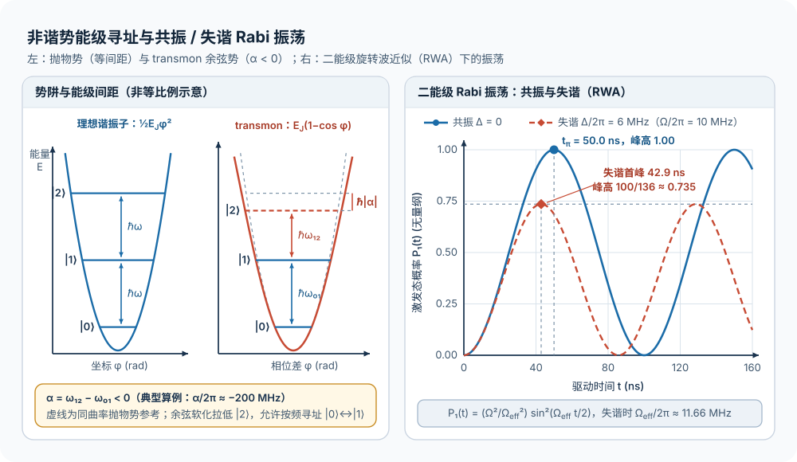
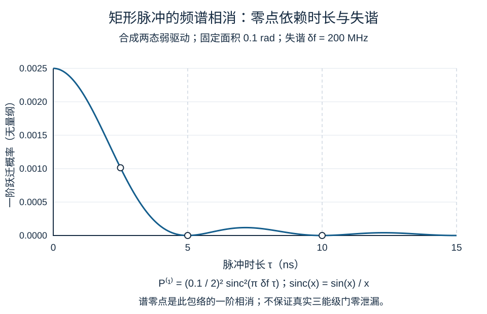
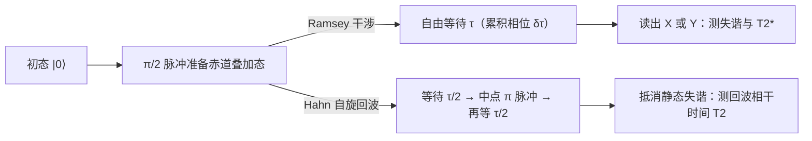

# Q3｜从能级到物理量子比特

[Q2](02-observables-dynamics.md) 讲清了能量算符与含时演化，[主篇第 02 章](../02-single-qubit.md) 则直接从抽象的 $|0\rangle$、$|1\rangle$ 出发。读完这两边，初学者很自然会冒出一个问题：实验室里的超导电路、捕获离子、中性原子或单光子，哪一个天生就只有两个状态？

答案是几乎没有。**量子比特不是宇宙里天然只有两级的小球，而是工程师在多能级真实器件里精心隔离出的二维计算子空间。**

本章把这条从物理器件通向抽象量子比特的桥搭通：我们怎样用频率、温度和约瑟夫森非线性电感把两个能级隔离开；微波脉冲如何按旋转坐标系里的几何规律精准翻转量子态；怎样把 $T_1$ 反转恢复、Ramsey 干涉仪与 Hahn 自旋回波组成一套完整的实验室标定流程；二能级优化脉冲放回真实三能级器件时为什么会产生相干泄漏；以及在电路量子电动力学（cQED）框架下，如何从 Jaynes–Cummings 哈密顿量逐步推导出色散读出位移 $\chi$ 及其 Transmon 三能级修正。

- **首遍必读（★）**：§1–§4.3（能隙、热占据与 Transmon 非谐性）、§5–§7（自旋基态、Rabi/Ramsey/回波标定）与 §9.1、§9.3、§10–§11（色散读出结论、退相干与六大平台对照）；
- **进阶选读（☆）**：§4.4（矩形脉冲 $\operatorname{sinc}$ 频谱微扰）、§8（三能级泄漏矩阵视角）与 §9.2（Schrieffer–Wolff 变换完整推导）——首遍可先看结论，回头再补代数细节，不影响顺畅衔接[第 09 章主流硬件平台](../09-hardware.md)与[第 14 章编译与控制](../14-compilation-control.md)。

---

## 1. 同一个能隙的三种写法：频率、角频率与能量

设工程师在某个物理系统中选出了两个能量本征态 $|0\rangle$ 与 $|1\rangle$，满足 $E_1 > E_0$。它们之间的能量差（能隙）为

$$
\Delta E = E_1 - E_0.
$$

物理和工程文献里经常用三种等价方式报出这同一个能隙：能量 $\Delta E$（单位焦耳 $\mathrm{J}$ 或电子伏特 $\mathrm{eV}$）、普通频率 $f$（单位赫兹 $\mathrm{Hz} = \mathrm{s}^{-1}$）以及角频率 $\omega$（单位弧度每秒 $\mathrm{rad/s}$）。三者通过普朗克常数 $h$ 与约化普朗克常数 $\hbar = h/(2\pi)$ 连在一起：

$$
\Delta E = h f = \hbar \omega,
\qquad
\omega = 2\pi f,
\qquad
h = 2\pi\hbar.
$$

初学者在阅读超导芯片参数时最容易栽在 $2\pi$ 上。可以拿秒针走圈来记：指针每秒转 $f = 1$ 整圈，对应的角度变化是每秒 $\omega = 2\pi\ \mathrm{rad/s}$；每秒转 $50$ 亿圈（$f = 5\ \mathrm{GHz}$），角频率就是 $\omega = 2\pi \times 5 \times 10^9\ \mathrm{rad/s} \approx 3.142 \times 10^{10}\ \mathrm{rad/s}$。实验论文口头说“这是一颗 $5\ \mathrm{GHz}$ 的超导量子比特”，报的几乎总是普通频率 $f_{01} = \omega_{01}/(2\pi)$，换算成能量时不要把 $5 \times 10^9$ 直接代进 $\hbar\omega$ 而漏乘 $2\pi$。

### 算例：5 GHz 对应多大能量与温度尺度

按照 2019 年起生效的国际单位制（SI）精确定义：

$$
h = 6.62607015 \times 10^{-34}\ \mathrm{J\cdot s},
\qquad
k_{\mathrm{B}} = 1.380649 \times 10^{-23}\ \mathrm{J/K},
\qquad
e = 1.602176634 \times 10^{-19}\ \mathrm{C}.
$$

代入 $f = 5.0\ \mathrm{GHz} = 5.0 \times 10^9\ \mathrm{s}^{-1}$，逐步计算：

$$
\Delta E = h f
= (6.62607015 \times 10^{-34}\ \mathrm{J\cdot s})(5.0 \times 10^9\ \mathrm{s}^{-1})
\approx 3.3130 \times 10^{-24}\ \mathrm{J}.
$$

换算成凝聚态与原子物理常用的微电子伏特（$\mu\mathrm{eV}$）：

$$
\frac{\Delta E}{e}
\approx \frac{3.3130 \times 10^{-24}\ \mathrm{J}}{1.60218 \times 10^{-19}\ \mathrm{C}}
\approx 2.0678 \times 10^{-5}\ \mathrm{eV}
\approx 20.7\ \mu\mathrm{eV}.
$$

再除以玻尔兹曼常数 $k_{\mathrm{B}}$，把它折算成一个等效温度尺度：

$$
\frac{\Delta E}{k_{\mathrm{B}}}
= \frac{hf}{k_{\mathrm{B}}}
\approx \frac{3.313035 \times 10^{-24}\ \mathrm{J}}{1.380649 \times 10^{-23}\ \mathrm{J/K}}
\approx 0.23996\ \mathrm{K}
\approx 240\ \mathrm{mK}.
$$

这个 $0.24\ \mathrm{K}$ 提供了一个极为实用的标尺：环境热涨落的典型能量是 $k_{\mathrm{B}} T$，只有当环境温度远低于 $240\ \mathrm{mK}$ 时，热噪音才不至于随手把 $|0\rangle$ 撞上 $|1\rangle$。

顺带提醒一条容易忽略的物理条件：并非只要驱动频率满足 $hf = \Delta E$，两个态之间就一定会发生跃迁。驱动场必须通过某个物理耦合算符（例如电偶极算符或磁偶极算符）作用在系统上，且该算符在两态之间的跃迁矩阵元非零；如果对称性让矩阵元恰好为零，这条跃迁就会被选择定则压住。此外，真实谱线有有限宽度，有限时长的脉冲也不是单一频率。因此 $\Delta E = hf$ 给出的是共振中心，真正的翻转速度与频率选择性还要由矩阵元、脉冲包络与谱线宽度共同决定。

---

## 2. 两能级为什么只是受控近似

既然真实物理系统往往拥有几十个甚至无穷多个能级，工程师从里面挑出 $|0\rangle$ 与 $|1\rangle$ 当作计算基时，必须同时守住五道关口：

1. **可制备**：能在合理时间内把绝大多数概率放进选定的初始基态（通常是 $|0\rangle$）；
2. **可选择地控制**：驱动 $|0\rangle \leftrightarrow |1\rangle$ 时，不把概率显著推向 $|2\rangle$ 或其他无关能级；
3. **可读出**：测量仪器能可靠区分 $|0\rangle$ 和 $|1\rangle$，并能察觉或界定跑出子空间的事件；
4. **可保持**：在门操作和等待期间，环境不会太快造成能量弛豫、退相位、粒子丢失或能级泄漏；
5. **可组合**：做两比特纠缠门时，即便中途借用了辅助自由度（例如离子的集体振动模，或中性原子的高激发 Rydberg 态），门结束时也必须让它们复原并与逻辑量子比特解除纠缠。

只要量子态跑出了 $\{|0\rangle, |1\rangle\}$ 张成的二维空间，就称为**泄漏（leakage）**。初学者常把泄漏和比特翻转混为一谈，其实两者截然不同。举个三能级的具体数字：假设一次门操作结束后，测得系统处于 $|0\rangle, |1\rangle, |2\rangle$ 的概率依次为 $0.10, 0.85, 0.05$。其中 $0.10 + 0.85 = 0.95$ 仍留在计算子空间里（哪怕目标本该是 $|1\rangle$，那 $0.10$ 也属于子空间内的翻转误差），而跑去 $|2\rangle$ 的 $0.05$ 才是泄漏。

对任意多能级系统和密度矩阵 $\rho$，定义计算子空间的投影算符

$$
P_{\mathrm{comp}} = |0\rangle\langle 0| + |1\rangle\langle 1|,
$$

那么此刻的**泄漏概率**定义为

$$
L = 1 - \operatorname{Tr}(P_{\mathrm{comp}}\rho).
$$

对照刚才的三能级例子，$\operatorname{Tr}(P_{\mathrm{comp}}\rho) = 0.10 + 0.85 = 0.95$，于是 $L = 1 - 0.95 = 0.05$。请留意两件事：第一，$L = 0$ 只说明态没有逃出计算子空间，并不说明门做对了（一个相位全错的 $Z$ 门依然有 $L = 0$）；第二，如果实验的二元读出器把 $|2\rangle$ 粗暴地归类成“读数 1”，单看 0/1 计数就会漏看泄漏，因此严肃的硬件表征都必须说明泄漏是如何直接分辨或单独标定的。

---

## 3. 温度怎样决定热占据：为什么要放进毫开尔文冰箱

假设我们想靠“静置冷却”把一颗 $5\ \mathrm{GHz}$ 的量子比特初始化到基态 $|0\rangle$。在统计物理里，一个与温度为 $T$ 的热库达到热平衡、且两能级均非简并的理想二能级系统，其占据概率服从玻尔兹曼（Boltzmann）分布：

$$
\frac{p_1}{p_0} = e^{-\Delta E / (k_{\mathrm{B}} T)}.
$$

记无量纲能量温度比 $x \equiv \Delta E / (k_{\mathrm{B}} T) > 0$。结合归一化条件 $p_0 + p_1 = 1$，把 $p_0 = 1 - p_1$ 代入上式：

$$
\frac{p_1}{1 - p_1} = e^{-x}
\implies
p_1 = e^{-x} - p_1 e^{-x}
\implies
p_1(1 + e^{-x}) = e^{-x},
$$

从而得到激发态的热平衡占据概率：

$$
p_1 = \frac{e^{-x}}{1 + e^{-x}} = \frac{1}{1 + e^{x}}.
$$

这两个等价写法在手算时一样好用，但写程序算极低温（例如 $x > 700$）时，优先用含负指数的 $\frac{e^{-x}}{1 + e^{-x}}$，可以避免计算机求 $e^{+x}$ 时发生浮点上溢。

### 算例：5 GHz 量子比特在 20 mK 与 300 K 的天壤之别

第 1 节已算得 $f = 5.0\ \mathrm{GHz}$ 对应 $\Delta E / k_{\mathrm{B}} \approx 0.239962\ \mathrm{K}$。

**情形一：稀释制冷机冷台温度 $T = 20\ \mathrm{mK} = 0.020\ \mathrm{K}$。**

$$
x = \frac{\Delta E}{k_{\mathrm{B}} T} \approx \frac{0.239962}{0.020} \approx 11.9981.
$$

代入玻尔兹曼比值：

$$
\frac{p_1}{p_0} = e^{-11.9981} \approx 6.156 \times 10^{-6},
\qquad
p_1 = \frac{6.156 \times 10^{-6}}{1 + 6.156 \times 10^{-6}} \approx 6.16 \times 10^{-6}.
$$

也就是说，在理想 $20\ \mathrm{mK}$ 热平衡下，一百万次制备里只有大约 $6$ 次会意外留在 $|1\rangle$。

**情形二：室温 $T = 300\ \mathrm{K}$。**

$$
x = \frac{\Delta E}{k_{\mathrm{B}} T} \approx \frac{0.239962}{300} \approx 7.9987 \times 10^{-4}.
$$

代入得到：

$$
\frac{p_1}{p_0} = e^{-0.00079987} \approx 0.999200,
\qquad
p_1 = \frac{0.999200}{1 + 0.999200} \approx 0.499800.
$$

室温下两个能级几乎各占一半（而且真实器件的更高能级此时也会被热涨落大量填满，二能级近似早已瓦解）。这就是微波频段超导量子芯片必须装进毫开尔文（$\mathrm{mK}$）级稀释制冷机的根本原因。反过来说，光学频段（例如 $f \sim 4 \times 10^{14}\ \mathrm{Hz}$）的能隙对应 $\Delta E / k_{\mathrm{B}} \approx 20000\ \mathrm{K}$，即便在 $300\ \mathrm{K}$ 室温下也已经远处于“深低温区”，所以光子量子比特不需要稀释制冷机。

下表用同一组 SI 精确常数列出 $5.0\ \mathrm{GHz}$ 理想二能级在不同温度下的热占据梯度，顺带对照真实实验里常见的尺度：

| 温度 $T$ | 无量纲比 $x = \Delta E/(k_{\mathrm{B}}T)$ | 理想平衡激发占据 $p_1$ | 物理情景对照 |
|---:|---:|---:|---|
| $15\ \mathrm{mK}$ | $15.997$ | $1.13 \times 10^{-7}$ | 典型稀释制冷机混合室冷台温度 |
| $20\ \mathrm{mK}$ | $11.998$ | $6.16 \times 10^{-6}$ | 理想冷台热平衡基准 |
| $35\ \mathrm{mK}$ | $6.856$ | $0.105\%$ | 3D transmon 实测有效温度下限量级（Jin et al., 2015） |
| $50\ \mathrm{mK}$ | $4.799$ | $0.817\%$ | 典型超导芯片常见有效温度区间 |
| $60\ \mathrm{mK}$ | $3.999$ | $1.800\%$ | 多比特芯片被动冷却残余激发常见水平（约 $1\%\text{--}2\%$） |
| $300\ \mathrm{K}$ | $8.00 \times 10^{-4}$ | $49.980\%$ | 室温（此时高能级同样大量热占据） |

### 有效温度与冷台的真实差距

如果实验上测出激发态残余占据 $p_1 \in (0, 1/2)$，可以把上面的玻尔兹曼公式反解出来，定义一个**有效温度（effective temperature）**：

$$
\frac{1 - p_1}{p_1} = e^{\Delta E / (k_{\mathrm{B}} T_{\mathrm{eff}})}
\implies
T_{\mathrm{eff}} = \frac{\Delta E}{k_{\mathrm{B}} \ln\!\left(\dfrac{1 - p_1}{p_1}\right)}.
$$

例如在 $5.0\ \mathrm{GHz}$ 芯片上测得残余激发 $p_1 = 1\%$，代入 $\ln(99) \approx 4.5951$，立刻算得：

$$
T_{\mathrm{eff}} \approx \frac{0.239962\ \mathrm{K}}{4.5951} \approx 0.0522\ \mathrm{K} = 52.2\ \mathrm{mK}.
$$

请注意冷台温度和器件有效温度的区别。Jin 等人（2015, *Phys. Rev. Lett.* 114, 240501）在 3D transmon 上做过经典的变温测量：随着制冷机冷台从 $150\ \mathrm{mK}$ 一路降下来，量子比特的激发占据确实按玻尔兹曼律下降；但当冷台低于约 $35\ \mathrm{mK}$ 后，实测占据便不再继续变小，而是停在一个饱和平台上。

多比特芯片上常见的残余激发往往在 $0.1\%\text{--}5\%$（对应 $T_{\mathrm{eff}} \approx 35\text{--}80\ \mathrm{mK}$），背后推手包括未完全屏蔽的红外杂散辐射、非平衡准粒子、微波衰减器漏热以及读出脉冲引起的回热。因此，$T_{\mathrm{eff}}$ 只是把实测占据比折算成温度的一个便捷标尺；在现代超导处理器上，要拿到高于 $99.9\%$ 的初始基态纯度，通常还要靠**主动重置（active reset）**（例如先测量再用条件脉冲翻回 $|0\rangle$，或借助读出腔把激发快速抽走），而不能只靠等它自然变冷。

---

## 4. 等间距谐振子的困境：约瑟夫森结与 Transmon 非谐性

现在我们把芯片降到了毫开尔文，接下来怎么选出一个可控的二能级？最容易想到的是最简单的量子电路——由一个线性电感 $L$ 和电容 $C$ 并联而成的 LC 谐振器。

### 4.1 为什么等间距楼梯没法单频控两级

正如[Q4](04-wavefunctions-models.md)用升降算符推导的，理想量子谐振子的能级像一把刻度完全均匀的梯子：

$$
E_n = \hbar\omega_r\left(n + \frac{1}{2}\right),
\qquad
n = 0, 1, 2, \dots,
\qquad
\omega_r = \frac{1}{\sqrt{LC}}.
$$

于是所有相邻台阶之间的跃迁频率一模一样：

$$
\omega_{01} = \omega_{12} = \omega_{23} = \cdots = \omega_r.
$$

问题马上暴露出来：当你打进一束频率为 $\omega_r$ 的微波，想把粒子从 $|0\rangle$ 精准推到 $|1\rangle$ 时，这束微波对 $|1\rangle \leftrightarrow |2\rangle$、$|2\rangle \leftrightarrow |3\rangle$ 也同样严格共振！粒子刚爬上 $|1\rangle$，就会顺着等间距梯子继续往上爬到 $|2\rangle, |3\rangle, \dots$（线性驱动实际上会把谐振子基态推成无穷多能级叠加的相干态），你根本无法靠“调准频率”把动力学关在 $\{|0\rangle, |1\rangle\}$ 里面。

（左面板为非等比例势能示意图，清晰对比等间距抛物势与变软的余弦势能级，右面板将在第 6.4 节用于对照共振与失谐 Rabi 振荡；可打开[原尺寸 SVG](../assets/v2-q3-anharmonic-rabi.svg)查看清晰细节。）

顺便澄清一句：谐振子不适合拿最低两级当裸频率寻址量子比特，并不意味着谐振子在量子计算里没用。[第 18 章](../18-channels-capacities-complexity.md)的连续变量计算与[第 19 章](../19-engineering-architecture.md)的玻色编码（如猫态码、GKP 码），正是主动利用谐振器庞大的多能级空间，并借助辅助非高斯元件或非线性耦合来完成编码与纠错的。

要让一个电路模式能靠频率单独寻址最低两级，必须打破等间距，引入**非谐性（anharmonicity）**，定义为前两级跃迁角频率之差：

$$
\alpha \equiv \omega_{12} - \omega_{01}.
$$

只要 $|\alpha|$ 足够大，打在 $\omega_{01}$ 上的窄带微波对 $|1\rangle \leftrightarrow |2\rangle$ 来说就处于明显失谐状态，从而把动力学锁在最低两级里。

### 4.2 用约瑟夫森结弯折势能：非线性电感与 Transmon 公式

超导电路的妙招，是把线性电感换成一个**约瑟夫森结**（Josephson junction）——两片超导体中间夹着一层约 $1\text{--}2\ \mathrm{nm}$ 厚的绝缘氧化层。库珀对（电荷量为 $2e$ 的配对电子）可以无耗散地隧穿这层势垒，电流 $I$、电压 $V$ 与结两端超导相位差 $\varphi$ 满足两条约瑟夫森关系：

$$
I = I_c \sin\varphi,
\qquad
V = \frac{\Phi_0}{2\pi}\frac{d\varphi}{dt},
$$

其中 $I_c$ 是临界电流（单位 $\mathrm{A}$），$\Phi_0 = h/(2e) \approx 2.06783 \times 10^{-15}\ \mathrm{Wb}$ 是超导磁通量子。

初学者常在文献里看到一句话：“约瑟夫森结是一只无耗散的**非线性电感**。”普通的线性电感遵循 $V = L\frac{dI}{dt}$，约瑟夫森结凭什么也是电感，又“非线性”在哪里？把上面两条方程联立求一次时间导数，答案立刻现身：对第一方程两边关于时间 $t$ 求导，并用第二方程 $\frac{d\varphi}{dt} = \frac{2\pi}{\Phi_0}V$ 消去 $\dot\varphi$，

$$
\frac{dI}{dt}
= I_c \cos\varphi\,\frac{d\varphi}{dt}
= \frac{2\pi I_c}{\Phi_0}\cos\varphi\cdot V
\implies
V = \underbrace{\frac{\Phi_0}{2\pi I_c \cos\varphi}}_{L_J(\varphi)}\frac{dI}{dt}.
$$

定义零电流下的基准约瑟夫森电感

$$
L_{J0} \equiv \frac{\Phi_0}{2\pi I_c} = \frac{\hbar}{2e I_c} = \frac{(\Phi_0/2\pi)^2}{E_J},
\qquad
E_J \equiv \frac{\Phi_0 I_c}{2\pi} = \frac{\hbar I_c}{2e},
$$

那么当结两端存在相位差 $\varphi$（对应电流 $I = I_c\sin\varphi$，在 $|\varphi| < \pi/2$ 范围内 $\cos\varphi = \sqrt{1 - (I/I_c)^2}$）时，等效电感随相位与电流一起变化：

$$
L_J(\varphi)
= \frac{L_{J0}}{\cos\varphi}
= \frac{L_{J0}}{\sqrt{1 - (I/I_c)^2}}
\approx L_{J0}\left(1 + \frac{\varphi^2}{2} + \cdots\right).
$$

这一行公式直接道破了超导比特**负非谐性**的电路直觉：普通线性线圈的电感 $L$ 是常数，振荡频率 $\omega = 1/\sqrt{LC}$ 不随振幅改变，因此能级等间距；而在约瑟夫森结里，振荡幅度（$\varphi$ 或电流 $I$）越大，分母 $\cos\varphi$ 越小，等效电感 $L_J(\varphi)$ 反而越**大**（相当于弹簧越拉越“软”），高能态的等效振荡频率随之变**低**，自然得到 $\omega_{12} < \omega_{01}$，即 $\alpha < 0$。

再从初态 $\varphi(0) = 0$ 到末态 $\varphi(t) = \varphi$ 对瞬时功率 $I(t')V(t')$ 做定积分，得到约瑟夫森结储存的非线性余弦势能：

$$
U(\varphi) - U(0)
= \int_0^t I(t')V(t')\,dt'
= \frac{\Phi_0 I_c}{2\pi}\int_0^\varphi \sin\varphi'\,d\varphi'
= E_J(1 - \cos\varphi).
$$

取势能零点 $U(0) = 0$ 时，$U(\varphi) = E_J(1 - \cos\varphi) \ge 0$，这与图 `v2-q3-anharmonic-rabi.svg` 左面板画出的余弦势能曲线严丝合缝；在写出哈密顿量计算能级差时，常丢去不改变量子动力学的常数偏移 $E_J$，简记为 $-E_J\cos\varphi$。

再加上并联总电容 $C_\Sigma$ 的静电能，令 $\hat n = \hat Q/(2e)$ 表示超导岛上多余的库珀对数算符，它与超导相位差算符 $\hat\varphi$ 满足正则对易关系 $[\hat\varphi, \hat n] = i$。这就是库珀对盒与 **transmon** 量子比特的完整哈密顿量（Koch et al., 2007）：

$$
\hat H = 4E_C(\hat n - n_g)^2 - E_J \cos\hat\varphi,
\qquad
E_C \equiv \frac{e^2}{2C_\Sigma}.
$$

这里 $4E_C = (2e)^2/(2C_\Sigma)$ 中的系数 $4$，正来自每个库珀对携带 $2e$ 电荷；$n_g$ 是外界杂散静电场折算成的偏置电荷数。

当设计参数满足 $E_J / E_C \gg 1$（transmon 工作区，典型值 $50\text{--}80$）时，低能态的相位差 $\hat\varphi$ 被深余弦势井束缚在 $\varphi = 0$ 附近小幅振动，且此时能级对 $n_g$ 几乎不敏感（原因马上就见分晓）。我们先取 $n_g = 0$，一步步把余弦势展开到四阶，亲手推出教材里处处引用的两个 transmon 核心公式！

**第一步：把余弦势展开到四阶。**

$$
-E_J \cos\hat\varphi
= -E_J\left(1 - \frac{\hat\varphi^2}{2!} + \frac{\hat\varphi^4}{4!} - \cdots\right)
= -E_J + \frac{1}{2}E_J\hat\varphi^2 - \frac{1}{24}E_J\hat\varphi^4 + O(\hat\varphi^6).
$$

前两项（静电能 $4E_C\hat n^2$ 加抛物线势 $\frac{1}{2}E_J\hat\varphi^2$）正好是一个标准谐振子！把 $4E_C\hat n^2 + \frac{1}{2}E_J\hat\varphi^2$ 与机械谐振子 $\frac{\hat p^2}{2m} + \frac{1}{2}m\omega^2\hat x^2$ 对照，立刻辨认出“等效质量”的倒数 $1/(2m) \leftrightarrow 4E_C$、“弹簧系数” $m\omega^2 \leftrightarrow E_J$，因此谐振角频率满足 $\hbar\omega_p = \sqrt{8 E_J E_C}$。

**第二步：引入升降算符并核对系数。**

定义满足 $[\hat b, \hat b^\dagger] = 1$ 的湮灭、产生算符 $\hat b, \hat b^\dagger$，把 $\hat\varphi$ 和 $\hat n$ 写为：

$$
\hat\varphi = \varphi_{\mathrm{zpf}}(\hat b + \hat b^\dagger),
\qquad
\hat n = i\, n_{\mathrm{zpf}}(\hat b^\dagger - \hat b),
$$

其中零点涨落幅度选为

$$
\varphi_{\mathrm{zpf}} = \left(\frac{2E_C}{E_J}\right)^{1/4},
\qquad
n_{\mathrm{zpf}} = \frac{1}{2}\left(\frac{E_J}{2E_C}\right)^{1/4}.
$$

我们先验算对易关系是否守恒：

$$
[\hat\varphi, \hat n]
= i\,\varphi_{\mathrm{zpf}} n_{\mathrm{zpf}}\,[\hat b + \hat b^\dagger,\, \hat b^\dagger - \hat b]
= i\,\varphi_{\mathrm{zpf}} n_{\mathrm{zpf}}\bigl([\hat b, \hat b^\dagger] - [\hat b^\dagger, \hat b]\bigr)
= 2i\,\varphi_{\mathrm{zpf}} n_{\mathrm{zpf}}.
$$

而 $2\varphi_{\mathrm{zpf}} n_{\mathrm{zpf}} = 2 \cdot \frac{1}{2}\left(\frac{2E_C}{E_J}\cdot\frac{E_J}{2E_C}\right)^{1/4} = 1$，所以 $[\hat\varphi, \hat n] = i$ 精确成立！

再分别算二次项系数：

$$
4E_C n_{\mathrm{zpf}}^2 = 4E_C \cdot \frac{1}{4}\sqrt{\frac{E_J}{2E_C}} = \frac{1}{4}\sqrt{8E_J E_C},
\qquad
\frac{1}{2}E_J \varphi_{\mathrm{zpf}}^2 = \frac{1}{2}E_J \sqrt{\frac{2E_C}{E_J}} = \frac{1}{4}\sqrt{8E_J E_C}.
$$

把它们相加，利用 $-(\hat b^\dagger - \hat b)^2 + (\hat b + \hat b^\dagger)^2 = 2(\hat b\hat b^\dagger + \hat b^\dagger\hat b) = 4\left(\hat b^\dagger\hat b + \frac{1}{2}\right)$，二次部分干脆利落地合并成 $\sqrt{8E_J E_C}\left(\hat b^\dagger\hat b + \frac{1}{2}\right)$。

再看四次微扰项系数：

$$
-\frac{1}{24}E_J \varphi_{\mathrm{zpf}}^4
= -\frac{1}{24}E_J \cdot \frac{2E_C}{E_J}
= -\frac{E_C}{12}.
$$

$E_J$ 恰好消掉了！丢去不影响能级差的常数 $-E_J$，就得到 **Duffing 振子哈密顿量**：

$$
\hat H_{\mathrm{Duffing}}
= \sqrt{8E_J E_C}\left(\hat b^\dagger\hat b + \frac{1}{2}\right)
- \frac{E_C}{12}(\hat b + \hat b^\dagger)^4.
$$

**第三步：逐项数出 $(\hat b + \hat b^\dagger)^4$ 在第 $m$ 态上的对角元。**

一阶微扰论告诉我们，第 $m$ 个谐振子本征态 $|m\rangle$ 的能量修正为 $-\frac{E_C}{12}\langle m|(\hat b + \hat b^\dagger)^4|m\rangle$。把 $(\hat b + \hat b^\dagger)^4$ 乘开共有 $2^4 = 16$ 项，但只有“恰好含两个 $\hat b$ 和两个 $\hat b^\dagger$”的 $\binom{4}{2} = 6$ 项才能把 $|m\rangle$ 送回 $|m\rangle$（其余项都会改变粒子数，与 $\langle m|$ 内积为零）。利用 $\hat b|m\rangle = \sqrt{m}|m-1\rangle$ 和 $\hat b^\dagger|m\rangle = \sqrt{m+1}|m+1\rangle$，把这 6 项逐一算出来：

1. $\langle m|\hat b^\dagger \hat b^\dagger \hat b \hat b|m\rangle = m(m-1) = m^2 - m$；
2. $\langle m|\hat b^\dagger \hat b \hat b^\dagger \hat b|m\rangle = m^2$；
3. $\langle m|\hat b^\dagger \hat b \hat b \hat b^\dagger|m\rangle = m(m+1) = m^2 + m$；
4. $\langle m|\hat b \hat b^\dagger \hat b^\dagger \hat b|m\rangle = m(m+1) = m^2 + m$；
5. $\langle m|\hat b \hat b^\dagger \hat b \hat b^\dagger|m\rangle = (m+1)^2 = m^2 + 2m + 1$；
6. $\langle m|\hat b \hat b \hat b^\dagger \hat b^\dagger|m\rangle = (m+1)(m+2) = m^2 + 3m + 2$。

把这 6 个多项式竖着加在一起：

$$
\langle m|(\hat b + \hat b^\dagger)^4|m\rangle
= 6m^2 + (-1 + 0 + 1 + 1 + 2 + 3)m + (1 + 2)
= 6m^2 + 6m + 3.
$$

乘以 $-\frac{E_C}{12}$，得到前 $m$ 个能级的一阶微扰能量：

$$
E_m \approx \sqrt{8E_J E_C}\left(m + \frac{1}{2}\right) - \frac{E_C}{2}m(m+1) - \frac{E_C}{4}.
$$

代入 $m = 0, 1, 2$ 逐行作差：

$$
E_0 \approx \frac{1}{2}\sqrt{8E_J E_C} - \frac{E_C}{4},
\qquad
E_1 \approx \frac{3}{2}\sqrt{8E_J E_C} - \frac{5E_C}{4},
\qquad
E_2 \approx \frac{5}{2}\sqrt{8E_J E_C} - \frac{13E_C}{4}.
$$

于是两级跃迁能量和非谐性一目了然：

$$
\hbar\omega_{01} = E_1 - E_0 \approx \sqrt{8E_J E_C} - E_C,
\qquad
\hbar\omega_{12} = E_2 - E_1 \approx \sqrt{8E_J E_C} - 2E_C,
$$

$$
\hbar\alpha = \hbar(\omega_{12} - \omega_{01}) \approx -E_C < 0.
$$

去掉零点常数后，这一有效低能谱可以直接写成简洁的 Kerr / Duffing 形式（记粒子数算符 $\hat N = \hat b^\dagger\hat b$）：

$$
\frac{\hat H_{\mathrm{eff}}}{\hbar} = \omega_{01}\hat N + \frac{\alpha}{2}\hat N(\hat N - 1).
$$

请检查一下前三个对角元：$m=0$ 给 $0$，$m=1$ 给 $\omega_{01}$，$m=2$ 给 $2\omega_{01} + \alpha = \omega_{01} + \omega_{12}$——完全吻合！而且你还能从几何上瞬间看懂为什么 transmon 的非谐性是**负的**：余弦势 $-E_J\cos\varphi$ 比抛物线 $\frac{1}{2}E_J\varphi^2$ 往两侧更“张开、变软”，所以粒子爬得越高、束缚越松，相邻能级越往上挤得越近（$f_{12} < f_{01}$）。

### 4.3 真实物理标杆算例：为什么 transmon 选在 $E_J/E_C \approx 60$

拿一组贴近真实超导实验室的典型器件参数来手算一遍：

- 充电能 $E_C / h = 250\ \mathrm{MHz}$（由 $E_C = e^2/(2C_\Sigma)$ 反推，对应并联总电容 $C_\Sigma \approx 77.48\ \mathrm{fF}$）；
- 约瑟夫森能 $E_J / h = 15.0\ \mathrm{GHz}$（由 $E_J = \Phi_0 I_c/(2\pi)$ 反推，对应临界电流 $I_c \approx 30.20\ \mathrm{nA}$）；
- 无量纲能量比 $E_J / E_C = 15000 / 250 = 60$（零点相位涨落 $\varphi_{\mathrm{zpf}} = (2/60)^{1/4} \approx 0.427\ \mathrm{rad}$）。

先用刚才导出的零电流约瑟夫森电感做一次经典电路与量子能标的合龙检验：

$$
L_{J0}
= \frac{\Phi_0}{2\pi I_c}
= \frac{2.06783 \times 10^{-15}\ \mathrm{Wb}}{2\pi \times 30.20 \times 10^{-9}\ \mathrm{A}}
\approx 10.90\ \mathrm{nH},
$$

$$
f_p
= \frac{1}{2\pi\sqrt{L_{J0} C_\Sigma}}
\approx \frac{1}{2\pi\sqrt{10.90 \times 10^{-9} \times 77.48 \times 10^{-15}}}\ \mathrm{Hz}
\approx 5.477\ \mathrm{GHz}.
$$

再把同一组能量参数代入一阶微扰公式：

$$
\frac{\sqrt{8E_J E_C}}{h}
= \sqrt{8 \times 15.0 \times 0.250}\ \mathrm{GHz}
= \sqrt{30}\ \mathrm{GHz}
\approx 5.477\ \mathrm{GHz},
$$

两条路径算出的小振幅等离子体频率 $f_p$ 精确吻合！接着扣除充电能修正，得到前两条跃迁频率与非谐性：

$$
f_{01} = \frac{\omega_{01}}{2\pi} \approx 5.477 - 0.250 = 5.227\ \mathrm{GHz},
\qquad
\frac{\alpha}{2\pi} \approx -250\ \mathrm{MHz},
\qquad
f_{12} = f_{01} + \frac{\alpha}{2\pi} \approx 4.977\ \mathrm{GHz}.
$$

相对非谐性为

$$
\frac{|\alpha|}{\omega_{01}}
\approx \frac{0.250}{5.227} \approx 4.78\%
\qquad
\left(\text{大比值渐近式 } \sqrt{\frac{E_C}{8E_J}} = \frac{1}{\sqrt{480}} \approx 4.56\%\right).
$$

这里顺手做一次严谨的数值回验：上面的一阶公式截断了 $\hat\varphi^6$ 及更高阶项；如果直接把完整哈密顿量 $4E_C(\hat n - n_g)^2 - E_J\cos\hat\varphi$ 在电荷基上精确对角化，这组参数给出 $f_{01} \approx 5.214\ \mathrm{GHz}$、$\alpha/(2\pi) \approx -283\ \mathrm{MHz}$——一阶微扰抓准了主频（误差仅 $0.25\%$）和非谐性量级，高阶项让余弦势更软一些，非谐性略微更负。

那么，为什么工程师偏偏要把电容做大，把 $E_J/E_C$ 从早期库珀对盒的 $\sim 1$ 推高到 $50\text{--}80$？核心原因是芯片衬底里到处游荡着难以消除的电荷噪声，会让偏置电荷 $n_g$ 乱飘，引起能级频率抖动。定义第 $m$ 个能级的电荷色散为 $\epsilon_m \equiv E_m(n_g = 1/2) - E_m(n_g = 0)$。Koch 等人（2007）通过 WKB 隧穿分析给出大 $E_J/E_C$ 区的完整渐近式：

$$
\epsilon_m
\simeq (-1)^m E_C \frac{2^{4m+5}}{m!}\sqrt{\frac{2}{\pi}}
\left(\frac{E_J}{2E_C}\right)^{\frac{m}{2}+\frac{3}{4}}
e^{-\sqrt{8E_J / E_C}}.
$$

请特别留意随能级序数 $m$ 剧烈增长的前因子 $\frac{2^{4m+5}}{m!}$ 以及交替符号 $(-1)^m$。固定 $E_C/h = 250\ \mathrm{MHz}$、取 $E_J/E_C = 60$，在电荷基上精确对角化给出前三个能级的电荷色散幅值依次为：

$$
|\epsilon_0|/h \approx 0.024\ \mathrm{kHz},
\qquad
|\epsilon_1|/h \approx 1.85\ \mathrm{kHz},
\qquad
|\epsilon_2|/h \approx 65.2\ \mathrm{kHz}
$$

（对应 Koch 渐近式分别给出 $0.025\ \mathrm{kHz}$、$2.19\ \mathrm{kHz}$ 与 $96.0\ \mathrm{kHz}$）。这一级联对比揭示了两件事：第一，由于基态与第一激发态色散方向相反（$(-1)^0 = +1$ 对 $(-1)^1 = -1$），主跃迁的总电荷色散 $\epsilon_{01} \equiv |E_{01}(n_g=1/2) - E_{01}(n_g=0)| = |\epsilon_0| + |\epsilon_1|$ 在 $E_J/E_C$ 从 $1$ 提至 $60$ 时从约 $776\ \mathrm{MHz}$ 暴跌五个数量级以上、降至仅 **$1.88\ \mathrm{kHz}$**，而绝对非谐性 $|\alpha|/(2\pi)$ 依然稳居 $250\text{--}283\ \mathrm{MHz}$；第二，每往上爬一级，电荷色散就放大数十倍——$|\epsilon_2|$ 已接近百千赫兹量级！这也解释了为什么在现代超导芯片里，一旦强门脉冲或高功率读出把态推入 $|2\rangle$ 或更高能级，器件会重新暴露在衬底电荷噪声之下。

初学者读文献时容易误以为“$E_J/E_C$ 越大，绝对非谐性就越趋近于零”。分清两个量就不会踩坑：在一阶近似下，**绝对非谐性** $|\alpha| \approx E_C/\hbar$ 几乎只看电容决定的 $E_C$；只有当你同时要求把主频 $f_{01}$ 固定在 $5\ \mathrm{GHz}$ 附近、被迫减小 $E_C$ 来抬高 $E_J/E_C$ 时，绝对非谐性才会随之缓慢变小。这正是 transmon 在抗电荷噪声与保留频率选择性之间找到的黄金折中。

> **练 Q3-A（就地练习｜Transmon 参数与约瑟夫森非线性电感）**
>
> 已知一颗 transmon 的并联总电容 $C_\Sigma = 96.8\ \mathrm{fF}$、约瑟夫森结临界电流 $I_c = 25.0\ \mathrm{nA}$。
> （1）计算充电能 $E_C/h$、约瑟夫森能 $E_J/h$、零电流电感 $L_{J0}$ 与比值 $E_J/E_C$；
> （2）分别用电路公式 $1/(2\pi\sqrt{L_{J0}C_\Sigma})$ 与量子公式 $\sqrt{8E_JE_C}/h$ 交叉核验小振幅频率 $f_p$，并求一阶微扰估计的 $f_{01}$、$\alpha/(2\pi)$ 与 $f_{12}$；
> （3）用一句话从 $L_J(\varphi) = L_{J0}/\cos\varphi$ 说明为何 $f_{12} < f_{01}$。
>
> **参考核对**：（1）$E_C/h = e^2/(2hC_\Sigma) \approx 200.1\ \mathrm{MHz}$，$E_J/h = \Phi_0 I_c/(2\pi h) \approx 12.42\ \mathrm{GHz}$，$L_{J0} = \Phi_0/(2\pi I_c) \approx 13.16\ \mathrm{nH}$，$E_J/E_C \approx 62.1$；（2）两路均给出 $f_p \approx 4.458\ \mathrm{GHz}$，一阶微扰得 $f_{01} \approx 4.258\ \mathrm{GHz}$、$\alpha/(2\pi) \approx -200\ \mathrm{MHz}$、$f_{12} \approx 4.058\ \mathrm{GHz}$；（3）能级越高，相位振幅 $\varphi$ 越大，$\cos\varphi$ 越小而等效电感 $L_J(\varphi)$ 越大，电路等效振荡频率降低，故 $f_{12} < f_{01}$。

### 4.4 进阶选读：门越快为什么越容易碰到 $|2\rangle$：矩形脉冲的 $\operatorname{sinc}$ 频谱与零点边界

有了约 $200\text{--}250\ \mathrm{MHz}$ 的非谐性，我们能把单比特门做多快？

直觉上，声音或电脉冲持续的时间 $\tau$ 越短，它的频谱就越宽，大致满足时间—带宽关系 $\Delta f \sim 1/\tau$。拿一组便于手算的参数来看：设 $f_{01} = 5.0\ \mathrm{GHz}$、$f_{12} = 4.8\ \mathrm{GHz}$，非谐性 $\alpha/(2\pi) = -200\ \mathrm{MHz}$。如果脉冲持续 $\tau = 20\ \mathrm{ns}$，频谱宽度量级约为 $1/(20\ \mathrm{ns}) = 50\ \mathrm{MHz}$，离 $|1\rangle \leftrightarrow |2\rangle$ 还有一段安全缓冲；一旦把门压短到 $\tau = 5\ \mathrm{ns}$，频宽直接涨到 $200\ \mathrm{MHz}$，已经和整个非谐性间隔平齐，能量很容易溢到 $|2\rangle$ 上去。

光说“量级 $1/\tau$”还不够具体，我们拿最简单的**矩形包络弱脉冲**手算一次每个频率到底分到多少权重。考虑一条不希望被激发的寄生跃迁 $|a\rangle \leftrightarrow |b\rangle$（初态为 $|a\rangle$），它相对驱动频率的角频率失谐为 $\delta \ne 0$。在相互作用绘景里，持续时间为 $[0, \tau]$ 的恒幅弱驱动写作

$$
H_I(t) = \frac{\hbar\Omega_{ab}}{2}\Bigl(e^{i\delta t}|b\rangle\langle a| + e^{-i\delta t}|a\rangle\langle b|\Bigr),
\qquad 0 \le t \le \tau,
$$

其中耦合角频率 $\Omega_{ab}$（单位 $\mathrm{rad/s}$）已经把该跃迁自己的矩阵元包含在内。当脉冲面积 $\Omega_{ab}\tau \ll 1$ 时，一阶含时微扰论给出跃迁振幅：

$$
A_{a\to b}^{(1)}
= -\frac{i}{\hbar}\int_0^\tau \langle b|H_I(t)|a\rangle\,dt
= -\frac{i\Omega_{ab}}{2}\int_0^\tau e^{i\delta t}\,dt
= -\frac{i\Omega_{ab}}{2}\cdot\frac{e^{i\delta\tau} - 1}{i\delta}.
$$

把分子按 $e^{ix} - 1 = e^{ix/2}(e^{ix/2} - e^{-ix/2}) = 2i e^{ix/2}\sin(x/2)$ 提公因式，写成一个同时保留相位和幅度的漂亮形式：

$$
A_{a\to b}^{(1)}
= -i\frac{\Omega_{ab}\tau}{2}\,e^{i\delta\tau/2}\,\operatorname{sinc}\!\left(\frac{\delta\tau}{2}\right),
\qquad
\operatorname{sinc}(x) \equiv \frac{\sin x}{x},\quad \operatorname{sinc}(0) = 1.
$$

先算振幅，再取模平方（相位因子 $|-i e^{i\delta\tau/2}|^2 = 1$），得到一阶跃迁概率：

$$
P^{(1)}
= \left|A_{a\to b}^{(1)}\right|^2
= \left(\frac{\Omega_{ab}\tau}{2}\right)^2 \operatorname{sinc}^2\!\left(\frac{\delta\tau}{2}\right)
= \left(\frac{\Omega_{ab}\tau}{2}\right)^2 \operatorname{sinc}^2(\pi\,\delta f\,\tau),
$$

其中 $\delta f = \delta/(2\pi)$。现在你终于看清“频宽量级 $1/\tau$”的精确出处：当 $|\delta f|\tau = 1$ 时，$\operatorname{sinc}(\pi) = 0$，这就是矩形脉冲频谱从中心到第一个零点的频率距离。

取固定弱面积 $\Omega_{ab}\tau = 0.1\ \mathrm{rad}$、失谐 $\delta f = 200\ \mathrm{MHz}$，手算三个时长：

| 脉冲时长 $\tau$ | 自变量 $\pi\,\delta f\,\tau$ | $\operatorname{sinc}$ 值 | 一阶跃迁概率 $P^{(1)}$ | 精确两态 Rabi 解 $P_{\mathrm{exact}}$ |
|---:|---:|---:|---:|---:|
| $2.5\ \mathrm{ns}$ | $\pi/2$ | $2/\pi \approx 0.6366$ | $0.0025 \times (2/\pi)^2 \approx 1.0132 \times 10^{-3}$ | $1.0122 \times 10^{-3}$ |
| $5.0\ \mathrm{ns}$ | $\pi$ | $0$ | $0$ | $4.009 \times 10^{-11}$ |
| $10.0\ \mathrm{ns}$ | $2\pi$ | $0$ | $0$ | $2.506 \times 10^{-12}$ |

（需要放大查看细节时，可打开[原尺寸 SVG](../assets/round71-systems-spectrum.svg)或阅读现行双主题[绘图脚本](../../codes/practice/upgrade_legacy_svgs_part1.py)，原始数值核对见[矩形脉冲频谱核验脚本](../../codes/systems/round71_checks.py)。图中 $\tau \to 0$ 仅是固定面积下 $\Omega_{ab} = 0.1/\tau \to \infty$ 的数学极限，真实控制器幅度有限。）

看表格最右侧那一列：在 $\tau = 5\ \mathrm{ns}$ 处，一阶微扰概率恰好踩中谱零点等于 $0$，但用第 6 节即将推出的精确两态 Rabi 公式去算，真实概率其实是非零的 $4.009 \times 10^{-11}$——因为一阶积分只抵消了第一阶项，高阶过程并没有消失。

在真实的 $\pi$ 门里，$|0\rangle \leftrightarrow |1\rangle$ 正在经历大幅翻转，不能把 $|1\rangle \leftrightarrow |2\rangle$ 孤立成弱驱动两态；加上线路滤波失真与频漂会轻易挪动谱零点位置，因此工程上不会拿“硬矩形脉冲配谱零点”当零泄漏保证，而是改用旁瓣衰减快得多的平滑包络（如高斯脉冲或余弦脉冲），并在正交通道叠加与主包络导数成正比的 **DRAG（导数去绝热门）** 波形（Motzoi et al., 2009），在频域的 $\alpha$ 处主动“挖”出一个受控凹槽来压制 $|2\rangle$ 泄漏。

同时，门也不是越慢越好：脉冲拉得太长，量子比特在操作期间暴露于能量弛豫和低频漂移的时间就会变长。物理门设计永远是在“太快引发宽带泄漏”与“太慢累积退相干”之间找平衡点。

---

## 5. 自旋二能级：先看磁矩符号，再贴 $|0\rangle$ 和 $|1\rangle$

除了超导电路的非谐能级，另一类天然的两态来源是磁场中的自旋（例如硅量子点里的电子自旋或核磁共振中的原子核自旋）。粒子自旋角动量 $\mathbf S$ 与磁矩 $\boldsymbol\mu$ 成正比：

$$
\boldsymbol\mu = \gamma \mathbf S,
$$

其中 $\gamma$ 称为**旋磁比（gyromagnetic ratio）**。放在磁场 $\mathbf B$ 中，磁偶极子的势能哈密顿量为

$$
H = -\boldsymbol\mu \cdot \mathbf B.
$$

设磁场沿 $+z$ 方向，即 $\mathbf B = B\hat z$（$B > 0$），且自旋 $1/2$ 粒子的自旋算符为 $\mathbf S = \frac{\hbar}{2}\boldsymbol\sigma$，则

$$
H = -\frac{\gamma\hbar B}{2}\sigma_z.
$$

记 $\sigma_z |+z\rangle = +|+z\rangle$、$\sigma_z |-z\rangle = -|-z\rangle$，两态能量分别为 $E_{+z} = -\frac{\gamma\hbar B}{2}$ 与 $E_{-z} = +\frac{\gamma\hbar B}{2}$，能隙大小总是

$$
\Delta E = |\gamma|\hbar B,
\qquad
\omega_0 = |\gamma| B.
$$

哪一个朝向能量更低，完全取决于 $\gamma$ 的正负号：

- 对质子等 $\gamma > 0$ 的粒子，$E_{+z} < E_{-z}$，自旋朝上 $|+z\rangle$ 是低能态；
- 对电子（带负电，磁矩与自旋方向相反，$\gamma < 0$），$E_{-z} < E_{+z}$，自旋朝下 $|-z\rangle$ 才是低能态！

因此，“自旋朝上就是基态 $|0\rangle$”并不是通用规则。最不容易出错的习惯是：**先由 $H = -\boldsymbol\mu\cdot\mathbf B$ 判出哪一个态能量更低，再统一把低能态命名为逻辑 $|0\rangle$、高能态命名为逻辑 $|1\rangle$。**

沿着全书统一的计算基 Pauli 矩阵约定 $Z = |0\rangle\langle 0| - |1\rangle\langle 1|$（即 $Z|0\rangle = +|0\rangle$、$Z|1\rangle = -|1\rangle$），去掉不影响相对相位的共同能量零点后，任意二能级子空间的自由哈密顿量都可以统一写成

$$
H_0 = -\frac{\hbar\omega_0}{2} Z.
$$

请马上验算它的两个本征值：$H_0|0\rangle = -\frac{\hbar\omega_0}{2}|0\rangle$（低能），$H_0|1\rangle = +\frac{\hbar\omega_0}{2}|1\rangle$（高能），能量差正好是 $\hbar\omega_0$。

也要补充一句：半导体“自旋量子比特”并不限于单颗电子的两个自旋朝向。例如单重态—三重态（$S\text{--}T_0$）编码用两颗电子的联合自旋态构成二维子空间，全交换编码甚至会用到三颗电子。它们仍可用有效的 $2 \times 2$ 哈密顿量操控，但有效 $X, Y, Z$ 作用在编码子空间上，不能字面理解为单颗电子绕空间三轴转动。

---

## 6. 从实验室微波驱动到 Rabi 振荡

现在我们已经隔离出低能态 $|0\rangle$ 与高能态 $|1\rangle$（能隙 $\hbar\omega_0$），怎么用一根微波线把任意单比特旋转门精准“推”出来？

为了贴近量子控制文献，本节用 $H$ 表示哈密顿算符（不与无量纲 Hadamard 门混用）。在实验室坐标系中，往量子比特馈入一束频率为 $\omega_d$、初相位为 $\phi$ 的单色微波场，半经典二能级驱动哈密顿量写作：

$$
H_{\mathrm{lab}}(t)
= -\frac{\hbar\omega_0}{2} Z + \hbar\Omega\cos(\omega_d t + \phi)\,X.
$$

这里 $X = |0\rangle\langle 1| + |1\rangle\langle 0|$，驱动系数 $\Omega > 0$ 的单位是 $\mathrm{rad/s}$，已经把微波场幅、耦合常数与跃迁矩阵元打包在一起。很多原子物理与核磁共振教材喜欢用能量基算符 $Z_E \equiv |1\rangle\langle 1| - |0\rangle\langle 0| = -Z$，把同一项写成 $+\frac{\hbar\omega_0}{2} Z_E$——下面推导完旋转坐标系，我们会把两套写法并排摆在一张表里，厘清跨章正负号约定。

### 6.1 一步不跳推完旋转坐标系与旋转波近似（RWA）

$H_{\mathrm{lab}}(t)$ 里藏着一个高达数 GHz 的高速自转项 $-\frac{\hbar\omega_0}{2}Z$，同时驱动项也在以 $\omega_d$ 剧烈振荡。想看清量子态的慢速演变，就像站在旋转木马上观察同速转动的同伴一样——我们跳进一个以驱动角频率 $\omega_d$ 跟着旋转的参考系！

**第一步：定义幺正旋转变换并改写薛定谔方程。**

引入含时幺正算符（注意基顺序始终为 $|0\rangle, |1\rangle$）：

$$
R(t) = e^{+i\omega_d t Z / 2}
= \begin{pmatrix} e^{+i\omega_d t / 2} & 0 \\ 0 & e^{-i\omega_d t / 2} \end{pmatrix},
\qquad
|\psi_{\mathrm{lab}}(t)\rangle = R(t)|\psi_{\mathrm{rot}}(t)\rangle.
$$

把它代入含时薛定谔方程 $i\hbar\frac{d}{dt}|\psi_{\mathrm{lab}}\rangle = H_{\mathrm{lab}}|\psi_{\mathrm{lab}}\rangle$，按乘法求导法则展开左边：

$$
i\hbar \dot R(t)|\psi_{\mathrm{rot}}(t)\rangle + i\hbar R(t)\frac{d}{dt}|\psi_{\mathrm{rot}}(t)\rangle
= H_{\mathrm{lab}}(t) R(t)|\psi_{\mathrm{rot}}(t)\rangle.
$$

移项并在两边同时左乘 $R^\dagger(t)$（利用 $R^\dagger R = I$）：

$$
i\hbar\frac{d}{dt}|\psi_{\mathrm{rot}}(t)\rangle
= \underbrace{\Bigl(R^\dagger(t) H_{\mathrm{lab}}(t) R(t) - i\hbar R^\dagger(t)\dot R(t)\Bigr)}_{H_{\mathrm{rot}}(t)} |\psi_{\mathrm{rot}}(t)\rangle.
$$

**第二步：计算自由项如何变成“失谐”。**

对 $R(t) = e^{+i\omega_d t Z/2}$ 求时间导数，得到 $\dot R(t) = +\frac{i\omega_d}{2} Z R(t)$，因此

$$
-i\hbar R^\dagger(t)\dot R(t)
= -i\hbar \left(+\frac{i\omega_d}{2}\right) R^\dagger(t) Z R(t)
= +\frac{\hbar\omega_d}{2} Z
$$

（因为 $R(t)$ 与 $Z$ 都是对角矩阵，互相可交换，故 $R^\dagger Z R = Z$）。把它与 $R^\dagger H_0 R = -\frac{\hbar\omega_0}{2}Z$ 相加：

$$
R^\dagger H_0 R - i\hbar R^\dagger\dot R
= \frac{\hbar(\omega_d - \omega_0)}{2} Z
= \frac{\hbar\Delta}{2} Z,
\qquad
\Delta \equiv \omega_d - \omega_0.
$$

这里的 $\Delta = \omega_d - \omega_0$（驱动角频率减去跃迁角频率）就是全书与[第 14 章](../14-compilation-control.md)统一采用的**失谐（detuning）**。当驱动精准对准共振（$\omega_d = \omega_0$）时，$\Delta = 0$，自由演化项在旋转坐标系里静止不动。

**第三步：逐格展开驱动项，看清 $1/2$ 因子与快慢两项。**

把 $X$ 拆成升算符 $\sigma_+ = |1\rangle\langle 0|$ 与降算符 $\sigma_- = |0\rangle\langle 1|$ 之和：$X = \sigma_+ + \sigma_-$。直接做 $2 \times 2$ 矩阵乘法：

$$
R^\dagger \sigma_+ R
= \begin{pmatrix} e^{-i\omega_d t/2} & 0 \\ 0 & e^{+i\omega_d t/2} \end{pmatrix}
\begin{pmatrix} 0 & 0 \\ 1 & 0 \end{pmatrix}
\begin{pmatrix} e^{+i\omega_d t/2} & 0 \\ 0 & e^{-i\omega_d t/2} \end{pmatrix}
= \begin{pmatrix} 0 & 0 \\ e^{+i\omega_d t} & 0 \end{pmatrix}
= e^{+i\omega_d t}\sigma_+.
$$

取共轭转置立得 $R^\dagger \sigma_- R = e^{-i\omega_d t}\sigma_-$。现在用欧拉公式拆开余弦：

$$
\cos(\omega_d t + \phi) = \frac{e^{i(\omega_d t + \phi)} + e^{-i(\omega_d t + \phi)}}{2}.
$$

这个分母上的 $2$ 至关重要！把它乘到 $R^\dagger X R = e^{i\omega_d t}\sigma_+ + e^{-i\omega_d t}\sigma_-$ 上，一共得到四项：

$$
\begin{aligned}
R^\dagger H_d(t) R
&= \frac{\hbar\Omega}{2}\bigl(e^{i\omega_d t + i\phi} + e^{-i\omega_d t - i\phi}\bigr)
   \bigl(e^{i\omega_d t}\sigma_+ + e^{-i\omega_d t}\sigma_-\bigr) \\
&= \underbrace{\frac{\hbar\Omega}{2}\bigl(e^{-i\phi}\sigma_+ + e^{+i\phi}\sigma_-\bigr)}_{\text{不含时间的共旋项}}
 + \underbrace{\frac{\hbar\Omega}{2}\bigl(e^{+i(2\omega_d t + \phi)}\sigma_+ + e^{-i(2\omega_d t + \phi)}\sigma_-\bigr)}_{\text{以 }2\omega_d\text{ 剧烈振荡的反旋项 }V_{\mathrm{CR}}(t)}.
\end{aligned}
$$

**第四步：旋转波近似（RWA）与用 $X, Y$ 写回矩阵。**

在通常的微波或光学控制中，驱动强度与失谐都远小于载波频率，即 $\Omega, |\Delta| \ll \omega_0 + \omega_d \approx 2\omega_d$。在这段时间尺度里，反旋项 $V_{\mathrm{CR}}(t)$ 每秒正负来回翻转上百亿次，对慢变的量子态几乎完全平均抵消。舍去 $V_{\mathrm{CR}}(t)$ 的做法就叫**旋转波近似（Rotating Wave Approximation, RWA）**。

把剩下的不含时共旋项写成 $2 \times 2$ 矩阵：

$$
e^{-i\phi}\sigma_+ + e^{+i\phi}\sigma_-
= \begin{pmatrix} 0 & e^{+i\phi} \\ e^{-i\phi} & 0 \end{pmatrix}
= \begin{pmatrix} 0 & \cos\phi + i\sin\phi \\ \cos\phi - i\sin\phi & 0 \end{pmatrix}.
$$

对照计算基 Pauli 矩阵 $X = \begin{pmatrix}0&1\\1&0\end{pmatrix}$ 与 $Y = \begin{pmatrix}0&-i\\i&0\end{pmatrix}$，注意右上角 $+i\sin\phi = (-\sin\phi)(-i)$，于是它正好等于 $\cos\phi\,X - \sin\phi\,Y$！合上自由失谐项，我们得到了旋转坐标系里不含时间的有效哈密顿量：

$$
H_{\mathrm{RWA}}
= \frac{\hbar}{2}\Bigl[\Delta\, Z + \Omega(\cos\phi\,X - \sin\phi\,Y)\Bigr]
= \frac{\hbar}{2}\bigl(\Delta\, Z + \Omega_x X + \Omega_y Y\bigr),
$$

其中 $\Omega_x = \Omega\cos\phi$、$\Omega_y = -\Omega\sin\phi$。

### 6.2 计算基与能量基的失谐符号等价对照表

读不同教科书和论文时，最容易混淆的莫过于失谐到底写 $\omega_d - \omega_0$ 还是 $\omega_0 - \omega_d$。其实它们之所以反号，完全是因为选取的 $Z$ 矩阵差了一个负号。把两套写法逐项对齐到下面这张表里，就能清楚看出它们的等价性：

| 对比项 | 计算基约定（全书默认、本章后续与[第 14 章](../14-compilation-control.md)统一采用） | 能量基约定（常见原子物理 / NMR 文献） |
|---|---|---|
| 算符定义（按 $\lvert 0\rangle,\lvert 1\rangle$ 排序） | $Z = \lvert 0\rangle\langle 0\rvert - \lvert 1\rangle\langle 1\rvert$，$Y = -i\lvert 0\rangle\langle 1\rvert + i\lvert 1\rangle\langle 0\rvert$ | $Z_E = \lvert 1\rangle\langle 1\rvert - \lvert 0\rangle\langle 0\rvert = -Z$，$Y_E = -Y$ |
| 实验室自由哈密顿量 $H_0$ | $-\dfrac{\hbar\omega_0}{2} Z$ | $+\dfrac{\hbar\omega_0}{2} Z_E$ |
| 旋转变换 $R(t)$ | $e^{+i\omega_d t Z / 2}$ | $e^{-i\omega_d t Z_E / 2}$ |
| 失谐定义 | $\Delta = \omega_d - \omega_0$（驱动减跃迁） | $\delta_E = \omega_0 - \omega_d = -\Delta$（跃迁减驱动） |
| RWA 哈密顿量 $H_{\mathrm{RWA}}$ | $\dfrac{\hbar}{2}\bigl[\Delta Z + \Omega(\cos\phi\,X - \sin\phi\,Y)\bigr]$ | $\dfrac{\hbar}{2}\bigl[\delta_E Z_E + \Omega(\cos\phi\,X + \sin\phi\,Y_E)\bigr]$ |
| 旋转框正交驱动分量 | $\Omega_x = \Omega\cos\phi,\ \Omega_y = -\Omega\sin\phi$ | $\Omega_{x,E} = \Omega\cos\phi,\ \Omega_{y,E} = +\Omega\sin\phi$ |

逐格核对一下：因为 $\Delta Z = (-\delta_E)(-Z_E) = \delta_E Z_E$ 且 $(-\sin\phi)Y = (+\sin\phi)Y_E$，**左右两栏写出的是每一个矩阵元都完全相同的同一个哈密顿量**，它们生成的量子演化丝毫不差。以后只要看到别处写了不同的失谐正负号，先看它的 $H_0$ 写的是 $-\frac{\hbar\omega_0}{2}Z$ 还是 $+\frac{\hbar\omega_0}{2}Z_E$，就能瞬间对上暗号。

### 6.3 RWA 什么时候会失效：Bloch–Siegert 频移界

被 RWA 丢掉的快变反旋项 $V_{\mathrm{CR}}(t) = \frac{\hbar\Omega}{2}\bigl(e^{+i(2\omega_d t+\phi)}\sigma_+ + e^{-i(2\omega_d t+\phi)}\sigma_-\bigr)$ 并非永远无足轻重。在二阶高频平均（Floquet–Magnus 展开）下，它会产生一个等效的能级排斥项，把真实共振频率向上微推一个 **Bloch–Siegert 位移**（Bloch & Siegert, 1940）：

$$
\omega_{\mathrm{res}} \approx \omega_0 + \delta\omega_{\mathrm{BS}},
\qquad
\delta\omega_{\mathrm{BS}} \approx +\frac{\Omega^2}{4\omega_0}.
$$

直觉上，反旋项对应的虚光子过程把基态 $|0\rangle$ 往下压、把激发态 $|1\rangle$ 往上推，从而把能隙轻微撑大。拿两个真实超导器件一比，立刻看懂它的工程分量：

- 对一颗 $f_0 = 5.0\ \mathrm{GHz}$ 的普通 transmon，就算把微波开得很猛（$\Omega/(2\pi) = 50\ \mathrm{MHz}$，对应 $10\ \mathrm{ns}$ 的 $\pi$ 脉冲），Bloch–Siegert 位移也只有 $\delta\omega_{\mathrm{BS}}/(2\pi) = (50\ \mathrm{MHz})^2 / (4 \times 5000\ \mathrm{MHz}) = 0.125\ \mathrm{MHz}$——远小于约 $250\ \mathrm{MHz}$ 的非谐性。所以 transmon 提速时最先撞上的墙是 $|2\rangle$ 能级泄漏，而不是 RWA 失效；
- 但对一颗低频 **fluxonium** 超导量子比特（$f_0 = 200\ \mathrm{MHz}$），同样的 $\Omega/(2\pi) = 50\ \mathrm{MHz}$ 驱动就会带来 $\delta\omega_{\mathrm{BS}}/(2\pi) = 3.125\ \mathrm{MHz}$ 的明显频移，此时 RWA 修正必须放进校准模型里。

### 6.4 逐步推出 Rabi 振荡公式与 $1/2$ 因子核对

现在从不含时的 $H_{\mathrm{RWA}}$ 一步步算出演化算符 $U_{\mathrm{RWA}}(t) = e^{-i H_{\mathrm{RWA}} t / \hbar}$。把 $H_{\mathrm{RWA}} = \frac{\hbar}{2} K$ 中具有角频率单位（$\mathrm{rad/s}$）的 $2 \times 2$ 矩阵记作

$$
K \equiv \Delta\,Z + \Omega(\cos\phi\,X - \sin\phi\,Y),
\qquad
\Omega_{\mathrm{eff}} \equiv \sqrt{\Omega^2 + \Delta^2}.
$$

这里的 $\Omega_{\mathrm{eff}}$（不少物理教材也写作广义 Rabi 角频率 $\Omega_R$）就是 Bloch 球上有效旋转轴的长度。因为 $X, Y, Z$ 满足平方为 $I$ 且两两反对易（$XZ + ZX = 0$ 等），把 $K^2$ 展开后所有交叉项统统两两相消：

$$
K^2 = \Delta^2 Z^2 + \Omega^2\cos^2\phi\,X^2 + \Omega^2\sin^2\phi\,Y^2
= (\Delta^2 + \Omega^2)I
= \Omega_{\mathrm{eff}}^2 I.
$$

令单位向量算符 $\hat n_K \equiv K / \Omega_{\mathrm{eff}}$，则 $\hat n_K^2 = I$。把指数级数 $e^{-i (\Omega_{\mathrm{eff}} t / 2)\hat n_K}$ 按偶次幂与奇次幂拆成两组（和第 02 章 Pauli 旋转门推导完全一样）：

$$
\begin{aligned}
U_{\mathrm{RWA}}(t)
&= \sum_{m=0}^\infty \frac{(-1)^m}{(2m)!}\left(\frac{\Omega_{\mathrm{eff}}t}{2}\right)^{2m} I
 - i\sum_{m=0}^\infty \frac{(-1)^m}{(2m+1)!}\left(\frac{\Omega_{\mathrm{eff}}t}{2}\right)^{2m+1} \hat n_K \\
&= \cos\!\left(\frac{\Omega_{\mathrm{eff}}t}{2}\right) I
 - i\frac{K}{\Omega_{\mathrm{eff}}}\sin\!\left(\frac{\Omega_{\mathrm{eff}}t}{2}\right).
\end{aligned}
$$

假设初态为 $|0\rangle$，我们来求 $t$ 时刻跃迁到 $|1\rangle$ 的复振幅 $\langle 1|U_{\mathrm{RWA}}(t)|0\rangle$。逐项计算 $K$ 的 $(1,0)$ 矩阵元：

- $\langle 1|I|0\rangle = 0$，$\langle 1|Z|0\rangle = 0$；
- $\langle 1|X|0\rangle = 1$；
- $\langle 1|Y|0\rangle = i$（检查矩阵 $Y = \begin{pmatrix}0&-i\\i&0\end{pmatrix}$ 的左下角元素）。

于是

$$
\langle 1|K|0\rangle
= \Omega\bigl(\cos\phi \cdot 1 - \sin\phi \cdot i\bigr)
= \Omega e^{-i\phi},
$$

代入 $U_{\mathrm{RWA}}(t)$ 得到精确跃迁振幅：

$$
\langle 1|U_{\mathrm{RWA}}(t)|0\rangle
= -i\frac{\Omega}{\Omega_{\mathrm{eff}}} e^{-i\phi}\sin\!\left(\frac{\Omega_{\mathrm{eff}}t}{2}\right).
$$

再对复振幅取模平方（$|-i e^{-i\phi}|^2 = 1$），就得到了著名的 **Rabi 振荡公式**（Rabi, 1937）：

$$
P_1(t)
= \frac{\Omega^2}{\Omega_{\mathrm{eff}}^2}\sin^2\!\left(\frac{\Omega_{\mathrm{eff}}t}{2}\right)
= \frac{\Omega^2}{\Omega^2 + \Delta^2}\sin^2\!\left(\frac{\sqrt{\Omega^2 + \Delta^2}\,t}{2}\right).
$$

（因为 $R(t)$ 是对角矩阵，实验室坐标系里的激发态概率 $|\langle 1|R(t)|\psi_{\mathrm{rot}}(t)\rangle|^2 = |\langle 1|\psi_{\mathrm{rot}}(t)\rangle|^2 = P_1(t)$，完全一致。）

请停下来核对那个经常把初学者绕晕的 **$1/2$ 因子**：实验室驱动项我们写的是 $\hbar\Omega\cos(\omega_d t + \phi)X$，经过余弦拆分 $\cos\theta = \frac{1}{2}(e^{i\theta} + e^{-i\theta})$ 出来的 $1/2$，恰好成为旋转门 $e^{-i\frac{\Omega t}{2} X}$ 指数上的半角因子！因此在本书的驱动系数约定下，共振（$\Delta = 0$）时：

$$
P_1(t) = \sin^2\!\left(\frac{\Omega t}{2}\right),
$$

共振时的 **Rabi 角频率不多不少正好就是 $\Omega$**。把 $|0\rangle$ 完整翻到 $|1\rangle$ 的 **$\pi$ 脉冲**（例如 $X_\pi$ 门，当 $\phi = 0$）满足 $\Omega t_\pi = \pi$，即

$$
t_\pi = \frac{\pi}{\Omega} = \frac{1}{2 f_{\mathrm{Rabi}}},
\qquad
t_{\pi/2} = \frac{\pi}{2\Omega} = \frac{1}{4 f_{\mathrm{Rabi}}},
\qquad
f_{\mathrm{Rabi}} \equiv \frac{\Omega}{2\pi}.
$$

只要调节微波相位 $\phi$，就能把旋转轴任意转向 Bloch 球赤道面内的 $\cos\phi\,X - \sin\phi\,Y$ 方向：$\phi = 0$ 绕 $+X$ 轴转，$\phi = -\pi/2$ 绕 $+Y$ 轴转（若如[第 14 章第 3.1 节](../14-compilation-control.md#31-虚拟-z-的精确推导与符号反例)与 McKay 等 2017 那样以 Bloch 赤道旋转轴方位角 $\varphi$ 写为 $\cos\varphi\,X + \sin\varphi\,Y$，则对应实验室载波 $\cos(\omega_d t - \varphi)$，两者满足 $\varphi = -\phi$）；这就是实验上只靠一根微波线的幅度、时长和相位就能合成任意赤道单比特门的原因。不同文献有时会把实验室驱动前写成 $\frac{\hbar\Omega}{2}\cos(\omega_d t)$ 或 $2\hbar\Omega\cos(\omega_d t)$，核对 $2$ 倍关系时务必回到完整哈密顿量，而不要只盯“Rabi 频率”这个名字。

### 算例：共振 10 MHz 与失谐 6 MHz 的 Rabi 振荡对比

固定驱动强度 $\Omega/(2\pi) = 10\ \mathrm{MHz}$，从 $|0\rangle$ 出发，比较两种情况：

1. **严格共振（$\Delta = 0$）**：
   $\Omega_{\mathrm{eff}}/(2\pi) = 10\ \mathrm{MHz}$，最大翻转概率 $P_1^{\max} = 1$，首次到达峰值（完成一个 $\pi$ 脉冲）的时长为

   $$
   t_\pi = \frac{\pi}{\Omega} = \frac{1}{2 \times 10\ \mathrm{MHz}} = 50.0\ \mathrm{ns}.
   $$

2. **存在失谐（$\Delta/(2\pi) = 6\ \mathrm{MHz}$）**：
   先算广义 Rabi 频率：

   $$
   \frac{\Omega_{\mathrm{eff}}}{2\pi}
   = \sqrt{10^2 + 6^2}\ \mathrm{MHz}
   = \sqrt{136}\ \mathrm{MHz}
   \approx 11.66\ \mathrm{MHz}.
   $$

   第一次达到峰值的时间反而**提前**了：

   $$
   t_{\mathrm{peak}}
   = \frac{\pi}{\Omega_{\mathrm{eff}}}
   = \frac{1}{2 \times 11.6619\ \mathrm{MHz}}
   \approx 42.9\ \mathrm{ns},
   $$

   但因为 Bloch 球上的旋转轴被失谐 $\Delta Z$ 拉歪了，哪怕停在最恰当的 $42.9\ \mathrm{ns}$，峰值高度也只能爬到

   $$
   P_1^{\max}
   = \frac{\Omega^2}{\Omega^2 + \Delta^2}
   = \frac{10^2}{10^2 + 6^2}
   = \frac{100}{136}
   \approx 0.735.
   $$

   如果实验者不知道存在 $6\ \mathrm{MHz}$ 失谐，仍按共振标定好的 $t = 50\ \mathrm{ns}$ 关断微波，此时 $\frac{\Omega_{\mathrm{eff}} t}{2} = \pi \times 11.6619 \times 10^6 \times 50 \times 10^{-9} \approx 1.8318\ \mathrm{rad}$，代入公式得到

   $$
   P_1(50\ \mathrm{ns}) = \frac{100}{136}\sin^2(1.8318) \approx 0.6863.
   $$

记住这个反直觉的结论：**失谐不是让 Rabi 振荡变慢，而是让它振得更快、但摆幅变矮，永远翻不到南极 $|1\rangle$。**（对照第 4.1 节所附双面板科学图 `v2-q3-anharmonic-rabi.svg` 的右面板，可直接查看 $\Omega/(2\pi)=10\ \mathrm{MHz}$ 下共振与 $6\ \mathrm{MHz}$ 失谐的精确 Rabi 振荡曲线；亦可打开[原尺寸 SVG](../assets/v2-q3-anharmonic-rabi.svg)。）

---

## 7. Ramsey 干涉仪与 Hahn 自旋回波：测准失谐符号与退相干时间

上一节刚刚发现一个漂亮的规律，但紧接着就冒出一个棘手的标定难题：看一眼 Rabi 公式

$$
P_1(t; \Delta) = \frac{\Omega^2}{\Omega^2 + \Delta^2}\sin^2\!\left(\frac{\sqrt{\Omega^2 + \Delta^2}\,t}{2}\right) = P_1(t; -\Delta).
$$

公式里只出现了 $\Delta^2$！哪怕实验完全没有噪声，你把整个时间轴扫得密密麻麻，也根本分不清此刻是 $\Delta/(2\pi) = +6\ \mathrm{MHz}$（驱动频率偏高）还是 $-6\ \mathrm{MHz}$（驱动频率偏低）——两者在 $t = 50\ \mathrm{ns}$ 都给出完全相同的 $0.6863$。这是实验设计本身对参数正负号的**不可辨识性**，不是多采一百万个样本就能解决的。

怎么既把失谐频率测得比 Rabi 精细几个数量级，又一眼辨出正负号？答案是诺贝尔奖级的经典实验——**Ramsey 分离振荡场干涉仪**（Ramsey, 1950）。

### 7.1 Ramsey 干涉仪：用自由进动把失谐变成相位

Ramsey 实验把一发连续脉冲拆成两发很短的 $\pi/2$ 脉冲，中间留出一段关掉驱动的自由等待时间 $\tau$。在旋转坐标系中，关闭驱动后（$\Omega = 0$），系统只剩计算基失谐哈密顿量

$$
H_{\mathrm{free}}^{\mathrm{rot}} = \frac{\hbar\delta}{2} Z,
\qquad
\delta \equiv \Delta = \omega_d - \omega_0.
$$

（如果读者在别处使用能量基约定 $\delta_E = \omega_0 - \omega_d$，只需记住 $\delta = -\delta_E$，下面所有正弦项相应变号。）

假设两发 $\pi/2$ 脉冲足够短且强（$\Omega \gg |\delta|$），可近似看作理想瞬时旋转。我们从 $|0\rangle$ 出发，一步不跳地算完三步演化：

**第一步：把态矢量转到赤道面。** 施加一发 $R_y(\pi/2) = \frac{1}{\sqrt{2}}\begin{pmatrix}1 & -1 \\ 1 & 1\end{pmatrix}$，得到赤道上的等幅叠加态：

$$
|\psi(0)\rangle = R_y(\pi/2)|0\rangle = \frac{|0\rangle + |1\rangle}{\sqrt{2}} = |+\rangle.
$$

**第二步：关掉微波，自由等待时长 $\tau$。** 演化算符是绕 $Z$ 轴的旋转矩阵：

$$
U_{\mathrm{free}}(\tau) = e^{-i\delta\tau Z / 2} = R_z(\delta\tau)
= \begin{pmatrix} e^{-i\delta\tau / 2} & 0 \\ 0 & e^{+i\delta\tau / 2} \end{pmatrix}.
$$

作用在 $|+\rangle$ 上，提走全局相位 $e^{-i\delta\tau/2}$：

$$
|\psi(\tau)\rangle
= \frac{1}{\sqrt{2}}\begin{pmatrix} e^{-i\delta\tau / 2} \\ e^{+i\delta\tau / 2} \end{pmatrix}
= e^{-i\delta\tau / 2}\,\frac{|0\rangle + e^{i\delta\tau}|1\rangle}{\sqrt{2}}.
$$

在 Bloch 球上，这正是态矢量在赤道面内以角速度 $\delta$ 匀速绕 $Z$ 轴进动了角度 $\delta\tau$！

**第三步：分别读出赤道面两个正交分量 $\langle X\rangle$ 和 $\langle Y\rangle$。** 直接按内积定义逐项展开（注意左向量取复共轭）：

$$
\langle X \rangle(\tau)
= \langle\psi(\tau)|X|\psi(\tau)\rangle
= \frac{1}{2}\begin{pmatrix} 1 & e^{-i\delta\tau} \end{pmatrix}
  \begin{pmatrix} 0 & 1 \\ 1 & 0 \end{pmatrix}
  \begin{pmatrix} 1 \\ e^{i\delta\tau} \end{pmatrix}
= \frac{e^{i\delta\tau} + e^{-i\delta\tau}}{2}
= \cos(\delta\tau),
$$

$$
\langle Y \rangle(\tau)
= \langle\psi(\tau)|Y|\psi(\tau)\rangle
= \frac{1}{2}\begin{pmatrix} 1 & e^{-i\delta\tau} \end{pmatrix}
  \begin{pmatrix} 0 & -i \\ i & 0 \end{pmatrix}
  \begin{pmatrix} 1 \\ e^{i\delta\tau} \end{pmatrix}
= \frac{-i e^{i\delta\tau} + i e^{-i\delta\tau}}{2}
= \frac{-i(2i\sin(\delta\tau))}{2}
= \sin(\delta\tau).
$$

太漂亮了！$\langle X\rangle(\tau) = \cos(\delta\tau)$ 是偶函数，依然分不出 $+\delta$ 和 $-\delta$；而 **$\langle Y\rangle(\tau) = \sin(\delta\tau)$ 是奇函数，直接把失谐的正负号暴露无遗！**

实验室里最终一般只沿 $Z$ 基做读出，怎么把 $\langle X\rangle$ 和 $\langle Y\rangle$ 转成 $Z$ 读出？只需改变第二发 $\pi/2$ 脉冲的旋转轴：

- **测 $\langle X\rangle$**：在末尾施加 $R_y(-\pi/2)$（把 $|+\rangle$ 折回 $|0\rangle$），测得 $|0\rangle$ 的概率为 $P_0^{(X)}(\tau) = \frac{1 + \cos(\delta\tau)}{2}$，即 $2P_0^{(X)}(\tau) - 1 = \cos(\delta\tau)$；
- **测 $\langle Y\rangle$**：在末尾改加正交轴脉冲 $R_x(+\pi/2) = \frac{1}{\sqrt{2}}(I - iX)$。验算它的作用：

  $$
  R_x(\pi/2)^\dagger Z R_x(\pi/2)
  = \frac{1}{2}(I + iX)Z(I - iX)
  = \frac{1}{2}\bigl(Z + i(XZ - ZX) + XZX\bigr)
  = \frac{1}{2}(Z + 2Y - Z) = Y,
  $$

  于是末端加 $R_x(\pi/2)$ 再测 $Z$，得 $P_0^{(Y)}(\tau) = \frac{1 + \sin(\delta\tau)}{2}$，直接给出 $2P_0^{(Y)}(\tau) - 1 = \langle Y\rangle(\tau) = \sin(\delta\tau)$！

在许多超导与离子阱实验里，也可以两发都用绕 $X$ 轴出发的 $\pi/2$ 脉冲，但给第二发脉冲加上可控驱动相位偏移 $\varphi_d$（即旋转轴为 $\cos\varphi_d\,X - \sin\varphi_d\,Y$），直接手算或程序验证可得激发概率 $P_1(\tau) = \frac{1 + \cos(\delta\tau + \varphi_d)}{2}$：当 $\varphi_d = 0$ 时 $\tau=0$ 两发拼成一个 $X_\pi$ 门给出 $P_1(0)=1$；把第二发相位偏转 $\varphi_d = -\pi/2$，立刻读出 $\frac{1 + \sin(\delta\tau)}{2}$。实验中还常故意让 $\varphi_d = \Delta_{\mathrm{art}}\tau$ 随等待时长线性推进，人为叠上一组已知“虚拟失谐”条纹，从合成条纹频率偏快还是偏慢一眼读出真实 $\delta$ 的大小和正负号。

### 算例：用 41.7 ns 一次区分 $\pm 6\ \mathrm{MHz}$ 失谐

回到前面让 Rabi 束手无策的两组候选失谐：$\delta/(2\pi) = +6\ \mathrm{MHz}$ 与 $-6\ \mathrm{MHz}$。选等待时长让相位正好转过四分之一圈（$|\delta\tau| = \pi/2$）：

$$
\tau = \frac{\pi/2}{2\pi \times 6\ \mathrm{MHz}} = \frac{1}{4 \times 6\ \mathrm{MHz}} \approx 41.667\ \mathrm{ns}.
$$

代入刚才的公式：

- 当 $\delta/(2\pi) = +6\ \mathrm{MHz}$ 时，$\delta\tau = +\pi/2 \implies \langle X\rangle = 0,\ \langle Y\rangle = +1$（$P_0^{(Y)} = 1$）；
- 当 $\delta/(2\pi) = -6\ \mathrm{MHz}$ 时，$\delta\tau = -\pi/2 \implies \langle X\rangle = 0,\ \langle Y\rangle = -1$（$P_0^{(Y)} = 0$）。

原来在 Rabi 曲线上完全重合的两个候选参数，在 Ramsey 的 $Y$ 分量上直接拉开了最大反差 $+1$ 对 $-1$。

### 7.2 Hahn 自旋回波：为什么中点插一发 $\pi$ 脉冲就能区分 $T_2^*$ 与 $T_2$

把 Ramsey 等待时间 $\tau$ 往长里扫，理想条纹会永远等幅振荡下去；但在真实芯片上，你会看到条纹包络随 $\tau$ 逐渐变扁，最终收拢到 $1/2$：

$$
P(\tau) = \frac{1}{2}\Bigl[1 + e^{-(\tau / T_2^*)^\beta}\cos(\delta\tau + \varphi_d)\Bigr],
$$

其中 $T_2^*$ 称为**自由感应衰减时间（Ramsey 相干时间）**（白噪声退相位对应指数衰减 $\beta = 1$，准静态低频 $1/f$ 频率漂移系综平均常表现为高斯衰减 $\beta = 2$）。

造成 $T_2^*$ 变短的罪魁祸首其实混杂了两类截然不同的效应：

1. **缓慢漂移的准静态失谐 $\delta_{\mathrm{slow}}$**：每次重复测量之间（或同一团系综中不同原子之间），磁场或电荷环境有微小慢漂移。虽然单次演化本身完全相干，但把几千次慢漂移略有差异的余弦波叠在一起平均，相位越往后散得越开，条纹就被“平均糊掉了”；
2. **快速不可逆的随机退相位与能量弛豫**：在单次等待时间 $\tau$ 内部就会随机踢乱相位的快噪声，以及 $|1\rangle \to |0\rangle$ 的能量弛豫（时间尺度 $T_1$）。

如何把这两者拆开？Erwin Hahn（1950）提出了一个绝妙的点子——**Hahn 自旋回波（spin echo）**：把自由等待时间 $\tau$ 从正中间切成两半 $\tau/2$ 与 $\tau/2$，在正中点插进一发 $R_x(\pi) = -iX$ 脉冲！

拿操场跑步来打比方：一群速度各不相同的选手（代表不同的慢漂移失谐 $\delta_{\mathrm{slow}}$）同时起跑，跑了 $\tau/2$ 后队伍自然拉开（退相干）；这时裁判吹哨，所有人立刻**原地掉头**往回跑（$R_x(\pi)$ 翻转相位）。刚才跑得最快的选手虽然离起点最远，但返程也跑得最快；跑得慢的离起点近，返程也慢——结果到了时刻 $\tau$，只要每人速度在前后两半程没变，全队竟然会在起点**重新齐步撞线**！

用 $2 \times 2$ 矩阵三行就能严格证明这件事。先记住 Pauli 反对易关系 $X Z = -Z X$，由于 $X^2 = I$，立刻有 $X Z X = -Z$。把指数展开就得共轭关系：

$$
X R_z(\theta) X = X\left(\cos\frac{\theta}{2} I - i\sin\frac{\theta}{2} Z\right)X = \cos\frac{\theta}{2} I + i\sin\frac{\theta}{2} Z = R_z(-\theta).
$$

因为 $R_x(\pi) = -iX$，左右乘上常数 $-i$ 后有 $R_z(\theta) R_x(\pi) = R_x(\pi) R_z(-\theta)$。现在把“等待 $\tau/2$ → 中点 $R_x(\pi)$ → 再等 $\tau/2$”按从右到左的矩阵次序乘起来：

$$
U_{\mathrm{echo}}(\tau)
= R_z\!\left(\frac{\delta_{\mathrm{slow}}\tau}{2}\right) R_x(\pi) R_z\!\left(\frac{\delta_{\mathrm{slow}}\tau}{2}\right)
= R_x(\pi) R_z\!\left(-\frac{\delta_{\mathrm{slow}}\tau}{2}\right) R_z\!\left(\frac{\delta_{\mathrm{slow}}\tau}{2}\right)
= R_x(\pi) !
$$

**无论静态失谐 $\delta_{\mathrm{slow}}$ 是多少，它都在结果里消失得干干净净！** 于是，如果初态先过 $R_y(\pi/2)$ 到达 $|+\rangle$，走完回波序列再过 $R_y(-\pi/2)$：

$$
R_y(-\pi/2) R_x(\pi) R_y(\pi/2)|0\rangle
= R_y(-\pi/2)(-iX)|+\rangle
= -i R_y(-\pi/2)|+\rangle
= -i|0\rangle,
$$

测得 $|0\rangle$ 的概率重新恢复到 $100\%$。回波序列抵消掉慢漂移后，剩下的衰减包络便量出更本征的**回波退相干时间 $T_2$**（也常写作 $T_{2,\mathrm{echo}}$），满足基本层次关系

$$
T_2^* \le T_2 \le 2 T_1,
\qquad
\frac{1}{T_2} = \frac{1}{2T_1} + \frac{1}{T_\phi},
$$

其中 $T_\phi$ 是不可逆纯退相位时间（完整信道推导见[第 05 章](../05-noise-channels.md)）。把中点插入一发 $\pi$ 脉冲的思想推广到多发等距 $\pi$ 脉冲，就是[第 14 章](../14-compilation-control.md)里保护空闲量子比特的动态解耦序列（如 CPMG）。

### 7.3 实验室脉冲标定三件套：$T_1$ 反转恢复、Ramsey 与 Hahn 回波对照

上式里的能量弛豫时间 $T_1$ 又是怎样在实验室里测出来的？方法非常直接——**$T_1$ 反转恢复实验**：先对基态 $|0\rangle$ 打一发 $X_\pi$ 脉冲把它翻上激发态 $|1\rangle$，关掉微波自由等待时长 $t$ 后直接沿 $Z$ 基读出，扫描 $t$ 拟合指数衰减 $P_1(t) = A e^{-t/T_1} + B$（在有限温度下，衰减时间常数实际上是上下跃迁速率之和的倒数 $T_{\mathrm{rel}} = 1/(\Gamma_\downarrow + \Gamma_\uparrow)$，基线 $B$ 反映热平衡占据与读出偏移，详见[第 09 章 §5.2](../09-hardware.md)）。

把 $T_1$ 反转恢复、Ramsey 干涉与 Hahn 自旋回波并排摆进同一张脉冲标定表，你就能一次打通单量子比特的基础“体检流程”：

| 标定实验 | 完整脉冲序列 | 扫描自变量 | 理想输出与拟合函数 | 直接提取物理量 | 对哪些噪声敏感或免疫 | 常见踩坑 |
| :--- | :--- | :--- | :--- | :--- | :--- | :--- |
| **$T_1$ 反转恢复** | $\lvert 0\rangle \xrightarrow{X_\pi} \lvert 1\rangle \xrightarrow{\text{等 }t} \text{测 }Z$ | 等待时长 $t$ | $P_1(t) = A e^{-t/T_1} + B$ | 能量弛豫时间 $T_1$（有限温下为 $T_{\mathrm{rel}}$） | 只对能量弛豫与热激发敏感；对纯退相位 $T_\phi$ **完全免疫** | 误把 $t=T_1$ 当安全窗口（此时已衰变 $63.2\%$）；忽略有限温基线 $B$ |
| **Ramsey 干涉** | $\lvert 0\rangle \xrightarrow{R_y(\pi/2)} \text{等 }\tau \xrightarrow{R_{\mathrm{axis}}(\pi/2)} \text{测 }Z$ | 自由演化 $\tau$（及末脉冲相位 $\varphi_d$） | $P(\tau) = \frac{1}{2}\bigl[1 + C e^{-(\tau/T_2^*)^\beta}\cos(\delta\tau + \varphi_d)\bigr]$ | 失谐 $\delta$（含正负号）与自由感应退相干时间 $T_2^*$ | 能量弛豫、快退相位与**准静态低频慢漂移**全部计入 | 只测 $\langle X\rangle = \cos(\delta\tau)$ 分不清 $\pm\delta$；采样步长过粗造成混叠 |
| **Hahn 自旋回波** | $\lvert 0\rangle \xrightarrow{R_y(\pi/2)} \text{等 }\frac{\tau}{2} \xrightarrow{X_\pi} \text{等 }\frac{\tau}{2} \xrightarrow{R_y(-\pi/2)} \text{测 }Z$ | 总演化时长 $\tau$ | $P_0(\tau) = \frac{1}{2}\bigl[1 + C e^{-(\tau/T_2)^\beta}\bigr]$ | 回波相干时间 $T_2$（结合 $T_1$ 反解 $T_\phi$） | **滤除静态与超慢频率漂移**；保留 $T_1$ 弛豫与快于 $1/\tau$ 的噪声 | 把动态解耦 $T_{2,\mathrm{DD}}$ 误当自由等待能力；中点 $\pi$ 脉冲自身过转误差 |

如果想用耳朵直觉地感受“Ramsey 干涉条纹随退相干变扁，但平均概率始终停在 $1/2$ 而不是归零”，可以去听[声音实验](../labs/audio.md)里的理想与衰减 Ramsey 合成声化音频（那里采用程序生成的教学声学映射，用来直观对比干涉对比度衰减，不是实验芯片的真实录音）。

---

## 8. 进阶选读：当二能级最优脉冲放回三能级器件：泄漏的矩阵视角与相干翻倍反例

前面我们一直在二维空间里推导旋转门。现在把视野拉回本章最核心的那句话：**真实器件是多能级的**。如果工程师只拿二能级模型把一个脉冲优化到误差小于 $10^{-11}$，再原封不动地打到真实的三能级 transmon 上，会发生什么？

### 8.1 把二能级最优波形放进三能级模型

按基序 $|0\rangle, |1\rangle, |2\rangle$，写出截断到三维的降算符与粒子数算符：

$$
a = \begin{pmatrix} 0 & 1 & 0 \\ 0 & 0 & \sqrt{2} \\ 0 & 0 & 0 \end{pmatrix},
\qquad
n = a^\dagger a = \operatorname{diag}(0, 1, 2).
$$

沿用全书与[第 14 章](../14-compilation-control.md)完全一致的计算基失谐 $\Delta = \omega_d - \omega_{01}$ 与非谐性 $\alpha$，三能级旋转坐标系哈密顿量为：

$$
\frac{H_3(t)}{\hbar}
= -\Delta\,n + \frac{\alpha}{2}n(n - I_3)
+ \frac{u_x(t)}{2}(a + a^\dagger)
- \frac{i u_y(t)}{2}(a - a^\dagger).
$$

先做一次安心核对，看看它和第 6 节的二能级模型是不是严丝合缝：

1. 对角漂移项依次为 $0,\ -\Delta,\ -2\Delta + \alpha$。只看前两级 $\{|0\rangle, |1\rangle\}$，对角块是 $\operatorname{diag}(0, -\Delta)$；减去不影响动力学的共同常数能量 $-\frac{\Delta}{2}I_2$，正好变成 $\operatorname{diag}(+\frac{\Delta}{2}, -\frac{\Delta}{2}) = +\frac{\Delta}{2}Z$！
2. 控制项中 $a + a^\dagger$ 的左上 $2\times 2$ 块正好是 $X$，$-i(a - a^\dagger)$ 的左上 $2\times 2$ 块正好是 $Y$。
3. 再看第 2、3 行交界处：$|1\rangle \leftrightarrow |2\rangle$ 的耦合矩阵元带了一个 $\sqrt{2} \approx 1.414$ 放大因子！这意味着 $|2\rangle$ 不仅不是一条旁观线，它和 $|1\rangle$ 之间的耦合还比主跃迁强出 $41\%$。

现在做一个实打实的数值检验。[第 14 章](../14-compilation-control.md)用梯度脉冲优化算法（GRAPE）在二能级模型（总长 $40\ \mathrm{ns}$、分为 $80$ 个 $0.5\ \mathrm{ns}$ 时间槽、失谐 $\Delta/(2\pi) = 5\ \mathrm{MHz}$）下搜出了一组实现 $X_\pi$ 门的脉冲波形。用目标酉门 $U_{\mathrm{tar}}$ 与实际二维演化 $U$ 之间的归一化迹重叠 $\mathcal{F}_{\mathrm{tr}} \equiv |\operatorname{Tr}(U_{\mathrm{tar}}^\dagger U)| / 2$ 衡量门精度（该量在[第 14 章](../14-compilation-control.md)与[符号表](../appendices/notation.md)中亦简记为 $g$，本章为避免与下文第 9 节的比特—腔耦合强度 $g$ 撞名，改记作 $\mathcal{F}_{\mathrm{tr}}$），它在二能级世界里的目标误差低至 $1 - \mathcal{F}_{\mathrm{tr}} \approx 6.63 \times 10^{-12}$，看起来堪称完美。

然而，只要保持这组波形一字不改，放进 $\alpha/(2\pi) = -200\ \mathrm{MHz}$ 的三能级哈密顿量 $H_3(t)$ 里逐槽传播（见 [grape_control.py](../../codes/systems/sdk/grape_control.py)），算出的末态泄漏概率 $L_j = |\langle 2|U_3|j\rangle|^2$ 立刻跳升到：

$$
L_0 \approx 0.0132566 \ (1.33\%),
\qquad
L_1 \approx 0.0236287 \ (2.36\%).
$$

比二能级误差高出**九个数量级**！这并不是优化器算错了，而是二能级目标函数根本不知道 $|2\rangle$ 的存在，于是毫无顾忌地使用了高频剧烈跳变的波形，正好把能量扫进了 $|1\rangle \leftrightarrow |2\rangle$ 通路。

### 8.2 三维门是酉的，二维截断块却不再酉：$M^\dagger M + \boldsymbol\lambda^\dagger\boldsymbol\lambda = I_2$

把目光再放近一层。三能级无耗散演化产生的总矩阵 $U_3 \in \mathbb C^{3\times 3}$ 依然严格满足 $U_3^\dagger U_3 = I_3$。按基序 $|0\rangle, |1\rangle, |2\rangle$，把 $U_3$ 作用在计算子空间上的前两列分块写开：

$$
U_3 \begin{pmatrix} I_2 \\ 0 \end{pmatrix}
= \begin{pmatrix} M \\ \boldsymbol\lambda \end{pmatrix},
\qquad
M \in \mathbb C^{2\times 2},
\qquad
\boldsymbol\lambda = (\lambda_0, \lambda_1) = (U_{20}, U_{21}) \in \mathbb C^{1\times 2}.
$$

其中 $M$ 是态留在计算子空间里的二维演化块，$\boldsymbol\lambda$ 则是把 $|0\rangle, |1\rangle$ 漏到 $|2\rangle$ 的两项复振幅。计算前两列的内积矩阵（全三维列正交归一保证它等于 $I_2$）：

$$
\begin{pmatrix} M^\dagger & \boldsymbol\lambda^\dagger \end{pmatrix}
\begin{pmatrix} M \\ \boldsymbol\lambda \end{pmatrix}
= M^\dagger M + \boldsymbol\lambda^\dagger \boldsymbol\lambda
= I_2.
$$

这是一个**不带任何近似的精确恒等式**！从这一行公式里，立刻能读出两条极容易被忽视的真相：

**第一，只要存在泄漏（$\boldsymbol\lambda \ne \mathbf 0$），计算子空间里的有效矩阵 $M$ 就不再是酉矩阵（$M^\dagger M = I_2 - \boldsymbol\lambda^\dagger\boldsymbol\lambda \ne I_2$）。** 如果有人做实验时把落到 $|2\rangle$ 的数据扔掉、只保留计算空间内的结果，那么条件输出态是 $M|\psi\rangle / \|M|\psi\rangle\|$，接受概率 $\|M|\psi\rangle\|^2 = 1 - |\boldsymbol\lambda|\psi\rangle|^2$ 竟然依赖输入态 $|\psi\rangle$！因此，后选择之后的条件演化不能直接冒充一个无条件的二维酉门。

**第二，相干叠加态的泄漏不能拿基态泄漏直接按概率加权平均——它甚至可以翻倍！**

对任意叠加输入 $|\psi\rangle = c_0|0\rangle + c_1|1\rangle$（$|c_0|^2 + |c_1|^2 = 1$），逃到 $|2\rangle$ 的总复振幅是 $\lambda_0 c_0 + \lambda_1 c_1$。记住量子力学铁律“先加振幅，再取模平方”：

$$
L(|\psi\rangle)
= |\lambda_0 c_0 + \lambda_1 c_1|^2
= |c_0|^2|\lambda_0|^2 + |c_1|^2|\lambda_1|^2 + 2\operatorname{Re}\bigl(\lambda_0^*\lambda_1 c_0^* c_1\bigr).
$$

后面多出来的交叉干涉项 $2\operatorname{Re}(\lambda_0^*\lambda_1 c_0^* c_1)$ 可以为正，也可以为负！

### 算例：基态各漏 1%，叠加态 $|+\rangle$ 竟然翻倍漏到 2%

取一条完全合法的泄漏行向量 $\boldsymbol\lambda = (0.1,\ 0.1)$。先确认它不违背三维酉性：矩阵

$$
I_2 - \boldsymbol\lambda^\dagger\boldsymbol\lambda
= \begin{pmatrix} 1 & 0 \\ 0 & 1 \end{pmatrix}
- \begin{pmatrix} 0.01 & 0.01 \\ 0.01 & 0.01 \end{pmatrix}
= \begin{pmatrix} 0.99 & -0.01 \\ -0.01 & 0.99 \end{pmatrix}
$$

的两个本征值为 $1.00$ 和 $0.98$，严格正定，因此可取 $M = \sqrt{I_2 - \boldsymbol\lambda^\dagger\boldsymbol\lambda}$ 拼出前两列正交归一向量，再补第三列构成完整三维酉矩阵 $U_3$。

现在分别代入四个输入态算泄漏概率：

- 输入 $|0\rangle$：$L(|0\rangle) = |0.1|^2 = 0.01$（$1\%$）；
- 输入 $|1\rangle$：$L(|1\rangle) = |0.1|^2 = 0.01$（$1\%$）；
- 输入 $|+\rangle = \frac{|0\rangle + |1\rangle}{\sqrt{2}}$：$L(|+\rangle) = \left|\frac{0.1 + 0.1}{\sqrt{2}}\right|^2 = \left(\frac{0.2}{\sqrt{2}}\right)^2 = \frac{0.04}{2} = 0.02$（$2\%$，**相长干涉，直接翻倍**！）；
- 输入 $|-\rangle = \frac{|0\rangle - |1\rangle}{\sqrt{2}}$：$L(|-\rangle) = \left|\frac{0.1 - 0.1}{\sqrt{2}}\right|^2 = 0$（**相消干涉，零泄漏**！）。

如果只测了计算基 $|0\rangle$ 和 $|1\rangle$ 的泄漏都是 $1\%$，就拍胸脯宣称“任意态的泄漏都不超过 $1\%$”，在 $|+\rangle$ 上马上就翻车了。不过，在两个正交基态上等权平均时，交叉项正好抵消：计算子空间平均存活率为 $\bar s = \frac{1}{2}\operatorname{Tr}(M^\dagger M)$，平均泄漏正好等于 $\frac{1}{2}(L_0 + L_1) = 1 - \bar s$。

正因为如此，实际多能级控制必须直接把 $|2\rangle$ 写进优化目标里。同样还是上面那组 $40\ \mathrm{ns}$、$\Delta/(2\pi) = 5\ \mathrm{MHz}$、$\alpha/(2\pi) = -200\ \mathrm{MHz}$ 的三能级模型，当把三能级子空间保真度直接放进 GRAPE 优化后（见[三能级 GRAPE 脚本](../../codes/systems/sdk73/grape_three.py)与[三能级泄漏核验脚本](../../codes/systems/round73_checks.py)），$L_0$ 与 $L_1$ 双双压低到 $6.25 \times 10^{-10}$ 与 $6.15 \times 10^{-10}$。

不过一旦把同一段波形过一遍 $1\ \mathrm{ns}$ 时间常数的离散一阶低通滤波器模拟线路带宽畸变，泄漏立刻又回弹到 $0.95\%$ 与 $0.52\%$（平均约 $0.74\%$）。这把物理推导与真实硬件工程扣在了一起：仿真里抑住了泄漏还不算完，线路滤波响应、更高能级与退相干都必须一起纳入端到端标定。

---

## 9. 电路量子电动力学（cQED）：从 Jaynes–Cummings 到色散读出位移

前面讲清了超导量子比特怎样“造出来”和“转起来”，还差最后一块拼图：实验室里既不能拿电压表直接捅到脆弱的量子比特上，又想在几百纳秒内高保真地分辨它是 $|0\rangle$ 还是 $|1\rangle$，同时尽量不破坏这个态（理想情况下做量子非破坏测量，QND），究竟怎么做？

超导量子计算的标准答案是**电路量子电动力学**（circuit quantum electrodynamics, cQED，Blais 等，*Rev. Mod. Phys.* 2021）：把量子比特通过一只微小电容，耦合到一条专门负责“传话”的微波谐振腔上。

### 9.1 Jaynes–Cummings 哈密顿量：共振交换 vs 色散推挤

设谐振腔的单模谐振角频率为 $\omega_r$，腔内微波光子的湮灭与产生算符 $\hat a, \hat a^\dagger$ 满足玻色对易关系 $[\hat a, \hat a^\dagger] = 1$（粒子数算符 $\hat a^\dagger\hat a|n\rangle = n|n\rangle$）。先将量子比特视为跃迁角频率为 $\omega_{01}$ 的理想二能级系统。为与 cQED 文献无缝对齐，本节显式采用第 6.2 节对照过的能量基 Pauli 算符 $Z_E \equiv |1\rangle\langle 1| - |0\rangle\langle 0| = -Z$（$\sigma_+ = |1\rangle\langle 0|$、$\sigma_- = |0\rangle\langle 1|$），并把比特与谐振腔之间的角频率失谐记作带下标的

$$
\Delta_{qr} \equiv \omega_{01} - \omega_r,
$$

以此明确区分于第 6 节的单比特微波驱动失谐 $\Delta = \omega_d - \omega_0$。

当比特与谐振腔以电偶极耦合强度 $g$（单位 $\mathrm{rad/s}$）相连，且处于弱耦合条件 $g \ll \omega_{01} + \omega_r$ 时，做旋转波近似舍去不守恒总激发数的快振项 $\hat a^\dagger\sigma_+ + \hat a\sigma_-$，即得量子光学与 cQED 的基石——**Jaynes–Cummings（JC）哈密顿量**：

$$
\hat H_{\mathrm{JC}}
= \underbrace{\hbar\omega_r \hat a^\dagger\hat a + \frac{\hbar\omega_{01}}{2} Z_E}_{\hat H_0}
+ \underbrace{\hbar g(\hat a^\dagger\sigma_- + \hat a\sigma_+)}_{\hat V}.
$$

把它的物理画面拆成两种截然不同的工作区，一切就豁然开朗：

- **共振区**（$\Delta_{qr} = 0$）：$|1, n\rangle$ 与 $|0, n+1\rangle$ 原本能量简并，加上耦合 $\hat V$ 后立刻发生强杂化，形成间距为 $2g\sqrt{n+1}$ 的**真空拉比劈裂**。此时比特与谐振腔来回交换真实光子，能量很快通过有损耗的腔体泄向外部测量线——适合做快速复位或能量交换，却会直接毁掉 $|1\rangle$，不是非破坏读出。
- **色散区**（$g \ll |\Delta_{qr}|$）：比特频率与腔频率拉开一大截，两者之间“能量账算不平”，交换不了真实光子；但量子力学允许**二阶虚光子交换**——两边的能级隔着一段距离互相轻轻“推开”一个微小的二阶位移。

### 9.2 进阶选读：Schrieffer–Wolff 变换导出色散位移 $\chi_{\mathrm{2LS}}$

如何把二阶虚光子推挤精确写成不含跃迁项的有效哈密顿量？最利落的工具是 **Schrieffer–Wolff 幺正变换**：找一个反厄米生成元 $\hat S$（满足 $\hat S^\dagger = -\hat S$），对 $\hat H_{\mathrm{JC}}$ 做幺正旋转并按 Baker–Campbell–Hausdorff（BCH）公式展开到 $(g/\Delta_{qr})^2$ 阶：

$$
\hat H_{\mathrm{disp}}
= e^{\hat S}\hat H_{\mathrm{JC}} e^{-\hat S}
= \hat H_0 + \hat V + [\hat S, \hat H_0] + [\hat S, \hat V] + \frac{1}{2}[\hat S, [\hat S, \hat H_0]] + O\!\left(\frac{g^3}{\Delta_{qr}^2}\right).
$$

**第一步：挑选 $\hat S$ 令一阶交叉项精确归零（$[\hat S, \hat H_0] = -\hat V$）。** 令

$$
\hat S = \frac{g}{\Delta_{qr}}\bigl(\hat a\sigma_+ - \hat a^\dagger\sigma_-\bigr).
$$

先检查反厄米性：$\hat S^\dagger = \frac{g}{\Delta_{qr}}(\sigma_-\hat a^\dagger - \sigma_+\hat a) = -\hat S$，确保 $e^{\hat S}$ 严格幺正。接着逐项验证对易子 $[\hat S, \hat H_0]$。利用标准对易关系 $[\hat a, \hat a^\dagger\hat a] = +\hat a$、$[\hat a^\dagger, \hat a^\dagger\hat a] = -\hat a^\dagger$、$[\sigma_+, \frac{1}{2}Z_E] = -\sigma_+$ 与 $[\sigma_-, \frac{1}{2}Z_E] = +\sigma_-$，分别展开两项：

$$
[\hat a\sigma_+, \hat H_0]
= \hbar\omega_r [\hat a, \hat a^\dagger\hat a]\sigma_+ + \hbar\omega_{01}\hat a\left[\sigma_+, \frac{1}{2}Z_E\right]
= \hbar(\omega_r - \omega_{01})\hat a\sigma_+
= -\hbar\Delta_{qr}\hat a\sigma_+,
$$

$$
[-\hat a^\dagger\sigma_-, \hat H_0]
= -\hbar\omega_r [\hat a^\dagger, \hat a^\dagger\hat a]\sigma_- - \hbar\omega_{01}\hat a^\dagger\left[\sigma_-, \frac{1}{2}Z_E\right]
= -\hbar(-\omega_r + \omega_{01})\hat a^\dagger\sigma_-
= -\hbar\Delta_{qr}\hat a^\dagger\sigma_-.
$$

两式相加再乘以 $\frac{g}{\Delta_{qr}}$，正好得到：

$$
[\hat S, \hat H_0] = -\hbar g(\hat a\sigma_+ + \hat a^\dagger\sigma_-) = -\hat V.
$$

一阶交叉项 $\hat V + [\hat S, \hat H_0]$ 完全抵消！

**第二步：计算二阶有效项 $\frac{1}{2}[\hat S, \hat V]$。** 将 $[\hat S, \hat H_0] = -\hat V$ 代入 BCH 展开的二阶部分，得 $[\hat S, \hat V] + \frac{1}{2}[\hat S, -\hat V] = \frac{1}{2}[\hat S, \hat V]$。把 $\hat S$ 与 $\hat V$ 逐项乘开（利用任意算符与自身对易 $[\hat A, \hat A] = 0$）：

$$
\frac{1}{2}[\hat S, \hat V]
= \frac{\hbar g^2}{2\Delta_{qr}}\bigl[\hat a\sigma_+ - \hat a^\dagger\sigma_-,\, \hat a\sigma_+ + \hat a^\dagger\sigma_-\bigr]
= \frac{\hbar g^2}{2\Delta_{qr}}\Bigl([\hat a\sigma_+, \hat a^\dagger\sigma_-] - [\hat a^\dagger\sigma_-, \hat a\sigma_+]\Bigr)
= \frac{\hbar g^2}{\Delta_{qr}}[\hat a\sigma_+, \hat a^\dagger\sigma_-].
$$

现在按乘积顺序一步不跳地展开 $[\hat a\sigma_+, \hat a^\dagger\sigma_-]$，用到 $\sigma_+\sigma_- = |1\rangle\langle 1|$、$\sigma_-\sigma_+ = |0\rangle\langle 0|$ 以及玻色对易关系 $\hat a\hat a^\dagger = \hat a^\dagger\hat a + 1$：

$$
\begin{aligned}
[\hat a\sigma_+, \hat a^\dagger\sigma_-]
&= \hat a\hat a^\dagger\,\sigma_+\sigma_- - \hat a^\dagger\hat a\,\sigma_-\sigma_+ \\
&= (\hat a^\dagger\hat a + 1)|1\rangle\langle 1| - \hat a^\dagger\hat a\,|0\rangle\langle 0| \\
&= \hat a^\dagger\hat a\bigl(|1\rangle\langle 1| - |0\rangle\langle 0|\bigr) + |1\rangle\langle 1| \\
&= \hat a^\dagger\hat a\,Z_E + |1\rangle\langle 1|.
\end{aligned}
$$

把投影算符改写为 $|1\rangle\langle 1| = \frac{I + Z_E}{2}$ 并丢去不影响动力学的常数能量偏移 $\frac{\hbar g^2}{2\Delta_{qr}}I$，二能级系统的**色散哈密顿量**完整落地：

$$
\hat H_{\mathrm{disp}}^{\mathrm{2LS}}
= \hbar\bigl(\omega_r + \chi_{\mathrm{2LS}} Z_E\bigr)\hat a^\dagger\hat a
+ \frac{\hbar}{2}\bigl(\omega_{01} + \chi_{\mathrm{2LS}}\bigr)Z_E,
\qquad
\chi_{\mathrm{2LS}} \equiv \frac{g^2}{\Delta_{qr}} = \frac{g^2}{\omega_{01} - \omega_r}.
$$

（若换回全书默认的计算基 $Z = -Z_E$，同一哈密顿量等价写作 $\hbar(\omega_r - \chi_{\mathrm{2LS}} Z)\hat a^\dagger\hat a - \frac{\hbar}{2}(\omega_{01} + \chi_{\mathrm{2LS}})Z$。）

盯着这一行结果，可以直接读出超导芯片里最重要的三重物理效应：

1. **QND 色散读出**：第一项里的腔频变成了依赖比特态的 $\omega_r \pm \chi_{\mathrm{2LS}}$（$|1\rangle$ 对应 $+\chi_{\mathrm{2LS}}$，$|0\rangle$ 对应 $-\chi_{\mathrm{2LS}}$）。更重要的是，$[\hat H_{\mathrm{disp}}^{\mathrm{2LS}}, Z_E] = 0$——在色散近似下，测量相互作用与比特的 $Z_E$ 算符严格对易，因此往腔里送弱探测微波读取反射/透射相位时，不会诱发 $|0\rangle \leftrightarrow |1\rangle$ 跃迁，构成理想的**量子非破坏（QND）测量**。
2. **Lamb 位移**：即使腔内一颗光子都没有（$\hat a^\dagger\hat a = 0$），第二项里仍然多出了 $+\chi_{\mathrm{2LS}}$，表明谐振腔的真空零点涨落实打实地推偏了量子比特的跃迁频率。
3. **AC Stark 位移与光子数退相位**：把含 $Z_E$ 的两项合并改写为 $\frac{\hbar}{2}(\omega_{01} + \chi_{\mathrm{2LS}} + 2\chi_{\mathrm{2LS}}\hat a^\dagger\hat a)Z_E$——腔内每多出一颗光子，比特跃迁频率就挪动 $2\chi_{\mathrm{2LS}}$！如果谐振腔里混进了热涨落光子，腔内光子数随机跳动就会不断随机调制比特频率，直接拉低纯退相位时间 $T_\phi$。

### 9.3 Transmon 三能级修正：为何 $\alpha \to 0$ 时色散位移归零？

把二能级公式 $\chi_{\mathrm{2LS}} = g^2/\Delta_{qr}$ 直接套在真实 Transmon 上，会错出五到十倍！原因就在第 8.1 节刚刚见过的那个 $\sqrt{2}$ 因子里：Transmon 不是只有两级，它的 $|1\rangle \leftrightarrow |2\rangle$ 跃迁与谐振腔同样存在偶极耦合，而且耦合矩阵元是 $\sqrt{2}g$、失谐是 $\omega_{12} - \omega_r = \Delta_{qr} + \alpha$。

用二阶能级排斥分别算 $|0\rangle$ 与 $|1\rangle$ 两条支路的腔频位移，一步就看透全局：

- 当比特处于 $|0\rangle$ 时，只有 $|0, n+1\rangle \leftrightarrow |1, n\rangle$ 一条虚通道，腔频移动为

  $$
  \omega_r(|0\rangle) = \omega_r - \frac{g^2}{\Delta_{qr}}.
  $$

- 当比特处于 $|1\rangle$ 时，一方面 $|1, n\rangle$ 与下方 $|0, n+1\rangle$ 排斥给出 $+\frac{g^2}{\Delta_{qr}}$，另一方面 $|1, n+1\rangle$ 又与上方 $|2, n\rangle$（耦合强度 $\sqrt{2}g$，平方为 $2g^2$，失谐 $\Delta_{qr} + \alpha$）排斥给出 $-\frac{2g^2}{\Delta_{qr} + \alpha}$，两项相加得

  $$
  \omega_r(|1\rangle) = \omega_r + \frac{g^2}{\Delta_{qr}} - \frac{2g^2}{\Delta_{qr} + \alpha}.
  $$

分别取这两条腔频的**中点**（重整化中心腔频 $\tilde\omega_r$）和**半差**（真实 Transmon 色散位移 $\chi_{\mathrm{transmon}}$）：

$$
\tilde\omega_r
= \frac{\omega_r(|1\rangle) + \omega_r(|0\rangle)}{2}
= \omega_r - \frac{g^2}{\Delta_{qr} + \alpha},
$$

$$
\chi_{\mathrm{transmon}}
= \frac{\omega_r(|1\rangle) - \omega_r(|0\rangle)}{2}
= \frac{g^2}{\Delta_{qr}} - \frac{g^2}{\Delta_{qr} + \alpha}
= \frac{g^2}{\Delta_{qr}}\cdot\frac{\alpha}{\Delta_{qr} + \alpha}.
$$

这样，真实 Transmon 在 $\{|0\rangle, |1\rangle\}$ 子空间内的有效色散哈密顿量写作 $\hat H_{\mathrm{disp}}^{\mathrm{transmon}} = \hbar(\tilde\omega_r + \chi_{\mathrm{transmon}} Z_E)\hat a^\dagger\hat a + \frac{\hbar}{2}\tilde\omega_{01} Z_E$。

请停下来体会这个公式最关键的物理极限：**令非谐性 $\alpha \to 0$（把约瑟夫森结换回普通线性电感），分子立刻归零，$\chi_{\mathrm{transmon}} \to 0$！** 两个线性谐振子耦合在一起，无论怎么拉近耦合，形成的只是两个固定频率的简正模，腔频根本不随激发态变化——约瑟夫森结的非线性不仅决定了我们能不能单频做门，也决定了我们能不能做色散读出。

| 对比项目 | 理想二能级模型（2LS） | 真实弱非谐 Transmon（含 $\lvert 2\rangle$ 修正） |
| :--- | :--- | :--- |
| 重整化腔频中点 $\tilde\omega_r$ | $\omega_r$（与裸腔频相同） | $\omega_r - \dfrac{g^2}{\Delta_{qr} + \alpha}$（整体偏移） |
| 色散位移 $\chi$ | $\chi_{\mathrm{2LS}} = \dfrac{g^2}{\Delta_{qr}}$ | $\chi_{\mathrm{transmon}} = \dfrac{g^2}{\Delta_{qr}}\cdot\dfrac{\alpha}{\Delta_{qr} + \alpha}$ |
| 两态腔频总劈裂 $2\lvert\chi\rvert$ | $2\lvert g^2/\Delta_{qr}\rvert$ | 缩减为 2LS 的 $\left\lvert\dfrac{\alpha}{\Delta_{qr}+\alpha}\right\rvert$ 倍 |
| 线性谐振子极限（$\alpha \to 0$） | 不适用（模型已截断 $\lvert 2\rangle$） | $\chi_{\mathrm{transmon}} \to 0$（失去态依赖频移） |

### 算例：为什么二能级公式高估了 7 倍，以及临界光子数 $n_{\mathrm{crit}}$

取一组常见的超导读出器件参数：$f_{01} = 5.0\ \mathrm{GHz}$、裸腔频 $f_r = 6.5\ \mathrm{GHz}$（故失谐 $\Delta_{qr}/(2\pi) = -1.5\ \mathrm{GHz}$）、耦合强度 $g/(2\pi) = 100\ \mathrm{MHz}$（小参数 $g/|\Delta_{qr}| = 1/15 \approx 0.067 \ll 1$）、非谐性 $\alpha/(2\pi) = -250\ \mathrm{MHz}$。

1. **若误用二能级公式**：

   $$
   \frac{\chi_{\mathrm{2LS}}}{2\pi}
   = \frac{(0.100\ \mathrm{GHz})^2}{-1.5\ \mathrm{GHz}}
   \approx -6.67\ \mathrm{MHz}.
   $$

2. **加入 Transmon 三能级修正**：由于 $\frac{\alpha}{\Delta_{qr} + \alpha} = \frac{-0.25}{-1.50 - 0.25} = \frac{-0.25}{-1.75} = \frac{1}{7}$，实际色散位移和腔中心频移分别为

   $$
   \frac{\chi_{\mathrm{transmon}}}{2\pi}
   = (-6.67\ \mathrm{MHz}) \times \frac{1}{7}
   \approx -0.952\ \mathrm{MHz},
   \qquad
   \frac{\tilde\omega_r - \omega_r}{2\pi}
   = -\frac{0.100^2}{-1.75}\ \mathrm{GHz}
   \approx +5.71\ \mathrm{MHz}.
   $$

   $|0\rangle$ 与 $|1\rangle$ 对应的两道腔共振峰全间距为 $2|\chi_{\mathrm{transmon}}|/(2\pi) \approx 1.90\ \mathrm{MHz}$（直接对三能级加谐振腔哈密顿量精确对角化给出 $\chi/(2\pi) \approx -0.938\ \mathrm{MHz}$、中心频移 $+5.70\ \mathrm{MHz}$，与二阶微扰高度吻合）。二能级公式整整高估了 **7 倍**！

3. **微扰何时崩溃——临界光子数 $n_{\mathrm{crit}}$**：回看 Schrieffer–Wolff 展开，当腔内有 $n$ 颗光子时，跃迁矩阵元按 $g\sqrt{n+1}$ 放大，真正控制微扰是否成立的无量纲比值是 $\frac{g\sqrt{n+1}}{|\Delta_{qr}|}$。当腔内平均光子数逼近**临界光子数**

   $$
   n_{\mathrm{crit}}
   \equiv \frac{\Delta_{qr}^2}{4g^2}
   = \frac{(-1.5\ \mathrm{GHz})^2}{4 \times (0.100\ \mathrm{GHz})^2}
   = 56.25
   $$

   时，色散近似失效：比特与腔强杂化，探测微波的高阶多光子共振会把 Transmon 直接踢进 $|2\rangle$ 乃至更高能级（即[第 09 章 §4.1](../09-hardware.md)提到的测量诱导态跃迁 MIST）。这就是为什么超导读出既想加大微波功率把 $I\text{-}Q$ 平面上的两团信号拉远、压低读出错误，又不能无限加功率把腔光子数推过 $n_{\mathrm{crit}}$。

> **练 Q3-B（就地练习｜cQED 色散位移：二能级 vs Transmon 与临界光子数）**
>
> 已知一颗 Transmon 的参数为 $f_{01} = 5.2\ \mathrm{GHz}$、裸读出腔频 $f_r = 6.2\ \mathrm{GHz}$、耦合强度 $g/(2\pi) = 80\ \mathrm{MHz}$、非谐性 $\alpha/(2\pi) = -250\ \mathrm{MHz}$。
> （1）计算失谐 $\Delta_{qr}/(2\pi)$、二能级色散位移 $\chi_{\mathrm{2LS}}/(2\pi)$、Transmon 修正色散位移 $\chi_{\mathrm{transmon}}/(2\pi)$ 及两态腔频总劈裂 $2|\chi_{\mathrm{transmon}}|/(2\pi)$；
> （2）计算腔中心频移 $(\tilde\omega_r - \omega_r)/(2\pi)$ 与临界光子数 $n_{\mathrm{crit}}$；
> （3）若把非谐性减半为 $\alpha/(2\pi) = -125\ \mathrm{MHz}$，读出对比度会变宽还是变窄？
>
> **参考核对**：（1）$\Delta_{qr}/(2\pi) = -1.0\ \mathrm{GHz}$，$\chi_{\mathrm{2LS}}/(2\pi) = 0.08^2/(-1.0) = -6.40\ \mathrm{MHz}$；修正因子 $\frac{-0.25}{-1.0 - 0.25} = \frac{1}{5}$，故 $\chi_{\mathrm{transmon}}/(2\pi) = -1.28\ \mathrm{MHz}$，总劈裂 $2|\chi_{\mathrm{transmon}}|/(2\pi) = 2.56\ \mathrm{MHz}$（二能级公式高估了 5 倍）；（2）中心频移 $-0.08^2/(-1.25)\ \mathrm{GHz} = +5.12\ \mathrm{MHz}$，$n_{\mathrm{crit}} = 1.0^2 / (4 \times 0.08^2) \approx 39.1$ 颗光子；（3）$\alpha$ 减半后修正因子变为 $\frac{-0.125}{-1.125} = \frac{1}{9}$，$|\chi_{\mathrm{transmon}}|/(2\pi)$ 缩至 $0.711\ \mathrm{MHz}$，两态峰间距变窄，读出更困难。

---

## 10. 退相干可以从系统—环境纠缠看见

刚才第 9 节看到，哪怕只是一条读出谐振腔里的热光子涨落，也会通过 $2\chi\hat a^\dagger\hat a Z_E$ 抹掉量子比特的相对相位。更一般地，真实量子比特还会不断与周围的电磁模式、衬底缺陷或杂散光子相互作用。为什么孤立量子力学遵循严格可逆的酉演化，我们手里的量子比特却会“失去相干性”？

其实不需要给宇宙强加什么非酉公理，用最简单的系统—环境纠缠态就能一目了然。设量子比特初态为相干叠加态 $\alpha|0\rangle + \beta|1\rangle$（$|\alpha|^2 + |\beta|^2 = 1$），环境初态为 $|E\rangle$。经过一段时间相互作用后，如果环境针对系统所处的不同逻辑态演化到了不同状态 $|E_0(t)\rangle$ 和 $|E_1(t)\rangle$，那么联合纯态变为：

$$
|\Psi(t)\rangle = \alpha|0\rangle|E_0(t)\rangle + \beta|1\rangle|E_1(t)\rangle.
$$

整个“系统加环境”依然是一个完美的纯态。但实验仪器只能测量系统，看不到数以亿计的环境自由度，因此描述系统全部可观测统计的是对环境取**偏迹**（partial trace）后的约化密度矩阵（偏迹的完整定义与算例见[第 03 章](../03-multiple-qubits.md)）。取环境的一组正交归一基 $\{|e_j\rangle_E\}$，按定义展开：

$$
\begin{aligned}
\rho_S(t)
&= \operatorname{Tr}_E\bigl(|\Psi(t)\rangle\langle\Psi(t)|\bigr)
 = \sum_j {}_E\langle e_j|\Psi(t)\rangle\langle\Psi(t)|e_j\rangle_E \\
&= |\alpha|^2 |0\rangle\langle 0|\underbrace{\sum_j |\langle e_j|E_0\rangle|^2}_{\langle E_0|E_0\rangle = 1}
 + \alpha\beta^* |0\rangle\langle 1|\underbrace{\sum_j \langle E_1|e_j\rangle\langle e_j|E_0\rangle}_{\langle E_1|E_0\rangle} \\
&\quad + \alpha^*\beta |1\rangle\langle 0|\underbrace{\sum_j \langle E_0|e_j\rangle\langle e_j|E_1\rangle}_{\langle E_0|E_1\rangle}
 + |\beta|^2 |1\rangle\langle 1|\underbrace{\sum_j |\langle e_j|E_1\rangle|^2}_{\langle E_1|E_1\rangle = 1},
\end{aligned}
$$

写成 $2 \times 2$ 矩阵一目了然：

$$
\rho_S(t) =
\begin{pmatrix}
|\alpha|^2 & \alpha\beta^*\langle E_1(t)|E_0(t)\rangle \\
\alpha^*\beta\langle E_0(t)|E_1(t)\rangle & |\beta|^2
\end{pmatrix}.
$$

盯紧右上角与左下角的非对角相干项：它们被乘上了两个环境态的内积重叠 $\langle E_1(t)|E_0(t)\rangle$！

- 如果环境对系统处于 $|0\rangle$ 还是 $|1\rangle$ 毫无反应（$|E_0\rangle = |E_1\rangle$），那么 $|\langle E_1|E_0\rangle| = 1$，系统的相干性完好无损；
- 一旦环境留下了越来越清晰的分岔痕迹，$|\langle E_1|E_0\rangle|$ 趋近于 $0$，非对角相干项随之消退，系统在局域测量下退化为只剩对角占据的经典混合态。

这短短几行代数顺便破除了一条流传极广的误解：**退相干和“有没有人偷看实验记录”毫无关系。** 只要环境的物理状态已经和两个分支纠缠在一起、带走了可区分信息，哪怕实验室里空无一人，系统自身的干涉条纹也会立刻变浅或消失。这里展示的是对角占据不变的纯退相位；如果系统还把能量交给了环境，$|1\rangle$ 就会进一步弛豫回 $|0\rangle$。振幅阻尼、相位阻尼与 $T_1, T_2$ 的完整量子信道描述，将在[第 05 章](../05-noise-channels.md)系统展开。

---

## 11. 六大硬件平台怎样选出自己的“两个态”

读到这里，回头再看各路量子计算硬件路线，一切就都串联起来了。虽然大家在逻辑电路图上画的都是相同的 $|0\rangle, |1\rangle$ 和单比特旋转门，但背后从真实物理系统里切出二维计算子空间的方式、以及子空间外潜伏的“邻居状态”，各不相同：

| 硬件平台 | 计算子空间的典型选择 | 子空间之外仍存在的状态与自由度 |
|---|---|---|
| 超导电路（以 transmon 为主；另有 Fluxonium、双轨擦除与猫态腔模，见第 09 章） | 非谐电路的最低两个能量本征态 $\lvert 0\rangle, \lvert 1\rangle$ | 更高能级 $\lvert 2\rangle, \lvert 3\rangle, \dots$、读出谐振腔与可调耦合器模式 |
| 离子阱 | 离子的两个超精细态、塞曼（Zeeman）态或光学亚稳态 | 其他内部能级、离子链的多个集体简谐振动模（常借作两比特门总线） |
| 中性原子 | 两个基态超精细态或光学钟态 | 高激发 Rydberg 辅助态、其他塞曼子能级、原子热运动以及原子逃逸丢失 |
| 光子（偏振或空间/时间箱双轨） | 单光子的 $\lvert H\rangle,\lvert V\rangle$ 偏振态，或双轨单光子态 $\lvert 10\rangle_{ab},\lvert 01\rangle_{ab}$ | 真空态 $\lvert 00\rangle_{ab}$（光子丢失/擦除）、$\lvert 11\rangle_{ab}$ 等多光子扇区与时间波包自由度 |
| 半导体自旋 | 单电子自旋两投影，或双/三电子单重态—三重态编码 | 量子点轨道态、硅谷态（valley states）、其他自旋组合与电荷态 |
| 拓扑候选（InAs–Al / Kitaev 链） | 非局域 Majorana 零模联合费米子宇称 | 平庸 Andreev 束缚态、准粒子中毒与有限尺寸端点劈裂 |

表中最容易被初学者读岔的是**光子双轨编码**与**辅助态借用**：

- **光子双轨编码的逻辑 0 不是“没有光子”**：令两个正交光学模式（例如两条波导或两个偏振）记为 $a, b$，里面的光子数记作 $|n_a n_b\rangle_{ab}$，则双轨计算基是

  $$
  |0_L\rangle = |10\rangle_{ab},
  \qquad
  |1_L\rangle = |01\rangle_{ab}.
  $$

  两个逻辑态都恰好携带**一个**光子，区别仅在于光子走哪条路。全空状态 $|00\rangle_{ab}$ 离开了“单光子子空间”，代表光子在光纤或芯片里半路丢了（擦除事件），不能当成合法的逻辑 0；把“0 个光子 / 1 个光子”当基态的是另一种单轨编码，两者不可混为一谈。
- **辅助态本身不是敌人，没解纠缠才是问题**：离子阱做两比特门时会把内部态暂时耦合到共享振动模，中性原子会把计算态暂时激发到相互作用极强的 Rydberg 态。只要门结束时振动模回到原位、Rydberg 态完全退回计算基，辅助自由度就干干净净地脱了钩；一旦中途受干扰没能完全归位，就会给逻辑态留下泄漏或残留纠缠。

把这张对照表装进脑子里，翻开[第 09 章主流硬件平台](../09-hardware.md)时，你就能一眼看懂为什么不同平台在门速度、双比特门机制、相干时间、读出方式与扩展瓶颈上各有千秋。

---

## 12. 常见误区速查

- **误以为“量子比特是二能级系统”等于器件只有两个态。** 真实器件总有高能级、振动模或丢失通道，二能级只是受非谐性、频宽与校准保护的近似子空间。
- **把 $5\ \mathrm{GHz}$ 直接代进 $\hbar\omega$ 却忘乘 $2\pi$。** 普通频率 $f$（$\mathrm{Hz}$）与角频率 $\omega = 2\pi f$（$\mathrm{rad/s}$）相差 $2\pi$。
- **看到冷台温度 $15\text{--}20\ \mathrm{mK}$，就以为芯片激发占据必然低至 $10^{-6}$。** 杂散红外辐射与非平衡准粒子常让超导比特的有效温度饱和在 $35\text{--}80\ \mathrm{mK}$，工程上通常需要主动重置。
- **以为增大 $E_J/E_C$ 时绝对非谐性 $|\alpha|$ 也会同步趋零。** 一阶近似下 $|\alpha| \approx E_C/\hbar$ 由电容决定；固定 $E_C$ 增大 $E_J$ 时，变小的是相对非谐性 $|\alpha|/\omega_{01}$，而电荷色散按指数骤降；同时切记高能级 $|2\rangle$ 的电荷色散远大于 $|0\rangle, |1\rangle$。
- **以为失谐只是让 Rabi 振荡变慢。** 恰恰相反，失谐让广义 Rabi 频率 $\Omega_{\mathrm{eff}} = \sqrt{\Omega^2 + \Delta^2}$ 变大、首峰提前，同时把最大翻转概率压低到 $\Omega^2/\Omega_{\mathrm{eff}}^2 < 1$。
- **想单靠 Rabi 曲线或同轴 Ramsey 曲线定出失谐正负号。** 两者只依赖 $\Delta^2$ 或 $\cos(\delta\tau)$；必须借助正交读出 $\langle Y\rangle = \sin(\delta\tau)$ 或相位扫频才能分辨失谐符号。
- **把二能级色散公式 $\chi_{\mathrm{2LS}} = g^2/\Delta_{qr}$ 直接套在 Transmon 上，或把读出功率无限加高。** $|1\rangle \leftrightarrow |2\rangle$ 的 $\sqrt{2}g$ 耦合会把真实色散位移缩小为 $\chi_{\mathrm{transmon}} = \frac{g^2}{\Delta_{qr}}\frac{\alpha}{\Delta_{qr}+\alpha}$（相差 5–10 倍，$\alpha\to 0$ 时归零）；而腔光子数接近 $n_{\mathrm{crit}} = \Delta_{qr}^2/(4g^2)$ 时色散近似失效并诱发 MIST。
- **以为二能级优化误差 $<10^{-11}$ 或矩形脉冲踩中一阶谱零点就等于零泄漏。** 高阶项、三能级 $\sqrt{2}$ 耦合、线路滤波与叠加态相干干涉都能让泄漏跃升到百分之一量级。
- **把光子双轨编码的真空态 $|00\rangle_{ab}$ 当作逻辑 0。** 双轨的两个逻辑基态 $|10\rangle_{ab}$ 与 $|01\rangle_{ab}$ 均含单个光子，$|00\rangle_{ab}$ 是光子丢失。

---

## 本章一页速记卡

| 核心概念 / 工具 | 核心公式 | 维度 / 单位 / 适用条件 | 最常见误用 |
| :--- | :--- | :--- | :--- |
| **能隙与热平衡占据** | $\Delta E = hf = \hbar\omega$，$p_1 = \dfrac{e^{-x}}{1+e^{-x}}$，$x = \dfrac{\Delta E}{k_{\mathrm{B}}T}$ | $f$ 用 $\mathrm{Hz}$、$\omega=2\pi f$ 用 $\mathrm{rad/s}$；非简并二能级热平衡 | 把 $f$ 直接代进 $\hbar\omega$ 漏乘 $2\pi$；把冷台温度等同于器件有效温度 $T_{\mathrm{eff}}$ |
| **Transmon 非谐能级** | $\hbar\omega_{01}\approx\sqrt{8E_JE_C}-E_C$，$\hbar\alpha\approx -E_C$ | $E_J/E_C\gg 1$（典型 $50\text{--}80$），$\alpha=\omega_{12}-\omega_{01}<0$ | 误以为增大 $E_J/E_C$ 时绝对非谐性 $|\alpha|$ 自动趋零 |
| **旋转框 RWA 与 Rabi 振荡** | $H_{\mathrm{RWA}}=\frac{\hbar}{2}[\Delta Z+\Omega(\cos\phi\,X-\sin\phi\,Y)]$，$P_1(t)=\frac{\Omega^2}{\Omega^2+\Delta^2}\sin^2\frac{\Omega_{\mathrm{eff}}t}{2}$ | 计算基 $Z=\lvert 0\rangle\langle 0\rvert-\lvert 1\rangle\langle 1\rvert$，$\Delta=\omega_d-\omega_0$；$\Omega,|\Delta|\ll 2\omega_d$ | 误以为失谐让振荡变慢；只测 Rabi 或 $\langle X\rangle$ 无法辨别 $\pm\Delta$ |
| **Ramsey 与 Hahn 回波** | $\langle X\rangle=\cos(\delta\tau),\ \langle Y\rangle=\sin(\delta\tau)$；$T_2^*\le T_2\le 2T_1$ | 瞬时 $\pi/2$、$\pi$ 脉冲近似；Hahn 回波仅滤除准静态慢漂移 | 把动态解耦 $T_2$ 误当作自由演化相干时间 $T_2^*$ |
| **三能级泄漏恒等式** | $M^\dagger M + \boldsymbol\lambda^\dagger\boldsymbol\lambda = I_2$，$L(\lvert\psi\rangle)=\lvert\lambda_0 c_0+\lambda_1 c_1\rvert^2$ | 截断二维块 $M\in\mathbb C^{2\times 2}$ 在有泄漏时非酉 | 误以为基态泄漏 $1\%$ 能保证叠加态泄漏不超过 $1\%$ |
| **Transmon 色散读出** | $\chi_{\mathrm{transmon}}=\dfrac{g^2}{\Delta_{qr}}\dfrac{\alpha}{\Delta_{qr}+\alpha}$，$n_{\mathrm{crit}}=\dfrac{\Delta_{qr}^2}{4g^2}$ | 色散区 $g\ll\lvert\Delta_{qr}\rvert$，$\Delta_{qr}=\omega_{01}-\omega_r$，腔光子数 $\bar n\ll n_{\mathrm{crit}}$ | 直接套二能级 $\chi_{\mathrm{2LS}}=g^2/\Delta_{qr}$（高估 $5\text{--}10\times$）；超功率诱发 MIST |

**首遍通关自测三句话**：
1. 我能说出为什么 $5\ \mathrm{GHz}$ 超导比特必须放进毫开尔文冷台，并说明约瑟夫森结的负非谐性怎样挡住 $|1\rangle\to|2\rangle$ 误激发；
2. 我能区分 Rabi、Ramsey 与 Hahn 自旋回波分别测什么，并解释为什么测 $\langle Y\rangle = \sin(\delta\tau)$ 才能一次辨出失谐正负号；
3. 我能写出 Transmon 色散位移公式，说明 $\alpha\to 0$ 时为何读出消失，以及为什么光子双轨 $|00\rangle_{ab}$ 是丢失而非逻辑 0。

---

## 自检题

1. $f = 6\ \mathrm{GHz}$ 的能隙是多少焦耳？对应的 $\Delta E / k_{\mathrm{B}}$ 是多少开尔文？
2. 在热平衡非简并二能级模型中，$f = 4\ \mathrm{GHz}$、$T = 50\ \mathrm{mK}$ 时的 $p_1 / p_0$ 和 $p_1$ 各是多少？
3. 为什么“只保留两个能级”必须同时检查制备、控制、读出和环境？请各举一个超导与离子阱例子。
4. 设教学模型有 $f_{01} = 5.00\ \mathrm{GHz}$、$f_{12} = 4.75\ \mathrm{GHz}$。估计 $4\ \mathrm{ns}$ 脉冲的频谱宽度量级，并说明为什么它提示了泄漏风险，却不能单独给出精确泄漏概率。
5. 对磁场中的自旋哈密顿量 $H = -\gamma\hbar B\sigma_z / 2$（$B > 0$），分别讨论 $\gamma > 0$ 与 $\gamma < 0$ 时哪个 $\sigma_z$ 本征态能量更低。为什么不能先把“自旋朝上”固定叫作逻辑 $|0\rangle$？
6. 在本章驱动约定下，取 $\Omega/(2\pi) = 4\ \mathrm{MHz}$、$\Delta/(2\pi) = 3\ \mathrm{MHz}$。求广义 Rabi 频率 $\Omega_{\mathrm{eff}}/(2\pi)$、最大激发概率和第一次达到最大值的时间。
7. 若第 10 节系统—环境纠缠态中的重叠为 $\langle E_1|E_0\rangle = 0.3 e^{i\theta}$，系统约化密度矩阵的两个对角占据概率是否改变？非对角相干项的模变成初始值的多少？
8. 写出双轨光子量子比特的两个逻辑基态，并说明为什么 $|00\rangle_{ab}$ 通常不是逻辑 0。

完整解答与核对步骤见[练习与答案：量子力学 Q3](../appendices/exercises.md#量子力学-q3)。

---

## 动手实验与延伸阅读

### 配套代码与交互实验

- **热占据与失谐 Rabi 核对**：打开[基础实验册](../labs/foundations.md)（编号 `q3`）与[代码说明](../../codes/foundations/README.md)，用统一 SI 单位核验不同温度的玻尔兹曼占据（负指数防溢出实现）并直接从 $2\times 2$ 矩阵指数复算失谐 Rabi 的峰高与峰值时间。
- **Ramsey 失谐辨号验证**：运行 `python3 codes/foundations/diagnostic_lab.py --case q3`（脚本见 [diagnostic_lab.py](../../codes/foundations/diagnostic_lab.py)），直接从旋转矩阵验算 $\pm 6\ \mathrm{MHz}$ 失谐在 $\tau \approx 41.67\ \mathrm{ns}$ 处的 $\langle Y\rangle = \pm 1$ 符号分辨。
- **Ramsey 干涉与退相干声化实验**：进入[声音实验](../labs/audio.md)试听理想与对比度衰减的合成 Ramsey 教学音频，直观感受条纹对比度下降与平均概率保持 $1/2$ 的区别。
- **矩形脉冲频谱与三能级泄漏复现**：
  - 打开[矩形脉冲频谱核验脚本](../../codes/systems/round71_checks.py)（或通过统一入口 `python3 codes/run_all.py` 运行），用数值复积分核对矩形脉冲一阶 $\operatorname{sinc}$ 振幅与精确两态解的差距；
  - 查看[二能级 GRAPE 脚本](../../codes/systems/sdk/grape_control.py)（二能级最优 $X_\pi$ 放回三能级产生 $1.33\% / 2.36\%$ 泄漏）、[三能级 GRAPE 脚本](../../codes/systems/sdk73/grape_three.py)与[三能级泄漏核验脚本](../../codes/systems/round73_checks.py)（核对三能级优化波形、80 槽脉冲表 [grape-three-amplitudes.csv](../../codes/systems/sdk73/grape-three-amplitudes.csv) 及 $1\ \mathrm{ns}$ 离散滤波下的相干泄漏恒等式）。

### 权威教材与一手文献

- **基本物理常数**：NIST, [Meet the Constants](https://www.nist.gov/si-redefinition/meet-constants)（2019 SI 中 $h, k_{\mathrm{B}}, e$ 的精确定义）。
- **Transmon 与超导电路综述**：
  - J. Koch et al., *Charge-insensitive qubit design derived from the Cooper pair box*, *Phys. Rev. A* **76**, 042319 (2007), DOI: [10.1103/PhysRevA.76.042319](https://doi.org/10.1103/PhysRevA.76.042319)；
  - P. Krantz et al., *A quantum engineer's guide to superconducting qubits*, *Appl. Phys. Rev.* **6**, 021318 (2019), DOI: [10.1063/1.5089550](https://doi.org/10.1063/1.5089550)；
  - A. Blais et al., *Circuit quantum electrodynamics*, *Rev. Mod. Phys.* **93**, 025005 (2021), DOI: [10.1103/RevModPhys.93.025005](https://doi.org/10.1103/RevModPhys.93.025005)；
  - X. Y. Jin et al., *Thermal and Residual Excited-State Population in a 3D Transmon Qubit*, *Phys. Rev. Lett.* **114**, 240501 (2015), DOI: [10.1103/PhysRevLett.114.240501](https://doi.org/10.1103/PhysRevLett.114.240501)。
- **共振驱动、Ramsey、自旋回波与弱非谐泄漏抑制**：
  - I. I. Rabi, *Space Quantization in a Gyrating Magnetic Field*, *Phys. Rev.* **51**, 652 (1937), DOI: [10.1103/PhysRev.51.652](https://doi.org/10.1103/PhysRev.51.652)；
  - F. Bloch & A. Siegert, *Magnetic Resonance for Nonrotating Fields*, *Phys. Rev.* **57**, 522 (1940), DOI: [10.1103/PhysRev.57.522](https://doi.org/10.1103/PhysRev.57.522)；
  - N. F. Ramsey, *A Molecular Beam Resonance Method with Separated Oscillating Fields*, *Phys. Rev.* **78**, 695 (1950), DOI: [10.1103/PhysRev.78.695](https://doi.org/10.1103/PhysRev.78.695)；
  - E. L. Hahn, *Spin Echoes*, *Phys. Rev.* **80**, 580 (1950), DOI: [10.1103/PhysRev.80.580](https://doi.org/10.1103/PhysRev.80.580)；
  - F. Motzoi et al., *Simple Pulses for Elimination of Leakage in Weakly Nonlinear Qubits*, *Phys. Rev. Lett.* **103**, 110501 (2009), DOI: [10.1103/PhysRevLett.103.110501](https://doi.org/10.1103/PhysRevLett.103.110501)。
- **光子与中性原子物理编码**：
  - H. Jeong et al., *Entanglement and teleportation between polarization and wave-like encodings of an optical qubit*, *Nature Communications* **9**, 4997 (2018), DOI: [10.1038/s41467-018-06055-x](https://doi.org/10.1038/s41467-018-06055-x)；
  - S. J. Evered et al., *High-fidelity parallel entangling gates on a neutral-atom quantum computer*, *Nature* **622**, 268–272 (2023), DOI: [10.1038/s41586-023-06481-y](https://doi.org/10.1038/s41586-023-06481-y)。
